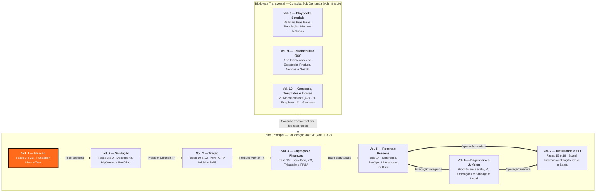
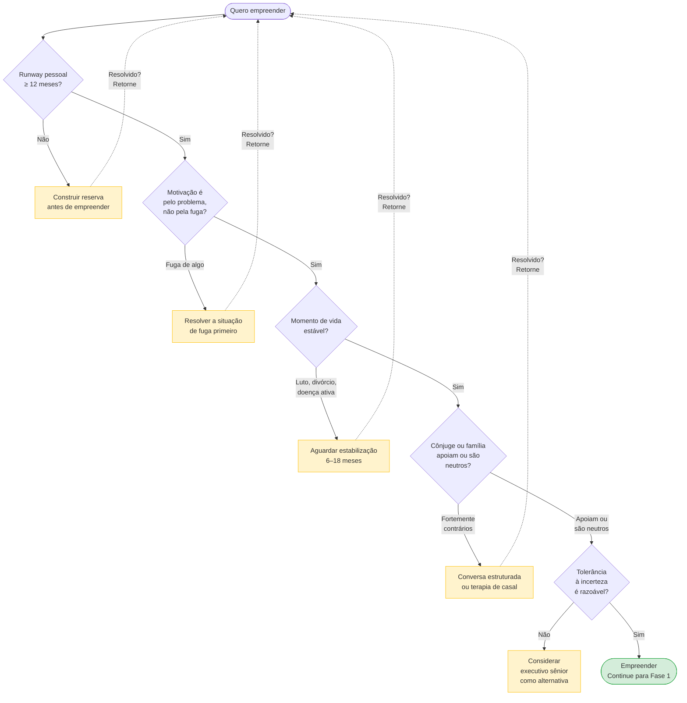
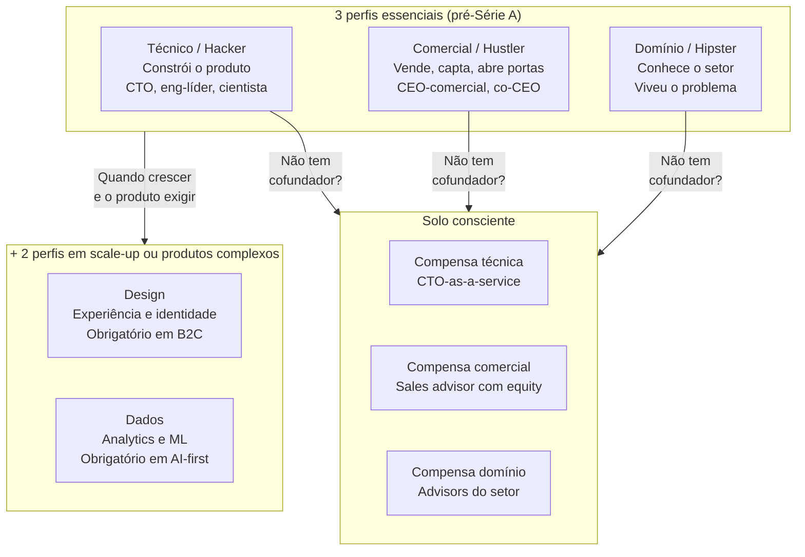
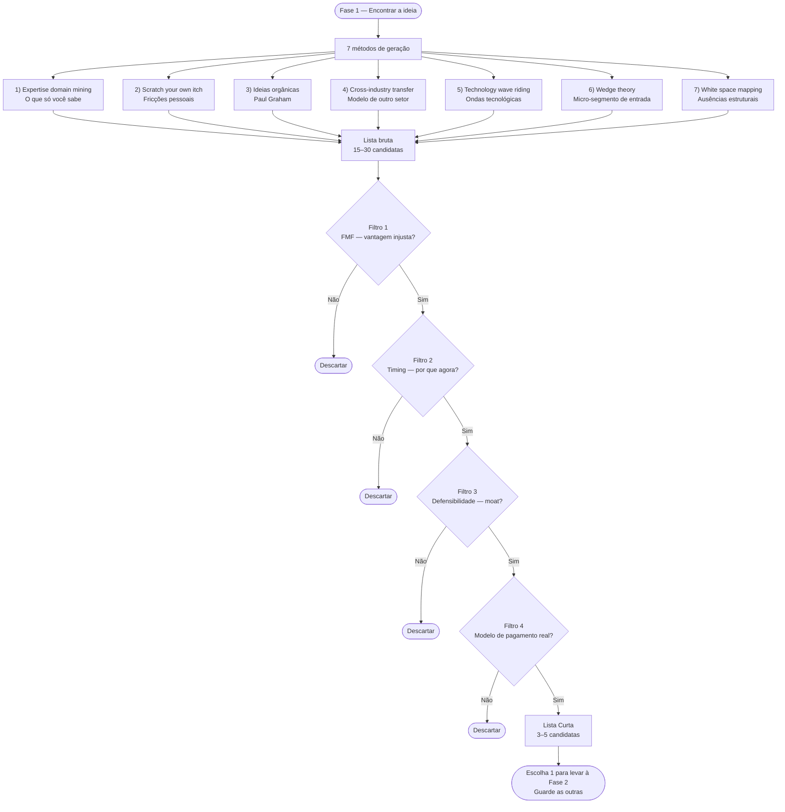
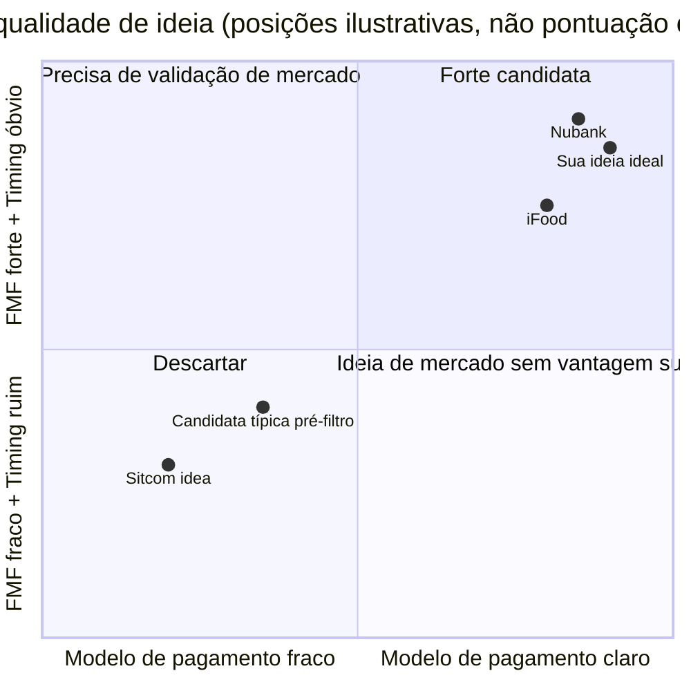
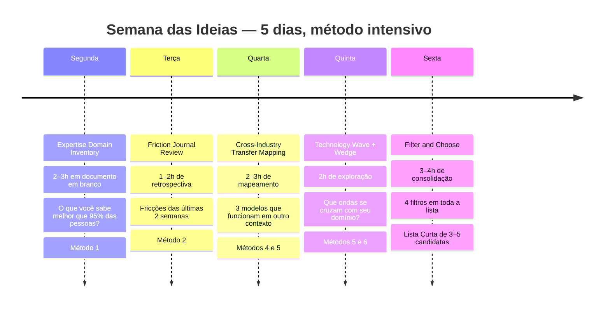
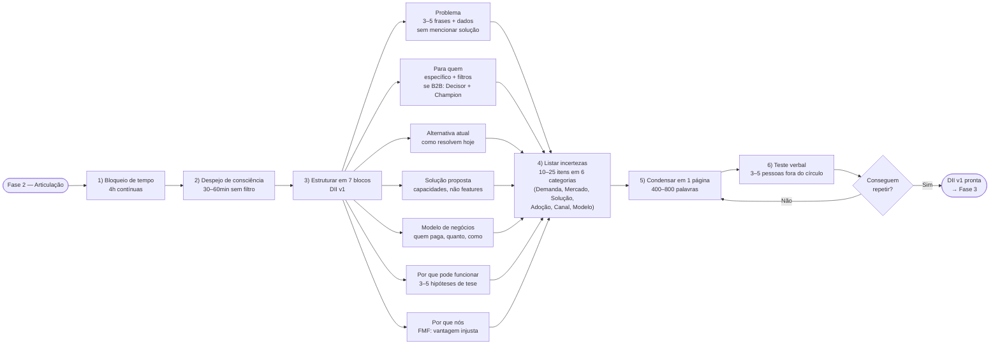
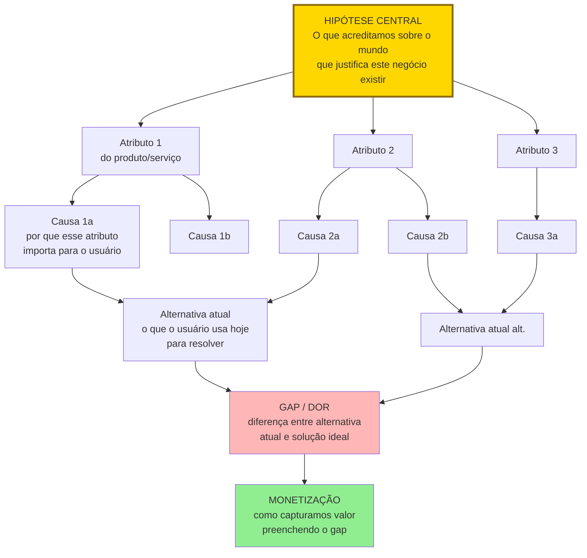
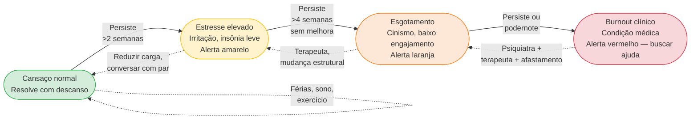

# IGNIÇÃO — Volume 1: Ideação

*Do Pré-Zero à Tese de Negócio (Fases 0 a 2B)*

> [!tip] Dica para leitura no Obsidian e GitHub
> Este volume faz parte da coleção **IGNIÇÃO** (10 volumes). Os links para seções deste mesmo volume usam âncoras diretas (`[[#Seção]]`) e os links para outros volumes apontam para o arquivo correspondente (`[[IGNICAO-Vol-X-Nome#Seção]]`).

---

## Nota do autor

Este livro começou como um arquivo de texto solto. Uma anotação aqui, uma observação ali, coisas que eu queria poder reencontrar em algum momento futuro da minha trajetória empreendedora. Quando percebi, o arquivo tinha crescido absurdamente, e com o crescimento veio uma tentação que eu resisti por algum tempo: transformar rascunho pessoal em algo mais estruturado.

Resisti porque a pergunta óbvia me incomodava. Existem centenas de livros de empreendedorismo no mercado, muitos escritos por pessoas com trajetórias mais notáveis que a minha, muitos com argumentos melhor polidos. O que justifica escrever mais um?

A resposta honesta é que este livro não foi escrito para o mercado. Foi escrito para mim. O fato de outras pessoas eventualmente poderem ler é consequência, não objetivo, e essa consequência só existe porque o livro, depois de pronto, também parece útil para quem esteja construindo algo num contexto parecido com o meu. A hierarquia importa: se eu tivesse escrito pensando primeiro em terceiros, teria escrito pior. Honestidade primeiro pra mim, qualidade pública como subproduto.

O que está aqui é, em essência, depoimento. Alguém tentando construir um negócio sério no Brasil, registrando para si mesmo o que aprendeu até onde aprendeu, na esperança de que as decisões futuras sejam um pouco menos cegas que as passadas. Não é livro de quem chegou, é o livro de quem está no meio da subida e parou para anotar o que sabia, antes que esquecesse.

Algumas coisas sobre o que isto efetivamente é, registradas para o eu de daqui a três, cinco, dez anos:

**Isto é uma enciclopédia, não um livro.** Em algum momento da escrita, eu parei de fingir que estava produzindo prosa contínua. O material não queria ser narrativa, queria ser referência. Aceitei. As fases são verbetes longos sobre etapas da trajetória, os apêndices são verbetes de profundidade temática, o ferramentário é catálogo de instrumentos. Você consulta isto, não lê. Quando precisar de algo em três parágrafos, abra em três parágrafos. O resto pode esperar até a próxima vez que precisar.

**As opiniões aqui são minhas e datadas.** Muito do que afirmo com convicção em abril de 2026 vai parecer ingênuo daqui a dez anos. Tudo bem. Documento canônico tem a vantagem de poder ser revisitado: na próxima edição, eu reescrevo os trechos que envelheceram mal. O que importa é que, neste momento, esta é a minha melhor compreensão organizada, não autoridade, não verdade final, apenas o que consegui reunir.

**Este não é o livro de um especialista.** É o livro de um praticante em formação. Se um dia eu for especialista em alguma coisa específica, escrevo um livro diferente sobre ela. Por enquanto, este é o registro do operacional que juntei, em parte do que vivi, em parte do que aprendi com quem passou antes, em parte do que estudei porque não tinha referência pronta.

**A escrita foi mais valiosa que o resultado.** Organizar o que eu sabia, descobrir o que eu *pensava que sabia* mas não articulava, pesquisar as lacunas, entrevistar mentalmente fundadores que admiro, isso produziu clareza que nenhum livro de outra pessoa produziria. Fica registrado aqui o único conselho que eu tiraria de toda essa experiência, em uma frase: o esforço de escrever ensina mais que o livro pronto. Inclusive este.

Quanto ao uso: foi feito para acompanhar decisões reais, não para ser lido de capa a capa. Quando eu estiver em crise, que eu encontre aqui não consolo abstrato, mas pergunta concreta que me force a diagnosticar o problema real. Quando eu estiver considerando pivotar, que eu encontre aqui o framework que me impeça de pivotar por desespero em vez de por evidência. Quando eu estiver prestes a fazer uma contratação sênior, que eu encontre aqui o lembrete das armadilhas específicas dessa decisão. Esse é o uso pretendido, bússola operacional para os momentos em que eu, sob pressão, não consigo pensar com a clareza que tinha quando escrevi isto.

Se você chegou até aqui e não é a pessoa para quem este livro foi escrito, o material pode te servir mesmo assim, grande parte é aplicável a qualquer fundador brasileiro. Mas alguns trechos vão parecer específicos demais ou idiossincráticos. São. É documento com autor, não com público. Use o que for útil, descarte o resto.

Boa sorte na minha jornada, em cada momento em que eu voltar aqui para buscar uma resposta que este livro possa oferecer a mim mesmo.

*Abril de 2026.*

---

## Sobre este livro

### O que isto é

Esta obra tem cerca de 750 mil palavras. Cobre como começar uma empresa no Brasil, como validá-la, como tracioná-la, como escalá-la e como sair dela. Está organizada em **dez volumes** — sete volumes que acompanham a maturidade da jornada e três volumes de referência transversal:

- **Volume 1 — Ideação** (Fases 0 a 2B + 13 apêndices de preparação do fundador, cofundadores, decisão, comunicação e IA pessoal);
- **Volume 2 — Validação** (Fases 3 a 9 + 12 apêndices de método científico, consumidor brasileiro, inteligência competitiva e modelos de negócio);
- **Volume 3 — Tração** (Fases 10 a 12 + 20 apêndices de Go-to-Market até 1M ARR, canais, vendas iniciais, pricing, CS, dados, produto AI-native e caixa);
- **Volume 4 — Captação e Finanças** (Fase 13 + 18 apêndices de estruturação societária, Venture Capital, valuation, instrumentos conversíveis, contabilidade, Reforma Tributária, FP&A, capital de giro e bancos);
- **Volume 5 — Receita e Pessoas** (Fase 14 + 19 apêndices de Growth em escala, vendas Enterprise, RevOps, parcerias corporativas, marca, liderança executiva, contratação C-level, remuneração/ESOP e cultura);
- **Volume 6 — Engenharia, Operações e Jurídico** (23 apêndices de produto em escala, gestão de engenharia, dívida técnica, IA, design organizacional, processos e blindagem contratual, trabalhista, LGPD, compliance e segurança);
- **Volume 7 — Maturidade e Exit** (Fases 15 e 16 + 22 apêndices de Board, empresa familiar, disputas societárias, internacionalização, câmbio, crise aguda, layoffs, recuperação judicial, M&A, IPO, secondaries e post-mortems + Epílogo);
- **Volume 8 — Playbooks Setoriais** (Guias de passagem de fase B, Catálogo de Métricas C, Leituras E, macroeconomia, regulação setorial, CADE, políticas públicas e os 9 Playbooks das Verticais Brasileiras);
- **Volume 9 — Ferramentário** (Índice de Frameworks + Apêndice BG completo com 163 frameworks distribuídos em 19 disciplinas);
- **Volume 10 — Canvases, Templates e Índices** (20 Canvases preenchidos em CZ, 30+ Templates operacionais e casos brasileiros em A, Glossários, Bibliografias e Índices Remissivos).

Não é narrativa contínua. Não é livro inspiracional. É um documento para consulta em decisões reais. Foi escrito assumindo que você tem pressa, tem uma dor concreta, e precisa de resposta operacional.

### As duas vozes do livro

O livro alterna entre duas vozes. Quando trata de material consagrado, frameworks como OKR, Hoshin Kanri, JTBD, Crossing the Chasm, o registro é sóbrio, próximo do verbete enciclopédico. O autor se apaga. O que importa é fidelidade ao conceito original.

Em outros momentos o livro opina. Sobre quando não empreender, sobre saúde mental do fundador, sobre o ecossistema brasileiro, sobre padrões de fracasso que vi de perto. Quando há opinião, o livro avisa. Você lê algo como "minha leitura, contestável, é que" e sabe que entrou em terreno autoral. Os dois modos coexistem ao longo do livro, e você sabe qual está lendo a cada momento.

### Por que brasileiro

Empreender no Brasil tem especificidades que raramente aparecem em livros importados. Tributação, regulação, ciclos de capital local, estrutura de canais, relação com governo, dinâmica societária, operação em múltiplas moedas. Traduzir Silicon Valley direto para São Paulo gera decisões ruins. O livro parte do contexto brasileiro e estende para o global quando necessário, não o contrário. CLT, MEI, Simples Nacional, INPI, LGPD, BNDES, BACEN, CVM, Receita Federal. Não são detalhes. São a moldura.

### Como usar

O livro não pede leitura linear. Aceita ser aberto em qualquer volume ou página por quem tem problema concreto. Além disso, cada bloco temático dentro dos volumes conta com uma **Introdução de Domínio** que explica como aqueles capítulos se conectam e qual ler primeiro.

Se você está pensando em empreender, comece por este **Volume 1 (Ideação)**, nas Fases 0 a 2B. Preparação, encontrar a ideia, articular a ideia e construir a teoria do negócio. Reserve três a quatro horas. Pare e execute antes de continuar.

Se você já tem uma ideia mas ainda não validou, vá para o **Volume 2 (Validação)**, nas Fases 3 a 9. Descoberta do problema até experimentos de validação e testes de protótipo. De quatro a seis horas. Consulte o BG.6 (no **Volume 9 — Ferramentário**) para técnica de entrevista.

Se está construindo MVP ou buscando product-market fit, abra o **Volume 3 (Tração)**, que cobre as Fases 10 a 12, mais os apêndices de GTM, canais, pricing, dados e pivotagem, além de BG.10 e BG.11 no **Volume 9**.

Se já tem PMF e está estruturando a empresa, captando ou escalando, use a tríade de Escala (**Volumes 4, 5 e 6**): comece pela [[IGNICAO-Vol-4-Captacao-e-Financas#FASE 13 — ESTRUTURAÇÃO JURÍDICA, FINANCEIRA E OPERACIONAL|Fase 13 (Vol. 4)]] antes da [[IGNICAO-Vol-5-Receita-e-Pessoas#FASE 14 — ESCALA: TIME, OPERAÇÕES, CRESCIMENTO E CAPITAL|Fase 14 (Vol. 5)]], mesmo que pareça óbvia. Quem pula estruturação volta a ela depois de quebrar coisa cara. Para fundraising, valuation e tributário, fique no **Volume 4** (Apêndices V, CF, CE, W, EN). Para escalar vendas enterprise, RevOps, executivos e cultura, vá ao **Volume 5** (Apêndices CG, EB, EH, BN, AP). Para escalar engenharia, produto, operações e blindagem jurídica/LGPD, use o **Volume 6** (Apêndices AB, CR, FB, DV, T, EU, EL).

Se está em crise ou considerando pivô, há três rotas combinadas: [[IGNICAO-Vol-3-Tracao#APÊNDICE CL — PIVOT: TIPOLOGIA, DECISÃO E EXECUÇÃO|Apêndice CL — Pivot (Vol. 3)]], [[IGNICAO-Vol-7-Maturidade-e-Exit#APÊNDICE CW — CRISE E CONTINUIDADE: PREVENÇÃO, RESPOSTA, RECUPERAÇÃO|Apêndice CW — Crise (Vol. 7)]] e [[#APÊNDICE Y — SAÚDE MENTAL, DINÂMICA DE CO-FOUNDERS E HUMANIDADE DO FUNDADOR|Apêndice Y]] sobre saúde mental (neste Vol. 1). Crise societária acrescenta [[#FASE 0 — PREPARAÇÃO DO EMPREENDEDOR|Fase 0]] e os Apêndices AH (Vol. 6) e BP (Vol. 7). Crise de caixa acrescenta [[IGNICAO-Vol-4-Captacao-e-Financas#FASE 13 — ESTRUTURAÇÃO JURÍDICA, FINANCEIRA E OPERACIONAL|Fase 13 (Vol. 4)]] e os Apêndices AN e AT (Vol. 3).

Se está preparando saída, governança de conselho ou gerindo segunda curva, abra o **Volume 7 (Maturidade e Exit)** na [[IGNICAO-Vol-7-Maturidade-e-Exit#FASE 15 — REINVENÇÃO E SEGUNDA CURVA|Fase 15 (Vol. 7)]], [[IGNICAO-Vol-7-Maturidade-e-Exit#FASE 16 — EXIT STRATEGY|Fase 16 (Vol. 7)]] e nos Apêndices AM, BR e BF.

Para consulta transversal, use os **Volumes 8, 9 e 10**: o **Volume 8 (Playbooks Setoriais)** reúne o Catálogo de Métricas por Fase (C), regulação e os playbooks de verticais brasileiras; o **Volume 9 (Ferramentário)** cataloga 163 frameworks em 19 categorias (BG); e o **Volume 10 (Canvases, Templates e Índices)** entrega os 20 canvases visuais (CZ), os 30+ templates copiáveis (A) e os glossários e índices gerais.

E se você só tem quinze minutos, abra o volume e a fase do seu momento atual. Leia a abertura, as armadilhas, e a saída da fase. É suficiente para reorientar foco.

### Sobre os exemplos: PadariaPro e os casos reais

Você vai encontrar PadariaPro mencionado em vários templates ao longo do livro. É um caso fictício, criado para ilustrar todo o ciclo de instrumentos do livro num único arco coerente, da Declaração Inicial da ideia, na [[#FASE 2 — ARTICULAÇÃO E CAPTURA DA IDEIA|Fase 2]], até o Plano de Exit, na [[IGNICAO-Vol-7-Maturidade-e-Exit#FASE 16 — EXIT STRATEGY|Fase 16 (Vol. 7)]]. PadariaPro é um SaaS de gestão para padarias artesanais brasileiras com três a cinco lojas. Você acompanha os fundadores, também fictícios, preenchendo cada template em sequência. Story Tree, Canvas da Cunha, Banco de Hipóteses, Cartão de Experimento, Especificação de MVP, OKRs, Plano de Time, e por aí vai. A função é pedagógica. Um caso único permite ver continuidade entre os instrumentos sem ter que reaprender contexto a cada novo template.

Onde o caso real funciona melhor, o livro usa empresas brasileiras documentadas. Stone, Quinto Andar, Hotmart, Magazine Luiza, RD Station, Linx. Os pontos onde elas aparecem são Especificação de MVP, Diagnóstico de PMF, Máquina de Crescimento em escala, Análise de Segunda Curva e Plano de Exit. Casos reais nesses pontos adicionam nuance e textura que um caso fictício não consegue produzir. Em alguns templates dos Volumes 1 e 2 (Ideação e Validação), como Declaração Inicial, Roteiro de Entrevista e Canvas da Cunha, você verá PadariaPro e um caso real lado a lado, para mostrar como o instrumento se comporta em contextos diferentes.

Tanto os casos reais quanto o PadariaPro são instrumentos. Nenhum dos dois é receita.

### Como este livro envelhece

Envelhece rápido: nomes de fundos, valuations específicos, ferramentas de IA, features de produtos, alíquotas tributárias, regimes regulatórios. Envelhece devagar: frameworks clássicos, padrões de descoberta, psicologia do fundador, dinâmicas de mercado. Ao reler em ano futuro, desconfie de datas e números. Confie em processos e padrões. A próxima edição vai corrigir o que envelheceu mal. Esse é o privilégio de documento canônico sobre livro impresso.

### O que este livro não é

Não substitui advogado, contador, terapeuta, consultor regulatório ou mentor humano. Não é bola de cristal. Quando diz que a chance de sucesso em X é baixa, isso reflete padrões observáveis, não destino. As respostas para seu caso específico envolvem pessoas e contextos que nenhuma enciclopédia consegue antecipar.

Empreender no Brasil é difícil. O livro não disfarça isso. Mas é possível, e milhares de pessoas conseguem todo ano. Este livro existe para aumentar a probabilidade de você estar entre elas, reduzindo erros evitáveis, preparando para os inevitáveis, e devolvendo o tempo que seria gasto descobrindo o que outros já descobriram.

---

## Mapa da Coleção IGNIÇÃO



---

## Sumário deste Volume

### Fases da Etapa (Ideação)

- [[#FASE 0 — PREPARAÇÃO DO EMPREENDEDOR]]
- [[#FASE 1 — ENCONTRAR A IDEIA]]
- [[#FASE 2 — ARTICULAÇÃO E CAPTURA DA IDEIA]]
- [[#FASE 2B — CONSTRUÇÃO DA TEORIA DO NEGÓCIO]]

### Fundador, Co-founders e Preparação Pessoal

- [[#APÊNDICE AJ — DINHEIRO PESSOAL DO FUNDADOR]]
- [[#APÊNDICE Y — SAÚDE MENTAL, DINÂMICA DE CO-FOUNDERS E HUMANIDADE DO FUNDADOR]]
- [[#APÊNDICE D — ARMADILHAS MENTAIS E VIESES]]
- [[#APÊNDICE CS — BOOTSTRAP vs VENTURE CAPITAL: A ESCOLHA FUNDACIONAL]]
- [[#APÊNDICE CN — DIVERSIDADE DE JORNADAS: CASOS ALÉM DO CÂNONE]]

### Cognição, Decisão, Comunicação e Produtividade com IA

- [[#APÊNDICE EJ — TOMADA DE DECISÃO COMO DISCIPLINA]]
- [[#APÊNDICE EK — INFLUÊNCIA E PERSUASÃO SEM AUTORIDADE FORMAL]]
- [[#APÊNDICE EW — COMUNICAÇÃO ESCRITA PARA NEGÓCIOS]]
- [[#APÊNDICE EX — APRESENTAÇÃO E FALA EM PÚBLICO]]
- [[#APÊNDICE I — IA GENERATIVA COMO ACELERADOR DO EMPREENDEDOR (2026)]]
- [[#APÊNDICE CT — IA COMO CO-PILOTO DO FUNDADOR (2026)]]

### Ecossistema, Mentoria e Apoio Inicial

- [[#APÊNDICE AK — ACELERADORAS, PROGRAMAS E PARCEIROS INSTITUCIONAIS PARA STARTUP BRASILEIRA]]
- [[#APÊNDICE AL — REDE, MENTORES E ADVISORS — COMO CONSTRUIR O CAPITAL HUMANO DO EMPREENDEDOR]]

---

# FASES DA ETAPA — IDEAÇÃO

---

### Arquitetura deste Domínio: Da Preparação Pessoal à Teoria Causal do Negócio

*Antes da empresa: você, a ideia e a teoria do negócio.*

Três caminhos costumam trazer alguém até este ponto. O primeiro: uma ideia que não sai da cabeça há semanas, e você quer descobrir se vale a pena tentar. O segundo: insatisfação com a trajetória atual, e empreender virou saída possível na sua imaginação. O terceiro: convite — um amigo, um ex-colega, um investidor te chamou para começar algo junto, e você precisa decidir se topa.

Qualquer um dos três é começo legítimo. Nenhum deles, isolado, é suficiente. Os dois primeiros volumes desta coleção (**Volume 1 — Ideação** e **Volume 2 — Validação**) existem para transformar a situação em que você está numa decisão informada: primeiro sobre se empreender, depois sobre qual problema, depois sobre quais clientes, depois sobre que solução. Quem segue as fases em ordem chega ao final do Volume 2 com ideia validada com usuários reais, solução testada em protótipo, e base concreta para o MVP do **Volume 3 — Tração**. Quem descobre no caminho que a ideia não era viável também ganha: economiza anos numa direção errada, com pouco dinheiro queimado.

Este **Volume 1 (Ideação)** cobre as quatro fases fundacionais (**Fase 0 a Fase 2B**), cada uma com método próprio, executores, métricas, armadilhas e critérios de saída, seguidas pelas sete fases de descoberta e experimentação do **Volume 2 (Validação, Fases 3 a 9)**. A ordem importa. Ignorar a [[#FASE 0 — PREPARAÇÃO DO EMPREENDEDOR|Fase 0]] e pular direto para a [[IGNICAO-Vol-2-Validacao#FASE 8 — IDEAÇÃO E PROTOTIPAGEM DE SOLUÇÕES|Fase 8 (Vol. 2)]] de prototipagem é a causa mais comum de empresa que nasce errada.

Um aviso: **as etapas de Ideação e Validação são lentas de propósito**. Empreendedor experiente executa essas fases em paralelo e condensado; iniciante tentando fazer o mesmo queima a primeira tentativa. Se em algum momento bater a sensação de "isso é detalhe demais para ideia que nem existe", pause em vez de acelerar. O detalhe está aqui porque a probabilidade da ideia sobreviver sem ele é baixa, e fundador iniciante quase nunca tem repertório para saber o que pode pular.

> [!tip] Roteiro de leitura, dependências causais e instrumentos conectados
> - **Sequência causal obrigatória:** A [[#FASE 0 — PREPARAÇÃO DO EMPREENDEDOR|Fase 0]] define as restrições reais do fundador (runway pessoal, apetite a risco e alinhamento societário). Essas restrições filtram quais problemas fazem sentido atacar na [[#FASE 1 — ENCONTRAR A IDEIA|Fase 1]]. A ideia escolhida é cristalizada em uma página na [[#FASE 2 — ARTICULAÇÃO E CAPTURA DA IDEIA|Fase 2]] (DII), que por sua vez é decomposta em cadeia de causa e efeito e premissas *bet-the-company* na [[#FASE 2B — CONSTRUÇÃO DA TEORIA DO NEGÓCIO|Fase 2B]] (Story Tree e DAG causal).
> - **Frameworks e instrumentos conectados (Vols. 9 e 10):** A geração e triagem de ideias apoia-se em Effectuation (BG.2.11), Ansoff Matrix (BG.1.5) e PESTEL Analysis (BG.1.6) no **Volume 9 (Ferramentário)**, além dos templates A.1 (Declaração Inicial da Ideia), A.7 (Story Tree), A.8 (DAG Causal) e A.9 (Theory Map) e dos canvases CZ.1, CZ.2, CZ.8, CZ.14 e CZ.16 no **Volume 10 (Canvases e Templates)**.

Começa pelo começo: você.

---

## FASE 0 — PREPARAÇÃO DO EMPREENDEDOR

> [!info] Como ler esta fase
> A Fase 0 atende dois leitores ao mesmo tempo. Se você ainda está decidindo se quer empreender, leia da abertura até o fim de "Quando não empreender, um roteiro honesto de autoexclusão" e pare. Se três ou mais sinais batem com a sua situação, volte aqui em alguns meses, depois de ajustar. O resto da fase é para quem já decidiu. Se você já decidiu, leia tudo. Os dez sinais de auto-exclusão valem como recheck antes de cada decisão grande adiante (largar emprego, recrutar sócio, comprometer runway).

### O que esse apêndice cobre

Esta é a fase anterior à ideia. O objetivo é preparar a pessoa que vai empreender, não o negócio. Você avalia a sua situação de vida com honestidade. Capacidade financeira, capacidade emocional, tempo disponível, motivações reais, rede de apoio. O entregável é um documento de três a seis páginas, o Dossiê Pessoal do Empreendedor, que responde às perguntas desta fase.

> [!abstract] Resumo operacional
> **Entregável:** Dossiê Pessoal do Empreendedor de três a seis páginas, com runway pessoal calculado, motivação escrita, rede de apoio mapeada e critérios de desistência definidos com a cabeça fria.
>
> **Sinais de saída:**
> - Texto de "por que empreender" com 500 a 1.500 palavras, reescrito ao menos duas vezes, e fit diferencial articulado em parágrafo com verbos concretos.
> - Runway pessoal acima do mínimo para o modelo de dedicação escolhido (≥ 6 meses para part-time, ≥ 12 meses para full-time) e ponto de parada por escrito.
> - Conversa explícita e documentada com a pessoa afetada mais próxima (cônjuge, dependentes), mais conversa com pelo menos um fundador com exit e um com falha.
> - Três advisors informais identificados por nome, e compromisso de horas semanais documentado com mapa de impacto na vida atual.
>
> **Três armadilhas mais comuns:**
> 1. Otimismo financeiro: superestimar receita futura e subestimar custos, em vez de multiplicar custos por 1,5 e dividir receita esperada por 2.
> 2. Sociedade feita no impulso e sem acordo formal: escolher sócio pela amizade ("meu melhor amigo topou") em vez de complementaridade, e operar sem contrato societário rascunhado.
> 3. Decisão romantizada em momento emocional (demissão, aniversário, livro motivacional) em vez de decisão estrutural tomada com cabeça fria e ignorando sinais de preocupação da rede próxima.

### POR QUE

Empreender não é primariamente um ato técnico. É um ato psicológico e financeiro sustentado por meses ou anos. A maioria das desistências não acontece porque a ideia era ruim. Acontece porque o empreendedor não aguentou a pressão. Ficou sem dinheiro, sem apoio familiar, sem saúde mental. Ou descobriu tarde que queria outra coisa da vida. Pular esta fase significa começar um negócio sobre fundações pessoais frágeis, e qualquer crise do próprio negócio derruba tudo.

### Quando não empreender, um roteiro honesto de autoexclusão

A maioria dos manuais assume que o leitor já decidiu empreender e ajuda a executar bem. Esta seção é diferente. Lista situações onde empreender agora provavelmente é má ideia, independente de quão boa seja a ideia ou o time. Reconhecer essas situações antes evita sofrimento pessoal, destruição de capital, e desperdício de anos. Não é julgamento. É honestidade.



Você provavelmente não deveria empreender agora se:

1. Suas finanças pessoais estão frágeis. Dívidas pessoais altas no cartão, no rotativo, no financiamento atrasado, sem plano de quitação. Reserva de emergência abaixo de seis meses de despesas. Dependentes financeiros sem outra fonte de renda. Empreender com finanças pessoais frágeis costuma terminar em crise dupla, da empresa e da casa. Resolva as finanças primeiro, construa reserva, depois empreenda.

2. Você está num período de vida emocionalmente turbulento. Luto recente, divórcio em curso ou recente, mudança de cidade ou país sem adaptação, diagnóstico de saúde sério em curso. A trajetória empreendedora exige resiliência emocional alta. Somada a uma crise pessoal, tende a destruir as duas. Esperar estabilizar é sábio.

3. Sua motivação principal é financeira de curto prazo. Quero ficar rico em três anos. Preciso ganhar muito rápido. Empreender paga mais que CLT. Estatisticamente a maioria dos empreendedores ganha menos que em CLT bem-remunerado pelos primeiros cinco a sete anos. Retorno financeiro real, quando vem, vem em sete a doze. Motivação só financeira costuma desistir antes desse tempo.

4. Você não tolera incerteza. Precisa de rotina, previsibilidade, feedback constante. Sente alta ansiedade em situações ambíguas. Tem dificuldade de dormir com questões não-resolvidas. Empresa em estágio inicial é incerteza por anos. Autoconhecimento aqui é honestidade. Algumas personalidades florescem melhor como executivo sênior em empresa maior.

5. Você não tem nenhum conhecimento específico do problema que quer resolver. A ideia nasceu de observação superficial. Você não conhece o cliente em profundidade. Não tem rede no setor. É possível, mas três a cinco vezes mais difícil. Alguém do setor com menos brilho resolve mais rápido. Se você quer insistir, construa conhecimento e rede do setor por seis a doze meses antes de fundar.

6. Você está empreendendo para provar algo a alguém. Aos pais que dizem "estabilize". Ao chefe que demitiu você. Ao ex-parceiro que duvidou. Motivação externa dessa forma costuma colapsar quando a trajetória fica difícil, e ela vai ficar. A motivação precisa ser interna e pelo problema em si.

7. Seu cônjuge ou companheiro é fortemente contrário. Não apenas preocupado, mas explicitamente contra e resistente mesmo após conversa longa. Empreender contra a oposição do parceiro destrói muitos casamentos. Se você quer insistir mesmo assim, considere terapia de casal antes.

8. Você está no meio de uma trajetória profissional que estava dando certo. Promoção recente, aumento significativo, caminho de liderança em empresa consolidada. Nunca vai ser o "bom momento" de sair do emprego, mas em trajetória ascendente alta o custo de oportunidade é enorme. Isso não significa que você não pode empreender. Significa que você precisa fazer o cálculo com clareza. Quanto está deixando? O que vai buscar? Decisão com olhos abertos, não impulso.

9. Você tem condição de saúde mental não-tratada. Depressão, ansiedade severa, transtornos específicos sem acompanhamento. A trajetória empreendedora agrava saúde mental frágil. Não é remédio. Trate primeiro. O [[#APÊNDICE Y — SAÚDE MENTAL, DINÂMICA DE CO-FOUNDERS E HUMANIDADE DO FUNDADOR|Apêndice Y]] detalha o impacto da rotina empreendedora em ansiedade e depressão, avaliação inicial, e quando buscar ajuda profissional antes de empreender.

10. Você quer empreender porque odeia seu emprego atual. Fugir de algo é diferente de ir em direção a algo. Frequentemente a trajetória empreendedora fica mais difícil que o emprego ruim. Resolva o trabalho primeiro. Depois empreenda por motivo positivo, não evasivo.

> [!warning] A regra dos três pontos
> Se três ou mais desses dez pontos são verdade para você, pause. Não desista. Ajuste. Trabalhe nos pontos por seis a vinte e quatro meses antes de empreender. A trajetória depois dessa preparação é significativamente mais sustentável.

### Quando usar

Comece antes de investir qualquer recurso. Tempo acima de uma hora por dia, ou dinheiro, em uma ideia. Termine quando o Dossiê Pessoal estiver preenchido com honestidade, e você tiver clareza financeira (o seu runway pessoal mínimo definido) e clareza de motivação (você sabe por que quer fazer isso). Revisite a cada seis meses, ou sempre que houver mudança de vida significativa. Casamento, filho, doença, mudança de cidade.

### Quem envolve

O executor principal é você, o empreendedor. Os participantes são cônjuge ou companheiro se houver, familiares que dependem financeiramente de você, sócios potenciais. Você decide, mas com contribuição real, não cerimonial, de quem compartilha sua vida financeira e emocional.

### Como executar

Execute estas oito tarefas em sequência.

1. Diagnóstico financeiro pessoal, de duas a quatro horas. Levante numa planilha três números. O seu custo de vida mensal mínimo (aluguel, comida, saúde, transporte, educação dos filhos, dívidas), o quanto você precisa para viver com dignidade básica, sem lazer. O seu custo de vida mensal atual, incluindo o padrão que você leva hoje. A sua reserva atual em dinheiro líquido, sem contar imóveis, carros, previdência travada.

   > [!tip] Fórmula do Runway Pessoal
   > Runway Pessoal (tempo de vida do seu caixa pessoal) = Reserva ÷ Custo mínimo mensal
   >
   > É o número de meses que você aguenta sem receita. Se é menor que seis meses, não largue o seu emprego para empreender agora. Empreenda em paralelo.

   > [!tip] Apêndice AJ — Dinheiro Pessoal do Fundador
   > O diagnóstico acima é o ponto de partida. O [[#APÊNDICE AJ — DINHEIRO PESSOAL DO FUNDADOR|Apêndice AJ]] aprofunda: pró-labore sustentável por fase, gestão de dívida pessoal enquanto a empresa cresce, e como separar as finanças pessoais das da empresa desde o início.

2. Teste de motivação real, uma hora, em silêncio, sem pressa. Responda por escrito, com honestidade brutal. Por que eu quero empreender? Escreva cinco razões. Dessas razões, quais são sobre mim (ego, liberdade, dinheiro) e quais são sobre o problema ou o cliente? Do que eu estou fugindo? Chefe ruim, trabalho tedioso, sensação de fracasso? Cuidado: empreender para fugir de algo é fonte frequente de decisões ruins. Eu faria isso se nunca ficasse rico? Se não, qual é o valor mínimo que precisa sair disso para fazer valer a pena?

3. Inventário de habilidades e lacunas, duas horas. Liste em quatro colunas: o que você tem e é relevante, o que falta e é crítico, como cobrir cada lacuna (aprender, contratar, sócio), e o custo em tempo e dinheiro de cada cobertura.

4. Conversa estruturada com quem compartilha a sua vida, uma a duas horas. Se você tem cônjuge, filhos, ou alguém que depende de você, marque uma conversa formal. Não um comentário de jantar. Apresente quanto dinheiro você planeja alocar, qual o prazo que dá a si mesmo antes de reavaliar, qual impacto isso terá na rotina familiar, qual é o plano B se não der certo. Peça uma resposta honesta. Se a pessoa não apoia, trate isso como informação crítica. Não como obstáculo a ser ignorado.

   > [!note] Convencer família e rede próxima sem autoridade formal é habilidade
   > Você não tem poder hierárquico sobre cônjuge, pais ou amigos próximos. O [[#APÊNDICE EK — INFLUÊNCIA E PERSUASÃO SEM AUTORIDADE FORMAL|Apêndice EK — Influência e Persuasão sem Autoridade Formal]] cobre como construir alinhamento genuíno com pessoas que não são obrigadas a concordar com você — ferramenta direta para a conversa desta etapa.

5. Avaliação de saúde física e mental, trinta minutos. Sono, condições crônicas que pioram com estresse, rede de apoio emocional disponível. Se já está em tratamento, converse com o seu profissional antes de aumentar a pressão.

6. Definição de prazo e critérios de desistência, uma hora. Defina de antemão quanto tempo você dá ao projeto antes de reavaliar (sugiro doze meses para a primeira reavaliação formal). Quais sinais de fracasso justificam desistir antes (nenhum cliente pagante depois de seis meses de tentativa ativa, reserva abaixo de X reais). Quais sinais de sucesso justificam acelerar (primeiro cliente pagante recorrente em noventa dias). Defina esses critérios agora, com a cabeça fria. No meio da tempestade, você não vai ter objetividade para defini-los.

   > [!note] A decisão de empreender é Tipo 1 — irreversível por meses ou anos
   > O [[#APÊNDICE EJ — TOMADA DE DECISÃO COMO DISCIPLINA|Apêndice EJ — Tomada de Decisão como Disciplina]] distingue decisões reversíveis (Tipo 2, podem ser desfeitas rapidamente) de decisões irreversíveis (Tipo 1, com custo alto de reversão). Largar emprego, comprometer o runway pessoal e recrutar cofundadores são Tipo 1. O SPADE (método para estruturar decisões de alto impacto) e a técnica de pré-mortem (exercício de imaginar o fracasso antes de decidir) do Apêndice EJ ajudam a estruturar esse tipo de decisão antes de tomar, não depois.

7. Escolha do modelo de dedicação entre três caminhos: full-time (largar tudo, exige runway de doze meses ou mais), part-time (manter emprego, dez a vinte horas semanais), ou side project exploratório (cinco a dez horas semanais, sem pressão de virar empresa, serve para as fases 1 a 4).

   > [!note] Apêndice BQ — Gestão de Tempo do Fundador
   > Independente do modelo escolhido (full, part ou side), a alocação de tempo será o recurso mais escasso e mais mal gerenciado nos primeiros meses. O [[IGNICAO-Vol-5-Receita-e-Pessoas#APÊNDICE BQ — GESTÃO DE TEMPO DO FUNDADOR E OPERATING CADENCE|Apêndice BQ (Vol. 5)]] cobre time-blocking, rituais semanais e como proteger tempo profundo contra demandas operacionais — especialmente relevante para quem empreende em paralelo ao emprego.

8. Escrita do Dossiê Pessoal. Consolide os passos acima em um documento simples e releia ao final de cada fase seguinte. Atualize sempre que algo descoberto no caminho invalidar uma premissa.

### O fundador como pessoa, três ensaios de Paul Graham para calibrar expectativa

A [[#FASE 0 — PREPARAÇÃO DO EMPREENDEDOR|Fase 0]] é sobre preparar a pessoa que vai empreender, não o negócio. Paul Graham tem alguns ensaios especificamente sobre essa dimensão. Sobre o tipo de pessoa que tende a ter sucesso em startup, o tipo de pensamento que ajuda, o tipo de armadilha interna que derruba. Não são conselhos de "atitude positiva". São observações baseadas na experiência de ter acompanhado mais de três mil fundadores no Y Combinator, cruzada com padrões identificados em retrospecto.

> [!note] Apêndice BF — Second-Time Founder
> Se você já empreendeu antes — com exit (saída, venda ou encerramento da empresa) com fracasso, ou com empresa ainda ativa — a sua Fase 0 é diferente. O [[IGNICAO-Vol-7-Maturidade-e-Exit#APÊNDICE BF — SECOND-TIME FOUNDER|Apêndice BF (Vol. 7)]] trata de como o histórico anterior muda a equação de runway, escolha de sócio, e autoconhecimento exigidos aqui.

Os três ensaios abaixo são os que mais se aplicam à decisão da Fase 0. Outros três do mesmo autor (*What We Look for in Founders*, *Before the Startup*, *You Weren't Meant to Have a Boss*) entram resumidos no fim. Os links estão no [[IGNICAO-Vol-8-Playbooks-Setoriais#APÊNDICE E — RECURSOS E LEITURAS RECOMENDADAS|Apêndice E (Vol. 8)]].

#### A ideia dominante na sua cabeça, *The Top Idea in Your Mind* (Graham, 2010)

Graham observou que a maioria das pessoas tem uma única ideia dominante na mente em qualquer momento. É aquela para a qual os pensamentos migram naturalmente quando você está no banho, dirigindo, ou caminhando sem estímulo externo. É o problema em que você pensa sem tentar. E é a fonte de boa parte das suas melhores intuições operacionais e estratégicas.

A implicação para o fundador é concreta. Ser CEO de startup exige que o seu negócio seja a ideia dominante na sua cabeça durante os primeiros anos. Se o problema dominante for outro (um conflito pessoal em aberto, ansiedade financeira não-resolvida, uma briga com ex-sócio, um pleito jurídico, uma dívida não-estruturada), o seu negócio vai sofrer sistematicamente. O tempo de pensar sem tentar está sendo gasto em outro lugar. Você não controla para onde a mente vai no banho. Controla indiretamente, pelo que deixa ou não deixa ficar aberto na sua vida.

Teste simples, feito nos próximos três banhos, sem tentar. Quando a sua mente vagueia, para onde ela vai? Se não é o seu negócio, você tem duas opções. A primeira é fechar o loop do que está ocupando a mente. Resolver o conflito, pagar a dívida, enfrentar a conversa evitada, terminar o processo jurídico. Loops abertos são imãs mentais que roubam a sua capacidade de pensar em trabalho profundo. A segunda é reconhecer que você ainda não está pronto para começar uma startup. Talvez seja sensato resolver a vida pessoal primeiro, antes de somar a ela a carga cognitiva de fundar uma empresa.

Graham identifica dois tipos de pensamento particularmente perigosos para fundadores, porque roubam atenção de forma desproporcional ao benefício. Um é pensamento sobre dinheiro. Captação tende a virar atolamento mental que consome cem por cento do foco por semanas. O outro é pensamento sobre disputas. Brigas ocupam espaço imenso, e pior, têm formato velcro. Parecem ter substância, mas não têm. Se você está hoje no meio de uma captação ou de uma disputa, aceite que o seu trabalho estratégico vai sofrer durante esse período. Não marque outras decisões importantes para acontecerem em paralelo.

> [!tip] Bootstrap como alternativa
> Antes de assumir VC como caminho default, ler [[#APÊNDICE CS — BOOTSTRAP vs VENTURE CAPITAL: A ESCOLHA FUNDACIONAL|Apêndice CS]] para a escolha fundacional. Bootstrap e venture capital são trade-offs distintos, não níveis de ambição.

> [!important] Regra operacional da Fase 0
> Antes de começar, faça um inventário honesto de loops abertos na sua vida. Dívidas não-renegociadas, conflitos interpessoais, compromissos não-cumpridos, processos incompletos. Feche o máximo possível. Cada loop aberto é imposto mental sobre a sua capacidade futura de ser fundador.

#### Relentlessly resourceful, *Relentlessly Resourceful* (Graham, 2009)

Graham escreveu um ensaio curto, de 2009, com a tese mais direta sobre o que faz um bom fundador. Conseguir reduzir bom fundador a duas palavras levou tempo, ele diz. A resposta é "relentlessly resourceful". Implacavelmente engenhoso.

O conceito é construído em oposição a "hapless". Desamparado. Vítima passiva das circunstâncias. O ponto não é apenas trabalhar muito. Muita gente trabalha muito e continua hapless. É trabalhar muito mais continuar tentando abordagens novas quando as primeiras falham mais nunca aceitar "não tem como" como resposta final. Pessoas hapless são vitimizadas por circunstância. Pessoas relentlessly resourceful torcem circunstância até ela dar jeito.

Graham observa que a diferença aparece operacionalmente em como a pessoa reage a obstáculo. A pessoa hapless recebe um não de investidor, volta para casa, conclui "então não vai dar certo". Tenta canal de aquisição que não funciona, conclui "o canal é ruim". Tem problema técnico difícil, espera que alguém apareça para resolver. A pessoa relentlessly resourceful recebe o não de investidor, pergunta exatamente por quê, ajusta o pitch (apresentação do negócio), tenta outros quinze investidores com o pitch novo. Canal de aquisição falha, ela testa outros oito mecanicamente. Problema técnico difícil, ela estuda do zero, pergunta a dez pessoas, tenta três abordagens.

Para Graham, é o teste mais útil que ele aplicava mentalmente ao conhecer fundador pela primeira vez. Sugere que é também o teste que vale você aplicar a si mesmo e a qualquer cofundador. Quando esta pessoa bate em obstáculo, ela naturalmente vai para "tem que ter um jeito" ou para "não tem como"?

Exercício concreto de [[#FASE 0 — PREPARAÇÃO DO EMPREENDEDOR|Fase 0]]. Liste cinco obstáculos significativos que você enfrentou profissionalmente nos últimos três anos. Para cada um, descreva em três frases. Qual era o obstáculo. Quantas abordagens você tentou antes de achar solução ou desistir. Quem te ajudou ou quem você envolveu. O padrão que emerge: se em três ou mais dos cinco casos você tentou duas abordagens ou menos, ou desistiu sem envolver outras pessoas, provavelmente você ainda não desenvolveu o músculo de "relentlessly resourceful". Isso é desenvolvível. Mas vale você saber que está nesse ponto antes de começar a empreender, para poder desenvolver conscientemente.

> [!note] Síntese da tese de Graham
> Se "Make something people want" é o destino do Y Combinator, "Be relentlessly resourceful" é, segundo Graham, como o fundador chega lá. A formulação é uma síntese das duas teses centrais que Graham repete em ensaios e palestras, não citação literal de uma única frase.

#### Determinação não é teimosia, *The Anatomy of Determination* (Graham, 2009)

Determinação e teimosia parecem iguais de fora, mas são opostas operacionalmente.

Graham usa a analogia do running back do futebol americano. Atleta cujo trabalho é correr para o gol apesar da defesa ativa tentando detê-lo. Running back bom não é o que corre em linha reta e bate nos defensores até cair. É o que tem destino claro (o gol) mas rota flexível. Ele desvia, gira, volta, tenta de novo por outro ângulo, sempre em direção ao mesmo gol. Essa é a forma correta de determinação em startup.

Teimosia é ter rota fixa apesar de a defesa mostrar que ela não funciona. Determinação é ter gol fixo e aceitar rotas novas infinitamente até uma delas funcionar.

Sinais de que você está na teimosia disfarçada de determinação. Você está há meses rodando a mesma abordagem sem resultado, dizendo "só preciso insistir mais". Você se irrita quando alguém questiona a abordagem, não a ideia. Você mede progresso em esforço aplicado em vez de aprendizado gerado. Conversas com cliente te deixam desmoralizado em vez de curioso.

Sinais de determinação saudável. Você muda de rota com frequência, mas mantém o gol fixo por anos. Você busca ativamente evidência contrária à sua abordagem atual. Você mede progresso em incerteza reduzida e hipótese testada, não em tempo investido. Conversas com cliente, mesmo críticas, te animam porque revelam caminho.

A calibragem da [[#FASE 0 — PREPARAÇÃO DO EMPREENDEDOR|Fase 0]]. Se você está começando sem experiência como fundador, é muito provável que a sua primeira intuição de "ser persistente" vai derivar para teimosia. Crie mecanismos externos que forcem revisão. Mentor que pergunta "o que você mudou de opinião neste mês". Ritual mensal de escrever o que aprendeu. Prazo para decisão de pivô com critérios objetivos. Sem esses mecanismos, a tendência natural do fundador iniciante é a rigidez.

#### Três outros ensaios de Graham, em formato compacto

**O que o YC procura em fundador, *What We Look for in Founders* (2010).** Graham resume em cinco atributos: determinação (capacidade de iterar contra obstáculos), flexibilidade (mudar rota mantendo gol), imaginação (gerar ideias que parecem um pouco malucas), naughtiness (disposição de quebrar regras sem substância), e amizade entre cofundadores (relação que sobrevive a desacordo forte). Inteligência ficou de fora deliberadamente: acima de um limiar não é diferenciador. Se você pontua baixo em três ou mais desses, vale repensar timing.

**Startups são contraintuitivas, *Before the Startup* (palestra Stanford, 2014).** Três pontos: (1) você não precisa ser expert em startups, precisa ser expert em usuários — Zuckerberg sabia o que estudante queria de rede social, não sabia montar empresa; (2) burlar sistema (impressionar chefes, fazer movimentos certos) para de funcionar quando o juiz é mercado, não pessoa; (3) confie na sua intuição sobre pessoas (cofundadores, contratações), desconfie da sua intuição sobre o resto (mercado, ideia, timing).

**Sobre autonomia, *You Weren't Meant to Have a Boss* (2008).** Algumas pessoas definham em emprego corporativo bem-pago, e isso não melhora trocando de empresa. Melhora quando assumem projeto próprio. É temperamento, pouco moldável. Perguntas para autodiagnóstico: você sofria mais com chefe do que com trabalho? Tem histórico de fazer coisas sem ninguém pedir? Instrução detalhada sobre como fazer algo te desgasta desproporcionalmente? Se sim, empreender é alinhamento, não escolha arbitrária. Se não, cuidado com empreender por status ou FOMO.

### PERGUNTAS A RESPONDER

- Eu tenho runway pessoal de pelo menos seis meses? Sim ou não, com número.
- Por que eu quero empreender, em uma frase clara e honesta?
- As pessoas que compartilham a minha vida financeira estão a bordo? Sim ou não, com registro da conversa.
- Quais habilidades críticas faltam, e como vou adquirir?
- Qual o meu prazo formal de reavaliação?
- Quais são os meus critérios objetivos de desistência e de aceleração?
- Qual o meu modelo de dedicação? Full, part, side?

### Métricas

- Runway pessoal em meses. Idealmente doze ou mais para full-time, seis ou mais para part-time.
- Horas semanais comprometidas. Mínimo de dez para progresso real. Abaixo disso, o projeto definha.
- Nível de apoio da rede próxima, escala de um a cinco autoavaliada, com justificativa escrita.
- Clareza de motivação, autoavaliação de um a cinco. Se você não consegue articular o por quê em uma frase, está baixo.

### Saúde mental do fundador em estágio zero

A Fase 0 é o momento de maior vulnerabilidade psicológica da trajetória empreendedora. Não por ser a fase mais difícil. A Fase 14, com folha de 80 pessoas e crise de caixa, é objetivamente mais pesada. É vulnerável porque o fundador carrega o peso do que ainda não existe, com suporte mínimo, sem a legitimidade de "é uma empresa de verdade", e em geral enquanto administra obrigações anteriores (emprego, família, dívidas). Burnout nesta fase raramente aparece como colapso visível. Aparece como procrastinação crônica, perda de entusiasmo pelo projeto, ou hiperfoco compensatório que destrói relacionamentos. Reconhecer os sinais cedo é crítico.

**Stress produtivo e sinal de alerta, como distinguir.**

O stress produtivo tem marcadores reconhecíveis. Você tem energia depois de resolver um problema difícil. Dorme mesmo com preocupações pendentes. Ainda sente curiosidade pelo projeto. É o stress do atleta. O músculo cansa, e se recupera.

O sinal de alerta tem outros marcadores. Fadiga que não cede com descanso. Perda de prazer em coisas fora do projeto, amigos, hobbies. Pensamentos circulares, o mesmo problema voltando sem progresso. Irritabilidade desproporcional a eventos pequenos. Sensação de que o projeto é uma armadilha da qual não dá para sair.

**Os três gatilhos específicos de Fase 0 não cobertos na lista de auto-exclusão.**

*Isolamento de confirmação*: em pré-produto, não há métricas, não há usuários, não há confirmações externas. O ciclo de retorno (feedback loop) que mantém fundadores motivados — ver produto crescer, ver clientes satisfeitos — ainda não existe. Substituto saudável: encontros semanais com outros founders no mesmo estágio, grupos de accountability partner (parceiro de responsabilidade mútua), ou mentor que já passou por isso.

*Comparação com pares*: o LinkedIn e X/Twitter filtram sucessos. Founder em Fase 0 vê anúncio de rodada de seed (primeira rodada de investimento externo) de par — e não vê os 18 meses de rejeição que antecederam. Social media como referência emocional em Fase 0 é envenenamento de longa duração.

*Perfeccionismo de pré-lançamento*: convencer-se de que o produto precisa estar "pronto" antes de mostrar para alguém. Paralisia disfarçada de padrão de qualidade. O produto nunca fica "pronto o suficiente" — a espera cresce junto com o projeto.

**Protocolo de auto-monitoramento semanal (10 minutos).**

Reserve sexta-feira, 10 minutos. Responda quatro perguntas com nota de 1 a 5.

1. Energia: como estava a minha energia física e mental esta semana? (1 = exausta, 5 = boa)
2. Clareza: eu sabia o que fazer a maior parte dos dias? (1 = perdido, 5 = claro)
3. Relações: minhas relações importantes (parceiro, amigos próximos) estavam em bom estado? (1 = deteriorando, 5 = sólidas)
4. Sentido: eu ainda acredito que o projeto vale o esforço? (1 = duvidando forte, 5 = sim)

Média abaixo de 3 por três semanas consecutivas é sinal de parada obrigatória para diagnóstico, não de maior esforço.

**Recursos no Brasil.**

O [[#APÊNDICE Y — SAÚDE MENTAL, DINÂMICA DE CO-FOUNDERS E HUMANIDADE DO FUNDADOR|Apêndice Y]] cobre saúde mental em estágios posteriores (escala, crises, exit). Para Fase 0, os recursos mais práticos são: comunidades de founders (Abstartups, grupos locais de ACE, Endeavor, Women in Tech), psicólogo ou psiquiatra com experiência em profissionais de alta performance (não é luxo — é infraestrutura), e accountability partner (outro fundador que faz check-in semanal mútuo). Em São Paulo e Rio, existem grupos específicos de saúde mental para empreendedores — procurar por "fundadores" em plataformas como Vittude, Doctoralia, ou Mind Lab.

> [!warning] O mito da resiliência como identidade
> A cultura empreendedora glorifica "nunca desistir" de forma que patologiza o cuidado com saúde mental. "Founder resiliente" se tornou identidade, o que torna admitir fraqueza uma ameaça à identidade. O resultado prático: founders com sinais sérios de burnout escondem por meses, esperando "passar sozinho". Não passa. Resiliência real inclui saber quando pedir ajuda.

### Sócios, a decisão mais irreversível da Fase 0

A [[IGNICAO-Vol-4-Captacao-e-Financas#FASE 13 — ESTRUTURAÇÃO JURÍDICA, FINANCEIRA E OPERACIONAL|Fase 13 (Vol. 4)]] cobre cap table (tabela de participação societária). O [[#APÊNDICE Y — SAÚDE MENTAL, DINÂMICA DE CO-FOUNDERS E HUMANIDADE DO FUNDADOR|Apêndice Y]] cobre conflito entre sócios. Mas a escolha de sócios acontece antes de tudo isso, e é a decisão mais irreversível que você toma na trajetória empreendedora. Divórcio societário é processo doloroso, caro, que destrói empresas boas e relacionamentos antes sólidos.

Esta seção tem três partes. Pilar A, decidir se você vai ter sócio. Pilar B, como escolher e testar quem entra. Pilar C, onde encontrar, se não tem candidato no networking natural.

> [!note] Nota sobre viés de cânone
> O ecossistema brasileiro tem fundadoras mulheres cujas trajetórias valem estudo específico, Cristina Junqueira (cofundadora Nubank), Luiza Trajano (liderança histórica Magazine Luiza), Manoela Mitchell (Pipo Saúde), Camila Farani (investidora), Bel Pesce (FazINOVA), entre outras. A literatura e o cânone público tendem a subrepresentar essas jornadas. Quem busca mentoria ou referência deve ativamente procurar rede diversificada. O viés de cobertura não diminui o valor dessas trajetórias, apenas reduz sua visibilidade.

#### Pilar A — Decidir se vai ter sócio

Muitos fundadores bem-sucedidos começaram sozinhos. Pierre Omidyar no eBay, Jeff Bezos na Amazon, Jan Koum no WhatsApp antes de Brian Acton entrar mais tarde, Sara Blakely na Spanx. Sócio único não é defeito. É decisão com trade-offs.

As vantagens de ter sócios: complementaridade de habilidades (técnico, comercial, domínio), tomada de decisão compartilhada nos momentos difíceis, divisão de trabalho inicial quando capital é escasso, credibilidade maior com investidores. As desvantagens: diluição de equity (participação societária) — de cem por cento para cinquenta ou trinta e três — decisões compartilhadas que atrasam quando urgentes, risco de conflito societário (Wasserman, em estudo de cerca de 10.000 fundadores publicado em *The Founder's Dilemmas*, encontrou que 65% das startups que falham, falham por problemas de pessoas, sobretudo conflito entre sócios), e coordenação permanente mesmo quando um é mais ativo.

**Dados que contradizem o mito do fundador solo.**

O 10-Year Project da First Round Capital, análise descritiva de cerca de 300 empresas do portfólio próprio do fundo ao longo de dez anos, encontrou que equipes com mais de um cofundador performaram aproximadamente cento e sessenta e três por cento melhor em métricas de crescimento agregadas, e que fundadores solo tiveram valuation na rodada seed cerca de vinte e cinco por cento menor que times comparáveis.

A literatura tem uma contracorrente importante. O paper "Sole Survivors" (Jason Greenberg, NYU Stern, e Ethan Mollick, Wharton, 2018) analisou empresas crowdfundadas via Kickstarter entre 2009 e 2015 e encontrou que startups de fundador solo, naquele recorte, sobreviveram mais tempo e geraram mais receita ao longo do tempo do que startups com times fundadores — possivelmente por agilidade decisória e ausência de risco de conflito societário. A caveat importa: o dataset é Kickstarter, não startup VC-backed em geral, então a generalização tem limites. Mesmo assim, os dois resultados não são incompatíveis. O First Round olha trajetória de captação e crescimento em portfólio VC. O Greenberg-Mollick olha sobrevivência e receita acumulada em ventures crowdfundadas. Para o fundador iniciante: time aumenta a probabilidade de captar e crescer rápido. Solo aumenta a probabilidade de durar e operar com lucro. Escolha o critério que importa para a sua tese.

**A regra prática.** Se você consegue fazer setenta por cento do trabalho inicial sozinho, e tem caixa para contratar os trinta por cento que faltam, considere começar solo. Adicione sócio-chave só depois de confirmar se funciona. Quem decide ir solo deve fazer isso consciente de que está aceitando desvantagem em captação e velocidade. Não necessariamente em sucesso final.

> [!tip] Apêndice CZ — Team Canvas (CZ.8)
> Quando o time é formado por dois ou mais cofundadores, o [[IGNICAO-Vol-10-Canvases-e-Templates#APÊNDICE CZ — CANVASES E MAPAS VISUAIS DE MODELO|Team Canvas (CZ.8) (Vol. 10)]] (Alex Ivanov, 2015) é o template para alinhar People, Goals, Roles, Values, Strengths e Rules de forma explícita — antes de começar, não depois do primeiro conflito. Use junto com a discussão de equity split. CZ.8 também é referenciado em [[IGNICAO-Vol-5-Receita-e-Pessoas#FASE 14 — ESCALA: TIME, OPERAÇÕES, CRESCIMENTO E CAPITAL|Fase 14 (Vol. 5)]] para o leadership team em escala.

#### Pilar B — Como escolher e testar quem entra

**Os três perfis que um time idealmente cobre.**

O founding team ideal combina três especialidades complementares. Se faltar uma, há um buraco que vai doer nos meses seguintes. Se uma pessoa sozinha cobre as três de verdade (raro, mas possível), você pode empreender solo.

O primeiro perfil é o especialista técnico, ou hacker. Constrói o produto. Sabe arquitetar software, hardware, ou o que for o "fazer" do negócio. Em B2B (venda para empresas) SaaS (software por assinatura) é o CTO ou eng-líder. Em deeptech é o cientista ou PhD. Em serviços é o especialista em entrega. Sem essa figura, você depende de terceiros caros para construir, e perde controle do core.

O segundo perfil é o especialista comercial, ou hustler. Fecha contratos, levanta capital, abre portas, faz boca-a-boca. Sabe vender. Conforta investidor. Negocia com grandes clientes. Sem essa figura, o produto nasce e morre no porão.

O terceiro perfil é o especialista de domínio, ou hipster. Conhece o setor, os clientes, os fluxos de trabalho, a regulação. Viveu o problema. É o compasso que aponta onde exatamente a dor aperta. Sem essa figura, o time técnico-comercial constrói coisas bonitas para o cliente errado.



**Expansão para cinco em scale-up.** Em projetos com alta carga de experiência do usuário (UX), forte dependência de dados, ou complexidade técnica alta, os três pilares acima se desdobram em cinco. A formalização vem do modelo Antler para founding teams.

O quarto perfil é o especialista em design. Responsável pela experiência do usuário, interação, posicionamento visual e identidade da marca. Em produtos digitais e consumer, onde cada tela é ponto de contato, ausência de design executivo significa tempo perdido em refatoração depois que o produto já está nas mãos de clientes. Em B2C (venda direta ao consumidor) essa figura é obrigatória. Em B2B emerge em estágio um pouco mais avançado.

O quinto perfil é o especialista em dados. Responsável por infraestrutura de dados, métricas, analytics, e (quando aplicável) modelos de machine learning. Em negócios onde a decisão de produto exige leitura fina de comportamento (mercados de consumo, marketplaces, produtos AI-first), ausência de alguém forte em dados significa operar no escuro. Essa figura geralmente emerge depois da Série A. Mas em negócios data-heavy deve estar no time fundador.

O padrão de três (Técnico mais Comercial mais Domínio) serve estágios pré-Série A. O padrão de cinco (adicionando Design e Dados) serve scale-up ou desde o começo em domínios com alta complexidade de UX (consumer) ou alta dependência de decisão baseada em dados (AI-first, marketplaces, fintech). Em estágios iniciais, comprimir nos três principais resolve. O risco de over-founding (time fundador de cinco a seis pessoas sem clareza sobre contribuição individual) é maior que o risco de under-founding em estágio pré-PMF (Product-Market Fit — encaixe entre produto e mercado). Expanda os pilares conforme a operação exige. Não antes.

**Matriz de autoavaliação, use antes de escolher sócios.**

| Capacidade | Você (0-10) | Sócio A (0-10) | Sócio B (0-10) | Cobertura mínima? |
|---|---|---|---|---|
| Construir o produto (técnico) | | | | Alguém ≥ 7 |
| Vender e levantar capital | | | | Alguém ≥ 7 |
| Conhecer profundamente o setor/cliente | | | | Alguém ≥ 7 |

**Cinco critérios de escolha, em ordem de prioridade.**

1. **Complementaridade de habilidades.** Os dois (ou três) cobrem dimensões distintas: produto e tecnologia, vendas e comercial, domínio do setor, operações e finanças. Se vocês têm habilidades muito similares, sócio errado. Diversidade de pensamento é vantagem. Pessoas que pensam de forma diferente geram debate produtivo e decisões mais robustas. Não confunda diversidade com discordância crônica.
2. **Valores alinhados em dimensões centrais.** Ambição (tamanho da empresa que querem construir). Timeline (sete anos, quinze anos). Visão de exit (IPO — abertura de capital na bolsa, venda, empresa de geração). Relacionamento com dinheiro (gastar contra poupar, salário contra equity). Relacionamento com risco. Prioridades de vida (família, saúde, tempo). Desalinhamento em qualquer dessas dimensões é conflito garantido em dezoito a trinta e seis meses.
3. **Estilo de conflito compatível.** Algumas pessoas conflitam aberta e intensamente, e reconciliam rápido. Outras evitam conflito, guardam, explodem mais tarde. Misturar estilos incompatíveis é receita para sofrimento.
4. **Confiabilidade comprovada.** Vocês já trabalharam juntos em projeto sério? Você já viu essa pessoa sob pressão? Em dinheiro e compromisso? Sem dados reais disso, você está apostando em química social, e isso é insuficiente.
5. **Química pessoal para sete a doze anos.** Você aguenta quinhentas reuniões com essa pessoa? Risos em jantares não se traduzem necessariamente em resiliência em crise.

**Como testar antes de fundar, três opções em ordem de preferência.**

A primeira opção, e ideal, é projeto curto conjunto. Trabalhar juntos em projeto real (não hipotético) por três a seis meses antes de formalizar. Pode ser consulting conjunto, side project com cliente, hackathon prolongado. O que você está observando: como a pessoa lida com erro, com pressão, com discordância, com dinheiro, com tempo.

A segunda opção é conversas estruturadas intensivas. Oito a doze conversas de duas horas cada sobre história pessoal, finanças, família, ambições, conflitos passados, valores. Use estruturas como o "Relationship Red Flags" do Founder Institute ou o founder compatibility interview do Nathan Rose. Vá fundo em cada área. Não superficial.

A terceira opção é retiro de alinhamento. Dois a três dias juntos focados em articular missão, valores, papéis, fronteiras. Geralmente melhor depois das opções A ou B, não antes. É complemento, não substituto.

**Red flags. Sinais de que não é a pessoa certa para fundar com você.**

1. Falta de transparência financeira. Evita falar sobre dívidas, histórico de crédito, situação patrimonial.
2. Histórico de relacionamentos rompidos, profissionais ou pessoais, sem auto-crítica.
3. Incapacidade de admitir erro. Sempre foi culpa de outros nas histórias que conta.
4. Urgência excessiva para fundar. "Vamos fazer isso esta semana" não dá tempo para vocês se conhecerem em contexto profissional.
5. Discordância em regime patrimonial. Um quer muito, outro quer médio. Um quer explodir, outro quer lifestyle (empresa de ritmo sustentável).
6. Tratamento diferenciado. Como trata garçom contra como trata CEO. Como tratava você antes do compromisso contra depois.
7. Situação familiar crítica não-endereçada. Conflito conjugal agudo, problema com filhos, saúde mental não-tratada em família próxima.
8. Red flags financeiros específicos. Dívida oculta, litígio em curso, falência recente sem plano, histórico de má gestão de dinheiro próprio.
9. Incapacidade de receber feedback. Reage defensivamente em situações normais de crítica construtiva.
10. Visão incompatível de trabalho. Um quer oitenta horas por semana, outro quarenta, sem conversa explícita.

> [!warning] Regra dos red flags
> Se aparece um red flag, não funde. Não há ideia boa o suficiente para justificar sócio com red flag sério. É mais fácil esperar doze meses e encontrar outro sócio do que desfazer divórcio societário em três anos.

**Mini-checklist antes de formalizar a sociedade.**

- [ ] Trabalhamos juntos em projeto com prazo e entrega por pelo menos 4 semanas.
- [ ] Conversamos explicitamente sobre expectativa de dedicação (tempo integral, part-time, quando vira integral).
- [ ] Temos visão alinhada sobre aspiração final (lifestyle pequena e lucrativa, scaleup, unicórnio).
- [ ] Conversamos sobre caso de saída (se um quiser sair em 2 anos, como fica).
- [ ] Conversamos sobre divisão de equity, e nenhum dos dois sentiu ressentimento da conversa.
- [ ] Checamos referências externas, pelo menos 3 de cada lado.
- [ ] Conhecemos famílias e parceiros um do outro, e parceiros sabem e apoiam o compromisso.
- [ ] Temos contrato societário rascunhado antes de operação começar de fato.

**Ferramentas e equity split.**

Duas ferramentas úteis. O FAST (Founder Advisor Standard Template, criado por Adeo Ressi no Founder Institute em 2011), contrato padrão para formalizar a relação com advisors, é desenhado para advisor, mas ajuda a pensar de forma estruturada sobre relação de longo prazo. *The Founder's Dilemmas* do Noam Wasserman é livro com modelos de decisão sobre sócios, equity e controle.

E acordo de sócios desde o dia um. Vesting (cronograma de aquisição gradual da participação) agressivo — quatro anos com um ano de cliff (período mínimo antes de começar a adquirir equity) — cláusulas de saída, resolução de conflito. O [[IGNICAO-Vol-6-Engenharia-e-Juridico#APÊNDICE AH — CONTRATOS E ASPECTOS LEGAIS OPERACIONAIS|Apêndice AH (Vol. 6)]] cobre detalhes jurídicos.

> [!note] Negociar equity entre cofundadores é uma negociação formal
> A divisão de participação societária envolve BATNA (melhor alternativa caso o acordo não aconteça), ancoragem por quem propõe primeiro e zonas de acordo que raramente são discutidas com método. O [[IGNICAO-Vol-3-Tracao#APÊNDICE DS — NEGOCIAÇÃO COMO DISCIPLINA|Apêndice DS — Negociação como Disciplina (Vol. 3)]] oferece o arcabouço (BATNA, ZOPA — zona de possível acordo, ancoragem) para conduzir essa conversa com clareza, não por instinto.

Sobre equity split, três princípios. Divisão cinquenta-cinquenta exata é comum mas gera conflito em decisões empatadas. Tenha mecanismo de desempate. Divisão proporcional ao valor agregado (quem teve a ideia, quem terá maior esforço, quem trouxe capital) é mais defensável, mas mais difícil de negociar bem. Vesting é não-negociável. Quatro anos com um ano de cliff é padrão. Sem vesting, sócio que sai no mês seis fica com equity integral. Injusto, e problemático em rodadas futuras.

Confie, mas documente. Amigos viram desconhecidos quando dinheiro entra. Documentação não é desconfiança. É higiene básica.

**Se você for empreender solo, conscientemente.**

É possível. Mas você precisa substituir o que um cofundador forneceria por mecanismos alternativos. Compense a falta de técnica contratando CTO-as-a-service ou agência de confiança para o MVP (Produto Mínimo Viável). Depois contrate head técnico em tempo cheio antes do PMF. Compense a falta de comercial contratando mentor de vendas ou sales advisor com equity pequeno. Participe de aceleradoras que oferecem conexões de cliente e investidor — o [[#APÊNDICE AK — ACELERADORAS, PROGRAMAS E PARCEIROS INSTITUCIONAIS PARA STARTUP BRASILEIRA|Apêndice AK]] mapeia programas brasileiros e internacionais por estágio. Compense a falta de domínio rodeando-se de advisors do setor com reuniões mensais formais. E tenha disciplina extra para não tomar decisões sozinho no vácuo. Busque ativamente quem discorde antes de decisões grandes. Use IA generativa como amplificador cognitivo no dia a dia ([[#APÊNDICE CT — IA COMO CO-PILOTO DO FUNDADOR (2026)|Apêndice CT]] cobre workflows de IA para escrita, pesquisa e análise do empreendedor).

#### Pilar C — Onde encontrar, se não tem candidato no networking natural

Para alguns fundadores, nenhum candidato óbvio existe no círculo próximo. Encontrar cofundador é trabalho de meses, não de semanas. Um dos erros mais comuns é tratar essa busca com pressa. Começar com o sócio errado piora a jornada em 10x se comparado a começar sozinho. Melhor solo por 6 meses e encontrar o sócio certo do que em par errado por 3 anos.

**Os quatro caminhos que efetivamente funcionam.**

1. **Ativar a rede ampliada de forma específica.** Em vez de dizer "procuro sócio" (vago, desencorajador), diga: "estou construindo X (problema específico) para Y (cliente específico), estou procurando uma pessoa com perfil Z (skillset complementar). Conhece alguém?". Pedidos concretos ativam memória específica nas pessoas. Pedido vago produz "vou pensar" que nunca vira indicação. Mande essa mensagem ativamente para 30 a 50 pessoas da sua rede estendida ao longo de 2 a 3 semanas.
2. **Programas estruturados de cofundador matching.** Existem plataformas que literalmente fazem o casamento. **Antler** opera no Brasil, com programa residencial intensivo em que squads se formam ao longo de algumas semanas. **Y Combinator Co-Founder Matching** é plataforma online aberta globalmente. **On Deck** fez programas similares (ODF). Universidades como MIT, Stanford, INSEAD têm cursos de empreendedorismo que funcionam como matching. No Brasil, BU21, StartSe, cursos de Fundação Dom Cabral. Aceleradoras também: Distrito, Cubo Itaú, ACE são pontos de encontro.
3. **"Primeiro encontro" via micro-projeto antes de compromisso.** Se você identificou candidato promissor mas não tem confiança suficiente ainda, proponha um mini-projeto de 4 a 8 semanas. Pode ser uma pesquisa de mercado juntos, um protótipo em nível de MVP concierge, ou uma campanha experimental. Sem cap table, sem contrato formal, apenas colaboração intensa. Pessoas que não conseguem trabalhar juntas durante 6 semanas de projeto não vão conseguir durante 6 anos de empresa. Este teste precede compromisso e salva anos.
4. **Eventos de imersão onde founders se concentram.** Hackathons (AngelHack, Startup Weekend, eventos corporativos), demo days públicos (Cubo, Distrito, aceleradoras), conferências verticais (Web Summit Rio, VTEX Day, Fenabrave), comunidades locais (grupos de LinkedIn, Slack de founders, Discord). Frequente esses espaços com consistência, não uma vez. A seleção natural faz o trabalho, founders sérios vão aos mesmos lugares.

**Armadilhas específicas da busca por cofundador.**

- **Escolher por desespero de começar.** Sintoma: você relaxa critérios conforme o tempo passa. Antídoto: tenha lista escrita de critérios mínimos (skillset específico, valores inegociáveis, histórico observável) antes de começar a buscar.
- **Assumir que amigo de longa data é bom cofundador.** Amizade e parceria empresarial testam dimensões diferentes da relação. O risco de perder o amigo E o negócio em conflito societário é real e comum.
- **Cônjuge como cofundador sem conversa explícita sobre dinâmica.** Há casos públicos de casais cofundadores que funcionaram bem, e há outros tantos que destruíram casamento e empresa simultaneamente. Requer blindagem explícita: separação de papéis, regras para conflitos, eventual saída de um.
- **Ignorar red flags óbvias por química pessoal forte.** Pessoas carismáticas encantam e nos fazem ignorar gaps de caráter, histórico, ou compatibilidade técnica. Se você está convencido em 1 encontro, desconfie da própria convicção. Marque mais 3 encontros em contextos diferentes antes de decidir.
- **Não checar referências.** Peça para conversar com 3 a 5 pessoas que trabalharam com o candidato. Pergunte: "você trabalharia novamente com ele/ela? Em que contexto sim, em que contexto não?". Hesitação na resposta é informação.

A formalização jurídica e a divisão de equity têm tratamento detalhado na [[IGNICAO-Vol-4-Captacao-e-Financas#FASE 13 — ESTRUTURAÇÃO JURÍDICA, FINANCEIRA E OPERACIONAL|Fase 13 (Vol. 4)]] (Estruturação) e no [[IGNICAO-Vol-6-Engenharia-e-Juridico#APÊNDICE AH — CONTRATOS E ASPECTOS LEGAIS OPERACIONAIS|Apêndice AH (Vol. 6)]] (Contratos e Aspectos Legais). Aqui, a decisão que importa é quem é o sócio certo. A mecânica legal vem depois.

### SAÍDA DESTA FASE

Você concluiu a [[#FASE 0 — PREPARAÇÃO DO EMPREENDEDOR|Fase 0]] quando todos os critérios abaixo estão cumpridos.

- [ ] Escrevi em uma página "por que eu quero empreender" (entre 500 e 1.500 palavras), e o texto foi reescrito pelo menos duas vezes em três dias.
- [ ] Tenho reserva pessoal equivalente a seis meses ou mais das minhas despesas mensais (doze ou mais para full-time, seis ou mais para part-time).
- [ ] Identifiquei o meu "fit diferencial" (setor ou problema onde tenho vantagem) em um parágrafo claro, com verbos concretos, não adjetivos.
- [ ] Tenho três ou mais advisors informais identificados por nome, não cargos genéricos. Critérios para escolher, perguntas de qualificação, e como remunerar (contrato FAST, equity de 0,1% a 1%) em [[#APÊNDICE AL — REDE, MENTORES E ADVISORS — COMO CONSTRUIR O CAPITAL HUMANO DO EMPREENDEDOR|Apêndice AL]].
- [ ] Mapeei pessoas afetadas pela decisão (cônjuge, pais, dependentes) e tenho concordância explícita delas, documentada em um parágrafo.
- [ ] Conversei com pelo menos dois fundadores nos últimos trinta dias, idealmente um com exit e um com falha.
- [ ] Defini o meu "ponto de parada" por escrito. Quais métricas ou eventos te fariam encerrar.
- [ ] Estado de saúde física e mental estável para período de alta demanda.
- [ ] Compromisso de tempo (horas por semana) documentado, com impacto na vida atual mapeado, e modelo de dedicação escolhido (full, part, side).

> [!warning] Critério de saída
> Se qualquer um desses itens falha, não avance. Resolva antes.

**Primeiros passos práticos.**

1. Abrir documento em branco e escrever "Por que quero empreender" em uma página, sem editar. Coloque de lado e reescreva em três dias.
2. Construir planilha simples de finanças pessoais. Despesas mensais atuais, reserva disponível, patamar mínimo aceitável por dezoito meses.
3. Agendar três conversas na próxima semana. Cônjuge ou família (a pessoa afetada principal) e dois potenciais advisors.
4. Listar por escrito três setores ou problemas onde você tem "fit diferencial", e por quê.
5. Reservar noventa minutos para conversar com um fundador com exit e um com falha. Pode ser por e-mail assíncrono, se presencial não for viável.

### Armadilhas

> [!note] Apêndice D — Armadilhas Mentais e Vieses
> A Fase 0 concentra as armadilhas mais custosas da trajetória empreendedora, porque são decisões tomadas antes de qualquer evidência do negócio. O [[#APÊNDICE D — ARMADILHAS MENTAIS E VIESES|Apêndice D]] cataloga os vieses mais comuns por fase, com diagnóstico e contra-medidas — especialmente útil aqui para as armadilhas de decisão irreversível (largar emprego, escolher sócio, comprometer runway).

As armadilhas estruturais já estão nomeadas em "Quando não empreender" (os dez sinais de auto-exclusão). Esta seção complementa com armadilhas operacionais, isto é, erros que aparecem mesmo quando os dez sinais não bateram.

Otimismo financeiro. Superestimar renda futura e subestimar custos. Multiplique os seus custos esperados por 1,5 e divida a sua receita esperada por 2. Esse é um cenário mais realista que o seu plano base.

Subestimar impacto psicológico. Os primeiros dezoito meses de empreender costumam ser emocionalmente mais intensos que qualquer emprego. Se você não tem estratégias de manejo de estresse, crie agora.

Confiança em sociedade sem acordo formal. "A gente se conhece, não precisa de papel." Precisa. Sempre. Documente antes de faturar o primeiro real (mecânica completa em "Sócios, a decisão mais irreversível", acima).

---

### CASO BRASILEIRO — Nubank: do reconhecimento da dor à confirmação de modelo

**Contexto.** O Brasil tem historicamente alta concentração bancária. Na primeira metade dos anos 2010, cartões de crédito comerciais cobravam anuidades altas, tinham atendimento ruim, aplicativos pobres, e taxas de juros rotativas entre as mais altas do mundo. Reclamações sobre bancos estavam entre as maiores em serviços ao consumidor.

**Cenário de partida ([[#FASE 0 — PREPARAÇÃO DO EMPREENDEDOR|Fase 0]]).** Em 2013, David Vélez era sócio da Sequoia Capital. Cristina Junqueira, ex-Itaú com profundo conhecimento do sistema bancário brasileiro. Edward Wible, engenheiro americano com expertise em produto digital. Os três cofundadores trouxeram complementaridade completa no escritório de América Latina, com background em Morgan Stanley e formação em Stanford. Frustrado com sua experiência pessoal tentando abrir conta em banco brasileiro (relatou publicamente que demorou meses e envolveu pilhas de documentos), Vélez identificou o problema não como "atendimento ruim" isolado, mas como sintoma de **ausência de competição real** num mercado estruturalmente concentrado.

**Preparação fundadora.** Vélez cofundou com Cristina Junqueira (ex-Boston Consulting Group, ex-Itaú) e Edward Wible (engenheiro de produto americano). Os três traziam complementaridade clara: finanças institucionais (Vélez), profundo conhecimento do sistema bancário brasileiro (Junqueira), e produto digital (Wible). Vélez já tinha a rede com investidores globais construída na Sequoia. Junqueira compreendia a operação regulatória brasileira. Wible garantia que o produto seria radicalmente diferente do software bancário tradicional. A primeira rodada teve Sequoia Capital como investidora principal, em condições viabilizadas por confiança pré-existente no sócio, não construída do zero.

**Lição da [[#FASE 0 — PREPARAÇÃO DO EMPREENDEDOR|Fase 0]].** FMF (Founder-Market Fit — alinhamento entre o perfil do fundador e o mercado que vai atacar) de alto nível não nasceu de paixão genérica por fintech. Nasceu de experiência pessoal com o problema (Vélez como cliente frustrado), somada a rede, capital e complementaridade entre cofundadores. Cada um dos três tinha "por que eu" articulável com profundidade.

**Travessia ao PMF ([[IGNICAO-Vol-3-Tracao#FASE 12 — PRODUCT-MARKET FIT|Fase 12 (Vol. 3)]]).** O Nubank, fundado por David Vélez, Cristina Junqueira (ex-Itaú, profundo conhecimento do sistema bancário) e Edward Wible, lançou em 2014 o cartão de crédito roxo sem anuidade, totalmente controlado por aplicativo, com atendimento por chat (depois estendido a canais adicionais) que se tornou referência de simpatia. O critério de aprovação era conservador, recusas eram frequentes nos primeiros anos. Em vez de "abrir a torneira", mantiveram o critério rigoroso e aceitaram que a demanda reprimida viraria fila de espera. Centenas de milhares de pessoas se inscreveram para receber o cartão.

A fila virou o principal motor de marketing: cada pessoa esperando convidava amigos em troca de priorização, o cartão roxo, por design visual distinto, gerava comentário espontâneo quando aparecia em mesa de restaurante. O NPS (Net Promoter Score — índice que mede quantos clientes recomendariam a empresa) reportado pela empresa em diferentes momentos ficou em patamar muito elevado (na casa dos 80 ou mais em alguns relatos públicos), padrão mais comum em marcas de luxo que em serviços financeiros, embora o valor exato varie por safra, produto e país.

**Indicadores de PMF.** (1) mercado puxava o produto, não o contrário, a fila era sinal de demanda reprimida, (2) referência espontânea era alta, CAC (Custo de Aquisição de Cliente) efetivo caía à medida que a base cresceu, (3) retenção era alta, cliente que entrava raramente voltava a banco tradicional, (4) clientes faziam o marketing pelos fundadores via comentários em redes sociais e mídia espontânea.

**Do PMF à escala.** Nos anos seguintes, expandiram linha de produtos (conta digital, produto de investimentos, seguros, crédito pessoal, conta PJ), entraram em outros países latino-americanos (México, Colômbia), e levantaram rodadas com Tencent, TCV, Tiger e Berkshire Hathaway (que investiu em 2021, pouco antes do IPO, na esteira da confiança institucional que Warren Buffett raramente concede a empresas relativamente jovens). Fizeram IPO na NYSE em dezembro de 2021 sob o ticker NU, em valuation que, no dia do IPO, os colocou entre as instituições financeiras mais valiosas da América Latina.

**Lições transferíveis.**

1. **FMF de alto nível é multifatorial**: background técnico + rede + complementaridade + experiência pessoal com o problema. A ausência de qualquer uma dessas dimensões aumenta significativamente o risco.
2. **Disciplina em critério de aprovação** na fase de PMF sinalizou ao mercado que o produto era "para quem conseguisse", gerando desejo. Apertar critério é contraintuitivo quando há demanda, mas construiu reputação de rigor.
3. **NPS sustentado acima de 80** é raro e gera efeito composto: vira marketing orgânico, reduz CAC, aumenta LTV (Lifetime Value — receita total gerada por cliente ao longo da relação) por referência, e filtra contratações (candidatos querem trabalhar em marcas amadas).
4. **Captação em momentos de força.** Cada rodada foi feita quando o negócio tinha milestone claro e narrativa forte, valuation progressivo, cap table preservando diluição de founders abaixo do padrão para rodadas comparáveis.

---

### FERRAMENTAS DESTA FASE

Esta fase é sobre preparação do empreendedor como pessoa. As ferramentas aqui ajudam a tomar a decisão fundamental. Empreender ou não. Quando. Em quê. Detalhamento completo de cada ferramenta no [[IGNICAO-Vol-9-Ferramentario#APÊNDICE BG — FERRAMENTÁRIO COMPLETO DO EMPREENDEDOR|Apêndice BG (Vol. 9)]] (catálogo de cento e quarenta e uma ferramentas em dezenove categorias — não é leitura linear, é referência consultiva: quando o livro citar "ver BG.X.Y", abra direto no item, leia em três a cinco minutos e volte para a fase).

Canvases visuais complementares ([[IGNICAO-Vol-10-Canvases-e-Templates#APÊNDICE CZ — CANVASES E MAPAS VISUAIS DE MODELO|Apêndice CZ (Vol. 10)]]): CZ.8 (Team Canvas).

Hedgehog Concept (Jim Collins, *Good to Great*, 2001). Ferramenta para encontrar a interseção de três círculos: no que você pode ser o melhor do mundo, o que impulsiona a sua máquina econômica, e o que você ama profundamente. Use para escolher o seu foco empreendedor. Fundador sem hedgehog claro tende a dispersar em múltiplas ideias. Ver BG.3.4.

First Principles Thinking (Aristóteles, popularizado por Elon Musk). Método de decompor supostas verdades do mundo dos negócios em elementos fundamentais e reconstruir do zero, em vez de raciocinar por analogia ("sempre foi feito assim"). Use antes de aceitar "precisa de MBA", "precisa de cofundador técnico", "precisa de capital". Cada uma dessas pode ser verdade ou não, dependendo dos primeiros princípios do *seu* caso. Ver BG.4.1.

Second-Order Thinking (Howard Marks). Método de considerar as consequências de segunda e terceira ordem de uma decisão, não só o impacto imediato. Use ao decidir sair do emprego. Não basta "tenho dezoito meses de runway pessoal". Considere: se a startup fracassar, qual currículo fica? Que mercado reage à minha saída? Ver BG.4.2.

Inversion (Carl Jacobi, popularizado por Charlie Munger). Técnica de inverter a pergunta: em vez de "como ter sucesso como empreendedor?", pergunte "como garantir que vou fracassar como empreendedor?". Gera lista concreta de armadilhas a evitar. Use na preparação mental antes de começar. Ver BG.4.3.

Pre-mortem (Gary Klein). Exercício de imaginar que a sua empresa já fracassou em dois anos, e descrever por quê, antes de começar. Revela premissas frágeis. Use antes de tomar decisão irreversível de empreender. Ver BG.5.3.

Cynefin (Dave Snowden). Modelo para identificar o tipo de problema que você enfrenta: Clear (simples), Complicated (complicado), Complex (complexo) e Chaotic (caótico). Empreender é predominantemente Complex: exige experimentação, não melhores práticas prontas. Use para calibrar expectativa sobre como a jornada vai se desenrolar. Ver BG.4.7.

McKinsey 7-Step Problem Solving. Método estruturado de resolução de problemas em sete etapas. Simplificado nesta fase. Aplique em "devo empreender? Em quê?", tratando como problema estruturável. Ver BG.5.1 para detalhes.

---

### SÍNTESE DA FASE 0

A [[#FASE 0 — PREPARAÇÃO DO EMPREENDEDOR|Fase 0]] inverte o que a maioria dos manuais faz. Antes da ideia, antes do negócio, antes do mercado, vem a pessoa. Empreender não é primariamente um ato técnico. É um ato psicológico, e financeiro, sustentado por meses, ou anos. A maioria das desistências não acontece porque a ideia era ruim. Acontece porque o fundador não aguentou a pressão, ficou sem dinheiro, sem apoio familiar, ou sem saúde mental. E descobriu tarde que queria outra coisa da vida.

A diferença entre quem faz certo, e quem falha, está na honestidade do diagnóstico inicial. Os dez sinais de "não empreender agora" não são fraqueza. São informação. Quem reconhece três ou mais deles, e ajusta antes de começar, sobrevive à trajetória que viria. Quem ignora, e parte achando que "vai dar certo", costuma quebrar não pelo negócio, mas pelos fundamentos pessoais que nunca foram tratados.

O entregável desta fase — o Dossiê Pessoal do Empreendedor — é o que habilita a [[#FASE 1 — ENCONTRAR A IDEIA|Fase 1]]: você só consegue avaliar founder-market fit e timing com honestidade quando tem clareza de motivação, runway e rede de apoio escritos à sua frente. Quando a [[#FASE 0 — PREPARAÇÃO DO EMPREENDEDOR|Fase 0]] está bem-feita, o resto do livro vira execução. Quando está mal-feita, qualquer crise do negócio derruba tudo.

---

## FASE 1 — ENCONTRAR A IDEIA

### O que esse apêndice cobre

Esta é a fase de geração metódica de uma ideia-candidata que valha o investimento de tempo das fases seguintes. Não é "ter um insight de ducha". É trabalho sistemático com múltiplos métodos, filtros de qualidade e critérios explícitos de escolha. O entregável é uma Lista Curta de Ideias. Três a cinco candidatas filtradas a partir de quinze a trinta geradas, com uma escolhida para levar à [[#FASE 2 — ARTICULAÇÃO E CAPTURA DA IDEIA|Fase 2]]. A [[#FASE 1 — ENCONTRAR A IDEIA|Fase 1]] assume que você já concluiu a [[#FASE 0 — PREPARAÇÃO DO EMPREENDEDOR|Fase 0]] e decidiu que vai empreender, mas ainda não sabe sobre o quê.

A [[#FASE 1 — ENCONTRAR A IDEIA|Fase 1]] é distinta da [[IGNICAO-Vol-2-Validacao#FASE 8 — IDEAÇÃO E PROTOTIPAGEM DE SOLUÇÕES|Fase 8 (Vol. 2)]], Ideação e Prototipagem de Soluções. A [[IGNICAO-Vol-2-Validacao#FASE 8 — IDEAÇÃO E PROTOTIPAGEM DE SOLUÇÕES|Fase 8 (Vol. 2)]] trata de gerar soluções técnicas para um problema já testado. A [[#FASE 1 — ENCONTRAR A IDEIA|Fase 1]] trata de gerar a ideia de negócio inicial, antes de qualquer problema estar confirmado. As duas são ideação, mas em momentos e escalas muito diferentes.

> [!abstract] Resumo operacional
> **Entregável:** Lista Curta de duas a quatro páginas com três a cinco ideias-candidatas filtradas a partir de quinze a trinta brutas, com uma escolhida para a Fase 2 e plano B/C documentados.
>
> **Sinais de saída:**
> - Pelo menos quatro dos sete métodos de geração aplicados, produzindo entre quinze e trinta candidatas brutas (não três ou cinco).
> - Os quatro filtros (FMF, timing, defensibilidade, modelo de pagamento) aplicados em ordem com resposta honesta a cada um.
> - Ideia escolhida com resposta clara para "por que eu, por que agora, onde está o moat, quem paga quanto por quê" e justificativa escrita.
> - Pelo menos três pessoas fora da bolha consultadas sobre uma das finalistas, para testar se o problema faz sentido (não a solução).
>
> **Três armadilhas mais comuns:**
> 1. Primeira-ideia-por-cansaço: escolher por fadiga decisória após três ou quatro semanas sem clareza, em vez de levar as três finalistas para um mentor e forçar decisão.
> 2. FOMO de setor quente ("vou fazer algo de IA", "algo de crypto"): aderir ao setor sem articular qual problema específico, qual cliente paga e por que você é a pessoa certa.
> 3. Ideia-gigante-de-plataforma sem cunha: começar como "novo Mercado Livre" ou "plataforma que resolve tudo", em vez de começar pelo wedge específico que depois vira plataforma.

### POR QUE

A qualidade da ideia inicial limita tudo que vem depois. Fundador que escolhe mal na origem passa dois ou três anos testando uma tese que nunca teve chance. Não porque executou mal. Porque a ideia em si era de baixa probabilidade. A pressa em "começar logo" em cima da primeira ideia que apareceu é uma das causas mais subestimadas de fracasso empreendedor. A primeira ideia que vem à cabeça raramente é a melhor. É apenas a mais disponível.

Existe uma diferença importante entre esperar a ideia genial cair (atitude passiva, que pode levar anos) e gerar ideias sistematicamente aplicando métodos e filtros (atitude ativa, que se completa em semanas). Esta fase ensina o segundo caminho.

> [!info] O cálculo de custo-benefício desta fase
> O custo de fazer bem é baixo. Duas a oito semanas de trabalho predominantemente cognitivo, com pouco dinheiro gasto. O custo de pular é potencialmente catastrófico. Anos de vida investidos em uma ideia que não resistia ao primeiro filtro rigoroso, mas que você nunca aplicou antes de começar.

### Quando usar

Comece imediatamente depois da [[#FASE 0 — PREPARAÇÃO DO EMPREENDEDOR|Fase 0]], quando você decidiu que vai empreender mas não tem ideia-candidata, ou tem apenas uma intuição vaga. Termine quando você tem uma ideia-candidata escolhida, descrita em duas a três frases específicas, que passou pelos quatro filtros desta fase. Duração típica de duas a oito semanas. Menos de duas semanas costuma indicar escolha precipitada. Mais de oito costuma indicar paralisia ou perfeccionismo. Qualquer candidata boa o suficiente merece ser levada adiante para teste real. Revisite quando, nas Fases 2 a 6, você concluir que a ideia-candidata não resiste aos testes de problema. Volte à [[#FASE 1 — ENCONTRAR A IDEIA|Fase 1]], escolha outra da Lista Curta, e recomece.

### Quem envolve

Fundador sozinho é o padrão. Geração de ideia é trabalho predominantemente interno. Ninguém conhece as suas experiências, frustrações, expertises e redes melhor que você.

Cofundador potencial, se já existe, participa em paralelo, gerando a própria lista. Depois vocês comparam e discutem. A intersecção das listas costuma revelar padrões interessantes.

Parceiro de debate externo, um mentor, amigo inteligente fora do setor, ex-chefe, serve como caixa de ressonância. Não decide por você. Reage às suas candidatas com perguntas duras.

### Como executar

Sete métodos complementares, não excludentes. Cada fundador tem afinidade maior com um ou dois, mas aplicar os sete força você a explorar terrenos que sozinho você não visitaria. O trabalho ao longo desta fase é gerar candidatas em cada método, consolidar em uma lista única, depois filtrar.



#### 1. Expertise domain mining, começar pelo que você sabe

A primeira fonte de ideias boas é você mesmo. Mais precisamente, o conhecimento que você acumulou ao longo da sua carreira, do seu hobby levado a sério, da família, do bairro, ou de uma dor pessoal repetida. Em alguma área, você sabe mais que noventa e cinco por cento das pessoas. Essa área é o seu primeiro território de busca.

A pergunta-exercício, escrita, em trinta a sessenta minutos: *o que eu aprendi no meu trabalho ou na minha vida que a maioria das pessoas não sabe?* Liste sem filtrar. Detalhes técnicos, pequenas fraudes do setor, ineficiências que todo mundo aceita como normais, fornecedores ruins sem alternativa, processos manuais que poderiam ser automatizados mas ninguém tentou. A cada item, pergunte: *existe alguém que sofre diariamente com isso e pagaria por uma solução?* A maioria dos itens cai no filtro. Os que sobrevivem são candidatas.

Exemplos do próprio ecossistema. David Vélez, Cristina Junqueira e Edward Wible uniram expertises complementares. Vélez vinha de venture capital latino-americano, e os três viveram pessoalmente a experiência frustrante de ser cliente do sistema bancário tradicional no Brasil. Acharam inaceitável a quantidade de fricção para abrir uma conta. O Nubank nasce da intersecção entre expertise em capital de risco e tecnologia, e dor pessoal com banco tradicional. Geraldo Thomaz e Mariano Gomide de Faria trabalharam com software comercial e viram o quanto o e-commerce brasileiro era mal atendido por plataformas existentes. A Vtex surge desse cruzamento entre conhecimento técnico e percepção de mercado abandonado. Marcelo Kalim trabalhou vinte anos em banco de investimento, no BTG, e fez do seu conhecimento profundo da indústria bancária brasileira a base para construir o C6. Não como cópia de Nubank. Como ataque desde dentro ao modelo de banking brasileiro.

A lição. O seu expertise é moat (barreira competitiva difícil de replicar). Ninguém consegue competir com você no que só você viveu.

#### 2. Scratch your own itch, fricções pessoais como matéria-prima

O segundo método é capturar, por um período de duas semanas, toda vez que você diz ou pensa "tinha que existir uma solução pra isso". São as fricções diárias. Serviços ruins que você tolera, processos que detesta repetir, produtos que não existem mas deveriam, informações difíceis de encontrar, decisões sem ferramenta de apoio. Mantenha um caderno ou nota no celular. Sem filtrar. No fim das duas semanas, revise.

Dois filtros críticos separam fricção-matéria-prima de fricção-irrelevante.

O primeiro é frequência e generalização. A fricção acontece com você uma vez por mês ou uma vez por dia? Ela é comum a muitas pessoas, ou só a você no contexto muito específico que você vive? Fricções raras não sustentam negócio. Fricções exclusivas não têm mercado. Fricções frequentes e generalizáveis são ouro.

O segundo é disposição a pagar. Você pagaria para resolvê-la? Quanto? Se a resposta honesta é "não pagaria", cuidado. Ideia construída em cima de fricção que ninguém paga vira hobby. Se você pagaria cinquenta reais por mês, quantas pessoas fariam o mesmo? A matemática aproximada do mercado nasce aqui.

Gabriel Braga e Andre Penha tentaram alugar um apartamento em São Paulo no início dos anos 2010 e se viram frustrados com o processo. Fiador, três meses de caução, vistoria agressiva, burocracia de cartório. A fricção era frequente (milhões de brasileiros alugam), generalizável (todos sofriam o mesmo processo), com disposição a pagar (as imobiliárias cobravam pesado e as pessoas já pagavam). Dessa fricção pessoal nasceu o Quinto Andar, que não inventou aluguel. Apenas eliminou as fricções mais dolorosas do processo.

#### 3. As ideias orgânicas de Paul Graham

Paul Graham, cofundador do Y Combinator, articulou um conjunto de conceitos sobre geração de ideias que vale estudar em separado. Resumo aqui os três centrais.

**Viva no futuro, depois construa o que está faltando.**

A heurística canônica de Graham é formulada assim. Pessoas na borda de um campo em rápida mudança (programadores usando stack novo, médicos testando terapia emergente, estudantes de área em transformação) vivem, na prática, num futuro que ainda não chegou para a maioria. Elas veem frustrações que ninguém mais vê ainda, porque ninguém mais está nessa fronteira. Se você é uma dessas pessoas, construa o que está faltando. Se não é, chegue a uma fronteira antes de procurar ideias. Seja usuário avançado, especialista de domínio, ou profissional sênior de um setor em transformação.

Isso normalmente leva um a dois anos, não um fim de semana de retiro. A má notícia para quem tem pressa: não há atalho real. A boa notícia: uma vez que você chega à fronteira, boa parte do trabalho de "ter ideia" acontece por conta própria. Você passa a notar o que falta em vez de pensar em abstrato. Graham usa Larry Page como exemplo. Page não inventou search engine. Era genuinamente interessado em search, estava na fronteira do tema, e por isso viu o que todos os outros não viam.

**Ideias orgânicas contra ideias não-orgânicas.**

Graham distingue dois tipos de ideia de startup. As orgânicas resolvem um problema que o fundador mesmo tem. O produto nasce com pelo menos um usuário (o fundador), e provavelmente mais. São mais previsíveis, mais executáveis, mais fáceis de confirmar se funcionam. Têm risco menor de "resolver um problema que ninguém tem". Dropbox começou porque Drew Houston esqueceu o pen-drive várias vezes. Microsoft começou porque Bill Gates queria programar o Altair em algo melhor que machine code. Facebook começou porque Mark Zuckerberg queria que Harvard tivesse um diretório digital de estudantes. Apple começou porque Steve Wozniak queria um computador pessoal. Nenhum começou como "vamos criar uma empresa". Todos começaram como "eu tenho esse problema, quem mais tem?".

As não-orgânicas resolvem problemas que outras pessoas têm. Podem ser ótimas. Mas o risco de "resolver um problema que ninguém tem" é muito maior. Exigem mais entrevistas, mais humildade, mais ceticismo sobre a sua intuição, mais pesquisa de campo.

Se a sua ideia-candidata é orgânica, privilegie. Se não é, aceite o handicap e compense com mais pesquisa com clientes reais nas Fases 3 e 4.

**O contraponto, sitcom ideas.**

Um conceito complementar que vale conhecer. O YC chama de *sitcom ideas* (ideias de novela) aquelas que roteiristas de TV inventariam se um personagem fosse empreendedor. Plausíveis de relance, vagas na substância. Exemplos: app social para um nicho específico, um Uber para X, Airbnb de Y, plataforma de conteúdo para grupo Z.

Teste de sanidade para descartar sitcom. Quantas pessoas específicas e nomeáveis você consegue listar que querem isso agora, com urgência, não "um dia quem sabe"? Se não consegue listar cinco a dez pessoas nomeadas no momento, provavelmente é sitcom, não oportunidade. Se consegue listar, e as pessoas nomeadas te dizem espontaneamente "quando você vai fazer isso?", você está perto de algo real.

Em paralelo, há uma dinâmica contraintuitiva (articulada por Graham em *Frighteningly Ambitious Startup Ideas*, 2012) que afeta a escolha. Ideias assustadoramente ambiciosas afugentam a maioria dos fundadores por simples auto-filtro: "isso é grande demais para mim". A competição por ideias grandes acaba sendo sistematicamente menor que por ideias pequenas. A consequência prática para a Lista Curta: não descarte só porque parece grande demais, desde que você consiga articular uma cunha pequena que leve à visão grande. Stripe começou como API de pagamento para desenvolvedores e mirava infraestrutura financeira global. Nubank começou como cartão de crédito digital e mirava banco completo. "Vou mudar o mundo" sem problema específico não é ambição, é fantasia.

> [!quote] A pergunta operacional de Paul Graham
> O que você gostaria que alguém construísse para você?

Responda sem filtrar por mercado ou plausibilidade. A resposta honesta, repetida algumas vezes, costuma revelar candidatas que você nunca classificaria como oportunidade quando olhasse externamente. Por serem pequenas demais, técnicas demais, específicas demais. Dropbox pareceu assim antes de existir. Airbnb pareceu pior ainda. "Três caras alugando colchões de ar para quem vinha a uma conferência." Mínimo. Ridículo. Gigante.

Antes de continuar, responda por escrito, em duas frases cada. Essa minha ideia-candidata é orgânica (eu mesmo tenho o problema) ou não-orgânica? Eu estou na borda de algum campo em transformação, ou estou imaginando um futuro que ainda não vivi? Consigo listar cinco a dez pessoas nomeadas que querem a solução agora?

Se as respostas forem fracas (não-orgânica, não está na borda, não consegue listar pessoas), a sua [[#FASE 2 — ARTICULAÇÃO E CAPTURA DA IDEIA|Fase 2]] vai ser muito mais árdua que o normal. Considere mudar para outra candidata onde as três respostas sejam mais fortes, se tiver na Lista Curta.

#### 4. Cross-industry transfer, transferência lateral de modelos

O que funcionou em uma indústria pode funcionar em outra. Essa é a fonte de boa parte das startups de sucesso. Não invenção do zero, mas adaptação inteligente de um modelo comprovado para um contexto novo.

A técnica funciona em duas direções.

A direção horizontal pega modelo validado no mesmo país, em outra indústria. Se assinatura mensal funciona em software (SaaS), funcionaria em produtos físicos? Dollar Shave Club mostrou que sim para lâminas de barbear, e o modelo se replicou em verticais inesperadas (alimentos, bebidas, livros infantis) no Brasil e fora.

A direção vertical pega o mesmo modelo em país diferente. O iFood é transferência do modelo de delivery europeu (Just Eat, Deliveroo) para o Brasil, com adaptações finas que só fazem sentido aqui: motoqueiro como categoria operacional, integração com restaurantes informais, pagamento local. A Kovi pegou o modelo americano de car sharing por aplicativo (Turo) e estreitou a wedge para o ICP específico que mais sofria com falta de carro: motoristas de Uber e 99 que alugam por semana.

Cuidado importante. O erro clássico desse método é o "Uber for X" genérico. Nem todo serviço de alta frequência se beneficia de modelo sob demanda. Nem toda fricção local exige app. Nem todo modelo americano se adapta sem entender contexto (regulação, poder de compra, comportamento). Cross-industry transfer inteligente exige entendimento profundo do *porquê* o modelo original funcionou, não apenas da mecânica. Uber funcionou porque combinou smartphone com GPS com pagamento cashless com motoristas sem hierarquia de táxi. Remover qualquer um desses pilares quebra o modelo. E "Uber for dogwalking" (sem os pilares principais) é por isso que dezenas morreram.

#### 5. Technology wave riding, ondas tecnológicas como catalisador

Toda grande onda tecnológica abre categorias inteiras de startups que antes não existiam. Mobile (2008-2012) abriu Airbnb, Uber, Instagram, Whatsapp. Cloud computing (2010-2015) abriu praticamente todo o SaaS moderno. Slack, Zoom, Notion, Figma. Marketplaces de serviços (2013-2018) abriram 99, iFood, Rappi. O momento que você está lendo isto é o meio da onda de IA generativa (2022-2028 em estimativa conservadora). Essa onda vai abrir centenas de categorias que ainda não existem.

No Brasil, dois exemplos históricos calibram bem o método. O Buscapé, fundado em 1999 por Romero Rodrigues, Rodrigo Borges, Ronaldo Takahashi e Mario Letelier com R$ 4.800 iniciais, entrou no início da curva de adoção da internet residencial brasileira como primeira startup relevante de e-commerce, e foi vendido para a Naspers anos depois. A Microsiga (depois TOTVS), aberta em 1983 por Laércio Cosentino aos 23 anos junto com seu mentor Ernesto Haberkorn, entrou na onda de adoção de PCs no Brasil oferecendo software de gestão para pequenas e médias empresas. Os dois casos mostram que entrar cedo em onda real e grande, com expertise técnica e de domínio combinada, gera vantagem quase impossível de alcançar depois.

A pergunta útil nesse método: *qual vertical é muito sensível à capacidade que a tecnologia nova oferece, mas ainda não foi adequadamente endereçado?* Jurídico? Saúde mental? Cobrança? Compliance tributário brasileiro? Educação personalizada? Cada vertical que tem dados, decisões repetitivas, texto, ou julgamento expert é candidata a transformação por IA. A maioria dessas verticais ainda não tem empresas sérias explorando-as no contexto brasileiro específico.

A armadilha desse método é FOMO tecnológico. Decidir fazer "algo com IA" sem problema claro, sem cliente claro, sem diferencial claro, apenas porque IA está quente. Isso produz projetos genéricos que morrem rapidamente. A tecnologia é meio, não fim. Use a onda como lente para descobrir onde a combinação tecnologia nova mais vertical mal atendida mais contexto brasileiro específico cria oportunidade. Ignore a tentação de "startup de IA" genérica.

**Template S-curve para avaliar posição na onda tecnológica.**

A S-curve (curva de adoção tecnológica) descreve o ritmo em que uma tecnologia passa de laboratório para mercado: devagar no início, aceleração no meio, saturação no fim. Antes de apostar em uma tecnologia, responda as cinco perguntas abaixo. A pontuação orienta se é cedo demais, no ponto, ou tarde.

| Pergunta | 1 ponto | 3 pontos | 5 pontos |
|---|---|---|---|
| Maturidade técnica: o que está no estado da arte hoje? | Prova de conceito em lab | Produto funcional mas caro/limitado | Produto funcional e custo viável para empresa |
| Adoção no mercado global: quantas empresas sérias usam em produção? | Menos de 100 | 100-10.000 | Mais de 10.000 |
| Adoção no Brasil: startups brasileiras já estão usando? | Nenhuma relevante | Algumas early adopters | Adoção mainstream começa |
| Infraestrutura de suporte: existe ecossistema (tools, devs, APIs)? | Inexistente — você constrói tudo do zero | Emergindo — ferramentas beta, poucos devs | Maduro — docs completos, mercado de talentos |
| Janela competitiva: quantos outros estão fazendo o mesmo? | Mercado vazio — pode ser cedo demais | Poucos competidores sérios | Competição intensa — pode ser tarde |

**Interpretação da pontuação total (5 a 25 pontos):**

- 5 a 10: tecnologia em Genesis/Custom (Wardley Map — mapa de evolução estratégica de mercados). Oportunidade de pesquisa, não de startup — exceto se você tem vantagem técnica única.
- 11 a 17: zona ideal de entrada. Tecnologia funcional mas mercado ainda em formação. Alta incerteza + alta recompensa potencial.
- 18 a 22: boa oportunidade mas janela fechando. Diferencie pela execução, distribuição ou nicho específico.
- 23 a 25: mercado em commoditização. Difícil de diferenciar pela tecnologia — vencer exige distribuição ou capital.

#### 6. Wedge theory, começar pelo micro-segmento

> [!tip] Apêndice L — Idea → Wedge → Scale (Framework Antler)
> O [[IGNICAO-Vol-2-Validacao#APÊNDICE L — IDEA → WEDGE → SCALE: O FRAMEWORK ANTLER COMO LENTE TRANSVERSAL|Apêndice L (Vol. 2)]] detalha o framework completo usado pelo programa Antler para guiar founders da ideia bruta até a cunha de entrada — incluindo os critérios para escolher uma wedge defensável e o caminho de expansão para mercado maior. Complementa diretamente o método descrito a seguir.

Mesmo quando você tem intuição grande ("quero reinventar educação no Brasil"), o começo real é pequeno. A wedge (ponto de entrada estreito no mercado) é o segmento específico pelo qual você entra. Não "estudantes brasileiros" (genérico, impossível de atender), mas "estudantes de engenharia do último ano de universidades federais que vão prestar concurso para Petrobras" (específico, endereçável, com dor identificável).

A pergunta-guia: *quem está com mais dor agora nesse problema?* A resposta é sempre um grupo específico com nome e contexto, nunca "todo mundo". Encontrar a wedge é trabalho de redução. Parta da visão grande e filtre por quem tem dor mais aguda, quem tem mais poder de compra, quem é mais fácil de encontrar, quem tem maior probabilidade de virar cliente entusiasmado, e não apenas tolerante.

A wedge dá três vantagens concretas. Primeira, você sabe exatamente quem entrevistar nas Fases 3 e 4. Segunda, você pode prototipar solução específica em vez de plataforma genérica. Terceira, você pode se tornar o fornecedor dominante desse micro-segmento antes de expandir. A história de dezenas de unicórnios é essa. Wedge, dominância da wedge, expansão adjacente, categoria.

Wellhub (anteriormente Gympass) não começou pensando "academias para empresas". Começou pelo departamento de RH de empresa grande disposto a pagar benefício corporativo de qualidade de vida em formato pacote por funcionário, num momento em que academias avulsas batiam churn alto e RH não tinha alternativa. A wedge era esse comprador específico, com orçamento já existente mal alocado, não o mercado genérico de "fitness". André Street e Eduardo Pontes, da Stone, começaram com pequenos comerciantes negligenciados pelas maquininhas dos grandes bancos (a wedge), não com "todo mercado de maquininhas".

#### 7. White space mapping, mercados com ausência estrutural

> [!note] Antes de declarar um white space, verifique o campo competitivo com método
> O [[IGNICAO-Vol-2-Validacao#APÊNDICE EE — INTELIGÊNCIA COMPETITIVA — MONITORAMENTO, ANÁLISE E RESPOSTA|Apêndice EE — Inteligência Competitiva (Vol. 2)]] descreve como montar monitoramento contínuo de concorrentes, interpretar análises win/loss e construir battle cards. Aplicado aqui, ajuda a distinguir white space genuíno (ninguém atende) de white space ilusório (alguém já tentou e falhou, ou um grande player está para entrar).

O último método é analítico. Mapeie um setor competitivamente e procure ausências. Monte uma matriz. Os eixos podem ser segmento de cliente por modelo de cobrança, ou canal por tamanho da empresa, ou qualquer dimensão relevante. Plote competidores conhecidos nos quadrantes. Observe os quadrantes vazios. Esses são os white spaces.

A pergunta crítica, que separa white space verdadeiro de ilusão: *se o quadrante está vazio e o modelo é óbvio, por que ninguém ocupou ainda?* Três respostas possíveis, em ordem de frequência.

A primeira é que tentaram e falharam. Alguém já ocupou o quadrante, consumiu capital, não conseguiu unit economics, quebrou. Este é o caso mais comum e o mais instrutivo. Antes de entrar, você precisa entender por que falharam. Se você sabe por que, e sabe o que faria diferente, e o contexto mudou (tecnologia, regulação, comportamento), pode ser oportunidade real. Se não sabe, você vai repetir o erro.

A segunda é que o mercado não existe. O quadrante parece vazio porque ninguém quer o produto daquela maneira. Muitas ideias "white space óbvio" são, na verdade, white space porque não tem cliente. A única forma de saber é fazer a descoberta de problema da [[IGNICAO-Vol-2-Validacao#FASE 3 — DESCOBERTA DO PROBLEMA|Fase 3 (Vol. 2)]]. Não assuma.

A terceira é que ninguém pensou ainda. Raro. Mercados não-óbvios existem, mas verdadeiro "ninguém pensou" em setor grande é evento raro. Quando acontece, geralmente é porque houve mudança recente (tecnológica, regulatória, demográfica) que abriu um espaço que antes não existia. Esse é o caso bom.

A honestidade sobre qual das três respostas se aplica ao seu white space é o que separa oportunidade real de fantasia de oportunidade.

### Os quatro filtros, depois de gerar, escolher

Depois de aplicar os sete métodos, você deve ter uma lista bruta de quinze a trinta candidatas. A maior parte é ruído e vai ser descartada. Aplique quatro filtros de qualidade, na ordem, eliminando candidatas que não passam em cada um.



O primeiro filtro é founder-market fit. Para cada candidata, responda em uma frase: *por que eu, especificamente, tenho vantagem injusta nesse problema?* Se a resposta honesta é "ninguém me dá vantagem sobre qualquer outro fundador", provavelmente não é a sua ideia. Vantagem injusta pode vir de expertise técnica, rede específica, experiência pessoal, acesso a clientes, acesso a capital, credibilidade no setor, ou alguma combinação. Sem vantagem injusta, você vai competir no mesmo nível de cem outros, e vai perder para um deles.

O segundo filtro é timing. *O que mudou recentemente que torna esta ideia possível agora, e que daqui a cinco anos vai fazer ela parecer óbvia?* Mudança pode ser tecnológica (IA acessível, infraestrutura cloud barata), regulatória (LGPD, reforma tributária, Open Finance), comportamental (adoção de smartphone em classe C, aceitação de remote work), ou econômica (juros alto que favorece ativos X, câmbio que favorece Y). Se você não consegue responder "por que agora", a ideia chegou tarde demais ou cedo demais. Os dois erros custam caro.

O terceiro filtro é defensibilidade. *Se esta ideia funcionar, o que impede um incumbente grande, Nubank, iFood, Mercado Livre, Magazine Luiza, Natura, Google, de copiar em dezoito meses e te esmagar com distribuição superior?* Os moats possíveis são network effects (efeitos de rede — quanto mais usuários, mais valor, como em marketplaces), switching costs (custo de troca — trocar dói, como em software corporativo), economias de escala (você fica mais barato conforme cresce), propriedade intelectual (patente, tecnologia diferenciada), marca (confiança acumulada), efeitos de dados (o seu algoritmo melhora com uso), e acesso exclusivo (contratos, licenças). Ideia sem resposta honesta aqui é ideia de subsídio de capital. Você precisa de muito dinheiro para sobreviver até eventualmente criar moat. E muitas não chegam lá.

O quarto filtro é modelo de pagamento real. *Quem paga, quanto, e por que volta a pagar?* Não o modelo possível no futuro. O modelo que você consegue articular hoje em três frases. Ideias B2C com modelo de receita vago ("fica grátis e monetiza depois com publicidade") são dos piores ofensores. Morrem a maioria. Ideias B2B geralmente têm modelo mais claro. Empresa paga assinatura porque produto economiza custo ou gera receita mensurável. Escreva o modelo por extenso. Se você não consegue, não é porque é complicado. É porque você não pensou ainda.

No fim dos quatro filtros, idealmente você tem três a cinco ideias-candidatas finais. Escolha uma. A que melhor combina founder-market fit forte mais timing óbvio mais moat plausível mais modelo claro, para levar à [[#FASE 2 — ARTICULAÇÃO E CAPTURA DA IDEIA|Fase 2]]. Guarde as outras na Lista Curta. Se a primeira cair nas fases seguintes, você tem para onde voltar.

> [!tip] Apêndice CZ — Canvases e Mapas Visuais de Modelo
> Após escolher a candidata, o Lean Canvas é a ferramenta recomendada para estruturar visualmente o modelo em nove blocos antes de avançar para a Fase 2. Ele força articular Problema, Segmentos, Vantagem Injusta e Modelo de Receita em uma página — o que antecipa e facilita a Declaração Inicial da Ideia. O canvas preenchível, exemplo brasileiro (QuintoAndar 2015) e armadilhas comuns estão em [[IGNICAO-Vol-10-Canvases-e-Templates#APÊNDICE CZ — CANVASES E MAPAS VISUAIS DE MODELO|CZ.2 (Vol. 10)]].

### Semana das Ideias, exercício prático de cinco dias

Para quem quer método concreto, esta é uma sequência de cinco dias úteis que aplica os métodos acima em dose intensiva. Cada dia tem um foco específico. Não precisa ser feito em cinco dias consecutivos. Pode ser cinco sábados. Mas espaçamento maior do que isso faz você perder o fio.



Segunda, Expertise Domain Inventory, duas a três horas. No Método 1 (descrito acima), concentre-se nas perguntas de expertise e ineficiências do setor. Não filtre. No fim, sublinhe os cinco a dez itens mais promissores.

Terça, Friction Journal Review, uma a duas horas. No Método 2 (descrito acima), aplique os dois filtros críticos — frequência e generalização, e disposição a pagar — sobre as fricções das últimas duas semanas. Se não manteve nota diária, faça a retrospectiva agora.

Quarta, Cross-Industry Transfer Mapping, duas a três horas. Nos Métodos 4 e 5 (descritos acima), escolha três modelos que funcionam em outros países ou setores e imagine adaptações brasileiras. Modelos de partida: assinatura de produtos físicos, marketplace de serviços B2B, data-as-a-service vertical, SaaS para profissão regulamentada brasileira. Para cada, imagine três variações de aplicação.

Quinta, Calibration Conversations, três a quatro conversas de trinta minutos. Marque conversas rápidas com três a quatro pessoas que trabalham em setores que você não conhece. Pergunte, simplesmente: *qual é a coisa mais ineficiente que você faz no trabalho hoje?* Não proponha soluções. Ouça. Anote padrões. Isso alimenta novas candidatas e dá sinal sobre frequência de dores em setores diferentes.

Sexta, Filter & Choose, três a quatro horas. Consolide toda a lista gerada (deve ter vinte a quarenta itens). Aplique os quatro filtros acima, em ordem. Descarte agressivamente. No fim do dia, você tem três a cinco candidatas. Escolha uma para levar à [[#FASE 2 — ARTICULAÇÃO E CAPTURA DA IDEIA|Fase 2]]. Escreva essa ideia escolhida em duas frases específicas: *o problema é X para o cliente Y, a solução inicial é Z*.

Se a semana produziu candidatas mas você não tem clareza sobre qual escolher, marque uma segunda conversa com o seu parceiro de debate. Leve as três finalistas. Discuta por sessenta minutos. A discussão em voz alta com alguém inteligente quase sempre revela qual é a mais promissora.

### Armadilhas específicas desta fase

> [!note] Apêndice D — Armadilhas Mentais e Vieses
> Os erros listados abaixo têm raízes em vieses cognitivos documentados — FOMO de setor, ancoragem na primeira ideia, excesso de confiança. O [[#APÊNDICE D — ARMADILHAS MENTAIS E VIESES|Apêndice D]] oferece diagnóstico e contra-medidas para cada viés, útil para revisar antes de aplicar os quatro filtros finais desta fase.

Primeira-ideia-por-cansaço. Você passa três ou quatro semanas na [[#FASE 1 — ENCONTRAR A IDEIA|Fase 1]] sem clareza e decide "vai ser essa mesmo" por fadiga decisória. A pressa de começar tem custo gigante. Uma ideia mal escolhida vai te consumir anos. Se a [[#FASE 1 — ENCONTRAR A IDEIA|Fase 1]] passa das oito semanas sem resolução, o problema provavelmente é paralisia, não falta de boa candidata. Leve as três finalistas para um mentor e force decisão. Mas não escolha por cansaço.

FOMO de setor quente. "IA tá explodindo, vou fazer algo de IA." "Crypto está voltando, vou fazer algo de crypto." Setor quente não é ideia. É contexto. Se você não consegue articular qual problema específico você resolve dentro do setor, qual cliente específico paga, e por que você é a pessoa certa, a adesão ao setor é apenas marketing pessoal, não tese.

Ideia-gigante-de-plataforma. "Vou criar o novo Mercado Livre, o novo Nubank, a plataforma que resolve tudo em X." Ideias que começam como plataforma raramente pegam. Quase sempre começam como produto estreito que depois vira plataforma. Wedge theory existe por um motivo. Plataformas são destino, não ponto de partida.

"Uber for X" genérico. Veja a discussão no método 4. O modelo Uber funciona por razões específicas. Aplicar a mecânica sem entender o porquê produz startup fraca.

Educar o mercado do zero. "Minha ideia é disruptiva, vou ensinar o cliente a querer isso." Possível em tese. Raro na prática. Educar mercado é caríssimo. Você queima capital enquanto os primeiros poucos clientes entendem. A maioria das startups morre antes. Ideias que pegam grande onda comportamental já em curso, e não criam a onda do zero, têm probabilidade muito maior.

Hobby pessoal confundido com demanda de mercado. Você ama café especial, quer abrir a melhor torrefação do Brasil. Mas quantas pessoas, especificamente, pagariam R$ 80 no quilo? Hobby vira negócio com dificuldade. E só quando a paixão encontra um segmento com disposição a pagar. Não assuma que porque você ama, outros vão amar a ponto de pagar premium.

Cópia dos EUA sem entender contexto brasileiro. "Esse modelo explodiu nos EUA, vai explodir aqui." A adaptação brasileira exige entender poder de compra de classe C diferente do consumidor americano médio, regulação (ANVISA, ANATEL, CVM, BCB) que pode travar modelos inteiros, comportamento cultural (baixa disposição a comprar pets online, alta informalidade em pagamentos), e infraestrutura (logística, bancarização, cobertura celular). Pode ser que o modelo precise ser completamente reengenheirado para funcionar aqui.

> [!note] O consumidor brasileiro tem lógica própria que invalida transplantes diretos de modelos estrangeiros
> O [[IGNICAO-Vol-2-Validacao#APÊNDICE FF — PSICOLOGIA DO CONSUMIDOR BRASILEIRO — COMPORTAMENTO, DECISÃO E CONVERSÃO|Apêndice FF — Psicologia do Consumidor Brasileiro (Vol. 2)]] cobre comportamento mobile-first, dinâmica de compra da classe C/D e vieses culturais locais. Fundamental antes de filtrar candidatas que dependem de suposições sobre comportamento do cliente brasileiro.

Achismo sem customer conversation. Você passa quatro semanas dentro da sua cabeça sem falar com ninguém do setor da ideia. Customer conversation não é [[#FASE 1 — ENCONTRAR A IDEIA|Fase 1]]. É [[IGNICAO-Vol-2-Validacao#FASE 3 — DESCOBERTA DO PROBLEMA|Fase 3 (Vol. 2)]]. Mas algumas conversas breves e direcionadas na [[#FASE 1 — ENCONTRAR A IDEIA|Fase 1]], especialmente no dia quinta do exercício acima, filtram muito. Não vire prisioneiro da própria cabeça.

Múltiplas ideias simultâneas. "Estou pensando em três ideias ao mesmo tempo." Na [[#FASE 1 — ENCONTRAR A IDEIA|Fase 1]] isso é ótimo. Quanto mais candidatas, melhor. A partir da [[#FASE 2 — ARTICULAÇÃO E CAPTURA DA IDEIA|Fase 2]], é desastroso. Leve uma. As outras esperam.

### Entregável desta fase

A Lista Curta de Ideias é um documento de duas a quatro páginas com quatro partes.

A primeira parte é o processo seguido, em uma página. Quais métodos você aplicou, quantas candidatas gerou ao todo, quantas sobreviveram a cada filtro.

A segunda é a lista final, em uma a duas páginas. Três a cinco candidatas, cada uma descrita em três a cinco frases, com respostas breves aos quatro filtros. Por que eu, por que agora, moat, modelo de pagamento.

A terceira é a escolha com justificativa, em um parágrafo. Qual candidata você vai levar à [[#FASE 2 — ARTICULAÇÃO E CAPTURA DA IDEIA|Fase 2]], e por quê.

A quarta é o plano B e C, em meia página. Quais das outras finalistas você levaria em segundo e terceiro lugar, caso a primeira caia em fase subsequente.

Guarde esse documento. Mesmo depois de iniciar a [[#FASE 2 — ARTICULAÇÃO E CAPTURA DA IDEIA|Fase 2]], se em algum momento a ideia escolhida cair, você volta aqui. Não precisa refazer a [[#FASE 1 — ENCONTRAR A IDEIA|Fase 1]] inteira. E em dois ou três anos, quando a sua primeira empresa estiver em algum estágio e você estiver pensando em segunda curva ou próxima empresa, vai reler este documento com ganho significativo de perspectiva.

### Checklist GO/NO-GO

> [!tip] Apêndice G — Framework de Decisão por Gates
> O critério de saída desta fase é uma decisão de gate: avançar ou não com esta ideia. O [[IGNICAO-Vol-2-Validacao#APÊNDICE G — FRAMEWORK DE DECISÃO POR GATES (PROBLEM CORE + SCALE LEVERS + EXPLORATORY)|Apêndice G (Vol. 2)]] formaliza como estruturar esse tipo de decisão — com critérios objetivos pré-definidos, evitando que o entusiasmo pelo projeto substitua a evidência como critério de avanço.

> [!note] Apêndice F — Abordagem Científica vs Lean Startup
> Os quatro filtros desta fase e o checklist abaixo têm lógica de falsificação de suposições, não de execução de plano. O [[IGNICAO-Vol-2-Validacao#APÊNDICE F — ABORDAGEM CIENTÍFICA vs LEAN STARTUP: QUANDO USAR CADA UMA|Apêndice F (Vol. 2)]] contextualiza essa diferença de mentalidade — importante para quem vem do mundo corporativo e tende a tratar lista de ideias como planejamento estratégico.

Antes de avançar para a [[#FASE 2 — ARTICULAÇÃO E CAPTURA DA IDEIA|Fase 2]], confirme:

- [ ] Apliquei pelo menos quatro dos sete métodos de geração.
- [ ] Gerei entre quinze e trinta candidatas brutas. Não três ou cinco. Se foram poucas, faltou método.
- [ ] Apliquei os quatro filtros em ordem, com resposta honesta a cada um.
- [ ] Tenho três a cinco candidatas finais escritas em três a cinco frases cada.
- [ ] Escolhi uma para levar à [[#FASE 2 — ARTICULAÇÃO E CAPTURA DA IDEIA|Fase 2]], com justificativa escrita.
- [ ] Tenho candidatas B e C como fallback documentadas.
- [ ] Conversei com pelo menos três pessoas fora da minha bolha sobre pelo menos uma das finalistas. Não para confirmar a solução. Para testar se o problema faz sentido.
- [ ] A ideia escolhida tem resposta clara e honesta para *por que eu, por que agora, onde está o moat, quem paga quanto por quê*.
- [ ] Não escolhi por cansaço ou FOMO. Escolhi por convicção relativa às outras candidatas.

> [!warning] Critério de saída
> Se faltou algo, volte. O custo de refazer um método na Fase 1 é pequeno. O custo de avançar com ideia mal escolhida é gigante.

### Métricas de qualidade desta fase

Número de candidatas geradas. Menos de quinze indica pouco esforço de geração. Mais de quarenta indica falta de filtro ou indisciplina. Qualquer extremo costuma reduzir a qualidade da escolha final.

Diversidade de métodos usados. Aplicar apenas um ou dois métodos costuma produzir candidatas enviesadas para o tipo de pensamento do fundador. Quatro a sete métodos aumenta a diversidade de fontes.

Tempo gasto. Entre duas e oito semanas é a janela típica. Muito menos que isso indica decisão precipitada. Muito mais indica paralisia.

Clareza da escolha final. Você consegue escrever em duas frases, sem hesitação, quem é o cliente e qual é o problema? Se não consegue, ainda não tem ideia. Tem intuição.

### FERRAMENTAS DESTA FASE

Oito ferramentas estressam a candidata antes de comprometer meses ou anos. Não é leitura linear, é referência consultiva. Quando a fase citar "ver BG.X.Y" ou "ver CZ.N", abra o item, leia em três a cinco minutos e volte.

- **Idea → Wedge → Scale (Antler)** — espinha de raciocínio quando há visão grande mas falta cunha. [[IGNICAO-Vol-2-Validacao#APÊNDICE L — IDEA → WEDGE → SCALE: O FRAMEWORK ANTLER COMO LENTE TRANSVERSAL|Apêndice L (Vol. 2)]].
- **Strategy Canvas / ERRC Grid (Blue Ocean, Kim e Mauborgne, 2005)** — repensar categoria no Método 7 (white space) ou quando a ideia parece "outro X". CZ.4 e BG.1.8.
- **First Principles Thinking** (Aristóteles, popularizado por Elon Musk) — decompor suposições no Método 1 (Expertise) e antes do Filtro 1 (FMF). BG.4.1.
- **Inversion** (Jacobi, popularizado por Munger) — peneira final, "por que vai falhar?" antes de "por que vai funcionar?". BG.4.3.
- **Wardley Mapping** (Simon Wardley, 2005) — posicionar componentes em estágios de evolução, especialmente no Método 5 (Technology Wave Riding). BG.2.5.
- **Three Horizons Framework** (McKinsey, 1999) — calibrar H1 (incremental) vs H3 (transformacional), com implicação direta de janela e capital. BG.2.4.
- **The Mom Test** (Rob Fitzpatrick, 2013) — método de entrevista que evita respostas educadas. Para Calibration Conversations da quinta da Semana das Ideias. BG.6.1.
- **Lean Canvas e Business Model Canvas** (Maurya 2012, Osterwalder 2010) — articulação visual do modelo em uma página, depois dos quatro filtros e antes da Fase 2. CZ.2 e CZ.1.

---

### SÍNTESE DA FASE 1

A [[#FASE 1 — ENCONTRAR A IDEIA|Fase 1]] confronta um mito caro do imaginário empreendedor. O da ideia genial que cai como insight de ducha. A primeira ideia que vem à cabeça não é a melhor. É apenas a mais disponível. E a pressa em começar logo, em cima da primeira ideia que apareceu, é uma das causas mais subestimadas de fracasso. O fundador passa dois ou três anos testando uma tese que nunca teve chance, não porque executou mal, mas porque a ideia em si era de baixa probabilidade.

A diferença entre quem faz certo e quem falha está na atitude. Esperar a ideia genial cair é atitude passiva, que pode levar anos. Gerar ideias sistematicamente, com múltiplos métodos, e filtrar com critérios explícitos, é atitude ativa, que se completa em duas a oito semanas. Quem aplica os quatro filtros de qualidade nessa fase descarta candidatas que pareciam óbvias, e fica com candidatas que sobreviveram a teste sério. Esse trabalho cognitivo barato evita anos perdidos.

O entregável desta fase é a Lista Curta. Três a cinco candidatas filtradas, com uma escolhida para a [[#FASE 2 — ARTICULAÇÃO E CAPTURA DA IDEIA|Fase 2]]. A escolha não é definitiva. Se nas Fases 2 a 6, a candidata escolhida não resistir aos testes, você volta à Lista Curta, escolhe outra, e reentra. Por isso a Lista Curta é guardada. Empreender com método é manter as opções vivas, não apostar tudo no primeiro palpite.

---

## FASE 2 — ARTICULAÇÃO E CAPTURA DA IDEIA

### O que esse apêndice cobre

Tirar a ideia da cabeça e colocá-la em formato escrito, estruturado, comunicável. O entregável é um documento chamado Declaração Inicial da Ideia. Uma página única que articula cinco coisas. O problema percebido. Quem sofre esse problema. A solução imaginada. Por que você acha que funciona. E tudo o que você não sabe sobre a ideia. A lista de incertezas.

> [!note] Esta fase não é para validar
> Esta fase não é para confirmar se a ideia funciona. É apenas para capturá-la com precisão. Muitos empreendedores "têm uma ideia" há meses, mas nunca a escreveram. Quando tentam escrever, descobrem que havia três ideias misturadas, ou que não sabem explicar o problema, ou que a ideia era só um sentimento vago.

> [!abstract] Resumo operacional
> **Entregável:** Declaração Inicial da Ideia (DII v1) em página única (400 a 800 palavras) com sete blocos preenchidos — Problema, Para quem, Alternativa atual, Solução proposta, Modelo de negócios, Por que pode funcionar e Por que nós (FMF) — mais lista de dez a vinte e cinco incertezas categorizadas em seis buckets (Demanda, Mercado, Solução, Adoção, Canal, Modelo).
>
> **Sinais de saída:**
> - "Para quem" específico ao ponto de você listar vinte nomes ou empresas reais que se encaixam (não "PMEs", mas "padarias com duas a cinco lojas em São Paulo capital"). Em B2B, Decisor Econômico e Champion identificados como papéis distintos com pergunta de qualificação em uma frase para cada.
> - Modelo de negócios articulado em três a cinco frases — quem paga, quanto, como, contra o que compete — mesmo sem dados de mercado ainda.
> - "Por que nós" responde FMF de forma concreta (vantagem injusta articulada em uma a duas frases), separado da tese de mercado.
> - Pelo menos quatro de cinco ouvintes externos repetem a ideia com precisão, sem precisar de mais que duas perguntas de esclarecimento.
> - Lista de incertezas com pelo menos dez itens cobrindo as seis categorias — nenhuma categoria vazia. Duas a três suposições-chave identificadas (as que, se falsas, matariam a ideia) e explicação verbal de noventa segundos ensaiada e fluida.
>
> **Três armadilhas mais comuns:**
> 1. Apresentar a solução como se fosse o problema ("o problema é que não existe um app que X"): o problema é o que existia antes do app, foque na dor, não na ausência da sua solução.
> 2. Público-alvo genérico demais ("pessoas", "empresas", "profissionais"): generalizações camuflam o fato de que você ainda não sabe quem é o cliente.
> 3. Esconder incertezas por orgulho ou deixar uma categoria vazia: se a lista total tem menos de dez itens ou se "Modelo" e "Canal" estão vazios, você está mentindo para si mesmo — mais incertezas, mais honestidade.

### POR QUE

Tudo o que você não escreve não existe operacionalmente. A articulação força clareza. Clareza revela lacunas. Lacunas são o material de trabalho das próximas fases. Sem esta fase, você entra no processo de confirmação sem saber exatamente o que está testando, e acaba testando uma versão confusa e movediça da ideia. Pior do que não testar.

Ao listar explicitamente o que você não sabe, você cria a agenda de trabalho das Fases 2 a 6 — cada incerteza vira uma suposição a testar nas Fases 6 e 7.

> [!note] Apêndice F — Abordagem Científica vs Lean Startup
> A lista de incertezas desta fase é o ponto de partida para o ciclo científico de confirmação que atravessa o livro. O [[IGNICAO-Vol-2-Validacao#APÊNDICE F — ABORDAGEM CIENTÍFICA vs LEAN STARTUP: QUANDO USAR CADA UMA|Apêndice F (Vol. 2)]] explica a diferença entre a mentalidade de suposição testável (experimental) e o Lean Startup como método prático — contexto útil para quem entra nesta fase sem clareza sobre o que "validar uma ideia" significa na prática.

### Quando usar

Comece assim que a [[#FASE 1 — ENCONTRAR A IDEIA|Fase 1]] estiver concluída — você sai da Fase 1 com uma Lista Curta de três a cinco candidatas e uma escolhida para articular aqui. As outras ficam guardadas para revisita se a candidata principal não resistir aos filtros das fases seguintes. Termine quando a Declaração couber em uma página, e você conseguir explicá-la verbalmente para um estranho em noventa segundos, e esse estranho conseguir repeti-la de volta com precisão. Revisite ao final de cada fase seguinte, para atualizar com o que foi aprendido.

### Quem envolve

O executor principal é você. Os participantes são três a cinco pessoas que vão ler e dar feedback sobre a clareza da articulação, não sobre se a ideia é boa. Escolha gente que não é do seu setor. Para te forçar a explicar sem jargão. O decisor é você.

### Como executar

> [!tip] Canvases visuais como complemento opcional
> A DII textual é o entregável obrigatório. Para quem pensa visualmente, três canvases do Apêndice CZ complementam: [[IGNICAO-Vol-10-Canvases-e-Templates#APÊNDICE CZ — CANVASES E MAPAS VISUAIS DE MODELO|Lean Canvas (CZ.2) (Vol. 10)]] mapeia o modelo em nove blocos com foco em suposições testáveis (recomendado para pré-PMF); [[IGNICAO-Vol-10-Canvases-e-Templates#APÊNDICE CZ — CANVASES E MAPAS VISUAIS DE MODELO|Business Model Canvas (CZ.1) (Vol. 10)]] dá visão de conjunto para contextos mais maduros; [[IGNICAO-Vol-10-Canvases-e-Templates#APÊNDICE CZ — CANVASES E MAPAS VISUAIS DE MODELO|Value Proposition Canvas (CZ.3) (Vol. 10)]] força articular o link entre Bloco 2 (Para quem) e Bloco 4 (Solução), evitando "solução em busca de problema".

> [!tip] Apêndice CZ — Opportunity Canvas (CZ.5)
> Como alternativa de articulação centrada em produto, o [[IGNICAO-Vol-10-Canvases-e-Templates#APÊNDICE CZ — CANVASES E MAPAS VISUAIS DE MODELO|Opportunity Canvas (CZ.5) (Vol. 10)]] de Jeff Patton enquadra a ideia em sete blocos: Users & Customers, Problems, Solutions Today, Solution Ideas, Outcomes, Adoption Strategy e Budget & ROI. Útil para fundadores vindos de produto que pensam em "oportunidades" antes de "modelos de negócio" — sobreposição com a DII textual existe, mas a lente é diferente (produto vs. modelo).

Sete passos em sequência.



O primeiro é bloqueio de tempo. Quatro horas contínuas, ou duas sessões de duas horas (que é melhor que quatro de uma). Tire notificações. Sem celular. Caderno em branco ou documento novo.

O segundo é despejo de consciência. Escreva tudo o que você acha que sabe sobre a ideia, sem estrutura. Problema, cliente, solução, mercado, concorrentes, por que você acha que é diferente. Trinta a sessenta minutos. Não edite. Só escreva.

O terceiro é a segunda passagem, estruturando em sete blocos:

- **Bloco 1, Problema.** Qual problema específico existe no mundo? Descreva em três a cinco frases, sem mencionar a sua solução. Se você não consegue descrever o problema sem falar da solução, você tem uma solução em busca de problema. Perigoso. Quando possível, ancore o problema em dados públicos (estudos, relatórios, indicadores) — isso evita que o problema seja "achismo do fundador" e prepara o discurso para entrevistas e captação.

- **Bloco 2, Para quem.** Quem tem esse problema? Seja específico. "Pequenas empresas" não é resposta. "Donos de restaurantes com uma a três unidades em capitais brasileiras que fazem delivery próprio" é resposta. Se a sua descrição cabe em cinco palavras genéricas, você ainda não pensou o suficiente. Em ideias B2B, o "Para quem" tem quatro sub-elementos. **Quem é** (filtros objetivos: setor, tamanho, frequência, momento). **Quem NÃO é** (anti-perfil explícito — quem você descarta na primeira chamada e por quê). **Decisor econômico** (papel que aprova o orçamento, com pergunta de qualificação em uma frase). **Champion** (papel que vai operar o produto e vender internamente, com pergunta de qualificação em uma frase). Em ideias B2C, basta o primeiro mais o anti-perfil.

- **Bloco 3, Alternativa atual.** Como essa pessoa resolve o problema hoje? Toda pessoa com problema real tem alguma solução hoje, mesmo que ruim. Planilhas, WhatsApp, intuição, ignorar o problema. Descreva a alternativa atual em detalhe — é o seu concorrente real, não o player que você imagina. Se você não sabe, essa é a sua primeira incerteza crítica.

- **Bloco 4, Solução proposta.** O que você quer construir? Descreva em termos de capacidades, não de funcionalidades específicas. "Um app" não é capacidade. "Uma forma de dar baixa automática em pagamentos de fornecedores a partir do extrato bancário" é capacidade.

- **Bloco 5, Modelo de negócios.** Quem paga, quanto, como, e por quê. Mesmo na DII v1, sem dados de mercado ainda, você precisa articular o modelo em três a cinco frases. Modelo (assinatura, transacional, performance, work-as-a-service), preço-rascunho, gatilho de pagamento, e contra o que você compete (não outro software, mas o custo do analista interno; não a planilha, mas a hora do gestor). Se você não consegue articular um modelo plausível agora, isso não vira mais claro depois — vira mais difícil.

- **Bloco 6, Por que pode funcionar.** Por que você acha que essa tese tem mérito? Liste três a cinco hipóteses sobre o mundo (não sobre você). "Decisores percebem o problema como urgente." "Nenhum incumbente atende esse segmento de forma reconhecida." "O orçamento existe e está mal alocado hoje." Cada hipótese é uma suposição que você precisará testar. Use o formato testável — "[Persona] [verbo] [objeto]" — em vez de afirmações vagas como "o mercado é grande". Seja cético consigo mesmo.

- **Bloco 7, Por que nós.** Founder-Market Fit explícito. Por que VOCÊ é a pessoa certa (ou o time é o time certo) para esse problema agora? Vantagem injusta pode vir de expertise técnica, rede específica, experiência pessoal, acesso a clientes ou capital, credibilidade no setor, ou alguma combinação. Em uma frase ou duas, sem entrar em vídeo motivacional. Sem vantagem articulável, você está competindo no mesmo nível de cem outros e vai perder para um deles.

O quarto passo é listar as suas incertezas, agora categorizadas. Escreva dez a vinte e cinco itens organizados em seis categorias: **Demanda** (o cliente percebe o problema como prioridade?), **Mercado** (o orçamento existe? Onde está alocado hoje? Como o mercado se comporta?), **Solução** (a forma proposta resolve o problema? É a forma certa?), **Adoção** (o cliente vai mudar de comportamento para usar?), **Canal** (como o cliente descobre a oferta? Onde ele está acessível?) e **Modelo** (o pricing é percebido como justo? O ROI é defensável internamente pelo cliente?). Se uma categoria está vazia, você não pensou nela ainda — não é que ela é "sem riscos". Cada incerteza preferencialmente no formato testável "[Persona] [verbo] [objeto]". Essa lista é ouro. Vai virar as suposições da [[IGNICAO-Vol-2-Validacao#FASE 6 — FORMULAÇÃO RIGOROSA DE HIPÓTESES|Fase 6 (Vol. 2)]] e os experimentos da [[IGNICAO-Vol-2-Validacao#FASE 7 — EXPERIMENTOS DE VALIDAÇÃO DO PROBLEMA|Fase 7 (Vol. 2)]].

O quinto é condensar tudo em uma página só. Use este template (versão formatada no [[IGNICAO-Vol-10-Canvases-e-Templates#APÊNDICE A — TEMPLATES PRONTOS PARA USO|Apêndice A (Vol. 10)]]).

> [!note] A clareza da DII depende diretamente da qualidade da escrita
> Uma Declaração com frases longas, jargão técnico ou problema mal separado da solução não passa no teste de transmissão. O [[#APÊNDICE EW — COMUNICAÇÃO ESCRITA PARA NEGÓCIOS|Apêndice EW — Comunicação Escrita para Negócios]] cobre princípios de clareza, estrutura de argumento e revisão que se aplicam diretamente à redação dos cinco blocos da DII.

```text
DECLARAÇÃO INICIAL DA IDEIA, v1

Problema: [3 a 5 frases, ancoradas em dados quando possível, sem mencionar a solução]
Para quem: [descrição específica do cliente, com filtros objetivos. Se B2B, sub-blocos: Quem é / Quem NÃO é / Decisor Econômico / Champion]
Alternativa atual: [como o cliente resolve hoje — planilha, processo manual, concorrente, ignorar]
Solução proposta: [capacidades, não features]
Modelo de negócios: [quem paga, quanto, como, contra o que compete (custo de analista, hora do gestor)]
Por que pode funcionar: [3 a 5 hipóteses sobre o mundo, formato testável]
Por que nós: [Founder-Market Fit em 1-2 frases — vantagem injusta]
O que eu não sei: [10 a 25 incertezas em 6 categorias: Demanda, Mercado, Solução, Adoção, Canal, Modelo]
Data: [hoje]
Versão: 1
```

O sexto é teste de articulação verbal. Apresente a ideia verbalmente para três a cinco pessoas fora do seu contexto. Não amigos próximos nem família. Peça três coisas. Que repitam a ideia com as próprias palavras. Que apontem o que ficou confuso. Que perguntem o que não entenderam. Se as repetições são muito diferentes do que você quis dizer, a sua articulação está ruim. Reescreva.

> [!note] Apresentar a ideia em noventa segundos é habilidade treinável, não talento
> O [[#APÊNDICE EX — APRESENTAÇÃO E FALA EM PÚBLICO|Apêndice EX — Apresentação e Fala em Público]] cobre estrutura de pitch (apresentação do negócio) curto, controle de ansiedade e técnicas de ensaio. O teste verbal desta fase é a primeira versão do pitch que você vai repetir centenas de vezes nas fases seguintes — vale preparar com método desde agora.

O sétimo é arquivar a versão v1. Mantenha para comparar depois. A ideia vai mudar. Observar a evolução é educativo.

### PERGUNTAS A RESPONDER

- Eu consigo descrever o problema sem mencionar a minha solução?
- O meu cliente-alvo está descrito de forma específica o suficiente para eu conseguir encontrá-lo na vida real?
- Eu consigo descrever como o cliente resolve o problema hoje?
- A minha solução está descrita em termos de capacidade (o que ela faz) e não de funcionalidades específicas (como ela faz)?
- Eu consigo listar dez ou mais coisas que não sei sobre a ideia?
- Pessoas fora do meu círculo conseguem repetir a minha ideia com precisão depois de eu explicar uma vez?

### SAÍDA DESTA FASE

Você concluiu a [[#FASE 2 — ARTICULAÇÃO E CAPTURA DA IDEIA|Fase 2]] quando todos os critérios abaixo estão cumpridos.

- [ ] DII v1 escrita em uma página, entre 400 e 800 palavras, sete blocos preenchidos (Problema, Para quem, Alternativa atual, Solução proposta, Modelo de negócios, Por que pode funcionar, Por que nós), conforme Template A.1.
- [ ] Problema descrito em três a cinco frases, ancorado em dados quando possível, sem mencionar a solução, em linguagem que um leigo do setor entenderia em trinta segundos.
- [ ] "Para quem" específico ao ponto de você listar vinte nomes ou empresas reais. Anti-perfil explícito (quem NÃO é cliente, e por quê). Em B2B, Decisor Econômico e Champion separados, com pergunta de qualificação em uma frase para cada.
- [ ] Alternativa atual descrita (planilha, processo manual, concorrente, ignorar) — concorrente real, não o que você imagina.
- [ ] Modelo de negócios em três a cinco frases (quem paga, quanto, como, contra o que compete, ex.: custo de analista, hora do gestor).
- [ ] "Por que nós" responde FMF com substrato factual (dado, número, experiência), não adjetivos.
- [ ] Expliquei a ideia para três a cinco pessoas fora do círculo imediato. Pelo menos quatro de cinco repetiram com precisão sem mais que duas perguntas de esclarecimento.
- [ ] Recebi pelo menos uma objeção séria, documentada e endereçada (ou aceita como limitação conhecida).
- [ ] Lista de incertezas com pelo menos dez itens distribuídos pelas seis categorias (Demanda, Mercado, Solução, Adoção, Canal, Modelo). Nenhuma categoria vazia.
- [ ] Duas a três suposições-chave identificadas (as que, se falsas, matariam a ideia).
- [ ] Explicação verbal de 60 a 120 segundos ensaiada e fluida.
- [ ] Nome de trabalho para a ideia (pode ser provisório) definido para facilitar comunicação.

> [!warning] Critério de saída
> Se qualquer um desses itens falha, não avance. Resolva antes.

**Primeiros passos práticos.**

1. Abrir o Template A.1 (Declaração Inicial da Ideia) e preencher em sessenta a noventa minutos de foco.
2. Enviar a declaração para três pessoas de perfis diferentes (uma do setor, uma leiga, uma potencial usuária) e pedir feedback estruturado.
3. Listar as três suposições-chave que sustentam a ideia. Aquelas que, se falsas, matariam tudo.
4. Refinar "para quem" até caber numa frase verificável. Você consegue listar vinte nomes reais que caem nesse perfil?

### EXEMPLO PRÁTICO

**Declaração Inicial, fictícia, PadariaPro.**

Nome de trabalho: PadariaPro (provisório).

Problema: Padarias artesanais com duas a cinco lojas perdem em média doze a dezoito por cento de margem com ruptura de estoque de ingredientes-chave (farinha de qualidade, manteiga) ou sobra de perecíveis. A gestão manual em Excel ou caderno não escala além de uma loja. Sistemas de ERP para restaurante não têm integração com os fornecedores específicos do setor artesanal.

Para quem: Donos-operadores de padarias artesanais com duas a cinco lojas em São Paulo capital, faturamento de R$ 80 mil a R$ 400 mil por mês por loja, abaixo de quarenta anos, familiarizados com apps no celular. Vinte estabelecimentos possíveis já identificados em Pinheiros, Vila Madalena e Moema.

- Quem NÃO é: padarias com uma loja só (volume de compras insuficiente), redes acima de oito lojas (têm comprador profissional dedicado), padarias industriais ou de revenda (modelo de produção diferente), donos acima de cinquenta anos sem familiaridade com apps.
- Decisor econômico: o próprio dono (modelo enxuto, sem CFO ou comitê de compras). Pergunta de qualificação: "Quanto você gastou com farinha no último trimestre, e qual variação mês a mês?" Se ele não sabe sem abrir caderno, é o cliente.
- Champion: padeiro-chefe ou gerente de produção, papel que opera o app no dia a dia. Pergunta de qualificação: "Quando falta farinha boa, o que você faz manualmente que poderia ser automático?"

Alternativa atual: Compras decididas pelo gerente de produção no dia a dia, com base em experiência e caderno de controle manual. Pedidos emergenciais via WhatsApp direto com fornecedores. Sem previsão de demanda ou histórico estruturado. Ruptura de ingrediente é descoberta no início do turno de produção.

Solução proposta: App mobile e web que, conectado a três a cinco fornecedores-chave, gera sugestão automática de pedido baseada em consumo histórico e sazonalidade. O gerente aprova ou ajusta antes de enviar.

Modelo de negócios: SaaS por loja, R$ 290 a R$ 490 por mês com setup isento. Não compete com ERP (faixa de R$ 1.500/mês ou mais), compete com o tempo do gerente de produção e com a margem perdida em ruptura — proposta de ROI: economizar duas a três rupturas por mês paga o produto. Cobrança mensal recorrente em cartão. Take-rate adicional opcional sobre integração com fornecedor (1 a 2 por cento).

Por que pode funcionar: PIX e open finance viabilizaram integração com fornecedores que não existia há três anos. Padarias artesanais cresceram vinte e oito por cento no Brasil de 2020 a 2024, com nova geração de donos usando celular como ferramenta de gestão. O problema de ruptura é documentado, recorrente e diretamente mensurável em margem perdida.

Por que nós: O fundador tem contatos diretos em três distribuidoras de farinha (rede), trabalhou seis anos em ERP de varejo (expertise técnica), e foi sócio de uma padaria por dois anos (experiência operacional pelo lado do cliente). Combinação que nenhum competidor genérico de ERP tem.

O que eu não sei (categorizado em seis buckets):

- Demanda: se donos percebem ruptura como prioridade ou como dor de fundo aceita; se padarias entre uma e duas lojas chegam à dor com volume suficiente.
- Mercado: quantas padarias com esse perfil existem fora de São Paulo; se há concorrentes regionais que desconheço; se ERPs de varejo já estão atacando esse segmento por extensão.
- Solução: se o gerente confia em sugestão automática ou exige controle manual; se três a cinco fornecedores-chave cobrem oitenta por cento das compras (e a long tail é viável); se a integração precisa ser API ou WhatsApp basta.
- Adoção: se o dono usa o app direto ou delega ao gerente; se o onboarding precisa ser presencial para funcionar; se a curva de aprendizado de quatorze dias é aceitável.
- Canal: quais comunidades, eventos ou influenciadores de padaria artesanal funcionam como canal de aquisição; se vendedor de farinha pode virar canal de distribuição via parceria.
- Modelo: se R$ 290-490 por mês é percebido como investimento com ROI claro ou como mais um custo fixo; qual o churn esperado no primeiro ano; se a decisão de compra é do dono ou do padeiro-chefe; se cobrança mensal recorrente versus anual muda a aceitação.

Data: 2026-05-01
Versão: 1

**Contraste com marketplace bilateral, iFood retroativo.**

O caso PadariaPro acima cobre o padrão B2B-vertical com Decisor e Champion claros. O iFood, se preenchido retroativamente em 2011 (Patrick Sigrist, Eduardo Baer, Felipe Fioravante e Guilherme Bonifácio, em São Paulo), exigiria a DII com a mesma estrutura, mas com três ajustes essenciais que toda DII de marketplace bilateral precisa contemplar:

- **"Para quem" duplo.** No lado consumidor, classe A e B em capitais com smartphone e hábito de delivery semanal. No lado restaurante, estabelecimentos com ticket de R$ 30 a R$ 80 sem operação de entrega estruturada. Cada lado tem Decisor próprio (consumidor é o próprio Decisor; lado restaurante tem dono-operador como Decisor e gerente do telefone como Champion). Sem mapear os dois lados separadamente, a DII de marketplace é incompleta.
- **Incerteza dominante é densidade simultânea.** Em B2B-vertical (PadariaPro), a incerteza-chave é Demanda + Modelo. Em marketplace, é Mercado + Adoção: os dois lados precisam adotar na mesma região ao mesmo tempo, ou nenhum dos dois adota. A lista de incertezas precisa privilegiar essa categoria, não tratá-la como uma a mais.
- **Modelo de negócios reflete arquitetura da rede.** Comissão de dez a quinze por cento sobre o pedido, paga pelo restaurante (lado com maior disposição), sem mensalidade. Não compete com cardápio impresso; compete com o custo do motoboy próprio e com pedidos perdidos no pico. Esse "contra o que compete" é mais crítico em marketplace do que em SaaS, porque precificação errada destrói densidade.

A lição transferível: a DII funciona para qualquer arquitetura de negócio, mas a sub-estrutura do Bloco 2 (Para quem) e a categoria dominante de incertezas mudam. Antes de preencher, identifique se você é B2B-vertical, marketplace bilateral, ou consumer puro — cada um pesa de forma diferente as seis categorias de incerteza.

### Armadilhas

> [!note] Apêndice D — Armadilhas Mentais e Vieses
> O enamoramento pela solução e o viés de confirmação (ouvir só o que confirma a tese) são os vieses mais perigosos nesta fase. Leia o [[#APÊNDICE D — ARMADILHAS MENTAIS E VIESES|Apêndice D]] antes de fazer o teste verbal com os ouvintes externos — ele oferece diagnóstico estruturado e contramedidas práticas para cada um.

Apresentar a solução como se fosse o problema. "O problema é que não existe um app que X." Não. Esse não é o problema. O problema é o que existia antes do app. Foque na dor. Não na ausência da sua solução.

Público-alvo genérico demais. "Pessoas", "empresas", "profissionais". Generalizações camuflam o fato de que você ainda não sabe quem é o cliente.

Confundir ausência de alternativa com oportunidade. "Ninguém faz isso" geralmente significa "já tentaram e não funciona", ou "ninguém quer". A ausência é sinal de cautela, não de vitória.

Enamoramento pela solução. Quando você se apega à solução imaginada, fica cego para sinais de que o problema não existe. Reforce: o problema é mais importante que a solução.

---

### FERRAMENTAS DESTA FASE

Seis ferramentas estruturam a primeira articulação e evitam auto-engano. Canvases complementares no [[IGNICAO-Vol-10-Canvases-e-Templates#APÊNDICE CZ — CANVASES E MAPAS VISUAIS DE MODELO|Apêndice CZ (Vol. 10)]] (CZ.1 BMC, CZ.2 Lean Canvas, CZ.3 VPC, CZ.5 Opportunity Canvas).

- **First Principles Thinking** (Aristóteles, popularizado por Musk) — questione suposições escondidas: precisa ser SaaS? B2B? No Brasil? Antes de escrever o pitch. BG.4.1.
- **Blue Ocean / ERRC Grid** (Kim e Mauborgne, 2005) — Eliminar, Reduzir, Aumentar, Criar. Quando a ideia parece "outro X" ou "Y mas para Z". BG.1.8.
- **Playing to Win** (Roger Martin e A.G. Lafley, 2013) — cascata de cinco escolhas (aspiração, onde competir, como vencer, capacidades, sistemas). Para rascunho rápido de estratégia. BG.2.1.
- **Good Strategy/Bad Strategy** (Richard Rumelt, 2011) — diagnóstico, política orientadora, ações coerentes. Quando a ideia parece "boa em tudo" ou sem foco. BG.2.2.
- **Inversion** (Munger) — "por que vai falhar?" antes de "por que vai funcionar?". Estressa a ideia antes de comprometer tempo. BG.4.3.
- **Pyramid Principle** (Barbara Minto, 1978) — começa pela conclusão, três a cinco argumentos de suporte sem sobreposição. Para o pitch de elevador. BG.4.4.

---

### SÍNTESE DA FASE 2

A [[#FASE 2 — ARTICULAÇÃO E CAPTURA DA IDEIA|Fase 2]] não é para confirmar se a ideia funciona. É para capturá-la com precisão. Muitos fundadores "têm uma ideia" há meses, mas nunca a escreveram. Quando tentam escrever, descobrem que havia três ideias misturadas, ou que não sabem explicar o problema, ou que a ideia era só sentimento vago. Tudo o que você não escreve não existe operacionalmente. A articulação força clareza, e clareza revela lacunas.

A diferença entre quem faz certo, e quem falha, está em assumir as próprias incertezas. O quinto bloco da Declaração — tudo o que você não sabe — é o mais valioso e o mais negligenciado. Listar incertezas, em vez de mascará-las com confiança, é o que cria a agenda de trabalho das fases seguintes. As suas incertezas de hoje são as suas suposições de amanhã.

O entregável é uma página única, capaz de ser explicada verbalmente para um estranho em noventa segundos, e esse estranho consegue repetir de volta com precisão. Esse teste de transmissão é o filtro de clareza. Se a ideia não passa, ela ainda não está pronta para ser testada — está pronta para ser reescrita. A Fase 3 vai usar o "para quem" e a lista de incertezas desta Declaração como ponto de partida para as primeiras entrevistas de descoberta de problema.

---

## FASE 2B — CONSTRUÇÃO DA TEORIA DO NEGÓCIO

### O que esse apêndice cobre

Construção de uma representação causal explícita de por que você acredita que a sua ideia vai gerar valor. Na [[#FASE 2 — ARTICULAÇÃO E CAPTURA DA IDEIA|Fase 2]] você capturou a ideia num formato declarativo. Aqui você a decompõe em atributos (fatores com realização futura incerta) e os conecta por meio de relações causais com as suas respectivas crenças subjetivas (o quanto você acha que aquela relação é verdadeira).

O entregável principal é uma Árvore de Teoria, também chamada Story Tree, e/ou um Mapa Causal — DAG (grafo causal direcionado) simplificado. É um diagrama onde cada nó é um atributo e cada seta é uma relação causal com um peso de confiança (baixo, médio, alto, ou probabilidade explícita de zero a cem por cento).

> [!abstract] Resumo operacional
> **Entregável:** Story Tree com oito a quinze atributos e DAG com dez ou mais nós e quinze ou mais relações causais, cada nó com nível de evidência (forte, fraca, nenhuma) e teoria alternativa documentada.
>
> **Sinais de saída:**
> - Cinco ou mais hipóteses formuladas em formato testável "se X, então Y, mensurado por Z", com classificação de impacto e evidência.
> - Dois a cinco nós bet-the-company identificados (alto impacto, baixa evidência) com ordem de teste prioritária para os próximos trinta a sessenta dias.
> - Pelo menos uma teoria alternativa explícita que explica o mesmo fenômeno com atributos ou relações diferentes.
> - Três pessoas independentes conseguem olhar a árvore e explicar com palavras próprias por que você acredita que o negócio funciona.
>
> **Três armadilhas mais comuns:**
> 1. Teoria bonita demais: se tudo se conecta perfeitamente e não há incerteza nenhuma, você construiu narrativa, não teoria — reintroduza honestamente o que não sabe.
> 2. Confundir atributo com solução: "app com dashboard integrado" é solução; o atributo é "disposição do dono a usar dashboard integrado".
> 3. Apego à primeira teoria: se depois de duas horas desenhando você só tem uma versão, está apegado — desenhe duas (a teoria alternativa não é plano B, é objeto de teste paralelo).

> [!note] Story Tree é a ferramenta padrão desta fase, Value Lab é alternativa exploratória
> Esta fase usa Story Tree por padrão, indicado quando a ideia já está articulada (saída da Fase 2) e o foco é mapear a cadeia causal de por que ela geraria valor. Para fundadores ainda explorando onde pode haver valor antes da Fase 2, o Value Lab (Felin, Gambardella, Zenger, 2021) é alternativa: método de quatro quadrantes combinando espaço do problema, solução, mercado e capacidade, com foco em novidade e contrarian thinking (pensar contra o consenso do setor). Na prática, alguns fundadores usam Value Lab na Fase 2 (antes da articulação final) e Story Tree aqui (depois da articulação).

A estrutura conceitual da Árvore de Teoria pode ser visualizada assim:



A árvore liga hipótese central, atributos, causas, alternativa atual, gap, monetização. Cada nível precisa ser testável com evidência. Nó sem teste é teoria sem rigor.

### POR QUE

A maior parte dos empreendedores pula direto da ideia para entrevistas e testes. O resultado é conhecido. Eles testam coisas que não importam, e deixam de testar o que é crítico. A teoria explícita resolve esse problema de três formas.

Primeiro, força pensamento estruturado antes de gastar dinheiro. Parte da busca acontece cognitivamente, na escrivaninha, não no mercado. Isso reduz o custo dos experimentos posteriores.

Segundo, revela os atributos realmente críticos. Quando você é obrigado a desenhar a cadeia causal, percebe quais elos são bet-the-company (apostas totais — se falharem, destroem a ideia) e quais são secundários.

Terceiro, permite considerar alternativas. Teoria explícita torna visível que existem outras explicações possíveis para o mesmo fenômeno. Isso abre caminho para pivôs inteligentes e previne apego prematuro à primeira hipótese.

Sem teoria explícita, o seu plano de negócios é uma opinião disfarçada. Com teoria explícita, é um objeto de estudo.

### Quando usar

Comece imediatamente depois de **completar** a Declaração Inicial da Ideia (v1), antes de qualquer entrevista de campo. "Completar" aqui significa cumprir os **oito critérios de saída da [[#FASE 2 — ARTICULAÇÃO E CAPTURA DA IDEIA|Fase 2]]** — DII com 7 campos preenchidos, "para quem" verificável com 20 nomes reais, listas de incertezas e suposições-chave, 3-4 ouvintes externos repetindo com precisão. Não significa "validada com cliente", o que só virá da Fase 3 em diante.

A Fase 2 entrega articulação clara. Esta Fase 2B converte essa articulação em teoria causal testável. A Fase 3 começa a testar com clientes reais.

Termine quando você tem ao menos uma árvore de teoria completa, com oito a quinze atributos, no mínimo três relações causais principais, e alternativas mapeadas. Revisite ao final de cada ciclo de experimentos (Fases 6, 9, 10, 11). A teoria deve evoluir conforme a evidência chega.

### Quem envolve

O executor principal é você. Esse é trabalho cognitivo intransferível. Se há cofundador, os dois fazem juntos — cada um faz a sua versão primeiro, depois consolidam.

Envolva um mentor ou par experiente no papel de devil's advocate (questionador crítico), desafiando cada seta causal.

O decisor é você.

### Como executar

Nove passos.

> [!tip] Theory Map / Story Tree como canvas formal desta fase
> O Story Tree descrito nesta fase tem um canvas dedicado com estrutura formal, pontuação K × I por nó e caso brasileiro (Creditas/BankFacil) em [[IGNICAO-Vol-10-Canvases-e-Templates#APÊNDICE CZ — CANVASES E MAPAS VISUAIS DE MODELO|CZ.16 (Vol. 10)]]. Use o template preenchível em [[IGNICAO-Vol-10-Canvases-e-Templates#APÊNDICE A — TEMPLATES PRONTOS PARA USO|A.9 (Vol. 10)]] junto com o canvas para conectar a árvore ao Business Model Canvas.

#### Passo 1, três perguntas-âncora (método Story Tree)

Num papel em branco ou num arquivo de texto, responda por escrito a três perguntas.

A primeira: *qual problema ou fenômeno você está observando?* Descreva o que você vê no mundo que faz você acreditar que há oportunidade. Por exemplo, "donos de pequenos restaurantes gastam entre quatro e seis horas por semana em conciliação manual de faturas de delivery".

A segunda: *por que isso está acontecendo?* Identifique as causas raízes. Por exemplo, "porque cada plataforma (iFood, Rappi, etc) tem seu próprio formato de relatório, o software de gestão não integra, e o dono não tem pessoal administrativo treinado".

A terceira: *o que você poderia fazer a respeito?* Esboce caminhos de solução, sem se comprometer com um ainda. Por exemplo, "automatizar a extração e reconciliação desses relatórios; ou treinar equipes terceirizadas para fazer; ou criar um padrão aberto de dados".

Essas três respostas formam a narrativa mínima da sua teoria.

#### Passo 2, decomposição em atributos

Um atributo é qualquer elemento do problema ou da solução cuja realização futura é incerta. Atributos não são verdades. São apostas. Liste todos os atributos que aparecem nas respostas do passo 1.

Para o caso do restaurante, alguns exemplos: frequência semanal média de conciliação manual; tempo médio gasto por conciliação; disposição do dono a pagar por uma solução; número de plataformas com as quais o restaurante opera; existência e acessibilidade de APIs das plataformas; grau de aversão do dono à adoção de software novo; tamanho do segmento (restaurantes independentes com uma a três unidades no Brasil); disposição das plataformas em cooperar com integradores terceiros.

Não há número certo de atributos. Busque entre oito e quinze. Menos que isso costuma ser análise incompleta. Mais que isso geralmente inclui atributos redundantes ou irrelevantes.

#### Passo 3, conexões causais

Para cada par de atributos, pergunte: *a realização de A afeta a realização de B?* Se sim, desenhe uma seta de A para B. Por exemplo, "número de plataformas" afeta "tempo gasto em conciliação" (quanto mais plataformas, mais tempo). "Tempo gasto em conciliação" afeta "disposição a pagar" (quanto mais dolorido, mais o dono paga). "Aversão à adoção de software" afeta "disposição a pagar" (maior aversão, menor disposição).

Evite setas circulares (A para B e B para A simultaneamente). Se aparecerem, quebre a relação. Geralmente há uma variável intermediária, ou o relacionamento é correlacional, não causal.

#### Passo 4, crenças em cada seta

Para cada relação causal, atribua um grau de confiança. Alta (setenta a cem por cento): você tem evidência prévia robusta — literatura, dados públicos, experiência direta — de que a relação existe. Média (trinta a setenta por cento): é plausível, mas a sua confiança vem principalmente de intuição ou analogia. Baixa (zero a trinta por cento): é uma aposta com pouca base.

Marque também, para cada atributo, qual é a crença sobre sua realização. Por exemplo, "acho oitenta por cento provável que o dono médio gaste mais de quatro horas por semana em conciliação".

Essas crenças são subjetivas e vão parecer arbitrárias. Realmente são. O ponto não é acertar o número. É tornar explícita a sua aposta para depois comparar com o dado real.

#### Passo 5, marcação dos nós bet-the-company

Um nó é bet-the-company quando, se for falso, a ideia inteira morre. Esses são os nós que você testa primeiro nas fases seguintes. No exemplo do restaurante: se o dono não estiver disposto a pagar por uma solução de conciliação, nada mais importa. Esse nó é o primeiro alvo.

> [!tip] Apêndice CZ — Hypothesis Canvas (CZ.14)
> Enquanto o Story Tree mostra a rede de hipóteses (relações causais entre nós), o [[IGNICAO-Vol-10-Canvases-e-Templates#APÊNDICE CZ — CANVASES E MAPAS VISUAIS DE MODELO|Hypothesis Canvas (CZ.14) (Vol. 10)]] é o canvas para detalhar UMA hipótese isolada — especialmente as bet-the-company marcadas neste Passo 5. Tem campos para Hipótese, Pressuposto, Critério de falsificação, Método de teste, Threshold e Resultado. Use junto com [[IGNICAO-Vol-10-Canvases-e-Templates#APÊNDICE A — TEMPLATES PRONTOS PARA USO|A.10 (Vol. 10)]] (template preenchível) para documentar cada hipótese crítica antes de avançar para [[IGNICAO-Vol-2-Validacao#FASE 6 — FORMULAÇÃO RIGOROSA DE HIPÓTESES|Fase 6 (Vol. 2)]] e [[IGNICAO-Vol-2-Validacao#FASE 7 — EXPERIMENTOS DE VALIDAÇÃO DO PROBLEMA|Fase 7 (Vol. 2)]].

#### Passo 6, parcimônia e modularidade

Olhe para a sua árvore e faça duas perguntas. Parcimônia: posso remover algum atributo sem prejudicar o poder explicativo da teoria? Se sim, remova. Mais enxuto é melhor. Modularidade: consigo testar cada ramo da árvore separadamente? Se a árvore só funciona como bloco único, ela não é testável. Quebre em ramos independentes.

#### Passo 7, aplique os quatro critérios de uma boa teoria (Felin & Zenger, 2017)

Antes de declarar a árvore concluída, aplique quatro testes cumulativos. Uma teoria só sustenta vantagem competitiva se atende aos quatro ao mesmo tempo.

Novidade. A sua teoria representa uma aposta que difere da crença consensual do mercado? Se todo mundo no setor já pensa como você pensa, a teoria não gera valor novo. Ela apenas reproduz conhecimento comum, e o valor resultante já foi capturado pelos incumbentes. Pergunte: *em que ponto específico a minha teoria discorda da teoria implícita dos concorrentes estabelecidos?* Se você não consegue apontar, a sua teoria é derivativa.

Simplicidade. A teoria pode ser explicada em poucas frases, com estrutura causal clara? Teorias que precisam de quinze condições, quatro exceções e três mecanismos secundários para funcionar são teorias frágeis. Complexidade costuma indicar falta de clareza, não sofisticação. Se você não consegue contar a história em noventa segundos, quebre até conseguir.

Falsificabilidade. Existe alguma observação concreta no mundo real que, se você a encontrasse, derrubaria a teoria? Se a resposta é "nenhuma observação poderia me convencer do contrário", você não tem teoria. Tem crença. Para cada atributo bet-the-company, escreva o evento específico que faria você abandonar aquele ramo.

Generalidade. A teoria explica mais do que apenas o caso pontual que te inspirou? Se ela só funciona para o seu exemplo pessoal ou para um cliente específico, não generaliza. E sem generalização, não há mercado escalável. Teste: *a minha teoria prevê comportamento em outras situações do mesmo tipo?* Se a resposta é "só no meu caso específico", reescreva em princípios mais amplos.

> [!warning] Teoria que passa nos quatro critérios é rara
> A maioria das teorias de empreendedores iniciantes falha em pelo menos um dos quatro, normalmente novidade ou generalidade. Se a sua falha, não é problema. Faça mais uma iteração na árvore, reescrevendo os atributos até os quatro critérios serem atendidos.

#### Passo 8, construa uma teoria alternativa

Esse passo é quase sempre pulado por iniciantes. Por isso é a sua maior vantagem se fizer. Escreva uma segunda árvore de teoria que explique o mesmo fenômeno com atributos ou relações diferentes. Por exemplo: e se os donos de restaurante já toleram a conciliação manual e não vão pagar por automação, mas pagariam por um serviço humano que faz para eles? Essa teoria alternativa não é "plano B". É objeto de teste paralelo. Ela protege você de apego a uma narrativa só.

#### Passo 9, conexão com o Business Model Canvas (opcional, via Theory Map)

Se você já usou BMC ou Lean Canvas, monte um Theory Map. Pegue cada bloco do canvas e, para cada um, escreva três coisas: por que aquele elemento está ali; qual atributo da sua árvore de teoria ele representa; qual a relação causal com os outros blocos. Isso conecta os elementos do BMC que normalmente ficam isolados em post-its separados.

### Os nove passos aplicados, Story Tree do PadariaPro

Para tornar a sequência concreta, este é o Story Tree condensado da mesma ideia trabalhada na Fase 2.

Raiz, missão. Reduzir em cinquenta por cento a perda de margem por gestão de estoque em padarias artesanais pequenas do Brasil.

Tronco, tese central. Padarias artesanais com duas a cinco lojas têm perda estrutural de doze a dezoito por cento da margem por gestão manual de estoque. Esse problema é solucionável por software integrado com fornecedores. É um mercado viável, com cinco mil ou mais padarias no Brasil, com disposição a pagar R$ 300 a R$ 500 por mês por loja.

Galhos principais, quatro.

O primeiro galho. O problema existe em escala. As sub-hipóteses são três. A perda é realmente de doze a dezoito por cento. O dono reconhece o problema. O problema é consistente em múltiplas cidades, não só São Paulo.

O segundo galho. A solução técnica é viável. As sub-hipóteses são três. APIs com fornecedores são obteníveis. A previsão de demanda acerta acima de setenta e cinco por cento em padarias. A integração com sistemas legados (balança, caixa) é factível.

O terceiro galho. O modelo de negócio sustenta. As sub-hipóteses são três. CAC (custo de aquisição de cliente) abaixo de R$ 800. Churn abaixo de três por cento ao mês. ACV (receita anual por cliente) de R$ 4.000 a R$ 6.000 por ano por loja é viável.

O quarto galho. O diferencial é defensável. As sub-hipóteses são três. Integrações com fornecedores viram moat (barreira de entrada). ERPs genéricos não entrarão no nicho. Especialistas (sistemas de padaria existentes) não digitalizam rápido o bastante.

Nós críticos identificados (Passo 5). Galho 1, sub-hipótese (a), se a perda é só três a cinco por cento e não doze a dezoito, o valor não compensa o preço. Galho 2, sub-hipótese (a), se fornecedores não fornecem API, o produto vira "mais um ERP" sem diferencial. Galho 3, sub-hipótese (b), se churn passa de seis por cento ao mês, unit economics (economia por unidade) não fecham com o ACV projetado.

Fragmento do DAG, mapa causal. "Dor real ampla" leva a "cliente paga preço projetado", que leva a "ACV viável". "APIs com fornecedores" leva a "diferencial real", que leva a "defensabilidade", que leva a "LTV (valor vitalício do cliente) alto". "Churn abaixo de três por cento" leva a "LTV viável", que leva a "unit economics fecha".

Ordem de teste por risco mais informação. Primeiro, testar a sub-hipótese 1(a). É barato (entrevistas mais análise de dados de dez padarias) e informa tudo o resto. Em paralelo, testar a 2(a), conversando com três fornecedores grandes sobre APIs. A 3(b) só é testável com MVP pagante rodando três meses ou mais. Fica para a [[IGNICAO-Vol-2-Validacao#FASE 9 — TESTES DE SOLUÇÃO E USABILIDADE|Fase 9 (Vol. 2)]] em diante.

### Caso ilustrativo, marca fictícia de moda sustentável e ética

Este caso ilustrativo (não empresa real) é o exemplo canônico usado por Coali et al. (2024) para mostrar a construção de teoria com atributos, causas, crenças subjetivas, e teoria alternativa explícita. A fundadora hipotética chamada "Emily" serve para tornar o exemplo concreto. Ajuda a ver como o Story Tree se aplica a contexto B2C com dimensão ética e de sustentabilidade.

Contexto. Emily quer lançar uma marca de roupas sustentáveis e éticas.

Teoria principal, a árvore de Emily. O atributo final é a disposição a pagar por moda sustentável e ética. As causas antecedentes são três. Preocupação ambiental do consumidor (muitas pessoas estão conscientes do impacto ambiental da fast fashion). Preocupação social (condições trabalhistas precárias na indústria têxtil geram desconforto). Escassez de alternativas acessíveis (quem quer alternativa sustentável tipicamente acha caro demais ou os estilos limitados). Os atributos de execução são três. Disponibilidade de materiais sustentáveis com custo viável. Supply chain de fornecedores certificados. Capacidade de design moderno competindo em estilo com fast fashion.

Crenças subjetivas de Emily. Probabilidade de que "consumidores-alvo aceitam um acréscimo de quinze a trinta por cento por sustentabilidade", setenta por cento. Crença alta, mas testável. Probabilidade de que "supply chain sustentável é escalável com crescimento", cinquenta por cento. Crença moderada, principal fonte de risco. Probabilidade de que "design pode competir esteticamente com fast fashion", oitenta por cento. Crença alta, baseada em evidência de marcas como Reformation.

Teoria alternativa de Emily. Uma teoria alternativa muda uma premissa central. E se consumidores declaram interesse em sustentabilidade mas não pagam preço maior de verdade? Esse fenômeno é chamado de say-do gap (lacuna entre o que se diz e o que se faz). Nesse mundo, o negócio precisa igualar o preço da fast fashion, não cobrar a mais. Sustentabilidade vira "bônus invisível" da oferta, não âncora de preço. A estratégia muda radicalmente: foco em eficiência de produção, não em posicionamento premium.

Cada uma das duas teorias gera hipóteses diferentes, experimentos diferentes, e potencialmente empresas diferentes. O valor de ter teoria alternativa explícita: se os primeiros experimentos refutam a teoria principal — por exemplo, consumidores dizem que querem mas compram fast fashion quando colocados à prova — Emily já tem a teoria alternativa mapeada e pode pivotar com direção conhecida, não com pânico.

A lição transferível. Uma teoria com probabilidades subjetivas e uma teoria alternativa documentada transforma o pivô de "crise existencial" em "mudança planejada de rota". Sem teoria alternativa, o empreendedor tende a insistir em teoria única até que não sobre caixa para testar outra.

### Caso brasileiro real, teoria do negócio na Hotmart

Em 2011, o mercado de infoprodutos digitais no Brasil era fragmentado. Criadores vendiam cursos via PagSeguro com experiências ruins. Compradores abandonavam carrinho.

Os fundadores da Hotmart (João Pedro Resende e Mateus Bicalho, em Belo Horizonte) construíram uma teoria explícita. Se criarmos uma plataforma que une pagamento brasileiro mais hospedagem de conteúdo mais programa de afiliados, três coisas vão acontecer. A adoção por criadores vai gerar tráfego orgânico. Afiliados vão trazer escala de vendas sem CAC. Creators vão gerar retenção por receita recorrente.

A teoria explicitou as três causas: unidade de pagamento e hospedagem; afiliados como canal; creators como geradores de receita. E permitiu testar cada uma em sequência. O modelo de afiliados foi o diferencial que consolidou a empresa.

A lição transferível. Teoria explícita permite testar cada premissa isoladamente. Teoria implícita mistura causas e oculta o que deu certo de verdade.

### PERGUNTAS A RESPONDER

- Qual é a cadeia causal completa que explica por que o meu negócio geraria valor, do problema até a adoção?
- Quais atributos são indispensáveis (bet-the-company) e quais são secundários?
- Quais das minhas setas causais têm evidência real por trás, e quais são pura intuição?
- Existe pelo menos uma teoria alternativa capaz de explicar o mesmo fenômeno?
- Se a minha teoria está correta, que observações no mundo real eu deveria encontrar nas próximas fases? Que observações a contradisseriam?

### SAÍDA DESTA FASE

Você concluiu a [[#FASE 2B — CONSTRUÇÃO DA TEORIA DO NEGÓCIO|Fase 2B]] quando todos os critérios abaixo estão cumpridos.

- [ ] Story Tree em ferramenta compartilhável (Miro, Figma, Notion, planilha), com raiz, tronco e três ou mais galhos principais. Oito a quinze atributos, relações causais explícitas, peso de confiança em cada relação (alta, média, baixa).
- [ ] DAG com dez ou mais nós e quinze ou mais relações causais. Cada nó com classificação de evidência: forte, fraca, ou nenhuma.
- [ ] Pelo menos uma teoria alternativa documentada (não plano B, objeto de teste paralelo).
- [ ] Cinco ou mais hipóteses formuladas em formato testável "se X, então Y, mensurado por Z", com classificação cruzada (desejabilidade, viabilidade técnica, viabilidade financeira, defensabilidade) e status (não testada, em teste, validada, invalidada).
- [ ] Proporção de setas causais com confiança alta entre 10% e 50%. Acima de 50%, você provavelmente está se enganando. Abaixo de 10%, ainda sabe muito pouco sobre o problema, volte para entrevistas exploratórias.
- [ ] Dois a cinco nós bet-the-company identificados (alto impacto, baixa evidência). São os atributos prioritários nos próximos trinta a sessenta dias.
- [ ] Ordem de teste definida, priorizada por risco mais informação.
- [ ] Para cada nó, você consegue imaginar um experimento (mesmo grosseiro) que o testaria.
- [ ] Três pessoas independentes olham a árvore e explicam com palavras próprias por que você acredita que o negócio funciona.
- [ ] Teoria conectada a um canvas de modelo de negócio (BMC ou Lean Canvas) via Theory Map (passo 9 opcional).

> [!warning] Critério de saída
> Se qualquer um desses itens falha, não avance. Resolva antes.

**Primeiros passos práticos.**

1. Abrir os Templates A.7 (Story Tree) e A.8 (DAG) e fazer versão inicial em duas horas.
2. Listar todas as crenças implícitas da ideia em modo brainstorm bruto. Depois classificar em níveis da árvore.
3. Para cada nó, marcar a evidência atual. Forte, fraca, nenhuma.
4. Escolher três nós críticos para testar primeiro. Aqueles com alto impacto e baixa evidência.

### Armadilhas

Teoria bonita demais. Se tudo se conecta perfeitamente e não há incerteza nenhuma, você não construiu teoria. Construiu narrativa. Reintroduza honestamente o que não sabe.

Confundir atributo com solução. "App com dashboard integrado" não é atributo. É solução. Atributo é "disposição do dono a usar dashboard integrado".

Causalidade inventada. "Economia de tempo causa fidelidade." Talvez. Mas sem dado, é crença. Marque como baixa confiança.

Apego à primeira teoria. Se depois de duas horas desenhando você só tem uma versão, está apegado. Desenhe duas.

Teoria que não gera hipóteses testáveis. Se a sua teoria não pode ser traduzida em hipóteses falsificáveis ([[IGNICAO-Vol-2-Validacao#FASE 6 — FORMULAÇÃO RIGOROSA DE HIPÓTESES|Fase 6 (Vol. 2)]]), ela é decorativa. Refaça.

Pular para canvas antes de pensar causalmente. O BMC é útil. Mas não é teoria. É inventário. Teoria é a ligação entre os itens do inventário.

---

### FERRAMENTAS DESTA FASE

Sete ferramentas estruturam o raciocínio causal e ajudam a evitar wishful thinking (acreditar no que se quer acreditar). Canvases complementares: CZ.14 (Hypothesis Canvas) e CZ.16 (Theory Map / Story Tree).

- **First Principles Thinking** — questione cada suposição da teoria. "Clientes vão pagar R$ X." Por que especificamente? BG.4.1.
- **MECE** (mutuamente exclusivo, coletivamente exaustivo) — categorize sem sobreposição e sem lacunas, antes de investir em validação. BG.4.5.
- **Pyramid Principle** (Minto) — conclusão no topo, suporte abaixo, para investidor ou advisor entender rápido. BG.4.4.
- **McKinsey 7-Step Problem Solving** — aplique à pergunta "há negócio aqui?" para desconfirmar a teoria antes do mundo desconfirmar. BG.5.1.
- **5 Whys** (Toyota) — aplique à cadeia causal da teoria até a raiz ficar sólida. BG.5.2.
- **Cynefin Framework** (Snowden) — classifique o domínio do problema (Simples, Complicado, Complexo, Caótico). Em Complexo, a teoria é refinada por experimentação, não por mais análise. BG.4.7.
- **Second-Order Thinking** (Marks) — consequências das consequências. Se a teoria se materializar, como concorrentes e reguladores reagem? BG.4.2.

---

### SÍNTESE DA FASE 2B

A [[#FASE 2B — CONSTRUÇÃO DA TEORIA DO NEGÓCIO|Fase 2B]] faz uma coisa que a maior parte dos fundadores nunca faz: tornar explícita a teoria do negócio. Não como plano, não como projeção, mas como mapa causal de crenças. Cada nó é um atributo, cada seta é uma relação, cada relação tem peso de confiança. A árvore de teoria é o que permite distinguir o que você acredita por evidência, do que você acredita por desejo, do que você nem percebia que estava acreditando.

A diferença entre quem faz certo e quem falha está em aceitar pesos baixos sem disfarçar. Fundador que pinta toda a árvore de "alta confiança" não está mapeando teoria, está fazendo declaração de fé. Fundador que distingue honestamente as relações de alta confiança das de média, das de baixa, e das de risco bet-the-company, identifica onde precisa investir validação primeiro. Esse é o ponto da [[#FASE 2B — CONSTRUÇÃO DA TEORIA DO NEGÓCIO|Fase 2B]]. Não dar respostas, mas localizar perguntas que valem o trabalho de responder.

O entregável desta fase muda como as próximas vão ser conduzidas. As Fases 3 a 7 (no **Volume 2 — Validação**) não testam ideia em geral — testam crenças específicas da árvore de teoria, na ordem do risco. Quem pula a [[#FASE 2B — CONSTRUÇÃO DA TEORIA DO NEGÓCIO|Fase 2B]] entra na validação sem saber o que está validando, e acaba testando coisas fáceis de testar em vez de coisas que importam testar. A diferença entre validar bet-the-company primeiro e validar coisas periféricas primeiro costuma ser a diferença entre seis meses de aprendizado real e dois anos de fingimento.

---

### Transição: do Volume 1 (Ideação) para o Volume 2 (Validação)

O que você acabou de fazer ao longo das Fases 0 a 2B deste **Volume 1 (Ideação)**: preparou-se pessoal e financeiramente como fundador, gerou e filtrou ideias com método, articulou a candidata na Declaração Inicial da Ideia (DII) e construiu a árvore de teoria causal explícita do negócio. A segunda metade deste volume reúne os **13 apêndices operacionais** de fundação pessoal, cognição, decisão, comunicação, IA e ecossistema para consulta sob demanda.

O próximo passo sequencial da jornada está no **Volume 2 — Validação**, começando na [[IGNICAO-Vol-2-Validacao#FASE 3 — DESCOBERTA DO PROBLEMA|Fase 3 — Descoberta do Problema (Vol. 2)]]: sair do papel e ir a campo entrevistar clientes reais (Mom Test e JTBD), mapear mercado e concorrência, formular hipóteses falsificáveis, rodar experimentos de validação e testar protótipos até atingir o Problem-Solution Fit.

---

# FUNDADOR, CO-FOUNDERS E PREPARAÇÃO PESSOAL

---

### Arquitetura deste Domínio: A Infraestrutura Invisível do Fundador

Empresas em estágio inicial não quebram apenas porque o mercado disse "não"; grande parte implode antes mesmo de testar o mercado porque a infraestrutura humana e financeira dos fundadores entrou em colapso. Estes cinco capítulos (**Apêndices AJ, Y, D, CS e CN**) formam um sistema único de proteção e calibragem da dupla (ou trio) fundadora antes que a pressão operacional comece.

A lógica de interdependência entre eles é direta: o seu **runway pessoal e blindagem familiar** ([[#APÊNDICE AJ — DINHEIRO PESSOAL DO FUNDADOR|Apêndice AJ]]) determinam quanto tempo você consegue investigar a verdade sem entrar em pânico financeiro. O pânico financeiro, quando se instala, degrada a **saúde mental e a relação entre cofundadores** ([[#APÊNDICE Y — SAÚDE MENTAL, DINÂMICA DE CO-FOUNDERS E HUMANIDADE DO FUNDADOR|Apêndice Y]]) e amplifica **vieses cognitivos destrutivos** como falácia do custo afundado e viés de confirmação ([[#APÊNDICE D — ARMADILHAS MENTAIS E VIESES|Apêndice D]]). Ao mesmo tempo, a escolha fundacional entre **Bootstrap e Venture Capital** ([[#APÊNDICE CS — BOOTSTRAP vs VENTURE CAPITAL: A ESCOLHA FUNDACIONAL|Apêndice CS]]) e a compreensão das **jornadas fora do cânone do Vale do Silício** ([[#APÊNDICE CN — DIVERSIDADE DE JORNADAS: CASOS ALÉM DO CÂNONE|Apêndice CN]]) precisam ser pactuadas entre os sócios no dia zero — porque não existe erro mais caro do que um sócio construindo uma empresa para dividendos enquanto o outro constrói para hiperdiluição e exit em dez anos.

> [!tip] Roteiro de leitura e instrumentos conectados
> - **Antes de pedir demissão ou assinar acordo de sócios:** Leia [[#APÊNDICE AJ — DINHEIRO PESSOAL DO FUNDADOR|Apêndice AJ]] e [[#APÊNDICE CS — BOOTSTRAP vs VENTURE CAPITAL: A ESCOLHA FUNDACIONAL|Apêndice CS]] juntos para alinhar expectativa de remuneração, risco patrimonial e tese de capitalização.
> - **Ao escolher cofundador ou sentir o primeiro atrito:** Use os roteiros de conversas difíceis do [[#APÊNDICE Y — SAÚDE MENTAL, DINÂMICA DE CO-FOUNDERS E HUMANIDADE DO FUNDADOR|Apêndice Y]] combinados com o Founder Alignment Canvas (CZ.8 no Vol. 10).
> - **Antes de tomar decisão irreversível sob pressão:** Passe pelo checklist de desvio cognitivo do [[#APÊNDICE D — ARMADILHAS MENTAIS E VIESES|Apêndice D]] e pelos modelos mentais de OODA Loop (BG.4.6) e Vieses Cognitivos Críticos (BG.4.8) no **Volume 9**.

---

## APÊNDICE AJ — DINHEIRO PESSOAL DO FUNDADOR

> [!note] Validade
> Práticas financeiras pessoais (tributação PF, produtos de seguro, mecânica de score de crédito, isenções) evoluem a cada três a cinco anos. Revise bienalmente com contador e corretor de seguros brasileiros.

A [[#FASE 0 — PREPARAÇÃO DO EMPREENDEDOR|Fase 0]] toca em runway (tempo que o caixa dura) pessoal em alto nível, ter seis a doze meses de reserva. Este apêndice aprofunda um território que manuais brasileiros de empreendedorismo costumam ignorar ou tratar de forma superficial, como o fundador sobrevive financeiramente durante anos de renda irregular ou abaixo do mercado sem destruir a vida pessoal, a saúde financeira da família ou o futuro.

Tema prático e crítico. Fundador que falha em dinheiro pessoal costuma falhar também na empresa. Não por causalidade direta, mas porque estresse financeiro corrói julgamento, relacionamento, saúde e a urgência das decisões. O resultado é mau timing de saída da empresa, aceite de term sheet (proposta formal de investimento) ruim por desespero, recusa de oportunidade boa por medo.

### O quê

Cinco dimensões da gestão financeira pessoal durante a trajetória empreendedora. A reserva financeira cobre quanto, onde e por quanto tempo. O salário do fundador trata de quando começar a se pagar, quanto e como evoluir. A proteção patrimonial envolve seguros essenciais, separação pessoal e empresarial, e cônjuge. A gestão de crédito e o relacionamento bancário tratam da realidade de operar com renda irregular. E o impacto familiar cobre a preparação de cônjuge, filhos e pais, mais a gestão de expectativa ao longo de três a sete anos.

### Por quê

Fundador com problema financeiro pessoal toma piores decisões profissionais. Aceita term sheet ruim por desespero de caixa. Não sai de empresa que deveria ter fechado porque precisa do salário mínimo. Não negocia com força.

A família é parte estrutural da trajetória. Cônjuge que não entende, filhos que sentem instabilidade, pais preocupados — tudo impacta a energia disponível para a empresa.

O Brasil tem sistemas financeiros punitivos para quem tem renda irregular. O score cai, o crédito desaparece, o financiamento imobiliário fica inacessível, o convênio médico exige CLT ou empresa consolidada. Planejar contorna.

E o "vou resolver isso depois" não funciona. Depois do exit (saída, evento de liquidez como venda da empresa) você descobre que perdeu cinco anos de contribuição ao INSS, não pôde comprar casa e o cônjuge carregou a família financeiramente sem você endereçar formalmente. Dívidas emocionais também importam.

### Quando

Antes da [[#FASE 0 — PREPARAÇÃO DO EMPREENDEDOR|Fase 0]], calibre com cônjuge e família. Na [[#FASE 0 — PREPARAÇÃO DO EMPREENDEDOR|Fase 0]], monte a reserva e a estrutura de seguros. Na revisão anual, audite reserva, salário, seguros e impacto familiar. E em momentos-chave — rodada de captação, crescimento de caixa pessoal, eventos de vida como casamento, filhos, divórcio, saúde — pare e ajuste.

### Quem

O fundador e o cônjuge ou companheira(o) são decisores conjuntos em todas as dimensões. O contador pessoal cuida da declaração de IR, da gestão entre dividendos e pro-labore, e da estruturação de PF e PJ. O corretor de seguros (independente, não atrelado a uma seguradora) cuida de vida, saúde e invalidez. O planejador financeiro com certificação CFP estrutura o longo prazo, aposentadoria e aplicações. O advogado civilista entra em momentos específicos: pacto antenupcial ou pós-nupcial, testamento. O custo típico fica entre seis e vinte e cinco mil reais por ano somando todos. É investimento que se paga ao evitar erros caros.

### Como

**Reserva financeira pessoal.** A regra operacional tem três faixas. O mínimo são seis meses de despesas pessoais totais — não só sobrevivência, mas incluindo lazer realista, saúde, imprevistos. O desejável são doze a dezoito meses. Com dependentes ou hipoteca, dezoito a vinte e quatro meses. Onde aplicar varia pela camada. A reserva de três a seis meses precisa de liquidez imediata: CDB com liquidez diária em banco grande (CDI em torno de treze a quatorze por cento ao ano em 2025 e 2026), Tesouro Selic, ou fundo simples referenciado DI. A reserva de seis a vinte e quatro meses pode ir em CDB com vencimento, LCI ou LCA (isentos de IR), parcela em Tesouro Prefixado, fundos conservadores. Nunca: ações, criptomoedas, qualquer coisa com volatilidade alta. Reserva é para emergência, não para fazer dinheiro render. Para montar, se você ainda não tem, trabalhe doze a vinte e quatro meses em CLT ou PJ bem-remunerado antes da [[#FASE 0 — PREPARAÇÃO DO EMPREENDEDOR|Fase 0]], poupando agressivamente entre quarenta e sessenta por cento da renda líquida. Ou capital de família explicitado como empréstimo documentado (não como "ajuda") — isso protege relacionamento. Ou venda de ativo, como imóvel não-essencial ou carro sobrando, só se realmente sobrando.

> [!warning] Sinal de perigo
> Começar empresa com reserva abaixo de seis meses e dependentes. Probabilidade alta de crise financeira pessoal antes do PMF, que demora dezoito a trinta e seis meses em média.

**Salário do fundador.** Na [[#FASE 0 — PREPARAÇÃO DO EMPREENDEDOR|Fase 0]] (pré-validação), zero salário. Vive da reserva. Duração típica de seis a doze meses. Nas Fases 2 a 9 (validação, pré-PMF), se captou seed com investidor, o salário é mínimo de sobrevivência, tipicamente oito a quinze mil reais por mês para São Paulo. Investidor espera frugalidade. Se bootstrapped, depende do caixa. Muitos fundadores tiram zero ou três a cinco mil até haver receita recorrente. Na [[IGNICAO-Vol-3-Tracao#FASE 11 — VALIDAÇÃO DO MODELO DE NEGÓCIO|Fase 11 (Vol. 3)]] (pré-PMF tardio para PMF), o fundador começa a se pagar salário "abaixo de mercado mas digno", quinze a vinte e cinco mil reais por mês para CEO em São Paulo. Investidores aceitam e esperam isso nesse estágio. Na [[IGNICAO-Vol-4-Captacao-e-Financas#FASE 13 — ESTRUTURAÇÃO JURÍDICA, FINANCEIRA E OPERACIONAL|Fase 13 (Vol. 4)]] (pós-PMF, time em escala), o salário sobe para patamar de cinquenta a setenta por cento do mercado para cargo equivalente — CEO de empresa com trinta milhões de reais de ARR fica em quarenta a setenta mil por mês. Ainda abaixo de mercado, sinal de alinhamento com investidores e time. Em Série B em diante, o salário se aproxima do patamar de mercado entre oitenta e cem por cento. Os benchmarks vêm de Radford, Mercer ou consultorias de comp e equity como Pave e Option Impact.

> [!important] Equity vale mais que salário em trajetória saudável
> Fundador que insiste em salário alto cedo demais sinaliza desconfiança no próprio negócio e consome caixa valioso. A exceção é o fundador com vários dependentes ou situação financeira pessoal específica, que pode negociar com investidor um salário um pouco maior em troca de vesting mais agressivo ou clawback. Transparência desde o início.

Sobre tributação: o fundador que se remunera via empresa tem opções entre pro-labore (incide INSS) e dividendos (isentos se houver lucro). Estratégia comum em Lucro Presumido: pro-labore em valor baixo, com um salário mínimo, mais dividendos do lucro. Valide com contador. Depende do regime, do capital social integralizado e da distribuição formal em ata. Erros viram autuação.

**Proteção patrimonial.** Os seguros essenciais são quatro. O seguro de vida é indispensável e cobre a família em caso de morte do fundador. O valor recomendado é dez vezes a renda familiar anual (ou equivalente para quitar hipoteca, educação dos filhos e cinco anos de reserva). O custo fica entre cento e cinquenta e oitocentos reais por mês dependendo da idade e da saúde. As opções incluem seguros de mercado (Zurich, Bradesco Vida, Prudential) ou via PJ (seguros corporativos). O seguro saúde, ou plano de saúde, é fornecido em CLT. Em PJ ou como fundador, você precisa contratar PF ou via a própria empresa como benefício. O custo fica entre quatrocentos e dois mil e quinhentos reais por mês por pessoa, dependendo da idade, da cidade e do nível de cobertura. Priorize rede com hospital de referência (Einstein, Sírio, Oswaldo Cruz, Moinhos de Vento). Não economize aqui. O seguro de invalidez ou incapacidade cobre perda de capacidade laboral e é frequentemente ignorado. Custa entre cem e quatrocentos reais por mês. Especialmente crítico para fundador sem CLT, que não tem INSS robusto nem FGTS. O seguro residencial é padrão e custa de cinquenta a duzentos reais por mês.

A separação pessoal e empresarial precisa ser rigorosa. Conta bancária PF separada de PJ. Nunca misture (já falamos no [[IGNICAO-Vol-4-Captacao-e-Financas#APÊNDICE W — CONTABILIDADE, TRIBUTÁRIO E REGIMES FISCAIS PARA STARTUP BRASILEIRA|Apêndice W (Vol. 4)]] mas é crucial repetir aqui). Gastos pessoais com cartão pessoal, não corporativo. Mesmo "um Uber para cliente" é expense reimbursement documentado, não débito direto no PJ. Cartão corporativo, se houver, usado só para gastos corporativos com prestação de contas mensal. E nunca pegar empréstimo pessoal para a empresa em nome próprio, exceto via contrato formal de mútuo com juros de mercado. Caso contrário, vira distribuição de lucro disfarçada com problemas tributários.

Sobre pacto antenupcial e pós-nupcial: se você é casado em comunhão parcial (regime padrão brasileiro), bens adquiridos após o casamento, inclusive equity da empresa, são metade do cônjuge em eventual divórcio. Se captou antes de casar, o equity pré-casamento é seu. O pós-casamento entra em comunhão, exceto se houver pacto específico. Cônjuge tem direitos reais e importantes. Não é questão de se proteger dele ou dela, é questão de alinhar expectativas e estruturar com clareza. Em casos onde a empresa é grande ou a variação de valor esperada é alta, converse com advogado sobre pacto antenupcial (antes de casar) ou alteração de regime depois (via processo judicial no Brasil, que é complexo). E o testamento define como equity e bens vão em caso de morte. Essencial com filhos menores.

**Crédito e relacionamento bancário.** Os desafios específicos do fundador são quatro. Renda irregular rebaixa o score. Banco grande geralmente não entende PJ pequeno ou renda de dividendos. Financiamento imobiliário exige comprovação de renda constante e prefere CLT. Cartão de crédito pode ter limite baixo mesmo com histórico bom. As estratégias para contornar são manter algum vínculo que comprove renda regular (por exemplo pro-labore constante mínimo por doze a vinte e quatro meses ajuda em análises de crédito), entrar em banco privado ou private banking (a partir de patrimônio líquido declarado de quinhentos mil a um milhão de reais, bancos grandes oferecem canal privado onde o fundador PJ é entendido como cliente premium e não como CLT atípico — Bradesco Prime, Itaú Personnalité, BB Estilo, Santander Select, com entrada tipicamente em duzentos a quinhentos mil em investimentos na instituição), usar carta de crédito imobiliário via consórcio como alternativa a financiamento direto (com menos exigência de comprovação de renda constante), manter dois ou três cartões de crédito diferentes com uso regular e pagamento em dia para construir histórico, não zerar contas antigas (tempo de relacionamento com banco conta no score), e monitorar Serasa e score trimestralmente (Serasa Premium oferece acompanhamento e alertas).

Para financiamento imobiliário com renda irregular, bancos específicos têm linhas para autônomos e PJ (Santander, Itaú, BTG em algumas linhas). A comprovação via movimentação (extrato bancário de doze a vinte e quatro meses) substitui holerite. Últimas duas a três declarações de IR que mostrem renda consistente ajudam. E avalista, se a família puder, facilita.

**Impacto familiar e gestão de expectativa.** A conversa inicial com cônjuge ou companheira(o) precisa acontecer antes de iniciar a trajetória. Sessenta a noventa minutos estruturados cobrindo: por quanto tempo posso estar sem renda competitiva (estimar três a cinco anos é realista, podemos ajustar)? Como isso afeta o planejamento familiar (casa, filhos, escola, férias)? Quanto da reserva é intocável (sobrevivência) versus quanto pode cobrir seis meses extras se precisar? O que eu espero do cônjuge em termos de carga mental e financeira? Quais são os sinais de que devo encerrar a empresa e voltar ao CLT (acordo antes, não durante o estresse)? Como vamos comunicar à família estendida, aos filhos, ao círculo social? Essa conversa precisa ser repetida anualmente, porque realidades mudam: filhos chegam, pais envelhecem, cônjuge tem novas aspirações profissionais, mercado imobiliário oscila, saúde aparece.

> [!warning] Sinais de risco no relacionamento
> Cônjuge evita perguntar sobre a empresa. Conversas regulares sobre "até quando isso?". Cônjuge assumiu carga financeira desproporcional sem combinar antes. Tensão ao tocar em assuntos financeiros. Cônjuge começa a sentir que "empresa vem antes da família" mesmo quando não é verdade. Intervenção, terapia de casal (ver [[#APÊNDICE Y — SAÚDE MENTAL, DINÂMICA DE CO-FOUNDERS E HUMANIDADE DO FUNDADOR|Apêndice Y]]). Melhor investimento preventivo. Casar de novo depois do divórcio custa cinco a dez vezes mais que terapia preventiva.

Com filhos, mantenha transparência apropriada à idade. Crianças percebem o estresse parental mesmo quando ele não é verbalizado. A conversa precisa ser proporcional à idade ("mamãe ou papai está trabalhando muito em algo novo, vai ser difícil mas é importante"). Os rituais devem ser preservados: dormir com os filhos, refeições juntos, fim de semana protegido, mesmo na fase mais intensa. E dinheiro: não esconda, mas não alarme. "Vamos economizar em férias este ano" é OK. "Estamos sem dinheiro" não é conversa para criança. Com pais e sogros, gerencie expectativa. A geração anterior frequentemente não entende empreendedorismo (associa a "desemprego sofisticado"). Explique sem se justificar excessivamente. E cuidado financeiro: seja transparente se vai precisar contar com eles para algo, ou se eles vão contar com você no futuro. Promessas sem base geram ressentimento.

**Checklist anual de saúde financeira pessoal.** Anualmente — ou semestralmente em fase de alta pressão — confira: a reserva ainda cobre seis a vinte e quatro meses de despesas atualizadas? Os seguros (vida, saúde, invalidez, residencial) foram revisados em cobertura e valor? A declaração de IR está em dia e sem pendências? A separação PF e PJ ficou sem mistura nos últimos doze meses? O score de crédito foi mantido ou melhorado? O relacionamento bancário está saudável com canal acessível para crédito se precisar? A conversa estruturada com o cônjuge aconteceu nos últimos doze meses? A previdência está em dia (INSS ou previdência privada contratada)? O testamento existe e está atualizado com a realidade familiar atual? O pacto matrimonial está alinhado com a estrutura patrimonial atual?

### Métricas

Runway pessoal em meses: alvo de doze a vinte e quatro, mínimo de seis. Percentual de despesas fixas cobertas por reserva: cem por cento. Cobertura de seguro de vida: pelo menos dez vezes a renda familiar anual. Score de crédito Serasa: pelo menos setecentos. Conversa formal com cônjuge sobre a empresa: pelo menos uma vez por ano. Distribuição rigorosa entre PF e PJ: cem por cento dos meses sem mistura.

### Definição de sucesso

A finança pessoal do fundador está saudável quando a reserva cobre pelo menos doze meses de despesas atuais, os seguros essenciais estão contratados e atualizados, não há dívidas pessoais em situação delicada, o cônjuge está informado e alinhado e tem voz em decisões financeiras importantes, o patrimônio pessoal está estruturado (testamento, pacto se aplicável), a relação com bancos e o score de crédito são saudáveis, e a revisão anual acontece em calendário fixo.

### Armadilhas

A primeira é "resolvo isso depois do exit". Depois do exit é tarde. Décadas de não-contribuição à previdência, oportunidades de crédito perdidas, vida familiar corroída. A segunda é misturar dinheiro pessoal e da empresa. Clássico brasileiro. Desastre em DD, em divórcio, em auditoria fiscal. A terceira é tirar salário alto demais cedo demais. Sinaliza aos investidores falta de foco e consome caixa valioso da empresa. A quarta é tirar salário baixo demais por tempo demais. Fundador no vermelho pessoal toma decisões ruins na empresa. Encontre o equilíbrio. A quinta é deixar o cônjuge fora da conversa. Constrói ressentimento e risco relacional. Inclua desde o início. A sexta é ignorar seguro de invalidez. Evento raro mas devastador se acontecer. A sétima é ignorar INSS e previdência. Fundador sem previdência estruturada aos sessenta anos está em risco mesmo se o exit foi bom. A oitava é pacto matrimonial tardio. Pensar só no divórcio é visão estreita. É sobre clareza e alinhamento. A nona é score baixo por descuido. Uma conta atrasada, um cartão com fatura não paga por descuido, corrige devagar. A décima é confiar em promessas verbais com investidor sobre equity pessoal. Se o cônjuge vai ter direito a parte do equity, isso precisa estar em documento, não em conversa.

### Ver também

[[IGNICAO-Vol-7-Maturidade-e-Exit#APÊNDICE BA — SECONDARY E LIQUIDEZ DE FOUNDER|Apêndice BA (Vol. 7)]] (secondary e liquidez), [[IGNICAO-Vol-4-Captacao-e-Financas#APÊNDICE W — CONTABILIDADE, TRIBUTÁRIO E REGIMES FISCAIS PARA STARTUP BRASILEIRA|Apêndice W (Vol. 4)]] (contabilidade e tributário BR), [[#APÊNDICE Y — SAÚDE MENTAL, DINÂMICA DE CO-FOUNDERS E HUMANIDADE DO FUNDADOR|Apêndice Y]] (humanidade do fundador).

> [!info] Fases relacionadas
> Referenciado em: Fase 0.

---

## APÊNDICE Y — SAÚDE MENTAL, DINÂMICA DE CO-FOUNDERS E HUMANIDADE DO FUNDADOR

> [!note] Nota de validade
> Os princípios cobertos aqui (identidade além da empresa, hábitos de recuperação, estrutura de conflito entre sócios, quando buscar ajuda profissional) são atemporais. O que evolui são recursos disponíveis (modalidades de terapia, aplicativos, grupos de peer support, regulamentação de aposentadoria de sócios). Revisar a cada vinte e quatro a trinta e seis meses.

A [[#FASE 0 — PREPARAÇÃO DO EMPREENDEDOR|Fase 0]] toca em preparação pessoal e finanças pessoais. O [[IGNICAO-Vol-7-Maturidade-e-Exit#APÊNDICE CW — CRISE E CONTINUIDADE: PREVENÇÃO, RESPOSTA, RECUPERAÇÃO|Apêndice CW (Vol. 7)]] menciona perda de founder como um dos seis tipos de crise. Este apêndice cobre o que falta, a vida interior do fundador ao longo de sete a doze anos de trajetória e a química operacional entre cofounders em momentos difíceis. Não é decoração. É operacional. Mais empresas quebram por burnout sem tratamento, depressão não declarada ou conflito societário mal resolvido do que por erro estratégico.

A literatura de empreendedorismo trata esses temas como tabu ou como posfácio. Este apêndice os trata como disciplina, com a mesma seriedade dedicada a unit economics.

### O que esse apêndice cobre

Três territórios. Saúde mental do fundador individualmente: burnout, ansiedade, depressão, isolamento, vícios subclínicos (álcool, trabalho compulsivo, redes). Dinâmica de cofounders: química, conflito produtivo, conflito destrutivo, divórcio societário com dignidade. E relacionamentos externos: parceiro ou parceira, família, amizades, em contexto de empresa que consome tempo e energia em escala não-normal.

Os entregáveis são: hábitos sustentáveis (não "dicas"), estrutura de conversa difícil, rede de apoio com nomes e plano de contingência pessoal.

### Por que importa

Três razões que não são discutidas o suficiente.

Fundador deteriorado toma decisões piores. Privação de sono crônica reduz funcionamento executivo em nível equivalente a embriaguez. Depressão não-tratada distorce percepção de risco, relacionamento e futuro. Empresa não sobrevive muitas decisões ruins seguidas.

Conflito societário silencioso envenena por doze a vinte e quatro meses antes de explodir. Quando explode, a empresa já perdeu velocidade, moral do time e clareza de direção. Muitas startups "que quase deram certo" tinham conflito de cofounders que ninguém endereçou.

Custos pessoais fora da empresa destroem o fundador. Casamento em ruínas, filhos distantes, saúde física declinando, amizades perdidas. Fundador atinge exit financeiro e descobre que o resto da vida ficou em pedaços. Isso não tem que ser assim. É resultado de escolhas, e escolhas podem ser diferentes.

> [!warning] Custo de pular este apêndice
> Fundador que ignora esse território até quebrar descobre que recuperar anos de abandono é muito mais difícil do que prevenir. Terapia semanal preventiva custa quatrocentos a oitocentos reais por semana. Colapso de burnout em alta temporada custa meses de operação e um custo humano incalculável.

### Quando aplicar

Sempre. Esse apêndice não tem "fase certa para aplicar". É infraestrutura contínua. Momentos especiais incluem crise operacional, rodada intensa, conflito com sócio, perda de pessoa-chave, birthday number (quarenta, quarenta e cinco, cinquenta), nascimento de filho e separação. Qualquer evento de alto impacto pessoal ou profissional é gatilho para revisão consciente.

### Quem envolver

Terapeuta individual, idealmente com experiência em fundadores, executivos de alta demanda ou terapia orientada a desempenho. No Brasil, buscar CFP/APA, especialidades em TCC, ACT ou psicodinâmica conforme preferência pessoal. Peer support group: grupos formais ou informais de fundadores (Endeavor, YPO Forum, peer groups orgânicos). Mentor ou advisor pessoal: alguém que passou por trajetória similar, diferente de advisor de negócio. Médico clínico geral que acompanha anualmente. Parceiro ou parceira e família como parte central da vida, incluindo ativamente. Coach executivo é opcional e com critério — cuidado com coaches sem formação clínica tratando quadros que exigem terapia.

### Como executar

#### 1. Autoconhecimento operacional — reconhecendo próprios padrões

Fundador típico não tem linguagem para descrever seu próprio estado interno. Ferramentas:



**Check-in semanal (5 minutos, dominga a noite):**

- Energia física (0-10): _____
- Clareza mental (0-10): _____
- Conexão emocional com a empresa (0-10): _____
- Conexão emocional com pessoas próximas (0-10): _____
- Qualidade do sono (0-10): _____
- Alguma coisa escondida/ignorada nesta semana? _____

Abaixo de 5 em ≥ 2 categorias por 2 semanas consecutivas = alerta amarelo. Abaixo de 4 em ≥ 3 categorias = alerta vermelho. Ação: conversa com terapeuta ou peer.

**Red flags específicas de burnout (diferentes de cansaço normal):**

- Cinismo crônico sobre trabalho (não ocasional).
- Despersonalização: "eu sinto isso" vira "se sente isso".
- Sensação de ineficácia apesar de esforço intenso.
- Perda de prazer em coisas que antes traziam prazer.
- Sono ruim mesmo quando há tempo.
- Irritação desproporcional a eventos pequenos.
- Desejo crescente de "fugir", bebida, trabalho excessivo, escapismo.

Burnout não é "estou cansado, fim de semana resolve". É condição clínica que frequentemente exige intervenção (terapia, medicação em casos, mudança estrutural de trabalho) para reverter.

#### 2. Hábitos de recuperação — não são luxo

Fundadores que duram dez ou mais anos em trajetória intensa têm hábitos comuns. Não são "dicas de bem-estar" — são infraestrutura operacional.

Sono: meta de sete a oito horas por noite em cinco ou mais dias por semana, com hora fixa de deitar (mesmo nos fins de semana, variação de até uma hora) e zero telas nos trinta a sessenta minutos antes de dormir. Quarto escuro, temperatura entre dezoito e vinte graus. Não é sobre "quantas horas funciona" — é sobre resiliência cumulativa.

Movimento: exercício pelo menos três vezes por semana em qualquer forma que o fundador goste (não "deveria gostar"). Os efeitos são concretos: redução de cortisol, melhora de sono, humor e cognição. Fim de semana sem movimento piora a semana seguinte.

Alimentação e hidratação: não "dieta" — apenas comer comida de verdade regularmente, sem delivery hiper-calórico dominando a semana. Hidratação de dois a três litros por dia tem impacto maior do que a maioria reconhece.

Nutrição mental: alguma prática contemplativa (meditação, oração, journaling) de dez a vinte minutos por dia. Literatura ou mídia fora do mundo de negócios (ficção, poesia, história, cinema). Aprendizado de algo não-instrumental (idioma, instrumento, culinária).

Relacionamento: tempo com parceiro ou parceira e família sem celular, semanalmente. Contato com dois a três amigos próximos mensalmente, não apenas networking profissional. Presença com filhos (se aplicável) que não seja só "tempo compartilhado".

Férias: reais — pelo menos dez dias por ano, sem email. Não "férias ao lado do laptop". Desacoplamento físico e mental da operação. Empresa sobrevive. Se não sobrevive, o sinal é de gargalo organizacional, não de indispensabilidade do fundador.

#### 3. Identidade além da empresa

A frase "a empresa sou eu" é sinal de alarme. Empresa é o que o fundador faz, não o que o fundador é. Quando os dois se fundem, crítica à empresa vira ataque pessoal, decepção com resultado vira colapso existencial e exit ou fechamento vira crise de identidade.

Exercício: escrever dez frases "eu sou _____" sem nenhuma delas mencionar a empresa ou papel profissional. Dificuldade neste exercício é sinal de fusão identidade-empresa.

Construir identidade fora da empresa não é deslealdade com o projeto. É infraestrutura para sustentá-lo por dez anos sem destruir a pessoa que o conduz.

Mantenha sua identidade pequena — complemento intelectual (Paul Graham, 2009)

Graham tem um ensaio curto, *Keep Your Identity Small*, que é complementar útil à ideia de "identidade além da empresa". O argumento é sobre uma forma específica de dano que acontece quando a gente adota identidades fortes, ser "liberal", "conservador", "vegetariano militante", "crypto-maximalista", "anti-crypto", "fundador em série", "early adopter", "techie", "anti-techie". Cada identidade forte que a gente adota **reduz a capacidade de pensar com clareza** sobre o tema correspondente, porque qualquer discussão vira ataque ao "eu" em vez de análise do assunto.

O insight operacional para fundador: **quanto mais identidades fortes você acumula publicamente, menos você consegue mudar de ideia**. E mudar de ideia, sobre produto, sobre mercado, sobre time, sobre estratégia, é exatamente o que a trajetória de fundador exige que você faça o tempo todo. Fundador com identidade pública de "anti-VC" trava quando o negócio precisa de VC, fundador com identidade pública de "maximalista em IA" trava quando precisa reduzir escopo de IA, fundador com identidade de "fundador 100% hands-on" trava quando precisa delegar.

Regra prática derivada: resista a coletar labels públicos sobre si mesmo. Você é "uma pessoa trabalhando em X hoje", não "o CEO-fundador visionário de Y". Quanto mais enxuta a sua identidade pública, maior a sua liberdade interna de reavaliar, aprender, mudar de rumo. Isso vale para postagens em LinkedIn, para conversas em eventos, para entrevistas. Você pode manter convicções profundas sem transformá-las em bandeira de identidade.

Earnestness, fazer algo pelos motivos certos (Graham, 2020)

Há outro ensaio que vale mencionar neste apêndice, embora trate de um aspecto menos visível da trajetória do fundador: *Earnestness* (algo entre "sinceridade" e "seriedade genuína"). Graham argumenta que **fazer algo pelos motivos certos**: curiosidade real pelo problema, cuidado com o cliente, interesse genuíno no ofício, em vez de fazer por status, riqueza, ou para provar algo a alguém, é fator competitivo subestimado em startup.

A razão é prática: trabalho duro por longos períodos sem resultado imediato (o que é a condição normal dos primeiros anos de startup) só é sustentável se há ligação genuína com o trabalho em si. Pessoas que começam startup "para ficar ricas" tipicamente desistem antes dos 5-7 anos, porque o retorno financeiro (quando vem) vem depois disso. Pessoas que começam porque **se importam genuinamente com o problema** conseguem sustentar o ritmo pelo tempo necessário.

Isso não é romantismo. É operacional. E aparece em três dimensões mensuráveis:

Em qualidade da decisão sob pressão: fundador earnest volta à pergunta "o que é certo para o cliente e para a empresa?", fundador não-earnest volta à pergunta "o que parece bom? o que vai me fazer ganhar mais/parecer mais sucesso?". As duas perguntas produzem decisões diferentes, e a diferença compõe ao longo de anos. Em atração de talento: pessoas boas percebem earnestness, não conseguem articular, mas sentem. Fundador earnest atrai primeiros funcionários de qualidade desproporcional aos salários que oferece. Em resiliência à crítica: crítica pública machuca fundador não-earnest porque ataca a fachada, fundador earnest absorve, pergunta "há algo verdadeiro aqui?", e segue. A diferença é enorme em momentos de pressão pública.

Teste simples para autoavaliação: **se você descobrisse amanhã que essa empresa nunca vai ficar grande, mas ainda teria trabalho interessante por 10 anos construindo algo útil para 500 clientes que te pagam bem, você continuaria?** Se sim, você é provavelmente earnest sobre o problema. Se não, você está trabalhando pela recompensa externa, e isso é frágil.

Mean People Fail, caráter como fator competitivo (Graham, 2014)

Um terceiro ensaio vale menção aqui, porque trata de algo que a literatura de startup raramente articula: **ser pessoa ruim, moralmente, também é desvantagem competitiva em startup**: não apenas moral, mas economicamente.

Graham argumenta que isso é mais verdadeiro em startup do que em qualquer outro ambiente, por duas razões:

- **Startup depende desproporcionalmente de aliados.** Primeiros 20 funcionários, primeiros investidores, primeiros parceiros comerciais, primeiros conselheiros, todos escolhem trabalhar com você num momento em que você ainda não tem quase nada a oferecer além de você mesmo. Pessoas com opção escolhem trabalhar com pessoas de quem gostam, pessoas boas têm opção, então startup fundada por pessoa moralmente problemática sistematicamente atrai aliados de qualidade inferior.
- **Reputação em mercado pequeno compõe.** Ecossistema de startup é pequeno. Você faz algo desonesto com investidor, todos os outros investidores daquela tese sabem em 72 horas. Você trata funcionário ou fornecedor mal, isso vira história contada em eventos. A distância entre "mesquinharia invisível" e "vetado em cinco fundos" é menor do que parece.

Graham é honesto: há exceções, pessoas moralmente problemáticas que tiveram sucesso gigante. Mas são exceções raras, e custaram caro em termos humanos, mesmo quando renderam financeiramente. Para a maioria, **ser decente é não só moral, é também estratégia comercial**.

No contexto brasileiro, onde o ecossistema é ainda menor que o americano e a cultura valoriza muito relacionamento pessoal, o efeito é ainda mais intenso. "Fulano é difícil de trabalhar" vira informação pública entre investidores brasileiros em semanas. Investir em caráter, tratar pessoas com dignidade mesmo quando não é obrigatório, ser justo em situações onde podia ser explorador, cumprir compromissos mesmo em custo, é investimento com retorno composto.

#### 4. Dinâmica de cofundadores — química operacional

Cofundadores funcionam quando há complementaridade clara de skills (técnico mais comercial mais domínio), quando discordam com vigor sobre decisão e depois se alinham e executam, quando cada um acredita na integridade do outro mesmo em discordância, quando há canais estruturados de conversa (one-on-one semanal, retrospectiva trimestral) e quando o trabalho está dividido em escopo claro (cada um tem "território" de decisão).

Os sinais de deterioração são reconhecíveis antes do colapso: conversas importantes migrando para canais privados (WhatsApp pessoal em vez de grupo compartilhado), decisões tomadas unilateralmente sem comunicar, evitamento ("vou falar com ele depois" que vira "um dia"), acúmulo de ressentimento não-endereçado, time percebendo tensão e começando a escolher lados, e frases recorrentes como "ele nunca entende" ou "ela sempre faz isso".

O protocolo de conversa difícil entre sócios tem sete passos. Preparar: escrever o que se quer dizer e o que se quer ouvir. Combinar formato: conversa de sessenta a noventa minutos, presencial ou vídeo, sem interrupções. Abertura: cada um fala dez minutos sem interrupção, o outro ouve sem defender. Clarificação: perguntas de entendimento, sem julgamento. Impacto: cada um articula como o que ouviu afetou. Decisões: o que muda, quem faz o que, quando reencontram. Rituais: conversa similar trimestral, pré-agendada, sem esperar crise.

Ferramentas externas: coach executivo com experiência em dinâmicas de sócios (diferente de coach de carreira), mediador em conflitos avançados (pessoa neutra com experiência formal) e advisor compartilhado que tem autoridade moral sobre ambos.

#### 5. Divórcio societário com dignidade

Nem todo cofundador permanece. Cerca de sessenta e cinco por cento dos times fundadores originais têm ao menos uma saída nos primeiros cinco anos. É comum, não é falha moral.

É hora de considerar separação quando há conflito estrutural que não resolve com duas a três conversas sérias, quando a visão de empresa divergiu profundamente sem reconciliação possível, quando estilos de trabalho são incompatíveis em dimensões centrais, ou quando a confiança quebrou por evento específico não-reversível.

Como conduzir com dignidade: conversa pessoal primeiro (entre os sócios, não no board, sem surpresas públicas), advogado especializado para cada lado (depois advogado de deal se consensuado), acordo de saída cobrindo vesting, liquidação de equity não-vestida, não-concorrência e confidencialidade, comunicação coordenada ao time e investidores (respeitosa, factual, sem lavar roupa suja em público), processo de transição de trinta a noventa dias para handoff de responsabilidades e respeito de longo prazo (o mundo do fundador é pequeno, cuidar da reputação de quem está saindo é ética e também estratégia).

> [!warning] Armadilhas do divórcio societário
> Arrastar o conflito por medo de decidir. Decidir sem advogado no calor do momento. Tornar público o que deveria ser privado. Queimar relacionamento futuro por diferença pequena de vesting.

#### 6. Relacionamentos externos — o outro lado do exit

Parceiros, filhos, amigos, pais. Frequentemente tratados como "custo" pelo fundador, tempo que não-pude-dar. Isso é erro de framing.

**Reformulação:** parceiros, filhos, amigos, pais são **infraestrutura da vida pessoal** e **refúgio operacional**: não competidores pelo tempo.

**Práticas concretas:**

- Calendário inclui explicitamente tempo com parceiro(a), filhos, pais. Se não está no calendário, não acontece.
- Zero celular em refeições familiares (zero mesmo, não "rápido de checar").
- Explicar à família, uma vez por ano minimamente, o estado da empresa e da sua energia. Família que entende é família que suporta.
- Atos simbólicos: um aniversário não-esquecido, um apoio em momento difícil, uma presença quando ninguém pede.

#### 7. Quando buscar ajuda profissional

Terapia individual é adequada quando há algum sinal de burnout sustentado por mais de quatro semanas, perda de prazer em coisas que antes traziam prazer, sono ruim crônico, humor irritado, ansioso ou deprimido por períodos longos, ideação de desistência persistente (não "estou cansado"), qualquer pensamento de autoagressão (imediatamente, sem esperar), uso crescente de substâncias para regular estado emocional, conflito relacional importante que não consegue resolver sozinho, ou evento de vida grande (separação, luto, diagnóstico).

Psiquiatra é adequado quando terapeuta recomenda avaliação medicamentosa, quando há quadro depressivo ou ansioso com impacto funcional significativo, ou quando há transtornos específicos diagnosticados (TDAH adulto, TOC, transtorno bipolar).

Grupos de peer support são complemento, não substituto, da terapia. Servem para normalizar experiências (burnout é menos assustador quando outros fundadores descrevem o mesmo) e trocar táticas operacionais específicas.

> [!important] Em crise aguda
> CVV (Centro de Valorização da Vida): 188, vinte e quatro horas, gratuito. Psiquiatra de pronto-atendimento: Hospital Albert Einstein, Hospital Sírio-Libanês, Hospital das Clínicas têm serviços de urgência psiquiátrica em São Paulo. Em ideação ou tentativa de autoagressão: emergência médica, sem hesitação.

### Métricas

Mais qualitativas que quantitativas, mas úteis. Qualidade do sono (horas mais subjetiva de zero a dez), alvo de sete a oito horas com subjetiva igual ou superior a sete. Exercício, pelo menos três sessões por semana. Tempo com parceiro ou parceira e família sem celular, pelo menos oito horas por semana. Contato com amigo próximo, pelo menos uma conversa substantiva por mês. Terapia em frequência consistente (se aplicável). Dias de férias reais por ano, pelo menos dez. Red flags (burnout checklist) presentes: zero sustentados. Conversas estruturadas com cofounders, pelo menos uma por trimestre.

### Definição de sucesso

Saúde mental e relacionamentos estão no padrão quando o fundador mantém identidade e interesses fora da empresa, hábitos de sono, movimento e alimentação são consistentes, terapeuta ou equivalente está ativo e acionável, parceiro ou parceira e família recebem atenção regular (não só "quando sobra tempo"), rituais com cofounders estão estabelecidos (one-on-one semanal, retrospectiva trimestral), red flags de burnout são monitorados e endereçados quando aparecem e férias reais acontecem pelo menos uma vez por ano.

### Armadilhas

> [!warning] Armadilhas de saúde mental e humanidade
> "Eu resolvo com mais força de vontade." Burnout clínico não responde a força de vontade. Exige mudança estrutural ou intervenção.
>
> "Vou cuidar disso depois do exit." Depois do exit você descobre que perdeu o casamento, a saúde e não sabe mais quem é. "Depois" não existe.
>
> "Terapia é para gente com problema grave." Terapia é manutenção preventiva, não cirurgia de emergência.
>
> "Cofounder vai passar." Conflito não endereçado amplifica, não passa. Dezoito a vinte e quatro meses depois explode em momento pior.
>
> Usar bebida, remédio ou trabalho para regular emocional sem tratar a causa vira dependência, não solução. Isolar-se na crise ("não posso mostrar fraqueza ao time") é o momento mais importante para ter alguém de fora com quem falar. Comparar-se com fundadores "superman" em redes é armadilha. Instagram de fundador mostra highlights, não três da manhã de domingo com insônia. Tratar parceiro ou parceira como coadjuvante da empresa é injusto. Quem viveu a trajetória junto merece protagonismo, não papel de apoio.

> [!tip] Checklist
> Terapeuta individual contratado e em uso? Hábitos de sono, movimento e alimentação consistentes nos últimos trinta dias? Identidade articulável fora da empresa (mínimo três dimensões não-profissionais)? Tempo agendado no calendário com parceiro ou parceira e família, semanalmente? One-on-one semanal com cofounders consistente? Retrospectiva trimestral entre sócios acontecendo? Red flags de burnout monitoradas (check-in semanal ou equivalente)? Dois a três amigos próximos com contato mensal substantivo? Férias reais (sem email) tiradas nos últimos doze meses? Plano de contingência pessoal (o que fazer se fundador ficar incapacitado) documentado?

---

### Momentos-chave psicológicos — guidance específico para eventos críticos

O [[#APÊNDICE Y — SAÚDE MENTAL, DINÂMICA DE CO-FOUNDERS E HUMANIDADE DO FUNDADOR|Apêndice Y]] cobre saúde mental como disciplina contínua (burnout, hábitos, cofundadores, relacionamentos). **Esta seção adiciona guidance específico para momentos pontuais** com dinâmica psicológica própria, onde o fundador enfrenta picos de estresse, dúvida, luto, ou mudança de identidade. Cada um merece preparação distinta.

#### Momento 1 — O primeiro "não" importante de investidor

**O que acontece**: investidor que você considerava certo declina a rodada. Pode ser seed, pode ser Série A. Fundador interpreta como validação negativa do negócio inteiro.

**Dinâmica psicológica**:

- Choque inicial → raiva → dúvida profunda → rumination por dias.
- Questionamento de "será que é só comigo?" ou "a ideia não presta?"
- Impulso de re-pitch imediatamente em busca de validação.

**Guidance prático**:

1. **Não responder nas primeiras 24h**. Email de "obrigado pelo retorno" pode esperar. Reação a quente vira queixa ou desespero.
2. **Separar sinal de ruído**: investidor recusa por 1.000 razões (tese do fundo não se encaixa, timing do portfolio, etc.), só uma delas é "ideia é ruim". Maioria não é.
3. **Pedir feedback específico** em 48h: "O que precisaria ser verdade para você investir?" Respostas são aprendizado, ausência de resposta é sinal também (investidor que não respeita o suficiente para responder).
4. **Não confundir "não agora" com "não nunca"**: investidores frequentemente voltam em próxima rodada.
5. **Não discutir com investidor**: convencê-lo a mudar posição raramente funciona e queima relação futura.

**O que isso significa psicologicamente**: a habilidade de processar "não" sem tomar pessoalmente vai ser testada dezenas de vezes na trajetória. Primeiro "não" é o primeiro passo de construção dessa capacidade.

**Conversa com alguém**: cofundador, mentor, terapeuta. Não processar sozinho.

#### Momento 2 — A primeira demissão

**O que acontece**: fundador demite primeiro funcionário. Pode ser por performance, por fit, por redução. Fundador frequentemente carrega culpa como se tivesse "fracassado com essa pessoa".

**Dinâmica psicológica**:

- Ansiedade antecipatória por dias antes.
- Durante: desconforto físico, palavras que falham, racionalização excessiva.
- Depois: alívio misturado com culpa. Ruminação por semanas.
- Frequentemente o primeiro teste de liderança real.

**Guidance prático**:

1. **Fazer rápido uma vez decidido**. Demora cruel para ambas as partes.
2. **Preparar a conversa**: 3-5 sentenças escritas de abertura. Razão clara, não justificativa elaborada.
3. **Sexta-feira ou segunda-feira?** Debate comum. Segunda-feira dá à pessoa semana inteira para começar a processar e buscar próximos passos, sexta dá fim de semana para respirar. Minha leitura: segunda é melhor para a pessoa, sexta é mais confortável para quem demite (o que é sinal de evitar).
4. **Pacote justo**: mínimo CLT + algo, clarear com advogado antes.
5. **Comunicação ao time pequeno**: honestidade proporcional à privacidade, "João decidiu [ou 'decidimos juntos']seguir outros caminhos. Respeitamos sua jornada aqui." Sem detalhes, sem drama.
6. **Luto permitido**: sentir pesar é apropriado. Não é fraqueza, é humanidade. Conversa com mentor, terapeuta.

**Perspectiva**: demitir é parte de liderar. 30-50% das primeiras contratações não se encaixam (não porque pessoas são ruins, porque early startup é caótico). Aprender a fazer bem é habilidade essencial.

#### Momento 3 — O primeiro churn grande

**O que acontece**: cliente-âncora (10-30% da receita) cancela. Pode ser por motivo seu (produto falha), deles (empresa fechando, mudança de direção), ou estrutural (adquirida por concorrente).

**Dinâmica psicológica**:

- Cortisol alto, caixa impactado imediatamente.
- Medo de que seja sinal de início de desagregação (outros clientes seguirão?).
- Impulso de salvá-lo a qualquer custo, incluindo descontos absurdos ou promessas não-executáveis.
- Questionamento de estratégia inteira.

**Guidance prático**:

1. **Reunião de save em 48h**: entender motivo real. Frequentemente não é o que foi dito por primeiro.
2. **Separar razões reversíveis de irreversíveis**: se cliente está fechando, não adianta, se está com gerente novo que prefere alternativa, talvez adiante.
3. **Save offer limitado**: desconto temporário, upgrade, serviço extra. Nunca promessas impossíveis.
4. **Se não reverter, fazer com dignidade**: oferecer transição suave, dados exportáveis, suporte final. Relacionamento futuro importa, 30% dos win-backs acontecem 6-18 meses depois.
5. **Comunicação interna honesta**: time precisa saber, não em drama. "Perdemos cliente X, aqui está o impacto, aqui está o plano."
6. **Post-mortem estruturado**: o que preveniria? Sinais perdidos? Monitoring não implementado? Aprendizado vai para próximos contratos.

**Perspectiva**: primeira perda grande ensina mais do que 10 vitórias. Disciplina de CS ([[IGNICAO-Vol-3-Tracao#APÊNDICE AA — CUSTOMER SUCCESS COMO DISCIPLINA|Apêndice AA (Vol. 3)]]) em geral nasce da primeira dor grande.

#### Momento 4 — A primeira crise pública

**O que acontece**: escândalo, breach de dados, cliente insatisfeito fazendo thread viral, notícia negativa. Pode ser totalmente sua culpa ou só parcialmente.

**Dinâmica psicológica**:

- Pânico, sensação de que "tudo pode acabar agora".
- Impulso de responder publicamente imediatamente (frequentemente erro).
- Intrusão na vida pessoal (família, amigos veem, perguntam).
- Cortisol crônico por dias/semanas.

**Guidance prático** ([[IGNICAO-Vol-7-Maturidade-e-Exit#APÊNDICE CW — CRISE E CONTINUIDADE: PREVENÇÃO, RESPOSTA, RECUPERAÇÃO|Apêndice CW (Vol. 7)]] cobre crise em detalhe, aqui foco no psicológico):

1. **Não responder nos primeiros 60-90 minutos**. Respiração, conversa com cofundador, advogado e/ou PR antes de comunicação.
2. **Se responsabilidade é sua, assumir rápido**: silêncio prolongado vira história maior.
3. **Honestidade > defensividade**: público percebe quando empresa está mentindo ou cobrindo.
4. **Proteger família e time**: comunicar internamente antes do externo. Preparar família para ciclo da mídia.
5. **Suporte profissional**: terapeuta pode ser crítico em crise aguda. Adrenalina e cortisol crônicos destroem sono, clareza, relações.
6. **Não tomar decisões estratégicas grandes durante crise aguda**. Decisões tomadas em pânico geralmente são erradas.

**Perspectiva**: crise pública é um dos pontos mais difíceis da trajetória. Empresas sobrevivem crises, raramente **quebram por crise bem-manejada**. Mas o fundador pode sair psicologicamente marcado se não cuidar. Proteção deliberada da saúde mental durante e após é não-negociável.

#### Momento 5 — O exit (luto do que a empresa foi)

**O que acontece**: venda, IPO, fechamento. Mesmo em exit bem-sucedido financeiramente, fundador frequentemente enfrenta crise de identidade após.

**Dinâmica psicológica**:

- Pré-exit: ansiedade e euforia alternadas.
- Durante negociação (M&A): estresse agudo por 3-9 meses.
- Pós-exit: euforia curta (dias-semanas) → vazio existencial profundo.
- "Quem eu sou agora?", identidade construída ao redor da empresa entrou em crise.
- Sintomas comuns: depressão pós-parto empresarial (fundadores descrevem assim), perda de sentido, dificuldade de re-engajar, tédio crônico.

**Guidance prático**:

1. **Planejar "o que vem depois" antes do exit**. Minimamente: próximos 6 meses de agenda. Próxima empresa, sabático, família, hobbies.
2. **Não decidir próxima empresa nos primeiros 6-12 meses**. Impulso comum, frequentemente é reação ansiosa a vazio, não vontade genuína.
3. **Terapia estruturada**: transições grandes de vida se beneficiam de processo terapêutico. Não opcional, recomendado.
4. **Reconhecer luto**: empresa foi um "filho" emocional por anos. Luto é real. Chorar, se precisar. Processar.
5. **Relacionamentos perdidos**: cofundadores e time com quem você viveu intensidade diária podem se distanciar pós-exit. Normal, mas doloroso.
6. **Uso saudável do dinheiro**: frequentemente exits geram capital que não existia. Gestão financeira pessoal séria ([[#APÊNDICE AJ — DINHEIRO PESSOAL DO FUNDADOR|Apêndice AJ]]) vira crítica. Não gastar impulsivamente nos primeiros 12-24 meses.

**Perspectiva**: fundadores que são bem-sucedidos em múltiplas empresas (serial entrepreneurs saudáveis) frequentemente descrevem 6-18 meses de "travessia do deserto" entre empresas. É processo, não fracasso.

#### Padrão comum a todos os 5 momentos

- **Reação imediata raramente é a melhor**. Dar-se tempo.
- **Isolamento é o inimigo**. Buscar cofundador, mentor, terapeuta, parceiro(a).
- **Separar emoção da análise**. Ambas são válidas, nenhuma sozinha é suficiente para decisão.
- **Saúde física não-opcional**: sono, exercício, alimentação mantêm capacidade cognitiva em momentos difíceis.
- **Linha de emergência**: CVV 188 se em qualquer momento ideação suicida ou crise aguda. Sem hesitação.

### Fechamento por fracasso e lições de encerramento Fechamento por fracasso: dimensão emocional

*Esta seção amplia o [[#APÊNDICE Y — SAÚDE MENTAL, DINÂMICA DE CO-FOUNDERS E HUMANIDADE DO FUNDADOR|Apêndice Y]] (Saúde Mental) com tratamento específico do momento mais difícil da trajetória empreendedora: encerrar uma empresa porque não deu certo. É complementar à dimensão operacional do mesmo evento tratada no [[IGNICAO-Vol-7-Maturidade-e-Exit#APÊNDICE CW — CRISE E CONTINUIDADE: PREVENÇÃO, RESPOSTA, RECUPERAÇÃO|Apêndice CW (Vol. 7)]].*

### Fechamento por fracasso — o que acontece dentro do fundador

O fechamento de uma empresa por insucesso é evento psicológico de intensidade comparável ao luto por morte, divórcio difícil, ou trauma grave. Não é metáfora, é descrição clínica. Fundadores que passam por esse processo sem preparação psicológica ou suporte apropriado têm maior incidência documentada de depressão, ansiedade severa, esgotamento clínico, abuso de substâncias e, em casos extremos, ideação suicida.

Esse manual, até aqui, cobriu a empresa como projeto profissional e financeiro. Esta seção reconhece o que frequentemente não é discutido publicamente: **fundador que fecha empresa perde muito mais do que capital**. Perde identidade construída ao longo de anos, relações profissionais que se configuraram em torno do projeto, narrativa pessoal pública, rotina diária, senso de propósito, e frequentemente também parte relevante da rede social.

O manual é honesto sobre isso porque silenciar é pior. Fundador que sabe antes o que o aguarda tem chance significativamente maior de atravessar bem.

#### As fases emocionais observáveis

**[[#FASE 2 — ARTICULAÇÃO E CAPTURA DA IDEIA|Fase 2]], Negação operacional (semanas a meses antes do fechamento):**

Empresa já mostra sinais claros de inviabilidade (caixa curto, rodada que não fecha, churn alto, produto que não ganha tração). Fundador intelectualmente sabe, mas emocionalmente trabalha como se ainda desse para virar. Trabalha mais horas, corta gastos pessoais para ajudar empresa, adiciona pivôs desesperados, mantém discurso externo otimista.

Psicologicamente: **dissonância entre o que vê e o que aceita**. Custa em sono, relações próximas, capacidade de decisão. Frequentemente acompanhado de sintomas físicos (insônia, problemas digestivos, tensão muscular crônica).

Sinal de alerta: fundador parou de ser honesto consigo mesmo sobre o estado real da empresa. Se você não consegue dizer em voz alta "a empresa pode fechar em X meses", provavelmente está nessa fase.

**[[IGNICAO-Vol-2-Validacao#FASE 3 — DESCOBERTA DO PROBLEMA|Fase 3 (Vol. 2)]], Reconhecimento forçado (dias a semanas antes):**

Evento catalisador (rodada rejeitada em definitivo, cliente grande saindo, prazo de caixa ficando curto o suficiente para exigir ação) força fundador a admitir internamente. Momento geralmente solitário, frequentemente durante noite insone, em conversa privada com cofundador, ou depois de reunião específica.

Psicologicamente: **choque contido**. Fundador ainda precisa funcionar operacionalmente, então compartimentaliza. Dor aguda ainda não aflora por completo porque precisa ainda comunicar, encerrar operações, lidar com decisões.

Risco nesta fase: compressão do processo emocional para "depois". Fundador decide "resolver tudo operacionalmente primeiro, depois eu desmorono". Em alguns casos funciona, em muitos, "depois" vira desmoronamento descontrolado meses à frente, quando defesas se exaurem.

**[[IGNICAO-Vol-2-Validacao#FASE 4 — PESQUISA COM USUÁRIOS (CUSTOMER DISCOVERY APROFUNDADO)|Fase 4 (Vol. 2)]], Execução do fechamento (semanas a meses):**

Fundador está em modo operacional intenso. Comunicando com time, investidores, credores, advogado, parceiros. Pouco tempo para processar emoção.

Psicologicamente: **adrenalina + funcionalidade + desconexão**. É comum sentir-se anestesiado, surreal, "como se não fosse comigo". É defesa psíquica útil no curto prazo, permite funcionar. Perigoso se estender além da necessidade.

Frequentemente acompanhado de: energia compensatória (trabalhar 14h/dia encerrando coisas), apetite irregular, sono fragmentado, irritabilidade com pessoas próximas (cônjuge, filhos, família levam o impacto porque time da empresa é priorizado).

**[[IGNICAO-Vol-2-Validacao#FASE 5 — MAPEAMENTO DE MERCADO E CONCORRÊNCIA|Fase 5 (Vol. 2)]], Vazio pós-encerramento (dias a semanas após):**

Última reunião aconteceu, CNPJ está sendo baixado, site foi desligado, email corporativo encerrado. Pela primeira vez em anos, fundador acorda sem ter o que fazer pela empresa.

Psicologicamente: **colapso controlado**. Adrenalina baixa, defesas caem. Aqui é onde tipicamente aparece dor intensa que foi adiada. Sintomas comuns: choro inesperado, sensação de vazio, questionamento da própria competência e identidade, raiva (contra si mesmo, contra cofundador, contra investidor, contra "mercado"), vergonha social.

Duração típica: 2-12 semanas de intensidade aguda, outros 3-9 meses de processo mais lento.

Aqui é o ponto de maior risco psicológico. Fundador pode: cair em depressão clínica, isolar-se socialmente, usar álcool ou outras substâncias para anestesiar, tomar decisões pessoais impulsivas (divórcio, mudança drástica de cidade, começar novo negócio sem processar o anterior).

**[[IGNICAO-Vol-2-Validacao#FASE 6 — FORMULAÇÃO RIGOROSA DE HIPÓTESES|Fase 6 (Vol. 2)]], Reconstrução de identidade (meses a anos):**

Fundador começa a se separar da empresa-que-fechou como identidade. Reconhece aprendizados sem romantização. Começa a considerar o que vem depois.

Psicologicamente: **processo não-linear**. Dias bons e dias ruins. Gradualmente os dias bons se tornam maioria. Retomada de interesses que foram negligenciados durante empresa. Reconexão com relacionamentos que foram deixados em segundo plano.

Sinais de que está acontecendo bem: fundador consegue falar sobre a empresa sem cair em dor aguda, consegue extrair lições sem autoflagelação, começa a ter curiosidade sobre próximos projetos sem pressa compulsiva, humor geral volta a níveis próximos do habitual.

**[[IGNICAO-Vol-2-Validacao#FASE 7 — EXPERIMENTOS DE VALIDAÇÃO DO PROBLEMA|Fase 7 (Vol. 2)]], Reintegração (6 meses a 2+ anos):**

Fundador reassume vida profissional em formato novo. Pode ser: novo empreendimento (second-time founder, [[IGNICAO-Vol-7-Maturidade-e-Exit#APÊNDICE BF — SECOND-TIME FOUNDER|Apêndice BF (Vol. 7)]]), emprego em outra empresa (incluindo potencialmente uma que ele mesmo teria sonhado competir contra), função de investidor / advisor, pausa estruturada.

Psicologicamente: **nova identidade integrada**. Empresa que fechou torna-se parte do passado construtor de quem você é, não ferida aberta.

#### Identidade e fracasso — desacoplar fundador de empresa

Fundadores brasileiros frequentemente sofrem mais com fechamento do que fundadores em ecossistemas onde fracasso é mais normalizado (Silicon Valley, Israel). Razões culturais:

- **Estigma social do fracasso no Brasil**: cultura ainda associa fracasso a falha de caráter, não a risco estrutural do empreendedorismo.
- **Identidade enredada com empresa**: fundador de Nome-da-Empresa é "o cara/a cara da Nome-da-Empresa". Empresa fecha, quem ele é?
- **Pressão familiar implícita**: família brasileira frequentemente questiona por que deixou carreira estável para empreender, fracasso amplifica o questionamento.
- **Rede profissional que se organizou em torno da empresa**: cofundadores, investidores, funcionários, parceiros viram pontos de dor, não de suporte.
- **Compromissos financeiros pessoais** (dívida com CNPJ, garantia pessoal em empréstimos, gasto de reserva pessoal) que não somem com fechamento.

**Como trabalhar identidade durante e após fechamento:**

1. **Nomear explicitamente.** "Minha identidade não é essa empresa. Sou pessoa que fundou essa empresa entre ano X e ano Y, isso é parte do meu histórico, não meu nome." Soa trivial, mas reprogramar self-talk leva meses.

2. **Listar identidades pré-empresa e extraprofissionais.** Filho, pai/mãe, cônjuge, amigo, esportista amador, músico, cientista, voluntário, professor, consultor, leitor, viajante. Quanto mais dimensões ativas, menor o estrago quando uma (trabalho) se esvazia.

3. **Distinguir fracasso operacional de fracasso moral.** Empresa falhou por motivos que não têm a ver com seu caráter: timing errado, mercado que mudou, competição que não foi prevista, unit economics que não fecharam. Fracasso moral seria: roubar, trair, violar ética. **Falhar é normal. Falhar com integridade é honroso.**

4. **Fazer o post-mortem pessoal.** Não só "o que errei na empresa" (que é operacional, [[IGNICAO-Vol-7-Maturidade-e-Exit#APÊNDICE CW — CRISE E CONTINUIDADE: PREVENÇÃO, RESPOSTA, RECUPERAÇÃO|Apêndice CW (Vol. 7)]] e AI cobrem). Mas: "o que aprendi sobre mim? o que descobri que tolero ou não tolero? em que contextos floreço? o que me desgasta?". Esse aprendizado é insumo da próxima fase da vida, mesmo que não seja empreender de novo.

#### Relacionamento próximo durante e após fechamento

Durante a empresa em dificuldade, o cônjuge frequentemente carrega peso emocional que o fundador não pode descarregar no time. Escuta crises diárias, absorve ansiedade, vê o fundador ausente emocionalmente mesmo quando fisicamente presente. Quando a empresa fecha, duas dinâmicas são possíveis. A primeira é alívio compartilhado ("finalmente acabou, vamos respirar") — relação sai mais forte. A segunda é ressentimento acumulado: anos de ausência, sacrifício financeiro, estresse. Quando o fundador está emocionalmente pronto para se reconectar, o cônjuge está exausto.

Para trabalhar a relação durante o fechamento: reconhecer explicitamente ("eu vejo o que você carregou, obrigado, não foi trivial"), pedir ajuda específica em vez de esperar apoio genérico ("preciso de duas horas sozinho hoje para processar, você pode cuidar das crianças?" em vez de "estou mal, me ajuda"), reservar tempo protegido não relacionado à empresa (jantar, passeio, fim de semana em outro lugar). Se a relação está em risco real: terapia de casal antes de esperar a crise.

Filhos pequenos sentem a tensão mesmo sem entender. Adolescentes entendem e frequentemente compartilham a ansiedade. O fundador ausente emocionalmente durante anos de construção continua ausente no fechamento (absorvido no processo). Mudança de padrão de vida (menos viagens, menos gastos, redução de rotina de lazer) impacta diretamente. Para trabalhar: honestidade apropriada à idade ("a empresa que a mamãe/o papai construiu não deu certo, a gente vai ficar bem, mas vai ser diferente por um tempo"), manutenção de rotinas que dão segurança (escola, atividades, horário de jantar) e, para filhos mais velhos, inclusão em nível apropriado sem esconder a ponto de descobrirem por terceiros.

Com pais e família estendida, o fechamento pode virar momento de "eu te disse" potencial. Alguns oferecem suporte genuíno e não-julgador. Outros reciclam ressentimentos antigos ou oferecem sugestões não-solicitadas. A estratégia é controlar a narrativa com uma frase curta, ensaiada e repetível: "a empresa fechou, foi decisão considerada, aprendi X e Y, próximo passo é Z". Quem quer mais detalhe, ganha. Quem quer reciclar críticas, não ganha plataforma. Aceitar que alguns vão apoiar e outros não — investir energia em convencer os que não apoiam é desperdício.

**Co-fundadores:**

Relação entre cofundadores durante fechamento é área de altíssimo risco emocional. Anos de intensidade, sonho compartilhado, decisões impossíveis. Fechamento pode:

- Fortalecer para toda vida, trauma compartilhado que cria vínculo.
- Destruir a relação, culpa, ressentimento, versões diferentes da história, disputa sobre ativos residuais.

**Como trabalhar:**

- **Processar juntos**: reservar tempo especificamente para discutir o que aconteceu, fora de conversa operacional. Vale considerar facilitação por terceiro neutro (mentor sênior, terapeuta organizacional).
- **Acordar narrativa externa**: vocês vão contar a mesma história ou cada um a sua? Se diferentes, pelo menos não-contraditórias.
- **Aceitar distância temporária**: alguns cofundadores precisam de meses longe antes de poder ter relação de amizade novamente. É saudável.
- **Não tomar decisões estruturais** (sobre próximos projetos, sobre divisão de ativos residuais) nos 3-6 meses de maior carga emocional. Pressa aqui gera acordos que ficam.

#### Quando buscar ajuda profissional

O luto saudável de fechamento segue curso reconhecível: dias bons e ruins com tendência gradual de melhora em dois a seis meses, capacidade razoável de dormir, manutenção de relações próximas, capacidade de fazer atividades básicas (comer, higiene, exercício mínimo) e capacidade de falar sobre o que aconteceu, mesmo com dor.

Os sinais de que chegou a hora de buscar ajuda profissional são: dias ruins constantes sem tendência de melhora após oito a doze semanas, insônia crônica ou hipersônia (dormir demais para fugir), abandono de higiene pessoal, alimentação e atividades básicas, isolamento social prolongado (não ver pessoas por semanas), uso crescente de álcool ou outras substâncias para anestesiar, pensamentos persistentes de inutilidade ou culpa irreparável. Pensamento de autolesão ou suicídio: buscar ajuda imediata.

Os recursos no Brasil: psicoterapia individual com psicólogo ou psicanalista com experiência em questões profissionais e empreendedorismo (custos variam, convênios cobrem parcialmente), psiquiatra para avaliação de necessidade de medicação quando sintomas são severos, terapia breve focada de doze a vinte sessões (EMDR, TCC focada em trauma) para processamento de eventos específicos, grupos de apoio para empreendedores (formais em algumas aceleradoras, informais entre fundadores que passaram por fechamento) e CVV (Centro de Valorização da Vida) pelo 188 ou cvv.org.br para crise aguda com ideação suicida — atendimento vinte e quatro horas, gratuito, anônimo.

Procurar ajuda não é sinal de fraqueza. É sinal de saúde e inteligência. Fundadores bem-sucedidos em segunda tentativa frequentemente atribuem parte do sucesso ao processo terapêutico entre a empresa encerrada e a nova.

#### Segunda chance depois de fechamento

O [[IGNICAO-Vol-7-Maturidade-e-Exit#APÊNDICE BF — SECOND-TIME FOUNDER|Apêndice BF (Vol. 7)]] (Second-Time Founder) cobre o lado operacional da reinvenção. Aqui, o lado psicológico:

**Quando não empreender de novo imediatamente:**

- Se ainda está em [[IGNICAO-Vol-2-Validacao#FASE 3 — DESCOBERTA DO PROBLEMA|Fase 3 (Vol. 2)]] ou 4 (execução do fechamento ou vazio pós-encerramento), empreender agora vai ser reação compulsiva, não decisão.
- Se dinâmica familiar está instável, nova empresa vai piorar.
- Se saúde física/mental está comprometida, construir de dentro antes de construir fora.
- Se não consegue fazer post-mortem honesto da anterior, vai cometer os mesmos erros em vocabulário novo.

**Quando empreender de novo pode ser saudável:**

- [[IGNICAO-Vol-2-Validacao#FASE 6 — FORMULAÇÃO RIGOROSA DE HIPÓTESES|Fase 6 (Vol. 2)]] ou 6 processada com integridade.
- Ideia nova vem de curiosidade genuína, não de urgência em provar algo.
- Você consegue articular claramente o que seria diferente dessa vez (operacional e emocionalmente).
- Pessoas próximas relevantes (cônjuge, sócios potenciais, investidores) têm confiança em você, não por mitologia mas por observação do processo recente.

**Alternativas a empreender de novo:**

Fracasso não obriga a empreender novamente. Empreendedorismo **não é ética de vida**: é escolha profissional entre muitas.

- Empregar-se em empresa maior, frequentemente com ganho material e emocional significativo, liberdade de criatividade pode vir de cargo sênior em empresa estável.
- Virar investidor / VC, muitos VCs brasileiros excelentes são ex-empreendedores que fecharam empresa.
- Virar advisor / consultor, construir carreira valiosa sem risco ou intensidade de empresa.
- Pausar, trabalhar menos, recuperar família, ler, viajar, fazer mestrado. Alguns meses ou anos de pausa estruturada dão retorno enorme se bem usados.
- **Empresa familiar ou herança**: voltar a trabalhar no negócio da família se existir ([[IGNICAO-Vol-7-Maturidade-e-Exit#APÊNDICE BI — EMPRESA FAMILIAR E SUCESSÃO: GOVERNANÇA, DINÂMICA E PSICOLOGIA|Apêndice BI (Vol. 7)]]).

#### Exemplos de fundadores brasileiros que atravessaram fechamento e reinvenção

*Nota: tratamento é cuidadoso, material é público, mas análise respeita privacidade sobre dimensões mais íntimas do processo.*

**Padrões observáveis em trajetórias públicas bem-documentadas:**

Alguns fundadores brasileiros construíram segunda ou terceira empresa depois de fechamento da primeira. Padrões comuns em narrativas públicas:

- Pausa estruturada entre empresas (6-24 meses).
- Aprendizado explicitado em entrevistas, livros, podcasts, processamento público é forma de consolidação.
- Reinvestimento em relações pessoais negligenciadas na primeira rodada.
- Nova empresa com estrutura diferente: mais investidores certos, cofundadores complementares, escopo mais focado.
- Saúde física e mental priorizadas explicitamente (relatos de retomada de atividade física, terapia, mudança de estilo de vida).

**Padrões observáveis em trajetórias de colapso sem reinvenção:**

Outros fundadores não voltaram ao empreendedorismo depois de fechamento. Padrões:

- Desaparecimento da cena pública empresarial.
- Frequentemente emprego em outra empresa, consultoria, ou retorno à família de origem.
- Em casos extremos documentados: processos psicológicos graves, raros casos de suicídio em empreendedorismo brasileiro tornaram-se públicos e aumentaram conscientização sobre o tema.

**O silêncio sobre saúde mental no empreendedorismo brasileiro** diminuiu nos últimos anos mas ainda é significativo. Cada fundador que fala publicamente sobre processo (positivo ou negativo) ajuda outros que virão.

#### Armadilhas específicas da dimensão emocional do fechamento

- **"Ainda dá para virar"**: negação operacional estendida além do ponto de retorno gera dor adicional desnecessária e pode agravar exposição legal/financeira pessoal.
- **Comprimir o processo emocional**: "eu resolvo depois" vira desmoronamento descontrolado.
- **Empreender de novo compulsivamente**: criar nova empresa para não lidar com dor da anterior. Repete ciclo.
- **Culpar única variável**: "foi o investidor/o mercado/o cofundador". Reduz aprendizado.
- **Autoculpa total**: "foi tudo culpa minha". Igualmente não-útil. Causas são sempre multifatoriais.
- **Isolamento social prolongado**: perda de rede de suporte acelera espiral.
- **Automedicação com álcool/substâncias**: anestesia curto prazo, piora médio e longo.
- **Adiar indefinidamente busca de ajuda**: "semana que vem eu procuro terapeuta" repetido por meses.
- **Tratar cônjuge como terapeuta**: descarregar tudo emocional em pessoa próxima sem reciprocidade leva à exaustão da relação.
- **Decisões grandes no auge do vazio**: mudar cidade, pedir divórcio, começar empresa, fazer grande investimento financeiro nos 3-6 meses de maior turbulência emocional. Esperar.

#### Checklist específico para dimensão emocional do fechamento

- [ ] Reconhecimento honesto do estado real da empresa ([[#FASE 1 — ENCONTRAR A IDEIA|Fase 1]] → 2)?
- [ ] Plano explícito para processar o processo, não só executar operacionalmente?
- [ ] Rede de suporte pessoal (3-5 pessoas próximas) ativada e informada?
- [ ] Conversa específica com cônjuge sobre o momento atual e o que vem?
- [ ] Terapeuta identificado, mesmo antes de precisar urgentemente?
- [ ] CVV (188) salvo no telefone, para você ou para quem precisar?
- [ ] Co-fundador(es): processo combinado, não delegado nem improvisado?
- [ ] Decisão consciente de não tomar decisões estruturais pessoais por 3-6 meses?
- [ ] Espaço protegido para atividades não-relacionadas à empresa (esporte, música, natureza, leitura)?
- [ ] Aceitação de que recuperação é não-linear?
- [ ] Disposição para buscar ajuda profissional se sinais de alerta aparecerem?
- [ ] Compaixão consigo mesmo, empreender é atividade com taxa estatística de fracasso alta, falhar é evento, não veredicto?

### A saúde mental ao longo das fases — mapa do que esperar quando

Esse apêndice trata de saúde mental do fundador de forma transversal. Este trecho traz um mapa específico: **qual tipo de fragilidade mental tende a aparecer em qual fase da jornada**. Ter esse mapa antecipado permite reconhecer "estou nessa zona" e pedir ajuda antes de crise aguda, em vez de atribuir cada crise à circunstância específica do momento.

Esses padrões são observados em founders diferentes, em setores diferentes, em décadas diferentes, não são aleatórios. Conhecer o mapa reduz o isolamento que torna a experiência pior ("só eu passo por isso?"), e permite preparo específico.

**[[#FASE 0 — PREPARAÇÃO DO EMPREENDEDOR|Fase 0]] (Preparação), Ansiedade da autoexclusão.** Você está decidindo se é ou não é o tipo de pessoa que deveria empreender. A dúvida é saudável. A forma insalubre aparece como paralisia permanente, procrastinação da decisão por meses, ansiedade generalizada sobre o próprio futuro. Se a ansiedade ultrapassa 3-4 semanas sem resolução, buscar orientação externa (coach, terapeuta, mentor já empreendedor) é apropriado.

**[[#FASE 1 — ENCONTRAR A IDEIA|Fase 1]] (Encontrar a Ideia), Dúvida existencial sobre capacidade de ter ideias boas.** "Todo mundo tem ideias melhores que as minhas." Síndrome do impostor em forma nascente. É comum e passa quando o processo começa a produzir candidatas reais. Se ficar travado em "não tenho ideia boa" por mais de 6 semanas, o problema raramente é ausência de ideia, é algum bloqueio emocional que merece trabalho específico.

**Fases 3-7 (Descoberta do Problema até Validação), Frustração da pesquisa que não vai.** Entrevistas cancelam, usuários não aparecem, hipóteses refutadas ferem o ego, colegas que não empreendem dizem "ainda nisso?". Essa fase é emocionalmente longa, 4 a 8 meses para um fundador iniciante. A forma insalubre: isolamento progressivo, redução de contato com rede, declínio de autoestima. Antídoto: grupo de pares empreendedores (outros na mesma fase), cadência semanal ou quinzenal com mentor que já passou.

**Fases 8-9 (Ideação/Testes), Apego excessivo à solução imaginada.** Depois de meses de pesquisa, você finalmente está construindo. O apego torna doloroso admitir quando o protótipo não funciona como imaginado. Muitos fundadores aqui adoecem de "otimismo compulsivo", insistem em caminho que os dados já refutaram. O adoecimento é negação ativa. Observadores externos (mentor, co-fundador) costumam ver antes do próprio fundador.

**[[IGNICAO-Vol-3-Tracao#FASE 10 — MVP E EXPERIMENTOS DE MERCADO|Fase 10 (Vol. 3)]] (MVP), Ansiedade da primeira exposição ao mercado.** O produto está rodando. Primeiras pessoas estão usando. Medo do julgamento é universal e intenso. Alguns fundadores não dormem nas primeiras semanas pós-MVP, outros evitam olhar métricas, outros reagem excessivamente a cada feedback negativo. Forma insalubre: paralisia de decisão por excesso de input, obsessão por métricas impossibilitando trabalho normal. Técnica: uma janela diária de 30 min para revisar métricas, fora desse horário não olhar.

**[[IGNICAO-Vol-3-Tracao#FASE 11 — VALIDAÇÃO DO MODELO DE NEGÓCIO|Fase 11 (Vol. 3)]] (Validação do Modelo), Desesperança se unit economics não fecham.** Alguns descobrem aqui que o modelo nunca ia fechar matematicamente. Outros descobrem que fecha mas exige escala grande que eles não têm capital pra alcançar. Depressão situacional é comum nesse ponto, sensação de "investi 2 anos numa coisa que não vai dar certo". Forma insalubre: ruminação prolongada, incapacidade de pivotar por apego, ou pivotagem caótica por pânico. Decisões importantes nessa fase devem passar por sanity check com pelo menos dois mentores.

**[[IGNICAO-Vol-3-Tracao#FASE 12 — PRODUCT-MARKET FIT|Fase 12 (Vol. 3)]] (PMF), Ansiedade da responsabilidade repentina.** Bom PMF vem com pressão de escala inesperada. Usuários pedem mais, investidores pedem mais, time pede direção, e você percebeu que não sabe bem como escalar o que está funcionando. Síndrome do impostor em forma madura, "eu só tive sorte, vão descobrir". Extremamente comum. Antídoto parcial: escrever o que de fato funcionou e por quê, transformar intuição tácita em lógica explícita reduz a sensação de "foi sorte".

**[[IGNICAO-Vol-4-Captacao-e-Financas#FASE 13 — ESTRUTURAÇÃO JURÍDICA, FINANCEIRA E OPERACIONAL|Fase 13 (Vol. 4)]] (Estruturação), Cansaço da formalidade burocrática.** Depois de anos de trabalho criativo, a fase jurídica/tributária é monótona e te expõe a riscos (tributários, trabalhistas, contratuais) que você não viu antes. Alguns fundadores entram em desanimação passageira, "eu assinei pra isso?". Dura 3-6 meses e passa. Delegar o máximo possível dessa fase para profissionais (contador, advogado) e proteger 30-50% do tempo para trabalho de produto preserva a motivação.

**[[IGNICAO-Vol-5-Receita-e-Pessoas#FASE 14 — ESCALA: TIME, OPERAÇÕES, CRESCIMENTO E CAPITAL|Fase 14 (Vol. 5)]] (Escala), Esgotamento crônico e identidade exclusivamente profissional.** Fase mais longa do manual (2-5 anos típicos) e mais propícia a burnout real. Os sintomas vêm devagar, irritabilidade, sono prejudicado, alegria reduzida, pensamento obsessivo com trabalho, relacionamentos familiares deteriorando. Fundadores frequentemente só identificam burnout depois que já estão profundamente nele. Checkpoints regulares com terapeuta (mensal ou quinzenal) funcionam melhor como prevenção do que como tratamento depois da crise.

**[[IGNICAO-Vol-7-Maturidade-e-Exit#FASE 15 — REINVENÇÃO E SEGUNDA CURVA|Fase 15 (Vol. 7)]] (Reinvenção), Crise de identidade do fundador maduro.** Se a primeira curva foi bem, a próxima curva significa desconstruir parte do que te trouxe até aqui. É intelectualmente desafiador e psicologicamente doloroso. Muitos fundadores aqui ou lançam segunda curva reativa (sem convicção) ou travam na primeira. Espaço para reflexão longa, retiros, sabáticos, tempo sem agenda, é o que permite reinvenção genuína.

**[[IGNICAO-Vol-7-Maturidade-e-Exit#FASE 16 — EXIT STRATEGY|Fase 16 (Vol. 7)]] (Exit), Vazio pós-concretização.** O dia depois da venda assinar é, para muitos fundadores, o dia mais emocionalmente estranho da vida. Você tem dinheiro, tempo, liberdade, e não sabe o que fazer com si. Perda de identidade é literal. Depressão pós-exit é documentada academicamente. Preparação começa 12 meses antes: pensar em "o que faço 6 meses pós-exit" evita o vazio de chegar lá sem ideia.

**Transição pós-venture (fora do manual), Adaptação à nova fase de vida.** Aposentadoria compulsória após earnout, mudança de identidade de "founder" para "investidor" ou "advisor", redefinição de propósito. Esta é a fase mais subestimada e menos documentada. Para alguns fundadores, é a mais difícil.

**Princípio geral do mapa.** Cada fase tem sua cor emocional dominante. Conhecer antecipadamente ajuda em dois momentos: quando o sentimento aparece, reconhecê-lo como "comum nesta fase, passa" (não sinal de falha pessoal), e quando ele se intensifica além do padrão esperado, saber que é o momento de buscar suporte profissional específico (terapeuta, psiquiatra, médico). Saúde mental de fundador não é sinal de fraqueza, é ferramenta operacional. Fundador em crise toma decisões piores, demite mal, capta mal, esgota time. Cuidar da própria saúde mental é decisão de negócio, não apenas de bem-estar.

> [!info] Fases relacionadas
> Referenciado em: Fase 0.

---

## APÊNDICE D — ARMADILHAS MENTAIS E VIESES

> [!important] Relacao com o Apêndice EJ
> D oferece um catalogo de dez vieses fundamentais com antidotos curtos e checklists por dominio (parcerias, financiamento, marca). Para o tratamento aprofundado da decisao como disciplina (Tipo 1 vs Tipo 2, SPADE, calibracao, vieses sistematicos), ver [[#APÊNDICE EJ — TOMADA DE DECISÃO COMO DISCIPLINA|Apêndice EJ]]. EJ aprofunda quatro dos vieses mais cruciais com profundidade maior. D mantem a vista panoramica e a aplicacao por dominio.

> [!note] Como usar esse apêndice
> Esses são os vieses que mais afetam empreendedores iniciantes. Releia em intervalos regulares. A primeira parte cobre os dez vieses cognitivos mais frequentes. As seções seguintes listam armadilhas por domínio, parcerias, financiamento, marca, founder mode, M&A, fusões e aquisições, sales enterprise, category design, PLG, product-led growth, LGPD e crise. Cada lista aponta para o apêndice que aprofunda o tema. Use como checklist de auto-diagnóstico.

Os dez vieses fundamentais que merecem releitura mensal:

**Viés de confirmação.** Você procura evidência que confirma sua tese e ignora o que a refuta. Antídoto curto, escreva uma tese oposta e tente defendê-la. Tratado em profundidade no [[#APÊNDICE EJ — TOMADA DE DECISÃO COMO DISCIPLINA|Apêndice EJ]].

**Falácia do custo afundado.** Como você já investiu muito tempo ou dinheiro, continua mesmo quando a evidência aponta para parar. Antídoto curto, pergunte se começaria hoje do zero. Tratado em profundidade no [[#APÊNDICE EJ — TOMADA DE DECISÃO COMO DISCIPLINA|Apêndice EJ]].

**Viés do planejamento.** Você subestima tempo e custo sistematicamente. Antídoto curto, multiplique tempo por dois e custo por uma vez e meia. Tratado em profundidade no [[#APÊNDICE EJ — TOMADA DE DECISÃO COMO DISCIPLINA|Apêndice EJ]].

**Otimismo desarmado.** Você acredita que as coisas vão dar certo "de alguma forma". O antídoto é fazer pre-mortem. Imagine que o projeto falhou em dois anos. Por quê? Lide com os motivos.

**Ancoragem.** Você fica preso ao primeiro número ou conceito que considerou. O antídoto é sempre gerar três a cinco alternativas antes de decidir.

**Efeito IKEA.** Você valoriza desproporcionalmente o que construiu com as próprias mãos. O antídoto é submeter o trabalho a crítica externa rigorosa e desconfiar do próprio apego.

**Ilusão de controle.** Você acredita que controla mais variáveis do que controla de fato. O antídoto é mapear o que depende de você versus do mercado e dos outros.

**Falácia do "eu saberia".** Você acha que vai perceber quando precisar mudar de rumo. Na prática, raramente percebe. O antídoto é definir critérios de decisão antes, com a cabeça fria, e revisar regularmente com disciplina.

**Survivorship bias.** Você lê livros sobre empresas bem-sucedidas e extrai lições que talvez nem sejam as causas reais do sucesso. O antídoto é estudar fracassos com igual profundidade.

**Hero narrative.** Você se vê como o fundador épico enfrentando tudo. Isso leva a não ouvir, não delegar, não pivotar. O antídoto é cultivar humildade ativa, pedir feedback real, escutar especialmente quem discorda.

> [!warning] Sinal de alerta
> Se você reconhece três ou mais desses vieses operando em si simultaneamente neste momento, pare e diagnostique antes de continuar tomando decisões grandes.

### Armadilhas de parcerias (ver [[IGNICAO-Vol-5-Receita-e-Pessoas#APÊNDICE CX — CANAIS INDIRETOS E PARCERIAS: PARCERIAS, FRANQUIAS, CHANNEL|Apêndice CX (Vol. 5)]])

Parceria com quem te faz sentir poderoso mas não move resultado. Misturar tipos de parceria no mesmo acordo. Exclusividade ampla concedida cedo demais. Parceria com corporate tradicional sem sponsor sênior. Parceria como atalho que mata founder-market-fit. Parceiro que quer dono da experiência do cliente. Não encerrar parcerias zumbis.

### Armadilhas de financiamento (ver [[IGNICAO-Vol-4-Captacao-e-Financas#APÊNDICE P — FINANCIAMENTO NÃO-DILUITIVO|Apêndice P (Vol. 4)]])

Confundir dívida com "dinheiro fácil". Warrants em venture debt tratados como "taxinha pequena". Ignorar covenants até violá-los. Lei do Bem sem documentação rigorosa (auto-de-infração garantido). Grant como estratégia-mãe em vez de combustível complementar. Garantia pessoal em venture debt. Antecipação crônica de recebíveis criando dependência.

### Armadilhas de marca e PR (ver [[IGNICAO-Vol-5-Receita-e-Pessoas#APÊNDICE CQ — MARCA, PR E POSICIONAMENTO DE LONGO PRAZO|Apêndice CQ (Vol. 5)]])

Terceirizar voz do fundador para agência. PR contratado sem KPI definido. Correr atrás do viral em vez de construção cumulativa. Confundir visibilidade com credibilidade. Estudos setoriais com amostra fake (cinquenta amigos não é pesquisa). Narrativa que muda a cada trimestre. Eventos próprios caros antes da hora.

### Armadilhas de founder mode e delegação (ver [[IGNICAO-Vol-5-Receita-e-Pessoas#APÊNDICE R — FOUNDER MODE, DELEGAÇÃO E QUANDO PARAR DE FAZER|Apêndice R (Vol. 5)]])

Copiar modelo de CEO de empresa grande em startup pequena. Delegar para resolver desconforto pessoal (odeia finanças, contrata CFO rápido). Confundir Founder Mode com micromanagement. Operar em Founder Mode permanentemente em todas as áreas. Transitar para Manager Mode sob pressão de board sem avaliação. Não comunicar retornos táticos ao fundador Mode. Founder Mode como narrativa, Manager Mode como prática.

### Armadilhas de M&A como comprador (ver Subseção 13C)

"Comprar para evitar concorrência" sem tese operacional. Comprar em janela de caixa forte sem rigor de tese. Subestimar custos reais de integração (cinco a quinze vezes os modelados). Integração cultural ignorada até estourar. Earnouts mal-desenhados que geram perversão. Assumir que fundador adquirido fica três anos (geralmente não fica). M&A como distração que para o negócio principal.

### Armadilhas de sales enterprise (expansão K)

Pitch em discovery (é perguntar, não apresentar). Proposta antes de MEDDIC score igual ou superior a quarenta. Single-threaded (uma única pessoa como contato). Desconto como ferramenta de fechamento, sem contrapartida. Procurement tratado como obstáculo em vez de parceiro.

### Armadilhas de category design (ver [[IGNICAO-Vol-2-Validacao#APÊNDICE S — CATEGORY DESIGN|Apêndice S (Vol. 2)]])

Confundir rebranding com category design. Criar categoria sem demanda real. POV fraco ou truísmo. Guerra de definição frontal com concorrente estabelecido. Lightning Strike sem produto correspondente. Esquecer que categorias também envelhecem.

### Armadilhas de PLG (expansão J)

Tentar PLG em produto que exige handholding. Tier gratuito sem limitação clara (ninguém converte). Ignorar sinais PQL. Tentar vender enterprise em self-serve. PLG sem instrumentação analítica.

### Armadilhas de LGPD e dados (ver [[IGNICAO-Vol-6-Engenharia-e-Juridico#APÊNDICE T — LGPD, COMPLIANCE E GOVERNANÇA DE DADOS|Apêndice T (Vol. 6)]])

LGPD como "compliance paper". Consentimento como base legal universal (é quase sempre base errada). DPO sem autonomia ou contato público. Ignorar operadores (sem DPA assinado). Assumir que SaaS "famoso" é compliant automático. Retenção eterna sem política definida. Vazamento tratado como problema só técnico, sem comunicação legal.

### Armadilhas de crise (ver [[IGNICAO-Vol-7-Maturidade-e-Exit#APÊNDICE CW — CRISE E CONTINUIDADE: PREVENÇÃO, RESPOSTA, RECUPERAÇÃO|Apêndice CW (Vol. 7)]])

Negação nas primeiras duas semanas. Otimismo tóxico com o time. Esconder da base (clientes, time, investidores). Ação errática (mudar plano a cada quarenta e oito horas). Cortar sem critério (demissões por antiguidade). Buscar salvação em investidor único. Ignorar saúde mental do fundador. Não documentar aprendizado pós-crise.

### Armadilhas de captação de equity (ver [[IGNICAO-Vol-4-Captacao-e-Financas#APÊNDICE V — CAPTAÇÃO DE EQUITY, PITCH E RELACIONAMENTO COM INVESTIDORES|Apêndice V (Vol. 4)]])

Captar antes de PMF sólido (destrói valor por valuation baixo mais pressão cedo). Warm intro negligenciada em favor de cold outreach como padrão. Processo serial (um investidor de cada vez) em vez de paralelização. Blefe em FOMO ("tenho cinco term sheets" quando tem um). Obsessão com valuation, ignorando termos não-financeiros como liquidation preference e anti-dilution. Advogado generalista em rodada complexa (economia de cem mil reais gera passivo de milhões). Esconder problemas em due diligence. Investor update como obrigação, não ferramenta. Board como palco do CEO, não fórum de input. Negligenciar investidores entre rodadas (só falar quando precisa). Captar da pessoa errada mesmo com cheque bom. Não rodar mock pitch antes de reuniões reais. Esquecer de preparar a próxima rodada desde o dia um da atual. Confundir valuation alto com sucesso (gera pressão insustentável em B).

### Ferramentas de contra-pensamento

A maioria das armadilhas listadas nesse apêndice é evitável. Mas só quando o fundador sistematicamente procura por elas. Quatro ferramentas ajudam: pre-mortem, inversão, red teaming e steel-manning.

**Pre-mortem (Klein, 1998, popularizado por Kahneman).** Antes de começar projeto ou decisão importante, faça o exercício: imagine que estamos doze meses no futuro e esse projeto falhou espetacularmente. O que aconteceu? Cada pessoa da equipe escreve, individualmente e por dez minutos, os motivos da falha. Depois compartilha. Tipicamente emergem entre quinze e trinta motivos que não apareceriam em brainstorm otimista, e muitos são mitigáveis antes de começar. Pre-mortem não é pessimismo. É engenharia de risco aplicada antes de engajar capital.

**Inversão (Charlie Munger, via Carl Jacobi).** Para qualquer objetivo, pergunte o oposto: se eu quisesse garantir que esse projeto falhasse, o que faria? A lista do "o que não fazer" frequentemente é mais acionável que a lista do "o que fazer". Para garantir que uma parceria não dê certo, você faria acordo vago, não definiria sponsor, concederia exclusividade ampla. Fazer o inverso de cada item aumenta a probabilidade de sucesso e é concreto. A inversão é particularmente útil em decisões em que o caminho do sucesso é diverso (muitos caminhos possíveis), mas o caminho do fracasso é concentrado (poucos erros causam a maior parte dos fracassos).

**Red teaming.** Antes de decisão importante (contratação C-level, deal de M&A, rodada, pivô), designe uma pessoa ou grupo cujo único papel é argumentar contra. O red team não está "sendo chato". Está fazendo trabalho estruturado para identificar buracos que o time entusiasmado não vê. A diferença chave do mero contraponto é a formalização. Red team tem tempo, tem autoridade para bloquear decisão se identificar falha grave. Sem formalização, vira ruído ignorável.

**Steel-manning (versus straw-manning).** Antes de refutar uma posição, formule-a na versão mais forte possível, mais forte do que o defensor mais articulado da posição formularia. Se você ainda consegue refutar a versão forte, sua refutação é sólida. Se você só consegue refutar a versão fraca, sua refutação é suspeita. Steel-manning se aplica a decisões em que há divergência interna ou contra feedback de mercado. Antes de descartar crítica, formule a versão mais forte dela. E só descarte se a forte também não se sustenta.

**"What would have to be true?" (Roger Martin).** Quando duas opções parecem razoáveis mas não há dado para escolher, pergunte para cada uma: o que precisaria ser verdade sobre o mundo, o cliente ou o mercado para que essa opção fosse a correta? A pergunta converte decisão de opinião em lista de condições testáveis. As condições viram hipóteses. Hipóteses são testáveis. A decisão se baseia no teste, não na opinião. Ferramenta poderosa quando o time está travado em debate sem fim.

### Armadilhas específicas de geração de ideias (Fase 1)

Esses são os vieses que mais afetam a escolha da ideia inicial. Cobertos com profundidade na [[#FASE 1 — ENCONTRAR A IDEIA|Fase 1]], listados aqui para consulta rápida em momentos de dúvida sobre ideia-candidata.

**Primeira-ideia-por-cansaço.** Você escolhe a primeira ideia que vem depois de semanas de busca só porque está cansado de procurar. O antídoto: se passar oito semanas na [[#FASE 1 — ENCONTRAR A IDEIA|Fase 1]] sem decidir, leve três finalistas a um mentor e force decisão em conversa. Mas não escolha sozinho por fadiga.

**FOMO de setor quente.** "IA está explodindo, vou fazer algo de IA." Setor quente é contexto, não ideia. O antídoto é dentro do setor articular qual problema específico, qual cliente específico, por que você. Se não consegue, a adesão ao setor é marketing, não tese.

**Ideia-gigante-de-plataforma.** Você quer criar o "novo Nubank" ou a "plataforma que resolve tudo em X". Plataformas são destino, não ponto de partida. O antídoto é aplicar wedge theory: quem está com mais dor agora nesse problema? Comece por esse grupo específico.

**"Uber for X" genérico.** Você copia a mecânica do Uber sem entender por que o Uber funcionou (smartphone mais GPS mais pagamento cashless mais motoristas sem hierarquia). O antídoto: antes de adaptar qualquer modelo validado, articule as três razões de sucesso do original e verifique se a sua adaptação mantém todas.

**Educar o mercado do zero.** "Minha ideia é disruptiva, vou ensinar o cliente a querer isso." Educar mercado custa caro. A maioria das startups morre antes. O antídoto é preferir ideias que pegam onda comportamental já em curso, não as que criam onda nova.

**Hobby pessoal confundido com mercado.** Você ama café especial e acha que todo mundo vai pagar premium por café especial. O antídoto é separar "o que você ama" de "quem está disposto a pagar". Faça aritmética do mercado antes de assumir.

**Cópia dos EUA sem contexto BR.** "Esse modelo explodiu lá, vai explodir aqui." Ignora poder de compra, regulação, comportamento, infraestrutura. O antídoto: antes de adaptar modelo americano, liste explicitamente quais premissas do contexto original não se aplicam ao Brasil.

**Achismo sem customer conversation.** Você passa a [[#FASE 1 — ENCONTRAR A IDEIA|Fase 1]] inteira dentro da própria cabeça, sem falar com ninguém do setor da ideia. O antídoto é marcar três conversas breves de trinta minutos com pessoas do setor antes de fechar a escolha da ideia. Não para validar solução, mas para testar se o problema é real.

**Múltiplas ideias simultâneas depois da escolha.** Você escolheu uma ideia na [[#FASE 1 — ENCONTRAR A IDEIA|Fase 1]], mas continua flertando com duas ou três em paralelo ao entrar na [[#FASE 2 — ARTICULAÇÃO E CAPTURA DA IDEIA|Fase 2]]. O antídoto é levar uma só adiante. As outras vão para o arquivo "Lista Curta" e retornam se a primeira cair.

**Confundir intuição com tese.** Você tem feeling forte sobre uma ideia, pula a [[#FASE 1 — ENCONTRAR A IDEIA|Fase 1]] inteira, vai direto para a [[#FASE 2 — ARTICULAÇÃO E CAPTURA DA IDEIA|Fase 2]]. O antídoto: feeling é sinal, não tese. Mesmo com intuição fortíssima, aplicar os quatro filtros (founder-market fit, timing, moat, modelo de pagamento) leva poucos dias e pode salvar meses.

### Os dezoito erros que matam startups — síntese canônica (Paul Graham, 2006)

Em 2006, Paul Graham escreveu um dos ensaios mais citados sobre startups, *The 18 Mistakes That Kill Startups*. A ideia é simples. Graham lista dezoito erros, mas argumenta que todos se reduzem a um só: não fazer algo que as pessoas querem. Os outros dezessete são formas diferentes de esse erro primário acontecer.

Incluo abaixo porque é uma lista com nomes concretos para padrões de falha que aparecem aqui em vários apêndices em formas dispersas. Leia como checklist periódico. Se você reconhece três ou mais em si simultaneamente, pare e diagnostique.

**Sobre time e ponto de partida.** Fundador único: Graham é explícito de que um único fundador é sinal estatístico ruim. As empresas bem-sucedidas quase sempre tiveram dois ou três cofundadores. Não porque o trabalho individual seja impossível, mas porque o fato de você não ter convencido ninguém a empreender com você é sinal, a carga emocional de longo prazo é difícil demais sozinho, e você perde a dinâmica de disagreement produtivo que corrige erros. Aplicação: [[#FASE 0 — PREPARAÇÃO DO EMPREENDEDOR|Fase 0]], [[#APÊNDICE Y — SAÚDE MENTAL, DINÂMICA DE CO-FOUNDERS E HUMANIDADE DO FUNDADOR|Apêndice Y]]. Localização ruim: Graham escreve do ponto de vista americano, em Silicon Valley. A versão brasileira do mesmo princípio é estar em ecossistema com densidade de talento, capital e clientes. São Paulo, Rio, Florianópolis e Recife têm densidade. Cidades menores dificultam captação, recrutamento de seniors e acesso a clientes enterprise. Não é impossível empreender fora desses hubs, mas é mais difícil. Tenha consciência do custo. Nicho marginal: escolher nicho pequeno porque "assim não tem concorrência" é armadilha clássica. Concorrência é sinal de mercado real. Ausência de concorrência frequentemente é sinal de mercado inexistente. Aplicação: [[IGNICAO-Vol-2-Validacao#FASE 5 — MAPEAMENTO DE MERCADO E CONCORRÊNCIA|Fase 5 (Vol. 2)]]. Ideia derivativa: "Twitter para veterinários", "Airbnb para piscinas", "Uber para lavanderia". A próxima empresa relevante da sua categoria não vai parecer com a anterior. Vai ser algo que ainda não tem analogia óbvia. Aplicação: [[#FASE 1 — ENCONTRAR A IDEIA|Fase 1]].

**Sobre execução de desenvolvimento.** Obstinação: insistir no plano original quando os dados claramente sugerem ajuste. Diferente de persistência. Aplicação: apêndice sobre Pivot, e o conceito de "determinação flexível" em [[#FASE 0 — PREPARAÇÃO DO EMPREENDEDOR|Fase 0]]. Contratar programadores ruins: Graham é focado em tech, mas a versão geral é contratar gente errada nas primeiras dez vagas. É caro de corrigir. Os primeiros dez empregados definem cultura, ritmo, qualidade. Aplicação: Apêndices [[IGNICAO-Vol-5-Receita-e-Pessoas#APÊNDICE BN — EXECUTIVE HIRING: CONTRATAR LÍDERES SÊNIOR E C-LEVEL|BN (Vol. 5)]] e [[IGNICAO-Vol-6-Engenharia-e-Juridico#APÊNDICE CO — RECRUTAMENTO TÉCNICO EM PROFUNDIDADE|CO (Vol. 6)]]. Escolher a plataforma tecnológica errada: menos relevante hoje do que em 2006 (stacks modernas são mais flexíveis), mas o princípio subsiste. Decisões tecnológicas muito cedo, tomadas sem reversibilidade em mente, custam caro. Demorar para lançar: lançamento tardio é muito mais comum, e muito mais letal, do que lançamento cedo demais. Aplicação: [[IGNICAO-Vol-3-Tracao#FASE 10 — MVP E EXPERIMENTOS DE MERCADO|Fase 10 (Vol. 3)]], princípio "launch fast" de Startups in 13 Sentences.

**Sobre o produto e o usuário.** Lançar cedo demais: o oposto do erro anterior. Menos comum, mas existe. Produto lançado sem núcleo funcional mínimo queima reputação e dificulta relançamento. A solução é o MVP genuíno: algo que resolve um problema específico bem, mesmo que limitado. Não ter modelo de usuário-referência bem definido: "construímos para todo mundo" é outra forma de "construímos para ninguém". Aplicação: [[IGNICAO-Vol-2-Validacao#FASE 4 — PESQUISA COM USUÁRIOS (CUSTOMER DISCOVERY APROFUNDADO)|Fase 4 (Vol. 2)]]. Recusar financiamento: há momentos em que recusar termo ruim é acerto, há momentos em que recusar por orgulho ou medo de diluição é erro que mata a empresa. Saber distinguir é parte do trabalho. Aplicação: [[IGNICAO-Vol-4-Captacao-e-Financas#APÊNDICE V — CAPTAÇÃO DE EQUITY, PITCH E RELACIONAMENTO COM INVESTIDORES|Apêndice V (Vol. 4)]]. Aceitar financiamento em excesso: o oposto. Captar muito cedo demais inflaciona valuation, cria pressão para crescer mais rápido do que o produto suporta, e dilui fundadores prematuramente. Ramen-profitable ([[IGNICAO-Vol-3-Tracao#FASE 11 — VALIDAÇÃO DO MODELO DE NEGÓCIO|Fase 11 (Vol. 3)]]) é antídoto parcial.

**Sobre operação e foco.** Gestão ruim de investidores: não dar updates, esconder problemas, não cultivar relacionamento. Quando a crise chega, investidor que foi negligenciado não ajuda. Aplicação: [[IGNICAO-Vol-4-Captacao-e-Financas#APÊNDICE V — CAPTAÇÃO DE EQUITY, PITCH E RELACIONAMENTO COM INVESTIDORES|Apêndice V (Vol. 4)]]. Sacrificar usuários em prol de suposto lucro: reduzir qualidade para melhorar margem quando ainda não há PMF destrói retenção, destrói boca a boca, destrói crescimento. Em startup early-stage, usuários satisfeitos são o ativo. Lucro vem depois. Não querer sujar as mãos: fundador que se recusa a fazer vendas, suporte, conversas difíceis. Aplicação: Faça Coisas Que Não Escalam ([[IGNICAO-Vol-3-Tracao#FASE 10 — MVP E EXPERIMENTOS DE MERCADO|Fase 10 (Vol. 3)]]). Brigas entre cofundadores: conflito societário que não se resolve é causa comum de morte de startup. Aplicação: [[#APÊNDICE Y — SAÚDE MENTAL, DINÂMICA DE CO-FOUNDERS E HUMANIDADE DO FUNDADOR|Apêndice Y]], seções 4 e 5.

**Sobre energia e esforço.** Esforço parcial: tratar a startup como projeto paralelo, manter emprego, dividir energia. Graham é enfático: a maioria das startups que poderiam ter dado certo morreu por não receber esforço total. Se não é possível esforço total agora, espere o momento em que seja. Ficar sem dinheiro: causa imediata mais comum de morte. Graham argumenta que a causa subjacente é geralmente uma das outras dezessete, mas ficar sem caixa é o desfecho mecânico. Gestão de caixa é disciplina a ser aprendida, não improvisada. Aplicação: [[IGNICAO-Vol-3-Tracao#FASE 11 — VALIDAÇÃO DO MODELO DE NEGÓCIO|Fase 11 (Vol. 3)]], [[IGNICAO-Vol-3-Tracao#APÊNDICE AT — GESTÃO DE CAIXA EM PROFUNDIDADE|Apêndice AT (Vol. 3)]].

> [!quote] A síntese de Graham
> "Num sentido, só há um erro que mata startups: não fazer algo que as pessoas querem. Se você faz algo que as pessoas querem, provavelmente vai ficar bem, faça o que mais fizer. Se não faz algo que as pessoas querem, está morto, faça o que mais fizer."

Os outros dezessete são apenas descrições de caminhos pelos quais você chega a não fazer algo que as pessoas querem. Reler a lista mensalmente, com honestidade, é um dos exercícios de autocorreção mais baratos que um fundador pode ter.

> [!info] Fases relacionadas
> Referenciado em: Fase 0, Fase 1, Fase 2, Fase 3, Fase 4, Fase 11.

---

## APÊNDICE CS — BOOTSTRAP vs VENTURE CAPITAL: A ESCOLHA FUNDACIONAL

A literatura de empreendedorismo tem viés forte para a narrativa do venture capital (capital de risco institucional). A maioria dos livros assume que você vai captar. Fala em "rodada seed (semente)", "Série A" e "IPO (abertura de capital em bolsa) como exit (saída)". E apresenta bootstrapping (financiar com recursos próprios) como opção marginal, ou como consolação para quem não conseguiu investidor. Este apêndice inverte essa premissa. A decisão entre crescer com capital próprio (ou similar) e crescer com capital institucional externo é uma das mais consequentes da trajetória. Tomá-la por default (padrão automático), "todo mundo capta, eu vou captar", produz erros caros e crescimentos inadequados ao tipo de negócio.

Este apêndice trata bootstrap como opção séria. VC (venture capital) como opção séria. E de como decidir entre as duas com clareza, em vez de por pressão social do ecossistema.

### Definições práticas

**Bootstrap.** Crescer usando receita própria da empresa, capital dos fundadores (savings ou economias pessoais, reinvestimento de salário reduzido, friends and family ou amigos e família em quantia pequena), e eventualmente instrumentos não-dilutivos (revenue-based financing ou financiamento baseado em receita, dívida estratégica, e crédito tipo BNDES para pequenos negócios). Sem equity (participação societária) cedido a fundos institucionais.

**Venture capital.** Capital de fundo institucional, em troca de equity. O fundo levanta capital de LPs (limited partners ou cotistas. Institucionais, family offices ou escritórios familiares de investimento, e endowments ou fundos patrimoniais). Investe em startups com perfil específico (alto risco, e alto potencial de retorno). Espera retornos via exit em sete a dez anos. A estrutura de pagamento do fundo (dois por cento de management fee ou taxa de gestão, mais vinte por cento de carry ou taxa de performance sobre retornos) alinha o VC com outliers gigantescos (empresas que viram exceções de retorno). Não com empresas médias lucrativas.

**Opções híbridas.** Angel (anjo), ou friends & family. Capital individual, cheques menores (R$ 50 a R$ 500 mil típicos no Brasil), menos pressão por exit rápido, e mais flexível. Revenue-based financing (RBF, financiamento baseado em receita). Capital em troca de percentual de receita futura, até multiplicador (1,3 a 1,6 vezes o investido), sem equity, e sem diluição. Venture debt (dívida estruturada para startup). Para empresa pós-VC. Complementa equity, sem mais diluição. Equity crowdfunding (financiamento coletivo com participação). Captação pública pequena, via plataforma regulada (Captable.com.br, BeeTheFirst, Broota). Revenue-funded growth (crescimento financiado por receita). Modelo em que a própria receita financia crescimento, sem capital externo.

### A diferença fundamental, expectativa de outlier

Isso é o que a maioria dos fundadores não entende ao escolher o caminho.

> [!important] VC não está no negócio de financiar empresas boas
> VC está no negócio de financiar empresas que viram outliers. Empresas que retornam dez a cem vezes o capital investido. Porque a matemática de fundo requer isso. Oitenta por cento do portfolio perde, ou faz retorno modesto. Vinte por cento precisa de múltiplos altos para salvar o fundo inteiro.

Se a sua empresa vai ser um outlier potencial, winner-take-all, mercado enorme, efeitos de rede, e janela estreita de oportunidade, VC é a ferramenta certa. A expectativa está alinhada.

Se a sua empresa é um bom negócio, mas não outlier potencial, SaaS vertical de nicho, com um a cinco por cento do mercado, serviço B2B com ticket alto mas mercado limitado, ou consumer brand de nicho, VC é ferramenta errada. Você vai ser pressionado a crescer em direções que destroem o valor real da empresa. Ou será considerada zombie do portfolio, e abandonada quando o fundo não tiver mais paciência.

> [!warning] A tragédia comum
> A empresa que teria sido ótimo bootstrap, de R$ 30 a R$ 50 milhões de receita, com quarenta por cento de EBITDA, capta VC, é pressionada a crescer três vezes em dois anos, sacrifica margem, chega na próxima rodada sem métricas suficientes e quebra em quatro a cinco anos. Bem-sucedida em teste de outlier? Não. Em teste de bootstrap? Teria sido. O VC destruiu o que funcionaria.

### Quando bootstrap é a escolha certa

Quatro características indicam bootstrap adequado.

Unit economics positivos cedo. O seu produto consegue payback de CAC em seis a doze meses, com preço, e custo, atual. Você vê caminho claro para margem saudável (trinta a sessenta por cento operacional para SaaS, varia por setor). Capital inicial pequeno (R$ 200 mil a R$ 2 milhões) te leva ao ponto onde a receita financia crescimento.

Mercado grande, mas não winner-take-all. Espaço com muitos clientes potenciais, e ausência de dinâmica onde "o maior vence". SaaS vertical de nicho, serviços B2B profissionais, marketplace pequeno e saudável, e produto consumer de nicho. Você não precisa dominar mercado para ter empresa bem-sucedida.

Fundador com capital próprio, ou baixa necessidade de custo pessoal. Savings de doze a trinta e seis meses, ou parceiro com renda que sustenta durante a construção, ou status de vida que tolera salário reduzido por dois a três anos. Bootstrap exige isso. Não dá para fazer sem.

Preferência por controle, e ritmo próprio. Valor pessoal em manter equity majoritário, decisões sem board, e ritmo sustentável em vez de hipercrescimento. Empresas lifestyle ricas (R$ 10 a R$ 100 milhões por ano de receita, vendidas por R$ 30 a R$ 500 milhões em algum momento, fundador com sessenta a oitenta por cento da equity ao longo da trajetória) são outcomes legítimos, e valiosos.

**Exemplos brasileiros de bootstrap bem-sucedido.**

Resultados Digitais, nos primeiros quatro a cinco anos, até começar a captar depois. SaaS B2B de nicho (marketing automation brasileiro). A receita financiava crescimento.

Granatum. Software financeiro para pequenas empresas. Bootstrapped até exit (aquisição pela Omie).

Neoway, em estágios iniciais. Inteligência de dados B2B.

Tray. E-commerce SaaS. Bootstrapped por anos, antes de fusão com Locaweb.

Contabilizei. SaaS de contabilidade online, Curitiba. Outro exemplo de crescimento disciplinado, fora do eixo SP-RJ.

Conta Azul, em alguns estágios iniciais.

Muitas empresas de software de gestão vertical (setor bancário, jurídico, e saúde) que crescem bem sem VC. Agências de marketing digital que viram produto SaaS.

Essas empresas existem. Muitas são bem-sucedidas. E raramente aparecem na mídia do ecossistema, que premia narrativa de captação gigante.

### Quando VC é a escolha certa (ou obrigatória)

Cinco características indicam VC adequado, ou obrigatório.

Winner-takes-all, ou efeitos de rede fortes. Marketplaces (iFood, Mercado Livre, Wellhub). Redes sociais. Fintechs consumer (Nubank, PicPay). Quem chega primeiro em escala domina permanentemente. Chegar em segundo é pior do que não chegar. Velocidade é crítica. Velocidade exige capital.

Janela de tempo estreita por onda tecnológica. Período em que mudança exógena (regulação, tecnologia, ou comportamento) abre oportunidade por tempo limitado. Fintech pós-Open Finance. Produtos de IA em 2023 a 2026. Delivery pós-pandemia. Capital para aproveitar janela, antes que feche.

Investimento pesado em P&D antes de receita. Deep tech (hardware, biotech, cleantech). Produtos regulados que exigem certificação longa (medicamentos, dispositivos médicos). Tecnologia de fronteira (quantum, robotics). A receita chega só depois de anos de investimento.

Competição pesada por talento. Setores onde engenheiro sênior custa R$ 40 a R$ 80 mil por mês, e cresce vinte a trinta por cento ao ano na remuneração. Sem capital, você não contrata. Sem contratar, não executa. Capital é ingresso para jogar.

Capital como moat. Fintechs reguladas precisam de capital regulatório como ativo. Insurtechs precisam de capital de risco para underwrite. Alguns negócios literalmente não existem sem capital significativo.

**Exemplos brasileiros bem-sucedidos com captação disciplinada incluem também.** Hotmart (plataforma de infoprodutos nascida em Belo Horizonte, hoje presente em 188 países) construiu escala com múltiplas rodadas, mas preservou cultura, e foco. Méliuz (fintech de cashback também de BH) abriu capital na B3. Ambos são referências do ecossistema, além do eixo SP-RJ.

**Exemplos brasileiros que exigiram VC.**

Nubank (Cristina Junqueira, David Vélez, Edward Wible). Consumer fintech nacional em país de duzentos milhões de pessoas. Janela pós-abertura regulatória.

iFood. Marketplace com efeitos de rede fortes. Competição com Uber Eats, e Rappi.

Loggi. Logística última-milha exige escala geográfica rápida.

QuintoAndar. Marketplace imobiliário, exigiu base enorme de inventário antes de matching funcionar.

Wellhub. B2B2C, com expansão geográfica internacional, exigiu capital rápido.

Creditas. Fintech com necessidade de capital regulatório, e originação.

### O ponto de não-retorno

Uma vez captado VC, o caminho de volta para bootstrap é praticamente impossível. Isso é subestimado na decisão inicial. Implicações.

Taxa de crescimento esperada. Fundo VC brasileiro tipicamente espera ARR de R$ 5 a R$ 20 milhões no momento da Série A. Crescimento de cem a cento e cinquenta por cento ano-sobre-ano nos primeiros anos pós-investimento. Fundo internacional em LatAm espera mais. Empresa que não entrega perde valuation na rodada seguinte. A equipe perde motivação, via stock options que não maturam. Board questiona o fundador. Pressão por crescimento é real, e inegociável.

Horizonte de exit. O fundo tem sete a dez anos de vida. A empresa do portfólio precisa gerar evento de liquidez (exit) dentro da vida do fundo. Se o seu negócio é de ciclo longo (vinte a trinta anos para amadurecer), o VC não vai esperar. Você será pressionado a exit prematuro.

Controle diluído. Após primeira rodada, o fundador tipicamente tem sessenta a setenta e cinco por cento da equity. Mas frequentemente menos de cinquenta por cento já na Série A. Após Série B, os fundadores raramente passam de trinta e cinco por cento. Liquidation preferences, anti-dilution, e outras cláusulas, podem reduzir o que você recebe em exit, mesmo a empresa valendo bem. O fundador, ao final do caminho, tipicamente controla dez a vinte e cinco por cento em exit.

Decisões compartilhadas. O board tem assento com direito a voto em decisões importantes. Pivot, contratação de C-level, novos investimentos, venda, e novo plano estratégico. Você não decide sozinho. Conflito com investidor em decisão estratégica vira ponto de fricção operacional permanente.

Sinalização externa. Uma vez captado VC, mudança para bootstrap subsequente é lida como "deu errado". Nunca se faz naturalmente o caminho "captamos Série A, mas percebemos que bootstrap era melhor, devolvemos o capital e seguimos". Não acontece. Tecnicamente possível. Praticamente raro. O caminho é unilateral.

### Framework de decisão, as quatro perguntas

Antes de decidir, responda essas quatro perguntas por escrito, com honestidade.

**Pergunta 1, unit economics, e capital necessário.** O seu produto tem caminho claro para payback de CAC em seis a doze meses? Você consegue chegar a primeiro cliente pagante com capital inicial menor que R$ 500 mil? Projeção honesta. Quanto capital total é necessário para chegar a break-even?

Se as respostas são. Sim, sim, e menor que R$ 3 milhões. Bootstrap é plausível. Se as respostas são. Duvidoso, não, e maior que R$ 5 milhões. VC pode ser necessário.

**Pergunta 2, estrutura de mercado.** O seu mercado é winner-takes-all? Existe janela de tempo estreita, ou competição agressiva capitalizada? Você precisa de escala rápida, para que o produto faça sentido?

Se as respostas são. Sim, sim, e sim. VC é necessário. Se as respostas são. Não, não, e não. Bootstrap é plausível, e provavelmente melhor.

**Pergunta 3, perfil pessoal do fundador.** Você valoriza mais controle, ou velocidade? Você tem capital pessoal, ou estrutura familiar, que permite salário reduzido por dois a três anos? Você está confortável com crescimento mais lento, e mais sustentável?

Se as respostas são. Controle, sim, e sim. Bootstrap é a escolha certa. Se as respostas são. Velocidade, não, e não. VC é a escolha certa.

**Pergunta 4, horizonte de vida pessoal.** Você quer ser fundador-operador por dez a vinte anos, ou prefere exit em cinco a sete anos? Você consegue manter energia para crescimento agressivo por cinco a sete anos contínuos? Pós-exit, o que você quer fazer?

Se as respostas são. Operar, não, e não tenho certeza. Bootstrap mais alinhado. Se as respostas são. Exit, sim, e sei o que quero. VC mais alinhado.

> [!tip] Como ler as quatro perguntas
> Se as quatro perguntas apontam na mesma direção, decisão clara. Se apontam em direções diferentes, decisão requer mais deliberação. Geralmente com mentor, ou advisor sênior.

### O caminho híbrido

Alguns fundadores conseguem combinar. Bootstrap até PMF confirmado. Depois captação seletiva para escala. Caminho mais disciplinado. Preserva controle. Reduz diluição cumulativa. Exemplos. Shopify (bootstrapped por anos antes de capital). Atlassian (bootstrapped até grande escala). Mailchimp (bootstrapped até venda por US$ 12 bilhões).

Brasileiros. Stone em parte (embora capital entrou cedo). Wildlife (misto com secondary antes de Série A). Algumas SaaS verticais (bootstrap até R$ 10 milhões de ARR. Depois crescimento acelerado com capital).

Requisitos para o caminho híbrido. Unit economics positivos desde cedo (requisito do bootstrap). Modelo que não seja winner-take-all puro (para permitir tempo). Fundador disciplinado, para não captar cedo por ego, ou impaciência. Capacidade de resistir FOMO do ecossistema.

Vantagens. Quando capta, capta em posição de força. Receita real, métricas sólidas, valuation alto, e negociação equilibrada com investidor. O fundador mantém mais equity após Série A, porque dilui em estágio posterior (valuation maior).

### Armadilhas clássicas

Default "vou captar" por pressão social do ecossistema. Evento de startup te ensina captação como trajetória padrão. A primeira pergunta social ("vocês captaram quanto?") pressiona. Ignorar isso, e pensar nos próprios trade-offs.

Captar cedo demais por ansiedade. Fundador que poderia bootstrappar captação seed, por "segurança", dilui quinze a vinte e cinco por cento da empresa. Atrai obrigações de board. Reduz flexibilidade. Frequentemente prematuramente.

Bootstrap em negócio que precisaria de VC. Empresa que compete com startup capitalizada não consegue acompanhar velocidade. Perde talento. Perde mercado. Quebra lenta.

VC em negócio que não é outlier potencial. Empresa média bem-sucedida é pressionada a virar gigante. Se recusa a virar gigante, se transforma em zombie do portfolio.

Captar de angel errado cedo. Cheque de R$ 500 mil de angel inexperiente, com expectativas desalinhadas, pode ser pior que não captar. Angel que exige board seat, mensalmente microgerencia, ou tem expectativas de retorno desalinhadas com tipo de negócio, é passivo. Não ativo.

Não reconsiderar a decisão após doze a vinte e quatro meses. O caminho escolhido no início pode deixar de fazer sentido. Empresa que começou como bootstrap pode se tornar outlier, e fazer sentido captar. Empresa que captou pode descobrir que bootstrap teria sido melhor. Reavaliar anualmente é disciplina.

### Sinal final

Fale com três a cinco fundadores que escolheram cada caminho (idealmente dois de cada) antes de decidir. As conversas diretas com quem viveu valem mais que qualquer artigo de newsletter. Inclusive esse.

> [!warning] Verdade desconfortável
> O ecossistema brasileiro de venture, em 2024 a 2026, tem viés forte para captação. Eventos, newsletters, podcasts, aceleradoras e grupos de founders privilegiam a narrativa do capital. Bootstrap existe, mas é menos visível. Se você escolhe bootstrap, aceite que a sua trajetória será menos celebrada publicamente. Em troca, você pode ter uma empresa que vale mais, com mais controle, por mais tempo.

> [!info] Fases relacionadas
> Referenciado em: Fase 14, Fase 15.

---

## APÊNDICE CN — DIVERSIDADE DE JORNADAS: CASOS ALÉM DO CÂNONE

O cânone do empreendedorismo brasileiro tende a girar em torno de um conjunto pequeno de casos visíveis: Nubank, iFood, Stone, Wellhub, QuintoAndar, XP, Mercado Livre, Magalu. Esses casos aparecem repetidamente neste livro porque são bem documentados, têm dados públicos confiáveis e cobrem arquétipos úteis. Mas o cânone também é estreito, dominado por fundadores homens brancos de São Paulo, predominantemente em tecnologia. Este apêndice amplia o repertório de propósito.

### Mulheres fundadoras no Brasil

A invisibilidade relativa de fundadoras mulheres no ecossistema de venture (capital de risco) não reflete ausência delas. Reflete o viés de cobertura. Algumas trajetórias que valem estudo.

**Cristina Junqueira (Nubank).** Cofundadora com David Vélez, e Edward Wible. Ex-Itaú, com profundo conhecimento do sistema bancário, e da dor da inclusão financeira. Liderou o produto do cartão de crédito sem anuidade, o wedge que abriu o mercado. Cristina foi frequentemente o elo entre visão do fundador, e execução de produto regulamentado. Papel subestimado em histórias que focam apenas em captação, e valuation.

**Manoela Mitchell (Pipo Saúde).** Cofundadora de plataforma de saúde corporativa. Trajetória que saiu de consultoria de gestão. Passou por operação de healthtech. E chegou à fundação de empresa que opera na intersecção de RH, e saúde. Segmento que exige navegação fina entre regulamentação de saúde, reguladores de seguro, e necessidades de empresas.

**Camila Farani.** Investidora-anjo brasileira, conhecida publicamente pelo Shark Tank Brasil. Uma das vozes femininas mais proeminentes no ecossistema de venture. Representa o caminho de fundador-investidor. Tornando-se referência para founders de primeira viagem, especialmente no varejo e consumo. A sua trajetória mostra que transição entre empreendedorismo, e investimento, é rota legítima e produtiva.

**Camila Achutti (Mastertech).** Cofundadora de edtech de programação focada em formar talento técnico, e diversificar o setor de tech. Engenheira de formação. Construiu narrativa de inclusão como tese central de produto, e de captação. Caso de fundadora-comunicadora cuja influência pública alavancou a marca da empresa. Mastertech opera em São Paulo, com programas de formação em parceria com empresas, e expansão a outras capitais.


**Renata Quintini.** Uma das brasileiras mais seniores em venture capital globalmente (Renegade Partners, antes Lux Capital, antes Felicis Ventures). Não é fundadora de operadora. Mas a sua carreira oferece lente sobre como VC decide, e como fundadora brasileira pode navegar o mundo de capital global. Exemplo de que a trajetória pode começar em operação, e evoluir para alocação de capital.

**Mariana Dias (Gupy).** Cofundadora, e CEO, da Gupy, plataforma de recrutamento e seleção que se tornou referência em HR tech brasileira. Engenheira por formação, construiu a empresa a partir do problema concreto de processos de seleção ineficientes em empresas brasileiras de médio e grande porte. Gupy escalou de Seed a Série C entre 2018 e 2022, com captações reportadas acima de R$ 500 milhões totais, e adquiriu empresas adjacentes (Niduu, Pulses, Kenoby) consolidando suite de people analytics.


**Kim Kubo (The.Care).** Cofundadora de healthtech. Exemplo de founder que vem do setor tradicional (saúde), e constrói produto digital em cima do conhecimento operacional prévio. O reverso do padrão comum (founder tech descobre saúde).

**Luiza Trajano (Magazine Luiza).** Sucessora-líder (sobrinha do casal Luiza Trajano Donato e Pelegrino Donato, que fundaram a empresa em 1957). Liderou a transformação digital de uma das maiores varejistas brasileiras a partir dos anos 2000. Com trajetória pré-tech de décadas. Luiza é referência sobre liderança feminina em empresa tradicional, que se transformou em plataforma digital. A sua forma de liderar (comunicação direta com funcionários de loja, uso de rede social pessoal como canal estratégico) virou playbook copiado.

> [!note] Outras trajetórias para pesquisa
> Marcia Jordão (Accelera). Andrea Bisker (Pacífica Holding). Karen Habib (SERASA Experian). Marina Proença (Solides). Eli Guinther (cofundadora Orion). O ecossistema de 2025 e 2026 tem mais mulheres em papéis de founder, e C-level, do que a cobertura sugere. Pesquisa específica com Distrito, Endeavor, e Women in Tech BR traz dezenas de casos relevantes.

### Casos fora do eixo São Paulo–Rio

O ecossistema brasileiro se concentra em SP-RJ. Mas núcleos relevantes existem em outras regiões.

**Florianópolis e Sul.** Resultados Digitais (rebatizada RD Station em 2021, adquirida pela TOTVS em outubro de 2021 por R$ 1,86 bilhão) nasceu em Floripa em 2011, fundada por Eric Santos, Pedro Ivo Sebba, André Siqueira, Bruno Vargas e Guilherme Lopes. Referência de SaaS B2B construído longe de eixo financeiro. Neoway (inteligência de dados) também de Florianópolis, depois adquirida por B3. Cittus, Acate, Sapiens Park. Polo tech de Floripa, mais organizado do que muitos supõem. O ecossistema de Floripa tem custos operacionais quarenta a cinquenta por cento menores que SP, e qualidade de vida que atrai talento.

**Recife e Nordeste.** Porto Digital em Recife é um dos maiores parques tecnológicos brasileiros. CESAR (centro de inovação) e Grupo MV (sistemas hospitalares) são alguns exemplos. Efí Bank (ex-Gerencianet, fundada em 2007 em Ouro Preto/MG, hoje com presença em Recife) é referência fora do eixo SP-RJ. Recife tem cluster forte em fintech, e healthtech. Fortaleza também: Hapvida (saúde) nasceu lá, e operações de varejo e fintech regional crescem no entorno.

**Belo Horizonte.** Hotmart, plataforma de infoprodutos que virou unicórnio saindo de BH. Méliuz, fintech de cashback, também de BH, listada em bolsa. Localiza, gigante de aluguel de carros, original de BH. Ecossistema maduro, com forte presença de fintechs, e edtechs.

**Curitiba.** Contabilizei, SaaS de contabilidade online, crescido em Curitiba. **Olist** (fundada em 2015 em Curitiba), marketplace de integração para sellers de e-commerce, referência de growth maduro fora do eixo SP-RJ, com captação institucional consistente e expansão por aquisições (Tiny ERP, Vnda). Boticário Group, conglomerado de cosméticos, com histórico longo de franchising.

**Porto Alegre.** Conta Azul (em alguns períodos), Zenklub (healthtech de saúde mental), Ambev (origens históricas em SP, mas com forte presença no Sul).

> [!important] O fundador fora do eixo SP-RJ
> Enfrenta desafios específicos: menos capital local disponível (precisa captar em SP ou internacional), menos eventos de networking, menos pool de talento sênior. Em troca, ganha CAC menor, retenção de time mais alta, custos operacionais favoráveis e menos concorrência direta. Para alguns modelos de negócio (sobretudo SaaS B2B e serviços profissionais), operar fora do eixo é vantagem competitiva real, não obstáculo.

### Empreendedorismo em setores não-tech

A fascinação do ecossistema com tech, SaaS, e venture-backed startups, obscurece uma verdade. A maior parte dos empreendedores brasileiros bem-sucedidos não está nesses segmentos. Setores que esse livro menciona menos, mas que são rotas legítimas.

**Agronegócio, e agtech.** O Brasil é líder agrícola global. Empresas como Solinftec (automação agrícola, pioneira brasileira), Agrosmart (IoT para agricultura, fundada por Mariana Vasconcelos, em Minas Gerais), Aegro (software de gestão agrícola), TerraMagna (crédito rural), operam em nicho com unit economics robustos, e menos competição internacional. Ciclo de venda mais longo. Mas ticket maior, e retenção alta.

**Manufatura, e indústria tradicional.** Empresas como WEG (motores elétricos, fundada em 1961 em Jaraguá do Sul, em Santa Catarina, um dos mais notáveis cases industriais brasileiros, saída de município pequeno), Embraer (aviação, fundada em São José dos Campos), Tigre (tubos, sediada em Santa Catarina), Randon (implementos rodoviários, em Caxias do Sul), Marcopolo (ônibus, sediada em Caxias do Sul, no Rio Grande do Sul, na serra gaúcha, exportando para mais de cem países), são cases de indústria brasileira escalada globalmente. O empreendedor moderno também pode operar aqui. E há startups de "indústria 4.0" conectando o tradicional com tecnologia (Plataforma Verde, EuMaquina, etc.).

**Varejo, e consumo.** Havaianas (Alpargatas), Natura (fundada por Antônio Luiz Seabra em 1969, com Guilherme Leal entrando como sócio em 1979 e Pedro Passos em 1983, anunciou aquisição da Avon em 2019 com closing em 2020 em movimento de consolidação global, liderada ao longo do tempo por gestão diversa, é B-Corp certificada, referência global em sustentabilidade e modelo de vendas diretas), Boticário, Magazine Luiza (sob Luiza Trajano), são exemplos de marcas brasileiras globais construídas por gerações. Em formato startup, Cia Maritima, Farm, Reserva (cofundada por Rony Meisler e sócios), Osklen, Animale. Moda brasileira com presença internacional. Chilli Beans (acessórios), Granado (cosméticos centenário, com renovação recente). Varejo físico mais e-commerce continua a ser rota viável para fundadores com capital de giro.

**Serviços profissionais.** Grandes escritórios de advocacia (Pinheiro Neto, Machado Meyer, Mattos Filho), consultorias (Integration, Bain SP, Roland Berger), e escritórios boutique construídos ao longo de décadas, são empreendimentos que raramente aparecem em newsletter de startup. Mas são modelos válidos de empresa. Alto ticket. Margem alta. Crescimento sustentável. Sem VC.

**Franquia.** Modelo dominante em varejo, e serviços, brasileiros. McDonald's, Subway, Cacau Show (fundada em 1988 por Alexandre Tadeu da Costa em São Paulo, com base operacional em Itapevi, São Paulo), O Boticário (construído a partir de Curitiba), Mundo Verde, Chilli Beans (de Caito Maia), representam parcela significativa do PIB empreendedor. Franqueador, e franqueado, são papéis empreendedores distintos, com dinâmicas próprias. Mereceriam tratamento dedicado, que esse livro não oferece, por foco em outra direção.

**Agência, e serviços criativos.** Africa, AlmapBBDO, WMcCann, DPZ&T, Ogilvy Brasil, David (agência de publicidade, fundada por Anselmo Ramos), construídos como empresas brasileiras, ou braço local. Agências digitais como F.biz (adquirida), Wunderman, R/GA. Modelo de negócio diferente (venda de tempo, ou criatividade, com margem menor, e dependente de talento). Mas é empreendedorismo válido. E brasileiro.

**Saúde (além de healthtech).** Hospitais privados (Einstein, Sírio-Libanês, Oswaldo Cruz). Planos de saúde. Rede de clínicas especializadas. Telemedicina pré-tech. Laboratórios clínicos. Setor regulado. Margem razoável. Crescimento previsível.

### Empreendedorismo de impacto, e questões éticas

Esse livro trata empreendedorismo predominantemente em termos de descoberta de oportunidade, construção de produto, captação de capital, e escala. Existe uma dimensão complementar. Qual é o impacto da sua empresa no mundo. E quais tensões éticas você encontra ao longo do caminho.

**Negócios de impacto social como tese.** B-corps. Empresas híbridas entre for-profit, e impacto (Outbound, VU Brasil, Instituto Trata Brasil em forma empresarial, Gerando Falcões ecosystem). Framework de Theory of Change, descrever como atividades da empresa produzem mudança social mensurável. Aplicável a qualquer empresa que queira comunicar impacto além do lucro. Impacto pode ser tese central de negócio (e não trade-off com lucro) em setores como educação básica, saúde popular, saneamento, e energia limpa.

**ESG como estratégia, não apenas compliance.** Empresas em 2024 a 2026 enfrentam pressão crescente de investidores institucionais, reguladores, e clientes, para divulgar métricas ESG (ambientais, sociais, e de governança). Para algumas empresas, compliance mínimo é suficiente. Para outras, especialmente as que vendem para grandes corporações, ou que captam de fundos internacionais, ESG vira vantagem competitiva mensurável. O líder vegetal Fazenda Futuro, por exemplo, construiu narrativa ESG como produto. Ambipar (gestão ambiental) construiu negócio em torno de serviço ambiental a outras empresas.

**Tensões éticas setoriais.** Fundador que escolhe operar em setores com questões éticas enfrenta dilemas específicos.

Crédito para população vulnerável. Fintechs de crédito pessoal atendem necessidade real. Mas taxas altas, e cobrança agressiva, podem reforçar ciclo de endividamento. Como balancear acessibilidade, e responsabilidade? Regulação avança, mas é insuficiente. A decisão ética frequentemente está na operação do fundador.

Mídia, e atenção. Empresas de conteúdo, jogos, e social media, lucram com engajamento que pode virar vício. TikTok, jogos mobile com loot boxes, apostas online. Todos enfrentam essa questão. O fundador precisa pensar. Até onde vai o "engajamento saudável" versus o "design para dependência"?

Apostas, e jogos. Mercado legalizado no Brasil em 2024 e 2025, com bets esportivas. Setor com demanda alta, mas com impactos sociais mensuráveis (endividamento, vício). O fundador que opera aqui precisa decidir entre responsabilidade operacional, e oportunismo de mercado.

Dados pessoais, e privacidade. Além de LGPD compliance, há decisão ética sobre o quanto você extrai de usuários, e como você usa. Quem vende dados para terceiros? Quem compra? Em que condição? Cada empresa define linha que pode ser além, ou aquém, da lei.

Trabalho precário, ou gig economy. Plataformas de entrega, motorista, e freelance. iFood, Uber, 99, Rappi. Oferecem renda a milhões. Mas com condições de trabalho debatidas. O fundador aqui enfrenta tensão entre escala do negócio, e dignidade do trabalho que viabiliza a escala.

IA, e futuro do trabalho. Empresas construindo IA que substitui humanos em setores específicos (atendimento, design, legal, saúde) enfrentam questão. Como apoiar transição de profissionais afetados? Ou apenas lucrar com a eficiência?

**Capitalismo de stakeholder versus shareholder.** Debate reintroduzido nos anos 2020 por Business Roundtable, e Larry Fink da BlackRock. A empresa opera para maximizar retorno ao acionista (visão Friedman clássica)? Ou para entregar valor equilibrado a múltiplos stakeholders (empregados, clientes, comunidade, meio ambiente, e acionistas)? A escolha não é acadêmica. Afeta como a empresa distribui recursos, negocia, contrata, demite, e comunica. Fundadores brasileiros em 2024 a 2026 enfrentam escolha entre modelos americanos de governança (mais shareholder-oriented), e europeus (mais stakeholder-oriented).

**Empresas familiares, e sucessão.** O Brasil tem tradição forte de empresas familiares (Votorantim, Odebrecht, Gerdau, Itaú Unibanco, Klabin, Grupo Ultra, Safra). Quem opera negócio familiar enfrenta dilemas específicos. Sucessão entre gerações. Profissionalização com membros da família ainda ativos. Tensões entre lógica de negócio, e lógica familiar. Conflito de interesses em decisão de exit, ou captação. Esse livro não trata desses casos diretamente. Mas o empreendedor de empresa familiar em transição (segunda, ou terceira geração, querendo escalar ou inovar) encontra ferramentas úteis ao longo do livro. Especialmente sobre governança, profissionalização, e transformação cultural.

### Nota de método

Os casos listados aqui são apontamentos. Não estudos de caso completos. O objetivo é ampliar o repertório do leitor para além do cânone concentrado. Não fornecer profundidade sobre cada um. Para aprofundamento. Documentários, livros biográficos, entrevistas em podcasts (especialmente *Trip Nordeste*, *Café com Capital*, *StartSe*, *Flow*, *Cheddar*) oferecem material rico sobre trajetórias específicas. Bases como Distrito, Endeavor Insights, Instituto Empreender Endeavor, relatórios da ABVCAP, e publicações do Sebrae, dão dados agregados e casos documentados em profundidade.

O livro poderia ter sido construído em torno de casos fora do cânone. Não foi. Por opção editorial do autor. O cânone dá referências amplamente reconhecíveis, e comparáveis. Esse apêndice reconhece o limite dessa escolha, e oferece rota de expansão.

---

# COGNIÇÃO, DECISÃO, COMUNICAÇÃO E PRODUTIVIDADE COM IA

---

### Arquitetura deste Domínio: O Sistema Operacional Cognitivo e de Execução Pessoal

No início da jornada, a startup não tem processos, marca, capital ou equipe: toda a alavancagem da empresa é a capacidade cognitiva, persuasiva e produtiva dos fundadores. Os seis apêndices deste bloco (**EJ, EK, EW, EX, I e CT**) compõem o "sistema operacional individual" do empreendedor contemporâneo.

Eles operam em cadeia: primeiro, você estrutura **como decide sob incerteza** ([[#APÊNDICE EJ — TOMADA DE DECISÃO COMO DISCIPLINA|Apêndice EJ]]), separando decisões reversíveis (Tipo 2, rápidas) de irreversíveis (Tipo 1, lentas e estruturadas). Decidir, porém, não basta quando você não tem poder hierárquico sobre clientes, investidores, candidatos ou parceiros — por isso a decisão precisa se traduzir em **influência sem autoridade formal** ([[#APÊNDICE EK — INFLUÊNCIA E PERSUASÃO SEM AUTORIDADE FORMAL|Apêndice EK]]), **comunicação escrita clara e assíncrona** ([[#APÊNDICE EW — COMUNICAÇÃO ESCRITA PARA NEGÓCIOS|Apêndice EW]]) e **fala em público de alta conversão** ([[#APÊNDICE EX — APRESENTAÇÃO E FALA EM PÚBLICO|Apêndice EX]]). Fechando o bloco, os **Apêndices I e CT** mostram como multiplicar a velocidade de pesquisa, síntese, escrita e crítica estratégica usando **IA generativa como acelerador e co-piloto diário do fundador**.

> [!tip] Roteiro de leitura e instrumentos conectados
> - **Travado em um dilema estratégico:** Abra o [[#APÊNDICE EJ — TOMADA DE DECISÃO COMO DISCIPLINA|Apêndice EJ]] e combine com Premortem / Red Team (BG.5.8), Regret Minimization / 10-10-10 (BG.5.9) e FMEA (BG.5.10) no **Volume 9**.
> - **Preparando pitch, memo de investimento ou proposta comercial:** Combine [[#APÊNDICE EW — COMUNICAÇÃO ESCRITA PARA NEGÓCIOS|Apêndice EW]] (estrutura SCQA e Pirâmide de Minto) com [[#APÊNDICE EX — APRESENTAÇÃO E FALA EM PÚBLICO|Apêndice EX]] e o esqueleto A.17 no **Volume 10**.
> - **Montando sua rotina de trabalho com IA:** Leia [[#APÊNDICE I — IA GENERATIVA COMO ACELERADOR DO EMPREENDEDOR (2026)|Apêndice I]] (visão de alavancagem por fase) seguido do [[#APÊNDICE CT — IA COMO CO-PILOTO DO FUNDADOR (2026)|Apêndice CT]] (workflows práticos de sparring, síntese e automação pessoal).

---

## APÊNDICE EJ — TOMADA DE DECISÃO COMO DISCIPLINA

> [!important] Relacao com o Apêndice D
> EJ trata decisao como disciplina, com vieses sistematicos, SPADE, calibracao e tipologia Tipo 1 vs Tipo 2. Para o catalogo panoramico de dez vieses fundamentais com antidotos curtos e checklists por dominio especifico, ver [[#APÊNDICE D — ARMADILHAS MENTAIS E VIESES|Apêndice D]].

> [!note] Nota
> Esse apêndice integra pesquisa de Daniel Kahneman (Thinking, Fast and Slow), Annie Duke (Thinking in Bets), o framework SPADE — Setting, People, Alternatives, Decide, Explain — de Gokul Rajaram, e práticas de decision-making (tomada de decisão) de organizações de alta performance, com adaptação ao contexto do fundador.

Fundadores tomam centenas de decisões por semana. A maioria é trivial. Algumas são irreversíveis. O problema não é o volume. É a incapacidade de distinguir entre elas e de proteger as que mais importam de processos ruins.

> [!important] Qualidade de decisão não é qualidade de resultado
> Decisão boa pode ter resultado ruim, azar. Decisão ruim pode ter resultado bom, sorte. O fundador que confunde os dois para de aprender. Julgar a qualidade da decisão pelo resultado é o erro epistemológico mais caro que um fundador comete.

### O que esse apêndice cobre

Cinco dimensões integradas.

**1. Taxonomia de decisões.** Tipo 1 versus Tipo 2. A armadilha de tratar as duas categorias da mesma forma.

**2. Vieses cognitivos.** Os seis vieses mais custosos para fundadores. Como cada um se manifesta. Antídotos práticos.

**3. Ferramentas de processo.** Pre-mortem, framework SPADE, calibração de confiança.

**4. Decisão em incerteza extrema.** Quando não há dados suficientes. Expected value versus opcionalidade versus reversibilidade.

**5. Estrutura organizacional de decisão.** Quem decide o quê. Delegar sem perder o controle. Comunicar decisões difíceis.

### POR QUE

O fundador opera com excesso de informação, tempo insuficiente e consequências de longo prazo que só se tornam visíveis meses depois. Esse ambiente é o mais favorável aos erros cognitivos que a pesquisa de Kahneman documenta.

Sem processo, as decisões mais importantes saem por fadiga, por pressão social ou por momentum (inércia de movimento). O que foi decidido mais cedo acumula. Uma decisão ruim de hiring (contratação) no mês 6 pode estar custando R$ 50 mil por mês no mês 18 e ainda criando conflito cultural. Uma cláusula mal negociada num term sheet (carta de intenções de investimento) em 2023 reduz o exit (saída/venda da empresa) de 2027 em sete dígitos.

O antídoto não é mais lentidão. É processo calibrado ao tipo de decisão. Decisões Tipo 2 merecem velocidade e iteração. Decisões Tipo 1 merecem rigor.

> [!important] O custo da paralisia também é real
> Fundador que trata toda decisão como Tipo 1 paralisa a empresa. Reuniões longas para decidir o nome de uma feature, aprovação em cascata para contratação de analista, consenso exigido em mudanças de sprint. Cada um desses comportamentos tem custo direto em velocidade e custo indireto em cultura.

### Quando usar

Processo rigoroso de decisão (pre-mortem, SPADE, calibração de confiança): reservar para decisões Tipo 1.

Checklist de vieses: útil em qualquer decisão relevante onde há envolvimento emocional ou investimento prévio significativo.

Estrutura de delegação (RACI, Decide/Consult/Inform): implementar desde que haja mais de dois ou três líderes envolvidos em decisões recorrentes.

### Como executar

#### 1. Taxonomia: Tipo 1 e Tipo 2

Tipo 1 vs Tipo 2 (Bezos, carta aos acionistas Amazon de 2015), decisões irreversíveis (Tipo 1) versus decisões reversíveis (Tipo 2).

**Decisão Tipo 1.** Irreversível ou de alto custo para reverter. Alto impacto no médio e longo prazo.

Exemplos: contratar CFO, entrar em novo mercado, aceitar term sheet, demitir co-fundador, fazer pivot de produto, fechar contrato com cláusulas de exclusividade, assinar non-compete.

Merecem processo rigoroso. Tempo de preparação, múltiplas perspectivas, registro do raciocínio, checagem de vieses.

**Decisão Tipo 2.** Reversível com custo razoável. Menor impacto estrutural.

Exemplos: testar novo canal de aquisição, mudar nome de feature, ajustar preço em 10%, contratar analista, trocar ferramenta interna, definir horário de reunião.

Decidir rápido e iterar é melhor do que decidir devagar e "acertar". O custo do erro é a correção. O custo da lentidão é o atraso multiplicado por todas as instâncias futuras.

**A armadilha dupla.**

Tratar Tipo 2 como Tipo 1: paralisia. Reuniões longas, aprovações múltiplas, análises custosas para decisões que custam menos que o processo de decidir.

Tratar Tipo 1 como Tipo 2: impulsividade. Aceitar term sheet após uma conversa. Contratar C-level sem referências. Entrar em mercado novo por entusiasmo sem due diligence.

| Dimensão | Tipo 1 | Tipo 2 |
|---|---|---|
| Reversibilidade | Baixa | Alta |
| Impacto | Alto, longo prazo | Médio, curto prazo |
| Processo ideal | Rigoroso, estruturado | Rápido, iterativo |
| Custo do erro | Alto | Baixo a médio |
| Tempo de preparo | Dias a semanas | Horas a dias |

> [!warning] Decisões disfarçadas de Tipo 2
> Algumas decisões parecem Tipo 2 mas são Tipo 1. Aceitar um primeiro grande cliente com contrato de exclusividade parece decisão comercial (Tipo 2) mas pode ser estrutural (Tipo 1). Precificar abaixo do mercado "para testar" cria expectativa difícil de reverter. Nomear alguém para cargo de liderança interinamente por três meses raramente é revertido.

#### 2. Vieses cognitivos críticos para o fundador

**Confirmation bias.** Buscar e valorizar informação que confirma o que já acredita. O fundador que acredita ter encontrado PMF filtra os sinais negativos e amplifica os positivos. Conduz user research ouvindo o que quer ouvir.

Antídoto: pre-mortem (ver seção 3). Advogado do diabo designado explicitamente em decisões Tipo 1. Perguntar: "Que evidência mudaria minha conclusão? Estou buscando ela ativamente?"

**Sunk cost fallacy.** Continuar um projeto, mercado, ou contratação ruim porque já investiu muito. "Já gastamos R$ 800 mil desenvolvendo isso, não podemos abandonar agora." O investimento passado não é argumento para o futuro. É irreversível. A questão correta é: "Se eu não tivesse investido nada, começar hoje faria sentido?"

Antídoto: reformular explicitamente. Separar a decisão futura do histórico de investimento. Às vezes ajuda mudar o framing para alguém de fora do projeto.

**Overconfidence.** Fundadores superestimam sistematicamente a probabilidade de sucesso dos seus projetos. Pesquisa de Dan Lovallo e Daniel Kahneman mostra que essa superestimação é estrutural, não individual — afeta até pessoas que conhecem o viés.

Antídoto: calibração externa. Buscar base rates. Em vez de "qual é a probabilidade de esse produto ter sucesso?", perguntar "qual é a taxa de sucesso de produtos nessa categoria, com esse nível de tração, nesse mercado?" Esse é o outside view.

**Availability bias.** Superestimar a probabilidade de eventos que são vividamente lembrados. O fundador que conhece pessoalmente dois casos de sucesso em determinada estratégia tende a superestimar a probabilidade de sucesso dessa estratégia para si mesmo.

Antídoto: buscar dados de base rate, não histórias. "Qual é a taxa de sucesso de empresas que adotaram essa estratégia, não apenas as que conheço?"

**IKEA effect.** Superestimar o valor do que você mesmo criou. O produto que o fundador construiu com as próprias mãos parece mais valioso do que é para o mercado. Feedback crítico é filtrado pelo viés de propriedade.

Antídoto: feedback de quem não tem conflito de interesse. Usuários que pagaram e depois churnaram. Candidatos que entrevistaram e recusaram a oferta. Investidores que viram o pitch e passaram. Esses são os sinais mais valiosos e mais difíceis de receber.

**Planning fallacy.** Subestimar sistematicamente o tempo e o custo de projetos. O plano inicial parece razoável quando olhado do presente. As condições adversas, retrabalhos, e dependências externas que sempre aparecem não são previstas.

Antídoto: reference class forecasting. Quanto tempo projetos similares (não o seu projeto, mas a classe de projetos similares) levaram? Esse número é mais confiável do que sua estimativa interna. Se a referência diz 18 meses e seu plano diz 8, o plano está errado.

> [!warning] O viés mais perigoso
> Overconfidence combinado com planning fallacy é a combinação que mata startups early-stage. A empresa levanta capital suficiente para um roadmap que subestima o tempo de execução e superestima a velocidade de mercado. Não é má intenção. É cognição humana padrão não corrigida.

#### 3. Ferramentas de processo

**Pre-mortem.**

O que é: imaginar que o projeto falhou — completamente — e trabalhar de trás para frente para identificar as causas.

Como conduzir. Reunir as pessoas-chave envolvidas na decisão. Estabelecer o contexto: "É [data futura]. O projeto X falhou miseravelmente. Não chegamos nem perto do objetivo. O que aconteceu?" Cada participante escreve independentemente (para evitar groupthink) os motivos do fracasso. Depois discutir em grupo e priorizar os riscos identificados.

Quando usar: antes de toda decisão Tipo 1. Antes de grandes lançamentos. Antes de aceitar term sheet ou fechar parceria estratégica.

Por que funciona: dá permissão explícita para expressar ceticismo que seria socialmente inibido num contexto de planejamento convencional. Ninguém quer "ser negativo" quando o fundador está empolgado. O pre-mortem remove essa barreira.

```text
Roteiro básico de pre-mortem:

1. Contexto:  "É [mês/ano]. [Projeto X] falhou. Não atingimos nenhum dos objetivos."
2. Individual: cada um escreve silenciosamente os motivos (5–10 min)
3. Compartilhar: round-robin, cada pessoa lê um item até esgotar a lista
4. Agrupar:   consolidar temas e causas-raiz
5. Priorizar: quais riscos têm maior probabilidade e maior impacto?
6. Mitigar:   o que podemos fazer agora para reduzir cada risco prioritário?
```

**SPADE (Gokul Rajaram).**

Framework para decisões importantes que envolvem múltiplas pessoas ou perspectivas.

**Setting.** Qual é a decisão? Qual é o contexto? Qual é a urgência? Por que precisamos decidir agora?

**People.** Quem decide (D — uma pessoa, não um comitê)? Quem aprova (A — pode vetar ou liberar)? Quem recomenda (R — contribui com perspectiva)? Quem executa (E — implementa a decisão)?

**Alternatives.** Pelo menos três opções genuínas, incluindo "não fazer nada". Opções artificiais ("fazer X, não fazer X, ou fazer X pela metade") não contam.

**Decide.** Definir os critérios de avaliação explicitamente antes de analisar as opções. Critérios definidos depois que você já está inclinado para uma opção são filtrados pelo confirmation bias.

**Explain.** Comunicar a decisão e o raciocínio — não só o resultado. "Decidimos X porque..." é culturalmente diferente de "decidimos X".

Aplicação: decisões de produto (priorização de roadmap), hiring de líderes, definição de mercado, pivot, captação.

**Calibração de confiança.**

Uma pessoa bem calibrada tem 70% de acerto quando diz "70% de confiança". A maioria das pessoas não está calibrada — especialmente fundadores, que tendem a superestimação.

Como melhorar calibração: registrar previsões com probabilidade explícita antes da decisão. Revisar seis a doze meses depois. Calcular o Brier score (diferença entre probabilidade atribuída e resultado real). Repetir.

Ferramenta prática: antes de toda decisão importante, registrar em texto: "Qual é minha estimativa de probabilidade de sucesso desse caminho? Por que?" Rever a previsão depois que o resultado for conhecido. Sem revisão, não há aprendizado.

> [!tip] Calibração em grupo
> Calibração coletiva funciona melhor do que individual em estimativas de mercado. Perguntar às pessoas da equipe: "Qual sua estimativa de probabilidade de que esse cliente converta em 30 dias?" Agregar as estimativas. A média de estimativas independentes costuma ser mais precisa do que qualquer estimativa individual.

#### 4. Decisão em condições de incerteza extrema

Quando não há dados suficientes para análise quantitativa rigorosa — mercado novo, produto inédito, pivô em território desconhecido — o processo muda.

**Expected value como ponto de partida.** Multiplicar probabilidade estimada pelo impacto esperado. EV = P(sucesso) × Ganho - P(falha) × Custo. Limites: depende da qualidade das estimativas. Em incerteza extrema, as estimativas são altamente imprecisas.

**Kelly Criterion.** Em situações de apostas repetidas com edge positivo, Kelly indica quanto arriscar em cada iteração para maximizar crescimento no longo prazo. Em startup, a intuição do Kelly é: arriscar mais quando o edge é alto e o downside é sobrevivível. Não arriscar tudo mesmo com probabilidade positiva — porque ruína não tem segunda chance.

**Opcionalidade como critério.** Quando o custo de duas opções é similar, prefira a que preserva mais opções futuras. Lançar para um mercado sem exclusividade preserva opções. Aceitar exclusividade em troca de entrada mais rápida fecha opções. Se a diferença de resultado a curto prazo é pequena, a opcionalidade é o desempate.

**Reversibilidade como critério.** Quanto mais fácil e barato for reverter, mais rápido deve ser o processo de decisão. Quanto mais difícil e caro for reverter, mais rigoroso deve ser o processo antes. Simples, mas sistematicamente ignorado.

> [!note] Incerteza não justifica inação
> "Não temos dados suficientes para decidir" é frequentemente verdadeiro. Mas a alternativa não é esperar — é tomar a decisão com as informações disponíveis, registrar o raciocínio, e definir os gatilhos que indicariam reversão.

#### 5. Decidir, delegar e consultar

**RACI para decisões.** Responsável (executa), Aprovador (tem veto ou libera), Consultado (perspectiva solicitada antes da decisão), Informado (notificado após). Toda decisão relevante precisa de um e somente um Aprovador. Dois aprovadores são zero aprovadores.

**O que o CEO deve decidir versus delegar versus consultar.**

Decidir diretamente: direção estratégica, valores culturais, composição do board, captação, M&A, demissão de C-level, decisões que definem a identidade da empresa.

Delegar com clareza: execução dentro de estratégia definida, decisões técnicas dentro de área de especialidade do líder, decisões operacionais recorrentes.

Consultar: áreas fora da expertise do CEO, decisões com impacto em múltiplas funções, decisões reversíveis onde o time tem mais contexto.

**A armadilha da delegação falsa.** O fundador delega formalmente, mas reverte ou microgerencia a execução. Resultado: o time aprende que a delegação não é real. Para de trazer decisões. Volta a escalas. O fundador fica mais sobrecarregado do que antes de delegar.

Como evitar: ao delegar, definir explicitamente o que é inegociável (constraints) e o que é livre (espaço de decisão). Depois, respeitar o espaço. Se quiser mudar o resultado, mude os constraints na próxima vez — não reverta a decisão delegada sem motivo explícito e comunicado.

**Consenso versus consentimento versus autoridade.**

Consenso: todos concordam. Lento, desgastante, impossível em grupo grande. Reservar para decisões culturais fundamentais.

Consentimento: ninguém tem objeção suficientemente forte para bloquear. Mais rápido. Adequado para decisões de equipe onde execução depende de buy-in.

Autoridade: uma pessoa decide. Rápido. Adequado para decisões operacionais, urgências, e qualquer situação onde velocidade importa mais que buy-in amplo.

"Disagree and commit": o padrão mais útil. O membro do time pode discordar publicamente durante o processo, mas executa com comprometimento total após a decisão. Não é sinal de fraqueza — é disciplina de execução. A alternativa ("concordo na reunião e boicoto na execução") destrói a organização.

#### 6. Como comunicar uma decisão difícil

Separar o processo do conteúdo. O time pode discordar da decisão mas respeitar o processo. Se o processo foi transparente, as perspectivas foram ouvidas, e o raciocínio foi explicitado — a aceitação é mais provável mesmo em discordância.

Comunicar o raciocínio, não só a conclusão. "Vamos encerrar o produto X" sem contexto cria especulação. "Vamos encerrar o produto X porque [raciocínio explícito], e estamos realocando o time para Y" cria alinhamento — mesmo que as pessoas discordem da priorização.

Timing importa. Decisões difíceis comunicadas na sexta à tarde, via texto, sem espaço para perguntas, criam mais dano do que o necessário. Se a decisão é difícil, merece canal e momento adequados.

Registrar. Toda decisão Tipo 1 deve ser registrada: o que foi decidido, quem decidiu, qual foi o raciocínio, quais alternativas foram consideradas, e quais são os gatilhos de revisão. Sem registro, o aprendizado não acontece.

### Armadilhas

**Decidir por fadiga.** Decisão importante ao final de um dia com dez decisões menores. Pesquisa de Shai Danziger sobre juízes mostra que aprovações caem de 65% para quase zero ao longo do dia. Estudo de Shai Danziger et al. 2011, com réplicas posteriores apontando confounders de ordem de pauta (Weinshall-Margel e Shapard, 2011, PNAS). Mantém o ponto sobre fadiga decisional, mas com cautela metodológica. Decisões importantes merecem horário de maior energia cognitiva, tipicamente manhã.

**Decidir por pressão social.** O que a sala quer ouvir. O fundador que percebe que o time está animado com uma direção e evita ser "o único cético". Groupthink é silencioso e custoso.

**Adiar decisão difícil esperando mais informação.** Às vezes mais informação vai mudar o resultado. Às vezes não vai. A pergunta correta: "Que informação específica, se obtida, mudaria minha decisão?" Se a resposta for "nenhuma que eu consiga obter nos próximos 30 dias", decida agora.

**Reverter decisão delegada sem motivo claro.** Destroi a confiança do time na delegação. Toda reversão de decisão delegada deve ser acompanhada de explicação explícita e, preferencialmente, de atualização dos constraints para o futuro.

**Não registrar a decisão e o raciocínio.** Sem registro, é impossível aprender. O fundador repete os mesmos erros com nova justificativa. A organização perde memória institucional.

**Confundir processo com resultado.** Fundador que tomou decisão ruim com bom resultado reforça o processo ruim. Fundador que tomou decisão boa com mau resultado abandona o processo bom. Ambos param de aprender.

### Checklist

**Antes da decisão.**

- [ ] É Tipo 1 ou Tipo 2?
- [ ] Se Tipo 1: pre-mortem realizado?
- [ ] SPADE preenchido (Setting, People, Alternatives, Decide, Explain)?
- [ ] Pelo menos três alternativas genuínas consideradas?
- [ ] Critérios de avaliação definidos antes de analisar as opções?
- [ ] Vieses relevantes checados (sunk cost, overconfidence, confirmation bias)?
- [ ] Probabilidade de sucesso registrada por escrito?

**Durante.**

- [ ] Quem tem autoridade D (decide)?
- [ ] Quem tem autoridade A (aprova)?
- [ ] Perspectivas de quem tem informação diferente foram ouvidas?
- [ ] O advogado do diabo teve espaço?

**Depois.**

- [ ] Decisão registrada com raciocínio?
- [ ] Comunicação feita com processo + conteúdo + raciocínio?
- [ ] Gatilhos de revisão definidos?
- [ ] Se delegada: constraints explícitos? Espaço de decisão claro?
- [ ] Calendário de revisão da previsão marcado?

### Ver também

[[IGNICAO-Vol-3-Tracao#APÊNDICE DS — NEGOCIAÇÃO COMO DISCIPLINA|Apêndice DS — Negociação (Vol. 3)]], [[#APÊNDICE EK — INFLUÊNCIA E PERSUASÃO SEM AUTORIDADE FORMAL|Apêndice EK — Influência]], [[IGNICAO-Vol-6-Engenharia-e-Juridico#APÊNDICE DW — MANAGEMENT PARA O FUNDADOR TÉCNICO|Apêndice DW — Management (Vol. 6)]], [[IGNICAO-Vol-2-Validacao#APÊNDICE G — FRAMEWORK DE DECISÃO POR GATES (PROBLEM CORE + SCALE LEVERS + EXPLORATORY)|Apêndice G — Framework de Decisão por Gates (Vol. 2)]]

---

## APÊNDICE EK — INFLUÊNCIA E PERSUASÃO SEM AUTORIDADE FORMAL

> [!abstract] Onde este apendice se posiciona no bloco de comunicacao
> O livro tem sete apendices de comunicacao com territorios distintos,
> - [[IGNICAO-Vol-5-Receita-e-Pessoas#APÊNDICE BM — COMUNICAÇÃO PÚBLICA DO FUNDADOR: NARRATIVA, IMPRENSA E PORTA-VOZ|BM (Vol. 5)]], narrativa publica e imprensa
> - [[IGNICAO-Vol-5-Receita-e-Pessoas#APÊNDICE CY — MARCA PESSOAL DO FUNDADOR: DISTRIBUIÇÃO, AUTORIDADE E CUSTO DE REPUTAÇÃO|CY (Vol. 5)]], marca pessoal e canais proprios
> - [[IGNICAO-Vol-6-Engenharia-e-Juridico#APÊNDICE DZ — COMUNICAÇÃO INTERNA|DZ (Vol. 6)]], comunicacao com o time
> - [[#APÊNDICE EW — COMUNICAÇÃO ESCRITA PARA NEGÓCIOS|EW]], escrita executiva (memo, update, postmortem)
> - [[#APÊNDICE EX — APRESENTAÇÃO E FALA EM PÚBLICO|EX]], fala em publico (pitch, all-hands, board)
> - [[#APÊNDICE EK — INFLUÊNCIA E PERSUASÃO SEM AUTORIDADE FORMAL|EK]], persuasao sem autoridade
> - [[IGNICAO-Vol-7-Maturidade-e-Exit#APÊNDICE EV — COMUNICAÇÃO EM CRISE|EV (Vol. 7)]], comunicacao em crise
>
> Este apendice cobre influencia e persuasao do fundador sem autoridade formal sobre as partes (investidor, candidato, cliente, co-fundador). Para os outros territorios, ver acima.

> [!note] Nota editorial
> Esse apêndice cobre princípios de persuasão e influência aplicados ao contexto do fundador. As referências a Robert Cialdini baseiam-se em obra acadêmica publicada ("Influence: The Psychology of Persuasion", 1984, e pesquisas posteriores). Cialdini adicionou um setimo, Unidade, em *Pre-Suasion* (2016), tratando da influencia atraves de identidade compartilhada (somos do mesmo grupo). Aplicações contextuais são do autor.

O fundador não tem o poder que um executivo corporativo tem. Não pode obrigar investidor a assinar term sheet (carta de intenções de investimento). Não pode forçar candidato top a aceitar oferta. Não pode compelir cliente grande a trocar fornecedor estabelecido. Não pode impor ao co-fundador uma visão que ele rejeita. Em todas essas situações, o único instrumento disponível é influência, a capacidade de mover a ação de outro sem coerção.

Influência não é manipulação. A distinção importa e a seção de ética deste apêndice trata dela. Antes, é preciso entender os mecanismos que de fato movem pessoas, porque ignorá-los não torna o fundador mais ético, só menos eficaz.

### A situação estrutural do fundador

O fundador opera em assimetria de poder invertida na maioria das suas relações críticas. Investidor tem portfólio diversificado e pode dizer não sem custo; o fundador precisa do sim. Candidato top tem três ofertas e a startup é a menor e mais arriscada; o fundador precisa convencer. Cliente grande tem fornecedor atual e ciclo de troca doloroso; o fundador precisa justificar a mudança. Co-fundador tem convicção tão forte quanto a sua; nenhum dos dois tem autoridade sobre o outro.

Essa assimetria tem um efeito paradoxal: o fundador que entende influência tem vantagem desproporcional, porque os outros lados frequentemente subestimam o quanto podem ser influenciados. Investidor acha que decide por planilha; decide por narrativa e confiança também. Candidato acha que decide por salário; decide por missão e gestor também. Entender isso não é cinismo — é pré-requisito para a conversa certa.

### Os seis princípios de Cialdini no contexto do fundador

Robert Cialdini identificou seis princípios de influência que funcionam porque refletem heurísticas cognitivas humanas reais. A seguir, cada um traduzido para as situações cotidianas do fundador.

#### Reciprocidade

Pessoas retribuem o que recebem. Dar antes de pedir cria saldo.

Para investidor: compartilhar análise de mercado útil, apresentar contato valioso, dar feedback honesto sobre outra empresa do portfólio — antes de levantar rodada. O investidor que recebeu valor genuíno antes do pedido responde diferente do que recebe cold email de pitch.

Para candidato: oferecer feedback útil na entrevista, conectar com alguém relevante para a carreira deles, ser honesto sobre o que a empresa ainda não tem — antes de fazer oferta. Candidato que sentiu que você investiu nele como pessoa pesa isso na decisão.

Para cliente: publicar relatório, dados próprios ou análise que resolve problema real do cliente antes de pedir reunião de vendas. O conteúdo que ajuda sem pedir nada cria reciprocidade difusa mas real.

O risco: dar calculistamente, com expectativa óbvia de retorno, é percebido como manipulação. A reciprocidade funciona quando o dar é genuíno. A diferença está na intenção e na forma: dar sem prazo, sem cobrança, sem menção imediata do pedido que virá.

#### Comprometimento e consistência

Pessoas agem de forma consistente com posições que assumiram anteriormente. Pequenos sins abrem caminho para sins maiores.

Em processo de venda: perguntar ao cliente se o problema que você resolve é real para ele ("você tem esse problema?"), se prioridade de resolver é alta ("isso está no topo da agenda?"), se o tipo de solução que você oferece faria diferença ("se existisse X, você consideraria?"). Cada sim constrói consistência que torna o sim final mais provável.

Em contratação: candidato que responde positivamente sobre missão, cultura e time ao longo do processo cria compromisso gradual com a narrativa da empresa. Antes da oferta, a pergunta implícita já não é "devo aceitar?" mas "quanto menos posso aceitar e ainda ser consistente com o que disse?"

Em fundraising: investidor que validou o problema ("esse mercado é grande"), a equipe ("vocês têm o background certo") e a tese ("faz sentido estar aqui") ao longo de várias reuniões criou comprometimento verbal que pesa na decisão final.

A aplicação ética: usar comprometimento para ajudar a outra parte a articular seus próprios valores e chegar a conclusões consistentes com eles. O abuso seria criar comprometimentos sobre premissas falsas para forçar conclusão que não se sustentaria sozinha.

#### Prova social

Em condição de incerteza, pessoas olham o que outros semelhantes fazem para decidir o que fazer.

O princípio para o fundador: não basta ter clientes — é preciso ter os clientes certos, visíveis e específicos. Logo de cliente tier 1 em landing page vale mais que lista de 100 clientes desconhecidos. Depoimento de CTO de empresa que a persona conhece vale mais que NPS de 9.2 sem contexto.

Especificidade importa mais que quantidade. "47 empresas usam nossa plataforma" é fraco. "A Totvs, a Resultados Digitais e o Grupo Pão de Açúcar migraram para nossa plataforma nos últimos 6 meses" é diferente — o ouvinte que conhece essas empresas calibra imediatamente.

Em hiring: "o time inclui engenheiros do Nubank, da Loft e da Creditas" funciona porque reduz incerteza do candidato. Pessoas talentosas seguem outras pessoas talentosas.

Em fundraising: "Kaszek e Monashees participaram da última rodada" é prova social para fundos internacionais. "Fulano de Cicrano LP está no cap table" funciona se Fulano tem credibilidade com o interlocutor.

O limite: prova social fabricada ou exagerada (anunciar "parceria" que é apenas troca de emails) destrói credibilidade quando descoberta — e é sempre descoberta em due diligence séria.

#### Autoridade

Pessoas dão mais peso às opiniões de quem percebem como especialista legítimo.

O problema do fundador iniciante: autoridade precisa ser construída, não declarada. Dizer "sou especialista em X" é o caminho menos eficaz. Mostrar evidências de expertise funciona melhor.

As formas práticas de construir autoridade sem parecer arrogante:

- Dados próprios: "fizemos 200 entrevistas com gestores de RH e encontramos que 73% deles..." posiciona você como quem sabe mais sobre o problema do que qualquer um na sala.
- Publicações: artigo técnico, post com análise original, relatório de mercado. Não precisa ser Harvard Business Review — basta ser substantivo e encontrável.
- Palestras e podcasts: aparecer como convidado posiciona como referência antes que a empresa seja grande.
- Referências de terceiros: ser citado por alguém que a audiência já respeita transfere parte da credibilidade. Prefácio de livro, menção em podcast relevante, citação em report de consultoria.

A armadilha: autoridade excessiva na forma (currículo longo, credenciais declaradas, jargão técnico desnecessário) sem substância correspondente é detectada imediatamente por audiências sofisticadas. Investidor de venture capital lê dezenas de decks por semana e distingue substância de performance.

#### Escassez

O que é raro ou limitado é percebido como mais valioso.

Em fundraising: "estamos encerrando a rodada em três semanas e temos dois terços já comprometidos" cria urgência legítima se for verdade. A escassez artificial — prazo inventado, demanda fabricada — é percebida por investidores experientes e destrói a negociação.

Em hiring: "estamos conversando com três candidatos para essa posição e precisamos de decisão até sexta" é escassez real se for verdade. Candidato que sabe que tem concorrentes decide mais rápido.

Em vendas: "temos capacidade para mais três implementações esse trimestre antes do próximo lote" funciona se houver restrição real de capacidade ou suporte.

A regra: escassez legítima funciona porque é real. Escassez artificial é manipulação e tem prazo de validade curto. Fundador que cria urgência falsa em fundraising aprende isso na segunda ou terceira reunião quando a mentira é checada.

#### Simpatia

Pessoas são influenciadas por quem gostam. Gostamos de pessoas similares a nós, que nos elogiam genuinamente e que cooperam conosco.

Similaridade: encontrar e articular pontos comuns com o interlocutor — não fabricados, mas reais. Mesma cidade natal, mesmo problema vivido, mesmo livro que mudou perspectiva. O fundador que pesquisou o investidor antes da reunião e encontrou conexão genuína cria abertura diferente.

Elogio genuíno: "li seu artigo sobre SaaS Brasil de 2023, o ponto sobre churn em SMB foi preciso" é diferente de "admiro muito seu trabalho". Especificidade sinaliza que o elogio é real.

Cooperação: posicionar a conversa como resolução conjunta de problema ("como você acha que poderíamos resolver isso?") em vez de adversarial cria dinâmica de parceria.

O rapport antes do negócio: em cultura brasileira especificamente, a conversa pessoal antes de entrar em assunto de negócios não é perda de tempo — é construção de base de simpatia e confiança que afeta a decisão que vem depois.

### Framing: como a mesma informação gera decisões diferentes

Framing é o enquadramento no qual uma informação é apresentada. O mesmo fato apresentado em frames diferentes produz decisões sistematicamente diferentes.

#### Gain frame vs. loss frame

Kahneman e Tversky demonstraram que perdas pesam aproximadamente o dobro dos ganhos equivalentes nas decisões humanas. "Você economiza R$ 10k por mês" e "você perde R$ 10k por mês sem isso" descrevem o mesmo resultado — mas o segundo produz mais motivação para agir.

Aplicação em vendas: calcular e apresentar o custo do problema atual é mais eficaz que apresentar o benefício da solução. "Você gasta 40 horas por mês em processo manual que custa R$ 12k" move mais que "nossa plataforma economiza R$ 12k por mês".

Cuidado: loss frame usado em excesso ou sobre problema que o cliente não reconhece como real produz ceticismo ou defensividade. O frame precisa mapear para uma dor real, não inventada.

#### Anchoring em apresentação de opções

O primeiro número apresentado em uma negociação ancorou a referência para todos os números seguintes. Em apresentação de planos de preço, mostrar o plano Enterprise primeiro muda a percepção do plano Pro.

Em fundraising: se o valuation que você quer é R$ 50M, abrir com R$ 60M e negociar até R$ 50M é diferente de abrir com R$ 50M. A âncora inicial molda o range percebido como razoável.

#### Enquadrar o problema antes da solução

Quem define o problema controla implicitamente o espaço de soluções. Antes de apresentar produto, investimento tempo em fazer o interlocutor articular o problema no frame que você quer.

"Antes de falar da nossa solução, quero entender como vocês estão resolvendo hoje o problema de [X]. O que você descreveria como o maior custo desse processo?" — essa pergunta enquadra a conversa em torno do problema que sua solução resolve, não em torno do que o cliente já comprou.

#### Framing em feedback difícil

Feedback negativo apresentado em frame de desenvolvimento ("aqui está o que precisa mudar para chegar lá") produz recepção diferente de feedback como avaliação ("aqui está o que está errado"). O conteúdo pode ser idêntico — o frame determina se a pessoa defende ou processa.

### Storytelling como ferramenta de influência

Dados informam. Histórias movem. A distinção não é decorativa — é neurológica.

Quando ouvimos dados, o cérebro processa nas áreas de linguagem e lógica. Quando ouvimos história, mais áreas são ativadas: córtex sensorial, córtex motor, áreas de emoção. O processo chamado de "neural coupling" — onde o cérebro do ouvinte começa a sincronizar com o do narrador — só ocorre em narrativa, não em apresentação de dados.

O segundo mecanismo é "transporte narrativo": quando estamos absortos em uma história, nossa capacidade crítica reduz. Não é suspensão de julgamento — é que a história preenche o processamento cognitivo disponível de forma diferente. Isso explica por que apresentação com história de usuário real move mais que slide com gráfico de crescimento.

#### Estrutura mínima de história persuasiva

Uma história que move precisa de quatro elementos:

- **Personagem identificável**: não "usuário médio" ou "empresa B2B", mas uma pessoa específica com nome e contexto. A personagem precisa ser próxima o suficiente da audiência para que ela se veja nela.
- **Problema real**: não o problema que você quer resolver — o problema que a personagem sentiu, com consequências concretas. "O processo de fechamento levava 3 semanas e ela perdeu duas renovações por isso" é problema real. "Ineficiência operacional" não é.
- **Jornada com obstáculos**: a resolução só tem peso se houver fricção antes. Jornada sem obstáculo é anúncio, não história. O obstáculo cria tensão e tensão mantém atenção.
- **Resolução crível**: o desenlace precisa ser proporcional ao problema e plausível. Exagero ("aumentou 10x em dois meses") destrói credibilidade mesmo que seja verdade, porque não parece crível.

#### Onde usar histórias

Em pitch: a história do usuário real que motivou a empresa ("conhecemos Maria, que administra uma clínica de 3 dentistas e...") é mais eficaz que "o mercado de gestão clínica é R$ 3bi". Use história para abrir o problema, dados para dimensionar a oportunidade.

Em contratação: a história de como uma decisão difícil foi tomada ilustra cultura melhor que lista de valores. "Em março do ano passado, demitimos um cliente que representava 30% da receita porque violou nossos termos de uso" diz mais sobre ética da empresa que qualquer manifesto.

Em board presentation: um caso real de cliente que resolveu o problema — com nome, contexto, resultado — ancora as métricas em humanidade. Board tende a lembrar da história mesmo depois de esquecer os números.

Em crise: história de o que aconteceu, por que aconteceu e o que foi feito — em sequência narrativa — é mais eficaz que comunicado corporativo em bullets. Humaniza a situação e demonstra que houve reflexão, não apenas reação.

### Influência em situações específicas do fundador

#### Convencer co-fundador sem destruir a parceria

A tentação é argumentar até um ceder. O efeito colateral é ressentimento acumulado.

O método mais eficaz tem três passos:

Primeiro, **separar a pessoa da posição**. O co-fundador não é o problema; a posição dele sobre X é o objeto da discussão. "Você está errado sobre isso" ataca a pessoa. "Eu entendo de onde vem essa posição, e quero entender melhor o que você está vendo que eu não estou" separa.

Segundo, **validar antes de contra-argumentar**. Parafrasear a posição do co-fundador em termos tão bons quanto ele faria — "você está dizendo que se fizermos X, arriscamos Y, e esse risco parece maior que o benefício de Z" — antes de introduzir sua perspectiva. Pessoa que se sente ouvida está mais aberta a ouvir.

Terceiro, **propor experimento em vez de decisão definitiva**. "Vamos testar isso por 30 dias e medir [métrica específica]" reduz o custo percebido de ceder. Ceder em experimento não é perder; é método.

#### Influenciar board sem ter votos

Board com investidores tem dinâmica de poder distinta da gestão. Fundador que tenta influenciar na reunião perdeu — o trabalho precisa acontecer antes.

**Preparação assimétrica**: entrar na reunião com mais dados, mais contexto e análise mais profunda que qualquer membro do board sobre o assunto em discussão. Não é possível ganhar argumento por autoridade formal, mas é possível ganhar por substância.

**Construção de consenso pré-reunião** (lobby legítimo): conversar individualmente com cada membro relevante do board antes da reunião, apresentar perspectiva, ouvir objeções, ajustar posição se necessário. Reunião onde o resultado já foi alinhado individualmente não é surpresa — é confirmação.

**Uso de dados externos**: análise independente, benchmarks de mercado, pesquisa setorial que valida sua posição. Dado que não é produzido por você reduz a percepção de que é advocacy e aumenta a percepção de que é evidência.

#### Convencer candidato top a aceitar abaixo do mercado

A ordem dos argumentos importa porque perfis diferentes são motivados por fatores diferentes.

Para candidato com perfil de missão (quer impacto, não só compensação): missão primeiro. Qual problema você está resolvendo, por que agora, por que é urgente. Se a missão ressoa, compensação vira cálculo de quanto ele está disposto a pagar pelo privilégio.

Para candidato com perfil de crescimento (quer aprender e avançar rápido): trajetória de crescimento e responsabilidade. O que ele vai poder fazer em 18 meses que não faria em nenhum outro lugar. Exemplos concretos de pessoas que cresceram rápido na empresa.

Para candidato com perfil econômico (otimiza valor total): equity na frente, com modelagem de upside realista. Salário abaixo do mercado com equity que pode valer 10-50x é argumento real — mas precisa ser apresentado com honesidade sobre probabilidade, não como certeza.

A regra: tentar usar o argumento certo para o perfil errado não funciona e parece calculista. Descubra o perfil na entrevista antes de estruturar a oferta.

#### Fechar cliente grande sem case de referência

A ausência de case estabelecido é percebida como risco. A resposta não é negar o risco — é reframear.

"Nenhum dos seus concorrentes tem um fornecedor moderno para esse problema ainda. Você tem a opção de ser o primeiro, com vantagem de aprendizado, ou esperar e entrar depois que seus concorrentes já tiverem resolvido." O vazio de mercado, apresentado como vantagem de first-mover ao cliente, inverte a percepção.

Outras táticas: oferecer piloto com métricas de sucesso definidas antes de contrato completo (reduz risco percebido), trazer o CEO para a reunião de fechamento (sinaliza comprometimento), oferecer SLA agressivo com penalidades reais (coloca skin in the game da startup).

### Escuta ativa como fundamento da influência

Influência começa com entendimento, não com argumento. Você não pode posicionar sua proposta corretamente sem saber o que realmente motiva a outra parte.

Escuta ativa não é ouvir enquanto prepara a próxima resposta — é ouvir para entender o que está sendo dito e o que não está sendo dito. As técnicas:

**Parafrasear**: "o que estou ouvindo é... estou entendendo certo?" força você a processar o que foi dito e sinaliza para o outro que você prestou atenção.

**Perguntas abertas**: "o que te preocupa mais nessa decisão?" produz mais informação útil que "você está preocupado com preço?" (que só abre espaço para sim/não).

**Silêncio intencional**: depois de uma pergunta difícil, resistir ao impulso de preencher o silêncio. O interlocutor frequentemente continua falando e revela mais do que planejava.

**Validação emocional antes de lógica**: quando a resistência é emocional ("não confio que uma startup consiga entregar isso"), argumento lógico sobre capacidade técnica não resolve. Primeiro validar a preocupação ("faz sentido ter essa dúvida, vocês já tiveram experiência ruim com fornecedor novo antes?"), depois endereçar com evidência.

O que você aprende escutando define como você reposiciona. Investidor que expressa preocupação com churn precisa ouvir sobre retenção, não sobre crescimento. Candidato que menciona equilíbrio vida-trabalho precisa ouvir sobre como a empresa opera, não sobre equity.

### Quando a influência não funciona

Nem toda resistência é superável com melhor persuasão. Reconhecer isso cedo economiza tempo e preserva relacionamento.

**Interesses genuinamente incompatíveis**: investidor que precisa de saída em 5 anos e fundador que quer construir por 15 não têm problema de persuasão — têm problema estrutural. Melhor negociação ou desistência do que tentar convencer alguém a agir contra seus interesses reais.

**Falta de confiança básica**: influência requer credibilidade prévia mínima. Se o interlocutor não acredita em você como pessoa, nenhum argumento funciona. O trabalho precisa voltar para credibilidade antes de persuasão.

**Timing errado**: decisão tomada recentemente raramente é revertida. Pessoa que acabou de contratar concorrente não está aberta a reavaliação. Pedir no momento errado queima a oportunidade para o momento certo.

**Resistência real vs. resistência de negociação**: em vendas e fundraising, muita "resistência" é sinalização de negociação, não posição real. "O preço está alto" frequentemente significa "mostre-me por que vale". Mas às vezes significa "não vou comprar". Distinguir as duas situações evita tanto capitulação desnecessária quanto insistência inútil.

> [!warning] Sinais de que a influência não vai funcionar
> O interlocutor para de fazer perguntas e começa a encerrar a conversa. As respostas ficam cada vez mais curtas. A objeção muda a cada resposta sua, não é sobre o que dizem que é. O tomador de decisão real parou de aparecer nas reuniões. Esses sinais indicam que a decisão já foi tomada. Insistir queima capital de relacionamento para o futuro.

### Ética em persuasão

A distinção entre persuasão e manipulação não é filosófica — é funcional.

**Persuasão** é apresentar sua perspectiva e seus argumentos da melhor forma possível, de modo que o interlocutor chegue à decisão que você quer *porque ela de fato serve aos interesses dele*. O teste: se o interlocutor tivesse informação completa e tomasse decisão fria, chegaria ao mesmo lugar?

**Manipulação** é explorar vieses cognitivos, informações assimétricas ou estados emocionais para fazer o interlocutor agir contra seus próprios interesses, em benefício do manipulador. O teste: a outra parte se sentiria usada se soubesse o que você fez?

Os dark patterns mais comuns em contexto de startup:

- **Urgência artificial em fundraising**: prazo de fechamento inventado, demanda fabricada. Descoberta em due diligence destrói a rodada.
- **Depoimento fabricado**: cliente que "adorou" sem ter usado o produto de verdade. Padrão de fraude que tem implicações legais e destrói a empresa quando exposto.
- **Esconder riscos em hiring**: não mencionar problemas conhecidos de cultura, finanças ou runway para fechar candidato. Candidato que descobre em 90 dias vai embora e conta para a rede.
- **Bait and switch em vendas enterprise**: vender com promessa de funcionalidade não existente "que está vindo". Cria cliente insatisfeito, churn, processo e reputação destruída.

Por que evitar além da ética: em mercados pequenos (e mercado de startups brasileiras é pequeno), reputação circula rápido. Fundador que manipulou um investidor é mencionado para outros. Empresa que enganou candidato aparece no Glassdoor e no LinkedIn. O custo de longo prazo é sempre maior que o ganho de curto prazo.

Influência ética funciona no longo prazo porque constrói confiança. Confiança é o ativo mais valioso e mais lento de construir que um fundador tem.

### Construção de credibilidade de longo prazo

Credibilidade é o ativo subjacente de toda influência. Sem ela, os seis princípios de Cialdini viram truques que não sustentam segundo contato. A distinção entre fundador que influencia com consistência e fundador que ganha uma batalha e perde a guerra está quase sempre aqui.

**Consistência entre o que diz e o que faz**: time observa o fundador 40 horas por semana. Se fundador diz que transparência é valor mas esconde más notícias, o time aprende que transparência é só discurso. Investidor que ouviu dez vezes que "o mais importante são os founders" observa se o fundador defende o time em momento difícil. A consistência é o único teste que importa.

**Admitir quando não sabe**: em contexto de alta expertise (investidor de VC, cliente com profundo conhecimento técnico, candidato sênior na área), tentar parecer especialista em algo que você não domina é detectado e destrói credibilidade. "Não tenho certeza, mas posso verificar e te responder até amanhã" preserva mais credibilidade que resposta errada dita com confiança. O paradoxo: admitir ignorância em área específica aumenta a credibilidade geral, porque sinaliza que as afirmações que você faz sobre o que sabe são confiáveis.

**Vulnerabilidade controlada**: fundador que nunca admite dúvida, dificuldade ou erro parece ou imaturo ou desonesto. Compartilhar incerteza real ("estou genuinamente incerto sobre se devemos expandir para SP agora ou esperar mais um ano") com pessoas de confiança constrói relacionamento de profundidade. O cuidado é o contexto: vulnerabilidade em conversa de board sobre dívida é diferente de vulnerabilidade em all-hands sobre missão.

**Reparação após erro**: credibilidade destruída pode ser parcialmente recuperada se a resposta ao erro for clara, rápida e concreta. O que destrói permanentemente não é o erro — é o encobrimento, a negação ou a inação depois.

**Consistência ao longo do tempo**: influência de longo prazo depende de que as pessoas possam prever seu comportamento em situações novas baseadas em comportamento passado. Fundador que demonstrou que cumpre o que diz, que defende posição difícil sem mudar de lado por pressão e que trata pessoas iguais em situações diferentes acumula capital de confiança que abre portas que argumento nenhum abre.

### Quando a influência falha: análise de padrões

Além dos casos individuais onde a influência não funciona, há padrões recorrentes que fundadores identificam tarde demais.

**Tentar influenciar sem investir no relacionamento**: investidor que você contatou pela primeira vez com pedido de reunião de pitch, candidato que você abordou diretamente com proposta de emprego, cliente que você chamou para demo sem conversa prévia — todos esses contextos têm influência partindo de zero. Funciona às vezes, mas com taxa de conversão muito inferior a relacionamento previamente construído.

**Usar o princípio errado para o contexto errado**: reciprocidade funciona para abrir portas com pessoas que ainda não te conhecem. Comprometimento funciona para avançar processo com pessoas já engajadas. Escassez funciona perto do fim de uma negociação, não no começo. Usar escassez prematuramente (antes de engajamento real) soa como pressão, não como urgência legítima.

**Acumular dívida de credibilidade sem perceber**: cada vez que você prometeu algo e não entregou, estimou algo e errou muito, ou posicionou algo de forma que pareceu parcial depois, você retirou do saldo de credibilidade. Fundadores que chegam a rodada de Série A sem capital de credibilidade com os próprios investidores de seed frequentemente não percebem que o saldo estava negativo há meses.

**Tentar influenciar a pessoa errada**: em empresa grande, o decisor real raramente é quem aceita a primeira reunião. Identificar quem tem poder de veto, quem influencia o decisor, quem pode bloquear internamente — e construir relacionamento com essas pessoas — é mais eficaz que convencer a pessoa que retorna email.

| Situação | Princípio mais relevante | Erro mais comum |
|---|---|---|
| Primeiro contato com investidor | Reciprocidade, Simpatia | Pedir antes de dar qualquer valor |
| Avanço em processo de venda | Comprometimento | Não criar pequenos sins no caminho |
| Fechar candidato top | Prova social, Missão | Usar argumento de missão para perfil econômico |
| Influenciar board | Autoridade, dados externos | Tentar convencer na reunião sem pré-alinhamento |
| Convencer co-fundador | Escuta ativa, experimento | Argumentar em vez de explorar juntos |

> [!important] Influência requer investimento de tempo
> Os princípios descritos neste apêndice não funcionam como atalho de última hora. Reciprocidade criada na semana do pitch não tem o mesmo peso que reciprocidade construída em seis meses. Relacionamento com candidato top cultivado ao longo de trimestres fecha oferta que candidato abordado frio rejeita. O fundador que trata influência como habilidade de longo prazo, e não como técnica de situação, acumula capital que transforma cada interação seguinte.

### Métricas e sinais de desenvolvimento

Influência é habilidade difícil de medir diretamente, mas há indicadores observáveis que sinalizam se você está evoluindo ou estagnado.

**Sinais positivos:** taxa de conversão em situações de influência crítica aumentou ao longo do tempo (mais investidores avançam no processo, mais candidatos aceitam ofertas, mais clientes fecham). Pessoas buscam você antes de precisar pedir — reciprocidade funcionou. Você consegue antecipar objeções antes que sejam levantadas. Conversas difíceis terminam com relacionamento intacto ou fortalecido.

**Sinais de atenção:** você percebe que usa os mesmos argumentos sempre independente do interlocutor. Você se pega insistindo depois que o sinal de "não" está claro. Você sente que precisa convencer alguém de que ele tem o problema antes de convencê-lo da solução. Você começa pedindo antes de ter dado qualquer valor.

**O que praticar deliberadamente:** depois de cada conversa importante de persuasão (pitch, negociação, oferta de emprego), anotar o que funcionou, o que não funcionou e o que você faria diferente. Esse ciclo de reflexão estruturada é o que separa fundadores que acumulam 200 pitches de experiência de fundadores que fazem o mesmo pitch 200 vezes.

> [!tip] Checklist de influência do fundador
> Você consegue nomear o principal motivador de cada pessoa-chave (co-fundador, investidor, candidato top, cliente decisor) sem adivinhar? Você criou saldo de reciprocidade com pessoas-chave antes de precisar pedir? Seu processo de venda inclui múltiplos pontos de comprometimento gradual? Você tem prova social específica e crível para cada audiência? Você tem pelo menos uma forma de demonstrar autoridade que não seja autodeclarada? Você consegue distinguir resistência real de resistência de negociação nas suas conversas?

### Ver também

[[IGNICAO-Vol-3-Tracao#APÊNDICE DS — NEGOCIAÇÃO COMO DISCIPLINA|Apêndice DS (Vol. 3)]] — Negociação. [[#APÊNDICE EJ — TOMADA DE DECISÃO COMO DISCIPLINA|Apêndice EJ]] — Tomada de Decisão. [[#APÊNDICE EW — COMUNICAÇÃO ESCRITA PARA NEGÓCIOS|Apêndice EW]] — Comunicação Escrita. [[#APÊNDICE EX — APRESENTAÇÃO E FALA EM PÚBLICO|Apêndice EX]] — Apresentação. [[IGNICAO-Vol-5-Receita-e-Pessoas#APÊNDICE BM — COMUNICAÇÃO PÚBLICA DO FUNDADOR: NARRATIVA, IMPRENSA E PORTA-VOZ|Apêndice BM (Vol. 5)]] — Comunicação pública.

---

## APÊNDICE EW — COMUNICAÇÃO ESCRITA PARA NEGÓCIOS

> [!abstract] Onde este apendice se posiciona no bloco de comunicacao
> O livro tem sete apendices de comunicacao com territorios distintos,
> - [[IGNICAO-Vol-5-Receita-e-Pessoas#APÊNDICE BM — COMUNICAÇÃO PÚBLICA DO FUNDADOR: NARRATIVA, IMPRENSA E PORTA-VOZ|BM (Vol. 5)]], narrativa publica e imprensa
> - [[IGNICAO-Vol-5-Receita-e-Pessoas#APÊNDICE CY — MARCA PESSOAL DO FUNDADOR: DISTRIBUIÇÃO, AUTORIDADE E CUSTO DE REPUTAÇÃO|CY (Vol. 5)]], marca pessoal e canais proprios
> - [[IGNICAO-Vol-6-Engenharia-e-Juridico#APÊNDICE DZ — COMUNICAÇÃO INTERNA|DZ (Vol. 6)]], comunicacao com o time
> - [[#APÊNDICE EW — COMUNICAÇÃO ESCRITA PARA NEGÓCIOS|EW]], escrita executiva (memo, update, postmortem)
> - [[#APÊNDICE EX — APRESENTAÇÃO E FALA EM PÚBLICO|EX]], fala em publico (pitch, all-hands, board)
> - [[#APÊNDICE EK — INFLUÊNCIA E PERSUASÃO SEM AUTORIDADE FORMAL|EK]], persuasao sem autoridade
> - [[IGNICAO-Vol-7-Maturidade-e-Exit#APÊNDICE EV — COMUNICAÇÃO EM CRISE|EV (Vol. 7)]], comunicacao em crise
>
> Este apendice cobre escrita executiva (memo, update, postmortem) como instrumento de decisao e clareza de raciocinio. Este apendice e o par escrito de [[#APÊNDICE EX — APRESENTAÇÃO E FALA EM PÚBLICO|Apêndice EX]]. O fundador completo domina os dois. Para os outros territorios, ver acima.

> [!note] Nota editorial
> Esse apêndice trata de comunicação escrita como disciplina operacional em startups. Referências a práticas de empresas como Amazon, Stripe e GitLab baseiam-se em materiais públicos: handbooks, blogs de cultura organizacional e entrevistas com executivos. Não há vínculo comercial ou editorial com as organizações citadas.

Empresas com cultura escrita forte tomam decisões melhores. A hipótese parece abstrata, mas o mecanismo é concreto, escrever força clareza de raciocínio. Você só descobre que não entende algo de verdade quando tenta explicar por escrito. Reunião permite que ambiguidade passe sem ser detectada. Texto exige que a ambiguidade se resolva antes de aparecer na tela.

A Amazon proibiu PowerPoint em reuniões de revisão de produto em 2004. Jeff Bezos exigiu que propostas viessem em prosa estruturada de seis páginas. A razão declarada, "o estilo narrativo forçado obriga o escritor a pensar e entender de forma mais completa do que é possível em PowerPoint." A Stripe construiu cultura de long-form writing (escrita longa e densa) desde o início. A GitLab opera com mais de 3.000 funcionários em remote-first e handbook público de centenas de páginas. A Notion documentou suas práticas em público antes de ter 100 funcionários.

O argumento para startup brasileira não é copiar essas empresas. É reconhecer que o benefício de escrever bem é real e acessível desde o primeiro dia, sem custo de ferramenta nem de infraestrutura.

### Os três documentos que todo fundador precisa dominar

#### Memo estratégico

O memo estratégico é o instrumento para decisões importantes. Não para toda decisão — para aquelas que têm consequências significativas e onde o raciocínio precisa ser revisável depois.

**Estrutura:**

```text
Contexto (1 parágrafo)
  O que está acontecendo que torna essa decisão necessária agora.
  Fatos, não opinião. Quem é afetado, qual o tamanho do problema.

Problema (1 parágrafo)
  O problema específico que precisa ser resolvido.
  Separado do contexto porque contexto é situação; problema é o gap.

Alternativas consideradas
  3-5 opções reais, com prós e contras honestos.
  A alternativa que você não vai recomendar precisa ser apresentada
  de forma justa — quem lê precisa entender por que foi descartada,
  não apenas que foi.

Recomendação
  O que você recomenda e por quê.
  Inclua o raciocínio, não só a conclusão. O valor do memo está
  em tornar o raciocínio revisável.

Próximos passos
  Quem faz o quê até quando. Sem próximos passos, a decisão
  não existe — é só intenção.
```

**Regras de escrita para o memo:**

- Sem bullet points excessivos: bullets quebram raciocínio sequencial. Use quando a lista é genuinamente paralela (não quando você está evitando escrever argumentos em prosa).
- Frases completas com sujeito e verbo. "Problema de churn crescente" não é frase — é fragmento. "O churn mensal cresceu de 2,1% para 3,4% nos últimos três meses, concentrado em clientes com menos de 90 dias de uso" é frase que transmite informação acionável.
- Raciocínio explícito, não só conclusão. "Recomendamos a Opção B" sem explicar por que descartamos A e C não permite que o leitor avalie se a recomendação faz sentido ou concorde com o raciocínio mesmo que discorde da conclusão.

**Como conduzir reunião baseada em memo:**

Distribuir o memo antes da reunião não funciona — as pessoas chegam sem ter lido. O modelo da Amazon: 10 a 15 minutos de leitura silenciosa no início da reunião, todos na mesma sala (ou call), sem ninguém falando. Só depois começa a discussão. A qualidade da conversa muda porque todos têm o mesmo contexto e o escritor não pode "explicar" o memo — se precisa de explicação oral, o texto falhou.

**Quando usar o memo:**

- Decisões de produto com investimento significativo de tempo de engenharia
- Mudanças de estratégia go-to-market
- Propostas de novas contratações em nível de liderança
- Qualquer decisão que você vai querer rever em 6 meses

**Quando não usar:**

- Decisões reversíveis e de baixo impacto (escolha de ferramenta SaaS de R$ 200/mês, ajuste de processo de sprint)
- Situações de crise onde velocidade é mais importante que documentação de raciocínio

#### Update para investidores e board

O update mensal para investidores e trimestral para board formal é, ao lado do pitch, o documento que fundadores mais erram. Os dois erros mais comuns são opostos: ou o update é só boas notícias (investidor aprende a ignorar porque não confia que é completo) ou é tão detalhado que ninguém lê.

**Estrutura:**

```text
Headline (1 frase)
  Estado da empresa em uma frase. Honesta.
  "Crescemos 15% no trimestre mas churn subiu — estamos investigando."
  Não: "Tivemos um trimestre com aprendizados importantes."

Métricas principais (tabela)
  Métricas vs. mês anterior vs. budget.
  Incluir sempre: ARR/MRR, churn, CAC, LTV, runway, headcount.
  Apenas métricas que importam para esse estágio.

Highlights (3 wins do período)
  Conquistas reais com contexto.
  "Fechamos contrato com Ambev — primeiro enterprise tier 1 — após
  3 meses de ciclo. Deal de R$ 240k/ano."

Lowlights (3 problemas honestos)
  Aqui mora a maior resistência dos fundadores e o maior valor
  do update. Ver seção abaixo.

Asks (o que você precisa do investidor)
  Específico e acionável.
  "Preciso de introdução para o VP de TI da Natura — você tem
  conexão com a Flavia Mendes?" funciona.
  "Qualquer ajuda com o pipeline enterprise" não funciona.
```

**Por que os lowlights são o item mais importante:**

Investidor profissional sabe que empresa early-stage tem problemas toda semana. Update sem problemas não reflete realidade — reflete ou falta de honestidade ou falta de percepção do fundador. Os dois são red flags piores que os problemas em si.

Investidor que recebe lowlights honestos pode ajudar: fazer introdução, compartilhar experiência de portfólio, mobilizar recurso. Investidor que descobre problema três meses depois que você sabia sente que foi enganado — e esse sentimento corrói a relação de forma permanente.

A frequência: mensal para investidores (anjos, VCs), trimestral para board formal com reunião. Investidor que recebe update mensal mantém contexto e pode responder aos asks sem reunião. Investidor que só vê a empresa em board trimestral chega sem contexto e a reunião vira catching-up em vez de governança.

**O que não fazer:**

- Omitir problemas porque "vamos resolver antes da próxima reunião" — se não resolveu, vai aparecer com três meses de atraso e vai parecer que você escondeu.
- Linguagem vaga: "tivemos um mês desafiador", "o mercado está difícil", "estamos em fase de ajuste". Essas frases comunicam que você sabe que tem problema mas não vai ser específico sobre qual.
- Não incluir asks: update sem ask é relatório, não parceria. Investidor quer ser útil; dê a ele o que fazer.

#### Comunicado interno de decisão

Toda decisão significativa que afeta o time precisa de comunicado escrito, mesmo que você faça all-hands verbal. O escrito permite que quem não estava na reunião entenda, que quem estava revise, e que em 6 meses seja possível saber o que foi decidido e por quê.

**Estrutura:**

```text
O que foi decidido
  Frase objetiva. Sem qualificadores que diluem a decisão.
  "Vamos descontinuar o produto X em 31 de março."

Por que foi decidido (raciocínio completo)
  O que você viu que levou à decisão. Dados, análise, alternativas
  que foram descartadas e por quê. Esse é o parágrafo que as
  pessoas vão ler duas vezes e discutir com colegas.
  Se você não consegue escrever esse parágrafo, a decisão ainda
  não está madura o suficiente para ser comunicada.

O que não foi considerado e por que
  Antecipe as objeções óbvias.
  "Consideramos manter o produto X com time reduzido, mas a análise
  mostrou que o mercado endereçável não justifica o investimento
  mínimo necessário." Isso fecha o loop antes que a objeção apareça.

O que muda para cada área
  Produto, engenharia, comercial, suporte — o que cada área precisa
  fazer diferente a partir de quando.

Como dar feedback
  Canal, prazo e o que você vai fazer com o feedback recebido.
  Se a decisão já foi tomada, seja honesto sobre isso. Fingir que
  feedback pode reverter decisão já tomada é pior que não pedir.
```

**A armadilha do "just do it":**

Anunciar decisão sem explicar o raciocínio cria rumor. O time vai preencher o vácuo com a interpretação mais negativa disponível — não por maldade, mas porque é como cognição humana funciona em contexto de incerteza. O comunicado que explica o raciocínio não elimina discordância, mas elimina a narrativa paralela que surge na ausência de informação.

### Comparação: os três documentos por situação

| Documento | Quando usar | Tamanho típico | Audiência |
|---|---|---|---|
| Memo estratégico | Decisão importante com raciocínio auditável | 1-4 páginas | Decisores internos |
| Update para investidores | Alinhamento mensal sobre estado da empresa | 1-2 páginas | Investidores, board |
| Comunicado interno | Qualquer mudança que afeta comportamento do time | 0,5-1 página | Time inteiro ou área |
| RFC | Proposta para mudança técnica ou estratégica com input coletivo | 1-3 páginas | Pares e afetados |
| ADR | Registro de decisão técnica com raciocínio | 0,5-1 página | Time técnico |
| Runbook | Processo operacional com passos definidos | Variável | Executor do processo |
| Post-mortem | Análise retrospectiva de incidente | 1-2 páginas | Time e stakeholders |

### Princípios de escrita clara para negócios

**Uma ideia por parágrafo.** Se o parágrafo tem duas ideias, ele tem dois parágrafos. Parágrafos longos com múltiplas ideias forçam o leitor a manter contexto demais na memória de trabalho. Resultado: o leitor relê ou desiste.

**Sujeito mais verbo mais objeto.** "A análise foi conduzida pelo time de produto em relação aos dados de churn" tem sete palavras antes do verbo real. "O time de produto analisou os dados de churn" tem sujeito no começo, verbo depois, objeto claro. Voz ativa não é regra estética — é redução de esforço cognitivo para o leitor.

**Eliminar qualificadores vazios.** "Muito", "bastante", "de certa forma", "em algum momento", "relativamente", "algo como" — essas palavras existem porque o escritor não quer se comprometer com precisão. Comprometer-se com precisão é mais útil e mais honesto. "Crescemos bastante" não significa nada. "Crescemos 40% em ARR nos últimos 90 dias" é informação.

**Números concretos em vez de adjetivos.** "Tivemos um trimestre forte" é opinião. "ARR cresceu de R$ 1,2M para R$ 1,7M no trimestre" é fato. Para quem lê de fora (investidor, candidato), fatos específicos constroem credibilidade; adjetivos não constroem nada.

**Conclusão primeiro, argumento depois.** Jornalismo chama isso de pirâmide invertida: a informação mais importante no primeiro parágrafo, detalhes depois. Em comunicação de negócios, o leitor tem 30 segundos. Se a conclusão está no último parágrafo, a maioria não chega lá. Escreva a conclusão primeiro, expanda o raciocínio depois.

**Como revisar:** ler em voz alta. Frase que você tropeça ao ler em voz alta está mal escrita. Frase que você consegue ler em um fôlego, com entonação natural, geralmente está boa. Isso não é regra poética — é teste funcional de fluidez.

### Comunicação assíncrona como disciplina

Async não é o oposto de reunião — é um modo específico de comunicação com casos de uso próprios.

**Quando async é melhor que síncrono:**

- Tarefas que exigem contexto extenso: é mais eficiente escrever o contexto uma vez para todos do que explicar oralmente para cada pessoa individualmente.
- Decisões com múltiplos stakeholders em fusos diferentes: o síncrono exige que todos estejam disponíveis ao mesmo tempo, o que em times distribuídos é custo real.
- Atualizações de status recorrentes: standup diário via Slack (ou ferramenta similar) em texto estruturado economiza 30 minutos de reunião por pessoa por dia.
- Revisão de documento: comentário escrito no documento é mais rastreável e acionável que feedback verbal em reunião.

**Como escrever mensagem de Slack/Teams que não gera reunião:**

A causa principal de mensagem que resulta em reunião desnecessária é mensagem que não tem contexto suficiente para o destinatário responder sem perguntar mais. A estrutura que funciona:

```text
Contexto (1-2 frases): o que está acontecendo, por que estou te escrevendo
Pergunta específica: o que preciso de você, o mais específico possível
Prazo: até quando preciso (se não tem prazo, coloca)
Opcional: o que acontece se não houver resposta
```

"Preciso de ajuda com o contrato" gera reunião. "O contrato com a Petrobras tem cláusula de SLA de 99,9% de uptime — nossa infraestrutura suporta isso? Precisamos de resposta até quinta para a assinatura sexta." não gera reunião.

**RFC (Request for Comments):**

RFC é proposta escrita para mudança técnica ou estratégica que precisa de input de múltiplas pessoas antes de ser decidida. Estrutura mínima:

```text
Problema: o que precisa ser resolvido
Proposta: o que você está sugerindo fazer
Alternativas consideradas: o que mais foi avaliado
Impacto: o que muda e para quem
Prazo para comentários: data limite
Decisor: quem vai decidir com base nos comentários
```

RFC funciona porque separa coleta de input de tomada de decisão. A reunião, quando ocorre, é para decisão — não para descoberta de opiniões que poderiam ter sido coletadas em texto.

**Design docs:**

Design doc é RFC aplicado a decisão técnica com maior detalhe de implementação. O que incluir: contexto técnico que motivou a proposta, solução proposta com detalhes de implementação, alternativas descartadas, riscos identificados. Quem revisa: engenheiros afetados, tech lead, CTO quando a decisão é de arquitetura. Como arquivar: pasta de decisões técnicas no repositório ou wiki, com link a partir do código quando aplicável.

### Email como ferramenta de negócios

Email continua sendo o canal de comunicação formal mais confiável para comunicação externa. É onde decisões importantes são confirmadas, propostas são enviadas e relacionamentos com investidores são mantidos.

**Linha de assunto funcional:**

A linha de assunto deve conter ação necessária mais prazo quando existe. "Aprovação necessária: proposta técnica Ambev até sexta 17/01" é linha de assunto que permite ao destinatário priorizar sem abrir o email. "FYI: update do projeto" é linha de assunto que vai ser lida quando sobrar tempo — ou nunca.

**Estrutura do email de negócios:**

```text
Contexto mínimo (1-2 frases)
  Suficiente para o destinatário saber do que se trata sem
  ter que buscar conversa anterior.

Pedido claro
  O que você precisa que o destinatário faça.
  Uma coisa por email — dois pedidos em um email reduz a taxa
  de resposta do segundo.

O que acontece se não houver resposta
  "Se não tiver retorno até quarta, vou assumir aprovado e seguir."
  Isso não é indelicadeza — é gestão de expectativa e eliminação
  de gargalos.
```

**Follow-up sem ser invasivo:**

Primeiro follow-up: 3-5 dias úteis após envio, responder no mesmo thread, frase única de follow-up no topo. Segundo follow-up: 5-7 dias após o primeiro, com leve atualização de contexto ("segue minha mensagem anterior; a decisão precisa ser tomada antes de..."). Terceiro follow-up em canal diferente (ligação ou mensagem direta) se a decisão for urgente. Após três tentativas sem resposta, assumir que a decisão foi "não" implícito e agir de acordo.

**Email frio para investidor:**

O que funciona: objeto específico ("Seed round R$ 3M — edtech corporativa, 15k usuários, ex-Totvs founders"), parágrafo de abertura com por que você está escrevendo para esse investidor especificamente, 3 linhas sobre a empresa com métricas concretas, pedido específico ("15 minutos de call para compartilhar contexto"). Tamanho ideal: 150 a 250 palavras.

O que não funciona: email genérico enviado para 50 investidores sem personalização (detectado imediatamente), pitch completo em email (ninguém lê), pedir "feedback" quando você quer investimento (seja direto sobre o que quer).

### Documentação como produto interno

Wiki bem construída é sistema nervoso da empresa. Permite que novo funcionário se torne produtivo sem depender de uma pessoa específica, que decisões sejam revisadas sem reconstruir contexto, que processos escatem sem o fundador pessoalmente transmitir cada detalhe.

**O que documentar:**

- Decisões importantes com raciocínio (não só o que foi decidido, mas por quê)
- Processos que se repetem e têm mais de um executor
- Onboarding: o que novo funcionário precisa saber e fazer nas primeiras 2 semanas
- Acordos explícitos de cultura e comportamento esperado

**O que não documentar:**

- Detalhes que mudam toda semana (configuração específica de ferramenta, dados de campanha em andamento)
- Qualquer coisa que vai estar desatualizada antes de ser lida
- Processo de uma pessoa só que nunca vai ser delegado

> [!important] Documentação desatualizada é pior que ausência de documentação
> Pessoa que segue processo documentado desatualizado erra com confiança. A regra prática: toda documentação precisa de dono que faz revisão periódica. Se não tem dono, não deve existir como documento — deve existir como conhecimento de quem executa.

**Runbooks:**

Runbook é documentação de processo operacional com passos específicos e ordenados. Usado principalmente por engenharia (resposta a incidente, deploy, rollback) mas aplicável a qualquer processo crítico com sequência definida. Quando criar: quando processo for executado por mais de uma pessoa ou quando falha humana no processo tiver custo alto. Quem mantém: quem executa — não o manager. Como evitar que fique desatualizado: incluir data de última revisão e criar hábito de atualizar quando executar.

**ADRs (Architecture Decision Records):**

ADR é registro de decisão técnica importante com contexto, alternativas e raciocínio. Formato minimal:

```text
Título: [Número] - [Descrição curta]
Status: proposto / aceito / deprecado / substituído por [ADR-XXX]
Contexto: o que motivou a decisão
Decisão: o que foi decidido
Consequências: o que muda como resultado
```

ADRs acumulam historia da arquitetura do sistema. Quando engenheiro novo pergunta "por que usamos Postgres em vez de MongoDB?", a resposta não precisa vir de quem estava lá em 2021 — está no ADR-007.

**Onboarding por escrito:**

Onboarding documentado permite que novo funcionário navegue as primeiras duas semanas sem depender de um "buddy" disponível full-time. O que incluir: o que a empresa faz e para quem, como o time está organizado e quem faz o quê, ferramentas com acesso e tutoriais básicos, o que fazer nas primeiras 48 horas (concreto: "crie conta em X, leia documento Y, fale com pessoa Z"), primeira entrega esperada em 30 dias.

O teste do onboarding: se novo funcionário consegue chegar ao fim da primeira semana funcional sem fazer pergunta que não está documentada, o documento está bom o suficiente. Se a mesma pergunta aparece de dois funcionários consecutivos, adicione a resposta ao documento.

### Comunicação em crise por escrito

Crise tem dinâmica diferente de comunicação normal. Velocidade importa, mas imprecisão em momento de crise amplifica o problema. O equilíbrio correto: comunicar rapidamente o que sabe com certeza, e não comunicar o que ainda não sabe.

**As primeiras 2 horas:**

O que escrever: fatos confirmados, escopo do impacto conhecido, que você está investigando, quando vai dar próxima atualização. O que não escrever: especulação sobre causa, promessa sobre resolução sem saber se é possível, linguagem que implica culpa antes de investigação completa.

**Comunicado para clientes afetados:**

```text
O que aconteceu (factual, sem minimizar)
Quem foi afetado e como
O que estamos fazendo agora
Próxima atualização: [data e hora específicas]
Como entrar em contato se precisar
```

Tom: direto, sem linguagem corporativa defensiva. "Houve uma falha no nosso sistema de autenticação entre 14h e 16h30 de quinta-feira, afetando 1.200 usuários" é correto. "Tivemos uma situação técnica que pode ter causado algum inconveniente" é linguagem que parece minimização e aumenta a desconfiança.

**Comunicado interno em crise:**

Diferente do externo: pode e deve ter mais contexto interno sobre o que aconteceu e por que. O que o time precisa saber: o que está acontecendo, o que cada área precisa fazer, quem está coordenando, quando haverá próxima atualização. O que evitar: pânico sem informação de ação, e otimismo falso que será desmentido nas próximas horas.

**Post-mortem escrito:**

Post-mortem é documento de análise retrospectiva de incidente. Estrutura padrão:

```text
Resumo executivo (3-5 linhas)
Timeline do incidente (cronológica, factual)
Causa raiz (sem atribuição de culpa a pessoas)
Impacto (usuários afetados, receita, SLA violado)
O que funcionou bem na resposta
O que não funcionou
Ações corretivas (com responsável e prazo)
```

A regra do post-mortem: foco em sistema e processo, não em pessoa. "O processo de code review não pegou o bug" é acionável. "O engenheiro X fez um erro de código" não é — não existe ação além de culpa.

Quando publicar internamente: dentro de 72 horas após resolução do incidente. Esperar mais cria a percepção de que a análise está sendo enterrada. Publicar antes sem análise completa cria post-mortem raso que não tem valor.

### Armadilhas

> [!warning] Armadilhas de comunicação escrita
> **Escrever para mostrar que trabalhou, não para mover ação.** Update longo que documenta tudo que aconteceu mas não tem asks, não aponta problemas reais e não permite que o leitor tome nenhuma ação baseada no que leu é overhead, não comunicação. **Updates que só têm boas notícias.** Investidor aprende em dois ou três ciclos a ignorar esses updates porque não refletem realidade. O paradoxo: update honesto sobre problema aumenta confiança; update positivo artificial destrói. **Comunicados que pedem feedback mas já decidiram.** Fingir que input vai influenciar decisão já tomada é percebido imediatamente pelo time e destrói a credibilidade do próximo pedido de input genuíno. Se a decisão está tomada, comunique a decisão — não peça validação. **Documentação no lugar errado.** Documento que ninguém lê porque está na pasta errada, no sistema errado ou com nome impossível de encontrar tem valor zero. Documentação precisa ser encontrável antes de ser legível. **Memo que substitui conversa necessária.** Memo é excelente para decisões com tempo de análise. Decisão urgente ou situação de alto atrito interpessoal pode precisar de conversa direta primeiro, memo depois para registrar o que foi decidido.

### Ver também

[[IGNICAO-Vol-6-Engenharia-e-Juridico#APÊNDICE DZ — COMUNICAÇÃO INTERNA|Apêndice DZ (Vol. 6)]] — Comunicação Interna. [[#APÊNDICE EX — APRESENTAÇÃO E FALA EM PÚBLICO|Apêndice EX]] — Apresentação. [[#APÊNDICE EK — INFLUÊNCIA E PERSUASÃO SEM AUTORIDADE FORMAL|Apêndice EK]] — Influência. [[IGNICAO-Vol-4-Captacao-e-Financas#APÊNDICE DD — INVESTOR RELATIONS PÓS-RODADA|Apêndice DD (Vol. 4)]] — Investor Relations. [[IGNICAO-Vol-5-Receita-e-Pessoas#APÊNDICE BM — COMUNICAÇÃO PÚBLICA DO FUNDADOR: NARRATIVA, IMPRENSA E PORTA-VOZ|Apêndice BM (Vol. 5)]] — Comunicação pública e imprensa.

---

## APÊNDICE EX — APRESENTAÇÃO E FALA EM PÚBLICO

> [!abstract] Onde este apendice se posiciona no bloco de comunicacao
> O livro tem sete apendices de comunicacao com territorios distintos,
> - [[IGNICAO-Vol-5-Receita-e-Pessoas#APÊNDICE BM — COMUNICAÇÃO PÚBLICA DO FUNDADOR: NARRATIVA, IMPRENSA E PORTA-VOZ|BM (Vol. 5)]], narrativa publica e imprensa
> - [[IGNICAO-Vol-5-Receita-e-Pessoas#APÊNDICE CY — MARCA PESSOAL DO FUNDADOR: DISTRIBUIÇÃO, AUTORIDADE E CUSTO DE REPUTAÇÃO|CY (Vol. 5)]], marca pessoal e canais proprios
> - [[IGNICAO-Vol-6-Engenharia-e-Juridico#APÊNDICE DZ — COMUNICAÇÃO INTERNA|DZ (Vol. 6)]], comunicacao com o time
> - [[#APÊNDICE EW — COMUNICAÇÃO ESCRITA PARA NEGÓCIOS|EW]], escrita executiva (memo, update, postmortem)
> - [[#APÊNDICE EX — APRESENTAÇÃO E FALA EM PÚBLICO|EX]], fala em publico (pitch, all-hands, board)
> - [[#APÊNDICE EK — INFLUÊNCIA E PERSUASÃO SEM AUTORIDADE FORMAL|EK]], persuasao sem autoridade
> - [[IGNICAO-Vol-7-Maturidade-e-Exit#APÊNDICE EV — COMUNICAÇÃO EM CRISE|EV (Vol. 7)]], comunicacao em crise
>
> Este apendice cobre fala em publico (pitch, all-hands, board, keynote, entrevista). Este apendice e o par falado de [[#APÊNDICE EW — COMUNICAÇÃO ESCRITA PARA NEGÓCIOS|Apêndice EW]]. O fundador completo domina os dois. Para os outros territorios, ver acima.

> [!note] Nota editorial
> Esse apêndice trata de apresentação e fala em público como disciplina profissional do fundador. Referências a técnicas de comunicação baseiam-se em prática e literatura disponível sobre oratória, mídia training e comunicação executiva. Não há endosso implícito a cursos ou consultorias específicas.

Falar bem em público não é talento de personalidade extrovertida. É habilidade com técnica, estrutura e prática sistemática. O fundador enfrenta situações de apresentação radicalmente diferentes ao longo da trajetória da empresa. All-hands (reunião com toda a empresa) de crise para 30 pessoas. Keynote (palestra principal) de conferência para 2.000. Entrevista de TV com duas câmeras. Board presentation (apresentação ao conselho) trimestral. Pitch para investidor em sala pequena. Cada uma tem dinâmica própria, mas todas compartilham a mesma base de preparo.

A habilidade não é opcional. Fundador que não consegue comunicar a visão da empresa em público perde recrutamento (candidato top que pesquisa e não encontra nada convincente), captação (investidor que assiste pitch sem energia e conclui que o fundador não acredita no que vende) e vendas enterprise (cliente que percebe apresentador inseguro como empresa insegura). A comunicação pública do fundador também é produto da empresa.

### Os três tipos de apresentação que o fundador precisa dominar

#### Pitch para investidor — o delivery

A estrutura narrativa do pitch é coberta em [[IGNICAO-Vol-4-Captacao-e-Financas#APÊNDICE V — CAPTAÇÃO DE EQUITY, PITCH E RELACIONAMENTO COM INVESTIDORES|Apêndice V (Vol. 4)]]. Aqui, o foco é o delivery: como apresentar o mesmo deck de forma diferente para audiências diferentes, e o que fazer nos momentos críticos da reunião.

**Adaptar para audiência:**

Angel investidor vs. VC vs. corporate são audiências com expectativas diferentes sobre o mesmo deck. Angel frequentemente investe em pessoa e visão antes de mercado — o pitch precisa de história pessoal forte e clareza de missão. VC analisa retorno de portfólio — métricas de tração, tamanho de mercado e defensibilidade ganham peso. Corporate (CVC ou parceiro estratégico) avalia fit estratégico com negócio core — o que a parceria resolve para eles, não só para você.

O erro comum: usar exatamente o mesmo pitch para todos. Não é que o deck mude radicalmente — é que a ênfase e o tempo dedicado a cada seção mudam.

**Os primeiros 90 segundos determinam o tom:**

A reunião começa antes do primeiro slide. Como você entra, como cumprimenta, como se senta (ou fica em pé), como abre a conversa — isso já está sendo avaliado. Nos primeiros 90 segundos de apresentação, o investidor forma impressão sobre energia, clareza e confiança. Não é julgamento definitivo, mas é âncora difícil de mover depois.

Abrir com problema nítido, sem apresentação pessoal longa, sem "meu nome é X e trabalho com Y há Z anos." Isso pode ser dito em uma linha de contexto depois que o problema já prendeu atenção. A primeira frase precisa ser sobre o mundo, não sobre você.

**Responder perguntas difíceis sem perder o fio narrativo:**

Pergunta difícil no meio do pitch não é interrupção — é engajamento. Investidor que faz perguntas está pensando junto. O que destruí o ritmo é resposta que vira conversa paralela de 5 minutos e você esquece onde estava na apresentação.

Técnica: responder a pergunta em 60 segundos, depois fazer a transição de volta ("voltando para onde eu estava..."). Se a pergunta exige resposta longa, dizer: "ótima pergunta, quero dar uma resposta completa, posso trazer de volta no Q&A em vez de quebrar o raciocínio agora?" — e anotar visivelmente. Isso demonstra que a pergunta foi ouvida e vai ser respondida, sem quebrar a narrativa.

**Q&A como oportunidade:**

A maioria dos fundadores teme o Q&A. Deveria ser o contrário: é o momento em que você demonstra profundidade que o deck não pode transmitir. A regra de ouro: nunca se defender de uma objeção sem antes entender completamente o que a gerou. "Quero entender melhor sua preocupação sobre churn — você está vendo isso como sinal de problema de produto ou de fit de segmento?" — essa pergunta serve o investidor e te dá mais informação para responder de forma relevante.

#### All-hands e comunicação interna em escala

All-hands é o momento em que o fundador fala para a empresa inteira. A frequência e o formato mudam com o tamanho, mas a função é constante: alinhar contexto, construir confiança e dar direção.

**Estrutura que funciona:**

```text
Estado da empresa (honesto, 5-10 minutos)
  Métricas principais, contexto de mercado, onde estamos
  em relação a onde queríamos estar.
  Incluir o que não está indo bem — sem isso, o resto
  perde credibilidade.

Conquistas do período (5 minutos)
  3-5 conquistas concretas e específicas.
  Nomear pessoas ou times quando possível.

Desafios reais (5-10 minutos)
  O que está difícil, o que não sabemos ainda, o que
  pode mudar nos próximos 90 dias.
  Fundador que só fala de conquistas em all-hands perde
  o time quando o problema real aparecer.

O que precisa mudar (5 minutos)
  O que o time precisa fazer diferente a partir de agora.
  Concreto o suficiente para cada pessoa entender o que
  muda para ela.

Perguntas (15-20 minutos)
  Ao vivo se possível. Com submissão anônima se necessário.
```

**Frequência e formato por estágio:**

Antes de 50 pessoas: all-hands mensal presencial, todos juntos. Alta fidelidade, fácil de perguntar e de responder. Entre 50 e 200 pessoas: all-hands quinzenal ou mensal com estrutura de perguntas anônimas via ferramenta (Slido, Mentimeter, Google Forms). Acima de 200 pessoas: combinação de all-hands síncrono com replay assíncrono, digest escrito da reunião enviado para quem não assistiu, Q&A assíncrono que continua por 48 horas depois.

**Comunicar má notícia:**

Demissão de 20% do time, pivot que invalida 18 meses de trabalho, rodada que não fechou — são comunicações que precisam de cuidado específico, mas não de suavização excessiva. As regras:

Falar cedo: time que descobre pela imprensa antes de você falar vai embora e conta para o mercado que você não comunicou. A dor de falar cedo é menor que a dor de falar tarde.

Falar diretamente: "vamos demitir 20% do time" é mais respeitoso que "vamos fazer um ajuste estratégico de headcount". O time que fica entende linguagem direta como respeito. Linguagem corporativa suavizada é percebida como falta de coragem.

Explicar o raciocínio completo: não a versão para imprensa — a versão real. Por que aconteceu, o que foi tentado antes, por que essa decisão foi a tomada. Time que entende o raciocínio pode não concordar, mas pode confiar que a decisão foi razoável.

Dizer o que vem a seguir: after a má notícia, o time quer saber "e eu?". O próximo passo concreto é mais importante do que qualquer reconhecimento emocional.

**Perguntas anônimas:**

Ferramenta de submissão anônima em all-hands muda a qualidade das perguntas radicalmente. Pessoas não perguntam publicamente o que realmente querem saber. "Quando vamos ter nova rodada?" e "você está pensando em vender a empresa?" são perguntas reais que ninguém faz com microfone, mas que todo mundo quer resposta. Fundador que responde honestamente às perguntas anônimas difíceis constrói confiança que nenhum outro ato comunicativo consegue.

### Comparação: os tipos de apresentação por contexto

| Tipo | Audiência | Objetivo | Duração típica | Risco principal |
|---|---|---|---|---|
| Pitch para investidor | 1-4 pessoas | Avançar para próxima reunião | 20-45 min | Perder o fio narrativo no Q&A |
| All-hands | Time inteiro | Alinhar e construir confiança | 45-90 min | Evitar o problema real |
| Keynote de conferência | 50-2000 pessoas | Posicionamento e autoridade | 20-45 min | Ser mais uma palestra esquecível |
| Board presentation | 3-8 pessoas | Governança e decisão | 60-120 min | Surpresa na sala |
| Apresentação para cliente | 2-10 pessoas | Avançar negociação | 30-60 min | Ignorar agenda do decisor |
| Entrevista de mídia | Jornalista | Mensagem controlada | 15-60 min | Falar o que não devia |

#### Apresentação em conferência e keynote

Keynote de conferência é diferente de all-hands, de pitch e de board. A audiência não tem obrigação de estar lá — a qualquer momento pode olhar para o celular, sair para café ou simplesmente se desligar mentalmente. Atenção precisa ser conquistada e reconquistada o tempo todo.

**A diferença entre palestra e apresentação de slides:**

Palestra com slides usa slides como apoio visual a uma fala que funciona sozinha. Apresentação de slides é quando o apresentador lê o slide em voz alta — e a audiência poderia ter lido mais rápido sozinha. A segunda é o padrão de conferência. A primeira é o que diferencia.

**Estrutura narrativa para keynote:**

```text
Abertura: o problema que a audiência reconhece (2-3 minutos)
  Não sobre você, não sobre a empresa.
  Sobre algo que todos na sala reconhecem como verdadeiro
  sobre o mundo deles.

História pessoal: por que você é quem está falando sobre isso (3-5 minutos)
  Não currículo — a conexão entre sua experiência e o problema.
  O que você viveu que te deu o direito epistêmico de falar
  sobre isso com autoridade.

Insight: o que você sabe que outros não sabem (10-15 minutos)
  A contribuição real da palestra.
  Dado próprio, análise original, perspectiva que vem da
  experiência específica. Se qualquer outro palestrante
  poderia dar essa parte, a palestra não tem razão de existir.

Chamada para ação: o que você quer que a audiência faça (2-3 minutos)
  Específico e realista.
  "Faz seu próximo all-hands diferente" é acionável.
  "Mude a comunicação na sua empresa" não é.
```

**Os primeiros 60 segundos:**

A audiência de conferência está olhando para o celular até você provar que vale a atenção. Os primeiros 60 segundos precisam fazer uma das três coisas: fazer uma afirmação controversa que obriga a pessoa a prestar atenção para entender ("a maioria das startups morre por excesso de capital, não por falta"), fazer uma pergunta que a audiência quer responder ("quantos de vocês já perderam um candidato para uma empresa com metade do salário?") ou contar os 30 primeiros segundos de uma história que claramente não terminou ainda.

**Como não ser mais uma palestra que ninguém lembra:**

O problema padrão de palestra em conferência de startup: "nossa empresa fez X, aprendemos Y, aqui estão três dicas." Isso é história de empresa disfarçada de conteúdo. A audiência sente. O que diferencia: o insight que vem da experiência, mas transcende ela. "Aqui está o que aprendi que é verdade não só para nós, mas para qualquer empresa que..." — a generalização com base em evidência específica é o que as pessoas levam para casa.

### Os elementos técnicos da boa apresentação

#### Voz

Volume, ritmo e pausas são os três instrumentos da voz em apresentação.

**Volume:** na maioria das situações com microfone, o volume não é o problema — projeção sem microfone ou microfone mal posicionado é. O problema mais comum é volume que cai no final das frases, especialmente no final de pontos importantes. Treinar conscientemente para manter o volume até o final da frase, não reduzi-lo quando a frase está terminando.

**Ritmo:** apresentador nervoso fala rápido. Apresentador que domina o material fala mais devagar do que parece necessário — porque a pausa entre ideias dá tempo para a audiência processar. Velocidade média de 130 a 150 palavras por minuto permite clareza. Acima de 180 palavras por minuto a audiência começa a perder conteúdo.

**Pausa:** a pausa intencional é o instrumento mais poderoso e mais subutilizado em apresentação. Depois de afirmação importante: pare. 2 a 3 segundos de silêncio. A audiência processa, o cérebro do apresentador descansa, e o que veio antes ganha peso. A pausa também sinaliza confiança — pessoa insegura preenche o silêncio com "né?", "então...", "basicamente..." A ausência desses preenchedores é sinal de domínio.

#### Postura e movimento

Movimento sem propósito é distração. Apresentador que vai e vem no palco por nervosismo, que oscila o peso de um pé para o outro, que gesticula sem relação com o conteúdo — esses movimentos criam ruído visual que compete com o conteúdo.

Movimento com propósito é diferente: andar para um lado do palco quando muda de seção, aproximar-se da audiência quando quer criar intimidade, voltar ao centro quando quer autoridade. O palco tem topografia — use deliberadamente.

Postura: pés paralelos, levemente abertos (largura dos ombros), peso distribuído igualmente. Parece mecânico quando pensado, natural quando praticado. O problema mais comum é cruzar os braços (fechamento) ou colocar as mãos nos bolsos (desleixo). As mãos em repouso natural ao lado do corpo é o default de que partir.

#### Contato visual

Em sala grande, "fazer contato visual com a audiência" significa selecionar uma pessoa, fazer contato visual real de 2 a 3 segundos (o tempo de uma frase completa), depois mover para outra pessoa em parte diferente da sala. Não varrer a sala com os olhos sem pousar em ninguém — isso é performance de contato visual, não contato visual real. E não fixar em uma pessoa só — constrange e descarta o resto da audiência.

Em videoconferência, contato visual significa olhar para a câmera, não para a imagem da pessoa na tela. Olhar para o rosto da pessoa na tela parece, para ela, que você está olhando para baixo. Olhar para a câmera cria a ilusão de contato visual real. Posicionar a câmera na altura dos olhos (não abaixo, que cria ângulo inferior desfavorável).

#### Slides como apoio, não como script

O slide existe para a audiência, não para o apresentador. Slide com texto que o apresentador lê em voz alta é script disfarçado de visual. A audiência lê mais rápido do que o apresentador fala — quando o slide tem texto, a audiência termina de ler e começa a pensar em outra coisa enquanto o apresentador ainda está no segundo parágrafo.

A regra prática: se você pode ler o slide sem o apresentador, o slide tem texto demais. O slide deve conter: imagem que ilustra o conceito, dado que ancora a frase, ou frase-chave que a audiência vai querer anotar. O contexto e o raciocínio vêm da fala.

### Preparação para apresentação de alto impacto

#### Regra dos três ensaios

**Ensaio 1 — sozinho:** apresentar para a parede, em voz alta, cronometrando. Não mental — falado. A diferença entre o que você pensa que vai dizer e o que você realmente diz quando fala é enorme até que seja pequena. Esse ensaio revela: onde a transição entre slides está desajeitada, onde você trava em busca de palavras, onde o tempo está errado.

**Ensaio 2 — para audiência pequena:** 2 a 5 pessoas que podem dar feedback honesto. Não audiência que vai aplaudir — audiência que vai dizer "esse slide está confuso" e "você falou rápido demais nessa parte". O feedback de audiência real antes da apresentação real é o diferencial entre apresentador mediano e apresentador bom.

**Ensaio 3 — com Q&A simulado:** a audiência do ensaio 2 faz perguntas difíceis depois da apresentação. As perguntas mais difíceis que você imagina possíveis, mais as que você não imaginou. Encontrar as respostas antes de estar na frente do investidor, jornalista ou cliente.

#### Como lidar com nervosismo

Nervosismo antes de apresentação é fisiologicamente idêntico à excitação: adrenalina, coração acelerado, estado de alerta. A diferença é o rótulo cognitivo que você coloca na sensação.

A intervenção que tem evidência experimental (Alison Wood Brooks, Harvard Business School, 2013): em vez de "me acalmar", dizer para si mesmo "estou animado". Reetiquetamento cognitivo da ansiedade como excitação melhora performance mensurável em tarefas públicas — canto, matemática oral, negociação. Suprimir o estado fisiológico é difícil; redirecionar é mais eficaz.

O que funciona complementarmente: preparação suficiente para que o nervosismo seja sobre performance, não sobre conteúdo. Você não elimina nervosismo eliminando a preparação — você amplifica o nervosismo. Apresentador bem preparado está nervoso sobre como vai ser recebido; apresentador mal preparado está nervoso sobre se vai lembrar o que falar. O segundo tipo de nervosismo paralisa. O primeiro, não.

#### Preparação para o imprevisível

Equipamento falha. Sempre falha em algum momento. Apresentar sem os slides, sem o vídeo, sem o microfone pelo menos uma vez antes que aconteça em apresentação real. Ter versão offline dos slides, carregador sobressalente, adaptador de vídeo.

Pergunta hostil: "sua empresa ainda não tem case de sucesso, por que deveríamos tomar isso a sério?" Preparar resposta sem defensividade. "É verdade que estamos em early stage. O que temos são [X evidências concretas]. A pergunta é se você prefere ser early mover com vantagem de aprendizado ou entrar depois do mercado estar estabelecido." A resposta não precisa vencer o argumento — precisa demonstrar que você não perde o equilíbrio.

Tempo cortado pela metade: identificar as três coisas que são absolutamente necessárias que a audiência entenda, e cortar todo o resto se necessário. Fundador que consegue apresentar em 7 minutos o que normalmente apresenta em 20 demonstra que entende o que é essencial na própria empresa.

#### Briefing da audiência

O que saber antes de entrar na sala:

- Quem vai estar lá e qual é o papel de cada um na decisão
- O que eles já sabem sobre o assunto (para não repetir o básico nem assumir conhecimento que não têm)
- O que preocupa essa audiência especificamente (para calibrar ênfase)
- Contexto da organização deles que seja relevante (rodada recente, mudança de estratégia, concorrente novo)

Cinco minutos de pesquisa antes de uma reunião de investidor pode mudar "como assim, vocês já têm case com banco?" para "ouvi dizer que vocês trabalham com o BTG, o processo de integração com core banking deles foi... como ficou?" — e a reunião já começou diferente.

### Entrevista de mídia

Entrevista de mídia é apresentação com perguntas que você não controla. As regras são diferentes de apresentação convencional.

**Os quatro formatos têm dinâmicas distintas:**

Impresso: mais lento, mais refletido, frequentemente off-record disponível, risco de descontextualização em edição. Você tem mais tempo para pensar e pode pedir para rever citações em contexto (jornalistas éticos permitem). Radio: rápido, sem imagem, voz e conteúdo são o produto. Seja direto, evite linguagem que só funciona visualmente. TV: imagem importa tanto quanto conteúdo. Vestuário, postura, olhar para câmera ou entrevistador — tudo é avaliado simultaneamente ao que você diz. Podcast: o mais longo e conversacional dos formatos. Permite profundidade e nuance que os outros não permitem. Mais relaxado, mas mais longo — significa mais chances de falar algo que não queria.

**Bridging:**

Bridging é a técnica de redirecionar resposta de pergunta inconveniente para mensagem que você quer transmitir. Não é desviar — é responder em uma frase e então adicionar o que é mais importante. "A receita trimestral não é algo que divulgamos, mas o que posso dizer é que nosso crescimento em usuários ativos mostra..." A frase de transição típica: "o que é mais importante entender é...", "o que realmente importa aqui é...", "o contexto que faz essa questão mais clara é..."

Bridging só funciona se a pergunta original teve pelo menos resposta parcial. Ignorar completamente a pergunta é percebido pelo entrevistador como evasão e resulta em segunda pergunta mais agressiva.

**O que nunca dizer para jornalista:**

"Off the record" não tem garantia legal no Brasil. Jornalista honesto respeita, jornalista menos honesto usa. Regra: nunca fale para jornalista o que não pode ser publicado. Inclui "off the record", inclui conversa depois que o gravador "desligou", inclui email informal.

"Sem comentários" em crise é resposta que confirma implicitamente que há algo para comentar. Sempre melhor uma resposta limitada ("estamos investigando e nos comprometemos a dar retorno completo até amanhã") do que silêncio que preenche com especulação.

**Preparação das três mensagens-chave:**

Antes de qualquer entrevista, definir 3 coisas que você quer que a pessoa que ler a matéria entenda sobre sua empresa. Escrever em uma frase cada. Ensaiar como voltar para essas mensagens independente da pergunta feita. O jornalista vai fazer as perguntas dele — você vai dar as respostas deles E suas mensagens.

**Crise de mídia:**

Quando a pergunta é sobre problema real da empresa (demissão, vazamento, processo), a pior resposta possível é defensividade ou negação. A melhor resposta possível é reconhecimento, ação e compromisso de continuidade. "Houve um problema, tomamos as seguintes ações, estamos comprometidos com [resultado]. Posso compartilhar em [data] o status." Isso não é admissão de culpa legal — é comunicação que demonstra que a empresa está gerenciando, não escondendo.

### Board presentation

Board presentation é diferente de pitch para investidor em uma dimensão fundamental: investidor quer ser convencido de que você é bom investimento; board quer ser convencido de que você está gerenciando bem o negócio deles. A relação de poder mudou.

**Como estruturar o board deck:**

```text
Métricas primeiro (não esconda atrás de contexto)
  ARR, MRR, churn, CAC, LTV, runway — em comparação com
  período anterior e com budget.
  Se os números estão ruins, o board vai querer discuti-los.
  Apresentá-los no início demonstra que você não está
  tentando enterrá-los em contexto.

Contexto operacional (o que está por trás dos números)
  O que explica os números — não justificativa, análise.
  "Churn subiu porque perdemos dois clientes enterprise
  por falta de feature X; já está no roadmap Q2."

Decisões necessárias (o que você precisa do board)
  Aprovação de budget adicional, endorsement de contratação
  chave, input em decisão estratégica com múltiplas opções.
  Board que não tem decisões para tomar é board que sente
  que está ali só para referendar.
```

**Pré-alinhamento:**

Surpresa em board é sempre ruim — mesmo surpresa positiva. Membro de board que descobre informação importante pela primeira vez em reunião formal sente que foi excluído do processo. O trabalho de influência (ver [[#APÊNDICE EK — INFLUÊNCIA E PERSUASÃO SEM AUTORIDADE FORMAL|Apêndice EK]]) acontece antes: ligar para cada membro relevante nos 3 a 5 dias antes da reunião, compartilhar o que vai ser apresentado, colher objeções, ajustar posição se necessário. A reunião formal confirma o que já foi alinhado individualmente.

**Como lidar com board member que domina a discussão:**

Em toda reunião com 4 ou mais pessoas, haverá alguém que fala mais do que a proporção deveria permitir. Em board, isso é mais comum porque poder e status são desiguais. O papel do fundador como facilitador: "obrigado, João — quero garantir que ouço todos antes de responder. Maria, você tem perspectiva diferente sobre isso?" A facilitação ativa é responsabilidade do fundador em reunião de board, não do chairperson (exceto se você tiver chairperson).

### Apresentação para clientes grandes

Cliente enterprise tem processo de decisão com múltiplos stakeholders, critérios formais e cronograma próprio. A apresentação não é para convencer uma pessoa — é para criar condições para que o processo avance.

**Discovery antes do deck:**

Chegar na reunião de apresentação sem saber as respostas a estas perguntas é errar antes de começar:

- Quais são os critérios formais de avaliação que a empresa usa para esse tipo de decisão?
- Quem tem poder de veto (não de decisão final — de veto)?
- Qual é o problema principal do executivo mais senior na sala (não da empresa — dele pessoalmente como gestor)?
- Qual é o histórico da empresa com o problema que você resolve?

As respostas vêm da reunião de discovery anterior. Se você não fez a reunião de discovery, a reunião de apresentação vai ser a reunião de discovery disfarçada de apresentação — e vai ser ineficiente para os dois lados.

**Múltiplos stakeholders com agendas diferentes:**

Sala com VP Comercial, CTO e CFO ao mesmo tempo tem três agendas: VP Comercial quer resultado de negócio, CTO quer segurança e integração técnica, CFO quer ROI e risco financeiro. Apresentação que fala só de resultado de negócio perde CTO e CFO. A estrutura que funciona: abrir com o problema de negócio que conecta todos (todos se importam com o problema que você resolve), depois dividir o deck em seções que adereçam cada perspectiva explicitamente, com transições claras ("para o time técnico, a questão de integração com o stack atual de vocês é...").

**Demo de produto:**

Mostrar apenas o que é necessário para o contexto da reunião, não todo o produto. O erro mais comum é demo exaustiva que mostra todos os recursos quando a audiência queria ver apenas como um fluxo específico funciona.

Lidar com bug ao vivo: não entrar em pânico, não se desculpar excessivamente, dizer "isso não é o que deveria acontecer, aqui está o que estaria acontecendo normalmente" e descrever o que a tela deveria mostrar. Audiência sofisticada sabe que software tem bugs — a reação ao bug revela como a empresa opera.

### Comunicação não-verbal e presença

Presença não é carisma inato — é conjunto de comportamentos que sinalizam engajamento, confiança e atenção ao interlocutor. É construível.

O que o corpo comunica independentemente das palavras: braços cruzados sinalizam fechamento mesmo que as palavras digam "estou aberto". Olhar para baixo enquanto faz afirmação importante sinaliza insegurança sobre o conteúdo. Tom de voz que sobe no final de frase declarativa transforma afirmação em pergunta (upspeak), sinalizando busca de aprovação.

Presença em video (Zoom, Meet) tem diferenças específicas de presença presencial:

- Câmera na altura dos olhos ou levemente acima (não abaixo, que cria perspectiva desfavorável)
- Fundo sem distração visual (bookshelf organizada é melhor que parede branca, que é melhor que câmera voltada para janela com backlight)
- Iluminação frontal: luz vinda de frente ilumina o rosto; luz vinda de trás cria silhueta
- Microfone próximo: áudio ruim em vídeo é pior do que vídeo ruim com áudio bom — se precisar escolher, invista em microfone
- Reduzir notifications visíveis: badge de notificação aparecendo na tela durante apresentação é sinal de que há outras prioridades disputando sua atenção

### Armadilhas

> [!warning] Armadilhas de apresentação
> **Slides cheios de texto que o apresentador lê em voz alta.** O slide é para a audiência. Se o apresentador lê, a audiência não precisava dele. **Abrir com apresentação pessoal longa.** "Bom dia, eu sou X, trabalho com Y há Z anos, comecei minha carreira em..." e você já perdeu os primeiros 30 segundos e a atenção de quem veio pelo conteúdo, não pela biografia. **Responder pergunta hostil com defensividade.** A defensividade é lida como confirmação de que a crítica tem fundamento. **Improvisar apresentação importante sem ensaio adequado.** "Conheço o material de cor" não é o mesmo que "ensaiei a apresentação três vezes." Conteúdo e entrega são habilidades diferentes. **Não olhar para a câmera em vídeo.** Em call de pitch, board ou cliente, olhar para o rosto da pessoa na tela em vez da câmera elimina contato visual real. **Fazer all-hands só com boas notícias.** Time que nunca ouve problemas reais em all-hands para de acreditar no que o fundador diz no all-hands.

> [!tip] Checklist de apresentação
> Você fez pelo menos 2 ensaios em voz alta antes de apresentação importante? Você sabe o que quer que a audiência lembre ou faça depois que a apresentação terminar? Seus slides têm no máximo uma ideia por slide? Você preparou resposta para as 5 objeções mais prováveis? Você pesquisou a audiência antes de entrar na sala? Em apresentação para investidor, você tem versão de 7 minutos do pitch caso o tempo seja cortado?

### Ver também

[[#APÊNDICE EW — COMUNICAÇÃO ESCRITA PARA NEGÓCIOS|Apêndice EW]] — Comunicação Escrita. [[#APÊNDICE EK — INFLUÊNCIA E PERSUASÃO SEM AUTORIDADE FORMAL|Apêndice EK]] — Influência. [[IGNICAO-Vol-7-Maturidade-e-Exit#APÊNDICE EV — COMUNICAÇÃO EM CRISE|Apêndice EV (Vol. 7)]] — Comunicação em Crise. [[IGNICAO-Vol-4-Captacao-e-Financas#APÊNDICE V — CAPTAÇÃO DE EQUITY, PITCH E RELACIONAMENTO COM INVESTIDORES|Apêndice V (Vol. 4)]] — Captação e Pitch. [[IGNICAO-Vol-5-Receita-e-Pessoas#APÊNDICE BM — COMUNICAÇÃO PÚBLICA DO FUNDADOR: NARRATIVA, IMPRENSA E PORTA-VOZ|Apêndice BM (Vol. 5)]] — Comunicação pública. [[IGNICAO-Vol-6-Engenharia-e-Juridico#APÊNDICE DZ — COMUNICAÇÃO INTERNA|Apêndice DZ (Vol. 6)]] — Comunicação interna (all-hands).

---

## APÊNDICE I — IA GENERATIVA COMO ACELERADOR DO EMPREENDEDOR (2026)

> [!note] Nota de validade
> Este apêndice reflete o estado da IA generativa em abril de 2026 e deve ser revisitado todo ano. Modelos, ferramentas, preços e práticas mudam rápido. Ferramentas citadas podem estar descontinuadas, fundidas ou superadas em doze meses. Os princípios têm vida útil mais longa que as ferramentas: IA como acelerador, não substituto, verificação crítica, avaliação do custo real incluindo tempo humano. Quando houver divergência entre este apêndice e a realidade atual, confie na realidade e atualize o texto na próxima revisão.

> [!tip] As quatro camadas de IA neste livro
> IA aparece em quatro camadas, cada uma com decisões e ferramentas distintas. Você está em **acelerador do empreendedor** (camada 1). As outras três:
>
> - **Camada 2, IA como co-piloto do fundador** ([[#APÊNDICE CT — IA COMO CO-PILOTO DO FUNDADOR (2026)|Apêndice CT]]). Versão atualizada deste apêndice para 2026, com casos de uso de alto ROI no dia-a-dia.
> - **Camada 3, AI no produto** ([[IGNICAO-Vol-3-Tracao#APÊNDICE Z — AI COMO PARTE DO PRODUTO (AI-NATIVE PRODUCT)|Apêndice Z (Vol. 3)]]). LLM como componente crítico do produto que vai a mercado, com RAG, evaluations, mitigação de alucinação, custo de inferência.
> - **Camada 4, AI Ops e automação interna** ([[IGNICAO-Vol-6-Engenharia-e-Juridico#APÊNDICE EI — AI OPS E AUTOMAÇÃO INTELIGENTE|Apêndice EI (Vol. 6)]]). IA na operação da empresa, com triagem de tickets, resumo de calls, automação de workflows.

Empreender em 2026, sem usar modelos de linguagem (LLMs), e ferramentas de IA generativa como acelerador, é, metaforicamente, empreender com uma mão nas costas.

> [!important] IA não substitui o julgamento
> Isso não significa que a IA substitui o julgamento do empreendedor. Significa que tarefas que antes exigiam quatro horas hoje levam vinte minutos, o que libera tempo para o que importa: falar com clientes, pensar teoria, tomar decisões.

Esse apêndice mapeia, fase a fase, como usar IA generativa como alavanca.

> [!warning] Regra de ouro antes de qualquer uso de IA
> Trate a saída do LLM como primeira versão a ser criticada, não como resposta final. LLMs alucinam, produzem textos plausíveis mas incorretos e refletem vieses dos dados de treinamento. Use-os como copiloto, nunca como oráculo.

### Fase 0 a 1B, Preparação, Articulação, e Teoria

Estruturar Dossiê Pessoal. Forneça ao LLM o seu CV, e peça que identifique lacunas de experiência em relação ao setor-alvo. Peça também um plano de leitura, ou aprendizado, para fechar as lacunas.

Rodar análise SWOT pessoal. "Com base nisto [contexto], gere três cenários realistas onde eu falho, e por quê". Use para estressar a sua decisão antes de empreender.

Articular a ideia ([[#FASE 2 — ARTICULAÇÃO E CAPTURA DA IDEIA|Fase 2]]). Escreva a sua declaração de ideia, e peça ao LLM para reescrever três versões. Uma focada em problema, uma em cliente, e uma em mecanismo. Compare. A versão que ressoa mais indica o seu ponto de gravidade natural.

Construir Árvore de Teoria ([[#FASE 2B — CONSTRUÇÃO DA TEORIA DO NEGÓCIO|Fase 2B]]). Peça ao LLM para listar quinze a vinte atributos potenciais para a sua ideia, e identificar pares com relação causal provável. Revise criticamente. A saída é um draft, não verdade. Depois peça duas teorias alternativas, com atributos diferentes.

Geração de ICPs hipotéticos. Descreva o seu domínio, e peça cinco perfis de ICP candidatos, com justificativa para cada. Use como ponto de partida para entrevistas.

### Fase 3, Descoberta do Problema, e Pesquisa com Usuários

Gerar roteiros de entrevista personalizados. Forneça o perfil do entrevistado, e peça um roteiro adaptando o Mom Test ao contexto específico.

Pré-testar perguntas. "Essas perguntas sofrem de viés? Levam o entrevistado para alguma direção? Alguma seria confusa para um profissional do setor X?".

Transcrever entrevistas automaticamente. Whisper, Otter, e Fireflies. Economia, cerca de noventa por cento do tempo de transcrição manual.

Sintetizar múltiplas entrevistas (poderoso). Carregue dez a vinte transcrições para um LLM com contexto longo (Claude, ou GPT-4 Turbo), e peça. Temas recorrentes, com verbatims de suporte. Divergências entre entrevistados. Pain Levels estimados para cada. Hipóteses emergentes.

> [!warning] Sempre cheque três a cinco citações
> Voltando às transcrições originais. A alucinação é risco real.

Fazer affinity mapping automatizado. Peça ao LLM para agrupar quotes por tema. Use como primeiro draft do mapa, que você vai revisar.

Criar personas baseadas em dados. Carregue transcrições de entrevistas de um mesmo perfil, e peça a geração de persona com citações reais. Valide manualmente cada atributo.

Identificar JTBDs (Jobs to be Done). Peça "Extraia dos relatos de entrevista os 'jobs funcionais, emocionais, e sociais', que os usuários estão tentando cumprir". Output. Ponto de partida. Não conclusão.

### Fase 5, Mapeamento de Mercado

Dimensionar TAM, SAM, e SOM (com cautela). Peça ao LLM para triangular estimativas com referências públicas.

> [!warning] Sempre verifique as fontes
> Muitos números são inventados, com confiança falsa.

Research de concorrentes. Peça uma matriz competitiva preliminar. Use como ponto de partida para investigação manual em sites, LinkedIn, e press releases.

Análise de regulação. "Quais as principais regulações aplicáveis a [setor] no Brasil em 2026? Quais órgãos? Quais riscos de descumprimento?". Trate como bússola preliminar. Valide com advogado.

Afinar Canvas da Cunha. Peça crítica cética. "Aponte fragilidades dessa cunha, onde ela está larga demais, e sugira três nichos mais estreitos dentro dela".

### Fase 6, Hipóteses, e Experimentos

Gerar hipóteses a partir da teoria. Carregue a sua árvore de teoria, e peça trinta hipóteses candidatas, categorizadas por tipo (problema, cliente, solução, canal, ou monetização).

Avaliar falsificabilidade. "Essa hipótese é falsificável? Se sim, como? Se não, reescreva-a para que seja".

Desenhar experimentos. Forneça a hipótese, e peça três tipos de experimento, com custo, e tempo, estimados. Use como cardápio para escolher.

Definir threshold ex-ante. "Para essa hipótese, e esse experimento, qual seria um threshold conservador? E ambicioso? Justifique".

Simular resultados. Peça ao LLM para gerar três cenários de resultado (forte, fraco, e inconclusivo), e qual seria a decisão em cada. Isso te força a se comprometer antes de coletar dado. O cerne do princípio de avaliação objetiva.

Análise pós-experimento. Carregue dados brutos, mais threshold, mais teoria, e peça avaliação crítica. "Dado isso, a hipótese foi suportada? Há explicações alternativas? Que fraquezas amostrais afetam a conclusão?".

### Fase 8, Ideação, e Testes de Solução

Divergência (Crazy 8s automatizado). "Gere dez abordagens radicalmente diferentes, para resolver [problema] para [ICP]". Use como expansão do espaço de soluções, antes de convergir.

Geração de protótipos de UI. Figma, mais plugins de IA. Galileo AI. v0.dev. Podem gerar wireframes a partir de descrições textuais, em minutos.

Redação de copy de landing page, e anúncios. Gere cinco a dez variações de headline, mais subheadline, mais CTA. A/B teste, para identificar campeã.

Pricing research. Peça ao LLM para listar preços de produtos comparáveis em mercados similares, com fontes. Combine com Van Westendorp.

### Fase 10, MVP, e Validação de Modelo

Prototipagem rápida em código. Ferramentas como Cursor, Claude Code, GitHub Copilot, e Replit Agent, aceleram dramaticamente o MVP, para fundadores com algum background técnico. Fundadores não-técnicos podem, com cautela, construir v1 funcional.

MVP Concierge semi-automatizado. Use LLMs para automatizar partes repetitivas do serviço manual (resposta inicial a cliente, classificação de pedidos, e resumos). Cuidado. Valide saída humanamente, antes do cliente ver. No começo.

Análise de dados de uso. Carregue CSVs de analytics, e peça identificação de cohortes com retenção anômala, funis com queda suspeita, e segmentos de usuários com padrões diferentes.

Modelagem financeira. Peça ao LLM para gerar planilha de unit economics, dado input de custos, e receitas.

> [!warning] Sempre cheque fórmulas manualmente
> Os LLMs erram aritmética surpreendentemente.

Análise de churn qualitativa. Carregue emails de cancelamento, e peça categorização das razões, mais contagem.

### Fase 12 a 13, PMF, Estruturação, e Escala

Monitoramento de sinais de PMF. Pipeline automatizado, que ingere feedback de usuários, e sintetiza semanalmente. O LLM identifica mudanças de sentimento, antes de elas aparecerem em métricas agregadas.

Research para expansão de mercado. "O meu produto funciona para [ICP X]. Quais ICPs adjacentes têm as maiores chances de adoção, e quais as adaptações necessárias?".

Preparação de pitch para investidores. Carregue o seu pitch deck, e peça crítica sob perspectivas de diferentes investidores (seed, Série A, e corporate venture). Peça também vinte perguntas difíceis prováveis, para você praticar respostas.

Contratação, e onboarding. Geração de descrições de cargo, perguntas de entrevista, e checklist de onboarding.

Comunicação interna. Geração de primeiras versões de políticas internas, newsletters, e resumos de reuniões.

### Fase 15, Reinvenção, e Exit

Monitoramento de sinais de saturação ([[IGNICAO-Vol-7-Maturidade-e-Exit#FASE 15 — REINVENÇÃO E SEGUNDA CURVA|Fase 15 (Vol. 7)]]). Pipeline automatizado, que analisa NPS comments, tickets de suporte, reviews públicos, e transcrições de calls de venda em massa. O LLM detecta mudanças qualitativas de sentimento, e padrões recorrentes de reclamação, que precedem em seis a dezoito meses a queda visível em métricas agregadas.

Scanning de mercado, e concorrência ([[IGNICAO-Vol-7-Maturidade-e-Exit#FASE 15 — REINVENÇÃO E SEGUNDA CURVA|Fase 15 (Vol. 7)]]). Rotina semanal, que coleta movimentos de concorrentes (novos produtos, rodadas, contratações-chave, e reviews públicos), e sintetiza tendências. Útil para antecipar consolidação de setor, e entrada de incumbentes generalistas (Microsoft, Google, SAP, Salesforce) no seu nicho.

Brainstorm estruturado de segunda curva ([[IGNICAO-Vol-7-Maturidade-e-Exit#FASE 15 — REINVENÇÃO E SEGUNDA CURVA|Fase 15 (Vol. 7)]]). "Nosso core atual é [descrição]. Considerando os nossos ativos de dados, base de clientes, e capacidades internas, gere dez possíveis segundas curvas, com análise de proximidade (setenta e cinco por cento core, cinquenta por cento core, vinte e cinco por cento core). Para cada uma, liste quais premissas precisariam ser verdadeiras, e quais testes rápidos poderiam falsificá-las em quatro a oito semanas".

Simulação de alocação 70/20/10 ([[IGNICAO-Vol-7-Maturidade-e-Exit#FASE 15 — REINVENÇÃO E SEGUNDA CURVA|Fase 15 (Vol. 7)]]). Teste de trade-offs de alocação (pessoas, orçamento, atenção do CEO) entre core, adjacente, e moonshot. Particularmente útil para detectar quando a alocação declarada (dez por cento moonshot) diverge da alocação real em atenção, e caixa (frequentemente dois por cento, ou menos).

Preparação de data room ([[IGNICAO-Vol-7-Maturidade-e-Exit#FASE 16 — EXIT STRATEGY|Fase 16 (Vol. 7)]]). Indexação automática de documentos, e detecção de inconsistências (contratos sem assinatura, políticas desatualizadas, e docs ausentes na árvore típica de due diligence de M&A, ou IPO). Reduz em quarenta a sessenta por cento o tempo de preparação.

Due diligence reversa ([[IGNICAO-Vol-7-Maturidade-e-Exit#FASE 16 — EXIT STRATEGY|Fase 16 (Vol. 7)]]). "Você é um tax advisor, ou M&A banker, ou corporate strategic acquirer, avaliando uma empresa com [métricas, e descrição]. Liste as trinta perguntas mais duras que você faria no primeiro call de diligence". Use para preparar respostas, antes do processo começar.

Modelagem comparativa de cenários de exit ([[IGNICAO-Vol-7-Maturidade-e-Exit#FASE 16 — EXIT STRATEGY|Fase 16 (Vol. 7)]]). Comparação de M&A estratégico, M&A financeiro, IPO, e secondary, com múltiplos comparáveis do setor, e análise de sensibilidade a premissas-chave (crescimento, margem, e múltiplo aplicado). A IA gera rápido os cenários. Tributarista, e banker, decidem qual caminho seguir.

Refinamento iterativo do equity story ([[IGNICAO-Vol-7-Maturidade-e-Exit#FASE 16 — EXIT STRATEGY|Fase 16 (Vol. 7)]]). Carregue narrativa, métricas, e comparáveis. Peça crítica sob perspectivas distintas (PE buyer, strategic acquirer, e public market investor). Cada perspectiva revela lacunas diferentes na história. A versão final costuma ser três a quatro iterações depois.

> [!warning] Alerta específico para Fases 15 e 16
> São as fases onde o custo de um erro de decisão é o mais alto do manual inteiro (troca de direção estratégica, e venda da empresa). A IA generativa aqui serve para expandir opções. Não para decidir. Use-a para gerar dez cenários, que um humano filtra para dois a três executáveis. Nunca use para validar uma decisão que você já tomou. É exatamente o caso em que o viés de confirmação causa mais prejuízo. E o LLM tende a concordar com a premissa implícita da pergunta. Complemente sempre com contador, tributarista, advogado de M&A, e banker, quando aplicável. A IA não substitui nenhum desses.

### Usos transversais (em qualquer fase)

Devil's advocate. "Critique duramente esse plano, ou texto, ou hipótese, ou decisão. Aponte os cinco maiores riscos que estou ignorando".

Simulação de squad. "Aja como um [CFO cético, ou CPO experiente, ou VC de Série A, ou cliente enterprise], e avalie essa proposta".

Aprendizado acelerado. "Me ensine [conceito] como se eu fosse um empreendedor de primeira viagem, com exemplos do setor X".

Resumo de conteúdo denso. Carregue papers, livros, e relatórios, e extraia os dez pontos mais relevantes para o seu contexto.

Brainstorm estruturado. Peça ao LLM para aplicar frameworks específicos (SWOT, PESTEL, Porter, ou Jobs to be Done), a uma situação.

### Armadilhas a evitar ao usar IA generativa

Alucinação com confiança. Os LLMs produzem textos coerentes, e confiantes, mesmo quando estão inventando. Sempre valide dados numéricos, citações, fontes, e fatos específicos.

Falso consenso. Ao pedir opiniões ao LLM, ele tende a devolver uma média polida de pontos de vista. Isso pode fazer você pensar que há consenso, onde há debate. Peça explicitamente pontos de vista divergentes.

Perder a voz própria. Os textos gerados por LLM tendem a um tom médio, genérico, e "esponjoso". A sua voz, e a sua tese distintas, desaparecem. Use IA para draft. Não para cópia final.

Substituir conversa com cliente. A tentação de "deixa a IA analisar o mercado, em vez de eu entrevistar", é fatal. Nenhuma quantidade de análise por IA substitui trinta entrevistas reais.

Vazar informação sensível. Ao usar modelos hospedados por terceiros, trate tudo que você cola como potencialmente público. Para informações de clientes, dados pessoais, e estratégia competitiva, use modelos self-hosted, ou com contratos enterprise, com compromissos de privacidade.

Dependência crônica. Construir o hábito de "perguntar para IA antes de pensar", atrofia capacidade analítica própria. A IA deve ser usada depois de você ter pensado. Para estressar, e expandir. Não antes, como substituto.

Código com vulnerabilidade. Os LLMs geram código que "funciona", mas frequentemente tem falhas de segurança, tratamento inadequado de erros, ou dependências obsoletas. A revisão por dev experiente é indispensável.

### Stack recomendado (minimalista) para empreendedor iniciante em 2026

Um LLM generalista para conversação, ou raciocínio. Claude, ChatGPT, ou similar. Escolha um, e domine.

Uma ferramenta de transcrição. Otter, Fireflies, ou Whisper.

Uma ferramenta de análise de dados. Claude com Code Execution, ChatGPT Data Analysis, ou similar.

Uma ferramenta de prototipação visual. Figma, mais IA. Ou v0.dev. Ou Galileo.

Uma ferramenta de prototipação de código (se relevante). Cursor, Claude Code, ou Replit Agent.

Uma ferramenta de automação simples. Zapier, Make, ou n8n, para ligar as coisas acima.

> [!tip] Não coleção de vinte ferramentas
> Seis ferramentas bem-dominadas rendem mais do que vinte superficialmente.

> [!info] Fases relacionadas
> Referenciado em: Fase 10.

---

## APÊNDICE CT — IA COMO CO-PILOTO DO FUNDADOR (2026)

> [!tip] As quatro camadas de IA neste livro
> IA aparece em quatro camadas, cada uma com decisões e ferramentas distintas. Você está em **co-piloto do fundador** (camada 2). As outras três:
>
> - **Camada 1, IA como acelerador do empreendedor** ([[#APÊNDICE I — IA GENERATIVA COMO ACELERADOR DO EMPREENDEDOR (2026)|Apêndice I]]). Versão original deste apêndice, mapa fase-a-fase de uso de IA no processo empreendedor.
> - **Camada 3, AI no produto** ([[IGNICAO-Vol-3-Tracao#APÊNDICE Z — AI COMO PARTE DO PRODUTO (AI-NATIVE PRODUCT)|Apêndice Z (Vol. 3)]]). LLM como componente crítico do produto que vai a mercado.
> - **Camada 4, AI Ops e automação interna** ([[IGNICAO-Vol-6-Engenharia-e-Juridico#APÊNDICE EI — AI OPS E AUTOMAÇÃO INTELIGENTE|Apêndice EI (Vol. 6)]]). IA na operação da empresa, com triagem de tickets, resumo de calls, automação de workflows.

Este apêndice é versão atualizada (abril de 2026) do [[#APÊNDICE I — IA GENERATIVA COMO ACELERADOR DO EMPREENDEDOR (2026)|Apêndice I]], que tratava de IA como acelerador. O estado da arte em ferramentas de IA para uso do fundador mudou bastante entre 2023 e 2026: práticas que faziam sentido em 2023 hoje são obsoletas e capacidades novas surgiram.

Esta seção trata de como o fundador usa IA no dia a dia. Não IA embarcada no produto (este é o tema do [[IGNICAO-Vol-3-Tracao#APÊNDICE Z — AI COMO PARTE DO PRODUTO (AI-NATIVE PRODUCT)|Apêndice Z (Vol. 3)]]), mas IA como ferramenta pessoal de produtividade.

### O estado de abril de 2026

Em 2026, a IA deixou de ser novidade opcional, e virou ferramenta básica esperada em qualquer profissional sério.

> [!important] Fundador em 2026 sem IA
> Fundador em 2026 que não usa IA no dia-a-dia opera como alguém que em 2010 não usava Google. Tecnicamente possível. Praticamente incompetente. A questão não é *se* usar. Mas *como* usar bem.

Três modelos dominam 2026 para uso de fundador. Claude (Anthropic). ChatGPT (OpenAI). E Gemini (Google). Cada um com pontos fortes diferentes. A prática mais comum é usar dois a três modelos em paralelo. Comparando resultados para tarefas importantes. Diferenças. Claude costuma ser preferido para escrita longa, e raciocínio crítico. ChatGPT, para tarefas rápidas, e uso via APIs (interfaces de programação). Gemini, para integração com ecossistema Google (Workspace, Gmail, e Drive).

### Casos de uso de alto ROI para o fundador

**Escrita.** Drafts de comunicação interna, posts públicos, atualizações a investidores, pitch decks (texto. Não design), e apresentações. Produtividade em 2026. Três a cinco vezes mais rápido que 2023, para fundador que domina o uso.

> [!important] Regra essencial sobre escrita com IA
> A IA faz setenta a oitenta por cento do trabalho. O fundador finaliza os vinte a trinta por cento restantes, onde estão a voz, o julgamento específico e o contexto pessoal.

**Pesquisa.** Perplexity tornou-se padrão em 2025 a 2026, para pesquisa web com citação. Claude, mais ChatGPT, servem para síntese de múltiplas fontes, e análise profunda. Pesquisa de mercado que em 2020 levava uma semana, hoje leva tarde.

> [!warning] Verificar sempre as fontes
> A IA ainda erra em datas, números específicos, e atribuições.

**Análise de dados.** Claude, ChatGPT, e Gemini, todos conseguem analisar planilhas, CSVs, e dashboards. O fundador pode jogar dados operacionais (com cuidado com dados sensíveis), e obter análise em minutos. Útil para. Identificar anomalias. Comparar cohorts. Calcular unit economics. Modelar cenários de captação.

**Reuniões.** Granola, Fireflies, e Otter. Transcrição automática com sumário, e ações. Gong, e Chorus. Para reuniões de vendas. Em 2026, padrão é ter IA participando de toda reunião importante. Gerando ata, e extraindo compromissos. Ganho. Uma a duas horas por semana, só com a geração automática de atas.

**Coding, ou prototipagem.** Para fundadores com alguma base técnica, ou mesmo para fundadores sem background técnico, Claude Code, Cursor, Windsurf, e v0, permitem construir protótipos funcionais sem contratar engenheiro. Limite. Vai até onde o prompt chega. Produto complexo ainda exige engenharia real. Para MVPs, e experimentos, revolucionário.

**Pensamento, e decisão.** Usar IA como "sounding board". Submeter um problema complexo, e perguntar "o que estou não considerando?", "quais os maiores riscos dessa decisão?", "qual análise contrária eu deveria fazer?". Claude, e ChatGPT, frequentemente levantam ângulos que o fundador não havia considerado.

> [!important] IA estrutura, mas não decide
> A IA produz respostas confiáveis sobre estruturas, e trade-offs. Mas não sobre o contexto específico da sua empresa. Use para estruturar. Não para decidir.

### Workflows que valem adotar em 2026

**Rotina semanal de noventa minutos com IA.** Uma sessão focada por semana. Tipicamente segunda de manhã. Agenda. Revisar a semana anterior (o que funcionou, o que não). Planejar a próxima (três a cinco prioridades top). Pedir análise sobre decisões pendentes. Escrever qualquer comunicação relevante. Cadência consistente. Não reativa.

**"Segundo cérebro" em IA.** Usar ferramentas como Notion AI, Mem, Reflect, e ChatGPT com projects, para acumular contexto sobre a sua empresa ao longo do tempo. IA que conhece o seu contexto (métricas, time, dores, e oportunidades) dá respostas significativamente melhores que IA consultada do zero em cada sessão. Investimento de duas a quatro horas para configurar, compensa em meses de uso.

**Revisão de candidatos.** Upload de CV, ou LinkedIn, e análise de IA identificando pontos fortes, red flags, e perguntas específicas para entrevista. Não substitui entrevista. Mas prepara melhor a entrevista. Economiza trinta a sessenta minutos por candidato.

**Due diligence inversa.** Antes de aceitar cheque de VC, usar IA para pesquisar fundo, partner, portfolio, e histórico público de decisões. Dados públicos alimentados em Perplexity, ou Claude, produzem panorama razoável em trinta a sessenta minutos.

**Preparação de pitch.** Iteração de pitch deck text, e narrativa, com IA, antes de mostrar a investidor. Submeter versão, e perguntar "quais seriam as dez perguntas mais difíceis que um VC faria?". Preparar respostas para cada uma. Esse exercício melhora conversão em captação significativamente.

### Armadilhas frequentes

Delegação excessiva. Fundador que deixa IA escrever toda comunicação, preparar toda análise, e tomar toda decisão, sem revisão real, perde voz própria, e capacidade de julgamento. Sinal. Quando alguém familiar diz "isso não parece você", você está delegando demais.

> [!warning] Vazamento de informação sensível
> A IA pública (ChatGPT gratuito, ou Claude gratuito) não oferece garantias de confidencialidade sobre dados enviados. Documentos estratégicos, termos de contrato, dados de clientes, e financeiros internos, não colocar em IA pública, sem camada corporativa. Versões enterprise (ChatGPT Enterprise, Claude for Work, ou Google Workspace com AI) oferecem controle de dados.

Confiança excessiva em números. A IA ainda erra em cálculos complexos, datas específicas, e referências bibliográficas. Para qualquer output com número, que vai entrar em decisão, verificar.

Dependência que corrói habilidade. Usar IA para toda escrita pode, ao longo de meses, corroer a habilidade pessoal de escrever. Manter algumas atividades "sem IA" (notas diárias, reflexões pessoais, e primeiros drafts), preserva capacidade.

Obsolescência das ferramentas mencionadas. As ferramentas específicas listadas acima vão envelhecer. Em 2028, alguma dessas estará obsoleta. Outras que não existem hoje serão essenciais. A prática geral, usar IA como co-piloto, com supervisão humana, deve persistir. As ferramentas específicas são substituíveis.

### Para fundador que está começando a usar IA sériamente

Se você está em 2026, e sente que não usa IA o suficiente. Dedique quatro horas a experimentar. Faça três tarefas que você tipicamente leva tempo. Redigir uma comunicação interna longa. Analisar uma planilha. Pesquisar um mercado novo. Usando IA versus sem IA. Compare resultado, e tempo. Essa comparação concreta supera qualquer argumento abstrato sobre utilidade.

> [!tip] Audite o seu uso
> Se você já usa IA. Audite o seu uso. O fundador médio em 2026 usa IA em vinte a trinta por cento do tempo operacional. Best-in-class chegam a cinquenta a sessenta por cento. Há tarefas que você ainda faz manualmente, que deveria delegar a IA? Há tarefas que você delegou a IA, mas deveria reabsorver?

> [!info] Fases relacionadas
> Referenciado em: Fase 0.

---

# ECOSSISTEMA, MENTORIA E APOIO INICIAL

---

### Arquitetura deste Domínio: Capital Social, Mentoria e Alavancagem de Ecossistema

Empreender sozinho em circuito fechado multiplica o tempo necessário para aprender o que o ecossistema brasileiro já descobriu. Os dois capítulos que encerram o Volume 1 (**Apêndices AK e AL**) tratam de como construir capital social e acessar infraestrutura institucional sem abrir mão de foco ou de participação societária desproporcional.

A relação entre os dois é complementar: o [[#APÊNDICE AK — ACELERADORAS, PROGRAMAS E PARCEIROS INSTITUCIONAIS PARA STARTUP BRASILEIRA|Apêndice AK]] analisa as instituições (aceleradoras, programas de equity-free, subvenção, hubs e comunidades no Brasil), ensinando a calcular o custo real do *equity* cedido versus o valor concreto da rede. Já o [[#APÊNDICE AL — REDE, MENTORES E ADVISORS — COMO CONSTRUIR O CAPITAL HUMANO DO EMPREENDEDOR|Apêndice AL]] foca nas relações individuais: como abordar operadores experientes, estruturar *advisory boards* que funcionam na prática, evitar "mentores de palco" e conduzir entrevistas de aconselhamento que geram resposta acionável (conectadas ao template A.28 no Volume 10).

---

## APÊNDICE AK — ACELERADORAS, PROGRAMAS E PARCEIROS INSTITUCIONAIS PARA STARTUP BRASILEIRA

> [!note] Validade
> Programas, aceleradoras e seus focos mudam continuamente. Essa lista reflete o panorama de 2025 e 2026. Termos de aceitação, ticket de investimento e equity esperado variam por ciclo. Revise anualmente antes de aplicar. Consulte o site oficial e converse com fundadores recentes antes de aceitar qualquer oferta.

A [[IGNICAO-Vol-5-Receita-e-Pessoas#FASE 14 — ESCALA: TIME, OPERAÇÕES, CRESCIMENTO E CAPITAL|Fase 14 (Vol. 5)]] e o [[IGNICAO-Vol-4-Captacao-e-Financas#APÊNDICE V — CAPTAÇÃO DE EQUITY, PITCH E RELACIONAMENTO COM INVESTIDORES|Apêndice V (Vol. 4)]] tocam em captação de equity, participação societária. Esse apêndice cobre território adjacente, os programas institucionais que oferecem capital, mentoria, rede ou credibilidade em troca de participação, custo ou tempo. Categoria importante para o fundador iniciante brasileiro sem rede direta de investidor.

O que segue trata de quando faz sentido aplicar a qual programa, como avaliar a oferta e quando recusar. Nem toda oferta é boa, mesmo vinda de programa prestigiado.

### O quê

Existem seis categorias de programa relevantes para a startup brasileira: as aceleradoras tradicionais (Endeavor, Ace e outras); as aceleradoras corporativas (Cubo Itaú, Liga Ventures, InovaBRA); os programas de governo e fomento (InovAtiva, Finep, BNDES Garagem); os programas internacionais com entrada brasileira (Y Combinator, Techstars, 500 Global, Antler); os programas setoriais focados em fintech, healthtech, agritech ou edtech; por fim, as incubadoras universitárias e regionais como USP, UFMG, Inova e Senai. Cada uma tem critério, ticket (valor médio do investimento), equity esperado, duração e valor agregado distintos.

### Por quê

O fundador iniciante sem rede pré-existente precisa de um caminho estruturado para acessar capital, mentoria e credibilidade. O programa certo acelera a trajetória em doze a vinte e quatro meses de aprendizado, conexões e validação. O programa errado consome tempo e equity sem retorno proporcional.

Existem aceleradoras medíocres que pedem cinco ou dez por cento por valor limitado. Alguns programas são sinal de qualidade para investidores futuros, como Y Combinator e Endeavor. Outros não movem ponteiro nenhum.

### Quando

Em pré-[[#FASE 0 — PREPARAÇÃO DO EMPREENDEDOR|Fase 0]] ou [[#FASE 0 — PREPARAÇÃO DO EMPREENDEDOR|Fase 0]], alguns programas pré-aceleração existem para ideias validadas textualmente mas sem execução, como o Antler em algumas edições. Entre as fases dois e três entram as aceleradoras brasileiras que aceitam ideias pré-MVP. Das fases sete a nove está a faixa de maior aplicação, com MVP ou PMF inicial e captação do primeiro capital estruturado. Da [[IGNICAO-Vol-3-Tracao#FASE 11 — VALIDAÇÃO DO MODELO DE NEGÓCIO|Fase 11 (Vol. 3)]] em diante entram os programas de escala como Endeavor Scale-up e 500 Global. Da [[IGNICAO-Vol-3-Tracao#FASE 12 — PRODUCT-MARKET FIT|Fase 12 (Vol. 3)]] em diante, o foco é internacionalização e captação de rodadas maiores.

### Quem

O fundador e os co-fundadores aplicam e participam. Um advisor (conselheiro) ou mentor pode indicar ou fazer warm intro (apresentação calorosa via contato em comum), e isso aumenta muito a chance de aceite. Um advogado precisa revisar os termos antes da assinatura, porque nem todo programa é padrão. Alguns têm cláusulas problemáticas.

### Como mapear programas por categoria

**Aceleradoras brasileiras tradicionais.** A Endeavor Brasil não investe dinheiro em troca de equity, oferece rede, mentoria de alto nível e exposição institucional. O critério são fundadores de alto potencial com empresas em crescimento, tipicamente com cinco milhões de reais ou mais em receita anual. É programa contínuo com seleção anual via Endeavor Search, e uma vez selecionado vira relacionamento de longo prazo. O custo é uma taxa modesta mais o tempo investido em eventos e mentoria. O valor é a rede de fundadores brasileiros de primeira linha, a credibilidade institucional e o acesso a mentores globais via Endeavor Network internacional. Faz sentido aplicar pós-PMF, no momento de escala. A Ace Startups é aceleradora clássica com investimento e equity, foco em early-stage, ticket típico entre duzentos e quinhentos mil reais por cinco a dez por cento de equity (verifique a edição atual). **Distrito**, começou como aceleradora, pivotou em 2023-2024 para plataforma de inteligência de dados sobre o ecossistema. **ACE Cubo**, encerrou aceleração tradicional, virou venture builder. **Wow Aceleradora**, ativa, foco early-stage. **BlackRocks**, ativa, foco em fundadores afro-brasileiros. Outras regionais variam de foco entre ESG, impacto social e setoriais, com ticket menor e equity também menor.

**Aceleradoras corporativas.** O Cubo Itaú é o hub de inovação do Itaú em São Paulo. Não investe diretamente na maioria dos casos, oferece espaço físico, eventos e conexões com o banco e o mercado. Faz sentido para fintechs, B2B SaaS que possam servir o Itaú e startups que valorizam rede e ambiente. A Liga Ventures é aceleradora de corporate venture building e conecta startups a grandes corporações parceiras, com pilotos rápidos e validação B2B acelerada. Faz sentido para B2B com hipótese de grande empresa como cliente. A InovaBRA é o programa de inovação do Bradesco com tracks distintos como habitat e ventures. Há ainda Alpha do BMG, Eretz.bio do Einstein em healthtech, e outros corporativos setoriais.

**Programas de governo e fomento.** O InovAtiva Brasil do MDIC é programa gratuito de aceleração federal, seis meses com conteúdo e mentoria. Custo zero, não pede equity, não há investimento direto mas credibiliza para investidores. Faz sentido para pré-MVP ou MVP inicial, excelente para ideias iniciantes sem rede. Finep e BNDES Garagem oferecem capital de fomento público, em geral por empréstimo e não por equity, com taxas abaixo de mercado. Capital não-diluitivo, prazos longos, cobre capital de giro, P&D e expansão. A armadilha é a burocracia pesada, as exigências de garantias e as prestações de contas complexas. Não é dinheiro fácil. BNDES Social Bond, Desenvolve SP estadual e programas regionais oferecem linhas setoriais com condições favoráveis. Editais específicos como FAPESP, FAPEMIG, CNPq e Centelha tipicamente cobrem componente de P&D ou inovação tecnológica.

**Programas internacionais com entrada brasileira.** O Y Combinator é a aceleradora americana mais prestigiada, três meses em San Francisco ou remota. O ticket em 2025 e 2026 é de quinhentos mil dólares (cerca de dois milhões e meio de reais) em troca de sete por cento de equity. O bar é altíssimo, com seleção entre meio por cento e um por cento dos aplicantes. O valor é credibilidade imediata no mundo investidor (Série A fica mais fácil), rede extensa e ativa de ex-YC, aprendizado direto com fundadores em trajetória global. A armadilha é a pressão enorme para crescer. Startup brasileira em mercado brasileiro pode ser pressionada a ir para os Estados Unidos antes do tempo. Aplique com PMF inicial em tração, ambição global, time bilíngue ou disposto a viver em SF por três meses. Para maximizar chance, busque warm intro via ex-YC brasileiro (existem muitos agora), aplicação cuidadosa em todos os campos, vídeo de um minuto direto ao ponto, métricas reais. O Techstars é aceleradora global com múltiplos programas por cidade ou setor, ticket típico de cento e vinte mil dólares (cerca de seiscentos mil reais) por seis a nove por cento de equity. Bom para setores onde tem força, como healthtech em Boston, fintech em Nova York, sustainability em Berlim. O 500 Global tem ticket menor, entre cento e cinquenta mil e duzentos e cinquenta mil dólares, ênfase em growth, rede latam especialmente ativa. O Antler é único: aplica pré-fundação, aceita indivíduos sem cofundador ou ideia, ajuda a formar times e validar ideias durante o programa. Ticket varia por região, entre cem mil e duzentos mil dólares por cerca de dez por cento de equity nas empresas que saem. Seis meses no total: três de formação, três de validação. Faz sentido para fundador que ainda não tem ideia ou time mas tem perfil forte e quer ambiente estruturado.

**Programas setoriais.** Em fintech, Cubo Itaú, InovaBRA e tracks fintech-specific em Techstars Nova York e Londres. Em healthtech, Eretz.bio do Einstein, HealthTech Hub do HCor, Techstars Healthcare. Em agritech, SP Ventures, iniciativas regionais e AgTech Garage de Piracicaba. Em edtech, Programa iED e alguns tracks corporativos como Ânima e Kroton. Em impacto e ESG, Quintessa, NAB Brasil e Sistema B. Em deep tech e hard science, Embrapii, SENAI Inovação e parcerias FAPESP-empresas.

**Incubadoras universitárias e regionais.** CIETEC da USP, InovaTivo da UFMG, Tecnopuc da PUC-RS, Grupo Raiar da PUC-SP, Inova da Unicamp, Instituto Gênesis da PUC-Rio. Espaço físico em ambiente universitário, conexão com pesquisa, suporte a patentes, acesso a editais. Custo modesto e variável, algumas exigem vínculo com a universidade. Especialmente útil para empresas deep-tech com propriedade intelectual ou fundadores vindos de pesquisa.

### Como avaliar uma oferta

Antes de aceitar, faça sete perguntas obrigatórias. Quanto equity estão pedindo, e em troca de quê? O benchmark é YC com sete por cento por meio milhão de dólares mais rede e credibilidade. Aceleradora local pedindo dez por cento ou mais por cem ou duzentos mil reais sem rede ou credibilidade equivalente é ruim. Quem são os ex-participantes e onde estão hoje? Ligue para três a cinco fundadores que passaram pelo programa, e se indicarem valor real é sinal positivo. Quem são os mentores e estão ativos? Lista de mentores com nome mas sem engajamento real é teatro. O valor da mentoria depende de mentores presentes e competentes para o seu estágio. O que acontece após os três a seis meses? Alguns programas viram conexão de longo prazo, outros são formatura e tchau. Quais são as condições financeiras contratuais? SAFE pré-YC é padrão justo, SAFE com cap agressivo (baixo cap, alta diluição depois) é ruim, equity direto cedo em valuation pequeno machuca em rodadas futuras. Há compatibilidade geográfica e temporal? Programa em SF por três meses é custoso em moradia e tempo sem o time brasileiro. Pondere. Há referências de quem recusou? Quem declinou a oferta e por quê dá sinal forte.

> [!warning] Red flags
> Equity alto por valor pequeno (dez por cento ou mais por menos de quinhentos mil reais sem marca forte). Cláusulas incomuns como pro-rata agressivo, anti-dilution ou direito de veto amplo em contrato inicial. Pressão para aceitar em quarenta e oito horas. Mentores ausentes ou sem experiência relevante. Cobrança alta por participação além do equity. Localização obrigatória onde você não pode ou não quer ir. Programa novo sem histórico de saídas.

### Estratégia de aplicação

Se está nas fases dois a seis (ideação e validação), considere InovAtiva (gratuito, bom para começar), Ace ou aceleradoras brasileiras menores, e Antler caso queira ambiente para formar time ou ideia. Se está nas fases sete a onze (MVP até PMF), Y Combinator e Techstars caso tenha ambição global, Endeavor Search se a empresa já fatura, e programas setoriais relevantes. Se está na [[IGNICAO-Vol-3-Tracao#FASE 12 — PRODUCT-MARKET FIT|Fase 12 (Vol. 3)]] ou além (escala), Endeavor Scale-up, programas específicos de expansão internacional, e parcerias corporativas como Cubo e InovaBRA para acesso a grandes clientes. Em paralelo, editais de fomento (Finep, BNDES, FAPESP) são não-diluitivos e complementam bem.

### Métricas

É difícil quantificar o valor de um programa antes, mas alguns indicadores ajudam. A chance de Série A pós-programa, com benchmark histórico. O múltiplo de captação alcançado em rodadas subsequentes. A percentagem de ex-participantes que atingiram exit significativo. O NPS de ex-participantes, quando acessível por conversa direta.

### Definição de sucesso

Você aplicou esse apêndice bem quando mapeou três a cinco programas relevantes para o seu estágio e setor, aplicou com narrativa forte (não aplicou só por aplicar), avaliou a oferta recebida contra critérios objetivos de equity, valor agregado e rede, falou com pelo menos três ex-participantes antes de aceitar, recusou ofertas ruins (sim, recusar às vezes é o correto), e, se aceitou, extraiu valor máximo durante o programa via presença em eventos, uso de mentoria e networking ativo.

### Armadilhas

A primeira é aceitar a primeira oferta por ansiedade. Programa médio por equity alto destrói cap table. A segunda é aplicar a vinte programas sem diferenciar. Cada aplicação consome tempo. Qualidade vence volume. A terceira é confundir programa com salvação. Nenhum programa resolve PMF ruim ou time errado. Programa amplifica o que existe. A quarta é subestimar o custo de tempo. Participação ativa em aceleração consome quarenta a sessenta por cento do tempo do fundador por três a seis meses. Isso sai da execução. A quinta é ignorar o que vem depois. Aceleração de seis meses acaba, e o fundador se pergunta "e agora?" sem planejamento. A sexta é a pressão por expansão prematura. Alguns programas pressionam por expansão geográfica ou pivô para TAM maior antes da hora. A sétima é comprar hype sem substância. Marca bonita como Google for Startups não basta. O que importa é o conteúdo, os mentores e a rede. A oitava é ignorar incubadoras universitárias. Especialmente para deep tech, às vezes são melhor caminho que aceleradoras tradicionais.

> [!tip] Antes de aceitar
> Mapeou três a cinco programas relevantes para estágio e setor atuais? Para cada, verificou histórico de saídas nos últimos três a cinco anos? Entrou em contato com pelo menos três ex-participantes? Avaliou termos financeiros (SAFE, equity, cláusulas) com advogado? Considerou custo de tempo e localização? Preparou narrativa forte e diferenciada para aplicações (sem copy-paste)? Tem warm intro para o programa-alvo prioritário? A aplicação contempla em paralelo editais de fomento não-diluitivos? Plano claro de o que fazer pós-programa? Red flags checados quanto a equity alto, cláusulas incomuns, pressão para decidir?

> [!info] Fases relacionadas
> Referenciado em: Fase 0.

---

## APÊNDICE AL — REDE, MENTORES E ADVISORS — COMO CONSTRUIR O CAPITAL HUMANO DO EMPREENDEDOR

> [!note] Validade
> Plataformas específicas como LinkedIn, X e comunidades online evoluem em dois ou três anos. Os princípios de networking (rede de relacionamentos), mentoria e advisory (reciprocidade, especificidade, construção antes da necessidade) são estáveis ao longo de décadas.

A [[IGNICAO-Vol-5-Receita-e-Pessoas#FASE 14 — ESCALA: TIME, OPERAÇÕES, CRESCIMENTO E CAPITAL|Fase 14 (Vol. 5)]] cobre contratação quando há PMF, Product-Market Fit, encaixe entre produto e mercado, e processos formais. O [[IGNICAO-Vol-3-Tracao#APÊNDICE CP — SALES: MOTION COMPLETA, DO OUTBOUND AO RENEWAL|Apêndice CP (Vol. 3)]] cobre vendas. O [[IGNICAO-Vol-4-Captacao-e-Financas#APÊNDICE V — CAPTAÇÃO DE EQUITY, PITCH E RELACIONAMENTO COM INVESTIDORES|Apêndice V (Vol. 4)]] cobre captação. Antes de qualquer contratação formal, venda estruturada ou rodada de investimento, o fundador iniciante precisa responder a uma pergunta anterior, como encontro as pessoas certas. Mentores para conselho, advisors, conselheiros formalizados, para validação, primeiros clientes que acreditam no produto sem track-record, histórico comprovado, primeiros funcionários que topam o risco, anjos que abrem portas.

Networking como disciplina estruturada está ausente do manual até aqui. Esse apêndice cobre o que o fundador iniciante raramente aprende, como construir rede antes de precisar dela, como acionar a rede quando precisa e como ser contribuinte líquido na rede em vez de só receptor.

### O quê

Existem quatro frentes de construção de capital humano. Os mentores são pessoas com experiência relevante que dão conselho periódico. Os advisors são mentores formalizados, tipicamente com equity em troca de compromisso mais estruturado. A warm network (rede calorosa) é o conjunto de pessoas que conhecem você bem o suficiente para fazer apresentações de qualidade. E a comunidade pública é a presença intencional onde clientes, funcionários e investidores podem encontrar você organicamente.

Os entregáveis são uma lista de dez a trinta pessoas-chave em evolução, uma cadência de contato documentada, dois a cinco advisors formais com acordo escrito e uma presença pública modesta mas consistente.

### Por quê

Empresa não se constrói sozinho. Mesmo com co-fundador brilhante, há decisões em que visão externa qualificada salva meses de erro.

A pergunta de como contratar o primeiro funcionário tem resposta: via rede ativa, não via job board (mural de vagas). Quase todas as melhores contratações iniciais em startups vêm da rede pessoal do fundador.

Os primeiros clientes em B2B vêm de relacionamento, não de marketing. Até um a três milhões de reais de ARR (Annual Recurring Revenue, receita recorrente anual), sales é CEO-driven (vendas conduzidas pelo CEO) via rede.

Investidores sérios investem em pessoas que conhecem ou que são recomendadas por quem confiam. Cold outreach (abordagem fria, sem contato prévio) raramente funciona. Warm intro tem taxa de resposta dez a trinta vezes maior.

E o ponto mais importante: construir rede antes de precisar é dez vezes mais eficaz que construir rede quando precisa. Quando você precisa, já é tarde, e o pedido parece oportunista.

### Quando

Antes da [[#FASE 0 — PREPARAÇÃO DO EMPREENDEDOR|Fase 0]], comece a construir rede se ainda não tem. Nas Fases 0 a 2, identifique mentores específicos e busque os primeiros advisors. Nas Fases 4 a 9, ative a rede para entrevistas, primeiros clientes e feedback de produto. Na [[IGNICAO-Vol-3-Tracao#FASE 11 — VALIDAÇÃO DO MODELO DE NEGÓCIO|Fase 11 (Vol. 3)]], acione para contratações-chave e warm intros para investidores. Da [[IGNICAO-Vol-3-Tracao#FASE 12 — PRODUCT-MARKET FIT|Fase 12 (Vol. 3)]] em diante, formalize o advisory board (conselho consultivo) e construa rede global.

### Quem

O fundador lidera a construção da rede. Isso é intransferível. Os co-fundadores têm redes próprias e complementares. Os primeiros investidores e advisors tornam-se extensão da rede e abrem portas que o fundador ainda não tem.

### Como

**Mentores: identificação e cadência.** O perfil de bom mentor combina alguns traços. Já passou por desafio similar (mesmo setor, mesmo estágio, ou mesma decisão específica). Está cinco a dez anos à frente — não trinta, porque distância grande perde relevância — ou em posição complementar. Está disposto a dar tempo regular, em torno de uma hora por mês até uma hora por trimestre. Não tem interesse financeiro direto (não é investidor, não é vendedor). Comunica-se em linguagem que você entende. Para identificar, comece pelas pessoas que você já conhece razoavelmente bem e têm experiência relevante. Depois, autores de conteúdo que você consome (blog, podcast, livro) ou participantes de eventos. Founders de empresas um ou dois estágios à frente, no mesmo setor. Ex-colegas seniores. Pessoas apresentadas por conexão mútua.

> [!example] Template de abordagem
> "[Nome], [contexto da conexão: 'Fulano sugeriu que eu falasse com você' ou 'vi seu artigo sobre X']. Estou construindo [descrição em uma frase] e estou exatamente no desafio de [problema específico]. Vi que você passou por [experiência relevante]. Posso te pagar um café de trinta minutos em [data] ou marcar um Zoom semana que vem? Quero aprender com sua experiência sobre [uma ou duas perguntas específicas, não 'picking your brain' genérico]."

Funciona porque mostra homework (você sabe quem é a pessoa), pede algo específico e limitado (trinta minutos, não conversa longa), tem contexto claro do que você quer aprender, e respeita o tempo. Depois do primeiro encontro, envie nota curta agradecendo mais dois ou três pontos específicos que aplicou ou vai aplicar. Faça follow-up em dois ou três meses reportando progresso concreto nas áreas que discutiram. Se a química é boa, proponha cadência regular. E nunca desapareça. Relacionamento se constrói com contato consistente, não com raridade.

> [!tip] Roteiro estruturado para a conversa em si
> O template acima resolve a abordagem. Para a conversa propriamente dita — quando o objetivo é extrair insight de setor, mapa competitivo, anti-cases, "what would have to be true" — use o [[IGNICAO-Vol-10-Canvases-e-Templates#APÊNDICE A — TEMPLATES PRONTOS PARA USO|Template A.27 (Entrevista com Especialista de Mercado) (Vol. 10)]]. Ele tem Parte A (roteiro durante, com a seção "confronto à nossa tese" como núcleo) e Parte B (síntese pós, com hierarquia de sinais que separa dado verificável de heurística genérica). Importante: especialista informa como construir; não valida que há mercado. Para validar mercado, A.2.

Para ser mentorado bem, prepare agenda antes de cada encontro com duas ou três perguntas específicas, tome notas, implemente pelo menos uma sugestão antes do próximo encontro e reporte, respeite o tempo combinado, e reciproque quando possível com apresentações, feedback e introduções a outras pessoas que possam ser úteis.

**Advisors formalizados.** Faz sentido formalizar quando o relacionamento já existe e tem profundidade (não com mentor novo), quando a pessoa tem experiência crítica específica e o tempo dela vai ser pedido regularmente, e quando você tem algo específico a oferecer além de "abrir portas". A estrutura típica brasileira e internacional combina equity de zero vírgula um por cento a um por cento com vesting de dois a quatro anos, compromisso de duas a cinco horas por mês com disponibilidade razoável, valor esperado em conselhos regulares, warm intros e referências para investidores, parceiros e talentos. O documento de referência comum é o FAST (Founder Advisor Standard Template, criado por Adeo Ressi no Founder Institute em 2011).

Para pedir, espere ter relacionamento substantivo (pelo menos seis meses de mentoria informal funcionando), e converse:

> [!example] Conversa de formalização
> "[Nome], você tem sido incrivelmente útil nesses últimos meses. Queria formalizar nossa relação como advisor, com equity e compromisso mais estruturado. Especificamente, seria zero vírgula vinte e cinco a zero vírgula cinco por cento de equity com vesting quatro anos, duas a três horas por mês, focando em [áreas específicas]. Faz sentido explorar?"

> [!tip] Conversa de decisão com advisor já formalizado
> Depois que o advisor está no jogo, o instrumento para extrair valor de cada conversa é o [[IGNICAO-Vol-10-Canvases-e-Templates#APÊNDICE A — TEMPLATES PRONTOS PARA USO|Template A.28 (Entrevista com Advisor) (Vol. 10)]]. Use quando há decisão concreta em cima da mesa — não para descobrir problema, não para mapear setor (advisor não substitui A.2 nem A.27). Estrutura: decisão em uma frase, opções, reenquadramento (advisor pode ver pergunta diferente da que você trouxe), recomendação com convicção, objeções explícitas, casos análogos e separação fato vs. opinião vs. heurística pessoal. Inclui reflexão interna 30 min depois, sem o advisor — porque a decisão é sua, informada por ele.

Os sinais de que advisor é bom: responde emails em até quarenta e oito horas, participa dos encontros agendados, proativamente faz introduções quando surgem oportunidades, dá feedback construtivo (não só "bom trabalho"), e a empresa tem progresso real após os conselhos aplicados. Os sinais de que é ruim: some por semanas, vem despreparado, não faz as intros prometidas, opina genericamente sem imersão real, ou tenta vender serviços próprios ou da rede dele para você.

> [!warning] Advisor ruim custa tempo e equity
> Tenha coragem de terminar o acordo em seis a doze meses se não está funcionando, via conversa honesta. Carregar advisor inativo no cap table é problema duplo: tira espaço de gente boa e sinaliza falta de seletividade.

### O problema do advisor zumbi

Cap table iniciante tipico tem dois a quatro advisors com 0,1 a 0,5 por cento de equity em vesting de dois a quatro anos. Em pratica, metade ou mais vira inativo apos seis a doze meses. Cada um continua acumulando equity vestido sem entregar valor. E o problema mais comum de cap table early-stage no Brasil.

**Gatilhos de revisao**, instituir conversa trimestral de checkpoint. Pergunta unica, "esse advisor entregou valor mensuravel nos ultimos tres meses?". Tres no inverno consecutivos sao gatilho automatico de revisao formal.

**Conversa modelo de exit**, simples e direto. "X, no ultimo ano vimos crescimento da empresa em Y mas pouca interacao tatica. Acreditamos que o melhor para os dois e encerrar a relacao formal. Vesting acumulado ate hoje permanece. Vesting futuro cessa imediatamente. Posso enviar termo de encerramento esta semana."

**Recompra de equity nao vestido**, padrao Founder Institute permite recompra a 0,01 USD por opcao nao vestida (token). Equity ja vestido fica com o advisor, e direito adquirido.

**Primeiros clientes via rede.** Para B2B especialmente (B2C tem dinâmica diferente), os primeiros cinco a dez clientes quase sempre vêm da rede direta ou de primeiro grau. O caminho típico: o fundador lista todas as empresas onde tem contato sênior (CEO, VP, diretor) no ICP, prioriza vinte a trinta, pede quinze minutos para conversar sobre o problema (não venda, conversa de descoberta), e em quinze a vinte por cento dos casos a empresa tem exatamente o problema, mais o budget, mais a vontade. Esses viram os primeiros clientes. Exemplo concreto: o fundador de SaaS para padarias artesanais (caso PadariaPro). Lista quarenta donos de padaria em São Paulo e Rio que conhece ou tem conexão de primeiro grau. Liga para todos com pitch de uma frase. Oito topam conversa. Dois ou três viram primeiros clientes em piloto. Isso é sales no estágio inicial. Automação, funil, SDR, tudo isso vem depois, pós-PMF. Antes, o CEO vende via rede. Se você não tem rede no ICP, construa antes de fundar via comunidades, eventos, fóruns do setor. Empresa em ICP onde você não tem nenhum contato significativo é caminho mais difícil. Factível, mas adiciona seis a doze meses de construção de rede em paralelo à construção de produto.

**Primeiros funcionários via rede.** O padrão observado é claro. Funcionário um a cinco: ex-colegas que o fundador conhece bem e em quem confia. Recrutamento aqui é venda da visão, eles estão trocando emprego estável por aposta. Funcionário seis a quinze: rede de primeiro grau do time existente. "Quem você conhece que é excelente?" Funcionário dezesseis em diante: processo mais estruturado, mas a rede ainda é canal importante. A implicação é direta: o fundador precisa ter mantido relacionamento com ex-colegas competentes. Se queimou pontes em empregos anteriores, vai pagar agora. Para fundador sem rede de talento, presença pública intencional atrai interessados, advisors podem fazer apresentações, e plataformas como LinkedIn ativo, Gupy, Revelo, AngelList/Wellfound (em tech internacional) e job boards no Notion ajudam.

**Investidores via rede via warm intro.** Estatística que se repete: investidores sérios recebem cem a quinhentos pitches por mês. Leem dez a vinte por cento dos pitches frios. Respondem um ou dois por cento dos frios. Warm intros têm taxa de leitura e resposta acima de oitenta por cento. A construção da rede de investidor começa meses antes de você precisar. Liste cinquenta a cem investidores relevantes (anjos, seed, VCs Série A). Priorize vinte a trinta por fit (setor, estágio, cheque típico, valores). Para cada, mapeie o warm path: quem você conhece que conhece bem o investidor? Para os cinco a dez prioritários, busque warm intro três a seis meses antes da rodada, sem pedir dinheiro. Apresente o que está construindo, peça feedback ao longo dos meses. Funciona porque o investidor vê evolução ao longo do tempo (sinal de execução), e quando você pede a rodada ele já conhece o contexto. A decisão acontece em semanas, não em meses. Cold outreach é último recurso, só se warm não é possível, com mensagem curta, específica, com tração objetiva. Aceite que resposta não é garantida.

**Presença pública intencional.** Não é "ser influenciador". É deixar rastro pesquisável do que você pensa sobre seu setor, problema ou disciplina. As formas funcionais são LinkedIn ativo (dois a quatro posts por semana, substantivos, não auto-promocionais; compartilhar aprendizado, modelos mentais, dilemas reais), blog ou Substack pessoal ou da empresa (ensaios de oitocentas a duas mil palavras, um a quatro por mês), X com threads sobre assunto específico e interação com outros founders e especialistas, podcasts (aparecer em podcasts do setor é mais fácil de obter do que parece — fundador de empresa real tem histórias), e palestras em eventos do setor. O efeito é composto: depois de doze a vinte e quatro meses de presença consistente, pessoas começam a procurar você para mentoria, trabalho, parceria, investimento. A rede cresce passivamente. O aviso é que nos primeiros seis a doze meses parece que ninguém está lendo. Depois vira vantagem silenciosa.

**Reciprocidade — como ser contribuinte na rede.** O erro comum é buscar a rede só quando precisa de cliente, emprego, intro ou feedback. A prática saudável é o oposto: faça introduções sem ser pedido (você conhece A, encontra B com problema que A resolve, conecta), dê feedback quando pedido, rapidamente, compartilhe aprendizado publicamente sem reserva, ajude outros founders em estágio inicial (pague para trás o que você recebeu), e adote a regra dos cinco minutos. Se alguém precisa de algo que você pode entregar em até cinco minutos (intro, resposta, comentário), entregue sem relutar. O resultado é que quando você precisar da rede, ela estará presente. E quando ninguém precisar, você terá relações mais ricas.

### Métricas

Faça autoavaliação trimestral. Mentores ativos (com quem conversei nos últimos seis meses): alvo de pelo menos cinco. Advisors formais: alvo entre dois e cinco (mais que cinco vira problema de gestão). Intros feitas por mim para outras pessoas no período: pelo menos dez por trimestre. Intros recebidas da minha rede: o volume e a qualidade são indicador de saúde da rede. Presença pública: frequência de publicação mais engajamento significativo (não vanity metrics, mas pessoas relevantes comentando). Touch com dez a vinte pessoas-chave: toquei cada uma nos últimos sessenta a noventa dias? Tabela simples em Notion ou Airtable resolve.

### Definição de sucesso

O capital humano está bem-construído quando você tem cinco a dez mentores ativos em tópicos relevantes, dois a cinco advisors formais com contrato e engajamento real, rede de trinta a cinquenta pessoas-chave com contato pelo menos trimestral, primeiros clientes B2B saídos da rede (não de aquisição paga), primeiros funcionários saídos da rede ou de ex-colegas, presença pública consistente há pelo menos doze meses com rastro pesquisável, solicitação regular para introduções (sinal de que é valioso), e a rede se auto-alimentando com novas pessoas chegando via pessoas existentes.

### Armadilhas

A primeira é networking superficial em escala. LinkedIn com cinco mil conexões sem profundidade em nenhuma. Prefira cinquenta conexões fortes. A segunda é só acionar a rede quando precisa. É transparente. As pessoas percebem e param de responder. A terceira é evitar construir rede porque parece "vendedor demais". É a disciplina mais importante do empreendedorismo bem-sucedido. Não é opcional. A quarta é copiar fundadores extrovertidos. Introvertidos podem construir rede incrível via escrita pública, conversas individuais profundas e contribuição consistente. Não precisa ser galera de evento. A quinta é over-formalizar advisors cedo. Dar um por cento de equity a alguém depois de dois encontros é prematuro. Espere seis meses de relacionamento real. A sexta é ignorar os co-fundadores no networking. Co-fundadores têm redes próprias, e coordenar evita sobreposição e diversifica alcance. A sétima é desrespeitar o tempo dos mentores. Remarcar muito, chegar atrasado, não aplicar conselhos. Queima mentor em duas ou três ocorrências. A oitava é presença pública performática. Posts genéricos, copy-paste de templates, sem substância. Pior do que não postar. Sinaliza superficialidade. A nona é buscar só pessoas famosas. Às vezes o melhor advisor é alguém pouco conhecido com dez anos de experiência muito específica. Nome famoso não é igual a valor real. A décima é não atualizar a rede. Desaparecer por seis meses e reaparecer pedindo favor. Terrível.

> [!tip] Antes de continuar
> Listou trinta a cinquenta pessoas-chave da rede atual ou potencial? Identificou cinco a dez mentores em potencial em áreas relevantes? Fez primeiro contato com pelo menos três mentores nos últimos noventa dias? Tem um a três advisors formais ou em formalização? Construiu warm path para pelo menos dez investidores relevantes? Tem CRM pessoal (tabela em Notion ou Airtable) com cadência de contato? Presença pública ativa em pelo menos um canal há pelo menos seis meses? Pratica reciprocidade, fez intros ou ajuda inversa recentemente? Primeiros clientes, funcionários e advisors vieram da rede e não de aquisição fria? Co-fundadores também estão construindo rede em frentes complementares?

> [!info] Fases relacionadas
> Referenciado em: Fase 0, Fase 14.
