# IGNIÇÃO: Volume 1: Ideação e Fundação

**Do Pré-Zero à Teoria do Negócio (Fases 0 a 3 e Capítulos 1 a 12, do Dinheiro Pessoal do Fundador à Rede, Mentores e Advisors)**

*João Prado · 2026 · Edição Narrativa Enxuta (v5.3)*

---

## Nota do autor

Este livro começou como um caderno de campo aberto às onze da noite. Uma cicatriz anotada aqui, uma conta que não fechou ali, uma pergunta difícil que eu gostaria que alguém tivesse me feito seis meses antes de eu descobrir a resposta pelo caminho mais caro.

Durante muito tempo, resisti à ideia de publicar essas notas. Existem centenas de livros de negócios nas livrarias, muitos escritos no Vale do Silício na década do dinheiro barato por fundadores com acesso a capital farto, segurança jurídica previsível e clientes que compram software pelo cartão corporativo em cinco minutos. Só que quem tenta construir uma empresa séria no Brasil descobre rápido que o nosso jogo tem outra gravidade. Aqui você precisa validar produto e conquistar clientes enquanto desvia da Selic em dois dígitos, de um ISS que ainda muda de cidade para cidade enquanto a transição da Reforma Tributária e da NFS-e nacional (LC 214/2025) não se completa, de passivos trabalhistas ocultos, de ciclos de pagamento de noventa dias e do peso de quem responde com o próprio CPF.

Na primeira versão deste projeto, cometi o erro de organizar tudo como se fosse uma enciclopédia fria, cheia de verbetes, definições formais e fichas técnicas. Mas negócios reais não acontecem dentro de um dicionário. Negócios acontecem numa terça-feira chuvosa quando o seu melhor cliente ameaça cancelar, quando o seu cofundador trava na conversa difícil ou quando você olha para o extrato bancário e precisa decidir entre cortar custos ou dobrar a aposta.

Por isso, reconstruí inteiramente esta obra na tradição dos quatro livros que mudaram a minha própria cabeça como fundador. De Michael Gerber (*O Mito do Empreendedor*, 1986), trouxe a conversa direta, olho no olho, e a lição de que dominar o trabalho técnico não equivale a saber construir uma empresa. De Eric Ries (*A Startup Enxuta*, 2011), trouxe o método de tratar cada crença sobre produto e cliente como hipótese testável em campo.

Já para manter a operação de pé e evoluir sob pressão, apoiei-me na cadência da reunião semanal de noventa minutos e dos indicadores de Gino Wickman (*Traction*, 2007), somada à franqueza de Ben Horowitz (*O Lado Difícil das Situações Difíceis*, 2014) sobre o medo, as demissões e as crises de caixa na travessia que ele chama de *A Luta*. Ao longo dos volumes, essas bases dialogam também com Peter Thiel (*De Zero a Um*), Jason Fried e DHH (*Rework*), Andy Grove (*High Output Management*), Geoffrey Moore (*Atravessando o Abismo*), Jim Collins (*Empresas Feitas para Vencer*) e Clayton Christensen (*O Dilema da Inovação*).

Você não fará esta travessia sozinho. Além de centenas de casos reais de empresas brasileiras e globais (de Nubank, WEG, TOTVS, iFood e Tractian a negócios do interior que nunca saíram no jornal), você acompanhará ao longo da coleção a trajetória de quatro arquétipos de fundadores brasileiros (Lucas & Marina, Dra. Camila, Henrique e Rafael & Bia), enfrentando exatamente os mesmos dilemas que tiram o seu sono.

Cada capítulo e fase deste livro agora respira em dois tempos:
1. **A Narrativa Viva:** nas fases e capítulos dos Volumes 1 a 9, abro sempre no meio da tensão real, disseco a mecânica do problema, dou nome às armadilhas recorrentes e fecho com O Espelho (autodiagnóstico direto que retoma a cena do arquétipo da abertura) e O Ritual de Segunda-Feira (substituídos, nos playbooks setoriais do Volume 10, pelo Filtro de Entrada e pelo quadro de métricas de cada vertical).
2. **As Ferramentas Operacionais (Manual Passo a Passo, Canvases Visuais e Templates):** nas fases operacionais, você encontra os *frameworks* passo a passo, os *canvases* com casos brasileiros preenchidos e os *templates* prontos para abrir na mesa com os seus sócios, impressos uma única vez na coleção exatamente na etapa em que entram em ação, enquanto o caderno prático de exercícios, *roleplays* e simulador de decisões está consolidado no Volume 11.

Eu não escrevi este livro de um camarote distante. Escrevi sentado à mesma mesa de trabalho em que você está agora, fechando as contas do mês e decidindo o próximo passo. Leia os capítulos corridos para mudar o jeito de enxergar o jogo. Abra as seções de *Manual Passo a Passo dos Frameworks*, *Canvases Visuais* e *Templates Operacionais* de cada fase quando precisar agir sob pressão. Se uma única página aqui evitar que você queime dois anos de vida na ideia errada, no sócio errado ou no contrato errado, cada linha terá valido a pena.

Um bom trabalho, e que estas páginas sirvam bem à sua empresa.

*João Prado*

---

## Sobre este livro

**IGNIÇÃO** é um manual operacional em 11 volumes para fundadores e equipes executivas construindo empresas no Brasil, da preparação pessoal antes do CNPJ (Fase 0) até a segunda curva de crescimento, o *exit* via M&A ou IPO (Fase 20) ou a perenidade como máquina de dividendos (*Cash Cow* e *Family Office*).

Cada volume da coleção foi desenhado para funcionar como um manual de oficina: todos os 162 Frameworks passo a passo, 20 Canvases Visuais preenchidos com reconstruções didáticas de casos brasileiros, 42 Templates operacionais distintos prontos para uso (224 ferramentas no total), Tabelas de Métricas e Guias de Leitura estão integrados diretamente dentro das Fases e Capítulos onde são executados nos Volumes 1 a 7 e 9, impressos uma única vez na coleção e articulados com o Glossário Geral e a Lista de Siglas no Volume 10 (além do caderno de exercícios e simulador no Volume 11).

A coleção está organizada em 11 volumes focais (21 Fases e 185 Capítulos):

- **Volume 1: Ideação e Fundação (este volume):** Fases 0 a 3, mais 12 capítulos de preparação financeira e mental do fundador, dinâmica de cofundadores, vieses, tomada de decisão, comunicação, produtividade e stack de IA, aceleradoras e mentores.
- **Volume 2: Descoberta de Cliente e Mapeamento de Mercado:** Fases 4 a 6 e 3 Capítulos de psicologia do consumidor brasileiro, inteligência competitiva e Category Design, e casos de fracasso brasileiros.
- **Volume 3: Hipóteses, Experimentos, Prototipagem e Modelos de Negócio:** Fases 7 a 10 e 7 Capítulos sobre método científico, gates de evidência, TRL/CRL e fechamento de fase, o framework *Idea → Wedge → Scale* e as arquiteturas de Marketplaces e Plataformas, B2B2C, Open Source (COSS) e Bootstrapping / *Productized Services* (transição *Service-to-Product*).
- **Volume 4: Tração, Go-to-Market e Product-Market Fit:** Fases 11 a 13 e 11 Capítulos de GTM e canais de aquisição, marketing de conteúdo e comunidade, mídia paga, branding e PMM, vendas consultivas, pricing e recorrência, negociação, Customer Success e CX, analytics, produto AI-native e pivô.
- **Volume 5: Finanças, Captação e Venture Capital:** Fase 14, mais 15 capítulos de demonstrativos financeiros, contabilidade e Reforma Tributária, modelagem operacional e coortes, FP&A e *forecasting*, capital de giro e gestão de caixa, bancos, Comércio Exterior e Importação (Ásia-Brasil), seguros, captação de VC e planejamento de rodada, *valuation*, SAFE/mútuo, fomento não diluitivo, *venture debt*, *crowdfunding*/tokenização e *Investor Relations*.
- **Volume 6: Receita Enterprise, Liderança e Cultura:** Fases 15 e 16, mais 15 capítulos de Growth em escala, vendas Enterprise, RevOps, Business Development e parcerias corporativas, canais indiretos, Franchising e Licenciamento (Lei 13.966/2019), marca, PR e autoridade do fundador, Founder Mode e cadência operacional, contratação C-level, performance, remuneração, ESOP, cultura em escala, diversidade e trabalho remoto/híbrido.
- **Volume 7: Produto, Engenharia, Dados, IA e Operações:** Fase 17, mais 10 capítulos de discovery contínuo, transição do fundador técnico, recrutamento técnico, gestão de engenharia e dívida técnica, IA na engenharia de software, AI Ops, design organizacional, gestão do conhecimento, comunicação interna e excelência operacional.
- **Volume 8: Blindagem Jurídica, Societária, LGPD e Segurança:** Fase 18, mais 13 capítulos de Marco Legal das Startups, responsabilidade dos sócios, propriedade intelectual/INPI, non-compete, contratos empresariais e operacionais, direito do trabalho, CDC, contencioso, LGPD, regulação de IA, compliance, prevenção a fraudes e SOC 2 / ISO 27001.
- **Volume 9: Maturidade, Governança, Crise, Exit e Family Office:** Fases 19 e 20, mais 21 capítulos sobre Conselho de Administração (Board), empresas familiares, conflitos societários, ESG, internacionalização, imigração, câmbio/tesouraria, gestão e comunicação de crise, layoffs, recuperação judicial, M&A buy-side, Search Funds, Spin-offs e Carve-outs, Liquidez Secundária (Secondaries), IPO, tributação de exit, transição e retenção pós-M&A, post-mortems, second-time fundadores e a Empresa *Cash Cow* (dividendos vitalícios) com Holdings Patrimoniais, Offshores e *Family Office*, encerrando com o Epílogo.
- **Volume 10: Economia da Inovação, Hubs Globais e Playbooks das 42 Verticais:** 48 Capítulos cobrindo a Economia da Inovação e seus Atores, a Geografia Mundial de Hubs por Continente e os 15 Polos Brasileiros, Ciclos Macroeconômicos, Autarquias Reguladoras, CADE, Políticas Públicas e os 42 Playbooks Setoriais da economia real, seguidos pelo Dicionário e Índices Unificados da Coleção.
- **Volume 11: Caderno de Trincheira, Simulações de Decisão e Cases Globais & Nacionais:** 30 Capítulos de aplicação prática espelhando os Volumes 1 a 10, com 58 Cases Profundos (globais e brasileiros), 50 Exercícios com Gabarito Comentado, 27 Simulações de Decisão e Roleplays Executivos e o Simulador Integrador das 21 Fases.

---

## Os 4 Fundadores que Acompanham Você Nesta Jornada (O Espelho Brasileiro)

Em *O Mito do Empreendedor*, Michael Gerber criou Sarah, a dona de uma confeitaria que amava assar tortas e acabou virando escrava da própria loja. Todo leitor se enxerga em Sarah porque conceitos abstratos só ganham alma quando têm rosto, boleto para pagar e medo de errar.

Ao longo dos **Volumes 1 a 10**, além das histórias reais de grandes empresas brasileiras e mundiais, você acompanhará, sempre com o arquétipo que melhor ilustra o dilema de cada tema, a evolução, os tropeços financeiros, os impasses societários, os pivôs e as vitórias de quatro arquétipos que representam a vida real do empreendedor brasileiro (os quais acompanham as Fases 0 a 20 nos Volumes 1 a 9 e reaparecem nos playbooks de seus respectivos setores no Volume 10):

| Arquétipo | Quem São e Onde Operam | A Dor Inicial (Volumes 1 a 4, *Criar*) | O Desafio de Escala e Saída (Volumes 5 a 9, *Manter e Evoluir*) |
| :--- | :--- | :--- | :--- |
| **1. Lucas & Marina**<br/>*(SaaS B2B & AI-Native)* | **Lucas** (29, ex-engenheiro sênior de banco em SP, brilhante mas tentado a programar escondido) e **Marina** (31, comercial nata e pragmática, baseada em Florianópolis). | Quase quebram construindo um produto cheio de funcionalidades que ninguém pediu, aprendem a ouvir o cliente no *Mom Test* e financiam o MVP vendendo um *Serviço Produtizado* antes de escalar o SaaS. | Focam sua plataforma de tesouraria preditiva e *Embedded Finance* em distribuidores e empresas médias, enfrentam *churn*, contratam o primeiro VP de Vendas, negociam a **Série A** em São Paulo e recebem uma proposta de **M&A estratégico** no Volume 9. |
| **2. Dra. Camila**<br/>*(Economia Real, Saúde & Serviços)* | **Camila** (34, cirurgiã-dentista especializada em reabilitação oral em Belo Horizonte que abriu clínica própria e corre o risco clássico de virar refém da própria cadeira 14h por dia). | Compra equipamento caro por impulso e depois insiste nele para não admitir a perda (*falácia do custo afundado*), mistura as contas da casa com o caixa do CNPJ ao pagar despesas familiares pelo Pix da clínica e hesita na hora de cobrar o preço justo pela sessão até dominar margem de contribuição e processos. | Transforma o consultório em máquina autogerenciável (*estilo Traction/Grove*), expande via **Franquias (Lei 13.966/2019)**, passa o bastão para um CEO profissional com *Phantom Shares* e constrói uma **Cash Cow + Holding Familiar** no Volume 9. |
| **3. Henrique**<br/>*(Industrial, Agro & B2G / GovTech)* | **Henrique** (38, engenheiro mecânico de Curitiba com forte trânsito no interior do Paraná e Mato Grosso, vendendo hardware e software para usinas, indústrias e prefeituras). | Sofre com discursos técnicos cheios de jargão, leva "não" em banca de edital GovTech por não provar validação institucional e quase morre no purgatório de pilotos gratuitos (*POCs*). | Aprende a vender para comitês complexos de seis cadeiras, usa subvenção **Finep, Fundação Araucária, BNDES e EMBRAPII** e importação da Ásia (**TTD 409**), faz o **Spin-off** de uma unidade interna e consolida concorrentes via **M&A Buy-Side**. |
| **4. Rafael & Bia**<br/>*(Varejo, D2C, Comércio & Marketplace)* | **Rafael** (27, criativo de marketing, com sede comercial no Recife) e **Bia** (28, engenheira de produção, liderando o centro de distribuição e operações em Goiânia). | Iludem-se com faturamento bruto alto movido a tráfego pago caro, sofrem o aperto de margem e de capital de giro em datas de pico comercial e descobrem na pele o peso do frete logístico e da tributação sobre consumo no varejo brasileiro. | Sobrevivem a uma crise severa de caixa e à transição da **Reforma Tributária (IBS/CBS)**, lideram uma reestruturação operacional difícil com corte de custos e constroem uma marca *omnichannel* com retenção real. |

---

## Roteiros de Leitura por Perfil (Fast-Tracks)

Com **11 volumes, 21 fases (da Fase 0 à 20), 185 capítulos e 42 playbooks setoriais (1,41 milhão de palavras)**, o IGNIÇÃO foi projetado tanto para leitura sequencial quanto para consulta sob demanda. Se você precisa destravar decisões nos próximos 30 dias, siga a trilha correspondente ao seu perfil atual (e acompanhe o arquétipo correspondente da coleção):

| Perfil / Arquétipo | O que ler primeiro (Ordem de Leitura) |
| :--- | :--- |
| **1. Fundador de 1ª Viagem (Do Zero ao MVP e PMF)** | **Vol. 1** (Fases 0 a 3 + Caps. 1–4) → **Vol. 2** (Fases 4 a 6) → **Vol. 3** (Fases 7 a 10) → **Vol. 4** (Fases 11 a 13 + Caps. 1, 5 e 6) |
| **2. Do Serviço Produtizado ao SaaS e Série A (*Lucas & Marina*: o serviço produtizado financia o MVP antes do VC)** | **Vol. 1** (Cap. 4: Bootstrap vs. VC) → **Vol. 3** (Cap. 7: *Bootstrapping, Serviços Produtizados e Transição Service-to-Product*) → **Vol. 4** (Fase 11 e Caps. 1, 5, 6 e 11) → **Vol. 5** (Fase 14 e Caps. 1, 2, 5, 9, 11 e 13) → **Vol. 6** (Cap. 9) → **Vol. 9** (Fase 20) → **Vol. 10** (Caps. 40, 41 e 42: *Vertical SaaS, Serviços Profissionais B2B/Nearshoring e AI-Native*) |
| **3. Fundador Tech, SaaS B2B, AI-Native ou Deep Tech (*Lucas & Marina* em SaaS/IA e *Henrique* no Deep Tech)** | **Vol. 3** (Cap. 2: TRL/CRL/Gates e Cap. 6: Open Source) → **Vol. 4** (Cap. 10: Produto AI-Native) → **Vol. 7** (Fase 17 + Caps. 1 a 6: Arquitetura, Dívida Técnica e IA na Engenharia) → **Vol. 10** (Cap. 1: Economia da Inovação/TRL + Caps. 21, 39, 40, 42, 43 e 44: *Hardware/Deep Tech, Horizontal/Vertical SaaS, AI-Native, Cybersecurity e DevTools*) |
| **4. Empreendedor do Agro, Pecuária, Commodities e Bioeconomia (*Henrique*)** | **Vol. 5** (Cap. 5: Recebíveis/FIDC e Cap. 12: Finep/BNDES/EMBRAPII) → **Vol. 9** (Cap. 7: Hedge Cambial) → **Vol. 10** (Cap. 2: Hubs do Agro + Caps. 11 a 14: *Agritech, Pecuária de Precisão/AquaTech, Trading de Commodities/Barter/Silos/Arco Norte e Biocombustíveis/Bioinsumos/Irrigação/Bioeconomia Extrativista*) |
| **5. Indústria, Infraestrutura, Energia, Telecom e Operações Pesadas (*Henrique*)** | **Vol. 5** (Cap. 6: Bancos/BNDES, Cap. 7: Importação Ásia-Brasil e Cap. 12: Fomento) → **Vol. 6** (Cap. 2: Vendas Complexas Enterprise e Cap. 4: Grandes Corporações) → **Vol. 10** (Caps. 15 a 28: *Infratech, Energytech, Cleantech, Resíduos/Biometano/Florestal, Mining/Oil & Gas, Indústria 4.0, Hardware, Logtech, Mobitech, Consórcios/Rental/Aftermarket, Segurança/Facilities, Telecom/ISPs/Data Centers e Aerospace*) |
| **6. Varejo, Marcas Próprias (D2C) e Redes de Serviços e Franquias (*Rafael & Bia* no D2C, *Dra. Camila* em clínicas e franquias e *Henrique* na importação)** | **Vol. 2** (Cap. 1: Psicologia do Consumidor Brasileiro) → **Vol. 4** (Fase 12 e Caps. 2 e 3) → **Vol. 5** (Cap. 2: Tributário/IBS-CBS, Cap. 6: Crédito e Cap. 7: *Comércio Exterior, Importação Ásia-Brasil e TTD 409*) → **Vol. 6** (Cap. 5: *Canais Indiretos, Franchising e COF, Lei 13.966/2019*) → **Vol. 10** (Caps. 34 a 38: *Retailtech, Foodtech, D2C/Wellness, Travel/Pet/Silver e Setor Funerário/Assistência Familiar*) |
| **7. Setores Fortemente Regulados (*Dra. Camila* em Saúde, *Henrique* em Govtech e *Lucas & Marina* em Fintech e Embedded Finance)** | **Vol. 5** (Cap. 5: FIDCs) → **Vol. 8** (Fase 18 + Caps. 1, 9, 10, 11 e 13: Marco Legal, LGPD, Regulação de IA, Compliance e SOC 2/ISO 27001) → **Vol. 10** (Caps. 3 a 10 e 29 a 33: *Ciclos Macro/Selic, BCB/CVM/SUSEP/ANVISA/ANS, CADE, Políticas Públicas, Fintech, Crédito Digital, Insurtech, Wealthtech/Drex, Biotech/Healthtech, Saúde Física/OPME, Edtech, Govtech e Legaltech*) |
| **8. CEO em Escala, Consolidador (*Henrique*: M&A Buy-Side e Spin-off) e Perenidade (*Dra. Camila*: Cash Cow, Holding Familiar e Family Office)** | **Vol. 5** (Fase 14 + Caps. 9 a 11) → **Vol. 6** (Fases 15 e 16 + Caps. 8 a 13: Founder Mode, Contratação C-Level, ESOP e Cultura) → **Vol. 9** (Fases 19 e 20 + Caps. 1 a 21: *Conselho/Board, Empresas Familiares, Internacionalização, Crise/Turnaround, M&A Buy-Side/Roll-ups, Search Funds, Spin-offs/Carve-outs, Secondaries, IPO, Tributação de Exit e A Empresa Cash Cow + Holdings, Offshores e Family Office*) |

---

## Tabela Canônica de Réguas e Métricas da Coleção

Para evitar divergências de parâmetros entre fases, todos os onze volumes adotam os seguintes pisos e tetos operacionais como referência única:

| Métrica ou Decisão Operacional | Régua Canônica da Coleção | Casa Principal |
| :--- | :--- | :--- |
| **Reserva financeira pessoal para dedicação integral** | **12 meses** de custo de vida familiar (piso mínimo de **6 meses** com gatilho de corte pré-acordado em casa) | Fase 0 (Vol. 1) |
| **Lote de entrevistas de descoberta de cliente** | **20 a 30 entrevistas** conduzidas em lotes de 5 até a saturação de padrões (piso de 15 em B2B de nicho e até 50 em B2C amplo) | Fase 4 (Vol. 2) |
| **Escala de intensidade da dor (*Pain Level*)** | **1** (tem o problema, mas não percebe), **2** (sabe que tem, mas tolera), **3** (busca solução ativamente no mercado), **4** (já improvisou gambiarra ativa), **5** (já tem orçamento comprometido) | Fase 4 (Vol. 2) |
| **Declaração de *Product-Market Fit* (PMF)** | **≥ 40%** "muito decepcionado" (Sean Ellis), curva de coorte estabilizada, **GRR ≥ 85%** e **NRR ≥ 100%** em B2B (≥ 110% em Enterprise) | Fase 13 (Vol. 4) |
| **Eficiência comercial (*LTV/CAC*, *Payback* e *Magic Number*)** | **LTV/CAC ≥ 3x** (calculado sobre margem bruta), **CAC Payback ≤ 12 meses** em PME (≤ 18 meses em Enterprise) e **Magic Number ≥ 0,75** | Fase 14 e Cap. 3 (Vol. 5) |
| **Marco financeiro de Lucas e Marina na Série A** | Entrada na Fase 14 com **R$ 200 mil de MRR (R$ 2,4M de ARR, 160 clientes)** e fechamento da Série A em **R$ 400 mil de MRR (R$ 4,8M de ARR)** | Fase 14 e Cap. 3 (Vol. 5) |
| **Retenção em conta garantia (*Escrow*) em M&A** | **10% a 15%** do preço da transação retidos por **12 a 24 meses** para cobrir contingências (até 20% se houver passivo relevante identificado) | Fase 20 (Vol. 9) |
| **Antecedência de preparação para M&A ou IPO** | **24 a 36 meses** antes da transação para auditoria contábil, limpeza societária, governança e planejamento tributário | Fase 20 (Vol. 9) |

---

## Mapa da Coleção IGNIÇÃO

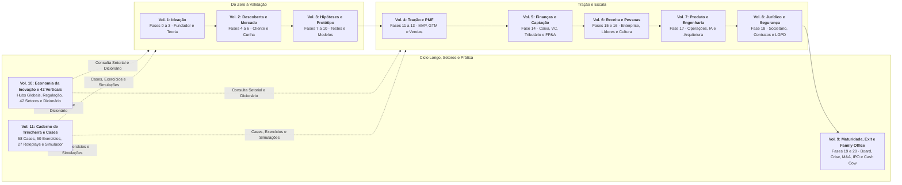

---

## Sumário deste Volume

### Fases da Etapa (Fases 0 a 3)

- [[#FASE 0: PREPARAÇÃO DO EMPREENDEDOR|FASE 0: PREPARAÇÃO DO EMPREENDEDOR]]
- [[#FASE 1: ENCONTRAR A IDEIA|FASE 1: ENCONTRAR A IDEIA]]
- [[#FASE 2: ARTICULAÇÃO E CAPTURA DA IDEIA|FASE 2: ARTICULAÇÃO E CAPTURA DA IDEIA]]
- [[#FASE 3: CONSTRUÇÃO DA TEORIA DO NEGÓCIO|FASE 3: CONSTRUÇÃO DA TEORIA DO NEGÓCIO]]

### Fundador, Cofundadores e Preparação Pessoal (Capítulos 1 a 5)

- [[#CAPÍTULO 1: DINHEIRO PESSOAL DO FUNDADOR|CAPÍTULO 1: DINHEIRO PESSOAL DO FUNDADOR]]
- [[#CAPÍTULO 2: SAÚDE MENTAL, DINÂMICA DE COFUNDADORES E HUMANIDADE DO FUNDADOR|CAPÍTULO 2: SAÚDE MENTAL, DINÂMICA DE COFUNDADORES E HUMANIDADE DO FUNDADOR]]
- [[#CAPÍTULO 3: ARMADILHAS MENTAIS E VIESES|CAPÍTULO 3: ARMADILHAS MENTAIS E VIESES]]
- [[#CAPÍTULO 4: BOOTSTRAP vs VENTURE CAPITAL: A ESCOLHA FUNDACIONAL|CAPÍTULO 4: BOOTSTRAP vs VENTURE CAPITAL: A ESCOLHA FUNDACIONAL]]
- [[#CAPÍTULO 5: DIVERSIDADE DE JORNADAS: CASOS ALÉM DO CÂNONE|CAPÍTULO 5: DIVERSIDADE DE JORNADAS: CASOS ALÉM DO CÂNONE]]

### Cognição, Decisão, Comunicação e Produtividade com IA (Capítulos 6 a 10)

- [[#CAPÍTULO 6: TOMADA DE DECISÃO COMO DISCIPLINA|CAPÍTULO 6: TOMADA DE DECISÃO COMO DISCIPLINA]]
- [[#CAPÍTULO 7: INFLUÊNCIA E PERSUASÃO SEM AUTORIDADE FORMAL|CAPÍTULO 7: INFLUÊNCIA E PERSUASÃO SEM AUTORIDADE FORMAL]]
- [[#CAPÍTULO 8: COMUNICAÇÃO ESCRITA PARA NEGÓCIOS|CAPÍTULO 8: COMUNICAÇÃO ESCRITA PARA NEGÓCIOS]]
- [[#CAPÍTULO 9: APRESENTAÇÃO E FALA EM PÚBLICO|CAPÍTULO 9: APRESENTAÇÃO E FALA EM PÚBLICO]]
- [[#CAPÍTULO 10: IA GENERATIVA E AGENTES COMO COPILOTO E ACELERADOR DO FUNDADOR (2026)|CAPÍTULO 10: IA GENERATIVA E AGENTES COMO COPILOTO E ACELERADOR DO FUNDADOR (2026)]]

### Ecossistema, Mentoria e Apoio Inicial (Capítulos 11 e 12)

- [[#CAPÍTULO 11: ACELERADORAS, PROGRAMAS E PARCEIROS INSTITUCIONAIS PARA STARTUP BRASILEIRA|CAPÍTULO 11: ACELERADORAS, PROGRAMAS E PARCEIROS INSTITUCIONAIS PARA STARTUP BRASILEIRA]]
- [[#CAPÍTULO 12: REDE, MENTORES E ADVISORS: COMO CONSTRUIR O CAPITAL HUMANO DO EMPREENDEDOR|CAPÍTULO 12: REDE, MENTORES E ADVISORS: COMO CONSTRUIR O CAPITAL HUMANO DO EMPREENDEDOR]]

### Prática, Cases e Simulações Desta Etapa (Volume 11: Capítulos 1 a 3)

- [[IGNICAO-Vol-11-Workbook-Cases-e-Exercicios#CAPÍTULO 1: CASES GLOBAIS E BRASILEIROS DE IDEAÇÃO, COFUNDADORES E TESE INICIAL|CAPÍTULO 1: CASES GLOBAIS E BRASILEIROS DE IDEAÇÃO, COFUNDADORES E TESE INICIAL (Vol. 11)]]
- [[IGNICAO-Vol-11-Workbook-Cases-e-Exercicios#CAPÍTULO 2: CADERNO DE EXERCÍCIOS COM GABARITO COMENTADO: FUNDAÇÃO, EQUITY E TEORIA DO NEGÓCIO|CAPÍTULO 2: CADERNO DE EXERCÍCIOS COM GABARITO COMENTADO: FUNDAÇÃO, EQUITY E TEORIA DO NEGÓCIO (Vol. 11)]]
- [[IGNICAO-Vol-11-Workbook-Cases-e-Exercicios#CAPÍTULO 3: SIMULAÇÕES DE DECISÃO E ROLEPLAYS EXECUTIVOS: SOCIEDADE, PRIMEIROS TALENTOS E MENTORIA|CAPÍTULO 3: SIMULAÇÕES DE DECISÃO E ROLEPLAYS EXECUTIVOS: SOCIEDADE, PRIMEIROS TALENTOS E MENTORIA (Vol. 11)]]

---

# FASES DA ETAPA: IDEAÇÃO E FUNDAÇÃO (FASES 0 A 3)

Os quatro primeiros estágios da jornada ([[#FASE 0: PREPARAÇÃO DO EMPREENDEDOR|Fase 0]], [[#FASE 1: ENCONTRAR A IDEIA|Fase 1]], [[#FASE 2: ARTICULAÇÃO E CAPTURA DA IDEIA|Fase 2]] e [[#FASE 3: CONSTRUÇÃO DA TEORIA DO NEGÓCIO|Fase 3]]) formam um filtro progressivo de lucidez antes de você gastar um real em código ou abrir um CNPJ. Ao final de cada fase, as seções de Manual Passo a Passo dos Frameworks, Canvases Visuais e Templates Operacionais entregam as ferramentas práticas preenchidas com casos brasileiros e prontas para rodar na mesa com seus sócios.

---

## FASE 0: PREPARAÇÃO DO EMPREENDEDOR

### O contrato que você assina em casa antes de abrir o CNPJ

Passava das onze e meia da noite de domingo em Belo Horizonte quando a Dra. Camila, especialista em reabilitação oral de 34 anos, fechou o notebook na sala com um frio na barriga. Na sexta-feira anterior, ela havia pedido demissão da clínica onde atendia havia oito anos para abrir seu próprio consultório. Ao somar pela primeira vez na ponta do lápis o aluguel do ponto comercial na Savassi, a parcela dos equipamentos importados, a mensalidade escolar dos dois filhos e as despesas da casa, enxergou um risco concreto: se a operação levasse mais de quatro meses para empatar, a família inteira entraria no cheque especial.

Camila não tinha um problema de ideia em Belo Horizonte: tinha apenas quatro meses de fôlego no caixa pessoal. Os estudos de sobrevivência empresarial do Sebrae mostram que o fechamento precoce decorre da combinação entre falta de planejamento prévio, gestão deficiente e falta de capital de giro. Na prática da trincheira, muitas empresas fecham porque o fundador esgota sua reserva doméstica e seu equilíbrio emocional seis meses antes de a operação aprender a se sustentar.

Em *O Mito do Empreendedor*, Michael Gerber descreve a "Convulsão Empreendedora": aquele instante em que um excelente técnico, seja um engenheiro de software como Lucas em São Paulo (que junta 14 meses de reserva antes de sair do banco), uma dentista como Camila em Belo Horizonte, um engenheiro industrial como Henrique em Curitiba (que aplica o Teste do Extrato sobre sua renda variável de consultoria antes de vender para usinas e prefeituras) ou a dupla Rafael e Bia entre Recife e Goiânia (que começa validando a marca própria no modelo paralelo de 10 horas semanais), acorda cansado de ter chefe e confunde *saber fazer o trabalho técnico* com *estar pronto para sustentar o peso de uma empresa*. Antes de escrever uma única linha de código ou desenhar uma logomarca, você precisa auditar a única máquina que não tem peça de reposição no início da jornada: você mesmo, seu caixa pessoal e os problemas em aberto dentro da sua casa.

---

> [!info] Como ler esta fase
> A Fase 0 atende dois leitores ao mesmo tempo. Se você ainda está decidindo se quer empreender, leia da abertura até o fim de [[#Quando não empreender agora: os 10 sinais de que começar hoje é uma armadilha|Quando não empreender agora: os 10 sinais]] e pare. Se três ou mais sinais batem com a sua situação, volte aqui em alguns meses, depois de ajustar. O restante da fase serve a quem já decidiu seguir em frente. Mesmo nesse caso, vale usar os dez sinais de autoexclusão como verificação prévia antes de cada decisão grande adiante (largar emprego, recrutar sócio, comprometer reserva pessoal).

### Por que negócios promissores morrem no CPF do fundador antes de quebrar no CNPJ

Quem empreende carrega por anos um peso psicológico e financeiro contínuo, sustentando decisões difíceis muito antes de o caixa estabilizar. A maioria das desistências ocorre porque o empreendedor esgota o dinheiro de casa, perde o apoio familiar, adoece emocionalmente ou descobre tarde que buscava outro estilo de vida. Pular esta fase significa erguer um negócio sobre fundações pessoais frágeis, onde o primeiro revés operacional derruba tudo.

### Quando não empreender agora: os 10 sinais de que começar hoje é uma armadilha

A maioria dos manuais assume que o leitor já decidiu empreender e foca apenas na execução. Há momentos da vida em que abrir uma empresa agora é má ideia, independentemente da qualidade da tese ou da competência técnica do time. Reconhecer essas situações com antecedência evita sofrimento pessoal, destruição de patrimônio familiar e desperdício de anos por pura prudência.

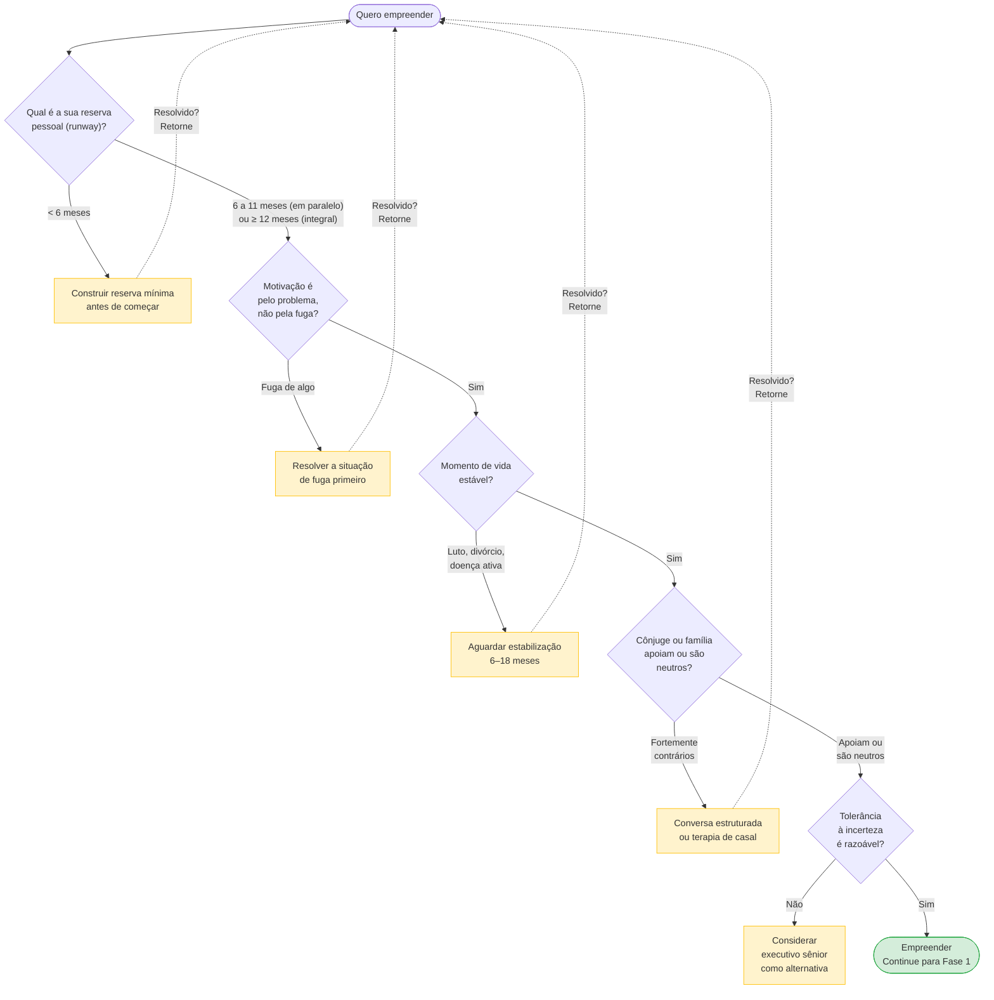

Você provavelmente não deveria empreender agora se:

1. Suas finanças pessoais estão frágeis: há dívidas altas no cartão de crédito, no rotativo ou em financiamentos atrasados sem plano de quitação, a reserva de emergência cobre menos de 6 meses de despesas familiares e existem dependentes sem outra fonte de renda. Empreender com o caixa doméstico exposto costuma terminar em crise dupla, na empresa e em casa, quite os passivos e monte a reserva antes de dar a largada.

2. Você está num período de vida emocionalmente turbulento. Luto recente, divórcio em curso ou recente, mudança de cidade ou país sem adaptação, diagnóstico de saúde sério em curso. A trajetória empreendedora exige resiliência emocional alta. Somada a uma crise pessoal, tende a destruir as duas. Esperar estabilizar é sábio.

3. Sua motivação principal é financeira de curto prazo: ficar rico em três anos ou ganhar mais rápido do que na CLT. No estudo clássico *Does Entrepreneurship Pay?* (*Journal of Political Economy*, 2000), Barton Hamilton demonstrou que os empreendedores começam ganhando menos e têm crescimento de renda menor do que assalariados com perfil equivalente, acumulando uma renda mediana 35% inferior mesmo após dez anos de atividade. Na nossa experiência prática acompanhando startups, quando o retorno patrimonial relevante vem, ele costuma levar de sete a doze anos de construção, quem entra apenas pelo dinheiro rápido quase sempre desiste antes.

4. Você não tolera incerteza. Precisa de rotina, previsibilidade, feedback constante. Sente alta ansiedade em situações ambíguas. Tem dificuldade de dormir com questões não resolvidas. Empresa em estágio inicial é incerteza por anos. Autoconhecimento aqui é honestidade. Algumas personalidades florescem melhor como executivo sênior em empresa maior.

5. Você não tem nenhum conhecimento específico do problema que quer resolver. A ideia nasceu de observação superficial, você não conhece o cliente em profundidade e não tem rede no setor. Empreender nessas condições é muito mais custoso: alguém de dentro do mercado, mesmo com menos brilho técnico, costuma destravar portas e validar a solução muito mais rápido. Se quiser insistir nesse domínio, passe de seis a doze meses construindo vivência e rede no setor antes de fundar.

6. Você está empreendendo para provar algo a alguém: aos pais que dizem "estabilize", ao chefe que demitiu você ou ao ex-parceiro que duvidou. Motivação externa dessa natureza costuma ruir assim que a trajetória fica dura, e ela vai ficar. A motivação precisa vir de dentro e do interesse real pelo problema.

7. Seu cônjuge ou companheiro é fortemente contrário. Não apenas preocupado, mas explicitamente contra e resistente mesmo após conversa longa. Empreender contra a oposição do parceiro destrói muitos casamentos. Se você quer insistir mesmo assim, considere terapia de casal antes.

8. Você está no meio de uma trajetória profissional que estava dando certo. Promoção recente, aumento significativo, caminho de liderança em empresa consolidada. Nunca vai ser o "bom momento" de sair do emprego, mas em trajetória ascendente alta o custo de oportunidade é enorme. Isso não significa que você não pode empreender. Significa que você precisa fazer o cálculo com clareza. Quanto está deixando? O que vai buscar? Decisão com olhos abertos, não impulso.

9. Você tem condição de saúde mental não tratada, como depressão, ansiedade severa ou transtornos específicos sem acompanhamento clínico. A rotina empreendedora agrava quadros frágeis e exige cuidado prévio. O [[#CAPÍTULO 2: SAÚDE MENTAL, DINÂMICA DE COFUNDADORES E HUMANIDADE DO FUNDADOR|Capítulo 2 (Saúde Mental, Dinâmica de Cofundadores e Humanidade do Fundador)]] acompanha a saúde mental do fundador desde a preparação inicial da Fase 0 até a escala, as crises e a saída (*exit*), detalhando sinais de alerta e quando buscar apoio profissional.

10. Você quer empreender porque odeia seu emprego atual. Fugir de algo é diferente de ir em direção a algo. Frequentemente a trajetória empreendedora fica mais difícil que o emprego ruim. Resolva o trabalho primeiro. Depois empreenda por motivo positivo, não evasivo.

> [!warning] A regra dos três pontos
> Os sinais 1 e 9 (reserva financeira inexistente e quadro agudo de saúde mental sem tratamento) são eliminatórios por si sós e pedem pausa imediata. Entre os demais, se três ou mais forem verdadeiros hoje, adie a largada em tempo integral. Use os próximos seis a vinte e quatro meses para organizar essas frentes antes de empreender, tornando a travessia seguinte muito mais sustentável.

### A auditoria em 8 passos: do Runway Pessoal ao ponto de parada escrito

Execute estas oito tarefas em sequência.

1. Diagnóstico financeiro pessoal, de duas a quatro horas. Levante numa planilha três números. O seu custo de vida mensal mínimo (aluguel, alimentação, transporte, escola dos filhos e dívidas, somando também os benefícios que antes vinham no pacote do emprego CLT e agora saem do seu bolso: plano de saúde familiar, previdência e reserva para 13º e férias, conta que na casa da Dra. Camila, com dois filhos no convênio, acrescentava R$ 3,2 mil por mês), o quanto você precisa para viver com dignidade básica, sem lazer. O seu custo de vida mensal atual, incluindo o padrão que você leva hoje. A sua reserva atual em dinheiro líquido, sem contar imóveis, carros, previdência travada.

   > [!tip] Fórmula do Runway Pessoal
   > Runway Pessoal (tempo de vida do seu caixa pessoal) = Reserva ÷ Custo mínimo mensal
   >
   > É o número de meses que você aguenta sem receita. Abaixo de 12 meses, não peça demissão agora: se tiver entre 6 e 12 meses, valide em paralelo ao emprego. Abaixo de 6 meses, monte a reserva antes de começar. Antes de validar em paralelo, leia seu contrato de trabalho e o regulamento interno do empregador e nunca use computador, horário, dados ou clientes da empresa atual, sob risco de justa causa por concorrência (art. 482, "c", da CLT) e de disputa sobre titularidade de software (art. 4º da Lei 9.609/1998). Se o projeto atuar no mesmo setor, consulte um advogado trabalhista e veja o [[IGNICAO-Vol-8-Juridico-LGPD-e-Seguranca#CAPÍTULO 3: PROPRIEDADE INTELECTUAL E INPI|Capítulo 3 (Propriedade Intelectual e INPI)]], o [[IGNICAO-Vol-8-Juridico-LGPD-e-Seguranca#CAPÍTULO 4: NÃO CONCORRÊNCIA E NÃO SOLICITAÇÃO NO BRASIL|Capítulo 4 (Não Concorrência e Não Solicitação no Brasil)]] e o [[IGNICAO-Vol-8-Juridico-LGPD-e-Seguranca#CAPÍTULO 6: DIREITO DO TRABALHO PARA STARTUPS|Capítulo 6 (Direito do Trabalho para Startups)]] do Volume 8.

   > [!tip] Capítulo 1 (Dinheiro Pessoal do Fundador)
   > O diagnóstico acima é o ponto de partida. O [[#CAPÍTULO 1: DINHEIRO PESSOAL DO FUNDADOR|Capítulo 1 (Dinheiro Pessoal do Fundador)]] aprofunda: pró-labore sustentável por fase, gestão de dívida pessoal enquanto a empresa cresce, e como separar as finanças pessoais das da empresa desde o início.

2. Teste de motivação real, uma hora, em silêncio, sem pressa. Responda por escrito, com franqueza. Por que eu quero empreender? Escreva cinco razões. Dessas razões, quais são sobre mim (ego, liberdade, dinheiro) e quais são sobre o problema ou o cliente? Do que eu estou fugindo? Chefe ruim, trabalho tedioso, sensação de fracasso? Empreender para fugir de algo costuma gerar decisões precipitadas. Eu faria isso se nunca ficasse rico? Se não, qual é o ganho mínimo que precisa sair disso para valer o esforço?

3. Inventário de habilidades e lacunas, duas horas. Liste em quatro colunas: o que você domina e aplica direto ao negócio, o que falta para colocar a operação de pé, como cobrir cada lacuna (aprender, contratar ou buscar sócio) e o custo em tempo e dinheiro de cada alternativa.

4. Conversa estruturada com quem compartilha a sua vida, uma a duas horas. Se você tem cônjuge, filhos ou dependentes, marque uma conversa formal longe da correria do jantar, como fez a Dra. Camila com o marido em Belo Horizonte para repactuar o orçamento da casa e definir um limite claro de parada (*stop-loss*). Apresente quanto dinheiro planeja alocar, qual prazo dá a si mesmo antes de reavaliar, como a rotina familiar será afetada e qual é o plano B se a tese não vingar. Peça uma resposta sincera e trate uma eventual recusa como dado concreto para a sua decisão.

   > [!note] Ouvir antes de convencer
   > Você não tem poder hierárquico sobre cônjuge, pais ou amigos próximos. O [[#CAPÍTULO 7: INFLUÊNCIA E PERSUASÃO SEM AUTORIDADE FORMAL|Capítulo 7 (Influência e Persuasão sem Autoridade Formal)]] ajuda a expor seu plano com clareza e escuta ativa. Se o cônjuge recusar com argumentos sólidos sobre a segurança da família, incorpore esse limite como dado objetivo da decisão.

5. Avaliação de saúde física e mental, trinta minutos. Sono, condições crônicas que pioram com estresse, rede de apoio emocional disponível. Se já está em tratamento, converse com o seu profissional antes de aumentar a pressão.

6. Definição de prazo e critérios de desistência, uma hora. Defina de antemão quanto tempo você dá ao projeto antes de reavaliar (sugiro doze meses para a primeira reavaliação formal). Quais sinais de fracasso justificam desistir antes (nenhum cliente pagante depois de seis meses de tentativa ativa, reserva abaixo de X reais). Quais sinais de sucesso justificam acelerar (primeiro cliente pagante recorrente em noventa dias). Defina esses critérios agora, com a cabeça fria. No meio da tempestade, você não vai ter objetividade para defini-los.

   > [!note] A decisão de empreender é Tipo 1: irreversível por meses ou anos
   > O [[#CAPÍTULO 6: TOMADA DE DECISÃO COMO DISCIPLINA|Capítulo 6 (Tomada de Decisão como Disciplina)]] distingue decisões reversíveis (Tipo 2, que podem ser desfeitas rapidamente) de decisões irreversíveis (Tipo 1, com alto custo de reversão). Largar o emprego, comprometer a reserva pessoal e escolher cofundadores são decisões Tipo 1: aplique o roteiro SPADE e o exercício de pré-mortem antes de assinar a saída.

7. Escolha explícita do modelo de dedicação entre três caminhos compatíveis com a sua reserva: integral (*full-time*, 40 horas semanais ou mais, exigindo fôlego de 12 meses ou mais), parcial em paralelo ao emprego (*part-time*, de 15 a 20 horas semanais, com reserva mínima de 6 meses) ou projeto lateral exploratório (*side project*, de 5 a 10 horas semanais, também com reserva mínima de 6 meses, desenhado para rodar as Fases 1 a 4 sem pressão imediata de faturamento).

   > [!note] Capítulo 8 (Vol. 6): Gestão de Tempo do Fundador
   > Independente do modelo escolhido (full, part ou side), a alocação de tempo será o recurso mais escasso e mais mal gerenciado nos primeiros meses. O [[IGNICAO-Vol-6-Receita-e-Pessoas#CAPÍTULO 8: FOUNDER MODE, DELEGAÇÃO, GESTÃO DE TEMPO E CADÊNCIA OPERACIONAL DO CEO|Capítulo 8 (Founder Mode, Delegação, Gestão de Tempo e Cadência Operacional do CEO) (Vol. 6)]] cobre time-blocking, rituais semanais e como proteger tempo profundo contra demandas operacionais: especialmente relevante para quem empreende em paralelo ao emprego.

8. Escrita do Dossiê Pessoal. Consolide os passos acima em um documento simples e releia ao final de cada fase seguinte. Atualize sempre que algo descoberto no caminho invalidar uma premissa.

### O fundador como pessoa: três ensaios de Paul Graham para calibrar expectativa

A Fase 0 prepara a pessoa que vai empreender antes da abertura do negócio. Entre 2006 e 2010, Paul Graham dedicou ensaios específicos ao perfil de fundador que prospera em startups, ao modo de pensar que sustenta a execução e às armadilhas internas que costumam derrubar iniciantes, sintetizando padrões observados diretamente nas centenas de fundadores acompanhados nos primeiros anos do Y Combinator.

> [!note] Capítulo 20 (Vol. 9): Second-Time Founder
> Se você já empreendeu antes, tenha vendido a empresa, fechado as portas ou ainda esteja à frente dela, a sua Fase 0 é diferente. O [[IGNICAO-Vol-9-Maturidade-e-Exit#CAPÍTULO 20: O FUNDADOR DE SEGUNDA VIAGEM (SECOND-TIME FOUNDER)|Capítulo 20 (Second-Time Founder) (Vol. 9)]] trata de como o histórico anterior muda a equação de runway, escolha de sócio, e autoconhecimento exigidos aqui.

Os três ensaios abaixo são os que mais se aplicam à decisão pessoal da Fase 0. Outros dois do mesmo autor (*Before the Startup* e *You Weren't Meant to Have a Boss*) entram resumidos no fechamento desta seção, e o mapa completo com todos os endereços está consolidado em [[#Ensaios canônicos de Paul Graham: referência consolidada|Ensaios canônicos de Paul Graham]], no final desta fase.

#### A ideia dominante na sua cabeça, *The Top Idea in Your Mind* (Graham, 2010)

Graham observou que a maioria das pessoas tem uma única ideia dominante na mente em qualquer momento. É aquela para a qual os pensamentos migram naturalmente quando você está no banho, dirigindo, ou caminhando sem estímulo externo. É o problema em que você pensa sem tentar. E é a fonte de boa parte das suas melhores intuições operacionais e estratégicas.

A implicação para o fundador é concreta. Ser CEO de startup exige que o seu negócio seja a ideia dominante na sua cabeça durante os primeiros anos. Se o problema dominante for outro (um conflito pessoal em aberto, ansiedade financeira não resolvida, uma briga com ex-sócio, um pleito jurídico, uma dívida não estruturada), o seu negócio vai sofrer sistematicamente. O tempo de pensar sem tentar está sendo gasto em outro lugar. Você não controla para onde a mente vai no banho. Controla indiretamente, pelo que deixa ou não deixa ficar aberto na sua vida.

Faça um teste simples nos próximos três banhos, sem forçar: quando a sua mente vagueia, para onde ela vai? Se o pensamento foge do negócio, você tem dois caminhos. O primeiro é fechar a pendência que está drenando sua atenção: resolver o conflito familiar, renegociar a dívida, ter a conversa adiada ou encerrar a disputa jurídica, pois assuntos inacabados funcionam como ímãs mentais que bloqueiam a concentração. O segundo caminho é reconhecer que o momento pede organizar a vida pessoal antes de somar a ela a carga de fundar uma empresa.

Graham identifica dois tipos de pensamento particularmente perigosos para fundadores, porque roubam atenção de forma desproporcional ao benefício. Um é pensamento sobre dinheiro. Captação tende a virar atolamento mental que consome cem por cento do foco por semanas. O outro é pensamento sobre disputas. Brigas ocupam espaço imenso, e pior, têm formato velcro. Parecem ter substância, mas não têm. Se você está hoje no meio de uma captação ou de uma disputa, aceite que o seu trabalho estratégico vai sofrer durante esse período. Não marque outras decisões importantes para acontecerem em paralelo.

> [!tip] Crescer com a receita dos próprios clientes (*bootstrapping*) como alternativa ao capital de risco na escolha do modelo de dedicação
> Antes de assumir VC como caminho default, ler [[#CAPÍTULO 4: BOOTSTRAP vs VENTURE CAPITAL: A ESCOLHA FUNDACIONAL|Capítulo 4 (Bootstrap vs Venture Capital: A Escolha Fundacional)]] para a escolha fundacional. Bootstrap e venture capital são trade-offs distintos, não níveis de ambição.

> [!important] Regra operacional da Fase 0
> Antes de começar, faça um inventário honesto de loops abertos na sua vida. Dívidas não renegociadas, conflitos interpessoais, compromissos não cumpridos, processos incompletos. Feche o máximo possível. Cada loop aberto é imposto mental sobre a sua capacidade futura de ser fundador.

#### Engenhoso sem trégua (*Relentlessly Resourceful*) (Graham, 2009)

Em um ensaio curto de março de 2009 (*Relentlessly Resourceful*), Paul Graham sintetizou em duas palavras o traço que melhor define um bom fundador: *relentlessly resourceful*, que traduzimos em todo este livro como engenhoso sem trégua.

O conceito se opõe a *hapless* (desamparado, passivo diante das circunstâncias). O ponto não é apenas trabalhar duro: muita gente trabalha muito e continua desamparada quando bate no primeiro obstáculo. Trata-se de trabalhar com intensidade, testar caminhos novos quando os primeiros fecham e não aceitar "não tem como" como resposta final: enquanto o perfil passivo se deixa paralisar pela primeira porta fechada, quem é engenhoso sem trégua dobra a circunstância até encontrar uma saída prática.

Na prática operacional do fundador, essa diferença aparece na reação imediata aos obstáculos. Quem age de forma desamparada recebe uma negativa de investidor, volta para casa e conclui que o negócio não tem futuro. Testa um canal de aquisição que não performa e desiste. Esbarra num gargalo técnico e espera que alguém apareça para resolvê-lo. Já o fundador engenhoso sem trégua ouve a negativa do investidor, pergunta exatamente onde a tese falhou, refina a apresentação e aborda outros quinze fundos, quando um canal falha, testa outros oito com método, quando encontra um problema técnico difícil, estuda a fundo, consulta dez especialistas e experimenta três caminhos distintos.

Para Graham, é o teste mais útil que ele aplicava mentalmente ao conhecer fundador pela primeira vez. Sugere que é também o teste que vale você aplicar a si mesmo e a qualquer cofundador. Quando esta pessoa bate em obstáculo, ela naturalmente vai para "tem que ter um jeito" ou para "não tem como"?

Exercício concreto de Fase 0: liste cinco obstáculos relevantes que você enfrentou profissionalmente nos últimos três anos e descreva, em três frases para cada um, qual era o bloqueio, quantas abordagens diferentes você tentou antes de resolver ou desistir e quem você envolveu na busca da solução. O padrão que emerge: se em três ou mais dos cinco casos você tentou duas abordagens ou menos, ou desistiu sem mobilizar outras pessoas, provavelmente ainda precisa exercitar a postura de ser engenhoso sem trégua. Essa capacidade é treinável, mas convém saber em que ponto você está antes de abrir a empresa para desenvolvê-la de forma consciente.

> [!note] Síntese da tese de Graham
> No próprio ensaio *Relentlessly Resourceful* (março de 2009), Graham conecta diretamente os dois lemas do Y Combinator: se *"Make something people want"* é o destino da startup, *"Be relentlessly resourceful"* é o modo de chegar lá.

#### Determinação sem teimosia: *The Anatomy of Determination* (Graham, 2009)

Determinação e teimosia parecem iguais de fora, mas são opostas operacionalmente.

Em *What We Look for in Fundadores* (2010), Graham compara esse fundador ao *running back* do futebol americano (ou ao atacante no futebol brasileiro que muda de direção no meio da defesa sem perder a baliza de vista). Atleta cujo trabalho é correr para o gol apesar da defesa ativa tentando detê-lo. Running back bom não é o que corre em linha reta e bate nos defensores até cair. É o que tem destino claro (o gol) mas rota flexível. Ele desvia, gira, volta, tenta de novo por outro ângulo, sempre em direção ao mesmo gol. Essa é a forma correta de determinação em startup.

Teimosia é ter rota fixa apesar de a defesa mostrar que ela não funciona. Determinação é ter gol fixo e aceitar rotas novas infinitamente até uma delas funcionar.

Sinais de que você está na teimosia disfarçada de determinação. Você está há meses rodando a mesma abordagem sem resultado, dizendo "só preciso insistir mais". Você se irrita quando alguém questiona a abordagem, não a ideia. Você mede progresso em esforço aplicado em vez de aprendizado gerado. Conversas com cliente te deixam desmoralizado em vez de curioso.

Sinais de determinação saudável. Você muda de rota com frequência, mas mantém o gol fixo por anos. Você busca ativamente evidência contrária à sua abordagem atual. Você mede progresso em incerteza reduzida e hipótese testada, não em tempo investido. Conversas com cliente, mesmo decisivas, te animam porque revelam caminho.

A calibragem da Fase 0. Se você está começando sem experiência como fundador, é muito provável que a sua primeira intuição de "ser persistente" vai derivar para teimosia. Crie mecanismos externos que forcem revisão. Mentor que pergunta "o que você mudou de opinião neste mês". Ritual mensal de escrever o que aprendeu. Prazo para decisão de pivô com critérios objetivos. Sem esses mecanismos, a tendência natural do fundador iniciante é a rigidez.

#### Três outros ensaios de Graham, em formato compacto

**O que o YC procura em fundador, *What We Look for in Fundadores* (outubro de 2010).** Graham resume em cinco atributos: determinação (capacidade de avançar apesar dos obstáculos), flexibilidade (mudar a rota mantendo o objetivo, como um *running back* no futebol americano), imaginação (gerar ideias que parecem pouco óbvias à primeira vista), irreverência construtiva (*naughtiness*, a disposição de contornar regras burocráticas sem substância, sem jamais violar a lei ou a ética) e amizade real entre cofundadores (uma relação que sobrevive a desacordos duros). A inteligência bruta fica de fora de propósito: acima de um patamar básico, o que separa quem vence é a combinação entre determinação e flexibilidade.

**Startups são contraintuitivas, *Before the Startup* (palestra Stanford, 2014).** Três pontos: (1) você não precisa ser expert em startups, precisa ser expert em usuários, Zuckerberg sabia o que estudante queria de rede social, não sabia montar empresa, (2) burlar sistema (impressionar chefes, fazer movimentos certos) para de funcionar quando o juiz é mercado, não pessoa, (3) confie na sua intuição sobre pessoas (cofundadores, contratações), desconfie da sua intuição sobre o resto (mercado, ideia, timing).

**Sobre autonomia, *You Weren't Meant to Have a Boss* (2008).** Algumas pessoas definham em emprego corporativo bem-pago, e isso não melhora trocando de empresa. Melhora quando assumem projeto próprio. É temperamento, pouco moldável. Perguntas para autodiagnóstico: você sofria mais com chefe do que com trabalho? Tem histórico de fazer coisas sem ninguém pedir? Instrução detalhada sobre como fazer algo te desgasta desproporcionalmente? Se sim, empreender é alinhamento, não escolha arbitrária. Se não, cuidado com empreender por status ou FOMO.

### Os números que não mentem sobre o seu fôlego inicial

- Reserva pessoal medida em meses de custo familiar: 12 meses ou mais para dedicação integral (*full-time*, 40 horas semanais ou mais), ou pelo menos 6 meses para quem começa em paralelo ao emprego (*part-time*, de 15 a 20 horas semanais, ou *side project*, de 5 a 10 horas semanais). Abaixo de 6 meses, construa a reserva antes de dar a largada.
- Horas semanais comprometidas com foco real: de 5 a 10 horas semanais no modelo de projeto lateral (*side project* nas Fases 1 a 4), de 15 a 20 horas semanais na dedicação parcial (*part-time*) e 40 horas ou mais na dedicação integral (*full-time*). Abaixo de cinco horas por semana, o projeto definha, para cruzar a trava de saída rumo ao trabalho de campo, proteja ao menos 10 horas semanais na agenda.
- Nível de apoio da rede próxima, escala de um a cinco autoavaliada, com justificativa escrita.
- Clareza de motivação, autoavaliação de um a cinco. Se você não consegue articular o por quê em uma frase, está baixo.

### Saúde mental do fundador em estágio zero

A Fase 0 concentra uma vulnerabilidade psicológica particular. Embora a Fase 14, com folha de 80 pessoas e pressão de caixa, traga obrigações maiores, na Fase 0 o fundador carrega o peso do que ainda não existe, quase sem estrutura de apoio, sem a validação social de uma empresa já operando e acumulando responsabilidades do emprego e da casa. Nessa etapa, o esgotamento (*burnout*) raramente aparece como colapso súbito: ele se disfarça de procrastinação crônica, perda de interesse pelo projeto ou hiperfoco compensatório que desgasta a família, razão pela qual identificar esses sinais logo no início preserva a jornada.

**Estresse produtivo e sinal de alerta: como distinguir.**

O estresse produtivo tem marcadores reconhecíveis: você sente energia depois de resolver um problema difícil, consegue dormir mesmo com pendências na agenda e mantém a curiosidade viva pelo projeto. É o esforço físico do atleta: o músculo cansa, mas se recupera.

O sinal de alerta tem outros marcadores. Fadiga que não cede com descanso. Perda de prazer em coisas fora do projeto, amigos, hobbies. Pensamentos circulares, o mesmo problema voltando sem progresso. Irritabilidade desproporcional a eventos pequenos. Sensação persistente de que o projeto virou uma armadilha sem saída (se surgirem pensamentos de desistir da própria vida, pare tudo e ligue imediatamente para o 188, CVV, gratuito e 24 horas em todo o Brasil, ou procure a UBS, o CAPS ou o pronto-socorro mais próximo).

**Os três gatilhos específicos de Fase 0 não cobertos na lista de auto-exclusão.**

*Isolamento de confirmação*: em pré-produto, não há métricas, não há usuários, não há confirmações externas. O ciclo de retorno (feedback loop) que mantém fundadores motivados, ver produto crescer, ver clientes satisfeitos, ainda não existe. Substituto saudável: encontros semanais ou quinzenais com outros fundadores no mesmo estágio de operação, grupos de accountability partner (parceiro de responsabilidade mútua), ou mentor que já passou por isso.

*Comparação com pares*: o LinkedIn e o X/Twitter filtram apenas os momentos de vitória. O fundador na Fase 0 vê o anúncio da rodada *seed* de um colega e não enxerga os 18 meses de recusas que vieram antes. Usar redes sociais como régua emocional nesta etapa corrói a confiança aos poucos.

*Perfeccionismo de pré-lançamento*: convencer-se de que o produto precisa estar "pronto" antes de mostrar para alguém. Paralisia disfarçada de padrão de qualidade. O produto nunca fica "pronto o suficiente": a espera cresce junto com o projeto.

**Protocolo de automonitoramento semanal (check-in de sexta-feira, 10 minutos, em par com a revisão de runway de segunda-feira).**

Reserve sexta-feira, 10 minutos. Responda quatro perguntas com nota de 1 a 5.

1. Energia: como estava a minha energia física e mental nesta semana? (1 = exausta, 5 = boa)
2. Clareza: eu sabia o que fazer a maior parte dos dias? (1 = perdido, 5 = claro)
3. Relações: minhas relações importantes (parceiro, amigos próximos) estavam em bom estado? (1 = deteriorando, 5 = sólidas)
4. Sentido: eu ainda acredito que o projeto vale o esforço? (1 = duvidando forte, 5 = sim)

Média abaixo de 3 por três semanas consecutivas é sinal de parada obrigatória para diagnóstico, não de maior esforço.

**Recursos no Brasil.**

O [[#CAPÍTULO 2: SAÚDE MENTAL, DINÂMICA DE COFUNDADORES E HUMANIDADE DO FUNDADOR|Capítulo 2 (Saúde Mental, Dinâmica de Cofundadores e Humanidade do Fundador)]] acompanha a saúde mental do empreendedor desde esta preparação na Fase 0 até os estágios de escala, crise e saída (*exit*). Para o dia a dia inicial, três apoios funcionam bem: comunidades abertas de fundadores (grupos locais da Abstartups, polos como São Pedro Valley, Cubo e Porto Digital, e redes como Mulheres de Produto e Women in Tech), acompanhamento psicológico ou psiquiátrico habituado a profissionais sob alta pressão (tratado como infraestrutura básica de trabalho) e um par de prestação de contas (outro fundador com quem fazer um balanço semanal mútuo), além de plataformas especializadas como Vittude, Zenklub e Doctoralia.

> [!warning] O mito da resiliência como identidade
> A cultura empreendedora glorifica o "nunca desistir" de um modo que patologiza o cuidado com a saúde mental. A figura do "fundador resiliente" virou identidade, fazendo com que admitir exaustão pareça uma falha pessoal. O resultado prático é que fundadores com sinais graves de esgotamento escondem o quadro por meses, esperando que passe sozinho. Não passa: a resiliência real inclui saber quando pedir ajuda.

### Sócios: a decisão mais irreversível da Fase 0

A [[IGNICAO-Vol-8-Juridico-LGPD-e-Seguranca#FASE 18: ESTRUTURAÇÃO JURÍDICA, SOCIETÁRIA E BLINDAGEM OPERACIONAL|Fase 18 (Vol. 8)]] cobre cap table (tabela de participação societária). O [[#CAPÍTULO 2: SAÚDE MENTAL, DINÂMICA DE COFUNDADORES E HUMANIDADE DO FUNDADOR|Capítulo 2 (Saúde Mental, Dinâmica de cofundadores e Humanidade do Fundador)]] cobre conflito entre sócios. Mas a escolha de sócios acontece antes de tudo isso, e é a decisão mais irreversível que você toma na trajetória empreendedora. Divórcio societário é processo doloroso, caro, que destrói empresas boas e relacionamentos antes sólidos.

Esta seção tem três partes. Pilar A, decidir se você vai ter sócio. Pilar B, como escolher e testar quem entra. Pilar C, onde encontrar, se não tem candidato no networking natural.

> [!note] Cofundadoras e fundadoras solo no ecossistema brasileiro
> Ao avaliar se vai empreender sozinho ou em sociedade no Pilar A a seguir, observe exemplos reais de ambos os formatos no Brasil: de cofundadoras que escalaram operações complementares, como Cristina Junqueira (cofundadora do Nubank ao lado de David Vélez e Edward Wible), Manoela Mitchell (cofundadora da Pipo Saúde) e Mariana Dias (cofundadora da Gupy), a lideranças como Luiza Helena Trajano (Magazine Luiza) e Camila Farani. Como a literatura tradicional tende a sub-representar essas trajetórias, busque ativamente referências e mentorias diversas ao desenhar sua estrutura societária.

#### Pilar A: Decidir se vai ter sócio

Muitos negócios relevantes começaram com um único fundador, como Pierre Omidyar no eBay, Jeff Bezos na Amazon, Jan Koum no WhatsApp (antes da entrada posterior de Brian Acton), Sara Blakely na Spanx e, na jornada desta coleção, a Dra. Camila na largada de sua clínica em Belo Horizonte e Henrique em Curitiba. Empreender sozinho ou em sociedade é uma escolha de arquitetura com vantagens e custos objetivos.

Entre as vantagens de empreender com sócios estão a complementaridade de competências (técnica, comercial e de domínio do setor), o compartilhamento do peso decisório nos momentos duros, a divisão do trabalho quando o caixa é curto e a maior atratividade perante investidores. Entre os custos estão a participação societária dividida (de 100% para 50% ou 33%), a necessidade de alinhamento em decisões urgentes, o esforço contínuo de coordenação e o risco de ruptura societária. Em *The Founder's Dilemmas* (2012), onde estudou cerca de 10 mil fundadores, Noam Wasserman cita o levantamento de Gorman e Sahlman (1989) segundo o qual investidores de risco atribuíram 65% dos fracassos de startups de alto potencial a problemas de pessoas e conflitos na equipe de gestão.

**Dados que contradizem o mito do fundador solo.**

O 10-Year Project da First Round Capital, análise descritiva de cerca de 300 empresas do portfólio próprio do fundo ao longo de dez anos, encontrou que equipes com mais de um cofundador performaram aproximadamente cento e sessenta e três por cento melhor em métricas de crescimento agregadas, e que fundadores solo tiveram valuation na rodada seed cerca de vinte e cinco por cento menor que times comparáveis.

A literatura traz um contraponto empírico importante. O artigo *Sole Survivors* (Jason Greenberg, NYU Stern, e Ethan Mollick, Wharton, 2018) analisou projetos financiados via Kickstarter entre 2009 e 2015 e observou que, naquele recorte específico de financiamento coletivo, empreendimentos de fundador solo sobreviveram por mais tempo e geraram maior receita acumulada do que equipes de cofundadores, possivelmente pela agilidade decisória e pela ausência de atrito societário. Os dois recortes se complementam: enquanto o levantamento da First Round Capital mede valorização em portfólios de *venture capital*, Greenberg e Mollick analisaram sobrevivência e faturamento em projetos de *crowdfunding*. Time fundador costuma favorecer captação institucional e velocidade de expansão. Operação solo reduz o risco de impasse societário na largada.

Se você consegue fazer 70% do trabalho inicial sozinho e tem caixa para contratar os 30% que faltam, considere começar solo e adicionar um sócio-chave só depois de confirmar que o modelo funciona. Quem decide ir solo deve fazê-lo consciente de que aceita desvantagem inicial em captação de risco e velocidade, mas não necessariamente no resultado de longo prazo.

> [!tip] Canvases Visuais: Team Canvas (Fase 0)
> Quando o time é formado por dois ou mais cofundadores, o [[#Canvas: *Team Canvas* (Alex Ivanov, 2015)|Team Canvas (Alex Ivanov, 2015)]] serve como quadro prático para alinhar pessoas, objetivos, papéis, valores, forças e regras de convivência antes de começar, e não depois do primeiro conflito. Use-o junto com a conversa sobre divisão societária logo nesta Fase 0.

#### Pilar B: Como escolher e testar quem entra

**Os três perfis que um time idealmente cobre.**

O founding team ideal combina três especialidades complementares. Se faltar uma, há um buraco que vai doer nos meses seguintes. Se uma pessoa sozinha cobre as três de verdade (raro, mas possível), você pode empreender solo.

O primeiro perfil é o especialista técnico (o *hacker* da tríade clássica): é quem constrói o produto e sabe arquitetar o software, o hardware ou a tecnologia central do negócio. Num SaaS B2B (software por assinatura vendido a empresas), é o CTO ou o líder de engenharia. Em *deep tech*, é o cientista ou pesquisador. Em serviços, é o especialista na operação. Sem essa figura no time fundador, você fica refém de terceiros caros para construir e perde o controle do núcleo do produto.

O segundo perfil é o responsável comercial (*hustler*). Ele fecha contratos, levanta capital, abre portas e puxa a divulgação boca a boca. Sabe vender, passa segurança a investidores e negocia com grandes clientes. Sem essa figura, o produto corre o risco de nascer e morrer no laboratório.

Na tríade clássica (*hacker*, *hustler* e *hipster*), o *hipster* é o designer de produto e experiência. Já em setores complexos ou regulados, substituímos na largada esse terceiro assento pelo especialista de domínio, que conhece por dentro o mercado, os clientes, os fluxos de trabalho e as regras do setor. Ele viveu o problema na pele e funciona como a bússola que aponta exatamente onde a dor aperta, impedindo que a dupla técnico-comercial construa um sistema elegante para o cliente errado.

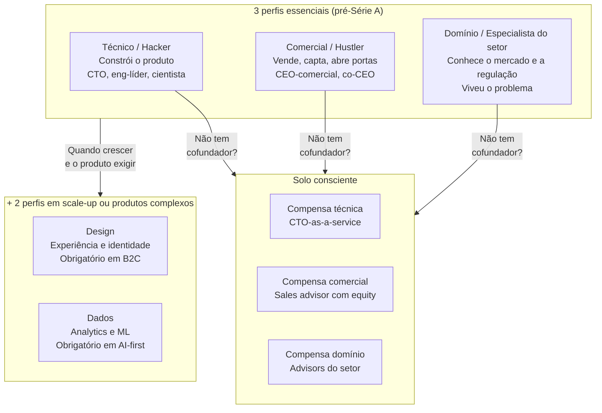

**Expansão para cinco funções na escala.** Em projetos com alta carga de experiência do usuário (UX), forte dependência de dados ou regulação estrita, os três perfis da largada desdobram-se na prática em cinco funções complementares conforme a operação amadurece.

O quarto perfil é o especialista em design. Responsável pela experiência do usuário, interação, posicionamento visual e identidade da marca. Em produtos digitais e consumer, onde cada tela é ponto de contato, ausência de design executivo significa tempo perdido em refatoração depois que o produto já está nas mãos de clientes. Em B2C (venda direta ao consumidor) essa figura é obrigatória. Em B2B emerge em estágio um pouco mais avançado.

O quinto perfil é o especialista em dados. Responsável por infraestrutura de dados, métricas, analytics, e (quando aplicável) modelos de machine learning. Em negócios onde a decisão de produto exige leitura fina de comportamento (mercados de consumo, marketplaces, produtos AI-first), ausência de alguém forte em dados significa operar no escuro. Essa figura geralmente emerge depois da Série A. Mas em negócios data-heavy deve estar no time fundador.

O padrão de três (Técnico, Comercial e Domínio) serve estágios pré-Série A. O padrão de cinco (adicionando Design e Dados) serve scale-up ou desde o começo em domínios com alta complexidade de UX (consumer) ou alta dependência de decisão baseada em dados (AI-first, marketplaces, fintech). Em estágios iniciais, comprimir nos três principais resolve. O risco de over-founding (time fundador de cinco a seis pessoas sem clareza sobre contribuição individual) é maior que o risco de under-founding em estágio pré-PMF (Product-Market Fit: encaixe entre produto e mercado). Expanda os pilares conforme a operação exige. Não antes.

**Matriz de autoavaliação, use antes de escolher sócios.**

| Capacidade | Você (0-10) | Sócio A (0-10) | Sócio B (0-10) | Cobertura mínima? |
|---|---|---|---|---|
| Construir o produto (técnico) | | | | Alguém ≥ 7 |
| Vender e levantar capital | | | | Alguém ≥ 7 |
| Conhecer profundamente o setor/cliente | | | | Alguém ≥ 7 |

**Cinco critérios de escolha, em ordem de prioridade.**

1. **Complementaridade de habilidades.** Os dois (ou três) cobrem dimensões distintas: produto e tecnologia, vendas e comercial, domínio do setor, operações e finanças. Se vocês têm habilidades muito similares, sócio errado. Diversidade de pensamento é vantagem. Pessoas que pensam de forma diferente geram debate produtivo e decisões mais robustas. Não confunda diversidade com discordância crônica.
2. **Valores alinhados em dimensões centrais.** Ambição (tamanho da empresa que querem construir). Horizonte de tempo (sete anos vs. quinze anos). Visão de saída (abertura de capital na bolsa, venda estratégica ou empresa geradora de dividendos). Relacionamento com dinheiro (entre gastar e poupar, ou entre salário imediato e participação societária). Relacionamento com risco e prioridades de vida (família, saúde, tempo). O desalinhamento em qualquer dessas dimensões costuma virar conflito societário já no primeiro ou no segundo ano.
3. **Estilo de conflito compatível.** Algumas pessoas conflitam aberta e intensamente, e reconciliam rápido. Outras evitam conflito, guardam, explodem mais tarde. Misturar estilos incompatíveis é receita para sofrimento.
4. **Confiabilidade comprovada.** Vocês já trabalharam juntos em projeto sério? Você já viu essa pessoa sob pressão? Em dinheiro e compromisso? Sem dados reais disso, você está apostando em química social, e isso é insuficiente.
5. **Química pessoal para sete a doze anos.** Você aguenta quinhentas reuniões com essa pessoa? Risos em jantares não se traduzem necessariamente em resiliência em crise.

**Como testar antes de fundar, três opções em ordem de preferência.**

A primeira opção, e a mais segura, é realizar um projeto curto em conjunto: trabalhar lado a lado em uma entrega real (como uma consultoria pontual, um protótipo para cliente ou um projeto paralelo) por um período de seis semanas a três meses antes de formalizar a sociedade. Observe na prática como a pessoa reage a erros, pressão de prazo, discordâncias, dinheiro e cumprimento de horários.

A segunda opção consiste em conduzir de oito a doze conversas estruturadas de duas horas cada sobre histórico profissional, finanças pessoais, rotina familiar, ambições, conflitos anteriores e valores inegociáveis. Use nessas sessões os blocos do [[#Canvas: *Team Canvas* (Alex Ivanov, 2015)|Team Canvas]] e o roteiro de alinhamento societário desta fase (cobrindo retirada mensal, horas dedicadas, aversão a dívida, critério de desempate e regras de saída) antes de assinar o contrato social.

A terceira opção é o retiro de alinhamento: dois a três dias juntos dedicados a pactuar missão, valores, papéis e fronteiras. Funciona melhor depois da primeira ou da segunda opção, nunca antes, pois serve como complemento prático ao trabalho real em conjunto, e não como substituto.

**Red flags. Sinais de que não é a pessoa certa para fundar com você.**

1. Falta de transparência financeira. Evita falar sobre dívidas, histórico de crédito, situação patrimonial.
2. Histórico de relacionamentos rompidos, profissionais ou pessoais, sem auto-decisiva.
3. Incapacidade de admitir erro. Sempre foi culpa de outros nas histórias que conta.
4. Urgência excessiva para fundar. "Vamos fazer isso esta semana" não dá tempo para vocês se conhecerem em contexto profissional.
5. Ambição desalinhada: um sócio quer construir uma operação de hipercrescimento para vender em sete anos, enquanto o outro busca uma empresa enxuta de ritmo sustentável e distribuição anual de lucros.
6. Tratamento diferenciado: observe como a pessoa trata o garçom e como trata o CEO, ou como tratava você antes do compromisso e como passa a tratar depois.
7. Situação familiar aguda não endereçada. Conflito conjugal grave, problema com filhos ou saúde mental não tratada na família próxima.
8. Sinais de alerta financeiros específicos. Dívida oculta, litígio em curso, falência recente sem plano ou histórico de má gestão do próprio dinheiro.
9. Incapacidade de receber feedback. Reage defensivamente em situações normais de crítica construtiva.
10. Visão incompatível de trabalho. Um quer oitenta horas por semana, outro quarenta, sem conversa explícita.

> [!warning] Regra dos sinais de alerta societários
> Se aparecer um sinal de alerta grave, não funde a empresa. Nenhuma ideia compensa entrar em sociedade com alguém que esconde dívidas ou rejeita decisiva. Custa muito menos esperar doze meses pelo sócio certo do que desfazer um litígio societário no terceiro ano.

**Mini-checklist antes de formalizar a sociedade.**

- [ ] Trabalhamos juntos num projeto real com prazo e entrega concreta por no mínimo seis semanas, no ideal três meses.
- [ ] Conversamos explicitamente sobre expectativa de dedicação (tempo integral, part-time, quando vira integral).
- [ ] Temos visão alinhada sobre aspiração final (lifestyle pequena e lucrativa, scaleup, unicórnio).
- [ ] Conversamos sobre caso de saída (se um quiser sair em 2 anos, como fica).
- [ ] Conversamos sobre divisão de equity, e nenhum dos dois sentiu ressentimento da conversa.
- [ ] Checamos referências externas, pelo menos 3 de cada lado.
- [ ] Conhecemos famílias e parceiros um do outro, e parceiros sabem e apoiam o compromisso.
- [ ] Temos contrato societário rascunhado antes de operação começar de fato.

**Ferramentas e equity split.**

Duas ferramentas ajudam a estruturar essa conversa. O FAST (*Fundador Advisor Standard Template*, criado por Adeo Ressi no Founder Institute em 2011 como referência de escopo, exigindo adaptação contratual via opção de compra de quotas ou *phantom shares* quando aplicado a uma sociedade limitada brasileira) foi desenhado para conselheiros (*advisors*), mas organiza bem compromissos de longo prazo. Para aprofundar os modelos de decisão sobre sócios, participação e controle, consulte a seção de Leituras Recomendadas no fim desta fase.

Formalize também o acordo de sócios desde o dia um, prevendo *vesting* (aquisição gradual da participação) de quatro anos com um ano de *cliff* (carência inicial), cláusulas de saída e regras de governança e desempate societário, detalhadas no [[#CAPÍTULO 2: SAÚDE MENTAL, DINÂMICA DE COFUNDADORES E HUMANIDADE DO FUNDADOR|Capítulo 2 (Saúde Mental, Dinâmica de cofundadores e Humanidade do Fundador)]] deste volume. Já o [[IGNICAO-Vol-8-Juridico-LGPD-e-Seguranca#CAPÍTULO 5: ARQUITETURA CONTRATUAL PARA STARTUPS: OPERAÇÃO E CONTRATOS EM PROFUNDIDADE POR TIPO|Capítulo 5 (Arquitetura Contratual para Startups: Operação e Contratos em Profundidade por Tipo) do Volume 8]] cobre os instrumentos jurídicos.

> [!note] Divisão de participação: ver Capítulo 2 deste volume e Fase 18 (Vol. 8)
> A divisão de participação societária envolve BATNA (melhor alternativa caso o acordo não aconteça), ancoragem por quem propõe primeiro e zonas de acordo que raramente são discutidas com método. O [[IGNICAO-Vol-4-Tracao-e-PMF#CAPÍTULO 7: NEGOCIAÇÃO COMO DISCIPLINA|Capítulo 7: Negociação como Disciplina (Vol. 4)]] oferece o arcabouço (BATNA, ZOPA: zona de possível acordo, ancoragem) para conduzir essa conversa com clareza, não por instinto.

Antes de discutir percentuais, decida se você realmente precisa de sócio e teste a convivência em um projeto real por no mínimo seis semanas, no ideal três meses. As regras de divisão societária, o risco do meio a meio sem mecanismo de desempate e o contrato de *vesting* estão detalhados no [[#CAPÍTULO 2: SAÚDE MENTAL, DINÂMICA DE COFUNDADORES E HUMANIDADE DO FUNDADOR|Capítulo 2 (Saúde Mental, Dinâmica de cofundadores e Humanidade do Fundador)]] deste volume.

Confie no seu sócio, mas registre os combinados por escrito desde o primeiro dia: quando o dinheiro entra na mesa, a memória seletiva desgasta até amizades antigas.

**Se você for empreender solo, conscientemente.**

É possível empreender sozinho, desde que você substitua o que um cofundador entregaria por apoios externos bem escolhidos. Compense a lacuna técnica contratando um CTO sob demanda ou uma software house de confiança para construir o MVP, buscando um líder técnico em tempo integral antes do ajuste ao mercado (PMF). Suprir a frente comercial exige um mentor de vendas ou conselheiro comercial com pequena participação societária. Participe também de aceleradoras que abrem portas para clientes e investidores: o [[#CAPÍTULO 11: ACELERADORAS, PROGRAMAS E PARCEIROS INSTITUCIONAIS PARA STARTUP BRASILEIRA|Capítulo 11 (Aceleradoras, Programas e Parceiros Institucionais para Startup Brasileira)]] mapeia programas nacionais e internacionais por estágio. Para cobrir o domínio do setor, cerque-se de conselheiros experientes com reuniões mensais estruturadas e busque ativamente quem conteste suas premissas antes de decisões caras. No trabalho diário, use IA generativa como copiloto de pesquisa, escrita e análise, conforme os fluxos detalhados no [[#CAPÍTULO 10: IA GENERATIVA E AGENTES COMO COPILOTO E ACELERADOR DO FUNDADOR (2026)|Capítulo 10 (IA Generativa e Agentes como Copiloto e Acelerador do Fundador (2026))]].

#### Pilar C: Onde encontrar, se não tem candidato no networking natural

Para muitos fundadores, não há candidato óbvio a cofundador no círculo próximo, e encontrar a pessoa certa leva meses de convivência prática. Tratar essa busca com pressa custa caro: como vimos no Passo 6, conflitos societários respondem pela maior fatia das quebras evitáveis. Vale mais avançar sozinho nos primeiros seis meses enquanto testa potenciais parceiros em projetos reais do que firmar uma sociedade apressada para os próximos anos.

**Os quatro caminhos que efetivamente funcionam.**

1. **Ativar a rede ampliada de forma específica.** Em vez de dizer "procuro sócio" (vago e pouco acionável), diga: "estou construindo X (problema específico) para Y (cliente específico) e procuro alguém com perfil Z (competência complementar). Conhece alguém?". Pedidos concretos ativam a memória das pessoas, enquanto pedidos vagos produzem um "vou pensar" que nunca vira indicação. Envie essa mensagem para 30 a 50 contatos da sua rede estendida ao longo de duas a três semanas.
2. **Programas estruturados de aproximação entre cofundadores.** Existem plataformas e redes desenhadas para conectar futuros sócios: o Y Combinator cofundador Matching (plataforma online aberta globalmente pela YC para encontrar cofundador), programas de residência pré-fundação como a Antler, redes latino-americanas como a Latitud e comunidades ligadas a polos como Cubo Itaú, InovaBra, Porto Digital (Recife), ACATE (Florianópolis), Distrito e ACE Startups. Cursos executivos e de empreendedorismo em instituições como MIT, Stanford, INSEAD, StartSe e da Fundação Dom Cabral também funcionam como pontos de encontro qualificados.
3. **Teste prático por microprojeto antes do compromisso societário.** Se você encontrou um candidato promissor mas ainda não trabalhou com ele sob pressão, proponha um projeto conjunto por no mínimo seis semanas, no ideal três meses: uma rodada de entrevistas de descoberta, um protótipo de serviço manual (*MVP concierge*) ou uma campanha experimental de aquisição, sem contrato social nem divisão de *cap table*. Quem não mantém ritmo e transparência durante seis semanas de execução compartilhada dificilmente sustentará seis anos de sociedade.
4. **Eventos de imersão onde fundadores se concentram.** Maratonas práticas (*hackathons* como AngelHack, Startup Weekend e desafios corporativos), *demo days* abertos (Cubo, Distrito, aceleradoras), conferências setoriais (Web Summit Rio, VTEX Day, Fenabrave) e comunidades de prática (grupos no LinkedIn, canais de fundadores no Slack e no Discord). Frequente esses espaços com regularidade, e não apenas uma vez: a recorrência filtra o ruído, pois fundadores comprometidos costumam cruzar-se nos mesmos ambientes.

**Armadilhas específicas da busca por cofundador.**

- **Escolher por desespero de começar.** Sintoma: você relaxa critérios conforme o tempo passa. Antídoto: tenha uma lista escrita de critérios mínimos (competências complementares, valores inegociáveis e histórico observável) antes de iniciar a busca.
- **Assumir que amigo de longa data é bom cofundador.** Amizade e parceria empresarial testam dimensões diferentes da relação. O risco de perder o amigo E o negócio em conflito societário é real e comum.
- **Cônjuge como cofundador sem conversa explícita sobre dinâmica.** Há casos públicos de casais cofundadores que funcionaram bem, e há outros tantos que destruíram casamento e empresa simultaneamente. Requer blindagem explícita: separação de papéis, regras para conflitos, eventual saída de um.
- **Ignorar sinais de alerta óbvios por química pessoal forte.** Pessoas carismáticas encantam na primeira conversa e fazem ignorar lacunas de caráter, histórico profissional ou compatibilidade técnica. Se você sair convencido no primeiro encontro, desconfie da própria empolgação e marque pelo menos mais três conversas em contextos diferentes antes de decidir.
- **Não checar referências.** Peça para conversar com 3 a 5 pessoas que trabalharam com o candidato. Pergunte: "você trabalharia novamente com ele/ela? Em que contexto sim, em que contexto não?". Hesitação na resposta é informação.

A formalização jurídica e a divisão de equity têm tratamento detalhado na [[IGNICAO-Vol-8-Juridico-LGPD-e-Seguranca#FASE 18: ESTRUTURAÇÃO JURÍDICA, SOCIETÁRIA E BLINDAGEM OPERACIONAL|Fase 18 (Vol. 8)]] (Estruturação) e no [[IGNICAO-Vol-8-Juridico-LGPD-e-Seguranca#CAPÍTULO 5: ARQUITETURA CONTRATUAL PARA STARTUPS: OPERAÇÃO E CONTRATOS EM PROFUNDIDADE POR TIPO|Capítulo 5 (Arquitetura Contratual para Startups: Operação e Contratos em Profundidade por Tipo) (Vol. 8)]] (Contratos e Aspectos Legais). Aqui, a decisão que importa é quem é o sócio certo. A mecânica legal vem depois.

### A trava de segurança: você realmente ganhou o direito de ir para a Fase 1?

Você concluiu a Fase 0 quando todos os critérios abaixo estão cumpridos.

- [ ] Escrevi em uma página (até 500 palavras) minha declaração pessoal sobre por que quero empreender e revisei o texto pelo menos duas vezes ao longo de três dias.
- [ ] Validei minha reserva financeira pessoal pelo cálculo conservador: no mínimo 12 meses de custo mensal (idealmente 18 a 24 meses) para dedicação integral, ou no mínimo 6 meses para quem empreende em paralelo ao emprego.
- [ ] Concluí a matriz de autoavaliação nas seis dimensões da Fase 0 e listei de dois a três setores onde meu histórico profissional me dá vantagem real (o encaixe fundador-mercado será medido em detalhe na Fase 1).
- [ ] Tenho três ou mais advisors informais identificados por nome, não cargos genéricos. Critérios para escolher, perguntas de qualificação, e como remunerar (contrato FAST, equity de 0,1% a 1%) em [[#CAPÍTULO 12: REDE, MENTORES E ADVISORS: COMO CONSTRUIR O CAPITAL HUMANO DO EMPREENDEDOR|Capítulo 12 (Rede, Mentores e Advisors: Como Construir o Capital Humano do Empreendedor)]].
- [ ] Mapeei as pessoas diretamente afetadas em casa (cônjuge e dependentes) e conduzi a conversa estruturada sobre prazo e piso mensal, registrando em um parágrafo o acordo de apoio ou neutralidade (oposição forte aciona o sinal de parada 7).
- [ ] Conversei com pelo menos dois fundadores nos últimos trinta dias, idealmente um com exit e um com falha.
- [ ] Defini o meu "ponto de parada" por escrito. Quais métricas ou eventos te fariam encerrar.
- [ ] Estado de saúde física e mental estável para período de alta demanda.
- [ ] Documentei meu compromisso de horas semanais protegidas (5 a 10 horas no projeto lateral, 15 a 20 horas na transição parcial ou 40 horas ou mais na dedicação integral) e alinhei o impacto na rotina atual.

> [!warning] Critério de saída
> Caso algum dos critérios essenciais de prontidão pessoal ou alinhamento societário acima ainda esteja pendente, conclua-o antes de avançar para a Fase 1.

**Primeiros passos práticos.**

1. Abrir documento em branco e escrever "Por que quero empreender" em uma página, sem editar. Coloque de lado e reescreva em três dias.
2. Construir planilha simples de finanças pessoais. Despesas mensais atuais, reserva disponível, patamar mínimo aceitável por dezoito meses.
3. Agendar três conversas na próxima semana. Cônjuge ou família (a pessoa afetada principal) e dois potenciais advisors.
4. Listar por escrito três setores ou problemas onde você tem "fit diferencial", e por quê.
5. Reservar noventa minutos para conversar com um fundador com exit e um com falha. Pode ser por e-mail assíncrono, se presencial não for viável.

### Onde os otimistas tropeçam: demissão impulsiva, otimismo financeiro, sociedade de bar e peso emocional

> [!note] Leitura complementar no Capítulo 3 (Armadilhas Mentais e Vieses)
> A Fase 0 concentra as armadilhas mais custosas da trajetória empreendedora, porque são decisões tomadas antes de qualquer evidência do negócio. O [[#CAPÍTULO 3: ARMADILHAS MENTAIS E VIESES|Capítulo 3 (Armadilhas Mentais e Vieses)]] cataloga os vieses mais comuns por fase, com diagnóstico e contra-medidas: especialmente útil aqui para as armadilhas de decisão irreversível (largar emprego, escolher sócio, comprometer runway).

Os dez sinais de exclusão já foram detalhados na seção [[#Quando não empreender agora: os 10 sinais de que começar hoje é uma armadilha|Quando não empreender agora: os 10 sinais]]. Aqui entram as armadilhas operacionais que derrubam mesmo quem passou por aquele filtro inicial.

**Demissão impulsiva e otimismo financeiro.** O erro clássico da Dra. Camila na abertura desta fase (pedir demissão na sexta-feira e só abrir a planilha no domingo) nasce de superestimar a receita futura e subestimar as despesas domésticas e do negócio. Antes de largar a renda atual, aplique a fórmula do Runway Pessoal Conservador: `reserva líquida ÷ (custo mensal mínimo × 1,5 - metade da receita mensal recorrente comprovada)`, exigindo fôlego mínimo de 12 meses para dedicação integral ou 6 meses para validação em paralelo.

Subestimar impacto psicológico. Os primeiros dezoito meses de empreender costumam ser emocionalmente mais intensos que qualquer emprego. Se você não tem estratégias de manejo de estresse, crie agora.

Confiança em sociedade sem acordo formal. "A gente se conhece, não precisa de papel." Precisa sempre: documente antes de faturar o primeiro real (mecânica completa em "Sócios, a decisão mais irreversível", acima).

---

### CASO DE PREPARAÇÃO: O alinhamento de repertório e fôlego antes do primeiro código

**Contexto.** O Brasil tem historicamente alta concentração bancária. Na primeira metade dos anos 2010, cartões de crédito comerciais cobravam anuidades altas, tinham atendimento ruim, aplicativos pobres, e taxas de juros rotativas entre as mais altas do mundo. Reclamações sobre bancos estavam entre as maiores em serviços ao consumidor.

**Cenário de partida (Fase 0).** Em 2013, aos 31 anos, o colombiano David Vélez decidiu empreender no setor financeiro brasileiro após passar por Morgan Stanley, Goldman Sachs, General Atlantic e chegar a sócio da Sequoia Capital, que em 2011 o encarregara de prospectar negócios na América Latina (plano depois engavetado pelo fundo). Para fundar o Nubank, uniu-se a Cristina Junqueira, engenheira ex-Itaú e BCG com domínio da operação bancária e regulatória local, e ao americano Edward Wible, engenheiro de computação formado em Princeton com experiência em arquitetura de software. Frustrado com os meses e a pilha de papéis exigidos para abrir uma simples conta corrente em São Paulo, Vélez enxergou o atendimento precário e as tarifas altas como sintomas da ausência de competição real num mercado bancário concentrado.

**Preparação e complementaridade dos fundadores.** Antes de lançar o Nubank, David Vélez estruturou a tese a partir da sua experiência em capital de risco e buscou cofundadores com repertórios que ele próprio não tinha: Cristina Junqueira trazia o domínio da operação bancária e regulatória brasileira (ex-Itaú e BCG), enquanto Edward Wible liderava a arquitetura de engenharia e produto digital. Essa combinação respondia ao "por que nós" da Fase 0 e viabilizou a captação semente com investidores globais que já conheciam o histórico de execução dos sócios.

Para quem ainda está na Fase 0 decidindo se e com quem empreender, a largada do Nubank mostra que o encaixe entre fundador e mercado (*Founder-Market Fit*) não nasceu de paixão abstrata por finanças, mas da fricção vivida na pele por Vélez somada à complementaridade direta entre os três cofundadores: acesso institucional a capital, domínio da engrenagem bancária brasileira e arquitetura de software própria.

**Travessia ao PMF ([[IGNICAO-Vol-4-Tracao-e-PMF#FASE 13: PRODUCT-MARKET FIT|Fase 13 (Vol. 4)]]).** Quando lançaram o cartão sem anuidade controlado por aplicativo em 2014, os fundadores resistiram à tentação de relaxar o modelo de crédito para inflar o crescimento bruto. Preferiram manter a concessão conservadora enquanto calibravam o risco, transformando a demanda excedente em lista de espera e preservando o caixa até que a operação estivesse pronta para escalar.

A fila de espera funcionou como motor orgânico de aquisição: cada usuário convidava amigos e o cartão roxo gerava conversa espontânea. O NPS (*Net Promoter Score*, índice que mede a disposição dos clientes em recomendar a empresa) divulgado em relatos públicos da companhia situou-se perto da casa dos 80 pontos em diferentes safras, patamar incomum em serviços financeiros tradicionais.

**Sinais observados na validação (aprofundados na Fase 13, Vol. 4).** (1) A demanda orgânica formou fila de espera sem depender de subsídio artificial de crédito. (2) A indicação espontânea entre usuários reduziu o Custo de Aquisição de Cliente (CAC) efetivo conforme a base crescia. (3) A retenção mensal manteve-se elevada, pois quem ativava o cartão raramente voltava ao banco tradicional. (4) O próprio atendimento alimentava o boca a boca nas redes sociais.

**Do PMF à escala.** Nos anos seguintes, expandiram linha de produtos (conta digital, produto de investimentos, seguros, crédito pessoal, conta PJ), entraram em outros países latino-americanos (México, Colômbia), e levantaram rodadas com Tencent, TCV, Tiger e Berkshire Hathaway (que investiu em 2021, pouco antes do IPO, na esteira da confiança institucional que Warren Buffett raramente concede a empresas relativamente jovens). Fizeram IPO na NYSE em dezembro de 2021 sob o ticker NU, em valuation que, no dia do IPO, os colocou entre as instituições financeiras mais valiosas da América Latina.

**O que esse início ensina a quem ainda está na Fase 0:** antes de discutir produto ou avaliação financeira, você precisa responder por que a combinação específica de repertórios dos sócios conversa com a dor escolhida e qual custo de oportunidade cada cofundador aceita assumir na largada.

1. **Encaixe inicial nasce da soma de repertórios complementares:** vivência direta da fricção pelo fundador, acesso institucional a capital, domínio regulatório local e capacidade técnica de construir a arquitetura do zero.
2. **Custo de oportunidade explícito antes da largada:** cada sócio deixou uma carreira estabelecida (fundo internacional, grande banco brasileiro, engenharia nos Estados Unidos) sabendo exatamente qual frente lideraria desde o dia um.
3. **Satisfação do usuário como alavanca composta:** um NPS elevado (perto de 80 em relatos públicos da empresa, raro no setor bancário) gera indicação orgânica, reduz o Custo de Aquisição de Cliente (CAC) e amplia o LTV (*Lifetime Value*, margem bruta total gerada por cliente ao longo da relação, ver o framework LTV:CAC Ratio na [[IGNICAO-Vol-5-Financas-e-Captacao#FASE 14: CAPITAL PARA ESCALA, RODADAS E EFICIÊNCIA FINANCEIRA|Fase 14 (Capital para Escala, Rodadas e Eficiência Financeira) do Volume 5]]).
4. **Credibilidade do trio fundador na captação semente:** a complementaridade técnica, regulatória e financeira dos três sócios permitiu levantar cerca de US$ 2 milhões com Sequoia e Kaszek ainda em 2013, financiando a construção segura antes do lançamento ao público.

---

### O Espelho da Fase 0 e o Ritual de Segunda-Feira

Em Belo Horizonte, quando a Dra. Camila aplicou o diagnóstico desta fase no domingo seguinte ao pedido de demissão, viu que seus R$ 58 mil líquidos cobriam menos de quatro meses do custo familiar real. Em vez de assinar a locação da clínica no escuro, assumiu três plantões semanais avulsos, separou o orçamento da casa em conta própria e levou doze meses para acumular 14 meses de reserva antes de abrir as portas. Em Curitiba, o engenheiro Henrique fez a mesma conta sobre sua renda variável de consultoria para prefeituras e bloqueou R$ 72 mil em um fundo DI exclusivo para as despesas domésticas antes de dedicar quinze horas semanais à busca da própria tese.

> [!tip] O Espelho do Fundador (Autodiagnóstico Rápido)
> Antes de virar a página para procurar uma ideia de negócio, responda sem dourar a pílula:
> 1. **O Teste do Extrato (nota de 1 a 5):** Se a sua futura empresa pagar R$ 0 de pró-labore pelos próximos 12 meses, suas contas pessoais fecham sem empréstimo e sem vender patrimônio essencial? Sua família dorme em paz ou você precisará tomar decisões no desespero no mês 5? No domingo da cena de abertura, a Dra. Camila tirou nota 2 neste teste e adiou a assinatura da locação até chegar à nota 5, com 14 meses de reserva líquida.
> 2. **O Teste do Banho (Paul Graham, nota de 1 a 5):** Nos últimos sete dias, quando sua mente vagou no chuveiro ou no trânsito, ela foi para o problema que você quer resolver ou foi sequestrada por uma dívida pessoal, um conflito familiar ou o medo de falhar?
> 3. **Fuga vs. Construção (nota de 1 a 5):** Você quer abrir um negócio porque encontrou uma dor que o mobiliza de verdade ou apenas porque não suporta mais a sua segunda-feira no emprego atual? (Se a soma das três notas ficar abaixo de 12 pontos, resolva as pendências pessoais antes de avançar para a Fase 1.)
>
> **Sua permissão:** Você está autorizado a não pedir demissão agora. Começar em paralelo ao emprego ou passar seis meses acumulando caixa pessoal não é covardia: é engenharia de sobrevivência.
>
> **Ritual da semana (15 minutos toda segunda-feira e 10 minutos na sexta):** Toda segunda-feira, atualize seu Runway Pessoal Conservador pela fórmula `reserva líquida ÷ (custo mensal mínimo × 1,5 - metade da receita mensal recorrente comprovada)`, anote as horas dedicadas na semana anterior e releia seu ponto de parada. Toda sexta-feira, registre em 10 minutos as quatro notas de saúde do protocolo desta fase (energia física, clareza mental, qualidade das relações e senso de propósito). Uma vez por mês (ou sempre que o fôlego cair abaixo do piso), conduza a conversa de alinhamento familiar com os quatro tópicos do Passo 4.

---

### MÉTRICAS E BENCHMARKS DESTA FASE (FASE 0)

As métricas de preparação combinam fôlego financeiro e evidências comportamentais. Runway pessoal líquido sem retirada da empresa: mínimo de 6 meses para quem valida em paralelo ao emprego e de 12 meses (idealmente 18 a 24 meses) para dedicação integral. Clareza de motivação validada externamente (três ou mais pessoas próximas conseguem descrever sua motivação sem hesitar). Candidatos a cofundador entrevistados (cinco a dez pessoas) ou apoios externos mapeados para quem segue solo. Horas dedicadas à exploração inicial de problemas (mínimo de 40 horas antes de construir qualquer produto). Exercícios de autoconhecimento da Fase 0 concluídos (Teste do Banho de duas semanas, mapa dos cinco obstáculos pessoais e matriz de autoavaliação nas seis dimensões. A avaliação de *Founder-Market Fit* entra na Fase 1).

> [!warning] Sinal de alerta
> Uma reserva pessoal inferior a 12 meses para quem sai do emprego sem renda alternativa compromete a sobrevivência do projeto: abaixo de 12 meses, mantenha o emprego e valide em paralelo (piso de 6 meses). Abaixo de 6 meses, recomponha o caixa doméstico antes de iniciar a jornada.

---

### MANUAL PASSO A PASSO DOS FRAMEWORKS DESTA FASE 0

> [!tip] Ferramentas de fundação pessoal desta Fase 0
> Os cinco frameworks a seguir estão detalhados com origem, mecânica central, passo a passo de execução na segunda-feira, aplicação prática às decisões de largada dos fundadores desta coleção e armadilhas recorrentes nesta Fase 0.

#### Framework: Conceito do Porco-Espinho / Hedgehog Concept (Jim Collins, 2001)

##### De onde vem a ferramenta (e por que sobreviveu ao filtro do tempo)

Jim Collins, em *Good to Great* (*Feitas para Vencer*, 2001), após estudar 11 empresas que deram um salto sustentado de desempenho (superando o S&P 500 em mais de 3 vezes por pelo menos 15 anos), identificou um padrão: todas operavam na interseção disciplinada de três círculos. A metáfora vem do ensaio de Isaiah Berlin "O ouriço e a raposa" (traduzido na edição brasileira de Collins como Conceito do Porco-Espinho): enquanto a raposa dispersa energia em dezenas de táticas, o porco-espinho subordina tudo a uma única tese central.

##### A mecânica central (sem jargão)

Framework para **encontrar o ponto de foco estratégico**: a interseção de três círculos:

1. No que podemos ser os melhores do mundo? (não "queremos ser", podemos efetivamente).
2. O que impulsiona nossa máquina econômica? (qual é o driver de lucro por unidade econômica, por cliente, por funcionário, por ativo?).
3. O que nos apaixona profundamente? (o que a organização genuinamente cuida).

O Conceito do Porco-Espinho é a interseção: concentrar tempo e capital apenas no que pertence aos três círculos simultaneamente.

##### Passos práticos de implantação

Passo 1: No Círculo 1, seja honesto até doer. Não basta "ser bom": é preciso identificar onde você e seu sócio têm repertório real para construir a melhor solução do seu nicho.

Passo 2: Círculo 2 é mensurável. Lucro por X (cliente, funcionário, produto). Identificar o driver específico que melhor prediz sucesso.

Passo 3: Círculo 3 é autêntico. Não "dizemos que amamos isso", amamos de fato. Revela-se em decisões difíceis (o que cortamos? o que protegemos?).

Passo 4: A interseção amadurece em campo. Collins mostra que as empresas estudadas levaram em média quatro anos para lapidar seu Conceito do Porco-Espinho, revisando premissas a cada ciclo.

Passo 5: Uma vez encontrado, disciplina. Tudo que não está na interseção é distração.

##### Na trincheira real: como isso funciona na prática

Walgreens (exemplo analisado por Collins no recorte de 1975 a 2000):

- Círculo 1: operação de farmácias de conveniência.
- Círculo 2: lucro por visita do cliente (driver específico).
- Círculo 3: apaixonada por farmácia de conveniência de excelência.
- Conceito do Porco-Espinho: abrir farmácias de conveniência em esquinas de alto fluxo maximizando o lucro por visita. No recorte estudado por Collins (1975 a 2000), essa disciplina levou a empresa a superar o S&P 500 em mais de 15 vezes, duas décadas depois, porém, aquisições fora do foco corroeram a rentabilidade da Walgreens até seu fechamento de capital pela Sycamore Partners em agosto de 2025, lembrando que nenhuma vantagem estratégica dura para sempre sem revisão.

Aplicação na largada dos fundadores deste volume (Lucas e Marina mapeando na Fase 0 a interseção de seus repertórios antes de escolher a tese na Fase 1):

- Círculo 1 (onde temos vantagem real): combinação de cinco anos de análise de crédito e tesouraria corporativa (Lucas) com sete anos de arquitetura de integrações bancárias e ERPs (Marina).
- Círculo 2 (motor econômico que sabemos operar): software B2B de assinatura recorrente ancorado em economia direta de caixa por empresa atendida.
- Círculo 3 (o que nos mobiliza de verdade): eliminar o retrabalho manual de planilhas financeiras que drena o caixa de empresas médias brasileiras.
- Conceito do Porco-Espinho (recorte de busca para a Fase 1): focar a investigação da Fase 1 em dores de tesouraria, conciliação de recebíveis e prevenção de perdas financeiras em distribuidoras e empresas médias no Brasil, descartando ideias de aplicativos B2C, varejo pulverizado ou grandes bancos.

##### Onde o papel aceita tudo (armadilhas de execução)

Círculo 1 wishful thinking: "queremos ser melhores em X" sem evidência. Círculo 2 superficial: "receita" é medida, não é driver. Identifica o específico. Círculo 3 fabricado: se paixão é fingida, cultura não sustenta. Interseção ampla demais: "ser melhores em tecnologia para empresas", muito amplo. Estreitar até doer. Abandonar hedgehog na primeira dificuldade: Collins enfatiza que grandes empresas mantêm por décadas.

---

#### Framework: Effectuation (Saras Sarasvathy, 2001)

##### De onde vem a ferramenta (e por que sobreviveu ao filtro do tempo)

Saras Sarasvathy (Darden School, Universidade de Virgínia) conduziu pesquisa empírica com 27 empreendedores seriais experientes (fundadores de empresas entre US$200M e US$6B) entre 1997-2001. Descobriu que empreendedores experientes pensam sobre decisão de forma sistematicamente diferente de gerentes corporativos, não aplicam lógica causal (definir objetivo, planejar caminho, executar) mas lógica *efectual* (começar com recursos disponíveis, descobrir objetivo ao longo do caminho). Publicou tese em 2001, virou referência acadêmica central e ganhou diversos prêmios.

##### A mecânica central (sem jargão)

Modelo descritivo e prescritivo de decisão empreendedora sob incerteza, estruturado nos cinco princípios da Effectuation: *(1) Pássaro na Mão (Bird-in-Hand)*, começar com os meios que você já tem (quem você é, o que sabe e quem conhece), e não esperando o cenário ideal, *(2) Perda Aceitável (Affordable Loss)*, fixar de antemão quanto tempo e dinheiro você aceita arriscar para aprender, em vez de projetar retornos teóricos, *(3) Colcha de Retalhos (Crazy Quilt)*, construir parcerias com quem se compromete cedo na prática, *(4) Limonada (Lemonade)*, tratar tropeços e surpresas de campo como matéria-prima para ajustar a rota, e *(5) Piloto no Avião (Pilot-in-the-Plane)*, concentrar-se nas variáveis sob controle direto do fundador, tratando o futuro como algo construído e não previsto.

##### As regras do jogo

O empreendedor experiente opera por navegação adaptativa em vez de seguir um plano estático de longo prazo. Enquanto executivos corporativos gerenciam buscando efeitos previsíveis em mercados conhecidos, fundadores trabalham criando efeitos novos a partir de recursos limitados. Essa distinção explica por que planos de negócios rígidos envelhecem no primeiro mês de rua e por que replicar processos de grandes empresas trava uma startup nascente.

##### Roteiro de aplicação prática na operação

Em decisão de empreender: (a) Inventário de recursos disponíveis (o que eu tenho, skills, rede, capital). (b) Definir affordable loss (quanto estou disposto a perder nesta aposta? 6 meses? R$100k? um ano?). (c) Começar com pequenos experimentos que cabem dentro desse budget de perda. (d) Deixar que objetivos emergentes, não pré-definidos, guiem próximos passos. (e) Aceitar e incorporar surpresas, não defendê-las como desvios. Framework especialmente útil para [[#FASE 1: ENCONTRAR A IDEIA|Fase 1]] (Encontrar a Ideia) e início da [[IGNICAO-Vol-2-Descoberta-e-Mercado#FASE 4: DESCOBERTA DO PROBLEMA|Fase 4 (Vol. 2)]] (Descoberta do Problema).

##### Na trincheira real: como isso funciona na prática

Aplicação na prática (reconstrução ilustrativa e caso dos arquétipos). Quando o colombiano David Vélez (após passar por Morgan Stanley, Goldman Sachs, General Atlantic e ser sócio da Sequoia Capital) cofundou o Nubank em 2013 com capital semente de cerca de US$ 2 milhões da Sequoia e da Kaszek, partiu do inventário real que tinha em mãos (*Bird-in-Hand*): experiência avaliando serviços financeiros na América Latina, acesso a fundos globais, insatisfação vivida como correntista no Brasil e a parceria complementar com Cristina Junqueira e Edward Wible. No arco deste volume, a Dra. Camila aplica a mesma lógica em Belo Horizonte ao limitar sua perda aceitável (*Affordable Loss*) a zero retirada do patrimônio familiar essencial e usar seus três plantões semanais e a rede de colegas médicos como ponto de partida antes de alugar a clínica.

##### Onde o papel aceita tudo (armadilhas de execução)

(1) Confundir effectuation com "fazer qualquer coisa sem método", effectuation é metodológica, apenas não causal. (2) Aplicar a contextos maduros onde causal funciona bem (empresa estabelecida executando estratégia conhecida). (3) Usar como desculpa para não ter tese, effectuation exige tese emergente articulada, não ausência de tese. (4) Ignorar o princípio de affordable loss por empolgação, "cabe no meu budget" precisa ser calculado, não intuído.

---

#### Framework: Primeiros Princípios no cálculo do piso pessoal e da decisão de largada

##### De onde vem a ferramenta (e por que sobreviveu ao filtro do tempo)

O conceito remonta a Aristóteles (*Organon*, *Metafísica*), que definia "primeiros princípios" como "o primeiro ponto a partir do qual algo é conhecido". Foi resgatado e popularizado no século XXI por Elon Musk, que atribui sucessos de SpaceX e Tesla à aplicação sistemática do método. Musk: "Em vez de raciocinar por analogia, raciocino a partir dos primeiros princípios."

##### A mecânica central (sem jargão)

Método de análise que **decompõe um problema até seus elementos fundamentais** (primeiros princípios = verdades básicas que não podem ser deduzidas de outras), e depois reconstrói a solução a partir desses elementos, em vez de raciocinar por analogia ("sempre foi feito assim").

##### As regras do jogo

Dois modos de raciocínio:

1. Analogia (default humano): "esta empresa é como aquela outra, vamos fazer parecido". Rápido, baixo esforço, frequentemente bom. Falha em contextos de disrupção, onde analogias anteriores não se aplicam.

2. First Principles: "quais são as verdades fundamentais neste problema?". Lento, alto esforço, frequentemente revelador.

Exemplo icônico de Musk (SpaceX): foguetes custavam US$ 65M. Analogia: "foguetes são caros". First principles: "qual o custo de matéria-prima (alumínio, cobre, titânio) em um foguete?" Resposta: ~2% do preço. Conclusão: 98% é margem + ineficiência de processo. Se pudermos construir nós mesmos, pode ser 10-100x mais barato.

##### Aplicação imediata na rotina da empresa

Passo 1: Identifique a suposição de largada que você está aceitando por hábito. Exemplo na Fase 0: "Preciso pedir demissão hoje e alugar uma sala comercial para começar minha empresa." Por que você acredita nisso?

Passo 2: Pergunte "por quê?" sucessivamente até separar obrigação real de convenção social. "Preciso pedir demissão porque sem 40 horas livres o negócio não anda." Por quê? "Porque preciso entrevistar clientes e testar o serviço." Quantas horas por semana bastam para entrevistar cinco clientes e rodar um teste manual? "Quinze horas protegidas." Verdade fundamental: na largada, você precisa de 15 horas semanais de foco ininterrupto e acesso a potenciais clientes, não de pedir demissão no escuro nem de aluguel fixo.

Passo 3: Pergunte qual é a forma mais enxuta de garantir esses elementos fundamentais. As 15 horas podem vir de três blocos noturnos de terça a quinta somados à manhã de sábado, mantendo o salário que protege o caixa doméstico.

Passo 4: Reconstrua a partir da verdade. Desenhe solução nova, liberta da analogia.

Passo 5: Teste empiricamente. First principles sem teste pode ser arrogância intelectual.

##### Na trincheira real: como isso funciona na prática

A Dra. Camila decompondo o custo mensal da família em Belo Horizonte antes de abrir a clínica:

- Suposição inicial por analogia com o padrão de vida anterior: "Nosso custo familiar incomprimível é de R$ 18.000 por mês, abaixo disso não conseguimos viver."
- Pergunta de primeiros princípios: "O que nessa planilha é obrigação vital inegociável pelos próximos 12 meses e o que é hábito herdado da rotina de dois salários altos?"
- Decomposição item a item: moradia, alimentação em casa, plano de saúde e escola das crianças somavam R$ 9.500, os outros R$ 8.500 vinham de dois carros financiados, viagens, assinaturas, restaurantes três vezes por semana e reserva de lazer.
- Verdade fundamental: **a família precisa de R$ 9.500 de piso protegido para saúde, educação e teto**, acrescidos da margem de segurança de 50% para imprevistos (chegando a R$ 14.250 no cálculo conservador, e não R$ 27.000).
- Reconstrução prática: vender o segundo carro, renegociar contratos domésticos por doze meses e manter três plantões semanais reduziu a necessidade de queima da reserva pela metade e permitiu acumular os 14 meses de fôlego antes de assinar a locação do ponto.
- Aplicar primeiros princípios ao orçamento doméstico e ao modelo de dedicação evita tanto a demissão impulsiva quanto a paralisia de achar que empreender exige milhões no banco.

##### Onde o papel aceita tudo (armadilhas de execução)

Confundir first principles com "opinião contrária": não é sempre que analogia está errada. Maioria das vezes, analogia é boa e suficiente. Para em suposição superficial: "por quê?" precisa ir fundo. 2 níveis é raso. Arrogância sem teste: "reinventei X porque first principles". Sem validação empírica, vira hubris. Aplicar a tudo: first principles custa tempo/energia. Aplicar em decisões importantes, não triviais. Ignorar restrições reais: às vezes analogia persiste porque restrição real (regulação, física, etc.) a justifica. Over-engineering: reinventar roda que já está bem construída.

---

#### Framework: Modelo Cynefin (Dave Snowden, 1999)

##### De onde vem a ferramenta (e por que sobreviveu ao filtro do tempo)

Dave Snowden, pesquisador galês de sistemas complexos, desenvolveu o modelo Cynefin (palavra galesa para "habitat") no IBM Knowledge Management Institute em 1999 e levou o método ao público executivo na *Harvard Business Review* em 2007. O modelo mostra que problemas de naturezas distintas exigem modos de decisão diferentes, e que o erro mais caro é aplicar uma receita pronta (*best practice*) a um problema que exige experimentação.

##### A mecânica central (sem jargão)

Framework que classifica problemas em 5 domínios baseado em relação entre causa e efeito:

##### As regras do jogo

1. Clear (Simples): causa-efeito óbvia. Best practice aplica. Ação: sense → categorize → respond.
2. Complicado (*Complicated*): a relação entre causa e efeito existe, mas exige análise técnica. Boas práticas funcionam (há mais de uma resposta correta). Ação: perceber → analisar → responder, apoiando-se em especialistas.
3. Complex: causa-efeito só é visível em retrospecto, sistema adaptativo. Probe → sense → respond. Experimentar e aprender.
4. Chaotic: sem causa-efeito identificável, crise. Act → sense → respond. Agir para estabilizar primeiro, entender depois.
5. Confusion (Disorder): não sabe em qual domínio está. Sair desse estado é prioridade.

##### Execução prática com a equipe

Passo 1: Classificar o problema no domínio correto.

Passo 2: Aplicar modo apropriado. Simples: manual. Complicated: consultoria especialista. Complex: experimentação. Chaotic: ação imediata.

Passo 3: Reconhecer transições. Problemas migram entre domínios com o tempo.

Passo 4: Evitar aplicar processo de um domínio em outro. Best practice (Clear) em contexto Complex paralisa inovação. Complex thinking (experimentação) em Chaotic perde tempo precioso.

##### Na trincheira real: como isso funciona na prática

O engenheiro Henrique, em Curitiba, classificando quatro decisões pessoais na Fase 0 antes de abrir seu CNPJ:

- Separar a conta corrente pessoal da reserva de transição e organizar os comprovantes de Imposto de Renda: **Claro (*Clear*)**. Seguir lista de verificação objetiva.
- Definir o regime de bens familiar, o piso mensal de sobrevivência e a cláusula de saída antes de firmar sociedade: **Complicado (*Complicated*)**. Consultar contador e advogado societário ou de família.
- Descobrir qual dor das prefeituras e secretarias municipais aceita pagar por software recorrente em vez de consultoria sob demanda: **Complexo (*Complex*)**. Rodar experimentos curtos e entrevistas de descoberta antes de escrever código.
- Perda repentina do maior contrato de consultoria que financiava as contas da casa no mês da largada: **Caótico (*Chaotic*)**. Estancar despesas variáveis no mesmo dia e recompor a renda mínima antes de retomar os testes da startup.

Cada modo exige liderança, time, e processo diferentes.

##### Onde o papel aceita tudo (armadilhas de execução)

Tratar tudo como Complicated: "vamos contratar consultoria" para problema Complex. Experimentação, não análise, é a resposta. Tratar Complex como Clear: implementar "best practice" de outra empresa em contexto novo. Frequente em empresas que escalam via playbooks rígidos. Paralisia em Chaotic: analisando enquanto empresa queima. Ação primeiro.

---

#### Framework: Vieses Cognitivos Críticos para Fundadores (Kahneman, Thaler e outros)

##### De onde vem a ferramenta (e por que sobreviveu ao filtro do tempo)

A pesquisa em economia comportamental e psicologia cognitiva acumulou desde os anos 1970 um catálogo de erros sistemáticos de julgamento que afetam decisões sob incerteza. Daniel Kahneman e Amos Tversky formalizaram as heurísticas de julgamento e a Teoria do Prospecto (1974, 1979), Richard Thaler recebeu o Nobel de Economia em 2017 por suas aplicações práticas, David Dunning e Justin Kruger publicaram seu estudo sobre calibração de competência em 1999, e o termo *Curse of Knowledge* (maldição do conhecimento) nasceu num artigo de Colin Camerer, George Loewenstein e Martin Weber (1989), a partir de achados de Robin Hogarth, sendo depois popularizado por Chip e Dan Heath. Na Fase 0, esses vieses pesam dobrado porque o fundador decide sobre emprego, poupança da família e escolha de sócio ainda sem retorno do mercado.

##### A mecânica central (sem jargão)

Quatro vieses cognitivos de alta frequência em contexto de startup, com diagnóstico e contramedida para cada um.

**Hyperbolic Discounting (desconto hiperbólico).** O cérebro humano desconta o futuro de forma não linear: uma recompensa de R$ 100 hoje é preferida a R$ 110 amanhã, mas R$ 110 em 31 dias é preferível a R$ 100 em 30 dias. Em startup, manifesta-se como: aceitar investimento desfavorável para fechar hoje em vez de negociar por duas semanas, lançar feature com qualidade baixa para "mostrar progresso" antes do board meeting, ou cortar custos de longo prazo (infraestrutura, documentação) para melhorar burn agora. *Contramedida*: forçar comparações explícitas de custo futuro antes de decisões que parecem "baratas agora". Pré-mortem financeiro com horizonte de 18 meses.

**Curse of Knowledge (maldição do conhecimento).** Uma vez que alguém sabe algo, é quase impossível simular o que é não saber. Fundador com domínio profundo do problema acha óbvio o que é completamente opaco para o cliente. Manifesta-se em: pitch que começa com jargão técnico, onboarding que pula etapas "evidentes", documentação escrita por quem já sabe, e pesquisa de usuário que faz perguntas que revelam a resposta. Experimento original de Elizabeth Newton (1990): quem bate ritmo de uma música famosa acha que 50% dos ouvintes acertarão, na realidade, menos de 3% acertam. *Contramedida*: teste com 5 pessoas fora do setor antes de qualquer comunicação importante. Gravar e rever primeiras 3 ligações de vendas.

**Efeito Dunning-Kruger (*Dunning-Kruger Effect*).** No estudo de 1999, Dunning e Kruger mostraram que pessoas com repertório inicial limitado em um domínio tendem a superestimar o próprio desempenho, enquanto especialistas calibram com mais cautela o que ainda ignoram (embora parte do efeito medido em testes estatísticos venha de regressão à média). Na largada de uma startup, o perigo aparece quando o fundador lê sobre um setor novo por duas semanas e assume compromissos caros de produto e capital achando que já domina a operação. *Contramedida*: listar por escrito o que você ainda não sabe antes de cada decisão irreversível, consultar um conselheiro com mais de dez anos de trincheira no setor e confrontar suas previsões com a taxa histórica de acerto.

**Base Rate Neglect (negligência da taxa-base).** Ao avaliar a probabilidade de sucesso, as pessoas ignoram a estatística histórica de referência e olham apenas para os detalhes do próprio caso. "Nosso produto é diferente" é o sintoma clássico desse viés: a maioria das startups não chega a devolver o capital investido (e levantamentos de sobrevivência empresarial do IBGE e do Sebrae mostram que grande parte das empresas brasileiras encerra as atividades antes do quinto ano), mas quase todo fundador acredita que será a exceção. O mesmo erro distorce prazos de entrega (*planning fallacy*), previsão de fechamento comercial e estimativas de mercado. *Contramedida*: consultar a taxa-base histórica antes de projetar metas ("Qual percentual de empresas semelhantes atingiu X no prazo Y?"), aplicando a visão externa (*Outside View*, de Daniel Kahneman) antes de ajustar pelas particularidades do negócio.

##### Execução prática com a equipe

Não dá para eliminar vieses cognitivos: eles fazem parte de como o cérebro funciona. O que está ao seu alcance é instituir rituais que os atenuem: o *pre-mortem* (apresentado logo adiante nesta Fase 0) freia o otimismo cego antes de comprometer recursos. O contraditório estruturado (*Red Team*, detalhado na Fase 7) expõe pontos cegos da tese, e o cálculo de valor esperado com atualização bayesiana (também na Fase 7) obriga a olhar para a taxa-base do setor. Decisões importantes debatidas por perfis complementares e registradas por escrito com data de revisão reduzem o excesso de confiança ao longo do tempo.

##### Onde o papel aceita tudo (armadilhas de execução)

Tratar viés como "fraqueza pessoal" em vez de característica universal: isso impede o fundador de admitir e mitigar. Achar que conhecer o nome do viés equivale a estar imune a ele (Bias Blind Spot, Pronin et al., 2002, mostra que pessoas que conhecem vieses os reconhecem mais facilmente nos outros do que em si). Tentar combater todos os vieses simultaneamente em vez de focar nos mais relevantes para a decisão da semana. Usar a linguagem dos vieses para racionalizar decisões já tomadas ("estou só evitando hyperbolic discounting") em vez de para questioná-las. Confiar que "decisões em grupo" elimina viés: em equipe homogênea, vieses são amplificados, não diluídos.

---

#### Framework: Pré-mortem (Gary Klein, Harvard Business Review, 2007)

##### De onde vem a ferramenta (e por que sobreviveu ao filtro do tempo)

Gary Klein, psicólogo pesquisador de tomada de decisão sob pressão (apresentou o método em 1998 e o formalizou no artigo "Performing a Project Premortem", publicado na *Harvard Business Review* em 2007), sintetizou décadas de estudo com equipes militares e de emergência para inverter a autópsia pós-fracasso e identificar causas de falha antes da largada.

##### A mecânica central (sem jargão)

Exercício estruturado onde time imagina que projeto/decisão fracassou e analisa retrospectivamente por que falhou, antes do projeto começar. Revela riscos e premissas frágeis que excesso de otimismo do planejamento esconde.

##### As regras do jogo

Base psicológica: "prospective hindsight" (pesquisa de Mitchell et al., 1989), imaginar fracasso aumenta em 30% a identificação de riscos comparado a "listar riscos".

Processo simples:

1. Após plano estar fechado (mas antes de execução), reunir time.
2. Exercício: "imagine que estamos 1 ano no futuro. O projeto fracassou totalmente. Por que aconteceu?"
3. Cada membro escreve individualmente (5-10 min) razões plausíveis.
4. Compartilhar e discutir.
5. Identificar riscos mitigáveis, ajustar plano.

##### Protocolo prático de execução

Passo 1. Defina o plano concreto que será testado. Na Fase 0, ainda não existe um plano de negócios completo: o plano é a sua própria decisão de transição de vida (por exemplo, sair do emprego em março e viver da reserva familiar por 12 meses). Faça o pre-mortem sobre esse plano concreto para não cair em uma lista abstrata.

Passo 2: Escrita individual primeiro. Se começa em discussão, primeiros a falar ancoram os outros. Escrita individual gera diversidade.

Passo 3: Descreva riscos concretos da sua transição, e não frases vagas. "Faltou dinheiro" é genérico, "a reserva pessoal acabou no nono mês porque o plano de saúde subiu 18%, o carro precisou de retífica e o primeiro cliente corporativo levou 90 dias para pagar a nota" é específico e acionável.

Passo 4: Categorizar riscos. Externos vs. internos, controláveis vs. incontroláveis, altos vs. baixos impacto.

Passo 5: Mitigar controláveis. Para cada risco alto + controlável, o que fazemos para reduzir probabilidade?

Passo 6: Monitorar incontroláveis. Os que não controla, mas pode antecipar, entram em radar com triggers.

##### Na trincheira real: como isso funciona na prática

Pré-mortem da decisão pessoal de largada conduzido por Rafael (no Recife) e Bia (em Goiânia) antes de deixarem os empregos para fundar sua marca de autocuidado ("pedimos demissão sem margem de segurança e o projeto travou no décimo mês"):

Cada cofundador escreveu individualmente por 10 minutos por que a transição pessoal e societária havia fracassado um ano depois:

- A reserva pessoal durou 7 meses em vez de 12 porque esquecemos de incluir IPVA, matrícula escolar, imposto anual e reajuste de 16% do plano de saúde.
- O primeiro lote de fornecedores exigiu pagamento à vista, enquanto o repasse líquido do cartão e do marketplace levou de 30 a 60 dias para cair na conta.
- Um dos sócios continuou prestando consultoria avulsa por 35 horas semanais sem avisar, atrasando as entrevistas de descoberta e gerando ressentimento no outro.
- O cônjuge de um dos fundadores perdeu o emprego no quinto mês, dobrando a pressão sobre a reserva doméstica daquela casa.
- Misturamos despesas de teste de anúncios e amostras no cartão de crédito pessoal, perdendo a visibilidade do piso doméstico.
- Trabalhando à distância entre Recife e Goiânia sem ritual fixo, passamos semanas trocando mensagens soltas no WhatsApp sem decidir o recorte do primeiro produto.
- Emprestamos dinheiro da reserva familiar para cobrir estoque inicial sem definir limite máximo de perda (*affordable loss*).
- Desacordos sobre quem tinha a palavra final em marca versus operação travaram as decisões porque dividimos a sociedade em 50/50 sem regra de desempate.

Análise da dupla: cinco riscos eram internos e 100% controláveis antes da largada (planilha completa com despesas anuais, conta separada para testes, teto de perda, calendário de dedicação e regra de desempate por área), e três eram externos mas mitigáveis (prazo de capital de giro, perda de renda do cônjuge e distância física).

Ajustes aplicados antes de pedir demissão: validar os primeiros 90 dias em paralelo ao emprego mantendo 15 horas semanais fixas, recalcular o fôlego pelo fator de 1,5, travar o limite de capital próprio para testes iniciais em R$ 15 mil e assinar o combinado de alçadas entre Recife e Goiânia.

##### Onde o papel aceita tudo (armadilhas de execução)

Conduzir a sessão depois que o projeto já começou reduz o valor preventivo e transforma o exercício em mera formalidade. Abrir a discussão no gogó sem escrita individual prévia faz com que os primeiros a falar enviesem a sala e apaguem riscos menos óbvios. Quando falta segurança para apontar falhas, surgem apenas alertas superficiais. No extremo oposto, tentar blindar cada risco secundário paralisa a operação. Por fim, arquivar a ata na gaveta e nunca mais consultá-la nas revisões mensais desperdiça todo o trabalho.

---

### CANVASES VISUAIS DESTA FASE 0 (COM EXEMPLOS BRASILEIROS PREENCHIDOS)

> **Escopo desta Fase 0:** O Team Canvas abaixo serve para formalizar o pacto inicial de papéis, valores e rotina entre os cofundadores antes de ir a campo. A formalização societária vinculante (*vesting* e acordo de sócios) é aprofundada no [[#CAPÍTULO 2: SAÚDE MENTAL, DINÂMICA DE COFUNDADORES E HUMANIDADE DO FUNDADOR|Capítulo 2 (Saúde Mental, Dinâmica de cofundadores e Humanidade do Fundador)]] deste volume e na [[IGNICAO-Vol-8-Juridico-LGPD-e-Seguranca#FASE 18: ESTRUTURAÇÃO JURÍDICA, SOCIETÁRIA E BLINDAGEM OPERACIONAL|Fase 18 (Estruturação Jurídica, Societária e Blindagem Operacional) do Volume 8]].

#### Canvas: *Team Canvas* (Alex Ivanov, 2015)

##### Por que este quadro visual foi criado

Alex Ivanov, designer e facilitador, publicou o Team Canvas em 2015 para resolver um problema recorrente em reuniões de alinhamento: sócios conversavam por horas, mas saíam sem definição clara do que havia sido combinado nem de quem respondia por cada frente. Inspirado na clareza visual do Business Model Canvas de Osterwalder, o instrumento olha para a arquitetura interna da sociedade: propósito compartilhado, papéis, forças complementares, canais de comunicação e o que cada cofundador espera dar e receber. Conduza a sessão de 90 minutos na Fase 0 assim que dois ou mais sócios decidirem empreender juntos, antes de formalizar a sociedade.

##### A anatomia visual de uma página

Tela visual de uma página com nove blocos organizados em torno do time como unidade central:

- **People & Roles**: quem são as pessoas, qual papel cada uma exerce no time (não o cargo formal, o papel funcional real).
- **Common Goals**: quais são os objetivos compartilhados do time para o próximo período. Distingue de objetivos individuais.
- **Personal Goals**: o que cada membro quer pessoalmente ganhar com esse trabalho (desenvolvimento, visibilidade, dinheiro, aprendizado). Frequentemente não dito.
- **Purpose**: por que esse time existe? Qual é o propósito que vai além das metas operacionais?
- **Values**: quais são os valores que o time quer viver, não os valores corporativos genéricos, mas os que esse time específico prioriza no trabalho conjunto.
- **Strengths & Assets**: o que o time tem de melhor, habilidades, experiências, redes, recursos.
- **Weaknesses & Risks**: onde o time é fraco ou onde existe risco de conflito.
- **Needs & Expectations**: o que cada membro precisa dos outros para trabalhar bem. Acordos explícitos.
- **Rules & Activities**: como o time trabalha, rituais, cadências, normas de comunicação, processos de decisão.

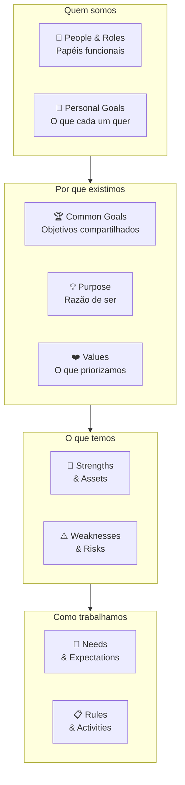

##### O momento exato de colocar este canvas na parede

Use o Team Canvas quando dois ou mais sócios decidem fundar juntos, antes de redigir o acordo societário. Reabra o quadro em momentos de transição, como entrada de novo sócio ou liderança executiva, mudança no modelo de dedicação ou reorganização de frentes. Em duplas ou trios fundadores, o canvas é preenchido em uma sessão única de 90 minutos.

##### As regras de ouro para preencher sem se enganar

A tese de Ivanov é que **conflito de time frequentemente não é conflito de personalidade: é conflito de pressupostos não declarados**. Dois cofundadores que não conversaram sobre objetivos pessoais (*Personal Goals*) assumem que o outro quer a mesma coisa (crescimento acelerado com capital de risco versus empresa enxuta focada em dividendos. Vender em cinco anos versus construir por vinte). Dois sócios técnicos que não alinharam expectativas (*Needs & Expectations*) divergem logo na primeira semana sobre revisão de código, autonomia e prazos. O Team Canvas torna esses pressupostos visíveis antes que virem atrito societário. A sessão de preenchimento vale mais que o quadro na parede: o que emerge na conversa franca é o verdadeiro trabalho.

##### Passo a passo na parede da sala

Sessão presencial ou por videoconferência (Miro, FigJam ou folha A3), conduzida em 90 minutos pelos cofundadores na Fase 0, antes da formalização societária tratada na [[IGNICAO-Vol-8-Juridico-LGPD-e-Seguranca#FASE 18: ESTRUTURAÇÃO JURÍDICA, SOCIETÁRIA E BLINDAGEM OPERACIONAL|Fase 18 (Estruturação Jurídica, Societária e Blindagem Operacional) do Volume 8]].

1. **People & Roles** (10 min): cada pessoa escreve seu nome e o papel funcional real (não o cargo): "sou quem toma decisão técnica final" / "sou quem mantém relação com os clientes âncora".
2. **Personal Goals** (15 min): individualmente primeiro, depois compartilha. O que cada pessoa quer ganhar pessoalmente com esse trabalho nos próximos 12 meses? Dinheiro? Aprendizado? Visibilidade? Espaço para criar? Sem julgamento.
3. **Common Goals** (15 min): o que o time quer alcançar *junto*? 3-5 objetivos específicos para o próximo semestre. Discutir até consenso real.
4. **Purpose** (10 min): por que esse time existe além das metas? Qual seria a perda para o mundo se esse time parasse de existir?
5. **Values** (10 min): quais 3-5 valores o time quer praticar no trabalho conjunto? Votar, depois discutir os que geraram divergência.
6. **Strengths & Assets / Weaknesses & Risks** (15 min), o que o time tem de excelente e onde é vulnerável. Honestidade é o requisito, equipe que só lista forças não faz o exercício.
7. **Needs & Expectations** (10 min): o que cada pessoa precisa dos outros para trabalhar bem. "Preciso de feedback direto, sem rodeios." "Preciso de autonomia sobre decisões de design." Acordos explícitos.
8. **Rules & Activities** (10 min): rituais, cadências, normas. Stand-up diário ou não? Code review obrigatório ou não? Decisão por consenso ou por voto?

Após a sessão: registrar o canvas, colocar visível, revisitar em 3-6 meses.

##### Exemplo brasileiro preenchido: Rafael (Recife) e Bia (Goiânia) alinhando a sociedade na Fase 0

Quando Rafael, operando do Recife, e Bia, em Goiânia, decidiram validar juntos sua marca digital (*D2C*) de kits de autocuidado, reservaram uma tarde de sábado por chamada de vídeo para preencher o quadro e alinhar papéis, piso financeiro, horas de dedicação e regras de desempate antes de investir o primeiro real. O Team Canvas da sessão inicial:

| Bloco | Conteúdo |
|---|---|
| **People & Roles** | **Rafael (Recife):** operação logística, negociação com fornecedores de cosméticos, controle de estoque e caixa. **Bia (Goiânia):** marca, comunidade, pesquisa com consumidoras, criação de conteúdo e aquisição paga. |
| **Personal Goals** | **Rafael:** "Quero construir um negócio com margem saudável sem queimar minha reserva familiar de 12 meses nem trabalhar 80 horas por semana no caos." **Bia:** "Quero liderar uma marca autoral com comunidade fiel e sair da agência em até 6 meses quando a receita recorrente cobrir meu piso." |
| **Common Goals** | (1) Entrevistar 30 consumidoras-alvo em 6 semanas antes de encomendar lote próprio. (2) Rodar o primeiro teste de venda manual com 50 kits montados sob encomenda até o fim do trimestre. (3) Manter queima de capital próprio abaixo do limite de perda aceitável de R$ 15 mil na fase de validação. |
| **Purpose** | "Transformar o cuidado diário com a pele em um ritual simples, acessível e adaptado ao clima brasileiro para mulheres que não têm tempo para rotinas de dez passos." |
| **Values** | (1) Caixa e margem unitária antes de vaidade de marca. (2) Franqueza imediata sobre bloqueios pessoais ou atrasos. (3) Nenhuma compra de estoque sem pré-venda ou evidência de demanda real. |
| **Strengths & Assets** | Rafael tem 8 anos negociando prazos e fretes no varejo nordestino, Bia domina aquisição digital e já gerenciou comunidades de beleza com mais de 100 mil seguidoras, ambos têm reserva pessoal separada. |
| **Weaknesses & Risks** | Sociedade à distância (Recife e Goiânia), Bia ainda mantém clientes de consultoria em paralelo nos primeiros 4 meses, risco de impasse em decisões que cruzam estética de embalagem e custo de frete. |
| **Needs & Expectations** | Rafael precisa de previsão de campanhas com 10 dias de antecedência para cotar insumos e embalagens sem frete aéreo de urgência. Bia precisa de autonomia criativa nos testes de mensagem e de números semanais claros de custo por pedido. |
| **Rules & Activities** | Reunião semanal de 45 min toda segunda às 8h30 (números de caixa, entrevistas e prioridades da semana) e check-in de 15 min na sexta. Comunicação assíncrona no Notion e WhatsApp (urgências respondidas em até 4h). Palavra final em fornecedor, frete e caixa: Rafael. Palavra final em marca, canal e produto: Bia. Vesting de 4 anos com cliff de 1 ano desde o dia um. |

O bloco que gerou a conversa mais importante foi Personal Goals: Bia ainda precisava manter duas contas da sua consultoria em Goiânia pelos primeiros quatro meses para preservar sua reserva, enquanto Rafael já havia encerrado seu contrato anterior no Recife. Sem o Team Canvas, essa diferença de disponibilidade teria virado acusação de falta de compromisso no segundo mês. Com o quadro aberto, fecharam um acordo explícito: 20 horas semanais protegidas de Bia até o quarto mês, gatilho de receita líquida para a transição integral dela no quinto mês e alçadas separadas para evitar empates em 50/50.

##### Variações e extensões

- **Team Canvas Basic**: versão simplificada com apenas 5 blocos (Goals, Roles, Values, Needs, Rules), para times muito pequenos (2-3 pessoas) ou sessões rápidas de 45 minutos.
- **Squad Health Check** (Spotify): complemento do Team Canvas, avalia periodicamente a saúde do time em dimensões como Ownership, Speed, Fun, Learning. Útil para revisão trimestral.
- **Working Agreements Canvas**: foco exclusivo em normas de trabalho, versão mais operacional que o Team Canvas completo.

##### Onde os fundadores mentem para si mesmos neste canvas

- Fazer o Team Canvas sem o bloco Personal Goals: é exatamente onde estão os pressupostos não declarados mais perigosos.
- Facilitador que também está no canvas: difícil ser objetivo, terceiro facilita melhor.
- Canvas como check-box burocrático (preencher por obrigação, nunca revisitar): valor está na sessão e na revisão periódica, não no documento.
- Confundir Values com slogan corporativo: "inovação", "integridade", "excelência" são valores genéricos que não guiam decisão real. "Velocidade sobre perfeição" ou "dados antes de opinião" são valores acionáveis.
- Tratar o canvas como imutável: times mudam, refaça a cada 6 meses ou quando a composição muda significativamente.

---

### TEMPLATES OPERACIONAIS E CASOS PREENCHIDOS DESTA FASE 0

#### Template: Entrevista com Advisor (decisão específica · tradeoffs)

> [!important] Disciplina central
> O papel do conselheiro (*advisor*) é refinar uma decisão estratégica que já está na mesa, e não escolher o caminho por você. Na Fase 0, use esta pauta enxuta para decisões pessoais e societárias de largada, como pedir demissão agora ou validar em paralelo ao emprego, ou como estruturar o período de teste com um potencial cofundador. Os roteiros de entrevista de problema e de especialista entram na [[IGNICAO-Vol-2-Descoberta-e-Mercado#FASE 4: DESCOBERTA DO PROBLEMA|Fase 4 (Descoberta do Problema) do Volume 2]], e a relação formal com conselheiros é detalhada no [[#CAPÍTULO 12: REDE, MENTORES E ADVISORS: COMO CONSTRUIR O CAPITAL HUMANO DO EMPREENDEDOR|Capítulo 12 (Rede, Mentores e Advisors: Como Construir o Capital Humano do Empreendedor)]] deste volume.

##### Parte A: Roteiro da Conversa (uso durante)

**Duração alvo:** 60-90 min · Balanço de fala: advisor fala bastante, mas você conduz, prepare a pauta e volte a ela quando a conversa derivar.

**Abertura (3 min)**

> "Obrigado pelo tempo. A decisão que temos em cima da mesa é [frase única]. As opções são [A, B, C]. Meu objetivo nessa conversa é ouvir como você veria o problema, que contra-argumentos você enxerga, e que casos parecidos você já viu. Posso gravar para o time ouvir depois?"

**Contexto (5 min)**

- Apresentar em 3 minutos: onde estamos, a decisão, o que tentamos, o que já descartamos e por quê.
- Confirmar que a pessoa teve acesso ao material prévio, ou resumir o que ela não viu.

**Reenquadramento (10 min: antes de pedir recomendação).** *Frequentemente o valor do advisor está em reformular a pergunta, não em responder a que você trouxe.*

- Do jeito que eu descrevi, a decisão parece a decisão certa a tomar? Ou você formularia diferente?
- Que pergunta anterior a essa nós ainda não respondemos?

**Recomendação e raciocínio (15 min)**

- Qual é sua recomendação? (Forçar decisão binária: A, B ou C, não "depende".)
- Qual é a convicção: alta, média, baixa?
- Me leva pelo raciocínio: o que te fez chegar aí?

**Objeções e condições de reversão (10 min).** *Advisor bom lista o que pode dar errado com a própria recomendação. Se não ouviu objeção nenhuma, pergunte explicitamente.*

- Se você estivesse no nosso lugar, o que te faria mudar de ideia?
- Em que condições essa recomendação deixaria de valer?
- Já viu essa recomendação dar errado? Quando?

**Casos análogos (10 min)**

- Você já viu empresa parecida tomar decisão parecida? O que rolou?
- Onde o caso que você está citando não se aplica ao nosso?

**Riscos e pontos cegos (5 min)**

- Que riscos nós não estamos pesando?
- Que riscos você acha que estamos superdimensionando?

**Encerramento (3 min)**

- O que você faria nos próximos 30 dias se fosse nós?
- Topa reportar o resultado dessa decisão em [prazo]?

**NÃO FAZER**

- Pedir recomendação sem apresentar o problema com rigor: vira conversa de opinião genérica.
- Engolir a recomendação sem confronto: advisor não decide por você.
- Confundir "já vi isso" com "isso se aplica aqui".
- Tratar heurística pessoal ("eu sempre fiz X") como lei do setor.

##### Parte B: Síntese Pós-Conversa

###### Metadados

| Campo | Valor |
|---|---|
| **ID** | `ADV-[AAAA-MM-DD]-[##]` |
| **Data e hora** | `[DD/MM/AAAA]` |
| **Duração** | `[min]` |
| **Formato** | `[ ] Remoto  [ ] Presencial` |
| **Participantes internos** | `[Nome(s)]` |
| **Gravação / notas compartilhadas** | `[link]` |
| **Tipo de relação** | `[ ] Board member  [ ] Advisor formal com equity  [ ] Advisor informal  [ ] Consultor remunerado  [ ] Mentor pontual]` |
| **Remuneração / contrato** | `[equity %, fee, pro bono, etc.]` |
| **Conflitos de interesse conhecidos** | `[preencher]` |

###### Perfil do Advisor

| Campo | Valor |
|---|---|
| **Nome** | `[preencher]` |
| **Trajetória curta** | `[2-3 linhas sobre empresas, papéis, resultados relevantes]` |
| **Por que esta pessoa para esta decisão?** | `[fit específico: experiência prévia, rede, especialidade]` |
| **Já tomou decisão parecida?** | `[ ] Sim: detalhe  [ ] Análoga  [ ] Não, mas observou de perto]` |

###### 1. Decisão em pauta

**A decisão, em uma frase.** *Teste: se você não consegue enquadrar em uma frase com verbo claro, a conversa vai para todo lado. Volte e afie antes.*

`[Ex: "Devo pedir demissão da CLT agora com 10 meses de reserva pessoal ou iniciar a validação das Fases 1 a 4 em paralelo por 6 meses até acumular 15 meses de fôlego?"]`

**Janela de decisão.**

- **Prazo que temos para decidir:** `[preencher]`
- **Custo de adiar:** `[preencher]`
- **Reversibilidade:** `[ ] Reversível  [ ] Parcialmente reversível  [ ] Irreversível]`

**Opções em cima da mesa.**

| Opção | Descrição curta | Quem defende internamente |
|---|---|---|
| A | `[preencher]` | `[preencher]` |
| B | `[preencher]` | `[preencher]` |
| C (status quo) | `[preencher]` | `[preencher]` |

###### 2. Contexto compartilhado antes da conversa

> *O advisor recebeu briefing? Leu material? Quanto viu dos números? Isso modula o peso da recomendação.*

- **Material enviado antes:** `[link ou descrição]`
- **Tempo de preparo da pessoa:** `[preencher]`
- **Lacunas que ficaram: o que ela não viu:** `[preencher]`

###### 3. Como o advisor reenquadrou o problema

> *Frequentemente o valor do advisor não está na resposta: está no reenquadramento. "Vocês estão fazendo a pergunta errada" vale mais do que "a resposta é B".*

**Ela viu a decisão diferente de como chegamos?** `[ ] Sim, de forma significativa  [ ] Sim, em aspecto pontual  [ ] Não, viu igual`

**Qual foi o reenquadramento? (se houve)** `[preencher]`

###### 4. Recomendação

**Recomendação principal (em uma frase).** `[preencher]`

**Convicção do advisor.** `[ ] Alta ("eu faria isso")  [ ] Média ("tendo a achar que.")  [ ] Baixa ("não tenho certeza, mas considere.")`

**Linha de raciocínio (principais porquês).**

1. `[preencher]`
2. `[preencher]`
3. `[preencher]`

###### 5. Objeções e contra-argumentos levantados

> *Advisor bom lista o que pode dar errado com a própria recomendação. Se você não ouviu objeção nenhuma, ou ela foi frouxa ou você não perguntou.*

- **Contra-argumento 1:** `[preencher]`
- **Contra-argumento 2:** `[preencher]`
- **Condições em que a recomendação mudaria:** `[preencher]`

###### 6. Tradeoffs destacados

| Tradeoff | O que ganhamos | O que perdemos |
|---|---|---|
| `[preencher]` | `[preencher]` | `[preencher]` |
| `[preencher]` | `[preencher]` | `[preencher]` |

###### 7. Casos e analogias citadas

> *"Já vi isso acontecer em [empresa X]" é o ativo central do advisor. Registre: inclusive para comparar entre advisors sobre a mesma decisão.*

| Caso / empresa | O que rolou | Como se aplica ao nosso caso | Como não se aplica |
|---|---|---|---|
| `[preencher]` | `[preencher]` | `[preencher]` | `[preencher]` |

###### 8. Riscos destacados

- **Riscos que não havíamos pesado:** `[preencher]`
- **Riscos que já víamos mas foram amplificados:** `[preencher]`
- **Riscos que ela acha que estamos superdimensionando:** `[preencher]`

###### 9. Separação fato vs. opinião vs. heurística pessoal

> *Advisor mistura três coisas em qualquer conversa: fato (verificável), opinião (tese informada) e heurística pessoal ("eu sempre fiz assim"). Separar ajuda a decidir o que pesar.*

**Fatos citados (checáveis).** `[preencher]`

**Opiniões (com base em experiência mas não necessariamente generalizáveis).** `[preencher]`

**Heurísticas pessoais (padrão pessoal da pessoa, tratar com cautela).** `[preencher]`

###### 10. Vocabulário e quadros mentais

> *Advisor bom traz quadros mentais (frameworks, analogias, axiomas) que organizam a decisão. Registre os que ressoaram: você vai reutilizar em pitch, board e nas próximas conversas internas.*

| Termo / framework / analogia | Como ela usou |
|---|---|
| `[preencher]` | `[preencher]` |

###### 11. Armadilhas: autoavaliação pós-conversa

> *Marque honestamente. Advisor tem autoridade natural: isso contamina a escuta se você não checar.*

- [ ] Engoli a recomendação sem confronto porque a pessoa tem muita credibilidade?
- [ ] Tratei caso pessoal dela como generalizável sem verificar o fit com nosso contexto?
- [ ] Aceitei heurística pessoal ("eu sempre fiz assim") como lei do setor?
- [ ] Pedi recomendação sem ter apresentado a decisão com rigor?
- [ ] Deixei de pedir objeção / contra-argumento explicitamente?
- [ ] Confundi convicção dela com qualidade do argumento?

**Achados sob suspeita:** `[preencher]`

###### 12. Nossa posição pós-conversa

> *Tão importante quanto ouvir é registrar o que fizemos com o que ouvimos. Advisor não decide por nós. Decidimos nós, informados por ela.*

**Frente à recomendação.**

- [ ] **Aceitamos integralmente**: justificativa: `[preencher]`
- [ ] **Aceitamos com modificação**: modificação e por quê: `[preencher]`
- [ ] **Rejeitamos**: justificativa: `[preencher]`
- [ ] **Adiamos decisão**: o que falta saber antes: `[preencher]`

**Convicção interna após a conversa.** `[ ] Aumentou  [ ] Diminuiu  [ ] Mesma, melhor argumentada  [ ] Gerou confusão: precisamos reprocessar]`

###### 13. Ações acordadas

| Ação | Responsável | Prazo |
|---|---|---|
| `[preencher]` | `[Nome]` | `[DD/MM]` |

**Follow-up com o advisor.**

- [ ] Enviar resumo desta conversa em até 48h (com o que decidimos, inclusive quando decidimos diferente da recomendação)
- [ ] Reportar resultado da decisão em: `[prazo]`
- [ ] Próxima conversa agendada? `[data / gatilho]`

###### 14. Reflexão interna (pós-conversa, sem o advisor)

> *Fazer 30 min depois da conversa, só com o time interno. Três perguntas.*

**O que foi sinal e o que foi ruído nesta conversa?** `[preencher]`

**Onde ela pode estar errada em função do viés dela (experiência datada, setor diferente, ego)?** `[preencher]`

**Se seguirmos a recomendação e der errado, conseguimos explicar por que parecia razoável na hora?** `[preencher]`

###### 15. Próximos passos de investigação

> *Perguntas que esta conversa gerou e que precisam ser respondidas antes da próxima rodada de decisão.*

**Outras fontes a consultar antes de decidir.**

- `[outro advisor com viés complementar / especialista no tema / dado externo]`
- `[preencher]`

**Dados internos a levantar.** `[preencher]`

**Se decidirmos, o que precisa estar pronto?** `[preencher]`

*Preenchido por `[Nome]` em `[DD/MM/AAAA]`.*

---

### LEITURAS E RECURSOS RECOMENDADOS DESTA FASE 0

#### Leituras para a decisão de fundar: sociedade, psicologia do fundador e finanças pessoais

*The Founder's Dilemmas: Anticipating and Avoiding the Pitfalls That Can Sink a Startup*, de Noam Wasserman (Princeton University Press, 2012): pesquisa com cerca de 10 mil fundadores sobre quando empreender sozinho ou em sociedade, como dividir participação com *vesting* e por que o dilema entre controle e riqueza derruba times nascentes. *The E-Myth Revisited* (*O Mito do Empreendedor*), de Michael E. Gerber (1995): por que dominar a técnica de um ofício (médico, engenheiro, programador) não equivale a saber construir uma empresa que funcione sem depender de heroísmo individual. *The Hard Thing About Hard Things* (*O Lado Difícil das Situações Difíceis*), de Ben Horowitz (2014): retrato sem verniz do peso psicológico de liderar uma startup quando as coisas saem do roteiro. *Thinking, Fast and Slow* (*Rápido e Devagar: Duas Formas de Pensar*), de Daniel Kahneman (2011): base científica sobre vieses cognitivos, excesso de confiança e a diferença entre a visão interna otimista e a taxa-base estatística (*Outside View*). *Effectual Entrepreneurship*, de Stuart Read, Saras Sarasvathy, Nick Dew e Robert Wiltbank (2016): aplicação prática dos cinco princípios da *Effectuation* (começar com os próprios meios e limitar a perda aceitável). Para organizar a reserva doméstica e o orçamento de transição no contexto brasileiro, consulte os guias abertos de planejamento financeiro pessoal do Banco Central do Brasil (*Caderno de Educação Financeira: Gestão de Finanças Pessoais*) e da Planejar (Associação Brasileira de Planejamento Financeiro), além do [[#CAPÍTULO 1: DINHEIRO PESSOAL DO FUNDADOR|Capítulo 1 (Dinheiro Pessoal do Fundador)]] e do [[#CAPÍTULO 2: SAÚDE MENTAL, DINÂMICA DE COFUNDADORES E HUMANIDADE DO FUNDADOR|Capítulo 2 (Saúde Mental, Dinâmica de cofundadores e Humanidade do Fundador)]] deste volume. (As leituras de descoberta de clientes e experimentação, como *The Mom Test* e *The Lean Startup*, estão reunidas nas Fases 1, 2 e 4.)

#### Ensaios canônicos de Paul Graham: referência consolidada

Paul Graham escreve ensaios desde 1993, com mais de duzentos textos publicados gratuitamente até hoje em paulgraham.com. Muitos deles deram origem ao vocabulário operacional do ecossistema de startups: *do things that don't scale*, *default alive*, *ramen profitable*, *schlep blindness* e *founder mode*. Boa parte das ferramentas práticas deste volume dialoga com esses textos sobre preparação pessoal, escolha de problemas e convivência entre sócios, reunidos a seguir como mapa de consulta.

A organização abaixo é por utilidade operacional para fundador em construção, não cronológica. A leitura recomendada é em sessão única de duas a três horas dos primeiros oito, depois releitura seletiva anual de acordo com a fase que você estiver vivendo.

**Para as fases de geração e filtragem de ideias (Fases 1 a 3).** *How to Get Startup Ideas* (2012), em paulgraham.com/startupideas.html: a diferença entre ideias orgânicas que brotam de necessidades reais na fronteira técnica e ideias artificiais inventadas para parecerem startups (*sitcom ideas*). *Schlep Blindness* (2012), em paulgraham.com/schlep.html: a cegueira ao trabalho árduo, que explica por que problemas operacionais trabalhosos afastam quase todos os fundadores e concentram grandes oportunidades, com a Stripe como caso clássico. *Frighteningly Ambitious Startup Ideas* (2012), em paulgraham.com/ambitious.html: por que teses ambiciosas intimidam na largada e enfrentam menos concorrência direta quando atacadas por uma cunha inicial bem recortada. *Organic Startup Ideas* (2010), em paulgraham.com/organic.html: como identificar problemas reais a partir das próprias fricções de trabalho.

**Para construir e crescer (Fases 9 a 14).** *Do Things That Don't Scale* (2013), em paulgraham.com/ds.html: mostra por que o trabalho manual intenso nas primeiras dezenas de clientes constrói o ajuste ao mercado (PMF). *Startup = Growth* (2012), em paulgraham.com/growth.html: sintetiza as referências da Y Combinator (crescer de 5% a 7% por semana é saudável, enquanto 10% é excepcional). *Default Alive or Default Dead* (2015), em paulgraham.com/aord.html: traz a pergunta diagnóstica que todo fundador precisa responder a partir do oitavo ou nono mês de operação. *The Fatal Pinch* (2014), em paulgraham.com/pinch.html: detalha a compressão de caixa que encerra mais startups do que qualquer erro societário. *Ramen Profitable* (2009), em paulgraham.com/ramenprofitable.html: explica por que cobrir os custos básicos de vida dos fundadores muda seu poder de barganha. *Superlinear Returns* (2023), em paulgraham.com/superlinear.html: demonstra por que pequenas diferenças de execução geram retornos compostos desproporcionais. *Startups in 13 Sentences* (2009), em paulgraham.com/13sentences.html: condensa treze princípios operacionais detalhados logo adiante como resumo de uma página.

**Sobre o fundador (transversal a todas as fases).** *What We Look for in Fundadores* (2010), em paulgraham.com/fundadores.html: os cinco atributos observados pela Y Combinator (determinação, flexibilidade, imaginação, irreverência pragmática para questionar regras obsoletas e amizade entre sócios, notando que inteligência isolada não encabeça a lista). *Relentlessly Resourceful* (2009), em paulgraham.com/relres.html: a definição do bom fundador em duas palavras ("engenhoso sem trégua") e seu oposto, *hapless* (passivo diante das circunstâncias). *The Anatomy of Determination* (2009), em paulgraham.com/determination.html: determinação como soma de vontade, disciplina e ambição calibrada, combinada à flexibilidade de rota (que Graham compara em *What We Look for in Fundadores* a um *running back* do futebol americano e que adaptamos aqui ao camisa 9 que desvia dos zagueiros sem perder o gol de vista). *Before the Startup* (2014), em paulgraham.com/before.html: "seja especialista nos seus usuários, não em startups", porque tentar explorar atalhos do sistema (*gaming the system*) fracassa no mercado real. *Earnestness* (2020), em paulgraham.com/earnest.html: seriedade intelectual e sinceridade de propósito como vantagem subestimada. *Mean People Fail* (2014), em paulgraham.com/mean.html: por que integridade e caráter pesam economicamente no longo prazo. *Keep Your Identity Small* (2009), em paulgraham.com/identity.html: como rótulos identitários travam o raciocínio diante de fatos novos. *You Weren't Meant to Have a Boss* (2008), em paulgraham.com/boss.html: reflexão sobre autonomia para calibrar expectativas pessoais. *The Top Idea in Your Mind* (2010), em paulgraham.com/top.html: como a preocupação dominante nos momentos livres governa o foco produtivo.

**Sobre escala e delegação.** *Founder Mode* (2024), em paulgraham.com/foundermode.html: analisa por que o conselho convencional de apenas contratar bons executivos e se afastar da operação costuma falhar em empresas em crescimento. *Maker's Schedule, Manager's Schedule* (2009), em paulgraham.com/makersschedule.html: contrasta os dois regimes de uso do tempo e mostra por que reuniões picotadas destroem a capacidade do fundador de pensar com profundidade.

**Sobre captação e VC.** *How to Raise Money* (2013), em paulgraham.com/fr.html. Guia tático denso, complementa o [[IGNICAO-Vol-5-Financas-e-Captacao#CAPÍTULO 9: CAPTAÇÃO DE EQUITY: PLANEJAMENTO DE RODADA, PITCH E RELACIONAMENTO COM INVESTIDORES|Capítulo 9 (Captação de Equity: Planejamento de Rodada, Pitch e Relacionamento com Investidores) (Vol. 5)]] desse livro. *Black Swan Farming* (2012), em paulgraham.com/swan.html. Entender como VCs pensam através da distribuição power-law dos retornos. *Investor Herd Dynamics* (2013), em paulgraham.com/herd.html. Por que captação oscila entre "impossível" e "fácil demais" sem meio-termo.

**Sobre erros que encerram a operação.** *The 18 Mistakes That Kill Startups* (2006), em paulgraham.com/startupmistakes.html: examina dezoito armadilhas recorrentes no estágio inicial (de fundar sozinho sem apoio até o esforço pela metade) e mostra como todas elas são caminhos que levam ao mesmo erro fatal: não construir algo que os usuários realmente queiram.

**Sobre clareza de raciocínio e debate entre sócios.** *Keep Your Identity Small* (2009), citado acima, aplica-se diretamente à revisão fria de premissas estratégicas sem apego de ego. *How to Disagree* (2008), em paulgraham.com/disagree.html: propõe uma pirâmide de refutação que separa ataque pessoal de contra-argumento central, preservando a saúde dos debates societários.

> [!tip] Por onde começar nos ensaios de Paul Graham
> Se está começando agora, leia antes de tudo *How to Get Startup Ideas*, *Do Things That Don't Scale* e *Startups in 13 Sentences*. Nessa ordem. São os três que mais mudam a forma de trabalhar.

#### Startups em 13 frases: one-pager canônico (Paul Graham, 2009)

Em fevereiro de 2009, Paul Graham publicou *Startups in 13 Sentences* (paulgraham.com/13sentences.html), sintetizando em treze princípios o que diria a um fundador se tivesse apenas alguns minutos, a partir do lema de Paul Buchheit adotado pela Y Combinator: "é melhor fazer poucas pessoas genuinamente satisfeitas do que muitas pessoas apenas meio satisfeitas".

Reproduzo as treze em formato consolidado aqui, com comentário operacional. Serve como one-pager final para releitura periódica. Eu imprimo e guardo próximo. Não porque as esqueço. Porque esquecer uma e só lembrar dela seis meses depois, num momento ruim, é o tipo de erro que dá para prevenir simplesmente relendo a lista mensalmente.

Graham mesmo indica: se tivesse que escolher uma das treze, seria a quarta (entender seus usuários), com o que concordo integralmente.

**Escolha bons cofundadores.** "Cofundadores são para uma startup o que localização é para imóveis: você pode mudar qualquer coisa numa casa, exceto onde ela está." Você pode mudar ideia, produto, mercado, modelo. Mas trocar cofundador é caro emocional e operacionalmente. O sucesso da startup é, quase sempre, função dos fundadores. Aplicação: Fase 0, [[#CAPÍTULO 2: SAÚDE MENTAL, DINÂMICA DE COFUNDADORES E HUMANIDADE DO FUNDADOR|Capítulo 2 (Saúde Mental, Dinâmica de cofundadores e Humanidade do Fundador)]].

**Lance rápido.** Não porque "time to market" seja tudo, mas porque você ainda não começou a trabalhar no produto de verdade enquanto não lançou. Lançar te ensina o que você deveria estar construindo. Até lá, você está no escuro, mesmo que não perceba. Aplicação: [[IGNICAO-Vol-4-Tracao-e-PMF#FASE 11: MVP E EXPERIMENTOS DE MERCADO|Fase 11 (Vol. 4)]].

**Deixe a ideia evoluir.** "É um erro tratar startup como se fosse só a implementação de uma ideia inicial brilhante." A ideia inicial é semente. A empresa que você acaba construindo é o resultado da interação entre semente e mercado real. Aplicação: [[IGNICAO-Vol-4-Tracao-e-PMF#FASE 13: PRODUCT-MARKET FIT|Fase 13 (Vol. 4)]].

**Entenda seus usuários.** A única que Graham escolheria se só pudesse manter uma. "A tarefa essencial de uma startup é criar riqueza, a dimensão da riqueza sobre a qual você tem mais controle é quanto melhora a vida dos seus usuários, e a parte mais difícil disso é saber o que construir para eles." Aplicação: Fases 3 e 4.

**Melhor fazer poucos usuários amarem do que muitos ficarem indiferentes.** Inicialmente, você tem que escolher entre satisfazer todas as necessidades de um subconjunto de potenciais usuários, ou satisfazer um subconjunto das necessidades de todos os potenciais usuários. Escolha a primeira. Aplicação: Estratégia da Cunha ([[IGNICAO-Vol-3-Experimentos-e-Prototipagem#CAPÍTULO 3: IDEA → WEDGE → SCALE: O FRAMEWORK ANTLER COMO LENTE TRANSVERSAL|Capítulo 3 (Idea → Wedge → Scale: O Framework Antler como Lente Transversal) (Vol. 3)]]).

**Ofereça um atendimento surpreendentemente bom.** Clientes estão acostumados a serem maltratados. Tente fazer seu atendimento não apenas bom, mas surpreendentemente bom. Em estágio inicial, o fundador deve estar pessoalmente na linha de frente. Aplicação: [[IGNICAO-Vol-4-Tracao-e-PMF#FASE 11: MVP E EXPERIMENTOS DE MERCADO|Fase 11 (Vol. 4)]].

**Você produz o que mede.** Se você quer que algo cresça, acompanhe o número todo dia. Se o foco são usuários ativos, olhe para os usuários ativos diariamente, se é receita, meça a receita toda semana. O hábito de medir altera o comportamento do time. Aplicação: [[IGNICAO-Vol-4-Tracao-e-PMF#FASE 12: VALIDAÇÃO DO MODELO DE NEGÓCIO|Fase 12 (Validação do Modelo de Negócio) do Volume 4]] e [[IGNICAO-Vol-4-Tracao-e-PMF#CAPÍTULO 9: DADOS, ANALYTICS E EXPERIMENTAÇÃO|Capítulo 9 (Dados, Analytics e Experimentação) do Volume 4]].

**Gaste pouco.** A forma mais comum de morte de startup é ficar sem dinheiro. Ser barato é quase sinônimo de iterar rápido. Mais do que isso: cultura de frugalidade mantém a empresa jovem, assim como exercício mantém pessoas jovens. Aplicação: [[IGNICAO-Vol-4-Tracao-e-PMF#FASE 12: VALIDAÇÃO DO MODELO DE NEGÓCIO|Fase 12 (Vol. 4)]], [[#CAPÍTULO 1: DINHEIRO PESSOAL DO FUNDADOR|Capítulo 1 (Dinheiro Pessoal do Fundador)]].

**Chegue rápido ao ponto de equilíbrio básico (*ramen profitability*).** Atingir esse patamar significa gerar receita limpa suficiente para cobrir os custos essenciais de vida dos fundadores, garantindo fôlego operacional contínuo. Quando você cruza essa linha, a relação com investidores se transforma e a conversa parte de uma posição de autonomia, sem desespero de caixa. Aplicação prática: [[IGNICAO-Vol-4-Tracao-e-PMF#FASE 12: VALIDAÇÃO DO MODELO DE NEGÓCIO|Fase 12 (Vol. 4)]].

**Evite distrações.** "A startup pode ter maior potencial de longo prazo, mas você sempre acabará interrompendo o trabalho nela para atender quem paga suas contas hoje." (No Brasil, onde financiar o início vendendo serviço ou mantendo o emprego em paralelo é muitas vezes necessário, como Lucas e Marina farão nas fases seguintes, o antídoto é blindar uma grade fixa de horas semanais para o produto e cravar no calendário a data de corte da consultoria.) Graham identifica a captação de recursos como a distração campeã: levantar rodada tende a dominar a cabeça do fundador e drenar o foco operacional. Quando precisar captar, faça de forma rápida e volte a construir. Aplicação: Fase 0 e [[IGNICAO-Vol-6-Receita-e-Pessoas#CAPÍTULO 8: FOUNDER MODE, DELEGAÇÃO, GESTÃO DE TEMPO E CADÊNCIA OPERACIONAL DO CEO|Capítulo 8 (Founder Mode, Delegação, Gestão de Tempo e Cadência Operacional do CEO) do Volume 6]].

**Não se desmoralize.** Embora a causa imediata de morte de uma startup seja "ficar sem dinheiro", a causa subjacente é geralmente falta de foco causada por desmoralização. Começar uma startup carrega peso emocional enorme. Entenda isso e faça esforço consciente para não se deixar esmagar, como você cuida de flexionar os joelhos ao levantar uma caixa pesada. Aplicação: [[#CAPÍTULO 2: SAÚDE MENTAL, DINÂMICA DE COFUNDADORES E HUMANIDADE DO FUNDADOR|Capítulo 2 (Saúde Mental, Dinâmica de cofundadores e Humanidade do Fundador)]].

**Não desista.** "Você consegue ir surpreendentemente longe apenas por não desistir." Em matemática, persistência sem talento não resolve um teorema, em startups, continuar em campo ajustando a rota a partir das evidências muitas vezes separa quem chega ao ajuste de mercado de quem para no meio do caminho. Aplicação: [[IGNICAO-Vol-4-Tracao-e-PMF#CAPÍTULO 11: PIVOT: TIPOLOGIA, DECISÃO E EXECUÇÃO|Capítulo 11 (Pivot) do Volume 4]].

**Deals caem.** "Uma das habilidades mais úteis que aprendemos no Viaweb foi não criar expectativas." Graham e o time tiveram cerca de vinte deals caírem. Aprenderam a tratar deals como processos de fundo que você ignora até terminarem. É perigoso para o moral depender de um deal antes dele fechar. E pior: essa dependência torna o deal menos provável de fechar (a urgência que o outro lado sente gera desconfiança). Aplicação: [[IGNICAO-Vol-5-Financas-e-Captacao#CAPÍTULO 9: CAPTAÇÃO DE EQUITY: PLANEJAMENTO DE RODADA, PITCH E RELACIONAMENTO COM INVESTIDORES|Capítulo 9 (Captação de Equity: Planejamento de Rodada, Pitch e Relacionamento com Investidores) (Vol. 5)]].

> [!important] Se houver uma única lição para aplicar hoje, releia a quarta
> Todo o resto flui daí.

> [!info] Conexões desta Fase 0
> [[#FASE 1: ENCONTRAR A IDEIA|Fase 1 (Encontrar a Ideia)]], [[#CAPÍTULO 1: DINHEIRO PESSOAL DO FUNDADOR|Capítulo 1 (Dinheiro Pessoal do Fundador)]], [[#CAPÍTULO 2: SAÚDE MENTAL, DINÂMICA DE COFUNDADORES E HUMANIDADE DO FUNDADOR|Capítulo 2 (Saúde Mental, Dinâmica de cofundadores e Humanidade do Fundador)]] e [[IGNICAO-Vol-8-Juridico-LGPD-e-Seguranca#FASE 18: ESTRUTURAÇÃO JURÍDICA, SOCIETÁRIA E BLINDAGEM OPERACIONAL|Fase 18 (Estruturação Jurídica, Societária e Blindagem Operacional) do Volume 8]].

---

### O que muda na sua postura ao sair da Fase 0

A Fase 0 inverte a sequência apressada da maioria dos manuais: antes da tese, do produto e do mercado, vem a fundação pessoal de quem vai sustentar a travessia. Quando a Dra. Camila concluiu os oito passos desta fase em Belo Horizonte, constatou que seus R$ 58 mil líquidos cobriam menos de quatro meses do custo familiar real. Em vez de assinar o aluguel da clínica no escuro, assumiu três plantões semanais avulsos, separou as contas da casa e levou um ano para acumular 14 meses de reserva líquida antes de abrir as portas.

O entregável que fecha a Fase 0 é o Dossiê Pessoal do Empreendedor em uma página, consolidando seis parâmetros objetivos antes da busca por ideias (no caso da Dra. Camila em Belo Horizonte: 1. Piso doméstico mensal: R$ 9.500 comprimido e R$ 14.250 no cálculo conservador com fator 1,5, 2. Runway pessoal conservador: 14 meses acumulados em conta separada após um ano de plantões, 3. Modelo de dedicação: transição parcial de 20 horas semanais combinada a três plantões externos até a assinatura do ponto, 4. Acordo familiar: ata de uma página assinada com o marido fixando zero retirada do patrimônio essencial, 5. Ponto de parada: adiar a abertura se a reserva cair abaixo de 6 meses ou se os plantões passarem de 36 horas semanais por dois meses, 6. Sócios e conselheiros: operação solo apoiada por dois médicos gestores de clínicas e uma contadora especializada em saúde como conselheiros informais).

Com o Dossiê Pessoal do Empreendedor escrito e revisado à sua frente, você avalia o encaixe fundador-mercado e o momento de entrada na [[#FASE 1: ENCONTRAR A IDEIA|Fase 1]] sem a distorção do aperto financeiro. Com a fundação pessoal firme, as próximas fases viram método.

---

## FASE 1: ENCONTRAR A IDEIA

### O mito da lâmpada acesa: por que boas ideias são garimpadas no tédio, não no chuveiro

Sentados em um café em Pinheiros, o engenheiro de software Lucas (recém-saído de um grande banco) abriu diante de Marina (sua sócia comercial, com quem acabara de mapear o repertório conjunto na Fase 0) um bloco Moleskine com três ideias anotadas no fim de semana: uma rede social para tutores de animais, um divisor de contas de bar com IA e um aplicativo para contratar chefs em casa. Marina ouviu em silêncio, fechou o caderno e perguntou: *"Quem usaria cada uma dessas soluções e qual dessas pessoas perdeu tempo ou dinheiro na última terça-feira a ponto de abrir a carteira?"* Diante da pergunta, Lucas percebeu que trouxera três ideias simpáticas de conversa de jantar, desconectadas da bagagem bancária e de integrações B2B que os dois dominavam.

Paul Graham explica esse ponto cego no ensaio *Schlep Blindness* (2012): nosso cérebro desvia inconscientemente de tarefas árduas, ingratas e sem glamour, exatamente onde se escondem grandes oportunidades como a infraestrutura de pagamentos online que deu origem à Stripe. Na geração de ideias, a resposta contraintuitiva é esta: as ideias que mais dão lucro não parecem ideias brilhantes, elas parecem problemas operacionais chatos, burocráticos e dolorosos, que todo mundo ao redor aprendeu a tolerar como parte da paisagem.

Da pergunta de Marina nasce o diagnóstico desta fase, a Síndrome da Ideia de Vitrine: o vício de colecionar conceitos que rendem elogios fáceis de amigos em vez de garimpar atritos caros, repetitivos e urgentes. Enquanto o fundador iniciante espera uma inspiração cair do céu, o fundador disciplinado opera como um garimpeiro sistemático: levanta entre vinte e trinta hipóteses a partir de fricções reais da economia, passa todas por quatro peneiras frias e só avança quando encontra uma dor que já custa tempo ou dinheiro todos os meses.

---

### O custo de escolher mal e o tempo real desta fase

A qualidade da ideia escolhida na largada delimita o teto do que vem depois. Quando o fundador escolhe mal na origem, passa dois ou três anos tentando empurrar uma tese de baixa probabilidade devido à fragilidade do problema escolhido. A pressa de construir logo em cima da primeira hipótese que surge na mesa custa caro, pois a primeira ideia que vem à cabeça costuma ser apenas a mais visível.

Esperar uma iluminação espontânea consome meses em vão, ao passo que garimpar oportunidades com método e critérios explícitos de corte se conclui em duas a oito semanas. Esta fase estrutura esse processo ativo de geração e filtragem.

> [!info] O cálculo de custo-benefício desta fase
> O custo de executar bem esta etapa é baixo: duas a oito semanas de investigação cognitiva e conversas de campo, quase sem desembolso financeiro. Já o custo de pular a triagem pode representar seis meses a dois anos de salário e poupança queimados numa ideia que não resistiria à primeira checagem.

### Os 7 métodos práticos para garimpar oportunidades reais de negócio

Os sete métodos abaixo são complementares. Cada fundador tem mais facilidade com um ou dois deles, mas aplicar pelo menos quatro dos sete métodos (ou todos os sete ao longo da semana intensiva) força você a investigar terrenos que não visitaria por intuição. O trabalho desta fase consiste em gerar de 20 a 30 candidatas brutas, consolidá-las em uma lista única e aplicar os quatro filtros de seleção.

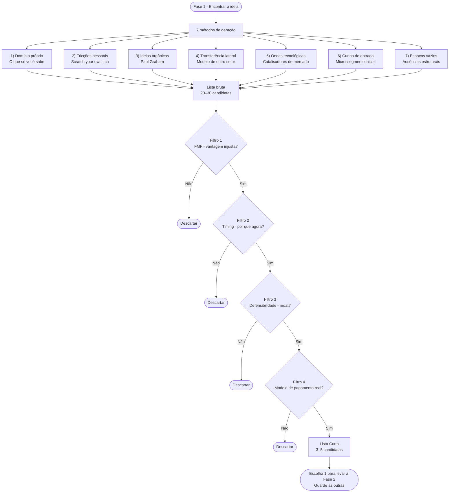

#### 1. O que só você sabe (*expertise domain mining*)

A primeira fonte de ideias boas é você mesmo. Mais precisamente, o conhecimento que você acumulou ao longo da sua carreira, do seu hobby levado a sério, da família, do bairro, ou de uma dor pessoal repetida. Em alguma área, você sabe mais que noventa e cinco por cento das pessoas. Essa área é o seu primeiro território de busca.

A pergunta-exercício, escrita, em trinta a sessenta minutos: *o que eu aprendi no meu trabalho ou na minha vida que a maioria das pessoas não sabe?* Liste sem filtrar. Detalhes técnicos, pequenas fraudes do setor, ineficiências que todo mundo aceita como normais, fornecedores ruins sem alternativa, processos manuais que poderiam ser automatizados mas ninguém tentou. A cada item, pergunte: *existe alguém que sofre diariamente com isso e pagaria por uma solução?* A maioria dos itens cai no filtro. Os que sobrevivem são candidatas.

Veja como isso aparece nos fundadores deste volume e no mercado brasileiro. Em Belo Horizonte, oito anos atendendo pacientes mostraram à Dra. Camila onde a agenda furava e onde o caixa vazava: as faltas sem aviso nas terças e quintas viraram a primeira regra operacional da sua clínica própria (confirmação ativa com sinal de reserva 24 horas antes), e em São Paulo os cinco anos de Lucas na tesouraria de um banco revelaram o retrabalho diário de conciliar boletos e notas fiscais em distribuidoras médias. Na mesma lógica de domínio vivido por dentro, David Vélez, Cristina Junqueira e Edward Wible somaram repertórios complementares para criar o Nubank: a experiência de Vélez avaliando serviços financeiros na América Latina e sua frustração como correntista recém-chegado ao país, o conhecimento de Junqueira sobre a operação de cartões do Itaú e a engenharia de software de Wible. Geraldo Thomaz e Mariano Gomide de Faria trabalhavam com sistemas corporativos e viram de perto como o comércio eletrônico brasileiro carecia de infraestrutura robusta, dando origem à VTEX. Já Marcelo Kalim apoiou-se em duas décadas de mercado financeiro no BTG Pactual para estruturar o C6 Bank a partir das brechas do sistema bancário tradicional.

Sua vivência acumulada no setor é uma barreira competitiva que nenhum concorrente compra da noite para o dia. Ninguém consegue competir com você no que só você viveu.

#### 2. Fricções pessoais como matéria-prima

O segundo método (*scratch your own itch*, ou resolver o próprio incômodo) consiste em registrar, durante duas semanas, toda vez que você pensa "deveria existir uma solução para isso". São as fricções diárias: serviços ruins que você tolera, processos manuais que detesta repetir, informações difíceis de cruzar ou decisões sem ferramenta de apoio. Anote cada ocorrência no celular ou no caderno sem filtrar e revise a lista ao fim da quinzena.

Dois filtros práticos separam a fricção que sustenta um negócio da simples irritação passageira.

O primeiro critério une frequência e generalização. A fricção ocorre na sua rotina uma vez por mês ou todos os dias? Ela afeta todo um segmento profissional ou apenas o seu caso isolado? Problemas raros não sustentam receita recorrente, e problemas exclusivos de uma única pessoa não formam mercado. Já a fricção frequente, compartilhada por um grupo claro de compradores, costuma gerar as melhores candidatas da rodada inicial.

O segundo é disposição a pagar. Você pagaria para resolvê-la? Quanto? Se a resposta honesta é "não pagaria", cuidado. Ideia construída em cima de fricção que ninguém paga vira hobby. Se você pagaria cinquenta reais por mês, quantas pessoas fariam o mesmo? A matemática aproximada do mercado nasce aqui.

Gabriel Braga e André Penha tentaram alugar um apartamento em São Paulo no início dos anos 2010 e esbarraram no ritual tradicional das imobiliárias: exigência de fiador com imóvel quitado, três meses de caução, vistoria demorada e burocracia de cartório. A fricção era frequente (milhões de brasileiros alugam imóveis), generalizável (inquilinos e proprietários sofriam no mesmo funil) e contava com disposição comprovada a pagar (o mercado já descontava taxas de corretagem e administração). Dessa fricção vivida na pele nasceu o QuintoAndar, que substituiu o fiador e a caução pela análise de crédito própria e digitalizou a jornada de locação.

#### 3. As ideias orgânicas de Paul Graham

Paul Graham, cofundador do Y Combinator, articulou um conjunto de conceitos sobre geração de ideias que vale estudar em separado. Resumo aqui os três centrais.

**Viva no futuro, depois construa o que está faltando.**

Paul Buchheit formulou, e Paul Graham popularizou no ensaio *How to Get Startup Ideas* (2012), a regra central das ideias orgânicas: viva no futuro e construa o que está faltando. Profissionais na fronteira de um campo em rápida mudança (programadores testando arquiteturas novas, médicos aplicando terapias recém-aprovadas, operadores lidando com uma nova regulação) vivem na prática uma rotina que só chegará à maioria anos depois. Eles enxergam gargalos que ainda parecem invisíveis para quem está de fora. Se você já opera numa dessas fronteiras, construa o que falta para o seu próprio trabalho, se ainda não opera, aproxime-se da borda técnica ou operacional de um setor em transformação antes de escolher sua tese.

Construir essa familiaridade com a fronteira de um setor exige meses ou anos de imersão prática, e não um fim de semana de retiro. Quando você vive o dia a dia de uma área em mudança, deixa de forçar ideias no vazio e passa a notar lacunas estruturais antes do mercado, como aconteceu com Larry Page e Sergey Brin em Stanford ao criarem o PageRank quando já existiam diversos buscadores na web.

**Ideias orgânicas contra ideias não orgânicas.**

Graham distingue dois tipos de ideia de startup. As orgânicas resolvem um problema que o fundador mesmo tem. O produto nasce com pelo menos um usuário (o fundador), e provavelmente mais. São mais previsíveis, mais executáveis, mais fáceis de confirmar se funcionam. Têm risco menor de "resolver um problema que ninguém tem". Dropbox começou porque Drew Houston esqueceu o pen-drive várias vezes. Microsoft começou porque Bill Gates queria programar o Altair em algo melhor que machine code. Facebook começou porque Mark Zuckerberg queria que Harvard tivesse um diretório digital de estudantes. Apple começou porque Steve Wozniak queria um computador pessoal. Nenhum começou como "vamos criar uma empresa". Todos começaram como "eu tenho esse problema, quem mais tem?".

As não orgânicas resolvem problemas que outras pessoas têm. Podem ser ótimas. Mas o risco de "resolver um problema que ninguém tem" é muito maior. Exigem mais entrevistas, mais humildade, mais ceticismo sobre a sua intuição, mais pesquisa de campo.

Se a sua ideia-candidata é orgânica, privilegie. Se não é, aceite o handicap e compense com mais pesquisa com clientes reais nas Fases 4 e 5 (Vol. 2).

**O contraponto: ideias de novela (*sitcom ideas*).**

A Y Combinator chama de *sitcom ideas* (ideias de novela) aquelas que roteiristas de TV inventariam se um personagem decidisse abrir uma startup: parecem plausíveis de relance, mas são artificiais na substância. Exemplos clássicos incluem redes sociais para nichos improváveis, aplicativos genéricos sob demanda ou plataformas de conteúdo sem comprador claro.

Teste de sanidade para descartar sitcom. Quantas pessoas específicas e nomeáveis você consegue listar que querem isso agora, com urgência, não "um dia quem sabe"? Se não consegue listar cinco a dez pessoas nomeadas no momento, provavelmente é sitcom, não oportunidade. Se consegue listar, e as pessoas nomeadas te dizem espontaneamente "quando você vai fazer isso?", você está perto de algo real.

Em *Frighteningly Ambitious Startup Ideas* (2012), Paul Graham mostra que projetos de grande envergadura intimidam a maioria dos fundadores logo na largada e por isso enfrentam menos concorrência direta no ponto de partida. A regra prática para a Lista Curta é simples: não descarte uma tese apenas pela escala da visão de longo prazo, desde que você consiga recortar uma cunha inicial pequena, específica e pagável hoje (como a API de pagamentos para desenvolvedores na origem da Stripe ou o cartão sem anuidade na largada do Nubank).

> [!quote] A pergunta operacional de Paul Graham
> O que você gostaria que alguém construísse para você?

Responda sem filtrar por tamanho de mercado ou plausibilidade imediata. A resposta honesta, repetida ao longo de alguns dias, revela candidatas que parecem pequenas, técnicas ou específicas demais para quem olha de fora. O Dropbox pareceu assim antes de existir. O Airbnb soava ainda mais improvável em 2007: dois designers, Brian Chesky e Joe Gebbia, alugando três colchões de ar na sala do apartamento em San Francisco para participantes de uma conferência de design quando os hotéis da cidade lotaram. Parecia pequeno e improvável demais para qualquer investidor tradicional.

Antes de continuar, responda por escrito, em duas frases cada. Essa minha ideia-candidata é orgânica (eu mesmo tenho o problema) ou não orgânica? Eu estou na borda de algum campo em transformação, ou estou imaginando um futuro que ainda não vivi? Consigo listar cinco a dez pessoas nomeadas que querem a solução agora?

Se as respostas forem fracas (não orgânica, não está na borda, não consegue listar pessoas), a sua [[#FASE 2: ARTICULAÇÃO E CAPTURA DA IDEIA|Fase 2]] vai ser muito mais árdua que o normal. Ao lado de cada candidata nascida deste método, anote suas respostas para essas três perguntas. Elas servirão de insumo direto quando você passar a lista pelos quatro filtros de seleção mais adiante.

#### 4. Transferência lateral de modelos entre setores e países

O que funcionou em uma indústria ou geografia pode resolver um gargalo semelhante em outra (*cross-industry transfer*). Boa parte das startups sólidas nasce da adaptação criteriosa de um modelo de negócio já comprovado para um setor que ainda opera de forma arcaica.

A técnica funciona em duas direções.

A direção horizontal pega modelo validado no mesmo país, em outra indústria. Depois que o software como serviço (SaaS) refinou a cobrança recorrente com métricas rigorosas de retenção e cancelamento, caberia devolver essa disciplina de assinatura mensal aos produtos físicos de reposição contínua? Dollar Shave Club mostrou que sim para lâminas de barbear, e o modelo se replicou em verticais inesperadas (alimentos, bebidas, livros infantis) no Brasil e fora.

A direção geográfica traz para o país um modelo testado lá fora, adaptando-o à infraestrutura local. O iFood nasceu em 2011 digitalizando o guia impresso Disk Cook e adaptou ao mercado brasileiro o modelo de portal de pedidos online que a europeia Just Eat operava desde os anos 2000, atacando primeiro a dor do telefone ocupado nos restaurantes (que ainda faziam a entrega com motoboys próprios). Já a Kovi adaptou o modelo de locação semanal de veículos voltado a motoristas de aplicativo (similar ao de operadores como HyreCar e Splend), focando na cunha inicial de quem trabalhava na Uber e na 99 sem carro próprio nem limite de crédito bancário, operação que em janeiro de 2025 foi adquirida pela Moove.

O erro clássico desse método é o "Uber para X" genérico. Nem todo serviço tem frequência suficiente para sustentar acionamento sob demanda, nem toda fricção local pede um aplicativo próprio e nem todo modelo estrangeiro sobrevive quando mudam a regulação, o poder de compra e o hábito do consumidor. A transferência entre setores exige compreender *por que* a economia unitária original parava de pé: o Uber combinou smartphone com GPS, pagamento digital automático e oferta descentralizada de motoristas em corridas urbanas recorrentes. Quando falta frequência ou margem unitária, clones sob demanda quebram assim que acaba o subsídio de marketing.

#### 5. Ondas tecnológicas e regulatórias como catalisador

Toda grande onda tecnológica (*technology wave riding*) abre categorias inteiras de empresas que antes eram inviáveis. A popularização dos smartphones com GPS (2009 a 2014) viabilizou Uber, Instagram, WhatsApp e Nubank. A maturação da nuvem e da colaboração no navegador (2011 a 2018) abriu espaço para Slack, Zoom, Notion e Figma. Os marketplaces de serviços locais (2011 a 2018) impulsionaram iFood, 99, Rappi e GetNinjas. Você lê esta fase em plena onda de aplicação da inteligência artificial generativa e de infraestruturas regulatórias brasileiras como o Open Finance, o Pix Automático e a Reforma Tributária, que continuam abrindo oportunidades verticais.

No Brasil, dois casos históricos calibram bem o método. O Buscapé, fundado em 1999 por Romero Rodrigues, Rodrigo Borges, Ronaldo Takahashi e Mario Letelier como comparador de preços no início da internet comercial brasileira, tornou-se uma das primeiras referências digitais do país e teve 91% do seu capital adquirido pela sul-africana Naspers em setembro de 2009 por US$ 342 milhões. A Microsiga (atual TOTVS), fundada em 1983 por Laércio Cosentino aos 23 anos ao lado de Ernesto Haberkorn, entrou na onda de chegada dos microcomputadores às empresas brasileiras oferecendo software de gestão para pequenas e médias empresas. Os dois casos mostram o efeito composto de combinar o início de uma onda estrutural com domínio técnico e conhecimento da operação local.

A pergunta prática neste método é direta: *qual vertical depende intensamente do que a nova tecnologia oferece, mas ainda é mal atendida pelas soluções atuais?* Setores como contencioso jurídico, saúde suplementar, cobrança B2B, conformidade tributária e educação técnica lidam todos os dias com volume de documentos, regras complexas e decisões repetitivas. Como os casos mais genéricos já atraem dezenas de concorrentes, a oportunidade real está em identificar qual rotina específica dentro de cada vertical exige integração profunda e continua negligenciada pelas ferramentas horizontais (como veremos no Método 7).

A armadilha aqui é aderir à moda tecnológica sem dor específica: anunciar "uma startup de IA" sem comprador definido nem integração no fluxo de trabalho produz protótipos descartáveis. Trate a tecnologia como alavanca para resolver um problema antigo de forma dez vezes mais rápida ou barata, cruzando a nova capacidade técnica com uma particularidade regulatória ou operacional brasileira.

**Grade da curva S (*S-curve*) para medir a maturidade da onda tecnológica na Fase 1 (o método completo de *Wardley Mapping* está no manual de frameworks ao fim desta fase e seu canvas visual na Fase 19, no Volume 9).**

A S-curve (curva de adoção tecnológica) descreve o ritmo em que uma tecnologia passa de laboratório para mercado: devagar no início, aceleração no meio, saturação no fim. Antes de apostar em uma tecnologia, responda as cinco perguntas abaixo. A pontuação orienta se é cedo demais, no ponto, ou tarde.

| Pergunta | 1 ponto | 3 pontos | 5 pontos |
|---|---|---|---|
| Maturidade técnica: o que está no estado da arte hoje? | Prova de conceito em lab | Produto funcional mas caro/limitado | Produto funcional e custo viável para empresa |
| Adoção no mercado global: quantas empresas sérias usam em produção? | Menos de 100 | 100-10.000 | Mais de 10.000 |
| Adoção no Brasil: startups brasileiras já estão usando? | Nenhuma relevante | Algumas early adopters | Adoção mainstream começa |
| Infraestrutura de suporte: existe ecossistema (tools, devs, APIs)? | Inexistente, você constrói tudo do zero | Emergindo, ferramentas beta, poucos devs | Maduro: docs completos, mercado de talentos |
| Janela competitiva: quantos outros estão fazendo o mesmo? | Mercado vazio, pode ser cedo demais | Poucos competidores sérios | Competição intensa, pode ser tarde |

**Interpretação da pontuação total (5 a 25 pontos):**

- 5 a 10: tecnologia em Genesis/Custom (Wardley Map, mapa de evolução estratégica de mercados). Oportunidade de pesquisa, não de startup, exceto se você tem vantagem técnica única.
- 11 a 17: zona ideal de entrada. Tecnologia funcional mas mercado ainda em formação. Alta incerteza + alta recompensa potencial.
- 18 a 22: boa oportunidade mas janela fechando. Diferencie pela execução, distribuição ou nicho específico.
- 23 a 25: mercado em commoditização. Difícil de diferenciar pela tecnologia, vencer exige distribuição ou capital.

#### 6. Cunha de entrada: começar pelo microssegmento mais urgente

> [!tip] Capítulo 3 (Vol. 3): Idea → Wedge → Scale (Framework Antler)
> O [[IGNICAO-Vol-3-Experimentos-e-Prototipagem#CAPÍTULO 3: IDEA → WEDGE → SCALE: O FRAMEWORK ANTLER COMO LENTE TRANSVERSAL|Capítulo 3 (Idea → Wedge → Scale: O Framework Antler como Lente Transversal) do Volume 3]] detalha o método usado pela Antler para guiar fundadores da ideia bruta até a cunha de entrada (*wedge*), com os critérios para dominar um segmento inicial defensável antes de expandir para o mercado adjacente.

Mesmo quando você enxerga uma tese ampla ("modernizar a gestão financeira das empresas brasileiras"), o ponto de partida precisa ser estreito. A cunha de entrada (*wedge theory*) define o microssegmento específico pelo qual você conquista os primeiros clientes pagantes: em vez de mirar "todas as empresas do país", você começa por "distribuidoras médias de alimentos e bebidas com faturamento entre R$ 20 milhões e R$ 150 milhões que emitem mais de 3 mil boletos por mês e perdem margem com conciliação manual".

A pergunta-guia: *quem está com mais dor agora nesse problema?* A resposta é sempre um grupo específico com nome e contexto, nunca "todo mundo". Encontrar a wedge é trabalho de redução. Parta da visão grande e filtre por quem tem dor mais aguda, quem tem mais poder de compra, quem é mais fácil de encontrar, quem tem maior probabilidade de virar cliente entusiasmado, e não apenas tolerante.

A wedge dá três vantagens concretas. Primeira, você sabe exatamente quem entrevistar nas Fases 4 e 5 (Vol. 2). Segunda, você pode prototipar solução específica em vez de plataforma genérica. Terceira, você pode se tornar o fornecedor dominante desse micro-segmento antes de expandir. A história de dezenas de unicórnios é essa. Wedge, dominância da wedge, expansão adjacente, categoria.

Wellhub (anteriormente Gympass, fundado em 2012) começou vendendo passes e diárias avulsas ao consumidor final (B2C), mas descobriu sua cunha real ao pivotar para o departamento de RH de empresa grande disposto a pagar benefício corporativo de qualidade de vida em formato pacote por funcionário, num momento em que academias avulsas batiam churn alto e RH não tinha alternativa. A wedge era esse comprador específico, com orçamento já existente mal alocado, não o mercado genérico de "fitness". André Street e Eduardo Pontes, da Stone, começaram com pequenos comerciantes negligenciados pelas maquininhas dos grandes bancos (a wedge), não com "todo mercado de maquininhas".

#### 7. Mapeamento de espaços vazios: mercados com ausência estrutural

> [!note] Antes de declarar um white space, verifique o campo competitivo com método
> O [[IGNICAO-Vol-2-Descoberta-e-Mercado#CAPÍTULO 2: INTELIGÊNCIA COMPETITIVA, POSICIONAMENTO E CATEGORY DESIGN|Capítulo 2: Inteligência Competitiva (Vol. 2)]] descreve como montar monitoramento contínuo de concorrentes, interpretar análises win/loss e construir battle cards. Aplicado aqui, ajuda a distinguir white space genuíno (ninguém atende) de white space ilusório (alguém já tentou e falhou, ou um grande player está para entrar).

O sétimo método (*white space mapping*) é analítico: mapeie os concorrentes de um setor em uma matriz de dois eixos (por exemplo, porte do cliente versus modelo de entrega, ou grau de automação versus complexidade regulatória) e observe os quadrantes deixados em branco.

A pergunta que separa uma oportunidade legítima de uma miragem é direta: *se esse quadrante está vazio e parece tão atraente, por que ninguém o ocupou até agora?* Existem três respostas possíveis, em ordem de frequência.

A primeira é que tentaram e falharam. Alguém já ocupou o quadrante, consumiu capital, não conseguiu unit economics, quebrou. Este é o caso mais comum e o mais instrutivo. Antes de entrar, você precisa entender por que falharam. Se você sabe por que, e sabe o que faria diferente, e o contexto mudou (tecnologia, regulação, comportamento), pode ser oportunidade real. Se não sabe, você vai repetir o erro.

A segunda é que o mercado não existe. O quadrante parece vazio porque ninguém quer o produto daquela maneira. Muitas ideias "white space óbvio" são, na verdade, white space porque não tem cliente. A única forma de saber é fazer a descoberta de problema da [[IGNICAO-Vol-2-Descoberta-e-Mercado#FASE 4: DESCOBERTA DO PROBLEMA|Fase 4 (Vol. 2)]]. Não assuma.

A terceira é que ninguém pensou ainda, o que é raro: Mercados não óbvios existem, mas verdadeiro "ninguém pensou" em setor grande é evento raro. Quando acontece, geralmente é porque houve mudança recente (tecnológica, regulatória, demográfica) que abriu um espaço que antes não existia. Esse é o caso bom.

A honestidade sobre qual das três respostas se aplica ao seu white space é o que separa oportunidade real de fantasia de oportunidade.

### Quatro filtros antes de comprometer seu caixa

Depois de aplicar os sete métodos, você deve reunir uma lista bruta de vinte a trinta candidatas. A maior parte é ruído inicial e será descartada. Aplique os quatro filtros de qualidade na sequência abaixo, eliminando sem hesitação as candidatas que não sustentarem evidência em cada etapa.

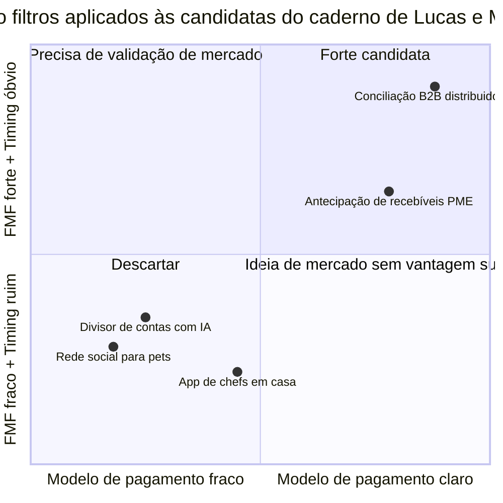

O primeiro dos quatro filtros (FMF, timing, defensibilidade e modelo de pagamento) é o *founder-market fit* (FMF). Para cada candidata, responda em uma frase direta: *por que nós temos vantagem legítima para resolver este problema específico?* Se a resposta sincera for que qualquer outro time partiria exatamente do mesmo ponto, a candidata perde prioridade. Essa vantagem pode vir de domínio técnico, vivência operacional no setor, acesso direto aos compradores ou credibilidade acumulada.

O segundo filtro é o momento de mercado (*timing*). *O que mudou recentemente que torna esta ideia viável agora, e que daqui a cinco anos fará com que pareça óbvia?* A mudança pode ser tecnológica (IA acessível, infraestrutura em nuvem barata), regulatória (LGPD, Reforma Tributária, Open Finance), comportamental (digitalização de serviços em cidades médias, trabalho remoto) ou macroeconômica (juros altos que favorecem soluções de eficiência de caixa, câmbio que viabiliza exportação). Se você não consegue responder "por que agora?", a ideia chegou cedo demais ou tarde demais.

O terceiro filtro é a defensibilidade (*moat*). *Se esta ideia funcionar, o que impede um grande banco, o Mercado Livre, a TOTVS ou o próprio fornecedor do modelo de IA (OpenAI, Google, Anthropic) de lançar esse recurso em seis meses e engolir sua oferta?* Quando a candidata usa inteligência artificial, responda também: *se a próxima geração do modelo básico fizer isso sozinha num comando gratuito, o que sobra do meu negócio?* As defesas que sobrevivem ao longo do tempo combinam dados proprietários que melhoram com o uso, integração profunda no fluxo diário do cliente (elevando o custo de troca, ou *switching cost*), conformidade regulatória local, efeitos de rede (*network effects*, em que cada novo participante aumenta o valor para os demais), economias de escala, propriedade intelectual e canais próprios de distribuição. Uma ideia sem resposta honesta para este filtro depende de subsídio contínuo de capital até tentar construir alguma barreira.

O quarto filtro é o modelo de pagamento real. *Quem paga, quanto e por que volta a pagar todo mês?* Importa o modelo que você consegue explicar hoje em três frases diretas, e não uma promessa vaga para daqui a três anos. Ideias voltadas ao consumidor final (B2C) apoiadas na premissa de "crescer de graça e monetizar depois com publicidade" concentram alta mortalidade nos primeiros dois anos. Em negócios entre empresas (B2B), a conta costuma ser mais transparente: o cliente paga uma assinatura porque o sistema economiza horas de folha, reduz perdas financeiras ou destrava receita mensurável. Escreva o mecanismo de cobrança por extenso. Se você ainda não consegue colocá-lo em três frases, pare e desenhe a conta antes de avançar.

Ao final dos quatro filtros, restam de três a cinco candidatas na Lista Curta. Veja como Lucas e Marina aplicaram a peneira ao caderno de Pinheiros: a rede social para tutores de animais caiu no Filtro 4 (sem pagador recorrente claro), o divisor de contas de bar com IA caiu no Filtro 3 (qualquer modelo gratuito ou carteira digital resolve sem barreira de defesa) e o aplicativo para contratar chefs em casa caiu no Filtro 1 (zero vivência da dupla no setor gastronômico). Já a automação de conciliação de boletos e recebíveis para distribuidoras médias passou nos quatro critérios (somando os cinco anos de Lucas em crédito bancário, os sete anos de Marina em integrações de ERPs, o momento do Open Finance e do Pix e uma dor mensal clara), além de passar no teste da *cegueira ao trabalho árduo* (*Schlep Blindness*, de Paul Graham) por atacar uma rotina ingrata que quase todo fundador evita. Escolha a candidata vencedora para levar à [[#FASE 2: ARTICULAÇÃO E CAPTURA DA IDEIA|Fase 2]] e guarde as outras duas finalistas na Lista Curta caso a primeira seja invalidada em campo.

> [!tip] Canvases Visuais: Canvases e Mapas Visuais de Modelo
> Após escolher a candidata vencedora, use o Lean Canvas para estruturar visualmente o modelo em nove blocos antes de avançar para a Fase 2. Ele força a resumir Problema, Segmentos de Clientes, Vantagem Injusta e Fontes de Receita em uma única folha, preparando o terreno para a Declaração Inicial da Ideia. O quadro passo a passo, o exemplo reconstruído do QuintoAndar (2015) e as armadilhas de preenchimento estão em [[#Canvas: Lean Canvas (Ash Maurya, 2012)|Canvas: Lean Canvas (Ash Maurya, 2012)]].

### Cinco dias para fechar a Lista Curta (após duas semanas de Diário de Fricções)

Para quem quer método concreto, esta é uma sequência de cinco dias úteis que aplica os métodos acima em dose intensiva. Cada dia tem um foco específico. Não precisa ser feito em cinco dias consecutivos. Pode ser cinco sábados. Mas espaçamento maior do que isso faz você perder o fio.

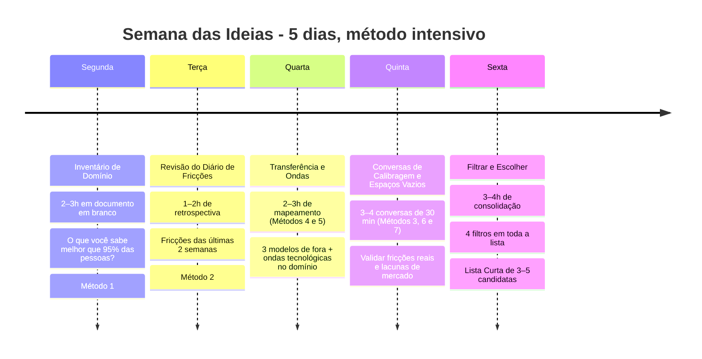

Segunda-feira, Inventário de Domínio (Método 1), duas a três horas. Concentre-se nas perguntas sobre seu repertório profissional e as ineficiências que você viu por dentro no setor. Escreva sem filtrar e, ao final, sublinhe de cinco a dez gargalos mais promissores.

Terça-feira, Revisão do Diário de Fricções (Método 2), uma a duas horas. Aplique os dois critérios de corte (frequência combinada à generalização e disposição real a pagar) sobre as fricções anotadas nas últimas duas semanas. Se ainda não tinha um diário aberto, reconstrua agora os principais atritos do último trimestre.

Quarta, Transferência entre Setores e Ondas Tecnológicas (Métodos 4 e 5), duas a três horas. Escolha três modelos que já funcionam em outros países ou setores (assinatura de produtos físicos, marketplace B2B, dados como serviço vertical ou SaaS para profissão regulamentada) e cruze-os com as ondas tecnológicas e regulatórias em curso no seu domínio (IA generativa, Open Finance, Pix Automático, Reforma Tributária). Para cada cruzamento, desenhe três variações de aplicação no Brasil.

Quinta-feira, Conversas de Calibragem e Espaços Vazios (Métodos 3, 6 e 7), três a quatro conversas de trinta minutos. Converse com três a quatro profissionais do setor-alvo e feche com a pergunta-chave: *qual é a tarefa mais ineficiente que você executa toda semana e que nenhuma ferramenta resolve direito?* Ouça onde moram as planilhas paralelas (cunha de entrada, Método 6) e quais faixas de clientes continuam mal atendidas (espaços vazios, Método 7).

Sexta-feira, Filtrar e Escolher, três a quatro horas. Reúna todas as hipóteses levantadas até formar sua lista bruta de 20 a 30 candidatas e aplique os quatro filtros em ordem, descartando sem apego. Ao fim do bloco, feche a Lista Curta de três a cinco sobreviventes, escolha a número um para levar à [[#FASE 2: ARTICULAÇÃO E CAPTURA DA IDEIA|Fase 2]] e resuma-a em duas frases: *o problema é X para o comprador Y, e a solução inicial é Z*.

Se a semana produziu boas finalistas mas você ainda hesita entre duas delas, marque uma conversa de sessenta minutos com seu sócio, mentor ou colega de confiança e leve as três candidatas da Lista Curta. Explicar os argumentos em voz alta para um interlocutor experiente destrava a escolha.

### Nove armadilhas na geração e escolha de ideias

> [!note] Diagnóstico de vieses no Capítulo 3 (Armadilhas Mentais e Vieses)
> Os erros listados abaixo têm raízes em vieses cognitivos documentados: FOMO de setor, ancoragem na primeira ideia, excesso de confiança. O [[#CAPÍTULO 3: ARMADILHAS MENTAIS E VIESES|Capítulo 3 (Armadilhas Mentais e Vieses)]] oferece diagnóstico e contra-medidas para cada viés, útil para revisar antes de aplicar os quatro filtros finais desta fase.

Primeira-ideia-por-cansaço. Você passa três ou quatro semanas na Fase 1 sem clareza e decide "vai ser essa mesmo" por fadiga decisória. A pressa de começar cobra um preço alto em tempo e caixa: uma ideia mal escolhida consome anos. Se a Fase 1 passar de oito semanas sem decisão, leve as três finalistas para um conselheiro ou mentor e destrave a escolha com método, nunca por exaustão.

Moda de setor quente (*FOMO* setorial). "IA está explodindo, vou fazer algo de IA." "Cripto voltou ao noticiário, vou abrir algo em cripto." Setor aquecido é apenas pano de fundo. Uma ideia de negócio só existe quando você aponta qual dor concreta resolve dentro dele e quem assina o pagamento. Se você não consegue explicar qual gargalo específico ataca no setor, qual comprador paga a conta e por que o seu time tem vantagem para vencê-lo, colar no jargão da moda vira apenas distração.

Ideia-gigante-de-plataforma. "Vou criar o novo Mercado Livre, o novo Nubank, a plataforma que resolve tudo no setor X." Projetos que tentam nascer como plataforma completa raramente saem do chão. Quase todas as plataformas vencedoras começaram como uma ferramenta estreita para uma dor aguda. É por isso que o Método 6 (cunha de entrada) precede qualquer expansão.

"Uber for X" genérico. Veja a discussão no método 4. O modelo Uber funciona por razões específicas. Aplicar a mecânica sem entender o porquê produz startup fraca.

Educar o mercado do zero. "Minha ideia é disruptiva, vou ensinar o cliente a querer isso." Possível em tese. Raro na prática. Educar mercado é caríssimo. Você queima capital enquanto os primeiros poucos clientes entendem. A maioria das startups morre antes. Ideias que pegam grande onda comportamental já em curso, e não criam a onda do zero, têm probabilidade muito maior.

Hobby pessoal confundido com demanda de mercado. Você ama café especial, quer abrir a melhor torrefação do Brasil. Mas quantos consumidores recorrentes na sua região pagam três vezes o preço do café de supermercado por um pacote de 250 gramas todo mês? Hobby vira negócio com dificuldade. E só quando a paixão encontra um segmento com disposição a pagar. Não assuma que porque você ama, outros vão amar a ponto de pagar premium.

Cópia dos EUA sem entender contexto brasileiro. "Esse modelo explodiu nos EUA, vai explodir aqui." A adaptação brasileira exige entender poder de compra de classe C diferente do consumidor americano médio, regulação (ANVISA, ANATEL, CVM, BCB) que pode travar modelos inteiros, hábitos financeiros locais (uso massivo do Pix, preferência por parcelamento sem juros no cartão e resistência a cobranças anuais antecipadas), e infraestrutura (logística, bancarização, cobertura celular). Pode ser que o modelo precise ser completamente reengenheirado para funcionar aqui.

> [!note] O consumidor brasileiro tem lógica própria que invalida transplantes diretos de modelos estrangeiros
> O [[IGNICAO-Vol-2-Descoberta-e-Mercado#CAPÍTULO 1: PSICOLOGIA DO CONSUMIDOR BRASILEIRO: COMPORTAMENTO, DECISÃO E CONVERSÃO|Capítulo 1 (Psicologia do Consumidor Brasileiro: Comportamento, Decisão e Conversão) do Volume 2]] analisa o comportamento *mobile-first*, a dinâmica de orçamento das classes C e D e os hábitos locais de pagamento. Leia antes de filtrar candidatas que dependem de premissas sobre o consumidor brasileiro.

Achismo sem conversa de campo. Você passa quatro semanas trancado na própria cabeça sem ouvir ninguém do setor da ideia. Entrevista de descoberta com cliente é trabalho da Fase 4 (Vol. 2). Aqui na Fase 1 bastam conversas curtas de calibragem, como as três conversas da quinta-feira previstas no exercício e no checklist desta fase, para descartar fantasias cedo.

Múltiplas ideias simultâneas: levantar de 20 a 30 candidatas em paralelo na Fase 1 é saudável desde que você agrupe variações semelhantes antes de aplicar os quatro filtros. A partir da [[#FASE 2: ARTICULAÇÃO E CAPTURA DA IDEIA|Fase 2]], porém, dividir o foco entre duas teses paralelas trava a execução: escolha uma titular e guarde as demais na Lista Curta.

### Sua Lista Curta de Sobreviventes (3 a 5 apostas ranqueadas)

A Lista Curta de Ideias é um documento de duas a quatro páginas com quatro partes.

A primeira parte é o processo seguido, em uma página. Quais métodos você aplicou, quantas candidatas gerou ao todo, quantas sobreviveram a cada filtro.

A segunda é a lista final, em uma a duas páginas. Três a cinco candidatas, cada uma descrita em três a cinco frases, com respostas breves aos quatro filtros. Por que eu, por que agora, moat, modelo de pagamento.

A terceira é a escolha com justificativa, em um parágrafo. Qual candidata você vai levar à [[#FASE 2: ARTICULAÇÃO E CAPTURA DA IDEIA|Fase 2]], e por quê.

A quarta é o plano B e C, em meia página. Quais das outras finalistas você levaria em segundo e terceiro lugar, caso a primeira caia em fase subsequente.

Guarde esse documento. Mesmo depois de iniciar a [[#FASE 2: ARTICULAÇÃO E CAPTURA DA IDEIA|Fase 2]], se em algum momento a ideia escolhida cair, você volta aqui. Não precisa refazer a Fase 1 inteira. E em dois ou três anos, quando a sua primeira empresa estiver em algum estágio e você estiver pensando em segunda curva ou próxima empresa, vai reler este documento com ganho significativo de perspectiva.

### A catraca de passagem para a Fase 2

> [!tip] Decisão de passagem e método experimental (Capítulos 1 e 2 do Volume 3)
> O critério de saída desta fase funciona como uma catraca de passagem (*gate*): avançar ou voltar à prancheta. O [[IGNICAO-Vol-3-Experimentos-e-Prototipagem#CAPÍTULO 1: ABORDAGEM CIENTÍFICA vs LEAN STARTUP: QUANDO USAR CADA UMA|Capítulo 1 (Abordagem Científica vs Lean Startup: Quando Usar Cada Uma) do Volume 3]] e o [[IGNICAO-Vol-3-Experimentos-e-Prototipagem#CAPÍTULO 2: MATURIDADE (TRL/CRL), OS DEZ PORTÕES (TEN GATES) E PRÓXIMO PASSO COMPROMETIDO|Capítulo 2 (Maturidade (TRL/CRL), Decisão por Gates e Fechamento de Fase (Committed Next Move)) do Volume 3]] detalham como substituir o entusiasmo subjetivo por evidências falsificáveis em cada passagem de fase.

A passagem da geração de ideias para a escrita da Declaração Inicial da Ideia exige que sua Lista Curta tenha sido construída como conjunto de hipóteses falsificáveis (conforme a distinção apresentada no [[IGNICAO-Vol-3-Experimentos-e-Prototipagem#CAPÍTULO 1: ABORDAGEM CIENTÍFICA vs LEAN STARTUP: QUANDO USAR CADA UMA|Capítulo 1 (Abordagem Científica vs Lean Startup: Quando Usar Cada Uma) do Volume 3]]), e não como um plano de negócios fechado.
Use os critérios objetivos abaixo para auditar seu trabalho antes de abrir o documento da Fase 2.

Antes de avançar para a [[#FASE 2: ARTICULAÇÃO E CAPTURA DA IDEIA|Fase 2]], passe pela catraca de saída abaixo:

- [ ] Apliquei pelo menos quatro dos sete métodos de geração de ideias.
- [ ] Gerei entre 20 e 30 candidatas brutas antes de iniciar a triagem (e não apenas três ou cinco ideias soltas).
- [ ] Apliquei os quatro filtros em ordem, com resposta honesta a cada um.
- [ ] Tenho três a cinco candidatas finais escritas em três a cinco frases cada.
- [ ] Escolhi uma para levar à [[#FASE 2: ARTICULAÇÃO E CAPTURA DA IDEIA|Fase 2]], com justificativa escrita.
- [ ] Tenho candidatas B e C como fallback documentadas.
- [ ] Conversei com pelo menos três pessoas fora da minha bolha durante a semana de geração para calibrar dores reais de outros setores, sem tentar vender solução. Não para confirmar a solução. Para testar se o problema faz sentido.
- [ ] A ideia escolhida tem resposta clara e honesta para *por que eu, por que agora, onde está o moat, quem paga quanto por quê*.
- [ ] Não escolhi por cansaço ou FOMO. Escolhi por convicção relativa às outras candidatas.

> [!warning] Critério de saída
> Se faltou substância na lista, volte um passo. O custo de refazer um método na Fase 1 é de poucos dias. O custo de avançar com uma ideia mal filtrada se mede em meses de engenharia e caixa desperdiçados.

### Como auditar o rigor da sua triagem antes de avançar

Volume de hipóteses avaliadas. Gerar menos de 20 candidatas indica que você parou nas ideias mais óbvias da superfície. Passar de 40 itens costuma refletir variações repetidas da mesma tese, que devem ser agrupadas antes dos quatro filtros.

Diversidade de métodos usados: aplicar apenas um ou dois métodos costuma produzir candidatas enviesadas para o repertório habitual do fundador, ao passo que combinar de quatro a sete métodos diferentes amplia a variedade das fontes.

Tempo gasto. Entre duas e oito semanas é a janela típica. Muito menos que isso indica decisão precipitada. Muito mais indica paralisia.

Clareza da escolha final. Você consegue escrever em duas frases, sem hesitação, quem é o cliente e qual é o problema? Se não consegue, ainda não tem ideia. Tem intuição.

---

### O Espelho da Fase 1 e o Ritual Semanal de Garimpagem

Em São Paulo, quando Lucas e Marina fecharam a sexta-feira da semana intensiva com 24 fricções mapeadas e passaram o caderno pelas três perguntas abaixo, viram que apenas a conciliação de boletos e recebíveis para distribuidoras médias combinava perda financeira mensal comprovada nos clientes, acesso direto a diretores financeiros da rede de Marina e vantagem técnica de integração com ERPs.

> [!tip] O Espelho do Garimpeiro: Teste Rápido da Lista Curta
> Olhe para a ideia favorita que você tem hoje na cabeça e faça três perguntas:
> 1. **Dor com orçamento ou ideia de vitrine?** Olhando para as candidatas da sua Lista Curta (como fez Lucas ao reler seu caderno), em quais delas o futuro cliente já desembolsa orçamento ou perde horas de trabalho toda semana para tentar resolver isso hoje, ou você terá que "educá-lo" de que o problema existe?
> 2. **Direito de Vencer (*Founder-Market Fit*): Por que você**, e não outras quinhentas pessoas inteligentes com ChatGPT, tem acesso privilegiado, vivência de trincheira ou conhecimento técnico nesse problema?
> 3. **O Funil de 20 a 30 Candidatas:** Olhando para a sua planilha de triagem, quantas candidatas vieram de uma dor concreta observada de perto, quantas passaram no Filtro 4 com hipótese de preço escrita e por que a vencedora superou as outras 19 a 29 alternativas?
>
> **Sua permissão:** Você tem permissão para construir um negócio em um setor "sem glamour" (reconciliação fiscal, manutenção de frotas, gestão de resíduos, agendamento de clínicas). O tédio do setor é o melhor protetor da sua margem.
>
> **Ritual de Segunda-Feira (30 minutos):** Durante as duas primeiras semanas da Fase 1, reserve toda segunda-feira, das 9h às 9h30, para registrar no seu Diário de Fricções ao menos cinco gargalos operacionais observados na rotina do setor. Na sexta-feira da semana intensiva, reserve um bloco de três a quatro horas para passar suas 20 a 30 candidatas pelos 4 Filtros e fechar a Lista Curta.

### Quadro consolidado de métricas e referências da Fase 1

| Métrica | O que medir | Referência saudável |
|---|---|---|
| Candidatas brutas geradas | Total de ideias levantadas antes da filtragem | 20 a 30 candidatas (agrupando variações repetidas) |
| Diversidade de métodos e filtros | Métodos de geração (mín. 4 de 7) e 4 filtros em ordem | 4+ métodos usados e 4 filtros aplicados a todas |
| Cegueira ao trabalho chato (*schlep blindness*) | Você sabe explicar por que outros fundadores evitam esse problema trabalhoso? | Sim |
| Janela de execução e clareza | Tempo total na Fase 1 e resumo do problema/comprador | 2 a 8 semanas, tese escolhida explicada em 2 frases |

---

### MANUAL PASSO A PASSO DOS FRAMEWORKS DESTA FASE 1

> [!tip] Aplicação direta na geração e filtragem de ideias
> Os quatro frameworks abaixo estão adaptados para uso imediato nesta Fase 1: como usar a grade ERRC (Oceano Azul) para diferenciar uma candidata no Método 7, como usar os Três Horizontes para separar a cunha inicial (H1) da visão de longo prazo (H3) sem tentar construir uma plataforma no dia um, como usar o Mapa de Wardley para avaliar o estágio da onda tecnológica no Método 5 e como aplicar a Inversão de Munger para descartar ideias frágeis antes da Fase 2.

#### Framework: Blue Ocean Strategy (W. Chan Kim & Renée Mauborgne, 2005)

##### De onde vem a ferramenta (e por que sobreviveu ao filtro do tempo)

A Estratégia do Oceano Azul nasceu da pesquisa de W. Chan Kim e Renée Mauborgne no INSEAD, publicada no livro *Blue Ocean Strategy* (2005), após analisarem mais de 150 movimentos estratégicos ao longo de 120 anos em 30 indústrias. Na Fase 1, o **Mapa de Valor (*Strategy Canvas*) e a Grade ERRC (Eliminar, Reduzir, Elevar, Criar)** ajudam a testar se uma candidata levantada no Método 7 (espaços vazios) oferece um salto real de valor para quem hoje não é atendido pelas soluções existentes.

##### A mecânica central (sem jargão)

Framework para **criar espaços de mercado não contestados** em vez de competir em indústrias existentes. Foco em inovação de valor, simultaneamente diferenciar e reduzir custos (rejeita o tradeoff Porter entre diferenciação e custo).

##### As regras do jogo

Red Ocean (mercados existentes):

- Regras competitivas definidas.
- Fronteiras da indústria claras.
- Competir por participação.
- Explorar a demanda existente.
- Escolher entre valor e custo (tradeoff Porter).

Blue Ocean (mercados novos):

- Regras ainda não definidas.
- Fronteiras redesenhadas.
- Crescer criando demanda nova.
- Alcançar quem ainda não é cliente.
- Romper tradeoff valor-custo.

Ferramenta analítica central: a grade ERRC (Eliminar, Reduzir, Elevar, Criar):

- Eliminar (*Eliminate*): quais fatores que a indústria assume como obrigatórios podem ser cortados por completo?
- Reduzir (*Reduce*): quais atributos podem ser simplificados bem abaixo do padrão atual para derrubar o custo?
- Elevar (*Raise*): quais dimensões de entrega precisam subir muito acima do padrão do setor?
- Criar (*Create*): quais elementos de valor inéditos na indústria podem ser introduzidos para atrair não clientes?

O resultado é o **Strategy Canvas**: gráfico que compara seu perfil de valor com concorrentes.

> [!note] Tratamento completo do Strategy Canvas em Canvas: Strategy Canvas (W. Chan Kim & Renée Mauborgne, 2005) (Fase 6)
> Origem, estrutura detalhada, como aplicar passo a passo, caso Stone vs adquirentes tradicionais e erros comuns em [[IGNICAO-Vol-2-Descoberta-e-Mercado#Canvas: Strategy Canvas (W. Chan Kim & Renée Mauborgne, 2005)|Canvas: Strategy Canvas (W. Chan Kim & Renée Mauborgne, 2005) (Vol. 2)]].

##### Execução prática com a equipe

Passo 1: Mapear o setor atual (Strategy Canvas). Listar 8-15 fatores de competição do setor, desenhar curvas de valor dos principais concorrentes.

Passo 2: Identificar os não clientes (*non-customers*) em três camadas: (a) quase clientes (*near-customers*, que usam a oferta atual no limite mínimo por falta de opção), (b) clientes refratários (*refusing customers*, que rejeitam as soluções atuais pelo preço ou complexidade) e (c) clientes inexplorados (*unexplored customers*, que nunca foram mirados pelo setor). Onde está a maior dor negligenciada?

Passo 3: Aplicar o ERRC Grid. Para cada fator de competição, decidir: eliminar, reduzir, elevar ou criar. Esse é o coração da ferramenta.

Passo 4: Testar as três condições de uma boa blue ocean:

- Foco: a nova curva de valor é clara, não tenta ser tudo para todos.
- Divergência: visualmente distinta dos concorrentes.
- Tagline: comunicável em frase curta.

Passo 5: Validar com non-customers. A nova proposta atrai quem não era cliente?

Passo 6: Executar. Blue ocean requer execução precisa, teoria sem execução vira ideia de powerpoint.

##### Exemplo aplicado (original do livro)

Cirque du Soleil:

- Mercado existente (circo tradicional): atacado por TV e Disney, em declínio.
- Movimento Blue Ocean: criar categoria entre circo e teatro.
- ERRC:
- *Eliminar*: estrelas de cachê milionário, espetáculos com animais, vendas de corredor e três picadeiros simultâneos.
- *Reduzir*: humor pastelão de palhaços e números baseados apenas em perigo físico (infantilização do espetáculo).
- *Elevar*: um único palco central com acabamento técnico de teatro.
- *Criar*: enredo temático por espetáculo, ambiente refinado para adultos, música original ao vivo e múltiplas produções em turnê.
Aplicação na Fase 1 aos arquétipos deste volume (Lucas e Marina desenhando a grade ERRC da conciliação para distribuidoras médias):
- *Eliminar* projetos de consultoria de implantação de seis meses e cobrança por licença fixa de ERP, *Reduzir* telas de configuração contábil complexa para uso exclusivo do analista, *Elevar* a velocidade de cruzamento automático entre boletos, Pix e notas fiscais em múltiplos bancos, *Criar* alerta diário de divergência e trava preventiva contra pagamento duplicado em menos de 48 horas de conexão.
- *Resultado na filtragem*: proposta claramente distinta tanto do ERP legado quanto da planilha manual.
- Resultado: preço de ingresso 4-5x maior que circo tradicional, público adulto pagante, crescimento massivo.

Exemplo brasileiro (análise posterior): Nubank.

- Mercado existente (bancos tradicionais): alta tarifa, atendimento ruim, processos burocráticos.
- Grade ERRC:
- *Eliminar*: agências físicas e tarifas de manutenção e anuidade.
- *Reduzir*: papelada e burocracia na abertura de conta e emissão do cartão.
- *Elevar*: controle pelo aplicativo, transparência nas faturas e qualidade do atendimento.
- *Criar*: experiência 100% digital e cartão roxo como símbolo de recomendação espontânea.
- Resultado: criação de uma nova categoria de serviços financeiros digitais no país, superando 100 milhões de clientes na América Latina a partir de 2024.

##### Onde o papel aceita tudo (armadilhas de execução)

Três erros arruínam o uso da grade ERRC nesta fase: (1) pular o diagnóstico do mercado atual e chamar qualquer ideia nova de "oceano azul" sem estudar por que os não clientes rejeitam as ofertas existentes, (2) preencher apenas a metade agradável da grade (elevar atributos e criar novidades) sem eliminar nem reduzir fatores de custo da indústria, o que inviabiliza a margem unitária, e (3) esquecer que toda inovação de valor atrai imitadores em poucos anos, exigindo construir barreiras de defesa (Filtro 3 desta fase) enquanto a janela está aberta.

---

#### Framework: Três Horizontes / Three Horizons aplicado ao recorte da cunha inicial (McKinsey, 1999)

##### De onde vem a ferramenta (e por que sobreviveu ao filtro do tempo)

Desenvolvido pela McKinsey no fim dos anos 1990 e publicado em *The Alchemy of Growth* (Mehrdad Baghai, Stephen Coley e David White, 1999) para ajudar empresas estabelecidas a crescer sem estagnar no produto principal (aplicação retomada na Fase 19, no Volume 9). Na Fase 1, porém, o modelo cumpre uma função cirúrgica para quem ainda não abriu a empresa: vacinar o fundador contra a armadilha da "ideia-gigante-de-plataforma", separando no papel o que é a cunha inicial dos próximos 12 meses (Horizonte 1), o que fica para os anos 2 e 3 (Horizonte 2) e o que é visão de longo prazo para o ano 5 (Horizonte 3).

##### A mecânica central (sem jargão)

Framework que organiza iniciativas de crescimento em três horizontes temporais, exigindo que empresa gerencie os três simultaneamente:

##### As regras do jogo

Horizonte 1, construir e defender o negócio principal (*core business*): na largada de uma startup, corresponde à sua cunha de entrada estreita (Método 6), capaz de gerar receita e aprendizado nos primeiros 6 a 18 meses. Mesmo em empresas maduras (que segundo a regra prática de Bansi Nagji e Geoff Tuff na *Harvard Business Review*, 2012, alocam 70% dos recursos no H1, 20% no H2 e 10% no H3), o Horizonte 1 é o que paga a conta. Na Fase 1, ele deve receber 100% da sua execução imediata.

Horizonte 2, expandir para adjacências (*emerging businesses*): módulos complementares ou segmentos vizinhos que você só atacará entre os anos 2 e 4, depois que a cunha inicial tiver tração comprovada.

Horizonte 3, semear opções de futuro (*viable options*): a visão ambiciosa de plataforma ou mudança de categoria para daqui a 5 anos, que serve de norte estratégico na Lista Curta mas fica guardada na gaveta até o Horizonte 1 parar de pé.

Metáfora da alquimia: H1 gera caixa que financia H2. H2 cresce e alguns viram novos cores. H3 explora futuro.

##### Execução prática com a equipe

Passo 1: Defina o core atual com precisão. H1 só é claro quando sabemos o que é "core" vs. adjacência.

Passo 2: Mapeie iniciativas atuais em horizontes. Cada projeto, produto ou investimento vai para H1, H2 ou H3.

Passo 3: Teste balanceamento. Muito H1 = futuro comprometido. Muito H3 = caixa hoje comprometido. Empresa saudável tem distribuição adequada ao estágio.

Passo 4: Separe métricas por horizonte. H1 mede performance (receita, margem). H2 mede crescimento e tração (adoção, engagement). H3 mede aprendizado (hipóteses testadas, opções viáveis).

Passo 5: Governance distinta por horizonte. H1 em comitê operacional. H3 frequentemente em entidade separada (skunkworks, corporate venture) para proteger de lógica de core.

Passo 6: Revise anualmente. Horizontes evoluem: H3 pode virar H2. H2 pode virar novo H1.

##### Na trincheira real: como isso funciona na prática

Como Lucas e Marina usaram os Três Horizontes na Fase 1 para não tentar construir uma plataforma financeira completa no primeiro dia:

- **Horizonte 1 (foco de 100% da execução nos primeiros 12 a 18 meses):** conector enxuto de conciliação automática de boletos, Pix e notas fiscais para distribuidoras médias brasileiras. Cobrança por assinatura mensal direta.

- **Horizonte 2 (guardar para os anos 2 a 3, após o PMF):** régua automatizada de cobrança de inadimplentes e módulo de previsão de fluxo de caixa integrado aos bancos das distribuidoras.

- **Horizonte 3 (visão de longo prazo para o ano 4 em diante):** motor próprio de escoragem de risco e antecipação de recebíveis B2B baseado no histórico transacional acumulado na plataforma.

##### Onde o papel aceita tudo (armadilhas de execução)

As armadilhas mais comuns na gestão dos três horizontes concentram-se em quatro falhas: focar 100% dos recursos em H1, gerando rentabilidade de curto prazo seguida de estagnação quando o produto principal amadurece. Cobrar de apostas exploratórias (H3) os mesmos indicadores de retorno imediato exigidos da operação madura (H1), sufocando a experimentação. Deixar times de H2 e H3 sem proteção executiva do CEO diante das urgências diárias do *core business*, e reduzir o H3 a "teatro de inovação" (hackathons e laboratórios sem orçamento nem mandato de execução), tratando a proporção 70/20/10 como dogma fixo em vez de calibrá-la pelo estágio da empresa.

---

#### Framework: Mapa de Wardley / Wardley Mapping aplicado ao timing da Fase 1 (Simon Wardley, 2005)

##### De onde vem a ferramenta (e por que sobreviveu ao filtro do tempo)

Simon Wardley, então executivo da empresa britânica de comércio eletrônico Fotango, desenvolveu o mapeamento em 2005 após concluir que ferramentas estáticas (como matriz SWOT e Cinco Forças) não mostravam como os componentes de tecnologia evoluíam no tempo. O Mapa de Wardley cruza a visibilidade para o usuário (eixo Y, da necessidade visível no topo até a infraestrutura invisível na base) com o estágio de evolução do componente (eixo X, da gênese à *commodity*). Fora do setor privado, o governo britânico (*UK Cabinet Office* e *Government Digital Service*) utilizou os mapas para comparar projetos de tecnologia entre ministérios e eliminar contratações duplicadas. Wardley publica todo o material sob licença aberta Creative Commons, inclusive o livro de referência (o canvas visual completo para gestão de portfólio em escala está na Fase 19, no Volume 9).

##### A mecânica central (sem jargão)

Ferramenta visual para mapear cadeia de valor de negócio contra **evolução tecnológica**. Permite ver: onde investir custom vs. onde usar commodity, onde há oportunidade disruptiva, onde temos vantagem vs. onde é ilusão.

##### As regras do jogo

Eixo X, Estágios de evolução (da esquerda para direita):

1. Gênese (*Genesis*): componente novo, incerto e raro, ainda em fase de pesquisa e exploração.
2. Construído sob medida (*Custom-built*): solução desenvolvida de forma artesanal para um caso específico, ainda sem pacote padronizado.
3. Produto (*Product + rental*): software ou equipamento maduro de prateleira, que compete por funcionalidades e facilidade de uso.
4. Utilidade padronizada (*Commodity + utility*): infraestrutura indiferenciada cobrada por volume de uso (energia elétrica, nuvem básica, processamento de pagamento padrão).

Eixo Y, Visibilidade ao usuário: no topo, componentes que o usuário vê direto (UX), embaixo, componentes de infraestrutura invisíveis.

**Componentes são colocados no mapa** e linhas de dependência entre eles são desenhadas. Resultado: imagem clara de onde empresa investe valor custom vs. commodity.

##### Doutrinas (princípios derivados do mapping)

- Foque em necessidades do usuário.
- Use mapas apropriados para contextar.
- Remova duplicação e bias.
- Use componentes commoditizados quando disponíveis.
- Use Genesis/Custom quando quer diferenciar.
- Pense sobre movimentos de concorrentes e ambiente.

##### Protocolo prático de execução

Passo 1: Identifique o usuário e a necessidade. Topo do mapa sempre começa com usuário e JTBD.

Passo 2: Desça a cadeia de valor. Que componentes são necessários para entregar valor ao usuário? Produtos, dados, infraestrutura, habilidades.

Passo 3: Classifique cada componente no eixo de evolução. É genesis (ainda novo), custom-built (único para nós), product (comprável), ou commodity (utility)?

Passo 4: Analise movimentos. Componentes evoluem da esquerda para direita ao longo do tempo. O que é custom-built hoje será commodity em 5 anos. Planejar essa evolução.

Passo 5: Identifique onde investir custom vs. commodity. Regra: investir pesado em componentes custom quando criam diferenciação, comoditizar tudo mais. Amazon faz isso no extremo (AWS é monetização da comoditização de componentes internos).

Passo 6: Jogue cenários. E se concorrente comoditizar nosso componente custom? E se nova tecnologia acelerar evolução? Wardley usa "climatic patterns", forças inevitáveis de evolução.

##### Na trincheira real: como isso funciona na prática

Startup de e-commerce para artistas (produtor físico + loja online):

Topo (usuário): artista que quer vender produtos customizados.

Descendo a cadeia:

- Loja online customizada (custom-built → product): Shopify resolve isso bem. Commoditizar via Shopify.
- Integração com produção sob demanda (custom-built): nossa diferenciação, na qual vale investir.
- Marketplace de produção (fornecedores) (genesis-to-custom): único aspecto novo, próprio.
- Pagamento (commodity): usar Stripe/Pagar.me, não construir.
- Infraestrutura cloud (commodity): usar AWS/GCP.
- Logística (product): terceirizar com Loggi/Correios.

Conclusão estratégica: investir pesado em marketplace de produção, usar componentes comoditizados em tudo mais. Competir em nosso diferencial, não em logística ou pagamento.

##### Onde o papel aceita tudo (armadilhas de execução)

Três erros práticos esvaziam a utilidade do Wardley Mapping: construir internamente (*custom-built*) componentes que já viraram *commodity* de prateleira no mercado. Ignorar a seta de evolução tecnológica, mantendo código proprietário caro anos depois de o setor ter padronizado a função, e tratar o mapa como peça decorativa estática, sem revisá-lo a cada 6 a 12 meses nem conectá-lo a decisões concretas de alocação de engenharia e capital.

---

#### Framework: Inversão / Inversion aplicada à filtragem de ideias (Carl Jacobi, Charlie Munger, aplicado na Fase 1)

##### De onde vem a ferramenta (e por que sobreviveu ao filtro do tempo)

Inversion tem origem na matemática, Carl Gustav Jacobi (séc. XIX) era famoso pelo princípio "man muss immer umkehren" ("sempre inverter"). Charlie Munger (1924-2023), que por décadas foi sócio de Warren Buffett e vice-presidente da Berkshire Hathaway, popularizou a regra na tomada de decisão empresarial: "Inverta, sempre inverta. Vire a situação ou o problema de cabeça para baixo". Munger: "Invert, always invert. Turn a situation or problem upside down."

##### A mecânica central (sem jargão)

Método de **pensar em reverso**: em vez de perguntar "como atingir sucesso?", perguntar "como evitar falha?". Na escolha de ideias, esse exercício costuma render mais do que o otimismo linear, porque mapear e eliminar causas óbvias de fracasso é muito mais tratável do que adivinhar de primeira a rota vencedora.

##### As regras do jogo

Dois modos:

1. Forward thinking: "como construir empresa de sucesso?" Resposta: vaga, muitos caminhos.
2. Inversion: "como falhar como empresa?" Resposta: concreta, sem PMF, sem unit economics, sem runway, cofundadores em conflito. Lista de evitações é concreta.

##### Passos práticos de implantação

Passo 1: Formule a pergunta original.

Passo 2: Inverta: "como garantir que falhamos em X?"

Passo 3: Liste armadilhas, sejam generosos (10-20 itens).

Passo 4: Para cada armadilha, desenhe prevenção.

Passo 5: Compare inversion com forward thinking original. Frequentemente revela riscos esquecidos.

##### Na trincheira real: como isso funciona na prática

"Como garantir que meu software para escritórios de contabilidade fracasse nos primeiros doze meses?" (Respostas da inversão: tentar vender em março e abril durante o pico do Imposto de Renda, exigir migração manual de histórico fiscal, cobrar implantação cara adiantada e ignorar que o sócio do escritório não troca de sistema sem aval do time operacional.)

Aplicação por Lucas e Marina na Fase 1: "Como garantir que qualquer candidata B2B da nossa Lista Curta fracasse antes de fechar o quinto cliente?"

- Escolher uma ideia que exija seis meses de integração personalizada com o TI da empresa antes de mostrar o primeiro centavo recuperado.
- Depender da aprovação de três diretorias diferentes para rodar um teste piloto de trinta dias.
- Atacar um problema que acontece apenas uma vez por ano (como fechamento de balanço anual) em vez de uma dor diária ou semanal.
- Tentar substituir o ERP inteiro da distribuidora em vez de conectar-se aos relatórios que o analista financeiro já exporta.
- Escolher um segmento pulverizado de microempresas com tíquete mensal de R$ 49 que não paga o custo de uma ligação comercial.
- Depender de dados bancários que o cliente se recusa a compartilhar por receio jurídico ou fiscal.
- Prometer um algoritmo de IA "caixa-preta" sem permitir que o diretor financeiro audite de onde saiu cada centavo conciliado.
- Entrar num nicho onde o próprio banco já oferece a conciliação gratuitamente dentro da conta PJ.
- Construir painel visual complexo antes de provar a conciliação em planilha real com três empresas.
- Ignorar o trabalho manual de cadastro de clientes que trava a adoção na primeira semana.

Prevenção aplicada aos quatro filtros: descartar qualquer candidata da Lista Curta que caia em três ou mais dessas armadilhas estruturais.

##### Onde o papel aceita tudo (armadilhas de execução)

Ao aplicar a inversão (*inversion*), evite três desvios frequentes: confundir o método com pessimismo paralisante (o objetivo é mapear pontos de falha evitáveis, não desistir de agir). Usar a inversão isoladamente sem combiná-la à construção positiva de valor (*forward thinking*), e preencher o exercício com alertas vagos ("evitar má gestão") em vez de travas operacionais verificáveis ("não manter profissional tóxico mesmo que bata meta").

---

### CANVASES VISUAIS DESTA FASE 1 (COM EXEMPLOS BRASILEIROS PREENCHIDOS)

> **Escopo desta Fase 1:** Nesta Fase 1, o Lean Canvas serve apenas para estruturar em uma página a candidata escolhida na Lista Curta antes de avançar para a escrita da Declaração Inicial da Ideia na Fase 2. A validação empírica com experimentos de rua e critérios de invalidação está detalhada no Volume 3.

#### Canvas: Lean Canvas (Ash Maurya, 2012)

##### Por que este quadro visual foi criado

Ash Maurya criou o Lean Canvas em 2010-2012 como adaptação do Business Model Canvas especificamente para startups em estágio inicial, e documentou a ferramenta no livro *Running Lean* (2012, atualizado em 2022 para a 3ª edição). Maurya era fundador serial que aplicou Lean Startup nas próprias empresas e percebeu que o BMC original, desenhado para empresas estabelecidas, não priorizava adequadamente os elementos decisivos para quem ainda não tem modelo validado: o problema, a solução, as métricas que provam tração, e a vantagem que sustenta a empresa quando o concorrente acordar. O Lean Canvas substituiu quatro dos nove blocos do BMC para capturar melhor a realidade pré-PMF.

##### A anatomia visual de uma página

Tela visual de uma página com nove blocos, inspirada no BMC mas com quatro substituições decisivas: Parcerias-Chave vira Problema, Atividades-Chave vira Solução, Recursos-Chave vira Métricas-Chave, Relacionamento com Clientes vira Vantagem Injusta. Os outros cinco blocos permanecem (Segmentos, Proposta Única de Valor, Canais, Estrutura de Custos, Fontes de Receita).

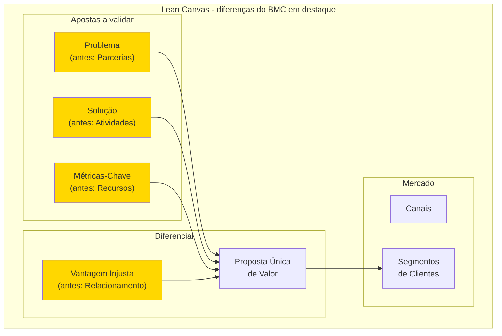

A filosofia subjacente é: startup pré-PMF não tem parcerias estabelecidas (vai construir), não tem atividades-chave definidas (vai descobrir), não tem recursos consolidados (tem capital limitado e tempo) e não tem relacionamento com clientes (não tem clientes ainda). O que tem é hipótese de problema, hipótese de solução, hipótese de métrica e hipótese de vantagem competitiva. O Lean Canvas mapeia exatamente essas hipóteses.

##### O momento exato de colocar este canvas na parede

Use o Lean Canvas da Fase 1 (escolha da ideia) até a Fase 13 (ajuste ao mercado, no Volume 4), revisando o quadro a cada duas a quatro semanas conforme novos experimentos forem concluídos. Nas Fases 2 e 3, o Business Model Canvas (apresentado na Fase 2) entra apenas como lente complementar para checar a engrenagem interna da operação (parcerias, atividades e recursos-chave), tornando-se a ferramenta principal depois que o modelo atingir o PMF.

##### As regras de ouro para preencher sem se enganar

A tese de Maurya é que **modelo de negócio em startup é hipótese, não plano**. Cada bloco do Lean Canvas corresponde a uma ou mais hipóteses falsificáveis, e a ordem de preenchimento dos blocos espelha a ordem de risco: o que pode matar a startup mais cedo é preenchido primeiro. Por isso, Problema vem antes de Solução: solução para problema inexistente é o erro mais frequente em startup. Vantagem Injusta vem por último: enquanto a startup é pequena, ainda não tem moat, a Vantagem Injusta é o que ela aposta construir.

##### Passo a passo na parede da sala

Reúna 1-3 pessoas (cofundadores). Use uma folha A1 ou ferramenta digital (Miro, FigJam). Preencha na ordem de risco, que difere do BMC:

1. **Segmentos de Clientes** primeiro (lado direito, topo): quem sofre a dor.
2. **Problema** (lado esquerdo, topo): os 1 a 3 problemas principais do segmento.
3. **Proposta Única de Valor** (centro, topo): uma frase clara de promessa.
4. **Solução** (lado esquerdo): as 3 funcionalidades centrais que resolvem o problema.
5. **Canais** (lado direito): caminhos de aquisição até o segmento.
6. **Fontes de Receita** (lado direito, base): modelo de cobrança.
7. **Estrutura de Custos** (lado esquerdo, base): principais desembolsos da operação.
8. **Métricas-Chave** (lado esquerdo, centro): números operacionais que provam tração.
9. **Vantagem Injusta** (lado direito, centro): ativo, histórico, acesso ou distribuição que concorrentes não conseguem copiar ou comprar facilmente.

Tempo total: 30-60 minutos para o primeiro preenchimento (mais rápido que o BMC porque os blocos são mais específicos). Faça um Lean Canvas por segmento: não force um canvas único para múltiplos segmentos com problemas distintos. Revisar a cada experimento concluído (a cada 2-4 semanas em fases iniciais).

##### Como teria ficado o Lean Canvas do QuintoAndar em 2015 (reconstrução didática com base em dados públicos)

O quadro abaixo sintetiza a proposta original de locação residencial sem fiador e sem caução e a aposta de que o acúmulo de contratos próprios permitiria calibrar o modelo de garantia locatícia:

| Bloco | Conteúdo |
|---|---|
| **Problema** | Alugar apartamento em SP exige fiador, três meses de caução, vistoria agressiva, burocracia de cartório, semanas de sofrimento: para algo que o inquilino só usa 1-2 anos. Para o proprietário: longo período sem renda, risco de inadimplência, complexidade jurídica. |
| **Segmentos de Clientes** | Inquilinos: jovens profissionais classe A/B em SP, primeira ou segunda experiência de aluguel. Proprietários: pessoas físicas com 1-3 imóveis (não imobiliária). |
| **Proposta Única de Valor** | "Alugue em horas, sem fiador e sem caução, 100% online." |
| **Solução** | Plataforma online de aluguel + seguro substituindo fiador + vistoria digital + contrato digital com assinatura remota + pagamento de aluguel automatizado. |
| **Canais** | SEO orgânico (busca de imóveis), parcerias com portais imobiliários, marketing digital (Facebook, Google), indicação boca a boca. |
| **Fontes de Receita** | Taxa de administração sobre aluguel mensal + comissão de corretagem sobre assinatura inicial + (futuro) produtos financeiros adjacentes. |
| **Estrutura de Custos** | Tecnologia e produto + marketing e aquisição + operação de vistorias + sinistros de seguro + equipe de matching. |
| **Métricas-Chave** | Contratos assinados/mês, tempo médio busca → assinatura, NPS, churn de locatários, ticket médio (aluguel médio). |
| **Vantagem Injusta** | Dados proprietários de comportamento de pagamento de locatários: permitem underwriting de seguro próprio. Concorrentes novos precisariam anos para acumular esses dados. |

O quadro mostra como o Lean Canvas força a explicitar a Vantagem Injusta antes mesmo de ela estar pronta: em 2015, o QuintoAndar ainda não detinha uma base histórica ampla de inadimplência locatícia, mas apostava que o volume de contratos assinados sem fiador e sem caução criaria um ativo proprietário de precificação de risco difícil de replicar por imobiliárias tradicionais. Quem preenche esse bloco com frases genéricas como "nosso time é dedicado" ou "usamos tecnologia de ponta" apenas ocupa espaço no papel. A vantagem precisa ser específica, acumulável e verificável.

##### Variações e extensões

- **Customer Forces Canvas** (também de Maurya): aprofunda a teoria de "forças" que empurram cliente entre soluções (push, pull, anxiety, habit), complementando o Lean Canvas com vista comportamental.
- **Lean Stack** (Maurya): conjunto de canvases conectados (Lean Canvas + Customer Factory Blueprint + Traction Roadmap).

##### Onde os fundadores mentem para si mesmos neste canvas

- Tratar Lean Canvas como BMC simplificado: a filosofia é distinta, focada em hipóteses testáveis.
- Preencher Vantagem Injusta com generalidades ("nosso time", "nossa tecnologia"): se qualquer concorrente teria, não é injusta.
- Não articular o Problema de forma específica: "pessoas querem X" não é problema testável, "pessoa tipo Y sofre com Z em contexto W" é.
- Forçar um único Lean Canvas para múltiplos segmentos com problemas diferentes: cada segmento merece canvas próprio.
- Confundir Solução com Proposta Única de Valor: Solução é *o que você constrói*, Proposta de Valor é *a promessa que ressoa para o cliente*.

---

### LEITURAS E RECURSOS RECOMENDADOS DESTA FASE 1

#### Leituras para geração e filtragem de ideias

**Paul Graham**, *How to Get Startup Ideas* (2012), *Schlep Blindness* (2012) e *Frighteningly Ambitious Startup Ideas* (2012): três ensaios gratuitos em paulgraham.com sobre como identificar problemas operacionais reais que a maioria dos fundadores evita. Peter Thiel e Blake Masters, *De Zero a Um* (*Zero to One*, Objetiva, 2014): referência para aplicar o Filtro 3 (defensibilidade e monopólio de nicho) e o Filtro 2 (momento de mercado). Rob Fitzpatrick, *O Teste da Mãe* (*The Mom Test*, 2013): guia direto para conduzir as conversas de calibragem da quinta-feira ouvindo fatos da rotina do cliente sem colecionar elogios vazios. Ash Maurya, *Running Lean* (O'Reilly, 3ª ed., 2022): manual prático para transformar a candidata vencedora desta fase em hipóteses falsificáveis no Lean Canvas.

---

### O que muda na sua postura ao sair da Fase 1: ideias baratas, filtros caros

A Fase 1 desmonta o mito da ideia genial que cai como raio no chuveiro: ideias soltas são baratas, e o que protege os próximos três anos do seu trabalho são filtros rigorosos. Quando Lucas e Marina trocaram os três aplicativos de vitrine anotados no café em Pinheiros por uma planilha com 24 gargalos reais, ouviram quatro gestores financeiros na quinta-feira e aplicaram os quatro filtros na sexta, saíram da Fase 1 com uma única tese B2B escolhida (a conciliação automática de boletos e recebíveis para distribuidoras médias) e duas candidatas de reserva na gaveta.

É essa decisão concreta que encerra a fase. Em vez de esperar meses por uma inspiração abstrata ou começar a programar o primeiro aplicativo simpático que surgiu na conversa, a dupla avança sabendo qual comprador sofre a dor toda semana, por que a bagagem dos dois no setor bancário e em ERPs conversa com o problema e qual assinatura mensal fecha a conta.

Guarde a sua Lista Curta com as três a cinco sobreviventes ranqueadas. Se nas Fases 2 a 6 a candidata titular não resistir aos testes de rua, você voltará a este documento para puxar a segunda colocada sem precisar refazer a Fase 1 do zero.

---

## FASE 2: ARTICULAÇÃO E CAPTURA DA IDEIA

### Se você não consegue escrever em uma página sem usar jargão, você ainda não tem uma ideia

Em Curitiba, o engenheiro Henrique passou quatro meses repetindo a ex-colegas da indústria que estava criando *"uma plataforma integrada de inteligência operacional com IA e IoT para descarbonização e eficiência energética no setor produtivo"*. Nos cafés, todo mundo elogiava o tamanho do mercado e desejava sucesso. Até que um diretor industrial experiente, amigo de seu pai, empurrou uma folha A4 pela mesa e pediu que ele escrevesse ali mesmo: quem assina o contrato, qual problema tira o sono dessa pessoa na segunda-feira, como ela resolve isso hoje na planilha e o que precisa acontecer para ela trocar o sistema atual. Diante da folha em branco, Henrique travou: percebeu que misturava três negócios distintos sob um rótulo bonito e ainda não sabia se vendia para o gerente de manutenção, para o diretor financeiro ou para a área de sustentabilidade.

Eric Ries mostra em *A Startup Enxuta* que toda startup nasce apoiada em suposições de salto de fé (*leap-of-faith assumptions*): crenças sobre valor e crescimento que precisam ser declaradas por escrito antes do primeiro teste com clientes. Na cabeça do fundador, toda ideia funciona com perfeição cinematográfica porque o cérebro preenche os buracos lógicos com entusiasmo.

Chamamos esse fenômeno de **A Miragem da Ideia Falada**: enquanto a ideia vive apenas na sua voz durante um café, você muda o discurso a cada segundo para agradar o interlocutor e esconde de si mesmo o que não sabe. Colocar a ideia na Declaração Inicial da Ideia (DII) de uma página, com seus sete blocos e a lista honesta do que você ainda não sabe, é o primeiro encontro entre o seu entusiasmo e a conta real que precisa fechar.

---

### Por que a ideia falada muda de forma a cada café

Ideias que permanecem apenas na conversa mudam de contorno a cada reunião e impedem qualquer teste sério. Colocar a tese no papel assim que você escolhe a vencedora da Fase 1 obriga a fixar palavras exatas e prepara o teste oral de 90 segundos com três pessoas de fora da sua bolha (um profissional do setor-alvo, um fundador experiente e alguém inteligente de outra área): se eles não conseguirem repetir com as próprias palavras quem é o cliente e qual é a dor, o problema está na sua clareza, não no ouvinte.

Ao listar o que você ainda não sabe, você organiza a agenda das etapas seguintes: cada incerteza guia a investigação de campo nas Fases 4 a 6 (Vol. 2), vira hipótese formal na Fase 7 e é testada em experimentos práticos na Fase 8 (Vol. 3).

A lista de incertezas desta fase inaugura o ciclo experimental que atravessa a coleção, apoiado na distinção entre suposição falsificável e plano fechado detalhada no [[IGNICAO-Vol-3-Experimentos-e-Prototipagem#CAPÍTULO 1: ABORDAGEM CIENTÍFICA vs LEAN STARTUP: QUANDO USAR CADA UMA|Capítulo 1 (Abordagem Científica vs Lean Startup: Quando Usar Cada Uma) do Volume 3]].
Sempre que uma frase da sua Declaração Inicial depender de fé no comportamento futuro do cliente, transforme-a em pergunta aberta no último bloco do documento.

### Os 7 blocos da Declaração Inicial da Ideia (DII) e o mapa honesto do que você não sabe

> [!tip] Quadros visuais que complementam os 7 blocos da DII
> A DII em texto corrido é o entregável obrigatório desta fase. Se você raciocina melhor visualmente, combine-a com os quadros de uma página da coleção: o [[#Canvas: Lean Canvas (Ash Maurya, 2012)|Canvas: Lean Canvas (Ash Maurya, 2012)]] (na Fase 1, focado em hipóteses pré-PMF), o [[#Canvas: *Business Model Canvas* (Alexander Osterwalder, 2010)|Canvas: *Business Model Canvas* (Alexander Osterwalder, 2010)]] (ao fim desta Fase 2, útil para checar parcerias, atividades e recursos internos) e o [[IGNICAO-Vol-2-Descoberta-e-Mercado#Canvas: Value Proposition Canvas (Alexander Osterwalder, 2014)|Canvas: Value Proposition Canvas (Alexander Osterwalder, 2014) (Vol. 2)]] (que aprofunda o encaixe entre o Bloco 2 e o Bloco 4).

> **Alternativa centrada em produto:**
> Para fundadores vindos de gestão de produto, o [[IGNICAO-Vol-3-Experimentos-e-Prototipagem#Canvas: Opportunity Canvas (Jeff Patton, 2014)|Canvas: Opportunity Canvas (Jeff Patton, 2014) (Vol. 3)]], publicado por Jeff Patton, organiza a oportunidade em dez seções: usuários e clientes, problemas, soluções atuais, ideias de solução, como os usuários usarão a solução, estratégia de adoção, métricas de usuário, desafios de negócio, benefícios e métricas de negócio, e orçamento.

Sete passos em sequência.

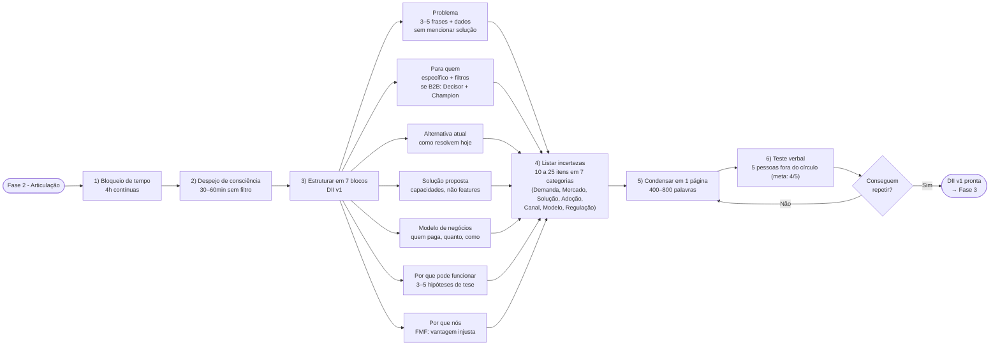

O primeiro passo é reservar um bloco protegido na agenda: separe quatro horas contínuas ou, de preferência, duas sessões de duas horas em dias seguidos, com notificações desligadas, longe do celular e diante de uma página em branco.

O segundo é despejo de consciência. Escreva tudo o que você acha que sabe sobre a ideia, sem estrutura. Problema, cliente, solução, mercado, concorrentes, por que você acha que é diferente. Trinta a sessenta minutos. Não edite. Só escreva.

O terceiro é a segunda passagem, estruturando em sete blocos:

- **Bloco 1: Problema.** Qual problema específico existe no mundo? Descreva em três a cinco frases, sem mencionar a sua solução. Se você não consegue descrever o problema sem falar da solução, você tem uma solução em busca de problema, o que é perigoso. Quando possível, ancore o problema em dados públicos (estudos, relatórios, indicadores): isso evita que o problema seja "achismo do fundador" e prepara o discurso para entrevistas e captação.

- **Bloco 2: Para quem.** Quem tem esse problema? Seja específico. "Pequenas empresas" não é resposta. "Donos de restaurantes com uma a três unidades em capitais brasileiras que fazem delivery próprio" é resposta. Se a sua descrição cabe em cinco palavras genéricas, você ainda não pensou o suficiente. Em ideias B2B, o "Para quem" tem quatro sub-elementos. Quem é (filtros objetivos: setor, tamanho, frequência, momento). Quem NÃO é (anti-perfil explícito, quem você descarta na primeira chamada e por quê). Decisor econômico (papel que aprova o orçamento, com pergunta de qualificação em uma frase). Champion (papel que vai operar o produto e vender internamente, com pergunta de qualificação em uma frase). Em ideias B2C, basta o primeiro mais o anti-perfil.

- **Bloco 3: Alternativa atual.** Como essa pessoa resolve o problema hoje? Toda pessoa com problema real tem alguma solução hoje, mesmo que ruim. Planilhas, WhatsApp, intuição, ignorar o problema. Descreva a alternativa atual em detalhe: é o seu concorrente real, não o player que você imagina. Se você não sabe, essa é a sua primeira incerteza decisiva.

- **Bloco 4: Solução proposta.** O que você quer construir? Descreva em termos de capacidades, não de funcionalidades específicas. "Um app" não é capacidade. "Uma forma de dar baixa automática em pagamentos de fornecedores a partir do extrato bancário" é capacidade.

- **Bloco 5: Modelo de negócios.** Quem paga, quanto, como e por quê. Mesmo na DII v1, ainda sem dados de campo, você precisa descrever a mecânica econômica em três a cinco frases: formato de cobrança (assinatura, taxa por transação, remuneração por desempenho ou serviço gerenciado), faixa de preço inicial, gatilho de pagamento e referência real de comparação (em vez de outro software, o custo do analista interno, em vez da planilha, a hora do gestor). Se um modelo plausível não puder ser esboçado agora, a falta de clareza cobrará juros mais adiante.

- **Bloco 6: Por que pode funcionar.** Liste de três a cinco hipóteses testáveis sobre o comportamento do cliente e a estrutura do mercado (nunca sobre as suas próprias qualidades), sempre no formato `[Persona] [verbo de ação] [objeto mensurável]`: por exemplo, "Donos de padaria artesanal com 2 a 5 lojas pagam R$ 290 por mês para eliminar duas rupturas mensais de farinha" ou "Gerentes de produção gastam de 4 a 8 horas por semana cotando insumos no WhatsApp". Fuja de frases genéricas como "o mercado é grande" e trate cada linha como premissa a ser provada.

- **Bloco 7: Por que nós.** Explicite o seu encaixe fundador-mercado (*Founder-Market Fit*): por que você ou o seu time estão em posição privilegiada para resolver esse problema agora? A vantagem real pode vir de domínio técnico, rede de contatos no setor, vivência operacional da dor, acesso direto aos decisores ou credibilidade acumulada. Resuma esse diferencial em uma ou duas frases factuais, com números e histórico concreto, sem uma assimetria clara, você disputará espaço em igualdade de condições com dezenas de entrantes.

O quarto passo é listar as suas incertezas categorizadas. Escreva de dez a vinte e cinco itens distribuídos em sete categorias: Demanda (o cliente percebe o problema como prioridade?), Mercado (o orçamento existe? Onde está alocado hoje? Como o setor se comporta?), Solução (a forma proposta resolve o problema? É a arquitetura certa?), Adoção (o cliente mudará a rotina para usar?), Canal (como o cliente descobre a oferta? Onde ele está acessível?), Modelo (o preço é percebido como justo? O retorno é defensável internamente pelo comprador?) e Regulação (quais licenças, normas técnicas ou regras de compras públicas condicionam a operação?). Se uma categoria ficar em branco, você apenas ainda não investigou os riscos daquela frente. Redija cada incerteza preferencialmente no formato testável `[Persona] [verbo] [objeto]`: essa lista alimentará diretamente as hipóteses da [[IGNICAO-Vol-3-Experimentos-e-Prototipagem#FASE 7: FORMULAÇÃO RIGOROSA DE HIPÓTESES|Fase 7 (Vol. 3)]] e os experimentos da [[IGNICAO-Vol-3-Experimentos-e-Prototipagem#FASE 8: EXPERIMENTOS DE VALIDAÇÃO DO PROBLEMA E DA SOLUÇÃO|Fase 8 (Vol. 3)]].

O quinto passo é condensar toda a formulação em uma única página, preenchendo os 7 blocos da Declaração Inicial da Ideia mais a lista de incertezas críticas conforme o modelo abaixo (cuja ficha completa para preenchimento está em [[#TEMPLATES OPERACIONAIS E CASOS PREENCHIDOS DESTA FASE 2|Templates Operacionais da Fase 2]]).

> [!note] A clareza da DII depende diretamente da qualidade da escrita
> Uma Declaração com frases longas, jargão técnico ou problema mal separado da solução trava no teste de transmissão. O [[#CAPÍTULO 8: COMUNICAÇÃO ESCRITA PARA NEGÓCIOS|Capítulo 8: Comunicação Escrita para Negócios]] traz princípios de clareza, estrutura de argumento e corte de jargão que ajudam a enxugar os sete blocos da DII. O framework de Primeiros Princípios (detalhado na Fase 0) apoia a separação entre fatos e suposições, e o [[#CAPÍTULO 9: APRESENTAÇÃO E FALA EM PÚBLICO|Capítulo 9: Apresentação e Fala em Público]] orienta a defesa oral de 90 segundos.

```text
DECLARAÇÃO INICIAL DA IDEIA, v1

Problema: [3 a 5 frases, ancoradas em dados quando possível, sem mencionar a solução]
Para quem: [descrição específica do cliente, com filtros objetivos. Se B2B, sub-blocos: Quem é / Quem NÃO é / Decisor Econômico / Champion]
Alternativa atual: [como o cliente resolve hoje - planilha, processo manual, concorrente, ignorar]
Solução proposta: [capacidades, não features]
Modelo de negócios: [quem paga, quanto, como, contra o que compete (custo de analista, hora do gestor)]
Por que pode funcionar: [3 a 5 hipóteses sobre o mundo, formato testável]
Por que nós: [Founder-Market Fit em 1-2 frases - vantagem injusta]
O que eu não sei: [10 a 25 incertezas em 7 categorias: Demanda, Mercado, Solução, Adoção, Canal, Modelo, Regulação]
Data: [hoje]
Versão: 1 (arquivo vivo para comparação a cada ciclo de entrevistas)
```

O sexto passo é o teste de transmissão oral: explique a ideia em 90 segundos para cinco pessoas fora do seu círculo imediato e do seu setor, pedindo que repitam com as próprias palavras o que entenderam, apontem o que soou vago e digam qual dúvida restou. Pelo menos quatro das cinco precisam reproduzir com precisão quem tem o problema e quem paga. Se a versão devolvida divergir do que você pretendia comunicar, volte ao texto e reescreva.

> [!note] Apresentar a ideia em noventa segundos é habilidade treinável, não talento
> O [[#CAPÍTULO 9: APRESENTAÇÃO E FALA EM PÚBLICO|Capítulo 9: Apresentação e Fala em Público]] cobre estrutura de pitch curto, controle de ansiedade e técnicas de ensaio. O teste verbal desta fase é a primeira versão do pitch que você vai repetir centenas de vezes nas fases seguintes: vale preparar com método desde agora.

O sétimo é arquivar a versão v1. Mantenha para comparar depois. A ideia vai mudar. Observar a evolução é educativo.

### O teste de fogo dos 90 segundos: como saber se sua DII v1 está pronta

Você concluiu a Fase 2 quando todos os critérios abaixo estão cumpridos.

- [ ] DII v1 escrita em uma página, entre 400 e 800 palavras, sete blocos preenchidos (Problema, Para quem, Alternativa atual, Solução proposta, Modelo de negócios, Por que pode funcionar, Por que nós), conforme Template: Declaração Inicial da Ideia (Fase 2).
- [ ] Problema descrito em três a cinco frases, ancorado em dados quando possível, sem mencionar a solução, em linguagem que um leigo do setor entenderia em trinta segundos.
- [ ] "Para quem" específico ao ponto de você listar vinte nomes ou empresas reais. Anti-perfil explícito (quem NÃO é cliente, e por quê). Em B2B, Decisor Econômico e Champion separados, com pergunta de qualificação em uma frase para cada.
- [ ] Alternativa atual descrita (planilha, processo manual, concorrente, ignorar): concorrente real, não o que você imagina.
- [ ] Modelo de negócios em três a cinco frases (quem paga, quanto, como, contra o que compete, ex.: custo de analista, hora do gestor).
- [ ] "Por que nós" responde FMF com substrato factual (dado, número, experiência), não adjetivos.
- [ ] Expliquei a ideia para cinco pessoas fora do círculo imediato, e pelo menos quatro repetiram com precisão o problema e o comprador com no máximo duas perguntas de esclarecimento.
- [ ] Recebi pelo menos uma objeção séria, documentada e endereçada (ou aceita como limitação conhecida).
- [ ] Lista de incertezas com 10 a 25 itens distribuídos pelas sete categorias (Demanda, Mercado, Solução, Adoção, Canal, Modelo e Regulação), sem deixar nenhuma vazia.
- [ ] Duas a três suposições-chave identificadas (as que, se falsas, matariam a ideia).
- [ ] Explicação verbal de 60 a 120 segundos ensaiada e fluida.
- [ ] Nome de trabalho para a ideia (pode ser provisório) definido para facilitar comunicação.

> [!warning] Critério de saída
> Se algum dos critérios essenciais acima falhar, não avance: resolva a pendência antes de seguir para a próxima fase.

**Síntese de partida para abrir a folha em branco (antes da transição para a Fase 3):**

1. Abrir o Template da Declaração Inicial da Ideia (Fase 2) e preenchê-lo em duas sessões focadas de duas horas: a primeira para o despejo mental e os sete blocos, a segunda para enxugar o texto e listar incertezas.
2. Ler ou enviar a declaração para três pessoas fora do seu setor para testar a clareza da mensagem e, em seguida, para um profissional do próprio setor para conferir a precisão dos fatos.
3. Listar as três suposições-chave que sustentam a ideia. Aquelas que, se falsas, matariam tudo.
4. Refinar "para quem" até caber numa frase verificável. Você consegue listar vinte nomes reais que caem nesse perfil?

### Duas DIIs na prática: a evolução de Henrique e o caso completo da PadariaPro

Antes de ver o documento completo da PadariaPro, observe como a página única limpou o discurso de Henrique (nosso caso condutor da abertura). No rascunho v0, ele havia escrito no Bloco 1: *"Falta uma plataforma IoT com redes neurais acessíveis para monitorar vibração de motores em tempo real nas indústrias do Paraná"*, misturando jargão técnico com a própria solução. Na DII v1, após separar problema de produto e distinguir usuário técnico de comprador econômico, o texto ficou auditável: Problema: *"Usinas de etanol de milho de médio porte no Centro-Sul perdem de R$ 180 mil a R$ 400 mil por parada não programada de caldeira e moenda durante a safra, porque a manutenção preventiva por calendário não detecta fadiga de rolamentos a tempo."* Para quem: *"Usinas independentes (1 a 3 plantas), Champion: engenheiro de manutenção, Decisor econômico: diretor industrial (qualificação: quantas horas de moenda parada sua planta teve na última safra?)."* Incerteza decisiva de Regulação e Adoção: *"Se as normas de segurança NR-12 e NR-13 exigem homologação específica dos sensores na planta e se o diretor industrial autoriza telemetria em nuvem fora da rede interna."*

**Caso completo preenchido: PadariaPro (nome de trabalho provisório).**

Problema (caso canônico PadariaPro): redes de padarias artesanais com duas a cinco lojas perdem entre 12% e 18% de margem bruta com ruptura de insumos decisivos (farinhas especiais, manteiga, fermentos) ou descarte de perecíveis, além de consumirem quatro a oito horas semanais do sócio-administrador (comprador econômico) e do gerente de produção (*champion* interno) em pedidos manuais. Planilhas não escalam entre lojas e ERPs genéricos de alimentação não conversam com o catálogo dos fornecedores do setor.

Para quem: Donos-operadores de padarias artesanais com duas a cinco lojas em São Paulo capital, faturamento de R$ 80 mil a R$ 400 mil por mês por loja, até 45 anos, habituados a resolver compras e pagamentos pelo celular. Vinte estabelecimentos com esse perfil já foram mapeados em Pinheiros, Vila Madalena e Moema.

- Quem NÃO é: padarias com uma loja só (volume de compras insuficiente), redes acima de oito lojas (têm comprador profissional dedicado), padarias industriais ou de revenda (modelo de produção diferente), donos acima de 45 anos que preferem tratar pedidos exclusivamente por telefone fixo ou visita presencial.
- Decisor econômico: o próprio dono (modelo enxuto, sem CFO ou comitê de compras). Pergunta de qualificação: "Quanto você gastou com farinha no último trimestre, e qual variação mês a mês?" Se ele não sabe sem abrir caderno, é o cliente.
- Champion: padeiro-chefe ou gerente de produção, papel que opera o app no dia a dia. Pergunta de qualificação: "Quando falta farinha boa, o que você faz manualmente que poderia ser automático?"

Alternativa atual: Compras decididas pelo gerente de produção no dia a dia, com base em experiência e caderno de controle manual. Pedidos emergenciais via WhatsApp direto com fornecedores. Sem previsão de demanda ou histórico estruturado. Ruptura de ingrediente é descoberta no início do turno de produção.

Solução proposta: App mobile e web que, conectado a três a cinco fornecedores-chave, gera sugestão automática de pedido baseada em consumo histórico e sazonalidade. O gerente aprova ou ajusta antes de enviar.

Modelo de negócios: SaaS por loja, R$ 290 a R$ 490 por mês com setup isento. Não compete com ERP (faixa de R$ 1.500/mês ou mais), compete com o tempo do gerente de produção e com a margem perdida em ruptura: proposta de ROI: economizar duas a três rupturas por mês paga o produto. Cobrança mensal recorrente em cartão. Take-rate adicional opcional sobre integração com fornecedor (1 a 2 por cento).

Por que pode funcionar agora: o Pix (lançado em novembro de 2020) e o Open Finance (em implantação faseada pelo Banco Central desde 2021) permitem conciliar pagamento e reposição de estoque direto com distribuidores pelo celular, ao mesmo tempo em que uma nova geração de gestores assumiu a operação de padarias artesanais. Três hipóteses testáveis no formato `[Persona] [verbo] [objeto]`: (1) "Donos de padaria artesanal com 2 a 5 lojas pagam R$ 290 por mês para eliminar duas rupturas mensais de farinha e fermento", (2) "Gerentes de produção gastam de 4 a 8 horas por semana fechando pedidos manuais no WhatsApp", e (3) "Distribuidores regionais de farinha aceitam receber pedidos padronizados via integração automática sem cobrar taxa adicional".

Por que nós: O fundador tem contatos diretos em três distribuidoras de farinha (rede), trabalhou seis anos em ERP de varejo (expertise técnica), e foi sócio de uma padaria por dois anos (experiência operacional pelo lado do cliente). Combinação que nenhum competidor genérico de ERP tem.

O que eu não sei (organizado nas sete categorias):

- Demanda: se donos percebem ruptura como prioridade ou como dor de fundo aceita, se padarias entre uma e duas lojas chegam à dor com volume suficiente.
- Mercado: quantas padarias com esse perfil existem fora de São Paulo, se há concorrentes regionais que desconheço, se ERPs de varejo já estão atacando esse segmento por extensão.
- Solução: se o gerente confia em sugestão automática ou exige controle manual, se três a cinco fornecedores-chave cobrem oitenta por cento das compras (e a long tail é viável), se a integração precisa ser API ou WhatsApp basta.
- Adoção: se o dono usa o app direto ou delega ao gerente, se o onboarding precisa ser presencial para funcionar, se a curva de aprendizado de quatorze dias é aceitável.
- Canal: quais comunidades, eventos ou influenciadores de padaria artesanal funcionam como canal de aquisição, se vendedor de farinha pode virar canal de distribuição via parceria.
- Modelo: se a faixa de R$ 290 a R$ 490 por mês é percebida como investimento com retorno claro ou como mais um custo fixo, qual o cancelamento esperado no primeiro ano, se a decisão de compra cabe só ao dono ou depende do aval do padeiro-chefe, se cobrança mensal versus anual altera a conversão. | Regulação: se a integração de notas fiscais (NF-e) e dados de compras entre lojas exige certificação fiscal específica ou aditivo contratual de proteção de dados (LGPD) com os distribuidores.

Data: 2026-05-01
Versão: 1

**Contraste com marketplace bilateral, iFood retroativo.**

O caso PadariaPro acima cobre o padrão B2B-vertical com Decisor e Champion claros. O iFood, se preenchido retroativamente em 2011 (Patrick Sigrist, Eduardo Baer, Felipe Fioravante e Guilherme Bonifácio, em São Paulo), exigiria a DII com a mesma estrutura, mas com três ajustes essenciais que toda DII de marketplace bilateral precisa contemplar:

- **"Para quem" duplo.** No lado consumidor, classes A e B em capitais com smartphone ou acesso web e hábito de pedir comida toda semana. No lado restaurante (em 2011), estabelecimentos com tíquete médio de R$ 30 a R$ 80 que já operavam com motoboy próprio, mas perdiam pedidos no telefone ocupado nos horários de pico e dependiam de folhetos impressos (a logística própria do iFood só começou em 2015). Cada ponta tem seu próprio decisor: o consumidor decide por si, no restaurante, o dono-operador é o Decisor Econômico e o atendente do balcão/telefone é o *Champion*. Sem mapear os dois lados separadamente, a DII de um marketplace fica manca.
- **Incerteza dominante é densidade simultânea.** Em B2B-vertical (PadariaPro), a incerteza-chave é Demanda + Modelo. Em marketplace, é Mercado + Adoção: os dois lados precisam adotar na mesma região ao mesmo tempo, ou nenhum dos dois adota. A lista de incertezas precisa privilegiar essa categoria, não tratá-la como uma a mais.
- **Modelo de negócios reflete a arquitetura da rede.** Comissão de 10% a 15% sobre o pedido, paga pelo restaurante (lado com maior disposição a pagar), sem mensalidade fixa. Em 2011, o iFood competia com o cardápio impresso (folheto de geladeira) e com o custo do pedido perdido no telefone ocupado nos horários de pico, enquanto a entrega física continuava a cargo do motoboy próprio do restaurante. Definir com precisão contra o que se compete é ainda mais decisivo em marketplaces do que em SaaS, porque uma comissão mal calibrada trava a adesão de um dos lados e impede a formação de densidade.

A DII funciona para qualquer arquitetura de negócio, mas a sub-estrutura do Bloco 2 (Para quem) e a categoria dominante de incertezas mudam. Antes de preencher, identifique se você é B2B-vertical, marketplace bilateral ou produto ao consumidor final (B2C): cada desenho exige pesos diferentes entre as sete categorias de incerteza.

### Onde o papel mente: esconder incertezas por orgulho e confundir solução com problema

> [!note] Conexão com o Capítulo 3 (Armadilhas Mentais e Vieses)
> O enamoramento pela solução e o viés de confirmação (ouvir só o que confirma a tese) são os vieses mais perigosos nesta fase. Leia o [[#CAPÍTULO 3: ARMADILHAS MENTAIS E VIESES|Capítulo 3 (Armadilhas Mentais e Vieses)]] antes de fazer o teste verbal com os ouvintes externos: ele oferece diagnóstico estruturado e contramedidas práticas para cada um.

**Esconder incertezas por orgulho.** Deixar a lista do Bloco 8 curta ou preenchida com dúvidas inofensivas para parecer preparado diante de sócios e mentores derrota o propósito da Fase 2: incerteza omitida no papel vira prejuízo financeiro quando a operação vai para a rua. Descrever a própria solução como se fosse a dor do cliente. Frases como "o problema é que não existe um aplicativo que faça X" invertem a lógica de descoberta, concentre a descrição na fricção concreta que o cliente já enfrenta hoje, antes de qualquer software existir.

**Público-alvo amplo demais.** Escrever "pessoas", "empresas" ou "profissionais" no Bloco 2 esconde a falta de recorte de quem sofre a dor de forma aguda e impede saber quem entrevistar na Fase 4 (Vol. 2).

**Confundir ausência de alternativa com oportunidade.** Ouvir ou achar que "ninguém faz isso" quase sempre indica que outros já tentaram e a conta não fechou, ou que a dor não é forte o bastante para mover o orçamento do cliente. A falta de soluções conhecidas pede cautela redobrada, e não comemoração prematura.

**Enamoramento pela solução.** Quando você se apega à arquitetura técnica ou ao formato do produto que imaginou no primeiro dia, passa a ignorar os sinais de que o problema real do cliente é outro. Trate o problema e o cliente como âncoras e mantenha a solução como hipótese ajustável.

---

### O Espelho da Fase 2 e o Ritual de Segunda-Feira

Quando Henrique aplicou o Espelho da Clareza em Curitiba ao seu primeiro rascunho de manutenção preditiva, percebeu que havia descrito sensores e redes neurais em vez do prejuízo da usina parada e que seu bloco "Para quem" citava genericamente "indústrias brasileiras". Ao refazer a folha para listar 20 usinas de etanol de milho com nome e telefone do diretor industrial e explicitar 14 incertezas nas sete categorias, destravou o teste oral com cinco profissionais de fora do setor.

> [!tip] O Espelho da Clareza (Autodiagnóstico Rápido)
> Passe a sua Declaração Inicial da Ideia por estes três cortes, como fez Henrique:
> 1. **O Corte da Solução Oculta:** No seu bloco de "Problema", você escreveu uma dor mensurável do cliente (*"usinas de etanol de milho perdem de R$ 180 mil a R$ 400 mil por parada não programada de moenda"* ou *"padarias artesanais perdem 12% a 18% de margem com ruptura de farinha"*) ou escreveu a ausência do seu produto (*"o problema é que falta uma plataforma IoT com IA"*)?
> 2. **O Teste dos 20 Nomes:** O seu bloco "Para quem" separa quem usa de quem paga com tanta nitidez que você consegue abrir o LinkedIn ou o mapa setorial agora mesmo e listar o nome e o contato de 20 empresas e decisores reais que se encaixam no perfil?
> 3. **A Coragem da Ignorância:** Sua lista de incertezas reúne de 10 a 25 dúvidas reais distribuídas entre as 7 categorias (Demanda, Mercado, Solução, Adoção, Canal, Modelo e Regulação), ou você deixou lacunas em branco para fingir segurança?
>
> **Sua permissão:** Você está liberado da obrigação de montar um *pitch deck* de 20 slides diagramados nesta fase. Uma única página em texto corrido, honesta sobre o que você ainda não sabe, vale mais do que qualquer apresentação visual antes de ir a campo.
>
> **Ritual de Segunda-Feira (30 minutos):** Toda segunda-feira, reserve 30 minutos para revisar a sua DII, substituir uma incerteza da lista pelo aprendizado real das conversas da semana anterior e lapidar a frase do bloco *Para quem* no template da fase. Na quinta-feira, faça o giro oral de 90 segundos com cinco pessoas fora do seu círculo imediato e do seu setor: se pelo menos quatro não repetirem com precisão quem paga e qual é a dor, reescreva antes de segunda.

---

### MÉTRICAS E BENCHMARKS DESTA FASE (FASE 2)

| Métrica | O que medir | Referência saudável |
|---|---|---|
| Declaração Inicial da Ideia (DII) preenchida | 7 blocos da DII mais a lista de incertezas completos | Sim |
| Incertezas mapeadas nas 7 categorias | Total de incertezas distribuídas (Demanda, Mercado, Solução, Adoção, Canal, Modelo, Regulação) | 10 a 25 (nenhuma categoria vazia) |
| Teste de transmissão oral (90 segundos) | Ouvintes externos ao círculo e ao setor que repetiram a ideia com precisão | Pelo menos 4 de 5 |
| Qualificação do público-alvo | Empresas ou clientes nominais listados que cumprem todos os filtros do Bloco 2 | Pelo menos 20 nomes reais |

---

### MANUAL PASSO A PASSO DOS FRAMEWORKS DESTA FASE 2

> [!tip] Aplicação direta na escrita da sua DII
> Os cinco frameworks a seguir (*Playing to Win*, *Good Strategy / Bad Strategy*, *Core Competencies*, *Value Disciplines* e *Princípio da Pirâmide de Minto / SCQA*) nascem da estratégia corporativa, mas entram nesta Fase 2 com um propósito cirúrgico: forçar escolhas excludentes nos Blocos 2, 4, 5 e 7 da sua Declaração Inicial da Ideia e estruturar a síntese oral de 90 segundos.

#### Framework: Playing to Win (Roger Martin & A.G. Lafley, 2013, aplicado ao recorte da DII na Fase 2)

##### De onde vem a ferramenta (e por que sobreviveu ao filtro do tempo)

A.G. Lafley (então CEO da P&G) e Roger Martin (dean da Rotman School) desenvolveram o quadro durante a transformação da Procter & Gamble na primeira gestão de Lafley (2000 a 2009), período em que a receita anual da empresa praticamente dobrou e o valor de mercado mais que duplicou. Publicaram *Playing to Win: How Strategy Really Works* em 2013. O livro é hoje uma das referências mais sólidas sobre estratégia corporativa, especialmente em contextos de escala.

##### A mecânica central (sem jargão)

Framework de **estratégia como cascata de cinco escolhas integradas**. Martin argumenta que estratégia é fazer escolhas, não listar objetivos. E que essas escolhas devem ser interdependentes e reforçadoras.

##### Princípios / estrutura: A cascata

Escolha 1, Qual é a nossa aspiração vencedora?
1. **What is our winning aspiration?** Qual é o propósito concreto de vitória neste recorte inicial, e não uma frase genérica de parede. Na P&G de Lafley, para a Olay, a aspiração foi liderar o segmento de *masstige* (entre o balcão de luxo de US$ 50 e a prateleira popular de US$ 6) com uma linha antienvelhecimento ao redor de US$ 18,99.

2. **Where will we play?** Onde vamos competir (e onde não vamos): segmento de clientes, canal, geografia, categoria de produto e etapa da cadeia. Na Fase 2, esta pergunta preenche diretamente o filtro "Quem é" e o anti-perfil "Quem NÃO é" do Bloco 2 da DII.
**Escopo:** Em quais mercados/segmentos/canais/geografias/categorias? Explicitamente onde NÃO vamos jogar. A maioria dos fracassos estratégicos vem de "jogar em todo lugar".

Escolha 3, Como vamos vencer?
Proposta de valor e vantagem competitiva específica. Duas opções clássicas (Porter): diferenciação de produto ou liderança em custo. Martin expande: qualidade única de experiência, relacionamento, canal, etc.

Escolha 4, Quais capabilities devemos ter?
As 4-6 habilidades organizacionais que precisamos dominar para vencer. Não tudo, as que são distintivas e decisivas.

Escolha 5, Quais sistemas de gestão são necessários?
Estruturas, processos, métricas e cultura que sustentam e renovam a estratégia. Sem sistemas, as 4 outras escolhas se erodem com tempo.

##### Aplicação imediata na rotina da empresa

**Passo 1: faça em cascata, mas itere.** As cinco escolhas influenciam-se mutuamente: comece pela aspiração vencedora, desça até os sistemas de gestão e volte para ajustar o conjunto. Esse alinhamento leva semanas ou meses, não um workshop de um único dia.

Passo 2: Escolha explícita = rejeição explícita. Cada escolha precisa incluir o que rejeitamos. "Jogamos em PMEs brasileiras" deve incluir "NÃO jogamos em enterprise nem em LatAm neste horizonte".

Passo 3: Teste coerência interna. Aspiração → onde jogar → como vencer → capabilities → sistemas. Se capability definida não serve ao "como vencer", há incoerência, reajustando a rota imediatamente.

Passo 4: Envolva o time executivo. Estratégia é dos tomadores de decisão, não do consultor. Playing to Win funciona bem em workshops estruturados com liderança.

Passo 5: Documente em uma página. Strategy on a page. Se não cabe, está excessivamente complexo ou não há escolha clara.

Passo 6: Cadência de revisão. Revisar em profundidade a cada 18-24 meses (mais frequente em early-stage), ajustes táticos trimestralmente.

##### Na trincheira real: como isso funciona na prática

SaaS fictício de admissão digital de funcionários para pequenas e médias empresas brasileiras:

- Aspiração: ser a primeira ferramenta de onboarding digital adotada por PMEs brasileiras, categoria definida pela marca.
- Onde jogar: PMEs brasileiras de 20-200 funcionários nos setores de varejo e saúde. Canal: digital self-serve + parceiros (contadores). NÃO jogamos em grandes empresas, nem em LatAm hispânica neste horizonte.
- Como vencer: experiência de onboarding nativa brasileira (CLT, LGPD, contratos tipicamente nacionais) + preço acessível (R$ 5-15/funcionário/mês vs. R$ 30+ de concorrentes internacionais).
- Capabilities: (1) Product velocity em território regulatório brasileiro, (2) Canal de parceiros com 500+ contadores, (3) Content marketing em SEO brasileiro, (4) Customer success proativo em PT-BR.
- Sistemas: OKRs trimestrais, revisão semanal de indicadores (*weekly business review*), programa de capacitação dos contadores parceiros e NPS medido por segmento.

##### Onde o papel aceita tudo (armadilhas de execução)

Quatro desvios esvaziam o *Playing to Win* na Fase 2: (1) escrever uma aspiração vaga ("ser referência no setor") que não ajuda a descartar nenhum caminho, (2) recusar-se a definir onde não jogar, deixando o Bloco 2 da DII aberto para qualquer cliente, (3) confundir o *How to Win* com melhorias operacionais básicas ("ter bom atendimento e plataforma rápida") em vez de apontar uma vantagem assimétrica, e (4) tratar os cinco degraus da cascata como caixas isoladas ou imutáveis, esquecendo que uma descoberta nas entrevistas da Fase 4 exigirá reajustar onde jogar e como vencer.

---

#### Framework: Good Strategy / Bad Strategy (Richard Rumelt, 2011)

##### De onde vem a ferramenta (e por que sobreviveu ao filtro do tempo)

Richard Rumelt, professor emérito da UCLA Anderson School of Management, publicou *Good Strategy / Bad Strategy: The Difference and Why It Matters* em 2011, sintetizando quatro décadas de pesquisa e consultoria estratégica (a *McKinsey Quarterly* o descreveu como "o estrategista dos estrategistas"). Na Fase 2, o filtro de Rumelt serve para limpar palavras vazias da sua DII antes do teste de 90 segundos.

##### A mecânica central (sem jargão)

Framework que define o que é estratégia real versus o que é "bad strategy" (aspirações travestidas de estratégia). Apresenta o kernel da boa estratégia: três componentes indispensáveis.

##### As regras do jogo

O Kernel da Boa Estratégia (3 partes):

1. Diagnóstico: identificação honesta do desafio decisivo. Uma análise do problema real, não lista de sintomas. Rumelt enfatiza: boa estratégia diagnostica antes de prescrever. Se o diagnóstico é raso ou errado, o resto é teatro.

2. Política orientadora: abordagem geral para enfrentar o desafio. Não é ação específica, é a escolha central que restringe e orienta todas as ações, por exemplo: "focaremos em mercado enterprise" é política, "contratar 5 AEs" é tática.

3. Ações coerentes: conjunto coordenado de passos que implementam a política. Cada ação deve reforçar as outras, não podem ser movimentos desconexos.

Sinais de Bad Strategy (Rumelt identifica 4):

1. Fluff (conversa fiada): uso de palavras pretensiosas e abstratas para sugerir pensamento sofisticado. "Alavancar sinergias para maximizar valor stakeholder" não significa nada concreto.

2. Falha em enfrentar o desafio: bad strategy não reconhece ou define o problema real. Ou o define como "atingir metas", o que é circular.

3. Confundir metas com estratégia: "crescer 30% este ano" é meta, não estratégia. Estratégia é como chegar lá.

4. Objetivos estratégicos ruins: listas longas de "imperativos estratégicos" sem priorização, sem ligação entre si, sem reconhecimento de trade-offs.

##### Aplicação imediata na rotina da empresa

Passo 1: Comece pelo diagnóstico, não pela solução. Gaste tempo real entendendo o problema. Em *Good Strategy Bad Strategy* (2011), Rumelt mostra que uma parte decisiva do trabalho estratégico está em formular o diagnóstico correto do obstáculo antes de desenhar qualquer plano de ação.

Passo 2: Escreva o diagnóstico em 1-2 parágrafos. Se precisa de 10 páginas para diagnosticar, algo está confuso. Essência do problema cabe em poucas frases.

Passo 3: Política orientadora em 1 frase. "Vamos [X] como resposta ao desafio [Y]." Se não cabe em uma frase, está vago.

Passo 4: Liste 3-7 ações coerentes. Cada ação reforça as outras. Se uma contradiz outra, revisite política.

Passo 5: Teste com "pergunta do porquê". Para cada ação, perguntar: por que fazemos isso? A resposta deve ser "porque implementa nossa política de [Y]". Se é "porque é importante", a coerência falhou.

Passo 6: Alinhe métricas. Meta vem depois de estratégia, não antes. Métricas medem execução da estratégia.

##### Na trincheira real: como isso funciona na prática

Ao redigir a primeira versão da sua DII em Curitiba, Henrique aplicou o *Kernel* de Rumelt para trocar o discurso técnico sobre sensores pela tese de negócio em usinas de etanol de milho:

Bad strategy (o que frequentemente se vê): "Nossa estratégia é crescer 200% este ano, ser referência em experiência do cliente, capturar o mercado PME e atingir break-even."
Isso é lista de aspirações, não há diagnóstico, política, nem coerência entre ações.

Good strategy aplicando Rumelt:

- Diagnóstico: CAC cresceu 3x em 12 meses porque: (a) saturamos os 20% mais qualificados do nosso ICP, (b) iniciamos campanhas paid quando organic ainda estava funcionando, (c) métrica de growth distorceu decisões. Problema real: não temos máquina de aquisição sustentável, só temos aquisição paga sobre ICP saturado.

- Política orientadora: nos próximos 12 meses, reconstruir aquisição via canais orgânicos e bottom-up (product-led), pausando ou reduzindo paid drasticamente.

- Ações coerentes:

 1. Pausar 80% do paid (mantém apenas 1 canal comprovadamente rentável).
- **Diagnóstico:** "Usinas de etanol de milho de médio porte no Centro-Sul operam moendas e caldeiras 24/7 durante a safra, mas dependem de manutenção preventiva por calendário ou planilhas isoladas, cada parada não programada custa entre R$ 180 mil e R$ 400 mil em produção interrompida, e os sistemas industriais tradicionais dos fabricantes globais exigem projetos de seis meses e mais de R$ 500 mil de implantação."
 3. Construir produto freemium para trial bottom-up (ver [[IGNICAO-Vol-4-Tracao-e-PMF#CAPÍTULO 1: GTM PLAYBOOK E ARQUITETURA DE CANAIS: DA PRIMEIRA VENDA AO PRIMEIRO MILHÃO DE ARR|Capítulo 1 (GTM Playbook e Arquitetura de Canais: Da Primeira Venda ao Primeiro Milhão de ARR) (Vol. 4)]], PLG).
 4. Criar programa de referral com recompensa.
- **Política orientadora:** "Atacar exclusivamente os três equipamentos gargalo da planta (caldeira, moenda e centrífuga) com sensores de instalação em um único turno de parada programada e cobrança por assinatura mensal dentro da alçada do diretor industrial, deixando de fora plantas químicas, montadoras e projetos customizados."
- **Ações coerentes (para validar a DII):** "(a) Mapear 20 diretores industriais e gerentes de manutenção de usinas independentes no Paraná, Mato Grosso e Goiás, (b) comparar o custo de uma hora de caldeira parada com a assinatura mensal proposta de R$ 4.500 por planta, e (c) verificar junto a três engenheiros de segurança quais exigências da NR-12 e da NR-13 se aplicam à fixação dos sensores."

Cada ação tática reforça as demais quando a política de execução responde diretamente ao diagnóstico levantado, formando uma estratégia coesa.

##### Onde o papel aceita tudo (armadilhas de execução)

Quatro vícios transformam a DII em "má estratégia" segundo Rumelt: (1) confundir meta numérica com estratégia ("chegar a 100 usinas em 12 meses"), sem diagnosticar o obstáculo nem o mecanismo de conquista, (2) listar dez prioridades desconexas no Bloco 4, tentando resolver todos os problemas da fábrica de uma vez, (3) esconder a falta de recorte atrás de jargão ("ecossistema inteligente de indústria 4.0"), e (4) propor ações que se sabotam mutuamente, como prometer preço de entrada baixo no Bloco 5 enquanto exige implantação presencial customizada de três meses no Bloco 4.

---

#### Framework: Core Competencies (C.K. Prahalad & Gary Hamel, 1990, aplicado ao Bloco 7 da DII)

##### De onde vem a ferramenta (e por que sobreviveu ao filtro do tempo)

C.K. Prahalad e Gary Hamel publicaram "The Core Competence of the Corporation" na *Harvard Business Review* em 1990, um marco da literatura de estratégia. O artigo reagiu à diversificação dispersa dos anos 1980, quando conglomerados acumulavam unidades de negócio sem sinergia técnica ou operacional. A tese central dos autores é que empresas duráveis se estruturam em torno de um conjunto coerente de competências centrais difíceis de imitar, das quais os produtos específicos são desdobramentos.

##### A mecânica central (sem jargão)

Framework que identifica as habilidades organizacionais coletivas que fornecem vantagem competitiva estrutural. Competências centrais são raízes que sustentam múltiplos produtos ("árvores"). Hamel usa metáfora árvore-raízes.

##### As regras do jogo

Três testes de Core Competency:

1. Acesso a múltiplos mercados: competência que sustenta 1 só produto é capability de produto, não core competency.

2. Contribuição significativa ao valor percebido pelo cliente: cliente precisa valorizar o que essa competência produz.

3. Difícil de replicar pelos concorrentes: se concorrentes replicam rapidamente, não é core, é commodity.

Exemplos clássicos (do paper original):

- Honda: motores. Sustenta carros, motos, geradores, aparadores de grama, barcos.
- Sony: miniaturização. Sustenta walkman, handycam, laptops, etc.
- Canon: óptica, imaging, controles microeletrônicos.

##### Aplicação imediata na rotina da empresa

Passo 1. Faça o inventário das capacidades da organização. O que sabemos fazer excepcionalmente bem? Liste as habilidades técnicas e operacionais subjacentes, e não os produtos atuais.

Passo 2: Aplique os três testes. Qual dessas capabilities realmente passa?

Passo 3: Identifique lacunas. Quais competências que concorrentes têm e nós não? Quais devemos construir?

Passo 4: Alinhe investimentos. Decisões de produto, M&A, hiring devem reforçar core competencies. Se M&A não agrega a competência, é provável que gere diversificação ruim.

Passo 5: Proteja e renove. Core competencies erodem, concorrentes eventualmente alcançam. Renovação contínua é necessária.

Passo 6: Pense em "core products" e depois "end products". Core competencies produzem core products (plataformas/componentes) que viabilizam múltiplos end products.

##### Na trincheira real: como isso funciona na prática

Ao preencher o Bloco 7 ("Por que nós") da DII da PadariaPro, o fundador usou os três filtros de Prahalad e Hamel para separar habilidades genéricas de vantagens difíceis de copiar:

Capacidades avaliadas pelo time fundador:

- **Domínio de regras fiscais e catálogos de insumos de panificação + relacionamento direto com três distribuidoras regionais:** PASSA NOS 3 FILTROS (gera valor imediato na reposição automática, é difícil de ser copiado por um ERP genérico e pode se estender para confeitarias e pizzarias artesanais).
- **Interface limpa no celular:** NÃO É COMPETÊNCIA CENTRAL (necessária para adoção, mas qualquer software house concorrente replica em poucos meses).
- **Vivência de dois anos como sócio-operador de padaria artesanal:** PASSA COMO ATIVO DE PARTIDA (acelera o acesso às primeiras 20 lojas e calibra a linguagem do produto ao turno da madrugada).
- Rede bancária → **SIM** se for única, se commodity, não.

Resultado para o Bloco 7 da DII: ancorar a vantagem injusta na combinação entre integração com distribuidoras de farinha e experiência real de balcão, descartando adjetivos genéricos sobre tecnologia.

##### Onde o papel aceita tudo (armadilhas de execução)

Seis armadilhas esvaziam o método na prática: (1) confundir o produto atual com a competência central que o sustenta, (2) rotular qualquer atividade rotineira como competência diferenciada sem submetê-la aos três filtros de valor, extensão e dificuldade de imitação, (3) cortar investimentos na base técnica em troca de alívio trimestral de caixa, erodindo uma capacidade que leva anos para ser reconstruída, (4) presumir que a vantagem técnica de hoje continuará relevante sem atualização, (5) buscar aquisições sem relação com o núcleo técnico da empresa, e (6) dispersar capital em rótulos da moda sem conexão com a dor que o negócio resolve.

---

#### Framework: Value Disciplines (Michael Treacy & Fred Wiersema, 1993, aplicado aos Blocos 2, 4 e 5 da DII)

##### De onde vem a ferramenta (e por que sobreviveu ao filtro do tempo)

Michael Treacy e Fred Wiersema, ex-consultores de CSC Index, apresentaram o conceito no artigo *Customer Intimacy and Other Value Disciplines* na *Harvard Business Review* em 1993 e publicaram o livro *The Discipline of Market Leaders* em 1995, após estudo de 80 empresas líderes. Argumento: empresas duradouras escolhem uma de três disciplinas de valor e a dominam, não tentam ser excelentes em tudo.

##### A mecânica central (sem jargão)

Framework que identifica **três disciplinas de valor** como escolhas estratégicas fundamentais. Empresa deve escolher qual dominar e organizar tudo em torno dela:

##### As regras do jogo

1. **Excelência Operacional (*Operational Excellence*):** entrega custo total baixo e conveniência previsível por meio de processos padronizados de ponta a ponta.

- **Exemplos clássicos:** Walmart, McDonald's, Ryanair e Dell (na fase de venda direta padronizada).
- **Organização exigida:** obsessão por giro, cadeia de suprimentos enxuta, automação e corte de exceções.

2. **Liderança em Produto (*Product Leadership*):** entrega produtos tecnicamente superiores, com ciclos rápidos de invenção e margem sustentada por desempenho inédito.
- **Exemplos clássicos:** Apple, Intel, 3M e WEG em motores e automação industrial.
- **Organização exigida:** engenharia autônoma, investimento contínuo em P&D e tolerância a apostas técnicas que superam a versão anterior.

3. **Intimidade com o Cliente (*Customer Intimacy*):** entrega soluções moldadas à operação de cada conta, com relacionamento profundo e foco no valor vitalício (*LTV*).
- **Exemplos clássicos:** Nordstrom, IBM Global Services e consultorias estratégicas ou integradores *enterprise*.

- **Organização exigida:** autonomia na ponta para customizar a entrega, implantação assistida e equipes de contas dedicadas.

Aplicação direta na Fase 2: ao preencher a Proposta de Valor (Bloco 4) e o Modelo de Negócios (Bloco 5) da sua DII, escolha qual dessas três disciplinas governa a sua oferta para não prometer implantação artesanal cobrando mensalidade de autosserviço.
Use também a disciplina escolhida para blindar o anti-perfil ("Quem NÃO é cliente") no Bloco 2: quem exige customização pesada fica fora de um modelo de Excelência Operacional. Quem compra apenas por menor preço fica fora de Liderança em Produto.

Regra central de Treacy e Wiersema: a empresa deve liderar de forma clara em uma disciplina e manter padrão competitivo mínimo nas outras duas. Tentar ser número um nas três simultaneamente na DII é receita para não convencer ninguém no teste de 90 segundos.

##### Protocolo prático de execução

Passo 1: Escolha conscientemente uma disciplina. Não "acontece", é decisão estratégica que molda tudo.

Passo 2: Desenhe organização em torno da disciplina.

- Operational excellence: processos, sistemas, supply chain, automação.
- Product leadership: P&D, experimentação, velocity de lançamento.
- Customer intimacy: relacionamento, customização, CS profundo.

Passo 3: Comunique claramente. Time precisa saber "somos companhia de Produto" ou "somos companhia de Operação". Dúvida gera execução morna.

Passo 4: Invista assimetricamente. 60-70% dos recursos em disciplina escolhida, 30-40% para manter padrão nas outras.

Passo 5: Evite "middle". Empresas que tentam ser 2º ou 3º em cada disciplina são derrotadas por focadas.

##### Na trincheira real: como isso funciona na prática

Startup SaaS brasileira em fase de escolher posicionamento competitivo:

Análise das opções:

- Operational Excellence: preço baixo via automação. Mas mercado brasileiro tem Conta Azul e Omie já baratos. Difícil competir em preço.
- Product Leadership: produto mais avançado (AI-first, integrations mais profundas). Requer investimento alto em P&D, tempo até ROI.
- Customer Intimacy: relacionamento profundo com PMEs, implementação consultiva. Exige time de CS forte, mas diferencia de concorrentes self-serve.

Decisão: escolher **Customer Intimacy** em nicho específico (ex.: PMEs do varejo). Preço médio-alto, implementação concierge, onboarding consultivo. Manter padrão aceitável em Operational (preço não exorbitante) e Product (features competitivas, mas não mais avançadas).

##### Onde o papel aceita tudo (armadilhas de execução)

Três erros derrubam a escolha de disciplina na Fase 2: (1) declarar na DII que a empresa vencerá simultaneamente por menor preço, tecnologia de ponta e customização por cliente, recusando-se a abrir mão de dois eixos, (2) desenhar uma estrutura de custos de Intimidade com o Cliente (implantação manual de semanas) para cobrar ticket de Excelência Operacional (R$ 199 por mês), e (3) deixar o básico abaixo do aceitável nas outras duas dimensões, esquecendo que mesmo o líder em preço precisa de produto funcional e suporte que responda.

---

#### Framework: Pyramid Principle (Barbara Minto, 1987)

##### De onde vem a ferramenta (e por que sobreviveu ao filtro do tempo)

Barbara Minto, a primeira mulher contratada como MBA pela McKinsey em 1963, desenvolveu o *Minto Pyramid Principle* para treinar consultores a estruturar comunicações executivas sem rodeios. O método foi publicado originalmente em 1978 pela Minto International e lançado comercialmente em 1987 pela editora Pitman (*The Pyramid Principle: Logic in Writing and Thinking*), tornando-se o padrão mundial de escrita executiva e *storyboarding*.

##### A mecânica central (sem jargão)

Método para **estruturar comunicação** (escrita e oral) em forma de pirâmide: começa com a conclusão principal (topo da pirâmide) e desce para argumentos de suporte e dados.

##### As regras do jogo

2. **Agrupar em 3 a 5 linhas de sustentação MECE:** abaixo da tese principal, alinhe os pilares que provam por que ela se sustenta (por exemplo: tamanho da dor, mudança recente de contexto e vantagem da equipe), sem sobreposição entre eles.

3. **Sustentar cada pilar com fatos verificáveis:** ancore cada argumento em números concretos, exemplos observados ou restrições reais do setor.

4. **Abrir com a sequência SCQA nos primeiros 30 segundos:**
- Complication: mudança/problema que aparece.
- **S (Situação):** o fato concreto e consensual sobre a rotina atual do seu cliente-alvo.
- **C (Complicação):** o gargalo, perda financeira ou mudança recente que torna a situação insustentável.
- **Q (Questão):** a pergunta inevitável que o decisor econômico precisa responder.
- **A (Resposta / *Answer*):** a proposta central da sua DII em uma única frase direta (o topo da pirâmide).

No [[#CAPÍTULO 9: APRESENTAÇÃO E FALA EM PÚBLICO|Capítulo 9 (Apresentação e Fala em Público)]], você retomará o SCQA para roteirizar apresentações completas. Aqui na Fase 2, use-o para condensar sua DII no teste oral de 90 segundos.
- Nível 2: 3-5 argumentos de suporte (MECE, mutually exclusive, collectively exhaustive).
- Nível 3 e abaixo: dados, exemplos, detalhes sustentando cada argumento.

Regras:

- Cada nível suporta o nível acima logicamente.
- Ideias do mesmo nível são MECE.
- Ordenar por lógica (dedutiva ou indutiva), não ordem cronológica.

##### Roteiro de aplicação prática na operação

Passo 1: Identifique o destinatário e a pergunta. Pyramid é design centrado no leitor/ouvinte.

Passo 2: Formule a resposta em 1 sentença (o topo). Se não cabe em uma sentença, você não sabe a resposta ainda.

Passo 3: Estruture 3-5 argumentos de suporte. MECE: não se sobrepõem e cobrem o essencial.

Passo 4: Para cada argumento, dados e exemplos.

Passo 5: Teste SCQA na introdução. Leitor entende contexto → problema → pergunta → resposta?

Passo 6: Escreva top-down. Conclusão primeiro, depois suporte. Contrário da tendência natural (contar história cronológica).

##### Na trincheira real: como isso funciona na prática

Veja como Henrique estruturou o teste oral de 90 segundos da sua DII v1 usando SCQA e três pilares MECE antes de abordar diretores industriais:

SCQA:

- **S (Situação):** "Usinas independentes de etanol de milho no Centro-Sul operam caldeiras e moendas 24 horas por dia durante toda a janela de safra."
- **C (Complicação):** "A manutenção preventiva por calendário não enxerga fadiga precoce de rolamentos, e cada parada não programada queima de R$ 180 mil a R$ 400 mil em produção perdida, enquanto os sistemas preditivos dos fabricantes globais custam mais de R$ 500 mil e levam seis meses para instalar."
- **Q (Questão):** "Como cortar as paradas surpresa da safra sem travar a planta nem depender de um projeto milionário de meio ano?"
- **A (Resposta / Topo da Pirâmide):** "Com um kit de sensores industriais instalado em um único turno de manutenção que alerta anomalias de vibração e temperatura com 72 horas de antecedência por R$ 4.500 mensais por planta."

Pirâmide:

1. **Retorno imediato no bolso do decisor:** evitar uma única hora de moenda parada na safra já paga mais de três anos da assinatura mensal.
2. **Implantação sem parar a usina:** fixação não intrusiva em três equipamentos gargalo durante uma janela normal de limpeza, com dados no celular do engenheiro no mesmo dia.
3. **Incertezas decisivas já isoladas para campo:** validar nas próximas duas semanas se o diretor industrial aprova essa faixa na sua alçada direta e quais requisitos da NR-12/NR-13 o time de segurança exige.

Com essa estrutura, quatro dos cinco ouvintes de fora do setor conseguiram repetir em 30 segundos quem tinha a dor, quanto ela custava e como o produto era cobrado.

##### Onde o papel aceita tudo (armadilhas de execução)

Quatro deslizes arruínam o uso da Pirâmide de Minto no teste de 90 segundos da Fase 2: (1) contar a história em ordem cronológica ("começamos pesquisando sensores, depois vimos que."), fazendo o ouvinte perder o fio antes de saber o que a empresa faz, (2) empilhar argumentos que dizem a mesma coisa com palavras diferentes, violando a regra MECE, (3) abrir despejando detalhes técnicos de arquitetura onde deveria estar o impacto econômico para o comprador, e (4) esconder a proposta de valor e o modelo de cobrança na última frase, quando a atenção do interlocutor já acabou.

---

### CANVASES VISUAIS DESTA FASE 2 (COM EXEMPLOS BRASILEIROS PREENCHIDOS)

> **Escopo desta Fase 2:** Nesta Fase 2, o *Business Model Canvas* traduz os sete blocos da sua Declaração Inicial da Ideia para um quadro visual de uma página que expõe como a frente de clientes e a retaguarda operacional se encaixam. O encadeamento causal entre esses blocos será desenhado na Fase 3, e os testes empíricos de campo ocorrerão nos Volumes 2 e 3.

#### Canvas: *Business Model Canvas* (Alexander Osterwalder, 2010)

##### Por que este quadro visual foi criado

Alexander Osterwalder formulou a ontologia de modelos de negócio em sua tese de doutorado na Universidade de Lausanne (2004), sob orientação de Yves Pigneur, e sistematizou o Business Model Canvas (BMC) no livro *Business Model Generation* (2010), cocriado com 470 praticantes de 45 países. Ao longo da década de 2010, o quadro de nove blocos consolidou-se no Brasil como linguagem padrão em programas do Sebrae, aceleradoras, redes de apoio ao empreendedorismo e cursos de gestão.

##### A anatomia visual de uma página

Tela visual de uma página com nove blocos que representam, juntos, como uma empresa cria, entrega e captura valor. Os nove blocos são organizados em duas metades: a metade direita (cliente, valor, canais, relacionamento, receita) descreve a frente do negócio. A metade esquerda (recursos, atividades, parcerias, custos) descreve as engrenagens internas. No centro, conectando as duas, fica a Proposta de Valor.

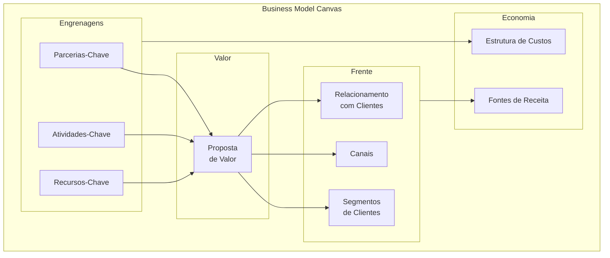

##### O momento exato de colocar este canvas na parede

Use o **Lean Canvas** (apresentado na Fase 1) quando estiver comparando problemas, segmentos e hipóteses iniciais de risco elevado. Passe a usar o Business Model Canvas (BMC) nesta Fase 2 e na Fase 3 quando quiser visualizar a arquitetura operacional completa da ideia escolhida, especialmente como Parcerias-Chave, Atividades-Chave e Recursos-Chave sustentam a entrega da Proposta de Valor. Revise o quadro mensalmente durante a validação inicial e a cada trimestre quando a operação estiver rodando. Lembre-se de que o BMC organiza a hipótese no papel, mas quem decide se a ideia para em pé são as entrevistas da [[IGNICAO-Vol-2-Descoberta-e-Mercado#FASE 4: DESCOBERTA DO PROBLEMA|Fase 4 (Vol. 2)]] e os experimentos da [[IGNICAO-Vol-3-Experimentos-e-Prototipagem#FASE 8: EXPERIMENTOS DE VALIDAÇÃO DO PROBLEMA E DA SOLUÇÃO|Fase 8 (Vol. 3)]].

##### As regras de ouro para preencher sem se enganar

Osterwalder parte do princípio de que um modelo de negócio é um sistema vivo de peças interdependentes: alterar o segmento de clientes ou o canal exige redesenhar recursos, parcerias e estrutura de custos. O valor do quadro está em colocar todas essas engrenagens na mesma folha para que o time enxergue onde a conta ou a operação não fecham. Como o canvas mapeia a lógica que você imagina hoje, um BMC visualmente coerente serve como mapa de hipóteses para ir a campo, e nunca como substituto da validação com clientes reais.

##### Passo a passo na parede da sala

Reúna 2-4 pessoas (cofundadores idealmente, mais 1 mentor externo se possível). Imprima a tela em A1 ou desenhe na parede com fita crepe. Use post-its (cores diferentes para cada bloco). Bloco a bloco, na ordem que importa:

1. **Segmentos de Clientes** primeiro: sem cliente, nada mais importa.
2. **Proposta de Valor**: por que esses clientes pagariam.
3. **Canais**: como o cliente descobre, compra, recebe e pede suporte.
4. **Relacionamento**: self-service, comunidade, suporte humano, automação.
5. **Fontes de Receita**: modelo (assinatura, transação, licença, freemium).
6. **Recursos-Chave**: o que a empresa precisa ter (pessoas, tecnologia, IP, capital).
7. **Atividades-Chave**: o que a empresa precisa fazer todo dia.
8. **Parcerias-Chave**: quem a empresa precisa ao lado (fornecedores, integradores, distribuição).
9. **Estrutura de Custos**: onde o dinheiro sai.

Tempo recomendado para a primeira versão: 60 a 90 minutos, preenchendo cada bloco com 3 a 5 notas curtas e objetivas em vez de parágrafos longos. Revise o quadro mensalmente durante as fases de validação e trimestralmente após atingir o ajuste ao mercado (PMF).

##### Exemplo brasileiro preenchido: Nubank em 2014 (reconstrução didática com base em dados públicos)

| Bloco | Conteúdo |
|---|---|
| **Segmentos de Clientes** | Brasileiros 25-40 anos, urbanos, classes A/B/C+, insatisfeitos com banco tradicional, familiares com smartphone |
| **Proposta de Valor** | Cartão de crédito sem anuidade, gerenciado 100% por app, sem burocracia, atendimento humano via chat, transparência |
| **Canais** | App mobile (iOS + Android), landing page, marketing digital orgânico, convite por fila de espera viral |
| **Relacionamento** | Self-service via app, suporte humano on-demand via chat, comunicação pelo nome próprio |
| **Fontes de Receita** | Intercâmbio (% sobre cada transação no cartão), juros do rotativo, futuro: receitas adjacentes (lending, investimento) |
| **Recursos-Chave** | Equipe técnica (engenharia, produto, design), capital de risco, algoritmos de análise de crédito e estrutura de conformidade regulatória perante o Banco Central (sendo que a autorização própria como instituição de pagamento e financeira veio nos anos seguintes) |
| **Atividades-Chave** | Desenvolvimento de produto digital, aquisição de clientes, gestão de risco de crédito, atendimento |
| **Parcerias-Chave** | Bandeira Mastercard (acordo inicial de emissão), processadora de cartões, birôs de crédito e provedor de infraestrutura em nuvem |
| **Estrutura de Custos** | Salários de tecnologia (majoritário), atendimento, marketing, provisões de risco de crédito, compliance |

O BMC do Nubank em 2014 mostra um modelo intencionalmente enxuto: poucos blocos com complexidade real (cartão único, segmento único, canal único). A disciplina foi não adicionar produtos ou segmentos antes de dominar o primeiro. Expansão para conta corrente (2017), lending (2019), investimentos (2020) só aconteceu depois de o cartão dominar o segmento original. Empresas que tentam preencher os nove blocos com complexidade simultânea desde o início frequentemente falham por dispersão. BMC bem feito tem cara de simples.

##### Variações e extensões

- **Lean Canvas** (Fase 1): substitui Parcerias, Atividades, Recursos e Relacionamento por Problema, Solução, Métricas-Chave e Vantagem Injusta. Mais útil em estágio pré-PMF.
- **Social Business Model Canvas**: adiciona blocos de impacto social, beneficiários e métricas de impacto.
- **Platform Business Model Canvas**: adapta para marketplaces de dois lados.
- **Sustainable Business Model Canvas (Triple Layer)**: adiciona camadas ambiental e social.

##### Onde os fundadores mentem para si mesmos neste canvas

- Preencher sozinho na cabeça em vez de em conversa colaborativa: o valor do BMC está no debate entre múltiplos olhares, não no documento final.
- Tratar como artefato estático, não revisitar: BMC sem atualização perde sentido em três meses.
- Confundir clareza do BMC com validação do mercado: ter BMC bonito não prova que cliente existe.
- Excesso de detalhe em cada bloco: se você precisa de parágrafo para explicar um bloco, a ideia ainda não está clara.
- Forçar um único BMC para múltiplos segmentos muito distintos: cada segmento merece BMC próprio.

---

### TEMPLATES OPERACIONAIS E CASOS PREENCHIDOS DESTA FASE 2

#### Template: Declaração Inicial da Ideia

**Para que serve.** Captura a ideia inicial em formato auditável com problema, cliente, solução, modelo, hipóteses e incertezas categorizadas, antes de qualquer construção.

**Quando usar.** Ao concluir a Fase 2 e antes de entrar em descoberta de problema (Fase 4, Vol. 2). Refaça também sempre que pivotar em qualquer um dos sete blocos, marcando nova versão.

**Exemplo de preenchimento.** Problema: "donos de restaurante de bairro perdem de 3 a 6 horas por semana conciliando taxas de iFood, Rappi, Aiqfome e maquininhas de cartão". Para quem: "operações independentes com 1 a 3 unidades e faturamento de R$ 80 mil a R$ 300 mil por mês". Alternativa atual: "planilha manual alimentada com extratos baixados um a um". Solução proposta: "conciliação automática via integração direta com adquirentes e aplicativos de entrega". Modelo de negócios: "assinatura de R$ 199 por mês por unidade". Por que pode funcionar: "o dono prefere pagar R$ 199 mensais a perder o domingo fechando planilha ou contratar um auxiliar administrativo".

A DII tem sete blocos de conteúdo mais a lista de incertezas categorizada. Cabe em uma página (400 a 800 palavras). Em ideias B2B, o bloco "Para quem" tem sub-estrutura com Decisor Econômico e Champion separados.

```text
DECLARAÇÃO INICIAL DA IDEIA
Versão: ___ | Data: ___

1. PROBLEMA (3-5 frases, ancoradas em dados quando possível, sem mencionar sua solução)
___________________________________________
___________________________________________
Dados/referências (opcional, recomendado em B2B-enterprise):
- _______________________________________
- _______________________________________

2. PARA QUEM
2a. Quem é (filtros objetivos: setor, tamanho, frequência, momento)
___________________________________________
2b. Quem NÃO é (anti-perfil - descarta na primeira chamada e por quê)
___________________________________________
[Se B2B, preencha 2c e 2d]
2c. Decisor Econômico (papel que aprova orçamento + pergunta de qualificação em 1 frase)
___________________________________________
2d. Champion (papel que opera o produto e vende internamente + pergunta de qualificação em 1 frase)
___________________________________________

3. ALTERNATIVA ATUAL (como o cliente resolve hoje - planilha, processo manual, concorrente, ignorar)
___________________________________________

4. SOLUÇÃO PROPOSTA (capacidades, não features)
___________________________________________

5. MODELO DE NEGÓCIOS (quem paga, quanto, como, contra o que compete)
- Modelo: [assinatura | transacional | performance | work-as-a-service | .]
- Preço-rascunho: ___________________________
- Gatilho de pagamento: ______________________
- Compete contra: [não compete com software, compete com custo de analista interno, não compete com X, compete com Y]

6. POR QUE PODE FUNCIONAR (3-5 hipóteses sobre o mundo, formato testável "[Persona] [verbo] [objeto]")
1) _______________________________________
2) _______________________________________
3) _______________________________________

7. POR QUE NÓS (Founder-Market Fit em 1-2 frases - vantagem injusta concreta, não adjetivos)
___________________________________________

8. O QUE EU NÃO SEI (10-25 incertezas em 7 categorias, nenhuma categoria vazia)
Demanda (cliente percebe o problema como prioridade?):
- _______________________________________
Mercado (orçamento existe? Onde está alocado? Como o mercado se comporta?):
- _______________________________________
Solução (a forma proposta resolve? É a forma certa?):
- _______________________________________
Adoção (o cliente vai mudar de comportamento para usar?):
- _______________________________________
Canal (como o cliente descobre? Onde está acessível?):
- _______________________________________
Modelo (pricing percebido como justo? ROI defensável internamente?) e Regulação (licenças, normas setoriais ou compras públicas aplicáveis?):
- _______________________________________
```

---

### Da neblina ao alvo fixo: o que você ganha ao fechar a Fase 2

A Fase 2 serve para capturar a ideia com nitidez antes de gastar sola de sapato. Quando Henrique trocou a explicação técnica cheia de siglas da abertura pela DII de uma página focada no custo da hora de caldeira parada, percebeu imediatamente que ainda não sabia quem assinava o orçamento na usina nem quais exigências de segurança da planta poderiam barrar o sensor. Muitos fundadores travam nesse exercício porque descobrem no papel que não conseguem descrever o problema sem falar do próprio produto, ou que a ideia ainda era apenas uma intuição nebulosa. O que não pode ser escrito com clareza ainda não existe como hipótese operacional.

O divisor de águas desta etapa é a honestidade intelectual diante das próprias lacunas. A lista de incertezas nas sete categorias, que encerra a Declaração Inicial da Ideia, costuma ser a parte mais negligenciada pelos iniciantes e a mais decisiva para quem sobrevive: assumir por escrito o que você ainda desconhece prepara a matéria-prima exata que será encadeada na Fase 3 e colocada à prova em campo a partir do Volume 2.

O entregável desta Fase 2 é a Declaração Inicial da Ideia (DII) em uma página única, clara o bastante para ser explicada em 90 segundos a um interlocutor de fora do setor e repetida por ele sem distorção. Se a explicação travar, reescreva antes de seguir adiante: na Fase 3, logo a seguir, você transformará esta DII na árvore causal da teoria do negócio, e na Fase 4 (Volume 2) usará o recorte de público e a lista de incertezas para conduzir as entrevistas de descoberta de problema.

---

## FASE 3: CONSTRUÇÃO DA TEORIA DO NEGÓCIO

### Todo negócio se apoia numa cadeia de crenças: qual peça, se cair, leva todas as outras junto?

Antes de criarem sua marca própria D2C, Rafael, no Recife, e Bia, em Goiânia, avaliaram montar uma central de compras coletivas de embalagens biodegradáveis para hamburguerias e cafeterias artesanais. No papel, a Declaração da Ideia parecia certeira: os donos reclamavam do custo das caixas e elogiavam práticas sustentáveis. Antes de alugar galpão ou fechar pedido mínimo na indústria, porém, Bia desenhou no quadro branco a Árvore da Teoria que você construirá nos nove passos desta Fase 3. O mapa causal revelou o dominó mortal: para obter 30% de desconto na fábrica (Nó C), 40 hamburguerias precisariam encomendar a mesma medida de embalagem na mesma terça-feira (Nó B) e pagar à vista de forma antecipada (Nó A). Ao ligarem para seis estabelecimentos para checar a crença por trás do Nó A, esbarraram na distância entre discurso e prática (*say-do gap*): todos elogiavam sustentabilidade, mas 100% parcelavam embalagens no cartão em 60 dias por falta de capital de giro. Esse único dominó mortal derrubava a árvore principal a custo zero de estoque e levou a dupla a desenhar a teoria alternativa: primeiro avaliando se um parceiro financeiro conseguiria antecipar o recebível das fábricas e, diante da margem estreita, migrando para uma marca própria D2C de autocuidado com pagamento à vista no cartão e recompra em 60 dias, desfecho que retomaremos no Espelho e no fechamento desta fase.

Assim como Andy Grove organiza a produção da fábrica de café da manhã em *High Output Management* (1983) a partir da etapa mais decisiva e demorada (o cozimento do ovo), numa teoria de negócio você precisa identificar e testar primeiro a crença mais frágil que condiciona todas as demais. Na abordagem baseada em teoria do empreendedorismo (Felin, Gambardella, Stern e Zenger, 2020), dar um passo além do quadro estático e desenhar a Árvore da Teoria (originalmente chamada de *Story Tree* e representada como grafo acíclico dirigido, ou *DAG*) é o que separa quem testa o que é cômodo de quem testa o que é decisivo.

Chamamos o erro de pular esta etapa de A Cegueira dos Quadradinhos Soltos: preencher nove blocos num canvas na parede sem desenhar as setas de causa e efeito entre eles e sem marcar com franqueza quais nós são dominós mortais (apostas *bet-the-company* que, se forem falsas, reduzem o valor de todo o resto a zero).

---

### Por que testar as premissas fáceis primeiro é a forma mais cara de adiar o fracasso

A maior parte dos empreendedores pula direto da ideia para entrevistas e testes. O resultado é conhecido. Eles testam coisas que não importam, e deixam de testar o que é decisivo. A teoria explícita resolve esse problema de três formas.

Primeiro, força pensamento estruturado antes de gastar dinheiro. Parte da busca acontece cognitivamente, na escrivaninha, não no mercado. Isso reduz o custo dos experimentos posteriores.

Segundo, revela os atributos realmente decisivos. Quando você é obrigado a desenhar a cadeia causal, percebe quais elos são bet-the-company (apostas totais: se falharem, destroem a ideia) e quais são secundários.

Terceiro, permite considerar alternativas. Teoria explícita torna visível que existem outras explicações possíveis para o mesmo fenômeno. Isso abre caminho para pivôs inteligentes e previne apego prematuro à primeira hipótese.

Sem teoria explícita, o seu plano de negócios é uma opinião disfarçada. Com teoria explícita, é um objeto de estudo.

### Do Story Tree ao Grafo Causal (DAG): os 9 passos para isolar suas apostas bet-the-company

Nove passos.

> [!tip] Theory Map / Story Tree como canvas formal desta fase
> O Story Tree descrito nesta fase tem um canvas dedicado com estrutura formal, pontuação K × I por nó e caso brasileiro (Creditas/BankFacil) em [[#Canvas: Theory Map / Story Tree (autoral IGNIÇÃO)|Canvas: Theory Map / Story Tree (autoral IGNIÇÃO)]]. Use o template preenchível em [[#Template: Theory Map: Conexão com Business Model Canvas|Template: Theory Map, Conexão com Business Model Canvas]] junto com o canvas para conectar a árvore ao Business Model Canvas.

#### Passo 1: três perguntas-âncora (método Story Tree)

Num papel em branco ou num arquivo de texto, responda por escrito a três perguntas.

A primeira: *qual problema ou fenômeno você está observando?* Descreva o que você vê no mundo que faz você acreditar que há oportunidade. Por exemplo, "donos de pequenos restaurantes gastam entre quatro e seis horas por semana em conciliação manual de faturas de delivery".

A segunda: *por que isso está acontecendo?* Identifique as causas raízes. Por exemplo, "porque cada plataforma (iFood, Rappi, etc) tem seu próprio formato de relatório, o software de gestão não integra, e o dono não tem pessoal administrativo treinado".

A terceira: *o que você poderia fazer a respeito?* Esboce caminhos de solução, sem se comprometer com um ainda. Por exemplo, "automatizar a extração e reconciliação desses relatórios, ou treinar equipes terceirizadas para fazer, ou criar um padrão aberto de dados".

Essas três respostas formam a narrativa mínima da sua teoria.

#### Passo 2: decomposição em atributos

Um atributo é qualquer elemento do problema, do cliente ou da solução cuja realização futura permanece incerta e precisa ser tratada como aposta explícita. Liste todos os atributos que aparecem nas respostas do Passo 1.

Para o caso do restaurante, alguns exemplos: frequência semanal média de conciliação manual. Tempo médio gasto por conciliação. Disposição do dono a pagar por uma solução. Número de plataformas com as quais o restaurante opera. Existência e acessibilidade de APIs das plataformas. Grau de aversão do dono à adoção de software novo. Tamanho do segmento (restaurantes independentes com uma a três unidades no Brasil). Disposição das plataformas em cooperar com integradores terceiros.

Não há número certo de atributos. Busque entre oito e quinze. Menos que isso costuma ser análise incompleta. Mais que isso geralmente inclui atributos redundantes ou irrelevantes.

#### Passo 3: conexões causais

Para cada par de atributos, pergunte: *a realização de A afeta a realização de B?* Se sim, desenhe uma seta de A para B. Por exemplo, "número de plataformas" afeta "tempo gasto em conciliação" (quanto mais plataformas, mais tempo). "Tempo gasto em conciliação" afeta "disposição a pagar" (quanto mais dolorido, mais o dono paga). "Aversão à adoção de software" afeta "disposição a pagar" (maior aversão, menor disposição).

Evite setas circulares (A apontando para B e B apontando de volta para A), pois o mapa causal precisa ser um grafo acíclico dirigido (DAG), no qual nenhuma seta retorna ao ponto de partida. Quando parecer haver retroalimentação, desmembre a sequência no tempo ou isole a variável intermediária que explica a causa primária.

#### Passo 4: crenças em cada seta

Para não confundir probabilidade com lastro de dados, separe duas marcações complementares na sua Árvore da Teoria. Primeiro, em cada seta causal, classifique o nível de evidência atual (que é o inverso do grau de dúvida D1 a D5 usado na pontuação $K \times I$ do canvas ao final desta fase): Evidência Alta (Níveis 4 e 5, equivalentes a D1 e D2), quando você já dispõe de dados históricos, contratos ou observação direta consistente, Evidência Média (Nível 3, equivalente a D3), quando a relação causal é plausível mas apoia-se em analogias indiretas, e Evidência Baixa (Níveis 1 e 2, equivalentes a D4 e D5, suposição pura), quando a seta ainda é uma aposta sem validação empírica.

Segundo, em cada **nó (atributo)**, registre separadamente a sua crença subjetiva de realização em percentual (0% a 100%): por exemplo, "estimamos em 80% a chance de o dono gastar mais de quatro horas semanais em conciliação, com Evidência Baixa (D4) até medirmos em campo".

Essas crenças são subjetivas e vão parecer arbitrárias. Realmente são. O ponto não é acertar o número. É tornar explícita a sua aposta para depois comparar com o dado real.

#### Passo 5: Marcação dos nós mortais (premissas *bet-the-company*)

Chamamos de **dominó mortal** (também conhecido na literatura como premissa *bet-the-company*) o nó da Árvore da Teoria que, se for refutado em campo, derruba a ideia inteira. Esses são os nós que você testa primeiro nas fases seguintes. No exemplo do restaurante, se o dono não estiver disposto a pagar por uma solução de conciliação, nada mais importa: esse dominó mortal é o primeiro alvo.

> [!tip] Conexão com a Fase 7 (Vol. 3): do dominó mortal ao Hypothesis Canvas
> Enquanto a Árvore da Teoria desta Fase 3 mostra o encadeamento causal entre os nós do negócio, o detalhamento experimental de cada premissa crítica ocorre na Fase 7 (Vol. 3), onde você usará o [[IGNICAO-Vol-3-Experimentos-e-Prototipagem#Canvas: Hypothesis Canvas (autoral IGNIÇÃO)|Hypothesis Canvas (Vol. 3)]] e o [[IGNICAO-Vol-3-Experimentos-e-Prototipagem#Template: Hypothesis Canvas|Template: Hypothesis Canvas (Vol. 3)]] para transformar os dominós mortais identificados neste Passo 5 em experimentos práticos para a Fase 8 (Vol. 3).

#### Passo 6: parcimônia e modularidade

Olhe para a sua árvore e faça duas perguntas. Parcimônia: posso remover algum atributo sem prejudicar o poder explicativo da teoria? Se sim, remova. Mais enxuto é melhor. Modularidade: consigo testar cada ramo da árvore separadamente? Se a árvore só funciona como bloco único, ela não é testável. Quebre em ramos independentes.

#### Passo 7: aplique quatro critérios práticos adaptados da filosofia da ciência e da visão baseada em teoria (Felin & Zenger, 2017)

Antes de declarar a árvore concluída, aplique quatro testes cumulativos. Uma teoria só sustenta vantagem competitiva se atende aos quatro ao mesmo tempo.

**Novidade:** A sua teoria representa uma aposta que difere da crença consensual do mercado? Se todo mundo no setor já pensa como você pensa, a teoria não gera valor novo. Ela apenas reproduz conhecimento comum, e o valor resultante já foi capturado pelos incumbentes. Pergunte: *em que ponto específico a minha teoria discorda da teoria implícita dos concorrentes estabelecidos?* Se você não consegue apontar, a sua teoria é derivativa.

**Simplicidade:** A teoria pode ser explicada em poucas frases, com estrutura causal clara? Teorias que precisam de quinze condições, quatro exceções e três mecanismos secundários para funcionar são teorias frágeis. Complexidade costuma indicar falta de clareza, não sofisticação. Se você não consegue contar a história em noventa segundos, quebre até conseguir.

**Falsificabilidade:** Existe alguma observação concreta no mundo real que, se você a encontrasse na próxima semana, refutaria a sua teoria? Quando nenhuma evidência contrária parece capaz de abalar a tese, ela deixou de ser uma hipótese de negócio e virou artigo de fé. Para cada dominó mortal, escreva desde já qual fato observável faria você descartar ou reformular aquele ramo.

**Generalidade:** A teoria explica mais do que apenas o caso pontual que te inspirou? Se ela só funciona para o seu exemplo pessoal ou para um cliente específico, não generaliza. E sem generalização, não há mercado escalável. Teste: *a minha teoria prevê comportamento em outras situações do mesmo tipo?* Se a resposta é "só no meu caso específico", reescreva em princípios mais amplos.

> [!warning] Teoria que passa nos quatro critérios é rara
> A maioria das teorias de empreendedores iniciantes falha em pelo menos um dos quatro, normalmente novidade ou generalidade. Se a sua falha, não é problema. Faça mais uma iteração na árvore, reescrevendo os atributos até os quatro critérios serem atendidos.

#### Passo 8: construa uma teoria alternativa

Iniciantes quase sempre pulam este passo, e justamente por isso cumpri-lo cria uma vantagem real de diagnóstico. Desenhe uma segunda Árvore da Teoria capaz de explicar o mesmo problema do cliente por outro mecanismo causal. Por exemplo, e se os donos de restaurante tolerarem a conciliação manual e recusarem pagar por um software automático, mas toparem contratar um serviço terceirizado que entregue o fechamento pronto? Trate essa segunda árvore como hipótese concorrente em teste paralelo para não ficar refém de uma única narrativa.

#### Passo 9: Conexão da árvore causal com o Business Model Canvas (via Theory Map)

Se você já usou BMC ou Lean Canvas, monte um Theory Map. Pegue cada bloco do canvas e, para cada um, escreva três coisas: por que aquele elemento está ali. Qual atributo da sua árvore de teoria ele representa. Qual a relação causal com os outros blocos. Isso conecta os elementos do BMC que normalmente ficam isolados em post-its separados.

### Anatomia completa em campo: dissecando os dominós causais do caso PadariaPro

Para tornar a sequência concreta, este é o Story Tree condensado da mesma ideia trabalhada na Fase 2.

- **Raiz (missão):** reduzir pela metade a perda de margem causada pelo controle manual de estoque em pequenas padarias artesanais brasileiras.

- **Tronco (tese central):** padarias artesanais com 2 a 5 lojas perdem de 12% a 18% de margem por falhas no controle manual de insumos, um software integrado aos fornecedores estanca esse desperdício em um mercado de mais de 5 mil estabelecimentos dispostos a pagar entre R$ 300 e R$ 500 mensais por loja.

- **Quatro galhos principais da árvore causal:**

- **Primeiro galho (existência do problema em escala):** apoia-se em três sub-hipóteses: (a) as padarias sofrem perda real de 12% a 18% de margem bruta em ruptura ou descarte de insumos, (b) a dor se repete semanalmente e é reconhecida como prioridade pelo sócio-operador, e (c) o problema se mantém consistente em múltiplas praças além da capital paulista.

- **Segundo galho (viabilidade técnica da solução):** apoia-se em três sub-hipóteses: (a) os distribuidores de insumos disponibilizam integração via API ou arquivo padronizado, (b) o modelo de previsão de demanda atinge acurácia superior a 75% na rotina da padaria, e (c) a conexão com sistemas legados de balança e frente de caixa é tecnicamente executável.

- **Terceiro galho (sustentabilidade econômica):** apoia-se em três sub-hipóteses: (a) o custo de aquisição de cliente permanece abaixo de R$ 800 por estabelecimento, (b) o cancelamento mensal (*churn*) fica abaixo de 3%, e (c) a receita anual por contrato entre R$ 4.000 e R$ 6.000 por loja sustenta a margem operacional.

- **Quarto galho (defensabilidade competitiva):** apoia-se em três sub-hipóteses: (a) as integrações diretas com fornecedores criam custo de troca e barreira de entrada, (b) os sistemas de gestão (ERPs) generalistas não priorizarão as regras específicas da panificação artesanal, e (c) os softwares legados do setor não atualizarão sua arquitetura na mesma velocidade.

- **Dominós mortais identificados (Passo 5):** no Galho 1, sub-hipótese (a), se o desperdício real for de apenas 3% a 5% em vez de 12% a 18%, a economia gerada não paga a assinatura mensal, no Galho 2, sub-hipótese (a), sem integração direta com os fornecedores o sistema vira apenas mais um controle manual, no Galho 3, sub-hipótese (b), com mensalidade média de R$ 400, margem bruta de 70% (R$ 280/mês de margem de contribuição) e CAC de R$ 800, se o cancelamento mensal (*churn*) passar de 10% (reduzindo o tempo médio de permanência para menos de 10 meses e o LTV de margem para menos de R$ 2.800), a relação LTV/CAC cai abaixo do patamar saudável de 3x.

- **Fluxo causal no grafo acíclico dirigido (DAG):** "Desperdício recorrente de insumos" leva a "dono da padaria aceita pagar a mensalidade projetada", que sustenta "receita anual por loja viável", "integração direta com distribuidores" gera "diferencial operacional claro", que eleva a "retenção de longo prazo", e "cancelamento mensal abaixo de 3%" garante que o "valor vitalício do cliente supere com folga o custo de aquisição".

Ordene os testes combinando o risco do dominó mortal e o ganho de informação por real gasto: comece pela sub-hipótese 1(a), que é barata de verificar (entrevistas e análise das notas reais de dez padarias na Fase 4, Vol. 2) e condiciona todo o resto. Em paralelo, teste a 2(a), conversando com três distribuidores sobre integração de catálogos e pedidos. Já a 3(b) exige produto pago rodando por três meses ou mais e será validada na [[IGNICAO-Vol-4-Tracao-e-PMF#FASE 11: MVP E EXPERIMENTOS DE MERCADO|Fase 11 (Vol. 4)]].

### A autópsia de uma ilusão: como a árvore causal revela quando o cliente elogia mas não paga

Este caso hipotético mostra em funcionamento o método da visão baseada em teoria (Felin, Gambardella, Stern e Zenger, 2020, Camuffo et al., 2020), separando atributos, causas, crenças subjetivas e a distância entre elogio e compra real. A história da fundadora fictícia "Emily" ajuda a visualizar como a Árvore da Teoria se aplica a um negócio de consumo (B2C) com apelo de sustentabilidade.

**Contexto:** Emily quer lançar uma marca de roupas sustentáveis e éticas.

Teoria principal, a árvore de Emily. O atributo final é a disposição a pagar por moda sustentável e ética. As causas antecedentes são três. Preocupação ambiental do consumidor (muitas pessoas estão conscientes do impacto ambiental da fast fashion). Preocupação social (condições trabalhistas precárias na indústria têxtil geram desconforto). Escassez de alternativas acessíveis (quem quer alternativa sustentável tipicamente acha caro demais ou os estilos limitados). Os atributos de execução são três. Disponibilidade de materiais sustentáveis com custo viável. Supply chain de fornecedores certificados. Capacidade de design moderno competindo em estilo com fast fashion.

Crenças subjetivas de Emily. Probabilidade de que "consumidores-alvo aceitam um acréscimo de quinze a trinta por cento por sustentabilidade", setenta por cento. Crença alta, mas testável. Probabilidade de que "supply chain sustentável é escalável com crescimento", cinquenta por cento. Crença moderada, principal fonte de risco. Probabilidade de que "design pode competir esteticamente com fast fashion", oitenta por cento. Crença alta, baseada em evidência de marcas como Reformation.

**Teoria alternativa de Emily.** Uma segunda árvore altera uma premissa central da tese: o que muda se os consumidores declararem apreço por sustentabilidade nas pesquisas, mas na hora da compra não aceitarem pagar mais caro (lacuna entre discurso e prática, ou *say-do gap*)? Nesse cenário, o produto precisa competir em paridade de preço com a moda convencional, tratando o menor impacto ambiental como atributo embutido na oferta e deslocando a estratégia do posicionamento *premium* para a eficiência industrial.

Cada uma das duas teorias gera hipóteses diferentes, experimentos diferentes e empresas com estruturas operacionais distintas. O valor de manter uma teoria alternativa explícita aparece no choque com a rua: se os primeiros testes mostrarem que o público elogia a causa ambiental mas continua comprando *fast fashion* pelo preço, Emily já terá a rota de paridade de custo mapeada e poderá redirecionar a operação com método, sem paralisia.

Uma teoria com probabilidades subjetivas e uma teoria alternativa documentada transforma o pivô de "crise existencial" em "mudança planejada de rota". Sem teoria alternativa, o empreendedor tende a insistir em teoria única até que não sobre caixa para testar outra.

### Caso real brasileiro: Hotmart: a seta causal que destravou a economia de criadores no Brasil

Em 2011, o mercado de infoprodutos digitais no Brasil era fragmentado. Criadores vendiam cursos via PagSeguro com experiências ruins. Compradores abandonavam carrinho.

Fundada em 2011 em Belo Horizonte por João Pedro Resende e Mateus Bicalho, a Hotmart tinha uma tese inicial que pode ser lida, em retrospecto, como uma cadeia de três hipóteses causais: se uma plataforma unificasse meios de pagamento locais, hospedagem segura de arquivos digitais e um programa de comissionamento automático de afiliados, (1) criadores de conteúdo adotariam a ferramenta para vender sem atrito técnico, (2) afiliados trariam escala de vendas com custo de aquisição variável (pago apenas como comissão sobre a venda realizada) e (3) o ecossistema geraria retenção e receita recorrente por volume transacionado.

Lida sob a lente da Árvore da Teoria, essa arquitetura encadeava três causas (unificação de pagamento e hospedagem, rede de afiliados como motor de distribuição e retenção de criadores), permitindo validar um elo de cada vez, sendo o programa de afiliados a alavanca que destravou a escala da empresa.

Teoria explícita permite testar cada premissa isoladamente. Teoria implícita mistura causas e oculta o que deu certo de verdade.

### Checklist de saída: sua teoria causal aguenta o choque com a rua?

Você concluiu a Fase 3 quando todos os critérios abaixo estão cumpridos.

- [ ] Árvore da Teoria (*Story Tree*) estruturada em ferramenta compartilhável (Miro, Figma, Notion ou planilha), contendo raiz, tronco, três ou mais galhos principais e de 8 a 15 atributos conectados por relações causais com nível de evidência classificado (Alta/D1-D2, Média/D3 ou Baixa/D4-D5).
- [ ] Grafo causal (DAG) com 8 a 15 nós e suas ligações sem ciclos, cada um avaliado na mesma escala de evidência (alta, média ou baixa).
- [ ] Pelo menos uma teoria alternativa documentada (não plano B, objeto de teste paralelo).
- [ ] Para cada dominó mortal da árvore, está escrita de forma explícita a observação de campo que derrubaria essa crença (Passo 7), classificada por frente de risco (desejabilidade, viabilidade técnica, viabilidade financeira ou defensabilidade) e pronta para ser convertida em hipótese formal de experimento na Fase 7 (Vol. 3).
- [ ] Proporção de setas causais com confiança alta entre 10% e 50%. Acima de 50%, você provavelmente está se enganando. Abaixo de 10%, ainda sabe muito pouco sobre o problema, volte para entrevistas exploratórias.
- [ ] Dois a cinco **dominós mortais** (*bet-the-company*) destacados na árvore (crenças de alto impacto e baixa evidência atual que concentrarão os testes dos próximos 30 a 60 dias).
- [ ] Ordem de execução dos testes definida, priorizando os nós mortais pela combinação de risco de ruína e valor de informação por real gasto.
- [ ] Para cada nó, você consegue imaginar um experimento (mesmo grosseiro) que o testaria.
- [ ] Três pessoas independentes olham a árvore e explicam com palavras próprias por que você acredita que o negócio funciona.
- [ ] Opcionalmente, após validar os itens obrigatórios acima, conecte os dominós mortais da árvore aos blocos correspondentes do seu Business Model Canvas ou Lean Canvas por meio do template de conexão ao final desta fase.

> [!warning] Catraca de saída da Fase 3
> Se um ou mais itens obrigatórios continuarem em aberto, revise a Árvore da Teoria antes de ir a campo: entrar na Fase 4 com nexo causal quebrado multiplica o retrabalho nas entrevistas.

**Primeiros passos práticos.**

1. Abrir os templates da Árvore da Teoria e do Grafo Causal (DAG), ao final desta fase, e rascunhar a primeira versão em duas horas.
2. Listar todas as crenças implícitas da ideia em modo brainstorm bruto. Depois classificar em níveis da árvore.
3. Para cada seta causal, classificar o nível de evidência atual na escala unificada: Evidência Alta (D1-D2), Média (D3) ou Baixa (D4-D5).
4. Marcar de dois a cinco dominós mortais na árvore e atacar primeiro os dois de menor evidência atual.

### Quando o mapa vira peça de convencimento: árvores gigantes, setas circulares e otimismo de 90%

**Árvore gigante ou sem lacunas aparentes.** Desenhar mais de 15 nós tentando mapear cada detalhe operacional ou pintar todos os blocos como certezas sem dúvida em aberto transforma a ferramenta numa peça de convencimento: enxugue a árvore para 8 a 15 atributos e explicite onde a evidência ainda é baixa (D4 ou D5).

**Confundir atributo com solução.** Escrever "aplicativo com painel integrado" descreve uma funcionalidade do produto, o atributo incerto que precisa entrar na Árvore da Teoria é a disposição real do dono da operação para abrir e alimentar esse painel toda semana.

**Setas circulares e causalidade presumida sem evidência.** Desenhar ciclos fechados em que A causa B e B causa A viola a regra do grafo acíclico dirigido (DAG) e impede saber por onde começar o teste, da mesma forma, afirmar que "economia de tempo gera fidelidade automática" sem dado comportamental exige marcar a seta como hipótese de baixa evidência (D4-D5).

**Apego à primeira versão.** Se após duas horas de trabalho você desenhou apenas um caminho causal, o viés de confirmação já se instalou: force-se a rascunhar uma segunda árvore com premissa oposta.

**Árvore que não desce ao chão empírico.** Se os ramos da sua teoria não puderem ser convertidos em hipóteses falsificáveis na [[IGNICAO-Vol-3-Experimentos-e-Prototipagem#FASE 7: FORMULAÇÃO RIGOROSA DE HIPÓTESES|Fase 7 (Vol. 3)]], ela é apenas decorativa e precisa ser refeita.

**Ir direto aos quadros estáticos sem mapear causa e efeito.** O Business Model Canvas organiza o inventário das peças do negócio, mas a árvore da teoria é o que explicita por que uma peça move a outra e quais premissas precisam ser testadas primeiro.

---

### O Espelho da Fase 3 e o Ritual de Segunda-Feira

Quando o teste telefônico com seis hamburguerias derrubou o Nó A da central de embalagens (nenhum dono pagava caixas à vista), Rafael e Bia não tentaram salvar a ideia no grito: recorreram à teoria alternativa desenhada no Passo 8. Como financiar 60 dias de prazo com capital próprio comeria toda a margem da intermediação, decidiram migrar para uma marca própria D2C de cosméticos naturais vendidos à vista no Pix e cartão, isolando na nova Árvore da Teoria um único dominó mortal para o ciclo seguinte: atingir pelo menos 28% de recompra em até 60 dias após o primeiro pedido.

> [!tip] O Espelho Causal (Autodiagnóstico Rápido)
> Rafael e Bia precisaram de seis ligações para derrubar o Nó A da central de embalagens e descobrir o parcelamento em 60 dias. Olhe para a cadeia de causa e efeito do seu negócio hoje:
> 1. **A Falácia do Operador vs. Pagador (o seu Nó A):** Na sua teoria, quem sente a dor operacional todo dia é a mesma pessoa que tem orçamento e caixa para pagar à vista ou assinar o contrato? Qual é o seu Nó A e quantas ligações faltam para testar se o pagador aceita a condição financeira que a sua árvore exige?
> 2. **Honestidade nas Probabilidades:** Se você multiplicar as probabilidades condicionais das três ou quatro setas decisivas até o cliente pagar ($P(A) \times P(B|A) \times P(C|B)$), o resultado cai numa faixa de trabalho realista (entre 15% e 45%), ou você pintou tudo de 90% para se sentir seguro?
> 3. **Isolamento dos Dominós Mortais (Premissas *Bet-the-Company*): Entre os dois a cinco dominós mortais marcados na sua árvore, você consegue apontar em 10 segundos quais são os dois de menor evidência atual** que, se forem refutados na próxima semana, obrigam você a acionar sua teoria alternativa?
>
> **Sua permissão:** Você não precisa fingir 90% de certeza diante de sócios ou mentores quando a evidência atual ainda é D4 ou D5. Assumir no quadro que a premissa mais importante do negócio tem apenas 30% de probabilidade subjetiva hoje tira o peso da adivinhação das suas costas e mostra exatamente qual pergunta levar para a rua na segunda-feira.
>
> **Ritual de Segunda-Feira (30 minutos):** Desenhe em uma folha os 8 a 15 nós da sua Árvore da Teoria, marque o nível de evidência (Alta/D1-D2, Média/D3 ou Baixa/D4-D5) em cada seta, destaque de 2 a 5 dominós mortais e leve os 2 de menor evidência atual como alvo prioritário para as entrevistas de campo do Volume 2.

---

### MÉTRICAS E BENCHMARKS DESTA FASE (FASE 3)

| Métrica | O que medir | Referência saudável |
|---|---|---|
| Árvore da Teoria construída | Nós de causa e efeito com nível de evidência (Alta/D1-D2, Média/D3, Baixa/D4-D5) | 8 a 15 nós em pelo menos 3 níveis |
| Dominós mortais isolados | Número de premissas *bet-the-company* com critério claro de refutação | 2 a 5 dominós mortais (atacando primeiro os 2 de menor evidência) |
| Falsificabilidade | Cada aposta tem condição de refutação clara | Sim |
| DAG sem ciclos | Grafo causal sem loops | Sim |

---

### MANUAL PASSO A PASSO DOS FRAMEWORKS DESTA FASE 3

> [!tip] Uso autocontido neste volume
> Os cinco frameworks a seguir (*Second-Order Thinking*, *MECE*, *OODA Loop*, *McKinsey 7-Step Problem Solving* e *5 Porquês*) entram nesta Fase 3 para dar rigor analítico à construção da sua Árvore da Teoria: desdobrar consequências de 2ª e 3ª ordem nas setas do grafo causal, organizar os galhos sem sobreposição nem lacunas, acelerar o giro entre hipótese e teste e escavar até a causa-raiz no Passo 1.

#### Framework: Second-Order Thinking (Howard Marks, 2011, aplicado na Fase 3)

##### De onde vem a ferramenta (e por que sobreviveu ao filtro do tempo)

Howard Marks, cofundador da Oaktree Capital, popularizou entre investidores a expressão *second-level thinking* (pensamento de segundo nível) no livro *The Most Important Thing* (2011) e em seus memorandos, aplicando ao mercado financeiro a tradição clássica de análise de efeitos secundários de Frédéric Bastiat e Henry Hazlitt. Argumento: investidores medíocres pensam em primeira ordem ("isso é bom, vou comprar"), investidores excepcionais pensam em segunda ordem ("isso é bom, então muitos compraram, então preço já incorpora a expectativa, então minha oportunidade está onde?").

##### A mecânica central (sem jargão)

Framework de tomada de decisão que considera consequências de segunda ordem, terceira ordem e subsequentes de uma ação, não só o efeito imediato.

##### As regras do jogo

Primeira ordem: "se fizermos X, Y acontece."
Segunda ordem: "se Y acontece, Z acontece, outros vão reagir assim, incentivos se alteram."
Terceira ordem: "se Z e reação, W acontece, equilíbrio muda."

Exemplo clássico: aumentar preço em 20%.

- 1ª ordem: receita sobe 20% (se tudo mais igual).
- 2ª ordem: clientes reagem, alguns cancelam, sensibilidade importa.
- 3ª ordem: concorrentes reagem, podem subir ou manter, dinâmica competitiva muda.
- 4ª ordem: comunicação afeta percepção de marca de longo prazo.

##### Aplicação imediata na rotina da empresa

Passo 1: Para cada decisão importante, liste efeitos de 1ª ordem.

Passo 2: Para cada efeito, pergunte: "e depois?"

Passo 3: Avance até a terceira ou quarta ordem de consequências, ou até que o ganho analítico de abrir um novo nível fique pequeno. Depois da quarta ordem, a incerteza cresce tanto que a capacidade de previsão cai drasticamente.

Passo 4: Considere reações de múltiplos agentes. Clientes, concorrentes, reguladores, mídia, time interno.

Passo 5: Questione premissas implícitas. "Assumir tudo igual" raramente é verdade.

Passo 6: Tome decisão com entendimento de ordens.

##### Na trincheira real: como isso funciona na prática

Veja como Rafael e Bia aplicaram o pensamento de segunda e terceira ordem na Fase 3 ao analisarem a seta causal de "oferecer 60 dias de prazo no boleto para as 40 hamburguerias" na primeira teoria da central de embalagens:

- **1ª ordem (efeito imediato na adesão):** as hamburguerias aceitam entrar na compra coletiva porque o prazo de 60 dias casa com o fluxo de caixa delas.
- **2ª ordem (reação da fábrica e necessidade de caixa):** a indústria de embalagens exige pagamento à vista na saída do caminhão, para cobrir o descasamento de 60 dias em um lote de R$ 120 mil, a dupla precisaria bancar o capital de giro do próprio bolso ou descontar duplicatas a 3,5% ao mês, consumindo quase metade da margem bruta da intermediação.
- **3ª ordem (risco de inadimplência cruzada):** em pequenos negócios de alimentação, basta que 3 das 40 hamburguerias atrasem o boleto em um mês chuvoso para que o calote de 7,5% do lote zere o lucro de toda a operação coletiva.
- **4ª ordem (decisão estratégica na Árvore da Teoria):** enxergar até a 3ª ordem no papel mostrou que o problema estrutural era financiar capital de giro de terceiros, levando Rafael e Bia a descartarem a central B2B antes de alugar galpão e a desenharem a teoria alternativa no modelo D2C com recebimento à vista.

Desenhar quatro ordens de consequência na folha custou 40 minutos e poupou R$ 120 mil de estoque travado.

##### Onde o papel aceita tudo (armadilhas de execução)

Quatro armadilhas travam o pensamento de segunda ordem na Fase 3: (1) parar no efeito imediato ("se dermos prazo, o cliente assina"), ignorando o efeito em cascata sobre o capital de giro e a inadimplência, (2) cair em paralisia analítica tentando prever dez elos futuros quando a partir da quarta ordem a incerteza já domina, (3) desenhar a árvore como se concorrentes, fornecedores e clientes fossem estáticos e não reagissem à sua mudança de preço ou canal, e (4) confundir um diagrama cheio de setas com precisão empírica, esquecendo que toda consequência de 2ª e 3ª ordem continua sendo hipótese até ir a campo.

---

#### Framework: MECE (Mutually Exclusive, Collectively Exhaustive), McKinsey

##### De onde vem a ferramenta (e por que sobreviveu ao filtro do tempo)

O princípio MECE é um pilar metodológico central da McKinsey, ensinado sistematicamente no treinamento de novos consultores desde o trabalho de Barbara Minto entre o final dos anos 1960 e a década de 1970. Hoje é o padrão de estruturação de problemas nas grandes consultorias de estratégia e em times de produto.

##### A mecânica central (sem jargão)

Princípio de estruturação: categorias ou ideias são Mutually Exclusive (não se sobrepõem) e Collectively Exhaustive (cobrem tudo que é relevante).

##### As regras do jogo

Mutually Exclusive: cada item pertence a apenas uma categoria. Nada "em ambas".

Collectively Exhaustive: juntas, as categorias cobrem 100% do espaço em questão. Nada "de fora".

Exemplo MECE de segmentação:

- Por geografia: Brasil, LatAm ex-Brasil, EUA, Europa, Ásia, Outros. Cada cliente fica em 1 categoria. Todos os clientes estão cobertos.

Exemplo NÃO MECE:

- Por segmento: PMEs, Grandes Empresas, Empresas de Tecnologia, Empresas B2B.
- Problema: empresa de tech B2B de grande porte está em 3 categorias (sobreposição), e PMEs B2C ficam em "PMEs" mas categoria não reflete isso (exaustividade ambígua).

##### Roteiro de aplicação prática na operação

Passo 1: Defina o espaço a ser estruturado.

Passo 2: Escolha dimensão de categorização. Frequentemente tem múltiplas dimensões úteis, escolher a que revela mais.

Passo 3: Liste categorias iniciais.

Passo 4: Teste exclusividade. Para 10 exemplos aleatórios, cada fica em exatamente 1 categoria?

Passo 5: Teste a exaustividade. Existe algum caso relevante que não caiba em nenhuma das categorias listadas? Se houver, crie o ramo faltante ou agrupe exceções residuais em uma categoria "Outros" apenas quando ela representar uma fração mínima do total.

Passo 6: Revise. Primeira tentativa raramente é MECE perfeita.

##### Na trincheira real: como isso funciona na prática

Ao estruturar os galhos da **Árvore da Teoria** da PadariaPro na Fase 3, o fundador aplicou o princípio MECE em duas camadas para garantir que nenhum risco decisivo ficasse invisível nem duplicado:

Dimensão 1: Os quatro galhos de viabilidade da Árvore da Teoria (MECE):

- **Galho 1 (Existência e tamanho da dor no cliente)**, Galho 2 (Viabilidade técnica de integração), Galho 3 (Sustentabilidade da conta unitária) e Galho 4 (Defensabilidade contra ERPs e concorrentes). Cada incerteza da Fase 2 entra em apenas um galho e, juntos, os quatro cobrem 100% das condições para o negócio parar em pé.

Dimensão 2: Decomposição MECE do Galho 1 (onde ocorrem os 12% a 18% de perda de margem na padaria):

- **(a) Ruptura de insumo decisivo na produção matinal** (falta de farinha especial ou fermento que trava a fornada), (b) Descarte por vencimento ou excesso de compra (perecíveis estragados no estoque) e (c) Sobrecusto de compra emergencial avulsa (pedido de última hora sem poder de barganha).

Essa separação MECE mostrou que atacar apenas o descarte de perecíveis não pagaria a assinatura se o verdadeiro sangramento de caixa estivesse nas compras emergenciais de farinha.

##### Onde o papel aceita tudo (armadilhas de execução)

Quatro falhas quebram a higiene MECE ao montar a Árvore da Teoria: (1) criar galhos que se sobrepõem ("risco de vendas" e "risco de aquisição de clientes"), fazendo a mesma hipótese aparecer duas vezes com nomes diferentes, (2) fatiar um ramo em oito subcategorias arbitrárias quando três já explicam 95% do efeito causal, (3) escolher uma dimensão de corte que não ajuda a decidir qual dominó mortal testar primeiro (como dividir a árvore por região geográfica quando a dúvida real é a integração técnica com distribuidores), e (4) travar a ida a campo tentando lapidar uma taxonomia acadêmica perfeita quando uma árvore 90% MECE já é suficiente para isolar os dois testes da semana.

---

#### Framework: OODA Loop (John Boyd, anos 1970)

##### De onde vem a ferramenta (e por que sobreviveu ao filtro do tempo)

Coronel John Boyd (piloto de caça da USAF) formalizou o loop OODA (Observe, Orient, Decide, Act) no início dos anos 1970, sintetizando observações acumuladas desde a Guerra da Coreia (anos 1950) e do Vietnã. O *Aerial Attack Study* de Boyd virou doutrina oficial da USAF em 1960. O conceito do OODA Loop como modelo de decisão emergiu uma década depois. Expandiu para estratégia militar e, posteriormente (anos 1980-90), foi adotado em negócios como framework de decisão em ambientes voláteis. Hoje é referência em cybersecurity, military, esportes competitivos, e estratégia empresarial.

##### A mecânica central (sem jargão)

Ciclo de decisão e validação em quatro etapas rápidas (Observar, Orientar, Decidir e Agir). A tese central de Boyd aplicada à Fase 3 é direta: vence quem gira o ciclo completo entre a Árvore da Teoria e a rua com menor latência, atualizando suas premissas enquanto quem se apega ao plano original ainda debate suposições na sala de reunião.

##### As regras do jogo

1. Observe: coletar dados do ambiente, o que está acontecendo?
2. Orient: interpretar dados, qual o contexto, padrões, modelos? Fase mais decisiva. Dados só importam depois de interpretados.
3. Decide: escolher curso de ação.
4. Act: executar.

Resultado da ação → novo Observe → loop continua.

##### Protocolo prático de execução

Passo 1: Reduza latência do loop completo. Em negócio, o equivalente militar de "agilidade" é: quanto tempo entre receber dado e agir sobre ele?

Passo 2: Invista em Orient. Coletar dados (Observe) é commodity, saber o que significam (Orient) é vantagem.

Passo 3: Decida imperfeitamente. Perfeccionismo trava o loop. Decisões 70% boas agora > 95% boas daqui 3 meses.

Passo 4: Tight feedback. Act produz dados novos, incorporar rápido.

##### Na trincheira real: como isso funciona na prática

Na Fase 3, o ciclo OODA governa a velocidade com que você testa um dominó mortal da sua Árvore da Teoria e aciona a teoria alternativa quando a realidade nega a premissa inicial, exatamente como fizeram Rafael e Bia:

- **Observe (Observar):** em uma tarde de ligações para seis hamburguerias artesanais, coletaram o dado bruto de que todas parcelavam embalagens em 60 dias no cartão ou boleto.
- **Orient (Orientar):** confrontaram o dado com o Nó A da Árvore da Teoria e perceberam que a recusa ao pagamento à vista não era objeção de vendas, e sim restrição estrutural de capital de giro do setor.
- **Decide (Decidir):** em vez de insistir em mais 30 entrevistas para tentar convencer hamburguerias a pagar adiantado, encerraram o ramo da central B2B e ativaram a teoria alternativa mapeada no Passo 8.
- **Act (Agir):** redesenharam a árvore para o modelo D2C com pagamento à vista e iniciaram na mesma semana o teste do novo dominó mortal (recompra em 60 dias).

O giro completo levou 48 horas e preservou 100% do caixa inicial da dupla.

##### Onde o papel aceita tudo (armadilhas de execução)

Três desvios travam o ciclo OODA: (1) pular a etapa de Orientação (*Orient*), coletando dados e reagindo no automático sem interpretar o que mudou no mercado, (2) paralisar na análise por excesso de cautela, acumulando relatórios sem decidir nem testar, e (3) fechar-se no modelo mental antigo, ignorando os sinais de campo que contradizem a tese inicial.

---

#### Framework: McKinsey 7-Step Problem Solving (aplicado na Fase 3)

##### De onde vem a ferramenta (e por que sobreviveu ao filtro do tempo)

Framework desenvolvido e refinado dentro da McKinsey ao longo de décadas (anos 1950-presente), ensinado sistematicamente em onboarding de novos consultores. Consolidado publicamente em *Bulletproof Problem Solving* (Charles Conn & Robert McLean, 2019), ambos ex-diretores seniores da McKinsey. É o método padrão de consultoria de estratégia de alto nível.

##### A mecânica central (sem jargão)

Processo estruturado de 7 passos para atacar problemas complexos de negócio. Aplica rigor analítico + experiência prática acumulada em milhares de engagements.

##### Princípios / estrutura: Os 7 Passos

1. **Definir o problema (*Define the problem*):** formular a questão central da Árvore da Teoria de modo específico, mensurável e delimitado. Em vez de perguntar genericamente "será que usinas querem manutenção preditiva?", Henrique definiu na Fase 3: "Diretores industriais de usinas independentes de etanol de milho no Centro-Sul aceitam pagar R$ 4.500 mensais por planta para reduzir em pelo menos 30% as paradas não programadas de caldeira e moenda na safra?".

2. **Estruturar em árvore lógica (*Structure the problem*):** quebrar a questão central em ramos causais MECE (os galhos da sua Árvore da Teoria: severidade econômica da parada, viabilidade técnica da instalação em um turno, alçada de aprovação sem licitação longa e conformidade com NR-12/NR-13).

3. Prioritize the issues (Priorizar): nem todo sub-problema merece mesma atenção. Aplicar 80/20, focar em branches que explicam maior parte do problema.

4. Plan the analysis (Planejar análise): para cada branch priorizada, que análises resolverão? Quais dados, de onde, em quanto tempo?

5. Conduct analysis (Executar): fazer as análises planejadas. Sem pular para respostas.

6. Synthesize findings (Sintetizar): conectar findings em narrativa coerente, não lista de fatos.

7. Communicate the recommendation (Comunicar): formatar em forma decisória (Pyramid Principle).

##### Execução prática com a equipe

Passo 1: Resistir à tentação de pular para solução. Fundadores/executivos sob pressão querem "solução já". McKinsey 7-step demora dias/semanas, mas chega em resposta melhor.

Passo 2: Como diz a máxima de engenharia atribuída a Charles Kettering ("um problema bem definido já está metade resolvido"), investir tempo na formulação precisa do problema poupa meses de execução na direção errada. Em consultoria: definir problema errado = projeto inteiro perdido.

Passo 3: Issue tree rigorosa MECE. Se branches sobrepõem ou faltam, análise vai ser fraca.

Passo 4: Priorizar antes de analisar. Evitar "análise de tudo", tempo/recurso finito.

Passo 5: Síntese ≠ sumário. Sumário é lista, síntese é insight derivado da combinação dos dados.

Passo 6: Comunicação top-down. Recomendação primeiro, suporte depois (Pyramid).

##### Na trincheira real: como isso funciona na prática

Aplicação dos 7 passos por Henrique na Fase 3 para transformar sua DII na Árvore da Teoria e decidir qual dominó mortal atacar primeiro nas usinas:

- **1. Definir:** validar em 14 dias se o custo da hora de caldeira/moenda parada e a alçada de aprovação do diretor industrial sustentam uma assinatura de R$ 4.500/mês sem exigir projeto customizado de seis meses.
- **2. Estruturar (4 galhos MECE na Árvore da Teoria):**
  - *Galho 1 (Dor econômica):* frequência e custo real das paradas não programadas na safra.
  - *Galho 2 (Adoção e técnica):* viabilidade de instalar sensores em um único turno sem parar a planta.
  - *Galho 3 (Processo de compra):* alçada direta do diretor industrial até R$ 5 mil/mês versus travamento no setor de compras e TI.
  - *Galho 4 (Regulação):* exigências de segurança do trabalho (NR-12 e NR-13) para instrumentação na caldeira.
- **3. Priorizar (Passo 5: Dominós mortais):** isolar o Galho 1 e o Galho 3 como apostas *bet-the-company* de menor evidência atual (D4).
- **4. Planejar a verificação:** agendar conversas estruturadas com 10 diretores industriais e 5 engenheiros de manutenção das 20 usinas listadas na DII.
- **5. Executar:** ir a campo (transição para a Fase 4, no Volume 2) investigando a última parada real da safra e como o último fornecedor de até R$ 5 mil/mês foi contratado.
- **6. Sintetizar:** cruzar as respostas com as probabilidades da árvore para confirmar se o diretor industrial é de fato o decisor econômico ou se a venda exige passar pela diretoria financeira da holding.
- **7. Comunicar e decidir:** atualizar a Árvore da Teoria em uma página (topo da pirâmide primeiro) mantendo a rota principal ou acionando a teoria alternativa (venda via integradoras de manutenção já homologadas na usina).

##### Onde o papel aceita tudo (armadilhas de execução)

Cinco desvios comprometem os 7 passos na construção da Árvore da Teoria: (1) pular direto para o desenho do produto sem delimitar a pergunta central com números e recorte de cliente, (2) montar galhos que se misturam e deixam de fora restrições fatais como regulação ou alçada de compras, (3) tentar testar os quinze nós da árvore ao mesmo tempo, diluindo tempo e caixa em premissas secundárias, (4) voltar das primeiras conversas com uma lista solta de frases sem sintetizar se o dominó mortal caiu ou ficou de pé, e (5) apresentar a árvore de baixo para cima, começando pelos detalhes técnicos dos sensores em vez de abrir pela tese econômica central.

---

#### Framework: 5 Porquês (atribuído a Sakichi Toyoda e sistematizado por Taiichi Ohno no Sistema Toyota de Produção)

##### De onde vem a ferramenta (e por que sobreviveu ao filtro do tempo)

Atribuída a Sakichi Toyoda (1867-1930) e sistematizada por Taiichi Ohno na construção do Sistema Toyota de Produção ao longo de meados do século XX. Taiichi Ohno formalizou no Toyota Production System nos anos 1950. Técnica tornou-se central em Lean Manufacturing e depois em Lean Startup (Eric Ries). Princípio: ir além de sintomas até chegar em causa-raiz perguntando "por quê?" cinco vezes.

##### A mecânica central (sem jargão)

Técnica simples de análise de causa-raiz. Diante de problema, perguntar "por quê?" sequencialmente até chegar em causa fundamental acionável. Cinco é número médio, pode ser menos (3) ou mais (7) dependendo do problema.

##### As regras do jogo

Exemplo clássico da Toyota:

- Problema: máquina parou.
- Por quê? Fusível queimado.
- Por quê? Sobrecarga.
- Por quê? Mancal sem lubrificação.
- Por quê? Bomba de lubrificação falhou.
- Por quê? O eixo da bomba desgastou porque não havia filtro (*strainer*) na entrada da bomba e entrou limalha de metal.

Causa-raiz: **ausência de filtro na bomba de lubrificação** (permitindo a entrada de limalha metálica). Solução: instalar o filtro na bomba. Sem os 5 Porquês, a equipe apenas trocaria o fusível ou a bomba e a máquina voltaria a parar semanas depois.

##### Roteiro de aplicação prática na operação

Passo 1: Formule problema específico e mensurável.

Passo 2: Pergunte "por quê?" focando em processos/sistemas, não em pessoas. "Por que João fez errado" leva a culpa, "Por que o sistema permitiu isso" leva a melhoria.

Passo 3: Cada "por quê" deve ser respondido com evidência. Não especulação.

Passo 4: Pare quando: (a) causa é acionável e (b) mais "por quês" geram respostas externas à sua capacidade de controle.

Passo 5: Teste solução na causa-raiz. Monitor para confirmar resolução.

##### Na trincheira real: como isso funciona na prática

Na Fase 3, os 5 Porquês destravam a segunda pergunta-âncora do Passo 1 da Árvore da Teoria (*"por que esse problema está acontecendo?"*). Veja como o fundador da PadariaPro usou a ferramenta para não parar no sintoma superficial:

- **Problema observado:** a padaria artesanal perde de 12% a 18% de margem bruta todo mês.
- **1º Por quê?** Porque faltam farinhas especiais na madrugada duas vezes por mês e sobram laticínios vencidos na câmara fria.
- **2º Por quê?** Porque o gerente de produção faz os pedidos de cabeça na sexta-feira à tarde, no meio do pico de movimento.
- **3º Por quê?** Porque ele não sabe o estoque real consolidado das três lojas nem o consumo previsto para a semana seguinte.
- **4º Por quê?** Porque o controle fica espalhado em cadernos de papel e conversas soltas de WhatsApp com cinco vendedores diferentes.

Causa-raiz para a Árvore da Teoria: ausência de histórico unificado de consumo conectado ao catálogo dos fornecedores. Solução testável: sugestão automática de compra no celular em 2 minutos, em vez de tentar transformar o padeiro em analista de planilhas.

##### Onde o papel aceita tudo (armadilhas de execução)

Quatro desvios travam os 5 Porquês na Fase 3: (1) buscar culpados individuais ("porque o gerente é desorganizado") em vez de investigar a falha de processo e de ferramenta que produz o erro, (2) parar na primeira resposta superficial ("porque falta controle"), que não aponta onde intervir, (3) inventar causas na sala de reunião sem checar os fatos no balcão do cliente, e (4) forçar uma única linha causal quando o problema tem duas ou três raízes independentes que precisam virar galhos distintos na Árvore da Teoria.

---

#### Framework: Diagrama de Ishikawa / Espinha de Peixe (Kaoru Ishikawa, 1968, aplicado na Fase 3)

##### De onde vem a ferramenta (e por que sobreviveu ao filtro do tempo)

Kaoru Ishikawa, professor da Universidade de Tóquio e pioneiro do controle de qualidade japonês, aplicou o diagrama pela primeira vez nos anos 1940 em conjunto com engenheiros da Kawasaki Steel Works e difundiu o método em *Guide to Quality Control* (1968), tornando-o uma das sete ferramentas básicas da gestão da qualidade e do Total Quality Management, expandiu globalmente a partir dos anos 1980 via movimento Six Sigma.

##### A mecânica central (sem jargão)

Diagrama visual que estrutura investigação de causa-raiz de um problema. Eixo principal (espinha) representa o problema a ser analisado, ramos saindo da espinha principal são categorias de causas possíveis. As categorias tradicionais (método 6M) são: *Material, Máquina, Método, Medida, Mão de obra, Meio-ambiente*. Em contextos de software/serviços, adaptações comuns usam: *Processo, Pessoas, Tecnologia, Dados, Contexto externo*.

##### Roteiro de aplicação prática na operação

Passo 1: definir o problema a analisar com precisão (não "vendas caíram", "conversão de free para paid caiu de 8% para 5% no último trimestre"). Passo 2: para cada categoria, em sessão colaborativa, listar hipóteses de causa (5-10 por categoria). Passo 3: priorizar as hipóteses mais plausíveis. Passo 4: investigar cada hipótese prioritária com dados. Passo 5: identificar causas-raiz reais e eliminar hipóteses não confirmadas.

##### Na trincheira real: como isso funciona na prática

Aplicação na Fase 3 por Henrique para decompor todas as causas possíveis de parada não programada na usina de etanol de milho antes de fechar os galhos da sua Árvore da Teoria: Máquina: fadiga prematura de rolamentos na moenda e cavitação em bombas, Método: manutenção preventiva feita por calendário fixo sem leitura contínua de vibração, Medida: ausência de histórico padronizado de temperatura e vibração entre turnos, Mão de obra: equipe enxuta de manutenção absorvida em consertos emergenciais, Material: variação na umidade e impureza do milho sobrecarregando o rotor, Meio ambiente: poeira, calor intenso e exigências das normas NR-12 e NR-13 no entorno da caldeira. O diagrama revelou que o galho da solução precisava suportar poeira e alta temperatura sem exigir calibração manual da equipe.

##### Onde o papel aceita tudo (armadilhas de execução)

Três falhas esvaziam o Diagrama de Ishikawa na Fase 3: (1) tratar a chuva de ideias inicial na espinha de peixe como verdade comprovada sem levar os ramos prioritários para verificação em campo, (2) usar categorias vagas onde cabe qualquer palpite, e (3) preencher o diagrama no quadro branco e engavetá-lo sem converter as causas decisivas em nós testáveis da Árvore da Teoria.

---

#### Framework: Análise de Pareto / Regra 80/20 (Joseph Juran, anos 1940, Vilfredo Pareto, 1896, aplicado na Fase 3)

##### De onde vem a ferramenta (e por que sobreviveu ao filtro do tempo)

Baseada em observação de Vilfredo Pareto em 1896 de que 80% das terras italianas eram de 20% dos proprietários. Joseph Juran, pioneiro do controle de qualidade (contemporâneo de Ishikawa), formalizou a aplicação empresarial nos anos 1940 como "Princípio de Pareto" ou "Regra 80/20". Adoção massiva em qualidade, vendas, gestão de problemas, e eventualmente em todas áreas de gestão.

##### A mecânica central (sem jargão)

Observação empírica de que, em uma população de itens, uma minoria contribui com a maioria do efeito. Regra heurística: tipicamente 80% dos problemas vêm de 20% das causas, 80% das vendas de 20% dos clientes, 80% dos bugs de 20% dos módulos de código. A proporção exata varia (pode ser 70/30, 90/10), mas o princípio de desbalanceamento é robusto. O diagrama visual (Pareto Chart) é barras ordenadas decrescentemente com linha cumulativa acima, mostrando onde "corta" os 80%.

##### Aplicação imediata na rotina da empresa

Passo 1: listar itens com contribuição mensurável (causas de defeito com frequência, clientes com receita, bugs com ocorrência). Passo 2: ordenar decrescentemente. Passo 3: calcular percentual acumulado. Passo 4: identificar o ponto onde 80% do efeito está acumulado. Passo 5: focar esforço nos itens que compõem esses 80%, deixar os demais para depois.

##### Na trincheira real: como isso funciona na prática

Aplicação na Fase 3 por Henrique para podar a Árvore da Teoria (Passo 6: Parcimônia): uma usina de etanol possui mais de 120 motores e bombas espalhados pela planta, mas o levantamento histórico mostrou que mais de 80% do custo financeiro de paradas não programadas concentrava-se em apenas 3 equipamentos decisivos (caldeira, moenda principal e centrífuga). Em vez de desenhar uma teoria que exigisse monitorar a fábrica inteira, Henrique concentrou a proposta de valor e os dominós mortais nesses três gargalos.

##### Onde o papel aceita tudo (armadilhas de execução)

Três erros distorcem o uso de Pareto na Fase 3: (1) tratar a proporção 80/20 como lei matemática rígida (na prática pode ser 70/30 ou 90/10, o que importa é a concentração assimétrica), (2) tentar testar todos os 15 nós da Árvore da Teoria com o mesmo peso em vez de concentrar 80% da energia nos 2 a 5 dominós mortais, e (3) esquecer de atualizar o corte de prioridade depois que os primeiros testes de campo mudarem o peso das premissas.

---

### CANVASES VISUAIS DESTA FASE 3 (ÁRVORE DA TEORIA E PREMISSAS)

> **Escopo desta Fase 3:** Nesta Fase 3, o *Theory Map / Story Tree* conecta a decisão de comprometer-se com o negócio à cadeia lógica de premissas causais. Os canvases de oportunidade, modelo e hipóteses concentram sua aplicação empírica no Volume 3.

#### Canvas: Theory Map / Story Tree (autoral IGNIÇÃO)

##### Por que este quadro visual foi criado

O **Mapa da Teoria** (*Theory Map / Story Tree*), ferramenta autoral do método IGNIÇÃO construída a partir da visão baseada em teoria do empreendedorismo (Felin, Gambardella, Stern e Zenger, 2020), reúne três tradições analíticas: (1) o grafo acíclico dirigido (*Directed Acyclic Graph*, ou DAG) de Judea Pearl (*The Book of Why*, 2018), que formaliza relações de causa e efeito sem ciclos, (2) a Teoria da Mudança (*Theory of Change*) das ciências sociais, que encadeia intervenção, mecanismos intermediários e resultado, e (3) a disciplina de Steve Blank e Bob Dorf de explicitar as apostas de um modelo de negócio antes de ir para a rua. A essas três bases somamos uma grade própria de priorização que cruza Grau de Dúvida ($D$) e Importância ($I$) em cada nó. O objetivo é resolver uma falha recorrente de campo: fundadores que exibem um Lean Canvas ou BMC bem preenchido, mas não sabem explicar *por que* um bloco leva ao outro. O Mapa da Teoria torna essa lógica causal visível, falsificável e atualizável a cada experimento. O formulário complementar está em [[#Template: Theory Map: Conexão com Business Model Canvas|Template: Theory Map, Conexão com Business Model Canvas]].

##### A anatomia visual de uma página

Grafo visual, árvore ou rede de nós conectados por setas causais, que representa a teoria do negócio: a cadeia de premissas que, se verdadeiras em conjunto, tornam o negócio viável. Cada nó é um atributo ou estado do mundo ("clientes pagam R$ 180/mês", "CAC < R$ 400", "retenção D30 > 60%"). Cada seta é uma afirmação causal ("porque X, então Y", "porque a dor é aguda o suficiente, clientes pagarão mensalmente"). O grafo é acíclico, sem loops. Se houver, é sinal de raciocínio circular.

Cada nó recebe três classificações:

- **Grau de Dúvida sobre a Premissa ($D_1$ a $D_5$)**: quanta incerteza ainda existe sobre este nó? $D_1$ = premissa já comprovada por dados próprios ou fatos públicos (Evidência Alta), $D_5$ = suposição pura, ainda sem nenhuma evidência de campo (Evidência Baixa).
- **Importância ($I_1$ a $I_5$)**: quanto a sobrevivência do negócio depende desta premissa? $I_5$ = dominó mortal (*bet-the-company*).
- **Prioridade de teste ($P = D \times I$)**: premissas com maior pontuação $P$ (de 1 a 25) devem ser testadas primeiro.


##### O momento exato de colocar este canvas na parede

Use a Theory Map na Fase 3 (construção da teoria do negócio) como artefato central: antes de qualquer experimento ou desenvolvimento de produto. A árvore construída na Fase 3 é o mapa que orienta todas as fases seguintes: cada hipótese da Fase 7 (Vol. 3) testa um nó ou seta da árvore. Cada experimento da Fase 8 (Vol. 3) coleta evidência sobre as premissas mais incertas e importantes. Revise a árvore após cada rodada de experimentos: evidência nova deve atualizar o grafo, não ser arquivada separadamente.

##### As regras de ouro para preencher sem se enganar

Três princípios fundamentam o design:

**Primeiro: o modelo de negócio é uma cadeia causal, e não uma lista de funcionalidades.** Enquanto o Lean Canvas e o BMC inventariam as peças do negócio, o Mapa da Teoria mostra quais afirmações sobre o mundo precisam ser verdadeiras para que uma peça mova a outra. Um quadro de nove blocos pode parecer perfeitamente coerente no papel mesmo quando todas as suas premissas são falsas, já um Mapa da Teoria que destaca nós com Dúvida máxima ($D_5$, suposição pura) e Importância máxima ($I_5$, dominó mortal) expõe com transparência onde mora o risco de ruína e o que precisa ser testado na primeira semana.

**Segundo: apostas implícitas são riscos não gerenciados.** Todo fundador opera com uma tese silenciosa ("acredito que o cliente comprará X porque sofre com Y"), mas raros colocam essas setas no papel. Ao converter cada bloco do canvas em nós pontuados por Dúvida ($D$) e Importância ($I$), o time descobre que várias "certezas" da sala de reunião são, na verdade, premissas $D_4$ ou $D_5$ sem evidência empírica. Esses dominós mortais passam imediatamente para o topo da fila de testes.

**Terceiro: árvore viva supera diagrama estático.** O *Theory Map* funciona como painel dinâmico que evolui a cada ida a campo: cada entrevista das Fases 4 e 5 (Vol. 2) e cada hipótese testada nas Fases 7 e 8 (Vol. 3) atualiza o nível de evidência do respectivo nó e recalibra a fila de prioridades da semana seguinte. Manter essa árvore atualizada impede que o time continue discutindo opiniões quando os dados já fecharam a questão.

##### Passo a passo na parede da sala

Sessão de 2-3 horas com o time fundador (2-4 pessoas). Facilitador recomendado para a primeira versão. Use o template do [[#Template: Theory Map: Conexão com Business Model Canvas|Template: Theory Map, Conexão com Business Model Canvas]] para conectar a árvore ao BMC existente, ou construa a árvore diretamente se ainda não houver BMC.

**Sequência:**

1. **Resultado final**: escreva no topo da árvore o resultado que torna o negócio viável ("empresa sustentável com LTV/CAC > 3" ou "mercado de R$ 50M endereçável com participação de 5% em 5 anos"). Um só nó no topo.
2. **Premissas de primeiro nível**: o que precisa ser verdade para o resultado final acontecer? Geralmente 3-5 premissas de alto nível (clientes têm a dor, clientes pagam, CAC viável, retenção suficiente, canal escalável).
3. **Decomposição**: para cada premissa de primeiro nível, quais premissas de segundo nível são necessárias? Repita até chegar em premissas testáveis empiricamente.
4. **Classificação**: para cada nó, atribua o Grau de Dúvida $D$ (1 a 5) e a Importância $I$ (1 a 5), calculando a prioridade $P = D \times I$. Nós com $P \ge 15$ entram na fila prioritária de validação.
5. **Isolamento dos dominós mortais (*bet-the-company*): adote uma régua única em toda a árvore: os nós com Importância $I = 5$ e Dúvida $D \ge 4$** (pontuação combinada $P \ge 20$, como o nó regulatório B e o nó comportamental C na reconstrução da Creditas abaixo) são os dominós mortais de menor evidência que os primeiros testes precisam atacar imediatamente, em seguida vêm os nós de alta criticidade com $P = 15$ (como a inadimplência no nó E).
6. **Conexão com o BMC/Lean Canvas**: use o Template: Theory Map, Conexão com Business Model Canvas (Fase 3) para verificar que cada bloco do Canvas tem ao menos um nó correspondente na árvore, e que cada nó da árvore tem ao menos um bloco correspondente no Canvas. Inconsistências revelam: (a) canvas com blocos sem justificativa teórica (remova ou construa a teoria), (b) teoria com premissas sem elemento no canvas (modelo incompleto).

##### Exemplo brasileiro preenchido: Creditas, árvore de teoria inicial (2012) (reconstrução didática com base em dados públicos)

Quando Sergio Furio fundou a Creditas (então BankFacil) em 2012, a teoria central era: brasileiros com imóvel ou veículo pagam juros altíssimos em crédito pessoal porque os bancos tradicionais não usam o ativo como garantia. Um modelo de crédito com garantia poderia oferecer taxas menores e operar com economia unitária (*unit economics*, margem de contribuição por cliente após o custo de aquisição) superior à das linhas de crédito sem garantia. A Theory Map inicial simplificada:

| Nó | Premissa | D | I | P (D×I) | Status |
|---|---|---|---|---|---|
| A | Brasileiros com imóvel pagam >50% a.a. em crédito pessoal | 1 | 5 | 5 | Fato verificável: dados Banco Central |
| B | Regulação permite crédito com garantia de imóvel por fintech | 4 | 5 | 20 | Incerto: exige análise jurídica |
| C | Clientes aceitam usar imóvel como garantia para taxa menor | 4 | 5 | 20 | Hipótese comportamental: exige teste |
| D | CAC via digital < CAC de banco tradicional | 3 | 4 | 12 | Suposição: exige teste de canal |
| E | Inadimplência em crédito com garantia < 3% | 3 | 5 | 15 | Dados históricos internacionais como proxy |
| F | LTV/CAC > 4 com modelo de garantia | 4 | 5 | 20 | Depende de B, C, D, E: só verificável após validar os anteriores |
| G | Empresa sustentável | - | - | - | Resultado final |

**Dominós mortais prioritários ($P = 20$):** B (regulação, $D=4, I=5, P=20$, bloqueante se falso) e C (aceitação do imóvel como garantia pelo cliente, $D=4, I=5, P=20$), além do nó derivado F ($P=20$, que depende dos anteriores). Aposta decisiva de segunda vaga ($P = 15$): E (inadimplência abaixo de 3%, $D=3, I=5, P=15$, essencial para a conta unitária). Note que o nó A tem $P=5$ ($D=1, I=5$) por ser fato público já documentado nas séries históricas do Banco Central.

**Decisões decorrentes:** (1) contratar advogado especializado em regulação antes de qualquer produto, valida B, (2) 50 entrevistas com donos de imóvel em 30 dias, valida C, (3) análise de dados históricos de crédito com garantia no Brasil: reduz incerteza de E.

O nó B (regulação) foi a descoberta mais valiosa do exercício: no ambiente regulatório de 2012, o crédito com garantia de imóvel originado fora de bancos tradicionais exigia estrutura jurídica específica em parceria com instituições financeiras autorizadas. Vista retrospectivamente pela lente de uma árvore de premissas, essa exigência regulatória e operacional da Creditas em 2012 era o gargalo que precisava ser destravado antes de qualquer escala tecnológica. O valor prático do Mapa da Teoria está justamente em revelar premissas silenciosas: cada surpresa que surge ao desenhar a árvore expõe um risco que o fundador ainda não estava gerenciando.

##### Variações e extensões

- **Story Tree narrativa**: versão mais linear da Theory Map usada para comunicação, conta a teoria como "se A então B, se B então C" em formato de história causal. Útil em pitch e comunicação interna.
- **Causal Loop Diagram**: versão avançada que permite loops (A causa B que causa A), mais complexa, útil em análise de sistemas mas requer facilitação especializada.
- **Mapa de Premissas (*Assumption Map*, Bland & Osterwalder)**: matriz 2×2 que cruza importância e grau de incerteza das premissas, operando com a mesma lógica da pontuação $P = D \times I$ do Mapa da Teoria.

---

### TEMPLATES OPERACIONAIS E CASOS PREENCHIDOS DESTA FASE 3

#### Template: Árvore de Teoria (Story Tree)

**Para que serve.** Estrutura a teoria do negócio como um conjunto de atributos com probabilidade subjetiva e relações causais entre eles, isolando explicitamente os 2 a 5 dominós mortais (*bet-the-company*) que inviabilizariam a ideia se fossem refutados em campo.

**Quando usar.** Na Fase 3, depois que a DII (Template da Fase 2) está estável e antes de priorizar hipóteses (Fase 7, Vol. 3). Refaça quando descobrir um atributo novo, ou quando a refutação de um atributo bet-the-company forçar redesenho da teoria.

**Exemplo de preenchimento.** Atributo A1 "operadores percebem conciliação como dor top 3", crença 70%. A2 "donos pagam para retirar dor de operadores", crença 40%. Relação A1→A2 confiança média, evidência de campo "3 de 5 gestores entrevistados relataram espontaneamente o gargalo de conciliação e transferência de tarefas entre operador e comprador (ver métodos de entrevista na Fase 5 do Vol. 2)". Bet-the-company, "A2 (se dono não paga, modelo morre)".

```text
ÁRVORE DE TEORIA, v___ Data: ___/___/___

PERGUNTAS-ÂNCORA:

(a) Qual problema ou fenômeno você está observando?
____________________________________________________________
____________________________________________________________

(b) Por que isso está acontecendo? (causas-raízes)
____________________________________________________________
____________________________________________________________

(c) O que você poderia fazer a respeito? (caminhos de solução)
____________________________________________________________
____________________________________________________________

ATRIBUTOS (elementos com realização incerta):

ID | Atributo | Crença sobre realização (0-100%)
----|-----------------------------------|-----------------------------------
A1 | |
A2 | |
A3 | |
A4 | |
A5 | |
A6 | |
A7 | |
A8 | |
.

RELAÇÕES CAUSAIS (A → B):

De | Para | Direção do efeito | Confiança (alta/média/baixa) | Evidência prévia
------|-------|-------------------|------------------------------|------------------
A1 | A2 | + ou - | |
A2 | A3 | + ou - | |
.

ATRIBUTOS BET-THE-COMPANY (2 a 5):

Marque os atributos cuja refutação destruiria a ideia inteira:
[ ] A___ Justificativa: __________________________________
[ ] A___ Justificativa: __________________________________
[ ] A___ Justificativa: __________________________________

TESTE DE PARCIMÔNIA:

Quais atributos eu posso remover sem perder poder explicativo?
Removidos nesta versão: _________________________________

TESTE DE ALTERNATIVA:

Teoria alternativa (explicação diferente para o mesmo fenômeno):
____________________________________________________________
Principais atributos diferentes: _________________________
Como saberei qual teoria é melhor: _______________________

VALIDAÇÃO EXTERNA:

Três pessoas que conseguiram repetir minha teoria com as próprias palavras:
1) _______________________ Data: ___
2) _______________________ Data: ___
3) _______________________ Data: ___
```

---

#### Template: Mapa Causal (DAG Simplificado)

**Para que serve.** Representa a teoria como grafo acíclico dirigido, com probabilidades marginais nos nós e probabilidades condicionais nas arestas, permitindo calcular plausibilidade do caminho crítico até o outcome final (cliente paga, cliente adota).

**Quando usar.** Na Fase 3, como passo seguinte à Árvore da Teoria (Template da Fase 3) quando o mapa já reúne de 8 a 15 atributos e o empreendedor precisa de uma visão probabilística formal das dependências causais ou quer dirimir dúvidas sobre qual elo é o verdadeiro gargalo.

**Exemplo de preenchimento.** Nó inicial A ("operador sente a dor na rotina"): $P(A) = 70\%$, seta condicional para B ("dono prioriza resolver após relato do operador"): $P(B|A) = 50\%$, seta condicional para C ("dono aprova o orçamento e paga"): $P(C|B) = 60\%$. Multiplicando a cadeia, a probabilidade acumulada do caminho crítico é $P(A \cap B \cap C) = 0,70 \times 0,50 \times 0,60 = 21\%$, dentro da faixa de trabalho de 15% a 45% que caracteriza uma teoria coerente mas com elos frágeis a testar.

Use esta representação quando quiser uma visão mais precisa e probabilística da teoria. É o passo seguinte ao Story Tree, para empreendedores que já dominam o básico.

```text
MAPA CAUSAL, v___

Instruções:
1) Liste atributos em caixas.
2) Desenhe setas apenas em uma direção (sem ciclos).
3) Sobre cada seta, anote a probabilidade subjetiva de que a relação seja verdadeira.
4) Sobre cada nó, anote a probabilidade subjetiva de que aquele atributo se realize.

Representação textual (desenhe no papel ou ferramenta de diagrama):

 [Atributo Inicial A] P(A) = 70% (probabilidade do nó raiz)
 |
 | P(A→B)=___%
 v
 [Atributo Intermediário B] (resultado de A → B com P(B|A) = 50%. Acumulado = 35%)
 |
 | P(B→C)=___%
 v
 [Atributo Terminal C] (resultado de B → C com P(C|B) = 60%. Acumulado = 21%) <-- nó mortal

VERIFICAÇÃO:

[ ] Não há setas circulares (A → B → A) no grafo acíclico dirigido (DAG).
[ ] O nó inicial tem sua probabilidade base P(A) estimada sem dupla contagem nos nós seguintes.
[ ] Cada seta subsequente traz exclusivamente a probabilidade condicional da transição, como P(B dado A) e P(C dado B).
[ ] Os nós mortais (*bet-the-company*) estão claramente destacados no diagrama.
[ ] Existe ao menos uma folha terminal (nó de saída) que representa o comportamento final observável do cliente (ex.: "cliente assina e paga", "cliente renova no segundo mês").

CÁLCULO DE PLAUSIBILIDADE ACUMULADA DA CADEIA (opcional):

Multiplicando a probabilidade do nó inicial pelas probabilidades condicionais de cada seta ao longo do caminho crítico:
P(C) = P(A) × P(B dado A) × P(C dado B) × . = ___% (ex.: 0,70 × 0,50 × 0,60 = 21%)

Interpretação: se o resultado for <10%, sua ideia está assumindo
uma cadeia muito frágil. Se >70%, provavelmente você está otimista
demais para o número de elos da cadeia. Como heurística prática para comparar teorias com a mesma quantidade de nós, a faixa de trabalho inicial fica entre 15% e 45%, atacando sempre primeiro o elo de menor probabilidade condicional.
```

---

#### Template: Theory Map: Conexão com Business Model Canvas

Preencha os campos abaixo quando já tiver um Business Model Canvas ou Lean Canvas rascunhado e precisar convertê-lo em uma teoria causal testável.

> [!note] Teoria completa em quadro: Mapa da Teoria e Árvore da Teoria (adaptação IGNIÇÃO a partir de Felin, Gambardella, Stern e Zenger, 2020) (Fase 3)
> Origem, estrutura, princípios, como aplicar e caso brasileiro do Theory Map / Story Tree encontram-se em [[#Canvas: Theory Map / Story Tree (autoral IGNIÇÃO)|Canvas: Theory Map / Story Tree (autoral IGNIÇÃO)]]. Este template é o complemento prático (campos preencháveis) daquela seção.

```text
THEORY MAP, Conexão BMC ↔ Teoria v___

Para cada bloco do BMC, responda as três perguntas:

BLOCO: SEGMENTOS DE CLIENTES
(i) Quem exatamente? ____________________________________
(ii) Qual atributo da minha árvore este bloco representa? A___
(iii) Como se conecta causalmente com os outros blocos?
 Afeta: _____________________________________________
 É afetado por: _____________________________________

BLOCO: PROPOSTA DE VALOR
(i) Valor concreto oferecido? __________________________
(ii) Qual atributo? A___
(iii) Conexões causais:
 Afeta: _____________________________________________
 É afetado por: _____________________________________

BLOCO: CANAIS
(i) Quais canais? _______________________________________
(ii) Qual atributo? A___
(iii) Conexões causais:
 Afeta: _____________________________________________
 É afetado por: _____________________________________

BLOCO: RELACIONAMENTO COM CLIENTES
(i) Tipo de relação? ____________________________________
(ii) Qual atributo? A___
(iii) Conexões causais: ________________________________

BLOCO: FONTES DE RECEITA
(i) Como monetiza? ______________________________________
(ii) Qual atributo? A___
(iii) Conexões causais: ________________________________

BLOCO: RECURSOS-CHAVE
(i) O que é indispensável? ______________________________
(ii) Qual atributo? A___
(iii) Conexões causais: ________________________________

BLOCO: ATIVIDADES-CHAVE
(i) Quais ações? ________________________________________
(ii) Qual atributo? A___
(iii) Conexões causais: ________________________________

BLOCO: PARCEIROS-CHAVE
(i) Quem? _______________________________________________
(ii) Qual atributo? A___
(iii) Conexões causais: ________________________________

BLOCO: ESTRUTURA DE CUSTOS
(i) Principais custos? __________________________________
(ii) Qual atributo? A___
(iii) Conexões causais: ________________________________

DIAGNÓSTICO:

[ ] Existe algum bloco do BMC sem atributo correspondente na árvore?
 Se sim, o BMC tem um item sem justificativa teórica. Remova ou
 adicione à árvore.

[ ] Existe algum atributo da árvore sem bloco correspondente no BMC?
 Se sim, seu modelo de negócio está incompleto. Reabra o BMC.

[ ] Blocos do BMC que eu removi após este exercício:
 _______________________________________________________

[ ] Atributos da árvore que surgiram durante este exercício:
 _______________________________________________________
```

---

### O fechamento do ciclo de Ideação: você agora sabe exatamente o que precisa provar

A Fase 3 cumpre uma etapa que a maioria dos iniciantes pula por ansiedade: transformar a ideia em um mapa causal explícito de premissas encadeadas. Quando Rafael e Bia desenharam no quadro branco a Árvore da Teoria da central de compras de embalagens, descobriram em seis ligações que o dominó mortal do pagamento à vista (Nó A) não parava em pé porque as hamburguerias parcelavam caixas em 60 dias. Em vez de queimar capital alugando galpão, acionaram a teoria alternativa mapeada no Passo 8 e migraram para uma marca própria D2C de autocuidado vendida à vista, concentrando a nova árvore em um único dominó mortal: atingir recompra mínima de 28% em 60 dias.

O divisor de águas nesta etapa é a coragem de registrar graus elevados de dúvida ($D_4$ e $D_5$) sem maquiagem. Quem pinta toda a árvore de alta confiança está apenas declarando fé no próprio rascunho. Quem separa com rigor as relações comprovadas das suposições puras descobre exatamente onde investir o tempo de rua. A Fase 3 serve para localizar as poucas perguntas que podem matar o negócio antes que elas custem caro.

O entregável que você tem em mãos muda a condução de tudo o que vem a seguir. As Fases 4 a 10 (nos Volumes 2 e 3) testarão os nós específicos da sua Árvore da Teoria na ordem estrita da pontuação $P = D \times I$. Começar pelos dominós mortais em vez de validar detalhes periféricos é o que separa seis meses de aprendizado real de dois anos de esforço na direção errada.

---

### Transição: do Volume 1 (Ideação e Fundação) para o Volume 2 (Descoberta e Mercado)

Ao longo das Fases 0 a 3 deste Volume 1 (Ideação e Fundação), você auditou sua prontidão pessoal e financeira como fundador, gerou e filtrou oportunidades com método, articulou a hipótese vencedora na Declaração Inicial da Ideia (DII) e construiu a Árvore da Teoria com seus dominós mortais e sua teoria alternativa, integrando frameworks, canvases e templates em cada etapa. A segunda metade deste volume reúne os 12 capítulos de fundação pessoal, cognição, decisão, comunicação, produtividade com IA e ecossistema.

O próximo passo sequencial da jornada está no Volume 2: Descoberta de Cliente e Mapeamento de Mercado, começando na [[IGNICAO-Vol-2-Descoberta-e-Mercado#FASE 4: DESCOBERTA DO PROBLEMA|Fase 4: Descoberta do Problema (Vol. 2)]]: sair do papel e ir a campo entrevistar clientes reais (*Mom Test* e *JTBD*), pesquisar usuários em profundidade e mapear o mercado, a concorrência e a cunha de entrada.

---

# FUNDADOR, COFUNDADORES E PREPARAÇÃO PESSOAL (CAPÍTULOS 1 A 5)

Muitas startups quebram antes mesmo de o mercado julgar o produto: o fundador fica sem fôlego financeiro em casa, os sócios entram em litígio por expectativas não combinadas ou a empresa escolhe uma arquitetura de capital incompatível com o seu ciclo de validação. Os cinco capítulos deste bloco blindam o seu CPF, a sua saúde mental e a sua sociedade desde o primeiro dia.

---

## CAPÍTULO 1: DINHEIRO PESSOAL DO FUNDADOR

### O oxigênio da empresa sai de casa: como o caixa pessoal sustenta a clareza das decisões

Antes de pedir demissão do cargo de engenheiro sênior em um banco na Faria Lima para fundar a startup com Marina, Lucas recebia R$ 22 mil líquidos mensais, contava com plano de saúde sem coparticipação e tinha passado anos analisando planilhas de risco de terceiros. Quando olhou para dentro da própria casa, porém, caiu na armadilha que conhecia dos relatórios do banco: no quarto mês de operação (seis meses antes do aperto agudo do décimo mês), evitou sentar com a esposa para ajustar o padrão doméstico e manteve R$ 16 mil mensais de custo fixo entre aluguel no Itaim, assinaturas e viagens. No décimo mês, quando a validação B2B pedia mais um semestre de pista antes de uma rodada *Seed* sadia, os R$ 88 mil de reserva que ele tinha no quarto mês já haviam evaporado: com o aluguel atrasando, Lucas quase entregou 35% da empresa por R$ 250 mil a um anjo oportunista cheio de cláusulas de veto, sendo salvo pelo freio de Marina ao fechar o primeiro contrato padronizado e pelo corte imediato do orçamento doméstico de R$ 16 mil para um piso enxuto de R$ 11 mil mensais. Ao longo deste Capítulo 1, usamos os números reais de Lucas para demonstrar o cálculo do consumo mensal da casa, roteirizar a conversa de alinhamento familiar e mostrar no Espelho como esse corte de R$ 5 mil mensais compraria oito meses totais de fôlego em vez de cinco meses e meio.

Na travessia dos primeiros anos de uma empresa, a clareza estratégica de quem lidera depende diretamente da estabilidade mínima dentro de casa. Nada destrói mais rápido o poder de barganha de um fundador brasileiro na mesa de captação ou de vendas do que o Imposto do Desespero Doméstico (indicador que monitoramos no painel e no Espelho deste capítulo sempre que a reserva pessoal cai abaixo da faixa de segurança): o momento em que o boleto atrasado da escola dos filhos ou o juro rotativo de 400% ao ano do cartão pessoal passa a ditar as decisões da pessoa jurídica.

Organizar o dinheiro pessoal do fundador (separar CPF e CNPJ, dimensionar a reserva em liquidez diária, seguir a escada de pró-labore, contratar seguros de proteção familiar, definir o regime de bens e preservar o *score* bancário) protege diretamente o quadro societário da empresa. Quem tem doze meses de despesas de casa garantidos na conta pessoal não entrega um terço do negócio no primeiro aperto para pagar o aluguel.

---

> [!note] Validade
> Práticas financeiras pessoais (tributação PF, produtos de seguro, mecânica de score de crédito, isenções) evoluem a cada três a cinco anos. Revise bienalmente com contador e corretor de seguros brasileiros.

A [[#FASE 0: PREPARAÇÃO DO EMPREENDEDOR|Fase 0]] toca em runway (tempo que o caixa dura) pessoal em alto nível, ter seis a doze meses de reserva. Este capítulo aprofunda um território que manuais brasileiros de empreendedorismo costumam ignorar ou tratar de forma superficial, como o fundador sobrevive financeiramente durante anos de renda irregular ou abaixo do mercado sem destruir a vida pessoal, a saúde financeira da família ou o futuro.

Lucas quase assinou um contrato leonino na pessoa jurídica porque havia adiado o ajuste do orçamento doméstico no quarto mês: quando tinha R$ 88 mil de reserva restante, manter o gasto fixo da casa em R$ 16 mil mensais dava apenas 5,5 meses de pista. Se tivesse reduzido o piso familiar para R$ 11 mil naquela semana, a mesma reserva teria comprado 8 meses inteiros de tranquilidade para fechar os primeiros clientes B2B sem desespero. A pressão financeira em casa corrói o julgamento executivo, desgasta o casamento e empurra o fundador a aceitar propostas predatórias de investimento ou a recusar apostas certas por medo de ficar sem caixa no fim do mês.

### As 5 engrenagens das finanças pessoais de quem vive no risco

Organizamos a blindagem financeira pessoal do fundador nas cinco frentes operacionais que você precisa resolver desde a largada: (1) o orçamento da casa e a reserva em renda fixa segura, (2) a escada de pró-labore por estágio da empresa, (3) a proteção patrimonial e securitária da família, (4) a gestão do crédito e do relacionamento bancário com renda variável e (5) o alinhamento de expectativas com cônjuge, filhos e pais ao longo de uma jornada de três a sete anos.

### Por que um fundador quebrado na pessoa física destrói valor na pessoa jurídica

A pressão financeira doméstica cobra juros compostos sobre a empresa: além de empurrar os sócios para rodadas mal precificadas por urgência de caixa na pessoa física, ela frequentemente mantém de pé projetos inviáveis apenas porque o fundador depende de uma retirada mínima mensal e tem medo de encarar o encerramento.

A família faz parte da estrutura de sustentação do negócio: cônjuge sem visibilidade do plano, filhos que absorvem a tensão na rotina e pais preocupados drenam a energia mental que deveria estar focada em clientes e produto.

O Brasil tem sistemas financeiros punitivos para quem tem renda irregular. O score cai, o crédito desaparece, o financiamento imobiliário fica inacessível, os planos de saúde individuais quase desapareceram das prateleiras das grandes operadoras, obrigando quem sai da CLT a migrar para um plano coletivo empresarial (PME) contratado pelo CNPJ (que exige número mínimo de vidas e regras próprias de carência). Planejar contorna.

Adiar a organização patrimonial com a desculpa de "resolver depois da venda da empresa" cobra um preço alto: misturar contas pessoais e societárias é o erro mais recorrente no Brasil e estoura três vezes (na auditoria do investidor, na partilha de um eventual divórcio e na fiscalização da Receita Federal), além de deixar anos de lacuna previdenciária e sobrecarregar financeiramente o cônjuge que sustentou a casa em silêncio.

### As cinco travas da conta pessoal no Brasil: reserva líquida, escada de pró-labore, seguros, crédito bancário e alinhamento familiar

**1. Reserva financeira pessoal.** Alinhe o piso ao seu regime de dedicação definido na [[#FASE 0: PREPARAÇÃO DO EMPREENDEDOR|Fase 0]]: o mínimo inegociável é de 6 meses de despesas pessoais totais para quem empreende em paralelo ao emprego e de 12 meses para quem parte em dedicação integral, o patamar recomendado é de 12 a 18 meses, subindo para 18 a 24 meses quando há filhos, pais dependentes ou financiamento imobiliário. Calcule esse número sobre o custo familiar enxuto e realista (incluindo moradia, saúde, escola e margem para imprevistos): no caso de Lucas, cortar o orçamento doméstico de R$ 16 mil para R$ 11 mil mensais reduziu a necessidade anual de reserva de R$ 192 mil para R$ 132 mil. Divida a alocação em duas camadas de segurança: (a) os primeiros 6 meses precisam ficar 100% em liquidez diária imediata, como Tesouro Selic, CDB de grande banco com liquidez diária que pague ao menos 100% do CDI (com cobertura do FGC) ou fundo DI simples com taxa zero, (b) a camada de 7 a 24 meses pode combinar CDBs com liquidez escalonada, LCI ou LCA (conferindo sempre os prazos mínimos de carência definidos pelas Resoluções CMN nº 5.118/2024 e nº 5.163/2024 e a tributação vigente na data da aplicação) ou títulos do Tesouro IPCA+/Prefixado somente se você puder carregá-los até o vencimento sem risco de marcação a mercado. Jamais aloque reserva de sobrevivência em ações, criptoativos ou imóveis ilíquidos. Se você ainda não tem esse colchão, construa-o poupando de 40% a 60% da renda por 12 a 24 meses antes de sair da CLT, vendendo um ativo não essencial ou formalizando eventual empréstimo familiar por contrato escrito.

> [!warning] Sinal de perigo (muitas vezes após mais de dois anos até o PMF)
> Começar empresa com reserva abaixo de seis meses e dependentes. Probabilidade alta de crise financeira pessoal antes do PMF, que demora dezoito a trinta e seis meses em média.

**2. Salário do fundador (escada de pró-labore por estágio).** Das Fases 0 a 3 (ideação e preparação, neste Volume 1), a retirada na empresa é zero e o fundador vive da reserva pessoal (ou da renda do trabalho paralelo). Das Fases 4 a 12 (validação do problema, solução e modelo comercial, nos Volumes 2 a 4, estágio pré-PMF), quem opera com recursos próprios (*bootstrapped*) mantém retirada zero ou um piso simbólico de R$ 3 mil a R$ 5 mil mensais conforme o fôlego do caixa, já quem captou investimento pré-seed ou *Seed* pratica um pró-labore enxuto de sobrevivência, tipicamente entre R$ 8 mil e R$ 15 mil mensais em capitais como São Paulo. Na Fase 13 (ajuste ao mercado / PMF, no Volume 4), a remuneração sobe para uma faixa digna porém ainda abaixo de mercado, entre R$ 15 mil e R$ 25 mil mensais para o CEO. Nas Fases 15 e 16 (escala comercial e expansão pós-PMF, no Volume 6), o pró-labore avança para 50% a 70% do valor de mercado de um executivo equivalente (em uma operação com R$ 30 milhões de receita anual recorrente, algo entre R$ 40 mil e R$ 70 mil mensais), aproximando-se de 80% a 100% do mercado apenas da Série B em diante. Como o Brasil carece de tabelas públicas padronizadas para fundadores iniciais, use esses degraus como baliza prática e apoie-se, a partir da Série A, em levantamentos salariais de fundos de VC latino-americanos e consultorias como Mercer e Korn Ferry.

> [!important] Equity vale mais que salário em trajetória saudável
> Fundador que insiste em salário alto cedo demais sinaliza desconfiança no próprio negócio e consome caixa valioso. A exceção é o fundador com vários dependentes ou situação financeira pessoal específica, que pode negociar com investidor um salário um pouco maior em troca de vesting mais agressivo ou clawback. Transparência desde o início.

Sobre tributação: o fundador que se remunera via empresa combina pró-labore (sobre o qual incide INSS e IRPF progressivo) e dividendos (pela Lei 15.270/2025, em vigor desde janeiro de 2026, isentos até R$ 50 mil por mês por empresa pagadora. Acima disso, há retenção de 10% na fonte sobre o total e, para renda anual acima de R$ 600 mil, imposto mínimo de até 10% na declaração anual, com regra de transição para lucros apurados até 2025). No Lucro Presumido, é comum combinar pró-labore de um salário mínimo com distribuição de lucros isenta. Já no Simples Nacional, atenção ao Fator R: para diversas atividades de tecnologia e serviços intelectuais, se a soma de folha e pró-labore atingir pelo menos 28% da receita bruta em 12 meses, a tributação cai do Anexo V (alíquotas iniciais a partir de 15,5%) para o Anexo III (a partir de 6%), razão pela qual aumentar o pró-labore pode reduzir o imposto total (simule sempre com seu contador). Valide com contador. Depende do regime, do capital social integralizado e da distribuição formal em ata. Erros viram autuação.

**Proteção patrimonial.** Os seguros essenciais são quatro. O seguro de vida é indispensável e cobre a família em caso de morte do fundador. O valor recomendado é dez vezes a renda familiar anual (ou equivalente para quitar hipoteca, educação dos filhos e cinco anos de reserva). O custo fica entre cento e cinquenta e oitocentos reais por mês dependendo da idade e da saúde. As opções incluem seguros de mercado (Zurich, Bradesco Vida, Prudential) ou via PJ (seguros corporativos). O seguro saúde, ou plano de saúde, é fornecido em CLT. Em PJ ou como fundador, você precisa contratar PF ou via a própria empresa como benefício. O custo fica entre quatrocentos e dois mil e quinhentos reais por mês por pessoa, dependendo da idade, da cidade e do nível de cobertura. Priorize rede com hospital de referência (Einstein, Sírio, Oswaldo Cruz, Moinhos de Vento). Não economize aqui. O seguro de invalidez ou incapacidade cobre perda de capacidade laboral e é frequentemente ignorado. Custa entre cem e quatrocentos reais por mês. Especialmente decisivo para fundador sem CLT, que não tem INSS robusto nem FGTS. O seguro residencial é padrão e custa de cinquenta a duzentos reais por mês.

A separação entre pessoa física e pessoa jurídica precisa começar no primeiro dia de operação: em Belo Horizonte, quando a Dra. Camila pagava o supermercado da família e a escola dos filhos direto pelo Pix da clínica, o contador não conseguia apurar a margem real das consultas, o risco fiscal na pessoa física subia e qualquer conversa futura de expansão ou franquia travava na primeira auditoria de extrato. Mantenha contas bancárias de pessoa física (PF) e pessoa jurídica (PJ) estritamente separadas (tema aprofundado no [[IGNICAO-Vol-5-Financas-e-Captacao#CAPÍTULO 2: CONTABILIDADE, REGIMES FISCAIS E TRIBUTÁRIO ESTRATÉGICO (REFORMA IBS/CBS E INCENTIVOS)|Capítulo 2: Contabilidade, Regimes Fiscais e Tributário Estratégico (Reforma IBS/CBS e Incentivos) (Vol. 5)]]). Pague despesas domésticas exclusivamente no cartão pessoal. Até mesmo uma corrida de aplicativo para visitar um cliente deve seguir o fluxo de reembolso de despesa documentado, e nunca misturar gastos de domingo no cartão corporativo. Evite também tomar empréstimo bancário em nome próprio para financiar a operação: quando o sócio precisar aportar recursos próprios na empresa a título de empréstimo, formalize um contrato de mútuo e comprove a transferência e a origem dos recursos na declaração de IRPF, evitando que a Receita Federal enquadre a entrada como suprimento de caixa sem origem comprovada e presuma omissão de receita (Decreto-Lei nº 1.598/1977, art. 12, § 3º).

Sobre regime de bens, acordo de sócios e sucessão: alinhe a estrutura jurídica à sua situação familiar atual com o apoio de um advogado especializado. (a) Escolha e alteração do regime: se você vai casar, formalize antes um pacto antenupcial por escritura pública, se vive em união estável, celebre um contrato escrito de convivência, se já é casado e precisa alterar o regime de bens, lembre que a lei brasileira exige pedido judicial motivado de ambos os cônjuges (art. 1.639, § 2º, do Código Civil). (b) Meação e apuração de haveres: no regime padrão da comunhão parcial, as quotas subscritas antes da união integram o patrimônio particular, mas as quotas adquiridas onerosamente durante a convivência e os dividendos distribuídos no período entram na meação (exigindo cláusula clara sobre a valorização decorrente do trabalho dos sócios). O contrato social e o acordo de sócios devem regrar expressamente a apuração e o parcelamento de haveres tanto em caso de divórcio ou dissolução de união estável (arts. 1.027 e 1.031 do Código Civil, pelos quais o ex-cônjuge não ingressa automaticamente na sociedade, mas tem direito à liquidação da sua meação) quanto em caso de falecimento de sócio (art. 1.028 do Código Civil). (c) Testamento: havendo herdeiros necessários (descendentes, ascendentes ou cônjuge), o testamento só pode dispor livremente da metade disponível da herança (art. 1.789 do Código Civil), sendo indispensável quando há filhos menores.

**4. Crédito e relacionamento bancário.** Operar sem contracheque CLT traz quatro obstáculos clássicos no sistema bancário brasileiro: queda de *score* por renda variável, incompreensão de agências de varejo sobre distribuição de lucros, exigência de histórico longo para financiamento imobiliário e corte de limite em cartões. Contorne essas travas com seis ações práticas: (1) mantenha um pró-labore contábil regular (mesmo que enxuto) com declarações de IRPF consistentes nos últimos 12 a 24 meses, (2) migre sua conta pessoal para os segmentos de alta renda do varejo bancário (como Itaú Personnalité, Bradesco Prime, BB Estilo ou Santander Select), que aceitam clientes a partir de cerca de R$ 15 mil de renda mensal ou de R$ 250 mil a R$ 300 mil aplicados em investimentos e compreendem melhor a estrutura de sócios PJ, sem confundir esses segmentos com o *private banking* propriamente dito, cujo piso nas instituições brasileiras parte de R$ 3 milhões a R$ 5 milhões em ativos financeiros segundo a classificação da ANBIMA, (3) se considerar consórcio imobiliário no longo prazo, coloque na ponta do lápis a taxa de administração, a incerteza da data de contemplação e a exigência de comprovação de renda na liberação da carta, (4) concentre o uso cotidiano em dois ou três cartões de crédito pagos rigorosamente em dia, (5) preserve sua conta bancária mais antiga aberta para não perder tempo de histórico no *score*, e (6) monitore trimestralmente seu CPF nos birôs de crédito (Serasa e Registrato do Banco Central).

Para financiamento imobiliário com renda irregular, bancos específicos têm linhas para autônomos e PJ (Santander, Itaú, BTG em algumas linhas). A comprovação via movimentação (extrato bancário de doze a vinte e quatro meses) substitui holerite. Últimas duas a três declarações de IR que mostrem renda consistente ajudam. E avalista, se a família puder, facilita.

**5. Impacto familiar e gestão de expectativa.** A conversa estruturada com o cônjuge ou companheiro(a) precisa acontecer antes da largada e durar de 60 a 90 minutos com números abertos na mesa: por quantos anos a renda poderá ficar abaixo do patamar corporativo (planejar de três a cinco anos é realista)? Qual é o piso mensal enxuto da casa (como a redução de R$ 16 mil para R$ 11 mil que salvou o caixa doméstico de Lucas)? Qual parcela da reserva familiar é intocável? Que nível de sobrecarga financeira e mental recairá sobre o parceiro e como isso será compensado? Quais são os gatilhos objetivos de tempo ou de reserva mínima que determinarão o encerramento da tentativa e a volta ao mercado executivo? Repita esse alinhamento todo ano, porque o contexto doméstico muda: filhos nascem, os pais envelhecem, a carreira do cônjuge evolui e imprevistos de saúde acontecem.

> [!warning] Sinais de alerta no convívio familiar (roteiro consolidado de proteção doméstica)
> Cônjuge evita perguntar sobre a empresa. Conversas regulares sobre "até quando isso?". Cônjuge assumiu carga financeira desproporcional sem combinar antes. Tensão ao tocar em assuntos financeiros. Cônjuge começa a sentir que "empresa vem antes da família" mesmo quando não é verdade. Intervenção, terapia de casal (ver [[#CAPÍTULO 2: SAÚDE MENTAL, DINÂMICA DE COFUNDADORES E HUMANIDADE DO FUNDADOR|Capítulo 2 (Saúde Mental, Dinâmica de cofundadores e Humanidade do Fundador)]]). Melhor investimento preventivo. Casar de novo depois do divórcio custa cinco a dez vezes mais que terapia preventiva.

Com os filhos, pratique uma comunicação verdadeira e adequada à faixa etária. As crianças percebem a tensão em casa mesmo quando ninguém fala sobre o assunto. Explique com serenidade que o trabalho atual exige esforço extra e preserve rituais inegociáveis na agenda (jantar juntos, colocar para dormir e proteger parte do fim de semana). Ao tratar de gastos, substitua frases alarmistas como "estamos sem dinheiro" por escolhas concretas como "neste semestre faremos uma viagem mais curta para priorizar nosso projeto". Com os pais e sogros, alinhe expectativas sem entrar na defensiva: para gerações acostumadas à estabilidade da carreira tradicional ou do concurso público, empreender do zero costuma soar incompreensível. Seja transparente desde cedo sobre limites de apoio financeiro de parte a parte para evitar promessas vazias e ressentimentos futuros.

**Revisão anual de blindagem financeira pessoal.** Uma vez por ano (ou a cada seis meses em períodos de aperto de caixa), aplique este roteiro: (1) verifique se a reserva líquida ainda cobre de 6 a 24 meses do custo familiar atualizado, (2) revise apólices e valores dos seguros de vida, saúde, invalidez e residência, (3) confirme que a declaração de IRPF está regular e sem pendências, (4) audite os extratos dos últimos 12 meses para garantir separação estrita entre contas PF e PJ, (5) acompanhe seu *score* de crédito e mantenha ao menos dois cartões e contas antigas ativas em segmento de relacionamento bancário, (6) realize a conversa anual de alinhamento financeiro com o cônjuge, e (7) mantenha em dia a contribuição previdenciária (INSS ou previdência privada), o pacto patrimonial e o testamento.

### O painel financeiro do seu CPF: os números que protegem sua paz de espírito

Acompanhe seis indicadores no painel do seu CPF: (1) Runway pessoal líquido: meta saudável de 12 a 24 meses do custo doméstico enxuto, com piso mínimo de 6 meses para quem mantém emprego paralelo e de 12 meses em dedicação integral, (2) Termômetro do Imposto do Desespero Doméstico: alerta vermelho acionado imediatamente sempre que a reserva líquida cair abaixo do piso de 6 meses (ou 12 meses em dedicação exclusiva), exigindo corte de custo fixo ou recomposição de caixa antes de qualquer decisão societária, (3) Blindagem da reserva: 100% dos primeiros 6 meses em liquidez diária (Tesouro Selic / CDB 100% CDI de grande banco) e zero reais da reserva de emergência em renda variável, (4) Cobertura de seguro de vida e invalidez: capital segurado equivalente a pelo menos 10 vezes a despesa anual da família, (5) Score de crédito Serasa: acima de 700 pontos, sem faturas em atraso, e (6) Fronteira PF/PJ e alinhamento em casa: 100% dos meses sem nenhuma despesa pessoal paga pela conta da empresa e conversa formal de revisão orçamentária com o cônjuge realizada ao menos uma vez por ano.

### Os 10 erros financeiros pessoais que quebram o fundador (de misturar contas a aplicar a reserva em renda variável)

Dez erros financeiros pessoais derrubam fundadores promissores no Brasil: o primeiro é adiar toda a organização com a desculpa de "resolver depois do *exit*", acumulando anos de lacuna previdenciária e desgaste em casa, o segundo é misturar contas de pessoa física e pessoa jurídica, falha que estoura três vezes (na diligência do investidor, na apuração de haveres em divórcio e na Receita Federal ou em pedido de desconsideração da personalidade jurídica pelo art. 50 do Código Civil), o terceiro é fixar pró-labore alto cedo demais, drenando o caixa de validação da empresa, o quarto é manter retirada zero além do limite da reserva doméstica, entrando no Imposto do Desespero Doméstico na hora de negociar, o quinto é excluir o cônjuge das decisões de orçamento e prazo de risco, o sexto é operar sem seguro de vida e de invalidez depois de sair da cobertura corporativa da CLT, o sétimo é abandonar o recolhimento de INSS e a previdência complementar, o oitavo é deixar em acordo verbal o regime de bens (pacto antenupcial ou contrato de convivência) e as regras de meação e apuração de haveres das quotas no acordo de sócios, o nono é derrubar o próprio *score* bancário por atraso e desorganização nas contas pessoais, e o décimo é aplicar a reserva de sobrevivência da família em ações, criptoativos voláteis ou ativos sem liquidez diária.

---

### O Espelho do CPF do Fundador e o Ritual de Segunda-Feira

Quando Lucas finalmente sentou com a esposa para abrir a planilha que vinha evitando desde o quarto mês, percebeu na ponta do lápis o tamanho do Imposto do Desespero Doméstico: com R$ 88 mil de reserva naquela altura e gasto fixo de R$ 16 mil por mês, a conta da casa secava em 5,5 meses. Ao renegociar o aluguel, cortar despesas supérfluas e fixar o orçamento doméstico em R$ 11 mil mensais, os mesmos R$ 88 mil passaram a cobrir 8 meses completos (2,5 meses vitais de fôlego extra, ou 8 meses adicionais quando somados à primeira retirada enxuta do contrato B2B fechado com Marina), permitindo dizer não à proposta predatória de entregar 35% da empresa por R$ 250 mil.

> [!tip] O Espelho Financeiro Pessoal (Autodiagnóstico Rápido)
> Faça hoje a conta que Lucas adiou por seis meses:
> 1. **O Cálculo de Lucas e o Imposto do Desespero:** Qual é o valor exato da sua reserva pessoal líquida hoje dividida pelo custo fixo mensal da sua casa? Se você enxugar o orçamento doméstico em 25% a 30% (como Lucas fez ao descer de R$ 16 mil para R$ 11 mil), quantos meses extras de autonomia na mesa de negociação você compra imediatamente?
> 2. **A Fronteira CPF/CNPJ e o Cisne Negro:** Se um auditor abrir o extrato da sua empresa hoje, encontrará zero gastos pessoais misturados? E se você ficar 60 dias hospitalizado amanhã, sua família tem plano de saúde e seguro de vida e invalidez ativos fora da antiga CLT?
> 3. **A Camada da Reserva:** Os primeiros 6 meses do custo da sua casa estão 100% em liquidez diária segura (Tesouro Selic ou CDB DI de grande banco) e os meses seguintes em renda fixa conservadora, ou você colocou o aluguel da família em cripto, ações ou imóveis ilíquidos?
> **Configuração única (30 minutos nesta semana):** Separe definitivamente suas contas bancárias de pessoa física e de pessoa jurídica e defina uma regra fixa de retirada (zero enquanto viver da reserva pessoal, ou valor mensal fixo via pró-labore e distribuição contábil de lucros, sem transferências avulsas). Ritual de Segunda-Feira (15 minutos, das 9h às 9h15): Abra sua planilha pessoal, registre os gastos domésticos da semana anterior, confirme que nenhuma despesa de casa passou pelo cartão ou Pix da empresa e atualize seu *runway* pessoal líquido em meses.

---

## CAPÍTULO 2: SAÚDE MENTAL, DINÂMICA DE COFUNDADORES E HUMANIDADE DO FUNDADOR

Construir uma empresa exige sustentar simultaneamente duas fundações humanas que caminham juntas: o equilíbrio psíquico do fundador sob pressão prolongada e a solidez do pacto societário e relacional entre cofundadores.

### A máquina humana sob pressão: como escolher quem senta no cockpit com você (e como não quebrar por dentro)

Oito meses após iniciarem a operação da marca própria entre o Recife, onde Rafael lidera aquisição digital, e Goiânia, onde Bia conduz fornecedores e logística, um aperto agudo de caixa expôs o desgaste silencioso da sociedade. Nas redes sociais, a trajetória parecia impecável. Na vida real, às 4h da manhã de quinta-feira, Rafael acordava com taquicardia pela terceira vez na semana depois que um fornecedor cortou o prazo de faturamento e um funcionário-chave saiu levando clientes. Como nenhum dos dois falava do próprio esgotamento para "poupar o sócio", oito meses de medo engolido explodiram em duas horas de gritos por vídeo por causa de um simples ajuste de embalagem. Neste Capítulo 2, acompanhamos como Rafael e Bia saíram desse colapso: reconhecendo que taquicardia recorrente exige avaliação médica imediata, aplicando a nota semanal de energia no termômetro de domingo, refazendo a conversa da embalagem com o protocolo de sete passos e blindando a rotina no Espelho e no Ritual do capítulo.

Ben Horowitz batizou esse abismo psicológico de **"A Luta" (*The Struggle*)**: o lugar onde o suor frio bate no estômago, onde múltiplos problemas estouram na mesma semana e onde ninguém de fora consegue decidir no seu lugar. Na frente societária, os números confirmam o peso desse desgaste: em *The Founder's Dilemmas* (2012), ao analisar dados de cerca de 10 mil fundadores e retomar o levantamento clássico de Gorman e Sahlman (1989) com investidores de capital de risco, Noam Wasserman mostra que 65% dos fracassos em startups de alto potencial são atribuídos a falhas e conflitos de relacionamento na equipe de gestão, e não a limitações técnicas do produto.

Chamamos a ilusão inicial entre sócios de A Lua de Mel Sem Contrato: quando dois cofundadores dividem o quadro societário num guardanapo achando que a amizade antiga substitui o acordo de sócios formal (tema que detalharemos na seção *A Lua de Mel Sem Contrato e as bombas-relógio da mente*, mais adiante neste capítulo), adiando conversas difíceis sobre critério de divisão de participação, ritmo de trabalho, *vesting* com *cliff* e protocolos de saúde mental.

---

> [!note] Nota de validade
> Os princípios cobertos aqui (identidade além da empresa, hábitos de recuperação, estrutura de conflito entre sócios, quando buscar ajuda profissional) são atemporais. O que evolui são recursos disponíveis (modalidades de terapia, aplicativos, grupos de peer support, regulamentação de aposentadoria de sócios). Revisar a cada vinte e quatro a trinta e seis meses.

Enquanto a [[#FASE 0: PREPARAÇÃO DO EMPREENDEDOR|Fase 0]] introduziu a prontidão inicial e o [[IGNICAO-Vol-9-Maturidade-e-Exit#CAPÍTULO 9: GESTÃO DE CRISE, CONTINUIDADE OPERACIONAL E COMUNICAÇÃO CRÍTICA|Capítulo 9: Gestão de Crise, Continuidade Operacional e Comunicação Crítica (Vol. 9)]] abordará o afastamento repentino de um executivo sob a ótica institucional, este capítulo mergulha na rotina interior do fundador ao longo de sete a doze anos de jornada e na química diária entre cofundadores. Tratamos aqui a saúde mental e o alinhamento societário com o mesmo rigor operacional dedicado ao fluxo de caixa: com indicadores antecedentes de alerta, rituais semanais de manutenção e plano de contingência antes que o esgotamento ou o ressentimento silencioso derrubem a empresa.

A literatura tradicional de negócios costuma relegar o esgotamento psíquico e o atrito entre sócios a notas de rodapé. Na vida real da trincheira, porém, preservar a lucidez de quem decide e a confiança de quem divide o leme é condição básica de sobrevivência.

### Por que conflitos silenciosos entre cofundadores e o esgotamento negado derrubam startups promissoras

Três razões que não são discutidas o suficiente.

Fundador deteriorado toma decisões piores. Privação de sono crônica reduz funcionamento executivo em nível equivalente a embriaguez. Depressão não tratada distorce percepção de risco, relacionamento e futuro. Empresa não sobrevive muitas decisões ruins seguidas.

Conflito societário silencioso envenena por doze a vinte e quatro meses antes de explodir. Quando explode, a empresa já perdeu velocidade, moral do time e clareza de direção. Muitas startups "que quase deram certo" tinham conflito de cofounders que ninguém endereçou.

Custos pessoais fora da empresa destroem o fundador. Casamento em ruínas, filhos distantes, saúde física declinando, amizades perdidas. Fundador atinge exit financeiro e descobre que o resto da vida ficou em pedaços. Isso não tem que ser assim. É resultado de escolhas, e escolhas podem ser diferentes.

> [!warning] Custo de pular este capítulo
> Fundador que ignora esse território até quebrar descobre que recuperar anos de abandono é muito mais difícil do que prevenir. Uma sessão semanal de psicoterapia particular varia de R$ 150 a mais de R$ 400 conforme a região do país, mas lembre que os planos de saúde regulados pela ANS cobrem sessões de psicoterapia mediante encaminhamento ou reembolso, além das opções de atendimento gratuito pelo SUS (UBS e CAPS) e a preços sociais em clínicas-escola de faculdades de psicologia. Colapso de burnout em alta temporada custa meses de operação e um custo humano incalculável.

### Protocolos reais de sobrevivência: higiene psíquica, rituais de check-in entre sócios e critérios de participação societária

#### 1. Autoconhecimento operacional: reconhecendo próprios padrões

Fundador típico não tem linguagem para descrever seu próprio estado interno. Ferramentas:

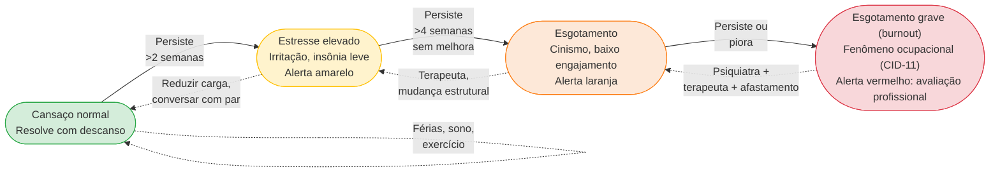

**Check-in semanal (5 minutos, domingo à noite):**

- Energia física (0-10): _____
- Clareza mental (0-10): _____
- Conexão emocional com a empresa (0-10): _____
- Conexão emocional com pessoas próximas (0-10): _____
- Qualidade do sono (0-10): _____
- Alguma coisa escondida/ignorada nesta semana? _____

Leia os três níveis do termômetro (em sintonia com o diagrama acima): notas abaixo de 5 em duas ou mais categorias por duas semanas seguidas acionam o alerta amarelo (reduza a carga imediata e abra o jogo com seu sócio), se o quadro persistir por quatro semanas sem melhora, entra em alerta laranja (exigindo psicoterapia e redesenho estrutural da rotina), e qualquer pontuação abaixo de 4 em três ou mais categorias (ou sintoma físico como a taquicardia de Rafael, que marcou energia 3, sono 2 e clareza 4 antes da briga com Bia) aciona o alerta vermelho: agende avaliação com psicólogo clínico ou médico psiquiatra na mesma semana. Este termômetro é um instrumento de autovigilância semanal, e não substitui escalas clínicas validadas (como PHQ-9 e GAD-7) aplicadas por profissionais, em caso de crise aguda ou pensamento de autoagressão, ligue imediatamente para o CVV (188, gratuito 24h) ou para o SAMU (192).

**Sinais de alerta específicos de *burnout* (distintos do cansaço comum de fim de semana):**

- Cinismo crônico sobre trabalho (não ocasional).
- Despersonalização e cinismo: passar a tratar clientes, sócios e equipe com frieza defensiva, distanciamento afetivo ou irritação constante, enxergando pessoas apenas como fardo ou número.
- Sensação de ineficácia apesar de esforço intenso.
- Perda de prazer em coisas que antes traziam prazer.
- Sono ruim mesmo quando há tempo.
- Irritação desproporcional a eventos pequenos.
- Desejo crescente de "fugir", bebida, trabalho excessivo, escapismo.

O esgotamento ocupacional severo não se resolve apenas dormindo mais no domingo. Na Classificação Internacional de Doenças da OMS (CID-11, código QD85), o *burnout* é definido como um fenômeno ocupacional resultante de estresse crônico no local de trabalho que não foi administrado com sucesso, integrando no Brasil a lista oficial de agravos relacionados ao trabalho do Ministério da Saúde. Como suas manifestações frequentemente se sobrepõem às de episódios depressivos e transtornos de ansiedade, a avaliação diagnóstica e a condução de psicoterapia cabem a psicólogo clínico ou médico psiquiatra (conforme as competências resguardadas pela Lei nº 12.842/2013), enquanto a prescrição de medicamentos é ato privativo do médico.

#### 2. Hábitos de recuperação como infraestrutura operacional

Fundadores que sustentam dez ou mais anos de execução intensa tratam o descanso e a saúde física como parte da infraestrutura operacional da empresa.

Sono: meta de sete a oito horas por noite em cinco ou mais dias da semana, mantendo horário regular para deitar (com variação máxima de uma hora nos fins de semana) e desligando telas de 30 a 60 minutos antes de dormir, em quarto escuro e fresco (18 °C a 20 °C). A regularidade do sono preserva a memória de trabalho e o controle emocional para decidir sob pressão.

Movimento: exercício pelo menos três vezes por semana em qualquer forma que o fundador goste (não "deveria gostar"). Os efeitos são concretos: redução de cortisol, melhora de sono, humor e cognição. Fim de semana sem movimento piora a semana seguinte.

Alimentação e hidratação: não "dieta", apenas comer comida de verdade regularmente, sem delivery hiper-calórico dominando a semana. Hidratação de dois a três litros por dia tem impacto maior do que a maioria reconhece.

Nutrição mental: alguma prática contemplativa (meditação, oração, journaling) de dez a vinte minutos por dia. Literatura ou mídia fora do mundo de negócios (ficção, poesia, história, cinema). Aprendizado de algo não instrumental (idioma, instrumento, culinária).

Relacionamento: tempo com parceiro ou parceira e família sem celular, semanalmente. Contato com dois a três amigos próximos mensalmente, não apenas networking profissional. Presença com filhos (se aplicável) que não seja só "tempo compartilhado".

Férias: reais, pelo menos dez dias por ano, sem email. Não "férias ao lado do laptop". Desacoplamento físico e mental da operação. Empresa sobrevive. Se não sobrevive, o sinal é de gargalo organizacional, não de indispensabilidade do fundador.

#### 3. Identidade além da empresa

A frase "a empresa sou eu" é sinal de alarme. Empresa é o que o fundador faz, não o que o fundador é. Quando os dois se fundem, crítica à empresa vira ataque pessoal, decepção com resultado vira colapso existencial e exit ou fechamento vira crise de identidade.

Exercício: escrever dez frases "eu sou _____" sem nenhuma delas mencionar a empresa ou papel profissional. Dificuldade neste exercício é sinal de fusão identidade-empresa.

Cultivar papéis e interesses fora do CNPJ protege a lucidez de quem lidera e sustenta a caminhada de longo prazo sem destruir a pessoa por trás do cargo.

**Três ensaios de Paul Graham sobre a mente do fundador (1/3): Mantenha sua identidade pequena (*Keep Your Identity Small*, 2009)**

Graham tem um ensaio curto, *Keep Your Identity Small*, que é complementar útil à ideia de "identidade além da empresa". O argumento é sobre uma forma específica de dano que acontece quando a gente adota identidades fortes, ser "liberal", "conservador", "vegetariano militante", "crypto-maximalista", "anti-crypto", "fundador em série", "early adopter", "techie", "anti-techie". Cada identidade forte que a gente adota reduz a capacidade de pensar com clareza sobre o tema correspondente, porque qualquer discussão vira ataque ao "eu" em vez de análise do assunto.

O insight operacional para fundador: quanto mais identidades fortes você acumula publicamente, menos você consegue mudar de ideia. E mudar de ideia, sobre produto, sobre mercado, sobre time, sobre estratégia, é exatamente o que a trajetória de fundador exige que você faça o tempo todo. Fundador com identidade pública de "anti-VC" trava quando o negócio precisa de VC, fundador com identidade pública de "maximalista em IA" trava quando precisa reduzir escopo de IA, fundador com identidade de "fundador 100% hands-on" trava quando precisa delegar.

Regra prática derivada: resista a coletar labels públicos sobre si mesmo. Você é "uma pessoa trabalhando em X hoje", não "o CEO-fundador visionário de Y". Quanto mais enxuta a sua identidade pública, maior a sua liberdade interna de reavaliar, aprender, mudar de rumo. Isso vale para postagens em LinkedIn, para conversas em eventos, para entrevistas. Você pode manter convicções profundas sem transformá-las em bandeira de identidade.

#### *Earnestness*: fazer algo pelos motivos certos (Paul Graham, 2020)

Há um segundo ensaio de Paul Graham que ilumina o combustível emocional de longo prazo: *Earnestness* (2020), termo que combina sinceridade de propósito e seriedade intelectual. Graham argumenta que fazer algo pelos motivos certos (curiosidade genuína pelo problema, cuidado com o cliente e brio no ofício, em vez de busca por status, riqueza rápida ou necessidade de provar algo a terceiros) é uma vantagem competitiva subestimada em startups.

A razão é prática: trabalho duro por longos períodos sem resultado imediato (o que é a condição normal dos primeiros anos de startup) só é sustentável se há ligação genuína com o trabalho em si. Pessoas que começam startup "para ficar ricas" tipicamente desistem antes dos 5-7 anos, porque o retorno financeiro (quando vem) vem depois disso. Pessoas que começam porque se importam genuinamente com o problema conseguem sustentar o ritmo pelo tempo necessário.

A sinceridade de propósito (*earnestness*) aparece em três dimensões observáveis do dia a dia:

Na qualidade da decisão sob pressão: o fundador com sinceridade de propósito (*earnestness*), movido pelo problema real, pergunta "o que é certo para o cliente e para a empresa?", enquanto o fundador movido pela recompensa e pelo status pergunta "o que parece bonito ou me faz parecer bem-sucedido?". As duas perguntas geram escolhas opostas que se acumulam ao longo dos anos. Na atração de talentos: profissionais excelentes percebem a sinceridade de propósito mesmo sem saber defini-la e, por isso, o fundador movido pelo problema atrai primeiros funcionários de nível muito superior ao salário que pode oferecer no início. Na resiliência à decisiva: o ataque público machuca quem vive de fachada, mas o fundador movido pelo problema absorve o impacto, pergunta "há algo verdadeiro aqui que precisamos corrigir?" e segue adiante.

Teste simples para autoavaliação: se você descobrisse amanhã que essa empresa nunca vai ficar grande, mas ainda teria trabalho interessante por 10 anos construindo algo útil para 500 clientes que te pagam bem, você continuaria? Se sim, você é provavelmente earnest sobre o problema. Se não, você está trabalhando pela recompensa externa, e isso é frágil.

#### *Mean People Fail*: caráter como fator competitivo (Paul Graham, 2014)

Nesse terceiro ensaio, Paul Graham sustenta um ponto pouco discutido na literatura de negócios: a falta de integridade moral funciona como desvantagem competitiva concreta, cobrando preço econômico no longo prazo porque afasta os melhores talentos, parceiros e investidores.

Dois mecanismos econômicos e sociais explicam por que a falta de integridade cobra juros altos na trajetória de uma startup:

- **Startup depende desproporcionalmente de aliados.** Primeiros 20 funcionários, primeiros investidores, primeiros parceiros comerciais, primeiros conselheiros, todos escolhem trabalhar com você num momento em que você ainda não tem quase nada a oferecer além de você mesmo. Pessoas com opção escolhem trabalhar com pessoas de quem gostam, pessoas boas têm opção, então startup fundada por pessoa moralmente problemática sistematicamente atrai aliados de qualidade inferior.
- **Reputação em mercado pequeno se acumula.** O ecossistema de tecnologia é pequeno: se você age de má-fé com um investidor, outros gestores da mesma tese ficam sabendo em poucos dias, se trata mal funcionários ou fornecedores, o relato circula rapidamente no mercado. A distância entre uma mesquinharia de bastidor e o bloqueio de portas em cinco fundos é menor do que parece.

Graham é honesto: há exceções, pessoas moralmente problemáticas que tiveram sucesso gigante. Mas são exceções raras, e custaram caro em termos humanos, mesmo quando renderam financeiramente. Para a maioria, ser decente é não só moral, é também estratégia comercial.

No contexto brasileiro, onde o ecossistema é ainda menor que o americano e a cultura valoriza muito relacionamento pessoal, o efeito é ainda mais intenso. "Fulano é difícil de trabalhar" vira informação pública entre investidores brasileiros em semanas. Investir em caráter, tratar pessoas com dignidade mesmo quando não é obrigatório, ser justo em situações onde podia ser explorador, cumprir compromissos mesmo em custo, é investimento com retorno composto.

#### 4. Dinâmica de cofundadores: química operacional

Cofundadores funcionam quando há complementaridade clara de competências (técnica, comercial e conhecimento profundo do setor), quando discordam com vigor sobre decisão e depois se alinham e executam, quando cada um acredita na integridade do outro mesmo em discordância, quando há canais estruturados de conversa (one-on-one semanal, retrospectiva trimestral) e quando o trabalho está dividido em escopo claro (cada um tem "território" de decisão).

Os sinais de deterioração são reconhecíveis antes do colapso: conversas importantes migrando para canais privados (WhatsApp pessoal em vez de grupo compartilhado), decisões tomadas unilateralmente sem comunicar, evitamento ("vou falar com ele depois" que vira "um dia"), acúmulo de ressentimento não endereçado, time percebendo tensão e começando a escolher lados, e frases recorrentes como "ele nunca entende" ou "ela sempre faz isso".

**Protocolo em sete passos para conversas difíceis entre sócios:** (1) Prepare por escrito o ponto decisivo e o que você precisa compreender do outro lado, (2) Agende uma janela protegida de 60 a 90 minutos, presencial ou por vídeo, com celulares desligados, (3) Abra com escuta integral, garantindo 10 minutos ininterruptos para cada sócio expor sua leitura sem reação defensiva, (4) Separe fatos de interpretações com perguntas diretas antes de emitir juízo, (5) Explicite o impacto do problema na saúde de cada um e no caixa da operação, (6) Registre os combinados por escrito, definindo o que muda, quem responde por cada frente e a data de revisão, e (7) Trave a cadência trimestral no calendário. Quarenta e oito horas após a explosão por causa da embalagem, Rafael e Bia rodaram exatamente esses sete passos em uma chamada de 75 minutos: nos 10 minutos de escuta (Passo 3), Bia descobriu que Rafael vinha tendo taquicardia às 4h da manhã e escondia o medo do corte de crédito do fornecedor, no esclarecimento dos fatos (Passo 4), viram que a briga pela caixa de papelão era apenas a válvula de escape do aperto de caixa, e nos combinados (Passo 6), condicionaram a continuidade ao check-up cardiológico e psicológico de Rafael naquela semana e dividiram claramente as alçadas (Bia assumiu 100% da renegociação de prazo com fábricas e Rafael focou nas campanhas de recompra D2C).

Ferramentas externas: coach executivo com experiência em dinâmicas de sócios (diferente de coach de carreira), mediador em conflitos avançados (pessoa neutra com experiência formal) e advisor compartilhado que tem autoridade moral sobre ambos.

#### 5. Divórcio societário com dignidade

Nem todo cofundador permanece. Como mostram os levantamentos de Noam Wasserman em *The Founder's Dilemmas* (2012), é comum que pelo menos um membro do grupo fundador original deixe a operação ao longo dos primeiros anos. É comum, não é falha moral.

É hora de considerar separação quando há conflito estrutural que não resolve com duas a três conversas sérias, quando a visão de empresa divergiu profundamente sem reconciliação possível, quando estilos de trabalho são incompatíveis em dimensões centrais, ou quando a confiança quebrou por evento específico não reversível.

Quando a separação societária se torna inevitável, conduza o processo em seis etapas objetivas para preservar as pessoas e a empresa: (1) conversa direta e privada entre os cofundadores antes de envolver o conselho ou investidores, sem surpresas em público, (2) apoio jurídico especializado, com advogado próprio para orientar cada parte e, havendo consenso, um escritório societário para redigir os instrumentos da transação, (3) acordo formal de saída e apuração, aplicando as regras de *vesting* para reversão ou recompra das quotas ainda não adquiridas e firmando cláusulas proporcionais de não concorrência, não aliciamento e confidencialidade (conforme detalhado no [[IGNICAO-Vol-8-Juridico-LGPD-e-Seguranca#CAPÍTULO 4: NÃO CONCORRÊNCIA E NÃO SOLICITAÇÃO NO BRASIL|Capítulo 4: Não Concorrência e Não Solicitação no Brasil (Vol. 8)]] e no rito completo do [[IGNICAO-Vol-9-Maturidade-e-Exit#CAPÍTULO 3: DISPUTA SOCIETÁRIA E SAÍDA DE SÓCIO|Capítulo 3: Disputa Societária e Saída de Sócio (Vol. 9)]]), (4) comunicação coordenada e sóbria à equipe e aos investidores, atendo-se aos fatos e agradecendo a contribuição, (5) cronograma de passagem de bastão de 30 a 90 dias para transferir clientes, senhas e processos, e (6) preservação da reputação mútua no longo prazo, lembrando que o ecossistema brasileiro é pequeno.

> [!warning] Armadilhas do divórcio societário
> Arrastar o conflito por medo de decidir. Decidir sem advogado no calor do momento. Tornar público o que deveria ser privado. Queimar relacionamento futuro por diferença pequena de vesting.

#### 6. Família e rede afetiva como infraestrutura da travessia

O fundador sobrecarregado costuma enxergar cônjuge, filhos, amigos e pais como "custo de agenda" ou tempo subtraído da empresa. Esse é um erro grave de enquadramento.

**Reenquadramento prático:** cônjuge, filhos, amigos e pais constituem a infraestrutura afetiva da vida pessoal e o porto seguro operacional que mantém o fundador lúcido na maratona.

**Quatro práticas inegociáveis de convivência familiar ao longo da jornada:**

- Bloquear explicitamente na agenda semanal o tempo com cônjuge, filhos e pais, o que não entra no calendário é engolido pela urgência da operação.
- Manter o celular fora da mesa durante as refeições em família, sem abrir exceções para "checar só uma mensagem rápida".
- Compartilhar com o cônjuge e a família, ao menos uma vez por semestre, um retrato honesto do fôlego da empresa e do seu próprio nível de energia, evitando que quem convive com você descubra crises apenas quando elas explodem.
- Atos simbólicos: um aniversário não esquecido, um apoio em momento difícil, uma presença quando ninguém pede.

#### 7. Sinais clínicos e operacionais para acionar psicólogo ou psiquiatra

Separe três níveis claros de cuidado profissional para agir na velocidade certa: (1) Manutenção preventiva contínua: a psicoterapia regular protege a clareza emocional de qualquer fundador ao longo da travessia, (2) Avaliação profissional em até uma semana (quando os sinais duram mais de duas semanas seguidas): procure psicólogo clínico ou médico psiquiatra diante de exaustão física e mental contínua, perda de prazer em atividades antes valorizadas, insônia persistente, humor constantemente irritado, ansioso ou deprimido, desejo recorrente de largar tudo, conflito conjugal ou societário que você não consegue destravar sozinho ou impacto de luto e separação, e (3) Ação médica imediata no mesmo dia (emergência): diante de qualquer pensamento de autoagressão, crise aguda com sintomas físicos intensos ou escalada no uso de álcool e medicamentos para suportar a rotina.

Psiquiatra é adequado quando terapeuta recomenda avaliação medicamentosa, quando há quadro depressivo ou ansioso com impacto funcional significativo, ou quando há transtornos específicos diagnosticados (TDAH adulto, TOC, transtorno bipolar).

Grupos de apoio entre pares (*peer support*) funcionam como complemento valioso à psicoterapia: ouvir outros fundadores relatarem as mesmas dores reduz o isolamento da cadeira e acelera a troca de práticas reais de gestão.

> [!important] Em crise aguda
> CVV (Centro de Valorização da Vida): 188, vinte e quatro horas, gratuito. Em crise psiquiátrica aguda ou risco imediato: ligue para o CVV no 188 (gratuito, 24 horas em todo o país), acione o SAMU no 192 ou dirija-se ao pronto-socorro geral ou CAPS (Centro de Atenção Psicossocial) mais próximo da sua cidade. Em capitais como São Paulo, hospitais gerais como Hospital das Clínicas, Albert Einstein e Sírio-Libanês também mantêm pronto-atendimento médico 24 horas. Em ideação ou tentativa de autoagressão: emergência médica, sem hesitação.

### Indicadores antecedentes de saúde do fundador e do casamento societário

Acompanhe oito indicadores antecedentes da sua sustentabilidade humana e societária: (1) Qualidade do sono: meta de 7 a 8 horas por noite, com nota subjetiva de descanso $\ge 7$ (de 0 a 10), (2) Movimento físico: pelo menos 3 sessões semanais de exercício, (3) Presença em casa: mínimo de 8 horas semanais com cônjuge e família sem celular por perto, (4) Amizades fora do trabalho: ao menos uma conversa substantiva por mês com dois ou três amigos íntimos, (5) Cuidado psicológico: acompanhamento terapêutico em cadência regular, (6) Desconexão anual: mínimo de 10 dias de férias reais por ano sem abrir e-mail, (7) Termômetro de domingo: zero sinais de alerta de *burnout* mantidos por mais de duas semanas sem intervenção, e (8) Rito entre cofundadores: conversa individual semanal de 30 minutos e retrospectiva estruturada de alinhamento a cada trimestre.

### A Lua de Mel Sem Contrato e as bombas-relógio da mente: divisão justa de participação, 50/50 sem desempate, falta de vesting e positividade tóxica

Na frente societária, **A Lua de Mel Sem Contrato** explode quando o estresse aperta por causa de três falhas de largada: (1) **dividir a participação societária (*equity*) apenas por quem teve a ideia inicial ou em 50/50 automático para evitar conversa desconfortável, em vez de ponderar de forma justa os quatro pesos reais de construção do negócio (comprometimento de dedicação integral nos próximos anos, responsabilidade pela execução técnica e comercial, capital aportado e domínio ou rede no setor), (2) travar um 50/50 sem mecanismo de desempate decisório (como voto de qualidade por área de domínio ou conselheiro externo de confiança, evitando paralisia no primeiro impasse grave), e (3) assinar o contrato social sem cláusula de *vesting* de 4 anos com *cliff* de 1 ano**, permitindo que um cofundador se afaste aos seis meses carregando metade da empresa no bolso (cuja blindagem contratual completa será executada na Fase 18, no Volume 8). Na frente emocional, essas falhas societárias somam-se às armadilhas psicológicas abaixo.

> [!warning] Armadilhas de saúde mental e humanidade
> "Eu resolvo com mais força de vontade." Burnout clínico não responde a força de vontade. Exige mudança estrutural ou intervenção.
>
> Repetir que "cuidará da saúde e da casa quando a empresa der certo" ignora que o corpo e a família cobram a conta à vista durante a travessia, muito antes de qualquer liquidez. "Depois" não existe.
>
> "Terapia é apenas para quem está em crise grave." Na rotina de alta pressão, a psicoterapia opera como revisão preventiva da mente antes que o desgaste vire pane.
>
> "O atrito com meu cofundador vai passar sozinho." Desacordo engolido em silêncio acumula juros e costuma explodir de 18 a 24 meses depois, quase sempre no meio de uma captação ou aperto de caixa.
>
> Usar bebida, remédio ou trabalho para regular emocional sem tratar a causa vira dependência, não solução. Isolar-se na crise ("não posso mostrar fraqueza ao time") é o momento mais importante para ter alguém de fora com quem falar. Comparar-se com fundadores "superman" em redes é armadilha. Instagram de fundador mostra highlights, não três da manhã de domingo com insônia. Tratar parceiro ou parceira como coadjuvante da empresa é injusto. Quem viveu a trajetória junto merece protagonismo, não papel de apoio.

> [!tip] Checklist
> Psicoterapia individual ativa ou rede de cuidado mapeada? Hábitos de sono, exercício e alimentação consistentes nos últimos 30 dias? Identidade clara fora da empresa (mínimo de três dimensões não profissionais)? Tempo semanal com cônjuge, filhos e pais bloqueado na agenda? Conversa individual semanal e retrospectiva trimestral com os cofundadores em dia? Termômetro de domingo preenchido sem sinais de alerta ignorados? Contato mensal com dois ou três amigos próximos? Pelo menos 10 dias de férias reais tirados nos últimos 12 meses? Plano de contingência pessoal de uma página redigido e compartilhado com o sócio e a família (indicando quem assume a operação em caso de doença ou acidente, onde ficam o cofre de senhas e as procurações bancárias, contatos do contador e do advogado societário, apólice de seguro do Capítulo 1 e alçada de decisão individual)?

---

### Manual de emergência emocional para os 5 momentos mais duros da vida de um fundador

Até aqui tratamos da saúde mental e da dinâmica entre cofundadores como disciplina contínua de rotina. Alguns dias, porém, pesam mais que meses inteiros de operação: cinco momentos críticos atingem quase todo fundador, trazendo picos agudos de estresse, dúvida, luto ou choque de identidade que exigem protocolos específicos de contenção.

#### Momento 1: O primeiro "não" importante de investidor

**O que acontece**: investidor que você considerava certo declina a rodada. Pode ser seed, pode ser Série A. Fundador interpreta como validação negativa do negócio inteiro.

**Dinâmica psicológica**:

- Choque inicial → raiva → dúvida profunda → ruminação mental por vários dias.
- Questionamento de "será que é só comigo?" ou "a ideia não presta?"
- Impulso de re-pitch imediatamente em busca de validação.

**Orientação prática**:

1. **Não responder nas primeiras 24h**. Email de "obrigado pelo retorno" pode esperar. Reação a quente vira queixa ou desespero.
2. **Separar sinal de ruído**: investidor recusa por 1.000 razões (tese do fundo não se encaixa, timing do portfolio, etc.), só uma delas é "ideia é ruim". Maioria não é.
3. **Pedir feedback específico** em 48h: "O que precisaria ser verdade para você investir?" Respostas são aprendizado, ausência de resposta é sinal também (investidor que não respeita o suficiente para responder).
4. **Não confundir "não agora" com "não nunca"**: investidores frequentemente voltam em próxima rodada.
5. **Não discutir com investidor**: convencê-lo a mudar posição raramente funciona e queima relação futura.

**O que isso significa psicologicamente**: a habilidade de processar "não" sem tomar pessoalmente vai ser testada dezenas de vezes na trajetória. Primeiro "não" é o primeiro passo de construção dessa capacidade.

**Conversa com alguém**: cofundador, mentor, terapeuta. Não processar sozinho.

#### Momento 2: A primeira demissão

**O que acontece**: fundador demite primeiro funcionário. Pode ser por performance, por fit, por redução. Fundador frequentemente carrega culpa como se tivesse "fracassado com essa pessoa".

**Dinâmica psicológica**:

- Ansiedade antecipatória por dias antes.
- Durante: desconforto físico, palavras que falham, racionalização excessiva.
- Depois: alívio misturado com culpa. Ruminação por semanas.
- Frequentemente o primeiro teste de liderança real.

**Orientação prática**:

1. **Fazer rápido uma vez decidido**. Demora cruel para ambas as partes.
2. **Preparar a conversa**: 3-5 sentenças escritas de abertura. Razão clara, não justificativa elaborada.
3. **Sexta-feira ou segunda-feira?** Debate comum. Segunda-feira dá à pessoa semana inteira para começar a processar e buscar próximos passos, sexta dá fim de semana para respirar. Minha leitura: segunda é melhor para a pessoa, sexta é mais confortável para quem demite (o que é sinal de evitar).
4. **Rescisão correta e sem improviso**: quite integralmente no prazo legal todas as verbas rescisórias (saldo de salário, aviso prévio, férias com terço, 13º proporcional e multa de 40% do FGTS), se o profissional atuava como PJ com rotina subordinada de empregado, consulte um advogado trabalhista antes da conversa para estruturar a quitação e mitigar passivo (ver [[IGNICAO-Vol-8-Juridico-LGPD-e-Seguranca#CAPÍTULO 6: DIREITO DO TRABALHO PARA STARTUPS|Capítulo 6 do Vol. 8: Direito do Trabalho para Startups]]).
5. **Comunicação ao time pequeno**: honestidade proporcional à privacidade, "Hoje foi o último dia do João na empresa. A decisão foi nossa e agradecemos o trabalho que ele entregou aqui. Por respeito a ele, não vamos expor detalhes individuais, na operação, as responsabilidades dele ficam distribuídas da seguinte forma:" Sem detalhes, sem drama.
6. **Reconhecer o peso humano do desligamento**: sentir pesar após demitir alguém faz parte da responsabilidade de liderar, processe a decisão em conversa franca com seu cofundador, mentor ou terapeuta.

**Perspectiva prática**: desligar quem não se ajustou ao estágio da empresa faz parte do ofício de liderar. Como o início de uma startup opera sob mudança constante de prioridades, uma parcela expressiva das primeiras contratações acaba não acompanhando a transição de fase, e conduzir essas saídas com respeito e rapidez protege o restante do time.

#### Momento 3: O primeiro churn grande

**O que acontece**: cliente-âncora (10-30% da receita) cancela. Pode ser por motivo seu (produto falha), deles (empresa fechando, mudança de direção), ou estrutural (adquirida por concorrente).

**Dinâmica psicológica**:

- Cortisol alto, caixa impactado imediatamente.
- Medo de que seja sinal de início de desagregação (outros clientes seguirão?).
- Impulso de salvá-lo a qualquer custo, incluindo descontos absurdos ou promessas não executáveis.
- Questionamento de estratégia inteira.

**Orientação prática**:

1. **Reunião de diagnóstico e reversão em até 48 horas**: escute o cliente para descobrir o motivo real do cancelamento, que raramente é a primeira desculpa formal enviada por e-mail.
2. **Separar motivos reversíveis de irreversíveis**: se o cliente encerrou a própria empresa, não há como reverter o cancelamento. Se apenas trocou de gerente e o novo responsável prefere outra ferramenta, vale investigar o que faltou na entrega.
3. **Proposta de retenção com limite claro**: ofereça ajuste de escopo, treinamento adicional da equipe do cliente ou condição comercial temporária, mas jamais prometa desenvolvimentos impossíveis apenas para adiar o cancelamento.
4. **Se não reverter, fazer com dignidade**: oferecer transição suave, dados exportáveis, suporte final. Feche a porta com elegância porque o mercado é pequeno: não é raro que clientes perdidos na largada voltem a contratar a empresa seis a dezoito meses depois, quando o produto amadurece.
5. **Comunicação interna honesta**: time precisa saber, não em drama. "Perdemos cliente X, aqui está o impacto, aqui está o plano."
6. **Post-mortem estruturado**: o que preveniria? Sinais perdidos? Monitoring não implementado? Aprendizado vai para próximos contratos.

**Perspectiva**: primeira perda grande ensina mais do que 10 vitórias. Disciplina de CS ([[IGNICAO-Vol-4-Tracao-e-PMF#CAPÍTULO 8: CUSTOMER SUCCESS (CS) E CUSTOMER EXPERIENCE (CX): DA JORNADA À RETENÇÃO SUSTENTÁVEL E NRR ACIMA DE 100%|Capítulo 8 (Customer Success (CS) e Customer Experience (CX): Da Jornada ao Churn Zero e NRR Positivo) (Vol. 4)]]) em geral nasce da primeira dor grande.

#### Momento 4: A primeira crise pública

**O que acontece**: incidente de segurança ou vazamento de dados pessoais, falha grave de serviço ou reclamação pública de cliente que ganha tração nas redes. Se houver vazamento de dados pessoais, o prazo legal já está correndo: a LGPD (art. 48) e a regulamentação da ANPD (Resolução CD/ANPD nº 15/2024, com prazo geral de três dias úteis) exigem comunicar a autoridade e os titulares afetados rapidamente, conforme detalhado no [[IGNICAO-Vol-8-Juridico-LGPD-e-Seguranca#CAPÍTULO 9: LGPD, COMPLIANCE E GOVERNANÇA DE DADOS|Capítulo 9 do Vol. 8 (LGPD, Compliance e Governança de Dados)]].

**Dinâmica psicológica**:

- Pânico, sensação de que "tudo pode acabar agora".
- Impulso de responder publicamente imediatamente (frequentemente erro).
- Intrusão na vida pessoal (família, amigos veem, perguntam).
- Cortisol crônico por dias/semanas.

**O que fazer na prática** (o [[IGNICAO-Vol-9-Maturidade-e-Exit#CAPÍTULO 9: GESTÃO DE CRISE, CONTINUIDADE OPERACIONAL E COMUNICAÇÃO CRÍTICA|Capítulo 9 do Vol. 9 (Gestão de Crise, Continuidade Operacional e Comunicação Crítica)]] detalha a resposta institucional a vazamento de dados ou crise reputacional, aqui o foco é conter a ruminação mental, ajustar o diálogo interno e fazer uma checagem de realidade com o sócio):

1. **Segure a resposta impulsiva nos primeiros 60 minutos, mas acione o protocolo legal imediatamente**: respire, reúna cofundador e advogado antes de ir a público e, se o incidente envolver vazamento de dados pessoais, cumpra o prazo da LGPD e da ANPD (três dias úteis para comunicação preliminar à autoridade e aos titulares afetados, ver [[IGNICAO-Vol-8-Juridico-LGPD-e-Seguranca#CAPÍTULO 9: LGPD, COMPLIANCE E GOVERNANÇA DE DADOS|Capítulo 9 do Vol. 8]]).
2. **Se responsabilidade é sua, assumir rápido**: silêncio prolongado vira história maior.
3. **Honestidade > defensividade**: público percebe quando empresa está mentindo ou cobrindo.
4. **Proteger família e time**: comunicar internamente antes do externo. Preparar família para ciclo da mídia.
5. **Suporte profissional**: contar com um terapeuta pode ser decisivo na crise aguda, pois a descarga contínua de adrenalina e cortisol compromete o sono, o julgamento e as relações próximas.
6. **Não tomar decisões estratégicas grandes durante crise aguda**. Decisões tomadas em pânico geralmente são erradas.

**Perspectiva**: crise pública é um dos pontos mais difíceis da trajetória. Empresas sobrevivem crises, raramente quebram por crise bem-manejada. Mas o fundador pode sair psicologicamente marcado se não cuidar. Proteção deliberada da saúde mental durante e após é não negociável.

#### Momento 5: O exit (luto do que a empresa foi)

**O que acontece**: venda, IPO, fechamento. Mesmo em exit bem-sucedido financeiramente, fundador frequentemente enfrenta crise de identidade após.

**Dinâmica psicológica**:

- Pré-exit: ansiedade e euforia alternadas.
- Durante negociação (M&A): estresse agudo por 3-9 meses.
- Pós-venda da empresa (*exit*): alguns dias ou semanas de alívio inicial costumam dar lugar a uma sensação de perda de rotina e propósito.
- "Quem eu sou agora?", identidade construída ao redor da empresa entrou em crise.
- Sintomas comuns: depressão pós-parto empresarial (fundadores descrevem assim), perda de sentido, dificuldade de re-engajar, tédio crônico.

**Orientação prática**:

1. **Planejar "o que vem depois" antes do exit**. Minimamente: próximos 6 meses de agenda. Próxima empresa, sabático, família, hobbies.
2. **Não decidir próxima empresa nos primeiros 6-12 meses**. Impulso comum, frequentemente é reação ansiosa a vazio, não vontade genuína.
3. **Terapia estruturada**: transições grandes de vida se beneficiam de processo terapêutico. Não opcional, recomendado.
4. **Reconhecer luto**: empresa foi um "filho" emocional por anos. Luto é real. Chorar, se precisar e processar o luto.
5. **Relacionamentos perdidos**: cofundadores e time com quem você viveu intensidade diária podem se distanciar pós-exit. Normal, mas doloroso.
6. **Uso saudável do dinheiro**: frequentemente exits geram capital que não existia. Gestão financeira pessoal séria ([[#CAPÍTULO 1: DINHEIRO PESSOAL DO FUNDADOR|Capítulo 1 (Dinheiro Pessoal do Fundador)]]) vira crítica. Não gastar impulsivamente nos primeiros 12-24 meses.

**Perspectiva**: fundadores que são bem-sucedidos em múltiplas empresas (serial entrepreneurs saudáveis) frequentemente descrevem 6-18 meses de "travessia do deserto" entre empresas. É processo, não fracasso.

#### Padrão comum a todos os momentos críticos da travessia

- **Reação imediata raramente é a melhor**. Dar-se tempo.
- **Isolamento é o inimigo**. Buscar cofundador, mentor, terapeuta, parceiro(a).
- **Separar emoção da análise**. Ambas são válidas, nenhuma sozinha é suficiente para decisão.
- **Saúde física não opcional**: sono, exercício, alimentação mantêm capacidade cognitiva em momentos difíceis.
- **Linha de emergência**: CVV 188 se em qualquer momento ideação suicida ou crise aguda. Sem hesitação.

### Como atravessar o luto de encerrar uma empresa sem destruir sua saúde nem sua reputação

*Esta seção trata do momento mais difícil da trajetória empreendedora: encerrar uma empresa que não deu certo. O protocolo psicológico a seguir complementa o roteiro operacional e jurídico de encerramento detalhado no [[IGNICAO-Vol-9-Maturidade-e-Exit#CAPÍTULO 11: RECUPERAÇÃO JUDICIAL E WIND-DOWN: QUANDO A STARTUP NÃO CONSEGUE CONTINUAR|Capítulo 11 (Recuperação Judicial e Wind-Down) (Vol. 9)]].*

### Separando o fracasso de um CNPJ do valor do seu CPF

O fechamento de uma empresa por insucesso é um evento psicológico de intensidade comparável ao luto por perda familiar ou a um divórcio litigioso. Na literatura de empreendedorismo, Dean A. Shepherd (*Learning from Business Failure*, *Academy of Management Review*, 2003) propõe que o encerramento de um negócio dispara um processo real de luto, no qual o fundador oscila entre a orientação à perda (encarar emocionalmente o fim da empresa e processar a dor) e a orientação à restauração (afastar-se temporariamente da perda para reorganizar a vida prática e lidar com estressores secundários). Fundadores que atravessam esse fechamento no isolamento ou sem suporte clínico correm maior risco de desenvolver quadros de depressão, ansiedade severa, esgotamento, abuso de substâncias e, em casos extremos, ideação suicida.

**Quando uma empresa encerra as atividades, o fundador perde mais do que o capital investido.** O fechamento desfaz uma identidade profissional construída ao longo de anos, altera relações de trabalho que giravam em torno do negócio, interrompe a rotina diária e exige reconstruir a própria narrativa perante o mercado e a família.

O manual é honesto sobre isso porque silenciar é pior. Fundador que sabe antes o que o aguarda tem chance significativamente maior de atravessar bem.

#### As fases emocionais observáveis

**Etapa 1: Negação operacional (semanas a meses antes do fechamento):**

Empresa já mostra sinais claros de inviabilidade (caixa curto, rodada que não fecha, churn alto, produto que não ganha tração). Fundador intelectualmente sabe, mas emocionalmente trabalha como se ainda desse para virar. Trabalha mais horas, corta gastos pessoais para ajudar empresa, adiciona pivôs desesperados, mantém discurso externo otimista.

Psicologicamente: **dissonância entre o que vê e o que aceita**. Custa em sono, relações próximas, capacidade de decisão. Frequentemente acompanhado de sintomas físicos (insônia, problemas digestivos, tensão muscular crônica).

Sinal de alerta: fundador parou de ser honesto consigo mesmo sobre o estado real da empresa. Se você não consegue dizer em voz alta "a empresa pode fechar em X meses", provavelmente está nessa fase.

**Etapa 2: Reconhecimento forçado (dias a semanas antes):**

Evento catalisador (rodada rejeitada em definitivo, cliente grande saindo, prazo de caixa ficando curto o suficiente para exigir ação) força fundador a admitir internamente. Momento geralmente solitário, frequentemente durante noite insone, em conversa privada com cofundador, ou depois de reunião específica.

Psicologicamente: **choque contido**. Fundador ainda precisa funcionar operacionalmente, então compartimentaliza. Dor aguda ainda não aflora por completo porque precisa ainda comunicar, encerrar operações, lidar com decisões.

Risco nesta fase: compressão do processo emocional para "depois". Fundador decide "resolver tudo operacionalmente primeiro, depois eu desmorono". Em alguns casos funciona, em muitos, "depois" vira desmoronamento descontrolado meses à frente, quando defesas se exaurem.

**Etapa 3: Execução do fechamento (semanas a meses):**

Fundador está em modo operacional intenso. Comunicando com time, investidores, credores, advogado, parceiros. Pouco tempo para processar emoção.

Psicologicamente: **adrenalina + funcionalidade + desconexão**. É comum sentir-se anestesiado, surreal, "como se não fosse comigo". É defesa psíquica útil no curto prazo, permite funcionar. Perigoso se estender além da necessidade.

Frequentemente acompanhado de: energia compensatória (trabalhar 14h/dia encerrando coisas), apetite irregular, sono fragmentado, irritabilidade com pessoas próximas (cônjuge, filhos, família levam o impacto porque time da empresa é priorizado).

**Etapa 4: Vazio pós-encerramento (dias a semanas após):**

Última reunião aconteceu, CNPJ está sendo baixado, site foi desligado, email corporativo encerrado. Pela primeira vez em anos, fundador acorda sem ter o que fazer pela empresa.

Psicologicamente: **colapso controlado**. Adrenalina baixa, defesas caem. Aqui é onde tipicamente aparece dor intensa que foi adiada. Sintomas comuns: choro inesperado, sensação de vazio, questionamento da própria competência e identidade, raiva (contra si mesmo, contra cofundador, contra investidor, contra "mercado"), vergonha social.

Duração observada na prática: a fase aguda de desmobilização costuma concentrar-se nas primeiras semanas após a decisão, enquanto a assimilação emocional e profissional se estende pelos meses seguintes.

Aqui é o ponto de maior risco psicológico. Fundador pode: cair em depressão clínica, isolar-se socialmente, usar álcool ou outras substâncias para anestesiar, tomar decisões pessoais impulsivas (divórcio, mudança drástica de cidade, começar novo negócio sem processar o anterior).

**Etapa 5: Reconstrução de identidade (meses a anos):**

Fundador começa a se separar da empresa-que-fechou como identidade. Reconhece aprendizados sem romantização. Começa a considerar o que vem depois.

Psicologicamente: **processo não linear**. Dias bons e dias ruins. Gradualmente os dias bons se tornam maioria. Retomada de interesses que foram negligenciados durante empresa. Reconexão com relacionamentos que foram deixados em segundo plano.

Sinais de que está acontecendo bem: fundador consegue falar sobre a empresa sem cair em dor aguda, consegue extrair lições sem autoflagelação, começa a ter curiosidade sobre próximos projetos sem pressa compulsiva, humor geral volta a níveis próximos do habitual.

**Etapa 6: Reintegração (6 meses a 2+ anos):**

Fundador reassume vida profissional em formato novo. Pode ser: novo empreendimento (second-time founder, [[IGNICAO-Vol-9-Maturidade-e-Exit#CAPÍTULO 20: O FUNDADOR DE SEGUNDA VIAGEM (SECOND-TIME FOUNDER)|Capítulo 20 (Second-Time Founder) (Vol. 9)]]), emprego em outra empresa (incluindo potencialmente uma que ele mesmo teria sonhado competir contra), função de investidor / advisor, pausa estruturada.

Psicologicamente: **nova identidade integrada**. Empresa que fechou torna-se parte do passado construtor de quem você é, não ferida aberta.

#### Identidade e fracasso: desacoplar fundador de empresa

Fundadores brasileiros frequentemente sofrem mais com fechamento do que fundadores em ecossistemas onde fracasso é mais normalizado (Silicon Valley, Israel). Razões culturais:

- **Estigma social do fracasso no Brasil**: cultura ainda associa fracasso a falha de caráter, não a risco estrutural do empreendedorismo.
- **Identidade enredada com empresa**: fundador de Nome-da-Empresa é "o cara/a cara da Nome-da-Empresa". Empresa fecha, quem ele é?
- **Pressão familiar implícita**: família brasileira frequentemente questiona por que deixou carreira estável para empreender, fracasso amplifica o questionamento.
- **Rede profissional que se organizou em torno da empresa**: cofundadores, investidores, funcionários, parceiros viram pontos de dor, não de suporte.
- **Compromissos financeiros pessoais** (dívida com CNPJ, garantia pessoal em empréstimos, gasto de reserva pessoal) que não somem com fechamento.

**Como trabalhar identidade durante e após fechamento:**

1. **Nomear explicitamente.** "Minha identidade não é essa empresa. Sou pessoa que fundou essa empresa entre ano X e ano Y, isso é parte do meu histórico, não meu nome." Soa trivial, mas reprogramar self-talk leva meses.

2. **Listar identidades pré-empresa e extraprofissionais.** Filho, pai/mãe, cônjuge, amigo, esportista amador, músico, cientista, voluntário, professor, consultor, leitor, viajante. Quanto mais dimensões ativas, menor o estrago quando uma (trabalho) se esvazia.

3. **Distinguir fracasso operacional de fracasso moral.** Empresa falhou por motivos que não têm a ver com seu caráter: timing errado, mercado que mudou, competição que não foi prevista, unit economics que não fecharam. Fracasso moral seria: roubar, trair, violar ética. Falhar é normal. Falhar com integridade é honroso.

4. **Fazer o post-mortem pessoal.** Não pergunte apenas "o que errei na empresa" (cuja revisão operacional e jurídica está no [[IGNICAO-Vol-9-Maturidade-e-Exit#CAPÍTULO 11: RECUPERAÇÃO JUDICIAL E WIND-DOWN: QUANDO A STARTUP NÃO CONSEGUE CONTINUAR|Capítulo 11 (Recuperação Judicial e Wind-Down) (Vol. 9)]]), mas também: "o que aprendi sobre mim? O que descobri que tolero ou não tolero? Em que contextos floresço e o que me desgasta?". Esse aprendizado abastece a próxima etapa da vida, mesmo que você decida não empreender novamente.

#### O que muda na dinâmica familiar quando a empresa encerra as atividades

Ao longo dos meses que antecedem o encerramento, o cônjuge costuma absorver a tensão que o fundador evita demonstrar diante da equipe. Quando a operação finalmente fecha as portas, a reação doméstica segue um de dois caminhos: surge um alívio compartilhado pela interrupção da sangria de caixa e de sono, ou emerge o desgaste acumulado por anos de ausência e aperto orçamentário justamente quando o fundador tenta retomar a rotina em casa.

Para atravessar a desmobilização da empresa sem romper o vínculo familiar, substitua pedidos vagos de consolo por acordos concretos de rotina (reservar horários específicos para fechar pendências jurídicas e proteger blocos sem falar do negócio) e reconheça abertamente o peso que o parceiro carregou durante a operação.

Com os filhos, o impacto específico do fechamento aparece na mudança brusca de rotina e no ajuste temporário do orçamento doméstico: explique a transição com vocabulário adequado à idade, preserve os horários de escola e convivência que ancoram a segurança da casa e informe os filhos mais velhos diretamente para que não descubram o encerramento por terceiros.

Com pais e família estendida, o fechamento pode virar momento de "eu te disse" potencial. Alguns oferecem suporte genuíno e não julgador. Outros reciclam ressentimentos antigos ou oferecem sugestões não solicitadas. A estratégia é controlar a narrativa com uma frase curta, ensaiada e repetível: "a empresa fechou, foi decisão considerada, aprendi X e Y, próximo passo é Z". Quem quer mais detalhe, ganha. Quem quer reciclar decisivas, não ganha plataforma. Aceitar que alguns vão apoiar e outros não: investir energia em convencer os que não apoiam é desperdício.

**Cofundadores:**

Relação entre cofundadores durante fechamento é área de altíssimo risco emocional. Anos de intensidade, sonho compartilhado, decisões impossíveis. Fechamento pode:

- Fortalecer para toda vida, trauma compartilhado que cria vínculo.
- Destruir a relação, culpa, ressentimento, versões diferentes da história, disputa sobre ativos residuais.

**Como trabalhar:**

- **Processar juntos**: reservar tempo especificamente para discutir o que aconteceu, fora de conversa operacional. Vale considerar facilitação por terceiro neutro (mentor sênior, terapeuta organizacional).
- **Acordar narrativa externa**: vocês vão contar a mesma história ou cada um a sua? Se diferentes, pelo menos não contraditórias.
- **Aceitar distância temporária**: alguns cofundadores precisam de meses longe antes de poder ter relação de amizade novamente. É saudável.
- **Não tomar decisões estruturais** (sobre próximos projetos, sobre divisão de ativos residuais) nos 3-6 meses de maior carga emocional. Pressa aqui gera acordos que ficam.

#### Quando o luto do fechamento exige intervenção clínica

O luto saudável após encerrar uma operação segue um curso reconhecível: dias bons e ruins que melhoram gradualmente ao longo de dois a seis meses, preservação do sono básico, manutenção do convívio familiar e capacidade de falar sobre a empresa encerrada, mesmo com dor.

Acione os canais clínicos e de urgência detalhados na seção de ajuda profissional deste capítulo (psicólogo registrado no CRP, avaliação psiquiátrica ou CVV pelo 188 em caso de crise aguda ou ideação suicida) se o fechamento evoluir para luto complicado: humor deprimido ou apatia contínua por mais de duas semanas, queda acentuada no sono ou na alimentação, isolamento social prolongado por vergonha de encontrar ex-sócios ou conhecidos, uso crescente de álcool para anestesiar a frustração ou pensamentos persistentes de inutilidade e culpa irreparável.

Para processar especificamente o trauma de uma quebra societária ou financeira, além do acompanhamento psiquiátrico e da psicoterapia individual coberta por planos de saúde (sem limite de sessões desde agosto de 2022 mediante encaminhamento) ou pela rede pública (CAPS e UBS do SUS), abordagens breves focadas em eventos decisivos e grupos de apoio entre fundadores que já passaram por encerramento ajudam a dissolver o estigma social.

Procurar ajuda não é sinal de fraqueza. É sinal de saúde e inteligência. Fundadores bem-sucedidos em segunda tentativa frequentemente atribuem parte do sucesso ao processo terapêutico entre a empresa encerrada e a nova.

#### Segunda chance depois de fechamento

O [[IGNICAO-Vol-9-Maturidade-e-Exit#CAPÍTULO 20: O FUNDADOR DE SEGUNDA VIAGEM (SECOND-TIME FOUNDER)|Capítulo 20 (Second-Time Founder) (Vol. 9)]] (Second-Time Founder) cobre o lado operacional da reinvenção. Aqui, o lado psicológico:

**Quando não empreender de novo imediatamente:**

- Se você ainda está atravessando as etapas 3 ou 4 do luto empresarial (a execução prática do fechamento ou o vazio logo após encerrar a operação), abrir outra empresa agora será reação compulsiva para anestesiar a perda, não decisão consciente.
- Se dinâmica familiar está instável, nova empresa vai piorar.
- Se saúde física/mental está comprometida, construir de dentro antes de construir fora.
- Se não consegue fazer post-mortem honesto da anterior, vai cometer os mesmos erros em vocabulário novo.

**Quando empreender de novo pode ser saudável:**

- Etapas 5 e 6 do luto empresarial (reconstrução de identidade e reintegração) vividas com integridade.
- Ideia nova vem de curiosidade genuína, não de urgência em provar algo.
- Você consegue articular com clareza o que fará diferente desta vez na escolha de sócios, na disciplina de caixa e nos limites pessoais.
- Pessoas próximas relevantes (cônjuge, sócios potenciais, investidores) têm confiança em você, não por mitologia mas por observação do processo recente.

**Alternativas a empreender de novo:**

Fracasso não obriga a empreender novamente. Empreendedorismo não é ética de vida: é escolha profissional entre muitas.

- Ingressar em uma empresa maior como executivo ou especialista, muitas vezes com ganho financeiro e tranquilidade imediata. A autonomia criativa também pode ser exercida liderando uma área nova dentro de uma organização estável.
- Virar investidor / VC, muitos VCs brasileiros excelentes são ex-empreendedores que fecharam empresa.
- Virar advisor / consultor, construir carreira valiosa sem risco ou intensidade de empresa.
- Pausar, trabalhar menos, recuperar família, ler, viajar, fazer mestrado. Alguns meses ou anos de pausa estruturada dão retorno enorme se bem usados.
- **Empresa familiar ou herança**: voltar a trabalhar no negócio da família se existir ([[IGNICAO-Vol-9-Maturidade-e-Exit#CAPÍTULO 2: EMPRESA FAMILIAR E SUCESSÃO: GOVERNANÇA, DINÂMICA E PSICOLOGIA|Capítulo 2 (Empresa Familiar e Sucessão: Governança, Dinâmica e Psicologia) (Vol. 9)]]).

#### Padrões de quem fechou uma operação e recomeçou mais forte

A trajetória de fundadores brasileiros que encerraram um primeiro negócio (ou precisaram desmontar a operação original antes de acertar o modelo, como Romero Rodrigues nas primeiras versões pré-BuscaPé ou Tallis Gomes após fechar a TechSamurai antes de fundar a Easy Taxi) mostra que o recomeço sólido raramente nasce da pressa em "dar o troco" no mercado.

**Padrões observáveis em trajetórias públicas bem-documentadas:**

Entre fundadores que construíram uma segunda ou terceira empresa saudável após o fechamento da primeira, cinco padrões se repetem:

- Pausa estruturada entre empresas (6-24 meses).
- Aprendizado explicitado em entrevistas, livros, podcasts, processamento público é forma de consolidação.
- Reinvestimento em relações pessoais negligenciadas na primeira rodada.
- Nova empresa com estrutura diferente: mais investidores certos, cofundadores complementares, escopo mais focado.
- Saúde física e mental priorizadas explicitamente (relatos de retomada de atividade física, terapia, mudança de estilo de vida).

**Padrões observáveis em trajetórias de colapso sem reinvenção:**

Outros fundadores não voltaram ao empreendedorismo depois de fechamento. Padrões:

- Desaparecimento da cena pública empresarial.
- Frequentemente emprego em outra empresa, consultoria, ou retorno à família de origem.
- Nos casos em que o esgotamento evolui para depressão grave ou desesperança aguda durante uma crise empresarial, o isolamento é o maior fator de risco: nunca atravesse um fechamento sozinho, acione sua família, atendimento médico psiquiátrico e o CVV (188, gratuito 24h) ao primeiro sinal de perda de controle.

**O silêncio sobre saúde mental no empreendedorismo brasileiro** diminuiu nos últimos anos mas ainda é significativo. Cada fundador que fala publicamente sobre processo (positivo ou negativo) ajuda outros que virão.

#### Armadilhas específicas da dimensão emocional do fechamento

- **"Ainda dá para virar"**: negação operacional estendida além do ponto de retorno gera dor adicional desnecessária e pode agravar exposição legal/financeira pessoal.
- **Comprimir o processo emocional**: "eu resolvo depois" vira desmoronamento descontrolado.
- **Empreender de novo compulsivamente**: criar nova empresa para não lidar com dor da anterior. Repete ciclo.
- **Culpar única variável**: "foi o investidor/o mercado/o cofundador". Reduz aprendizado.
- **Autoculpa total**: "foi tudo culpa minha". Igualmente não útil. Causas são sempre multifatoriais.
- **Isolamento social prolongado**: perda de rede de suporte acelera espiral.
- **Automedicação com álcool/substâncias**: anestesia curto prazo, piora médio e longo.
- **Adiar indefinidamente busca de ajuda**: "semana que vem eu procuro terapeuta" repetido por meses.
- **Tratar cônjuge como terapeuta**: descarregar tudo emocional em pessoa próxima sem reciprocidade leva à exaustão da relação.
- **Decisões grandes no auge do vazio**: mudar cidade, pedir divórcio, começar empresa, fazer grande investimento financeiro nos 3-6 meses de maior turbulência emocional: espere a poeira baixar.

#### Checklist específico para dimensão emocional do fechamento

- [ ] Reconhecimento honesto do estado real da empresa (passagem da etapa 1 para a etapa 2 do luto empresarial)?
- [ ] Plano explícito para processar o processo, não só executar operacionalmente?
- [ ] Rede de suporte pessoal (3-5 pessoas próximas) ativada e informada?
- [ ] Conversa específica com cônjuge sobre o momento atual e o que vem?
- [ ] Terapeuta identificado, mesmo antes de precisar urgentemente?
- [ ] CVV (188) salvo no telefone, para você ou para quem precisar?
- [ ] Cofundador(es): processo combinado, não delegado nem improvisado?
- [ ] Decisão consciente de não tomar decisões estruturais pessoais por 3-6 meses?
- [ ] Espaço protegido para atividades não relacionadas à empresa (esporte, música, natureza, leitura)?
- [ ] Aceitação de que recuperação é não linear?
- [ ] Disposição para buscar ajuda profissional se sinais de alerta aparecerem?
- [ ] Compaixão consigo mesmo, empreender é atividade com taxa estatística de fracasso alta, falhar é evento, não veredicto?

### O mapa climático da mente do fundador da Fase 0 ao Exit

O mapa a seguir detalha **qual tipo de pressão emocional costuma emergir em cada fase da construção da empresa**. Consultar esse roteiro com antecedência permite reconhecer os sinais iniciais de desgaste e acionar suporte antes que o cansaço acumulado se converta em crise aguda.

Esses padrões são observados em fundadores diferentes, em setores diferentes, em décadas diferentes, não são aleatórios. Conhecer o mapa reduz o isolamento que torna a experiência pior ("só eu passo por isso?"), e permite preparo específico.

**[[#FASE 0: PREPARAÇÃO DO EMPREENDEDOR|Fase 0]] (Preparação), Ansiedade da autoexclusão.** Você está decidindo se é ou não é o tipo de pessoa que deveria empreender. A dúvida é saudável. A forma insalubre aparece como paralisia permanente, procrastinação da decisão por meses, ansiedade generalizada sobre o próprio futuro. Se a ansiedade ultrapassa 3-4 semanas sem resolução, procure acompanhamento com psicólogo clínico ou médico psiquiatra, deixando mentores de negócios apenas para debater as hipóteses comerciais da empresa.

**[[#FASE 1: ENCONTRAR A IDEIA|Fase 1]] (Encontrar a Ideia), Dúvida existencial sobre capacidade de ter ideias boas.** "Todo mundo tem ideias melhores que as minhas." Síndrome do impostor em forma nascente. É comum e passa quando o processo começa a produzir candidatas reais. Se ficar travado em "não tenho ideia boa" por mais de 6 semanas, o problema raramente é ausência de ideia, é algum bloqueio emocional que merece trabalho específico.

**Fases 4 a 8 (da Descoberta do Problema aos Experimentos de Validação, Vols. 2 e 3), a frustração da pesquisa que desmonta a tese inicial.** Entrevistas cancelam, usuários não aparecem, hipóteses refutadas ferem o ego, colegas que não empreendem dizem "ainda nisso?". Essa fase é emocionalmente longa, 4 a 8 meses para um fundador iniciante. A forma insalubre: isolamento progressivo, redução de contato com rede, declínio de autoestima. Antídoto: grupo de pares empreendedores (outros na mesma fase), cadência semanal ou quinzenal com mentor que já passou.

**[[IGNICAO-Vol-3-Experimentos-e-Prototipagem#FASE 9: IDEAÇÃO E PROTOTIPAGEM DE SOLUÇÕES|Fase 9]] e [[IGNICAO-Vol-3-Experimentos-e-Prototipagem#FASE 10: TESTES DE SOLUÇÃO E USABILIDADE|Fase 10]] (Ideação e Testes de Solução, Vol. 3), Apego excessivo à solução imaginada.** Depois de meses de pesquisa, você finalmente está construindo. O apego torna doloroso admitir quando o protótipo não funciona como imaginado. Muitos fundadores aqui adoecem de "otimismo compulsivo", insistindo em um caminho que os dados já refutaram. O adoecimento aparece como negação ativa, e observadores externos (mentor, cofundador) costumam percebê-lo antes do próprio fundador.

**[[IGNICAO-Vol-4-Tracao-e-PMF#FASE 11: MVP E EXPERIMENTOS DE MERCADO|Fase 11 (Vol. 4)]] (MVP), Ansiedade da primeira exposição ao mercado.** O produto está rodando. Primeiras pessoas estão usando. Medo do julgamento é universal e intenso. Alguns fundadores não dormem nas primeiras semanas pós-MVP, outros evitam olhar métricas, outros reagem excessivamente a cada feedback negativo. Forma insalubre: paralisia de decisão por excesso de input, obsessão por métricas impossibilitando trabalho normal. Técnica: uma janela diária de 30 min para revisar métricas, fora desse horário não olhar.

**[[IGNICAO-Vol-4-Tracao-e-PMF#FASE 12: VALIDAÇÃO DO MODELO DE NEGÓCIO|Fase 12 (Vol. 4)]] (Validação do Modelo), Desesperança se unit economics não fecham.** Alguns descobrem aqui que o modelo nunca ia fechar matematicamente. Outros descobrem que fecha mas exige escala grande que eles não têm capital pra alcançar. Depressão situacional é comum nesse ponto, sensação de "investi 2 anos numa coisa que não vai dar certo". Forma insalubre: ruminação prolongada, incapacidade de pivotar por apego, ou pivotagem caótica por pânico. Decisões importantes nessa fase devem passar por sanity check com pelo menos dois mentores.

**[[IGNICAO-Vol-4-Tracao-e-PMF#FASE 13: PRODUCT-MARKET FIT|Fase 13 (Vol. 4)]] (PMF), Ansiedade da responsabilidade repentina.** Alcançar o ajuste ao mercado traz uma cobrança imediata de escala: clientes pedem novas entregas, investidores cobram aceleração, a equipe aguarda diretrizes e você percebe que escalar exige habilidades diferentes das que trouxeram a empresa até aqui. A síndrome do impostor reaparece sob a sensação de ter tido apenas sorte. O antídoto prático é documentar o que funcionou e por quê: converter intuição tácita em processo replicável devolve o controle da operação.

**[[IGNICAO-Vol-5-Financas-e-Captacao#FASE 14: CAPITAL PARA ESCALA, RODADAS E EFICIÊNCIA FINANCEIRA|Fase 14 (Vol. 5)]] (Captação e Eficiência Financeira), Desgaste da rejeição serial e pressão de diligência.** Rodar dezenas de reuniões com fundos enquanto a operação exige atenção integral cria uma dupla jornada exaustiva. Receber trinta ou quarenta negativas seguidas testa a autoestima mesmo quando os indicadores do negócio são saudáveis. O antídoto é tratar cada recusa como triagem de tese do fundo (e não como veredicto sobre o seu valor pessoal), concentrar a rodada em janelas fechadas de tempo e proteger um sócio focado 100% na operação.

**[[IGNICAO-Vol-6-Receita-e-Pessoas#FASE 15: MÁQUINA DE CRESCIMENTO E EXPANSÃO EM ESCALA|Fase 15]] e [[IGNICAO-Vol-6-Receita-e-Pessoas#FASE 16: TIME, LIDERANÇA EXECUTIVA E CULTURA EM ESCALA|Fase 16]] (Escala e Liderança, Vol. 6), [[IGNICAO-Vol-7-Produto-Engenharia-e-Operacoes#FASE 17: OPERAÇÕES, PROCESSOS E GESTÃO EM ESCALA|Fase 17 (Vol. 7)]] e [[IGNICAO-Vol-8-Juridico-LGPD-e-Seguranca#FASE 18: ESTRUTURAÇÃO JURÍDICA, SOCIETÁRIA E BLINDAGEM OPERACIONAL|Fase 18 (Vol. 8)]], Esgotamento crônico e cansaço da formalidade burocrática.** Depois do ajuste ao mercado na Fase 13, a etapa de escala e estruturação é a mais longa da jornada (geralmente de 2 a 5 anos) e a que mais concentra quadros de exaustão severa e fadiga com auditorias, adequação tributária e governança. Os sinais surgem de forma gradual: irritabilidade constante, sono fragmentado, perda de interesse fora do trabalho e desgaste familiar. Delegar a condução técnica de passivos a especialistas de confiança e manter acompanhamento psicológico quinzenal ou mensal funcionam como prevenção antes que o cansaço contamine as decisões da empresa.

**[[IGNICAO-Vol-9-Maturidade-e-Exit#FASE 19: REINVENÇÃO E SEGUNDA CURVA|Fase 19 (Vol. 9)]] (Reinvenção), Crise de identidade do fundador maduro.** Se a primeira curva foi bem, a próxima curva significa desconstruir parte do que te trouxe até aqui. É intelectualmente desafiador e psicologicamente doloroso. Muitos fundadores aqui ou lançam segunda curva reativa (sem convicção) ou travam na primeira. Espaço para reflexão longa, retiros, sabáticos, tempo sem agenda, é o que permite reinvenção genuína.

**[[IGNICAO-Vol-9-Maturidade-e-Exit#FASE 20: ESTRATÉGIA DE SAÍDA (EXIT STRATEGY)|Fase 20 (Vol. 9)]] (Exit), Vazio pós-concretização.** O dia depois da venda assinar é, para muitos fundadores, o dia mais emocionalmente estranho da vida. Você conquista liquidez, tempo livre e ausência de cobrança externa, mas de repente não sabe o que fazer consigo mesmo na segunda-feira de manhã. Perda de identidade é literal. Depressão pós-exit é documentada academicamente. Preparação começa 12 meses antes: pensar em "o que faço 6 meses pós-exit" evita o vazio de chegar lá sem ideia.

**Transição pós-venture (fora do manual), Adaptação à nova fase de vida.** Aposentadoria compulsória após earnout, mudança de identidade de "fundador" para "investidor" ou "advisor", redefinição de propósito. Esta é a fase mais subestimada e menos documentada. Para alguns fundadores, é a mais difícil.

**Princípio geral do mapa emocional.** Cada etapa da construção traz um desgaste característico. Conhecer esse padrão com antecedência ajuda em duas frentes: quando o desconforto surge dentro da faixa esperada, você o reconhece como parte transitória da travessia, quando a intensidade foge do controle, sabe que chegou a hora de acionar apoio especializado (psicólogo ou médico psiquiatra). Pedir ajuda mantém o julgamento afiado, porque um fundador exausto contrata mal, demite tarde, negocia pior e contamina o restante da equipe.

> [!info] Fases e capítulos relacionados
> [[#FASE 0: PREPARAÇÃO DO EMPREENDEDOR|Fase 0]], [[#CAPÍTULO 1: DINHEIRO PESSOAL DO FUNDADOR|Capítulo 1 (Dinheiro Pessoal do Fundador)]] e, no Volume 9, [[IGNICAO-Vol-9-Maturidade-e-Exit#CAPÍTULO 3: DISPUTA SOCIETÁRIA E SAÍDA DE SÓCIO|Capítulo 3 (Disputa Societária)]], [[IGNICAO-Vol-9-Maturidade-e-Exit#CAPÍTULO 9: GESTÃO DE CRISE, CONTINUIDADE OPERACIONAL E COMUNICAÇÃO CRÍTICA|Capítulo 9 (Gestão de Crise)]], [[IGNICAO-Vol-9-Maturidade-e-Exit#CAPÍTULO 11: RECUPERAÇÃO JUDICIAL E WIND-DOWN: QUANDO A STARTUP NÃO CONSEGUE CONTINUAR|Capítulo 11 (Recuperação Judicial e Wind-Down)]] e [[IGNICAO-Vol-9-Maturidade-e-Exit#CAPÍTULO 20: O FUNDADOR DE SEGUNDA VIAGEM (SECOND-TIME FOUNDER)|Capítulo 20 (Second-Time Founder)]].

---

### O Espelho da Sociedade e da Mente: Ritual de Segunda-Feira

**Desfecho de Rafael e Bia (Recife e Goiânia):** Após a crise de taquicardia no domingo à noite, Rafael passou por avaliação médica na segunda-feira, descartou evento cardíaco agudo e iniciou acompanhamento clínico para ansiedade e insônia. Na quarta-feira, os dois usaram o roteiro de sete passos em uma chamada de 75 minutos com câmera ligada: colocaram no papel o trauma de Bia com o calote de 2019 e a pressão financeira da família de Rafael, travaram um teto de perda para o contrato das três usinas e dividiram formalmente as esferas de decisão final (Bia no risco de crédito e arquitetura técnica, Rafael na operação comercial e no relacionamento em campo).

> [!tip] O Espelho Humano (Autodiagnóstico Rápido)
> 1. **A Conversa Evitada:** Rafael e Bia engoliram oito meses de medo sobre embalagem e risco de crédito até explodirem por mensagem. Qual é o assunto delicado com seu cofundador (ritmo de entrega, retirada financeira, escopo ou ego) que você vem adiando há mais de 30 dias e que precisa ser pautado nos sete passos desta semana?
> 2. **A Proteção Societária e a Rede de Apoio:** O contrato entre vocês já prevê cláusula de **vesting de 4 anos com *cliff* de 1 ano** formalizada com advogado societário (evitando que um sócio saia levando metade do *cap table*), e, no plano pessoal, cada um sabe indicar três pessoas de confiança fora da empresa para acionar se um dos dois travar emocionalmente?
> 3. **O Termômetro do Corpo:** Quantas noites você dormiu pelo menos 7 horas contínuas na última semana sem acordar às 3h da manhã checando mensagens ou sentindo aperto no peito?
>
> **Ritual da semana (30 minutos toda segunda-feira, fora do escritório e sem pauta operacional):** Façam o check-in de energia física e mental dos sócios, destravem uma decisão pendente e encarem a conversa difícil adiada na semana anterior usando o roteiro de sete passos. Ação única de blindagem: se ainda não têm Acordo de Sócios assinado, agendem nesta semana a reunião com advogado societário para formalizar escopo, *vesting* e gatilhos de saída.

---

## CAPÍTULO 3: ARMADILHAS MENTAIS E VIESES

### O inimigo no espelho: por que pessoas brilhantes tomam decisões estúpidas quando se apaixonam pela própria tese

Em sua clínica em Belo Horizonte, a Dra. Camila desembolsou R$ 95 mil na compra de um scanner facial importado que prometia impulsionar o fechamento de procedimentos estéticos. Após seis meses e apenas três exames pagos, qualquer análise fria recomendaria revender o aparelho no mercado secundário para recuperar R$ 70 mil de caixa. Camila, porém, dobrou a aposta: contratou uma agência de anúncios por R$ 8 mil ao mês só para promover o equipamento e instruiu a recepção a oferecê-lo a todos os pacientes, tomando o horário das reabilitações orais que sustentavam a margem da clínica. Questionada pelo marido, reagiu no impulso: *"Não posso desistir agora depois de tudo o que já gastei nessa máquina!"* Ao longo deste capítulo, veremos por que fundadores competentes caem nessa armadilha e como aplicar o Teste da Folha em Branco para estancar a sangria de caixa.

Daniel Kahneman recebeu o Prêmio Nobel de Economia em 2002 pelo trabalho desenvolvido ao longo de décadas com Amos Tversky (1937-1996), demonstrando que o julgamento humano sob incerteza recorre a atalhos mentais (*heurísticas*) que produzem erros sistemáticos e previsíveis. O Sistema 1 monta a história mais coerente com os dados disponíveis no momento, e o fundador apaixonado costuma ter à mão sobretudo o que confirma a sua tese. Na trincheira empreendedora, onde é preciso vender confiança para clientes, equipe e investidores todos os dias, nasce a Cegueira do Próprio Pitch: como aconteceu com a Dra. Camila diante do scanner facial, você repete tanto o discurso de venda da sua aposta que passa a acreditar nele sem checar a planilha (armadilha que testaremos no Espelho e no Ritual deste capítulo).

Este capítulo é um **manual de desarmamento de bombas cognitivas**: ensina a reconhecer o instante exato em que a *Falácia do Custo Afundado*, o *Viés de Confirmação* ou a *Ilusão de Controle* assumem o volante da sua empresa, e mostra quais travas práticas instalar antes de queimar caixa tentando provar que estava certo.

---

> [!important] Relação com o Capítulo 6 (Tomada de Decisão como Disciplina)
> Este capítulo funciona como um catálogo rápido de dez vieses fundamentais, com antídotos práticos e diretrizes por domínio (parcerias, financiamento, marca), enquanto quatro deles (viés de confirmação, falácia do custo afundado, viés do planejamento e efeito IKEA) são aprofundados mais adiante junto ao método decisório. Para o tratamento aprofundado da decisão como disciplina (Tipo 1 vs Tipo 2, SPADE, calibração e os vieses de excesso de confiança e disponibilidade), ver [[#CAPÍTULO 6: TOMADA DE DECISÃO COMO DISCIPLINA|Capítulo 6 (Tomada de Decisão como Disciplina)]].

> [!note] Como usar este capítulo
> Esses são os vieses que mais afetam empreendedores iniciantes. Releia em intervalos regulares. A primeira parte cobre os dez vieses cognitivos mais frequentes. As seções seguintes listam armadilhas por domínio, parcerias, financiamento, marca, atuação direta do fundador (*founder mode*), fusões e aquisições (M&A), vendas corporativas (*enterprise*), desenho de categoria (*category design*), crescimento liderado pelo produto (PLG), adequação à LGPD e gestão de crise. Cada bloco aponta para o volume e capítulo da coleção que aprofunda o respectivo tema. Use como checklist de autodiagnóstico.

Os dez vieses fundamentais que merecem releitura mensal:

**Viés de confirmação.** Você procura evidência que confirma sua tese e ignora o que a refuta. Antídoto curto, escreva uma tese oposta e tente defendê-la. Tratado em profundidade no [[#CAPÍTULO 6: TOMADA DE DECISÃO COMO DISCIPLINA|Capítulo 6 (Tomada de Decisão como Disciplina)]].

**Falácia do custo afundado.** Como você já investiu muito tempo ou dinheiro, continua despejando recursos mesmo quando a evidência manda parar. Foi o que prendeu a Dra. Camila ao scanner facial de R$ 95 mil: em vez de resgatar R$ 70 mil revendendo a máquina ociosa, ela queimava mais R$ 8 mil por mês em anúncios para tentar justificar a compra passada. Antídoto curto: aplique o Teste da Folha em Branco ("se eu não tivesse esse ativo hoje, tiraria R$ 70 mil do banco agora para comprá-lo?"). Tratado em profundidade no [[#CAPÍTULO 6: TOMADA DE DECISÃO COMO DISCIPLINA|Capítulo 6 (Tomada de Decisão como Disciplina)]].

**Viés do planejamento.** Você subestima tempo e custo sistematicamente. Antídoto curto, multiplique tempo por dois e custo por uma vez e meia. Tratado em profundidade no [[#CAPÍTULO 6: TOMADA DE DECISÃO COMO DISCIPLINA|Capítulo 6 (Tomada de Decisão como Disciplina)]].

**Otimismo desarmado.** Você acredita que as coisas vão dar certo "de alguma forma". O antídoto é fazer pre-mortem. Imagine que o projeto falhou em dois anos. Por quê? Lide com os motivos.

**Ancoragem.** Você fica preso ao primeiro número ou conceito que considerou. O antídoto é sempre gerar três a cinco alternativas antes de decidir.

**Efeito IKEA.** Você valoriza desproporcionalmente o que construiu com as próprias mãos. O antídoto é submeter o trabalho a crítica externa rigorosa e desconfiar do próprio apego. Tratado em profundidade no [[#CAPÍTULO 6: TOMADA DE DECISÃO COMO DISCIPLINA|Capítulo 6 (Tomada de Decisão como Disciplina)]].

**Ilusão de controle.** Você acredita que controla mais variáveis do que controla de fato. O antídoto é mapear o que depende de você versus do mercado e dos outros.

**Falácia do "eu saberia".** Você acha que vai perceber quando precisar mudar de rumo. Na prática, raramente percebe. O antídoto é definir critérios de decisão antes, com a cabeça fria, e revisar regularmente com disciplina.

**Survivorship bias.** Você lê livros sobre empresas bem-sucedidas e extrai lições que talvez nem sejam as causas reais do sucesso. O antídoto é estudar fracassos com igual profundidade.

**Hero narrative.** Você se vê como o fundador épico enfrentando tudo. Isso leva a não ouvir, não delegar, não pivotar. O antídoto é cultivar humildade ativa, pedir feedback real, escutar especialmente quem discorda.

> [!warning] Sinal de alerta
> Se você reconhece três ou mais desses vieses operando em si simultaneamente neste momento, pare e diagnostique antes de continuar tomando decisões grandes.

### Armadilhas de parcerias

Aprofundamento no [[IGNICAO-Vol-6-Receita-e-Pessoas#CAPÍTULO 4: BUSINESS DEVELOPMENT E PARCERIAS COM GRANDES CORPORAÇÕES BRASILEIRAS|Capítulo 4 (Business Development)]] e no [[IGNICAO-Vol-6-Receita-e-Pessoas#CAPÍTULO 5: CANAIS INDIRETOS E PARCERIAS: PARCERIAS, FRANQUIAS, CHANNEL|Capítulo 5 (Canais Indiretos e Parcerias) do Volume 6]]. Os erros mais caros neste domínio são assinar acordo comercial apenas pelo prestígio da marca parceira sem meta de receita compartilhada, misturar integração técnica com revenda no mesmo contrato e conceder exclusividade de canal cedo demais. Evite também fechar parceria com grande corporação sem um padrinho executivo (*sponsor* sênior) com orçamento próprio, usar canais terceiros como atalho antes de aprender a vender diretamente, entregar o relacionamento com o cliente final ao parceiro ou manter acordos "zumbis" que consomem suporte sem gerar vendas.

### Armadilhas de financiamento

Aprofundamento no [[IGNICAO-Vol-5-Financas-e-Captacao#CAPÍTULO 12: FINANCIAMENTO NÃO DILUITIVO|Capítulo 12 (Financiamento Não Diluitivo) do Volume 5]]. As principais ciladas são tratar dívida corporativa como capital sem custo, subestimar a diluição embutida nos *warrants* de *venture debt* (que dão ao credor o direito de subscrever participação futura) e ignorar cláusulas restritivas (*covenants* financeiros) até o momento da quebra contratual. Cuidado também ao utilizar incentivos da Lei do Bem sem memória técnica e contábil auditável, contar com subvenções (*grants*) como receita recorrente em vez de alavanca complementar de P&D, assinar aval pessoal desnecessário em dívida estruturada ou viciar o caixa na antecipação crônica de recebíveis.

### Armadilhas de marca e PR

Aprofundamento no [[IGNICAO-Vol-6-Receita-e-Pessoas#CAPÍTULO 7: MARCA CORPORATIVA, PR, COMUNICAÇÃO PÚBLICA E MARCA PESSOAL DO FUNDADOR|Capítulo 7 (Marca Corporativa, PR e Marca Pessoal) do Volume 6]]. Os tropeços recorrentes incluem terceirizar a voz pessoal do fundador para uma agência genérica, contratar assessoria de imprensa sem indicadores claros de negócio e perseguir postagens virais em vez de construir reputação acumulada. Não confunda visibilidade em eventos com credibilidade comercial, não publique "estudos setoriais" baseados em amostras informais de conhecidos, evite trocar a narrativa da empresa a cada trimestre e não queime caixa produzindo eventos próprios grandiosos antes de consolidar a retenção do produto.

### Armadilhas de atuação direta do fundador e delegação

Aprofundamento no [[IGNICAO-Vol-6-Receita-e-Pessoas#CAPÍTULO 8: FOUNDER MODE, DELEGAÇÃO, GESTÃO DE TEMPO E CADÊNCIA OPERACIONAL DO CEO|Capítulo 8 (Founder Mode e Delegação) do Volume 6]]. O fundador erra tanto quando tenta imitar a distância burocrática de um CEO de multinacional numa empresa de vinte pessoas quanto quando usa o discurso de intervenção direta (*founder mode*) como licença para microgerenciar todas as áreas ao mesmo tempo. Outras falhas graves são delegar às pressas apenas para fugir de um tema desconfortável (como contratar um diretor financeiro sem rito de passagem só porque você detesta finanças), afastar-se da operação sob pressão do conselho sem auditar a maturidade da segunda linha ou retomar o comando de uma área em crise sem explicar ao líder o motivo, o prazo e o critério para devolver a autonomia.

### Armadilhas em fusões e aquisições como comprador

Aprofundamento no [[IGNICAO-Vol-9-Maturidade-e-Exit#CAPÍTULO 12: M&A ATIVO E ROLL-UPS: FUNDADOR COMO COMPRADOR|Capítulo 12 (M&A Ativo e Roll-ups: Fundador como Comprador) do Volume 9]]. As aquisições destroem valor quando o fundador compra um concorrente por impulso defensivo ou excesso temporário de caixa sem tese operacional clara. Os erros clássicos de execução são subestimar o custo real de integração (migração de sistemas, unificação de equipes e perda de clientes na transição costumam estourar o orçamento inicial), ignorar choques culturais até que os melhores talentos peçam demissão, desenhar metas de pagamento variável (*earnouts*) que incentivam o curto prazo, presumir que o fundador adquirido permanecerá motivado por três anos e deixar a negociação de M&A paralisar o negócio principal.

### Armadilhas em vendas corporativas complexas

Aprofundamento no [[IGNICAO-Vol-4-Tracao-e-PMF#CAPÍTULO 5: SALES: MOTION COMPLETA, DO OUTBOUND AO RENEWAL|Capítulo 5 (Sales: Motion Completa) do Volume 4]] e no [[IGNICAO-Vol-6-Receita-e-Pessoas#CAPÍTULO 2: VENDAS COMPLEXAS ENTERPRISE: CICLO LONGO, ALTO VALOR, MÚLTIPLOS DECISORES|Capítulo 2 (Vendas Complexas Enterprise) do Volume 6]]. Na venda corporativa, o erro primário é transformar a reunião de diagnóstico (*discovery*) em apresentação de slides: o objetivo inicial é investigar a dor, não recitar funcionalidades. Evite também enviar proposta comercial antes de qualificar quem assina o orçamento, qual é o critério técnico de aprovação e qual o custo financeiro do problema para o cliente (método MEDDIC), ancorar toda a negociação em um único interlocutor interno (*single-threaded*), oferecer desconto sem exigir contrapartida de prazo ou escopo e tratar o setor de compras (*procurement*) como adversário em vez de mapear suas regras desde o início.

### Armadilhas de desenho de categoria

Aprofundamento no [[IGNICAO-Vol-2-Descoberta-e-Mercado#CAPÍTULO 2: INTELIGÊNCIA COMPETITIVA, POSICIONAMENTO E CATEGORY DESIGN|Capítulo 2 (Inteligência Competitiva, Posicionamento e Category Design) do Volume 2]]. As armadilhas mais comuns são confundir uma simples troca de identidade visual (*rebranding*) com a criação de uma nova categoria de mercado, batizar um rótulo novo quando não há dor real nem orçamento no cliente e defender um ponto de vista (*Point of View* ou POV) vago que qualquer concorrente assinaria embaixo. Cuidado também ao entrar em disputa direta de vocabulário contra um líder já estabelecido, concentrar todo o caixa em um grande lançamento de campanha (*Lightning Strike*) sem que o produto entregue a promessa na prática e esquecer que categorias amadurecem e precisam ser defendidas.

### Armadilhas no crescimento puxado pelo produto (PLG)

Aprofundamento no [[IGNICAO-Vol-4-Tracao-e-PMF#CAPÍTULO 1: GTM PLAYBOOK E ARQUITETURA DE CANAIS: DA PRIMEIRA VENDA AO PRIMEIRO MILHÃO DE ARR|Capítulo 1 (GTM Playbook e Arquitetura de Canais) do Volume 4]]. O crescimento puxado pelo produto (*Product-Led Growth*) fracassa quando o fundador tenta forçar o autoatendimento (*self-serve*) em um software complexo que exige implantação assistida, ou quando oferece um plano gratuito generoso demais sem gatilho claro de migração para o plano pago. Outros erros frequentes são ignorar os sinais de contas qualificadas pelo uso (*Product-Qualified Leads* ou PQLs), esperar que grandes contratos corporativos fechem sozinhos no cartão de crédito sem apoio de vendas consultivas e rodar PLG às cegas, sem instrumentação de dados para medir ativação e retenção.

### Armadilhas de LGPD e dados

Aprofundamento no [[IGNICAO-Vol-8-Juridico-LGPD-e-Seguranca#CAPÍTULO 9: LGPD, COMPLIANCE E GOVERNANÇA DE DADOS|Capítulo 9 (LGPD, Compliance e Governança de Dados) do Volume 8]]. Os erros que geram passivo regulatório e perda de contratos B2B incluem tratar a LGPD como mera peça de papelaria jurídica sem reflexo na arquitetura do sistema e usar o consentimento por padrão quando execução de contrato, obrigação legal ou legítimo interesse seriam a base legal adequada (ficando depois incapaz de honrar pedidos de revogação). Evite também nomear um encarregado de dados (DPO) figurativo sem canal público de atendimento, compartilhar bases com fornecedores sem contrato de processamento de dados (DPA) assinado, presumir que qualquer ferramenta estrangeira famosa já atende automaticamente às exigências brasileiras, guardar dados pessoais por tempo indefinido sem política de descarte ou tratar um vazamento apenas como incidente de TI, omitindo a comunicação legal obrigatória.

### Armadilhas de crise

Aprofundamento no [[IGNICAO-Vol-9-Maturidade-e-Exit#CAPÍTULO 9: GESTÃO DE CRISE, CONTINUIDADE OPERACIONAL E COMUNICAÇÃO CRÍTICA|Capítulo 9 (Gestão de Crise, Continuidade Operacional e Comunicação Crítica) do Volume 9]]. Diante de uma crise grave, os erros que aceleram o colapso são perder as duas primeiras semanas em negação, sustentar um otimismo artificial diante da equipe e esconder a gravidade dos fatos de clientes, funcionários e investidores. Fuja também da reação errática que muda a diretriz da empresa a cada quarenta e oito horas, dos cortes lineares sem critério estratégico, da aposta desesperada em um único investidor salvador, do descuido com a saúde física e mental dos sócios durante a turbulência e do encerramento do episódio sem documentar as travas que impedirão a repetição da falha.

### Armadilhas de captação de equity

Aprofundamento no [[IGNICAO-Vol-5-Financas-e-Captacao#CAPÍTULO 9: CAPTAÇÃO DE EQUITY: PLANEJAMENTO DE RODADA, PITCH E RELACIONAMENTO COM INVESTIDORES|Capítulo 9 (Captação de Equity) do Volume 5]]. Na captação, os erros mais custosos são buscar investimento externo antes de comprovar encaixe entre produto e mercado (entregando participação barata e antecipando cobrança por escala) e tratar uma avaliação milionária (*valuation* inflado) como troféu, criando metas inalcançáveis para a rodada seguinte. Evite também abordar fundos apenas por mensagens frias (*cold outreach*) sem construir apresentações qualificadas (*warm intros*), conversar com um investidor por vez em vez de conduzir a rodada em paralelo, blefar sobre propostas inexistentes, focar apenas no *valuation* ignorando cláusulas de preferência de liquidação (*liquidation preference*) e antidiluição, economizar com advogado generalista em contratos complexos, omitir passivos na diligência (*due diligence*) ou só procurar seus investidores quando o caixa está acabando.

### Ferramentas de contra-pensamento

A maioria das armadilhas listadas neste capítulo é evitável. Mas só quando o fundador sistematicamente procura por elas. Quatro ferramentas ajudam: pre-mortem, inversão, red teaming e steel-manning.

**Pré-mortem (Gary Klein, apresentado em 1998 e formalizado na *Harvard Business Review* em 2007).** Antes de comprometer caixa ou assinar um contrato irreversível, aplique o protocolo detalhado na seção de frameworks da [[#FASE 0: PREPARAÇÃO DO EMPREENDEDOR|Fase 0]]: reúna os sócios, projete que a iniciativa fracassou doze meses no futuro e peça que cada pessoa escreva em silêncio, por dez minutos, as causas concretas do colapso. O exercício revela vulnerabilidades operacionais que jamais surgiriam numa reunião otimista e permite ajustar a rota antes de gastar o dinheiro.

**Inversão (Charlie Munger, via Carl Jacobi).** Para qualquer objetivo, pergunte o oposto: se eu quisesse garantir que esse projeto falhasse, o que faria? A lista do "o que não fazer" frequentemente é mais acionável que a lista do "o que fazer". Para garantir que uma parceria não dê certo, você faria acordo vago, não definiria sponsor, concederia exclusividade ampla. Fazer o inverso de cada item aumenta a probabilidade de sucesso e é concreto. A inversão é particularmente útil em decisões em que o caminho do sucesso é diverso (muitos caminhos possíveis), mas o caminho do fracasso é concentrado (poucos erros causam a maior parte dos fracassos).

**Red teaming.** Antes de decisão importante (contratação C-level, deal de M&A, rodada, pivô), designe uma pessoa ou grupo cujo único papel é argumentar contra. O red team não está "sendo chato". Está fazendo trabalho estruturado para identificar buracos que o time entusiasmado não vê. A diferença chave do mero contraponto é a formalização. Red team tem tempo, tem autoridade para bloquear decisão se identificar falha grave. Sem formalização, vira ruído ignorável.

**Steel-manning (versus straw-manning).** Antes de refutar uma posição, formule-a na versão mais forte possível, mais forte do que o defensor mais articulado da posição formularia. Se você ainda consegue refutar a versão forte, sua refutação é sólida. Se você só consegue refutar a versão fraca, sua refutação é suspeita. Steel-manning se aplica a decisões em que há divergência interna ou contra feedback de mercado. Antes de descartar decisiva, formule a versão mais forte dela. E só descarte se a forte também não se sustenta.

**"What would have to be true?" (Roger Martin).** Quando duas opções parecem razoáveis mas não há dado para escolher, pergunte para cada uma: o que precisaria ser verdade sobre o mundo, o cliente ou o mercado para que essa opção fosse a correta? A pergunta converte decisão de opinião em lista de condições testáveis. As condições viram hipóteses. Hipóteses são testáveis. A decisão se baseia no teste, não na opinião. Ferramenta poderosa quando o time está travado em debate sem fim.

### Armadilhas específicas de geração de ideias (Fase 1)

As dez armadilhas cognitivas que mais distorcem a escolha da tese inicial (nove delas detalhadas na seção de ciladas clássicas da [[#FASE 1: ENCONTRAR A IDEIA|Fase 1]], acrescidas do salto da intuição para o papel) aparecem resumidas abaixo como filtro rápido de bolso:

- **Primeira-ideia-por-cansaço:** escolher uma tese só para encerrar a angústia da busca, se passar de oito semanas na [[#FASE 1: ENCONTRAR A IDEIA|Fase 1]], leve três opções a um mentor antes de decidir.
- **FOMO de setor quente:** entrar em uma tecnologia da moda sem dor cara nem comprador definido, exija resposta clara para quem paga, qual problema resolve e por que você.
- **Ideia-gigante-de-plataforma:** tentar lançar um ecossistema completo no dia um em vez de entrar por uma cunha específica (*wedge*) onde a dor é mais aguda.
- **"Uber para X" sem dissecar a mecânica original:** copiar a interface de um caso famoso ignorando as engrenagens econômicas (frequência, tíquete, liquidez local e margem) que sustentam o modelo.
- **Educar o mercado do zero:** queimar caixa tentando ensinar o cliente a sentir uma dor que ele não reconhece, em vez de aproveitar uma mudança de hábito ou regulação já em curso.
- **Hobby pessoal confundido com mercado:** presumir que sua paixão pessoal (como café especial ou corrida) tem tamanho e disposição a pagar suficientes sem antes fazer a conta fria da demanda.
- **Cópia dos EUA sem contexto brasileiro:** importar um modelo americano sem descontar as diferenças de renda, tributação, logística, regulação e infraestrutura no Brasil.
- **Achismo sem conversa de campo:** passar a [[#FASE 1: ENCONTRAR A IDEIA|Fase 1]] trancado no escritório, faça ao menos três conversas de trinta minutos com pessoas do setor para confirmar se o problema existe.
- **Múltiplas ideias simultâneas após a escolha:** entrar na [[#FASE 2: ARTICULAÇÃO E CAPTURA DA IDEIA|Fase 2]] dividindo energia entre duas ou três teses, escolha uma titular e guarde as demais na Lista Curta.
- **Confundir intuição com tese:** pular direto para a [[#FASE 2: ARTICULAÇÃO E CAPTURA DA IDEIA|Fase 2]] movido por entusiasmo, trate o palpite como pista e passe-o pelos quatro filtros da [[#FASE 1: ENCONTRAR A IDEIA|Fase 1]] (aderência dos sócios, momento de mercado, defensabilidade e modelo de cobrança).

### Os dezoito erros que matam startups: síntese canônica (Paul Graham, 2006)

Em 2006, Paul Graham publicou um dos ensaios mais citados sobre startups, *The 18 Mistakes That Kill Startups*. A tese central é direta: num sentido, só há um erro fatal que mata startups, que é não construir algo que os usuários queiram. Os dezoito erros listados no ensaio são os diferentes caminhos pelos quais os fundadores acabam caindo nesse desfecho.

Reúno a seguir os padrões de falha mais recorrentes da jornada empreendedora para consulta periódica entre fases (e os 42 setores analisados no Volume 10 aprofundam as armadilhas específicas de cada vertical). Se você identificar três ou mais destes sinais operando ao mesmo tempo na sua empresa, pause a expansão e corrija a base.

**Sobre time e ponto de partida.** Fundador único: Graham observa que começar sozinho é um sinal estatístico de alerta. As empresas que escalam quase sempre tiveram dois ou três cofundadores, tanto porque não conseguir convencer um sócio próximo já indica fragilidade na tese quanto porque a carga emocional e a necessidade de contraponto intelectual exigem parceria. Aplicação: [[#FASE 0: PREPARAÇÃO DO EMPREENDEDOR|Fase 0]] e [[#CAPÍTULO 2: SAÚDE MENTAL, DINÂMICA DE COFUNDADORES E HUMANIDADE DO FUNDADOR|Capítulo 2 (Saúde Mental, Dinâmica de Cofundadores e Humanidade do Fundador)]]. Localização ruim: Graham escreve a partir do Vale do Silício, cuja tradução prática no Brasil é operar conectado a polos com densidade de talento, capital e clientes corporativos, como São Paulo, Rio de Janeiro, Belo Horizonte, Florianópolis, Curitiba, Porto Alegre e Recife (embora estar fora desses centros na origem possa virar vantagem de custo e acesso a setores reais, como mostra o [[#CAPÍTULO 5: DIVERSIDADE DE JORNADAS: CASOS ALÉM DO CÂNONE|Capítulo 5]]). Nicho marginal: escolher um subsegmento minúsculo só para "fugir da concorrência" costuma indicar ausência de mercado real. Aplicação: [[IGNICAO-Vol-2-Descoberta-e-Mercado#FASE 6: MAPEAMENTO DE MERCADO E CONCORRÊNCIA|Fase 6 (Vol. 2)]]. Ideia derivativa: copiar mecanicamente o formato da moda ("Uber para lavanderia") raramente gera a próxima empresa relevante da categoria. Aplicação: [[#FASE 1: ENCONTRAR A IDEIA|Fase 1]].

**Sobre execução de desenvolvimento.** Obstinação: insistir no plano original quando os dados de campo pedem correção de rota, confundindo teimosia com persistência. Aplicação: [[IGNICAO-Vol-4-Tracao-e-PMF#CAPÍTULO 11: PIVOT: TIPOLOGIA, DECISÃO E EXECUÇÃO|Capítulo 11: Pivot (Vol. 4)]] e o filtro de prontidão da [[#FASE 0: PREPARAÇÃO DO EMPREENDEDOR|Fase 0]]. Contratar programadores ruins: Graham foca em engenharia, mas a regra vale para qualquer função nas dez primeiras vagas, que definem o padrão técnico e cultural da empresa e custam caro para reverter. Aplicação: [[IGNICAO-Vol-6-Receita-e-Pessoas#CAPÍTULO 9: EXECUTIVE HIRING: CONTRATAR LÍDERES SÊNIOR E C-LEVEL|Capítulo 9 (Executive Hiring) (Vol. 6)]] e [[IGNICAO-Vol-7-Produto-Engenharia-e-Operacoes#CAPÍTULO 3: RECRUTAMENTO TÉCNICO EM PROFUNDIDADE|Capítulo 3 (Recrutamento Técnico em Profundidade) (Vol. 7)]]. Escolher a plataforma tecnológica errada: embora as ferramentas atuais sejam mais flexíveis do que em 2006, decisões de arquitetura tomadas cedo demais e sem reversibilidade continuam travando o produto. Demorar para lançar: adiar o confronto com o usuário real é muito mais frequente e letal do que lançar uma versão enxuta cedo demais. Aplicação: [[IGNICAO-Vol-4-Tracao-e-PMF#FASE 11: MVP E EXPERIMENTOS DE MERCADO|Fase 11 (Vol. 4)]].

**Sobre o produto e o usuário.** Lançar cedo demais: o oposto do erro anterior. Menos comum, mas existe. Produto lançado sem núcleo funcional mínimo queima reputação e dificulta relançamento. A solução é o MVP genuíno: algo que resolve um problema específico bem, mesmo que limitado. Não ter modelo de usuário-referência bem definido: "construímos para todo mundo" é outra forma de "construímos para ninguém". Aplicação: [[IGNICAO-Vol-2-Descoberta-e-Mercado#FASE 5: PESQUISA COM USUÁRIOS (CUSTOMER DISCOVERY)|Fase 5 (Vol. 2)]]. Recusar financiamento: há momentos em que recusar termo ruim é acerto, há momentos em que recusar por orgulho ou medo de diluição é erro que mata a empresa. Saber distinguir é parte do trabalho. Aplicação: [[IGNICAO-Vol-5-Financas-e-Captacao#CAPÍTULO 9: CAPTAÇÃO DE EQUITY: PLANEJAMENTO DE RODADA, PITCH E RELACIONAMENTO COM INVESTIDORES|Capítulo 9 (Captação de Equity: Planejamento de Rodada, Pitch e Relacionamento com Investidores) (Vol. 5)]]. Aceitar financiamento em excesso: o oposto. Captar dinheiro demais para o estágio atual empurra a avaliação da empresa acima do que a operação sustenta, força contratações antes do encaixe no mercado, e dilui fundadores prematuramente. Ramen-profitable ([[IGNICAO-Vol-4-Tracao-e-PMF#FASE 12: VALIDAÇÃO DO MODELO DE NEGÓCIO|Fase 12 (Vol. 4)]]) é antídoto parcial.

**Sobre operação e foco.** Gestão ruim de investidores: não dar updates, esconder problemas, não cultivar relacionamento. Quando a crise chega, investidor que foi negligenciado não ajuda. Aplicação: [[IGNICAO-Vol-5-Financas-e-Captacao#CAPÍTULO 9: CAPTAÇÃO DE EQUITY: PLANEJAMENTO DE RODADA, PITCH E RELACIONAMENTO COM INVESTIDORES|Capítulo 9 (Captação de Equity: Planejamento de Rodada, Pitch e Relacionamento com Investidores) (Vol. 5)]]. Sacrificar usuários em prol de suposto lucro: reduzir qualidade para melhorar margem quando ainda não há PMF destrói retenção, destrói boca a boca, destrói crescimento. Em startup early-stage, usuários satisfeitos são o ativo. Lucro vem depois. Não querer sujar as mãos: fundador que se recusa a fazer vendas, suporte, conversas difíceis. Aplicação: Faça Coisas Que Não Escalam ([[IGNICAO-Vol-4-Tracao-e-PMF#FASE 11: MVP E EXPERIMENTOS DE MERCADO|Fase 11 (Vol. 4)]]). Brigas entre cofundadores: conflito societário que não se resolve é causa comum de morte de startup. Aplicação: [[#CAPÍTULO 2: SAÚDE MENTAL, DINÂMICA DE COFUNDADORES E HUMANIDADE DO FUNDADOR|Capítulo 2 (Saúde Mental, Dinâmica de cofundadores e Humanidade do Fundador)]], seções 4 e 5.

**Sobre energia e esforço.** Esforço parcial: tratar a startup como projeto paralelo, manter emprego, dividir energia. Graham é enfático: a maioria das startups que poderiam ter dado certo morreu por não receber esforço total. Se não é possível esforço total agora, espere o momento em que seja. **Gastar demais (*Spending Too Much*) e captar de menos (*Raising Too Little Money*):** no ensaio de Graham sobre os 18 erros que matam startups, queimar caixa com estrutura prematura ou levantar capital insuficiente para chegar ao próximo marco de validação formam a dupla financeira que mais encerra operações, mas ficar sem caixa é o desfecho mecânico. Gestão de caixa é disciplina a ser aprendida, não improvisada. Aplicação: [[IGNICAO-Vol-4-Tracao-e-PMF#FASE 12: VALIDAÇÃO DO MODELO DE NEGÓCIO|Fase 12 (Vol. 4)]], [[IGNICAO-Vol-5-Financas-e-Captacao#CAPÍTULO 5: CAPITAL DE GIRO, RECEBÍVEIS E GESTÃO DE CAIXA EM PROFUNDIDADE|Capítulo 5 (Capital de Giro, Recebíveis e Gestão de Caixa em Profundidade) (Vol. 5)]].

> [!quote] A síntese de Graham
> "Num sentido, só há um erro que mata startups: não fazer algo que as pessoas querem. Se você faz algo que as pessoas querem, provavelmente vai ficar bem, faça o que mais fizer. Se não faz algo que as pessoas querem, está morto, faça o que mais fizer."

Os dezoito erros listados acima são os caminhos práticos pelos quais uma equipe acaba deixando de fazer algo que os usuários querem. Reler essa lista mensalmente, com honestidade brutal, é um dos exercícios de autocorreção mais baratos à disposição do fundador.

> [!info] Fases e capítulos relacionados
> [[#FASE 0: PREPARAÇÃO DO EMPREENDEDOR|Fase 0]], [[#FASE 1: ENCONTRAR A IDEIA|Fase 1]], [[#FASE 2: ARTICULAÇÃO E CAPTURA DA IDEIA|Fase 2]], [[#FASE 3: CONSTRUÇÃO DA TEORIA DO NEGÓCIO|Fase 3]], [[IGNICAO-Vol-3-Experimentos-e-Prototipagem#FASE 7: FORMULAÇÃO RIGOROSA DE HIPÓTESES|Fase 7 (Vol. 3)]], [[IGNICAO-Vol-3-Experimentos-e-Prototipagem#FASE 8: EXPERIMENTOS DE VALIDAÇÃO DO PROBLEMA E DA SOLUÇÃO|Fase 8 (Vol. 3)]] e [[#CAPÍTULO 6: TOMADA DE DECISÃO COMO DISCIPLINA|Capítulo 6 (Tomada de Decisão como Disciplina)]].

---

### O Espelho Cognitivo e o Ritual de Segunda-Feira

**Desfecho da Dra. Camila (Belo Horizonte):** Ao aplicar o Teste da Folha em Branco no Espelho Cognitivo, a Dra. Camila reconheceu que jamais tiraria R$ 70 mil do banco para comprar o scanner facial se começasse do zero naquela manhã. Em dez minutos de conta fria, desmontou a Cegueira do Próprio Pitch: revendeu o equipamento no mercado secundário por R$ 70 mil, encerrou o contrato de R$ 8 mil mensais com a agência de anúncios e devolveu os horários nobres da clínica às reabilitações orais.

> [!tip] O Espelho Antiviés (Autodiagnóstico Rápido)
> 1. **O Teste da Folha em Branco (formulado por Peter Drucker e popularizado por Brian Tracy como *Zero-Based Thinking*):** Como fez a Dra. Camila diante do scanner facial de R$ 95 mil, pergunte-se: se você não tivesse investido nenhum real e nenhuma hora no projeto, funcionalidade ou contratação que mais consome seu caixa hoje, sabendo o que sabe agora, tiraria dinheiro do banco para entrar nele hoje de manhã?
> 2. **Caça à Confirmação e Cegueira do Próprio Pitch:** Nas últimas 5 conversas com clientes, você procurou provas de que sua tese está errada ou repetiu seu discurso de vendas comemorando um único elogio educado enquanto ignorava quatro sinais de indiferença?
> 3. **Taxa Base vs. Exceção:** Ao projetar que vai fechar 30 clientes B2B em 60 dias, você olhou o ciclo médio real do setor ou assumiu que sua empresa é mágica?
>
> **Ritual de segunda-feira (20 minutos antes da reunião de sócios):** Escolha a decisão mais cara do mês e nomeie um Advogado do Diabo por 20 minutos para apontar falhas na premissa e furar a Cegueira do Próprio Pitch. Se a decisão for irreversível ou comprometer fatia relevante do caixa (como comprar um equipamento acima de R$ 30 mil na clínica ou assinar exclusividade comercial), acione o Red Team formal descrito na seção de ferramentas deste capítulo, com tempo de investigação e poder de veto.

---

### LEITURAS E REFERÊNCIAS COMPLEMENTARES

*Thinking, Fast and Slow*, de Daniel Kahneman (heurísticas, vieses, sistemas um e dois). *Poor Charlie's Almanack*, de Charlie Munger (inversão, mental models). *Superforecasting*, de Philip Tetlock e Dan Gardner (previsão com rigor). Pre-Mortem, conceito original de Gary Klein (artigos acadêmicos disponíveis). *Playing to Win*, de A.G. Lafley e Roger Martin (origem de "what would have to be true?").

---

## CAPÍTULO 4: BOOTSTRAP vs VENTURE CAPITAL: A ESCOLHA FUNDACIONAL

### Foguete de Venture Capital ou Máquina de Lucro Bootstrapped: você quer ser rico ou quer ser rei?

Dois engenheiros formados na mesma turma da UFSC, em Florianópolis, abrem empresas de software B2B no mesmo mês e enfrentam a escolha entre velocidade de escala e controle societário. O primeiro colega levanta R$ 15 milhões em três rodadas de Venture Capital, contrata 90 pessoas, sai na imprensa e, no quinto ano, vende a companhia por R$ 80 milhões. Na planilha de liquidação, porém, após a preferência de liquidação (*liquidation preference*) de 1x com participação dos fundos sobre os R$ 15 milhões investidos e o imposto sobre ganho de capital na sua fatia diluída a 9%, sobram no seu bolso cerca de R$ 4,9 milhões líquidos. O segundo amigo cresceu com o caixa dos próprios clientes (*bootstrapping*, ou autofinanciamento) e uma equipe enxuta de 22 pessoas, distribuiu R$ 1,5 milhão por ano em dividendos a partir do terceiro ano (sujeitos, desde janeiro de 2026 pela Lei 15.270/2025, à retenção de 10% acima de R$ 50 mil mensais e ao ajuste anual de até 10%) e, no quinto ano, vendeu 80% da empresa, avaliada em R$ 35 milhões, recebendo R$ 28 milhões brutos à vista, o que equivale a cerca de R$ 23 milhões líquidos depois do imposto, além dos dividendos acumulados e dos 20% remanescentes. Diante dessas duas planilhas, Lucas e Marina escolheram uma terceira via que veremos adiante: financiar o início do produto com a receita de serviços padronizados antes de decidir se captam capital institucional.

Noam Wasserman, em sua pesquisa em Harvard (*The Founder's Dilemmas*), chamou essa escolha de dilema rico ou rei: na média estatística das empresas de tecnologia que escalam, dividir o controle com investidores tende a gerar fatias individuais mais valiosas na saída, enquanto preservar o comando absoluto costuma resultar em negócios menores. O caso dos dois colegas da UFSC ilustra a exceção decisiva que todo fundador brasileiro precisa calcular antes de marcar o primeiro café na Faria Lima: em nichos B2B de margem alta e mercado delimitado, nos quais o cheque do fundo não compra efeito de rede e apenas dilui a participação e adiciona preferência de liquidação, o autofinanciamento preserva tanto o controle quanto o patrimônio líquido do fundador.

Chamamos o erro mais recorrente do ecossistema de A Vaidade do Cheque Alheio (conceito que retomaremos no Espelho e no Ritual deste capítulo): tratar a captação de Venture Capital como troféu de validação, esquecendo que ela coloca a empresa numa esteira de crescimento forçado em que qualquer retorno abaixo de 10x a 20x o capital investido é visto pelo fundo como insuficiente.

---

A maior parte da literatura sobre startups trata o autofinanciamento como prêmio de consolação para quem não conseguiu investidor, assumindo por inércia que toda empresa deve seguir o roteiro de rodada semente, Série A e venda. Este capítulo coloca tanto o crescimento com caixa próprio quanto o capital de risco institucional como escolhas legítimas, ensinando a decidir entre os dois pela matemática do seu mercado, e não pela pressão social do ecossistema.

### Dois esportes com regras opostas: a física do Bootstrapper vs. a física do Venture Capital

**Bootstrap (autofinanciamento).** Crescer usando a receita da própria operação, a reserva pessoal dos fundadores (reinvestimento com retirada reduzida ou apoio pontual de amigos e familiares) e, quando cabível, instrumentos não dilutivos como financiamento baseado em receita (*revenue-based financing*), subvenções de pesquisa ou linhas de crédito como as do BNDES, sem ceder participação societária a fundos institucionais.

**Venture capital (capital de risco institucional).** Aporte de um fundo profissional em troca de participação societária (*equity*). O fundo capta recursos junto a cotistas chamados *Limited Partners* (LPs: investidores institucionais, fundos de pensão, *family offices* e fundos patrimoniais) para investir em negócios nascentes com alto risco tecnológico ou de mercado e potencial de multiplicação exponencial, buscando liquidez na saída (*exit*) em sete a dez anos. A remuneração do gestor (tipicamente 2% ao ano de taxa de administração mais 20% de taxa de performance, ou *carry*, sobre o lucro acima do referencial) alinha o fundo com exceções gigantescas de retorno, e não com empresas médias lucrativas.

**Opções híbridas e não dilutivas.** Investidor-anjo ou capital de amigos e familiares entram com cheques menores (tipicamente de R$ 50 mil a R$ 500 mil no Brasil) e menor pressão por saída rápida. O financiamento baseado em receita (*Revenue-Based Financing*, ou RBF) adianta capital em troca de um percentual do faturamento mensal até atingir um teto contratado (como 1,3x a 1,6x o valor), sem diluição societária. O *venture debt* oferece dívida estruturada para startups que já captaram com fundos, combinando juros e uma pequena fatia de opções de subscrição (*warrants*). Já o investimento participativo (*equity crowdfunding*), regulado pela Resolução CVM 88/2022 com limite de captação de até R$ 15 milhões por ano em plataformas como CapTable e Kria (ver [[IGNICAO-Vol-5-Financas-e-Captacao#CAPÍTULO 14: CAPTAÇÃO ALTERNATIVA DIGITAL: EQUITY CROWDFUNDING (CVM 88) E TOKENIZAÇÃO DE ATIVOS|Capítulo 14 do Volume 5]]), e as subvenções econômicas para pesquisa industrial (como Finep e EMBRAPII, detalhadas no [[IGNICAO-Vol-5-Financas-e-Captacao#CAPÍTULO 12: FINANCIAMENTO NÃO DILUITIVO|Capítulo 12 do Volume 5]]) completam o leque de alternativas.

### A matemática da Lei de Potência: por que um fundo de VC precisa que sua empresa tente devolver o fundo inteiro

Faça a conta do gestor no Brasil: com a taxa básica de juros (Selic) na casa de dois dígitos (13,75% ao ano na referência de outubro de 2026), dez anos de renda fixa multiplicam o capital por cerca de 3,6x sem risco operacional. Para bater o CDI líquido de taxas e justificar a iliquidez, um fundo brasileiro de R$ 400 milhões precisa mirar um retorno bruto de 4x a 5x o capital (R$ 1,6 bilhão a R$ 2 bilhões) em dez anos. Se o fundo termina diluído com 10% da sua startup na saída, uma única investida vencedora precisaria ser vendida por R$ 16 bilhões a R$ 20 bilhões (ou duas por R$ 8 bilhões a R$ 10 bilhões) para pagar a conta das outras vinte que ficaram pelo caminho.

Isso é o que a maioria dos fundadores não entende ao escolher o caminho.

> [!important] VC não está no negócio de financiar empresas boas
> O capital de risco institucional financia apostas que possam devolver de dez a cem vezes o cheque investido, porque a matemática da carteira exige isso: cerca de oitenta por cento das investidas quebram ou empatam o capital, e os vinte por cento restantes precisam atingir múltiplos extraordinários para remunerar o fundo inteiro.

Se a sua empresa disputa um mercado gigantesco de efeito de rede, no qual o vencedor leva a maior parte do setor e a janela de oportunidade é estreita, o capital de risco é a ferramenta certa e as expectativas estão alinhadas.

Se a sua empresa é um excelente negócio, mas não tem perfil de retorno exponencial (como um software vertical para um nicho específico, uma consultoria B2B de tíquete alto em mercado delimitado ou uma marca de consumo segmentada), o fundo de VC é o sócio errado: você será pressionado a forçar uma expansão que destrói a rentabilidade da operação ou a empresa virará um zumbi da carteira, esquecida quando o gestor perder a paciência.

> [!warning] A tragédia comum
> Uma empresa que teria sido um negócio autofinanciado exemplar, faturando de R$ 30 milhões a R$ 50 milhões por ano com 40% de margem EBITDA, capta Venture Capital, é empurrada a triplicar de tamanho em dois anos, queima sua margem contratando antes da hora, chega à rodada seguinte sem indicadores para um novo cheque e fecha as portas no quinto ano. Como aposta de fundo institucional, fracassou, como empresa autofinanciada, teria distribuído dividendos consistentes por vinte anos.

### Quando o cliente é o seu melhor investidor: a liberdade da máquina de caixa própria

Quatro características indicam bootstrap adequado.

**Economia unitária saudável desde os primeiros contratos.** O autofinanciamento funciona quando o cliente paga o custo de aquisição (CAC) entre 6 e 12 meses e o produto opera com margem bruta acima de 70% em software B2B (ou margem de contribuição positiva já na primeira entrega em serviços), deixando caixa líquido para financiar o próximo degrau sem depender de terceiros.

**Mercado amplo, mas sem monopólio natural.** É um setor com milhares de clientes possíveis e sem dinâmica em que um único líder engole todos os demais: softwares de gestão para verticais específicas, serviços técnicos B2B, plataformas segmentadas e marcas de nicho permitem construir uma empresa altamente lucrativa conquistando de 1% a 5% do mercado.

**Reserva pessoal ou estrutura enxuta de largada.** Os sócios contam com reserva financeira para 12 a 36 meses, renda familiar complementar ou custo de vida enxuto que permita reinvestir os lucros da empresa durante os dois ou três primeiros anos.

**Preferência por controle societário e ritmo sustentável.** Os fundadores valorizam manter participação majoritária, decidir sem conselho externo e crescer no ritmo do caixa gerado. Negócios que faturam de R$ 10 milhões a R$ 100 milhões por ano com alta margem e mantêm de 60% a 80% do capital nas mãos dos sócios são desfechos legítimos e frequentemente mais rentáveis para a pessoa física.

**Exemplos brasileiros de bootstrap bem-sucedido.**

**VTEX (São Paulo/Rio de Janeiro, fundada em 2000).** Operou e cresceu com o próprio faturamento por quatorze anos, atendendo grandes varejistas antes de receber seu primeiro aporte institucional (Riverwood Capital, em 2014) e abrir capital na bolsa de Nova York em 2021.

**Tray (Marília, SP, fundada em 2003).** Plataforma de comércio eletrônico que cresceu financiada pela receita dos clientes no interior paulista por quase uma década até ter o controle adquirido pela Locaweb em novembro de 2012.

**Softwares B2B verticais e agências que produtizaram tecnologia.** Dezenas de empresas brasileiras de sistemas de gestão para clínicas, escritórios jurídicos, contabilidades e indústrias regionais atingem de R$ 10 milhões a R$ 50 milhões de receita anual recorrente financiadas integralmente pelos contratos dos clientes.

*Nota de distinção histórica:* casos frequentemente citados no ecossistema do Sul, como Resultados Digitais (RD Station), Conta Azul e Contabilizei, não são exemplos de *bootstrap* prolongado, mas de captação institucional disciplinada logo após a validação inicial: a RD (fundada em 2011 em Florianópolis) operou enxuta apenas nos dois primeiros anos até receber aporte semente da DGF Investimentos em junho de 2013, a Conta Azul (fundada em 2012 em Joinville) captou com Monashees, Napkn e Ribbit já em 2012 e 2013 antes de ser vendida à Visma em agosto de 2025, e a Contabilizei (fundada em 2013 em Curitiba) recebeu investimento-anjo da Curitiba Angels em 2014 e Série A da Kaszek em junho de 2015.

Empresas autofinanciadas raramente estampam manchetes de rodadas milionárias, mas compõem a espinha dorsal silenciosa dos fundadores que acumulam patrimônio líquido real com controle societário.

### Quando o mercado é uma corrida de captura rápida ou exige capital pesado antes do primeiro real

Cinco características indicam que o capital de risco institucional é adequado ou obrigatório:

**Efeitos de rede fortes e corrida por escala.** Em mercados de plataforma e serviços financeiros de massa (como iFood, Mercado Livre, Nubank e QuintoAndar), quem atinge escala decisiva primeiro tende a capturar a maior fatia do setor e construir barreira de liquidez. O Nubank e o iFood não foram os primeiros a lançar em suas categorias, mas usaram capital intensivo para escalar antes dos rivais.

**Janela estreita aberta por mudança regulatória ou tecnológica.** Quando uma nova regulação (como o Open Finance) ou uma ruptura tecnológica (como a inteligência artificial generativa entre 2023 e 2026) abre espaço por tempo limitado, o capital externo compra velocidade de distribuição antes que os incumbentes fechem a porta.

**Investimento pesado em pesquisa e desenvolvimento antes do primeiro real de receita.** Negócios de base científica ou industrial (*deep tech*, biotecnologia, novos materiais e hardware médico sujeito a anos de homologação regulatória) exigem financiar laboratórios e testes clínicos por anos antes de faturar.

**Disputa direta por talento técnico escasso.** Em frentes tecnológicas de ponta nas quais você compete por engenheiros seniores diretamente com bancos, *fintechs* capitalizadas e empresas estrangeiras que pagam em dólar, o capital institucional é o ingresso para montar a equipe inicial.

**Capital regulatório ou de balanço como barreira de entrada.** Instituições financeiras autorizadas pelo Banco Central e *insurtechs* que subscrevem risco precisam manter o capital regulatório mínimo exigido pelo regulador (como a SUSEP no mercado de seguros) antes mesmo de escalar a carteira de clientes.

**Exemplos brasileiros que exigiram VC.**

Nubank (Cristina Junqueira, David Vélez, Edward Wible). Consumer fintech nacional em país de duzentos milhões de pessoas. Janela pós-abertura regulatória.

**iFood:** plataforma de entrega com fortes efeitos de rede locais, que exigiu capital intensivo para vencer a disputa direta contra Uber Eats e Rappi.

**Loggi:** Logística última-milha exige escala geográfica rápida.

QuintoAndar. Marketplace imobiliário, exigiu base enorme de inventário antes de matching funcionar.

**Wellhub (ex-Gympass):** plataforma corporativa B2B2C cuja expansão internacional simultânea exigiu rodadas sucessivas de capital.

**Creditas:** plataforma de crédito com garantia que demandou estrutura robusta de capital e instrumentos de financiamento para escalar a originação.

### A porta giratória que só abre para um lado: o que muda no minuto em que o cheque do fundo cai na conta

Uma vez captado o cheque de um fundo de Venture Capital, o caminho de volta para o autofinanciamento é quase impossível. Cinco implicações práticas mudam a rotina do fundador no dia seguinte à assinatura:

**Taxa de crescimento exigida.** Um fundo brasileiro de Série A costuma cobrar receita anual recorrente (ARR) entre R$ 5 milhões e R$ 20 milhões e crescimento de 100% a 150% ao ano nos primeiros exercícios pós-aporte. Quando a empresa desacelera, sofre corte de avaliação (*down round*) na rodada seguinte, as opções de ações (*stock options*) perdem atratividade para reter executivos e a pressão do conselho sobre o CEO torna-se permanente.

**Horizonte fixo de saída (*exit*).** Como os fundos têm prazo contratual de sete a dez anos para devolver o capital aos cotistas, a startup precisa gerar um evento de liquidez (venda estratégica ou abertura de capital) dentro dessa janela, mesmo que o fundador preferisse operar a empresa por vinte anos.

**Diluição progressiva e preferência de liquidação.** Após a primeira rodada institucional, os fundadores costumam reter de 60% a 75% do capital, após a Série B, raramente passam de 35%, chegando à saída com 10% a 25% da companhia. Além da diluição percentual, cláusulas de preferência de liquidação (*liquidation preference*) e antidiluição garantem que os fundos recebam seu capital de volta (às vezes com múltiplo ou participação adicional) antes que os fundadores vejam o primeiro real na venda.

**Governança compartilhada e poder de veto.** Os fundos passam a ocupar assentos no conselho de administração, com direito a voto e veto em matérias reservadas (mudança de rumo estratégico, contratação ou demissão de diretores, endividamento relevante, emissão de novas ações e venda da empresa). Você deixa de decidir sozinho, e divergências com investidores viram atrito operacional constante.

**Sinalização irreversível ao mercado.** Depois de entrar na esteira de Venture Capital, parar de captar ou tentar voltar ao crescimento orgânico lento costuma ser lido pelo mercado como fracasso da tese. Retomar o controle puro é raro e caro, pois exige caixa para recomprar a participação dos fundos ou costurar uma venda secundária com desconto.

### As 4 perguntas de filtro para escolher sua arquitetura de capital sem ilusão

Antes de decidir, responda essas quatro perguntas por escrito, com honestidade.

**Pergunta 1: Economia unitária e capital até o equilíbrio.** O seu produto tem caminho claro para recuperar o custo de aquisição de clientes (CAC) entre seis e doze meses? Você consegue conquistar os primeiros clientes pagantes com menos de R$ 500 mil de investimento inicial? Na projeção realista, quanto capital acumulado será necessário até a empresa atingir o equilíbrio de caixa (*break-even*)?

Se o *payback* cabe em 12 meses, o primeiro cliente pagante sai com menos de R$ 500 mil e o equilíbrio de caixa pede menos de R$ 3 milhões acumulados, crescer com o próprio faturamento (ou via serviço produtizado) é o caminho natural. Se o negócio exige mais de R$ 3 milhões antes de empatar o caixa ou depende de longo desenvolvimento antes da primeira receita, o modelo pede capital externo.

**Pergunta 2: Estrutura competitiva do mercado.** O seu mercado tem efeito de rede em que o vencedor leva tudo? Existe uma janela regulatória estreita ou concorrentes capitalizados subsidiando preços para tomar o setor? O produto só funciona se atingir grande escala geográfica rapidamente?

Se as respostas forem "sim, sim e sim", o Venture Capital é necessário para sobreviver na corrida. Se forem "não, não e não", o autofinanciamento é viável e tende a preservar muito mais valor para os fundadores.

**Pergunta 3: Perfil pessoal e fôlego dos sócios.** Você valoriza mais autonomia decisória ou velocidade máxima de expansão? Conta com reserva financeira pessoal ou estrutura familiar que suporte retiradas enxutas por dois a três anos? Está confortável em construir passo a passo no ritmo da receita gerada?

Se as respostas forem "autonomia, sim e sim", o autofinanciamento encaixa no seu perfil. Se forem "velocidade, não e não", a estrutura de capital de risco faz mais sentido.

**Pergunta 4: Horizonte de vida pessoal.** Você prefere operar uma empresa lucrativa e distribuir dividendos por dez a vinte anos ou buscar a venda total do negócio em cinco a sete anos? Tem energia física e emocional para sustentar metas de duplicar a empresa ano após ano sob cobrança de conselho? Sabe o que fará no dia seguinte à venda?

Se você prefere operar no longo prazo sem obrigação de venda rápida, o autofinanciamento é o caminho mais alinhado. Se busca um evento de liquidez em cinco a sete anos e aceita a pressão de conselho, o Venture Capital está alinhado ao seu objetivo.

> [!tip] Como ler as quatro perguntas
> Se as quatro perguntas apontam na mesma direção, decisão clara. Quando as respostas apontam em direções opostas, a Pergunta 2 (estrutura competitiva do setor) tem peso de desempate: em mercados nos quais o vencedor leva tudo por efeito de rede, tentar crescer devagar costuma ser fatal. Se você faz questão de manter controle total, o ajuste saudável é escolher um nicho B2B menos dependente de subsídio.

### A terceira via na prática: financiar a validação com receita própria (como Lucas e Marina) antes de negociar capital em posição de força

Existe uma terceira via disciplinada, seguida por Lucas e Marina: financiar a validação e o início do produto com receita própria (inclusive vendendo serviço padronizado ou consultoria de implantação) até comprovar retenção e economia unitária, decidindo apenas depois se vale captar uma rodada seletiva em posição de força. Fora do Brasil, empresas como Atlassian e Shopify operaram com o próprio caixa por anos até atingirem grande escala antes de abrir capital ou receber fundos (enquanto a americana Mailchimp, vendida à Intuit em 2021 por US$ 12 bilhões, e a indiana Zoho foram ainda mais longe e jamais captaram Venture Capital externo).

No Brasil, a **VTEX** financiou sua operação com a receita dos próprios clientes de 2000 a 2014 antes de receber o aporte da Riverwood Capital, a Microsiga (atual TOTVS) cresceu com geração de caixa operacional ao longo dos anos 1990 antes de receber *private equity* da Advent em 1999 e abrir capital na B3 em 2006, e diversas empresas de SaaS vertical chegam aos primeiros R$ 5 milhões a R$ 10 milhões de receita anual recorrente (ARR) no autofinanciamento antes de negociar uma rodada institucional.

Para trilhar esse caminho híbrido, quatro condições precisam estar presentes: economia unitária positiva desde os primeiros clientes, um mercado em que o vencedor não leve tudo sozinho da noite para o dia, disciplina dos sócios para reinvestir o próprio caixa sem inflar a folha e serenidade para ignorar a pressão social das rodadas de palco.

A principal vantagem dessa escolha aparece na mesa de negociação: quando o fundador decide captar após provar retenção e receita crescente com recursos próprios, conversa com os fundos de igual para igual, defende uma avaliação mais justa e preserva uma fatia maior da empresa após a Série A.

### Erros que destroem o caixa: operar empresa autofinanciada com estrutura de custos de VC ou captar fundo para um nicho de R$ 30 milhões

**Tratar a captação como caminho automático por pressão do ambiente.** Eventos e manchetes do setor treinam o fundador a medir sucesso pelo valor captado. Antes de entrar em rodada, ignore a pergunta social das rodas de coquetel ("quanto vocês já levantaram?") e avalie friamente se o seu mercado e o seu perfil de risco pedem capital de risco.

Captar cedo demais por ansiedade. O fundador que poderia financiar a largada com a receita dos primeiros clientes, mas capta uma rodada *seed* apenas por sensação de segurança, entrega de 15% a 25% da empresa cedo demais, assume ritos pesados de conselho e reduz sua margem de manobra antes de validar o produto.

**Tentar autofinanciar um negócio que exige capital intensivo para sobreviver.** Quando a startup disputa um mercado de efeito de rede direto contra concorrentes bem capitalizados, crescer apenas com o fluxo de caixa próprio atrasa a contratação de talentos, entrega participação de mercado ao rival e leva a empresa à estagnação.

**Colocar dinheiro de fundo institucional em um negócio de nicho sem escala de retorno exponencial.** Uma operação saudável que fatura dezenas de milhões com boa margem vira um problema dentro da carteira de um fundo de VC: pressionada a crescer acima do tamanho real do mercado, queima caixa em apostas forçadas e perde a rentabilidade que tinha.

**Aceitar cheque inicial de investidor-anjo sem repertório no setor.** Captar R$ 500 mil de um investidor individual com expectativas irreais de prazo e governança costuma sair mais caro do que crescer devagar com receita própria: quem exige assento formal em conselho cedo demais ou tenta microgerenciar a operação semanal drena a energia dos fundadores em vez de ajudar.

**Deixar de reavaliar a estratégia de capital a cada doze meses.** Uma operação iniciada com caixa próprio pode descobrir uma oportunidade de tração acelerada que justifique captar capital institucional em posição de força. Como a mão inversa (sair do Venture Capital para voltar ao autofinanciamento) é rara e caríssima, a revisão anual de rota serve justamente para quem ainda preserva a opcionalidade e quer decidir com dados na mão se continua autofinanciado ou se abre uma rodada.

### Como alinhar sua ambição pessoal com o motor financeiro do negócio

Para alinhar sua ambição pessoal ao motor financeiro em uma tarde, aplique três passos: (1) escreva seu número pessoal de independência financeira, o prazo desejado e quantas horas por semana aceita trabalhar nos próximos cinco anos, (2) compare essa meta com a matemática líquida dos dois caminhos (ter 80% de uma empresa vendida por R$ 30 milhões rende os mesmos R$ 24 milhões brutos que ter 8% de uma vendida por R$ 300 milhões, antes mesmo de descontar a preferência de liquidação dos fundos, que pode encolher drasticamente a fatia dos 8%, como vimos na cena dos dois engenheiros da UFSC), e (3) converse com dois fundadores que cresceram com caixa próprio e dois que captaram Série A antes de bater o martelo.

> [!warning] Verdade desconfortável
> O ecossistema brasileiro de tecnologia tem forte viés de palco para rodadas de captação: eventos, imprensa, aceleradoras e redes sociais tratam o cheque captado como medalha de sucesso. Se você escolher o autofinanciamento ou a terceira via, aceite que sua trajetória terá menos holofote nas rodas de coquetel. Em troca, você preserva o comando da empresa e frequentemente constrói um patrimônio líquido pessoal maior.

> [!info] Fases e capítulos relacionados
> [[#FASE 0: PREPARAÇÃO DO EMPREENDEDOR|Fase 0]], [[#CAPÍTULO 1: DINHEIRO PESSOAL DO FUNDADOR|Capítulo 1 (Dinheiro Pessoal do Fundador)]], [[IGNICAO-Vol-3-Experimentos-e-Prototipagem#CAPÍTULO 7: BOOTSTRAPPING, SERVIÇOS PRODUTIZADOS (PRODUCTIZED SERVICES) E A TRANSIÇÃO SERVICE-TO-PRODUCT|Capítulo 7 do Vol. 3 (Bootstrapping e Serviços Produtizados)]] e, no Volume 5, [[IGNICAO-Vol-5-Financas-e-Captacao#FASE 14: CAPITAL PARA ESCALA, RODADAS E EFICIÊNCIA FINANCEIRA|Fase 14]] e [[IGNICAO-Vol-5-Financas-e-Captacao#CAPÍTULO 9: CAPTAÇÃO DE EQUITY: PLANEJAMENTO DE RODADA, PITCH E RELACIONAMENTO COM INVESTIDORES|Capítulos 9 a 14]].

---

### O Espelho do Capital e o Ritual de Segunda-Feira

**Desfecho de Lucas e Marina (São Paulo e Florianópolis):** Em vez de cair na Vaidade do Cheque Alheio e entregar 25% da empresa num *slide deck* antes de ter produto, Lucas e Marina decidiram financiar os primeiros doze meses vendendo implantação e operação assistida de atendimento no WhatsApp como serviço padronizado. A receita dos primeiros clientes pagou as contas da dupla, validou quais funcionalidades geravam retenção real e permitiu que eles chegassem aos volumes seguintes com faturamento próprio e controle total do *cap table*.
> [!tip] O Espelho da Escolha Fundacional (Autodiagnóstico Rápido)
> 1. **Tamanho Real da Pista vs. A Vaidade do Cheque Alheio:** Se um fundo dobrasse sua avaliação amanhã, você saberia dizer o que o cheque compra além da manchete? O seu mercado comporta uma empresa que valha múltiplos bilhões de reais em dez anos (a régua que a conta do gestor de VC exige), ou é um excelente nicho de R$ 15 milhões a R$ 40 milhões anuais com alta margem líquida que deixaria muito mais patrimônio líquido no seu bolso via autofinanciamento, como aconteceu com o segundo engenheiro da UFSC?
> 2. **Apetite por Governança e Pressão:** Você quer liberdade para crescer 30% ao ano distribuindo dividendos (o caminho que a Dra. Camila seguirá ao organizar a operação da clínica), prefere adiar a diluição financiando o produto inicial com serviços padronizados até provar retenção (a terceira via de Lucas e Marina nos Volumes 1 a 4), ou precisa de capital intensivo agora com um conselho cobrando mais de 100% de crescimento ao ano rumo ao *exit* obrigatório (como o primeiro colega da UFSC)?
> 3. **Alavanca do Cliente:** Existe uma forma de cobrar *setup fee*, anuidade antecipada ou um *Serviço Produtizado* para que o seu cliente financie a construção do seu produto?
>
> **Ritual de alinhamento societário (45 minutos na reunião de sócios):** Respondam por escrito às quatro perguntas de filtro deste capítulo para blindar a dupla contra a Vaidade do Cheque Alheio, assinem as respostas como ata interna dos sócios e agendem no calendário a revisão anual da arquitetura de capital para daqui a 12 meses (levando ao advogado societário qualquer ajuste que exija aditivo formal no Acordo de Sócios).

---

## CAPÍTULO 5: DIVERSIDADE DE JORNADAS: CASOS ALÉM DO CÂNONE

### Fora da bolha da Faria Lima: por que as maiores vantagens injustas do Brasil nascem longe do estereótipo

Quando Henrique apresentou sua primeira solução de telemetria industrial e eficiência hídrica para um investidor em São Paulo, ouviu um comentário atravessado: *"Vocês estão sediados em Curitiba e atendem usinas no interior, não vieram de banco de investimento nem de unicórnio paulistano. como vão competir?"* Dois anos depois, enquanto três concorrentes bem-nascidos da capital queimavam milhões tentando entender por vídeo como funcionava uma planta agroindustrial, Henrique conseguia sentar na mesa de dezenas de diretores industriais de usinas e cooperativas aos quais os concorrentes da Faria Lima nem chegavam, embora ainda precisasse aprender a traduzir seu jargão técnico em retorno financeiro rápido para não ficar preso em testes gratuitos. Sua origem regional e seu perfil de engenheiro de chão de fábrica eram uma vantagem competitiva difícil de copiar: os diretores industriais confiavam nele no primeiro aperto de mão porque ele falava a língua da caldeira e não o inglês da Faria Lima.

No Brasil, a maior parte do PIB pulsa no interior, nas cidades médias e nos serviços essenciais: gigantes nacionais como WEG (Jaraguá do Sul), Magazine Luiza (Franca), XP (Porto Alegre) e RD Station (Florianópolis) nasceram longe do circuito financeiro paulistano. Nesse país real, não se parecer com o estereótipo do garoto de moletom do Vale do Silício costuma ser uma vantagem genuína de acesso e execução.

---

O cânone do empreendedorismo brasileiro tende a girar em torno de um conjunto pequeno de casos visíveis, como Nubank, iFood, Stone, Wellhub, QuintoAndar, XP, Mercado Livre e Magazine Luiza, que aparecem com frequência neste livro por terem dados públicos auditáveis. O recorte mais barulhento da mídia especializada, porém, ainda se concentra em fundadores homens do eixo corporativo paulistano. Levantamentos do ecossistema brasileiro (como os relatórios do Distrito e da Rede Mulher Empreendedora) mostram que startups fundadas exclusivamente por mulheres historicamente recebem menos de 5% do capital de risco no país, ao mesmo tempo em que campeãs nacionais como WEG, Magazine Luiza, XP e RD Station foram construídas fora da Faria Lima. Este capítulo amplia esse repertório de forma deliberada.

### Fundadoras no ecossistema brasileiro: o funil desigual de capital e como blindar a captação

Relatórios recorrentes sobre venture capital na América Latina mostram que equipes fundadas apenas por mulheres captam uma fração mínima dos cheques institucionais, fenômeno explicado em parte pela pesquisa de Dana Kanze e coautores (*Harvard Business Review*, 2017, *Academy of Management Journal*, 2018): em bancas de investimento, homens costumam receber perguntas de promoção ("quão grande isso pode ficar?") e mulheres recebem perguntas de prevenção ("como vocês vão defender o mercado se um gigante entrar?"), o que reduz o valor captado quando a fundadora responde apenas na defensiva. O antídoto prático proposto pelos autores é responder à pergunta de risco com o dado exato e redirecionar a frase seguinte para a alavanca de expansão. Foi o que Marina aprendeu a fazer nos cafés com investidores em São Paulo: quando um analista perguntava apenas sobre o risco de cancelamento das pequenas clínicas e lojas, ela cravava a taxa real de retenção da carteira na primeira frase e já emendava o tamanho da receita adicional que cada conta trazia ao expandir o uso da ferramenta.

A menor visibilidade de fundadoras nas manchetes de capital de risco não reflete ausência de mulheres construindo grandes operações no país, mas viés de cobertura. As trajetórias a seguir ilustram diferentes rotas de construção e liderança:

**Cristina Junqueira (Nubank).** Cofundadora ao lado de David Vélez e Edward Wible, egressa do Itaú, trouxe o domínio profundo da engrenagem bancária brasileira e da dor do consumidor com tarifas e anuidades. Liderou a criação do cartão de crédito sem anuidade que serviu de cunha de entrada no mercado e conduziu a estruturação regulatória e institucional desde o lançamento.

**Manoela Mitchell (Pipo Saúde).** Saiu da consultoria estratégica, passou pela operação de uma *healthtech* e cofundou a Pipo Saúde, plataforma de gestão de benefícios de saúde corporativa que navega na intersecção entre recursos humanos, operadoras de planos e regulação da ANS.

**Camila Farani.** Empreendedora do setor de alimentação e varejo que se consolidou como uma das principais investidoras-anjo do país (conhecida do grande público pelo *Shark Tank Brasil*), ilustrando a transição produtiva entre fundar operações próprias e alocar capital e mentoria em negócios nascentes.

**Camila Achutti (Mastertech).** Cientista da computação e mestre pelo IME-USP, cofundou a *edtech* Mastertech voltada à capacitação em tecnologia e habilidades digitais em larga escala, estruturando projetos de formação e inclusão técnica junto a grandes corporações brasileiras.

**Renata Quintini.** Uma das executivas brasileiras mais seniores no mercado global de *venture capital* (cofundadora da Renegade Partners no Vale do Silício, após passagens por Lux Capital e Felicis Ventures), cuja trajetória ilumina a tomada de decisão dos grandes fundos internacionais.

**Mariana Dias (Gupy).** Cofundadora e CEO da Gupy, plataforma de recrutamento e seleção que se tornou referência em tecnologia para RH no Brasil. Fundada em 2015 por Mariana Dias, Bruna Guimarães, Guilherme Dias e Robson Ventura para resolver a ineficiência de processos seletivos em médias e grandes empresas, a Gupy protagonizou em 2022 uma das maiores captações lideradas por mulheres na América Latina (R$ 500 milhões com SoftBank e Riverwood) e adquiriu empresas como Niduu, Kenoby e, em 2023, a catarinense Pulses.

**Mônica Hauck (Sólides).** Cofundadora e CEO da Sólides, fundada em Belo Horizonte em 2010 ao lado de Alessandro Garcia. Construiu fora do eixo SP-RJ uma das maiores plataformas de gestão de pessoas e *people analytics* para pequenas e médias empresas do país, levantando em 2022 um aporte de R$ 530 milhões liderado pela Warburg Pincus.

**Luiza Helena Trajano (Magazine Luiza).** Sobrinha do casal fundador Luiza Trajano Donato e Pelegrino Donato (que abriram a loja original em Franca, SP, em 1957), assumiu o comando executivo em 1991, liderou a expansão nacional da varejista e, a partir da presidência do conselho de administração, apoiou a transformação em plataforma digital conduzida pelo filho, Frederico Trajano, como CEO a partir de 2016.

> [!note] Outras trajetórias para pesquisa
> Outras trajetórias femininas de destaque no ecossistema brasileiro incluem Mariana Vasconcelos (cofundadora da *agtech* Agrosmart), Tatiana Pezoa (fundadora da Trustvox, adquirida pelo Reclame Aqui), Bárbara Soalheiro (fundadora da Mesa) e Camilla Junqueira (diretora-geral da Endeavor Brasil por mais de uma década). Levantamentos periódicos do Distrito, da Endeavor e da Rede Mulher Empreendedora documentam dezenas de outras fundadoras e executivas em todas as regiões do país.

### Polos de tecnologia fora do eixo SP-RJ: o que muda ao construir a partir de SC, PR, MG, PE, RS e GO

Embora o capital de risco brasileiro ainda se concentre no eixo São Paulo-Rio de Janeiro, seis polos regionais (Santa Catarina, Paraná, Minas Gerais, Pernambuco/Ceará, Rio Grande do Sul e Goiás/Centro-Oeste) oferecem ecossistemas maduros de engenharia, talento e acesso direto às cadeias produtivas.

**Florianópolis e Santa Catarina.** A Resultados Digitais (rebatizada RD Station e adquirida pela TOTVS em negócio anunciado em março de 2021 por R$ 1,86 bilhão para 92% do capital e concluído em junho de 2021) nasceu em Florianópolis em 2011, fundada por Eric Santos, Guilherme Lopes, Bruno Ghisi, Pedro Bachiega e André Siqueira no ecossistema articulado pela ACATE (Associação Catarinense de Tecnologia). Na mesma capital nasceu a Neoway (inteligência de dados B2B, adquirida pela B3), enquanto Joinville deu origem à Conta Azul (ERP em nuvem para PMEs) e Jaraguá do Sul abriga a gigante industrial WEG. O polo catarinense combina parques tecnológicos estruturados (como o Sapiens Parque), custos de escritório e rotatividade de equipe historicamente menores que os da capital paulista e alta atração de engenheiros.

**Recife e Nordeste.** O Porto Digital, no Recife, é um dos maiores parques tecnológicos urbanos do país, reunindo o centro de inovação CESAR, o Grupo MV (sistemas de gestão hospitalar) e um cluster denso de *fintechs* e *healthtechs*. No Ceará, Fortaleza abriga a sede da gigante de saúde Hapvida e um polo crescente de varejo, telecomunicações (como a Brisanet, nascida no interior cearense) e serviços financeiros.

**Belo Horizonte e Minas Gerais.** Berço da Hotmart (plataforma global de economia dos criadores), do Méliuz (fintech listada na B3), da Sólides (HR tech), da Localiza e, em Ouro Preto, do Efí Bank (antiga Gerencianet, instituição de pagamento fundada em 2007). O ecossistema mineiro em torno do San Pedro Valley e da UFMG destaca-se pela formação técnica e pela eficiência de capital.

**Curitiba.** Polo consolidado de SaaS B2B e varejo no Sul do país: berço da Contabilizei (plataforma de contabilidade e gestão financeira para PMEs), do Olist (fundado em 2015, ecossistema de comércio eletrônico para PMEs que expandiu seu portfólio via aquisições como Tiny ERP e Vnda) e do Grupo Boticário, uma das maiores redes de franquias e beleza da América Latina.

**Porto Alegre e Rio Grande do Sul.** Berço da XP Investimentos (fundada ali em 2001 antes de expandir para o eixo Rio-São Paulo) e de um polo ativo de software, finanças e saúde articulado em torno do Tecnopuc e do Instituto Caldeira, além da força industrial da Serra Gaúcha (Marcopolo e Randon em Caxias do Sul). Goiânia e Centro-Oeste. Em Goiás e no Mato Grosso, a proximidade direta com o coração do agronegócio, da agroindústria e dos corredores logísticos nacionais (ambiente em que Bia construiu sua carreira antes de se associar a Rafael) oferece acesso imediato a produtores, cooperativas e frotistas com alto poder de compra e baixa penetração das startups da capital.

> [!important] O fundador fora do eixo SP-RJ
> Quem empreende fora do eixo SP-RJ enfrenta desafios reais: menor oferta de capital de risco local (exigindo viagens a São Paulo ou captação remota) e menor disponibilidade de executivos com experiência prévia de escala. Em contrapartida, para modelos como SaaS B2B, indústria e serviços especializados, operar fora da Faria Lima reduz o custo fixo, aumenta a retenção da equipe técnica e coloca o fundador dentro das cadeias produtivas regionais (como o agronegócio em Goiás, onde Bia domina a operação, ou as usinas do Sul e de Minas atendidas por Henrique), abrindo portas que os concorrentes da capital não alcançam.

### Oportunidades fora dos holofotes: setores tradicionais e onde a tecnologia destrava margem

A atenção desproporcional dedicada a aplicativos de consumo obscurece o fato de que a maior parte do PIB empreendedor brasileiro está em setores tradicionais, nos quais empresas consolidadas e novas startups de tecnologia destravam margem resolvendo gargalos de produtividade, distribuição e gestão:

**Agronegócio e agtech.** O Brasil é potência agrícola global, oferecendo terreno fértil para soluções especializadas como Solinftec (automação e inteligência operacional no campo, fundada em Araçatuba, SP), Agrosmart (plataforma de agricultura digital e monitoramento climático cofundada por Mariana Vasconcelos em 2014, com origem em Itajubá, MG, e sede operacional em Campinas, SP), Aegro (gestão agrícola, Porto Alegre, RS) e TerraMagna (infraestrutura de crédito rural, São Paulo, SP). São operações de ciclo comercial mais longo, porém com *ticket* elevado, alta retenção e barreiras técnicas naturais contra competidores estrangeiros.

**Manufatura e indústria tradicional.** Campeãs industriais brasileiras escaladas globalmente nasceram fora das capitais, como a WEG (motores e equipamentos elétricos, fundada em 1961 em Jaraguá do Sul, SC), a Embraer (São José dos Campos, SP), a Tigre (Joinville, SC) e a Marcopolo e a Randon (Caxias do Sul, RS). Para o fundador de tecnologia, o parque fabril brasileiro oferece demanda reprimida por telemetria, manutenção preditiva (como a Tractian), eficiência energética e hídrica (o território de Henrique) e automação de suprimentos.

**Varejo e bens de consumo.** O Brasil construiu marcas de alcance nacional e internacional ao longo de gerações, como as Havaianas (Alpargatas), O Boticário, o Magazine Luiza e a Natura (fundada por Antônio Luiz Seabra em 1969 com as entradas societárias posteriores de Guilherme Leal e Pedro Passos, certificada como Empresa B e compradora da Avon em 2020). No vestuário e no varejo especializado, marcas como Farm, Osklen, Cia. Marítima e Reserva (cofundada por Rony Meisler) estruturaram distribuição própria, enquanto a centenária Granado e a rede Chilli Beans renovaram seus canais físicos e digitais. Nesses setores, a tecnologia multiplica margem quando reduz ruptura de estoque, integra loja física e comércio eletrônico (*omnichannel*) e automatiza a recompra via CRM.

**Serviços profissionais B2B.** Grandes bancas de advocacia (como Pinheiro Neto, Machado Meyer e Mattos Filho), consultorias de gestão fundadas no país (como a Falconi, criada pelo professor Vicente Falconi em Minas Gerais, e a Integration, em São Paulo) e escritórios técnicos especializados operam com tíquete alto, margem saudável e crescimento financiado pelos próprios clientes, abrindo espaço tanto para negócios de serviços produtizados quanto para softwares verticais de automação jurídica, contábil e financeira.

**Franquias e redes multiunidades.** O franchising representa uma fatia expressiva do varejo e dos serviços no Brasil, com redes nacionais como O Boticário (Curitiba), Cacau Show (fundada em 1988 por Alexandre Tadeu da Costa, com sede em Itapevi, SP), Mundo Verde e Chilli Beans. Franqueador e franqueado exercem papéis empreendedores distintos, com regras próprias de capital de giro e padronização operacional. O modelo de franquias (regulado pela Lei 13.966/2019), que será o caminho de expansão da Dra. Camila, é detalhado no [[IGNICAO-Vol-6-Receita-e-Pessoas#CAPÍTULO 6: FRANCHISING, LICENCIAMENTO E EXPANSÃO DE REDES MULTI-UNIDADES (LEI 13.966/2019)|Capítulo 6 do Volume 6]]. A sucessão e a governança em empresas familiares ficam para o [[IGNICAO-Vol-9-Maturidade-e-Exit#CAPÍTULO 2: EMPRESA FAMILIAR E SUCESSÃO: GOVERNANÇA, DINÂMICA E PSICOLOGIA|Capítulo 2 do Volume 9]].

**Agências de publicidade e estúdios criativos fundados no Brasil.** Negócios criados por publicitários e empreendedores brasileiros (como Africa, DM9, DPZ, Almap, W/Brasil e F.biz, vários deles posteriormente integrados a holdings globais) operam sob outra lógica econômica: vendem propriedade intelectual, campanha e alocação de equipes criativas, com menor escalabilidade de margem do que software puro, mas geração de caixa e distribuição de dividendos consistentes desde que haja disciplina na gestão de contratos.

**Serviços de saúde privados fora do modelo de startup pura.** Redes de clínicas especializadas, laboratórios de medicina diagnóstica (como Dasa, Fleury e Sabin) e operadoras regionais combinam regulação sanitária estrita, investimento físico e receita recorrente previsível (distintos de hospitais filantrópicos de excelência, como Albert Einstein e Sírio-Libanês, que reinvestem integralmente o superávit na própria instituição sem distribuição de lucro a sócios).

### Ética operacional e impacto real: resolvendo gargalos brasileiros com modelo de negócio sustentável

Além da descoberta de cliente, construção de produto e retorno financeiro, toda operação faz escolhas sobre o impacto que gera na sociedade e sobre os limites éticos que respeita sob pressão:

**Negócios de impacto socioambiental como tese.** Empresas com fins lucrativos certificadas no Sistema B (como a Natura e a marca de alimentos orgânicos Mãe Terra) diferem de OSCIPs e ONGs sem fins lucrativos (como o Instituto Trata Brasil e a rede Gerando Falcões) por gerarem receita comercial enquanto perseguem metas socioambientais auditáveis. Na ferramenta da Teoria da Mudança (*Theory of Change*), a empresa explicita como sua atividade principal produz a transformação social ou ambiental prometida e por quais indicadores ela será medida, tornando o impacto o próprio motor de receita em setores como educação básica, saúde acessível, saneamento e energia limpa.

**ESG como estratégia, e não apenas relatório formal.** Entre 2024 e 2026, investidores institucionais, reguladores e grandes compradores corporativos ampliaram a exigência por indicadores ambientais, sociais e de governança (ESG). A Fazenda Futuro, marca brasileira de proteína vegetal, usou a tese ambiental como posicionamento central de produto. Já o caso da Ambipar (gestão ambiental), que cresceu de forma acelerada via aquisições e entrou em recuperação judicial em outubro de 2025 com R$ 10,48 bilhões em dívidas declaradas na Justiça do Rio de Janeiro, deixa um alerta claro: discurso ambiental não substitui disciplina de caixa, estrutura de capital prudente e governança societária.

**Tensões éticas setoriais.** Fundadores que operam em mercados sensíveis enfrentam escolhas operacionais que definem a reputação de longo prazo do negócio:

**Crédito para população vulnerável.** Fintechs de crédito pessoal resolvem uma lacuna real de acesso bancário, mas juros excessivos e cobrança agressiva podem empurrar o tomador para uma espiral de superendividamento. O limite entre inclusão financeira e crédito predatório é desenhado nas travas de concessão e transparência que o fundador escolhe operar.

**Mídia e captura de atenção.** Plataformas de conteúdo, redes sociais e aplicativos móveis lucram com o tempo de tela do usuário, exigindo que o fundador decida onde termina a retenção saudável pelo valor entregue e onde começa o desenho deliberado de mecanismos de dependência.

**Apostas esportivas e jogos (*bets*).** Com a regulamentação federal do mercado de apostas de quota fixa no Brasil entre 2024 e 2025, o setor movimenta bilhões de reais, mas carrega efeitos colaterais graves de endividamento familiar e compulsão, cobrando travas rigorosas de jogo responsável e conformidade legal.

**Dados pessoais e privacidade.** Cumprir a LGPD é o piso legal obrigatório no Brasil (sujeito a sanções da ANPD que chegam a 2% do faturamento, limitadas a R$ 50 milhões por infração, conforme o art. 52 da lei), abaixo da lei não há escolha ética, há ilícito. A decisão ética de cada fundador define o quanto a empresa vai além do mínimo legal na minimização de coleta, na segurança e na transparência sobre o uso dos dados dos clientes.

**Trabalho mediado por plataformas (*gig economy*).** Aplicativos de entrega, mobilidade e serviços sob demanda (como iFood, Uber, 99 e Rappi) geram renda imediata para milhões de trabalhadores, ao mesmo tempo em que enfrentam debates regulatórios e sociais sobre remuneração líquida, segurança viária e proteção previdenciária.

**Inteligência artificial e transição de funções.** Startups que automatizam atendimento, triagem jurídica, programação ou análise clínica ganham eficiência rápida, mas enfrentam a responsabilidade de treinar e reposicionar as equipes dos clientes durante a adoção da tecnologia.

**Acionistas (*shareholders*) versus partes interessadas (*stakeholders*).** Esse debate ganhou força global com a carta anual de Larry Fink, CEO da BlackRock, em janeiro de 2018 e com a declaração da Business Roundtable de agosto de 2019, assinada por 181 CEOs americanos. A escolha entre priorizar exclusivamente o retorno de curto prazo dos acionistas ou equilibrar a geração de valor entre clientes, funcionários, fornecedores, comunidade e investidores define como a startup contrata, precifica, demite e atravessa crises.

**Empresas familiares e sucessão.** O Brasil tem forte tradição de grandes grupos de origem familiar (como Votorantim, Gerdau, Itaúsa, Klabin, Grupo Ultra e Magazine Luiza), bem como milhares de médias empresas regionais em transição para a segunda ou terceira geração. Os dilemas específicos de profissionalização da gestão, separação entre caixa familiar e caixa operacional, acordo de acionistas da família e estruturação de *holdings* patrimoniais (caminho que a Dra. Camila percorrerá na maturidade da sua rede) são tratados diretamente no [[IGNICAO-Vol-9-Maturidade-e-Exit#CAPÍTULO 2: EMPRESA FAMILIAR E SUCESSÃO: GOVERNANÇA, DINÂMICA E PSICOLOGIA|Capítulo 2 (Empresa Familiar e Sucessão) do Volume 9]].

### Exercício prático: como transformar sua trajetória regional ou setorial em vantagem de acesso

Em vez de esconder seu sotaque regional ou seu passado fora da tecnologia, faça em trinta minutos o mapa de vantagem de origem: (1) liste três ambientes produtivos nos quais você circula com naturalidade (como Henrique nas usinas do Paraná ou Camila nos consultórios de Minas), (2) aponte qual jargão, regra regulatória ou dor de bolso desse ambiente um fundador de fora levaria dois anos para entender, e (3) use essa credencial logo nos primeiros trinta segundos das suas próximas cinco abordagens a clientes.

Os casos reunidos neste capítulo servem como mapa inicial para ampliar o repertório do fundador para além dos mesmos cinco unicórnios de sempre. Para aprofundamento em trajetórias brasileiras reais, consulte biografias empresariais, estudos de caso e entrevistas em veículos e bases especializadas do país, como os relatórios do Distrito, as pesquisas e mentorias do Instituto Empreender Endeavor, a cobertura de negócios do Brazil Journal e do StartSe, os anuários da ABVCAP (Associação Brasileira de Private Equity e Venture Capital) e os levantamentos setoriais do Sebrae.

Os 42 guias setoriais e o mapa dos 15 polos regionais do Volume 10 aprofundam com indicadores, regulação e casos locais cada uma das frentes apresentadas neste capítulo.

---

### O Espelho da Sua Vantagem Assimétrica: Ritual de Segunda-Feira

**Desfecho de Henrique (Curitiba):** Dois anos após ouvir na Faria Lima que sua sede no Paraná e seu passado industrial eram uma desvantagem, Henrique voltou a conversar com investidores trazendo na pasta contratos ativos em usinas e cooperativas do Sul e do Centro-Oeste, três diretores industriais dispostos a dar referência imediata por telefone e a planilha de retorno hídrico e energético traduzida em reais economizados por safra.

> [!tip] O Espelho da Singularidade (Autodiagnóstico Rápido)
> 1. **De Defeito a Vantagem de Acesso:** Que aspecto da sua trajetória (atuar fora do eixo SP-RJ, vir de um setor tradicional como saúde, agro, contabilidade ou indústria, ou ter mais de 40 anos) um investidor apressado veria como risco à primeira vista, e que prova concreta você vai colocar na mesa amanhã para mostrar que essa vivência reduz o risco de execução do negócio?
> 2. **Arbitragem Geográfica:** Você está usando o custo operacional menor e a retenção altíssima de talentos da sua região a seu favor, enquanto vende para o Brasil inteiro?
>
> **Ritual de posicionamento (30 minutos antes da próxima reunião comercial ou de captação):** Reescreva o bloco "Por que nós" da sua apresentação substituindo credenciais genéricas pela sua vivência concreta de trincheira no problema e pelo acesso direto aos decisores do setor.

---

# COGNIÇÃO, DECISÃO, COMUNICAÇÃO E PRODUTIVIDADE COM IA (CAPÍTULOS 6 A 10)

Quando você ainda não tem marca famosa, verba de mídia nem trinta engenheiros, seus únicos multiplicadores de força são a qualidade das suas decisões sob incerteza, a capacidade de persuadir clientes e talentos sem autoridade formal e o uso de Inteligência Artificial e agentes como força de trabalho ampliada.

---

## CAPÍTULO 6: TOMADA DE DECISÃO COMO DISCIPLINA

### Portas de mão única vs. portas de duas mãos: por que decidir devagar o que é reversível mata a velocidade da sua empresa

Às 9h de segunda-feira, Lucas e Marina abriram a reunião semanal da startup com dois pontos de pauta: (1) testar por quinze dias o reajuste do pacote padronizado de implantação no site de R$ 1.990 para R$ 2.490 e (2) assinar um contrato comercial de três anos com uma grande distribuidora de insumos que exigia exclusividade no setor e travava 60% do *roadmap* técnico da dupla. Eles gastaram duas horas e meia debatendo o ajuste reversível de R$ 500 no pacote de entrada e, famintos às 11h45, quase aprovaram a exclusividade de três anos em dez minutos. Ao longo deste capítulo, veremos como diferenciar decisões reversíveis de portas irreversíveis, aplicaremos o roteiro de *pre-mortem* e o Diário de Decisões exatamente ao contrato dessa distribuidora e fecharemos no Espelho com a virada conduzida por Marina naquela tarde.

Jeff Bezos, em sua célebre carta aos acionistas da Amazon, deu nome a essa patologia organizacional: confundir Decisões Tipo 1 (portas de mão única, quase irreversíveis, que exigem lentidão, pré-mortem e cálculo frio) com Decisões Tipo 2 (portas de duas mãos, onde você pode atravessar, ver o que acontece e voltar atrás em cinco minutos se der errado).

Quando uma empresa jovem cresce, o medo de errar faz os fundadores aplicarem o peso burocrático das decisões Tipo 1 nas dezenas de escolhas reversíveis do dia a dia (paralisando a execução), enquanto a pressa e o cansaço fazem com que atravessem portas irreversíveis (contratar sócio, assinar exclusividade, queimar metade do caixa) no impulso.

---

> [!important] Relação com o Capítulo 3 (Armadilhas Mentais e Vieses)
> Este capítulo aborda a decisão sob incerteza como método operacional: diferencia escolhas irreversíveis (Tipo 1) e reversíveis (Tipo 2), aprofunda seis vieses sistemáticos e aplica pré-mortem, protocolo SPADE e calibração de probabilidades. Para o catálogo panorâmico de dez vieses fundamentais com antídotos curtos e checklists por domínio específico, ver [[#CAPÍTULO 3: ARMADILHAS MENTAIS E VIESES|Capítulo 3 (Armadilhas Mentais e Vieses)]].

> [!note] Nota
> Este capítulo integra as pesquisas de Daniel Kahneman (*Thinking, Fast and Slow*) e Annie Duke (*Thinking in Bets*), o protocolo decisório SPADE (*Setting, People, Alternatives, Decide, Explain*), formulado por Gokul Rajaram, e práticas de governança de organizações de alto desempenho adaptadas à rotina de fundadores no Brasil.

Fundadores tomam centenas de decisões por semana, quase todas triviais e reversíveis. O que destrói empresas jovens é não separar as poucas escolhas irreversíveis do ruído diário, gastando horas em detalhes cosméticos e decidindo o futuro societário ou comercial no cansaço.

> [!important] Qualidade de decisão não é qualidade de resultado
> Decisão boa pode ter resultado ruim, azar. Decisão ruim pode ter resultado bom, sorte. O fundador que confunde os dois para de aprender. Julgar a qualidade da decisão pelo resultado é o erro epistemológico mais caro que um fundador comete.

### Por que uma única decisão irreversível mal tomada apaga dois anos de execução brilhante

O fundador opera com excesso de informação, tempo insuficiente e consequências de longo prazo que só se tornam visíveis meses depois. Esse ambiente é o mais favorável aos erros cognitivos que a pesquisa de Kahneman documenta.

Sem método, as escolhas mais graves saem por fadiga, pressão social ou pura inércia. Os erros iniciais cobram juros compostos: uma contratação executiva malfeita no sexto mês pode queimar R$ 50 mil mensais até o décimo oitavo mês enquanto desgasta a cultura da equipe, e uma cláusula de exclusividade ou preferência de liquidação mal lida hoje pode subtrair milhões de reais na venda futura da empresa.

A solução passa por calibrar o rigor do processo ao grau de reversibilidade da escolha: decisões Tipo 2 pedem velocidade e teste prático imediato, enquanto decisões Tipo 1 exigem freio, contraditório estruturado e registro por escrito.

> [!important] O custo da paralisia também é real
> Fundador que trata toda decisão como Tipo 1 paralisa a empresa. Reuniões longas para decidir o nome de uma feature, aprovação em cascata para contratação de analista, consenso exigido em mudanças de sprint. Cada um desses comportamentos tem custo direto em velocidade e custo indireto em cultura.

### O arsenal prático: portas Tipo 1 vs. Tipo 2, protocolo SPADE, Regra dos 70% e Diário de Decisões

#### 1. Taxonomia: Tipo 1 e Tipo 2

Tipo 1 vs Tipo 2 (Bezos, carta aos acionistas Amazon de 2015), decisões irreversíveis (Tipo 1) versus decisões reversíveis (Tipo 2).

**Decisão Tipo 1.** Irreversível ou de alto custo para reverter. Alto impacto no médio e longo prazo.

Exemplos: contratar CFO, entrar em novo mercado, aceitar term sheet, demitir cofundador, fazer pivot de produto, fechar contrato com cláusulas de exclusividade, assinar non-compete.

Merecem processo rigoroso. Tempo de preparação, múltiplas perspectivas, registro do raciocínio, checagem de vieses.

**Decisão Tipo 2.** Reversível com custo razoável. Menor impacto estrutural.

Exemplos: testar novo canal de aquisição, mudar nome de feature, ajustar preço em 10%, contratar analista, trocar ferramenta interna, definir horário de reunião.

Decidir rápido e corrigir em rota sai muito mais barato do que paralisar a empresa em busca de certeza absoluta. Para todas as decisões Tipo 2, aplique a Regra dos 70% de Jeff Bezos (formulada na carta aos acionistas da Amazon de 2016): tome decisões reversíveis assim que tiver cerca de 70% da informação que gostaria de ter, pois esperar por 90% ou 100% custa caro demais em velocidade de aprendizado.

**A armadilha dupla.**

Tratar Tipo 2 como Tipo 1: paralisia. Reuniões longas, aprovações múltiplas, análises custosas para decisões que custam menos que o processo de decidir.

Tratar Tipo 1 como Tipo 2: impulsividade. Aceitar term sheet após uma conversa. Contratar C-level sem referências. Entrar em mercado novo por entusiasmo sem due diligence.

| Dimensão | Tipo 1 | Tipo 2 |
|---|---|---|
| Reversibilidade | Baixa | Alta |
| Impacto | Alto, longo prazo | Médio, curto prazo |
| Processo ideal | Rigoroso, estruturado | Rápido, iterativo |
| Custo do erro | Alto | Baixo a médio |
| Tempo de preparo | Dias a semanas | Horas a dias |

> [!warning] Decisões irreversíveis (Tipo 1) disfarçadas de ajustes reversíveis (como a cláusula de exclusividade que travaria 60% do roadmap de Lucas e Marina)
> Algumas decisões parecem Tipo 2 mas são Tipo 1. Aceitar um primeiro grande cliente com contrato de exclusividade parece decisão comercial (Tipo 2) mas pode ser estrutural (Tipo 1). Precificar abaixo do mercado "para testar" cria expectativa difícil de reverter. Nomear alguém para cargo de liderança interinamente por três meses raramente é revertido.

#### 2. Vieses cognitivos críticos para o fundador

**Viés de confirmação (*confirmation bias*).** Buscar, lembrar e supervalorizar apenas os dados que confirmam a tese na qual você já acredita, descartando sinais contrários como exceção. O fundador que acredita ter encontrado PMF filtra os sinais negativos e amplifica os positivos. Conduz user research ouvindo o que quer ouvir.

Antídoto: pre-mortem (ver seção 3). Advogado do diabo designado explicitamente em decisões Tipo 1. Perguntar: "Que evidência mudaria minha conclusão? Estou buscando ela ativamente?"

**Falácia do custo afundado (*sunk cost fallacy*). Continuar despejando tempo e caixa em um projeto, canal ou contratação que não funciona apenas porque você já investiu demais nele ("já gastamos R$ 800 mil desenvolvendo esse módulo, não podemos parar agora"). O gasto passado é irrecuperável, o antídoto direto é aplicar o Teste da Folha em Branco** apresentado no Capítulo 3: "Se não tivéssemos investido nenhum real até aqui, sabendo o que sabemos hoje, entraríamos nisso agora de manhã?"

Antídoto: reformular explicitamente. Separar a decisão futura do histórico de investimento. Às vezes ajuda mudar o framing para alguém de fora do projeto.

**Excesso de confiança (*overconfidence*).** Fundadores superestimam sistematicamente a probabilidade de acerto das próprias apostas. A pesquisa de Dan Lovallo e Daniel Kahneman mostra que esse otimismo exagerado é estrutural e afeta mesmo executivos experientes que conhecem o viés na teoria.

Antídoto: calibração externa. Buscar base rates. Em vez de "qual é a probabilidade de esse produto ter sucesso?", perguntar "qual é a taxa de sucesso de produtos nessa categoria, com esse nível de tração, nesse mercado?" Esse é o outside view.

**Viés da disponibilidade (*availability bias*).** Julgar a probabilidade de um evento pela facilidade com que exemplos vívidos vêm à memória: o fundador que conhece pessoalmente dois colegas que enriqueceram com determinada estratégia passa a achar que ela funciona quase sempre.

Antídoto: buscar dados de base rate, não histórias. "Qual é a taxa de sucesso de empresas que adotaram essa estratégia, não apenas as que conheço?"

**Efeito IKEA (*IKEA effect*).** Supervalorizar o que foi construído com as próprias mãos: o código ou o fluxo que o fundador desenhou em noites em claro parece muito mais valioso para ele do que para o cliente que só quer resolver o problema.

Antídoto: feedback de quem não tem conflito de interesse. Usuários que pagaram e depois churnaram. Candidatos que entrevistaram e recusaram a oferta. Investidores que viram o pitch e passaram. Esses são os sinais mais valiosos e mais difíceis de receber.

**Viés do planejamento (*planning fallacy*).** Subestimar de forma crônica o tempo, o custo e os atritos de implantação de qualquer projeto, desenhando cronogramas baseados no melhor cenário possível e ignorando atrasos regulatórios, integrações e retrabalho.

Antídoto: reference class forecasting. Quanto tempo projetos similares (não o seu projeto, mas a classe de projetos similares) levaram? Esse número é mais confiável do que sua estimativa interna. Se a referência diz 18 meses e seu plano diz 8, o plano está errado.

> [!warning] O viés mais perigoso
> O excesso de confiança combinado ao viés do planejamento é a dupla que mais asfixia startups em estágio inicial: a empresa capta recursos para um cronograma que subestima pela metade o tempo de engenharia e superestima o ritmo de fechamento comercial, ficando sem caixa antes de provar a tese.

#### 3. Ferramentas de processo

**Pré-mortem aplicado a decisões Tipo 1.**

Antes de atravessar qualquer porta irreversível (aceitar um *term sheet*, contratar um diretor ou assinar exclusividade), acione o protocolo de Gary Klein detalhado na [[#FASE 0: PREPARAÇÃO DO EMPREENDEDOR|Fase 0]] e sintetizado no [[#CAPÍTULO 3: ARMADILHAS MENTAIS E VIESES|Capítulo 3]]. Foi exatamente o que Marina propôs às 14h daquela segunda-feira, depois do almoço, para destravar a decisão sobre o contrato de três anos com a distribuidora:

Em trinta minutos com o bloco de notas aberto, Lucas e Marina seguiram os seis passos do pré-mortem no caso real:

```text
Pré-mortem real de Lucas e Marina (Contrato da Distribuidora):

1. Contexto:     "É março de 2028. Assinamos a exclusividade de 3 anos com a distribuidora e a startup quebrou. O que aconteceu?"
2. Individual:   Em 10 min de silêncio, Lucas anotou o congelamento do produto, Marina anotou a dependência de um único comprador.
3. Leitura:      60% da engenharia virou fábrica de customização para um só cliente, a distribuidora trocou de diretor no ano 2 e travou os repasses.
4. Causa-raiz:   Trocamos o mercado inteiro de PMEs por um contrato que funciona como terceirização disfarçada com multa de saída.
5. Risco fatal:  Perder a janela de construir o produto padronizado de autoatendimento enquanto cumprimos cláusula de exclusividade.
6. Mitigação:    Recusar a exclusividade de 3 anos e oferecer um piloto comercial pago de 90 dias, sem trava de setor nem desenvolvimento sob medida.
```

**Protocolo SPADE (Gokul Rajaram).**

Framework para decisões importantes que envolvem múltiplas pessoas ou perspectivas.

**Setting.** Qual é a decisão? Qual é o contexto? Qual é a urgência? Por que precisamos decidir agora?

**People (Pessoas).** No modelo SPADE de Gokul Rajaram, defina com clareza quem é o responsável (uma única pessoa que toma a decisão final e responde por ela, nunca um comitê), quem aprova (quem pode vetar a proposta se ela extrapolar alçada ou risco) e quem é consultado (quem oferece dados e perspectivas antes da decisão, sem poder de voto).

**Alternatives.** Pelo menos três opções genuínas, incluindo "não fazer nada". Opções artificiais ("fazer X, não fazer X, ou fazer X pela metade") não contam.

**Decide.** Definir os critérios de avaliação explicitamente antes de analisar as opções. Critérios definidos depois que você já está inclinado para uma opção são filtrados pelo confirmation bias.

**Explain.** Comunicar a decisão e o raciocínio: não só o resultado. "Decidimos X porque." é culturalmente diferente de "decidimos X".

Aplicação: decisões de produto (priorização de roadmap), hiring de líderes, definição de mercado, pivot, captação.

**Calibração de confiança.**

Uma pessoa bem calibrada tem 70% de acerto quando diz "70% de confiança". A maioria das pessoas não está calibrada: especialmente fundadores, que tendem a superestimação.

Como calibrar seu julgamento na prática: registre a probabilidade estimada de sucesso antes de cada decisão importante, revise o desfecho de seis a doze meses depois e calcule o **escore de Brier (*Brier score*)**: para cada previsão, eleve ao quadrado a diferença entre a probabilidade atribuída e o resultado real (1 se ocorreu, 0 se não ocorreu) e tire a média das decisões. Quanto mais próximo de zero, mais calibrado você está (se você previu 70% de chance e o evento aconteceu, o erro quadrático é $(0{,}7 - 1)^2 = 0{,}09$. Se não aconteceu, é $(0{,}7 - 0)^2 = 0{,}49$).

Ferramenta prática: antes de toda decisão importante, registrar em texto: "Qual é minha estimativa de probabilidade de sucesso desse caminho? Por que?" Rever a previsão depois que o resultado for conhecido. Sem revisão, não há aprendizado.

> [!tip] Calibração em grupo
> Calibração coletiva funciona melhor do que individual em estimativas de mercado. Perguntar às pessoas da equipe: "Qual sua estimativa de probabilidade de que esse cliente converta em 30 dias?" Agregar as estimativas. A média de estimativas independentes costuma ser mais precisa do que qualquer estimativa individual.

#### 4. Decisão em condições de incerteza extrema

Quando não há dados suficientes para análise quantitativa rigorosa, mercado novo, produto inédito, pivô em território desconhecido, o processo muda.

**Expected value como ponto de partida.** Multiplicar probabilidade estimada pelo impacto esperado. EV = P(sucesso) × Ganho - P(falha) × Custo. Limites: depende da qualidade das estimativas. Em incerteza extrema, as estimativas são altamente imprecisas.

**Kelly Criterion.** Em situações de apostas repetidas com edge positivo, Kelly indica quanto arriscar em cada iteração para maximizar crescimento no longo prazo. Em startup, a intuição do Kelly é: arriscar mais quando o edge é alto e o downside é sobrevivível. Não arriscar tudo mesmo com probabilidade positiva: porque ruína não tem segunda chance.

**Opcionalidade como critério.** Quando o custo de duas opções é similar, prefira a que preserva mais opções futuras. Lançar para um mercado sem exclusividade preserva opções. Aceitar exclusividade em troca de entrada mais rápida fecha opções. Se a diferença de resultado a curto prazo é pequena, a opcionalidade é o desempate.

**Reversibilidade como critério.** Quanto mais fácil e barato for reverter, mais rápido deve ser o processo de decisão. Quanto mais difícil e caro for reverter, mais rigoroso deve ser o processo antes. Simples, mas sistematicamente ignorado.

> [!note] Incerteza não justifica inação
> "Não temos dados suficientes para decidir" é frequentemente verdadeiro. Mas a alternativa não é esperar: é tomar a decisão com as informações disponíveis, registrar o raciocínio, e definir os gatilhos que indicariam reversão.

#### 5. Decidir, delegar e consultar

**Quando usar SPADE vs. matrizes de escala (DACI, RACI e RAPID).** Na startup inicial até a Série A, use o protocolo SPADE (Contexto, Pessoas, Alternativas, Decisor único e Explicação) para todas as decisões irreversíveis (Tipo 1), deixe matrizes departamentais como DACI, RACI e RAPID para operações maiores com múltiplas áreas e níveis de liderança (ver o comparativo completo na [[IGNICAO-Vol-6-Receita-e-Pessoas#FASE 16: TIME, LIDERANÇA EXECUTIVA E CULTURA EM ESCALA|Fase 16 do Volume 6]]). No SPADE, toda decisão relevante tem um e somente um Responsável final que bate o martelo (enquanto o Aprovador apenas detém poder de veto se a proposta extrapolar o orçamento ou o risco societário). Dois responsáveis finais equivalem a nenhum responsável.

**O que o CEO deve decidir versus delegar versus consultar.**

Decidir diretamente: direção estratégica, valores culturais, composição do board, captação, M&A, demissão de C-level, decisões que definem a identidade da empresa.

Delegar com clareza: execução dentro de estratégia definida, decisões técnicas dentro de área de especialidade do líder, decisões operacionais recorrentes.

Consultar: áreas fora da expertise do CEO, decisões com impacto em múltiplas funções, decisões reversíveis onde o time tem mais contexto.

**A armadilha da delegação falsa.** O fundador delega formalmente, mas reverte ou microgerencia a execução. Resultado: o time aprende que a delegação não é real. A equipe deixa de propor soluções próprias e volta a subir qualquer escolha operacional para a chefia. O fundador fica mais sobrecarregado do que antes de delegar.

Como evitar: ao delegar, definir explicitamente o que é inegociável (constraints) e o que é livre (espaço de decisão). Depois, respeitar o espaço. Se quiser mudar o resultado, mude os constraints na próxima vez: não reverta a decisão delegada sem motivo explícito e comunicado.

**Consenso versus consentimento versus autoridade.**

Consenso: todos concordam. Lento, desgastante, impossível em grupo grande. Reservar para decisões culturais fundamentais.

Consentimento: ninguém tem objeção suficientemente forte para bloquear. Mais rápido. Adequado para decisões de equipe onde execução depende de buy-in.

Autoridade: uma pessoa decide, de forma rápida e direta: Adequado para decisões operacionais, urgências, e qualquer situação onde velocidade importa mais que buy-in amplo.

**Discordar e comprometer-se (*disagree and commit*).** É a regra de ouro das equipes maduras: qualquer pessoa pode e deve apresentar dados contrários durante a fase de consulta, mas, uma vez que o Responsável bateu o martelo e explicou os motivos, todos executam a decisão com empenho integral. A alternativa silenciosa ("concordo na sala de reunião e saboto na operação") destrói a velocidade e a confiança da empresa.

#### 6. Como comunicar uma decisão difícil

Separar o processo do conteúdo. O time pode discordar da decisão mas respeitar o processo. Se o processo foi transparente, as perspectivas foram ouvidas, e o raciocínio foi explicitado: a aceitação é mais provável mesmo em discordância.

Comunicar o raciocínio completo, e não apenas o veredicto. Anunciar secamente "recusamos o contrato da distribuidora" gera insegurança comercial. Explicar "recusamos a cláusula de exclusividade de três anos porque ela travaria 60% da engenharia e propusemos um piloto pago de 90 dias para proteger nosso produto principal" educa a equipe sobre os critérios da empresa, mesmo para quem torcia pela comissão imediata.

Timing importa. Decisões difíceis comunicadas na sexta à tarde, via texto, sem espaço para perguntas, criam mais dano do que o necessário. Se a decisão é difícil, merece canal e momento adequados.

**Manter o Diário de Decisões em cinco campos.** Toda decisão Tipo 1 deve ser registrada em uma página enxuta com cinco campos obrigatórios: (1) Data, (2) Decisão tomada e Responsável, (3) Alternativas genuínas descartadas (e por quê), (4) Probabilidade estimada de acerto (de 0% a 100%) e (5) Gatilho objetivo e data de revisão. No caso de Lucas e Marina, o registro daquela segunda-feira levou dez minutos: *Data:* 12/05, *Decisão (Marina):* propor piloto pago de 90 dias sem exclusividade e subir hoje o teste de preço de R$ 2.490 no site, *Descartadas:* assinar exclusividade de 3 anos (risco de virar fábrica de software para um único cliente) ou encerrar a conversa sem contraproposta, *Probabilidade estimada:* 65% de chance de a distribuidora aceitar o piloto sem exclusividade, *Gatilho de revisão:* avaliar conversão do site em 15 dias e resposta da distribuidora em 7 dias úteis.

### Paralisia por análise, consenso covarde e confundir sorte com boa decisão (resulting)

**Decidir por fadiga.** Um estudo clássico com juízes de condicional em Israel (Shai Danziger, Jonathan Levav e Liora Avnaim-Pesso, *PNAS*, 2011) observou que a taxa de decisões favoráveis caía de cerca de 65% no início de cada turno para perto de zero imediatamente antes das pausas de refeição, voltando a subir após o intervalo, embora análises metodológicas posteriores (como a de Keren Weinshall-Margel e John Shapard, *PNAS*, 2011) apontem que a ordenação da pauta também influenciava a curva, a lição operacional para o fundador é direta: nunca decida sociedade, demissão ou contrato de exclusividade com fome e exaustão no fim da manhã ou da noite, como Lucas e Marina quase fizeram às 11h45. Coloque as decisões Tipo 1 no primeiro horário da manhã.

**Decidir por pressão social.** O que a sala quer ouvir. O fundador que percebe que o time está animado com uma direção e evita ser "o único cético". Groupthink é silencioso e custoso.

**Adiar decisão difícil esperando mais informação.** Às vezes mais informação vai mudar o resultado. Às vezes não vai. A pergunta correta: "Que informação específica, se obtida, mudaria minha decisão?" Se a resposta for "nenhuma que eu consiga obter nos próximos 30 dias", decida agora.

**Paralisia por análise (*analysis paralysis*).** Tratar escolhas reversíveis (Tipo 2) como se fossem sentenças definitivas, exigindo planilhas intermináveis e 95% de certeza para mudar um preço no site ou testar um canal de vendas. Quando o custo de reverter o erro é menor do que o custo de uma semana de reuniões, a demora em decidir é a própria derrota.

**Consenso covarde.** Esconder-se atrás de votações em grupo nas decisões difíceis para diluir a responsabilidade individual caso a aposta dê errado. Comitês tendem a produzir soluções mornas que não desagradam a ninguém na sala, mas falham no mercado, toda decisão estratégica exige um único Responsável nomeado no protocolo SPADE.

**Confundir sorte com qualidade de decisão (*resulting*).** Conceito central de Annie Duke em *Thinking in Bets* (2018): julgar se uma decisão foi boa apenas pelo resultado final, e não pela qualidade do processo com a informação disponível na época. O fundador que faz uma aposta imprudente, dá sorte e comemora a própria genialidade repete o erro até quebrar, o que toma uma decisão bem fundamentada, sofre um revés externo e abandona o método deixa de aprender.

### O protocolo de bolso antes de bater o martelo em uma decisão Tipo 1

**Antes da decisão.**

- [ ] É Tipo 1 ou Tipo 2?
- [ ] Se Tipo 1: pre-mortem realizado?
- [ ] SPADE preenchido (Setting, People, Alternatives, Decide, Explain)?
- [ ] Pelo menos três alternativas genuínas consideradas?
- [ ] Critérios de avaliação definidos antes de analisar as opções?
- [ ] Vieses relevantes checados (sunk cost, overconfidence, confirmation bias)?
- [ ] Probabilidade de sucesso registrada por escrito?

**Durante.**

- [ ] Quem é o único Responsável que bate o martelo (D, *Decide* no SPADE)?
- [ ] Quem detém poder de veto ou aprovação se a decisão extrapolar a alçada?
- [ ] Perspectivas de quem tem informação diferente foram ouvidas?
- [ ] O advogado do diabo teve espaço?

**Depois.**

- [ ] Decisão registrada nos cinco campos do Diário de Decisões?
- [ ] Comunicação feita com processo + conteúdo + raciocínio?
- [ ] Gatilhos de revisão definidos?
- [ ] Se delegada: constraints explícitos? Espaço de decisão claro?
- [ ] Calendário de revisão da previsão marcado?

---

### O Espelho da Decisão e o Ritual de Segunda-Feira

**Desfecho de Lucas e Marina (São Paulo e Florianópolis):** Com o pré-mortem de trinta minutos e o registro no Diário de Decisões, Marina travou a cláusula de exclusividade de três anos e fechou com a distribuidora um piloto comercial pago de 90 dias sem exclusividade, que trouxe metade da receita esperada sem sequestrar o *roadmap* de engenharia. O teste de R$ 2.490 no pacote padronizado subiu ao site naquela mesma tarde, manteve a taxa de conversão nas duas semanas seguintes e ensinou a dupla a abrir toda reunião de segunda-feira pelas portas Tipo 1.

> [!tip] O Espelho do Decisor (Autodiagnóstico Rápido)
> 1. **A Fila Travada:** Quantas decisões Tipo 2 (totalmente reversíveis) estão paradas hoje na sua mesa há mais de uma semana esperando 100% de certeza, quando deveriam ter sido testadas em 24 horas com 70% das informações?
> 2. **A Porta de Mão Única:** Marina trocou uma exclusividade de três anos por um piloto de 90 dias após perguntar no pré-mortem o que quebraria a startup em março de 2028. Qual contrato, sociedade ou contratação na sua mesa hoje trava mais da metade do seu *roadmap* ou do seu caixa e está prestes a ser assinado sem um protocolo SPADE de 1 página e sem ouvir quem discorda?
>
> **Ritual de triagem decisória (30 minutos na segunda-feira às 9h):** Liste as 5 pendências que estão travando sua semana e classifique cada uma como Tipo 1 ou Tipo 2. Decida as Tipo 2 na hora usando a Regra dos 70%, com dono e prazo de teste definidos. Para cada decisão Tipo 1, agende na semana uma sessão dedicada de 30 minutos para rodar o Pré-Mortem + SPADE e preencher os cinco campos do Diário de Decisões antes de assinar.

---

## CAPÍTULO 7: INFLUÊNCIA E PERSUASÃO SEM AUTORIDADE FORMAL

### O chefe que não manda em ninguém: como mover clientes, talentos e investidores quando seu crachá não vale nada

Nos tempos em que Henrique gerenciava a engenharia de uma multinacional no Paraná, bastava disparar um convite na agenda para reunir oito subordinados e fornecedores na sala. Na primeira semana à frente da própria startup (muito antes de sentar à mesa das dezenas de diretores industriais de usinas e cooperativas retratados no Capítulo 5, quando ainda não tinha marca, verba nem autoridade hierárquica sobre ninguém), ele precisou convencer um gerente industrial a liberar dados operacionais da caldeira, um especialista sênior de IA a trocar salário alto por participação, a esposa a atravessar um ano de orçamento doméstico enxuto e a primeira usina desconfiada a assinar um projeto-piloto. Como veremos na seção sobre fechar clientes grandes sem histórico prévio, Henrique aprendeu a escapar da armadilha dos testes gratuitos intermináveis (*POCs*) ao desenhar um piloto de validação de 60 dias com meta técnica objetiva e cláusula de conversão contratual.

Esse é o choque estrutural de todo fundador no primeiro dia: você assume responsabilidade integral pelo resultado tendo zero autoridade hierárquica sobre os clientes, talentos, parceiros e investidores de quem mais depende.

Chamo essa competência de **alavanca da influência na largada**: alinhar incentivos reais, reduzir o risco percebido pelo outro lado (*framing*), ancorar a proposta em provas concretas e ouvir com atenção genuína antes de argumentar, para que clientes, talentos, parceiros e familiares caminhem na sua direção pelos motivos deles, e não por insistência sua.

---

> [!abstract] Onde este Capítulo 7 se posiciona no mapa de comunicação da coleção
> Este capítulo abre a trilha de comunicação do fundador no Volume 1, tratando de influência e persuasão sem autoridade formal (diante de investidores, primeiros candidatos, clientes-piloto e cofundadores). Na sequência deste volume, o [[#CAPÍTULO 8: COMUNICAÇÃO ESCRITA PARA NEGÓCIOS|Capítulo 8 (Comunicação Escrita para Negócios)]] cobre documentos executivos e o [[#CAPÍTULO 9: APRESENTAÇÃO E FALA EM PÚBLICO|Capítulo 9 (Apresentação e Fala em Público)]] aborda apresentações orais. Nos volumes de escala, a trilha se completa com [[IGNICAO-Vol-6-Receita-e-Pessoas#CAPÍTULO 7: MARCA CORPORATIVA, PR, COMUNICAÇÃO PÚBLICA E MARCA PESSOAL DO FUNDADOR|Marca Corporativa, PR e Marca Pessoal (Vol. 6, Cap. 7)]], [[IGNICAO-Vol-7-Produto-Engenharia-e-Operacoes#CAPÍTULO 9: COMUNICAÇÃO INTERNA|Comunicação Interna com o Time (Vol. 7, Cap. 9)]] e [[IGNICAO-Vol-9-Maturidade-e-Exit#CAPÍTULO 9: GESTÃO DE CRISE, CONTINUIDADE OPERACIONAL E COMUNICAÇÃO CRÍTICA|Comunicação Crítica e Gestão de Crise (Vol. 9, Cap. 9)]].

> [!note] Nota editorial
> Este capítulo cobre princípios de persuasão e influência aplicados ao contexto do fundador. As referências a Robert Cialdini baseiam-se em obra acadêmica publicada (*Influence: The Psychology of Persuasion*, 1984, e pesquisas posteriores). Cialdini acrescentou um sétimo princípio em *Pre-Suasion* (2016): a Unidade (*Unity*), a influência que nasce da identidade compartilhada quando o interlocutor reconhece o fundador como parte do seu próprio grupo. Aplicações contextuais são do autor.

Nenhum dos quatro interlocutores de Henrique responde hierarquicamente a ele. Em todas essas conversas decisivas, o único instrumento disponível é a influência, a capacidade de mover a ação de outra pessoa sem coerção.

Persuasão legítima difere de manipulação pela transparência e pelo alinhamento de interesses, tema da seção de ética deste capítulo. Antes, vale compreender os mecanismos psicológicos que de fato movem pessoas, porque ignorá-los só reduz a eficácia do fundador.

### A assimetria de poder nas conversas críticas do fundador

O fundador opera com poder de barganha menor na maioria das suas relações decisivas. Nas conversas de Henrique, o diretor industrial tem fornecedor estabelecido e teme o custo político de uma troca mal-sucedida. O especialista sênior de IA tem três propostas de grandes empresas sobre a mesa, enquanto a startup é a opção menor e mais arriscada. O investidor tem portfólio diversificado e pode recusar sem custo imediato, e o cofundador sustenta convicções próprias sem relação de subordinação.

Essa assimetria esconde uma vantagem para quem domina a persuasão ética: o outro lado frequentemente subestima o quanto decide além da planilha. O investidor combina análise numérica com confiança na narrativa e na execução da equipe, assim como o candidato sênior pesa propósito, autonomia e qualidade dos fundadores ao lado do pacote financeiro. Compreender esses motores humanos prepara o terreno para a conversa certa.

### As 6 alavancas psicológicas de Cialdini aplicadas à venda, recrutamento e captação ética

Robert Cialdini identificou seis princípios de influência que funcionam porque refletem heurísticas cognitivas humanas reais. A seguir, cada um traduzido para as situações cotidianas do fundador.

#### Reciprocidade

Pessoas retribuem o que recebem. Dar antes de pedir cria saldo.

Na captação ou no recrutamento, o princípio da reciprocidade funciona quando você entrega utilidade específica antes de pedir qualquer coisa: por exemplo, quando Lucas e Marina enviaram a um potencial investidor-anjo um mapeamento enxuto das falhas de conciliação em três distribuidoras reais, meses antes de abrir a rodada. O investidor que recebeu valor genuíno antes do pedido responde de modo muito mais aberto do que quem recebe um e-mail frio de apresentação.

Para candidato: oferecer feedback útil na entrevista, conectar com alguém relevante para a carreira dele e ser honesto sobre o que a empresa ainda não tem antes de apresentar a proposta. O profissional que percebe investimento genuíno na conversa pesa essa postura na decisão.

Para cliente: publicar relatório, dados próprios ou análise que resolve problema real do cliente antes de pedir reunião de vendas. O conteúdo que ajuda sem pedir nada cria reciprocidade difusa mas real.

O risco: dar calculistamente, com expectativa óbvia de retorno, é percebido como manipulação. A reciprocidade funciona quando o dar é genuíno. A diferença está na intenção e na forma: dar sem prazo, sem cobrança, sem menção imediata do pedido que virá.

#### Comprometimento e consistência

Pessoas agem de forma consistente com posições que assumiram anteriormente. Pequenos sins abrem caminho para sins maiores.

Em vendas B2B, o compromisso verdadeiro se mede por avanços verificáveis que custam tempo ou capital político ao cliente, e nunca por perguntas hipotéticas sobre intenção de compra (que o *Mom Test* desaconselha por gerarem elogios vazios). Exemplos concretos de comprometimento gradual incluem liberar dados reais da operação para diagnóstico, agendar a sessão técnica com o decisor financeiro e assinar o escopo do piloto pago.

Em contratação: o candidato que se identifica com a missão, a cultura e o time ao longo das conversas constrói vínculo gradual com a empresa. Como ele já explicitou durante as entrevistas o que mais valoriza na carreira (autonomia técnica, aprendizado direto, participação societária ou impacto no produto), estruture a carta-oferta respondendo ponto a ponto a esses critérios, sem usar o que ele compartilhou como pretexto para reduzir a remuneração abaixo da faixa combinada.

Em captação: o investidor que validou o problema ("esse mercado é grande"), a equipe ("vocês têm a experiência certa") e a tese ("faz sentido atacar essa dor agora") ao longo de várias conversas construiu comprometimento verbal que pesa na decisão final.

A aplicação ética: usar comprometimento para ajudar a outra parte a articular seus próprios valores e chegar a conclusões consistentes com eles. O abuso seria criar comprometimentos sobre premissas falsas para forçar conclusão que não se sustentaria sozinha.

#### Prova social

Em condição de incerteza, pessoas olham o que outros semelhantes fazem para decidir o que fazer.

O princípio para o fundador: não basta ter clientes, é preciso ter os clientes certos, visíveis e específicos. Logo de cliente tier 1 em landing page vale mais que lista de 100 clientes desconhecidos. O relato direto de um diretor de tecnologia que o seu comprador conhece pelo nome vale muito mais do que exibir "nota média 9,2" ou "NPS 72" num slide sem contexto.

Especificidade importa mais que quantidade. "Quarenta e sete empresas usam nossa plataforma" diz pouco. "A TOTVS, a Localiza e o Grupo Pão de Açúcar migraram para nossa plataforma nos últimos seis meses" muda a percepção na hora: o ouvinte que conhece o rigor dessas empresas calibra imediatamente o nível de maturidade da solução.

Em contratação: "o time inclui engenheiros vindos do Nubank, da Loft e da Creditas" funciona porque reduz a incerteza do candidato. Profissionais talentosos seguem outros profissionais talentosos.

Em captação: "Kaszek e Monashees participaram da última rodada" serve de prova social imediata para fundos internacionais. "Fulano está no quadro societário como investidor-anjo" funciona quando aquele nome tem credibilidade direta junto ao interlocutor.

O limite: prova social fabricada ou exagerada (anunciar "parceria estratégica" quando houve apenas uma troca inicial de e-mails) destrói a credibilidade quando descoberta, e ela sempre vem à tona em uma diligência (*due diligence*) séria.

#### Autoridade

Pessoas dão mais peso às opiniões de quem percebem como especialista legítimo.

O problema do fundador iniciante: autoridade precisa ser construída, não declarada. Dizer "sou especialista em X" é o caminho menos eficaz. Mostrar evidências de expertise funciona melhor.

As formas práticas de construir autoridade sem parecer arrogante:

- Dados próprios: "fizemos 200 entrevistas com gestores de RH e encontramos que 73% deles." posiciona você como quem sabe mais sobre o problema do que qualquer um na sala.
- Publicações: artigo técnico, post com análise original, relatório de mercado. Não precisa ser Harvard Business Review: basta ser substantivo e encontrável.
- Palestras e podcasts: aparecer como convidado posiciona como referência antes que a empresa seja grande.
- Referências de terceiros: ser citado por alguém que a audiência já respeita transfere parte da credibilidade. Prefácio de livro, menção em podcast relevante, citação em report de consultoria.

A armadilha: autoridade excessiva na forma (currículo longo, credenciais declaradas, jargão técnico desnecessário) sem substância correspondente é detectada imediatamente por audiências sofisticadas. Investidor de venture capital lê dezenas de decks por semana e distingue substância de performance.

#### Escassez

O que é raro ou limitado é percebido como mais valioso.

Em captação: "estamos encerrando a rodada em três semanas e já temos dois terços comprometidos" cria urgência legítima se for verdade. Escassez artificial, com prazo inventado ou demanda fabricada, é rapidamente percebida por investidores experientes e encerra a negociação.

Em contratação: "estamos em fase final com três candidatos para esta posição e precisamos de uma decisão até sexta-feira" funciona como escassez legítima quando reflete o processo real.

Em vendas: "temos capacidade para mais três implementações esse trimestre antes do próximo lote" funciona se houver restrição real de capacidade ou suporte.

A regra: escassez legítima funciona porque é real. Escassez artificial é manipulação e tem prazo de validade curto. Fundador que cria urgência falsa em fundraising aprende isso na segunda ou terceira reunião quando a mentira é checada.

#### Simpatia

Pessoas são influenciadas por quem gostam. Gostamos de pessoas similares a nós, que nos elogiam genuinamente e que cooperam conosco.

Similaridade e unidade: encontrar e articular pontos comuns reais com o interlocutor, como trajetória profissional, problema vivido na pele ou referências compartilhadas. Quando Henrique conversa com gerentes industriais usando o vocabulário exato de pressão de caldeira, parada de manutenção e turno de fábrica, ele aciona o princípio da Unidade de Cialdini: o gestor deixa de ver um vendedor externo de software e reconhece alguém da mesma trincheira operacional.

Elogio genuíno: "li seu artigo sobre SaaS Brasil de 2023, o ponto sobre churn em SMB foi preciso" é diferente de "admiro muito seu trabalho". Especificidade sinaliza que o elogio é real.

Cooperação: posicionar a conversa como resolução conjunta de problema ("como você acha que poderíamos resolver isso?") em vez de adversarial cria dinâmica de parceria.

A conexão humana antes da pauta: na cultura brasileira de negócios, os minutos iniciais de conversa pessoal antes de abrir a planilha constroem a base de simpatia e confiança que sustenta a negociação difícil logo depois.

### A arte do Enquadramento (Framing): por que o medo de perder move o decisor 2x mais que a promessa de ganho

Framing é o enquadramento no qual uma informação é apresentada. O mesmo fato apresentado em frames diferentes produz decisões sistematicamente diferentes.

#### Gain frame vs. loss frame

Kahneman e Tversky demonstraram que perdas pesam aproximadamente o dobro dos ganhos equivalentes nas decisões humanas. "Você economiza R$ 10 mil por mês" e "você perde R$ 10 mil por mês mantendo o processo atual" descrevem o mesmo resultado financeiro, mas o segundo enquadramento gera muito mais urgência para agir.

Aplicação em vendas: calcular e apresentar o custo do problema atual é mais eficaz que apresentar o benefício da solução. "Você gasta 40 horas por mês em processo manual que custa R$ 12k" move mais que "nossa plataforma economiza R$ 12k por mês".

Cuidado: loss frame usado em excesso ou sobre problema que o cliente não reconhece como real produz ceticismo ou defensividade. O frame precisa mapear para uma dor real, não inventada.

#### Anchoring em apresentação de opções

O primeiro número apresentado em uma negociação ancora a referência para todos os números seguintes. Em uma apresentação comercial, mostrar o plano corporativo completo (*Enterprise*) primeiro muda a percepção de valor do plano intermediário (*Pro*).

Em captação: se o *valuation* pretendido é R$ 50M, abrir a conversa em R$ 60M e negociar até R$ 50M produz resultado bem diferente de abrir direto em R$ 50M. A âncora inicial define a faixa percebida como razoável.

#### Enquadrar o problema antes da solução

Quem define o problema controla implicitamente o espaço de soluções. Antes de mostrar qualquer tela do produto, invista os primeiros quinze minutos da conversa para que o próprio cliente descreva e quantifique o problema dentro do enquadramento financeiro correto.

"Antes de falar da nossa solução, quero entender como vocês estão resolvendo hoje o problema de [X]. O que você descreveria como o maior custo desse processo?": essa pergunta enquadra a conversa em torno do problema que sua solução resolve, não em torno do que o cliente já comprou.

#### Framing em feedback difícil

Feedback negativo apresentado em frame de desenvolvimento ("aqui está o que precisa mudar para chegar lá") produz recepção diferente de feedback como avaliação ("aqui está o que está errado"). O conteúdo pode ser idêntico: o frame determina se a pessoa defende ou processa.

### Narrativa que move capital e pessoas: estrutura de história para quem não tem tempo a perder

Dados informam e histórias movem, porque prendem a atenção e ativam a memória de um jeito que a planilha isolada não prende.

Um estudo conduzido em Princeton por Greg Stephens, Lauren Silbert e Uri Hasson (*PNAS*, 2010) demonstrou o fenômeno de acoplamento neural (*neural coupling*): quando o ouvinte compreende uma história real contada pelo narrador, a atividade cerebral de quem ouve se sincroniza no tempo com a de quem fala.

O segundo mecanismo é o "transporte narrativo": quando o ouvinte acompanha o desenrolar concreto de um caso real, sua atenção se concentra na sequência de causa e efeito vivida pela personagem, em vez de buscar objeções abstratas a cada linha. Isso explica por que abrir uma apresentação com a história real de um cliente move mais do que exibir apenas um slide com projeção de mercado.

#### Estrutura mínima de história persuasiva

Uma história que move precisa de quatro elementos:

- **Personagem identificável**: não "usuário médio" ou "empresa B2B", mas uma pessoa específica com nome e contexto. A personagem precisa ser próxima o suficiente da audiência para que ela se veja nela.
- **Problema real**: não o problema que você quer resolver, o problema que a personagem sentiu, com consequências concretas. "O processo de fechamento levava 3 semanas e ela perdeu duas renovações por isso" é problema real. "Ineficiência operacional" não é.
- **Jornada com obstáculos**: a resolução só tem peso se houver fricção antes. Jornada sem obstáculo é anúncio, não história. O obstáculo cria tensão e tensão mantém atenção.
- **Resolução crível**: o desenlace precisa ser proporcional ao problema e plausível. Exagero ("aumentou 10x em dois meses") destrói credibilidade mesmo que seja verdade, porque não parece crível.

#### Onde usar histórias

Em apresentações a investidores ou parceiros: abrir pelo caso concreto que originou a tese (por exemplo, Dra. Camila mostrando a um potencial sócio como sua própria clínica odontológica em Belo Horizonte perdia R$ 14 mil por mês com horários vagos e confirmações manuais no WhatsApp, ou um fundador B2B narrando a rotina da dentista Ana, cliente piloto em Contagem) engaja muito mais do que começar por "o mercado brasileiro de gestão clínica movimenta R$ 3 bilhões". Use a história real para tornar a dor palpável e os dados de mercado logo em seguida para dimensionar a oportunidade.

Em contratação: a história de como uma decisão difícil foi tomada ilustra cultura melhor que lista de valores. "Em março do ano passado, demitimos um cliente que representava 30% da receita porque violou nossos termos de uso" diz mais sobre ética da empresa que qualquer manifesto.

Em reunião de conselho: abrir com o caso real de um cliente que resolveu o problema, citando nome, contexto e resultado financeiro, ancora as métricas em realidade operacional. Os conselheiros lembram do caso concreto muito depois de fechar a planilha.

Em crise: história de o que aconteceu, por que aconteceu e o que foi feito, em sequência narrativa, é mais eficaz que comunicado corporativo em bullets. Humaniza a situação e demonstra que houve reflexão, não apenas reação.

### Quatro conversas decisivas: alinhando cofundador, conselho, primeiro talento sênior e primeiro cliente corporativo

#### Como divergir do cofundador sem corroer a sociedade

A tentação é argumentar até um ceder. O efeito colateral é ressentimento acumulado.

O método mais eficaz tem três passos:

Primeiro, **separar a pessoa da posição**. O cofundador nunca é o adversário: o objeto da análise é a hipótese específica sobre a mesa. Dizer "você está errado sobre isso" ataca a pessoa, enquanto "entendo de onde vem essa preocupação, me ajude a enxergar os dados que levam você a essa conclusão" preserva a parceria.

Segundo, **validar antes de contra-argumentar**. Parafrasear a posição do cofundador em termos tão bons quanto ele faria, "você está dizendo que se fizermos X, arriscamos Y, e esse risco parece maior que o benefício de Z", antes de introduzir sua perspectiva. Pessoa que se sente ouvida está mais aberta a ouvir.

Terceiro, **propor experimento em vez de decisão definitiva**. "Vamos testar essa abordagem por 30 dias e medir [métrica específica]" reduz o custo percebido de convergir. Ceder num experimento é método, não derrota.

#### Influenciar o conselho sem ter maioria de votos

Um conselho com investidores tem dinâmica de poder distinta da gestão executiva. O fundador que deixa para persuadir os conselheiros apenas durante a reunião formal quase sempre perde: o alinhamento precisa acontecer antes.

**Preparação assimétrica**: entrar na reunião com mais dados operacionais, mais contexto de clientes e análise mais profunda do que qualquer membro do conselho sobre o tema em pauta. Quando não se vence o argumento por voto formal, vence-se pela qualidade da evidência.

**Construção de alinhamento prévio à reunião** (articulação individual legítima): converse separadamente com cada conselheiro ou decisor antes da sessão formal para expor o contexto, escutar reservas e ajustar a proposta. Quando o trabalho de escuta é bem feito nos bastidores, a reunião colegiada serve para ratificar uma decisão já amadurecida, evitando surpresas e impasses de última hora.

**Uso de dados externos**: trazer análise independente, comparativos de mercado (*benchmarks*) e pesquisa setorial que corroboram a proposta. Dados que não foram produzidos internamente reduzem a percepção de defesa parcial da própria tese e fortalecem a base de evidências.

#### Convencer talento sênior quando o salário fixo é menor que o de grandes empresas

A ordem dos argumentos importa porque perfis diferentes são motivados por fatores diferentes.

Para candidato movido por missão (busca impacto direto, além da remuneração): apresente primeiro a urgência e a relevância real do problema que a startup resolve. Quando a missão ressoa com a trajetória do profissional, a conversa sobre remuneração ganha abertura para combinar salário base compatível com o caixa atual e participação societária no longo prazo.

Para candidato com perfil de crescimento (quer aprender e avançar rápido): trajetória de crescimento e responsabilidade. O que ele vai poder fazer em 18 meses que não faria em nenhum outro lugar. Exemplos concretos de pessoas que cresceram rápido na empresa.

Para candidato com perfil econômico (avalia retorno total ajustado ao risco): apresente a participação societária (*equity*) com modelagem transparente de cenários. Combinar salário fixo menor que o de uma grande corporação com participação que pode multiplicar de valor é um argumento legítimo, mas exige honestidade total sobre os riscos do negócio e formalização jurídica adequada no Brasil por meio de contrato escrito de opções (*stock options*) com cronograma de aquisição (*vesting*) e natureza mercantil clara, conforme detalhado no [[IGNICAO-Vol-6-Receita-e-Pessoas#CAPÍTULO 12: STOCK OPTIONS E ESOP NO BRASIL|Capítulo 12 (Stock Options e ESOP no Brasil) do Volume 6]].

A regra: tentar usar o argumento certo para o perfil errado não funciona e parece calculista. Descubra o perfil na entrevista antes de estruturar a oferta.

#### Fechar o primeiro grande cliente sem caso público de referência

A ausência de clientes famosos no portfólio é vista pelo comprador corporativo como risco de carreira. Em vez de negar essa cautela, o fundador precisa reenquadrar a conversa e reduzir o risco contratual da decisão.

"Nenhum dos seus concorrentes conta ainda com uma solução dedicada para esse gargalo. Sua operação pode sair na frente com exclusividade de implantação na região ou aguardar até que o setor inteiro adote a tecnologia." Apresentar a ausência de precedentes como vantagem competitiva de pioneirismo muda o eixo da avaliação.

Para transformar esse interesse em contrato assinado, substitua a venda anual direta por um compromisso de risco controlado. Foi assim que Henrique destravou a primeira usina sucroenergética que hesitava em ser a estreia do produto: propôs um piloto pago de validação de 60 dias em uma única caldeira, com meta técnica auditável de redução de combustível, preço de conversão anual já fixado em contrato caso a meta fosse batida e cláusula de saída sem multa se o indicador ficasse abaixo do piso. Levar o cofundador técnico à reunião de fechamento e incluir acordo de nível de serviço (SLA) com desconto proporcional na mensalidade (sempre limitado a um teto contratual revisado por advogado para proteger o caixa da startup) completam a segurança de que o diretor industrial precisa para assinar.

### Escutar antes de argumentar: técnicas de escuta ativa

Influência começa com entendimento, não com argumento. Você não pode posicionar sua proposta corretamente sem saber o que realmente motiva a outra parte.

Escuta ativa é ouvir para compreender o que foi dito e o que ficou subentendido, sem preparar a própria resposta enquanto o interlocutor fala. Quatro práticas sustentam essa disciplina:

**Parafrasear**: "o que estou ouvindo é. estou entendendo certo?" força você a processar o que foi dito e sinaliza para o outro que você prestou atenção.

**Perguntas abertas**: "o que te preocupa mais nessa decisão?" produz mais informação útil que "você está preocupado com preço?" (que só abre espaço para sim/não).

**Silêncio intencional**: depois de uma pergunta difícil, resistir ao impulso de preencher o silêncio. O interlocutor frequentemente continua falando e revela mais do que planejava.

**Validação emocional antes de lógica**: quando a resistência é emocional ("não confio que uma startup consiga entregar isso"), argumento lógico sobre capacidade técnica não resolve. Primeiro validar a preocupação ("faz sentido ter essa dúvida, vocês já tiveram experiência ruim com fornecedor novo antes?"), depois endereçar com evidência.

O que você aprende escutando define como você reposiciona. Investidor que expressa preocupação com churn precisa ouvir sobre retenção, não sobre crescimento. Candidato que menciona equilíbrio vida-trabalho precisa ouvir sobre como a empresa opera, não sobre equity.

### Quando a influência falha: incentivos opostos e sinais para encerrar a tentativa

Nem toda resistência é superável com melhor persuasão. Reconhecer isso cedo economiza tempo e preserva relacionamento.

**Interesses genuinamente incompatíveis**: um fundo que precisa de liquidez em cinco anos e um fundador decidido a construir uma empresa industrial por quinze anos enfrentam uma incompatibilidade estrutural de mandato, não uma falha de comunicação. Nesses casos, renegociar os termos ou encerrar a conversa cedo preserva mais valor do que insistir contra o incentivo real da outra parte.

**Falta de confiança básica**: influência requer credibilidade prévia mínima. Se o interlocutor não acredita em você como pessoa, nenhum argumento funciona. O trabalho precisa voltar para credibilidade antes de persuasão.

**Timing errado**: decisão tomada recentemente raramente é revertida. Pessoa que acabou de contratar concorrente não está aberta a reavaliação. Pedir no momento errado queima a oportunidade para o momento certo.

**Resistência real vs. resistência de negociação**: em vendas e fundraising, muita "resistência" é sinalização de negociação, não posição real. "O preço está alto" frequentemente significa "mostre-me por que vale". Mas às vezes significa "não vou comprar". Distinguir as duas situações evita tanto capitulação desnecessária quanto insistência inútil.

> [!warning] Sinais de que a influência não vai funcionar
> O interlocutor para de fazer perguntas e começa a encurtar a conversa. As respostas ficam cada vez mais vagas. A objeção muda a cada resposta sua, sinal de que o motivo real é outro. O decisor principal deixou de participar das reuniões. Esses sinais mostram que a decisão negativa já foi tomada nos bastidores, e insistir só desgasta o relacionamento para uma oportunidade futura.

### A linha vermelha entre persuasão de longo prazo e manipulação que destrói reputação

A fronteira entre persuasão legítima e manipulação aparece no efeito prático que a conversa produz depois que o acordo é fechado:

**Persuasão** é apresentar sua perspectiva e seus argumentos da melhor forma possível, de modo que o interlocutor chegue à decisão que você quer *porque ela de fato serve aos interesses dele*. O teste: se o interlocutor tivesse informação completa e tomasse decisão fria, chegaria ao mesmo lugar?

**Manipulação** é explorar vieses cognitivos, informações assimétricas ou estados emocionais para fazer o interlocutor agir contra seus próprios interesses, em benefício do manipulador. O teste: a outra parte se sentiria usada se soubesse o que você fez?

Os dark patterns mais comuns em contexto de startup:

- **Urgência artificial em fundraising**: prazo de fechamento inventado, demanda fabricada. Descoberta em due diligence destrói a rodada.
- **Depoimento fabricado**: cliente que "adorou" sem ter usado o produto de verdade. Padrão de fraude que tem implicações legais e destrói a empresa quando exposto.
- **Esconder riscos em hiring**: não mencionar problemas conhecidos de cultura, finanças ou runway para fechar candidato. Candidato que descobre em 90 dias vai embora e conta para a rede.
- **Bait and switch em vendas enterprise**: vender com promessa de funcionalidade não existente "que está vindo". Cria cliente insatisfeito, churn, processo e reputação destruída.

Por que evitar além da ética: em mercados pequenos (e mercado de startups brasileiras é pequeno), reputação circula rápido. Fundador que manipulou um investidor é mencionado para outros. Empresa que enganou candidato aparece no Glassdoor e no LinkedIn. O custo de longo prazo é sempre maior que o ganho de curto prazo.

Influência ética funciona no longo prazo porque constrói confiança. Confiança é o ativo mais valioso e mais lento de construir que um fundador tem.

### Credibilidade e capital reputacional: o ativo por trás da influência de longo prazo

Credibilidade é o ativo subjacente de toda influência. Sem ela, os seis princípios de Cialdini viram truques que não sustentam segundo contato. A distinção entre fundador que influencia com consistência e fundador que ganha uma batalha e perde a guerra está quase sempre aqui.

**Coerência entre discurso, ação e micro-promessas**: a equipe observa o fundador quarenta horas por semana, e o mercado observa cada pequeno compromisso assumido. Quando o fundador promete enviar um comparativo técnico até as 18h de quinta-feira e entrega no prazo mesmo sem ganho imediato, acumula um saldo silencioso de confiabilidade que abre portas anos depois, quando aquele mesmo interlocutor assume a diretoria de um grande cliente ou indica a startup a um fundo. Da mesma forma, se o fundador prega transparência mas esconde más notícias, ou diz ao investidor que "o mais importante são as pessoas" mas expõe a equipe no primeiro tropeço, o discurso perde qualquer efeito persuasivo.

**Admitir quando não sabe**: em contexto de alta expertise (investidor de VC, cliente com profundo conhecimento técnico, candidato sênior na área), tentar parecer especialista em algo que você não domina é detectado e destrói credibilidade. "Não tenho certeza, mas posso verificar e te responder até amanhã" preserva mais credibilidade que resposta errada dita com confiança. O paradoxo: admitir ignorância em área específica aumenta a credibilidade geral, porque sinaliza que as afirmações que você faz sobre o que sabe são confiáveis.

**Vulnerabilidade controlada**: fundador que nunca admite dúvida, dificuldade ou erro parece imaturo ou pouco transparente. Compartilhar incerteza real ("estamos avaliando com cuidado se abrimos a frente de São Paulo neste trimestre ou após consolidar a retenção atual") com interlocutores de confiança aprofunda a relação, desde que calibrado ao foro adequado (uma conversa estratégica com o conselho pede análise fria de riscos, enquanto uma reunião geral com a equipe pede direção clara).

**Reconstrução de confiança após falha operacional**: a credibilidade abalada por um erro técnico ou comercial se recupera quando a resposta do fundador é rápida, transparente e acompanhada de correção verificável. O que destrói a reputação de forma permanente é tentar esconder o problema, negar o impacto ou demorar a agir.

**Previsibilidade de caráter sob pressão**: a influência duradoura nasce quando sócios, clientes e investidores conseguem prever como você agirá em uma situação inédita a partir do seu histórico. O fundador que sustenta posições difíceis sem mudar de discurso conforme a conveniência e trata interlocutores com o mesmo respeito independentemente do cargo constrói um capital reputacional que nenhum roteiro de vendas substitui.

### Quatro erros que queimam o capital de influência

Além dos casos individuais onde a influência não funciona, há padrões recorrentes que fundadores identificam tarde demais.

**Tentar influenciar sem investir no relacionamento**: investidor que você contatou pela primeira vez com pedido de reunião de pitch, candidato que você abordou diretamente com proposta de emprego, cliente que você chamou para demo sem conversa prévia: todos esses contextos têm influência partindo de zero. Funciona às vezes, mas com taxa de conversão muito inferior a relacionamento previamente construído.

**Usar o princípio errado para o contexto errado**: reciprocidade funciona para abrir portas com pessoas que ainda não te conhecem. Comprometimento funciona para avançar processo com pessoas já engajadas. Escassez funciona perto do fim de uma negociação, não no começo. Usar escassez prematuramente (antes de engajamento real) soa como pressão, não como urgência legítima.

**Acumular dívida de credibilidade sem perceber**: cada vez que você prometeu uma entrega e atrasou sem avisar, projetou um número fora da realidade ou omitiu uma premissa importante, consumiu parte do seu saldo de confiança. Fundadores que chegam à rodada de Série A sem apoio dos próprios investidores da rodada *Seed* frequentemente não percebem que o saldo de credibilidade havia ficado negativo meses antes.

**Tentar influenciar a pessoa errada**: em empresa grande, o decisor real raramente é quem aceita a primeira reunião. Identificar quem tem poder de veto, quem influencia o decisor, quem pode bloquear internamente, e construir relacionamento com essas pessoas, é mais eficaz que convencer a pessoa que retorna email.

| Situação | Princípio mais relevante | Erro mais comum |
|---|---|---|
| Primeiro contato com investidor | Reciprocidade, Simpatia | Pedir antes de dar qualquer valor |
| Avanço em processo de venda | Comprometimento | Não criar pequenos sins no caminho |
| Fechar candidato top | Prova social, Missão | Usar argumento de missão para perfil econômico |
| Alinhar o conselho | Autoridade técnica, dados externos | Tentar convencer na reunião sem conversa individual prévia |
| Convencer cofundador | Escuta ativa, experimento | Argumentar em vez de explorar juntos |

> [!important] Influência requer investimento de tempo
> Os princípios descritos neste capítulo não funcionam como atalho de última hora. Reciprocidade criada na semana do pitch não tem o mesmo peso que reciprocidade construída em seis meses. Relacionamento com candidato top cultivado ao longo de trimestres fecha oferta que candidato abordado frio rejeita. O fundador que trata influência como habilidade de longo prazo, e não como técnica de situação, acumula capital que transforma cada interação seguinte.

### Como medir se sua capacidade de mobilizar pessoas está crescendo

Influência é habilidade difícil de medir diretamente, mas há indicadores observáveis que sinalizam se você está evoluindo ou estagnado.

**Sinais positivos:** taxa de conversão em situações de influência decisiva aumentou ao longo do tempo (mais investidores avançam no processo, mais candidatos aceitam ofertas, mais clientes fecham). Pessoas buscam você antes de precisar pedir: reciprocidade funcionou. Você consegue antecipar objeções antes que sejam levantadas. Conversas difíceis terminam com relacionamento intacto ou fortalecido.

**Sinais de atenção:** você percebe que usa os mesmos argumentos sempre independente do interlocutor. Você se pega insistindo depois que o sinal de "não" está claro. Você sente que precisa convencer alguém de que ele tem o problema antes de convencê-lo da solução. Você começa pedindo antes de ter dado qualquer valor.

**O que praticar deliberadamente:** depois de cada conversa importante de persuasão (pitch, negociação, oferta de emprego), anotar o que funcionou, o que não funcionou e o que você faria diferente. Esse ciclo de reflexão estruturada é o que separa fundadores que acumulam 200 pitches de experiência de fundadores que fazem o mesmo pitch 200 vezes.

> [!tip] Checklist de influência do fundador
> Você consegue nomear o principal motivador de cada pessoa-chave (cofundador, investidor, candidato top, cliente decisor) sem adivinhar? Você criou saldo de reciprocidade com pessoas-chave antes de precisar pedir? Seu processo de venda inclui múltiplos pontos de comprometimento gradual? Você tem prova social específica e crível para cada audiência? Você tem pelo menos uma forma de demonstrar autoridade que não seja autodeclarada? Você consegue distinguir resistência real de resistência de negociação nas suas conversas?

---

### O Espelho da Influência e o Ritual de Segunda-Feira

Ao substituir o discurso genérico de vendas pelo diagnóstico de risco de cada interlocutor em Curitiba, Henrique destravou as quatro conversas que abriam este capítulo: o diretor industrial liberou os dados das caldeiras assim que viu a perda calculada em reais por hora de parada, a usina desconfiada assinou o piloto pago de 60 dias com meta técnica e preço de conversão anual pré-acordado, o especialista sênior de IA aceitou a proposta combinando salário base compatível com o caixa e contrato formal de opções com *vesting*, e Henrique fechou com a esposa um teto claro de 12 meses de reserva familiar intocável antes da primeira retirada.

> [!tip] O Espelho da Persuasão (Autodiagnóstico Rápido)
> 1. **Mapa dos Quatro Interlocutores:** Olhe para as quatro conversas decisivas da sua semana (seu cliente decisor, seu talento sênior, seu sócio ou familiar e seu parceiro ou investidor): o que cada um deles perde concretamente se disser "sim" para você e der errado, e como a sua proposta reduz esse risco logo na abertura?
> 2. **Compromisso de Risco Controlado:** Onde você está tentando forçar um contrato anual direto sem histórico e deveria propor um piloto pago de 60 dias com meta técnica auditável e preço de conversão já fixado?
>
> **Ritual de segunda-feira (20 minutos antes de enviar a principal proposta da semana):** Abra a proposta comercial ou carta-oferta mais importante da sua segunda-feira e reescreva os dois primeiros parágrafos trocando a autodescrição da sua startup pelo custo quantificado que o destinatário sofre toda semana mantendo o processo atual e pelo passo de validação de risco controlado que você propõe para os próximos 60 dias.

---

## CAPÍTULO 8: COMUNICAÇÃO ESCRITA PARA NEGÓCIOS

### Escrita nebulosa é pensamento nebuloso: por que a clareza de um parágrafo vale mais que dez reuniões

Em 2004, Jeff Bezos proibiu apresentações de PowerPoint nas reuniões executivas da Amazon e instituiu os memorandos narrativos de seis páginas (*6-pagers*). O motivo é prático: em um slide com três tópicos soltos ("1. Escalar vendas, 2. Reduzir cancelamento, 3. Usar IA"), qualquer ideia rasa parece convincente, mas redigir frases completas com sujeito, verbo, causa e consequência expõe imediatamente os furos do raciocínio no papel.

Ao assumir a frente comercial e o relacionamento com o mercado na startup que fundou com Lucas, Marina auditou as mensagens enviadas no mês anterior e encontrou a origem da lentidão comercial: o e-mail de proposta que escondera o pedido de decisão no quarto parágrafo ficara 12 dias sem resposta do diretor da distribuidora, e os avisos de produto quebrados em doze mensagens soltas de WhatsApp haviam gerado três dias de retrabalho na engenharia. Ao longo deste Capítulo 8 e no Ritual final, acompanhamos como Marina estruturou o resumo executivo de uma página (*One-Pager*), o relatório mensal enxuto enviado a mentores e potenciais investidores e a reescrita do e-mail comercial que destravou a resposta da distribuidora em 48 horas.

Quatro documentos sustentam a rotina escrita do fundador: o resumo executivo de uma página (*One-Pager*), o memorando de decisão (*Decision Memo*), a atualização mensal para investidores (*Investor Update*) e o comunicado interno estruturado. Todos aplicam o *Princípio da Pirâmide*, formulado por Barbara Minto: abrir pela conclusão principal e apresentar logo abaixo os dados e argumentos que a sustentam.

---

> [!abstract] Escopo deste capítulo na trilha de comunicação
> Enquanto o [[#CAPÍTULO 7: INFLUÊNCIA E PERSUASÃO SEM AUTORIDADE FORMAL|Capítulo 7]] tratou da influência sem autoridade formal e o [[#CAPÍTULO 9: APRESENTAÇÃO E FALA EM PÚBLICO|Capítulo 9]] cuidará da oratória executiva (formando o par falado deste texto), este capítulo foca na escrita de negócios como ferramenta de raciocínio e decisão assíncrona (resumo de uma página, memorando de decisão, atualização mensal para investidores e análise pós-incidente sem caça às bruxas). Para rituais de alinhamento interno em escala, consulte o [[IGNICAO-Vol-7-Produto-Engenharia-e-Operacoes#CAPÍTULO 9: COMUNICAÇÃO INTERNA|Capítulo 9 do Volume 7]]. Para imprensa e posicionamento público, o [[IGNICAO-Vol-6-Receita-e-Pessoas#CAPÍTULO 7: MARCA CORPORATIVA, PR, COMUNICAÇÃO PÚBLICA E MARCA PESSOAL DO FUNDADOR|Capítulo 7 do Volume 6]].

> [!note] Nota editorial
> Este capítulo trata de comunicação escrita como disciplina operacional em startups. Referências a práticas de empresas como Amazon, Stripe e GitLab baseiam-se em materiais públicos: handbooks, blogs de cultura organizacional e entrevistas com executivos. Não há vínculo comercial ou editorial com as organizações citadas.

Você só descobre se domina de fato uma decisão estratégica quando tenta explicá-la por escrito sem recorrer a jargões. Uma conversa oral permite que premissas vagas passem despercebidas pelo tom de voz, enquanto o texto exige que cada relação de causa e efeito se sustente na tela.

Empresas de tecnologia de alta cadência operacional transformaram essa disciplina em vantagem competitiva. A Stripe construiu desde os primeiros anos uma cultura de textos analíticos densos para decisões de produto e arquitetura. A GitLab opera com cerca de 2.500 funcionários em regime totalmente remoto (*all-remote*), coordenados por um manual público (*handbook*) de milhares de páginas, e a Notion documentou seus processos operacionais por escrito muito antes de atingir cem pessoas na equipe.

Para a startup brasileira, adotar o hábito da escrita clara gera retorno desde o primeiro dia, sem exigir ferramenta cara nem estrutura pesada.

### Os 4 documentos essenciais do fundador: o One-Pager, o Memorando de Decisão, o Update Mensal e o Comunicado Interno

#### One-Pager (resumo executivo de uma página)

Derivado da Declaração Inicial da Ideia (DII, construída na Fase 2), o One-Pager é o cartão de visitas escrito da startup para abrir portas com clientes corporativos, parceiros e potenciais investidores. Em cinco blocos enxutos, (1) Problema quantificado, (2) Cliente-alvo e perfil decisor, (3) Solução e diferencial operacional, (4) Prova inicial de tração (pilotos, receita ou métricas auditáveis) e (5) Pedido objetivo de próximo passo, Marina condensa a tese da empresa em 350 palavras que qualquer diretor de distribuidora ou mentor lê em dois minutos na tela do celular.

#### Memorando estratégico de decisão

O memorando estratégico destina-se às decisões com consequências duradouras para o caixa, o produto ou a equipe, nas quais o raciocínio precisa permanecer auditável meses depois.

**Estrutura:**

```text
Contexto (1 parágrafo)
  O que está acontecendo que torna essa decisão necessária agora.
  Fatos, não opinião. Quem é afetado, qual o tamanho do problema.

Problema (1 parágrafo)
  O problema específico que precisa ser resolvido.
  Separado do contexto porque o contexto descreve o cenário atual, enquanto o problema aponta a lacuna especifica a resolver.

Alternativas consideradas
  3-5 opções reais, com prós e contras honestos.
  A alternativa que você não vai recomendar precisa ser apresentada
  de forma justa - quem lê precisa entender por que foi descartada,
  não apenas que foi.

Recomendação
  O que você recomenda e por quê.
  Inclua o raciocínio, não só a conclusão. O valor do memo está
  em tornar o raciocínio revisável.

Próximos passos
  Quem faz o quê até quando. Sem próximos passos, a decisão
  não existe - é só intenção.
```

**Regras de escrita para o memo:**

- Prefira parágrafos encadeados a listas soltas de tópicos quando estiver explicando uma decisão estratégica: enquanto tópicos telegráficos escondem quem faz o quê e por que uma causa leva ao efeito, a prosa contínua obriga você a explicitar os conectivos lógicos do argumento. Reserve as listas para itens genuinamente paralelos, nunca para fugir de construir o argumento em prosa.
- **Escreva períodos completos com sujeito, verbo e complemento mensurável.** Anotar apenas "Problema de cancelamento crescente" deixa a equipe adivinhando o diagnóstico, ao passo que escrever "O cancelamento mensal subiu de 2,1% para 3,4% no último trimestre, concentrado em contas com menos de 90 dias de uso" entrega um fato pronto para decisão.
- Raciocínio explícito, não só conclusão. "Recomendamos a Opção B" sem explicar por que descartamos A e C não permite que o leitor avalie se a recomendação faz sentido ou concorde com o raciocínio mesmo que discorde da conclusão.

**Como conduzir reunião baseada em memo:**

Enviar o memorando na véspera esperando que todos cheguem preparados raramente funciona em agendas corridas. Na prática detalhada por Jeff Bezos em sua carta aos acionistas de 2017, a reunião começa com 20 a 30 minutos de leitura silenciosa do texto completo por todos os presentes na sala, antes de qualquer debate oral. Assim, a discussão parte da mesma base de fatos e o autor fica impedido de compensar lacunas do documento no improviso.

**Quando usar o memo:**

- Decisões de produto com investimento significativo de tempo de engenharia
- Mudanças de estratégia go-to-market
- Propostas de novas contratações em nível de liderança
- Qualquer decisão que você vai querer rever em 6 meses

**Quando não usar:**

- Decisões reversíveis e de baixo impacto (escolha de ferramenta SaaS de R$ 200/mês, ajuste de processo de sprint)
- Situações de crise onde velocidade é mais importante que documentação de raciocínio

#### Atualização mensal para investidores e conselho

A atualização mensal para investidores (e trimestral para o conselho) é, ao lado da apresentação de captação, o documento em que fundadores mais erram. Os dois desvios clássicos são opostos: transformar o texto em peça de propaganda só com boas notícias (fazendo o investidor perder a confiança na completude do relato) ou despejar um relatório prolixo que ninguém lê até o fim.

**Estrutura:**

```text
Resumo do mês (1 frase)
  Estado da empresa em uma frase e honesta.
  "Crescemos 15% no trimestre mas churn subiu - estamos investigando."
  Não: "Tivemos um trimestre com aprendizados importantes."

Métricas principais (tabela)
  Realizado vs. mês anterior vs. orçado.
  Em pré-receita: caixa disponível, fôlego em meses (runway) e métrica central de validação (pilotos ativos, entrevistas).
  Após receita recorrente: MRR/ARR, cancelamento (churn), CAC, LTV, caixa e quadro de pessoal.

Conquistas do período (3 entregas)
  Conquistas reais com contexto.
  "Marina e Lucas fecharam 3 pilotos pagos com distribuidoras de bebidas
  após 45 dias de ciclo, somando R$ 4.500/mês de validação inicial."

Problemas e gargalos (3 pontos honestos)
  Aqui mora a maior resistência dos fundadores e o maior valor
  do update. Ver seção abaixo.

Pedidos objetivos (como o investidor ou mentor pode ajudar)
  Específico e acionável.
  "Preciso de introdução à diretora de TI da [rede varejista X].
  Você conhece quem lidera a área lá?" funciona.
  "Qualquer ajuda comercial com grandes contas" não gera ação.
```

**Por que a seção de problemas e gargalos é a mais valiosa:**

Investidores experientes sabem que uma startup em estágio inicial enfrenta gargalos toda semana. Um relatório que omite dificuldades revela falta de transparência ou cegueira operacional do fundador, dois sinais de alerta muito mais graves do que o próprio tropeço operacional.

O investidor ou mentor que lê os problemas reais no mês em que surgem consegue ajudar com apresentações comerciais, experiência de outras empresas do portfólio ou ajuste de rota. Já quem descobre o buraco três meses depois sente que foi enganado, e essa quebra de confiança corrói a relação de forma permanente.

A cadência recomendada é mensal para investidores e mentores próximos e trimestral para o conselho formal. Quem recebe a atualização mensal acompanha a evolução do negócio e responde aos pedidos objetivos por e-mail, quando o investidor só ouve falar da empresa a cada três meses, a reunião de conselho inteira é gasta apenas atualizando o básico em vez de discutir decisões estratégicas.

**O que não fazer:**

- Omitir problemas porque "vamos resolver antes da próxima reunião": se não resolveu, vai aparecer com três meses de atraso e vai parecer que você escondeu.
- Linguagem vaga: "tivemos um mês desafiador", "o mercado está difícil", "estamos em fase de ajuste". Essas frases comunicam que você sabe que tem problema mas não vai ser específico sobre qual.
- Esquecer os pedidos objetivos: enviar atualização sem pedido específico transforma um canal de parceria em mero boletim informativo. Dê ao investidor ou mentor uma tarefa clara e acionável.

#### Comunicado interno de decisão

Toda decisão significativa que altera a rota da equipe precisa de comunicado escrito, mesmo quando anunciada em reunião geral. Esse documento cumpre a etapa E (Explain) do método SPADE visto no [[#CAPÍTULO 6: TOMADA DE DECISÃO COMO DISCIPLINA|Capítulo 6]]: permite que quem não estava presente compreenda as premissas, que quem participou consulte os detalhes sem ruído e que a empresa possa auditar seis meses depois o que foi decidido e por quê.

**Estrutura:**

```text
O que foi decidido
  Frase objetiva. Sem qualificadores que diluem a decisão.
  "A partir de 1º de abril, focaremos 100% da implantação em distribuidoras de médio porte e encerraremos o atendimento a pequenos varejistas isolados."

Por que foi decidido (raciocínio completo)
  O que você viu que levou à decisão. Dados, análise, alternativas
  que foram descartadas e por quê. Esse é o parágrafo que as
  pessoas vão ler duas vezes e discutir com colegas.
  Se você não consegue escrever esse parágrafo, a decisão ainda
  não está madura o suficiente para ser comunicada.

Alternativas avaliadas e descartadas (e por quê)
  Antecipe as objeções óbvias.
  "Avaliamos manter uma célula enxuta de suporte para o pequeno varejo, mas os dados do trimestre mostraram que esse segmento consome 60% dos chamados técnicos e gera apenas 12% da receita."
  Explicitar a conta fecha o ciclo de dúvidas antes que o rumor apareça.
  Os números mostram que a decisão foi analítica, não arbitrária.

O que muda para cada área
  Produto, engenharia, comercial, suporte - o que cada área precisa
  fazer diferente a partir de quando.

Como dar feedback
  Canal, prazo e o que você vai fazer com o feedback recebido.
  Se a decisão já é definitiva, deixe isso claro desde a primeira linha. Solicitar opiniões sobre o mérito quando a escolha já está fechada desgasta a confiança da equipe. Peça contribuições apenas sobre o plano prático de transição.
  Reserve perguntas abertas para as etapas anteriores à batida de martelo.
```

**A armadilha do "just do it":**

Anunciar uma mudança operacional sem explicar o raciocínio que levou a ela abre espaço imediato para boatos. Em ambiente de incerteza, as pessoas preenchem a falta de contexto com a hipótese mais defensiva disponível. O comunicado que detalha as premissas (como no passo Explain do SPADE, no [[#CAPÍTULO 6: TOMADA DE DECISÃO COMO DISCIPLINA|Capítulo 6]]) não exige unanimidade, mas impede que narrativas paralelas paralisem a execução.

### Que documento usar em cada situação

| Documento | Quando usar | Tamanho e preparo | Audiência |
|---|---|---|---|
| **One-Pager** | Apresentar a tese da empresa e abrir portas comerciais ou de captação | 1 página (350 palavras, 2h) | Clientes decisores, parceiros e investidores |
| **Memorando de decisão** | Decisão estratégica com raciocínio auditável e alternativas | 1 a 4 páginas (3h a 6h) | Cofundadores, liderança e conselho |
| **Atualização mensal** | Alinhamento periódico sobre caixa, métricas, gargalos e pedidos | 1 página (1h por mês) | Investidores, mentores e conselho |
| **Comunicado interno** | Mudança organizacional ou de foco que altera a rotina da equipe | 0,5 a 1 página (1h) | Equipe inteira ou área afetada |
| **RFC / ADR / Runbook** | Propostas técnicas, registro de arquitetura e roteiros operacionais | 0,5 a 3 páginas (1h a 4h) | Engenharia e operações (definidos nas próximas seções) |
| **Post-mortem** | Análise retrospectiva de incidente grave para prevenir recorrência | 1 a 2 páginas (até 48h após o incidente) | Equipe técnica e lideranças afetadas |

### Frase curta e conclusão na abertura: o Princípio da Pirâmide, voz ativa e corte de adjetivos

Formulado por Barbara Minto na McKinsey nos anos 1970 (*The Pyramid Principle*), o método ensina a abrir qualquer documento pela conclusão principal e sustentar essa resposta logo abaixo com três argumentos agrupados e dados verificáveis, lógica aparentada ao BLUF militar (*Bottom Line Up Front*, conclusão na primeira linha) e à pirâmide invertida do jornalismo.

**Uma ideia por parágrafo.** Se o parágrafo tem duas ideias, ele tem dois parágrafos. Parágrafos longos com múltiplas ideias forçam o leitor a manter contexto demais na memória de trabalho. Resultado: o leitor relê ou desiste.

**Sujeito, verbo e objeto na ordem direta.** A frase *"A análise foi conduzida pelo time de produto em relação aos dados de churn"* esconde a ação dentro de um substantivo abstrato (*análise*) e empurra quem agiu para o meio da sentença, escrever *"O time de produto analisou os dados de cancelamento"* coloca quem fez a ação no início, o verbo em seguida e o objeto claro com metade das palavras. A voz ativa poupa esforço do leitor.

**Eliminar qualificadores vazios.** "Muito", "bastante", "de certa forma", "em algum momento", "relativamente", "algo como": essas palavras existem porque o escritor não quer se comprometer com precisão. Comprometer-se com precisão é mais útil e mais honesto. "Crescemos bastante" não significa nada. "Crescemos 40% em ARR nos últimos 90 dias" é informação.

**Números concretos em vez de adjetivos.** "Tivemos um trimestre forte" é opinião, enquanto "o ARR cresceu de R$ 1,2M para R$ 1,7M no trimestre" é fato auditável. Para quem lê de fora (investidor, cliente corporativo ou candidato sênior), números específicos constroem credibilidade imediata, ao passo que adjetivos levantam suspeita.

**Conclusão na primeira frase, argumentos de sustentação em seguida.** Como o leitor ocupado decide nos primeiros segundos se continua lendo, esconder a recomendação ou o pedido no último parágrafo faz a mensagem morrer no caminho.

**Teste de revisão em voz alta:** leia o rascunho falando em ritmo normal. Onde faltar ar ou a língua tropeçar, a sintaxe está truncada e precisa ser cortada ou reordenada, quando o parágrafo flui numa única leitura natural, o texto está pronto para envio.

### Como substituir reuniões inúteis por escrita assíncrona que respeita o foco da equipe

A comunicação assíncrona substitui reuniões informativas quando combina registro escrito completo, prazo explícito de resposta e responsável definido:

**Quando async é melhor que síncrono:**

- Tarefas que exigem contexto extenso: é mais eficiente escrever o contexto uma vez para todos do que explicar oralmente para cada pessoa individualmente.
- Decisões com múltiplos stakeholders em fusos diferentes: o síncrono exige que todos estejam disponíveis ao mesmo tempo, o que em times distribuídos é custo real.
- Atualizações de status recorrentes: standup diário via Slack (ou ferramenta similar) em texto estruturado economiza 30 minutos de reunião por pessoa por dia.
- Revisão de documento: comentário escrito no documento é mais rastreável e acionável que feedback verbal em reunião.

**Como escrever mensagem de Slack/Teams que não gera reunião:**

A causa principal de mensagem que resulta em reunião desnecessária é mensagem que não tem contexto suficiente para o destinatário responder sem perguntar mais. A estrutura que funciona:

```text
Contexto (1-2 frases): o que está acontecendo, por que estou te escrevendo
Pergunta específica: o que preciso de você, o mais específico possível
Prazo: até quando preciso (se não tem prazo, coloca)
Opcional: o que acontece se não houver resposta
```

Mensagens vagas como "Preciso de ajuda com o contrato" forçam a marcação de uma reunião inteira só para descobrir qual é a dúvida. Já um pedido específico como "O contrato com a [Rede Industrial X] exige SLA de 99,9% de disponibilidade: nossa arquitetura atual sustenta essa cláusula? Precisamos de confirmação até quinta-feira às 17h para assinar na sexta" resolve a decisão em duas linhas de resposta assíncrona.

**RFC (Request for Comments):**

RFC é proposta escrita para mudança técnica ou estratégica que precisa de input de múltiplas pessoas antes de ser decidida. Estrutura mínima:

```text
Problema: o que precisa ser resolvido
Proposta: o que você está sugerindo fazer
Alternativas consideradas: o que mais foi avaliado
Impacto: o que muda e para quem
Prazo para comentários: data limite
Decisor: quem vai decidir com base nos comentários
```

RFC funciona porque separa coleta de input de tomada de decisão. A reunião, quando ocorre, é para decisão: não para descoberta de opiniões que poderiam ter sido coletadas em texto.

**Design docs:**

Design doc é RFC aplicado a decisão técnica com maior detalhe de implementação. O que incluir: contexto técnico que motivou a proposta, solução proposta com detalhes de implementação, alternativas descartadas, riscos identificados. Quem revisa: engenheiros afetados, tech lead, CTO quando a decisão é de arquitetura. Como arquivar: pasta de decisões técnicas no repositório ou wiki, com link a partir do código quando aplicável.

### A anatomia do e-mail frio e do follow-up conciso que facilitam uma resposta rápida

O e-mail continua sendo o canal formal mais confiável no relacionamento com quem está fora da empresa: é nele que propostas comerciais ganham validade documental, decisões contratuais são registradas e investidores acompanham a evolução do negócio.

**Linha de assunto funcional e conclusão na primeira linha:**

A linha de assunto e a primeira frase do e-mail precisam informar de imediato o impacto e a decisão pedida. Na revisão feita por Marina, o e-mail que ficara 12 dias sem resposta tinha assunto vago (`"Apresentação institucional e próximos passos"`) e abria com três parágrafos contando a história da startup antes de pedir a reunião no final. Ao reescrever com assunto específico (`"Piloto de 30 dias na Distribuidora [X]: recuperação estimada de R$ 18 mil/mês em glosas até 17/05"`) e colocar o impacto financeiro e o pedido de confirmação já na primeira linha, Marina recebeu o "de acordo" do diretor em 48 horas.

**Estrutura do e-mail de negócios:**

```text
Contexto mínimo (1-2 frases)
  Suficiente para o destinatário saber do que se trata sem
  ter que buscar conversa anterior.

Pedido claro
  O que você precisa que o destinatário faça.
  Um único pedido por e-mail - acumular duas decisões na mesma mensagem
  de resposta do segundo.

O que acontece se não houver resposta
  "Se ninguém da equipe apontar objeção técnica até quarta-feira às 18h, seguiremos com a opção A na quinta de manhã."
  Estabelecer prazo claro alinha expectativas e destrava a fila interna.
```
Atenção jurídica importante: use a regra de consentimento por decurso de prazo apenas para decisões operacionais internas e reversíveis da própria equipe. Em tratativas externas com clientes, fornecedores ou investidores, exija sempre confirmação expressa por escrito e nunca trate o silêncio como resposta segura: o art. 111 do Código Civil brasileiro prevê que o silêncio pode importar anuência quando as circunstâncias ou os usos o autorizarem, o que cria risco jurídico real caso uma proposta comercial ou alteração de escopo fique sem contestação formal.

**Follow-up sem ser invasivo:**

Primeiro follow-up: 3-5 dias úteis após envio, responder no mesmo thread, frase única de follow-up no topo. Segundo follow-up: 5-7 dias após o primeiro, com leve atualização de contexto ("segue minha mensagem anterior. A decisão precisa ser tomada antes de."). Terceiro follow-up em canal diferente (ligação ou mensagem direta) se a decisão for urgente. Após três tentativas sem resposta, assumir que a decisão foi "não" implícito e agir de acordo.

**E-mail frio para investidor (quando ainda não há apresentação por contato em comum na rede, tema do [[#CAPÍTULO 12: REDE, MENTORES E ADVISORS: COMO CONSTRUIR O CAPITAL HUMANO DO EMPREENDEDOR|Capítulo 12]]):**

O que funciona na abordagem: linha de assunto objetiva ("Rodada Seed de R$ 3M, edtech corporativa, 15 mil usuários ativos, fundadores ex-TOTVS"), parágrafo inicial explicando por que a tese conversa com o portfólio daquele investidor específico, três linhas com indicadores auditáveis de tração e um convite circunscrito ("15 minutos por vídeo na próxima semana para apresentar os dados"), mantendo o texto entre 150 e 250 palavras.

O que derruba a taxa de resposta no contato frio (sempre menos eficaz do que uma apresentação feita por fundador do portfólio, mas viável quando já existem métricas reais de tração para mostrar): disparar o mesmo texto genérico para 50 fundos de uma vez, anexar apresentação longa sem contexto ou pedir "conselhos gerais" quando na verdade você está buscando investimento.

### Por que documentar processos cedo liberta você de responder a mesma pergunta cinquenta vezes

Uma base interna de documentação (*wiki* operacional) funciona como a memória institucional da empresa: permite que novos contratados ganhem autonomia sem depender de tradição oral, registra o contexto das decisões passadas e garante que os processos escalem sem exigir a intervenção pessoal do fundador em cada etapa.

**O que documentar:**

- Decisões importantes com raciocínio (não só o que foi decidido, mas por quê)
- Processos que se repetem e têm mais de um executor
- Onboarding: o que novo funcionário precisa saber e fazer nas primeiras 2 semanas
- Acordos explícitos de cultura e comportamento esperado

**O que não documentar:**

- Detalhes que mudam toda semana (configuração específica de ferramenta, dados de campanha em andamento)
- Qualquer coisa que vai estar desatualizada antes de ser lida
- Processo de uma pessoa só que nunca vai ser delegado

> [!important] Documentação desatualizada é pior que ausência de documentação
> Pessoa que segue processo documentado desatualizado erra com confiança. A regra prática: toda documentação precisa de dono que faz revisão periódica. Se não tem dono, não deve existir como documento: deve existir como conhecimento de quem executa.

**Runbooks:**

Runbook é o roteiro documentado de um processo operacional com passos específicos e ordenados. Usado principalmente por equipes de engenharia (resposta a incidentes, publicação de versão e reversão de falhas), aplica-se a qualquer rotina sensível com sequência definida. Quando criar: sempre que o procedimento for executado por mais de uma pessoa ou quando um erro operacional tiver custo elevado. Quem mantém: quem executa no dia a dia, e não o gestor. Como evitar que fique defasado: registrar a data da última revisão e atualizá-lo durante a própria execução.

**ADRs (Architecture Decision Records):**

ADR é registro de decisão técnica importante com contexto, alternativas e raciocínio. Formato minimal:

```text
Título: [Número] - [Descrição curta]
Status: proposto / aceito / deprecado / substituído por [ADR-XXX]
Contexto: o que motivou a decisão
Decisão: o que foi decidido
Consequências: o que muda como resultado
```

Os registros de decisão de arquitetura (ADRs) preservam a memória técnica do produto: quando um engenheiro recém-contratado pergunta "por que adotamos PostgreSQL em vez de MongoDB?", a justificativa original e os *trade-offs* avaliados na época estão documentados no ADR-007, sem depender de tradição oral. Os modelos detalhados de engenharia para RFCs, ADRs, *runbooks* de operação e *post-mortems* técnicos em escala são aprofundados na [[IGNICAO-Vol-7-Produto-Engenharia-e-Operacoes#FASE 17: OPERAÇÕES, PROCESSOS E GESTÃO EM ESCALA|Fase 17 do Volume 7]].

**Onboarding por escrito:**

Um roteiro de integração (*onboarding*) documentado permite que a pessoa recém-contratada ganhe tração nas duas primeiras semanas sem depender de um colega disponível em tempo integral para tirar dúvidas básicas. O documento deve cobrir cinco pontos: o que a empresa faz e para qual cliente, como a equipe está organizada e quem responde por cada frente, quais ferramentas utilizar com acesso e tutoriais curtos, o que executar nas primeiras 48 horas ("crie conta em X, leia o memorando Y, acompanhe duas ligações com Z") e qual é a primeira entrega concreta esperada em 30 dias.

O teste do onboarding: se novo funcionário consegue chegar ao fim da primeira semana funcional sem fazer pergunta que não está documentada, o documento está bom o suficiente. Se a mesma pergunta aparece de dois funcionários consecutivos, adicione a resposta ao documento.

### Comunicação durante a crise e post-mortem sem caça às bruxas

Uma crise operacional exige cadência diferente da rotina normal (para o protocolo completo de gestão de crise e continuidade de negócios, consulte o [[IGNICAO-Vol-9-Maturidade-e-Exit#CAPÍTULO 9: GESTÃO DE CRISE, CONTINUIDADE OPERACIONAL E COMUNICAÇÃO CRÍTICA|Capítulo 9 (Gestão de Crise, Continuidade Operacional e Comunicação Crítica) do Volume 9]]). A velocidade de resposta importa, mas qualquer informação imprecisa durante um incidente amplifica o desgaste. A regra é comunicar rapidamente o que já foi confirmado pela equipe técnica e declarar o horário exato da próxima atualização.

**As primeiras 2 horas:**

O que registrar na mensagem inicial: fatos já confirmados pela equipe técnica, escopo exato dos clientes afetados, medidas imediatas de contenção em andamento e horário da próxima atualização. Se o incidente de segurança puder acarretar risco ou dano relevante aos titulares de dados pessoais, acione imediatamente o encarregado de dados (DPO) e o suporte jurídico para cumprir a comunicação obrigatória à ANPD e aos titulares prevista no art. 48 da LGPD e regulamentada pela Resolução CD/ANPD nº 15/2024 (prazo geral de três dias úteis). O que jamais escrever: especulação sobre causa ainda não verificada, promessa de horário de resolução sem confirmação técnica ou linguagem que atribua culpa individual antes da investigação completa.

**Comunicado para clientes afetados:**

```text
O que aconteceu (factual, sem minimizar)
Quem foi afetado e como
O que estamos fazendo agora
Próxima atualização: [data e hora específicas]
Como entrar em contato se precisar
```

**Tom do comunicado:** direto e factual, sem eufemismos corporativos. Escrever "Nosso serviço de autenticação ficou indisponível na quinta-feira entre 14h e 16h30, impactando 1.200 usuários" informa com precisão, ao passo que fórmulas vagas como "enfrentamos uma instabilidade pontual" soam como tentativa de minimizar o ocorrido e irritam quem depende do sistema para trabalhar.

**Comunicado interno em crise:**

Diferente do externo: pode e deve ter mais contexto interno sobre o que aconteceu e por que. O que o time precisa saber: o que está acontecendo, o que cada área precisa fazer, quem está coordenando, quando haverá próxima atualização. O que evitar: pânico sem informação de ação, e otimismo falso que será desmentido nas próximas horas.

### O post-mortem sem caça às bruxas

O *post-mortem* (análise pós-incidente) é o documento retrospectivo que disseca uma falha operacional grave para evitar que ela se repita. Estrutura padrão:

```text
Resumo executivo (3-5 linhas)
Timeline do incidente (cronológica, factual)
Causa raiz (sem atribuição de culpa a pessoas)
Impacto (usuários afetados, receita, SLA violado)
O que funcionou bem na resposta
O que não funcionou
Ações corretivas (com responsável e prazo)
```

A regra de ouro do *post-mortem*: focar no sistema e no processo, nunca em culpar indivíduos. Registrar "o processo de revisão de código (*code review*) e a suíte de testes automatizados não detectaram a regressão" gera uma trava técnica acionável. Escrever "o engenheiro X cometeu um erro" só produz medo e incentiva a equipe a esconder falhas futuras.

Quando publicar internamente: entre 48 e 72 horas após a resolução completa do incidente (conforme o padrão operacional detalhado no Volume 7). Demorar mais passa a impressão de que o problema foi varrido para debaixo do tapete, enquanto publicar no calor da crise antes de apurar a causa raiz gera apenas um relato superficial.

### Os três vícios que arruinam a escrita executiva: esconder a conclusão, inflar jargão e soar passivo-agressivo

Três falhas destroem a credibilidade de um texto de negócios: (1) enterrar a conclusão no último parágrafo, obrigando o leitor a adivinhar por três páginas o que você está pedindo, (2) esconder falta de dados atrás de jargão e adjetivos vazios (escrever "sinergia disruptiva escalável" porque você ainda não sabe dizer quantos reais economiza para o cliente), e (3) adotar tom passivo-agressivo em cobranças internas ("como já falei três vezes", "conforme meu e-mail anterior"), que gera defesa imediata em vez de corrigir o processo.

> [!warning] Três armadilhas operacionais da cultura escrita
> **Escrever para mostrar volume de trabalho, e não para destravar decisões:** um relatório longo que narra tudo o que aconteceu na semana mas omite gargalos reais e não traz nenhum pedido claro de ação gera apenas burocracia. Lembre-se de que o relato honesto sobre problemas aumenta a confiança do investidor, enquanto o otimismo artificial a destrói. Documentação escondida onde ninguém encontra: um procedimento salvo na pasta errada ou com título indecifrável tem utilidade zero. Todo documento operacional precisa ser fácil de localizar antes mesmo de ser bem escrito. Usar o memorando para fugir de uma conversa difícil: o texto assíncrono é imbatível para estruturar decisões estratégicas, mas crises agudas ou atritos interpessoais entre sócios e lideranças exigem conversa olho no olho primeiro, usando o registro escrito logo depois apenas para formalizar o combinado.

---

### O Espelho da Escrita e o Ritual de Segunda-Feira

Ao aplicar a regra da conclusão na primeira linha, Marina recebeu em 48 horas a aprovação do diretor da distribuidora para o piloto comercial que estava parado havia 12 dias, enquanto Lucas substituiu os avisos fragmentados de WhatsApp por comunicados internos de uma página, eliminando os três dias de retrabalho semanal na engenharia.

> [!tip] O Espelho da Página (Autodiagnóstico Rápido)
> 1. **O Teste da Primeira Linha (BLUF: Bottom Line Up Front):** Se alguém ler apenas as duas primeiras frases do último e-mail ou proposta que você enviou, essa pessoa sabe exatamente o que você quer e qual decisão precisa tomar, ou você gastou três parágrafos "aquecendo o assunto"?
> 2. **Corte de Adjetivos:** Seu texto diz *"temos uma solução inovadora, robusta e líder"* (adjetivos vazios que qualquer decisor ignora) ou apresenta o impacto como Marina escreveu à distribuidora: *"reduzimos o tempo de conciliação financeira de 4 dias para 18 minutos em 3 pilotos, recuperando em média R$ 18 mil/mês em glosas"*?
>
> **Ritual de segunda-feira, às 9h (30 minutos antes do primeiro envio importante da semana):** Abra o próximo e-mail comercial travado (ou o rascunho da sua Atualização Mensal), coloque o pedido de decisão e o impacto em reais logo na primeira frase como fez Marina, estruture o relatório nos cinco blocos (Resumo do mês, Métricas principais, Conquistas, Problemas reais e Pedidos objetivos) e corte 30% das palavras eliminando adjetivos vagos.

---

## CAPÍTULO 9: APRESENTAÇÃO E FALA EM PÚBLICO

### Ninguém lembra do seu décimo slide: como falar em público e vencer bancas quando o relógio manda

Quando Henrique subiu ao palco virtual para defender sua startup diante da banca avaliadora de um concorrido edital de incubação GovTech no Paraná, tinha 10 minutos no cronômetro e 22 slides preparados. Apaixonado pela engenharia da solução, gastou os primeiros seis minutos explicando o histórico do setor e a arquitetura técnica do sistema. Quando faltavam noventa segundos para o corte do microfone, ainda estava na metade da apresentação: correu pelos slides finais atropelando as frases e o tempo zerou antes que mostrasse quais prefeituras e usinas já haviam validado a dor em campo, por que a equipe tinha capacidade de implantar a solução sem travar na TI pública e quais eram os marcos dos próximos 12 meses. O parecer da banca foi direto: a tecnologia era promissora, mas a arquitetura técnica (que valia apenas 15% da nota) consumira seis dos dez minutos e deixara em branco os critérios de validação, equipe e execução que somavam a maior parte dos pontos.

Seja diante de uma banca de subvenção pública (Finep, FAPESP, Hub GovTech), de um comitê de compras corporativo ou de uma sala de *venture capital*, a regra prática da comunicação oral é direta: cada minuto precisa entregar dados claros para os critérios da planilha de avaliação, porque a banca julga apenas as evidências que você conseguiu provar dentro do relógio.

---

> [!abstract] Escopo deste capítulo na trilha de comunicação
> Fechando a tríade de comunicação pessoal do fundador no Volume 1 (ao lado da [[#CAPÍTULO 7: INFLUÊNCIA E PERSUASÃO SEM AUTORIDADE FORMAL|persuasão sem autoridade no Capítulo 7]] e da [[#CAPÍTULO 8: COMUNICAÇÃO ESCRITA PARA NEGÓCIOS|escrita executiva no Capítulo 8]]), este capítulo aborda a apresentação oral ao vivo: *pitch* para investidores e bancas de edital, demonstração comercial (*demo*), reunião geral com a equipe (*all-hands*), apresentação para o conselho e entrevistas de imprensa. Para porta-vozes em situações extremas ou incidentes graves, consulte o [[IGNICAO-Vol-9-Maturidade-e-Exit#CAPÍTULO 9: GESTÃO DE CRISE, CONTINUIDADE OPERACIONAL E COMUNICAÇÃO CRÍTICA|Capítulo 9 do Volume 9]].

> [!note] Nota editorial
> Este capítulo trata de apresentação e fala em público como disciplina profissional do fundador. Referências a técnicas de comunicação baseiam-se em prática e literatura disponível sobre oratória, mídia training e comunicação executiva. Não há endosso implícito a cursos ou consultorias específicas.

Falar bem em público resulta de método, estrutura e treino deliberado, não de extroversão natural. Ao longo da trajetória da empresa, o fundador enfrenta situações de fala com regras muito distintas: uma reunião geral de crise para 30 pessoas da equipe, uma palestra em conferência para 2.000 participantes, uma entrevista de imprensa, uma reunião trimestral de conselho e uma apresentação de captação em sala fechada. Cada formato tem dinâmica própria, mas todos partem da mesma disciplina de preparação.

A habilidade não é opcional. Fundador que não consegue comunicar a visão da empresa em público perde recrutamento (candidato top que pesquisa e não encontra nada convincente), captação (investidor que assiste pitch sem energia e conclui que o fundador não acredita no que vende) e vendas enterprise (cliente que percebe apresentador inseguro como empresa insegura). A comunicação pública do fundador também é produto da empresa.

### Apresentação de captação (pitch) e reunião geral com a equipe (all-hands)

#### Apresentação para investidores: a entrega ao vivo

A arquitetura narrativa e os slides do *pitch deck* são detalhados no [[IGNICAO-Vol-5-Financas-e-Captacao#CAPÍTULO 9: CAPTAÇÃO DE EQUITY: PLANEJAMENTO DE RODADA, PITCH E RELACIONAMENTO COM INVESTIDORES|Capítulo 9 (Captação de Equity: Planejamento de Rodada, Pitch e Relacionamento com Investidores) do Volume 5]]. Aqui, o foco recai na entrega oral ao vivo: como calibrar a mesma apresentação para perfis distintos de avaliador e conduzir os momentos críticos da sala.

**Adaptar para audiência:**

Investidor-anjo, fundo de *venture capital* e diretor de inovação corporativa buscam sinais diferentes na mesma apresentação (assim como o conselho espera síntese executiva, e não discurso promocional). O investidor-anjo aposta primeiro nas pessoas e na visão de longo prazo, o que pede história fundadora forte e clareza de propósito. O fundo de capital de risco calcula o retorno potencial para o portfólio, dando peso central às métricas de tração, ao tamanho do mercado e às barreiras competitivas. Já o braço de investimento corporativo (CVC) ou parceiro estratégico avalia o encaixe com o negócio principal da corporação: o que a tecnologia resolve para a operação deles, e não apenas para a startup.

Um erro recorrente na captação é repetir a mesma fala padronizada para perfis opostos de interlocutor: embora a base factual dos slides permaneça a mesma, o peso dedicado à tese de mercado, à tração comercial ou à sinergia operacional precisa se ajustar a quem está do outro lado da mesa.

**Os primeiros 90 segundos determinam o tom:**

A reunião começa antes do primeiro slide. Como você entra, como cumprimenta, como se senta (ou fica em pé), como abre a conversa: isso já está sendo avaliado. Nos primeiros 90 segundos de apresentação, o investidor forma impressão sobre energia, clareza e confiança. Não é julgamento definitivo, mas é âncora difícil de mover depois.

Abrir com problema nítido, sem apresentação pessoal longa, sem "meu nome é X e trabalho com Y há Z anos." Isso pode ser dito em uma linha de contexto depois que o problema já prendeu atenção. A primeira frase precisa ser sobre o mundo, não sobre você.

**Responder perguntas difíceis sem perder o fio narrativo:**

Uma pergunta dura no meio da apresentação sinaliza que o investidor está acompanhando o raciocínio e testando a solidez das premissas. O risco real mora em deixar a resposta desviar a conversa por cinco minutos para um detalhe lateral, perdendo o fio condutor e o tempo dos blocos finais.

Técnica prática: responda de forma direta em até 60 segundos e retome a linha mestra ("voltando ao ponto central da nossa unidade econômica."). Se a pergunta exigir detalhamento técnico ou financeiro longo, diga: "excelente ponto. Para te dar os números exatos sem quebrar a sequência agora, posso detalhar esse cálculo assim que fecharmos os slides em três minutos?" e anote a pergunta à vista de todos. Isso mostra respeito pelo interlocutor sem perder o controle do relógio.

**O bloco de perguntas e respostas como oportunidade:**

Muitos fundadores encaram as perguntas finais na defensiva, quando deveriam tratá-las como a melhor chance de demonstrar domínio operacional que não cabe nos slides. A regra principal é nunca rebater uma objeção antes de diagnosticar a origem da dúvida: perguntar "quero entender melhor sua preocupação com o cancelamento: você enxerga esse dado como fragilidade de retenção do produto ou como perfil da nossa primeira safra de clientes?" qualifica a conversa e permite responder exatamente ao ponto que trava a decisão.

#### Reunião geral com a equipe (*all-hands*)

A reunião geral (*all-hands*) é o ritual em que o fundador fala para toda a empresa ao mesmo tempo. Embora o formato evolua conforme o time cresce, sua finalidade permanece a mesma desde os primeiros cinco funcionários: alinhar contexto, reforçar a confiança mútua e apontar a direção do ciclo.

**Estrutura que funciona:**

```text
Estado da empresa (honesto, 5-10 minutos)
  Métricas principais, contexto de mercado, onde estamos
  em relação a onde queríamos estar.
  Incluir o que não está indo bem - sem isso, o resto
  perde credibilidade.

Conquistas do período (5 minutos)
  3-5 conquistas concretas e específicas.
  Nomear pessoas ou times quando possível.

Desafios reais (5-10 minutos)
  O que está difícil, o que não sabemos ainda, o que
  pode mudar nos próximos 90 dias.
  Fundador que só fala de conquistas em all-hands perde
  o time quando o problema real aparecer.

O que precisa mudar (5 minutos)
  O que o time precisa fazer diferente a partir de agora.
  Concreto o suficiente para cada pessoa entender o que
  muda para ela.

Perguntas (15-20 minutos)
  Ao vivo se possível. Com submissão anônima se necessário.
```

**Frequência e formato por estágio:**

Na fase inicial retratada neste Volume 1 (equipes enxutas de até 15 ou 30 pessoas), a reunião geral mensal funciona melhor ao vivo, com todos na mesma sala física ou chamada de vídeo, permitindo diálogo direto sem formalismo excessivo. À medida que a startup supera 50 e depois 200 funcionários, o ritual passa a exigir coleta prévia de perguntas, gravação assíncrona e resumo escrito para diferentes turnos ou fusos, cadência detalhada no [[IGNICAO-Vol-7-Produto-Engenharia-e-Operacoes#CAPÍTULO 9: COMUNICAÇÃO INTERNA|Capítulo 9 (Comunicação Interna) do Volume 7]].

**Comunicar má notícia:**

Demissão de 20% do time, pivot que invalida 18 meses de trabalho, rodada que não fechou: são comunicações que precisam de cuidado específico, mas não de suavização excessiva. As regras:

Falar cedo: time que descobre pela imprensa antes de você falar vai embora e conta para o mercado que você não comunicou. A dor de falar cedo é menor que a dor de falar tarde.

Falar com clareza e respeito (*"infelizmente precisaremos encerrar seis posições hoje para preservar o fôlego financeiro da operação"*) protege muito mais a confiança da equipe do que se esconder atrás de eufemismos corporativos (*"faremos um realinhamento estratégico de estrutura"*). Antes de qualquer anúncio de desligamento múltiplo no Brasil, alinhe o rito jurídico com seu advogado trabalhista, lembrando que dispensas coletivas exigem intervenção sindical prévia (STF, Tema 638, 2022, cujo passo a passo completo está no [[IGNICAO-Vol-9-Maturidade-e-Exit#CAPÍTULO 10: LAYOFFS E DOWNSIZING: COMO DEMITIR EM ESCALA SEM DESTRUIR A EMPRESA|Capítulo 10 (Layoffs e Downsizing) do Volume 9]]). A equipe que permanece reconhece a linguagem direta como sinal de respeito, enquanto o jargão suavizado soa como falta de coragem.

Explicar o raciocínio completo: não a versão para imprensa, a versão real. Por que aconteceu, o que foi tentado antes, por que essa decisão foi a tomada. Time que entende o raciocínio pode não concordar, mas pode confiar que a decisão foi razoável.

Explicar o dia seguinte com transparência: logo depois de ouvir uma notícia dura, cada pessoa da equipe precisa saber com honestidade como fica a própria função e qual é o plano dos próximos noventa dias. O próximo passo concreto é mais importante do que qualquer reconhecimento emocional.

**Perguntas anônimas:**

Ferramenta de submissão anônima em all-hands muda a qualidade das perguntas radicalmente. Pessoas não perguntam publicamente o que realmente querem saber. "Quando vamos ter nova rodada?" e "você está pensando em vender a empresa?" são perguntas reais que ninguém faz com microfone, mas que todo mundo quer resposta. Fundador que responde honestamente às perguntas anônimas difíceis constrói confiança que nenhum outro ato comunicativo consegue.

### As seis situações de fala do fundador, lado a lado

| Situação | Audiência | Objetivo principal | Duração típica | Risco principal |
|---|---|---|---|---|
| **Pitch para investidor** | 1 a 4 avaliadores | Avançar para a diligência ou próxima reunião | 20 a 45 min | Perder o fio condutor durante as perguntas |
| **Reunião geral (all-hands)** | Equipe inteira | Alinhar prioridades e sustentar a confiança | 30 a 60 min | Omitir o gargalo real do período |
| **Palestra em conferência** | 50 a 2.000 pessoas | Construir autoridade setorial e atrair talentos/clientes | 20 a 40 min | Fazer propaganda rasa da empresa |
| **Reunião de conselho** | 3 a 8 conselheiros | Governança estratégica e aprovação de decisões | 60 a 120 min | Levar surpresa não alinhada previamente |
| **Apresentação comercial** | 2 a 10 decisores | Destravar o próximo passo do piloto ou contrato | 30 a 60 min | Falar de telas sem responder à dor do decisor |
| **Entrevista de imprensa** | Jornalista ou anfitrião | Transmitir até 3 mensagens-chave com precisão | 15 a 60 min | Improvisar números ou vazar estratégia |

### Palestras e painéis em conferências do setor

Uma palestra em conferência (*keynote*) tem dinâmica oposta à de uma reunião interna ou de conselho: a plateia não tem obrigação de ouvir você e pode voltar os olhos para o celular ou sair para o café a qualquer segundo. O interesse precisa ser conquistado no primeiro minuto e sustentado com conteúdo prático.

**A diferença entre palestra e apresentação de slides:**

Uma boa palestra com apoio visual usa o telão apenas para reforçar uma narrativa oral que se sustenta sozinha. Já a leitura literal de slides acontece quando o apresentador projeta parágrafos inteiros na tela e os lê em voz alta, enquanto a plateia termina a leitura em metade do tempo e perde o foco. A leitura de slides é o vício padrão dos eventos corporativos. O domínio da narrativa é o que destaca o fundador.

**Estrutura narrativa para keynote:**

```text
Abertura: o problema que a audiência reconhece (2-3 minutos)
  Não sobre você, não sobre a empresa.
  Sobre algo que todos na sala reconhecem como verdadeiro
  sobre o mundo deles.

História pessoal: por que você é quem está falando sobre isso (3-5 minutos)
  Não currículo - a conexão entre sua experiência e o problema.
  O que você viveu que te deu o direito epistêmico de falar
  sobre isso com autoridade.

Insight: o que você sabe que outros não sabem (10-15 minutos)
  A contribuição real da palestra.
  Dado próprio, análise original, perspectiva que vem da
  experiência específica. Se qualquer outro palestrante
  poderia dar essa parte, a palestra não tem razão de existir.

Chamada para ação: o que você quer que a audiência faça (2-3 minutos)
  Específico e realista.
  "Faz seu próximo all-hands diferente" é acionável.
  "Mude a comunicação na sua empresa" não é.
```

**Os primeiros 60 segundos:**

A audiência de conferência está olhando para o celular até você provar que vale a atenção. Os primeiros 60 segundos precisam fazer uma das três coisas: fazer uma afirmação controversa que obriga a pessoa a prestar atenção para entender ("a maioria das startups morre por excesso de capital, não por falta"), fazer uma pergunta que a audiência quer responder ("quantos de vocês já perderam um candidato para uma empresa com metade do salário?") ou contar os 30 primeiros segundos de uma história que claramente não terminou ainda.

**Como não ser mais uma palestra que ninguém lembra:**

O problema padrão de palestra em conferência de startup: "nossa empresa fez X, aprendemos Y, aqui estão três dicas." Isso é história de empresa disfarçada de conteúdo. A audiência sente. O que diferencia: o insight que vem da experiência, mas transcende ela. "Aqui está o que aprendi que é verdade não só para nós, mas para qualquer empresa que.": a generalização com base em evidência específica é o que as pessoas levam para casa.

### A engenharia da atenção: arco SCQA, títulos-tese nos slides e domínio de voz e palco

#### Estrutura SCQA e títulos-tese (*headline assertions*)

Antes de treinar a voz, garanta que a arquitetura lógica dos slides trabalhe a seu favor. Aplique na abertura da apresentação o arco SCQA (*Situação, Complicação, Questão e Resposta*), construído na [[#FASE 2: ARTICULAÇÃO E CAPTURA DA IDEIA|Fase 2]]: estabeleça em segundos o cenário que a banca já conhece (*Situação*), mostre a ruptura ou perda financeira que torna o processo atual insustentável (*Complicação*), explicite a pergunta central que precisa ser resolvida (*Questão*) e crave a sua proposta de valor (*Resposta*). Em seguida, desenhe cada slide respeitando duas regras visuais: uma única mensagem central por tela e títulos redigidos como afirmações completas com números (*títulos-tese*). Em vez de rotular o topo do slide com palavras mudas como *"Problema"*, *"Solução"* ou *"Tração"*, escreva a conclusão que o avaliador deve reter mesmo se ler apenas o cabeçalho: *"Hospitais médios perdem 14% do faturamento em glosas manuais que nosso motor audita em 48 horas"*. Com o roteiro visual blindado, a entrega ao vivo apoia-se em três instrumentos vocais: volume, ritmo e pausa.

**Volume:** mesmo com microfone, o deslize mais frequente é deixar a voz cair nas últimas palavras da frase, justamente onde costuma estar a conclusão do argumento. Treine sustentar a projeção vocal até a última sílaba de cada período.

**Ritmo:** a adrenalina acelera a fala sem que o apresentador perceba, justamente quando a banca mais precisa de tempo para assimilar números novos. Mantenha uma cadência pausada que deixe espaço para respirar entre as frases e desacelere deliberadamente ao enunciar métricas financeiras ou resultados de validação.

**Pausa:** silenciar por 2 a 3 segundos logo após uma afirmação central dá peso ao número acabado de apresentar e permite que o público processe o raciocínio. Além disso, substituir muletas verbais ("né?", "então.", "basicamente.") por silêncio deliberado transmite domínio imediato da sala.

#### Domínio do espaço físico e postura corporal

Deslocamentos involuntários no palco (andar de um lado para o outro sem pausa, balançar o peso entre os calcanhares ou agitar os braços fora do ritmo da fala) geram ruído visual e desviam a atenção do argumento.

Use o movimento de forma intencional para marcar a estrutura da fala: dê dois passos laterais ao encerrar um bloco temático, aproxime-se da mesa ao narrar o caso de um cliente e retorne ao centro para cravar a conclusão.

**Postura de palco:** mantenha os pés paralelos na largura dos ombros, com o peso distribuído de forma equilibrada. Evite cruzar os braços ou esconder as mãos nos bolsos: deixar os braços soltos ao lado do corpo facilita gesticular com naturalidade e firmeza.

#### Contato visual na sala e na câmera

Em auditórios ou salas de conselho, sustente o olhar em um interlocutor específico por 2 a 3 segundos (o tempo de concluir uma frase inteira) antes de passar a outra pessoa em quadrante diferente da sala. Evite tanto varrer o ambiente sem fixar os olhos em ninguém quanto falar o tempo todo apenas para o integrante mais sênior da mesa.

Em reuniões por vídeo, olhe diretamente para a lente da câmera ao fechar seus argumentos principais, em vez de fixar os olhos nas janelas de rosto na parte baixa do monitor.

#### Slides como apoio, não como script

O slide existe para a audiência, não para o apresentador. Slide com texto que o apresentador lê em voz alta é script disfarçado de visual. A audiência lê mais rápido do que o apresentador fala: quando o slide tem texto, a audiência termina de ler e começa a pensar em outra coisa enquanto o apresentador ainda está no segundo parágrafo.

A regra prática: se você pode ler o slide sem o apresentador, o slide tem texto demais. O slide deve conter: imagem que ilustra o conceito, dado que ancora a frase, ou frase-chave que a audiência vai querer anotar. O contexto e o raciocínio vêm da fala.

### O segredo do ensaio com cronômetro: por que improvisar em reunião cara é amadorismo

#### A regra dos três ensaios em voz alta

**Ensaio 1: sozinho:** apresentar para a parede, em voz alta, cronometrando. Não mental, falado. A diferença entre o que você pensa que vai dizer e o que você realmente diz quando fala é enorme até que seja pequena. Esse ensaio revela: onde a transição entre slides está desajeitada, onde você trava em busca de palavras, onde o tempo está errado.

**Ensaio 2: para audiência pequena:** 2 a 5 pessoas que podem dar feedback honesto. Não audiência que vai aplaudir, audiência que vai dizer "esse slide está confuso" e "você falou rápido demais nessa parte". O feedback de audiência real antes da apresentação real é o diferencial entre apresentador mediano e apresentador bom.

**Ensaio 3: com Q&A simulado:** a audiência do ensaio 2 faz perguntas difíceis depois da apresentação. As perguntas mais difíceis que você imagina possíveis, mais as que você não imaginou. Encontrar as respostas antes de estar na frente do investidor, jornalista ou cliente.

#### Como lidar com nervosismo

O nervosismo antes de falar em público produz reações fisiológicas muito parecidas com as da empolgação: descarga de adrenalina, batimento cardíaco acelerado e estado de alerta. A diferença prática está na interpretação cognitiva que você dá a essa energia.

Alison Wood Brooks (Harvard Business School, *Journal of Experimental Psychology: General*, 2014) mostrou que dizer "estou animado" antes de cantar em público, fazer um discurso ou resolver uma prova de matemática sob pressão melhora o desempenho em comparação a tentar "se acalmar". Ansiedade e empolgação são estados de alta ativação parecidos, e por isso fazer a reavaliação cognitiva da ansiedade como empolgação funciona melhor do que tentar suprimir a reação do corpo.

Esse reenquadramento mental precisa vir acompanhado de domínio do material, para que a energia da sala se concentre na qualidade da entrega, e não na dúvida sobre o que dizer a seguir. Tentar improvisar sem preparo só multiplica a ansiedade: o apresentador que ensaiou sente um frio na barriga natural sobre a reação da banca, enquanto quem não treinou trava com medo de esquecer o próximo bloco.

#### Preparação para o imprevisível

Equipamento falha. Sempre falha em algum momento. Apresentar sem os slides, sem o vídeo, sem o microfone pelo menos uma vez antes que aconteça em apresentação real. Ter versão offline dos slides, carregador sobressalente, adaptador de vídeo.

Pergunta cética ou hostil: "sua empresa ainda não tem grandes clientes de referência. Por que deveríamos levar essa proposta a sério?" Prepare a resposta sem tom defensivo: "Estamos no estágio inicial de operação comercial e o que já temos comprovado em campo são [X evidências concretas de piloto]. A decisão diante da mesa é se vocês preferem sair na frente aprendendo antes dos concorrentes ou aguardar até que o setor inteiro já tenha contratado a tecnologia." O objetivo diante de uma provocação é manter a serenidade e devolver o foco para os dados.

Tempo cortado pela metade de surpresa: saiba de antemão quais são os três blocos inegociáveis que a banca precisa ouvir (problema quantificado, prova de validação em campo e capacidade de execução da equipe) e corte os detalhes acessórios sem hesitar. O fundador que consegue apresentar em 10 minutos o que havia preparado para 20 mostra domínio absoluto sobre o que move o próprio negócio.

#### Briefing da audiência

O que saber antes de entrar na sala:

- Quem vai estar lá e qual é o papel de cada um na decisão
- O que eles já sabem sobre o assunto (para não repetir o básico nem assumir conhecimento que não têm)
- O que preocupa essa audiência especificamente (para calibrar ênfase)
- Contexto da organização deles que seja relevante (rodada recente, mudança de estratégia, concorrente novo)

Cinco minutos de pesquisa antes de uma reunião com investidor mudam a qualidade da abertura: em vez de pedir "me conte sobre a tese do fundo", você pode iniciar dizendo "vi que vocês investiram na [empresa X], que também integra com sistemas bancários legados, como foi a curva de adoção deles nos primeiros clientes?", e a conversa já começa em outro nível de respeito.

### Como falar com jornalistas e podcasts sem cair em armadilhas ou vazar estratégia

Entrevista de mídia é apresentação com perguntas que você não controla. As regras são diferentes de apresentação convencional.

**Os quatro formatos têm dinâmicas distintas:**

**Jornalismo impresso e portais de notícias:** o ritmo é mais analítico, mas há risco de frases isoladas perderem contexto na edição. Quando responder por escrito, aproveite para conferir cada número e guardar o registro exato do que enviou (lembrando que, no jornalismo profissional brasileiro, as redações checam a apuração dos fatos mas não submetem o texto final nem os títulos à aprovação prévia do entrevistado). Rádio: ágil e sem apoio visual, exige frases curtas e imagens verbais diretas. Televisão e vídeo curto: a postura corporal, o vestuário e a firmeza do olhar para a câmera ou para o repórter pesam tanto quanto a resposta verbal. Podcast: por ser longo e conversacional, permite aprofundar a tese, mas o clima informal traz a armadilha de relaxar a guarda e mencionar dados estratégicos ou de clientes que deveriam permanecer confidenciais.

**Técnica da ponte (*bridging*):**

A técnica da ponte consiste em responder de forma concisa a uma pergunta sensível e conduzir a conversa em seguida para a mensagem central que você precisa comunicar. Exemplo prático: "Não abrimos a receita trimestral isolada por contrato, mas o indicador que mostra a tração real da operação é o crescimento de 40% em volume processado pelas distribuidoras ativas neste semestre." As transições mais eficazes usam conectivos simples: "o dado que melhor explica esse movimento é.", "o ponto central para o setor aqui é." ou "olhando para o impacto direto no cliente.".

A ponte só funciona quando a pergunta original recebe uma resposta inicial honesta. Ignorar o que foi perguntado soa como evasão e convida o jornalista a repetir a pergunta em tom mais incisivo.

**O que nunca dizer para jornalista:**

Conversa "em off" (*off the record*) não tem garantia jurídica automática: embora jornalistas sérios preservem o sigilo da fonte quando isso é combinado antes da resposta, a regra de segurança para o fundador é nunca dizer a um veículo de imprensa algo que não possa aparecer publicado no dia seguinte, seja durante a entrevista, depois que o gravador foi desligado ou em troca informal de mensagens.

"Sem comentários" em crise é resposta que confirma implicitamente que há algo para comentar. Sempre melhor uma resposta limitada ("estamos investigando e nos comprometemos a dar retorno completo até amanhã") do que silêncio que preenche com especulação.

**Preparação das três mensagens-chave:**

Antes de qualquer entrevista, escreva em uma linha cada uma das três mensagens principais que o leitor ou ouvinte precisa guardar sobre a sua empresa e treine como reconectar qualquer pergunta a esses três pontos. O jornalista conduzirá o roteiro de perguntas dele. Cabe a você entregar respostas francas e encaixar as suas três mensagens com naturalidade. As diretrizes completas de relacionamento com a imprensa, posicionamento público e porta-vozes são aprofundadas no [[IGNICAO-Vol-6-Receita-e-Pessoas#CAPÍTULO 7: MARCA CORPORATIVA, PR, COMUNICAÇÃO PÚBLICA E MARCA PESSOAL DO FUNDADOR|Capítulo 7 (Marca Corporativa, PR, Comunicação Pública e Marca Pessoal do Fundador) do Volume 6]].

**Crise de mídia:**

Quando a pergunta aborda um incidente grave da operação (demissão em massa, falha de segurança ou disputa judicial), fugir do tema ou adotar tom defensivo destrói a confiança da sala. A resposta madura combina reconhecimento direto do fato, medidas já executadas e data para o próximo boletim: "Identificamos a falha, aplicamos as seguintes correções operacionais e enviaremos até [data] o relatório atualizado". Essa postura demonstra comando da situação com responsabilidade jurídica.

### Como conduzir uma reunião de conselho: enviando os números antes e debatendo apenas os gargalos estratégicos

A apresentação para o conselho (*board*) difere do *pitch* de captação pela natureza do vínculo: na captação, o investidor avalia se deve entrar no negócio, enquanto no conselho os sócios que já investiram avaliam a qualidade da sua gestão e ajudam a destravar gargalos estratégicos.

**Como estruturar o board deck:**

```text
Métricas primeiro (não esconda atrás de contexto)
  ARR, MRR, churn, CAC, LTV, runway - em comparação com
  período anterior e com budget.
  Se os números estão ruins, o board vai querer discuti-los.
  Apresentá-los no início demonstra que você não está
  tentando enterrá-los em contexto.

Contexto operacional (o que está por trás dos números)
  O que explica os números - não justificativa, análise.
  "Churn subiu porque perdemos dois clientes enterprise
  por falta de feature X. Já está no roadmap Q2."

Decisões necessárias (o que você precisa do board)
  Aprovação de budget adicional, endorsement de contratação
  chave, input em decisão estratégica com múltiplas opções.
  Board que não tem decisões para tomar é board que sente
  que está ali só para referendar.
```

**Pré-alinhamento:**

Surpresa em board é sempre ruim: mesmo surpresa positiva. Membro de board que descobre informação importante pela primeira vez em reunião formal sente que foi excluído do processo. O trabalho de influência (ver [[#CAPÍTULO 7: INFLUÊNCIA E PERSUASÃO SEM AUTORIDADE FORMAL|Capítulo 7 (Influência e Persuasão sem Autoridade Formal)]]) acontece antes: ligar para cada membro relevante nos 3 a 5 dias antes da reunião, compartilhar o que vai ser apresentado, colher objeções, ajustar posição se necessário. A reunião formal confirma o que já foi alinhado individualmente.

**Como lidar com board member que domina a discussão:**

Em toda reunião com quatro ou mais pessoas, alguém tende a monopolizar a palavra se não houver moderação. Em conselhos (que costumam ser instituídos formalmente a partir da primeira rodada institucional com fundos), essa assimetria é ainda mais comum pelo peso dos cheques. Cabe ao próprio fundador conduzir a circulação da palavra quando a empresa ainda não tem um presidente do conselho dedicado: "obrigado pelo ponto, João. Antes de fecharmos a decisão, quero ouvir como a Maria enxerga esse risco sob o ângulo comercial."

### Apresentando para o Comitê Enterprise: como fazer o cliente se ver dentro da história

Na venda corporativa (*enterprise*), a compra passa por múltiplos decisores, validação técnica e cronograma formal de suprimentos: por isso, o objetivo da apresentação inicial é destravar o avanço para a etapa seguinte do processo interno do cliente, fornecendo a cada área os argumentos de que ela precisa.

**Discovery antes do deck:**

Chegar na reunião de apresentação sem saber as respostas a estas perguntas é errar antes de começar:

- Quais são os critérios formais de avaliação que a empresa usa para esse tipo de decisão?
- Quem tem poder de veto (não de decisão final: de veto)?
- Qual é a preocupação imediata do executivo mais sênior na sala (tanto para a operação da empresa quanto para a própria gestão dele)?
- Qual é o histórico da empresa com o problema que você resolve?

Essas respostas precisam ser levantadas na conversa prévia de diagnóstico (*discovery*). Se você pular o diagnóstico e partir direto para os slides, a apresentação comercial virará uma sessão improvisada de perguntas básicas, desperdiçando o tempo dos decisores na sala.

**Múltiplos stakeholders com agendas diferentes:**

Em uma reunião com o diretor comercial, o diretor de tecnologia (CTO) e o diretor financeiro (CFO), convivem três agendas distintas: a área de negócios cobra ganho de receita, a tecnologia avalia segurança e esforço de integração e o financeiro exige retorno sobre o investimento (ROI) e controle de risco. Quem fala apenas de funcionalidades perde metade da sala. A estrutura eficaz abre pelo problema econômico que afeta os três e em seguida dedica um bloco curto à preocupação específica de cada decisor ("para a equipe técnica, detalhamos aqui a arquitetura de integração com os sistemas atuais de vocês.").

**Demonstração comercial do produto (*demo*):**

Mostrar apenas o que é necessário para o contexto da reunião, não todo o produto. O erro mais comum é demo exaustiva que mostra todos os recursos quando a audiência queria ver apenas como um fluxo específico funciona.

Lidar com bug ao vivo: não entrar em pânico, não se desculpar excessivamente, dizer "isso não é o que deveria acontecer, aqui está o que estaria acontecendo normalmente" e descrever o que a tela deveria mostrar. Audiência sofisticada sabe que software tem bugs: a reação ao bug revela como a empresa opera.

### Presença em vídeo e reuniões remotas: enquadramento, áudio, ritmo de fala e leitura da sala

A presença de palco nasce de um conjunto treinável de comportamentos físicos e vocais que transmitem preparo, serenidade e atenção genuína a quem está na sala.

O que o corpo comunica independentemente das palavras: braços cruzados sinalizam fechamento mesmo que as palavras digam "estou aberto". Olhar para baixo enquanto faz afirmação importante sinaliza insegurança sobre o conteúdo. Tom de voz que sobe no final de frase declarativa transforma afirmação em pergunta (upspeak), sinalizando busca de aprovação.

Em reuniões por vídeo (Zoom, Google Meet ou Teams), quatro cuidados técnicos e de leitura de sala fazem diferença imediata:

- **Câmera na linha dos olhos e luz frontal:** apoie o computador para que a lente fique na altura do olhar e posicione a fonte de luz à sua frente (nunca fique de costas para uma janela aberta, pois a contraluz transforma seu rosto em silhueta escura).
- **Áudio limpo e fundo organizado:** utilize microfone dedicado ou fone testado antes de abrir a sala (em chamadas remotas, falhas no áudio destroem a compreensão muito mais rápido do que uma imagem granulada) e escolha um fundo neutro ou uma estante organizada sem movimentação atrás de você.
- **Notificações silenciadas antes de compartilhar a tela:** feche aplicativos de mensagens e desative alertas visuais para que nenhum aviso salte sobre o slide no meio do argumento.
- **Leitura ativa da sala virtual:** mantenha a galeria de vídeos visível ao lado da apresentação e observe os sinais silenciosos da banca (quando um decisor franze a testa, abre o microfone sem falar ou desvia o olhar para outra tela, faça uma pausa curta e pergunte: "prefere que eu detalhe como calculamos essa margem antes de avançarmos?").

### O Playbook de Banca de Edital (5 e 10 minutos): como Henrique reestruturou seu pitch no barema sem estourar o relógio

Depois de estourar os dez minutos da primeira banca de incubação GovTech sem chegar às cartas de validação das prefeituras nem ao plano de implantação de 12 meses, Henrique reconstruiu sua apresentação bloco a bloco seguindo a tabela de barema abaixo: abriu o primeiro minuto quantificando o custo das paradas de manutenção na operação municipal e industrial, reservou os minutos centrais para as evidências de campo, a segurança técnica e as credenciais complementares da equipe e cravou o plano de execução orientado a hipóteses. Na rodada seguinte, entregou os dez blocos em nove minutos cravados e conquistou a vaga com um minuto inteiro de margem no relógio.

Apresentar para uma banca de edital público, programa de incubação/aceleração (como Hub GovTech, InovAtiva, Sebrae, Cubo, Eretz.bio) ou agência de fomento (Finep, FAPESP PIPE, Centelha, BNDES) é uma disciplina radicalmente diferente de uma reunião de 30 minutos com um fundo de Venture Capital.

Em uma conversa com um fundo de *venture capital*, o tempo é flexível e o diálogo corre em formato de perguntas e respostas. Já em uma banca formal de edital ou programa de seleção, você precisa respeitar duas travas operacionais:

1. **O corte rígido do cronômetro (3, 5, 7 ou 10 minutos):** o tempo é uma trava física absoluta. Quando o cronômetro zera, o microfone é desligado imediatamente, independentemente do slide em que você esteja.
2. **A planilha de barema (rubrica de avaliação por critérios):** os avaliadores da banca não atribuem uma impressão subjetiva solta, preenchem na tela uma planilha oficial com 5 a 10 critérios de peso fixo (como *Compreensão do Problema*, *Grau de Inovação da Solução*, *Evidências de Validação*, *Viabilidade Técnica e Segurança*, *Capacidade de Execução da Equipe* e *Modelo de Negócio e Próximos Passos*).

> [!danger] O erro que mais elimina boas startups em bancas de seleção
> O fundador gasta 60% do tempo nos primeiros 3 slides contando a visão macro e contextualizando o problema, se alonga na explicação conceitual e o tempo acaba antes de chegar nos slides de Validação, Arquitetura/Segurança, Equipe e Próximos Passos.
>
> O efeito na pontuação da banca é direto: ainda que a equipe tenha repertório técnico e já tenha ouvido clientes, os avaliadores não podem atribuir nota aos blocos que ficaram de fora por estouro de tempo. Perder os minutos finais zera justamente os quesitos de validação, equipe e plano de execução.

#### Engenharia reversa do barema: os 10 blocos cronometrados (regra dos 90%)

Para nunca deixar um critério da planilha em branco, monte sua apresentação espelhando os 10 blocos avaliados pela banca e orçando apenas 90% do tempo total (270 segundos numa banca de 5 minutos, ou 540 segundos numa banca de 10 minutos, preservando 10% de reserva para imprevistos):

| Bloco | O que precisa ficar cristalino no slide e na fala | Banca de 5 min (meta: 270s + 30s margem) | Banca de 10 min (meta: 540s + 60s margem) |
|---|---|---|---|
| **1. Problema e Recorte** | Qual problema concreto está sendo resolvido, onde ele acontece, quem sofre a dor e qual é o recorte inicial (*caso de uso específico*). | **25s** | **50s** |
| **2. Evidência do Problema** | Que dados quantitativos, pesquisas próprias ou entrevistas provam que esse problema existe, é frequente e custa caro? | **25s** | **50s** |
| **3. Contexto e Processo Atual** | Como esse processo funciona hoje na prática (*AS-IS*), quais áreas/sistemas legados participam e por que as soluções atuais falham? | **25s** | **50s** |
| **4. Solução Proposta** | O que exatamente a sua empresa propõe e qual é o diferencial direto frente às alternativas existentes? | **25s** | **50s** |
| **5. Funcionamento (Jornada Operacional)** | Como a solução opera passo a passo: *Entrada de dados → Processamento → Ação do sistema → Ação humana → Integração → Resultado*. | **40s** | **80s** |
| **6. Validação Realizada** | Onde, como e com quem a proposta já foi testada? Qual degrau da **Escada de Evidências** (das entrevistas documentadas e protótipo testado ao piloto em campo e contratos pagos, detalhada em 6 níveis no [[IGNICAO-Vol-10-Playbooks-Setoriais-e-Glossario#CAPÍTULO 32: GOVTECH: STARTUP VENDENDO PARA GOVERNO\|Capítulo 32 do Volume 10]]) você já alcançou e comprova no anexo? | **30s** | **60s** |
| **7. Arquitetura e Segurança** | Como a solução opera de forma segura, onde é hospedada, como integra com sistemas legados e como trata LGPD, controle de acesso e logs? | **25s** | **50s** |
| **8. Equipe e Capacidade de Execução** | Quem executará o projeto, quais competências técnicas e de domínio possui, o que já está pronto hoje e por que esse time dá conta desse escopo? | **30s** | **60s** |
| **9. Modelo de Negócio e Contratação** | Quem paga, quanto custa, qual é a unidade econômica e (se B2G/Enterprise) por qual modalidade jurídica o cliente contrata? | **20s** | **45s** |
| **10. Próximos Passos (Hipóteses)** | Quais são as 3 ou 4 hipóteses decisivas que serão validadas nos próximos meses e com qual meta objetiva de experimento? | **25s** *(+30s margem = 300s)* | **45s** *(+60s margem = 600s)* |

#### Como Demonstrar Capacidade de Execução (*Coerência Desafio × Time*)

Um motivo recorrente de reprovação em bancas e comitês de investimento é a assimetria entre a ambição do problema apresentado e a capacidade demonstrada de execução. Se você apresenta um problema gigantesco, mas não deixa claro quem vai construir, o que já existe e como vai entregar os próximos 90 dias, a banca conclui que o projeto não sairá do papel.

No Bloco 8 (*Equipe e Capacidade de Execução*), não preencha o slide apenas com fotos e títulos genéricos (*CEO, CTO, COO*): destaque na fala as 3 credenciais mais aderentes ao problema e disponibilize no anexo técnico estas 9 evidências de capacidade de execução:

1. **Quem compõe a equipe core** e qual é a dedicação real de cada integrante.
2. **Papel operacional exato** de cada pessoa no ciclo atual.
3. **Competências técnicas instaladas dentro de casa** (engenharia, dados, segurança, produto).
4. **Competências de negócio e domínio setorial** (experiência prévia no setor-alvo, vendas complexas, regulação).
5. **Experiências anteriores diretamente conectadas ao problema** (por que este time tem vantagem injusta neste tema).
6. **O que JÁ foi desenvolvido e validado até hoje** (transparência total sobre o estágio atual: conceito, protótipo, MVP funcional ou produto em produção).
7. **O que AINDA precisa ser desenvolvido** para o primeiro caso de uso.
8. **Quais recursos e parcerias são necessários** (e como o programa/edital ou rodada se encaixa nisso).
9. **Entregas concretas dos próximos 3 a 6 meses**, demonstrando que o escopo inicial foi recortado para caber perfeitamente na capacidade atual do time.

#### Como Estruturar o Slide de "Próximos Passos" Orientado a Hipóteses

Nunca encerre um pitch de estágio inicial ou de incubação com um roadmap genérico de funcionalidades (*"Mês 1: Módulo Financeiro, Mês 2: App iOS, Mês 3: Expansão Nacional"*). Avaliadores experientes sabem que construir software antes de validar premissas é desperdício de capital.

Apresente seus **Próximos Passos** sempre como um mapa de redução de riscos do período: em vez de prometer funcionalidades soltas, mostre como cada real e cada trimestre do cronograma compram a resposta para uma incerteza técnica ou comercial do barema, conectando cada prioridade imediata a uma hipótese falsificável e a um experimento concreto:

| Prioridade | Hipótese Decisiva a Validar | Ação / Experimento de Validação (Próximos 60–90 dias) | Evidência / Indicador de Sucesso (Critério de Passagem) |
|---|---|---|---|
| **Passo 1 (Problema e Processo)** | **H1:** O gargalo operacional ocorre da forma mapeada e gera custo decisivo para a área X. | Realizar 15 entrevistas estruturadas com gestores e operadores da ponta em 5 organizações/municípios-alvo. | Mapa do processo *AS-IS* validado + confirmação quantitativa da dor em pelo menos 70% dos entrevistados. |
| **Passo 2 (Solução e Usabilidade)** | **H2:** O fluxo proposto resolve o gargalo principal sem gerar retrabalho para o operador. | Testar protótipo navegável da jornada operacional com 10 usuários reais executando a tarefa decisiva. | Taxa de conclusão da tarefa de pelo menos 80% e redução demonstrada no tempo de execução do fluxo. |
| **Passo 3 (Viabilidade Técnica e TI)** | **H3:** A arquitetura, a segurança e o modelo de integração atendem aos padrões da TI do cliente ou órgão público. | Submeter um documento técnico de duas páginas (cobrindo hospedagem, integração via API, conformidade com a LGPD e registros de auditoria) à avaliação de 3 gestores de TI do setor-alvo. | Parecer técnico favorável de pelo menos 2 dos 3 gestores de TI avaliados, sem apontamento de bloqueio impeditivo de segurança ou integração. |
| **Passo 4 (Adoção Institucional)** | **H4:** Existe interesse concreto de implantação em um caso de uso delimitado. | Formalizar 1 a 2 cartas de manifestação de interesse, Acordo de Cooperação Técnica (ACT) ou contrato-piloto. | Piloto iniciado em ambiente real com linha de base (*baseline*) medida antes da implantação. |

> [!tip] O Protocolo do Cronômetro
> Ensaie a apresentação em voz alta com um cronômetro regressivo visível na tela até concluir os 10 blocos usando 90% do tempo total (terminando em 4min30s numa banca de 5 minutos, ou em 9min00s numa banca de 10 minutos, deixando os detalhamentos extensos no anexo técnico de duas páginas). Anote marcos de controle nos blocos 3, 6 e 8 conforme a duração da sua banca: numa defesa de 5 minutos, você precisa abrir o Bloco 6 (Validação) até 1min40s. Numa defesa de 10 minutos, até 3min20s (ou no máximo até a metade do relógio). Se passar desse marco ainda nos slides de contexto, encurte imediatamente os exemplos secundários para garantir que Validação, Arquitetura/Segurança, Equipe e Próximos Passos sejam sempre apresentados por inteiro.

### Onde bons projetos perdem na banca: tempo estourado, diagnóstico raso e validação omitida

> [!warning] Armadilhas de apresentação
> **Estourar o relógio antes de mostrar Validação, Equipe e Plano de Execução:** gastar metade do tempo contextualizando o setor (como aconteceu com Henrique na primeira banca) deixa em branco justamente os quesitos de maior peso na planilha dos avaliadores. Diagnóstico raso do problema e omissão de provas de campo: afirmar que "o mercado é ineficiente" sem apresentar número medido na operação nem citar entrevistas, cartas de intenção ou pilotos reais derruba a nota de evidência. Slides cheios de texto lidos em voz alta e abertura biográfica longa: abrir com dois minutos de currículo pessoal ou ler parágrafos projetados na tela desperdiça os 90 segundos iniciais em que a banca decide se o projeto tem substância. Reagir com defensividade no bloco de perguntas ou improvisar sem os três ensaios: tratar pergunta técnica dura como ataque pessoal sinaliza insegurança operacional, assim como confiar que "conhece o produto de cabeça" sem ter ensaiado três vezes em voz alta com cronômetro.

> [!tip] Checklist de apresentação
> Você cumpriu os três ensaios em voz alta (sozinho no cronômetro, para plateia decisiva pequena e com simulação de perguntas difíceis) antes da apresentação? Você sabe exatamente qual decisão ou próximo passo quer destravar ao final da fala? Seus slides trazem uma única mensagem central por tela, encabeçada por um título-tese com dados? Você preparou resposta objetiva para as cinco objeções mais prováveis daquela banca? Você pesquisou quem são os avaliadores antes de entrar na sala? Você tem na manga a versão enxuta para metade do tempo (10 minutos numa agenda de 20, ou 4min30s numa banca de 5 minutos) caso o cronograma atrase?

---

### O Espelho do Palco e o Ritual de Segunda-Feira

Na segunda banca de avaliação em Curitiba, Henrique aplicou o orçamento de 540 segundos dos 10 blocos, abriu o Bloco 6 no quarto minuto com as cartas de validação de duas prefeituras e de uma usina na tela e concluiu a defesa em nove minutos cravados, conquistando a aprovação no edital com um minuto inteiro de margem no cronômetro.

> [!tip] O Espelho da Apresentação (Autodiagnóstico Rápido)
> 1. **A Regra dos 90% do Tempo:** Em uma banca de 10 minutos, você consegue entregar todos os 10 blocos avaliados no barema (com provas empíricas de validação, credenciais da equipe e plano de execução orientado a hipóteses) em 9 minutos (540 segundos), preservando 1 minuto inteiro de margem contra imprevistos?
> 2. **Títulos-Tese nos Slides:** Se alguém ler apenas a frase de título no topo dos seus 10 slides em sequência sem ouvir sua voz, a história inteira com números e provas faz sentido, ou seus títulos dizem apenas *"Problema"*, *"Solução"*, *"Equipe"*?
>
> **Ritual de segunda-feira (30 minutos, cronômetro regressivo na mão):** Abra sua apresentação atual, reescreva todos os cabeçalhos dos slides como títulos-tese com números verificáveis (*headline assertions*) e grave-se no celular apresentando os 10 blocos em 4 minutos e 30 segundos (270 segundos), preservando 30 segundos inteiros de margem antes do minuto 5.

---

## CAPÍTULO 10: IA GENERATIVA E AGENTES COMO COPILOTO E ACELERADOR DO FUNDADOR (2026)

### A alavanca de Arquimedes de 2026: como dois fundadores com IA fazem em uma semana o que exigia três analistas por seis semanas

Em 2016, validar uma hipótese de mercado, transcrever trinta entrevistas com clientes, construir um protótipo navegável e estruturar a modelagem financeira consumia seis semanas de trabalho manual de três analistas. Em 2026, Lucas e Marina executam esse ciclo inteiro em uma única semana com folha de pagamento zero, usando inteligência artificial para acelerar a síntese das entrevistas da Fase 4, o protótipo navegável da Fase 9 e a planilha financeira do serviço padronizado na Fase 11, reservando as horas economizadas para ouvir os trinta gestores de distribuidoras em campo. Mas a alavanca exige vigilância ativa: quando Marina pediu ao modelo um resumo das gravações e múltiplos de mercado para o *One-Pager*, a ferramenta inventou uma frase que nenhum entrevistado dissera e citou um relatório setorial inexistente. A IA multiplica a velocidade operacional de uma dupla enxuta, desde que o fundador jamais terceirize a escuta direta do cliente nem a conferência manual de cada número.

Em *Rework*, Jason Fried e David Heinemeier Hansson defendem manter a estrutura pequena e contratar apenas quando a falta de alguém realmente dói na operação (*hire when it hurts*). A Inteligência Artificial Generativa adia essa dor ao funcionar como alavanca operacional ao longo das 21 fases da jornada, mas também vira fábrica de ruído quando o fundador tenta terceirizar para a ferramenta o próprio pensamento crítico e a escuta direta do cliente.

---

> [!note] Nota de validade
> Este capítulo consolida práticas de descoberta e validação assistidas por IA generativa revisadas em outubro de 2026 e deve ser atualizado anualmente (modelos legados como o GPT-4 Turbo, descontinuado na API da OpenAI em outubro de 2026, deram lugar a famílias mais recentes de raciocínio e contexto longo). Como modelos, preços e interfaces mudam rapidamente, ferramentas citadas aqui podem ser substituídas ou fundidas em poucos meses. Os princípios operacionais, porém, permanecem estáveis: usar a IA como acelerador e nunca como substituto do julgamento, auditar fatos e citações na fonte e medir o retorno real incluindo o tempo de revisão humana.

> [!tip] As três camadas de IA nesta coleção
> A inteligência artificial aparece ao longo da obra em três camadas complementares, cada uma com decisões e riscos próprios:
>
> - **Camada 1: IA como copiloto do fundador ao longo das 21 fases** (este Capítulo 10). Cobre os fluxos diários de descoberta, síntese de entrevistas, decisiva socrática de documentos, prototipação rápida e análise exploratória de dados desde a ideação.
> - **Camada 2: IA como parte central do produto (*AI-Native Product*)** ([[IGNICAO-Vol-4-Tracao-e-PMF#CAPÍTULO 10: AI COMO PARTE DO PRODUTO (AI-NATIVE PRODUCT)|Capítulo 10 do Volume 4]]). Trata de modelos de linguagem embarcados no produto entregue ao cliente, arquitetura RAG, avaliações sistemáticas (*evals*), controle de alucinação e margem bruta sobre custo de inferência.
> - **Camada 3: IA nas operações e automação interna (*AI Ops*)** ([[IGNICAO-Vol-7-Produto-Engenharia-e-Operacoes#CAPÍTULO 6: AI OPS E AUTOMAÇÃO INTELIGENTE|Capítulo 6 do Volume 7]]). Aborda automação de suporte, triagem de chamados, governança de agentes internos e ganho de escala operacional.

Empreender em 2026 sem usar modelos de linguagem (LLMs) e ferramentas de IA generativa como acelerador operacional equivale a competir com uma mão amarrada nas costas.

> [!important] IA não substitui o julgamento
> Isso não significa que a IA substitui o julgamento do empreendedor. Significa que tarefas que antes exigiam quatro horas hoje levam vinte minutos, o que libera tempo para o que importa: falar com clientes, pensar teoria, tomar decisões.

Este capítulo mapeia, fase a fase, como usar IA generativa como alavanca.

> [!warning] Regra de ouro antes de qualquer uso de IA
> Trate qualquer resposta de um modelo de linguagem como rascunho inicial a ser auditado, nunca como veredito pronto. Modelos generativos ajudam a estruturar opções e *trade-offs*, mas desconhecem as particularidades da sua operação e inventam números, citações e referências com absoluta fluência verbal. Use a IA para organizar o raciocínio e acelerar o trabalho braçal, jamais para decidir por você.

### Nas Fases 0 a 3 (Ideação): usando a IA como contraditor socrático para testar as premissas da sua tese

**Estruturar o diagnóstico de repertório pessoal:** entregue ao modelo de linguagem o resumo da sua trajetória profissional e a descrição da vertical escolhida, pedindo que aponte em tabela três pontos fortes de domínio, três lacunas técnicas ou regulatórias e cinco perguntas para validar com operadores do setor. Peça também um roteiro enxuto de leitura e estudo prático para fechar essas lacunas.

**Rodar um pré-mortem pessoal:** peça ao modelo `"Com base neste contexto pessoal e financeiro [descrever contexto], construa três cenários realistas em que minha tentativa de empreender fracassa nos próximos 18 meses e aponte a causa raiz de cada um"`. Use o exercício para testar suas premissas antes de queimar reservas.

**Articular a Declaração Inicial da Ideia** ([[#FASE 2: ARTICULAÇÃO E CAPTURA DA IDEIA|Fase 2]]): escreva o seu rascunho da DII e peça ao modelo três reescritas enxutas: uma centrada na dor quantificada, outra no perfil do cliente decisor e a terceira no mecanismo da solução. Comparar as três versões ajuda a enxergar onde está o centro de gravidade da sua tese.

**Construir a Árvore da Teoria** ([[#FASE 3: CONSTRUÇÃO DA TEORIA DO NEGÓCIO|Fase 3]]): peça ao modelo para listar de quinze a vinte atributos candidatos para o negócio e apontar pares com relação causal provável. Revise criticamente esse primeiro rascunho e peça em seguida duas teorias alternativas apoiadas em premissas diferentes.

**Gerar perfis hipotéticos de cliente ideal (ICP):** descreva o setor escolhido e peça cinco perfis de comprador com justificativa econômica para cada um, usando a lista como ponto de partida para agendar as entrevistas de campo.

### Nas Fases 4 e 5 (Descoberta): síntese de padrões em 30 entrevistas (sem jamais terceirizar a escuta humana)

**Gerar roteiros de entrevista personalizados:** forneça o perfil do interlocutor e peça um roteiro adaptado às regras do *Mom Test* (focado em fatos passados e no processo atual, sem mencionar a sua solução).

Pré-testar perguntas. "Essas perguntas sofrem de viés? Levam o entrevistado para alguma direção? Alguma seria confusa para um profissional do setor X?".

**Transcrever entrevistas de descoberta com conformidade legal:** ferramentas de transcrição em português (como modelos baseados no Whisper ou gravadores de reunião com suporte nativo ao idioma) poupam horas de digitação, desde que você peça consentimento explícito antes de gravar, informe o entrevistado sobre o processamento e remova nomes e dados sensíveis antes de enviar o texto a serviços em nuvem (LGPD). A economia chega a cerca de 90% do tempo de transcrição manual.

**Sintetizar múltiplas entrevistas:** depois de ouvir os gestores de distribuidoras, Lucas e Marina carregaram vinte transcrições anonimizadas num modelo de contexto longo (como Claude, ChatGPT ou Gemini) e pediram os temas recorrentes acompanhados de citações literais, as divergências entre perfis de clientes, o nível de dor estimado e as hipóteses emergentes.

> [!warning] Sempre cheque três a cinco citações
> Confira sempre no áudio ou na transcrição original: quando Marina checou as cinco citações destacadas pelo modelo, descobriu que uma delas havia sido fabricada pela ferramenta combinando frases de dois clientes diferentes.

**Agrupamento temático (*affinity mapping*) assistido:** peça ao modelo para agrupar trechos reais das entrevistas por categoria de problema e use essa triagem como primeiro rascunho do mapa que os fundadores revisarão juntos.

**Construir perfis de clientes baseados em dados reais:** carregue as transcrições das entrevistas de um mesmo segmento e peça a consolidação do perfil operacional com citações verdadeiras, conferindo manualmente cada atributo.

**Identificar Jobs to be Done (JTBD):** peça ao modelo para extrair dos relatos de entrevista os trabalhos funcionais, emocionais e sociais que os usuários tentam cumprir. Trate o resultado como ponto de partida para análise, nunca como conclusão final.

### Na Fase 6 (Mercado): radiografia competitiva e análise de reviews de concorrentes em minutos

**Dimensionar TAM, SAM e SOM com cautela:** peça ao modelo para estruturar o cálculo *bottom-up* e sugerir fontes públicas setoriais para triangulação.

> [!warning] Sempre verifique as fontes
> Modelos de linguagem frequentemente inventam estatísticas de mercado e atribuem números falsos a relatórios reais com total segurança textual.

**Pesquisa preliminar de concorrentes:** peça uma matriz competitiva inicial e use-a como roteiro para investigação manual nos sites, demonstrações, páginas do LinkedIn e comunicados oficiais de cada empresa.

Análise de regulação. "Quais as principais regulações aplicáveis a [setor] no Brasil em 2026? Quais órgãos? Quais riscos de descumprimento?". Trate como bússola preliminar. Valide com advogado.

**Estressar o Canvas da Cunha:** peça uma crítica cética: `"Aponte as fragilidades desta cunha de entrada, mostre onde o escopo ainda está largo demais e sugira três recortes de nicho mais estreitos e urgentes dentro dela"`.

### Nas Fases 7 e 8 (Experimentos): estruturando hipóteses, roteiros de teste e variações de página de captura em horas

**Gerar hipóteses a partir da teoria:** carregue a sua Árvore da Teoria e peça trinta hipóteses candidatas classificadas por dimensão (problema, cliente, solução, canal ou monetização).

Avaliar falsificabilidade. "Essa hipótese é falsificável? Se sim, como? Se não, reescreva-a para que seja".

**Desenho de experimentos.** Entregue a hipótese priorizada e peça três formatos distintos de teste empírico com estimativa de custo e prazo de execução, usando a resposta como cardápio inicial de decisão.

**Definir a meta mínima prévia (*threshold ex-ante*):** pergunte `"Para esta hipótese e este formato de experimento, qual seria uma meta mínima conservadora de aprovação e qual seria uma meta ambiciosa? Justifique com base na unidade econômica do setor"`.

**Simular cenários de decisão antes da coleta:** peça ao modelo três cenários de resultado (forte, fraco e inconclusivo) e defina por escrito qual será a decisão da equipe em cada caso antes de ir a campo, blindando a avaliação contra a racionalização pós-teste.

**Análise crítica pós-experimento.** Forneça ao assistente de IA os dados brutos coletados, a meta mínima de aprovação (*threshold*) definida antes do teste e a árvore da teoria, pedindo uma avaliação cética: "Com base nestes números, a hipótese foi sustentada? Quais explicações alternativas ou vieses da amostra podem estar distorcendo esta conclusão?".

### Nas Fases 9 e 10 (Prototipagem): do rascunho de fluxo ao código funcional no mesmo dia

**Divergência rápida de soluções (*Crazy 8s* assistido):** peça `"Gere dez abordagens operacionais bem diferentes para resolver [problema] para [perfil de cliente]"` a fim de expandir o leque de alternativas antes de escolher qual prototipar.

**Geração rápida de interfaces de usuário (UI):** recursos nativos de IA em ferramentas de design (como o Figma) ou geradores de interface por comando de texto (como o v0) permitiram que Lucas e Marina transformassem o rascunho de fluxo da Fase 9 em telas navegáveis em uma única tarde para testar a usabilidade com operadores reais.

**Redação de textos para páginas de captura e anúncios.** Peça de cinco a dez variações combinando título principal (*headline*), subtítulo explicativo e chamada para ação (*CTA*), em seguida, coloque as melhores opções em teste A/B para medir qual converte mais cliques reais.

**Pesquisa de referências de preço:** peça ao modelo um levantamento de faixas de preço e modelos de cobrança de soluções análogas no Brasil e no exterior (sempre exigindo o link da página pública para conferência) e combine essa base com a aplicação das perguntas de Van Westendorp nas entrevistas.

### Nas Fases 11 e 12 (MVP): operação concierge assistida por agentes antes de automatizar tudo

**Operação *Concierge* e Serviço Padronizado assistidos por IA:** na Fase 11, antes de escreverem o sistema definitivo, Lucas e Marina usaram modelos de linguagem nos bastidores para acelerar a triagem e a classificação das planilhas enviadas pelas três primeiras distribuidoras pagantes.

A regra de segurança na etapa manual é inegociável: automatize a preparação interna para ganhar velocidade, mas revise humanamente 100% das saídas antes de o cliente ver o resultado.

**Análise exploratória de dados de uso:** carregue arquivos CSV de eventos do produto (sem dados pessoais identificáveis) para localizar coortes com retenção atípica, etapas do funil com queda acentuada e padrões de uso por perfil de cliente.

**Modelagem financeira da unidade econômica:** informe ao assistente as premissas de preço, impostos, custos diretos de entrega e despesas de aquisição para estruturar a planilha de economia unitária (CAC, margem de contribuição e *payback*), como fizeram Lucas e Marina ao precificar seu primeiro pacote mensal.

> [!warning] Sempre cheque fórmulas manualmente
> Confira cada soma e fórmula na planilha: modelos de linguagem cometem erros aritméticos básicos quando não estão executando código Python em ambiente de cálculo.

**Classificação qualitativa de motivos de cancelamento.** Carregue os registros de saída (anonimizados quanto a dados pessoais) e peça o agrupamento das causas raiz acompanhado da frequência de cada categoria.

### Nas Fases 13 a 18 (Pós-PMF e Escala): análise de retenção, expansão de canais, preparação de rodada e recrutamento

**Monitoramento contínuo de sinais de retenção e satisfação:** estruture uma rotina semanal que consolide chamados de suporte, respostas de pesquisa e notas comerciais para detectar mudanças de percepção dos clientes antes que apareçam na taxa mensal de cancelamento.

**Mapeamento de segmentos adjacentes:** pergunte `"Nosso produto já apresenta retenção comprovada no segmento [ICP X], quais setores adjacentes compartilham a mesma dor operacional e quais adaptações de produto ou canal seriam necessárias para atendê-los?"`.

**Preparação da apresentação de captação (*pitch*):** submeta o texto do seu *pitch deck* e peça uma crítica rigorosa sob a ótica de três perfis (investidor *Seed*, fundo de Série A e *corporate venture*), seguida das vinte perguntas mais difíceis que a banca faria sobre suas métricas e premissas.

**Recrutamento e integração (*onboarding*):** acelere a redação inicial de descritivos de vaga, roteiros de entrevista estruturada por competências e listas de verificação para as duas primeiras semanas de novos contratados.

**Comunicação interna:** gere o primeiro rascunho de manuais operacionais, resumos de reuniões gerais e boletins internos a partir dos tópicos definidos pelos fundadores.

### Nas Fases 19 e 20 (Maturidade e Exit, detalhadas no Volume 9): simulação de cenários, Data Room e preparação para M&A

**Monitoramento de sinais de saturação** (ver [[IGNICAO-Vol-9-Maturidade-e-Exit#FASE 19: REINVENÇÃO E SEGUNDA CURVA|Fase 19]] e [[IGNICAO-Vol-9-Maturidade-e-Exit#FASE 20: ESTRATÉGIA DE SAÍDA (EXIT STRATEGY)|Fase 20 do Volume 9]]): estruture uma rotina automatizada para classificar comentários de NPS, chamados de suporte, avaliações públicas e transcrições de reuniões comerciais, identificando sinais precoces de esgotamento da primeira curva de crescimento.

**Radar semanal de mercado e concorrência:** consolide lançamentos de concorrentes, rodadas anunciadas, contratações executivas e avaliações públicas de usuários para antecipar movimentos de consolidação setorial ou entrada de grandes plataformas no seu nicho.

**Geração estruturada de hipóteses para a segunda curva:** peça `"Nosso negócio principal hoje é [descrição]. Considerando nossos ativos de dados, base de clientes e capacidades técnicas, proponha dez candidatos a segunda curva distribuídos conforme a regra de portfólio 70/20/10 (70% de evolução do negócio central, 20% em extensões adjacentes e 10% em apostas experimentais). Para cada opção, explicite quais premissas precisam ser verdadeiras e quais testes rápidos permitem falsificá-las em quatro a oito semanas"`.

**Auditoria da alocação 70/20/10:** confronte a divisão planejada de recursos (70% no negócio central, 20% em adjacências e 10% em novas apostas) com a agenda real da liderança e o orçamento executado no trimestre, identificando quando a inovação de longo prazo está sendo engolida pelas urgências do dia a dia.

**Organização preliminar do *data room*:** use ferramentas de IA com garantias corporativas de confidencialidade para indexar contratos, apontar documentos sem assinatura ou políticas vencidas e padronizar resumos executivos, reduzindo uma triagem documental de três semanas para poucos dias.

**Diligência simulada do comprador:** peça `"Você é um consultor tributário, um assessor de M&A ou um comprador estratégico avaliando uma empresa com [métricas e descrição]. Liste as trinta perguntas mais duras que faria na primeira reunião de diligência"`. Use o questionário para organizar as comprovações antes de abrir a sala de dados.

**Modelagem comparativa de cenários de saída (*exit*):** compare venda estratégica, venda para fundo de *private equity*, abertura de capital (IPO) e liquidez secundária a partir de múltiplos históricos do setor e análise de sensibilidade para crescimento e margem. A IA acelera a montagem das tabelas, enquanto o advogado tributarista e o assessor financeiro (*banker*) conduzem a estruturação real.

**Refinamento da tese de valor (*equity story*):** submeta a narrativa estratégica, os indicadores auditados e os múltiplos comparáveis pedindo decisivas sob três óticas distintas (fundo de *private equity*, comprador estratégico industrial e investidor de mercado público). Cada lente revela lacunas diferentes que permitem blindar o documento antes das reuniões.

> [!warning] Alerta específico para as Fases 19 e 20 (Renovação e Saída)
> Nas decisões de reinvenção estratégica e venda da empresa (aprofundadas nas Fases 19 e 20 do Volume 9), um erro de julgamento tem efeito irreversível sobre o patrimônio dos sócios. Use a IA generativa apenas para expandir o leque de cenários e mapear perguntas difíceis, nunca para convalidar uma decisão já tomada: como os modelos tendem a concordar com a premissa embutida na pergunta do usuário, o risco de viés de confirmação é máximo. Toda decisão societária, tributária ou de M&A exige validação direta com contador, advogado especialista e assessor financeiro.

### Alavancas transversais para qualquer segunda-feira do ano

**Advogado do diabo (*devil's advocate*):** peça `"Critique sem condescendência este plano, documento ou decisão estratégica e aponte os cinco maiores riscos operacionais ou financeiros que estou subestimando"`.

**Simulação de comitê executivo:** peça `"Avalie esta proposta assumindo sucessivamente o papel de um diretor financeiro (CFO) focado em caixa, de um líder de produto (CPO) focado em retenção e de um comprador corporativo cético"`.

**Aprendizado acelerado de domínio:** peça `"Explique o funcionamento prático de [conceito técnico ou regra regulatória] para um fundador que está entrando no setor X, destacando onde costumam ocorrer os erros mais caros"`.

**Síntese de relatórios extensos:** carregue normas regulatórias, artigos acadêmicos ou relatórios anuais do setor e peça a extração dos dez pontos com impacto direto na sua operação.

**Aplicação estruturada de matrizes clássicas:** peça ao modelo um primeiro rascunho aplicando ferramentas como *Jobs to be Done*, Cinco Forças de Porter ou matriz PESTEL ao seu recorte de mercado, usando o resultado para debate interno.

---

### Casos de Uso de Alto ROI no Dia a Dia do Fundador

**Escrita executiva.** Rascunhos de comunicados internos, artigos técnicos, relatórios mensais para investidores e estrutura textual de apresentações saem em uma fração do tempo quando o fundador fornece o esqueleto lógico e revisa pessoalmente a versão final.

> [!important] Regra essencial sobre escrita com IA
> **A regra da caneta e do copiloto (ver [[#CAPÍTULO 8: COMUNICAÇÃO ESCRITA PARA NEGÓCIOS|Capítulo 8]]):** documentos que formam o seu pensamento estratégico (a DII, o memorando de decisão e o rascunho honesto da atualização mensal) você escreve de próprio punho primeiro e usa a IA depois apenas como leitor crítico para apontar furos lógicos. Já nos textos operacionais repetitivos (atas de reunião, resumos de chamadas, variações de anúncios e rascunhos de suporte), a IA redige os primeiros 70% e você revisa os 30% finais com o contexto real da empresa.

**Pesquisa e síntese de fontes.** Buscadores com citação direta de fontes (como Perplexity e modos de pesquisa profunda do Claude, do ChatGPT e do Gemini, além do Microsoft Copilot em ambientes Microsoft 365) permitem levantar referências regulatórias e setoriais em uma tarde, cabendo ao fundador verificar cada documento original antes de decidir.

> [!warning] Verificar sempre as fontes
> Modelos de busca e síntese ainda cometem erros em datas, valores numéricos e autoria de citações: abra sempre o documento primário antes de usar o dado em decisão ou proposta.

**Análise exploratória de dados.** Claude, ChatGPT e Gemini processam planilhas e arquivos CSV (desde que previamente limpos de dados pessoais identificáveis) em poucos minutos, ajudando a localizar anomalias operacionais, comparar coortes de retenção, conferir a economia unitária e simular cenários de diluição.

**Reuniões e atas automatizadas:** ferramentas de transcrição e resumo (como Granola, Fireflies e Otter no dia a dia, Gong e Chorus em operações comerciais maduras) economizam de uma a duas horas semanais na redação de atas e extração de tarefas. Lembre-se de que gravar e transcrever conversas com clientes, candidatos ou investidores configura tratamento de dados pessoais (LGPD) e pode infringir acordos de confidencialidade (NDAs): avise previamente todos os participantes, registre a base legal e colha consentimento antes de incluir um gravador na chamada (e, em processos seletivos, mantenha a decisão final sempre com uma pessoa, respeitando o direito do titular de solicitar revisão de decisões exclusivamente automatizadas previsto no art. 20 da LGPD).

**Prototipação em código assistida por IA:** assistentes de programação e geradores de interface (como Claude Code, Cursor, GitHub Copilot e v0) permitem colocar de pé protótipos funcionais e MVPs em poucos dias, mesmo com equipes enxutas. O limite técnico aparece quando o produto exige arquitetura distribuída, alta concorrência e requisitos severos de segurança: antes de conectar dados reais de clientes ou credenciais financeiras ao código gerado por IA, exija revisão humana de controle de acesso, proteção de chaves de API e isolamento de banco de dados.

**Interlocutor decisivo para decisões difíceis:** antes de bater o martelo em uma escolha complexa, submeta o contexto ao assistente e pergunte `"Quais premissas ocultas ou riscos de segunda ordem estou deixando passar nesta decisão?"` e `"Qual é o argumento mais forte contra este caminho?"`. O exercício amplia os ângulos de análise antes da conversa com sócios e mentores.

---

### Workflows Práticos de Copiloto e Agentes em 2026

**Sessão semanal de planejamento assistido:** toda segunda-feira pela manhã, reserve um bloco focado sem interrupções para revisar os indicadores da semana anterior, definir as três a cinco prioridades inegociáveis do ciclo, submeter as decisões pendentes à decisiva socrática do assistente e estruturar os comunicados e atualizações da semana.

**Repositório vivo de contexto da empresa.** Organizar documentos estratégicos, métricas históricas e notas de reunião em espaços de projeto (como Projetos no Claude ou no ChatGPT e bases estruturadas no Notion) permite que o assistente responda com base na realidade da sua operação, desde que nenhum dado sensível de clientes seja exposto sem revisão de segurança.

**Preparação estruturada de entrevistas de seleção:** ao cruzar o currículo do candidato com os critérios objetivos da vaga, o assistente ajuda a destacar experiências relevantes e sugerir perguntas técnicas personalizadas para o roteiro da entrevista humana (evitando usar triagem automatizada cega como filtro eliminatório único, em respeito às boas práticas de recrutamento e ao art. 20 da LGPD).

**Diligência reversa sobre o investidor:** antes de assinar um *term sheet*, use ferramentas de pesquisa com citação de fontes (como Perplexity, Claude ou Gemini) para levantar em menos de uma hora o histórico público do fundo, a trajetória do sócio responsável pela conta, as empresas do portfólio atual e notícias sobre rodadas anteriores, preparando perguntas específicas para as conversas de referência com outros fundadores investidos.

### Sete armadilhas de quem usa IA sem método (da alucinação à pesquisa sintética)

**1. Alucinação com tom de certeza:** modelos de linguagem redigem informações falsas com a mesma fluência gramatical das verdadeiras. Valide sempre números de mercado, cláusulas legais, citações de entrevistas e referências bibliográficas na fonte original.

**2. Falso consenso:** ao responder a uma pergunta aberta, o modelo tende a devolver uma média polida do senso comum, ocultando controvérsias técnicas ou regulatórias. Peça sempre os argumentos contrários e os pontos de divergência entre especialistas.

**3. Perda da voz própria:** textos gerados sem intervenção humana soam genéricos, prolixos e cheios de clichês corporativos. Use a IA para estruturar o rascunho ou criticar a lógica, mas mantenha a redação final dos documentos estratégicos na sua própria voz.

**4. Substituir clientes reais por pesquisas sintéticas ou disparos em massa:** pedir que a IA simule trinta entrevistas com "personas sintéticas" ou dispare centenas de mensagens padronizadas cria apenas a ilusão de validação e queima a reputação do domínio. Nenhuma simulação substitui trinta conversas reais com compradores do seu setor.

**5. Vazamento de dados confidenciais e transferência internacional irregular:** trate qualquer texto colado em versões gratuitas ou pessoais de modelos em nuvem como potencialmente exposto. Para informações de clientes, dados pessoais e segredos de negócio, utilize planos corporativos com cláusula expressa de não treinamento (*zero data retention*) ou modelos locais. No Brasil, enviar dados pessoais a servidores de IA hospedados no exterior configura transferência internacional de dados (arts. 33 a 36 da LGPD e Resolução CD/ANPD nº 19/2024): verifique se o contrato do fornecedor incorpora as cláusulas-padrão exigidas pela ANPD e registre a base legal antes da integração.

**6. Atrofia do julgamento próprio:** consultar o assistente antes de formular a própria hipótese enfraquece a capacidade analítica do fundador. Escreva primeiro o seu diagnóstico e acione a IA em seguida para tensionar e expandir o raciocínio.

**7. Código com brechas de segurança:** modelos geram código que executa o caminho feliz na tela, mas frequentemente omitem validação de permissões, proteção de chaves e tratamento de erros. Antes de colocar o sistema em produção com dados reais, exija auditoria de um engenheiro experiente.

### O kit enxuto de ferramentas para começar sem inflar assinaturas

- **Um modelo de linguagem generalista e de raciocínio profundo:** Claude, ChatGPT ou Gemini. Escolha um como ambiente principal de trabalho e domine seus recursos de projetos e contexto longo.

- **Uma ferramenta de transcrição fiel ao português:** Whisper, Granola, Fireflies ou Otter (sempre com aviso e consentimento prévio dos interlocutores).

- **Um ambiente de análise de dados com execução de código:** Claude (com análise e execução de *scripts*) ou ChatGPT (com interpretador de código Python) para auditar planilhas e coortes sem erro aritmético.

- **Uma ferramenta de prototipação visual assistida por IA:** Figma integrado a geradores de componentes ou plataformas como v0 para materializar fluxos de tela em horas.

- **Um assistente de programação para o MVP:** Cursor, Claude Code, GitHub Copilot ou Replit Agent.

- **Uma plataforma enxuta de automação de fluxos:** n8n, Make ou Zapier para conectar formulários, CRM e alertas internos sem código pesado.

> [!tip] Seis ferramentas bem dominadas valem mais do que vinte assinaturas ociosas
> Domine profundamente um conjunto enxuto de seis ferramentas antes de adicionar qualquer nova assinatura ao cartão da empresa.

> [!info] Fases e capítulos relacionados
> [[IGNICAO-Vol-2-Descoberta-e-Mercado#FASE 4: DESCOBERTA DO PROBLEMA|Fase 4 (Volume 2)]], [[IGNICAO-Vol-2-Descoberta-e-Mercado#FASE 5: PESQUISA COM USUÁRIOS (CUSTOMER DISCOVERY)|Fase 5 (Volume 2)]], [[IGNICAO-Vol-3-Experimentos-e-Prototipagem#FASE 9: IDEAÇÃO E PROTOTIPAGEM DE SOLUÇÕES|Fase 9 (Volume 3)]], [[IGNICAO-Vol-4-Tracao-e-PMF#FASE 11: MVP E EXPERIMENTOS DE MERCADO|Fase 11 (Volume 4)]], [[IGNICAO-Vol-4-Tracao-e-PMF#CAPÍTULO 10: AI COMO PARTE DO PRODUTO (AI-NATIVE PRODUCT)|Capítulo 10 do Volume 4]] e [[IGNICAO-Vol-7-Produto-Engenharia-e-Operacoes#CAPÍTULO 6: AI OPS E AUTOMAÇÃO INTELIGENTE|Capítulo 6 do Volume 7]].

---

### O Espelho da Alavancagem com IA e o Ritual de Segunda-Feira

Seis meses após estruturarem o fluxo semanal em São Paulo e Florianópolis, Lucas e Marina seguiam com folha de pagamento zero: os modelos de linguagem transcreviam as gravações, geravam os rascunhos de tela e montavam a planilha de economia unitária em poucas horas, liberando trinta horas semanais da dupla para ouvir distribuidoras em campo e auditar manualmente cada citação e fórmula antes de decidir.

> [!tip] O Espelho da IA (Autodiagnóstico Rápido)
> 1. **Amplificador vs. Muleta (A Régua de Lucas e Marina):** Na sua última semana, quantas horas a IA economizou em trabalho braçal (transcrição, rascunho de código, triagem de planilhas) e quantas dessas horas viraram conversa direta com clientes reais? *(Mais de 50% convertidas em campo = alavanca real. Menos de 50% ou zero entrevistas na semana = muleta para adiar o contato com o mercado.)*
> 2. **Regra da Folha Zero antes do PMF:** Antes de abrir uma vaga para contratar mais um analista administrativo ou júnior, você já desenhou um fluxo assistido por IA com revisão humana nos 30% finais que resolva a rotina sem aumentar a queima mensal de caixa?
>
> **Ritual de segunda-feira (30 minutos, antes de fechar a pauta da semana):** Entregue a sua Declaração Inicial da Ideia (DII), a sua Árvore da Teoria e as prioridades da semana a um modelo de raciocínio profundo e peça que atue simultaneamente como um diretor financeiro cético e um comprador ocupado do seu setor, apontando as cinco premissas mais frágeis que você precisa testar em campo até sexta-feira.

---

# ECOSSISTEMA, MENTORIA E APOIO INICIAL (CAPÍTULOS 11 E 12)

Empreender não significa caminhar isolado. Um bom conselheiro (*advisor*) ou programa de aceleração sério economiza seis meses de cabeçada em uma tarde. Já um programa predatório toma 12% da sua empresa em troca de palestras genéricas. Estes dois capítulos ensinam a separar alavancagem real de turismo de ecossistema.

---

## CAPÍTULO 11: ACELERADORAS, PROGRAMAS E PARCEIROS INSTITUCIONAIS PARA STARTUP BRASILEIRA

### O pedágio do ecossistema: quando uma aceleradora ou edital multiplica sua velocidade e quando leva 12% da sua empresa por café e crachá

No primeiro mês após abrirem o CNPJ, Lucas e Marina receberam três caminhos: uma aceleradora privada pouco conhecida que pedia **12% de participação (*equity*)** por R$ 100 mil e "mentorias". O programa de inovação aberta de um grande banco sem tomada de participação, e a preparação para um edital estadual de subvenção econômica de R$ 300 mil não reembolsável. Assinar o primeiro termo avaliaria a empresa em R$ 833 mil e mancharia o *cap table* antes da rodada *Seed*. Marina ligou para quatro ex-acelerados, confirmou que as mentorias eram palestras genéricas e recusou a oferta diluitiva. Ao longo do primeiro ano, o acerto ficou claro: a dupla manteve a operação de pé vendendo seu serviço padronizado de conciliação às distribuidoras, usou o ambiente de testes do banco para homologar a integração técnica sem entregar quotas e, após fechar os primeiros contratos B2B no décimo mês, aprovou a subvenção estadual de R$ 300 mil para acelerar a engenharia com diluição zero. Na frente industrial em Curitiba, Henrique aplicou a mesma disciplina nos editais da Finep, da Fundação Araucária (Tecnova PR), da EMBRAPII e do BNDES (usando o barema que aprendera após o tropeço na banca do [[#CAPÍTULO 9: APRESENTAÇÃO E FALA EM PÚBLICO|Capítulo 9]]) para financiar sensores e pesquisa aplicada sem ceder participação societária precoce.

No Brasil, programas de incubação, aceleração, *hubs* corporativos (Cubo, InovaBra, Distrito, Porto Digital, ACATE) e editais de subvenção (Finep, FAPs estaduais, Sebrae, EMBRAPII e desafios GovTech) podem funcionar como alavanca de distribuição comercial, validação institucional e capital não diluitivo. Quando escolhidos sem critério, porém, viram uma agenda de eventos que consome seis meses dos sócios enquanto o caixa encolhe.

---

> [!note] Validade
> Programas, aceleradoras e seus focos mudam continuamente. Essa lista reflete o panorama de 2025 e 2026. Termos de aceitação, ticket de investimento e equity esperado variam por ciclo. Revise anualmente antes de aplicar. Consulte o site oficial e converse com fundadores recentes antes de aceitar qualquer oferta.

A [[IGNICAO-Vol-5-Financas-e-Captacao#FASE 14: CAPITAL PARA ESCALA, RODADAS E EFICIÊNCIA FINANCEIRA|Fase 14]] e os [[IGNICAO-Vol-5-Financas-e-Captacao#CAPÍTULO 9: CAPTAÇÃO DE EQUITY: PLANEJAMENTO DE RODADA, PITCH E RELACIONAMENTO COM INVESTIDORES|Capítulos 9 (Captação de Equity)]], [[IGNICAO-Vol-5-Financas-e-Captacao#CAPÍTULO 11: INSTRUMENTOS DE CAPTAÇÃO: SAFE, NOTA CONVERSÍVEL E MÚTUO CONVERSÍVEL|11 (Instrumentos de Captação)]] e [[IGNICAO-Vol-5-Financas-e-Captacao#CAPÍTULO 12: FINANCIAMENTO NÃO DILUITIVO|12 (Financiamento Não Diluitivo) do Volume 5]] tratam em profundidade do planejamento da rodada, dos contratos conversíveis e das linhas públicas de subvenção. Neste capítulo, o foco recai sobre os programas institucionais que oferecem capital inicial, mentoria, rede corporativa ou infraestrutura laboratorial em troca de participação societária, mensalidade ou tempo de dedicação, uma decisão crítica para o fundador brasileiro que ainda está construindo sua rede.

O que segue trata de quando faz sentido aplicar a qual programa, como avaliar a oferta e quando recusar. Nem toda oferta é boa, mesmo vinda de programa prestigiado.

### O mapa real do ecossistema brasileiro: quem é quem entre aceleradoras, incubadoras, hubs e editais

Além dos instrumentos instituídos pelo Marco Legal das Startups (LC 182/2021), como o Contrato Público para Solução Inovadora (CPSI, porta de entrada para vender inovação a órgãos públicos, autarquias, fundações e estatais que adotem esse rito, detalhada no [[IGNICAO-Vol-10-Playbooks-Setoriais-e-Glossario#CAPÍTULO 32: GOVTECH: STARTUP VENDENDO PARA GOVERNO|Capítulo 32 do Volume 10]]), e das trilhas de varejo e comércio eletrônico do Sebrae e de grandes *marketplaces* (úteis para operações digitais como a de Rafael e Bia), o ecossistema brasileiro organiza-se em seis categorias principais de programas. São elas: (1) redes de escala e aceleradoras privadas (como Endeavor, ACE, Wow e BlackRocks), (2) *hubs* corporativos e de inovação aberta (como Cubo Itaú, InovaBra Habitat e Liga Ventures), (3) programas públicos de aceleração e fomento (como InovAtiva Brasil, BNDES Garagem, Finep e fundações estaduais de amparo à pesquisa), (4) aceleradoras e comunidades internacionais com forte presença de fundadores brasileiros (como Y Combinator, Latitud, Techstars, 500 Global e Antler), (5) programas e polos setoriais (em finanças, saúde, agronegócio, educação e *deep tech*), e (6) incubadoras e parques tecnológicos universitários e regionais (como Porto Digital, ACATE, CIETEC/USP, Inova Unicamp, Inova UFMG, Tecnopuc/Raiar e Instituto Gênesis/PUC-Rio). Cada categoria opera com critérios de seleção, aporte financeiro, exigência de participação societária e contrapartidas muito distintos.

### Como separar mentores que operaram no setor de consultores de palco: três perguntas de verificação

Para o fundador iniciante sem rede prévia no setor, um bom programa estrutura o acesso a clientes corporativos, investidores e pares que já enfrentaram o mesmo problema, comprimindo de 12 a 24 meses de aprendizado. O programa errado, ao contrário, cobra participação societária cara em troca de palestras teóricas.

Antes de assinar com qualquer aceleradora pela lista de mentores divulgada no site, aplique três perguntas de verificação junto a ex-participantes: (1) Operação real no setor: os mentores que acompanham a turma construíram ou dirigiram empresas reais na sua vertical de mercado, ou são apenas consultores de palco sem experiência de trincheira? (2) Portas abertas comprovadas: quantos contratos comerciais ou apresentações qualificadas a investidores esses mentores destravaram de fato para as startups das duas últimas turmas? (3) Presença após a largada: o mentor senta para revisar métricas e destravar gargalos específicos ao longo do semestre, ou aparece apenas para tirar foto no evento de abertura?

### Quem é quem: aceleradoras, comunidades de fundadores, hubs corporativos, fomento e incubadoras

**Redes de escala, comunidades e aceleradoras privadas no Brasil.** A Endeavor Brasil apoia empresas em fase de tração e crescimento acelerado (*scale-ups*): não exige participação societária (*equity*) e seleciona fundadores por potencial de mercado, liderança e momento de expansão por meio de programas *Scale-Up* (de três a nove meses) e painéis nacionais e internacionais com mentores, oferecendo acesso a uma rede de fundadores e investidores de primeira linha. A Latitud consolidou-se como comunidade, programa de formação (*Fellowship*) e fundo pré-*Seed*/*Seed* voltado a fundadores de tecnologia com ambição regional na América Latina, sendo excelente porta de entrada para construir rede qualificada antes da primeira rodada institucional. Entre as aceleradoras privadas, confira sempre o modelo vigente no edital do ano: a ACE atua em inovação corporativa e realiza investimentos via ACE Ventures, a Wow Aceleradora (com forte base no Sul e atuação nacional) e a BlackRocks Startups (focada em impulsionar fundadores negros no ecossistema de tecnologia) operam ciclos estruturados para estágio inicial, já o Distrito migrou da aceleração tradicional para inteligência de dados e conexão com grandes empresas.

**Hubs corporativos e polos regionais de inovação.** O Cubo Itaú e o InovaBra Habitat (Bradesco), em São Paulo, operam por membresia e conexão de negócios sem tomar participação societária automática, sendo muito úteis para startups B2B que vendem para grandes corporações ou para o setor financeiro. A Liga Ventures estrutura programas de inovação aberta conectando startups a grandes empresas parceiras para rodar pilotos comerciais rápidos. Fora do eixo paulista, polos consolidados como o Porto Digital (no Recife, referência nacional em incentivos fiscais municipais de ISS, capital humano de engenharia e programas de conexão que aceleram negócios digitais como o de Rafael e Bia) e a ACATE (em Florianópolis, com seus centros de inovação e verticais temáticas frequentadas por Marina) oferecem densidade de talentos, clientes e mentores sem cobrar participação societária.

**Programas públicos de aceleração e fomento não diluitivo.** O InovAtiva Brasil (iniciativa federal gratuita vinculada ao MDIC e operada em ciclos anuais e temáticos) oferece mentoria, treinamento de apresentação e conexão com investidores a custo zero e sem pedir *equity*, funcionando muito bem para quem está no pré-MVP ou no MVP inicial sem rede própria. O BNDES Garagem (com terceira edição estruturada em quatro ciclos entre 2024 e 2028) também acelera startups gratuitamente sem exigir participação societária e distribui prêmios em dinheiro aos finalistas. Já na frente de financiamento direto, a Finep opera crédito com taxas subsidiadas, subvenção econômica não reembolsável (com recursos do FNDCT e programas descentralizados como Centelha e Tecnova) e opções de investimento em participação, enquanto o BNDES, agências como Desenvolve SP e BRDE e as Fundações Estaduais de Amparo à Pesquisa (FAPESP em São Paulo, Fundação Araucária no Paraná, FAPEMIG em Minas Gerais, FACEPE em Pernambuco, entre outras) financiam projetos de P&D e inovação tecnológica sem diluir os fundadores (ver o guia completo e o calendário de prestação de contas no [[IGNICAO-Vol-5-Financas-e-Captacao#CAPÍTULO 12: FINANCIAMENTO NÃO DILUITIVO|Capítulo 12 do Volume 5]]).

**Programas internacionais com forte presença de brasileiros.** O Y Combinator (YC) conduz quatro turmas presenciais de três meses por ano em San Francisco (Califórnia). O acordo padrão soma US$ 500 mil divididos em dois instrumentos: US$ 125 mil em SAFE pós-dinheiro por 7% de participação e **US$ 375 mil em SAFE sem teto (*uncapped*) com cláusula de nação mais favorecida (MFN)**, que converte nos termos da rodada institucional seguinte. A taxa de aprovação gira entre 0,5% e 1% dos candidatos, entregando credibilidade global imediata para a Série A e acesso direto à rede de ex-alunos, aplique quando já tiver produto no ar com usuários ou receita crescendo semana a semana (mesmo antes do PMF completo), lembrando que receber o cheque americano exige estruturar uma *holding* no exterior (*flip* societário para uma *C-Corp* em Delaware), operação com custos jurídicos e reflexos tributários detalhados no Volume 8. Na Techstars, os termos atualizados a partir do segundo semestre de 2025 somam US$ 220 mil nos programas principais (US$ 20 mil por 5% de participação em ações comuns mais US$ 200 mil em SAFE sem teto com cláusula MFN, mantendo-se US$ 120 mil nos programas da Ásia-Pacífico), vale priorizar as cidades onde a rede setorial da aceleradora é mais densa, como saúde em Boston, finanças em Nova York e sustentabilidade em Berlim. O 500 Global combina investimento inicial e forte ênfase em métricas de aquisição (*growth*) com rede ativa na América Latina. Já a Antler atua na etapa pré-fundação: reúne profissionais individuais sem sócio ou sem tese fechada para formar duplas durante a residência e aporta capital inicial (tipicamente entre US$ 100 mil e US$ 200 mil por cerca de 10% de participação) nas equipes aprovadas pelo comitê de investimento ao final do ciclo.

**Programas e hubs setoriais.** Em serviços financeiros (*fintech*), destacam-se o Cubo Itaú, o InovaBra, o Lift Lab (ligado ao Banco Central e à Fenasbac) e as trilhas dedicadas a *fintechs* da Techstars em Nova York e Londres. Em saúde (*healthtech*), o Eretz.bio (Hospital Israelita Albert Einstein) e o hub do HCor conectam startups diretamente à validação clínica e hospitalar. No agronegócio (*agritech*), hubs como o AgTech Garage (em Piracicaba) aproximam fundadores de grandes produtores e indústrias, enquanto gestoras especializadas como a SP Ventures atuam como fundos de *venture capital* do setor (e não como aceleradoras). Em educação (*edtech*), vale acompanhar chamadas de inovação aberta de grupos como Cogna e Ânima, em impacto socioambiental, aceleradoras como a Quintessa apoiam negócios que combinam receita e impacto mensurável (enquanto o Sistema B atua na certificação socioambiental, e não como aceleradora), e em *deep tech* e engenharia aplicada, EMBRAPII e SENAI Inovação dividem o custo e o risco técnico do desenvolvimento industrial.

**Incubadoras universitárias e parques tecnológicos.** Instituições como CIETEC (USP/IPEN), Inova Unicamp, Inova UFMG, parque científico e tecnológico Tecnopuc e sua incubadora Raiar (PUCRS), e Instituto Gênesis (PUC-Rio) oferecem infraestrutura laboratorial, proximidade com pesquisadores, apoio em propriedade intelectual e orientação para editais de subvenção a custo acessível. São o caminho mais indicado para startups de base científica ou de hardware (como a de Henrique) que precisam validar tecnologia em laboratório antes de escalar comercialmente.

### A conta real da participação societária: quando ceder de 5% a 7% por capital e rede compensa e quando qualquer diluição sem entrega sai cara

Antes de assinar qualquer contrato de aceleração, passe a proposta por sete perguntas obrigatórias: (1) Quanto de participação pedem e pelo quê? A referência internacional é o Y Combinator: 7% por US$ 125 mil em SAFE pós-dinheiro, somados a US$ 375 mil em SAFE sem teto (MFN), além de uma das redes mais fortes do mundo. No Brasil, desconfie de qualquer programa que exija mais de 7% de participação por um cheque inferior a R$ 500 mil sem histórico comprovado de distribuição comercial. (2) Onde estão os ex-participantes hoje? Ligue para três a cinco fundadores das duas últimas turmas e pergunte sem rodeios se voltariam a assinar. (3) Os mentores operam de verdade? Confira com as três perguntas da seção anterior se há acompanhamento individual ou apenas palestras coletivas. (4) O que acontece no dia seguinte à formatura? Bons programas mantêm a rede de investidores e clientes aberta por anos, programas fracos encerram o contato após o *Demo Day*. (5) Quais são as cláusulas financeiras e societárias? Programas nacionais costumam utilizar mútuo conversível ou contrato de investimento-anjo (LC 182/2021): rejeite tetos de avaliação (*valuation caps*) artificialmente baixos que entreguem mais de 7% a 10% da empresa por cheques pequenos, direitos de veto sobre rodadas futuras ou cobrança de taxas de sucesso sobre captações que a aceleradora não originou (ver detalhes técnicos no [[IGNICAO-Vol-5-Financas-e-Captacao#CAPÍTULO 11: INSTRUMENTOS DE CAPTAÇÃO: SAFE, NOTA CONVERSÍVEL E MÚTUO CONVERSÍVEL|Capítulo 11 do Volume 5]]). (6) Qual é o custo de deslocamento e foco? Mudar-se por três meses exige calcular moradia e o impacto de ficar longe da operação local. (7) Quem recusou a oferta e por quê? Conversar com quem declinou o termo revela rapidamente as letras miúdas.

> [!warning] Red flags
> **Sinais de alerta em propostas de programas:** exigência de mais de 7% de participação societária por aporte inferior a R$ 500 mil sem entrega comprovada de clientes, cláusulas de veto ou preferência desproporcional em rodadas futuras, pressão para assinar o contrato em 48 horas, mentores que nunca operaram empresas reais ou cobrança de mensalidades pesadas que comem o próprio aporte. Fora conselheiros individuais formalizados com *vesting* de 0,1% a 0,5% (tema do [[#CAPÍTULO 12: REDE, MENTORES E ADVISORS: COMO CONSTRUIR O CAPITAL HUMANO DO EMPREENDEDOR|Capítulo 12]]), só aceite diluição em troca de capital relevante no caixa ou distribuição comercial que pague a conta.

### Qual programa faz sentido em cada fase da startup (para vencer a banca e o edital, use o Playbook do Capítulo 9)

Nas **Fases 2 a 6** (da articulação da ideia à análise de mercado), priorize programas gratuitos e sem tomada de participação, como InovAtiva Brasil, residências de formação de dupla como Antler (se você ainda busca cofundador) ou incubadoras universitárias para teses científicas. Nas Fases 7 a 12 (hipóteses, experimentos, protótipo, MVP e modelo de negócio), quando já houver produto rodando e usuários ou receita crescendo semana a semana, fazem sentido comunidades como Latitud, aceleradoras globais como Y Combinator e Techstars (para teses com escala internacional) e programas de inovação aberta ou hubs setoriais que destravem pilotos pagos. Da [[IGNICAO-Vol-4-Tracao-e-PMF#FASE 13: PRODUCT-MARKET FIT|Fase 13 (Volume 4)]] em diante (*Product-Market Fit* e escala), o foco migra para programas de tração como Endeavor Scale-Up e parcerias comerciais em hubs como Cubo Itaú e InovaBra. Em todas as etapas, combine essa trilha com editais não diluitivos (Finep, FAPs estaduais, EMBRAPII e BNDES).

### Como medir o retorno real (ROI) de cada hora gasta em programas e hubs

Para saber se um programa ou *hub* está pagando o tempo que consome, faça duas contas complementares. Antes de entrar, avalie o histórico concreto da instituição nos últimos três anos: qual percentual da turma levantou rodada *Seed* ou Série A em até 12 meses, qual múltiplo de avaliação alcançaram e qual é a nota real dada pelos ex-participantes em conversa fechada. Depois de entrar, meça o retorno mensal da sua própria agenda: some todas as horas gastas pelos sócios em reuniões, palestras e deslocamentos do programa no mês, multiplique pelo custo da sua hora dedicada a vendas ou produto e compare com o que voltou concretamente para o funil (reuniões agendadas com decisores do seu ICP, apresentações diretas a investidores ativos e contratos ou pilotos pagos assinados). Se após sessenta dias a conta de horas for alta e a coluna de clientes e capital estiver zerada, reduza imediatamente a presença aos encontros estritamente obrigatórios.

### O turismo de eventos, o cap table sujo e os pilotos corporativos que nunca viram contrato

Três armadilhas concentram a maior parte do arrependimento de fundadores com programas externos: (1) Ceder mais de 7% a 12% da empresa por ansiedade a uma aceleradora sem rede real, manchando o quadro societário antes mesmo da primeira rodada institucional, (2) Cair no teatro do piloto corporativo gratuito, passando oito meses customizando telas para o departamento de inovação de uma grande empresa sem orçamento de compra nem patrocínio da diretoria de negócios, e (3) Terceirizar a validação para o calendário do programa, gastando quarenta horas por mês em palestras e eventos enquanto as conversas com clientes ficam paradas. Além dessas três, outras cinco distorções aparecem com frequência na jornada: (4) Confundir programa com tábua de salvação, esquecendo que nenhuma mentoria conserta falta de demanda real ou sociedade desalinhada, (5) Subestimar o pedágio de agenda, já que um ciclo intensivo consome de 40% a 60% da semana de um dos sócios durante três a seis meses, (6) Não planejar o pós-programa, ficando sem funil próprio quando os eventos da turma terminam, (7) Ceder à pressão por expansão prematura, inflando equipe ou mudando de mercado só para ter números de palco no *Demo Day*, e (8) Ignorar incubadoras universitárias e centros EMBRAPII em negócios de engenharia ou saúde, onde a bancada laboratorial vale muito mais do que um espaço de *coworking* genérico.

> [!tip] Antes de aceitar
> Mapeou três a cinco programas relevantes para estágio e setor atuais? Para cada, verificou histórico de saídas nos últimos três a cinco anos? Entrou em contato com pelo menos três ex-participantes? Avaliou termos financeiros (SAFE, equity, cláusulas) com advogado? Considerou custo de tempo e localização? Preparou narrativa forte e diferenciada para aplicações (sem copy-paste)? Tem warm intro para o programa-alvo prioritário? A aplicação contempla em paralelo editais de fomento não diluitivos? Plano claro de o que fazer pós-programa? Red flags checados quanto a equity alto, cláusulas incomuns, pressão para decidir?

> [!info] Fases e capítulos relacionados
> [[#CAPÍTULO 9: APRESENTAÇÃO E FALA EM PÚBLICO|Capítulo 9 (Playbook de Banca de Edital)]], [[#CAPÍTULO 12: REDE, MENTORES E ADVISORS: COMO CONSTRUIR O CAPITAL HUMANO DO EMPREENDEDOR|Capítulo 12 (Rede, Mentores e Advisors)]], [[IGNICAO-Vol-5-Financas-e-Captacao#FASE 14: CAPITAL PARA ESCALA, RODADAS E EFICIÊNCIA FINANCEIRA|Fase 14]] e [[IGNICAO-Vol-5-Financas-e-Captacao#CAPÍTULO 9: CAPTAÇÃO DE EQUITY: PLANEJAMENTO DE RODADA, PITCH E RELACIONAMENTO COM INVESTIDORES|Capítulos 9]], [[IGNICAO-Vol-5-Financas-e-Captacao#CAPÍTULO 11: INSTRUMENTOS DE CAPTAÇÃO: SAFE, NOTA CONVERSÍVEL E MÚTUO CONVERSÍVEL|11]] e [[IGNICAO-Vol-5-Financas-e-Captacao#CAPÍTULO 12: FINANCIAMENTO NÃO DILUITIVO|12 do Volume 5]].

---

### O Espelho do Ecossistema e o Ritual de Segunda-Feira

Um ano após recusarem a aceleradora que pedia 12% por R$ 100 mil em São Paulo e Florianópolis, Lucas e Marina mantinham 100% das quotas societárias preservadas para a rodada *Seed*: homologaram a integração bancária no programa aberto sem diluição, sustentaram o caixa mensal vendendo o serviço padronizado às distribuidoras e aprovaram a subvenção estadual de R$ 300 mil após o décimo mês.

> [!tip] O Espelho das Aceleradoras e Editais (Autodiagnóstico Rápido)
> 1. **A Regra de Ouro da Participação Societária:** Fora os acordos formais de conselheiros estratégicos com *vesting* de 0,1% a 0,5% (que veremos no [[#CAPÍTULO 12: REDE, MENTORES E ADVISORS: COMO CONSTRUIR O CAPITAL HUMANO DO EMPREENDEDOR|Capítulo 12]]), alguém está pedindo participação na sua empresa sem aportar dinheiro vivo no caixa ou exigindo mais de 7% por um cheque inferior a R$ 500 mil sem entregar distribuição comercial comprovada? Se sim, recuse: quadro societário comprometido na largada afasta bons fundos na rodada *Seed*.
> 2. **Turismo de Crachá:** Quantas horas no último mês você gastou em coquetéis, *demo days* e bancas onde nenhum cliente pagante do seu ICP estava presente?
>
> **Ritual de segunda-feira (30 minutos):** Liste os programas e editais abertos no semestre, filtre para no máximo 2 opções (priorizando subvenção não diluitiva ou programas com distribuição real no seu ICP), agende para esta semana as 3 ligações de verificação com fundadores de turmas anteriores e recuse formalmente todo o resto para blindar sua semana de vendas e produto.

---

## CAPÍTULO 12: REDE, MENTORES E ADVISORS: COMO CONSTRUIR O CAPITAL HUMANO DO EMPREENDEDOR

### Ninguém constrói nada relevante sozinho: como montar seu conselho informal de operadores sem colecionar "advisors de vitrine"

No primeiro ano da sua clínica própria em Belo Horizonte, a Dra. Camila cometeu um erro clássico de quem busca atalho de autoridade: convidou um executivo famoso do setor hospitalar para ser seu conselheiro (*advisor*), prometendo verbalmente 1% da empresa só para exibir a foto dele na apresentação institucional. Em doze meses, o executivo apareceu em apenas um almoço, deu sugestões genéricas que funcionavam para um hospital de 500 leitos (mas quebrariam uma clínica enxuta) e nunca abriu uma única porta comercial. No segundo ano, como nada havia sido assinado, Camila fez uma conversa franca de encerramento para desfazer a promessa verbal antes que virasse passivo societário e mudou a estratégia: mapeou três operadores que estavam apenas dois degraus à frente dela (uma fundadora que havia escalado de 1 para 12 clínicas em São Paulo, um contador especialista em tributação médica e um gestor de aquisição local) e instituiu reuniões trimestrais de 45 minutos com três perguntas enviadas 48 horas antes. Uma única recomendação da fundadora paulista sobre compra programada de insumos odontológicos economizou R$ 36 mil no ano seguinte, cerca de 15% da conta anual de materiais da clínica.

Em *The Startup of You* (2012), Reid Hoffman e Ben Casnocha mostram que redes profissionais sólidas se constroem por meio de reciprocidade genuína e ajuda mútua muito antes do momento da necessidade. Na prática diária do fundador, essa tese se traduz em uma regra simples: uma rede forte não nasce distribuindo cartões em coquetéis, nasce quando você procura operadores reais com um problema específico, executa o que recomendaram em 15 dias e fecha o ciclo mostrando o resultado medido.

---

> [!note] Validade
> Plataformas específicas como LinkedIn, X e comunidades online evoluem em dois ou três anos. Os princípios de networking (rede de relacionamentos), mentoria e advisory (reciprocidade, especificidade, construção antes da necessidade) são estáveis ao longo de décadas.

A [[IGNICAO-Vol-6-Receita-e-Pessoas#FASE 16: TIME, LIDERANÇA EXECUTIVA E CULTURA EM ESCALA|Fase 16 (Volume 6)]] detalha a contratação de executivos e equipes depois do *Product-Market Fit* (PMF), o [[IGNICAO-Vol-4-Tracao-e-PMF#CAPÍTULO 5: SALES: MOTION COMPLETA, DO OUTBOUND AO RENEWAL|Capítulo 5 do Volume 4]] estrutura a máquina de vendas e o [[IGNICAO-Vol-5-Financas-e-Captacao#CAPÍTULO 9: CAPTAÇÃO DE EQUITY: PLANEJAMENTO DE RODADA, PITCH E RELACIONAMENTO COM INVESTIDORES|Capítulo 9 do Volume 5]] aprofunda a rodada de investimento. Antes de qualquer processo seletivo formal, funil comercial ou *roadshow* com fundos, porém, o fundador iniciante precisa responder a uma pergunta anterior: como encontrar e atrair as primeiras pessoas certas? Isso inclui mentores informais para calibrar decisões, conselheiros formalizados (*advisors*) para emprestar repertório técnico ou setorial, primeiros clientes dispostos a rodar um piloto quando a empresa ainda não tem histórico, primeiros talentos que topam construir o produto na largada e investidores-anjos que abrem portas no mercado.

Construir e manter uma rede de relacionamentos profissionais exige método deliberado: este capítulo mostra como criar vínculos de confiança antes de precisar de um favor, como acionar as pessoas certas nos momentos decisivos e como gerar valor concreto para a sua rede antes de pedir contrapartida.

### As quatro frentes do capital humano: mentores informais, conselheiros formais (*advisors*), rede de confiança e presença pública

O capital relacional do fundador apoia-se em quatro frentes complementares. Os mentores informais (incluindo operadores mais experientes e grupos fechados de pares fundadores) oferecem conselho periódico e troca franca sem envolver participação societária. Os **conselheiros formais (*advisors*)** assumem compromisso recorrente e estruturado em uma frente decisiva do negócio, remunerado por contrato de *vesting* (distinto de um *coach* executivo pago em dinheiro para desenvolvimento de liderança). A rede de confiança próxima (*warm network*) reúne ex-colegas, clientes e operadores que conhecem seu trabalho de perto e fazem apresentações qualificadas. E a presença pública consistente cria a vitrine técnica pela qual clientes, talentos e investidores descobrem você de forma orgânica.

Os entregáveis práticos ao final deste capítulo seguem uma régua única: um mapa vivo de 30 a 50 pessoas-chave acompanhado a cada trimestre, de 3 a 5 mentores informais ativos acionados sem participação societária, de **1 a 3 conselheiros formais (*advisors*)** com contrato de *vesting* de 24 meses (e *cliff* de 3 a 6 meses) assinado e um canal de presença pública mantido com regularidade.

### Por que a rede vem antes da contratação, da venda e da rodada

Mesmo com um cofundador complementar e técnico, surgem decisões operacionais em que trinta minutos de conversa com quem já atravessou aquele obstáculo poupam meses de tentativa e erro.

A pergunta de como contratar o primeiro funcionário tem resposta: via rede ativa, não via mural de vagas. Quase todas as melhores contratações iniciais em startups vêm da rede pessoal do fundador.

Os primeiros clientes B2B nascem de relacionamento direto, não de campanhas frias de anúncios. Até os primeiros R$ 1 milhão a R$ 3 milhões de receita recorrente anual (ARR), a venda corporativa é conduzida pessoalmente pelos fundadores a partir das conexões construídas no setor.

Investidores experientes priorizam fundadores que acompanham há meses ou que chegam recomendados por alguém de confiança da própria carteira. Como a apresentação feita por um contato em comum (*warm intro*) tem taxa de resposta muito superior à abordagem sem referência, construa essas pontes cedo. Quando ainda não houver conexão em comum, utilize o e-mail frio de 150 a 250 palavras do [[#CAPÍTULO 8: COMUNICAÇÃO ESCRITA PARA NEGÓCIOS|Capítulo 8]] (para investidores) ou o modelo curto de quatro frases da próxima seção (para mentores e especialistas).

A regra central é simples: construa a rede meses antes de precisar do pedido. Quando você só procura alguém na semana em que o caixa aperta, a abordagem soa oportunista e a porta demora a abrir.

### Como condensar anos de aprendizado em uma conversa de 45 minutos: da abordagem de 4 frases ao contrato FAST

**Mentores: critérios de escolha e cadência.** Um bom mentor reúne cinco características práticas: (1) já atravessou dilema semelhante no mesmo setor ou modelo de venda, (2) está um ou dois estágios à frente da sua operação (cinco a dez anos de distância costumam render conselhos mais acionáveis do que trinta anos), (3) dispõe de uma hora mensal ou trimestral para acompanhar a evolução, (4) não tem conflito comercial direto com a empresa, e (5) fala com franqueza operacional. Comece mapeando ex-gestores seniores, especialistas cujos textos técnicos você acompanha e fundadores de empresas que estão um degrau à frente na mesma vertical, acionando conexões em comum para a primeira conversa.

> [!example] Template de abordagem
> "[Nome], [contexto da conexão: 'Fulano sugeriu que eu conversasse com você' ou 'acompanhei sua análise sobre X']. Estou estruturando [descrição em uma frase] e enfrentando o desafio específico de [gargalo atual]. Como você já atravessou essa etapa em [empresa/setor], conseguiria me ceder 20 a 30 minutos para um café ou chamada na próxima semana? Quero ouvir sua visão prática sobre três perguntas objetivas ligadas a esse ponto."

Esse modelo de quatro frases funciona porque comprova leitura prévia sobre a trajetória do convidado, faz um pedido delimitado (20 a 30 minutos), expõe o gargalo sem rodeios e respeita a agenda de quem vai ouvir. Para construir confiança duradoura após o encontro, feche o ciclo em três tempos: em até 24 horas, envie uma nota curta agradecendo e indicando qual recomendação específica você decidiu testar, em 15 dias, mande cinco linhas contando o que já colocou em prática, e em 60 a 90 dias, compartilhe o resultado numérico alcançado com aquela mudança.

> [!tip] Roteiro estruturado para a conversa em si
> O modelo acima destrava o convite inicial. Para conduzir a conversa em si quando o objetivo é mapear o funcionamento do setor, a estrutura de canais e os casos de fracasso anteriores, utilize o [[IGNICAO-Vol-2-Descoberta-e-Mercado#Template: Entrevista com Especialista de Mercado (mapa de setor)|Template: Entrevista com Especialista de Mercado (mapa de setor) do Volume 2]], dividido em Parte A (roteiro de perguntas focado em estressar a tese) e Parte B (síntese pós-conversa que separa fatos auditáveis de opiniões pessoais). Lembre-se da fronteira metodológica: o especialista ensina como o setor opera, mas não substitui a validação de demanda com quem paga a conta. Para validar o problema com compradores reais, aplique o [[IGNICAO-Vol-2-Descoberta-e-Mercado#Template: Entrevista de Problema|Template: Entrevista de Problema (Mom Test) do Volume 2]]. Já para conversas rápidas de calibragem inicial (como o exercício de 30 minutos da [[#FASE 1: ENCONTRAR A IDEIA|Fase 1]]), faça cinco perguntas diretas sobre o dia a dia operacional do entrevistado e feche com a pergunta-chave: *"O que é mais caro, lento ou ineficiente no seu trabalho hoje e como você improvisa para resolver?"*

Para ser mentorado bem, prepare agenda antes de cada encontro com duas ou três perguntas específicas, tome notas, implemente pelo menos uma sugestão antes do próximo encontro e reporte, respeite o tempo combinado, e reciproque quando possível com apresentações, feedback e introduções a outras pessoas que possam ser úteis.

**Conselheiros formalizados (*advisors*). Só faz sentido formalizar um conselheiro quando o relacionamento já foi testado na prática por pelo menos seis meses de conversas informais produtivas, quando a pessoa domina uma competência técnica, regulatória ou comercial crítica que falta aos sócios e quando há entregas mensais claras combinadas. O padrão de mercado (inspirado no FAST**, *Fundador Advisor Standard Template*, criado pelo Founder Institute em 2011 e atualizado em suas versões recentes) combina participação de 0,1% a 0,5% (chegando a 1% apenas em casos excepcionais de dedicação intensa) atrelada a um cronograma de aquisição (*vesting*) de 24 meses com período inicial de teste (*cliff*) de 3 a 6 meses, para uma dedicação de 2 a 5 horas mensais focadas em abrir portas qualificadas, revisar decisões críticas e apoiar captação ou recrutamento. No Brasil, em uma sociedade limitada (Ltda.), essa concessão jamais deve ficar na promessa verbal: formalize por meio de contrato escrito de opção de compra de quotas ou participação fantasma (*phantom shares*) redigido por advogado societário, conforme detalhado no [[IGNICAO-Vol-6-Receita-e-Pessoas#CAPÍTULO 12: STOCK OPTIONS E ESOP NO BRASIL|Capítulo 12 (Stock Options e ESOP no Brasil) do Volume 6]], prevendo expressamente que as opções ainda não adquiridas caducam sem custo caso a colaboração seja encerrada.

Para pedir, espere ter relacionamento substantivo (pelo menos seis meses de mentoria informal funcionando), e converse:

> [!example] Conversa de formalização
> "[Nome], suas provocações nos últimos seis meses ajudaram diretamente a destravar nossa operação. Gostaria de formalizar sua atuação como conselheiro (*advisor*), com contrato de 0,25% a 0,5% de participação em *vesting* de 24 meses (com *cliff* de 3 a 6 meses) para uma dedicação de 2 a 3 horas por mês focada em [frente específica]. Faz sentido conversarmos sobre os termos?"

> [!tip] Conversa de decisão com advisor já formalizado
> Depois que o advisor está no jogo, o instrumento para extrair valor de cada conversa é o [[#Template: Entrevista com Advisor (decisão específica · tradeoffs)|Template: Entrevista com Advisor (decisão específica · tradeoffs)]]. Use quando há decisão concreta em cima da mesa: não para descobrir problema, não para mapear setor (advisor não substitui Template: Entrevista de Problema (Fase 4) nem Template: Entrevista com Especialista de Mercado (mapa de setor) (Fase 4)). Estrutura: decisão em uma frase, opções, reenquadramento (advisor pode ver pergunta diferente da que você trouxe), recomendação com convicção, objeções explícitas, casos análogos e separação fato vs. opinião vs. heurística pessoal. Inclui reflexão interna 30 min depois, sem o advisor: porque a decisão é sua, informada por ele.

Os sinais de que advisor é bom: responde emails em até quarenta e oito horas, participa dos encontros agendados, proativamente faz introduções quando surgem oportunidades, dá feedback construtivo (não só "bom trabalho"), e a empresa tem progresso real após os conselhos aplicados. Os sinais de que é ruim: some por semanas, vem despreparado, não faz as intros prometidas, opina genericamente sem imersão real, ou tenta vender serviços próprios ou da rede dele para você.

> [!warning] Advisor ruim custa tempo e equity
> Tenha coragem de terminar o acordo em seis a doze meses se não está funcionando, via conversa honesta. Carregar advisor inativo no cap table é problema duplo: tira espaço de gente boa e sinaliza falta de seletividade.

### Como evitar o "Conselheiro de Slide": *vesting* obrigatório, escopo claro, demissão educada de quem sumiu e ativação da rede para trazer clientes, equipe e capital

Startups que distribuem de dois a quatro contratos de *advisor* sem critério no primeiro ano descobrem rapidamente que metade perde o ritmo após seis meses, mas continuaria acumulando participação se não houvesse trava contratual. Carregar conselheiros inativos no *cap table* é uma das distorções mais frequentes no quadro societário de startups iniciantes.

**Gatilhos objetivos de revisão:** faça uma avaliação trimestral de 15 minutos entre os sócios respondendo a uma única pergunta (*"este conselheiro entregou valor concreto e mensurável nos últimos três meses?"*). Duas ausências seguidas ou um trimestre inteiro sem contribuição prática acionam uma conversa franca de alinhamento ou o encerramento formal do contrato antes do próximo marco de aquisição.

**Conversa de encerramento:** simples, respeitosa e direta (como a que a Dra. Camila conduziu com o executivo hospitalar do primeiro ano). *"Fulano, nos últimos meses nossa prioridade operacional mudou para [frente Y] e acabamos tendo pouca troca prática no dia a dia. Para respeitar sua agenda e manter nossa governança enxuta, o melhor caminho agora é encerrarmos o acordo formal de conselheiro. O percentual já adquirido até hoje permanece registrado conforme o contrato, e o cronograma futuro se encerra nesta data. Posso te enviar o termo de distrato ainda esta semana?"*

**Extinção da parcela não adquirida:** em contratos brasileiros estruturados via opção de compra de quotas ou *phantom shares* (ver [[IGNICAO-Vol-6-Receita-e-Pessoas#CAPÍTULO 12: STOCK OPTIONS E ESOP NO BRASIL|Capítulo 12 do Volume 6]]), a fração ainda não adquirida (*unvested*) simplesmente caduca sem desembolso para a startup na data do distrato (ou na saída durante o *cliff*), permanecendo válida apenas a parcela já cumprida.

### Como a rede certa traz os primeiros clientes, talentos e investidores

**Primeiros clientes via rede.** Nos negócios B2B em especial, os primeiros cinco a dez clientes pagantes quase sempre saem da sua rede direta ou de conexões de primeiro grau. O caminho típico: o fundador lista todas as empresas onde tem contato sênior (CEO, VP, diretor) no ICP, prioriza vinte a trinta, pede quinze minutos para conversar sobre o problema (não venda, conversa de descoberta), e em quinze a vinte por cento dos casos a empresa tem exatamente o problema, mais o budget, mais a vontade. Esses viram os primeiros clientes. Exemplo concreto: o fundador de SaaS para padarias artesanais (caso PadariaPro). Lista quarenta donos de padaria em São Paulo e Rio que conhece ou tem conexão de primeiro grau. Liga para todos com pitch de uma frase. Oito topam conversa. Dois ou três viram primeiros clientes em piloto. Isso é sales no estágio inicial. Automação, funil, SDR, tudo isso vem depois, pós-PMF. Antes, o CEO vende via rede. Se você não tem rede no ICP, construa antes de fundar via comunidades, eventos, fóruns do setor. Empresa em ICP onde você não tem nenhum contato significativo é caminho mais difícil. Factível, mas adiciona seis a doze meses de construção de rede em paralelo à construção de produto.

**Primeiros funcionários via rede.** O padrão observado é claro. Funcionário um a cinco: ex-colegas que o fundador conhece bem e em quem confia. Recrutamento aqui é venda da visão, eles estão trocando emprego estável por aposta. Funcionário seis a quinze: rede de primeiro grau do time existente. "Quem você conhece que é excelente?" Funcionário dezesseis em diante: processo mais estruturado, mas a rede ainda é canal importante. A implicação é direta: o fundador precisa ter mantido relacionamento com ex-colegas competentes. Se queimou pontes em empregos anteriores, vai pagar agora. Para fundador sem rede de talento, presença pública intencional atrai interessados, advisors podem fazer apresentações, e plataformas como LinkedIn ativo, Gupy, Revelo, AngelList/Wellfound (em tech internacional) e job boards no Notion ajudam.

**Investidores via apresentação qualificada (*warm intro*).** Fundos de *venture capital* e investidores-anjos ativos recebem centenas de apresentações por mês: enquanto apenas uma pequena fração dos e-mails frios avança para reunião, uma apresentação feita por um fundador investido pelo próprio fundo ou por um operador de confiança quase sempre é lida e respondida rapidamente. Comece a construir essa ponte de três a seis meses antes de abrir a rodada: liste de 50 a 100 investidores alinhados ao seu estágio, filtre de 20 a 30 por aderência de tese e mapeie quem na sua rede conhece bem cada um deles. Para os 5 a 10 nomes prioritários, peça uma apresentação inicial para compartilhar o que está construindo e colher crítica técnica, sem pedir cheque na primeira conversa. Quando a rodada abre meses depois, o investidor já acompanhou dois ou três ciclos de entrega cumprida e decide em semanas. Se para algum fundo específico não existir ponte em comum, recorra ao e-mail frio enxuto com indicadores auditáveis de tração detalhado no [[#CAPÍTULO 8: COMUNICAÇÃO ESCRITA PARA NEGÓCIOS|Capítulo 8]].

**Construção deliberada de presença pública.** Manter presença ativa no seu setor consiste em construir um histórico pesquisável de análises práticas sobre a dor que a sua empresa resolve. Comece com um piso realista que caiba na rotina operacional (compatível com a régua deste capítulo): uma publicação técnica densa por semana no LinkedIn ou um artigo mensal de 800 a 1.500 palavras dissecando aprendizados reais de campo, sem autopromoção vazia. Conforme a operação ganhar fôlego, complemente esse canal principal com participações em *podcasts* e eventos técnicos da vertical. O efeito funciona como juro composto: nos primeiros seis meses a audiência parece silenciosa, mas após 12 a 24 meses de constância esse acervo passa a atrair candidatos seniores, parceiros comerciais e investidores de forma orgânica.

**Reciprocidade prática na rede.** O erro mais comum é procurar contatos apenas quando você precisa de um cliente, de uma vaga ou de um cheque. Construa saldo positivo antes: apresente duas pessoas da sua rede sempre que enxergar ganho claro para ambas, responda rápido aos pedidos de avaliação, compartilhe aprendizados reais em público, apoie fundadores que estão um degrau atrás (passando adiante a ajuda que recebeu no início) e aplique a regra dos 5 minutos: se um pedido legítimo puder ser resolvido em até 5 minutos (uma apresentação, um contato ou uma leitura pontual), faça na hora.

### Indicadores de uma rede viva e de alta reciprocidade

Execute uma revisão trimestral da sua rede conferindo cinco indicadores objetivos (alinhados à régua única deste capítulo): (1) Mapa vivo de 30 a 50 pessoas-chave: garanta um ponto de contato genuíno com cada nome a cada 60 a 90 dias, registrado em uma planilha simples, (2) Mentores informais ativos: de 3 a 5 operadores acionados nos últimos seis meses sem participação societária, **(3) Conselheiros formais (*advisors*): de 1 a 3 especialistas** com contrato de *vesting* de 24 meses e entregas trimestrais verificadas, (4) Reciprocidade ativa: pelo menos 10 apresentações ou ajudas concretas feitas por você a terceiros no trimestre, e (5) Portas abertas pela rede: volume de clientes iniciais, candidatos e investidores que chegaram por recomendação direta.

### Dez erros que corroem o capital relacional: de ceder participação sem *cliff* de 3 a 6 meses a esquecer de fechar o ciclo de retorno

Dez erros recorrentes destroem o valor da rede de um fundador: (1) Colecionar contatos superficiais em escala, acumulando cinco mil conexões em redes sociais sem ter trinta relacionamentos de confiança, (2) Só procurar a rede quando precisa de um favor, o que transparência imediata denuncia como oportunismo, (3) Evitar construir relacionamentos por achar que "parece comercial demais", esquecendo que articular clientes, talentos e parceiros faz parte do trabalho central dos sócios, (4) Achar que rede exige perfil extrovertido de palco, quando fundadores analíticos ou introvertidos constroem conexões fortíssimas por meio de escrita técnica e conversas individuais bem preparadas, **(5) Formalizar *advisors* cedo demais ou sem *cliff* de 3 a 6 meses, prometendo 1% da empresa no segundo café antes de testar seis meses de colaboração informal, (6) Terceirizar decisões dos sócios para o mentor, esquecendo que o conselheiro traz ângulos externos, mas quem conhece o caixa e assina a consequência é o fundador, (7) Não coordenar a rede entre cofundadores, duplicando abordagens ou deixando de cruzar contatos complementares, (8) Desrespeitar o tempo de quem ajuda, remarcando em cima da hora, chegando sem pauta ou ignorando o que foi discutido, (9) Buscar apenas nomes famosos de vitrine, quando um operador pouco conhecido que está dois degraus à frente na mesma vertical resolve muito mais problemas reais, e (10) Esquecer de fechar o ciclo de retorno**, sumindo por seis meses depois de receber um conselho valioso sem enviar uma nota de cinco linhas em 15 dias contando o resultado.

> [!tip] Antes de continuar
> Você mapeou as **30 a 50 pessoas-chave** da sua rede atual e futura em uma planilha simples com cadência de contato a cada 60 a 90 dias? Conta com 3 a 5 mentores informais ativos acionados nos últimos noventa dias? Se formalizou de **1 a 3 conselheiros (*advisors*)**, o contrato escrito prevê *vesting* de 24 meses, *cliff* de 3 a 6 meses e extinção sem custo das opções não adquiridas? Construiu ponte de apresentação (*warm intro*) para pelo menos dez investidores ou clientes estratégicos antes de precisar pedir? Mantém pelo menos um canal de presença pública com conteúdo técnico consistente há seis meses? Praticou reciprocidade real nesta semana (aplicando a regra dos 5 minutos) e fechou o ciclo de retorno em 15 dias com quem te ajudou?

> [!info] Fases e capítulos relacionados
> [[#FASE 0: PREPARAÇÃO DO EMPREENDEDOR|Fase 0]] e [[#FASE 1: ENCONTRAR A IDEIA|Fase 1]], [[#CAPÍTULO 7: INFLUÊNCIA E PERSUASÃO SEM AUTORIDADE FORMAL|Capítulo 7]], [[#CAPÍTULO 8: COMUNICAÇÃO ESCRITA PARA NEGÓCIOS|Capítulo 8]], [[IGNICAO-Vol-2-Descoberta-e-Mercado#FASE 5: PESQUISA COM USUÁRIOS (CUSTOMER DISCOVERY)|Fase 5 (Volume 2)]], [[IGNICAO-Vol-4-Tracao-e-PMF#CAPÍTULO 5: SALES: MOTION COMPLETA, DO OUTBOUND AO RENEWAL|Capítulo 5 do Volume 4]], [[IGNICAO-Vol-5-Financas-e-Captacao#CAPÍTULO 9: CAPTAÇÃO DE EQUITY: PLANEJAMENTO DE RODADA, PITCH E RELACIONAMENTO COM INVESTIDORES|Capítulo 9 do Volume 5]] e [[IGNICAO-Vol-6-Receita-e-Pessoas#CAPÍTULO 12: STOCK OPTIONS E ESOP NO BRASIL|Capítulo 12 (Stock Options e ESOP) e Fase 16 do Volume 6]].

---

### O Espelho da Rede e o Ritual de Segunda-Feira

No terceiro ano da clínica em Belo Horizonte, a Dra. Camila operava com três mentores de trincheira que respondiam no mesmo dia e nenhum nome de vitrine no slide institucional: a compra programada de insumos orientada pela fundadora de São Paulo economizou R$ 36 mil no ano (15% da conta de materiais odontológicos), e a promessa verbal de 1% ao executivo hospitalar ausente foi encerrada formalmente antes de virar contrato, preservando 100% do quadro societário da clínica.

> [!tip] O Espelho do Capital Humano (Autodiagnóstico Rápido)
> 1. **A Regra dos 3 Nomes:** Quem são os três operadores com experiência real de gestão para quem você pode mandar um áudio no WhatsApp hoje às 18h quando tiver uma dúvida decisiva de vendas, caixa ou produto?
> 2. **Fechamento de Loop:** Da última vez que alguém mais experiente te deu um conselho ou fez uma introdução comercial, você voltou 15 dias depois com uma mensagem de 5 linhas contando exatamente o que executou e qual foi o resultado?
>
> **Ritual de segunda-feira (30 minutos):** Identifique 3 operadores brasileiros que estão exatamente dois degraus à frente do seu estágio atual e envie o modelo de abordagem de quatro frases deste capítulo, pedindo 20 a 30 minutos para discutir três perguntas específicas sobre um gargalo operacional que eles já superaram.

