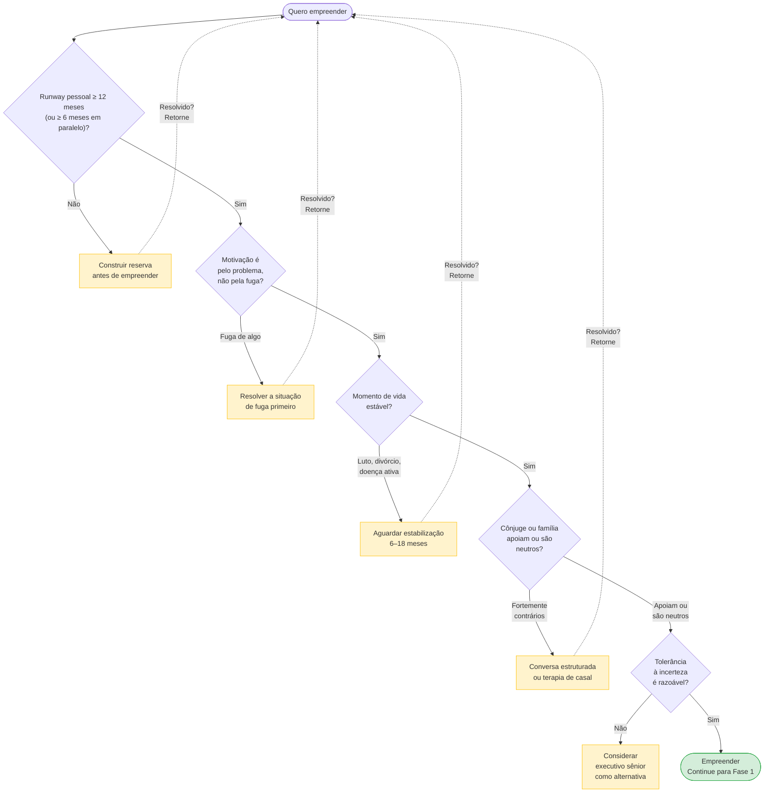
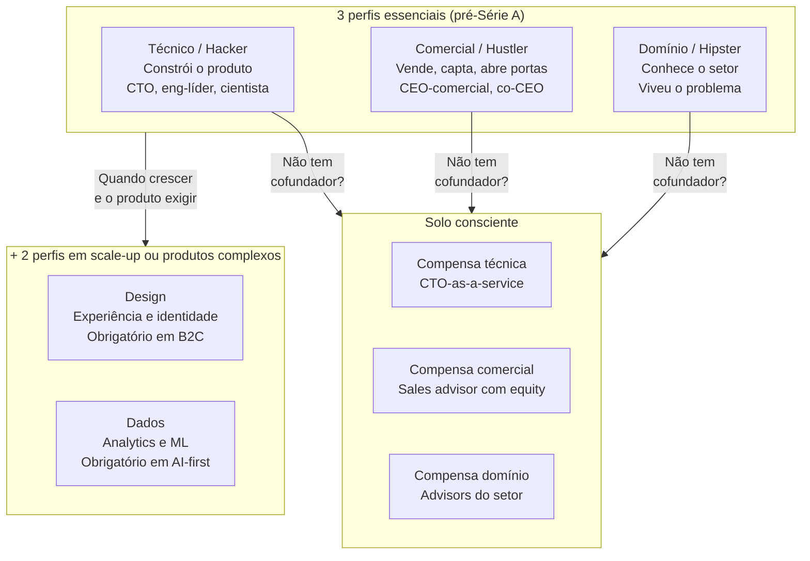
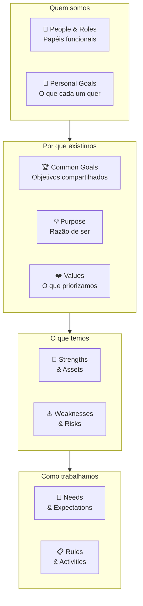
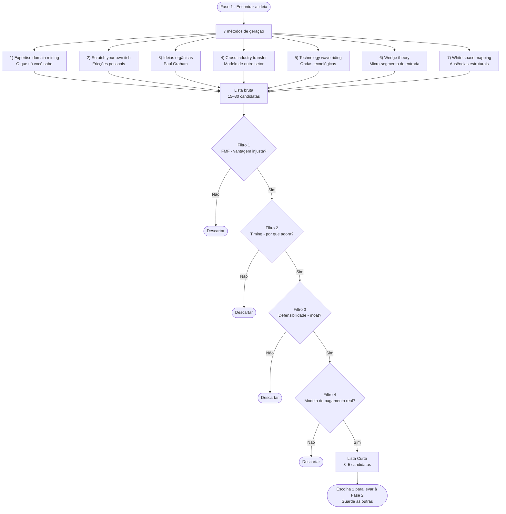
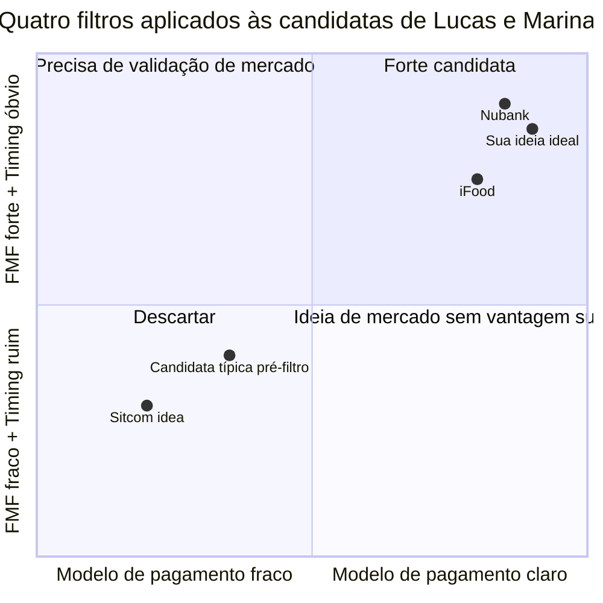
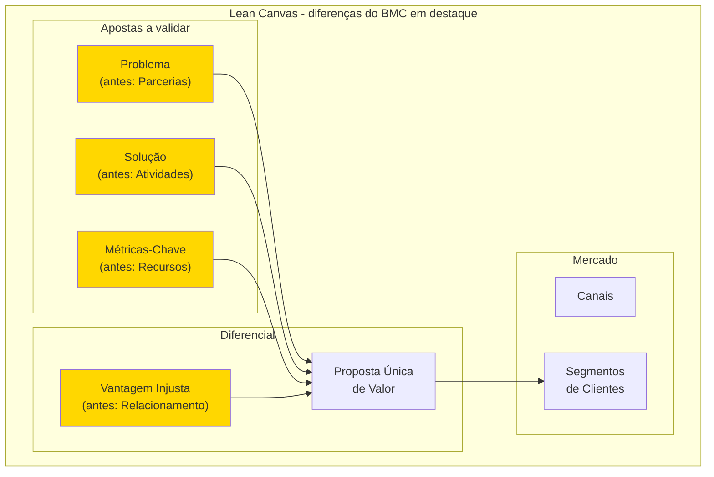
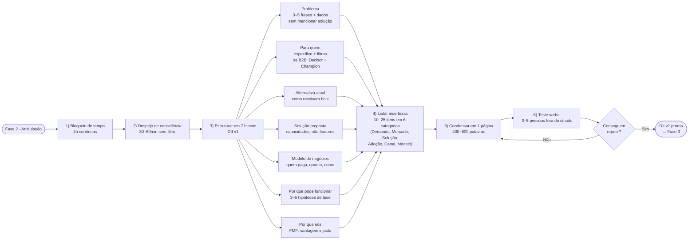
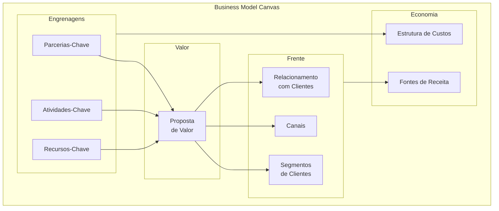
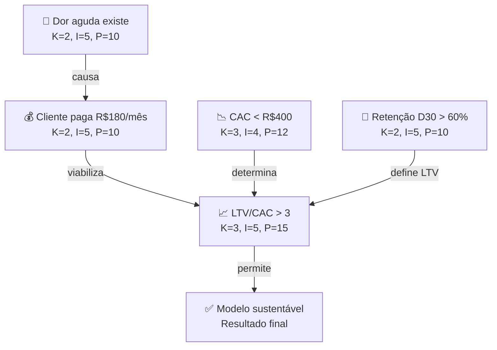

# IGNIÇÃO — Volume 1: Ideação e Fundação

**Do Pré-Zero à Teoria do Negócio (Fases 0 a 3 e Capítulos 1 a 12)**

*João Prado · 2026 · Edição Narrativa Enxuta (v5.2)*

---

## Nota do autor

Este livro começou como um caderno de campo aberto às onze da noite. Uma cicatriz anotada aqui, uma conta que não fechou ali, uma pergunta difícil que eu gostaria que alguém tivesse me feito seis meses antes de eu descobrir a resposta pelo caminho mais caro.

Durante muito tempo, resisti à ideia de publicar essas notas. Existem centenas de livros de negócios nas livrarias, muitos escritos no Vale do Silício por bilionários que operam com custo de capital próximo de zero, segurança jurídica previsível e clientes que compram software pelo cartão corporativo em cinco minutos. Só que quem tenta construir uma empresa séria no Brasil descobre rápido que o nosso jogo tem outra gravidade. Aqui você precisa validar produto e conquistar clientes enquanto desvia da Selic em dois dígitos, de um ISS que ainda muda de cidade para cidade enquanto a transição da Reforma Tributária e da NFS-e nacional (LC 214/2025) não se completa, de passivos trabalhistas ocultos, de ciclos de pagamento de noventa dias e do peso de quem responde com o próprio CPF.

Na primeira versão deste projeto, cometi o erro de organizar tudo como se fosse uma enciclopédia fria, cheia de verbetes, definições formais e fichas técnicas. Mas negócios reais não acontecem dentro de um dicionário. **Negócios acontecem numa terça-feira chuvosa quando o seu melhor cliente ameaça cancelar, quando o seu cofundador trava na conversa difícil ou quando você olha para o extrato bancário e precisa decidir entre cortar custos ou dobrar a aposta.**

Por isso, reconstruí inteiramente esta obra na tradição dos livros que mudaram a minha própria cabeça como fundador. De **Michael Gerber** (*O Mito do Empreendedor*), trouxe a conversa direta, olho no olho, e a compreensão de que saber fazer o trabalho técnico não é saber construir uma empresa. De **Eric Ries** (*A Startup Enxuta*) e **Peter Thiel** (*De Zero a Um*), trouxe o ceticismo científico contra o achismo e as perguntas contraintuitivas que desmontam o senso comum. De **Jason Fried e DHH** (*Rework*), trouxe a permissão libertadora para construir negócios enxutos, lucrativos e sem teatro corporativo.

Já para a etapa de manter a operação de pé e evoluir no longo prazo, bebi na engenharia de processos de **Andy Grove** (*High Output Management*), no foco em um nicho de cabeça de praia de **Geoffrey Moore** (*Atravessando o Abismo*) e nos rituais práticos de segunda-feira às nove da manhã de **Gino Wickman** (*Traction*), somados à franqueza direta de **Ben Horowitz** (*O Lado Difícil das Situações Difíceis*), **Jim Collins** (*Empresas Feitas para Vencer*) e **Clayton Christensen** (*O Dilema da Inovação*) sobre o medo, as demissões, as crises de caixa e os paradoxos de crescer sem destruir o que fez você vencer.

Mais importante: você não fará esta leitura sozinho. Além de centenas de casos reais de empresas brasileiras e globais (do Nubank, WEG, TOTVS, iFood e Tractian a negócios do interior que nunca saíram no jornal), você acompanhará ao longo dos volumes a jornada viva de **quatro fundadores-arquétipos brasileiros** (**Lucas & Marina**, **Dra. Camila**, **Henrique** e **Rafael & Bia**), enfrentando exatamente os mesmos dilemas que tiram o seu sono.

Cada capítulo e fase deste livro agora respira em **dois tempos**:
1. **A Narrativa Viva:** abro sempre no meio da tensão real, nunca com definições de manual, disseco a física do problema, dou nome às armadilhas recorrentes e fecho com **O Espelho** (autodiagnóstico direto, retomando o desfecho do arquétipo da abertura) e **O Ritual de Segunda-Feira**;
2. **A Oficina de Trincheira (Caderno de Campo):** nas fases operacionais e nos capítulos de aprofundamento, você encontra as ferramentas, *frameworks*, *canvases* com reconstruções didáticas e *templates* prontos para abrir na mesa com os seus sócios e executar imediatamente, impressos uma única vez na coleção inteira, exatamente na etapa em que entram em ação.

Eu não escrevi este livro de um camarote distante. Escrevi sentado à mesma mesa de trabalho em que você está agora, fechando as contas do mês e decidindo o próximo passo. Leia os capítulos corridos para mudar a sua forma de enxergar o jogo; abra a Oficina de Trincheira quando precisar agir sob pressão. Se uma única página aqui evitar que você queime dois anos de vida na ideia errada, no sócio errado ou no contrato errado, cada linha terá valido a pena.

Um bom trabalho, e que estas páginas sirvam bem à sua empresa.

*João Prado*

---

## Sobre este livro

**IGNIÇÃO** é um manual operacional em **10 volumes** para fundadores e equipes executivas construindo empresas no Brasil, da preparação pessoal antes do CNPJ (Fase 0) até a segunda curva de crescimento, o *exit* via M&A ou IPO (Fase 20) ou a perenidade como máquina de dividendos (*Cash Cow* e *Family Office*).

Cada volume da coleção foi desenhado para funcionar como um **manual de oficina**: todos os **164 Frameworks passo a passo**, **20 Canvases Visuais preenchidos com reconstruções didáticas de casos brasileiros**, **39 Templates operacionais prontos para uso**, **Tabelas de Métricas** e **Guias de Leitura** estão integrados diretamente dentro das Fases e Capítulos onde são executados (com presença local das ferramentas compartilhadas que garantem a leitura autocontida de cada volume) e com o Dicionário Geral Unificado no Volume 10.

A coleção está organizada em **10 volumes focais (21 Fases e 155 Capítulos)**:

- **Volume 1: Ideação e Fundação (este volume):** Fases 0 a 3 e 12 Capítulos de preparação financeira e mental do fundador, dinâmica de cofundadores, vieses, tomada de decisão, comunicação, produtividade e stack de IA, aceleradoras e mentores.
- **Volume 2: Descoberta de Cliente e Mapeamento de Mercado:** Fases 4 a 6 e 3 Capítulos de psicologia do consumidor brasileiro, inteligência competitiva e Category Design, e casos de fracasso brasileiros.
- **Volume 3: Hipóteses, Experimentos, Prototipagem e Modelos de Negócio:** Fases 7 a 10 e 7 Capítulos sobre método científico, gates de evidência, TRL/CRL e fechamento de fase, o framework *Idea → Wedge → Scale* e as arquiteturas de Marketplaces e Plataformas, B2B2C, Open Source (COSS) e Bootstrapping / *Productized Services* (transição *Service-to-Product*).
- **Volume 4: Tração, Go-to-Market e Product-Market Fit:** Fases 11 a 13 e 11 Capítulos de GTM e canais de aquisição, marketing de conteúdo e comunidade, mídia paga, branding e PMM, vendas consultivas, pricing e recorrência, negociação, Customer Success e CX, analytics, produto AI-native e pivô.
- **Volume 5: Finanças, Captação e Venture Capital:** Fase 14 e 15 Capítulos de demonstrativos financeiros, contabilidade e Reforma Tributária, modelagem operacional e coortes, FP&A e *forecasting*, capital de giro e gestão de caixa, bancos, Comércio Exterior e Importação (Ásia-Brasil), seguros, captação de VC e planejamento de rodada, *valuation*, SAFE/mútuo, fomento não diluitivo, *venture debt*, *crowdfunding*/tokenização e *Investor Relations*.
- **Volume 6: Receita Enterprise, Liderança e Cultura:** Fases 15 e 16 e 15 Capítulos de Growth em escala, vendas Enterprise, RevOps, Business Development e parcerias corporativas, canais indiretos, Franchising e Licenciamento (Lei 13.966/2019), marca, PR e autoridade do fundador, Founder Mode e cadência operacional, contratação C-level, performance, remuneração, ESOP, cultura em escala, diversidade e trabalho remoto/híbrido.
- **Volume 7: Produto, Engenharia, Dados, IA e Operações:** Fase 17 e 10 Capítulos de discovery contínuo, transição do fundador técnico, recrutamento técnico, gestão de engenharia e dívida técnica, IA na engenharia de software, AI Ops, design organizacional, gestão do conhecimento, comunicação interna e excelência operacional.
- **Volume 8: Blindagem Jurídica, Societária, LGPD e Segurança:** Fase 18 e 13 Capítulos de Marco Legal das Startups, responsabilidade dos sócios, propriedade intelectual/INPI, non-compete, contratos empresariais e operacionais, direito do trabalho, CDC, contencioso, LGPD, regulação de IA, compliance, prevenção a fraudes e SOC 2 / ISO 27001.
- **Volume 9: Maturidade, Governança, Crise, Exit e Family Office:** Fases 19 e 20 e 21 Capítulos de Conselho de Administração (Board), empresas familiares, conflitos societários, ESG, internacionalização, imigração, câmbio/tesouraria, gestão e comunicação de crise, layoffs, recuperação judicial, M&A buy-side, Search Funds, Spin-offs e Carve-outs, Liquidez Secundária (Secondaries), IPO, tributação de exit, transição e retenção pós-M&A, post-mortems, second-time founders e a Empresa *Cash Cow* (dividendos vitalícios) com Holdings Patrimoniais, Offshores e *Family Office*, encerrando com o Epílogo.
- **Volume 10: Economia da Inovação, Hubs Globais e Playbooks das 42 Verticais:** 48 Capítulos cobrindo a Economia da Inovação e seus Atores, a Geografia Mundial de Hubs por Continente e os 15 Polos Brasileiros, Ciclos Macroeconômicos, Autarquias Reguladoras, CADE, Políticas Públicas e os **42 Playbooks Setoriais** da economia real, seguidos pelo Dicionário e Índices Unificados da Coleção.


---

## Os 4 Fundadores que Acompanham Você Nesta Jornada (O Espelho Brasileiro)

Em *O Mito do Empreendedor*, Michael Gerber criou **Sarah**, a dona de uma confeitaria que amava assar tortas e acabou virando escrava da própria loja. Todo leitor se enxerga em Sarah porque conceitos abstratos só ganham alma quando têm rosto, boleto para pagar e medo de errar.

Ao longo dos **Volumes 1 a 10**, além das histórias reais de grandes empresas brasileiras e mundiais, você acompanhará de forma equilibrada ao longo dos volumes a evolução, os tropeços financeiros, os impasses societários, os pivôs e as vitórias de **quatro arquétipos que representam a vida real do empreendedor brasileiro** (com arco narrativo contínuo nos Volumes 1 a 9 e aplicação direta nos playbooks setoriais do Volume 10):

| Arquétipo | Quem São e Onde Operam | A Dor Inicial (Volumes 1 a 4, *Criar*) | O Desafio de Escala e Saída (Volumes 5 a 9, *Manter e Evoluir*) |
| :--- | :--- | :--- | :--- |
| **1. Lucas & Marina**<br/>*(SaaS B2B & AI-Native)* | **Lucas** (29, ex-engenheiro sênior de banco em SP, brilhante mas tentado a programar escondido) e **Marina** (31, comercial nata e pragmática, baseada em Florianópolis). | Quase quebram construindo um produto cheio de funcionalidades que ninguém pediu; aprendem a ouvir o cliente no *Mom Test* e financiam o MVP vendendo um *Serviço Produtizado* antes de escalar o SaaS. | Focam sua plataforma de tesouraria preditiva e *Embedded Finance* (serviços financeiros embarcados) em distribuidores e empresas médias, enfrentam *churn* (cancelamento de clientes), contratam o primeiro VP de Vendas, negociam *Series A* em São Paulo e recebem uma proposta de **M&A estratégico** (fusão e aquisição) no Volume 9. |
| **2. Dra. Camila**<br/>*(Economia Real, Saúde & Serviços)* | **Camila** (34, cirurgiã-dentista especializada em reabilitação oral em Belo Horizonte que abriu clínica própria e corre o risco clássico de virar refém da própria cadeira 14h por dia). | Compra equipamento caro por impulso (*custo afundado*), mistura as contas da casa com o caixa do CNPJ ao pagar despesas familiares pelo Pix da clínica e hesita na hora de cobrar o preço justo pela sessão até dominar margem de contribuição e processos. | Transforma o consultório em máquina autogerenciável (*estilo Traction/Grove*), expande via **Franquias (Lei 13.966/2019)**, passa o bastão para um CEO profissional com *Phantom Shares* (participação fantasma liquidada em caixa) e constrói uma **Cash Cow (geradora de dividendos) + Holding Familiar** no Volume 9. |
| **3. Henrique**<br/>*(Industrial, Agro & B2G / GovTech)* | **Henrique** (38, engenheiro mecânico de Curitiba com forte trânsito no interior do Paraná e Mato Grosso, vendendo hardware e software para usinas, indústrias e prefeituras). | Sofre com discursos técnicos cheios de jargão, leva "não" em banca de edital GovTech por não provar validação institucional e quase morre no purgatório de pilotos gratuitos (*POCs, provas de conceito*). | Aprende a vender para comitês complexos de seis cadeiras, usa subvenção **Finep, BNDES e EMBRAPII** e importação da Ásia (**TTD 409**), faz o **Spin-off** (cisão societária) de uma unidade interna e consolida concorrentes via **M&A Buy-Side** (aquisição estratégica de outras empresas). |
| **4. Rafael & Bia**<br/>*(Varejo, D2C, Comércio & Marketplace)* | **Rafael** (27, criativo de marketing, com sede comercial no Recife) e **Bia** (28, engenheira de produção, liderando o centro de distribuição e operações em Goiânia). | Iludem-se com faturamento bruto alto movido a tráfego pago caro, enfrentam o custo real da ruptura de estoque em datas de pico comercial e descobrem na pele o peso da logística e da substituição tributária no varejo brasileiro. | Sobrevivem a uma crise severa de capital de giro e à transição da **Reforma Tributária (IBS/CBS)**, lideram um *turnaround* (reestruturação operacional) difícil com corte de custos e constroem uma marca *omnichannel* (integrando canais físicos e digitais) com retenção real. |

---

## Roteiros de Leitura por Perfil (Fast-Tracks)

Com **10 volumes, 21 fases, 155 capítulos e 42 playbooks setoriais (~915 mil palavras)**, o **IGNIÇÃO** foi projetado tanto para leitura sequencial quanto para consulta sob demanda. Se você precisa destravar decisões nos próximos 30 dias, siga a trilha correspondente ao seu perfil atual (e acompanhe o arquétipo correspondente da coleção):

| Perfil / Arquétipo | O que ler primeiro (Ordem de Leitura) |
| :--- | :--- |
| **1. Fundador de 1ª Viagem (Do Zero ao MVP e PMF)** | **Vol. 1** (Fases 0 a 3 + Caps. 1–4) → **Vol. 2** (Fases 4 a 6) → **Vol. 3** (Fases 7 a 10) → **Vol. 4** (Fases 11 a 13 + Caps. 1, 5 e 6) |
| **2. Bootstrapper e SaaS / IA (*Lucas & Marina*: Serviço → Produto sem VC)** | **Vol. 1** (Cap. 4: Bootstrap vs. VC) → **Vol. 3** (Cap. 7: *Bootstrapping, Serviços Produtizados e Transição Service-to-Product*) → **Vol. 4** (Caps. 1, 5, 6 e 10) → **Vol. 5** (Caps. 1, 2 e 5: Capital de Giro e Caixa) → **Vol. 10** (Caps. 40, 41 e 42: *Vertical SaaS, Serviços Profissionais B2B/Nearshoring e AI-Native*) |
| **3. Fundador Tech, SaaS B2B, AI-Native ou Deep Tech (*Lucas & Marina* / *Dra. Camila*)** | **Vol. 3** (Cap. 2: TRL/CRL/Gates e Cap. 6: Open Source) → **Vol. 4** (Cap. 10: Produto AI-Native) → **Vol. 7** (Fase 17 + Caps. 1 a 6: Arquitetura, Dívida Técnica e IA na Engenharia) → **Vol. 10** (Cap. 1: Economia da Inovação/TRL + Caps. 39, 40, 42, 43 e 44: *Horizontal/Vertical SaaS, AI-Native, Cybersecurity e DevTools*) |
| **4. Empreendedor do Agro, Pecuária, Commodities e Bioeconomia (*Dra. Camila*)** | **Vol. 5** (Cap. 5: Recebíveis/FIDC e Cap. 12: Finep/BNDES/FAPESP) → **Vol. 9** (Cap. 7: Hedge Cambial) → **Vol. 10** (Cap. 2: Hubs do Agro + Caps. 11 a 14: *Agritech, Pecuária de Precisão/AquaTech, Trading de Commodities/Barter/Silos/Arco Norte e Biocombustíveis/Bioinsumos/Irrigação/Bioeconomia Amazônica*) |
| **5. Indústria, Infraestrutura, Energia, Telecom e Operações Pesadas** | **Vol. 5** (Cap. 6: Bancos/BNDES, Cap. 7: Importação Ásia-Brasil e Cap. 12: Fomento) → **Vol. 6** (Cap. 2: Vendas Complexas Enterprise e Cap. 4: Grandes Corporações) → **Vol. 10** (Caps. 15 a 28: *Infratech, Energytech, Cleantech, Resíduos/Biometano/Florestal, Mining/Oil & Gas, Indústria 4.0, Hardware, Logtech, Mobitech, Consórcios/Rental/Aftermarket, Segurança/Facilities, Telecom/ISPs/Data Centers e Aerospace*) |
| **6. Varejo, Franquias, Marcas Próprias (D2C/Importação) e Serviços Locais (*Rafael & Bia*)** | **Vol. 2** (Cap. 1: Psicologia do Consumidor Brasileiro) → **Vol. 5** (Cap. 2: Tributário/IBS-CBS e Cap. 7: *Comércio Exterior, Importação Ásia-Brasil, Landed Cost e TTD 409*) → **Vol. 6** (Cap. 6: *Franchising, Licenciamento e COF, Lei 13.966*) → **Vol. 10** (Caps. 30 e 34 a 38: *Clínicas/Odonto/Estética/Farma, Retailtech, Foodtech, D2C/Wellness, Travel/Pet/Silver e Setor Funerário/Assistência Familiar*) |
| **7. Setores Fortemente Regulados (*Henrique* e *Dra. Camila*: Fintech, Crédito, Seguros, Saúde e Govtech)** | **Vol. 5** (Cap. 5: FIDCs) → **Vol. 8** (Fase 18 + Caps. 1, 9, 10, 11 e 13: Marco Legal, LGPD, Regulação de IA, Compliance e SOC 2/ISO 27001) → **Vol. 10** (Caps. 3 a 10 e 29 a 33: *Ciclos Macro/Selic, BCB/CVM/SUSEP/ANVISA/ANS, CADE, Políticas Públicas, Fintech, Crédito Digital, Insurtech, Wealthtech/Drex, Biotech/Healthtech, Saúde Física/OPME, Edtech, Govtech e Legaltech*) |
| **8. CEO em Escala, Consolidador (*Henrique*: M&A / Search Fund), Cash Cow e Family Office** | **Vol. 5** (Fase 14 + Caps. 9 a 11) → **Vol. 6** (Fases 15 e 16 + Caps. 8 a 13: Founder Mode, Contratação C-Level, ESOP e Cultura) → **Vol. 9** (Fases 19 e 20 + Caps. 1 a 21: *Conselho/Board, Empresas Familiares, Internacionalização, Crise/Turnaround, M&A Buy-Side/Roll-ups, Search Funds, Spin-offs/Carve-outs, Secondaries, IPO, Tributação de Exit e A Empresa Cash Cow + Holdings, Offshores e Family Office*) |

---

## Mapa da Coleção IGNIÇÃO

```mermaid
graph LR
    subgraph J1["Do Zero à Validação"]
        V1["<b>Vol. 1: Ideação</b><br/>Fases 0 a 3 · Fundador e Teoria"]
        V2["<b>Vol. 2: Descoberta e Mercado</b><br/>Fases 4 a 6 · Cliente e Cunha"]
        V3["<b>Vol. 3: Hipóteses e Protótipo</b><br/>Fases 7 a 10 · Testes e Modelos"]
        V1 --> V2 --> V3
    end
    subgraph J2["Tração e Escala"]
        V4["<b>Vol. 4: Tração e PMF</b><br/>Fases 11 a 13 · MVP, GTM e Vendas"]
        V5["<b>Vol. 5: Finanças e Captação</b><br/>Fase 14 · Caixa, VC, Tributário e FP&A"]
        V6["<b>Vol. 6: Receita e Pessoas</b><br/>Fases 15 e 16 · Enterprise, Líderes e Cultura"]
        V7["<b>Vol. 7: Produto e Engenharia</b><br/>Fase 17 · Operações, IA e Arquitetura"]
        V8["<b>Vol. 8: Jurídico e Segurança</b><br/>Fase 18 · Societário, Contratos e LGPD"]
        V3 --> V4 --> V5 --> V6 --> V7 --> V8
    end
    subgraph J3["Ciclo Longo e Setores"]
        V9["<b>Vol. 9: Maturidade, Exit e Family Office</b><br/>Fases 19 e 20 · Board, Crise, M&A, IPO e Cash Cow"]
        V10["<b>Vol. 10: Economia da Inovação e 42 Verticais</b><br/>Hubs Globais, Regulação, 42 Setores e Dicionário"]
        V8 --> V9
    end
    V10 -. "Consulta Setorial e Dicionário" .-> J1
    V10 -. "Consulta Setorial e Dicionário" .-> J2
    V10 -. "Consulta Setorial e Dicionário" .-> J3
```



---

## Sumário deste Volume

### Fases da Etapa (Fases 0 a 3)
- [[#FASE 0 — PREPARAÇÃO DO EMPREENDEDOR|FASE 0: PREPARAÇÃO DO EMPREENDEDOR]]
- [[#FASE 1 — ENCONTRAR A IDEIA|FASE 1: ENCONTRAR A IDEIA]]
- [[#FASE 2 — ARTICULAÇÃO E CAPTURA DA IDEIA|FASE 2: ARTICULAÇÃO E CAPTURA DA IDEIA]]
- [[#FASE 3 — CONSTRUÇÃO DA TEORIA DO NEGÓCIO|FASE 3: CONSTRUÇÃO DA TEORIA DO NEGÓCIO]]
### Fundador, Cofundadores e Preparação Pessoal (Capítulos 1 a 5)
- [[#CAPÍTULO 1 — DINHEIRO PESSOAL DO FUNDADOR|CAPÍTULO 1: DINHEIRO PESSOAL DO FUNDADOR]]
- [[#CAPÍTULO 2 — SAÚDE MENTAL, DINÂMICA DE CO-FOUNDERS E HUMANIDADE DO FUNDADOR|CAPÍTULO 2: SAÚDE MENTAL, DINÂMICA DE cofundadores E HUMANIDADE DO FUNDADOR]]
- [[#CAPÍTULO 3 — ARMADILHAS MENTAIS E VIESES|CAPÍTULO 3: ARMADILHAS MENTAIS E VIESES]]
- [[#CAPÍTULO 4 — BOOTSTRAP vs VENTURE CAPITAL: A ESCOLHA FUNDACIONAL|CAPÍTULO 4: BOOTSTRAP vs VENTURE CAPITAL: A ESCOLHA FUNDACIONAL]]
- [[#CAPÍTULO 5 — DIVERSIDADE DE JORNADAS: CASOS ALÉM DO CÂNONE|CAPÍTULO 5: DIVERSIDADE DE JORNADAS: CASOS ALÉM DO CÂNONE]]
### Cognição, Decisão, Comunicação e Produtividade com IA (Capítulos 6 a 10)
- [[#CAPÍTULO 6 — TOMADA DE DECISÃO COMO DISCIPLINA|CAPÍTULO 6: TOMADA DE DECISÃO COMO DISCIPLINA]]
- [[#CAPÍTULO 7 — INFLUÊNCIA E PERSUASÃO SEM AUTORIDADE FORMAL|CAPÍTULO 7: INFLUÊNCIA E PERSUASÃO SEM AUTORIDADE FORMAL]]
- [[#CAPÍTULO 8 — COMUNICAÇÃO ESCRITA PARA NEGÓCIOS|CAPÍTULO 8: COMUNICAÇÃO ESCRITA PARA NEGÓCIOS]]
- [[#CAPÍTULO 9 — APRESENTAÇÃO E FALA EM PÚBLICO|CAPÍTULO 9: APRESENTAÇÃO E FALA EM PÚBLICO]]
- [[#CAPÍTULO 10 — IA GENERATIVA E AGENTES COMO COPILOTO E ACELERADOR DO FUNDADOR (2026)|CAPÍTULO 10: IA GENERATIVA E AGENTES COMO COPILOTO E ACELERADOR DO FUNDADOR (2026)]]
### Ecossistema, Mentoria e Apoio Inicial (Capítulos 11 e 12)
- [[#CAPÍTULO 11 — ACELERADORAS, PROGRAMAS E PARCEIROS INSTITUCIONAIS PARA STARTUP BRASILEIRA|CAPÍTULO 11: ACELERADORAS, PROGRAMAS E PARCEIROS INSTITUCIONAIS PARA STARTUP BRASILEIRA]]
- [[#CAPÍTULO 12 — REDE, MENTORES E ADVISORS — COMO CONSTRUIR O CAPITAL HUMANO DO EMPREENDEDOR|CAPÍTULO 12: REDE, MENTORES E ADVISORS: COMO CONSTRUIR O CAPITAL HUMANO DO EMPREENDEDOR]]

---

# FASES DA ETAPA — IDEAÇÃO E FUNDAÇÃO (FASES 0 A 3)

Os quatro primeiros estágios da jornada (**[[#FASE 0 — PREPARAÇÃO DO EMPREENDEDOR|Fase 0]]**, **[[#FASE 1 — ENCONTRAR A IDEIA|Fase 1]]**, **[[#FASE 2 — ARTICULAÇÃO E CAPTURA DA IDEIA|Fase 2]]** e **[[#FASE 3 — CONSTRUÇÃO DA TEORIA DO NEGÓCIO|Fase 3]]**) formam um filtro progressivo de lucidez antes de você gastar um real em código ou abrir um CNPJ. Ao final de cada fase, a **Oficina de Trincheira** entrega os frameworks passo a passo, os canvases visuais preenchidos com casos brasileiros e os templates prontos para rodar na mesa com seus sócios.

---

## FASE 0 — PREPARAÇÃO DO EMPREENDEDOR

### O contrato invisível que você assina antes de abrir o CNPJ

São 23h40 de um domingo em Belo Horizonte. A **Dra. Camila**, cirurgiã-dentista de 34 anos reconhecida como uma das melhores especialistas em reabilitação oral da sua região, fecha o computador na mesa da sala com um nó no estômago. Na sexta-feira, ela havia pedido demissão da clínica onde trabalhava há oito anos para realizar o sonho de abrir sua própria rede odontológica. Só que, ao somar pela primeira vez na ponta do lápis o aluguel do ponto comercial, a parcela dos equipamentos importados, a escola dos dois filhos e o seu custo de vida real, ela descobriu uma verdade gelada: se a clínica demorasse mais de quatro meses para empatar, o limite do cheque especial da família inteira iria explodir.

Camila não tinha um problema de ideia em Belo Horizonte: tinha apenas quatro meses de fôlego no caixa pessoal. Levantamentos recorrentes de sobrevivência empresarial no Brasil (como os estudos do Sebrae) confirmam que a falta de planejamento financeiro e de capital de giro encerra muito mais negócios na largada do que a falta de boas ideias, quando na vida real a maioria morre porque o fundador quebrou emocional ou financeiramente seis meses antes de o negócio ter tempo de aprender a ficar de pé.**

Em *O Mito do Empreendedor*, Michael Gerber descreve a **"Convulsão Empreendedora"**: aquele instante em que um excelente técnico, como um engenheiro brilhante como **Lucas** em São Paulo, uma dentista impecável como **Camila** em BH, ou um engenheiro mecânico como **Henrique** em Curitiba, acorda cansado de ter chefe e confunde *saber fazer o trabalho técnico* com *estar pronto para sustentar o peso de uma empresa*. Antes de escrever uma única linha de código ou desenhar uma logomarca, você precisa auditar a única máquina que não tem peça de reposição no início da jornada: **você mesmo, seu caixa pessoal e os loops abertos dentro da sua casa**.

---

> [!info] Como ler esta fase
> A Fase 0 atende dois leitores ao mesmo tempo. Se você ainda está decidindo se quer empreender, leia da abertura até o fim de "Permissão para dizer 'ainda não'" e pare. Se três ou mais sinais batem com a sua situação, volte aqui em alguns meses, depois de ajustar. O resto da fase é para quem já decidiu. Se você já decidiu, leia tudo. Os dez sinais de auto-exclusão valem como recheck antes de cada decisão grande adiante (largar emprego, recrutar sócio, comprometer runway).

### Por que negócios promissores morrem no CPF do fundador antes de quebrar no CNPJ

Quem empreende carrega por anos um peso psicológico e financeiro contínuo, e a maioria das desistências acontece porque o fôlego pessoal do fundador acaba antes de a ideia amadurecer. A maioria das desistências não acontece porque a ideia era ruim. Acontece porque o empreendedor não aguentou a pressão. Ficou sem dinheiro, sem apoio familiar, sem saúde mental. Ou descobriu tarde que queria outra coisa da vida. Pular esta fase significa começar um negócio sobre fundações pessoais frágeis, e qualquer crise do próprio negócio derruba tudo.

### Permissão para dizer "ainda não": os 10 sinais de que começar hoje é uma armadilha

A maioria dos manuais assume que o leitor já decidiu empreender e ajuda a executar bem. Há momentos da vida em que abrir uma empresa agora é má ideia, independentemente da qualidade da tese ou da competência técnica do time, independente de quão boa seja a ideia ou o time. Reconhecer essas situações antes evita sofrimento pessoal, destruição de capital, e desperdício de anos. Não é julgamento. É honestidade.



Você provavelmente não deveria empreender agora se:

1. Suas finanças pessoais estão frágeis. Dívidas pessoais altas no cartão, no rotativo, no financiamento atrasado, sem plano de quitação. Reserva de emergência abaixo de seis meses de despesas. Dependentes financeiros sem outra fonte de renda. Empreender com finanças pessoais frágeis costuma terminar em crise dupla, da empresa e da casa. Resolva as finanças primeiro, construa reserva, depois empreenda.

2. Você está num período de vida emocionalmente turbulento. Luto recente, divórcio em curso ou recente, mudança de cidade ou país sem adaptação, diagnóstico de saúde sério em curso. A trajetória empreendedora exige resiliência emocional alta. Somada a uma crise pessoal, tende a destruir as duas. Esperar estabilizar é sábio.

3. Sua motivação principal é financeira de curto prazo. Quero ficar rico em três anos. Preciso ganhar muito rápido. Empreender paga mais que CLT. Como mostram estudos clássicos sobre a renda do trabalho por conta própria (como Barton Hamilton, *Does Entrepreneurship Pay?*, *Journal of Political Economy*, 2000), é comum que fundadores ganhem menos nos primeiros anos de operação do que receberiam num cargo bem remunerado com carteira assinada. Retorno financeiro real, quando vem, vem em sete a doze. Motivação só financeira costuma desistir antes desse tempo.

4. Você não tolera incerteza. Precisa de rotina, previsibilidade, feedback constante. Sente alta ansiedade em situações ambíguas. Tem dificuldade de dormir com questões não resolvidas. Empresa em estágio inicial é incerteza por anos. Autoconhecimento aqui é honestidade. Algumas personalidades florescem melhor como executivo sênior em empresa maior.

5. Você não tem nenhum conhecimento específico do problema que quer resolver. A ideia nasceu de observação superficial. Você não conhece o cliente em profundidade. Não tem rede no setor. É possível, mas três a cinco vezes mais difícil. Alguém do setor com menos brilho resolve mais rápido. Se você quer insistir, construa conhecimento e rede do setor por seis a doze meses antes de fundar.

6. Você está empreendendo para provar algo a alguém. Aos pais que dizem "estabilize". Ao chefe que demitiu você. Ao ex-parceiro que duvidou. Motivação externa dessa forma costuma colapsar quando a trajetória fica difícil, e ela vai ficar. A motivação precisa ser interna e pelo problema em si.

7. Seu cônjuge ou companheiro é fortemente contrário. Não apenas preocupado, mas explicitamente contra e resistente mesmo após conversa longa. Empreender contra a oposição do parceiro destrói muitos casamentos. Se você quer insistir mesmo assim, considere terapia de casal antes.

8. Você está no meio de uma trajetória profissional que estava dando certo. Promoção recente, aumento significativo, caminho de liderança em empresa consolidada. Nunca vai ser o "bom momento" de sair do emprego, mas em trajetória ascendente alta o custo de oportunidade é enorme. Isso não significa que você não pode empreender. Significa que você precisa fazer o cálculo com clareza. Quanto está deixando? O que vai buscar? Decisão com olhos abertos, não impulso.

9. Você tem condição de saúde mental não tratada. Depressão, ansiedade severa, transtornos específicos sem acompanhamento. A trajetória empreendedora agrava saúde mental frágil. Não é remédio. Trate primeiro. O [[#CAPÍTULO 2 — SAÚDE MENTAL, DINÂMICA DE CO-FOUNDERS E HUMANIDADE DO FUNDADOR|Capítulo 2 (Saúde Mental, Dinâmica de cofundadores e Humanidade do Fundador)]] detalha o impacto da rotina empreendedora em ansiedade e depressão, avaliação inicial, e quando buscar ajuda profissional antes de empreender.

10. Você quer empreender porque odeia seu emprego atual. Fugir de algo é diferente de ir em direção a algo. Frequentemente a trajetória empreendedora fica mais difícil que o emprego ruim. Resolva o trabalho primeiro. Depois empreenda por motivo positivo, não evasivo.

> [!warning] A regra dos três pontos
> Os sinais 1 e 2 (reserva financeira inexistente e quadro agudo de saúde mental sem tratamento) são eliminatórios por si sós e pedem pausa imediata; entre os demais, se três ou mais forem verdadeiros hoje, adie a largada em tempo integral. Não desista. Ajuste. Trabalhe nos pontos por seis a vinte e quatro meses antes de empreender. A trajetória depois dessa preparação é significativamente mais sustentável.

### A auditoria em 8 passos: do Runway Pessoal ao ponto de parada escrito

Execute estas oito tarefas em sequência.

1. Diagnóstico financeiro pessoal, de duas a quatro horas. Levante numa planilha três números. O seu custo de vida mensal mínimo (aluguel, alimentação, transporte, escola dos filhos e dívidas, somando também os benefícios que antes vinham no pacote do emprego CLT e agora saem do seu bolso: plano de saúde familiar, previdência e reserva para 13º e férias, conta que na casa da Dra. Camila, com dois filhos no convênio, acrescentava R$ 3,2 mil por mês), o quanto você precisa para viver com dignidade básica, sem lazer. O seu custo de vida mensal atual, incluindo o padrão que você leva hoje. A sua reserva atual em dinheiro líquido, sem contar imóveis, carros, previdência travada.

   > [!tip] Fórmula do Runway Pessoal
   > Runway Pessoal (tempo de vida do seu caixa pessoal) = Reserva ÷ Custo mínimo mensal
   >
   > É o número de meses que você aguenta sem receita. Se for menor que seis meses, não peça demissão agora: valide em paralelo ao emprego. Antes de começar, leia seu contrato de trabalho e o regulamento interno do empregador: nunca use computador, horário, dados ou clientes da empresa atual (sob risco de justa causa por concorrência pelo art. 482, 'c', da CLT e de disputa sobre titularidade de software pelo art. 4º da Lei 9.609/1998; se o projeto atuar no mesmo setor, consulte um advogado trabalhista e veja os Capítulos 4 e 7 do Vol. 8).

   > [!tip] Capítulo 1: Dinheiro Pessoal do Fundador
   > O diagnóstico acima é o ponto de partida. O [[#CAPÍTULO 1 — DINHEIRO PESSOAL DO FUNDADOR|Capítulo 1 (Dinheiro Pessoal do Fundador)]] aprofunda: pró-labore sustentável por fase, gestão de dívida pessoal enquanto a empresa cresce, e como separar as finanças pessoais das da empresa desde o início.

2. Teste de motivação real, uma hora, em silêncio, sem pressa. Responda por escrito, com franqueza direta. Por que eu quero empreender? Escreva cinco razões. Dessas razões, quais são sobre mim (ego, liberdade, dinheiro) e quais são sobre o problema ou o cliente? Do que eu estou fugindo? Chefe ruim, trabalho tedioso, sensação de fracasso? Cuidado: empreender para fugir de algo é fonte frequente de decisões ruins. Eu faria isso se nunca ficasse rico? Se não, qual é o valor mínimo que precisa sair disso para fazer valer a pena?

3. Inventário de habilidades e lacunas, duas horas. Liste em quatro colunas: o que você tem e é relevante, o que falta e é crítico, como cobrir cada lacuna (aprender, contratar, sócio), e o custo em tempo e dinheiro de cada cobertura.

4. Conversa estruturada com quem compartilha a sua vida, uma a duas horas. Se você tem cônjuge, filhos, ou alguém que depende de você, marque uma conversa formal. Não um comentário de jantar. Apresente quanto dinheiro você planeja alocar, qual o prazo que dá a si mesmo antes de reavaliar, qual impacto isso terá na rotina familiar, qual é o plano B se não der certo. Peça uma resposta honesta. Se a pessoa não apoia, trate isso como informação crítica. Não como obstáculo a ser ignorado.

   > [!note] Esta conversa em casa serve para ouvir e alinhar limites reais, não para persuadir a família; o Capítulo 7 ajuda a apresentar seu plano com clareza, mas uma recusa fundamentada do cônjuge é dado objetivo de decisão, não obstáculo a vencer
   > Você não tem poder hierárquico sobre cônjuge, pais ou amigos próximos. O [[#CAPÍTULO 7 — INFLUÊNCIA E PERSUASÃO SEM AUTORIDADE FORMAL|Capítulo 7: Influência e Persuasão sem Autoridade Formal]] cobre como construir alinhamento genuíno com pessoas que não são obrigadas a concordar com você: ferramenta direta para a conversa desta etapa.

5. Avaliação de saúde física e mental, trinta minutos. Sono, condições crônicas que pioram com estresse, rede de apoio emocional disponível. Se já está em tratamento, converse com o seu profissional antes de aumentar a pressão.

6. Definição de prazo e critérios de desistência, uma hora. Defina de antemão quanto tempo você dá ao projeto antes de reavaliar (sugiro doze meses para a primeira reavaliação formal). Quais sinais de fracasso justificam desistir antes (nenhum cliente pagante depois de seis meses de tentativa ativa, reserva abaixo de X reais). Quais sinais de sucesso justificam acelerar (primeiro cliente pagante recorrente em noventa dias). Defina esses critérios agora, com a cabeça fria. No meio da tempestade, você não vai ter objetividade para defini-los.

   > [!note] A decisão de empreender é Tipo 1: irreversível por meses ou anos
   > O [[#CAPÍTULO 6 — TOMADA DE DECISÃO COMO DISCIPLINA|Capítulo 6: Tomada de Decisão como Disciplina]] distingue decisões reversíveis (Tipo 2, podem ser desfeitas rapidamente) de decisões irreversíveis (Tipo 1, com custo alto de reversão). Largar emprego, comprometer o runway pessoal e recrutar cofundadores são Tipo 1. O SPADE (método para estruturar decisões de alto impacto) e a técnica de pré-mortem (exercício de imaginar o fracasso antes de decidir) do Capítulo 6 (Tomada de Decisão como Disciplina) ajudam a estruturar esse tipo de decisão antes de tomar, não depois.

7. Escolha do modelo de dedicação entre três caminhos: full-time (largar tudo, exige runway de doze meses ou mais), part-time (manter emprego, dez a vinte horas semanais), ou side project exploratório (cinco a dez horas semanais, sem pressão de virar empresa, serve para as fases 1 a 4).

   > [!note] Capítulo 8 (Vol. 6): Gestão de Tempo do Fundador
   > Independente do modelo escolhido (full, part ou side), a alocação de tempo será o recurso mais escasso e mais mal gerenciado nos primeiros meses. O [[IGNICAO-Vol-6-Receita-e-Pessoas#CAPÍTULO 8 — FOUNDER MODE, DELEGAÇÃO, GESTÃO DE TEMPO E CADÊNCIA OPERACIONAL DO CEO|Capítulo 8 (Founder Mode, Delegação, Gestão de Tempo e Cadência Operacional do CEO) (Vol. 6)]] cobre time-blocking, rituais semanais e como proteger tempo profundo contra demandas operacionais: especialmente relevante para quem empreende em paralelo ao emprego.

8. Escrita do Dossiê Pessoal. Consolide os passos acima em um documento simples e releia ao final de cada fase seguinte. Atualize sempre que algo descoberto no caminho invalidar uma premissa.

### O fundador como pessoa, três ensaios de Paul Graham para calibrar expectativa

A Fase 0 é sobre preparar a pessoa que vai empreender, não o negócio. Paul Graham tem alguns ensaios especificamente sobre essa dimensão. Sobre o tipo de pessoa que tende a ter sucesso em startup, o tipo de pensamento que ajuda, o tipo de armadilha interna que derruba. Não são conselhos de "atitude positiva". São observações baseadas na experiência de ter acompanhado mais de três mil fundadores no Y Combinator, cruzada com padrões identificados em retrospecto.

> [!note] Capítulo 20 (Vol. 9): Second-Time Founder
> Se você já empreendeu antes, tenha vendido a empresa, fechado as portas ou ainda esteja à frente dela, a sua Fase 0 é diferente. O [[IGNICAO-Vol-9-Maturidade-e-Exit#CAPÍTULO 20 — SECOND-TIME FOUNDER|Capítulo 20 (Second-Time Founder) (Vol. 9)]] trata de como o histórico anterior muda a equação de runway, escolha de sócio, e autoconhecimento exigidos aqui.

Os três ensaios abaixo são os que mais se aplicam à decisão da Fase 0. Outros três do mesmo autor (*What We Look for in Founders*, *Before the Startup*, *You Weren't Meant to Have a Boss*) entram resumidos no fim. Os links estão no [[IGNICAO-Vol-10-Playbooks-Setoriais-e-Glossario#BIBLIOGRAFIA GERAL|Bibliografia e Leituras Recomendadas (Vol. 10)]].

#### A ideia dominante na sua cabeça, *The Top Idea in Your Mind* (Graham, 2010)

Graham observou que a maioria das pessoas tem uma única ideia dominante na mente em qualquer momento. É aquela para a qual os pensamentos migram naturalmente quando você está no banho, dirigindo, ou caminhando sem estímulo externo. É o problema em que você pensa sem tentar. E é a fonte de boa parte das suas melhores intuições operacionais e estratégicas.

A implicação para o fundador é concreta. Ser CEO de startup exige que o seu negócio seja a ideia dominante na sua cabeça durante os primeiros anos. Se o problema dominante for outro (um conflito pessoal em aberto, ansiedade financeira não resolvida, uma briga com ex-sócio, um pleito jurídico, uma dívida não estruturada), o seu negócio vai sofrer sistematicamente. O tempo de pensar sem tentar está sendo gasto em outro lugar. Você não controla para onde a mente vai no banho. Controla indiretamente, pelo que deixa ou não deixa ficar aberto na sua vida.

Teste simples, feito nos próximos três banhos, sem tentar. Quando a sua mente vagueia, para onde ela vai? Se não é o seu negócio, você tem duas opções. A primeira é fechar o loop do que está ocupando a mente. Resolver o conflito, pagar a dívida, enfrentar a conversa evitada, terminar o processo jurídico. Loops abertos são imãs mentais que roubam a sua capacidade de pensar em trabalho profundo. A segunda é reconhecer que você ainda não está pronto para começar uma startup. Talvez seja sensato resolver a vida pessoal primeiro, antes de somar a ela a carga cognitiva de fundar uma empresa.

Graham identifica dois tipos de pensamento particularmente perigosos para fundadores, porque roubam atenção de forma desproporcional ao benefício. Um é pensamento sobre dinheiro. Captação tende a virar atolamento mental que consome cem por cento do foco por semanas. O outro é pensamento sobre disputas. Brigas ocupam espaço imenso, e pior, têm formato velcro. Parecem ter substância, mas não têm. Se você está hoje no meio de uma captação ou de uma disputa, aceite que o seu trabalho estratégico vai sofrer durante esse período. Não marque outras decisões importantes para acontecerem em paralelo.

> [!tip] Crescer com a receita dos próprios clientes (*bootstrapping*) como alternativa ao capital de risco na escolha do modelo de dedicação
> Antes de assumir VC como caminho default, ler [[#CAPÍTULO 4 — BOOTSTRAP vs VENTURE CAPITAL: A ESCOLHA FUNDACIONAL|Capítulo 4 (Bootstrap vs Venture Capital: A Escolha Fundacional)]] para a escolha fundacional. Bootstrap e venture capital são trade-offs distintos, não níveis de ambição.

> [!important] Regra operacional da Fase 0
> Antes de começar, faça um inventário honesto de loops abertos na sua vida. Dívidas não renegociadas, conflitos interpessoais, compromissos não cumpridos, processos incompletos. Feche o máximo possível. Cada loop aberto é imposto mental sobre a sua capacidade futura de ser fundador.

#### Engenhoso sem trégua (*Relentlessly Resourceful*) (Graham, 2009)

Graham escreveu um ensaio curto, de 2009, com a tese mais direta sobre o que faz um bom fundador. Conseguir reduzir bom fundador a duas palavras levou tempo, ele diz. A resposta é "relentlessly resourceful". Implacavelmente engenhoso.

O conceito é construído em oposição a "hapless". Desamparado. Vítima passiva das circunstâncias. O ponto não é apenas trabalhar muito. Muita gente trabalha muito e continua hapless. É trabalhar muito e continuar tentando abordagens novas quando as primeiras falham mais nunca aceitar "não tem como" como resposta final. Quem age de forma desamparada (*hapless*) deixa-se paralisar pela primeira porta fechada; quem é engenhoso sem trégua (*relentlessly resourceful*) dobra a circunstância até encontrar uma saída prática.

Graham observa que a diferença aparece operacionalmente em como a pessoa reage a obstáculo. A pessoa hapless recebe um não de investidor, volta para casa, conclui "então não vai dar certo". Tenta canal de aquisição que não funciona, conclui "o canal é ruim". Tem problema técnico difícil, espera que alguém apareça para resolver. A pessoa relentlessly resourceful recebe o não de investidor, pergunta exatamente por quê, ajusta o pitch, tenta outros quinze investidores com o pitch novo. Canal de aquisição falha, ela testa outros oito mecanicamente. Problema técnico difícil, ela estuda do zero, pergunta a dez pessoas, tenta três abordagens.

Para Graham, é o teste mais útil que ele aplicava mentalmente ao conhecer fundador pela primeira vez. Sugere que é também o teste que vale você aplicar a si mesmo e a qualquer cofundador. Quando esta pessoa bate em obstáculo, ela naturalmente vai para "tem que ter um jeito" ou para "não tem como"?

Exercício concreto de Fase 0. Liste cinco obstáculos significativos que você enfrentou profissionalmente nos últimos três anos. Para cada um, descreva em três frases. Qual era o obstáculo. Quantas abordagens você tentou antes de achar solução ou desistir. Quem te ajudou ou quem você envolveu. O padrão que emerge: se em três ou mais dos cinco casos você tentou duas abordagens ou menos, ou desistiu sem envolver outras pessoas, provavelmente você ainda não desenvolveu o músculo de "relentlessly resourceful". Isso é desenvolvível. Mas vale você saber que está nesse ponto antes de começar a empreender, para poder desenvolver conscientemente.

> [!note] Síntese da tese de Graham
> Se "Make something people want" é o destino do Y Combinator, "Be relentlessly resourceful" é, segundo Graham, como o fundador chega lá. A formulação é uma síntese das duas teses centrais que Graham repete em ensaios e palestras, não citação literal de uma única frase.

#### Determinação não é teimosia, *The Anatomy of Determination* (Graham, 2009)

Determinação e teimosia parecem iguais de fora, mas são opostas operacionalmente.

Em *What We Look for in Founders* (2010), Graham compara esse fundador ao *running back* do futebol americano (ou ao atacante no futebol brasileiro que muda de direção no meio da defesa sem perder a baliza de vista). Atleta cujo trabalho é correr para o gol apesar da defesa ativa tentando detê-lo. Running back bom não é o que corre em linha reta e bate nos defensores até cair. É o que tem destino claro (o gol) mas rota flexível. Ele desvia, gira, volta, tenta de novo por outro ângulo, sempre em direção ao mesmo gol. Essa é a forma correta de determinação em startup.

Teimosia é ter rota fixa apesar de a defesa mostrar que ela não funciona. Determinação é ter gol fixo e aceitar rotas novas infinitamente até uma delas funcionar.

Sinais de que você está na teimosia disfarçada de determinação. Você está há meses rodando a mesma abordagem sem resultado, dizendo "só preciso insistir mais". Você se irrita quando alguém questiona a abordagem, não a ideia. Você mede progresso em esforço aplicado em vez de aprendizado gerado. Conversas com cliente te deixam desmoralizado em vez de curioso.

Sinais de determinação saudável. Você muda de rota com frequência, mas mantém o gol fixo por anos. Você busca ativamente evidência contrária à sua abordagem atual. Você mede progresso em incerteza reduzida e hipótese testada, não em tempo investido. Conversas com cliente, mesmo críticas, te animam porque revelam caminho.

A calibragem da Fase 0. Se você está começando sem experiência como fundador, é muito provável que a sua primeira intuição de "ser persistente" vai derivar para teimosia. Crie mecanismos externos que forcem revisão. Mentor que pergunta "o que você mudou de opinião neste mês". Ritual mensal de escrever o que aprendeu. Prazo para decisão de pivô com critérios objetivos. Sem esses mecanismos, a tendência natural do fundador iniciante é a rigidez.

#### Três outros ensaios de Graham, em formato compacto

**O que o YC procura em fundador, *What We Look for in Founders* (2010).** Graham resume em cinco atributos: determinação (capacidade de iterar contra obstáculos), flexibilidade (mudar rota mantendo gol), imaginação (gerar ideias que parecem um pouco malucas), naughtiness (disposição de quebrar regras sem substância), e amizade entre cofundadores (relação que sobrevive a desacordo forte). Inteligência ficou de fora deliberadamente: acima de um limiar não é diferenciador. Se você pontua baixo em três ou mais desses, vale repensar timing.

**Startups são contraintuitivas, *Before the Startup* (palestra Stanford, 2014).** Três pontos: (1) você não precisa ser expert em startups, precisa ser expert em usuários, Zuckerberg sabia o que estudante queria de rede social, não sabia montar empresa; (2) burlar sistema (impressionar chefes, fazer movimentos certos) para de funcionar quando o juiz é mercado, não pessoa; (3) confie na sua intuição sobre pessoas (cofundadores, contratações), desconfie da sua intuição sobre o resto (mercado, ideia, timing).

**Sobre autonomia, *You Weren't Meant to Have a Boss* (2008).** Algumas pessoas definham em emprego corporativo bem-pago, e isso não melhora trocando de empresa. Melhora quando assumem projeto próprio. É temperamento, pouco moldável. Perguntas para autodiagnóstico: você sofria mais com chefe do que com trabalho? Tem histórico de fazer coisas sem ninguém pedir? Instrução detalhada sobre como fazer algo te desgasta desproporcionalmente? Se sim, empreender é alinhamento, não escolha arbitrária. Se não, cuidado com empreender por status ou FOMO.

### Os números que não mentem sobre o seu fôlego inicial

- Runway pessoal em meses. Idealmente doze ou mais para full-time, seis ou mais para part-time.
- Horas semanais comprometidas com foco real: mínimo de 5 a 10 horas semanais no modelo de projeto paralelo (*side project* nas Fases 1 a 4), 15 a 25 horas na transição em meio período e 40 horas ou mais na dedicação integral. Abaixo de cinco horas por semana, o projeto definha.
- Nível de apoio da rede próxima, escala de um a cinco autoavaliada, com justificativa escrita.
- Clareza de motivação, autoavaliação de um a cinco. Se você não consegue articular o por quê em uma frase, está baixo.

### Saúde mental do fundador em estágio zero

A Fase 0 é o momento de maior vulnerabilidade psicológica da trajetória empreendedora. Não por ser a fase mais difícil. A Fase 14, com folha de 80 pessoas e crise de caixa, é objetivamente mais pesada. É vulnerável porque o fundador carrega o peso do que ainda não existe, com suporte mínimo, sem a legitimidade de "é uma empresa de verdade", e em geral enquanto administra obrigações anteriores (emprego, família, dívidas). Burnout nesta fase raramente aparece como colapso visível. Aparece como procrastinação crônica, perda de entusiasmo pelo projeto, ou hiperfoco compensatório que destrói relacionamentos. Reconhecer os sinais cedo é crítico.

**Stress produtivo e sinal de alerta, como distinguir.**

O stress produtivo tem marcadores reconhecíveis. Você tem energia depois de resolver um problema difícil. Dorme mesmo com preocupações pendentes. Ainda sente curiosidade pelo projeto. É o stress do atleta. O músculo cansa, e se recupera.

O sinal de alerta tem outros marcadores. Fadiga que não cede com descanso. Perda de prazer em coisas fora do projeto, amigos, hobbies. Pensamentos circulares, o mesmo problema voltando sem progresso. Irritabilidade desproporcional a eventos pequenos. Sensação persistente de que o projeto virou uma armadilha sem saída (se surgirem pensamentos de desistir da própria vida, pare tudo e ligue imediatamente para o **188, CVV**, gratuito e 24 horas em todo o Brasil, ou procure a UBS, o CAPS ou o pronto-socorro mais próximo).

**Os três gatilhos específicos de Fase 0 não cobertos na lista de auto-exclusão.**

*Isolamento de confirmação*: em pré-produto, não há métricas, não há usuários, não há confirmações externas. O ciclo de retorno (feedback loop) que mantém fundadores motivados, ver produto crescer, ver clientes satisfeitos, ainda não existe. Substituto saudável: encontros semanais ou quinzenais com outros fundadores no mesmo estágio de operação, grupos de accountability partner (parceiro de responsabilidade mútua), ou mentor que já passou por isso.

*Comparação com pares*: o LinkedIn e X/Twitter filtram sucessos. Founder em Fase 0 vê anúncio de rodada de seed (primeira rodada de investimento externo) de par: e não vê os 18 meses de rejeição que antecederam. Social media como referência emocional em Fase 0 é envenenamento de longa duração.

*Perfeccionismo de pré-lançamento*: convencer-se de que o produto precisa estar "pronto" antes de mostrar para alguém. Paralisia disfarçada de padrão de qualidade. O produto nunca fica "pronto o suficiente": a espera cresce junto com o projeto.

**Protocolo de auto-monitoramento semanal (10 minutos).**

Reserve sexta-feira, 10 minutos. Responda quatro perguntas com nota de 1 a 5.

1. Energia: como estava a minha energia física e mental esta semana? (1 = exausta, 5 = boa)
2. Clareza: eu sabia o que fazer a maior parte dos dias? (1 = perdido, 5 = claro)
3. Relações: minhas relações importantes (parceiro, amigos próximos) estavam em bom estado? (1 = deteriorando, 5 = sólidas)
4. Sentido: eu ainda acredito que o projeto vale o esforço? (1 = duvidando forte, 5 = sim)

Média abaixo de 3 por três semanas consecutivas é sinal de parada obrigatória para diagnóstico, não de maior esforço.

**Recursos no Brasil.**

O [[#CAPÍTULO 2 — SAÚDE MENTAL, DINÂMICA DE CO-FOUNDERS E HUMANIDADE DO FUNDADOR|Capítulo 2 (Saúde Mental, Dinâmica de cofundadores e Humanidade do Fundador)]] cobre saúde mental em estágios posteriores (escala, crises, exit). Para Fase 0, os recursos mais práticos são: comunidades de founders (Abstartups, grupos locais de ACE, Endeavor, Women in Tech), psicólogo ou psiquiatra com experiência em profissionais de alta performance (não é luxo: é infraestrutura), e accountability partner (outro fundador que faz check-in semanal mútuo). Em São Paulo e Rio, existem grupos específicos de saúde mental para empreendedores: procurar por psicólogos clínicos em plataformas como Vittude, Zenklub ou Doctoralia.

> [!warning] O mito da resiliência como identidade
> A cultura empreendedora glorifica "nunca desistir" de forma que patologiza o cuidado com saúde mental. "Founder resiliente" se tornou identidade, o que torna admitir fraqueza uma ameaça à identidade. O resultado prático: founders com sinais sérios de burnout escondem por meses, esperando "passar sozinho". Não passa. Resiliência real inclui saber quando pedir ajuda.

### Sócios, a decisão mais irreversível da Fase 0

A [[IGNICAO-Vol-8-Juridico-LGPD-e-Seguranca#FASE 18 — ESTRUTURAÇÃO JURÍDICA, SOCIETÁRIA E BLINDAGEM OPERACIONAL|Fase 18 (Vol. 8)]] cobre cap table (tabela de participação societária). O [[#CAPÍTULO 2 — SAÚDE MENTAL, DINÂMICA DE CO-FOUNDERS E HUMANIDADE DO FUNDADOR|Capítulo 2 (Saúde Mental, Dinâmica de cofundadores e Humanidade do Fundador)]] cobre conflito entre sócios. Mas a escolha de sócios acontece antes de tudo isso, e é a decisão mais irreversível que você toma na trajetória empreendedora. Divórcio societário é processo doloroso, caro, que destrói empresas boas e relacionamentos antes sólidos.

Esta seção tem três partes. Pilar A, decidir se você vai ter sócio. Pilar B, como escolher e testar quem entra. Pilar C, onde encontrar, se não tem candidato no networking natural.

> [!note] Nota sobre viés de cânone
> O ecossistema brasileiro tem fundadoras mulheres cujas trajetórias valem estudo específico, Cristina Junqueira (cofundadora Nubank), Luiza Trajano (liderança histórica Magazine Luiza), Manoela Mitchell (Pipo Saúde), Camila Farani (investidora), Cristina Junqueira (Nubank), entre outras. A literatura e o cânone público tendem a subrepresentar essas jornadas. Quem busca mentoria ou referência deve ativamente procurar rede diversificada. O viés de cobertura não diminui o valor dessas trajetórias, apenas reduz sua visibilidade.

#### Pilar A — Decidir se vai ter sócio

Muitos fundadores bem-sucedidos começaram sozinhos. Pierre Omidyar no eBay, Jeff Bezos na Amazon, Jan Koum no WhatsApp antes de Brian Acton entrar mais tarde, Sara Blakely na Spanx. Sócio único não é defeito. É decisão com trade-offs.

As vantagens de ter sócios: complementaridade de habilidades (técnico, comercial, domínio), tomada de decisão compartilhada nos momentos difíceis, divisão de trabalho inicial quando capital é escasso, credibilidade maior com investidores. As desvantagens: diluição de equity (participação societária), de cem por cento para cinquenta ou trinta e três, decisões compartilhadas que atrasam quando urgentes, risco de conflito societário (Wasserman, em estudo de cerca de 10.000 fundadores publicado em *The Founder's Dilemmas*, encontrou que 65% das startups que falham, falham por problemas de pessoas, sobretudo conflito entre sócios), e coordenação permanente mesmo quando um é mais ativo.

**Dados que contradizem o mito do fundador solo.**

O 10-Year Project da First Round Capital, análise descritiva de cerca de 300 empresas do portfólio próprio do fundo ao longo de dez anos, encontrou que equipes com mais de um cofundador performaram aproximadamente cento e sessenta e três por cento melhor em métricas de crescimento agregadas, e que fundadores solo tiveram valuation na rodada seed cerca de vinte e cinco por cento menor que times comparáveis.

A literatura tem uma contracorrente importante. O paper "Sole Survivors" (Jason Greenberg, NYU Stern, e Ethan Mollick, Wharton, 2018) analisou empresas crowdfundadas via Kickstarter entre 2009 e 2015 e encontrou que startups de fundador solo, naquele recorte, sobreviveram mais tempo e geraram mais receita ao longo do tempo do que startups com times fundadores: possivelmente por agilidade decisória e ausência de risco de conflito societário. A caveat importa: o dataset é Kickstarter, não startup VC-backed em geral, então a generalização tem limites. Mesmo assim, os dois resultados não são incompatíveis. O First Round olha trajetória de captação e crescimento em portfólio VC. O Greenberg-Mollick olha sobrevivência e receita acumulada em ventures crowdfundadas. Para o fundador iniciante: time aumenta a probabilidade de captar e crescer rápido. Solo aumenta a probabilidade de durar e operar com lucro. Escolha o critério que importa para a sua tese.

**A regra prática.** Se você consegue fazer setenta por cento do trabalho inicial sozinho, e tem caixa para contratar os trinta por cento que faltam, considere começar solo. Adicione sócio-chave só depois de confirmar se funciona. Quem decide ir solo deve fazer isso consciente de que está aceitando desvantagem em captação e velocidade. Não necessariamente em sucesso final.

> [!tip] Canvases Visuais: Team Canvas (Fase 0)
> Quando o time é formado por dois ou mais cofundadores, quando o time tem dois ou mais cofundadores, o [[#Canvas: Team Canvas (Alex Ivanov, 2015)|Team Canvas (Alex Ivanov, 2015)]] é o quadro prático para alinhar pessoas, objetivos, papéis, valores, forças e regras antes do primeiro conflito para alinhar People, Goals, Roles, Values, Strengths e Rules de forma explícita: antes de começar, não depois do primeiro conflito. Use junto com a discussão de equity split. Canvas: Team Canvas (Alex Ivanov, 2015) (Fase 0) também é referenciado em [[IGNICAO-Vol-6-Receita-e-Pessoas#FASE 16 — TIME, LIDERANÇA EXECUTIVA E CULTURA EM ESCALA|Fase 16 (Vol. 6)]] para o leadership team em escala.

#### Pilar B — Como escolher e testar quem entra

**Os três perfis que um time idealmente cobre.**

O founding team ideal combina três especialidades complementares. Se faltar uma, há um buraco que vai doer nos meses seguintes. Se uma pessoa sozinha cobre as três de verdade (raro, mas possível), você pode empreender solo.

O primeiro perfil é o especialista técnico, ou hacker. Constrói o produto. Sabe arquitetar software, hardware, ou o que for o "fazer" do negócio. Em B2B (venda para empresas) SaaS (software por assinatura) é o CTO ou eng-líder. Em deeptech é o cientista ou PhD. Em serviços é o especialista em entrega. Sem essa figura, você depende de terceiros caros para construir, e perde controle do core.

O segundo perfil é o especialista comercial, ou hustler. Fecha contratos, levanta capital, abre portas, faz boca-a-boca. Sabe vender. Conforta investidor. Negocia com grandes clientes. Sem essa figura, o produto nasce e morre no porão.

Na tríade clássica (hacker, hustler e hipster), o hipster é o designer de produto e experiência; já em mercados complexos, o terceiro perfil crítico é o especialista de domínio (conhecimento profundo do setor). Conhece o setor, os clientes, os fluxos de trabalho, a regulação. Viveu o problema. É o compasso que aponta onde exatamente a dor aperta. Sem essa figura, o time técnico-comercial constrói coisas bonitas para o cliente errado.



**Expansão para cinco em scale-up.** Em projetos com alta carga de experiência do usuário (UX), forte dependência de dados, ou complexidade técnica alta, os três pilares acima se desdobram em cinco. Em produtos de maior complexidade técnica ou regulatória, a meu ver, os três perfis clássicos da largada desdobram-se na prática em cinco funções complementares.

O quarto perfil é o especialista em design. Responsável pela experiência do usuário, interação, posicionamento visual e identidade da marca. Em produtos digitais e consumer, onde cada tela é ponto de contato, ausência de design executivo significa tempo perdido em refatoração depois que o produto já está nas mãos de clientes. Em B2C (venda direta ao consumidor) essa figura é obrigatória. Em B2B emerge em estágio um pouco mais avançado.

O quinto perfil é o especialista em dados. Responsável por infraestrutura de dados, métricas, analytics, e (quando aplicável) modelos de machine learning. Em negócios onde a decisão de produto exige leitura fina de comportamento (mercados de consumo, marketplaces, produtos AI-first), ausência de alguém forte em dados significa operar no escuro. Essa figura geralmente emerge depois da Série A. Mas em negócios data-heavy deve estar no time fundador.

O padrão de três (Técnico, Comercial e Domínio) serve estágios pré-Série A. O padrão de cinco (adicionando Design e Dados) serve scale-up ou desde o começo em domínios com alta complexidade de UX (consumer) ou alta dependência de decisão baseada em dados (AI-first, marketplaces, fintech). Em estágios iniciais, comprimir nos três principais resolve. O risco de over-founding (time fundador de cinco a seis pessoas sem clareza sobre contribuição individual) é maior que o risco de under-founding em estágio pré-PMF (Product-Market Fit: encaixe entre produto e mercado). Expanda os pilares conforme a operação exige. Não antes.

**Matriz de autoavaliação, use antes de escolher sócios.**

| Capacidade | Você (0-10) | Sócio A (0-10) | Sócio B (0-10) | Cobertura mínima? |
|---|---|---|---|---|
| Construir o produto (técnico) | | | | Alguém ≥ 7 |
| Vender e levantar capital | | | | Alguém ≥ 7 |
| Conhecer profundamente o setor/cliente | | | | Alguém ≥ 7 |

**Cinco critérios de escolha, em ordem de prioridade.**

1. **Complementaridade de habilidades.** Os dois (ou três) cobrem dimensões distintas: produto e tecnologia, vendas e comercial, domínio do setor, operações e finanças. Se vocês têm habilidades muito similares, sócio errado. Diversidade de pensamento é vantagem. Pessoas que pensam de forma diferente geram debate produtivo e decisões mais robustas. Não confunda diversidade com discordância crônica.
2. **Valores alinhados em dimensões centrais.** Ambição (tamanho da empresa que querem construir). Timeline (sete anos, quinze anos). Visão de exit (IPO: abertura de capital na bolsa, venda, empresa de geração). Relacionamento com dinheiro (gastar contra poupar, salário contra equity). Relacionamento com risco. Prioridades de vida (família, saúde, tempo). Desalinhamento em qualquer dessas dimensões é conflito garantido em dezoito a trinta e seis meses.
3. **Estilo de conflito compatível.** Algumas pessoas conflitam aberta e intensamente, e reconciliam rápido. Outras evitam conflito, guardam, explodem mais tarde. Misturar estilos incompatíveis é receita para sofrimento.
4. **Confiabilidade comprovada.** Vocês já trabalharam juntos em projeto sério? Você já viu essa pessoa sob pressão? Em dinheiro e compromisso? Sem dados reais disso, você está apostando em química social, e isso é insuficiente.
5. **Química pessoal para sete a doze anos.** Você aguenta quinhentas reuniões com essa pessoa? Risos em jantares não se traduzem necessariamente em resiliência em crise.

**Como testar antes de fundar, três opções em ordem de preferência.**

A primeira opção, e ideal, é projeto curto conjunto. Trabalhar juntos em projeto real (não hipotético) por três a seis meses antes de formalizar. Pode ser consulting conjunto, side project com cliente, hackathon prolongado. O que você está observando: como a pessoa lida com erro, com pressão, com discordância, com dinheiro, com tempo.

A segunda opção é conversas estruturadas intensivas. Oito a doze conversas de duas horas cada sobre história pessoal, finanças, família, ambições, conflitos passados, valores. Aplique um roteiro estruturado de dez perguntas de compatibilidade societária (cobrindo expectativa de retirada mensal, horas dedicadas, apetite a dívida, governança de desempate e critérios de saída) antes de assinar o contrato social. Vá fundo em cada área. Não superficial.

A terceira opção é retiro de alinhamento. Dois a três dias juntos focados em articular missão, valores, papéis, fronteiras. Geralmente melhor depois das opções A ou B, não antes. É complemento, não substituto.

**Red flags. Sinais de que não é a pessoa certa para fundar com você.**

1. Falta de transparência financeira. Evita falar sobre dívidas, histórico de crédito, situação patrimonial.
2. Histórico de relacionamentos rompidos, profissionais ou pessoais, sem auto-crítica.
3. Incapacidade de admitir erro. Sempre foi culpa de outros nas histórias que conta.
4. Urgência excessiva para fundar. "Vamos fazer isso esta semana" não dá tempo para vocês se conhecerem em contexto profissional.
5. Ambição desalinhada. Um quer construir algo enorme, o outro quer uma empresa de ritmo sustentável. Um quer explodir, outro quer lifestyle (empresa de ritmo sustentável).
6. Tratamento diferenciado. Como trata garçom contra como trata CEO. Como tratava você antes do compromisso contra depois.
7. Situação familiar crítica não endereçada. Conflito conjugal agudo, problema com filhos, saúde mental não tratada em família próxima.
8. Red flags financeiros específicos. Dívida oculta, litígio em curso, falência recente sem plano, histórico de má gestão de dinheiro próprio.
9. Incapacidade de receber feedback. Reage defensivamente em situações normais de crítica construtiva.
10. Visão incompatível de trabalho. Um quer oitenta horas por semana, outro quarenta, sem conversa explícita.

> [!warning] Regra dos red flags
> Se aparece um red flag, não funde. Não há ideia boa o suficiente para justificar sócio com red flag sério. É mais fácil esperar doze meses e encontrar outro sócio do que desfazer divórcio societário em três anos.

**Mini-checklist antes de formalizar a sociedade.**

- [ ] Trabalhamos juntos num projeto real com prazo e entrega concreta por no mínimo seis semanas (idealmente três meses).
- [ ] Conversamos explicitamente sobre expectativa de dedicação (tempo integral, part-time, quando vira integral).
- [ ] Temos visão alinhada sobre aspiração final (lifestyle pequena e lucrativa, scaleup, unicórnio).
- [ ] Conversamos sobre caso de saída (se um quiser sair em 2 anos, como fica).
- [ ] Conversamos sobre divisão de equity, e nenhum dos dois sentiu ressentimento da conversa.
- [ ] Checamos referências externas, pelo menos 3 de cada lado.
- [ ] Conhecemos famílias e parceiros um do outro, e parceiros sabem e apoiam o compromisso.
- [ ] Temos contrato societário rascunhado antes de operação começar de fato.

**Ferramentas e equity split.**

Duas ferramentas úteis. O FAST (*Founder Advisor Standard Template*, criado por Adeo Ressi no Founder Institute em 2011) serve como referência internacional de escopo, mas no Brasil a maioria das startups nasce como sociedade limitada (LTDA): conceder de 0,1% a 0,5% a um conselheiro ou instituir *vesting* entre sócios exige contrato de opção de compra de quotas, *phantom shares* ou cláusula específica no acordo de quotistas redigida com advogado., é desenhado para advisor, mas ajuda a pensar de forma estruturada sobre relação de longo prazo. *The Founder's Dilemmas* do Noam Wasserman é livro com modelos de decisão sobre sócios, equity e controle.

E acordo de sócios desde o dia um. Vesting (cronograma de aquisição gradual da participação) agressivo, quatro anos com um ano de cliff (período mínimo antes de começar a adquirir equity), cláusulas de saída, resolução de conflito. O [[IGNICAO-Vol-8-Juridico-LGPD-e-Seguranca#CAPÍTULO 5 — ARQUITETURA CONTRATUAL PARA STARTUPS: OPERAÇÃO E CONTRATOS EM PROFUNDIDADE POR TIPO|Capítulo 5 (Arquitetura Contratual para Startups: Operação e Contratos em Profundidade por Tipo) (Vol. 8)]] cobre detalhes jurídicos.

> [!note] Negociar equity entre cofundadores é uma negociação formal
> A divisão de participação societária envolve BATNA (melhor alternativa caso o acordo não aconteça), ancoragem por quem propõe primeiro e zonas de acordo que raramente são discutidas com método. O [[IGNICAO-Vol-4-Tracao-e-PMF#CAPÍTULO 7 — NEGOCIAÇÃO COMO DISCIPLINA|Capítulo 7: Negociação como Disciplina (Vol. 4)]] oferece o arcabouço (BATNA, ZOPA: zona de possível acordo, ancoragem) para conduzir essa conversa com clareza, não por instinto.

Antes de discutir percentuais, decida se você realmente precisa de sócio e teste a convivência em um projeto real de seis semanas a três meses; as regras de divisão societária, o risco do meio a meio sem desempate e o contrato de *vesting* estão detalhados no Capítulo 2 deste volume. Tenha mecanismo de desempate. Divisão proporcional ao valor agregado (quem teve a ideia, quem terá maior esforço, quem trouxe capital) é mais defensável, mas mais difícil de negociar bem. Vesting é não negociável. Quatro anos com um ano de cliff é padrão. Sem vesting, sócio que sai no mês seis fica com equity integral. Injusto, e problemático em rodadas futuras.

Confie, mas documente. Amigos viram desconhecidos quando dinheiro entra. Documentação não é desconfiança. É higiene básica.

**Se você for empreender solo, conscientemente.**

É possível. Mas você precisa substituir o que um cofundador forneceria por mecanismos alternativos. Compense a falta de técnica contratando CTO-as-a-service ou agência de confiança para o MVP (Produto Mínimo Viável). Depois contrate head técnico em tempo cheio antes do PMF. Compense a falta de comercial contratando mentor de vendas ou sales advisor com equity pequeno. Participe de aceleradoras que oferecem conexões de cliente e investidor: o [[#CAPÍTULO 11 — ACELERADORAS, PROGRAMAS E PARCEIROS INSTITUCIONAIS PARA STARTUP BRASILEIRA|Capítulo 11 (Aceleradoras, Programas e Parceiros Institucionais para Startup Brasileira)]] mapeia programas brasileiros e internacionais por estágio. Compense a falta de domínio rodeando-se de advisors do setor com reuniões mensais formais. E tenha disciplina extra para não tomar decisões sozinho no vácuo. Busque ativamente quem discorde antes de decisões grandes. Use IA generativa como amplificador cognitivo no dia a dia ([[#CAPÍTULO 10 — IA GENERATIVA E AGENTES COMO COPILOTO E ACELERADOR DO FUNDADOR (2026)|Capítulo 10 (IA Generativa e Agentes como Copiloto e Acelerador do Fundador (2026))]] cobre workflows de IA para escrita, pesquisa e análise do empreendedor).

#### Pilar C — Onde encontrar, se não tem candidato no networking natural

Para alguns fundadores, nenhum candidato óbvio existe no círculo próximo. Encontrar cofundador é trabalho de meses, não de semanas. Um dos erros mais comuns é tratar essa busca com pressa. Começar com o sócio errado piora a jornada em 10x se comparado a começar sozinho. Melhor solo por 6 meses e encontrar o sócio certo do que em par errado por 3 anos.

**Os quatro caminhos que efetivamente funcionam.**

1. **Ativar a rede ampliada de forma específica.** Em vez de dizer "procuro sócio" (vago, desencorajador), diga: "estou construindo X (problema específico) para Y (cliente específico), estou procurando uma pessoa com perfil Z (skillset complementar). Conhece alguém?". Pedidos concretos ativam memória específica nas pessoas. Pedido vago produz "vou pensar" que nunca vira indicação. Mande essa mensagem ativamente para 30 a 50 pessoas da sua rede estendida ao longo de 2 a 3 semanas.
2. **Programas estruturados de cofundador matching.** Existem plataformas que literalmente fazem o casamento. **Programas de formação de times e comunidades ativas em 2026:** iniciativas de residência pré-fundação (como a **Antler**, conforme calendário vigente no país), redes de fundadores como **Latitud** e comunidades locais ligadas a hubs como **Cubo Itaú**, **InovaBra**, **Porto Digital** (Recife) e **ACATE** (Florianópolis). **Y Combinator cofundador Matching** é plataforma online aberta globalmente. **On Deck** fez programas similares (ODF). Universidades como MIT, Stanford, INSEAD têm cursos de empreendedorismo que funcionam como matching. No Brasil, BU21, StartSe, cursos de Fundação Dom Cabral. Aceleradoras também: Distrito, Cubo Itaú, ACE são pontos de encontro.
3. **"Primeiro encontro" via micro-projeto antes de compromisso.** Se você identificou candidato promissor mas não tem confiança suficiente ainda, proponha um mini-projeto de 4 a 8 semanas. Pode ser uma pesquisa de mercado juntos, um protótipo em nível de MVP concierge, ou uma campanha experimental. Sem cap table, sem contrato formal, apenas colaboração intensa. Pessoas que não conseguem trabalhar juntas durante 6 semanas de projeto não vão conseguir durante 6 anos de empresa. Este teste precede compromisso e salva anos.
4. **Eventos de imersão onde founders se concentram.** Hackathons (AngelHack, Startup Weekend, eventos corporativos), demo days públicos (Cubo, Distrito, aceleradoras), conferências verticais (Web Summit Rio, VTEX Day, Fenabrave), comunidades locais (grupos de LinkedIn, Slack de founders, Discord). Frequente esses espaços com consistência, não uma vez. A seleção natural faz o trabalho, founders sérios vão aos mesmos lugares.

**Armadilhas específicas da busca por cofundador.**

- **Escolher por desespero de começar.** Sintoma: você relaxa critérios conforme o tempo passa. Antídoto: tenha lista escrita de critérios mínimos (skillset específico, valores inegociáveis, histórico observável) antes de começar a buscar.
- **Assumir que amigo de longa data é bom cofundador.** Amizade e parceria empresarial testam dimensões diferentes da relação. O risco de perder o amigo E o negócio em conflito societário é real e comum.
- **Cônjuge como cofundador sem conversa explícita sobre dinâmica.** Há casos públicos de casais cofundadores que funcionaram bem, e há outros tantos que destruíram casamento e empresa simultaneamente. Requer blindagem explícita: separação de papéis, regras para conflitos, eventual saída de um.
- **Ignorar red flags óbvias por química pessoal forte.** Pessoas carismáticas encantam e nos fazem ignorar gaps de caráter, histórico, ou compatibilidade técnica. Se você está convencido em 1 encontro, desconfie da própria convicção. Marque mais 3 encontros em contextos diferentes antes de decidir.
- **Não checar referências.** Peça para conversar com 3 a 5 pessoas que trabalharam com o candidato. Pergunte: "você trabalharia novamente com ele/ela? Em que contexto sim, em que contexto não?". Hesitação na resposta é informação.

A formalização jurídica e a divisão de equity têm tratamento detalhado na [[IGNICAO-Vol-8-Juridico-LGPD-e-Seguranca#FASE 18 — ESTRUTURAÇÃO JURÍDICA, SOCIETÁRIA E BLINDAGEM OPERACIONAL|Fase 18 (Vol. 8)]] (Estruturação) e no [[IGNICAO-Vol-8-Juridico-LGPD-e-Seguranca#CAPÍTULO 5 — ARQUITETURA CONTRATUAL PARA STARTUPS: OPERAÇÃO E CONTRATOS EM PROFUNDIDADE POR TIPO|Capítulo 5 (Arquitetura Contratual para Startups: Operação e Contratos em Profundidade por Tipo) (Vol. 8)]] (Contratos e Aspectos Legais). Aqui, a decisão que importa é quem é o sócio certo. A mecânica legal vem depois.

### A trava de segurança: você realmente ganhou o direito de ir para a Fase 1?

Você concluiu a Fase 0 quando todos os critérios abaixo estão cumpridos.

- [ ] Escrevi em uma página "por que eu quero empreender" (entre 500 e 1.500 palavras), e o texto foi reescrito pelo menos duas vezes em três dias.
- [ ] Tenho reserva pessoal equivalente a seis meses ou mais das minhas despesas mensais (doze ou mais para full-time, seis ou mais para part-time).
- [ ] Identifiquei o meu "fit diferencial" (setor ou problema onde tenho vantagem) em um parágrafo claro, com verbos concretos, não adjetivos.
- [ ] Tenho três ou mais advisors informais identificados por nome, não cargos genéricos. Critérios para escolher, perguntas de qualificação, e como remunerar (contrato FAST, equity de 0,1% a 1%) em [[#CAPÍTULO 12 — REDE, MENTORES E ADVISORS — COMO CONSTRUIR O CAPITAL HUMANO DO EMPREENDEDOR|Capítulo 12 (Rede, Mentores e Advisors: Como Construir o Capital Humano do Empreendedor)]].
- [ ] Mapeei as pessoas diretamente afetadas em casa (cônjuge e dependentes) e conduzi a conversa estruturada sobre prazo e piso mensal, registrando em um parágrafo o acordo de apoio ou neutralidade (oposição forte aciona o sinal de parada 7).
- [ ] Conversei com pelo menos dois fundadores nos últimos trinta dias, idealmente um com exit e um com falha.
- [ ] Defini o meu "ponto de parada" por escrito. Quais métricas ou eventos te fariam encerrar.
- [ ] Estado de saúde física e mental estável para período de alta demanda.
- [ ] Compromisso de tempo (horas por semana) documentado, com impacto na vida atual mapeado, e modelo de dedicação escolhido (full, part, side).

> [!warning] Critério de saída
> Se qualquer um desses itens falha, não avance. Resolva antes.

**Primeiros passos práticos.**

1. Abrir documento em branco e escrever "Por que quero empreender" em uma página, sem editar. Coloque de lado e reescreva em três dias.
2. Construir planilha simples de finanças pessoais. Despesas mensais atuais, reserva disponível, patamar mínimo aceitável por dezoito meses.
3. Agendar três conversas na próxima semana. Cônjuge ou família (a pessoa afetada principal) e dois potenciais advisors.
4. Listar por escrito três setores ou problemas onde você tem "fit diferencial", e por quê.
5. Reservar noventa minutos para conversar com um fundador com exit e um com falha. Pode ser por e-mail assíncrono, se presencial não for viável.

### Onde os otimistas tropeçam: otimismo financeiro, sociedade de bar e descuido com o peso emocional

> [!note] Capítulo 3: Armadilhas Mentais e Vieses
> A Fase 0 concentra as armadilhas mais custosas da trajetória empreendedora, porque são decisões tomadas antes de qualquer evidência do negócio. O [[#CAPÍTULO 3 — ARMADILHAS MENTAIS E VIESES|Capítulo 3 (Armadilhas Mentais e Vieses)]] cataloga os vieses mais comuns por fase, com diagnóstico e contra-medidas: especialmente útil aqui para as armadilhas de decisão irreversível (largar emprego, escolher sócio, comprometer runway).

As armadilhas estruturais já estão nomeadas em "Quando não empreender" (os dez sinais de auto-exclusão). Esta seção complementa com armadilhas operacionais, isto é, erros que aparecem mesmo quando os dez sinais não bateram.

Otimismo financeiro. Superestimar renda futura e subestimar custos. Multiplique os seus custos esperados por 1,5 e divida a sua receita esperada por 2. Esse é um cenário mais realista que o seu plano base.

Subestimar impacto psicológico. Os primeiros dezoito meses de empreender costumam ser emocionalmente mais intensos que qualquer emprego. Se você não tem estratégias de manejo de estresse, crie agora.

Confiança em sociedade sem acordo formal. "A gente se conhece, não precisa de papel." Precisa. Sempre. Documente antes de faturar o primeiro real (mecânica completa em "Sócios, a decisão mais irreversível", acima).

---

### CASO DE PREPARAÇÃO: O alinhamento de repertório e fôlego antes do primeiro código

**Contexto.** O Brasil tem historicamente alta concentração bancária. Na primeira metade dos anos 2010, cartões de crédito comerciais cobravam anuidades altas, tinham atendimento ruim, aplicativos pobres, e taxas de juros rotativas entre as mais altas do mundo. Reclamações sobre bancos estavam entre as maiores em serviços ao consumidor.

**Cenário de partida (Fase 0).** Em 2013, David Vélez era sócio da Sequoia Capital. Cristina Junqueira, ex-Itaú com profundo conhecimento do sistema bancário brasileiro. Edward Wible, engenheiro americano com expertise em produto digital. Vélez vinha da Sequoia, onde olhava a América Latina, depois de passar pelo Morgan Stanley e por Stanford. Frustrado com sua experiência pessoal tentando abrir conta em banco brasileiro (relatou publicamente que demorou meses e envolveu pilhas de documentos), Vélez identificou o problema não como "atendimento ruim" isolado, mas como sintoma de **ausência de competição real** num mercado estruturalmente concentrado.

**Preparação fundadora.** Vélez cofundou com Cristina Junqueira (ex-Boston Consulting Group, ex-Itaú) e Edward Wible (engenheiro de produto americano). Os três traziam complementaridade clara: finanças institucionais (Vélez), profundo conhecimento do sistema bancário brasileiro (Junqueira), e produto digital (Wible). Vélez já tinha a rede com investidores globais construída na Sequoia. Junqueira compreendia a operação regulatória brasileira. Wible garantia que o produto seria radicalmente diferente do software bancário tradicional. A primeira rodada teve Sequoia Capital como investidora principal, em condições viabilizadas por confiança pré-existente no sócio, não construída do zero.

**Lição da Fase 0.** FMF (Founder-Market Fit: alinhamento entre o perfil do fundador e o mercado que vai atacar) de alto nível não nasceu de paixão genérica por fintech. Nasceu de experiência pessoal com o problema (Vélez como cliente frustrado), somada a rede, capital e complementaridade entre cofundadores. Cada um dos três tinha "por que eu" articulável com profundidade.

**Travessia ao PMF ([[IGNICAO-Vol-4-Tracao-e-PMF#FASE 13 — PRODUCT-MARKET FIT|Fase 13 (Vol. 4)]]).** O Nubank, fundado por David Vélez, Cristina Junqueira (ex-Itaú, profundo conhecimento do sistema bancário) e Edward Wible, lançou em 2014 o cartão de crédito roxo sem anuidade, totalmente controlado por aplicativo, com atendimento por chat (depois estendido a canais adicionais) que se tornou referência de simpatia. O critério de aprovação era conservador, recusas eram frequentes nos primeiros anos. Em vez de "abrir a torneira", mantiveram o critério rigoroso e aceitaram que a demanda reprimida viraria fila de espera. Centenas de milhares de pessoas se inscreveram para receber o cartão.

A fila virou o principal motor de marketing: cada pessoa esperando convidava amigos em troca de priorização, o cartão roxo, por design visual distinto, gerava comentário espontâneo quando aparecia em mesa de restaurante. O NPS (Net Promoter Score: índice que mede quantos clientes recomendariam a empresa) reportado pela empresa em diferentes momentos ficou em patamar muito elevado (na casa dos 80 ou mais em alguns relatos públicos), padrão mais comum em marcas de luxo que em serviços financeiros, embora o valor exato varie por safra, produto e país.

**Indicadores de PMF.** (1) mercado puxava o produto, não o contrário, a fila era sinal de demanda reprimida, (2) referência espontânea era alta, CAC (Custo de Aquisição de Cliente) efetivo caía à medida que a base cresceu, (3) retenção era alta, cliente que entrava raramente voltava a banco tradicional, (4) clientes faziam o marketing pelos fundadores via comentários em redes sociais e mídia espontânea.

**Do PMF à escala.** Nos anos seguintes, expandiram linha de produtos (conta digital, produto de investimentos, seguros, crédito pessoal, conta PJ), entraram em outros países latino-americanos (México, Colômbia), e levantaram rodadas com Tencent, TCV, Tiger e Berkshire Hathaway (que investiu em 2021, pouco antes do IPO, na esteira da confiança institucional que Warren Buffett raramente concede a empresas relativamente jovens). Fizeram IPO na NYSE em dezembro de 2021 sob o ticker NU, em valuation que, no dia do IPO, os colocou entre as instituições financeiras mais valiosas da América Latina.

**O que esse início ensina a quem ainda está na Fase 0:** antes de discutir produto ou rodada de investimento, você precisa responder por que a sua trajetória específica conversa com a dor escolhida e quanto tempo o seu caixa pessoal sustenta a travessia até as primeiras provas de demanda.

1. **FMF de alto nível é multifatorial**: background técnico + rede + complementaridade + experiência pessoal com o problema. A ausência de qualquer uma dessas dimensões aumenta significativamente o risco.
2. **Disciplina em critério de aprovação** na fase de PMF sinalizou ao mercado que o produto era "para quem conseguisse", gerando desejo. Apertar critério é contraintuitivo quando há demanda, mas construiu reputação de rigor.
3. **NPS sustentado acima de 80** é raro e gera efeito composto: vira marketing orgânico, reduz CAC, aumenta LTV (Lifetime Value, receita total gerada por cliente ao longo da relação) por referência, e filtra contratações (candidatos querem trabalhar em marcas amadas).
4. **Captação em momentos de força.** Cada rodada foi feita quando o negócio tinha milestone claro e narrativa forte, valuation progressivo, cap table preservando diluição de founders abaixo do padrão para rodadas comparáveis.


---

### O Espelho da Fase 0 e o Ritual de Segunda-Feira

> [!tip] O Espelho do Fundador (Autodiagnóstico Rápido)
> Antes de virar a página para procurar uma ideia de negócio, responda sem dourar a pílula:
> 1. **O Teste do Extrato (nota de 1 a 5):** Se a sua futura empresa pagar **R$ 0 de pró-labore pelos próximos 12 meses**, suas contas pessoais fecham sem empréstimo e sem vender patrimônio essencial? (Quando a Dra. Camila fez essa conta em Belo Horizonte antes de ampliar a clínica, somou 9 pontos nas três perguntas e adiou a reforma em três meses até recompor a reserva.), sua família dorme em paz ou você precisará tomar decisões desesperadas no mês 5?
> 2. **O Teste do Banho (Paul Graham):** Nos últimos sete dias, quando sua mente vagou no chuveiro ou no trânsito, ela foi para o problema que você quer construir ou foi sequestrada por uma dívida pessoal, uma briga familiar ou o medo de falhar?
> 3. **Fuga vs. Construção:** Você quer abrir um negócio porque encontrou uma dor que te obceca ou apenas porque não suporta mais a sua segunda-feira no emprego atual?
>
> **Sua permissão:** Você está autorizado a **não** pedir demissão agora. Começar *part-time* ou passar seis meses acumulando caixa pessoal não é covardia: é engenharia de sobrevivência.
>
> **Ritual da semana (30 minutos antes do próximo envio importante):** Abra uma planilha em branco, calcule seu **Runway Pessoal Conservador** pela fórmula `reserva líquida ÷ (custo mensal mínimo × 1,5)` (o fator de 1,5 adiciona 50% de margem ao gasto mensal para cobrir imprevistos médicos, inflação e despesas anuais que você esqueceu de listar) (Reserva Líquida Pessoal ÷ (Custo Mínimo Familiar × 1,30)) e agende a conversa de 60 minutos com seu cônjuge ou família usando os tópicos do Passo 4 desta fase.

---

### MÉTRICAS E BENCHMARKS DESTA FASE (FASE 0)

As métricas de preparação são qualitativas. Runway pessoal líquido sem retirada da empresa: mínimo de 6 meses para quem valida em paralelo ao emprego e de 12 meses (idealmente 18 a 24 meses) para dedicação integral. Clareza de motivação validada externamente (três ou mais pessoas próximas conseguem descrever sua motivação com precisão). Candidatos a cofundador entrevistados (cinco a dez pessoas). Horas dedicadas a exploração de problema (mínimo quarenta horas antes de qualquer decisão de build). Exercícios de autoconhecimento concluídos (FMF Check, teste de personalidade, análise de forças).

> [!warning] Sinal de alerta
> Runway menor que doze meses sem fonte de renda alternativa é pré-condição de falha, não de sucesso. Capital pessoal insuficiente produz decisões de negócio ruins.

---

### MANUAL PASSO A PASSO DOS FRAMEWORKS DESTA FASE

> [!tip] Uso autocontido neste volume
> Todos os frameworks abaixo estão detalhados integralmente com origem, estrutura, passo a passo de aplicação, exemplo brasileiro e armadilhas para execução imediata nesta **Fase 0**.

#### Framework: Hedgehog Concept (Jim Collins, 2001)

##### De onde vem a ferramenta (e por que sobreviveu ao filtro do tempo)

Jim Collins, em *Good to Great* (2001), após estudar 11 empresas que transicionaram de boa para grande (superando S&P 500 em 3x por 15+ anos), identificou um padrão: **todas tinham clareza radical sobre 3 círculos**. A metáfora vem do ensaio de Isaiah Berlin "O ouriço e a raposa", a raposa sabe muitas coisas, o ouriço sabe uma grande coisa. Collins argumenta que grandeza empresarial vem do foco (ouriço), não diversificação (raposa).

##### A mecânica central (sem jargão)

Framework para **encontrar o ponto de foco estratégico**: a interseção de três círculos:

1. No que podemos ser os melhores do mundo? (não "queremos ser", podemos efetivamente).
2. O que impulsiona nossa máquina econômica? (qual é o driver de lucro por unidade econômica, por cliente, por funcionário, por ativo?).
3. O que nos apaixona profundamente? (o que a organização genuinamente cuida).

O Hedgehog Concept é a interseção, fazer só o que está nos três simultaneamente.

##### Como rodar na segunda-feira às 9h com seu time

Passo 1: Círculo 1 é franqueza direta. Não basta "ser bom", precisa ser o melhor do mundo (ou ao menos em nicho). Pode não existir ainda, então a pergunta é "no que poderíamos ser?"

Passo 2: Círculo 2 é mensurável. Lucro por X (cliente, funcionário, produto). Identificar o driver específico que melhor prediz sucesso.

Passo 3: Círculo 3 é autêntico. Não "dizemos que amamos isso", amamos de fato. Revela-se em decisões difíceis (o que cortamos? o que protegemos?).

Passo 4: Interseção demora. Collins descreve empresas que levaram mais de quatro anos para achar o seu conceito do ouriço. É processo iterativo.

Passo 5: Uma vez encontrado, disciplina. Tudo que não está na interseção é distração.

##### Na trincheira real: como isso funciona na prática

Walgreens (exemplo de Collins para o período de 1975 a 2000; nota: duas décadas depois a empresa perdeu o foco estratégico, encolheu e fechou o capital em agosto de 2025, comprada pela Sycamore Partners, lembrete de que o conceito do porco-espinho exige revisão contínua):

- Círculo 1: operação de farmácias de conveniência.
- Círculo 2: lucro por visita do cliente (driver específico).
- Círculo 3: apaixonada por farmácia de conveniência de excelência.
- Hedgehog: abrir farmácias de conveniência maximizando visitas. Focou nisso por 15 anos, resultado: 15x S&P 500.

Aplicação aos fundadores deste volume (Lucas e Marina alinhando o foco na conciliação financeira B2B):

- Círculo 1: "podemos ser os melhores do Brasil em SaaS de onboarding para PMEs de varejo" (verificar com pesquisa).
- Círculo 2: lucro por cliente PME médio-porte. Driver: LTV:CAC no segmento.
- Círculo 3: "acreditamos genuinamente em formalização trabalhista e eficiência de PMEs BR".
- Hedgehog: ser #1 em onboarding digital para PMEs BR. Sem distração com enterprise, sem LatAm prematuro, sem verticais fora de varejo.

##### Onde o papel aceita tudo (armadilhas de execução)

Círculo 1 wishful thinking: "queremos ser melhores em X" sem evidência. Círculo 2 superficial: "receita" é medida, não é driver. Identifica o específico. Círculo 3 fabricado: se paixão é fingida, cultura não sustenta. Interseção ampla demais: "ser melhores em tecnologia para empresas", muito amplo. Estreitar até doer. Abandonar hedgehog na primeira dificuldade: Collins enfatiza que grandes empresas mantêm por décadas.

---

#### Framework: Effectuation (Saras Sarasvathy, 2001)

##### De onde vem a ferramenta (e por que sobreviveu ao filtro do tempo)

Saras Sarasvathy (Darden School, Universidade de Virgínia) conduziu pesquisa empírica com 27 empreendedores seriais experientes (fundadores de empresas entre US$200M e US$6B) entre 1997-2001. Descobriu que empreendedores experientes pensam sobre decisão de forma sistematicamente diferente de gerentes corporativos, não aplicam lógica causal (definir objetivo, planejar caminho, executar) mas lógica *efectual* (começar com recursos disponíveis, descobrir objetivo ao longo do caminho). Publicou tese em 2001, virou referência acadêmica central e ganhou diversos prêmios.

##### A mecânica central (sem jargão)

Modelo descritivo-prescritivo de como pensar empreendedoramente. **Cinco princípios centrais**: *(1) Bird-in-Hand*, começar com o que você tem (quem você é, o que sabe, quem conhece), não com o que idealmente precisaria. *(2) Affordable Loss*, não maximize retorno esperado, minimize perda aceitável (quanto estou disposto a perder para aprender?). *(3) Crazy Quilt*, parcerias construídas organicamente com quem topa trabalhar com você, sem pré-seleção rigorosa de "parceiro ideal". *(4) Lemonade*, quando surpresa aparece (limão), transforme em oportunidade (limonada), não lute contra o que não planejou. *(5) Pilot-in-the-Plane*, o empreendedor tem agência, o futuro é construído, não previsto.

##### As regras do jogo

Empreendedorismo experiente não é planejamento estratégico aplicado, é navegação adaptativa. Executivos gerenciam causando efeitos previsíveis, empreendedores gerenciam criando efeitos imprevisíveis. Esta diferença explica por que empreendedores seriais de sucesso não seguem planos de negócio rígidos e por que tentar aplicar metodologia corporativa clássica em contexto empreendedor frequentemente falha.

##### Como rodar na segunda-feira às 9h com seu time

Em decisão de empreender: (a) Inventário de recursos disponíveis (o que eu tenho, skills, rede, capital). (b) Definir affordable loss (quanto estou disposto a perder nesta aposta? 6 meses? R$100k? um ano?). (c) Começar com pequenos experimentos que cabem dentro desse budget de perda. (d) Deixar que objetivos emergentes, não pré-definidos, guiem próximos passos. (e) Aceitar e incorporar surpresas, não defendê-las como desvios. Framework especialmente útil para [[#FASE 1 — ENCONTRAR A IDEIA|Fase 1]] (Encontrar a Ideia) e início da [[IGNICAO-Vol-2-Descoberta-e-Mercado#FASE 4 — DESCOBERTA DO PROBLEMA|Fase 4 (Vol. 2)]] (Descoberta do Problema).

##### Na trincheira real: como isso funciona na prática

Como fundadores experientes aplicam (reconstrução ilustrativa). Quando o colombiano David Vélez (ex-Sequoia e General Atlantic) fundou o Nubank em 2013 com capital semente de cerca de US$ 2 milhões da Sequoia e da Kaszek, não começou com "vou criar neobanco brasileiro bilionário", começou com "sou ex-venture capital, conheço LatAm, tenho acesso a capital internacional, estou insatisfeito com banco brasileiro, o que dá para construir com isso?". O projeto específico emergiu da intersecção entre recursos (bird-in-hand) e experimentos baratos (affordable loss). Marcelo Kalim no C6 Bank seguiu caminho similar, começou com expertise específica do setor bancário, não com "visão de neobank", e usou rede de ex-BTG (crazy quilt) como vantagem inicial.

##### Onde o papel aceita tudo (armadilhas de execução)

(1) Confundir effectuation com "fazer qualquer coisa sem método", effectuation é metodológica, apenas não causal. (2) Aplicar a contextos maduros onde causal funciona bem (empresa estabelecida executando estratégia conhecida). (3) Usar como desculpa para não ter tese, effectuation exige tese emergente articulada, não ausência de tese. (4) Ignorar o princípio de affordable loss por empolgação, "cabe no meu budget" precisa ser calculado, não intuído.

---

#### Aplicação na Fase 0: Primeiros Princípios no cálculo do piso pessoal (ver quadro completo no Capítulo 3)

##### De onde vem a ferramenta (e por que sobreviveu ao filtro do tempo)

O conceito remonta a Aristóteles (*Organon*, *Metafísica*), que definia "primeiros princípios" como "o primeiro ponto a partir do qual algo é conhecido". Foi resgatado e popularizado no século XXI por Elon Musk, que atribui sucessos de SpaceX e Tesla à aplicação sistemática do método. Musk: "Em vez de raciocinar por analogia, raciocino a partir dos primeiros princípios."

##### A mecânica central (sem jargão)

Método de análise que **decompõe um problema até seus elementos fundamentais** (primeiros princípios = verdades básicas que não podem ser deduzidas de outras), e depois reconstrói a solução a partir desses elementos, **em vez de raciocinar por analogia** ("sempre foi feito assim").

##### As regras do jogo

Dois modos de raciocínio:

1. Analogia (default humano): "esta empresa é como aquela outra, vamos fazer parecido". Rápido, baixo esforço, frequentemente bom. Falha em contextos de disrupção, onde analogias anteriores não se aplicam.

2. First Principles: "quais são as verdades fundamentais neste problema?". Lento, alto esforço, frequentemente revelador.

Exemplo icônico de Musk (SpaceX): foguetes custavam US$ 65M. Analogia: "foguetes são caros". First principles: "qual o custo de matéria-prima (alumínio, cobre, titânio) em um foguete?" Resposta: ~2% do preço. Conclusão: 98% é margem + ineficiência de processo. Se pudermos construir nós mesmos, pode ser 10-100x mais barato.

##### Como rodar na segunda-feira às 9h com seu time

Passo 1: Identifique a suposição a ser desafiada. "Sales precisa de SDRs" é suposição. Por quê?

Passo 2: Pergunte "por quê?" até chegar em verdade fundamental. (Similar ao 5 Whys mas aplicado a crenças, não problemas.) "Precisamos de SDRs porque precisamos qualificar leads." Por quê? "Porque AEs caros não podem perder tempo com leads ruins." Por quê? "Porque tempo de AE é escasso." Verdade fundamental: precisa-se de filtro antes de AE engajar.

Passo 3: Pergunte: qual a forma mais fundamental de resolver? Filtro pode ser SDR (humano), chatbot (bot), self-serve form, scoring automatizado. SDRs é uma instância, não é a verdade.

Passo 4: Reconstrua a partir da verdade. Desenhe solução nova, liberta da analogia.

Passo 5: Teste empiricamente. First principles sem teste pode ser arrogância intelectual.

##### Na trincheira real: como isso funciona na prática

"Startups precisam de escritório físico":

- Suposição questionada.
- Por quê? "Porque colaboração presencial é melhor."
- Por quê melhor? "Mais criatividade, ritmo, cultura."
- Verdade fundamental: **precisa-se de colaboração, ritmo e cultura** (não necessariamente escritório).
- Reconstrução: qual a forma mais fundamental de gerar cada? Colaboração via Slack/Zoom + offsites trimestrais pode ser suficiente? Ritmo via rituals digitais? Cultura via handbook + onboarding estruturado?
- GitLab e Automattic construíram empresas de bilhões em modelo 100% remoto, aplicando esse raciocínio.

##### Onde o papel aceita tudo (armadilhas de execução)

Confundir first principles com "opinião contrária": não é sempre que analogia está errada. Maioria das vezes, analogia é boa e suficiente. Para em suposição superficial: "por quê?" precisa ir fundo. 2 níveis é raso. Arrogância sem teste: "reinventei X porque first principles". Sem validação empírica, vira hubris. Aplicar a tudo: first principles custa tempo/energia. Aplicar em decisões importantes, não triviais. Ignorar restrições reais: às vezes analogia persiste porque restrição real (regulação, física, etc.) a justifica. Over-engineering: reinventar roda que já está bem construída.

---

#### Framework: Cynefin Framework (Dave Snowden, 1999)

##### De onde vem a ferramenta (e por que sobreviveu ao filtro do tempo)

Dave Snowden, pesquisador galês de complexidade, desenvolveu Cynefin (palavra galesa para "habitat") no IBM Knowledge Management Institute entre 1999-2002. Framework reconhece que diferentes tipos de problemas exigem diferentes modos de decisão, e erro comum é aplicar "best practice" em contexto onde não cabe.

##### A mecânica central (sem jargão)

Framework que classifica problemas em **5 domínios** baseado em relação entre causa e efeito:

##### As regras do jogo

1. Clear (Simples): causa-efeito óbvia. Best practice aplica. Ação: sense → categorize → respond.
2. Complicated: causa-efeito existe mas exige análise. Good practice aplica (há múltiplas respostas certas). Ação: sense → analyze → respond. Peritos são essenciais.
3. Complex: causa-efeito só é visível em retrospecto, sistema adaptativo. Probe → sense → respond. Experimentar e aprender.
4. Chaotic: sem causa-efeito identificável, crise. Act → sense → respond. Agir para estabilizar primeiro, entender depois.
5. Confusion (Disorder): não sabe em qual domínio está. Sair desse estado é prioridade.

##### Como rodar na segunda-feira às 9h com seu time

Passo 1: Classificar o problema no domínio correto.

Passo 2: Aplicar modo apropriado. Simples: manual. Complicated: consultoria especialista. Complex: experimentação. Chaotic: ação imediata.

Passo 3: Reconhecer transições. Problemas migram entre domínios com o tempo.

Passo 4: Evitar aplicar processo de um domínio em outro. Best practice (Clear) em contexto Complex paralisa inovação. Complex thinking (experimentação) em Chaotic perde tempo precioso.

##### Na trincheira real: como isso funciona na prática

Startup enfrentando 4 situações no mesmo trimestre:

- Onboarding de novo funcionário: **Clear**. Manual, checklist.
- Decisão de M&A: **Complicated**. Contratar M&A advisor.
- Achar PMF em produto novo: **Complex**. Experimentação iterativa.
- Crise de segurança (breach): **Chaotic**. Agir (contenção) primeiro, depois entender.

Cada modo exige liderança, time, e processo diferentes.

##### Onde o papel aceita tudo (armadilhas de execução)

Tratar tudo como Complicated: "vamos contratar consultoria" para problema Complex. Experimentação, não análise, é a resposta. Tratar Complex como Clear: implementar "best practice" de outra empresa em contexto novo. Frequente em empresas que escalam via playbooks rígidos. Paralisia em Chaotic: analisando enquanto empresa queima. Ação primeiro.

---

#### Framework: Vieses Cognitivos Críticos para Fundadores (Kahneman, Thaler e outros)

##### De onde vem a ferramenta (e por que sobreviveu ao filtro do tempo)

A pesquisa em economia comportamental e psicologia cognitiva acumulou desde os anos 1970 um catálogo de erros sistemáticos de julgamento que afetam especialmente decisões em contexto de incerteza. Daniel Kahneman e Amos Tversky formalizaram os primeiros vieses críticos (1974, 1979). Richard Thaler ganhou Nobel em 2017 por aplicações econômicas. David Dunning e Justin Kruger publicaram seu experimento fundamental em 1999. Robin Hogarth e Chip Heath catalogaram o Curse of Knowledge. Esses vieses são especialmente destrutivos para fundadores porque a pressão de investidores, a necessidade de narrativa otimista, e a falta de feedback rápido do mercado amplificam cada um.

##### A mecânica central (sem jargão)

Quatro vieses cognitivos de alta frequência em contexto de startup, com diagnóstico e contramedida para cada um.

**Hyperbolic Discounting (desconto hiperbólico).** O cérebro humano desconta o futuro de forma não linear: uma recompensa de R$ 100 hoje é preferida a R$ 110 amanhã, mas R$ 110 em 31 dias é preferível a R$ 100 em 30 dias. Em startup, manifesta-se como: aceitar investimento desfavorável para fechar hoje em vez de negociar por duas semanas, lançar feature com qualidade baixa para "mostrar progresso" antes do board meeting, ou cortar custos de longo prazo (infraestrutura, documentação) para melhorar burn agora. *Contramedida*: forçar comparações explícitas de custo futuro antes de decisões que parecem "baratas agora". Pré-mortem financeiro com horizonte de 18 meses.

**Curse of Knowledge (maldição do conhecimento).** Uma vez que alguém sabe algo, é quase impossível simular o que é não saber. Fundador com domínio profundo do problema acha óbvio o que é completamente opaco para o cliente. Manifesta-se em: pitch que começa com jargão técnico, onboarding que pula etapas "evidentes", documentação escrita por quem já sabe, e pesquisa de usuário que faz perguntas que revelam a resposta. Experimento original de Elizabeth Newton (1990): quem bate ritmo de uma música famosa acha que 50% dos ouvintes acertarão; na realidade, menos de 3% acertam. *Contramedida*: teste com 5 pessoas fora do setor antes de qualquer comunicação importante. Gravar e rever primeiras 3 ligações de vendas.

**Dunning-Kruger Effect.** Pessoas com conhecimento limitado sobre um domínio tendem a superestimar sua competência; pessoas com expertise profunda tendem a subestimar (porque percebem o quanto ainda não sabem). Em startup, a fase mais perigosa é a curva ascendente inicial: founder aprende rápido sobre novo setor, e "pico de confiança incompetente" coincide com decisões críticas de produto e capital. *Contramedida*: mapear explicitamente o que você não sabe antes de cada decisão importante. Contratar advisor com 10+ anos no setor antes de tomar decisões arquitetônicas. Calibrar previsões com histórico real de acerto.

**Base Rate Neglect (negligência da taxa base).** Ao avaliar probabilidade de sucesso, as pessoas ignoram a taxa base histórica e se focam nas características específicas do próprio caso. "Nosso produto é diferente" é o sinal de base rate neglect. 90% das startups falham: mas todo fundador tem razões para acreditar que a sua é a exceção. Aplica-se a: estimativas de prazo (planning fallacy), probabilidade de fechar deal, estimativa de TAM, e previsão de crescimento. *Contramedida*: buscar ativamente as taxas base de referência antes de estimativas. "Qual a porcentagem de empresas semelhantes que conseguiram X em Y prazo?" Método de previsão Outside View de Daniel Kahneman: começar pela taxa base, depois ajustar por características específicas.

##### Como rodar na segunda-feira às 9h com seu time

Não dá para eliminar vieses cognitivos: eles fazem parte de como o cérebro funciona. O que é possível é criar processos que os mitiguem. Pré-mortems (Framework: Pre-mortem (Gary Klein, 2007) (Fase 0)) atacam otimismo excessivo. Red Teams (Framework: Red Team / Blue Team (Fase 7)) atacam Curse of Knowledge. Expected Value Thinking (Framework: Expected Value / Bayesian Thinking (Fase 7)) força consciência de base rates. Decisões importantes tomadas em grupo heterogêneo reduzem viés individual. Documentar predições com data e revisitar reduz overconfidence ao longo do tempo.

##### Onde o papel aceita tudo (armadilhas de execução)

Tratar viés como "fraqueza pessoal" em vez de característica universal: isso impede o fundador de admitir e mitigar. Achar que conhecer o nome do viés equivale a estar imune a ele (Bias Blind Spot, Pronin et al., 2002, mostra que pessoas que conhecem vieses os reconhecem mais facilmente nos outros do que em si). Tentar combater todos os vieses simultaneamente em vez de focar nos mais relevantes para a decisão da semana. Usar a linguagem dos vieses para racionalizar decisões já tomadas ("estou só evitando hyperbolic discounting") em vez de para questioná-las. Confiar que "decisões em grupo" elimina viés: em equipe homogênea, vieses são amplificados, não diluídos.

---

#### Framework: Pre-mortem (Gary Klein, 2007)

##### De onde vem a ferramenta (e por que sobreviveu ao filtro do tempo)

Gary Klein, psicólogo pesquisador de decisão em ambientes complexos (recipient da APA Award for Outstanding Lifetime Contributions to Applied Psychology), publicou "Performing a Project Pre-mortem" na HBR em 2007. Baseado em décadas de pesquisa em decisão militar e de emergência. Inverte post-mortem (aprender após fracasso) para **aprender antes**.

##### A mecânica central (sem jargão)

Exercício estruturado onde time **imagina que projeto/decisão fracassou** e analisa retrospectivamente por que falhou, **antes** do projeto começar. Revela riscos e premissas frágeis que excesso de otimismo do planejamento esconde.

##### As regras do jogo

Base psicológica: "prospective hindsight" (pesquisa de Mitchell et al., 1989), imaginar fracasso aumenta em 30% a identificação de riscos comparado a "listar riscos".

Processo simples:

1. Após plano estar fechado (mas antes de execução), reunir time.
2. Exercício: "imagine que estamos 1 ano no futuro. O projeto fracassou totalmente. Por que aconteceu?"
3. Cada membro escreve individualmente (5-10 min) razões plausíveis.
4. Compartilhar e discutir.
5. Identificar riscos mitigáveis, ajustar plano.

##### Como rodar na segunda-feira às 9h com seu time

Passo 1: Após plano existir. Fazer pre-mortem antes de existir plano gera lista teórica sem tração.

Passo 2: Escrita individual primeiro. Se começa em discussão, primeiros a falar ancoram os outros. Escrita individual gera diversidade.

Passo 3: Gerar riscos especificamente, não genericamente. "Faltou capital" é genérico, "não captamos a Série A em Q3/2026 porque mercado de venture esfriou + nossos números de retenção caíram no Q2" é específico.

Passo 4: Categorizar riscos. Externos vs. internos, controláveis vs. incontroláveis, altos vs. baixos impacto.

Passo 5: Mitigar controláveis. Para cada risco alto + controlável, o que fazemos para reduzir probabilidade?

Passo 6: Monitorar incontroláveis. Os que não controla, mas pode antecipar, entram em radar com triggers.

##### Na trincheira real: como isso funciona na prática

Pre-mortem da decisão pessoal de largada ("pedi demissão sem reserva suficiente e o projeto travou no décimo segundo mês"):

Cada membro escreve por que expansão fracassou em 12 meses:

- Não conseguimos contratar Country Manager adequado.
- Produto não se adaptou a CFDI (regulação fiscal mexicana).
- Competição local (Clip, Kueski) é mais forte que imaginamos.
- Dedicamos muito tempo de engineering, atrasando roadmap do BR.
- Real desvalorizou, custo operacional ficou insustentável.
- Cultura organizacional não suportou diferença geográfica.
- Canal de aquisição (que funcionou no BR) não funcionou no México.
- Parceria estratégica não se materializou como esperado.

Análise: 4 riscos são controláveis (contratação, produto, dedicação de eng, canal), 4 são externos mas mitigáveis (competição, câmbio, cultura, parceria).

Ajustes no plano: contratar Country Manager antes de anunciar expansão, alocar time dedicado, não emprestado do BR, pilot de 3 meses com canal local antes de investimento pesado.

##### Onde o papel aceita tudo (armadilhas de execução)

Feito depois que projeto começou: perde valor preventivo, vira check-the-box. Discussão aberta sem escrita individual: primeiros a falar influenciam. Diversidade perdida. Otimismo "performativo": time escreve "talvez algo desse errado", sem comprometimento com riscos reais. Cultura tem que aceitar crítica. Mitigar tudo: nem todo risco é mitigável com custo aceitável. Alguns são "aceitáveis". Esquecer do pre-mortem: documentar, mas não voltar a consultar. Sem revisão, exercício é wasted.

---

### CANVASES VISUAIS DESTA FASE (COM EXEMPLOS BRASILEIROS PREENCHIDOS)

> **Escopo desta fase:** Nesta Fase 2, estes quadros servem apenas para estruturar o rascunho inicial da tese antes de ir a campo; a aplicação empírica com experimentos e critérios de invalidação está detalhada no Volume 3.

> **Escopo desta fase:** Nesta Fase 2, estes quadros servem apenas para estruturar o rascunho inicial da tese antes de ir a campo; a aplicação empírica com experimentos e critérios de invalidação está detalhada no Volume 3.

#### Canvas: Team Canvas (Alex Ivanov, 2015)

##### Por que este quadro visual foi criado

Alex Ivanov, designer e facilitador russo, publicou o Team Canvas em 2015 como resposta a um problema recorrente em workshops de times: grupos saíam de reuniões de alinhamento com a sensação de que "conversamos muito, mas não sabemos exatamente o que foi decidido nem quem é responsável por quê". O Team Canvas é inspirado no Business Model Canvas de Osterwalder mas voltado para dentro: não para o modelo de negócio, mas para o modelo do time. Parte da premissa de que um time é uma organização em miniatura: tem propósito, papéis, recursos (as pessoas), canais de comunicação, e estrutura de valor (o que cada membro dá e recebe). Sem tornar esse modelo explícito, o time opera com pressupostos implícitos que geram conflito, retrabalho e desengajamento. O Team Canvas tornou o exercício de alinhamento de time replicável em 60-90 minutos.

##### A anatomia visual de uma página

Tela visual de uma página com **nove blocos** organizados em torno do time como unidade central:

- **People & Roles**: quem são as pessoas, qual papel cada uma exerce no time (não o cargo formal, o papel funcional real).
- **Common Goals**: quais são os objetivos compartilhados do time para o próximo período. Distingue de objetivos individuais.
- **Personal Goals**: o que cada membro quer pessoalmente ganhar com esse trabalho (desenvolvimento, visibilidade, dinheiro, aprendizado). Frequentemente não dito.
- **Purpose**: por que esse time existe? Qual é o propósito que vai além das metas operacionais?
- **Values**: quais são os valores que o time quer viver, não os valores corporativos genéricos, mas os que esse time específico prioriza no trabalho conjunto.
- **Strengths & Assets**: o que o time tem de melhor, habilidades, experiências, redes, recursos.
- **Weaknesses & Risks**: onde o time é fraco ou onde existe risco de conflito.
- **Needs & Expectations**: o que cada membro precisa dos outros para trabalhar bem. Acordos explícitos.
- **Rules & Activities**: como o time trabalha, rituais, cadências, normas de comunicação, processos de decisão.



##### O momento exato de colocar este canvas na parede

Use o Team Canvas quando dois ou mais sócios decidem fundar juntos, antes do acordo de sócios. Volte a ele na Fase 16, ao montar a liderança ou ao montar equipe de liderança expandida. Use também em momentos de ruptura: entrada de cofundador ou C-level novo, fusão de times após aquisição, reorganização de squads. Em times de 3-8 pessoas, o canvas pode ser preenchido em sessão única de 90 minutos. Em times maiores, faça por squad e depois alinhe os Common Goals e Values entre squads.

##### As regras de ouro para preencher sem se enganar

A tese de Ivanov é que **conflito de time frequentemente não é conflito de personalidade: é conflito de pressupostos não declarados**. Dois cofundadores que não conversaram sobre Personal Goals assumem que o outro quer a mesma coisa (crescimento acelerado vs. lifestyle company; vender em 5 anos vs. construir por 20). Dois engenheiros que não conversaram sobre Needs & Expectations têm expectativas diferentes sobre code review, autonomia, e prazo. O Team Canvas torna esses pressupostos visíveis antes de se tornarem conflito. **A sessão de preenchimento é mais valiosa que o artefato preenchido**: o que emerge na conversa é o trabalho, não o documento final.

##### Passo a passo na parede da sala

Sessão presencial ou remota (Miro, Mural, FigJam). Facilitador (pode ser o próprio fundador, mas facilita melhor quem não está no canvas). 60-90 minutos para times pequenos (3-6 pessoas); 120-150 minutos para times maiores (6-12).

1. **People & Roles** (10 min): cada pessoa escreve seu nome e o papel funcional real (não o cargo): "sou quem toma decisão técnica final" / "sou quem mantém relação com os clientes âncora".
2. **Personal Goals** (15 min): individualmente primeiro, depois compartilha. O que cada pessoa quer ganhar pessoalmente com esse trabalho nos próximos 12 meses? Dinheiro? Aprendizado? Visibilidade? Espaço para criar? Sem julgamento.
3. **Common Goals** (15 min): o que o time quer alcançar *junto*? 3-5 objetivos específicos para o próximo semestre. Discutir até consenso real.
4. **Purpose** (10 min): por que esse time existe além das metas? Qual seria a perda para o mundo se esse time parasse de existir?
5. **Values** (10 min): quais 3-5 valores o time quer praticar no trabalho conjunto? Votar, depois discutir os que geraram divergência.
6. **Strengths & Assets / Weaknesses & Risks** (15 min), o que o time tem de excelente e onde é vulnerável. Honestidade é o requisito, equipe que só lista forças não faz o exercício.
7. **Needs & Expectations** (10 min): o que cada pessoa precisa dos outros para trabalhar bem. "Preciso de feedback direto, sem rodeios." "Preciso de autonomia sobre decisões de design." Acordos explícitos.
8. **Rules & Activities** (10 min): rituais, cadências, normas. Stand-up diário ou não? Code review obrigatório ou não? Decisão por consenso ou por voto?

Após a sessão: registrar o canvas, colocar visível, revisitar em 3-6 meses.

##### Exemplo brasileiro preenchido: Loggi, formação do squad de expansão nacional (2019) (reconstrução didática com base em dados públicos)

Quando **Rafael e Bia** decidiram sair dos empregos em Curitiba para lançar sua marca de cosméticos masculinos, preencheram o quadro em uma tarde de sábado para alinhar papéis, piso financeiro e limites de convivência antes de assinar o contrato social composto por pessoas de produto, operações, dados e comercial que nunca tinham trabalhado juntas. O Team Canvas da sessão inicial:

| Bloco | Conteúdo |
|---|---|
| **People & Roles** | PM (decisão de produto e priorização), líder de operações (viabilidade logística e parcerias locais), data analyst (modelo de precificação e projeção de demanda), comercial B2B (clientes-âncora em cada cidade), engenheiro de backend (adaptações de sistema por região). |
| **Personal Goals** | PM: "quero aprender como se escala operação física, não só digital." Ops: "quero provar que consigo gestão multi-regional." Data: "quero usar modelos preditivos em decisão real, não só relatório." Comercial: "quero virar head de vendas regionais." Engenheiro: "quero ter mais influência na arquitetura." |
| **Common Goals** | (1) 15 cidades ativas em 12 meses. (2) NPS de entregadores ≥ 45 em todas as cidades ao fim do mês 3. (3) CAC de lojista ≤ R$ 800 nos novos mercados. (4) Tempo de onboarding de cidade ≤ 6 semanas. |
| **Purpose** | "Tornar entrega rápida acessível para qualquer lojista no Brasil, não só em SP." |
| **Values** | (1) Velocidade sobre perfeição. (2) Dados antes de opinião. (3) Transparência sobre problemas cedo, sem surpresas tardias. (4) Respeito pela operação local, cada cidade tem suas particularidades. |
| **Strengths & Assets** | Produto já validado em SP com >18 meses de dados. Marca forte entre entregadores paulistanos. Time com histórico de execução em ambiente caótico. |
| **Weaknesses & Risks** | Ninguém do squad conhece os mercados-alvo (Recife, BH, Porto Alegre). Risco de replicar o modelo SP sem adaptar. Tensão potencial entre velocidade de expansão (PM + comercial) e qualidade operacional (ops + engenheiro). |
| **Needs & Expectations** | PM precisa de dados do ops *antes* de priorizar features. Ops precisa de 2 semanas de lead time para qualquer mudança de processo. Data precisa de acesso a dados brutos, sem camadas de abstração. Comercial precisa de suporte de produto para reuniões com clientes grandes. Engenheiro precisa de critério claro de "done" antes de começar cada sprint. |
| **Rules & Activities** | Weekly de 45 min às segundas (sem slides: só dados + decisões). Slack para comunicação assíncrona (resposta em até 4h em horário comercial). Decisão técnica: engenheiro tem veto. Decisão de produto/prioridade: PM tem última palavra. Decisão de operação: ops tem última palavra. Conflicts escalados para o trio PM + ops + comercial em 24h. |

O bloco que gerou mais conversa foi **Personal Goals**: especialmente o engenheiro que queria "mais influência na arquitetura" e o PM que assumia que o engenheiro estava "só para implementar". Sem o Team Canvas, essa tensão teria emergido na primeira divergência de sprint. Com o canvas, o time chegou a um acordo explícito: o engenheiro entra na reunião de priorização com voto consultivo sobre viabilidade técnica, e o PM explica as decisões de "não agora" com contexto de negócio. **A lição: o conflito mais destrutivo em times de startup é o conflito sobre quem decide o quê. Team Canvas não resolve o conflito: antecipa a conversa e torna o acordo explícito antes que o conflito aconteça.**

##### Variações e extensões

- **Team Canvas Basic**: versão simplificada com apenas 5 blocos (Goals, Roles, Values, Needs, Rules), para times muito pequenos (2-3 pessoas) ou sessões rápidas de 45 minutos.
- **Squad Health Check** (Spotify): complemento do Team Canvas, avalia periodicamente a saúde do time em dimensões como Ownership, Speed, Fun, Learning. Útil para revisão trimestral.
- **Working Agreements Canvas**: foco exclusivo em normas de trabalho, versão mais operacional que o Team Canvas completo.

##### Onde os fundadores mentem para si mesmos neste canvas

- Fazer o Team Canvas sem o bloco Personal Goals: é exatamente onde estão os pressupostos não declarados mais perigosos.
- Facilitador que também está no canvas: difícil ser objetivo; terceiro facilita melhor.
- Canvas como check-box burocrático (preencher por obrigação, nunca revisitar): valor está na sessão e na revisão periódica, não no documento.
- Confundir Values com slogan corporativo: "inovação", "integridade", "excelência" são valores genéricos que não guiam decisão real. "Velocidade sobre perfeição" ou "dados antes de opinião" são valores acionáveis.
- Tratar o canvas como imutável: times mudam; refaça a cada 6 meses ou quando a composição muda significativamente.

---

### TEMPLATES OPERACIONAIS E CASOS PREENCHIDOS DESTA FASE

#### Template: Entrevista com Advisor (decisão específica · tradeoffs)

> [!important] Disciplina central
> Advisor é para **refinar decisão que já está em cima da mesa**, não para descobrir o problema. Se você não consegue nomear a decisão em uma frase, você não está pronto para essa conversa: volte para Template: Entrevista de Problema (Fase 4) (entrevista de problema) ou Template: Entrevista com Especialista de Mercado (mapa de setor) (Fase 4) (especialista). Pareamento natural com o [[#CAPÍTULO 12 — REDE, MENTORES E ADVISORS — COMO CONSTRUIR O CAPITAL HUMANO DO EMPREENDEDOR|Capítulo 12 (Rede, Mentores e Advisors: Como Construir o Capital Humano do Empreendedor)]], que cobre como construir e formalizar a relação com advisors. Este template é o que se usa **dentro** da conversa, depois que o advisor já está no jogo.

##### Parte A — Roteiro da Conversa (uso durante)

**Duração alvo:** 60-90 min · **Balanço de fala:** advisor fala bastante, mas você conduz, prepare a pauta e volte a ela quando a conversa derivar.

**Abertura (3 min)**

> "Obrigado pelo tempo. A decisão que temos em cima da mesa é [frase única]. As opções são [A, B, C]. Meu objetivo nessa conversa é ouvir como você veria o problema, que contra-argumentos você enxerga, e que casos parecidos você já viu. Posso gravar para o time ouvir depois?"

**Contexto (5 min)**

- Apresentar em 3 minutos: onde estamos, a decisão, o que tentamos, o que já descartamos e por quê.
- Confirmar que a pessoa teve acesso ao material prévio, ou resumir o que ela não viu.

**Reenquadramento (10 min: antes de pedir recomendação).** *Frequentemente o valor do advisor está em reformular a pergunta, não em responder a que você trouxe.*

- Do jeito que eu descrevi, a decisão parece a decisão certa a tomar? Ou você formularia diferente?
- Que pergunta anterior a essa nós ainda não respondemos?

**Recomendação e raciocínio (15 min)**

- Qual é sua recomendação? (Forçar decisão binária: A, B ou C, não "depende".)
- Qual é a convicção: alta, média, baixa?
- Me leva pelo raciocínio: o que te fez chegar aí?

**Objeções e condições de reversão (10 min).** *Advisor bom lista o que pode dar errado com a própria recomendação. Se não ouviu objeção nenhuma, pergunte explicitamente.*

- Se você estivesse no nosso lugar, o que te faria mudar de ideia?
- Em que condições essa recomendação deixaria de valer?
- Já viu essa recomendação dar errado? Quando?

**Casos análogos (10 min)**

- Você já viu empresa parecida tomar decisão parecida? O que rolou?
- Onde o caso que você está citando **não** se aplica ao nosso?

**Riscos e pontos cegos (5 min)**

- Que riscos nós não estamos pesando?
- Que riscos você acha que estamos superdimensionando?

**Encerramento (3 min)**

- O que você faria nos próximos 30 dias se fosse nós?
- Topa reportar o resultado dessa decisão em [prazo]?

**NÃO FAZER**

- Pedir recomendação sem apresentar o problema com rigor: vira conversa de opinião genérica.
- Engolir a recomendação sem confronto: advisor não decide por você.
- Confundir "já vi isso" com "isso se aplica aqui".
- Tratar heurística pessoal ("eu sempre fiz X") como lei do setor.

##### Parte B — Síntese Pós-Conversa

###### Metadados

| Campo | Valor |
|---|---|
| **ID** | `ADV-[AAAA-MM-DD]-[##]` |
| **Data e hora** | `[DD/MM/AAAA]` |
| **Duração** | `[min]` |
| **Formato** | `[ ] Remoto  [ ] Presencial` |
| **Participantes internos** | `[Nome(s)]` |
| **Gravação / notas compartilhadas** | `[link]` |
| **Tipo de relação** | `[ ] Board member  [ ] Advisor formal com equity  [ ] Advisor informal  [ ] Consultor remunerado  [ ] Mentor pontual]` |
| **Remuneração / contrato** | `[equity %, fee, pro bono, etc.]` |
| **Conflitos de interesse conhecidos** | `[...]` |

###### Perfil do Advisor

| Campo | Valor |
|---|---|
| **Nome** | `[...]` |
| **Trajetória curta** | `[2-3 linhas sobre empresas, papéis, resultados relevantes]` |
| **Por que esta pessoa para esta decisão?** | `[fit específico: experiência prévia, rede, especialidade]` |
| **Já tomou decisão parecida?** | `[ ] Sim: detalhe  [ ] Análoga  [ ] Não, mas observou de perto]` |

###### 1. Decisão em pauta

**A decisão, em uma frase.** *Teste: se você não consegue enquadrar em uma frase com verbo claro, a conversa vai para todo lado. Volte e afie antes.*

`[Ex: "Devemos levantar Series A agora com US$ 8M em termos X, ou esperar 9 meses com mais tração?"]`

**Janela de decisão.**

- **Prazo que temos para decidir:** `[...]`
- **Custo de adiar:** `[...]`
- **Reversibilidade:** `[ ] Reversível  [ ] Parcialmente reversível  [ ] Irreversível]`

**Opções em cima da mesa.**

| Opção | Descrição curta | Quem defende internamente |
|---|---|---|
| A | `[...]` | `[...]` |
| B | `[...]` | `[...]` |
| C (status quo) | `[...]` | `[...]` |

###### 2. Contexto compartilhado antes da conversa

> *O advisor recebeu briefing? Leu material? Quanto viu dos números? Isso modula o peso da recomendação.*

- **Material enviado antes:** `[link ou descrição]`
- **Tempo de preparo da pessoa:** `[...]`
- **Lacunas que ficaram: o que ela não viu:** `[...]`

###### 3. Como o advisor reenquadrou o problema

> *Frequentemente o valor do advisor não está na resposta: está no reenquadramento. "Vocês estão fazendo a pergunta errada" vale mais do que "a resposta é B".*

**Ela viu a decisão diferente de como chegamos?** `[ ] Sim, de forma significativa  [ ] Sim, em aspecto pontual  [ ] Não, viu igual`

**Qual foi o reenquadramento? (se houve)** `[...]`

###### 4. Recomendação

**Recomendação principal (em uma frase).** `[...]`

**Convicção do advisor.** `[ ] Alta ("eu faria isso")  [ ] Média ("tendo a achar que…")  [ ] Baixa ("não tenho certeza, mas considere…")`

**Linha de raciocínio (principais porquês).**

1. `[...]`
2. `[...]`
3. `[...]`

###### 5. Objeções e contra-argumentos levantados

> *Advisor bom lista o que pode dar errado com a própria recomendação. Se você não ouviu objeção nenhuma, ou ela foi frouxa ou você não perguntou.*

- **Contra-argumento 1:** `[...]`
- **Contra-argumento 2:** `[...]`
- **Condições em que a recomendação mudaria:** `[...]`

###### 6. Tradeoffs destacados

| Tradeoff | O que ganhamos | O que perdemos |
|---|---|---|
| `[...]` | `[...]` | `[...]` |
| `[...]` | `[...]` | `[...]` |

###### 7. Casos e analogias citadas

> *"Já vi isso acontecer em [empresa X]" é o ativo central do advisor. Registre: inclusive para comparar entre advisors sobre a mesma decisão.*

| Caso / empresa | O que rolou | Como se aplica ao nosso caso | Como não se aplica |
|---|---|---|---|
| `[...]` | `[...]` | `[...]` | `[...]` |

###### 8. Riscos destacados

- **Riscos que não havíamos pesado:** `[...]`
- **Riscos que já víamos mas foram amplificados:** `[...]`
- **Riscos que ela acha que estamos superdimensionando:** `[...]`

###### 9. Separação fato vs. opinião vs. heurística pessoal

> *Advisor mistura três coisas em qualquer conversa: fato (verificável), opinião (tese informada) e heurística pessoal ("eu sempre fiz assim"). Separar ajuda a decidir o que pesar.*

**Fatos citados (checáveis).** `[...]`

**Opiniões (com base em experiência mas não necessariamente generalizáveis).** `[...]`

**Heurísticas pessoais (padrão pessoal da pessoa, tratar com cautela).** `[...]`

###### 10. Vocabulário e quadros mentais

> *Advisor bom traz quadros mentais (frameworks, analogias, axiomas) que organizam a decisão. Registre os que ressoaram: você vai reutilizar em pitch, board e nas próximas conversas internas.*

| Termo / framework / analogia | Como ela usou |
|---|---|
| `[...]` | `[...]` |

###### 11. Armadilhas — autoavaliação pós-conversa

> *Marque honestamente. Advisor tem autoridade natural: isso contamina a escuta se você não checar.*

- [ ] Engoli a recomendação sem confronto porque a pessoa tem muita credibilidade?
- [ ] Tratei caso pessoal dela como generalizável sem verificar o fit com nosso contexto?
- [ ] Aceitei heurística pessoal ("eu sempre fiz assim") como lei do setor?
- [ ] Pedi recomendação sem ter apresentado a decisão com rigor?
- [ ] Deixei de pedir objeção / contra-argumento explicitamente?
- [ ] Confundi convicção dela com qualidade do argumento?

**Achados sob suspeita:** `[...]`

###### 12. Nossa posição pós-conversa

> *Tão importante quanto ouvir é registrar o que fizemos com o que ouvimos. Advisor não decide por nós. Decidimos nós, informados por ela.*

**Frente à recomendação.**

- [ ] **Aceitamos integralmente**: justificativa: `[...]`
- [ ] **Aceitamos com modificação**: modificação e por quê: `[...]`
- [ ] **Rejeitamos**: justificativa: `[...]`
- [ ] **Adiamos decisão**: o que falta saber antes: `[...]`

**Convicção interna após a conversa.** `[ ] Aumentou  [ ] Diminuiu  [ ] Mesma, melhor argumentada  [ ] Gerou confusão: precisamos reprocessar]`

###### 13. Ações acordadas

| Ação | Responsável | Prazo |
|---|---|---|
| `[...]` | `[Nome]` | `[DD/MM]` |

**Follow-up com o advisor.**

- [ ] Enviar resumo desta conversa em até 48h (com o que decidimos, inclusive quando decidimos diferente da recomendação)
- [ ] Reportar resultado da decisão em: `[prazo]`
- [ ] Próxima conversa agendada? `[data / gatilho]`

###### 14. Reflexão interna (pós-conversa, sem o advisor)

> *Fazer 30 min depois da conversa, só com o time interno. Três perguntas.*

**O que foi sinal e o que foi ruído nesta conversa?** `[...]`

**Onde ela pode estar errada em função do viés dela (experiência datada, setor diferente, ego)?** `[...]`

**Se seguirmos a recomendação e der errado, conseguimos explicar por que parecia razoável na hora?** `[...]`

###### 15. Próximos passos de investigação

> *Perguntas que esta conversa gerou e que precisam ser respondidas antes da próxima rodada de decisão.*

**Outras fontes a consultar antes de decidir.**

- `[outro advisor com viés complementar / especialista no tema / dado externo]`
- `[...]`

**Dados internos a levantar.** `[...]`

**Se decidirmos, o que precisa estar pronto?** `[...]`

*Preenchido por `[Nome]` em `[DD/MM/AAAA]`.*

---

### LEITURAS E RECURSOS RECOMENDADOS DESTA FASE

#### Leituras fundamentais para a decisão de fundar (finanças pessoais, sociedade e realidade operacional)

*The Mom Test*, de Rob Fitzpatrick: como conduzir entrevistas que produzem evidência real, não validação enganosa. *The Lean Startup*, de Eric Ries: ciclo build-measure-learn e pensamento de experimento aplicado a negócios. *Running Lean*, de Ash Maurya: metodologia operacional para validação de startups. *Talking to Humans*, de Giff Constable: guia prático de customer discovery. *Jobs to be Done: Theory to Practice*, de Anthony Ulwick (2016), e *Competing Against Luck*, de Clayton Christensen, Taddy Hall, Karen Dillon e David S. Duncan (2016) (duas obras de vertentes distintas sobre a teoria): framework para entender motivação real do cliente. *The Four Steps to the Epiphany*, de Steve Blank: clássico sobre customer development. *Zero to One*, de Peter Thiel: pensamento contrarian sobre monopólios e diferenciação. *Inspired*, de Marty Cagan: gestão de produto moderna. *Predictable Revenue*, de Aaron Ross: escalabilidade de vendas B2B. *Traction*, de Gabriel Weinberg e Justin Mares: como escolher canais de aquisição. *The Logic of Scientific Discovery*, de Karl Popper: fundação da lógica de falsificação. Leitura densa, mas essencial para quem quer entender por que hipóteses falsificáveis importam. *Experimentation Works*, de Stefan Thomke: cultura de experimentação em empresas estabelecidas, complementar ao Lean Startup em estágios mais avançados.

#### Ensaios canônicos de Paul Graham — referência consolidada

Paul Graham escreveu aproximadamente duzentos ensaios entre 1993 e 2024, publicados gratuitamente em paulgraham.com. Muitos viraram vocabulário básico do ecossistema de startups: "do things that don't scale", "default alive", "ramen profitable", "schlep blindness", "founder mode". Boa parte das ferramentas práticas deste livro dialoga diretamente com esses ensaios sobre preparação, escolha de problemas e convivência entre sócios. Cito-os ao longo do material, mas reúno aqui a referência consolidada para que você tenha um mapa de leitura.

A organização abaixo é por utilidade operacional para fundador em construção, não cronológica. A leitura recomendada é em sessão única de duas a três horas dos primeiros oito, depois releitura seletiva anual de acordo com a fase que você estiver vivendo.

**Para a fase de encontrar ideia (Fases 1 a 3).** *How to Get Startup Ideas* (2012), em paulgraham.com/startupideas.html. "Live in the future, then build what's missing." Sobre ideias orgânicas, sitcom ideas, estar na borda. *Schlep Blindness* (2012), em paulgraham.com/schlep.html. Por que problemas chatos são frequentemente as maiores oportunidades. Caso canônico Stripe. *Frighteningly Ambitious Startup Ideas* (2012), em paulgraham.com/ambitious.html. Por que as ideias mais ambiciosas intimidam e por isso são oportunidade. *Organic Startup Ideas* (2010), em paulgraham.com/organic.html. Desenvolvimento específico do conceito de ideias que nascem de necessidade própria.

**Para construir e crescer (Fases 9 a 14).** *Do Things That Don't Scale* (2013), em paulgraham.com/ds.html. Por que trabalho manual intenso é o que produz PMF. *Startup = Growth* (2012), em paulgraham.com/growth.html. Benchmarks YC: cinco a sete por cento por semana é saudável, dez por cento é excepcional. *Default Alive or Default Dead* (2015), em paulgraham.com/aord.html. A pergunta diagnóstica mais importante que você precisa responder a partir dos oito ou nove meses de operação. *The Fatal Pinch* (2014), em paulgraham.com/pinch.html. O cenário letal que mata mais startups que qualquer fraude. *Ramen Profitable* (2009), em paulgraham.com/ramenprofitable.html. Por que cobrir custos de vida dos fundadores é milestone subestimado. *Superlinear Returns* (2023), em paulgraham.com/superlinear.html. Por que pequenas diferenças de performance produzem retornos gigantescamente desproporcionais. *Startups in 13 Sentences* (2009), em paulgraham.com/13sentences.html. Treze princípios condensados, um dos ensaios que mais reli ao longo dos anos. Detalhado abaixo como one-pager.

**Sobre o fundador (transversal a todas as fases).** *What We Look for in Founders* (2010), em paulgraham.com/founders.html. Os cinco atributos YC: determinação, flexibilidade, imaginação, naughtiness, amizade. Note que inteligência não aparece na lista. *Relentlessly Resourceful* (2009), em paulgraham.com/relres.html. A essência de bom fundador em duas palavras, e o antônimo, "hapless", como alerta. *The Anatomy of Determination* (2009), em paulgraham.com/determination.html. Determinação é vontade mais flexibilidade, não teimosia. A analogia do running back. *Before the Startup* (2014), em paulgraham.com/before.html. "Seja expert em usuários, não em startups." Gaming the system para de funcionar. *Earnestness* (2020), em paulgraham.com/earnest.html. Sinceridade como fator competitivo subestimado. *Mean People Fail* (2014), em paulgraham.com/mean.html. Por que caráter importa economicamente, não só moralmente. *Keep Your Identity Small* (2009), em paulgraham.com/identity.html. Como ideologias roubam capacidade de pensar com clareza. *You Weren't Meant to Have a Boss* (2008), em paulgraham.com/boss.html. Reflexão sobre autonomia, útil para calibrar expectativa pessoal. *The Top Idea in Your Mind* (2010), em paulgraham.com/top.html. O que ocupa sua mente no banho define sua produtividade.

**Sobre escala e delegação.** *Founder Mode* (2024), em paulgraham.com/foundermode.html. Por que o conselho convencional de "contratar pessoas boas e sair do caminho" pode ser desastre. *Maker's Schedule, Manager's Schedule* (2009), em paulgraham.com/makersschedule.html. Dois modos de usar o tempo e a razão pela qual fundadores perdem capacidade de pensar em escala.

**Sobre captação e VC.** *How to Raise Money* (2013), em paulgraham.com/fr.html. Guia tático denso, complementa o [[IGNICAO-Vol-5-Financas-e-Captacao#CAPÍTULO 9 — CAPTAÇÃO DE EQUITY: PLANEJAMENTO DE RODADA, PITCH E RELACIONAMENTO COM INVESTIDORES|Capítulo 9 (Captação de Equity: Planejamento de Rodada, Pitch e Relacionamento com Investidores) (Vol. 5)]] desse livro. *Black Swan Farming* (2012), em paulgraham.com/swan.html. Entender como VCs pensam através da distribuição power-law dos retornos. *Investor Herd Dynamics* (2013), em paulgraham.com/herd.html. Por que captação oscila entre "impossível" e "fácil demais" sem meio-termo.

**Sobre erros que matam.** *The 18 Mistakes That Kill Startups* (2006), em paulgraham.com/startupmistakes.html. Lista canônica dos erros mais frequentes. O insight central é que todos se reduzem a "não fazer algo que usuários querem".

**Sobre como pensar.** *Keep Your Identity Small* (2009), já citado, aplicável também a pensamento estratégico. *How to Disagree* (2008), em paulgraham.com/disagree.html. Hierarquia de formas de discordar, útil para cultura interna e debates com sócios.

> [!tip] Por onde começar
> Se está começando agora, leia antes de tudo *How to Get Startup Ideas*, *Do Things That Don't Scale* e *Startups in 13 Sentences*. Nessa ordem. São os três que mais mudam a forma de trabalhar.

#### Startups em 13 frases — one-pager canônico (Paul Graham, 2009)

Em fevereiro de 2009, Graham escreveu o ensaio *Startups in 13 Sentences*, uma tentativa de condensar tudo que ele diria a um fundador se só pudesse falar treze coisas. Derivou da frase de Paul Buchheit que virou mantra do YC: "é melhor fazer poucas pessoas extremamente felizes do que muitas pessoas semi-felizes."

Reproduzo as treze em formato consolidado aqui, com comentário operacional. Serve como one-pager final para releitura periódica. Eu imprimo e guardo próximo. Não porque as esqueço. Porque esquecer uma e só lembrar dela seis meses depois, num momento ruim, é o tipo de erro que dá para prevenir simplesmente relendo a lista mensalmente.

Graham mesmo indica: se tivesse que escolher uma das treze, seria a quarta (entender seus usuários). Concordo.

**Escolha bons cofundadores.** "Cofundadores são para uma startup o que localização é para imóveis: você pode mudar qualquer coisa numa casa, exceto onde ela está." Você pode mudar ideia, produto, mercado, modelo. Mas trocar cofundador é caro emocional e operacionalmente. O sucesso da startup é, quase sempre, função dos fundadores. Aplicação: Fase 0, [[#CAPÍTULO 2 — SAÚDE MENTAL, DINÂMICA DE CO-FOUNDERS E HUMANIDADE DO FUNDADOR|Capítulo 2 (Saúde Mental, Dinâmica de cofundadores e Humanidade do Fundador)]].

**Lance rápido.** Não porque "time to market" seja tudo, mas porque você ainda não começou a trabalhar no produto de verdade enquanto não lançou. Lançar te ensina o que você deveria estar construindo. Até lá, você está no escuro, mesmo que não perceba. Aplicação: [[IGNICAO-Vol-4-Tracao-e-PMF#FASE 11 — MVP E EXPERIMENTOS DE MERCADO|Fase 11 (Vol. 4)]].

**Deixe a ideia evoluir.** "É um erro tratar startup como se fosse só a implementação de uma ideia inicial brilhante." A ideia inicial é semente. A empresa que você acaba construindo é o resultado da interação entre semente e mercado real. Aplicação: [[IGNICAO-Vol-4-Tracao-e-PMF#FASE 13 — PRODUCT-MARKET FIT|Fase 13 (Vol. 4)]].

**Entenda seus usuários.** A única que Graham escolheria se só pudesse manter uma. "A tarefa essencial de uma startup é criar riqueza, a dimensão da riqueza sobre a qual você tem mais controle é quanto melhora a vida dos seus usuários, e a parte mais difícil disso é saber o que construir para eles." Aplicação: Fases 3 e 4.

**Melhor fazer poucos usuários amarem do que muitos ficarem indiferentes.** Inicialmente, você tem que escolher entre satisfazer todas as necessidades de um subconjunto de potenciais usuários, ou satisfazer um subconjunto das necessidades de todos os potenciais usuários. Escolha a primeira. Aplicação: Estratégia da Cunha ([[IGNICAO-Vol-3-Experimentos-e-Prototipagem#CAPÍTULO 3 — IDEA → WEDGE → SCALE: O FRAMEWORK ANTLER COMO LENTE TRANSVERSAL|Capítulo 3 (Idea → Wedge → Scale: O Framework Antler como Lente Transversal) (Vol. 3)]]).

**Ofereça um atendimento surpreendentemente bom.** Clientes estão acostumados a serem maltratados. Tente fazer seu atendimento não apenas bom, mas surpreendentemente bom. Em estágio inicial, o fundador deve estar pessoalmente na linha de frente. Aplicação: [[IGNICAO-Vol-4-Tracao-e-PMF#FASE 11 — MVP E EXPERIMENTOS DE MERCADO|Fase 11 (Vol. 4)]].

**Você produz o que mede.** Se você quer que algo cresça, meça diariamente. Se quer usuários ativos, meça usuários ativos todo dia. Se quer receita, meça receita semanal. O simples ato de medir já muda o comportamento do time. Aplicação: [[#MANUAL PASSO A PASSO DOS FRAMEWORKS DESTA FASE|Manual Passo a Passo dos Frameworks desta Fase]].

**Gaste pouco.** A forma mais comum de morte de startup é ficar sem dinheiro. Ser barato é quase sinônimo de iterar rápido. Mais do que isso: cultura de frugalidade mantém a empresa jovem, assim como exercício mantém pessoas jovens. Aplicação: [[IGNICAO-Vol-4-Tracao-e-PMF#FASE 12 — VALIDAÇÃO DO MODELO DE NEGÓCIO|Fase 12 (Vol. 4)]], [[#CAPÍTULO 1 — DINHEIRO PESSOAL DO FUNDADOR|Capítulo 1 (Dinheiro Pessoal do Fundador)]].

**Chegue a ramen-profitable.** Ramen-profitable significa gerar receita suficiente para cobrir custos básicos de vida dos fundadores. Não é riqueza. É sobrevivência infinita. Uma vez que você cruza essa linha, muda radicalmente sua relação com investidores. Você passa a negociar de força, não de urgência. Aplicação: [[IGNICAO-Vol-4-Tracao-e-PMF#FASE 12 — VALIDAÇÃO DO MODELO DE NEGÓCIO|Fase 12 (Vol. 4)]].

**Evite distrações.** "A startup pode ter maior potencial de longo prazo, mas você sempre acabará interrompendo o trabalho nela para atender quem paga suas contas hoje." (No Brasil, onde financiar o início vendendo serviço ou mantendo o emprego em paralelo é muitas vezes necessário, como fizeram Lucas e Marina, o antídoto é blindar uma grade fixa de horas semanais para o produto e cravar no calendário a data de corte da consultoria.) Graham identifica fundraising como a distração campeã. Captação tende a se tornar a "ideia principal na sua cabeça" e roubar cem por cento do seu foco. Minimize tempo em distrações. Quando precisar captar, faça-o rápido e decisivo. E volte a construir. Aplicação: Fase 0, [[IGNICAO-Vol-6-Receita-e-Pessoas#CAPÍTULO 8 — FOUNDER MODE, DELEGAÇÃO, GESTÃO DE TEMPO E CADÊNCIA OPERACIONAL DO CEO|Capítulo 8 (Founder Mode, Delegação, Gestão de Tempo e Cadência Operacional do CEO) (Vol. 6)]] e Capítulo 8 (Founder Mode, Delegação, Gestão de Tempo e Cadência Operacional do CEO) (Vol. 6).

**Não se desmoralize.** Embora a causa imediata de morte de uma startup seja "ficar sem dinheiro", a causa subjacente é geralmente falta de foco causada por desmoralização. Começar uma startup carrega peso emocional enorme. Entenda isso e faça esforço consciente para não se deixar esmagar, como você cuida de flexionar os joelhos ao levantar uma caixa pesada. Aplicação: [[#CAPÍTULO 2 — SAÚDE MENTAL, DINÂMICA DE CO-FOUNDERS E HUMANIDADE DO FUNDADOR|Capítulo 2 (Saúde Mental, Dinâmica de cofundadores e Humanidade do Fundador)]].

**Não desista.** "Você consegue ir surpreendentemente longe apenas por não desistir." Em matemática, persistência sem talento não produz resultado. Em startups, esforço puro frequentemente é suficiente, desde que você continue ajustando a ideia. Aplicação: Capítulo 16 do Volume 4 (Pivot).

**Deals caem.** "Uma das habilidades mais úteis que aprendemos no Viaweb foi não criar expectativas." Graham e o time tiveram cerca de vinte deals caírem. Aprenderam a tratar deals como processos de fundo que você ignora até terminarem. É perigoso para o moral depender de um deal antes dele fechar. E pior: essa dependência torna o deal menos provável de fechar (a urgência que o outro lado sente gera desconfiança). Aplicação: [[IGNICAO-Vol-5-Financas-e-Captacao#CAPÍTULO 9 — CAPTAÇÃO DE EQUITY: PLANEJAMENTO DE RODADA, PITCH E RELACIONAMENTO COM INVESTIDORES|Capítulo 9 (Captação de Equity: Planejamento de Rodada, Pitch e Relacionamento com Investidores) (Vol. 5)]].

> [!important] Se tiver que escolher uma para aplicar hoje, releia a quarta
> Todo o resto flui daí.

Síntese comparativa de canais:

---

### O que muda na sua postura ao sair da Fase 0

A Fase 0 inverte o que a maioria dos manuais faz. Antes da ideia, antes do negócio, antes do mercado, vem a pessoa. Quando a Dra. Camila terminou os oito passos desta fase em Belo Horizonte, descobriu que tinha quatro meses de reserva real e decidiu manter três turnos de plantão externo por seis meses enquanto estruturava o caixa separado da clínica. Com as contas pessoais, o acordo familiar e o modelo de dedicação resolvidos no papel, você está pronto para procurar na Fase 1 um problema pelo qual clientes paguem de verdade. A maioria das desistências não acontece porque a ideia era ruim. Acontece porque o fundador não aguentou a pressão, ficou sem dinheiro, sem apoio familiar, ou sem saúde mental. E descobriu tarde que queria outra coisa da vida.

A diferença entre quem acerta e quem falha está na honestidade do diagnóstico. Os dez sinais de "não empreender agora" não são fraqueza. São informação. Quem reconhece três ou mais deles, e ajusta antes de começar, sobrevive à trajetória que viria. Quem ignora, e parte achando que "vai dar certo", costuma quebrar não pelo negócio, mas pelos fundamentos pessoais que nunca foram tratados.

O entregável desta fase, o Dossiê Pessoal do Empreendedor, é o que habilita a [[#FASE 1 — ENCONTRAR A IDEIA|Fase 1]]: você só consegue avaliar founder-market fit e timing com honestidade quando tem clareza de motivação, runway e rede de apoio escritos à sua frente. Quando a Fase 0 está bem-feita, o resto do livro vira execução. Quando está mal-feita, qualquer crise do negócio derruba tudo.

---

## FASE 1 — ENCONTRAR A IDEIA

### O mito da lâmpada acesa: por que boas ideias são garimpadas no tédio, não no chuveiro

Em uma cafeteria em Pinheiros, **Lucas** (engenheiro de software recém-saído de um grande banco) mostra orgulhoso para **Marina** (sua futura sócia comercial) um caderno com três ideias de startups que teve durante o fim de semana: uma rede social para donos de pets, um aplicativo de divisão de contas em bares com IA e um marketplace de chefs em domicílio. Marina escuta em silêncio, fecha o caderno e faz uma única pergunta: *"Lucas, na última terça-feira, Lucas, quem usaria cada uma dessas ideias, e qual dessas pessoas perdeu tempo ou dinheiro com isso na última terça a ponto de pagar?"* Lucas trava. Nenhuma delas. Eram ideias divertidas de contar num jantar, mas pésimas para construir uma empresa.

Paul Graham explica esse ponto cego no ensaio *Schlep Blindness* (2012): nosso cérebro desvia inconscientemente de problemas trabalhosos, burocráticos e sem charme, justamente onde moram as maiores oportunidades, como o processamento de pagamentos online que deu origem à Stripe. **As ideias que mais geram caixa quase nunca brilham numa conversa de bar: elas parecem rotinas operacionais chatas, reguladas e dolorosas que todo um setor aprendeu a tolerar como parte da paisagem.** Na geração de ideias, a resposta contraintuitiva é esta: **as ideias que mais dão lucro parecem problemas operacionais chatos, que todo mundo aprendeu a tolerar: elas parecem problemas operacionais chatos, burocráticos e dolorosos que todo mundo ao redor aprendeu a tolerar como se fossem parte da paisagem.**

Da pergunta de Marina nasce o diagnóstico desta fase, a **Síndrome da Ideia de Vitrine**: o vício de colecionar conceitos que rendem elogios fáceis de amigos em vez de garimpar **atritos caros, repetitivos e urgentes**. Enquanto o fundador amador fica esperando um raio cair na cabeça, o fundador profissional opera como um garimpeiro sistemático: ele gera trinta hipóteses a partir de fricções reais da economia, passa todas por quatro peneiras frias e só avança quando encontra uma dor que já custa tempo ou dinheiro todos os meses.

---

### O custo de escolher mal e o tempo real desta fase

A qualidade da ideia inicial limita tudo que vem depois. Fundador que escolhe mal na origem passa dois ou três anos testando uma tese que nunca teve chance. Não porque executou mal. Porque a ideia em si era de baixa probabilidade. A pressa em "começar logo" em cima da primeira ideia que apareceu é uma das causas mais subestimadas de fracasso empreendedor. A primeira ideia que vem à cabeça raramente é a melhor. É apenas a mais disponível.

Existe uma diferença importante entre esperar a ideia genial cair (atitude passiva, que pode levar anos) e gerar ideias sistematicamente aplicando métodos e filtros (atitude ativa, que se completa em semanas). Esta fase ensina o segundo caminho.

> [!info] O cálculo de custo-benefício desta fase
> O custo de fazer bem é baixo. Duas a oito semanas de trabalho predominantemente cognitivo, com pouco dinheiro gasto. O custo de pular é potencialmente catastrófico. Anos de vida investidos em uma ideia que não resistia ao primeiro filtro rigoroso, mas que você nunca aplicou antes de começar.

### As 7 fontes de onde realmente nascem os negócios que dão lucro no Brasil

Sete métodos complementares, não excludentes. Cada fundador tem afinidade maior com um ou dois, mas aplicar os sete força você a explorar terrenos que sozinho você não visitaria. O trabalho ao longo desta fase é gerar candidatas em cada método, consolidar em uma lista única, depois filtrar.



#### 1. O que só você sabe (*expertise domain mining*)

A primeira fonte de ideias boas é você mesmo. Mais precisamente, o conhecimento que você acumulou ao longo da sua carreira, do seu hobby levado a sério, da família, do bairro, ou de uma dor pessoal repetida. Em alguma área, você sabe mais que noventa e cinco por cento das pessoas. Essa área é o seu primeiro território de busca.

A pergunta-exercício, escrita, em trinta a sessenta minutos: *o que eu aprendi no meu trabalho ou na minha vida que a maioria das pessoas não sabe?* Liste sem filtrar. Detalhes técnicos, pequenas fraudes do setor, ineficiências que todo mundo aceita como normais, fornecedores ruins sem alternativa, processos manuais que poderiam ser automatizados mas ninguém tentou. A cada item, pergunte: *existe alguém que sofre diariamente com isso e pagaria por uma solução?* A maioria dos itens cai no filtro. Os que sobrevivem são candidatas.

Veja como isso aparece tanto nos nossos arquétipos quanto no mercado brasileiro. Em Belo Horizonte, a **Dra. Camila** não precisou adivinhar a dor de uma clínica: seis anos atendendo pacientes mostraram onde a agenda furava e onde o caixa vazava. Na mesma lógica de domínio vivido por dentro, David Vélez, Cristina Junqueira e Edward Wible somaram repertórios distintos para criar o Nubank. Vélez trazia o olhar de investidor de capital de risco e a frustração direta de tentar abrir conta como estrangeiro no Brasil; Cristina Junqueira conhecia por dentro a operação de cartões de crédito de um grande banco brasileiro; e Edward Wible dominava a arquitetura de software necessária para reconstruir o sistema do zero. Acharam inaceitável a quantidade de fricção para abrir uma conta. O Nubank nasce da intersecção entre expertise em capital de risco e tecnologia, e dor pessoal com banco tradicional. Geraldo Thomaz e Mariano Gomide de Faria trabalharam com software comercial e viram o quanto o e-commerce brasileiro era mal atendido por plataformas existentes. A Vtex surge desse cruzamento entre conhecimento técnico e percepção de mercado abandonado. Marcelo Kalim trabalhou vinte anos em banco de investimento, no BTG, e fez do seu conhecimento profundo da indústria bancária brasileira a base para construir o C6. Não como cópia de Nubank. Como ataque desde dentro ao modelo de banking brasileiro.

Sua vivência acumulada no setor é uma barreira competitiva que nenhum concorrente compra da noite para o dia. Ninguém consegue competir com você no que só você viveu.

#### 2. Scratch your own itch, fricções pessoais como matéria-prima

O segundo método é capturar, por um período de duas semanas, toda vez que você diz ou pensa "tinha que existir uma solução pra isso". São as fricções diárias. Serviços ruins que você tolera, processos que detesta repetir, produtos que não existem mas deveriam, informações difíceis de encontrar, decisões sem ferramenta de apoio. Mantenha um caderno ou nota no celular. Sem filtrar. No fim das duas semanas, revise.

Dois filtros críticos separam fricção-matéria-prima de fricção-irrelevante.

O primeiro é frequência e generalização. A fricção acontece com você uma vez por mês ou uma vez por dia? Ela é comum a muitas pessoas, ou só a você no contexto muito específico que você vive? Fricções raras não sustentam negócio. Fricções exclusivas não têm mercado. Fricções frequentes e generalizáveis são ouro.

O segundo é disposição a pagar. Você pagaria para resolvê-la? Quanto? Se a resposta honesta é "não pagaria", cuidado. Ideia construída em cima de fricção que ninguém paga vira hobby. Se você pagaria cinquenta reais por mês, quantas pessoas fariam o mesmo? A matemática aproximada do mercado nasce aqui.

Gabriel Braga e Andre Penha tentaram alugar um apartamento em São Paulo no início dos anos 2010 e se viram frustrados com o processo. Fiador, três meses de caução, vistoria agressiva, burocracia de cartório. A fricção era frequente (milhões de brasileiros alugam), generalizável (todos sofriam o mesmo processo), com disposição a pagar (as imobiliárias cobravam pesado e as pessoas já pagavam). Dessa fricção pessoal nasceu o Quinto Andar, que não inventou aluguel. Apenas eliminou as fricções mais dolorosas do processo.

#### 3. As ideias orgânicas de Paul Graham

Paul Graham, cofundador do Y Combinator, articulou um conjunto de conceitos sobre geração de ideias que vale estudar em separado. Resumo aqui os três centrais.

**Viva no futuro, depois construa o que está faltando.**

A heurística canônica de Graham é formulada assim. Pessoas na borda de um campo em rápida mudança (programadores usando stack novo, médicos testando terapia emergente, estudantes de área em transformação) vivem, na prática, num futuro que ainda não chegou para a maioria. Elas veem frustrações que ninguém mais vê ainda, porque ninguém mais está nessa fronteira. Se você é uma dessas pessoas, construa o que está faltando. Se não é, chegue a uma fronteira antes de procurar ideias. Seja usuário avançado, especialista de domínio, ou profissional sênior de um setor em transformação.

Isso normalmente leva um a dois anos, não um fim de semana de retiro. A má notícia para quem tem pressa: não há atalho real. A boa notícia: uma vez que você chega à fronteira, boa parte do trabalho de "ter ideia" acontece por conta própria. Você passa a notar o que falta em vez de pensar em abstrato. Quem trabalha na fronteira de uma tecnologia enxerga o que falta meses antes do mercado. Foi assim que engenheiros imersos nas primeiras redes universitárias perceberam a necessidade de buscadores melhores por relevância de links antes que o resto do mercado entendesse o tamanho da web. Era genuinamente interessado em search, estava na fronteira do tema, e por isso viu o que todos os outros não viam.

**Ideias orgânicas contra ideias não orgânicas.**

Graham distingue dois tipos de ideia de startup. As orgânicas resolvem um problema que o fundador mesmo tem. O produto nasce com pelo menos um usuário (o fundador), e provavelmente mais. São mais previsíveis, mais executáveis, mais fáceis de confirmar se funcionam. Têm risco menor de "resolver um problema que ninguém tem". Dropbox começou porque Drew Houston esqueceu o pen-drive várias vezes. Microsoft começou porque Bill Gates queria programar o Altair em algo melhor que machine code. Facebook começou porque Mark Zuckerberg queria que Harvard tivesse um diretório digital de estudantes. Apple começou porque Steve Wozniak queria um computador pessoal. Nenhum começou como "vamos criar uma empresa". Todos começaram como "eu tenho esse problema, quem mais tem?".

As não orgânicas resolvem problemas que outras pessoas têm. Podem ser ótimas. Mas o risco de "resolver um problema que ninguém tem" é muito maior. Exigem mais entrevistas, mais humildade, mais ceticismo sobre a sua intuição, mais pesquisa de campo.

Se a sua ideia-candidata é orgânica, privilegie. Se não é, aceite o handicap e compense com mais pesquisa com clientes reais nas Fases 4 e 5 (Vol. 2).

**O contraponto, sitcom ideas.**

Um conceito complementar que vale conhecer. O YC chama de *sitcom ideas* (ideias de novela) aquelas que roteiristas de TV inventariam se um personagem fosse empreendedor. Plausíveis de relance, vagas na substância. Exemplos: app social para um nicho específico, um Uber para X, Airbnb de Y, plataforma de conteúdo para grupo Z.

Teste de sanidade para descartar sitcom. Quantas pessoas específicas e nomeáveis você consegue listar que querem isso agora, com urgência, não "um dia quem sabe"? Se não consegue listar cinco a dez pessoas nomeadas no momento, provavelmente é sitcom, não oportunidade. Se consegue listar, e as pessoas nomeadas te dizem espontaneamente "quando você vai fazer isso?", você está perto de algo real.

Em paralelo, há uma dinâmica contraintuitiva (articulada por Graham em *Frighteningly Ambitious Startup Ideas*, 2012) que afeta a escolha. Ideias assustadoramente ambiciosas afugentam a maioria dos fundadores por simples auto-filtro: "isso é grande demais para mim". A competição por ideias grandes acaba sendo sistematicamente menor que por ideias pequenas. A consequência prática para a Lista Curta: não descarte só porque parece grande demais, desde que você consiga articular uma cunha pequena que leve à visão grande. Stripe começou como API de pagamento para desenvolvedores e mirava infraestrutura financeira global. Nubank começou como cartão de crédito digital e mirava banco completo. "Vou mudar o mundo" sem problema específico não é ambição, é fantasia.

> [!quote] A pergunta operacional de Paul Graham
> O que você gostaria que alguém construísse para você?

Responda sem filtrar por mercado ou plausibilidade. A resposta honesta, repetida algumas vezes, costuma revelar candidatas que você nunca classificaria como oportunidade quando olhasse externamente. Por serem pequenas demais, técnicas demais, específicas demais. Dropbox pareceu assim antes de existir. Airbnb pareceu pior ainda. O Airbnb soava ainda pior em 2007: dois designers, Brian Chesky e Joe Gebbia, alugando três colchões de ar na sala do apartamento em San Francisco para participantes de uma conferência de design quando os hotéis da cidade lotaram. Parecia pequeno e improvável demais para qualquer investidor tradicional.

Antes de continuar, responda por escrito, em duas frases cada. Essa minha ideia-candidata é orgânica (eu mesmo tenho o problema) ou não orgânica? Eu estou na borda de algum campo em transformação, ou estou imaginando um futuro que ainda não vivi? Consigo listar cinco a dez pessoas nomeadas que querem a solução agora?

Se as respostas forem fracas (não orgânica, não está na borda, não consegue listar pessoas), a sua [[#FASE 2 — ARTICULAÇÃO E CAPTURA DA IDEIA|Fase 2]] vai ser muito mais árdua que o normal. Ao lado de cada candidata nascida deste método, anote suas respostas para essas três perguntas; elas servirão de insumo direto quando você passar a lista pelos quatro filtros de seleção mais adiante.

#### 4. Cross-industry transfer, transferência lateral de modelos

O que funcionou em uma indústria pode funcionar em outra. Essa é a fonte de boa parte das startups de sucesso. Não invenção do zero, mas adaptação inteligente de um modelo comprovado para um contexto novo.

A técnica funciona em duas direções.

A direção horizontal pega modelo validado no mesmo país, em outra indústria. A direção horizontal traz para outro setor uma mecânica de receita ou distribuição que já se provou em uma indústria vizinha. A recorrência mensal com cobrança automática, que o software como serviço (SaaS) refinou no ambiente digital com métricas de retenção e cancelamento, voltou repaginada aos produtos físicos de reposição previsível. Dollar Shave Club mostrou que sim para lâminas de barbear, e o modelo se replicou em verticais inesperadas (alimentos, bebidas, livros infantis) no Brasil e fora.

A direção vertical pega o mesmo modelo em país diferente. O iFood nasceu em 2011 digitalizando o guia impresso Disk Cook e adaptou à realidade brasileira o modelo de marketplace de pedidos online que a europeia Just Eat já operava desde os anos 2000, incorporando logística própria de entregadores e pagamento local. Já a Kovi desenhou um modelo de assinatura semanal de carros voltado especificamente à dor dos motoristas de aplicativo no Brasil e no México que não conseguiam financiamento nem limite no cartão de crédito para locadoras tradicionais., com adaptações finas que só fazem sentido aqui: motoqueiro como categoria operacional, integração com restaurantes informais, pagamento local. A Kovi pegou o modelo americano de car sharing por aplicativo (Turo) e estreitou a wedge para o ICP específico que mais sofria com falta de carro: motoristas de Uber e 99 que alugam por semana.

Cuidado importante. O erro clássico desse método é o "Uber for X" genérico. Nem todo serviço de alta frequência se beneficia de modelo sob demanda. Nem toda fricção local exige app. Nem todo modelo americano se adapta sem entender contexto (regulação, poder de compra, comportamento). Cross-industry transfer inteligente exige entendimento profundo do *porquê* o modelo original funcionou, não apenas da mecânica. Uber funcionou porque combinou smartphone com GPS com pagamento cashless com motoristas sem hierarquia de táxi. Remover qualquer um desses pilares quebra o modelo. É por isso que dezenas de clones de aplicativo sob demanda para serviços de baixa frequência e margem curta morreram assim que o subsídio de marketing acabou.

#### 5. Technology wave riding, ondas tecnológicas como catalisador

Toda grande onda tecnológica abre categorias inteiras de startups que antes não existiam. A popularização dos smartphones com GPS (2009 a 2014) viabilizou Uber, Instagram, WhatsApp, 99 e Nubank. A maturação da nuvem e da colaboração no navegador (2011 a 2018) abriu espaço para Zoom, Notion e Figma. Slack, Zoom, Notion, Figma. Marketplaces de serviços (2013-2018) abriram 99, iFood, Rappi. Você lê este capítulo em plena onda da inteligência artificial generativa, aberta comercialmente no fim de 2022 e ainda longe de esgotar suas aplicações setoriais. Essa onda vai abrir centenas de categorias que ainda não existem.

No Brasil, dois exemplos históricos calibram bem o método. O Buscapé, fundado em 1999 por Romero Rodrigues, Rodrigo Borges, Ronaldo Takahashi e Mario Letelier fundado em 1999 por Romero Rodrigues, Rodrigo Borges, Ronaldo Takahashi e Mario Letelier como comparador de preços no início da internet comercial brasileira, consolidou-se na década seguinte até ter o controle adquirido pelo grupo sul-africano Naspers em 2009, e foi vendido para a Naspers anos depois. A Microsiga (depois TOTVS), aberta em 1983 por Laércio Cosentino aos 23 anos junto com seu mentor Ernesto Haberkorn, entrou na onda de adoção de PCs no Brasil oferecendo software de gestão para pequenas e médias empresas. Os dois casos mostram que entrar cedo em onda real e grande, com expertise técnica e de domínio combinada, gera vantagem quase impossível de alcançar depois.

A pergunta útil nesse método: *qual vertical é muito sensível à capacidade que a tecnologia nova oferece, mas ainda não foi adequadamente endereçado?* Jurídico? Saúde mental? Cobrança? Compliance tributário brasileiro? Educação personalizada? Cada vertical que tem dados, decisões repetitivas, texto, ou julgamento expert é candidata a transformação por IA. Em quase todas essas verticais já existem concorrentes disputando os casos mais óbvios; a oportunidade real está em descobrir qual fatia operacional específica dentro de cada setor continua mal atendida pelas ferramentas genéricas (como veremos no Método 7).

A armadilha desse método é FOMO tecnológico. Decidir fazer "algo com IA" sem problema claro, sem cliente claro, sem diferencial claro, apenas porque IA está quente. Isso produz projetos genéricos que morrem rapidamente. A tecnologia é meio, não fim. Use a onda como lente para descobrir onde tecnologia nova, vertical mal atendida e particularidade regulatória ou operacional brasileira se encontram. Ignore a tentação de "startup de IA" genérica.

**Template S-curve para avaliar posição na onda tecnológica.**

A S-curve (curva de adoção tecnológica) descreve o ritmo em que uma tecnologia passa de laboratório para mercado: devagar no início, aceleração no meio, saturação no fim. Antes de apostar em uma tecnologia, responda as cinco perguntas abaixo. A pontuação orienta se é cedo demais, no ponto, ou tarde.

| Pergunta | 1 ponto | 3 pontos | 5 pontos |
|---|---|---|---|
| Maturidade técnica: o que está no estado da arte hoje? | Prova de conceito em lab | Produto funcional mas caro/limitado | Produto funcional e custo viável para empresa |
| Adoção no mercado global: quantas empresas sérias usam em produção? | Menos de 100 | 100-10.000 | Mais de 10.000 |
| Adoção no Brasil: startups brasileiras já estão usando? | Nenhuma relevante | Algumas early adopters | Adoção mainstream começa |
| Infraestrutura de suporte: existe ecossistema (tools, devs, APIs)? | Inexistente, você constrói tudo do zero | Emergindo, ferramentas beta, poucos devs | Maduro: docs completos, mercado de talentos |
| Janela competitiva: quantos outros estão fazendo o mesmo? | Mercado vazio, pode ser cedo demais | Poucos competidores sérios | Competição intensa, pode ser tarde |

**Interpretação da pontuação total (5 a 25 pontos):**

- 5 a 10: tecnologia em Genesis/Custom (Wardley Map, mapa de evolução estratégica de mercados). Oportunidade de pesquisa, não de startup, exceto se você tem vantagem técnica única.
- 11 a 17: zona ideal de entrada. Tecnologia funcional mas mercado ainda em formação. Alta incerteza + alta recompensa potencial.
- 18 a 22: boa oportunidade mas janela fechando. Diferencie pela execução, distribuição ou nicho específico.
- 23 a 25: mercado em commoditização. Difícil de diferenciar pela tecnologia, vencer exige distribuição ou capital.

#### 6. Wedge theory, começar pelo micro-segmento

> [!tip] Capítulo 3 (Vol. 3): Idea → Wedge → Scale (Framework Antler)
> O [[IGNICAO-Vol-3-Experimentos-e-Prototipagem#CAPÍTULO 3 — IDEA → WEDGE → SCALE: O FRAMEWORK ANTLER COMO LENTE TRANSVERSAL|Capítulo 3 (Idea → Wedge → Scale: O Framework Antler como Lente Transversal) (Vol. 3)]] detalha o framework completo usado pelo programa Antler para guiar founders da ideia bruta até a cunha de entrada: incluindo os critérios para escolher uma wedge defensável e o caminho de expansão para mercado maior. Complementa diretamente o método descrito a seguir.

Mesmo quando você tem intuição grande ("quero reinventar educação no Brasil"), o começo real é pequeno. A wedge (ponto de entrada estreito no mercado) é o segmento específico pelo qual você entra. Não "estudantes brasileiros" (genérico, impossível de atender), mas "estudantes de engenharia do último ano de universidades federais que vão prestar concurso para Petrobras" (específico, endereçável, com dor identificável).

A pergunta-guia: *quem está com mais dor agora nesse problema?* A resposta é sempre um grupo específico com nome e contexto, nunca "todo mundo". Encontrar a wedge é trabalho de redução. Parta da visão grande e filtre por quem tem dor mais aguda, quem tem mais poder de compra, quem é mais fácil de encontrar, quem tem maior probabilidade de virar cliente entusiasmado, e não apenas tolerante.

A wedge dá três vantagens concretas. Primeira, você sabe exatamente quem entrevistar nas Fases 4 e 5 (Vol. 2). Segunda, você pode prototipar solução específica em vez de plataforma genérica. Terceira, você pode se tornar o fornecedor dominante desse micro-segmento antes de expandir. A história de dezenas de unicórnios é essa. Wedge, dominância da wedge, expansão adjacente, categoria.

Wellhub (anteriormente Gympass, fundado em 2012) começou vendendo passes e diárias avulsas ao consumidor final (B2C), mas descobriu sua cunha real ao pivotar para o departamento de RH de empresa grande disposto a pagar benefício corporativo de qualidade de vida em formato pacote por funcionário, num momento em que academias avulsas batiam churn alto e RH não tinha alternativa. A wedge era esse comprador específico, com orçamento já existente mal alocado, não o mercado genérico de "fitness". André Street e Eduardo Pontes, da Stone, começaram com pequenos comerciantes negligenciados pelas maquininhas dos grandes bancos (a wedge), não com "todo mercado de maquininhas".

#### 7. White space mapping, mercados com ausência estrutural

> [!note] Antes de declarar um white space, verifique o campo competitivo com método
> O [[IGNICAO-Vol-2-Descoberta-e-Mercado#CAPÍTULO 2 — INTELIGÊNCIA COMPETITIVA, POSICIONAMENTO E CATEGORY DESIGN|Capítulo 2: Inteligência Competitiva (Vol. 2)]] descreve como montar monitoramento contínuo de concorrentes, interpretar análises win/loss e construir battle cards. Aplicado aqui, ajuda a distinguir white space genuíno (ninguém atende) de white space ilusório (alguém já tentou e falhou, ou um grande player está para entrar).

O último método é analítico. Mapeie um setor competitivamente e procure ausências. Monte uma matriz. Os eixos podem ser segmento de cliente por modelo de cobrança, ou canal por tamanho da empresa, ou qualquer dimensão relevante. Plote competidores conhecidos nos quadrantes. Observe os quadrantes vazios. Esses são os white spaces.

A pergunta crítica, que separa white space verdadeiro de ilusão: *se o quadrante está vazio e o modelo é óbvio, por que ninguém ocupou ainda?* Três respostas possíveis, em ordem de frequência.

A primeira é que tentaram e falharam. Alguém já ocupou o quadrante, consumiu capital, não conseguiu unit economics, quebrou. Este é o caso mais comum e o mais instrutivo. Antes de entrar, você precisa entender por que falharam. Se você sabe por que, e sabe o que faria diferente, e o contexto mudou (tecnologia, regulação, comportamento), pode ser oportunidade real. Se não sabe, você vai repetir o erro.

A segunda é que o mercado não existe. O quadrante parece vazio porque ninguém quer o produto daquela maneira. Muitas ideias "white space óbvio" são, na verdade, white space porque não tem cliente. A única forma de saber é fazer a descoberta de problema da [[IGNICAO-Vol-2-Descoberta-e-Mercado#FASE 4 — DESCOBERTA DO PROBLEMA|Fase 4 (Vol. 2)]]. Não assuma.

A terceira é que ninguém pensou ainda. Raro. Mercados não óbvios existem, mas verdadeiro "ninguém pensou" em setor grande é evento raro. Quando acontece, geralmente é porque houve mudança recente (tecnológica, regulatória, demográfica) que abriu um espaço que antes não existia. Esse é o caso bom.

A honestidade sobre qual das três respostas se aplica ao seu white space é o que separa oportunidade real de fantasia de oportunidade.

### Quatro filtros antes de comprometer seu caixa

Depois de aplicar os sete métodos, você deve ter uma lista bruta de quinze a trinta candidatas. A maior parte é ruído e vai ser descartada. Aplique quatro filtros de qualidade, na ordem, eliminando candidatas que não passam em cada um.



O primeiro filtro é founder-market fit. Para cada candidata, responda em uma frase: *por que eu, especificamente, tenho vantagem injusta nesse problema?* Se a resposta honesta é "ninguém me dá vantagem sobre qualquer outro fundador", provavelmente não é a sua ideia. Vantagem injusta pode vir de expertise técnica, rede específica, experiência pessoal, acesso a clientes, acesso a capital, credibilidade no setor, ou alguma combinação. Sem vantagem injusta, você vai competir no mesmo nível de cem outros, e vai perder para um deles.

O segundo filtro é timing. *O que mudou recentemente que torna esta ideia possível agora, e que daqui a cinco anos vai fazer ela parecer óbvia?* Mudança pode ser tecnológica (IA acessível, infraestrutura cloud barata), regulatória (LGPD, reforma tributária, Open Finance), comportamental (adoção de smartphone em classe C, aceitação de remote work), ou econômica (juros alto que favorece ativos X, câmbio que favorece Y). Se você não consegue responder "por que agora", a ideia chegou tarde demais ou cedo demais. Os dois erros custam caro.

O terceiro filtro é defensibilidade. *Se esta ideia funcionar, o que impede um grande banco, o Mercado Livre, a TOTVS ou o próprio fornecedor do modelo de IA (OpenAI, Google, Anthropic) de lançar esse recurso em seis meses e engolir sua oferta? Quando a ideia usa inteligência artificial, faça sempre a pergunta adicional: *se o próximo modelo básico fizer isso sozinho num prompt gratuito, o que sobra do meu negócio?* As defesas que sobrevivem são dados proprietários do setor, integração profunda no fluxo de trabalho do cliente, conformidade regulatória local e canal de distribuição próprio com distribuição superior?* Os moats possíveis são network effects (efeitos de rede, quanto mais usuários, mais valor, como em marketplaces), switching costs (custo de troca, trocar dói, como em software corporativo), economias de escala (você fica mais barato conforme cresce), propriedade intelectual (patente, tecnologia diferenciada), marca (confiança acumulada), efeitos de dados (o seu algoritmo melhora com uso), e acesso exclusivo (contratos, licenças). Ideia sem resposta honesta aqui é ideia de subsídio de capital. Você precisa de muito dinheiro para sobreviver até eventualmente criar moat. E muitas não chegam lá.

O quarto filtro é modelo de pagamento real. *Quem paga, quanto, e por que volta a pagar?* Não o modelo possível no futuro. O modelo que você consegue articular hoje em três frases. Ideias B2C com modelo de receita vago ("fica grátis e monetiza depois com publicidade") estão entre as que mais morrem antes de completar dois anos. Ideias B2B geralmente têm modelo mais claro. Empresa paga assinatura porque produto economiza custo ou gera receita mensurável. Escreva o modelo por extenso. Se você não consegue, não é porque é complicado. É porque você não pensou ainda.

Ao final dos quatro filtros, restam de três a cinco candidatas na sua Lista Curta. Veja como Lucas e Marina aplicaram a peneira às ideias do caderno: o app social de pets caiu no Filtro 4 (sem pagador claro), a gamificação de academias caiu no Filtro 1 (zero vivência no setor) e o roteiro de viagens por IA caiu no Filtro 3 (qualquer modelo gratuito resolve), enquanto a automação de conciliação e cobrança para pequenas distribuidoras passou nos quatro filtros, inclusive no teste da *cegueira ao trabalho chato* (*Schlep Blindness*, de Paul Graham), por atacar uma rotina burocrática que quase todo fundador evita. Escolha a vencedora para levar à A que melhor combina founder-market fit forte mais timing óbvio mais moat plausível mais modelo claro, para levar à [[#FASE 2 — ARTICULAÇÃO E CAPTURA DA IDEIA|Fase 2]]. Guarde as outras na Lista Curta. Se a primeira cair nas fases seguintes, você tem para onde voltar.

> [!tip] Canvases Visuais: Canvases e Mapas Visuais de Modelo
> Após escolher a candidata, o Lean Canvas é a ferramenta recomendada para estruturar visualmente o modelo em nove blocos antes de avançar para a Fase 2. Ele força articular Problema, Segmentos, Vantagem Injusta e Modelo de Receita em uma página: o que antecipa e facilita a Declaração Inicial da Ideia. O canvas preenchível, exemplo brasileiro (QuintoAndar 2015) e armadilhas comuns estão em [[#Canvas: Lean Canvas (Ash Maurya, 2012)|Canvas: Lean Canvas (Ash Maurya, 2012)]].

### Cinco dias para fechar a Lista Curta (após duas semanas de Diário de Fricções)

Para quem quer método concreto, esta é uma sequência de cinco dias úteis que aplica os métodos acima em dose intensiva. Cada dia tem um foco específico. Não precisa ser feito em cinco dias consecutivos. Pode ser cinco sábados. Mas espaçamento maior do que isso faz você perder o fio.


Segunda, Expertise Domain Inventory, duas a três horas. No Método 1 (descrito acima), concentre-se nas perguntas de expertise e ineficiências do setor. Não filtre. No fim, sublinhe os cinco a dez itens mais promissores.

Terça, Friction Journal Review, uma a duas horas. No Método 2 (descrito acima), aplique os dois filtros críticos, frequência e generalização, e disposição a pagar, sobre as fricções das últimas duas semanas. Se não manteve nota diária, faça a retrospectiva agora.

Quarta, Cross-Industry Transfer Mapping, duas a três horas. Nos Métodos 4 e 5 (descritos acima), escolha três modelos que funcionam em outros países ou setores e imagine adaptações brasileiras. Modelos de partida: assinatura de produtos físicos, marketplace de serviços B2B, data-as-a-service vertical, SaaS para profissão regulamentada brasileira. Para cada, imagine três variações de aplicação.

Quinta, Calibration Conversations, três a quatro conversas de trinta minutos. Marque conversas rápidas com três a quatro pessoas que trabalham em setores que você não conhece. Pergunte, simplesmente: *qual é a coisa mais ineficiente que você faz no trabalho hoje?* Não proponha soluções. Ouça. Anote padrões. Isso alimenta novas candidatas e dá sinal sobre frequência de dores em setores diferentes.

Sexta, Filter & Choose, três a quatro horas. Reúna todas as hipóteses anotadas ao longo da semana até formar uma lista bruta de vinte a trinta candidatas. Aplique os quatro filtros acima, em ordem. Descarte agressivamente. No fim do dia, você tem três a cinco candidatas. Escolha uma para levar à [[#FASE 2 — ARTICULAÇÃO E CAPTURA DA IDEIA|Fase 2]]. Escreva essa ideia escolhida em duas frases específicas: *o problema é X para o cliente Y, a solução inicial é Z*.

Se a semana produziu candidatas mas você não tem clareza sobre qual escolher, marque uma segunda conversa com o seu parceiro de debate. Leve as três finalistas. Discuta por sessenta minutos. A discussão em voz alta com alguém inteligente quase sempre revela qual é a mais promissora.

### Nove armadilhas clássicas na geração e escolha de ideias

> [!note] Capítulo 3: Armadilhas Mentais e Vieses
> Os erros listados abaixo têm raízes em vieses cognitivos documentados: FOMO de setor, ancoragem na primeira ideia, excesso de confiança. O [[#CAPÍTULO 3 — ARMADILHAS MENTAIS E VIESES|Capítulo 3 (Armadilhas Mentais e Vieses)]] oferece diagnóstico e contra-medidas para cada viés, útil para revisar antes de aplicar os quatro filtros finais desta fase.

Primeira-ideia-por-cansaço. Você passa três ou quatro semanas na Fase 1 sem clareza e decide "vai ser essa mesmo" por fadiga decisória. A pressa de começar tem custo gigante. Uma ideia mal escolhida vai te consumir anos. Se a Fase 1 passa das oito semanas sem resolução, o problema provavelmente é paralisia, não falta de boa candidata. Leve as três finalistas para um mentor e force decisão. Mas não escolha por cansaço.

FOMO de setor quente. "IA tá explodindo, vou fazer algo de IA." "Crypto está voltando, vou fazer algo de crypto." Setor em alta é apenas contexto de mercado; uma ideia de negócio só existe quando você aponta qual dor concreta resolve dentro dele e quem assina o pagamento. Se você não consegue articular qual problema específico você resolve dentro do setor, qual cliente específico paga, e por que você é a pessoa certa, a adesão ao setor é apenas marketing pessoal, não tese.

Ideia-gigante-de-plataforma. "Vou criar o novo Mercado Livre, o novo Nubank, a plataforma que resolve tudo em X." Ideias que começam como plataforma raramente pegam. Quase sempre começam como produto estreito que depois vira plataforma. Wedge theory existe por um motivo. Plataformas são destino, não ponto de partida.

"Uber for X" genérico. Veja a discussão no método 4. O modelo Uber funciona por razões específicas. Aplicar a mecânica sem entender o porquê produz startup fraca.

Educar o mercado do zero. "Minha ideia é disruptiva, vou ensinar o cliente a querer isso." Possível em tese. Raro na prática. Educar mercado é caríssimo. Você queima capital enquanto os primeiros poucos clientes entendem. A maioria das startups morre antes. Ideias que pegam grande onda comportamental já em curso, e não criam a onda do zero, têm probabilidade muito maior.

Hobby pessoal confundido com demanda de mercado. Você ama café especial, quer abrir a melhor torrefação do Brasil. Mas quantos consumidores recorrentes na sua região pagam três vezes o preço do café de supermercado por um pacote de 250 gramas todo mês? Hobby vira negócio com dificuldade. E só quando a paixão encontra um segmento com disposição a pagar. Não assuma que porque você ama, outros vão amar a ponto de pagar premium.

Cópia dos EUA sem entender contexto brasileiro. "Esse modelo explodiu nos EUA, vai explodir aqui." A adaptação brasileira exige entender poder de compra de classe C diferente do consumidor americano médio, regulação (ANVISA, ANATEL, CVM, BCB) que pode travar modelos inteiros, hábitos financeiros locais (uso massivo do Pix, preferência por parcelamento sem juros no cartão e resistência a cobranças anuais antecipadas), e infraestrutura (logística, bancarização, cobertura celular). Pode ser que o modelo precise ser completamente reengenheirado para funcionar aqui.

> [!note] O consumidor brasileiro tem lógica própria que invalida transplantes diretos de modelos estrangeiros
> O [[IGNICAO-Vol-2-Descoberta-e-Mercado#CAPÍTULO 1 — PSICOLOGIA DO CONSUMIDOR BRASILEIRO — COMPORTAMENTO, DECISÃO E CONVERSÃO|Capítulo 1: Psicologia do Consumidor Brasileiro (Vol. 2)]] cobre comportamento mobile-first, dinâmica de compra da classe C/D e vieses culturais locais. Fundamental antes de filtrar candidatas que dependem de suposições sobre comportamento do cliente brasileiro.

Achismo sem customer conversation. Você passa quatro semanas dentro da sua cabeça sem falar com ninguém do setor da ideia. Customer conversation não é Fase 1. É [[IGNICAO-Vol-2-Descoberta-e-Mercado#FASE 4 — DESCOBERTA DO PROBLEMA|Fase 4 (Vol. 2)]]. Mas algumas conversas breves e direcionadas na Fase 1, especialmente no dia quinta do exercício acima, filtram muito. Não vire prisioneiro da própria cabeça.

Múltiplas ideias simultâneas. "Estou pensando em três ideias ao mesmo tempo." Na Fase 1 isso é ótimo. Quanto mais candidatas, melhor. A partir da [[#FASE 2 — ARTICULAÇÃO E CAPTURA DA IDEIA|Fase 2]], é desastroso. Leve uma. As outras esperam.

### Sua Lista Curta de Sobreviventes (3 a 5 apostas ranqueadas)

A Lista Curta de Ideias é um documento de duas a quatro páginas com quatro partes.

A primeira parte é o processo seguido, em uma página. Quais métodos você aplicou, quantas candidatas gerou ao todo, quantas sobreviveram a cada filtro.

A segunda é a lista final, em uma a duas páginas. Três a cinco candidatas, cada uma descrita em três a cinco frases, com respostas breves aos quatro filtros. Por que eu, por que agora, moat, modelo de pagamento.

A terceira é a escolha com justificativa, em um parágrafo. Qual candidata você vai levar à [[#FASE 2 — ARTICULAÇÃO E CAPTURA DA IDEIA|Fase 2]], e por quê.

A quarta é o plano B e C, em meia página. Quais das outras finalistas você levaria em segundo e terceiro lugar, caso a primeira caia em fase subsequente.

Guarde esse documento. Mesmo depois de iniciar a [[#FASE 2 — ARTICULAÇÃO E CAPTURA DA IDEIA|Fase 2]], se em algum momento a ideia escolhida cair, você volta aqui. Não precisa refazer a Fase 1 inteira. E em dois ou três anos, quando a sua primeira empresa estiver em algum estágio e você estiver pensando em segunda curva ou próxima empresa, vai reler este documento com ganho significativo de perspectiva.

### A catraca de passagem para a Fase 2

> [!tip] Capítulo 2 (Vol. 3): Framework de Decisão por Gates
> O critério de saída desta fase é uma decisão de gate: avançar ou não com esta ideia. O [[IGNICAO-Vol-3-Experimentos-e-Prototipagem#CAPÍTULO 2 — MATURIDADE (TRL/CRL), DECISÃO POR GATES E FECHAMENTO DE FASE (COMMITTED NEXT MOVE)|Capítulo 2 (Maturidade (Trl/crl), Decisão por Gates e Fechamento de Fase (Committed Next Move)) (Vol. 3)]] formaliza como estruturar esse tipo de decisão: com critérios objetivos pré-definidos, evitando que o entusiasmo pelo projeto substitua a evidência como critério de avanço.

> [!note] Capítulo 1 (Vol. 3): Abordagem Científica vs Lean Startup
> Os quatro filtros desta fase e o checklist abaixo têm lógica de falsificação de suposições, não de execução de plano. O [[IGNICAO-Vol-3-Experimentos-e-Prototipagem#CAPÍTULO 1 — ABORDAGEM CIENTÍFICA vs LEAN STARTUP: QUANDO USAR CADA UMA|Capítulo 1 (Abordagem Científica vs Lean Startup: Quando Usar Cada Uma) (Vol. 3)]] contextualiza essa diferença de mentalidade: importante para quem vem do mundo corporativo e tende a tratar lista de ideias como planejamento estratégico.

Antes de avançar para a [[#FASE 2 — ARTICULAÇÃO E CAPTURA DA IDEIA|Fase 2]], confirme:

- [ ] Apliquei pelo menos quatro dos sete métodos de geração.
- [ ] Gerei entre quinze e trinta candidatas brutas. Não três ou cinco. Se foram poucas, faltou método.
- [ ] Apliquei os quatro filtros em ordem, com resposta honesta a cada um.
- [ ] Tenho três a cinco candidatas finais escritas em três a cinco frases cada.
- [ ] Escolhi uma para levar à [[#FASE 2 — ARTICULAÇÃO E CAPTURA DA IDEIA|Fase 2]], com justificativa escrita.
- [ ] Tenho candidatas B e C como fallback documentadas.
- [ ] Conversei com pelo menos três pessoas fora da minha bolha durante a semana de geração para calibrar dores reais de outros setores, sem tentar vender solução. Não para confirmar a solução. Para testar se o problema faz sentido.
- [ ] A ideia escolhida tem resposta clara e honesta para *por que eu, por que agora, onde está o moat, quem paga quanto por quê*.
- [ ] Não escolhi por cansaço ou FOMO. Escolhi por convicção relativa às outras candidatas.

> [!warning] Critério de saída
> Se faltou algo, volte. O custo de refazer um método na Fase 1 é pequeno. O custo de avançar com ideia mal escolhida é gigante.

### Como medir se a sua geração de ideias foi rigorosa ou superficial

Número de candidatas geradas. Menos de quinze indica pouco esforço de geração. Passar de quarenta itens costuma indicar hipóteses rasas ou variações da mesma ideia; agrupe as parecidas antes de aplicar os quatro filtros. Qualquer extremo costuma reduzir a qualidade da escolha final.

Diversidade de métodos usados. Aplicar apenas um ou dois métodos costuma produzir candidatas enviesadas para o tipo de pensamento do fundador. Quatro a sete métodos aumenta a diversidade de fontes.

Tempo gasto. Entre duas e oito semanas é a janela típica. Muito menos que isso indica decisão precipitada. Muito mais indica paralisia.

Clareza da escolha final. Você consegue escrever em duas frases, sem hesitação, quem é o cliente e qual é o problema? Se não consegue, ainda não tem ideia. Tem intuição.


---

### O Espelho da Fase 1 e o Ritual de Segunda-Feira

**Fechando o ciclo na trincheira:** Quando **Lucas e Marina** aplicaram as travas deste capítulo na rotina entre São Paulo e Florianópolis, a tensão da cena de abertura deixou de ser discussão subjetiva de corredores e virou regra clara de priorização, retenção e proteção de caixa.

> [!tip] O Espelho do Garimpeiro (Autodiagnóstico Rápido)
> Olhe para a ideia favorita que você tem hoje na cabeça e faça três perguntas:
> 1. **Dor com orçamento ou ideia de vitrine?** Olhando para a sua Lista Curta, em quantas candidatas o cliente já gasta dinheiro ou horas de planilha toda semana para contornar o problema, e quantas são apenas ideias de vitrine que rendem elogios mas não têm pagador? para tentar resolver isso hoje, ou você terá que "educá-lo" de que o problema existe?
> 2. **Direito de Vencer (*Founder-Market Fit*):** Por que **você**, e não outras quinhentas pessoas inteligentes com ChatGPT, tem acesso privilegiado, vivência de trincheira ou conhecimento técnico nesse problema?
> 3. **A Regra das 20 Candidatas:** Essa ideia venceu uma disputa contra outras 19 alternativas avaliadas com frieza, ou é simplesmente a única filha que você teve e por isso tem medo de criticá-la?
>
> **Sua permissão:** Você tem permissão para construir um negócio em um setor "sem glamour" (reconciliação fiscal, manutenção de frotas, gestão de resíduos, agendamento de clínicas). O tédio do setor é o melhor protetor da sua margem.
>
> **Ritual da semana (30 minutos antes do próximo envio importante):** Reserve dois blocos fixos na agenda durante a Fase 1: toda segunda-feira, das 9h às 9h30, registre no seu **Diário de Fricções** cinco gargalos operacionais observados na semana anterior; na sexta-feira da segunda semana, das 9h às 10h, passe suas 20 a 30 candidatas em ordem pelos **4 Filtros** até fechar a Lista Curta.

### MÉTRICAS E BENCHMARKS DESTA FASE (FASE 1)

| Métrica | O que medir | Referência saudável |
|---|---|---|
| Candidatas geradas | Total de ideias avaliadas | 20 ou mais antes de decidir |
| Filtros aplicados | FMF, timing, defensibilidade e modelo de pagamento | 4 filtros em todas as candidatas |
| Cegueira ao trabalho chato (*schlep blindness*) | Você sabe explicar por que outros fundadores evitam esse problema trabalhoso? | Sim |
| Janelas de timing mapeadas | Por que agora? | Resposta articulada em 2 frases |

---

### MANUAL PASSO A PASSO DOS FRAMEWORKS DESTA FASE

> [!tip] Uso autocontido neste volume
> Todos os frameworks abaixo estão detalhados integralmente com origem, estrutura, passo a passo de aplicação, exemplo brasileiro e armadilhas para execução imediata nesta **Fase 1**.

#### Framework: Blue Ocean Strategy (W. Chan Kim & Renée Mauborgne, 2005)

##### De onde vem a ferramenta (e por que sobreviveu ao filtro do tempo)

W. Chan Kim e Renée Mauborgne, professores de INSEAD, publicaram *Blue Ocean Strategy* em 2005 após 15 anos de pesquisa analisando 150 movimentos estratégicos em 30 indústrias ao longo de 100+ anos. O livro virou bestseller global (> 4 milhões de cópias). Argumento central: **competir em mercado saturado (red ocean) é destrutivo, criar novo espaço de mercado (blue ocean) é a estratégia vencedora**.

##### A mecânica central (sem jargão)

Framework para **criar espaços de mercado não contestados** em vez de competir em indústrias existentes. Foco em inovação de valor, simultaneamente diferenciar e reduzir custos (rejeita o tradeoff Porter entre diferenciação e custo).

##### As regras do jogo

Red Ocean (mercados existentes):

- Regras competitivas definidas.
- Fronteiras da indústria claras.
- Competir por participação.
- Explorar a demanda existente.
- Escolher entre valor e custo (tradeoff Porter).

Blue Ocean (mercados novos):

- Regras ainda não definidas.
- Fronteiras redesenhadas.
- Crescer criando demanda nova.
- Alcançar quem ainda não é cliente.
- Romper tradeoff valor-custo.

Framework analítico central, ERRC Grid (Eliminate, Reduce, Raise, Create):

- Eliminate: quais fatores que a indústria assume como necessários podem ser eliminados?
- Reduce: quais fatores podem ser reduzidos muito abaixo do padrão da indústria?
- Raise: quais fatores podem ser elevados muito acima do padrão?
- Create: quais fatores novos podem ser criados, que indústria nunca ofereceu?

O resultado é o **Strategy Canvas**: gráfico que compara seu perfil de valor com concorrentes.

> [!note] Tratamento completo do Strategy Canvas em Canvas: Strategy Canvas (W. Chan Kim & Renée Mauborgne, 2005) (Fase 6)
> Origem, estrutura detalhada, como aplicar passo a passo, caso Stone vs adquirentes tradicionais e erros comuns em [[IGNICAO-Vol-2-Descoberta-e-Mercado#Canvas: Strategy Canvas (W. Chan Kim & Renée Mauborgne, 2005)|Canvas: Strategy Canvas (W. Chan Kim & Renée Mauborgne, 2005) (Vol. 2)]].

##### Como rodar na segunda-feira às 9h com seu time

Passo 1: Mapear o setor atual (Strategy Canvas). Listar 8-15 fatores de competição do setor, desenhar curvas de valor dos principais concorrentes.

Passo 2: Identificar non-customers. Três camadas: (a) near-customers (consomem mínimo, pouca satisfação), (b) refusing customers (rejeitam ativamente), (c) unexplored customers (nunca consideraram). Onde está o maior pool de non-customers? Por quê?

Passo 3: Aplicar o ERRC Grid. Para cada fator de competição, decidir: eliminar, reduzir, elevar ou criar. Esse é o coração da ferramenta.

Passo 4: Testar as três condições de uma boa blue ocean:

- Foco: a nova curva de valor é clara, não tenta ser tudo para todos.
- Divergência: visualmente distinta dos concorrentes.
- Tagline: comunicável em frase curta.

Passo 5: Validar com non-customers. A nova proposta atrai quem não era cliente?

Passo 6: Executar. Blue ocean requer execução precisa, teoria sem execução vira ideia de powerpoint.

##### Exemplo aplicado (original do livro)

Cirque du Soleil:

- Mercado existente (circo tradicional): atacado por TV e Disney, em declínio.
- Movimento Blue Ocean: criar categoria entre circo e teatro.
- ERRC:
- *Eliminar*: estrelas de cachê milionário, espetáculos com animais, vendas de corredor e três picadeiros simultâneos.
  - *Reduzir*: humor pastelão de palhaços e números baseados apenas em perigo físico.
  - *Elevar*: um único palco central com acabamento técnico de teatro.
  - *Criar*: enredo temático por espetáculo, ambiente refinado para adultos, música original ao vivo e múltiplas produções em turnê.
- *Reduce*: diversão para crianças (infantilização).
- *Raise*: tema, ambiente refinado, música original.
- *Create*: narrativa sofisticada, produção artística teatral.
- Resultado: preço de ingresso 4-5x maior que circo tradicional, público adulto pagante, crescimento massivo.

Exemplo brasileiro (análise posterior): Nubank.

- Mercado existente (bancos tradicionais): alta tarifa, atendimento ruim, processos burocráticos.
- ERRC:
- *Eliminate*: agências físicas, maioria das tarifas.
- *Reduce*: papelada, burocracia de abertura.
- *Raise*: experiência digital, transparência, atendimento humano (no início).
- *Create*: cartão roxo com status, cultura brand-first.
- Resultado: criação de uma nova categoria de serviços financeiros digitais no país, superando 100 milhões de clientes na América Latina a partir de 2024.

##### Onde o papel aceita tudo (armadilhas de execução)

Confundir blue ocean com "ideia inovadora qualquer": blue ocean tem lógica estrutural (rompe tradeoff valor-custo, alcança non-customers). Nem toda ideia nova é blue ocean. Pular a análise do red ocean atual: blue ocean só faz sentido depois de entender o mapa competitivo atual. Ferramenta depende do contraste. Fazer ERRC pela metade: só Raise e Create, sem Eliminate e Reduce. Sem eliminar/reduzir, custo explode, não há inovação de valor real. Ignorar execução: livro é forte em conceito, fraco em execução. Blue ocean só funciona se empresa consegue construir capabilities novas. Assumir que blue ocean é protegido para sempre: com sucesso, concorrentes copiam. Blue ocean vira red ocean em 5-10 anos. Necessário re-inventar. Aplicar em contexto mal-estudado: non-customers existem? Qual o tamanho? ERRC sem pesquisa é especulação. Três erros arruínam o uso da Matriz de 4 Ações nesta fase: (1) pular o diagnóstico do mercado atual e chamar qualquer ideia nova de "oceano azul" sem estudar por que os não clientes rejeitam as ofertas existentes; (2) fazer apenas a metade agradável do quadro (elevar atributos e criar novidades) sem eliminar nem reduzir custos estruturais, o que explode a conta da operação; e (3) esquecer que toda inovação de valor atrai imitadores em poucos anos, exigindo construir defesas reais enquanto a janela está aberta.

---

#### Framework: Three Horizons Framework (McKinsey, 1999)

##### De onde vem a ferramenta (e por que sobreviveu ao filtro do tempo)

Desenvolvido por McKinsey no fim dos anos 1990, publicado em *The Alchemy of Growth* (Mehrdad Baghai, Stephen Coley, David White, 1999). Respondia à pergunta: **como empresa madura continua crescendo sem cair na armadilha "dividend trap" (core gera caixa, mas empresa estagna)?** O framework virou padrão em estratégia de inovação corporativa.

##### A mecânica central (sem jargão)

Framework que organiza iniciativas de crescimento em **três horizontes temporais**, exigindo que empresa gerencie os três simultaneamente:

##### As regras do jogo

Horizon 1, Extend & defend core: melhorias e expansões do core business atual. Retorno esperado em 6 a 18 meses. Na regra prática de alocação de portfólio proposta por Bansi Nagji e Geoff Tuff na *Harvard Business Review* (2012), que complementa os três horizontes originais de Baghai, Coley e White (1999), esse horizonte concentra cerca de 70% do esforço.

Horizon 2, Build emerging businesses: novas linhas de negócio em crescimento, adjacentes ao core. Retorno em 2-4 anos. 20% do esforço.

Horizon 3, Create viable options for future: exploração de ideias disruptivas ou novos mercados. Retorno em 5+ anos (se houver). 10% do esforço.

Metáfora da alquimia: H1 gera caixa que financia H2. H2 cresce e alguns viram novos cores. H3 explora futuro.

##### Como rodar na segunda-feira às 9h com seu time

Passo 1: Defina o core atual com precisão. H1 só é claro quando sabemos o que é "core" vs. adjacência.

Passo 2: Mapeie iniciativas atuais em horizontes. Cada projeto, produto ou investimento vai para H1, H2 ou H3.

Passo 3: Teste balanceamento. Muito H1 = futuro comprometido. Muito H3 = caixa hoje comprometido. Empresa saudável tem distribuição adequada ao estágio.

Passo 4: Separe métricas por horizonte. H1 mede performance (receita, margem). H2 mede crescimento e tração (adoção, engagement). H3 mede aprendizado (hipóteses testadas, opções viáveis).

Passo 5: Governance distinta por horizonte. H1 em comitê operacional. H3 frequentemente em entidade separada (skunkworks, corporate venture) para proteger de lógica de core.

Passo 6: Revise anualmente. Horizontes evoluem: H3 pode virar H2. H2 pode virar novo H1.

##### Na trincheira real: como isso funciona na prática

Empresa SaaS brasileira com R$ 80M ARR (hipotético):

- H1 (core, gestão financeira PME): acelerar adoção em SP/RJ, lançar mobile app, otimizar pricing. 70% do time e budget. Meta: manter crescimento de 30% ao ano.

- H2 (adjacências): crédito para PMEs baseado em dados da plataforma, folha de pagamento integrada. 20% do esforço. Meta: atingir R$ 15M ARR em 36 meses.

- H3 (apostas): AI-driven forecasting como produto autônomo, marketplace de serviços contábeis. 10% do esforço. Meta: validar 1-2 hipóteses por ano, matar as que não validam.

##### Onde o papel aceita tudo (armadilhas de execução)

Ignorar H2 e H3: empresa foca 100% em H1. Parece rentável por 3-5 anos, depois core estagna e não há sucessão. Financiar H3 como se fosse H1: esperar retornos rápidos de apostas de longo prazo. Desestimula experimentação. Misturar métricas e governance: tratar H3 com KPIs de H1 mata a inovação. Time H2/H3 sem proteção: sem autonomia e cobertura do CEO, time H3 é sufocado pelo urgente de H1. Proporções rígidas (70/20/10): são benchmarks, não regras. Ajuste por estágio e contexto. H3 vira "inovação theater": hackathons sem follow-through. Precisa de capital, tempo, foco.

---

#### Framework: Wardley Mapping (Simon Wardley, 2005)

##### De onde vem a ferramenta (e por que sobreviveu ao filtro do tempo)

Simon Wardley, ex-CEO de empresa inglesa que fazia comércio eletrônico (Fotango), desenvolveu o mapeamento em 2005 após frustração com frameworks estratégicos existentes (SWOT, 5 Forças), que não davam clareza sobre "o que fazer". Wardley Mapping combina **posição** (eixo X: estágio de evolução do componente, de genesis a commodity) com **dependência** (eixo Y: quão próximo do usuário final). Seu uso mais documentado fora do setor privado ocorreu no governo britânico (UK Cabinet Office e Government Digital Service), onde ajudou a identificar componentes repetidos entre ministérios e economizar centenas de milhões de libras em contratos de tecnologia. Curiosamente, Wardley publica tudo em Creative Commons, material é open source.

##### A mecânica central (sem jargão)

Ferramenta visual para mapear **cadeia de valor** de negócio contra **evolução tecnológica**. Permite ver: onde investir custom vs. onde usar commodity, onde há oportunidade disruptiva, onde temos vantagem vs. onde é ilusão.

##### As regras do jogo

Eixo X, Estágios de evolução (da esquerda para direita):

1. Genesis: exploração, custom-built, raro.
2. Custom-built: único, desenvolvido sob medida.
3. Product (+ rental): produto maduro com versões, compete por features.
4. Commodity (+ utility): indiferenciado, competição por preço, fornecido como utility.

Eixo Y, Visibilidade ao usuário: no topo, componentes que o usuário vê direto (UX), embaixo, componentes de infraestrutura invisíveis.

**Componentes são colocados no mapa** e **linhas de dependência** entre eles são desenhadas. Resultado: imagem clara de onde empresa investe valor custom vs. commodity.

##### Doutrinas (princípios derivados do mapping)

- Foque em necessidades do usuário.
- Use mapas apropriados para contextar.
- Remova duplicação e bias.
- Use componentes commoditizados quando disponíveis.
- Use Genesis/Custom quando quer diferenciar.
- Pense sobre movimentos de concorrentes e ambiente.

##### Como rodar na segunda-feira às 9h com seu time

Passo 1: Identifique o usuário e a necessidade. Topo do mapa sempre começa com usuário e JTBD.

Passo 2: Desça a cadeia de valor. Que componentes são necessários para entregar valor ao usuário? Produtos, dados, infraestrutura, habilidades.

Passo 3: Classifique cada componente no eixo de evolução. É genesis (ainda novo), custom-built (único para nós), product (comprável), ou commodity (utility)?

Passo 4: Analise movimentos. Componentes evoluem da esquerda para direita ao longo do tempo. O que é custom-built hoje será commodity em 5 anos. Planejar essa evolução.

Passo 5: Identifique onde investir custom vs. commodity. Regra: investir pesado em componentes custom quando criam diferenciação, comoditizar tudo mais. Amazon faz isso no extremo (AWS é monetização da comoditização de componentes internos).

Passo 6: Jogue cenários. E se concorrente comoditizar nosso componente custom? E se nova tecnologia acelerar evolução? Wardley usa "climatic patterns", forças inevitáveis de evolução.

##### Na trincheira real: como isso funciona na prática

Startup de e-commerce para artistas (produtor físico + loja online):

Topo (usuário): artista que quer vender produtos customizados.

Descendo a cadeia:

- Loja online customizada (custom-built → product): Shopify resolve isso bem. Commoditizar via Shopify.
- Integração com produção sob demanda (custom-built): nossa diferenciação. Investir.
- Marketplace de produção (fornecedores) (genesis-to-custom): único aspecto novo, próprio.
- Pagamento (commodity): usar Stripe/Pagar.me, não construir.
- Infraestrutura cloud (commodity): usar AWS/GCP.
- Logística (product): terceirizar com Loggi/Correios.

Conclusão estratégica: investir pesado em marketplace de produção, usar componentes comoditizados em tudo mais. Competir em nosso diferencial, não em logística ou pagamento.

##### Onde o papel aceita tudo (armadilhas de execução)

Mapear componente errado: classificar como custom-built algo que é commodity no mercado. Investir em reinventar roda. Ignorar evolução temporal: hoje custom, amanhã commodity. Empresa fica presa em custom por anos. Mapa estático: não revisitar. Mapas devem ser refeitos em ciclos de 6-12 meses. Desconexão com estratégia: mapa lindo mas não vira decisão de investimento. Ferramenta exige compromisso em agir sobre ela. Aplicar sem entendimento prévio: Wardley mapping tem curva de aprendizado. Primeiros mapas geralmente são imprecisos. Prática. Só mapear uma vez: sem iteração, ferramenta tem valor limitado.

---

#### Framework: Inversion (Carl Jacobi; Charlie Munger, popularizado)

##### De onde vem a ferramenta (e por que sobreviveu ao filtro do tempo)

Inversion tem origem na matemática, Carl Gustav Jacobi (séc. XIX) era famoso pelo princípio "man muss immer umkehren" ("sempre inverter"). Charlie Munger (1924-2023), que por décadas foi sócio de Warren Buffett e vice-presidente da Berkshire Hathaway, levou o princípio para a tomada de decisão nos negócios com a máxima *"Invert, always invert. Turn a situation or problem upside down"* ("Inverta, sempre inverta: vire a situação ou o problema de cabeça para baixo"). Munger: "Invert, always invert. Turn a situation or problem upside down."

##### A mecânica central (sem jargão)

Método de **pensar em reverso**: em vez de perguntar "como atingir sucesso?", perguntar **"como evitar falha?"**. Na escolha de ideias, esse exercício costuma render mais do que o otimismo linear, porque mapear e eliminar causas óbvias de fracasso é muito mais tratável do que adivinhar de primeira a rota vencedora.

##### As regras do jogo

Dois modos:

1. Forward thinking: "como construir empresa de sucesso?" Resposta: vaga, muitos caminhos.
2. Inversion: "como falhar como empresa?" Resposta: concreta, sem PMF, sem unit economics, sem runway, cofundadores em conflito. Lista de evitações é concreta.

##### Como rodar na segunda-feira às 9h com seu time

Passo 1: Formule a pergunta original.

Passo 2: Inverta: "como garantir que falhamos em X?"

Passo 3: Liste armadilhas, sejam generosos (10-20 itens).

Passo 4: Para cada armadilha, desenhe prevenção.

Passo 5: Compare inversion com forward thinking original. Frequentemente revela riscos esquecidos.

##### Na trincheira real: como isso funciona na prática

"Como garantir que meu software para escritórios de contabilidade fracasse nos primeiros doze meses?" (Respostas da inversão: tentar vender em março e abril durante o pico do Imposto de Renda, exigir migração manual de histórico fiscal, cobrar implantação cara adiantada e ignorar que o sócio do escritório não troca de sistema sem aval do time operacional.)

Inversion: "Como garantir cultura tóxica em empresa em escala?"

- Tolerar alto performer abusivo.
- Não documentar valores.
- Liderança incoerente entre discurso e ação.
- Demitir por razões políticas.
- Bonificar comportamento puramente individual em times.
- Ignorar feedback de saídas.
- Ignorar turnover de certas minorias.
- Contratar rápido, demitir lento.
- Rituais sem substância.
- etc.

Prevenção: lista concreta de 15 comportamentos a evitar + sistemas para prevenir.

##### Onde o papel aceita tudo (armadilhas de execução)

Inversion como pessimismo puro: "tudo vai dar errado". Não é o ponto, é identificar armadilhas. Só inversion, sem forward thinking: focar só em evitar erros não cria valor. Complementar. Lista abstrata: "evitar má gestão" não é útil, "não tolerar alto performer abusivo" é.

---

### CANVASES VISUAIS DESTA FASE (COM EXEMPLOS BRASILEIROS PREENCHIDOS)

> **Escopo desta fase:** Nesta Fase 2, estes quadros servem apenas para estruturar o rascunho inicial da tese antes de ir a campo; a aplicação empírica com experimentos e critérios de invalidação está detalhada no Volume 3.

> **Escopo desta fase:** Nesta Fase 2, estes quadros servem apenas para estruturar o rascunho inicial da tese antes de ir a campo; a aplicação empírica com experimentos e critérios de invalidação está detalhada no Volume 3.

#### Canvas: Lean Canvas (Ash Maurya, 2012)

##### Por que este quadro visual foi criado

Ash Maurya criou o Lean Canvas em 2010-2012 como adaptação do Business Model Canvas especificamente para startups em estágio inicial, e documentou a ferramenta no livro *Running Lean* (2012, atualizado em 2022 para a 3ª edição). Maurya era fundador serial que aplicou Lean Startup nas próprias empresas e percebeu que o BMC original, desenhado para empresas estabelecidas, não priorizava adequadamente os elementos críticos para quem ainda não tem modelo validado: o problema, a solução, as métricas que provam tração, e a vantagem que sustenta a empresa quando o concorrente acordar. O Lean Canvas substituiu quatro dos nove blocos do BMC para capturar melhor a realidade pré-PMF.

##### A anatomia visual de uma página

Tela visual de uma página com nove blocos, **inspirada no BMC mas com quatro substituições críticas**: Parcerias-Chave vira **Problema**, Atividades-Chave vira **Solução**, Recursos-Chave vira **Métricas-Chave**, Relacionamento com Clientes vira **Vantagem Injusta**. Os outros cinco blocos permanecem (Segmentos, Proposta Única de Valor, Canais, Estrutura de Custos, Fontes de Receita).



A filosofia subjacente é: startup pré-PMF não tem parcerias estabelecidas (vai construir), não tem atividades-chave definidas (vai descobrir), não tem recursos consolidados (tem capital limitado e tempo) e não tem relacionamento com clientes (não tem clientes ainda). O que tem é hipótese de problema, hipótese de solução, hipótese de métrica e hipótese de vantagem competitiva. O Lean Canvas mapeia exatamente essas hipóteses.

##### O momento exato de colocar este canvas na parede

Use o Lean Canvas a partir da Fase 1 (encontrar a ideia) até a Fase 13 (PMF). É o canvas certo para todo o estágio de discovery e validação. Depois de PMF declarado, migre para o BMC, que mapeia melhor um modelo já operando. Use também como ferramenta de pivô: cada vez que você considerar pivotar, faça um Lean Canvas novo para a tese alternativa antes de comprometer recursos.

##### As regras de ouro para preencher sem se enganar

A tese de Maurya é que **modelo de negócio em startup é hipótese, não plano**. Cada bloco do Lean Canvas corresponde a uma ou mais hipóteses falsificáveis, e a ordem de preenchimento dos blocos espelha a ordem de risco: o que pode matar a startup mais cedo é preenchido primeiro. Por isso, Problema vem antes de Solução: solução para problema inexistente é o erro mais frequente em startup. Vantagem Injusta vem por último: enquanto a startup é pequena, ainda não tem moat, a Vantagem Injusta é o que ela aposta construir.

##### Passo a passo na parede da sala

Reúna 1-3 pessoas (cofundadores). Use uma folha A1 ou ferramenta digital (Miro, FigJam). Preencha **na ordem de risco**, que difere do BMC:

1. **Segmentos de Clientes** primeiro (right side, top): quem.
2. **Problema** (left side, top): top 1-3 problemas que o segmento tem.
3. **Proposta Única de Valor** (centro, top): uma frase única de promessa.
4. **Solução** (left side): top 3 features que endereçam o problema.
5. **Canais** (right side): caminhos de aquisição até o segmento.
6. **Fontes de Receita** (right side, bottom): modelo de monetização.
7. **Estrutura de Custos** (left side, bottom): onde o dinheiro sai.
8. **Métricas-Chave** (left side, middle): números que provam tração.
9. **Vantagem Injusta** (right side, middle): o que torna você inimitável.

Tempo total: 30-60 minutos para o primeiro preenchimento (mais rápido que o BMC porque os blocos são mais específicos). **Faça um Lean Canvas por segmento**: não force um canvas único para múltiplos segmentos com problemas distintos. Revisar a cada experimento concluído (a cada 2-4 semanas em fases iniciais).

##### Exemplo brasileiro preenchido: QuintoAndar em 2015 (reconstrução didática com base em dados públicos)

| Bloco | Conteúdo |
|---|---|
| **Problema** | Alugar apartamento em SP exige fiador, três meses de caução, vistoria agressiva, burocracia de cartório, semanas de sofrimento: para algo que o inquilino só usa 1-2 anos. Para o proprietário: longo período sem renda, risco de inadimplência, complexidade jurídica. |
| **Segmentos de Clientes** | Inquilinos: jovens profissionais classe A/B em SP, primeira ou segunda experiência de aluguel. Proprietários: pessoas físicas com 1-3 imóveis (não imobiliária). |
| **Proposta Única de Valor** | "Alugue em horas, sem fiador, sem caução exagerada, 100% online." |
| **Solução** | Plataforma online de aluguel + seguro substituindo fiador + vistoria digital + contrato digital com assinatura remota + pagamento de aluguel automatizado. |
| **Canais** | SEO orgânico (busca de imóveis), parcerias com portais imobiliários, marketing digital (Facebook, Google), indicação boca a boca. |
| **Fontes de Receita** | Taxa de administração sobre aluguel mensal + comissão de corretagem sobre assinatura inicial + (futuro) produtos financeiros adjacentes. |
| **Estrutura de Custos** | Tecnologia e produto + marketing e aquisição + operação de vistorias + sinistros de seguro + equipe de matching. |
| **Métricas-Chave** | Contratos assinados/mês, tempo médio busca → assinatura, NPS, churn de locatários, ticket médio (aluguel médio). |
| **Vantagem Injusta** | Dados proprietários de comportamento de pagamento de locatários: permitem underwriting de seguro próprio. Concorrentes novos precisariam anos para acumular esses dados. |

O Lean Canvas do QuintoAndar em 2015 mostra como o canvas força a articular a Vantagem Injusta antes que ela exista: em 2015, a empresa ainda **não tinha** os dados proprietários, era a aposta. O canvas registra "se o modelo funcionar, será porque os dados acumulados criam underwriting próprio". Isso virou hipótese a testar (e se confirmou). Empresas que preenchem Vantagem Injusta com generalidades tipo "nosso time é incrível" ou "tecnologia avançada" não estão fazendo o exercício: são placeholders, não apostas. Vantagem Injusta deve ser específica, falsificável e de longo prazo.

##### Variações e extensões

- **Customer Forces Canvas** (também de Maurya): aprofunda a teoria de "forças" que empurram cliente entre soluções (push, pull, anxiety, habit), complementando o Lean Canvas com vista comportamental.
- **Lean Stack** (Maurya): conjunto de canvases conectados (Lean Canvas + Customer Factory Blueprint + Traction Roadmap).

##### Onde os fundadores mentem para si mesmos neste canvas

- Tratar Lean Canvas como BMC simplificado: a filosofia é distinta, focada em hipóteses testáveis.
- Preencher Vantagem Injusta com generalidades ("nosso time", "nossa tecnologia"): se qualquer concorrente teria, não é injusta.
- Não articular o Problema de forma específica: "pessoas querem X" não é problema testável; "pessoa tipo Y sofre com Z em contexto W" é.
- Forçar um único Lean Canvas para múltiplos segmentos com problemas diferentes: cada segmento merece canvas próprio.
- Confundir Solução com Proposta Única de Valor: Solução é *o que você constrói*, Proposta de Valor é *a promessa que ressoa para o cliente*.

---

### LEITURAS E RECURSOS RECOMENDADOS DESTA FASE

#### Frameworks e ferramentas úteis

**Paul Graham**, *How to Get Startup Ideas* (2012), *Schlep Blindness* (2012) e *Frighteningly Ambitious Startup Ideas* (2012): a tríade essencial de ensaios gratuitos sobre como enxergar problemas reais que outros evitam. **Peter Thiel e Blake Masters**, *De Zero a Um* (Objetiva, 2014): leitura para testar o Filtro 3 (defensibilidade e monopólio de nicho) e o Filtro 2 (timing). **Rob Fitzpatrick**, *The Mom Test* (2013): guia prático para conduzir as conversas de calibragem da quinta-feira sem induzir elogios vazios. OKRs para gestão por metas. Kanban para gestão de experimentos.

---

### Lição de bolso da Fase 1: ideias baratas, filtros caros

A Fase 1 confronta um mito caro do imaginário empreendedor. O da ideia genial que cai como insight de ducha. Ideias soltas são baratas; filtros rigorosos são o que protege os próximos três anos da sua vida. Quando Lucas e Marina trocaram as três ideias de vitrine do caderno Moleskine por uma lista de vinte e quatro fricções reais e aplicaram os quatro filtros, saíram da Fase 1 com uma única tese B2B pronta para ser colocada no papel na Fase 2. E a pressa em começar logo, em cima da primeira ideia que apareceu, é uma das causas mais subestimadas de fracasso. O fundador passa dois ou três anos testando uma tese que nunca teve chance, não porque executou mal, mas porque a ideia em si era de baixa probabilidade.

A diferença entre quem faz certo e quem falha está na atitude. Esperar a ideia genial cair é atitude passiva, que pode levar anos. Gerar ideias sistematicamente, com múltiplos métodos, e filtrar com critérios explícitos, é atitude ativa, que se completa em duas a oito semanas. Quem aplica os quatro filtros de qualidade nessa fase descarta candidatas que pareciam óbvias, e fica com candidatas que sobreviveram a teste sério. Esse trabalho cognitivo barato evita anos perdidos.

O entregável desta fase é a Lista Curta. Três a cinco candidatas filtradas, com uma escolhida para a [[#FASE 2 — ARTICULAÇÃO E CAPTURA DA IDEIA|Fase 2]]. A escolha não é definitiva. Se nas Fases 2 a 6, a candidata escolhida não resistir aos testes, você volta à Lista Curta, escolhe outra, e reentra. Por isso a Lista Curta é guardada. Empreender com método é manter as opções vivas, não apostar tudo no primeiro palpite.

---

## FASE 2 — ARTICULAÇÃO E CAPTURA DA IDEIA

### Se você não consegue escrever em uma página sem usar jargão, você ainda não tem uma ideia

Em Curitiba, **Henrique** passou quatro meses dizendo a amigos e ex-colegas da indústria que estava montando *"uma plataforma integrada de inteligência operacional com IA e IoT para descarbonização e eficiência energética no setor produtivo"*. Todo mundo balançava a cabeça nos cafés, dizia *"que animal, mercado gigante!"* e desejava boa sorte. Até que um diretor industrial veterano, amigo do seu pai, pediu para Henrique escrever em uma única folha de papel: **quem assina o cheque, qual dor faz essa pessoa perder o sono na segunda-feira, como ela resolve isso hoje na unha e o que precisa ser verdade para ela trocar o sistema atual pelo seu.** Henrique levou três horas diante da página em branco e suou frio: por trás do vocabulário bonito, ele tinha três negócios diferentes misturados e não sabia dizer se seu comprador era o gerente de manutenção, o diretor financeiro ou a área de sustentabilidade.

Eric Ries mostra em *A Startup Enxuta* que toda startup nasce apoiada em suposições de salto de fé (*leap-of-faith assumptions*): crenças sobre valor e crescimento que precisam ser declaradas por escrito antes do primeiro teste com clientes. **Na cabeça do fundador, toda ideia funciona com perfeição cinematográfica porque o cérebro preenche os buracos lógicos com entusiasmo.**

Chamamos esse fenômeno de **A Miragem da Ideia Falada**: enquanto a ideia vive apenas na sua voz durante um café, você muda o discurso a cada segundo para agradar o interlocutor e esconde de si mesmo o que não sabe. Colocar a ideia na **Declaração Inicial da Ideia (DII)** de uma página, com seus sete blocos cirúrgicos e sua lista nua e crua de incertezas, é o primeiro choque entre o seu entusiasmo e a conta real que precisa fechar.

---

### Por que ideias que só existem na conversa mudam de forma e enganam o próprio dono

Tudo o que você não escreve não existe operacionalmente. A articulação força clareza. Clareza revela lacunas. Lacunas são o material de trabalho das próximas fases. Sem esta fase, você entra no processo de confirmação sem saber exatamente o que está testando, e acaba testando uma versão confusa e movediça da ideia. Pior do que não testar.

Ao listar explicitamente o que você não sabe, você cria a agenda de trabalho das Fases 2 a 6: cada incerteza vira uma suposição a testar nas Fases 6 e 7.

> [!note] Capítulo 1 (Vol. 3): Abordagem Científica vs Lean Startup
> A lista de incertezas desta fase é o ponto de partida para o ciclo científico de confirmação que atravessa o livro. O [[IGNICAO-Vol-3-Experimentos-e-Prototipagem#CAPÍTULO 1 — ABORDAGEM CIENTÍFICA vs LEAN STARTUP: QUANDO USAR CADA UMA|Capítulo 1 (Abordagem Científica vs Lean Startup: Quando Usar Cada Uma) (Vol. 3)]] explica a diferença entre a mentalidade de suposição testável (experimental) e o Lean Startup como método prático: contexto útil para quem entra nesta fase sem clareza sobre o que "validar uma ideia" significa na prática.

### Os 7 blocos da Declaração Inicial da Ideia (DII) e o mapa honesto do que você não sabe

> [!tip] Canvases visuais como complemento opcional
> A DII textual é o entregável obrigatório. Para quem pensa visualmente, três canvases da seção de Canvases Visuais complementam: [[#Canvas: Lean Canvas (Ash Maurya, 2012)|Canvas: Lean Canvas (Ash Maurya, 2012)]] mapeia o modelo em nove blocos com foco em suposições testáveis (recomendado para pré-PMF); [[#Canvas: Business Model Canvas (Alexander Osterwalder, 2010)|Canvas: Business Model Canvas (Alexander Osterwalder, 2010)]] dá visão de conjunto para contextos mais maduros; [[IGNICAO-Vol-2-Descoberta-e-Mercado#Canvas: Value Proposition Canvas (Alexander Osterwalder, 2014)|Canvas: Value Proposition Canvas (Alexander Osterwalder, 2014) (Vol. 2)]] força articular o link entre Bloco 2 (Para quem) e Bloco 4 (Solução), evitando "solução em busca de problema".

> [!tip] Canvases Visuais: Opportunity Canvas (Fase 9)
> Como alternativa de articulação centrada em produto, o [[IGNICAO-Vol-3-Experimentos-e-Prototipagem#Canvas: Opportunity Canvas (Jeff Patton, 2014)|Canvas: Opportunity Canvas (Jeff Patton, 2014) (Vol. 3)]] de Jeff Patton enquadra a oportunidade de produto em nove blocos: Users & Customers, Problems, Solutions Today, Solution Ideas, How Will Users Use Solution, Adoption Strategy, User Metrics, Business Challenges e Budget. Útil para fundadores vindos de produto que pensam em "oportunidades" antes de "modelos de negócio": sobreposição com a DII textual existe, mas a lente é diferente (produto vs. modelo).

Sete passos em sequência.



O primeiro é bloqueio de tempo. Quatro horas contínuas, ou duas sessões de duas horas (que é melhor que quatro de uma). Tire notificações. Sem celular. Caderno em branco ou documento novo.

O segundo é despejo de consciência. Escreva tudo o que você acha que sabe sobre a ideia, sem estrutura. Problema, cliente, solução, mercado, concorrentes, por que você acha que é diferente. Trinta a sessenta minutos. Não edite. Só escreva.

O terceiro é a segunda passagem, estruturando em sete blocos:

- **Bloco 1, Problema.** Qual problema específico existe no mundo? Descreva em três a cinco frases, sem mencionar a sua solução. Se você não consegue descrever o problema sem falar da solução, você tem uma solução em busca de problema. Perigoso. Quando possível, ancore o problema em dados públicos (estudos, relatórios, indicadores): isso evita que o problema seja "achismo do fundador" e prepara o discurso para entrevistas e captação.

- **Bloco 2, Para quem.** Quem tem esse problema? Seja específico. "Pequenas empresas" não é resposta. "Donos de restaurantes com uma a três unidades em capitais brasileiras que fazem delivery próprio" é resposta. Se a sua descrição cabe em cinco palavras genéricas, você ainda não pensou o suficiente. Em ideias B2B, o "Para quem" tem quatro sub-elementos. **Quem é** (filtros objetivos: setor, tamanho, frequência, momento). **Quem NÃO é** (anti-perfil explícito, quem você descarta na primeira chamada e por quê). **Decisor econômico** (papel que aprova o orçamento, com pergunta de qualificação em uma frase). **Champion** (papel que vai operar o produto e vender internamente, com pergunta de qualificação em uma frase). Em ideias B2C, basta o primeiro mais o anti-perfil.

- **Bloco 3, Alternativa atual.** Como essa pessoa resolve o problema hoje? Toda pessoa com problema real tem alguma solução hoje, mesmo que ruim. Planilhas, WhatsApp, intuição, ignorar o problema. Descreva a alternativa atual em detalhe: é o seu concorrente real, não o player que você imagina. Se você não sabe, essa é a sua primeira incerteza crítica.

- **Bloco 4, Solução proposta.** O que você quer construir? Descreva em termos de capacidades, não de funcionalidades específicas. "Um app" não é capacidade. "Uma forma de dar baixa automática em pagamentos de fornecedores a partir do extrato bancário" é capacidade.

- **Bloco 5, Modelo de negócios.** Quem paga, quanto, como, e por quê. Mesmo na DII v1, sem dados de mercado ainda, você precisa articular o modelo em três a cinco frases. Modelo (assinatura, transacional, performance, work-as-a-service), preço-rascunho, gatilho de pagamento, e contra o que você compete (não outro software, mas o custo do analista interno; não a planilha, mas a hora do gestor). Se você não consegue articular um modelo plausível agora, isso não vira mais claro depois: vira mais difícil.

- **Bloco 6, Por que pode funcionar.** Por que você acha que essa tese tem mérito? Liste três a cinco hipóteses sobre o mundo (não sobre você). "Decisores percebem o problema como urgente." "Nenhum incumbente atende esse segmento de forma reconhecida." "O orçamento existe e está mal alocado hoje." Cada hipótese é uma suposição que você precisará testar. Use o formato testável, "[Persona] [verbo] [objeto]", em vez de afirmações vagas como "o mercado é grande". Seja cético consigo mesmo.

- **Bloco 7, Por que nós.** Founder-Market Fit explícito. Por que VOCÊ é a pessoa certa (ou o time é o time certo) para esse problema agora? Vantagem injusta pode vir de expertise técnica, rede específica, experiência pessoal, acesso a clientes ou capital, credibilidade no setor, ou alguma combinação. Em uma frase ou duas, sem entrar em vídeo motivacional. Sem vantagem articulável, você está competindo no mesmo nível de cem outros e vai perder para um deles.

O quarto passo é listar as suas incertezas, agora categorizadas. Escreva dez a vinte e cinco itens organizados em seis categorias: **Demanda** (o cliente percebe o problema como prioridade?), **Mercado** (o orçamento existe? Onde está alocado hoje? Como o mercado se comporta?), **Solução** (a forma proposta resolve o problema? É a forma certa?), **Adoção** (o cliente vai mudar de comportamento para usar?), **Canal** (como o cliente descobre a oferta? Onde ele está acessível?) e **Modelo** (o pricing é percebido como justo? O ROI é defensável internamente pelo cliente?). Se uma categoria está vazia, você não pensou nela ainda: não é que ela é "sem riscos". Cada incerteza preferencialmente no formato testável "[Persona] [verbo] [objeto]". Essa lista é ouro. Vai virar as suposições da [[IGNICAO-Vol-3-Experimentos-e-Prototipagem#FASE 7 — FORMULAÇÃO RIGOROSA DE HIPÓTESES|Fase 7 (Vol. 3)]] e os experimentos da [[IGNICAO-Vol-3-Experimentos-e-Prototipagem#FASE 8 — EXPERIMENTOS DE VALIDAÇÃO DO PROBLEMA E DA SOLUÇÃO|Fase 8 (Vol. 3)]].

O quinto é condensar tudo em uma página só. Use este template (versão formatada no [[#TEMPLATES OPERACIONAIS E CASOS PREENCHIDOS DESTA FASE|Templates Operacionais da Fase]]).

> [!note] A clareza da DII depende diretamente da qualidade da escrita
> Uma Declaração com frases longas, jargão técnico ou problema mal separado da solução não passa no teste de transmissão. O [[#CAPÍTULO 8 — COMUNICAÇÃO ESCRITA PARA NEGÓCIOS|Capítulo 8: Comunicação Escrita para Negócios]] traz princípios de clareza, estrutura de argumento e corte de jargão que ajudam a enxugar os sete blocos da DII; já os Capítulos 3 e 9 apoiam o raciocínio em primeiros princípios e a defesa oral de 90 segundos.

```text
DECLARAÇÃO INICIAL DA IDEIA, v1

Problema: [3 a 5 frases, ancoradas em dados quando possível, sem mencionar a solução]
Para quem: [descrição específica do cliente, com filtros objetivos. Se B2B, sub-blocos: Quem é / Quem NÃO é / Decisor Econômico / Champion]
Alternativa atual: [como o cliente resolve hoje - planilha, processo manual, concorrente, ignorar]
Solução proposta: [capacidades, não features]
Modelo de negócios: [quem paga, quanto, como, contra o que compete (custo de analista, hora do gestor)]
Por que pode funcionar: [3 a 5 hipóteses sobre o mundo, formato testável]
Por que nós: [Founder-Market Fit em 1-2 frases - vantagem injusta]
O que eu não sei: [10 a 25 incertezas em 6 categorias: Demanda, Mercado, Solução, Adoção, Canal, Modelo]
Data: [hoje]
Versão: 1
```

O sexto é teste de articulação verbal. Apresente a ideia verbalmente para três a cinco pessoas fora do seu contexto. Não amigos próximos nem família. Peça três coisas. Que repitam a ideia com as próprias palavras. Que apontem o que ficou confuso. Que perguntem o que não entenderam. Se as repetições são muito diferentes do que você quis dizer, a sua articulação está ruim. Reescreva.

> [!note] Apresentar a ideia em noventa segundos é habilidade treinável, não talento
> O [[#CAPÍTULO 9 — APRESENTAÇÃO E FALA EM PÚBLICO|Capítulo 9: Apresentação e Fala em Público]] cobre estrutura de pitch curto, controle de ansiedade e técnicas de ensaio. O teste verbal desta fase é a primeira versão do pitch que você vai repetir centenas de vezes nas fases seguintes: vale preparar com método desde agora.

O sétimo é arquivar a versão v1. Mantenha para comparar depois. A ideia vai mudar. Observar a evolução é educativo.

### O teste de fogo dos 90 segundos: como saber se sua DII v1 está pronta

Você concluiu a Fase 2 quando todos os critérios abaixo estão cumpridos.

- [ ] DII v1 escrita em uma página, entre 400 e 800 palavras, sete blocos preenchidos (Problema, Para quem, Alternativa atual, Solução proposta, Modelo de negócios, Por que pode funcionar, Por que nós), conforme Template: Declaração Inicial da Ideia (Fase 2).
- [ ] Problema descrito em três a cinco frases, ancorado em dados quando possível, sem mencionar a solução, em linguagem que um leigo do setor entenderia em trinta segundos.
- [ ] "Para quem" específico ao ponto de você listar vinte nomes ou empresas reais. Anti-perfil explícito (quem NÃO é cliente, e por quê). Em B2B, Decisor Econômico e Champion separados, com pergunta de qualificação em uma frase para cada.
- [ ] Alternativa atual descrita (planilha, processo manual, concorrente, ignorar): concorrente real, não o que você imagina.
- [ ] Modelo de negócios em três a cinco frases (quem paga, quanto, como, contra o que compete, ex.: custo de analista, hora do gestor).
- [ ] "Por que nós" responde FMF com substrato factual (dado, número, experiência), não adjetivos.
- [ ] Expliquei a ideia para três a cinco pessoas fora do círculo imediato. Pelo menos quatro de cinco repetiram com precisão sem mais que duas perguntas de esclarecimento.
- [ ] Recebi pelo menos uma objeção séria, documentada e endereçada (ou aceita como limitação conhecida).
- [ ] Lista de incertezas com pelo menos dez itens distribuídos pelas seis categorias (Demanda, Mercado, Solução, Adoção, Canal, Modelo). Nenhuma categoria vazia.
- [ ] Duas a três suposições-chave identificadas (as que, se falsas, matariam a ideia).
- [ ] Explicação verbal de 60 a 120 segundos ensaiada e fluida.
- [ ] Nome de trabalho para a ideia (pode ser provisório) definido para facilitar comunicação.

> [!warning] Critério de saída
> Se qualquer um desses itens falha, não avance. Resolva antes.

**Primeiros passos práticos.**

1. Abrir o Template da Declaração Inicial da Ideia (Fase 2) e preenchê-lo em duas sessões focadas de duas horas: a primeira para o despejo mental e os sete blocos, a segunda para enxugar o texto e listar incertezas.
2. Ler ou enviar a declaração para três pessoas fora do seu setor para testar a clareza da mensagem e, em seguida, para um profissional do próprio setor para conferir a precisão dos fatos.
3. Listar as três suposições-chave que sustentam a ideia. Aquelas que, se falsas, matariam tudo.
4. Refinar "para quem" até caber numa frase verificável. Você consegue listar vinte nomes reais que caem nesse perfil?

### Uma DII preenchida na prática: do rascunho vago ao caso PadariaPro

**Declaração Inicial, fictícia, PadariaPro.**

Nome de trabalho: PadariaPro (provisório).

Problema: Padarias artesanais com duas a cinco lojas perdem em média doze a dezoito por cento de margem com ruptura de estoque de ingredientes-chave (farinha de qualidade, manteiga) ou sobra de perecíveis. A gestão manual em Excel ou caderno não escala além de uma loja. Sistemas de ERP para restaurante não têm integração com os fornecedores específicos do setor artesanal.

Para quem: Donos-operadores de padarias artesanais com duas a cinco lojas em São Paulo capital, faturamento de R$ 80 mil a R$ 400 mil por mês por loja, abaixo de quarenta anos, familiarizados com apps no celular. Vinte estabelecimentos possíveis já identificados em Pinheiros, Vila Madalena e Moema.

- Quem NÃO é: padarias com uma loja só (volume de compras insuficiente), redes acima de oito lojas (têm comprador profissional dedicado), padarias industriais ou de revenda (modelo de produção diferente), donos acima de cinquenta anos sem familiaridade com apps.
- Decisor econômico: o próprio dono (modelo enxuto, sem CFO ou comitê de compras). Pergunta de qualificação: "Quanto você gastou com farinha no último trimestre, e qual variação mês a mês?" Se ele não sabe sem abrir caderno, é o cliente.
- Champion: padeiro-chefe ou gerente de produção, papel que opera o app no dia a dia. Pergunta de qualificação: "Quando falta farinha boa, o que você faz manualmente que poderia ser automático?"

Alternativa atual: Compras decididas pelo gerente de produção no dia a dia, com base em experiência e caderno de controle manual. Pedidos emergenciais via WhatsApp direto com fornecedores. Sem previsão de demanda ou histórico estruturado. Ruptura de ingrediente é descoberta no início do turno de produção.

Solução proposta: App mobile e web que, conectado a três a cinco fornecedores-chave, gera sugestão automática de pedido baseada em consumo histórico e sazonalidade. O gerente aprova ou ajusta antes de enviar.

Modelo de negócios: SaaS por loja, R$ 290 a R$ 490 por mês com setup isento. Não compete com ERP (faixa de R$ 1.500/mês ou mais), compete com o tempo do gerente de produção e com a margem perdida em ruptura: proposta de ROI: economizar duas a três rupturas por mês paga o produto. Cobrança mensal recorrente em cartão. Take-rate adicional opcional sobre integração com fornecedor (1 a 2 por cento).

Por que pode funcionar: Pix e open finance viabilizaram integração com fornecedores que não existia há três anos. Padarias artesanais cresceram vinte e oito por cento no Brasil de 2020 a 2024, com nova geração de donos usando celular como ferramenta de gestão. Hipótese central de valor e pagamento: donos de padaria artesanal com duas a cinco lojas pagam R$ 290 por mês para eliminar duas rupturas de farinha e fermento por mês e recuperar a margem perdida.

Por que nós: O fundador tem contatos diretos em três distribuidoras de farinha (rede), trabalhou seis anos em ERP de varejo (expertise técnica), e foi sócio de uma padaria por dois anos (experiência operacional pelo lado do cliente). Combinação que nenhum competidor genérico de ERP tem.

O que eu não sei (categorizado em seis buckets):

- Demanda: se donos percebem ruptura como prioridade ou como dor de fundo aceita; se padarias entre uma e duas lojas chegam à dor com volume suficiente.
- Mercado: quantas padarias com esse perfil existem fora de São Paulo; se há concorrentes regionais que desconheço; se ERPs de varejo já estão atacando esse segmento por extensão.
- Solução: se o gerente confia em sugestão automática ou exige controle manual; se três a cinco fornecedores-chave cobrem oitenta por cento das compras (e a long tail é viável); se a integração precisa ser API ou WhatsApp basta.
- Adoção: se o dono usa o app direto ou delega ao gerente; se o onboarding precisa ser presencial para funcionar; se a curva de aprendizado de quatorze dias é aceitável.
- Canal: quais comunidades, eventos ou influenciadores de padaria artesanal funcionam como canal de aquisição; se vendedor de farinha pode virar canal de distribuição via parceria.
- Modelo: se R$ 290-490 por mês é percebido como investimento com ROI claro ou como mais um custo fixo; qual o churn esperado no primeiro ano; se a decisão de compra é do dono ou do padeiro-chefe; se cobrança mensal recorrente versus anual muda a aceitação.

Data: 2026-05-01
Versão: 1

**Contraste com marketplace bilateral, iFood retroativo.**

O caso PadariaPro acima cobre o padrão B2B-vertical com Decisor e Champion claros. O iFood, se preenchido retroativamente em 2011 (Patrick Sigrist, Eduardo Baer, Felipe Fioravante e Guilherme Bonifácio, em São Paulo), exigiria a DII com a mesma estrutura, mas com três ajustes essenciais que toda DII de marketplace bilateral precisa contemplar:

- **"Para quem" duplo.** No lado consumidor, classe A e B em capitais com smartphone e hábito de delivery semanal. No lado restaurante (em 2011), estabelecimentos com ticket de R$ 30 a R$ 80 que já tinham motoboy próprio, mas perdiam pedidos no telefone ocupado e dependiam de folhetos de papel (a logística própria do iFood só começou em 2015). Cada lado tem Decisor próprio (consumidor é o próprio Decisor; lado restaurante tem dono-operador como Decisor e gerente do telefone como Champion). Sem mapear os dois lados separadamente, a DII de marketplace é incompleta.
- **Incerteza dominante é densidade simultânea.** Em B2B-vertical (PadariaPro), a incerteza-chave é Demanda + Modelo. Em marketplace, é Mercado + Adoção: os dois lados precisam adotar na mesma região ao mesmo tempo, ou nenhum dos dois adota. A lista de incertezas precisa privilegiar essa categoria, não tratá-la como uma a mais.
- **Modelo de negócios reflete arquitetura da rede.** Comissão de dez a quinze por cento sobre o pedido, paga pelo restaurante (lado com maior disposição), sem mensalidade. Não compete com cardápio impresso; compete com o custo do motoboy próprio e com pedidos perdidos no pico. Esse "contra o que compete" é mais crítico em marketplace do que em SaaS, porque precificação errada destrói densidade.

a DII funciona para qualquer arquitetura de negócio, mas a sub-estrutura do Bloco 2 (Para quem) e a categoria dominante de incertezas mudam. Antes de preencher, identifique se você é B2B-vertical, marketplace bilateral, ou consumer puro: cada um pesa de forma diferente as seis categorias de incerteza.

### Onde o papel mente: esconder incertezas por orgulho e confundir solução com problema

> [!note] Capítulo 3: Armadilhas Mentais e Vieses
> O enamoramento pela solução e o viés de confirmação (ouvir só o que confirma a tese) são os vieses mais perigosos nesta fase. Leia o [[#CAPÍTULO 3 — ARMADILHAS MENTAIS E VIESES|Capítulo 3 (Armadilhas Mentais e Vieses)]] antes de fazer o teste verbal com os ouvintes externos: ele oferece diagnóstico estruturado e contramedidas práticas para cada um.

Apresentar a solução como se fosse o problema. "O problema é que não existe um app que X." Não. Esse não é o problema. O problema é o que existia antes do app. Foque na dor. Não na ausência da sua solução.

Público-alvo genérico demais. "Pessoas", "empresas", "profissionais". Generalizações camuflam o fato de que você ainda não sabe quem é o cliente.

Confundir ausência de alternativa com oportunidade. "Ninguém faz isso" geralmente significa "já tentaram e não funciona", ou "ninguém quer". A ausência é sinal de cautela, não de vitória.

Enamoramento pela solução. Quando você se apega à solução imaginada, fica cego para sinais de que o problema não existe. Reforce: o problema é mais importante que a solução.


---

### O Espelho da Fase 2 e o Ritual de Segunda-Feira

**Fechando o ciclo na trincheira:** Quando **Henrique** incorporou este filtro nas negociações industriais e públicas a partir de Curitiba, o impasse da abertura foi substituído por critérios técnicos de aprovação, margem protegida e ciclo previsível.

> [!tip] O Espelho da Clareza (Autodiagnóstico Rápido)
> Pegue a descrição atual do seu negócio e passe por estes três cortes:
> 1. **O Corte da Solução Oculta:** No seu bloco de "Problema", você escreveu uma dor real do mundo (*"donos de padarias perdem 4 horas por semana conciliando taxas erradas de cartões"*) ou escreveu a ausência do seu produto (*"o problema é que não existe um app integrado com IA"* )?
> 2. **O Teste dos 20 Nomes:** O seu bloco "Para quem" é tão específico que você consegue abrir o LinkedIn ou o Google Maps agora mesmo e listar o nome e o telefone de **20 clientes reais** que se encaixam perfeitamente nele?
> 3. **A Coragem da Ignorância:** Sua lista de incertezas tem pelo menos 10 dúvidas reais espalhadas entre Demanda, Canal e Modelo, ou você deixou categorias em branco para fingir segurança?
>
> **Sua permissão:** Você está proibido de fazer uma apresentação de 20 slides bonitos no Canva nesta fase. Slide colorido no dia zero é maquiagem para falta de clareza. Escreva texto puro em uma página.
>
> **Ritual da semana (30 minutos antes do próximo envio importante):** Toda segunda-feira, das 9h às 9h30, abra a sua **DII**, substitua uma incerteza da lista pelo aprendizado real das conversas da semana anterior e reescreva a frase do bloco *Para quem* até que qualquer pessoa fora do setor entenda em 30 segundos quem paga e qual é a dor. (usando o template da Oficina ao final desta fase) e leia em 90 segundos para 3 pessoas fora do seu setor. Se elas não conseguirem repetir com as próprias palavras quem paga e qual é a dor, reescreva.

---

### MÉTRICAS E BENCHMARKS DESTA FASE (FASE 2)

| Métrica | O que medir | Referência saudável |
|---|---|---|
| Declaração Inicial preenchida | 6 campos da DII completos | Sim |
| Incertezas mapeadas | Número de incertezas críticas listadas | 10 a 20 |
| Suposições classificadas | % das suposições com peso e testabilidade | 100% |
| Inversão de Munger aplicada | Cenário de falha articulado | Sim |

---

### MANUAL PASSO A PASSO DOS FRAMEWORKS DESTA FASE

> [!tip] Uso autocontido neste volume
> Todos os frameworks abaixo estão detalhados integralmente com origem, estrutura, passo a passo de aplicação, exemplo brasileiro e armadilhas para execução imediata nesta **Fase 2**.

#### Framework: Playing to Win (Roger Martin & A.G. Lafley, 2013)

##### De onde vem a ferramenta (e por que sobreviveu ao filtro do tempo)

A.G. Lafley (então CEO da P&G) e Roger Martin (dean da Rotman School) desenvolveram o quadro durante a transformação da Procter & Gamble na primeira gestão de Lafley (2000 a 2009), período em que a receita anual da empresa praticamente dobrou e o valor de mercado mais que duplicou. Publicaram *Playing to Win: How Strategy Really Works* em 2013. O livro é hoje uma das referências mais sólidas sobre estratégia corporativa, especialmente em contextos de escala.

##### A mecânica central (sem jargão)

Framework de **estratégia como cascata de cinco escolhas integradas**. Martin argumenta que estratégia é fazer escolhas, não listar objetivos. E que essas escolhas devem ser **interdependentes e reforçadoras**.

##### Princípios / estrutura — A cascata

Escolha 1, Qual é a nossa aspiração vencedora?
Definição de sucesso em termos qualitativos e quantitativos. "Vencer" significa algo específico, não "ser bom" ou "crescer". Para P&G: "melhorar a vida de clientes em todo o mundo".

Escolha 2, Onde vamos jogar?
Escopo. Em quais mercados/segmentos/canais/geografias/categorias? Explicitamente onde **NÃO** vamos jogar. A maioria dos fracassos estratégicos vem de "jogar em todo lugar".

Escolha 3, Como vamos vencer?
Proposta de valor e vantagem competitiva específica. Duas opções clássicas (Porter): diferenciação de produto ou liderança em custo. Martin expande: qualidade única de experiência, relacionamento, canal, etc.

Escolha 4, Quais capabilities devemos ter?
As 4-6 habilidades organizacionais que precisamos dominar para vencer. Não tudo, as que são distintivas e críticas.

Escolha 5, Quais sistemas de gestão são necessários?
Estruturas, processos, métricas e cultura que sustentam e renovam a estratégia. Sem sistemas, as 4 outras escolhas se erodem com tempo.

##### Como rodar na segunda-feira às 9h com seu time

Passo 1: Faça em cascata, mas itere. As escolhas influenciam-se mutuamente. Começar pela aspiração, descer até sistemas, voltar e ajustar. Leva semanas ou meses, não é workshop de um dia.

Passo 2: Escolha explícita = rejeição explícita. Cada escolha precisa incluir o que rejeitamos. "Jogamos em PMEs brasileiras" deve incluir "NÃO jogamos em enterprise nem em LatAm neste horizonte".

Passo 3: Teste coerência interna. Aspiração → onde jogar → como vencer → capabilities → sistemas. Se capability definida não serve ao "como vencer", há incoerência. Reajuste.

Passo 4: Envolva o time executivo. Estratégia é dos tomadores de decisão, não do consultor. Playing to Win funciona bem em workshops estruturados com liderança.

Passo 5: Documente em uma página. Strategy on a page. Se não cabe, está excessivamente complexo ou não há escolha clara.

Passo 6: Cadência de revisão. Revisar em profundidade a cada 18-24 meses (mais frequente em early-stage), ajustes táticos trimestralmente.

##### Na trincheira real: como isso funciona na prática

SaaS fictício de admissão digital de funcionários para pequenas e médias empresas brasileiras:

- Aspiração: ser a primeira ferramenta de onboarding digital adotada por PMEs brasileiras, categoria definida pela marca.
- Onde jogar: PMEs brasileiras de 20-200 funcionários nos setores de varejo e saúde. Canal: digital self-serve + parceiros (contadores). NÃO jogamos em grandes empresas, nem em LatAm hispânica neste horizonte.
- Como vencer: experiência de onboarding nativa brasileira (CLT, LGPD, contratos tipicamente nacionais) + preço acessível (R$ 5-15/funcionário/mês vs. R$ 30+ de concorrentes internacionais).
- Capabilities: (1) Product velocity em território regulatório brasileiro, (2) Canal de parceiros com 500+ contadores, (3) Content marketing em SEO brasileiro, (4) Customer success proativo em PT-BR.
- Sistemas: OKRs trimestrais, weekly business review, programa de capacitação de contadores, métrica NPS brasileira.

##### Onde o papel aceita tudo (armadilhas de execução)

"Estratégia" vira aspiração + objetivos sem escolhas: "seremos líderes" é aspiração, não estratégia. Onde jogar amplo demais: "todas as PMEs do Brasil" é jogar em todo lugar = jogar em lugar nenhum. Focar. Como vencer genérico: "melhor produto" não é vantagem, é clichê. Vantagem precisa ser específica e testável. Capabilities não diferenciadas: "temos que ter boa tecnologia". Todos precisam. O que é seu distintivo? Sistemas ignorados: times executam escolhas 1-3 mas esquecem que sistemas de gestão (4 e 5) sustentam. Erode em 18 meses. Não rejeitar explicitamente: não dizer "NÃO faremos X" deixa organização tentando fazer tudo. Estratégia escrita em 100 páginas: Martin insiste em strategy on a page. Se não cabe, está incoerente.

---

#### Framework: Good Strategy / Bad Strategy (Richard Rumelt, 2011)

##### De onde vem a ferramenta (e por que sobreviveu ao filtro do tempo)

Richard Rumelt, professor de UCLA Anderson, publicou *Good Strategy / Bad Strategy: The Difference and Why It Matters* em 2011. Rumelt é um dos estrategistas acadêmicos mais respeitados (Economist o chamou de "guru dos gurus de estratégia"). Argumento central do livro: **a maior parte do que é chamado de "estratégia" nas empresas é, na verdade, "estratégia ruim", uma mistura de aspirações, visões e metas sem substância analítica**.

##### A mecânica central (sem jargão)

Framework que define o que é estratégia real versus o que é "bad strategy" (aspirações travestidas de estratégia). Apresenta **o kernel da boa estratégia**: três componentes indispensáveis.

##### As regras do jogo

O Kernel da Boa Estratégia (3 partes):

1. Diagnóstico: identificação honesta do desafio crítico. Uma análise do problema real, não lista de sintomas. Rumelt enfatiza: **boa estratégia diagnostica antes de prescrever**. Se o diagnóstico é raso ou errado, o resto é teatro.

2. Política orientadora: abordagem geral para enfrentar o desafio. Não é ação específica, é a escolha central que restringe e orienta todas as ações. Ex.: "focaremos em mercado enterprise" é política, "contratar 5 AEs" é tática.

3. Ações coerentes: conjunto coordenado de passos que implementam a política. Cada ação deve reforçar as outras, não podem ser movimentos desconexos.

Sinais de Bad Strategy (Rumelt identifica 4):

1. Fluff (conversa fiada): uso de palavras pretensiosas e abstratas para sugerir pensamento sofisticado. "Alavancar sinergias para maximizar valor stakeholder" não significa nada concreto.

2. Falha em enfrentar o desafio: bad strategy não reconhece ou define o problema real. Ou o define como "atingir metas", o que é circular.

3. Confundir metas com estratégia: "crescer 30% este ano" é meta, não estratégia. Estratégia é **como** chegar lá.

4. Objetivos estratégicos ruins: listas longas de "imperativos estratégicos" sem priorização, sem ligação entre si, sem reconhecimento de trade-offs.

##### Como rodar na segunda-feira às 9h com seu time

Passo 1: Comece pelo diagnóstico, não pela solução. Gaste tempo real entendendo o problema. Em *Good Strategy Bad Strategy* (2011), Rumelt mostra que uma parte decisiva do trabalho estratégico está em formular o diagnóstico correto do obstáculo antes de desenhar qualquer plano de ação.

Passo 2: Escreva o diagnóstico em 1-2 parágrafos. Se precisa de 10 páginas para diagnosticar, algo está confuso. Essência do problema cabe em poucas frases.

Passo 3: Política orientadora em 1 frase. "Vamos [X] como resposta ao desafio [Y]." Se não cabe em uma frase, está vago.

Passo 4: Liste 3-7 ações coerentes. Cada ação reforça as outras. Se uma contradiz outra, revisite política.

Passo 5: Teste com "pergunta do porquê". Para cada ação, perguntar: por que fazemos isso? A resposta deve ser "porque implementa nossa política de [Y]". Se é "porque é importante", a coerência falhou.

Passo 6: Alinhe métricas. Meta vem depois de estratégia, não antes. Métricas medem execução da estratégia.

##### Na trincheira real: como isso funciona na prática

Aplicação direta à DII de Henrique (manutenção preditiva em usinas do interior):

Bad strategy (o que frequentemente se vê): "Nossa estratégia é crescer 200% este ano, ser referência em experiência do cliente, capturar o mercado PME e atingir break-even."
Isso é lista de aspirações, não há diagnóstico, política, nem coerência entre ações.

Good strategy aplicando Rumelt:

- Diagnóstico: CAC cresceu 3x em 12 meses porque: (a) saturamos os 20% mais qualificados do nosso ICP, (b) iniciamos campanhas paid quando organic ainda estava funcionando, (c) métrica de growth distorceu decisões. Problema real: não temos máquina de aquisição sustentável, só temos aquisição paga sobre ICP saturado.

- Política orientadora: nos próximos 12 meses, reconstruir aquisição via canais orgânicos e bottom-up (product-led), pausando ou reduzindo paid drasticamente.

- Ações coerentes:

 1. Pausar 80% do paid (mantém apenas 1 canal comprovadamente rentável).
 2. Investir em content marketing + SEO ([[IGNICAO-Vol-4-Tracao-e-PMF#CAPÍTULO 2 — CRESCIMENTO ORGÂNICO COMPOSTO: CONTENT MARKETING, SEO E COMMUNITY BUILDING|Capítulo 2 (Crescimento Orgânico Composto: Content Marketing, Seo e Community Building) (Vol. 4)]]), 2-3 artigos/semana, pillar strategy.
 3. Construir produto freemium para trial bottom-up (ver [[IGNICAO-Vol-4-Tracao-e-PMF#CAPÍTULO 1 — GTM PLAYBOOK E ARQUITETURA DE CANAIS: DA PRIMEIRA VENDA AO PRIMEIRO MILHÃO DE ARR|Capítulo 1 (GTM Playbook e Arquitetura de Canais: Da Primeira Venda ao Primeiro Milhão de ARR) (Vol. 4)]], PLG).
 4. Criar programa de referral com recompensa.
 5. Hire content lead em vez de Head of Paid.
 6. Métricas: organic % do CAC total (meta: ≥ 60% em 12m), CAC blended (meta: ↓ 40%).

Cada ação reforça as outras. Política é coerente com diagnóstico. Estratégia real.

##### Onde o papel aceita tudo (armadilhas de execução)

Pular diagnóstico: "sabemos o problema, vamos para solução". Frequente e caro. Aspirações disfarçadas de estratégia: "seremos líderes" não é estratégia. Lista de objetivos sem política orientadora central: 10 "imperativos estratégicos" sem escolha real. Ações desconexas: cada uma pode fazer sentido, mas não reforçam política única. Medo do diagnóstico honesto: problema real é desconfortável. Empresas preferem diagnóstico "confortável mas errado". Exige coragem. Fluff executivo: linguagem vaga que mascara ausência de pensamento. Rumelt cita exemplos reais de relatórios anuais de gigantes americanas. Estratégia que não exige trade-off: se estratégia não obriga a "não fazer X para fazer Y", provavelmente não é estratégia real.

---

#### Framework: Core Competencies (C.K. Prahalad & Gary Hamel, 1990)

##### De onde vem a ferramenta (e por que sobreviveu ao filtro do tempo)

C.K. Prahalad e Gary Hamel publicaram "The Core Competence of the Corporation" na Harvard Business Review em 1990, um dos artigos mais citados em estratégia. Surgiu como resposta à diversificação excessiva dos anos 1980: conglomerados massivos com portfolio amplo mas sem coerência competitiva. Prahalad e Hamel argumentavam que empresas duráveis não são portfólios de negócios, são portfólios de **competências**.

##### A mecânica central (sem jargão)

Framework que identifica as **habilidades organizacionais coletivas** que fornecem vantagem competitiva estrutural. Competências centrais são raízes que sustentam múltiplos produtos ("árvores"). Hamel usa metáfora árvore-raízes.

##### As regras do jogo

Três testes de Core Competency:

1. Acesso a múltiplos mercados: competência que sustenta 1 só produto é capability de produto, não core competency.

2. Contribuição significativa ao valor percebido pelo cliente: cliente precisa valorizar o que essa competência produz.

3. Difícil de replicar pelos concorrentes: se concorrentes replicam rapidamente, não é core, é commodity.

Exemplos clássicos (do paper original):

- Honda: motores. Sustenta carros, motos, geradores, aparadores de grama, barcos.
- Sony: miniaturização. Sustenta walkman, handycam, laptops, etc.
- Canon: óptica, imaging, controles microeletrônicos.

##### Como rodar na segunda-feira às 9h com seu time

Passo 1: Inventaire capabilities organizacionais. O que sabemos fazer bem? Não produtos, habilidades subjacentes.

Passo 2: Aplique os três testes. Qual dessas capabilities realmente passa?

Passo 3: Identifique lacunas. Quais competências que concorrentes têm e nós não? Quais devemos construir?

Passo 4: Alinhe investimentos. Decisões de produto, M&A, hiring devem reforçar core competencies. Se M&A não agrega a competência, é provável que gere diversificação ruim.

Passo 5: Proteja e renove. Core competencies erodem, concorrentes eventualmente alcançam. Renovação contínua é necessária.

Passo 6: Pense em "core products" e depois "end products". Core competencies produzem core products (plataformas/componentes) que viabilizam múltiplos end products.

##### Na trincheira real: como isso funciona na prática

Empresa de tecnologia hipotética com múltiplas linhas (SaaS financeiro para PMEs + empréstimos + folha):

Capabilities candidatas:

- Engineering velocity em regulação brasileira → **SIM** (sustenta SaaS + crédito + folha, valorizada, difícil replicar).
- Design de UX brasileira → **SIM** (todos produtos), mas **replicável** com tempo. Marginal.
- Relacionamento com contadores como canal → **SIM** (competência de distribuição, única).
- Rede bancária → **SIM** se for única, se commodity, não.

Core competencies reais: engineering em regulação + rede de contadores. Tudo deve reforçar essas duas.

##### Onde o papel aceita tudo (armadilhas de execução)

Confundir produto com competência: "nosso produto é core competency", produto é expressão, competência está embaixo. Listar capabilities sem testar: tudo vira core competency. Teste rigoroso necessário. Descontinuar core competency em nome de foco curto prazo: corte de orçamento de P&D mata competência em 3-5 anos, reconstruir custa 10x mais. Ignorar erosão: assumir que competência atual se mantém para sempre. M&A inconsistente: adquirir empresas não relacionadas a core competency. Sinergia ilusória. Construir competência "da moda": empresas que gastaram milhões em "big data competency" ou "AI competency" sem lógica estratégica.

---

#### Framework: Value Disciplines (Michael Treacy & Fred Wiersema, 1993)

##### De onde vem a ferramenta (e por que sobreviveu ao filtro do tempo)

Michael Treacy e Fred Wiersema, ex-consultores de CSC Index, apresentaram o conceito no artigo *Customer Intimacy and Other Value Disciplines* na *Harvard Business Review* em 1993 e publicaram o livro *The Discipline of Market Leaders* em 1995, após estudo de 80 empresas líderes. Argumento: empresas duradouras escolhem **uma de três disciplinas de valor** e a dominam, não tentam ser excelentes em tudo.

##### A mecânica central (sem jargão)

Framework que identifica **três disciplinas de valor** como escolhas estratégicas fundamentais. Empresa deve escolher qual dominar e organizar tudo em torno dela:

##### As regras do jogo

1. Operational Excellence: entrega preço baixo + conveniência, com processos ultra-eficientes.

- Exemplos: Walmart, McDonald's, Ryanair, Dell (em sua era pré-compra).
- Organização: ênfase em eficiência, padronização, supply chain.

1. **Liderança em Produto (*Product Leadership*):** foco em produtos tecnicamente superiores, ciclos rápidos de invenção e margem sustentada por desempenho inédito; exige engenharia autônoma e tolerância a apostas técnicas.
2. **Excelência Operacional (*Operational Excellence*):** foco em custo total baixo, processos padronizados e entrega previsível sem atrito.
3. **Intimidade com o Cliente (*Customer Intimacy*):** foco em adaptação fina à operação de cada conta e retenção de longo prazo.

- Exemplos: Apple, Tesla, Intel (em sua era dominante), 3M.
- Organização: ênfase em P&D, tolerância a experimentação, time cycles curtos.

1. Customer Intimacy: soluções personalizadas, relacionamento profundo, serviço premium.

- Exemplos: Nordstrom, IBM Global Services, consultorias McKinsey/BCG, Salesforce em enterprise.
- Organização: ênfase em relacionamento, flexibilidade, customização.

Regra central (e controversa): empresa deve **liderar em uma** e **manter padrão mínimo aceitável nas outras duas**. Tentar ser #1 nas três é receita para mediocridade em todas.

##### Como rodar na segunda-feira às 9h com seu time

Passo 1: Escolha conscientemente uma disciplina. Não "acontece", é decisão estratégica que molda tudo.

Passo 2: Desenhe organização em torno da disciplina.

- Operational excellence: processos, sistemas, supply chain, automação.
- Product leadership: P&D, experimentação, velocity de lançamento.
- Customer intimacy: relacionamento, customização, CS profundo.

Passo 3: Comunique claramente. Time precisa saber "somos companhia de Produto" ou "somos companhia de Operação". Dúvida gera execução morna.

Passo 4: Invista assimetricamente. 60-70% dos recursos em disciplina escolhida, 30-40% para manter padrão nas outras.

Passo 5: Evite "middle". Empresas que tentam ser 2º ou 3º em cada disciplina são derrotadas por focadas.

##### Na trincheira real: como isso funciona na prática

Startup SaaS brasileira em fase de escolher posicionamento competitivo:

Análise das opções:

- Operational Excellence: preço baixo via automação. Mas mercado brasileiro tem Conta Azul e Omie já baratos. Difícil competir em preço.
- Product Leadership: produto mais avançado (AI-first, integrations mais profundas). Requer investimento alto em P&D, tempo até ROI.
- Customer Intimacy: relacionamento profundo com PMEs, implementação consultiva. Exige time de CS forte, mas diferencia de concorrentes self-serve.

Decisão: escolher **Customer Intimacy** em nicho específico (ex.: PMEs do varejo). Preço médio-alto, implementação concierge, onboarding consultivo. Manter padrão aceitável em Operational (preço não exorbitante) e Product (features competitivas, mas não mais avançadas).

##### Onde o papel aceita tudo (armadilhas de execução)

Tentar "ser excelente em tudo": falácia comum. Resultado: mediocridade em todas. Escolher disciplina sem capability para suportar: "queremos ser product leader" mas time sem capacity de P&D. Frustração. Mudar disciplina frequentemente: disciplinas demandam tempo (3-5 anos para consolidar). Oscilação destrói. Ignorar que disciplina escolhida tem custos: operational excellence sacrifica customização, product leadership sacrifica preço baixo. Não alinhar cultura/contratação com disciplina: contratar engenheiros criativos para operational excellence, choque cultural.

---

#### Framework: Pyramid Principle (Barbara Minto, 1985)

##### De onde vem a ferramenta (e por que sobreviveu ao filtro do tempo)

Barbara Minto, primeira mulher MBA contratada pela McKinsey (1963), desenvolveu o método durante os anos 1960 e 1970 para estruturar comunicação escrita de consultores enquanto editava relatórios da firma. Publicou *The Pyramid Principle: Logic in Writing and Thinking* em 1985 (Pearson em 1987), virou padrão em McKinsey e se espalhou por consultorias e empresas globalmente. Até hoje é referência em comunicação executiva estruturada.

##### A mecânica central (sem jargão)

Método para **estruturar comunicação** (escrita e oral) em forma de pirâmide: começa com a **conclusão principal** (topo da pirâmide) e desce para argumentos de suporte e dados.

##### As regras do jogo

Regra central: SCQA framework para introdução + estrutura de pirâmide para conteúdo.

SCQA (introdução):

- Situation: contexto estabelecido (o que o leitor já sabe).
- Complication: mudança/problema que aparece.
- Question: pergunta-chave que precisa ser respondida.
- Answer: a resposta, que vira o topo da pirâmide.

Pirâmide (corpo):

- Topo: ideia principal (resposta à pergunta).
- Nível 2: 3-5 argumentos de suporte (MECE, mutually exclusive, collectively exhaustive).
- Nível 3 e abaixo: dados, exemplos, detalhes sustentando cada argumento.

Regras:

- Cada nível suporta o nível acima logicamente.
- Ideias do mesmo nível são MECE.
- Ordenar por lógica (dedutiva ou indutiva), não ordem cronológica.

##### Como rodar na segunda-feira às 9h com seu time

Passo 1: Identifique o destinatário e a pergunta. Pyramid é design centrado no leitor/ouvinte.

Passo 2: Formule a resposta em 1 sentença (o topo). Se não cabe em uma sentença, você não sabe a resposta ainda.

Passo 3: Estruture 3-5 argumentos de suporte. MECE: não se sobrepõem e cobrem o essencial.

Passo 4: Para cada argumento, dados e exemplos.

Passo 5: Teste SCQA na introdução. Leitor entende contexto → problema → pergunta → resposta?

Passo 6: Escreva top-down. Conclusão primeiro, depois suporte. Contrário da tendência natural (contar história cronológica).

##### Na trincheira real: como isso funciona na prática

Deck de apresentação ao board: "Devemos captar Série B?"

SCQA:

- S: crescemos R$ 40M → R$ 85M ARR em 18 meses.
- C: para sustentar crescimento, runway atual termina em 8 meses.
- Q: devemos captar agora ou esperar?
- A (topo da pirâmide): **devemos captar em Q2/2026, alvo US$ 40M, priorizando fundos tier-1 que já expressaram interesse.**

Pirâmide:

1. Timing é agora. Sub-argumentos: runway, sinal de mercado, tese do produto madura.
2. US$ 40M é o montante certo. Sub: cobre plano de 24 meses com buffer.
3. Tier-1 maximiza valor além do cheque. Sub: sinal, network, expertise.

Cada sub-argumento com dados.

##### Onde o papel aceita tudo (armadilhas de execução)

Conclusão no final: escreve "descobertas, análise, conclusão". Leitor lê até conclusão para entender resposta. Pyramid inverte: conclusão primeiro. Argumentos que se sobrepõem: não MECE. Confusão. Detalhes onde deveriam estar argumentos: detalhes de baixo nível subindo na pirâmide. Ordem cronológica em vez de lógica: "fizemos A, depois B, depois C". Leitor não quer história, quer conclusão + suporte.

---

### CANVASES VISUAIS DESTA FASE (COM EXEMPLOS BRASILEIROS PREENCHIDOS)

> **Escopo desta fase:** Nesta Fase 2, estes quadros servem apenas para estruturar o rascunho inicial da tese antes de ir a campo; a aplicação empírica com experimentos e critérios de invalidação está detalhada no Volume 3.

> **Escopo desta fase:** Nesta Fase 2, estes quadros servem apenas para estruturar o rascunho inicial da tese antes de ir a campo; a aplicação empírica com experimentos e critérios de invalidação está detalhada no Volume 3.

#### Canvas: Business Model Canvas (Alexander Osterwalder, 2010)

##### Por que este quadro visual foi criado

Alexander Osterwalder propôs o Business Model Canvas (BMC) na tese de doutorado em 2004, na Universidade de Lausanne, sob orientação de Yves Pigneur. A ferramenta foi sistematizada no livro *Business Model Generation* (2010), escrito colaborativamente com 470 coautores espalhados por 45 países via plataforma online: o livro virou bestseller global e definiu a forma como milhões de empreendedores conversam sobre modelo de negócio. No Brasil, o BMC entrou no currículo de praticamente toda aceleradora, MBA, programa do Sebrae, Endeavor e Distrito a partir de 2012, virando vocabulário comum.

##### A anatomia visual de uma página

Tela visual de uma página com **nove blocos** que representam, juntos, como uma empresa cria, entrega e captura valor. Os nove blocos são organizados em duas metades: a metade direita (cliente, valor, canais, relacionamento, receita) descreve **a frente do negócio**; a metade esquerda (recursos, atividades, parcerias, custos) descreve **as engrenagens internas**. No centro, conectando as duas, fica a **Proposta de Valor**.



##### O momento exato de colocar este canvas na parede

Use o BMC nas Fases 2 e 3 do IGNIÇÃO, quando a ideia já tem articulação inicial mas o modelo de negócio ainda precisa ser explicitado. Também use a cada três a seis meses como check-up: revisitar o BMC depois de um trimestre de operação real frequentemente revela inconsistências invisíveis no momento da articulação. Não use o BMC para decidir *se* a ideia é boa: para isso, [[IGNICAO-Vol-2-Descoberta-e-Mercado#FASE 4 — DESCOBERTA DO PROBLEMA|Fase 4 (Vol. 2)]] (descoberta com cliente) e [[IGNICAO-Vol-3-Experimentos-e-Prototipagem#FASE 8 — EXPERIMENTOS DE VALIDAÇÃO DO PROBLEMA E DA SOLUÇÃO|Fase 8 (Vol. 3)]] (experimentos) são as ferramentas certas.

##### As regras de ouro para preencher sem se enganar

A tese central de Osterwalder é que **modelo de negócio é objeto de design, não de planejamento**. Desenhar um modelo de negócio exige iteração rápida, conversa franca com clientes e tolerância à ambiguidade enquanto as premissas são testadas. Os nove blocos são interdependentes: mudar um afeta vários, e o valor do BMC está em tornar essa interdependência visível. O canvas é **descritivo** (mapeia o que você entende do negócio), não **prescritivo** (não diz se o modelo é bom). Por isso, ter um BMC coerente não significa ter um negócio viável: apenas ter clareza sobre o que precisa ser testado.

##### Passo a passo na parede da sala

Reúna 2-4 pessoas (cofundadores idealmente, mais 1 mentor externo se possível). Imprima a tela em A1 ou desenhe na parede com fita crepe. Use post-its (cores diferentes para cada bloco). Bloco a bloco, **na ordem que importa**:

1. **Segmentos de Clientes** primeiro: sem cliente, nada mais importa.
2. **Proposta de Valor**: por que esses clientes pagariam.
3. **Canais**: como o cliente descobre, compra, recebe e pede suporte.
4. **Relacionamento**: self-service, comunidade, suporte humano, automação.
5. **Fontes de Receita**: modelo (assinatura, transação, licença, freemium).
6. **Recursos-Chave**: o que a empresa precisa ter (pessoas, tecnologia, IP, capital).
7. **Atividades-Chave**: o que a empresa precisa fazer todo dia.
8. **Parcerias-Chave**: quem a empresa precisa ao lado (fornecedores, integradores, distribuição).
9. **Estrutura de Custos**: onde o dinheiro sai.

Tempo total: 60-120 minutos para a primeira versão. Cada bloco com 3-5 post-its (não parágrafos longos). Revisitar mensalmente nas fases iniciais, trimestralmente depois de PMF.

##### Exemplo brasileiro preenchido: Nubank em 2014 (reconstrução didática com base em dados públicos)

| Bloco | Conteúdo |
|---|---|
| **Segmentos de Clientes** | Brasileiros 25-40 anos, urbanos, classes A/B/C+, insatisfeitos com banco tradicional, familiares com smartphone |
| **Proposta de Valor** | Cartão de crédito sem anuidade, gerenciado 100% por app, sem burocracia, atendimento humano via chat, transparência |
| **Canais** | App mobile (iOS + Android), landing page, marketing digital orgânico, convite por fila de espera viral |
| **Relacionamento** | Self-service via app, suporte humano on-demand via chat, comunicação pelo nome próprio |
| **Fontes de Receita** | Intercâmbio (% sobre cada transação no cartão), juros do rotativo, futuro: receitas adjacentes (lending, investimento) |
| **Recursos-Chave** | Equipe técnica (engenharia, produto, design), licenças regulatórias, capital, algoritmos de credit scoring |
| **Atividades-Chave** | Desenvolvimento de produto digital, aquisição de clientes, gestão de risco de crédito, atendimento |
| **Parcerias-Chave** | Bandeiras (Mastercard, Visa), processadoras de pagamento, BCB (regulador), provedores cloud |
| **Estrutura de Custos** | Salários de tecnologia (majoritário), atendimento, marketing, provisões de risco de crédito, compliance |

O BMC do Nubank em 2014 mostra um modelo intencionalmente enxuto: poucos blocos com complexidade real (cartão único, segmento único, canal único). A disciplina foi não adicionar produtos ou segmentos antes de dominar o primeiro. Expansão para conta corrente (2017), lending (2019), investimentos (2020) só aconteceu depois de o cartão dominar o segmento original. Empresas que tentam preencher os nove blocos com complexidade simultânea desde o início frequentemente falham por dispersão. BMC bem feito tem cara de simples.

##### Variações e extensões

- **Lean Canvas** (Fase 1): substitui Parcerias, Atividades, Recursos e Relacionamento por Problema, Solução, Métricas-Chave e Vantagem Injusta. Mais útil em estágio pré-PMF.
- **Social Business Model Canvas**: adiciona blocos de impacto social, beneficiários e métricas de impacto.
- **Platform Business Model Canvas**: adapta para marketplaces de dois lados.
- **Sustainable Business Model Canvas (Triple Layer)**: adiciona camadas ambiental e social.

##### Onde os fundadores mentem para si mesmos neste canvas

- Preencher sozinho na cabeça em vez de em conversa colaborativa: o valor do BMC está no debate entre múltiplos olhares, não no documento final.
- Tratar como artefato estático, não revisitar: BMC sem atualização perde sentido em três meses.
- Confundir clareza do BMC com validação do mercado: ter BMC bonito não prova que cliente existe.
- Excesso de detalhe em cada bloco: se você precisa de parágrafo para explicar um bloco, a ideia ainda não está clara.
- Forçar um único BMC para múltiplos segmentos muito distintos: cada segmento merece BMC próprio.

---

### TEMPLATES OPERACIONAIS E CASOS PREENCHIDOS DESTA FASE

#### Template: Declaração Inicial da Ideia

**Para que serve.** Captura a ideia inicial em formato auditável com problema, cliente, solução, modelo, hipóteses e incertezas categorizadas, antes de qualquer construção.

**Quando usar.** Ao concluir a Fase 2 e antes de entrar em descoberta de problema (Fase 4, Vol. 2). Refaça também sempre que pivotar em qualquer um dos sete blocos, marcando nova versão.

**Exemplo de preenchimento.** Problema, "donos de restaurante de bairro perdem 3-6h por semana conciliando taxas de iFood, Rappi, 99Food e maquininhas de cartão". Para quem, "operações independentes com 1 a 3 unidades, faturamento R$80k-R$300k/mês". Alternativa atual, "planilha manual com extratos baixados um a um". Solução, "concilia automático via integração com adquirentes e marketplaces". Modelo, "assinatura R$199/mês por unidade". Por que pode funcionar, "dono prefere pagar a contratar mais um auxiliar administrativo".

A DII tem sete blocos de conteúdo mais a lista de incertezas categorizada. Cabe em uma página (400 a 800 palavras). Em ideias B2B, o bloco "Para quem" tem sub-estrutura com Decisor Econômico e Champion separados.

```text
DECLARAÇÃO INICIAL DA IDEIA
Versão: ___ | Data: ___

1. PROBLEMA (3-5 frases, ancoradas em dados quando possível, sem mencionar sua solução)
___________________________________________
___________________________________________
Dados/referências (opcional, recomendado em B2B-enterprise):
- _______________________________________
- _______________________________________

2. PARA QUEM
2a. Quem é (filtros objetivos: setor, tamanho, frequência, momento)
___________________________________________
2b. Quem NÃO é (anti-perfil - descarta na primeira chamada e por quê)
___________________________________________
[Se B2B, preencha 2c e 2d]
2c. Decisor Econômico (papel que aprova orçamento + pergunta de qualificação em 1 frase)
___________________________________________
2d. Champion (papel que opera o produto e vende internamente + pergunta de qualificação em 1 frase)
___________________________________________

3. ALTERNATIVA ATUAL (como o cliente resolve hoje - planilha, processo manual, concorrente, ignorar)
___________________________________________

4. SOLUÇÃO PROPOSTA (capacidades, não features)
___________________________________________

5. MODELO DE NEGÓCIOS (quem paga, quanto, como, contra o que compete)
- Modelo: [assinatura | transacional | performance | work-as-a-service | ...]
- Preço-rascunho: ___________________________
- Gatilho de pagamento: ______________________
- Compete contra: [não compete com software, compete com custo de analista interno; não compete com X, compete com Y]

6. POR QUE PODE FUNCIONAR (3-5 hipóteses sobre o mundo, formato testável "[Persona] [verbo] [objeto]")
1) _______________________________________
2) _______________________________________
3) _______________________________________

7. POR QUE NÓS (Founder-Market Fit em 1-2 frases - vantagem injusta concreta, não adjetivos)
___________________________________________

8. O QUE EU NÃO SEI (10-25 incertezas em 6 categorias; nenhuma categoria vazia)
Demanda (cliente percebe o problema como prioridade?):
- _______________________________________
Mercado (orçamento existe? Onde está alocado? Como o mercado se comporta?):
- _______________________________________
Solução (a forma proposta resolve? É a forma certa?):
- _______________________________________
Adoção (o cliente vai mudar de comportamento para usar?):
- _______________________________________
Canal (como o cliente descobre? Onde está acessível?):
- _______________________________________
Modelo (pricing percebido como justo? ROI defensável internamente?):
- _______________________________________
```

---

### Da neblina ao alvo fixo: o que você ganha ao fechar a Fase 2

A Fase 2 não é para confirmar se a ideia funciona. É para capturá-la com precisão. Quando Henrique trocou a explicação técnica cheia de siglas da abertura pela DII de uma página focada no custo da hora de caldeira parada, descobriu que ainda não sabia quem assinava o orçamento na usina, levando essa incerteza como ponto de partida direto para a Fase 3, ou que não sabem explicar o problema, ou que a ideia era só sentimento vago. Tudo o que você não escreve não existe operacionalmente. A articulação força clareza, e clareza revela lacunas.

A diferença entre quem faz certo, e quem falha, está em assumir as próprias incertezas. O quinto bloco da Declaração, tudo o que você não sabe, é o mais valioso e o mais negligenciado. Listar incertezas, em vez de mascará-las com confiança, é o que cria a agenda de trabalho das fases seguintes. As suas incertezas de hoje são as suas suposições de amanhã.

O entregável é uma página única, capaz de ser explicada verbalmente para um estranho em noventa segundos, e esse estranho consegue repetir de volta com precisão. Esse teste de transmissão é o filtro de clareza. Se a ideia não passa, ela ainda não está pronta para ser testada: está pronta para ser reescrita. A Fase 3 vai usar esta Declaração para estruturar a árvore causal da teoria do negócio, e a Fase 4 (no Volume 2) usará o "para quem" e a lista de incertezas como ponto de partida para as primeiras entrevistas de descoberta de problema.

---

## FASE 3 — CONSTRUÇÃO DA TEORIA DO NEGÓCIO

### Todo negócio se apoia numa cadeia de crenças: qual peça, se cair, leva todas as outras junto?

Na primeira ideia que tiveram juntos (e que a Árvore desta fase ajudou a descartar em poucos dias, abrindo espaço para a marca própria D2C que construiriam a seguir), **Rafael**, no Recife, e **Bia**, em Goiânia, cogitaram criar uma plataforma de compras coletivas de embalagens biodegradáveis para pequenas cafeterias e hamburguerias artesanais. A Declaração da Ideia parecia impecável: os donos de hamburgueria reclamavam do preço das embalagens e diziam amar sustentabilidade. Mas antes de alugar um galpão e encomendar o primeiro lote da fábrica, Bia desenhou no quadro branco a cadeia de eventos que precisava acontecer para a empresa dar lucro: a **Árvore de Teoria do Negócio**. Foi ali que o dominó mortal apareceu: para conseguir desconto de 30% na indústria (Nó C), eles precisavam que 40 hamburguerias comprassem exatamente a mesma medida de caixa na mesma terça-feira do mês (Nó B) e pagassem à vista antecipado (Nó A). Quando ligaram para seis donos de hamburgueria para checar apenas o Nó A, descobriram que 100% deles compravam embalagem no cartão em 60 dias porque operavam sem capital de giro. Um único dominó invisível mataria o negócio inteiro: e eles descobriram isso gastando zero reais em estoque.

Assim como na fábrica de café da manhã de Andy Grove em *High Output Management* (1983), em que o tempo do ovo cozido dita o ritmo de toda a cozinha, numa teoria de negócio um único elo mais fraco limita o resultado do conjunto inteiro. Na ciência do empreendedorismo (Felin, Gambardella, Stern e Zenger), dar um passo além do canvas estático e desenhar a **Teoria Causal do Negócio (*Story Tree* e *DAG*)** é o que separa quem testa o que é fácil de quem testa o que é fatal.

Chamamos o erro de pular esta etapa de **A Cegueira dos Quadradinhos Soltos**: preencher nove blocos num canvas na parede sem desenhar as **setas de causa e efeito** entre eles: e sem ter a franqueza direta de marcar quais setas são apostas **bet-the-company** (aquelas que, se forem falsas, reduzem o valor de todo o resto a zero).

---

### Por que testar as premissas fáceis primeiro é a forma mais cara de adiar o fracasso

A maior parte dos empreendedores pula direto da ideia para entrevistas e testes. O resultado é conhecido. Eles testam coisas que não importam, e deixam de testar o que é crítico. A teoria explícita resolve esse problema de três formas.

Primeiro, força pensamento estruturado antes de gastar dinheiro. Parte da busca acontece cognitivamente, na escrivaninha, não no mercado. Isso reduz o custo dos experimentos posteriores.

Segundo, revela os atributos realmente críticos. Quando você é obrigado a desenhar a cadeia causal, percebe quais elos são bet-the-company (apostas totais: se falharem, destroem a ideia) e quais são secundários.

Terceiro, permite considerar alternativas. Teoria explícita torna visível que existem outras explicações possíveis para o mesmo fenômeno. Isso abre caminho para pivôs inteligentes e previne apego prematuro à primeira hipótese.

Sem teoria explícita, o seu plano de negócios é uma opinião disfarçada. Com teoria explícita, é um objeto de estudo.

### Do Story Tree ao Grafo Causal (DAG): os 9 passos para isolar suas apostas bet-the-company

Nove passos.

> [!tip] Theory Map / Story Tree como canvas formal desta fase
> O Story Tree descrito nesta fase tem um canvas dedicado com estrutura formal, pontuação K × I por nó e caso brasileiro (Creditas/BankFacil) em [[#Canvas: Theory Map / Story Tree (autoral IGNIÇÃO)|Canvas: Theory Map / Story Tree (autoral IGNIÇÃO)]]. Use o template preenchível em [[#Template: Theory Map — Conexão com Business Model Canvas|Template: Theory Map, Conexão com Business Model Canvas]] junto com o canvas para conectar a árvore ao Business Model Canvas.

#### Passo 1, três perguntas-âncora (método Story Tree)

Num papel em branco ou num arquivo de texto, responda por escrito a três perguntas.

A primeira: *qual problema ou fenômeno você está observando?* Descreva o que você vê no mundo que faz você acreditar que há oportunidade. Por exemplo, "donos de pequenos restaurantes gastam entre quatro e seis horas por semana em conciliação manual de faturas de delivery".

A segunda: *por que isso está acontecendo?* Identifique as causas raízes. Por exemplo, "porque cada plataforma (iFood, Rappi, etc) tem seu próprio formato de relatório, o software de gestão não integra, e o dono não tem pessoal administrativo treinado".

A terceira: *o que você poderia fazer a respeito?* Esboce caminhos de solução, sem se comprometer com um ainda. Por exemplo, "automatizar a extração e reconciliação desses relatórios; ou treinar equipes terceirizadas para fazer; ou criar um padrão aberto de dados".

Essas três respostas formam a narrativa mínima da sua teoria.

#### Passo 2, decomposição em atributos

Um atributo é qualquer elemento do problema ou da solução cuja realização futura é incerta. Atributos não são verdades. São apostas. Liste todos os atributos que aparecem nas respostas do passo 1.

Para o caso do restaurante, alguns exemplos: frequência semanal média de conciliação manual; tempo médio gasto por conciliação; disposição do dono a pagar por uma solução; número de plataformas com as quais o restaurante opera; existência e acessibilidade de APIs das plataformas; grau de aversão do dono à adoção de software novo; tamanho do segmento (restaurantes independentes com uma a três unidades no Brasil); disposição das plataformas em cooperar com integradores terceiros.

Não há número certo de atributos. Busque entre oito e quinze. Menos que isso costuma ser análise incompleta. Mais que isso geralmente inclui atributos redundantes ou irrelevantes.

#### Passo 3, conexões causais

Para cada par de atributos, pergunte: *a realização de A afeta a realização de B?* Se sim, desenhe uma seta de A para B. Por exemplo, "número de plataformas" afeta "tempo gasto em conciliação" (quanto mais plataformas, mais tempo). "Tempo gasto em conciliação" afeta "disposição a pagar" (quanto mais dolorido, mais o dono paga). "Aversão à adoção de software" afeta "disposição a pagar" (maior aversão, menor disposição).

Evite setas circulares (A para B e B para A simultaneamente). Se aparecerem, quebre a relação. Geralmente há uma variável intermediária, ou o relacionamento é correlacional, não causal.

#### Passo 4, crenças em cada seta

Para cada relação causal, atribua um grau de confiança. Alta (setenta a cem por cento): você tem evidência prévia robusta, literatura, dados públicos, experiência direta, de que a relação existe. Média (trinta a setenta por cento): é plausível, mas a sua confiança vem principalmente de intuição ou analogia. Baixa (zero a trinta por cento): é uma aposta com pouca base.

Marque também, para cada atributo, qual é a crença sobre sua realização. Por exemplo, "acho oitenta por cento provável que o dono médio gaste mais de quatro horas por semana em conciliação".

Essas crenças são subjetivas e vão parecer arbitrárias. Realmente são. O ponto não é acertar o número. É tornar explícita a sua aposta para depois comparar com o dado real.

#### Passo 5, marcação dos nós bet-the-company

Chamamos de **dominó mortal** (ou atributo *bet-the-company*) o nó da árvore que, se for refutado em campo, derruba a ideia inteira. Esses são os nós que você testa primeiro nas fases seguintes. No exemplo do restaurante: se o dono não estiver disposto a pagar por uma solução de conciliação, nada mais importa. Esse nó é o primeiro alvo.

> [!tip] Canvases Visuais: Hypothesis Canvas (Fase 7)
> Enquanto o Story Tree mostra a rede de hipóteses (relações causais entre nós), o [[IGNICAO-Vol-3-Experimentos-e-Prototipagem#Canvas: Hypothesis Canvas (autoral IGNIÇÃO)|Canvas: Hypothesis Canvas (autoral IGNIÇÃO) (Vol. 3)]] é o canvas para detalhar UMA hipótese isolada: especialmente as bet-the-company marcadas neste Passo 5. Tem campos para Hipótese, Pressuposto, Critério de falsificação, Método de teste, Threshold e Resultado. Use junto com [[IGNICAO-Vol-3-Experimentos-e-Prototipagem#Template: Hypothesis Canvas|Template: Hypothesis Canvas (Vol. 3)]] (template preenchível) para documentar cada hipótese crítica antes de avançar para [[IGNICAO-Vol-3-Experimentos-e-Prototipagem#FASE 7 — FORMULAÇÃO RIGOROSA DE HIPÓTESES|Fase 7 (Vol. 3)]] e [[IGNICAO-Vol-3-Experimentos-e-Prototipagem#FASE 8 — EXPERIMENTOS DE VALIDAÇÃO DO PROBLEMA E DA SOLUÇÃO|Fase 8 (Vol. 3)]].

#### Passo 6, parcimônia e modularidade

Olhe para a sua árvore e faça duas perguntas. Parcimônia: posso remover algum atributo sem prejudicar o poder explicativo da teoria? Se sim, remova. Mais enxuto é melhor. Modularidade: consigo testar cada ramo da árvore separadamente? Se a árvore só funciona como bloco único, ela não é testável. Quebre em ramos independentes.

#### Passo 7, aplique quatro critérios práticos adaptados da filosofia da ciência e da visão baseada em teoria (Felin & Zenger, 2017)

Antes de declarar a árvore concluída, aplique quatro testes cumulativos. Uma teoria só sustenta vantagem competitiva se atende aos quatro ao mesmo tempo.

Novidade. A sua teoria representa uma aposta que difere da crença consensual do mercado? Se todo mundo no setor já pensa como você pensa, a teoria não gera valor novo. Ela apenas reproduz conhecimento comum, e o valor resultante já foi capturado pelos incumbentes. Pergunte: *em que ponto específico a minha teoria discorda da teoria implícita dos concorrentes estabelecidos?* Se você não consegue apontar, a sua teoria é derivativa.

Simplicidade. A teoria pode ser explicada em poucas frases, com estrutura causal clara? Teorias que precisam de quinze condições, quatro exceções e três mecanismos secundários para funcionar são teorias frágeis. Complexidade costuma indicar falta de clareza, não sofisticação. Se você não consegue contar a história em noventa segundos, quebre até conseguir.

Falsificabilidade. Existe alguma observação concreta no mundo real que, se você a encontrasse, derrubaria a teoria? Se a resposta é "nenhuma observação poderia me convencer do contrário", você não tem teoria. Tem crença. Para cada atributo bet-the-company, escreva o evento específico que faria você abandonar aquele ramo.

Generalidade. A teoria explica mais do que apenas o caso pontual que te inspirou? Se ela só funciona para o seu exemplo pessoal ou para um cliente específico, não generaliza. E sem generalização, não há mercado escalável. Teste: *a minha teoria prevê comportamento em outras situações do mesmo tipo?* Se a resposta é "só no meu caso específico", reescreva em princípios mais amplos.

> [!warning] Teoria que passa nos quatro critérios é rara
> A maioria das teorias de empreendedores iniciantes falha em pelo menos um dos quatro, normalmente novidade ou generalidade. Se a sua falha, não é problema. Faça mais uma iteração na árvore, reescrevendo os atributos até os quatro critérios serem atendidos.

#### Passo 8, construa uma teoria alternativa

Esse passo é quase sempre pulado por iniciantes. Por isso é a sua maior vantagem se fizer. Escreva uma segunda árvore de teoria que explique o mesmo fenômeno com atributos ou relações diferentes. Por exemplo: e se os donos de restaurante já toleram a conciliação manual e não vão pagar por automação, mas pagariam por um serviço humano que faz para eles? Essa teoria alternativa não é "plano B". É objeto de teste paralelo. Ela protege você de apego a uma narrativa só.

#### Passo 9, conexão com o Business Model Canvas (opcional, via Theory Map)

Se você já usou BMC ou Lean Canvas, monte um Theory Map. Pegue cada bloco do canvas e, para cada um, escreva três coisas: por que aquele elemento está ali; qual atributo da sua árvore de teoria ele representa; qual a relação causal com os outros blocos. Isso conecta os elementos do BMC que normalmente ficam isolados em post-its separados.

### Anatomia completa em campo: dissecando os dominós causais do caso PadariaPro

Para tornar a sequência concreta, este é o Story Tree condensado da mesma ideia trabalhada na Fase 2.

Raiz, missão. Reduzir em cinquenta por cento a perda de margem por gestão de estoque em padarias artesanais pequenas do Brasil.

Tronco, tese central. Padarias artesanais com duas a cinco lojas têm perda estrutural de doze a dezoito por cento da margem por gestão manual de estoque. Esse problema é solucionável por software integrado com fornecedores. É um mercado viável, com cinco mil ou mais padarias no Brasil, com disposição a pagar R$ 300 a R$ 500 por mês por loja.

Galhos principais, quatro.

Para visualizar a árvore sem se perder em frases soltas, organize os quatro galhos em uma tabela de quatro colunas (**Galho principal**, **Sub-hipótese**, **Crença subjacente** e **Experimento de validação**): no primeiro galho (existência do problema em escala), entram a perda real de 12% a 18% em estoque ou horas, a frequência semanal da dor e a percepção de urgência pelo decisor. O dono reconhece o problema. O problema é consistente em múltiplas cidades, não só São Paulo.

O segundo galho. A solução técnica é viável. As sub-hipóteses são três. APIs com fornecedores são obteníveis. A previsão de demanda acerta acima de setenta e cinco por cento em padarias. A integração com sistemas legados (balança, caixa) é factível.

O terceiro galho. O modelo de negócio sustenta. As sub-hipóteses são três. CAC (custo de aquisição de cliente) abaixo de R$ 800. Churn abaixo de três por cento ao mês. ACV (receita anual por cliente) de R$ 4.000 a R$ 6.000 por ano por loja é viável.

O quarto galho. O diferencial é defensável. As sub-hipóteses são três. Integrações com fornecedores viram moat (barreira de entrada). ERPs genéricos não entrarão no nicho. Especialistas (sistemas de padaria existentes) não digitalizam rápido o bastante.

Nós críticos identificados (Passo 5). Galho 1, sub-hipótese (a), se a perda é só três a cinco por cento e não doze a dezoito, o valor não compensa o preço. Galho 2, sub-hipótese (a), se fornecedores não fornecem API, o produto vira "mais um ERP" sem diferencial. Galho 3, sub-hipótese (b), se churn passa de seis por cento ao mês, unit economics (economia por unidade) não fecham com o ACV projetado.

Fragmento do DAG, mapa causal. "Dor real ampla" leva a "cliente paga preço projetado", que leva a "ACV viável". "APIs com fornecedores" leva a "diferencial real", que leva a "defensabilidade", que leva a "LTV (valor vitalício do cliente) alto". "Churn abaixo de três por cento" leva a "LTV viável", que leva a "unit economics fecha".

Ordene os testes combinando risco do nó e ganho de informação por real gasto: comece pela sub-hipótese 1(a), que é barata de verificar (entrevistas e análise dos dados reais de dez padarias) e informa tudo o resto. Em paralelo, testar a 2(a), conversando com três fornecedores grandes sobre APIs. A sub-hipótese 3(b) exige produto mínimo viável pago rodando por três meses ou mais, razão pela qual fica para a Fase 11 (Vol. 4) em diante. Fica para a [[IGNICAO-Vol-3-Experimentos-e-Prototipagem#FASE 10 — TESTES DE SOLUÇÃO E USABILIDADE|Fase 10 (Vol. 3)]] em diante.

### A autópsia de uma ilusão: como a árvore causal revela quando o cliente elogia mas não paga

Este caso ilustrativo (não empresa real) ilustra na prática o método da visão baseada em teoria (Felin, Gambardella, Stern & Zenger, 2020; Camuffo et al., 2020), que podemos ver em ação na marca D2C de **Rafael e Bia** ao separar atributos, causas, crenças subjetivas e a distância entre elogio e compra real. A fundadora hipotética chamada "Emily" serve para tornar o exemplo concreto. Ajuda a ver como o Story Tree se aplica a contexto B2C com dimensão ética e de sustentabilidade.

Contexto. Emily quer lançar uma marca de roupas sustentáveis e éticas.

Teoria principal, a árvore de Emily. O atributo final é a disposição a pagar por moda sustentável e ética. As causas antecedentes são três. Preocupação ambiental do consumidor (muitas pessoas estão conscientes do impacto ambiental da fast fashion). Preocupação social (condições trabalhistas precárias na indústria têxtil geram desconforto). Escassez de alternativas acessíveis (quem quer alternativa sustentável tipicamente acha caro demais ou os estilos limitados). Os atributos de execução são três. Disponibilidade de materiais sustentáveis com custo viável. Supply chain de fornecedores certificados. Capacidade de design moderno competindo em estilo com fast fashion.

Crenças subjetivas de Emily. Probabilidade de que "consumidores-alvo aceitam um acréscimo de quinze a trinta por cento por sustentabilidade", setenta por cento. Crença alta, mas testável. Probabilidade de que "supply chain sustentável é escalável com crescimento", cinquenta por cento. Crença moderada, principal fonte de risco. Probabilidade de que "design pode competir esteticamente com fast fashion", oitenta por cento. Crença alta, baseada em evidência de marcas como Reformation.

Teoria alternativa de Emily. Uma teoria alternativa muda uma premissa central. E se consumidores declaram interesse em sustentabilidade mas não pagam preço maior de verdade? Esse fenômeno é chamado de say-do gap (lacuna entre o que se diz e o que se faz). Nesse mundo, o negócio precisa igualar o preço da fast fashion, não cobrar a mais. Sustentabilidade vira "bônus invisível" da oferta, não âncora de preço. A estratégia muda radicalmente: foco em eficiência de produção, não em posicionamento premium.

Cada uma das duas teorias gera hipóteses diferentes, experimentos diferentes, e potencialmente empresas diferentes. O valor de ter teoria alternativa explícita: se os primeiros experimentos refutam a teoria principal, por exemplo, consumidores dizem que querem mas compram fast fashion quando colocados à prova: Emily já tem a teoria alternativa mapeada e pode pivotar com direção conhecida, não com pânico.

Uma teoria com probabilidades subjetivas e uma teoria alternativa documentada transforma o pivô de "crise existencial" em "mudança planejada de rota". Sem teoria alternativa, o empreendedor tende a insistir em teoria única até que não sobre caixa para testar outra.

### Caso real brasileiro: Hotmart: a seta causal que destravou a economia de criadores no Brasil

Em 2011, o mercado de infoprodutos digitais no Brasil era fragmentado. Criadores vendiam cursos via PagSeguro com experiências ruins. Compradores abandonavam carrinho.

Os fundadores da Hotmart (João Pedro Resende e Mateus Bicalho, em Belo Horizonte) A tese inicial da Hotmart pode ser lida retrospectivamente como uma hipótese encadeada: se uma plataforma unisse meios de pagamento locais, hospedagem segura de arquivos digitais e um programa de comissionamento de afiliados, o custo de aquisição passaria a ser pago apenas quando a venda acontecesse. A adoção por criadores vai gerar tráfego orgânico. Afiliados vão trazer escala de vendas sem CAC. Creators vão gerar retenção por receita recorrente.

A teoria explicitou as três causas: unidade de pagamento e hospedagem; afiliados como canal; creators como geradores de receita. E permitiu testar cada uma em sequência. O modelo de afiliados foi o diferencial que consolidou a empresa.

Teoria explícita permite testar cada premissa isoladamente. Teoria implícita mistura causas e oculta o que deu certo de verdade.

### Checklist de saída: sua teoria causal aguenta o choque com a rua?

Você concluiu a Fase 3 quando todos os critérios abaixo estão cumpridos.

- [ ] Story Tree em ferramenta compartilhável (Miro, Figma, Notion, planilha), com raiz, tronco e três ou mais galhos principais. Oito a quinze atributos, relações causais explícitas, peso de confiança em cada relação (alta, média, baixa).
- [ ] DAG com dez ou mais nós e quinze ou mais relações causais. Cada nó com classificação de evidência: forte, fraca, ou nenhuma.
- [ ] Pelo menos uma teoria alternativa documentada (não plano B, objeto de teste paralelo).
- [ ] Para cada dominó mortal da árvore, está escrita de forma explícita a observação de campo que derrubaria essa crença (Passo 7; a transformação em hipóteses formais de experimento ocorre na Fase 7, Vol. 2) (desejabilidade, viabilidade técnica, viabilidade financeira, defensabilidade) e status (não testada, em teste, validada, invalidada).
- [ ] Proporção de setas causais com confiança alta entre 10% e 50%. Acima de 50%, você provavelmente está se enganando. Abaixo de 10%, ainda sabe muito pouco sobre o problema, volte para entrevistas exploratórias.
- [ ] Dois a cinco nós bet-the-company identificados (alto impacto, baixa evidência). São os atributos prioritários nos próximos trinta a sessenta dias.
- [ ] Ordem de teste definida, priorizada por risco mais informação.
- [ ] Para cada nó, você consegue imaginar um experimento (mesmo grosseiro) que o testaria.
- [ ] Três pessoas independentes olham a árvore e explicam com palavras próprias por que você acredita que o negócio funciona.
- [ ] Opcionalmente, após validar os itens obrigatórios acima, conecte os nós críticos da árvore aos blocos correspondentes do seu Lean Canvas por meio do Mapa da Teoria.

> [!warning] Critério de saída
> Se qualquer um desses itens falha, não avance. Resolva antes.

**Primeiros passos práticos.**

1. Abrir os Template Story Tree (Fase 3) e Template: Mapa Causal, DAG Simplificado (Fase 3) (DAG) e fazer versão inicial em duas horas.
2. Listar todas as crenças implícitas da ideia em modo brainstorm bruto. Depois classificar em níveis da árvore.
3. Para cada nó, marcar a evidência atual. Forte, fraca, nenhuma.
4. Escolher três nós críticos para testar primeiro. Aqueles com alto impacto e baixa evidência.

### Quando o mapa vira religião: árvores gigantes, setas circulares e otimismo de 90%

Teoria bonita demais. Se tudo se conecta perfeitamente e não há incerteza nenhuma, você não construiu teoria. Construiu narrativa. Reintroduza honestamente o que não sabe.

Confundir atributo com solução. "Aplicativo com painel integrado" descreve uma funcionalidade da solução; o atributo incerto que precisa entrar na árvore é a disposição real do dono da operação para abrir e alimentar esse painel toda semana. Atributo é "disposição do dono a usar dashboard integrado".

Causalidade inventada. "Economia de tempo causa fidelidade." Talvez. Mas sem dado, é crença. Marque como baixa confiança.

Apego à primeira teoria. Se depois de duas horas desenhando você só tem uma versão, está apegado. Desenhe duas.

Teoria que não gera hipóteses testáveis. Se a sua teoria não pode ser traduzida em hipóteses falsificáveis ([[IGNICAO-Vol-3-Experimentos-e-Prototipagem#FASE 7 — FORMULAÇÃO RIGOROSA DE HIPÓTESES|Fase 7 (Vol. 3)]]), ela é decorativa. Refaça.

Pular para canvas antes de pensar causalmente. O BMC é útil. Mas não é teoria. É inventário. Teoria é a ligação entre os itens do inventário.


---

### O Espelho da Fase 3 e o Ritual de Segunda-Feira

**Fechando o ciclo na trincheira:** Quando **Rafael e Bia** conectaram esta disciplina entre a aquisição no Recife e a operação logística em Goiânia, o vazamento que abriu este capítulo estancou e o crescimento voltou a gerar caixa livre.

> [!tip] O Espelho Causal (Autodiagnóstico Rápido)
> Olhe para a cadeia de causa e efeito do seu negócio hoje:
> 1. **A Falácia do Operador vs. Pagador:** Na sua teoria, a pessoa que sente a dor todo dia no operacional (o usuário) é a mesma que tem poder e orçamento para assinar o contrato (o decisor)? Se não for, qual é a probabilidade real da seta que liga o incômodo do operador à carteira do dono?
> 2. **Honestidade nas Probabilidades:** Se você multiplicar as probabilidades reais das 4 ou 5 setas críticas até o cliente pagar (P(A) × P(B|A) × P(C|B)), o resultado cai numa faixa realista de trabalho (por exemplo, entre 15% e 45%), ou você pintou tudo de 90% para se sentir seguro?
> 3. **Isolamento do Dominó Mortal:** Você sabe apontar em 10 segundos quais são as **duas premissas bet-the-company** que, se forem refutadas na próxima semana, obrigam você a mudar a rota imediatamente?
>
> **Sua permissão:** Você está autorizado a admitir que tem apenas **30% de confiança** na premissa mais importante do seu negócio hoje. Nomear a dúvida baixa não enfraquece a empresa: ela diz exatamente onde mirar a lanterna na segunda-feira.
>
> **Ritual da semana (30 minutos antes do próximo envio importante):** Desenhe em uma folha os **8 a 15 nós** da sua **Árvore da História (*Story Tree*)**, circule em vermelho os **2 dominós mortais** (*bet-the-company*, nós que matam o negócio se forem falsos) nos quais você tem menos evidência e leve apenas essas duas setas como alvo para as entrevistas de campo do Volume 2.

---

### MÉTRICAS E BENCHMARKS DESTA FASE (FASE 3)

| Métrica | O que medir | Referência saudável |
|---|---|---|
| Story Tree construída | Nós de causa-efeito com lógica causal explícita | Pelo menos 3 níveis |
| Apostas bet-the-company | Número de apostas centrais identificadas | 2 a 5 |
| Falsificabilidade | Cada aposta tem condição de refutação clara | Sim |
| DAG sem ciclos | Grafo causal sem loops | Sim |

---

### MANUAL PASSO A PASSO DOS FRAMEWORKS DESTA FASE

> [!tip] Uso autocontido neste volume
> Todos os frameworks abaixo estão detalhados integralmente com origem, estrutura, passo a passo de aplicação, exemplo brasileiro e armadilhas para execução imediata nesta **Fase 3**.

#### Framework: Second-Order Thinking (Howard Marks, 2011)

##### De onde vem a ferramenta (e por que sobreviveu ao filtro do tempo)

Howard Marks, cofundador da Oaktree Capital (US$ 180B AUM), cunhou o termo no livro *The Most Important Thing* (2011) e desenvolveu em memos aos investidores. Argumento: investidores medíocres pensam em primeira ordem ("isso é bom, vou comprar"), investidores excepcionais pensam em segunda ordem ("isso é bom, então muitos compraram, então preço já incorpora a expectativa, então minha oportunidade está onde?").

##### A mecânica central (sem jargão)

Framework de tomada de decisão que considera **consequências de segunda ordem, terceira ordem e subsequentes** de uma ação, não só o efeito imediato.

##### As regras do jogo

Primeira ordem: "se fizermos X, Y acontece."
Segunda ordem: "se Y acontece, Z acontece, outros vão reagir assim, incentivos se alteram."
Terceira ordem: "se Z e reação, W acontece, equilíbrio muda."

Exemplo clássico: aumentar preço em 20%.

- 1ª ordem: receita sobe 20% (se tudo mais igual).
- 2ª ordem: clientes reagem, alguns cancelam, sensibilidade importa.
- 3ª ordem: concorrentes reagem, podem subir ou manter, dinâmica competitiva muda.
- 4ª ordem: comunicação afeta percepção de marca de longo prazo.

##### Como rodar na segunda-feira às 9h com seu time

Passo 1: Para cada decisão importante, liste efeitos de 1ª ordem.

Passo 2: Para cada efeito, pergunte: "e depois?"

Passo 3: Continue até 3-4 ordens, ou até retorno diminuir. Além de 4 ordens, incerteza é alta demais, preditividade cai.

Passo 4: Considere reações de múltiplos agentes. Clientes, concorrentes, reguladores, mídia, time interno.

Passo 5: Questione premissas implícitas. "Assumir tudo igual" raramente é verdade.

Passo 6: Tome decisão com entendimento de ordens.

##### Na trincheira real: como isso funciona na prática

Startup considerando demitir 15% do time para preservar caixa:

- 1ª ordem: custo cai R$ 500k/mês, runway +6 meses.
- 2ª ordem: moral do time restante cai, produtividade cai, risco de top performers saírem voluntariamente. Mitigação: comunicação cuidadosa, pacote, transparência.
- 3ª ordem: mercado percebe como sinal de dificuldade, afeta captação futura, afeta recrutamento quando quiser voltar a contratar. Mitigação: narrativa correta, preparação para rodada.
- 4ª ordem: se crise acabar em 6 meses e precisarmos re-contratar, custo de recontratação alto, perdemos know-how. Trade-off entre caixa hoje e capability amanhã.

Decisão melhor-informada.

##### Onde o papel aceita tudo (armadilhas de execução)

Parar em primeira ordem: "vai economizar caixa, faça". Perde consequências críticas. Over-thinking: simular 10 ordens de consequências, paralisia analítica. Ignorar reações de agentes: assume que outros não reagem. Confundir complexidade com precisão: análise elaborada sobre base frágil de premissas. Complexidade não é qualidade.

---

#### Framework: MECE (Mutually Exclusive, Collectively Exhaustive) — McKinsey

##### De onde vem a ferramenta (e por que sobreviveu ao filtro do tempo)

MECE é princípio metodológico central da McKinsey, ensinado sistematicamente em onboarding de consultores. Origem incerta, atribuído a Barbara Minto (anos 1960-70) e refinado ao longo de décadas. Hoje é padrão em todas as top-tier strategy consulting firms.

##### A mecânica central (sem jargão)

Princípio de estruturação: categorias ou ideias são **Mutually Exclusive** (não se sobrepõem) e **Collectively Exhaustive** (cobrem tudo que é relevante).

##### As regras do jogo

Mutually Exclusive: cada item pertence a apenas uma categoria. Nada "em ambas".

Collectively Exhaustive: juntas, as categorias cobrem 100% do espaço em questão. Nada "de fora".

Exemplo MECE de segmentação:

- Por geografia: Brasil, LatAm ex-Brasil, EUA, Europa, Ásia, Outros. Cada cliente fica em 1 categoria. Todos os clientes estão cobertos.

Exemplo NÃO MECE:

- Por segmento: PMEs, Grandes Empresas, Empresas de Tecnologia, Empresas B2B.
- Problema: empresa de tech B2B de grande porte está em 3 categorias (sobreposição), e PMEs B2C ficam em "PMEs" mas categoria não reflete isso (exaustividade ambígua).

##### Como rodar na segunda-feira às 9h com seu time

Passo 1: Defina o espaço a ser estruturado.

Passo 2: Escolha dimensão de categorização. Frequentemente tem múltiplas dimensões úteis, escolher a que revela mais.

Passo 3: Liste categorias iniciais.

Passo 4: Teste exclusividade. Para 10 exemplos aleatórios, cada fica em exatamente 1 categoria?

Passo 5: Teste exhaustividade. Há exemplo que não cabe em nenhuma? Adicionar categoria "Outros" é aceitável se minoritário.

Passo 6: Revise. Primeira tentativa raramente é MECE perfeita.

##### Na trincheira real: como isso funciona na prática

Analisando por que CAC dobrou no último trimestre:

Dimensão 1: canal de aquisição (MECE)

- Google Ads, Meta Ads, LinkedIn Ads, Email, Orgânico, Referral. Cada lead via 1 canal primário.

Dimensão 2: estágio do funil onde caímos (MECE)

- Top (visitor → signup), Middle (signup → qualificação), Bottom (qualificação → fechamento).

Análise MECE revela: CAC dobrou devido a Bottom funnel (conversão caiu 50%) em Google Ads especificamente. Não é problema geral, é problema específico de 1 célula da matriz.

##### Onde o papel aceita tudo (armadilhas de execução)

Categorias que se sobrepõem sutilmente: "clientes grandes" e "clientes enterprise", onde está a linha? Categorias arbitrariamente quebradas: dividir por preço em 5 faixas quando 3 capturam 99%. Análise com MECE de dimensão errada: MECE por região quando o problema é setor. Análise rigorosa mas não revela insight. Perfeccionismo MECE paralisante: às vezes "85% MECE" é suficiente para decisão.

---

#### Framework: OODA Loop (John Boyd, anos 1970)

##### De onde vem a ferramenta (e por que sobreviveu ao filtro do tempo)

Coronel John Boyd (piloto de caça da USAF) formalizou o loop OODA (Observe, Orient, Decide, Act) no início dos anos 1970, sintetizando observações acumuladas desde a Guerra da Coreia (anos 1950) e do Vietnã. O *Aerial Attack Study* de Boyd virou doutrina oficial da USAF em 1960; o conceito do OODA Loop como modelo de decisão emergiu uma década depois. Expandiu para estratégia militar e, posteriormente (anos 1980-90), foi adotado em negócios como framework de decisão em ambientes voláteis. Hoje é referência em cybersecurity, military, esportes competitivos, e estratégia empresarial.

##### A mecânica central (sem jargão)

Loop de tomada de decisão em 4 fases que **repete rapidamente**. A tese de Boyd: **quem completa o loop mais rápido ganha**. Não é necessariamente quem tem decisão "melhor", é quem decide e age enquanto outros ainda orientam.

##### As regras do jogo

1. Observe: coletar dados do ambiente, o que está acontecendo?
2. Orient: interpretar dados, qual o contexto, padrões, modelos? **Fase mais crítica**. Dados só importam depois de interpretados.
3. Decide: escolher curso de ação.
4. Act: executar.

Resultado da ação → novo Observe → loop continua.

##### Como rodar na segunda-feira às 9h com seu time

Passo 1: Reduza latência do loop completo. Em negócio, o equivalente militar de "agilidade" é: quanto tempo entre receber dado e agir sobre ele?

Passo 2: Invista em Orient. Coletar dados (Observe) é commodity, saber o que significam (Orient) é vantagem.

Passo 3: Decida imperfeitamente. Perfeccionismo trava o loop. Decisões 70% boas agora > 95% boas daqui 3 meses.

Passo 4: Tight feedback. Act produz dados novos, incorporar rápido.

##### Na trincheira real: como isso funciona na prática

Startup early-stage em fase de PMF, cenário clássico OODA:

- Observe: métricas semanais (MRR, churn, NPS), entrevistas contínuas com clientes.
- Orient: o que elas significam? Retenção caindo é churn estrutural ou usuário errado?
- Decide: mudar pricing, product, target, ou perseverar?
- Act: implementar mudança.

Loop de 2-4 semanas = saudável para PMF.

##### Onde o papel aceita tudo (armadilhas de execução)

Ignorar Orient: colhe dados, age, colhe dados, age. Sem interpretação, é reativo, Analisar demais (stuck em Orient): dados acumulam sem ação, loop trava, Ignorar sinais do ambiente: decide baseado em modelo interno desatualizado.

---

#### Framework: McKinsey 7-Step Problem Solving

##### De onde vem a ferramenta (e por que sobreviveu ao filtro do tempo)

Framework desenvolvido e refinado dentro da McKinsey ao longo de décadas (anos 1950-presente), ensinado sistematicamente em onboarding de novos consultores. Consolidado publicamente em *Bulletproof Problem Solving* (Charles Conn & Robert McLean, 2019), ambos ex-diretores seniores da McKinsey. É o método padrão de consultoria de estratégia de alto nível.

##### A mecânica central (sem jargão)

Processo estruturado de 7 passos para atacar problemas complexos de negócio. Aplica rigor analítico + experiência prática acumulada em milhares de engagements.

##### Princípios / estrutura — Os 7 Passos

1. Define the problem (Definir o problema): articulação clara, específica, mensurável do problema. Não "nosso CAC está alto", "nosso CAC cresceu 80% em 6 meses, está em R$ 3.200 vs. meta R$ 1.800, afetando LTV:CAC em 30%".

2. Structure the problem (Estruturar): decompor em sub-problemas via issue tree (árvore MECE). Exemplo: "CAC alto" → canais caros, conversão caindo, ICP mudando, ou combinação.

3. Prioritize the issues (Priorizar): nem todo sub-problema merece mesma atenção. Aplicar 80/20, focar em branches que explicam maior parte do problema.

4. Plan the analysis (Planejar análise): para cada branch priorizada, que análises resolverão? Quais dados, de onde, em quanto tempo?

5. Conduct analysis (Executar): fazer as análises planejadas. Sem pular para respostas.

6. Synthesize findings (Sintetizar): conectar findings em narrativa coerente, não lista de fatos.

7. Communicate the recommendation (Comunicar): formatar em forma decisória (Pyramid Principle).

##### Como rodar na segunda-feira às 9h com seu time

Passo 1: Resistir à tentação de pular para solução. Fundadores/executivos sob pressão querem "solução já". McKinsey 7-step demora dias/semanas, mas chega em resposta melhor.

Passo 2: Como diz a máxima de engenharia atribuída a Charles Kettering ("um problema bem definido já está metade resolvido"), investir tempo na formulação precisa do problema poupa meses de execução na direção errada. Em consultoria: definir problema errado = projeto inteiro perdido.

Passo 3: Issue tree rigorosa MECE. Se branches sobrepõem ou faltam, análise vai ser fraca.

Passo 4: Priorizar antes de analisar. Evitar "análise de tudo", tempo/recurso finito.

Passo 5: Síntese ≠ sumário. Sumário é lista, síntese é insight derivado da combinação dos dados.

Passo 6: Comunicação top-down. Recomendação primeiro, suporte depois (Pyramid).

##### Na trincheira real: como isso funciona na prática

Problema: "Churn de logo aumentou de 1.2% para 2.8% mensais nos últimos 3 meses."

- Define: churn dobrou em 90 dias, impactando NRR em -6pp e ARR em R$ 2.3M.
- Structure: por que churn cresceu? 4 branches MECE:
- Produto piorou (bugs, downtime).
- Cliente mudou (ICP mudando, dificuldades financeiras).
- Concorrência intensificada (novos entrantes, preços mais baixos).
- Nosso CS falhou (onboarding, health scores).
- Prioritize: análise preliminar mostra 60% dos churns vêm de clientes do vertical X. Focar aí.
- Plan analysis: entrevistar 20 clientes churned do vertical X, comparar NPS deles com não churned, analisar logs de uso.
- Conduct: fazer.
- Synthesize: descoberta, concorrente Y lançou produto vertical X mais barato, clientes estão migrando. Mas 30% dos churns seriam recuperáveis com intervenção precoce.
- Communicate: recomendação ao CEO: (a) desenvolver feature específica para vertical X em 90 dias, (b) implementar health score com intervenção nos 30% recuperáveis, (c) revisar pricing no vertical X.

##### Onde o papel aceita tudo (armadilhas de execução)

Pular para solução sem definir problema: "churn aumentou, vamos descontar". Resposta errada se causa é produto, Issue tree não MECE: branches se sobrepõem, análise fragmentada, Analisar tudo: sem priorização, recurso se dilui, Síntese fraca: apresenta 50 datapoints sem insight, Comunicação bottom-up: começa com metodologia, termina com conclusão. Leitor perde paciência.

---

#### Framework: 5 Whys (Sakichi Toyoda / Toyota, anos 1930)

##### De onde vem a ferramenta (e por que sobreviveu ao filtro do tempo)

Atribuída a Sakichi Toyoda (1867-1930) e sistematizada por Taiichi Ohno na construção do Sistema Toyota de Produção ao longo de meados do século XX. Taiichi Ohno formalizou no Toyota Production System nos anos 1950. Técnica tornou-se central em Lean Manufacturing e depois em Lean Startup (Eric Ries). Princípio: ir além de sintomas até chegar em causa-raiz perguntando "por quê?" cinco vezes.

##### A mecânica central (sem jargão)

Técnica simples de análise de causa-raiz. Diante de problema, perguntar "por quê?" sequencialmente até chegar em causa fundamental acionável. Cinco é número médio, pode ser menos (3) ou mais (7) dependendo do problema.

##### As regras do jogo

Exemplo clássico da Toyota:

- Problema: máquina parou.
- Por quê? Fusível queimado.
- Por quê? Sobrecarga.
- Por quê? Mancal sem lubrificação.
- Por quê? Bomba de lubrificação falhou.
- Por quê? Eixo da bomba desgastado por causa de sujeira.

Causa-raiz: **sujeira no ar do chão de fábrica**. Solução: filtro. Sem 5 Whys, solução seria "trocar fusível" (trata sintoma, repete problema).

##### Como rodar na segunda-feira às 9h com seu time

Passo 1: Formule problema específico e mensurável.

Passo 2: Pergunte "por quê?" focando em processos/sistemas, não em pessoas. "Por que João fez errado" leva a culpa, "Por que o sistema permitiu isso" leva a melhoria.

Passo 3: Cada "por quê" deve ser respondido com evidência. Não especulação.

Passo 4: Pare quando: (a) causa é acionável e (b) mais "por quês" geram respostas externas à sua capacidade de controle.

Passo 5: Teste solução na causa-raiz. Monitor para confirmar resolução.

##### Na trincheira real: como isso funciona na prática

Problema: "Nosso deploy de produção falhou na sexta-feira causando 3h de downtime."

- Por quê? Migração de banco falhou.
- Por quê? Script de migração tinha bug em caso de edge.
- Por quê? Bug não foi detectado em staging.
- Por quê? Staging não tinha dados que triggeram o edge case.
- Por quê? Nosso processo de staging não espelha prod em volume.

Causa-raiz: **processo de staging inadequado**. Solução: sync staging com subset representativo de prod + smoke tests obrigatórios.

##### Onde o papel aceita tudo (armadilhas de execução)

Focar em pessoas: "por que o engenheiro não testou?" vira culpa. "Por que nosso processo não exige teste?" vira melhoria. Parar cedo demais: "bug no script" não é causa-raiz, é sintoma. Especular em vez de investigar: 5 Whys sem dados vira ficção criativa. Buscar "a" causa-raiz quando há múltiplas: problemas complexos podem ter múltiplas causas, fazer 5 Whys para cada.

---

#### Framework: Ishikawa / Fishbone Diagram (Kaoru Ishikawa, 1968)

##### De onde vem a ferramenta (e por que sobreviveu ao filtro do tempo)

Kaoru Ishikawa, professor da Universidade de Tóquio e pioneiro do controle de qualidade japonês, aplicou o diagrama pela primeira vez nos anos 1940 em conjunto com engenheiros da Kawasaki Steel Works e difundiu o método em *Guide to Quality Control* (1968), tornando-o uma das sete ferramentas básicas da gestão da qualidade e do Total Quality Management, expandiu globalmente a partir dos anos 1980 via movimento Six Sigma.

##### A mecânica central (sem jargão)

Diagrama visual que estrutura investigação de causa-raiz de um problema. **Eixo principal (espinha)** representa o problema a ser analisado, ramos saindo da espinha principal são **categorias de causas possíveis**. As categorias tradicionais (método 6M) são: *Material, Máquina, Método, Medida, Mão de obra, Meio-ambiente*. Em contextos de software/serviços, adaptações comuns usam: *Processo, Pessoas, Tecnologia, Dados, Contexto externo*.

##### Como rodar na segunda-feira às 9h com seu time

Passo 1: definir o problema a analisar com precisão (não "vendas caíram", "conversão de free para paid caiu de 8% para 5% no último trimestre"). Passo 2: para cada categoria, em sessão colaborativa, listar hipóteses de causa (5-10 por categoria). Passo 3: priorizar as hipóteses mais plausíveis. Passo 4: investigar cada hipótese prioritária com dados. Passo 5: identificar causas-raiz reais e eliminar hipóteses não confirmadas.

##### Na trincheira real: como isso funciona na prática

Conversão caindo em SaaS. Problema: conversão trial → paid caiu 30% no trimestre. Método: onboarding mudou sem testes A/B? Pessoas: time comercial rotatividade alta? Tecnologia: bug em fluxo de pagamento? Processo: novo target cliente com fit pior? Dados: mudança no tracking que mascarou conversões reais? Contexto: concorrente lançou produto com oferta agressiva? Após investigação, causa-raiz: novo onboarding adicionou fricção em passo crítico, rollback resolveu.

##### Onde o papel aceita tudo (armadilhas de execução)

Parar no primeiro diagnóstico plausível sem investigar dados, usar diagrama sem seguir com investigação real, categorias genéricas demais que viram balaio.

---

#### Framework: Pareto Analysis (Joseph Juran, 1940s; Vilfredo Pareto, 1896)

##### De onde vem a ferramenta (e por que sobreviveu ao filtro do tempo)

Baseada em observação de Vilfredo Pareto em 1896 de que 80% das terras italianas eram de 20% dos proprietários. Joseph Juran, pioneiro do controle de qualidade (contemporâneo de Ishikawa), formalizou a aplicação empresarial nos anos 1940 como "Princípio de Pareto" ou "Regra 80/20". Adoção massiva em qualidade, vendas, gestão de problemas, e eventualmente em todas áreas de gestão.

##### A mecânica central (sem jargão)

Observação empírica de que, em uma população de itens, uma minoria contribui com a maioria do efeito. Regra heurística: tipicamente 80% dos problemas vêm de 20% das causas, 80% das vendas de 20% dos clientes, 80% dos bugs de 20% dos módulos de código. A proporção exata varia (pode ser 70/30, 90/10), mas o princípio de desbalanceamento é robusto. O diagrama visual (Pareto Chart) é barras ordenadas decrescentemente com linha cumulativa acima, mostrando onde "corta" os 80%.

##### Como rodar na segunda-feira às 9h com seu time

Passo 1: listar itens com contribuição mensurável (causas de defeito com frequência, clientes com receita, bugs com ocorrência). Passo 2: ordenar decrescentemente. Passo 3: calcular percentual acumulado. Passo 4: identificar o ponto onde 80% do efeito está acumulado. Passo 5: focar esforço nos itens que compõem esses 80%, deixar os demais para depois.

##### Na trincheira real: como isso funciona na prática

Customer Success em SaaS descobre que 80% dos tickets de suporte vêm de 20% dos clientes. Ação: investigar esses clientes específicos, são PME que não deveriam estar usando o produto? Fit errado no funil de vendas? Onboarding ineficaz para eles? Corrigir upstream (não atender mais esse segmento, ou melhorar onboarding) resolve 80% do problema com esforço pequeno.

##### Onde o papel aceita tudo (armadilhas de execução)

Aplicar Pareto como regra literal "tem que ser 80/20", é heurística, a proporção real varia. Focar apenas nos 20% sem analisar os 80%, às vezes os 80% são onde está o crescimento potencial. Não reaplicar periodicamente, distribuições mudam.

---

### CANVASES VISUAIS DESTA FASE (COM EXEMPLOS BRASILEIROS PREENCHIDOS)

> **Escopo desta fase:** Nesta Fase 2, estes quadros servem apenas para estruturar o rascunho inicial da tese antes de ir a campo; a aplicação empírica com experimentos e critérios de invalidação está detalhada no Volume 3.

> **Escopo desta fase:** Nesta Fase 2, estes quadros servem apenas para estruturar o rascunho inicial da tese antes de ir a campo; a aplicação empírica com experimentos e critérios de invalidação está detalhada no Volume 3.

#### Canvas: Theory Map / Story Tree (autoral IGNIÇÃO)

##### Por que este quadro visual foi criado

A Theory Map, também chamada de Story Tree no contexto de Fase 3, combina a Árvore da História da abordagem científica do empreendedorismo (Felin, Gambardella, Stern & Zenger, 2020) com uma grade própria de pontuação de Evidência e Impacto adaptada para este livro: (1) o Directed Acyclic Graph (DAG) causal de Judea Pearl (*The Book of Why*, 2018), que formaliza relações causais em grafos direcionados; (2) o conceito de "theory of change" das ciências sociais e de impacto social (Teoria da Mudança), que mapeia a lógica causal entre intervenção e resultado; (3) a prática de Steve Blank e Bob Dorf de externalizar as "apostas" de um modelo de negócio antes de testar. A motivação foi observação prática: fundadores que chegam com Lean Canvas preenchido frequentemente não conseguem articular *por que* acreditam que cada bloco do canvas se sustenta. Theory Map força externalizar essa lógica causal implícita: tornando-a auditável, falsificável e revisável à medida que a evidência chega. O template completo preenchível está no [[#Template: Theory Map — Conexão com Business Model Canvas|Template: Theory Map, Conexão com Business Model Canvas]].

##### A anatomia visual de uma página

Grafo visual, árvore ou rede de nós conectados por setas causais, que representa a teoria do negócio: a cadeia de premissas que, se verdadeiras em conjunto, tornam o negócio viável. Cada **nó** é um atributo ou estado do mundo ("clientes pagam R$ 180/mês", "CAC < R$ 400", "retenção D30 > 60%"). Cada **seta** é uma afirmação causal ("porque X, então Y", "porque a dor é aguda o suficiente, clientes pagarão mensalmente"). O grafo é **acíclico**, sem loops; se houver, é sinal de raciocínio circular.

Cada nó recebe três classificações:

- **Grau de Dúvida sobre a Premissa (D1 a D5)**: quanta incerteza ainda existe sobre este nó? D1 = premissa já comprovada por dados próprios; D5 = suposição pura, ainda sem nenhuma evidência de campo.
- **Importância (I1-I5)**: quanto o negócio depende desta premissa? I5 = bet-the-company.
- **Prioridade de teste (P = K × I)**: premissas com maior P devem ser testadas primeiro.



##### O momento exato de colocar este canvas na parede

Use a Theory Map na Fase 3 (construção da teoria do negócio) como artefato central: antes de qualquer experimento ou desenvolvimento de produto. A árvore construída na Fase 3 é o mapa que orienta todas as fases seguintes: cada hipótese da Fase 7 (Vol. 3) testa um nó ou seta da árvore; cada experimento da Fase 8 (Vol. 3) coleta evidência sobre as premissas mais incertas e importantes. Revise a árvore após cada rodada de experimentos: evidência nova deve atualizar o grafo, não ser arquivada separadamente.

##### As regras de ouro para preencher sem se enganar

Três princípios fundamentam o design:

**Primeiro: modelo de negócio é teoria causal, não conjunto de features.** Lean Canvas e BMC descrevem o modelo como conjunto de componentes (problema, solução, canais, receita). Theory Map descreve o modelo como rede de afirmações causais sobre o mundo. A diferença é crítica: um Canvas pode ser preenchido de forma internamente consistente sem que nenhuma das premissas seja verdadeira. Uma Theory Map que é internamente consistente mas tem nós K5 (pure assumption) é honesta sobre onde está o risco: e esses nós K5 com alta importância são exatamente o que os primeiros experimentos devem testar.

**Segundo: apostas implícitas são apostas não gerenciadas.** Todo fundador opera com uma teoria implícita do negócio: "acredito que X porque Y". A maioria nunca a externaliza. Theory Map força a externalização: cada bloco de Lean Canvas ou BMC vira um nó com premissas explícitas. O processo de construção frequentemente revela premissas que o fundador assumia serem fato mas são K4-K5 (pouca ou nenhuma evidência). Essas premissas descobertas durante a construção da árvore são as bet-the-company hypotheses a testar primeiro.

**Terceiro: árvore viva bate árvore estática.** Theory Map não é documento de planejamento, é modelo vivo que deve ser atualizado à medida que evidência chega. Cada experimento da Fase 7 muda o K (conhecimento) de algum nó. Cada atualização de K muda a P (prioridade de teste) de outros nós. Time que mantém a árvore atualizada tem uma vantagem: sabe em tempo real quais premissas críticas ainda não foram testadas e qual é o estado atual da teoria.

##### Passo a passo na parede da sala

Sessão de 2-3 horas com o time fundador (2-4 pessoas). Facilitador recomendado para a primeira versão. Use o template do [[#Template: Theory Map — Conexão com Business Model Canvas|Template: Theory Map, Conexão com Business Model Canvas]] para conectar a árvore ao BMC existente, ou construa a árvore diretamente se ainda não houver BMC.

**Sequência:**

1. **Resultado final**: escreva no topo da árvore o resultado que torna o negócio viável ("empresa sustentável com LTV/CAC > 3" ou "mercado de R$ 50M endereçável com participação de 5% em 5 anos"). Um só nó no topo.
2. **Premissas de primeiro nível**: o que precisa ser verdade para o resultado final acontecer? Geralmente 3-5 premissas de alto nível (clientes têm a dor, clientes pagam, CAC viável, retenção suficiente, canal escalável).
3. **Decomposição**: para cada premissa de primeiro nível, quais premissas de segundo nível são necessárias? Repita até chegar em premissas testáveis empiricamente.
4. **Classificação**: para cada nó, atribua K (1-5) e I (1-5). Calcule P = K × I. Nós com P > 12 são prioridade imediata de teste.
5. **Identificação de apostas bet-the-company**: adote uma régua única para toda a árvore: os nós com **Impacto I = 5 e Dúvida D ≥ 4** (ou pontuação combinada I × D ≥ 20, como os nós regulatório e de aquisição no exercício retrospectivo da Creditas) são as premissas críticas com menos evidência: essas são as hipóteses que os primeiros experimentos devem atacar.
6. **Conexão com o BMC/Lean Canvas**: use o Template: Theory Map, Conexão com Business Model Canvas (Fase 3) para verificar que cada bloco do Canvas tem ao menos um nó correspondente na árvore, e que cada nó da árvore tem ao menos um bloco correspondente no Canvas. Inconsistências revelam: (a) canvas com blocos sem justificativa teórica (remova ou construa a teoria); (b) teoria com premissas sem elemento no canvas (modelo incompleto).

##### Exemplo brasileiro preenchido: Creditas, árvore de teoria inicial (2012) (reconstrução didática com base em dados públicos)

Quando Sergio Furio fundou a Creditas (então BankFacil) em 2012, a teoria central era: brasileiros com imóvel ou veículo pagam juros altíssimos em crédito pessoal porque os bancos tradicionais não usam o ativo como garantia. Um modelo de crédito com garantia poderia oferecer taxas menores e e operar com economia unitária (*unit economics*, margem de contribuição por cliente após o custo de aquisição) superior à das linhas de crédito sem garantia. A Theory Map inicial simplificada:

| Nó | Premissa | K | I | P | Status |
|---|---|---|---|---|---|
| A | Brasileiros com imóvel pagam >50% a.a. em crédito pessoal | 1 | 5 | 5 | Fato verificável: dados Banco Central |
| B | Regulação permite crédito com garantia de imóvel por fintech | 4 | 5 | 20 | Incerto: exige análise jurídica |
| C | Clientes aceitam usar imóvel como garantia para taxa menor | 4 | 5 | 20 | Hipótese comportamental: exige teste |
| D | CAC via digital < CAC de banco tradicional | 3 | 4 | 12 | Suposição: exige teste de canal |
| E | Inadimplência em crédito com garantia < 3% | 3 | 5 | 15 | Dados históricos internacionais como proxy |
| F | LTV/CAC > 4 com modelo de garantia | 4 | 5 | 20 | Depende de B, C, D, E: só verificável após validar os anteriores |
| G | Empresa sustentável |: |: |: | Resultado final |

**Apostas bet-the-company identificadas:** B (regulação, P=20, bloqueante se falso), C (comportamento do cliente, P=20), E (inadimplência, P=15, crítico para unit economics). Note: A tem P=5 pois é fato verificável, não precisa de experimento, só de pesquisa documental (dados Banco Central).

**Decisões decorrentes:** (1) contratar advogado especializado em regulação antes de qualquer produto, valida B; (2) 50 entrevistas com donos de imóvel em 30 dias, valida C; (3) análise de dados históricos de crédito com garantia no Brasil: reduz incerteza de E.

O nó B (regulação) foi a descoberta mais valiosa do exercício: no ambiente regulatório de 2012, crédito com garantia de imóvel por instituição não bancária tinha restrições que exigiram estrutura jurídica específica (parceria com banco). Se olharmos retrospectivamente para a tese da Creditas em 2012 através da lente de uma árvore de premissas, a exigência regulatória e operacional de formalizar garantias com instituições parceiras aparece como o nó crítico que precisava ser destravado antes de qualquer escala tecnológica. **A lição: o valor da Theory Map está nas premissas que você não sabia que estava fazendo. A construção da árvore produz surpresas: cada surpresa é um risco que você não estava gerenciando.**

##### Variações e extensões

- **Story Tree narrativa**: versão mais linear da Theory Map usada para comunicação, conta a teoria como "se A então B, se B então C" em formato de história causal. Útil em pitch e comunicação interna.
- **Causal Loop Diagram**: versão avançada que permite loops (A causa B que causa A), mais complexa, útil em análise de sistemas mas requer facilitação especializada.
- **Assumption Map** (Bland & Osterwalder): versão 2×2 (importância × evidência) que prioriza assumptions para teste, estruturalmente similar à classificação K × I da Theory Map.

---

### TEMPLATES OPERACIONAIS E CASOS PREENCHIDOS DESTA FASE

#### Template: Árvore de Teoria — Story Tree

**Para que serve.** Estrutura a teoria do negócio como um conjunto de atributos com probabilidade subjetiva e relações causais entre eles, isolando explicitamente os 2 a 5 dominós mortais (*bet-the-company*) que inviabilizariam a ideia se fossem refutados em campo.

**Quando usar.** Na Fase 3, depois que a DII (Template da Fase 2) está estável e antes de priorizar hipóteses (Fase 7, Vol. 3). Refaça quando descobrir um atributo novo, ou quando a refutação de um atributo bet-the-company forçar redesenho da teoria.

**Exemplo de preenchimento.** Atributo A1 "operadores percebem conciliação como dor top 3", crença 70%. A2 "donos pagam para retirar dor de operadores", crença 40%. Relação A1→A2 confiança média, evidência de campo "3 de 5 gestores entrevistados relataram espontaneamente o gargalo de conciliação e transferência de tarefas entre operador e comprador (ver métodos de entrevista na Fase 5 do Vol. 2)". Bet-the-company, "A2 (se dono não paga, modelo morre)".

```text
ÁRVORE DE TEORIA, v___ Data: ___/___/___

PERGUNTAS-ÂNCORA:

(a) Qual problema ou fenômeno você está observando?
____________________________________________________________
____________________________________________________________

(b) Por que isso está acontecendo? (causas-raízes)
____________________________________________________________
____________________________________________________________

(c) O que você poderia fazer a respeito? (caminhos de solução)
____________________________________________________________
____________________________________________________________

ATRIBUTOS (elementos com realização incerta):

ID | Atributo | Crença sobre realização (0-100%)
----|-----------------------------------|-----------------------------------
A1 | |
A2 | |
A3 | |
A4 | |
A5 | |
A6 | |
A7 | |
A8 | |
...

RELAÇÕES CAUSAIS (A → B):

De | Para | Direção do efeito | Confiança (alta/média/baixa) | Evidência prévia
------|-------|-------------------|------------------------------|------------------
A1 | A2 | + ou - | |
A2 | A3 | + ou - | |
...

ATRIBUTOS BET-THE-COMPANY (2 a 5):

Marque os atributos cuja refutação destruiria a ideia inteira:
[ ] A___ Justificativa: __________________________________
[ ] A___ Justificativa: __________________________________
[ ] A___ Justificativa: __________________________________

TESTE DE PARCIMÔNIA:

Quais atributos eu posso remover sem perder poder explicativo?
Removidos nesta versão: _________________________________

TESTE DE ALTERNATIVA:

Teoria alternativa (explicação diferente para o mesmo fenômeno):
____________________________________________________________
Principais atributos diferentes: _________________________
Como saberei qual teoria é melhor: _______________________

VALIDAÇÃO EXTERNA:

Três pessoas que conseguiram repetir minha teoria com as próprias palavras:
1) _______________________ Data: ___
2) _______________________ Data: ___
3) _______________________ Data: ___
```

---

#### Template: Mapa Causal — DAG Simplificado

**Para que serve.** Representa a teoria como grafo acíclico dirigido, com probabilidades marginais nos nós e probabilidades condicionais nas arestas, permitindo calcular plausibilidade do caminho crítico até o outcome final (cliente paga, cliente adota).

**Quando usar.** Na Fase 3, como passo seguinte ao Story Tree (Template da Fase 3) quando a teoria já tem 6 a 10 atributos e o empreendedor precisa de visão mais formal das dependências. Útil também quando há disputa sobre qual atributo é o gargalo causal.

**Exemplo de preenchimento.** A "operador sente dor" P(A)=70%, A→B "operador reporta dor para dono" P(A→B)=50%, B "dono prioriza resolver" P(B|A)=50%, C "dono autoriza compra e paga" P(C|B)=60%, resultando na probabilidade acumulada P(A ∩ B ∩ C) = 0,70 × 0,50 × 0,60 = 21%. Plausibilidade do caminho 70% × 50% × 60% = 21%, dentro do sweet spot 15-50% indicando teoria coerente mas frágil.

Use esta representação quando quiser uma visão mais precisa e probabilística da teoria. É o passo seguinte ao Story Tree, para empreendedores que já dominam o básico.

```text
MAPA CAUSAL, v___

Instruções:
1) Liste atributos em caixas.
2) Desenhe setas apenas em uma direção (sem ciclos).
3) Sobre cada seta, anote a probabilidade subjetiva de que a relação seja verdadeira.
4) Sobre cada nó, anote a probabilidade subjetiva de que aquele atributo se realize.

Representação textual (desenhe no papel ou ferramenta de diagrama):

 [Atributo A] P(A)=___%
 |
 | P(A→B)=___%
 v
 [Atributo B] P(B|A)=___%
 |
 | P(B→C)=___%
 v
 [Atributo C] P(C|B)=___% <-- bet-the-company

VERIFICAÇÃO:

[ ] Não há setas circulares (A→B→A).
[ ] Cada nó tem uma probabilidade marginal estimada.
[ ] Cada seta tem uma probabilidade condicional estimada.
[ ] Os nós bet-the-company estão destacados.
[ ] Existe ao menos uma folha terminal (nó sem saída) que representa o outcome final (ex.: "cliente paga", "cliente adota").

CÁLCULO DE PLAUSIBILIDADE GERAL (opcional):

Multiplicando as probabilidades ao longo do caminho crítico:
P(caminho) = P(A) × P(A→B) × P(B→C) ×... = ___%

Interpretação: se o resultado for <10%, sua ideia está assumindo
uma cadeia muito frágil. Se >70%, provavelmente você está otimista
demais para o número de elos da cadeia. Como heurística do autor para comparar teorias com a mesma quantidade de nós, a faixa de trabalho inicial costuma ficar entre 15% e 50%, atacando sempre primeiro o elo de menor probabilidade condicional.
```

---

#### Template: Theory Map — Conexão com Business Model Canvas

Use este template quando já preencheu um BMC ou Lean Canvas e precisa transformá-lo em teoria causal.

> [!note] Teoria completa em quadro: Mapa da Teoria e Árvore da História (adaptação IGNIÇÃO de Felin, Gambardella, Stern e Zenger) (Fase 3)
> Origem, estrutura, princípios, como aplicar e caso brasileiro do Theory Map / Story Tree encontram-se em [[#Canvas: Theory Map / Story Tree (autoral IGNIÇÃO)|Canvas: Theory Map / Story Tree (autoral IGNIÇÃO)]]. Este template é o complemento prático (campos preencháveis) daquela seção.

```text
THEORY MAP, Conexão BMC ↔ Teoria v___

Para cada bloco do BMC, responda as três perguntas:

BLOCO: SEGMENTOS DE CLIENTES
(i) Quem exatamente? ____________________________________
(ii) Qual atributo da minha árvore este bloco representa? A___
(iii) Como se conecta causalmente com os outros blocos?
 Afeta: _____________________________________________
 É afetado por: _____________________________________

BLOCO: PROPOSTA DE VALOR
(i) Valor concreto oferecido? __________________________
(ii) Qual atributo? A___
(iii) Conexões causais:
 Afeta: _____________________________________________
 É afetado por: _____________________________________

BLOCO: CANAIS
(i) Quais canais? _______________________________________
(ii) Qual atributo? A___
(iii) Conexões causais:
 Afeta: _____________________________________________
 É afetado por: _____________________________________

BLOCO: RELACIONAMENTO COM CLIENTES
(i) Tipo de relação? ____________________________________
(ii) Qual atributo? A___
(iii) Conexões causais: ________________________________

BLOCO: FONTES DE RECEITA
(i) Como monetiza? ______________________________________
(ii) Qual atributo? A___
(iii) Conexões causais: ________________________________

BLOCO: RECURSOS-CHAVE
(i) O que é indispensável? ______________________________
(ii) Qual atributo? A___
(iii) Conexões causais: ________________________________

BLOCO: ATIVIDADES-CHAVE
(i) Quais ações? ________________________________________
(ii) Qual atributo? A___
(iii) Conexões causais: ________________________________

BLOCO: PARCEIROS-CHAVE
(i) Quem? _______________________________________________
(ii) Qual atributo? A___
(iii) Conexões causais: ________________________________

BLOCO: ESTRUTURA DE CUSTOS
(i) Principais custos? __________________________________
(ii) Qual atributo? A___
(iii) Conexões causais: ________________________________

DIAGNÓSTICO:

[ ] Existe algum bloco do BMC sem atributo correspondente na árvore?
 Se sim, o BMC tem um item sem justificativa teórica. Remova ou
 adicione à árvore.

[ ] Existe algum atributo da árvore sem bloco correspondente no BMC?
 Se sim, seu modelo de negócio está incompleto. Reabra o BMC.

[ ] Blocos do BMC que eu removi após este exercício:
 _______________________________________________________

[ ] Atributos da árvore que surgiram durante este exercício:
 _______________________________________________________
```

---

### O fechamento do ciclo de Ideação: você agora sabe exatamente o que precisa provar

A Fase 3 faz uma coisa que a maior parte dos fundadores nunca faz: tornar explícita a teoria do negócio. A Fase 3 tornou explícita a teoria do seu negócio na forma de um mapa causal de crenças encadeadas, atribuindo peso e grau de dúvida a cada nó antes de ir a campo. Cada nó é um atributo, cada seta é uma relação, cada relação tem peso de confiança. A árvore de teoria é o que permite distinguir o que você acredita por evidência, do que você acredita por desejo, do que você nem percebia que estava acreditando.

A diferença entre quem faz certo e quem falha está em aceitar pesos baixos sem disfarçar. Fundador que pinta toda a árvore de "alta confiança" não está mapeando teoria, está fazendo declaração de fé. Fundador que distingue honestamente as relações de alta confiança das de média, das de baixa, e das de risco bet-the-company, identifica onde precisa investir validação primeiro. Esse é o ponto da Fase 3. Não dar respostas, mas localizar perguntas que valem o trabalho de responder.

O entregável desta fase muda como as próximas vão ser conduzidas. As Fases 4 a 10 (nos **Volumes 2 e 3**) não testam ideia em geral: testam crenças específicas da árvore de teoria, na ordem do risco. Quem pula a Fase 3 entra na validação sem saber o que está validando, e acaba testando coisas fáceis de testar em vez de coisas que importam testar. A diferença entre validar bet-the-company primeiro e validar coisas periféricas primeiro costuma ser a diferença entre seis meses de aprendizado real e dois anos de fingimento.

---

### Transição: do Volume 1 (Ideação e Fundação) para o Volume 2 (Descoberta e Mercado)

O que você acabou de fazer ao longo das Fases 0 a 3 deste **Volume 1 (Ideação e Fundação)**: preparou-se pessoal e financeiramente como fundador, gerou e filtrou ideias com método, articulou a candidata na Declaração Inicial da Ideia (DII) e construiu a árvore de teoria causal explícita do negócio: tudo com seus frameworks, canvases e templates integrados em cada fase. A segunda metade deste volume reúne os **13 capítulos** de fundação pessoal, cognição, decisão, comunicação, produtividade com IA e ecossistema.

O próximo passo sequencial da jornada está no **Volume 2: Descoberta de Cliente e Mapeamento de Mercado**, começando na [[IGNICAO-Vol-2-Descoberta-e-Mercado#FASE 4 — DESCOBERTA DO PROBLEMA|Fase 4: Descoberta do Problema (Vol. 2)]]: sair do papel e ir a campo entrevistar clientes reais (*Mom Test* e *JTBD*), pesquisar usuários em profundidade e mapear o mercado, a concorrência e a cunha de entrada.

---

# FUNDADOR, COFUNDADORES E PREPARAÇÃO PESSOAL (CAPÍTULOS 1 A 5)

Mais de 60% das empresas que morrem nos primeiros dois anos não quebram porque o mercado encolheu: quebram porque o caixa pessoal do fundador secou antes da tração, porque os cofundadores entraram em guerra por expectativas caladas ou porque captaram capital de risco para um negócio que pedia *bootstrapping*. Os capítulos a seguir blindam o seu CPF, a sua mente e a sua sociedade antes do primeiro tiro.

---

## CAPÍTULO 1 — DINHEIRO PESSOAL DO FUNDADOR

### O oxigênio da empresa sai de casa: como o caixa pessoal sustenta a clareza das decisões

Quando **Lucas** deixou seu cargo de engenheiro sênior em um banco na Faria Lima para fundar sua startup com **Marina**, ele tinha um salário líquido de R$ 22 mil por mês, plano de saúde de primeira linha sem coparticipação e bônus anual garantido. No entusiasmo da partida, ele manteve exatamente o mesmo apartamento alugado no Itaim, as mesmas assinaturas, as mesmas viagens e não conversou com a esposa sobre como ficaria o orçamento doméstico após o sexto mês. No décimo mês de operação, justamente quando o produto começou a tracionar mas ainda exigia mais seis meses de validação para levantar um *Seed* decente, a conta pessoal de Lucas bateu no fundo. Resultado? Com o aluguel atrasando em casa, se Marina não tivesse freado a mesa e puxado a conta do serviço B2B padronizado, o aperto doméstico teria levado Lucas a aceitar a primeira proposta predatória de um investidor-anjo oportunista que exigia **35% da companhia por R$ 250 mil** e assinando cláusulas de veto que travariam a startup pelos três anos seguintes.

Ben Horowitz, em *O Lado Difícil das Situações Difíceis*, lembra que a coragem de um CEO em tempo de guerra é inseparável da sua capacidade de suportar pressão psicológica. E, na travessia que Ben Horowitz chama de *A Luta* (*The Struggle*) em *O Lado Difícil das Situações Difíceis* (2014), nada corrói mais rápido o poder de negociação de um fundador brasileiro do que o **Imposto do Desespero Doméstico** (que mediremos no painel deste capítulo sempre que a reserva cair abaixo de seis meses): quando o boleto da escola dos seus filhos ou o rotativo de 400% ao ano do cartão de crédito pessoal entra na sala de reunião da sua empresa.

Cuidar do dinheiro pessoal do fundador: da blindagem entre CPF e CNPJ ao cálculo cirúrgico de *pró-labore*, seguros de proteção familiar, regime de casamento e preservação de *score* bancário no Brasil: protege diretamente o quadro societário da empresa: quem tem doze meses de despesas de casa garantidos na conta pessoal não entrega um terço do negócio no primeiro aperto para quitar o aluguel.

---

> [!note] Validade
> Práticas financeiras pessoais (tributação PF, produtos de seguro, mecânica de score de crédito, isenções) evoluem a cada três a cinco anos. Revise bienalmente com contador e corretor de seguros brasileiros.

A [[#FASE 0 — PREPARAÇÃO DO EMPREENDEDOR|Fase 0]] toca em runway (tempo que o caixa dura) pessoal em alto nível, ter seis a doze meses de reserva. Este capítulo aprofunda um território que manuais brasileiros de empreendedorismo costumam ignorar ou tratar de forma superficial, como o fundador sobrevive financeiramente durante anos de renda irregular ou abaixo do mercado sem destruir a vida pessoal, a saúde financeira da família ou o futuro.

Lucas quase errou na mesa de negociação da empresa porque havia errado no orçamento de casa seis meses antes: o estresse financeiro doméstico corrói o julgamento estratégico, a relação em família e a paciência necessária para validar o produto. Não por causalidade direta, mas porque estresse financeiro corrói julgamento, relacionamento, saúde e a urgência das decisões. O resultado é mau timing de saída da empresa, aceite de term sheet (proposta formal de investimento) ruim por desespero, recusa de oportunidade boa por medo.

### As 5 engrenagens das finanças pessoais de quem vive no risco

Organizamos a blindagem financeira pessoal do fundador nos quatro problemas reais que você precisa resolver: a conta da casa e a reserva, a escada de pró-labore por estágio, a proteção patrimonial da família e a preservação do crédito pessoal. A reserva financeira cobre quanto, onde e por quanto tempo. O salário do fundador trata de quando começar a se pagar, quanto e como evoluir. A proteção patrimonial envolve seguros essenciais, separação pessoal e empresarial, e cônjuge. A gestão de crédito e o relacionamento bancário tratam da realidade de operar com renda irregular. E o impacto familiar cobre a preparação de cônjuge, filhos e pais, mais a gestão de expectativa ao longo de três a sete anos.

### Por que um fundador quebrado na pessoa física destrói valor na pessoa jurídica

Fundador com problema financeiro pessoal toma piores decisões profissionais. Aceita term sheet ruim por desespero de caixa. Não sai de empresa que deveria ter fechado porque precisa do salário mínimo. Não negocia com força.

A família é parte estrutural da trajetória. Cônjuge que não entende, filhos que sentem instabilidade, pais preocupados: tudo impacta a energia disponível para a empresa.

O Brasil tem sistemas financeiros punitivos para quem tem renda irregular. O score cai, o crédito desaparece, o financiamento imobiliário fica inacessível, os planos de saúde individuais quase desapareceram das prateleiras das grandes operadoras, obrigando quem sai da CLT a migrar para um plano coletivo empresarial (PME) contratado pelo CNPJ (que exige número mínimo de vidas e regras próprias de carência). Planejar contorna.

E o "vou resolver isso depois" não funciona. Depois do exit (saída, evento de liquidez como venda da empresa) você descobre que perdeu cinco anos de contribuição ao INSS, não pôde comprar casa e o cônjuge carregou a família financeiramente sem você endereçar formalmente. Dívidas emocionais também importam.

### Manual de blindagem financeira no Brasil: reserva em Selic, escada de pró-labore, seguros e crédito

**Reserva financeira pessoal.** A regra operacional tem três faixas. O mínimo são seis meses de despesas pessoais totais: não só sobrevivência, mas incluindo lazer realista, saúde, imprevistos. O desejável são doze a dezoito meses. Com dependentes ou hipoteca, dezoito a vinte e quatro meses. Onde aplicar varia pela camada. A reserva de três a seis meses precisa de liquidez imediata: CDB com liquidez diária em banco grande (rendimento de pelo menos 100% do CDI com liquidez diária imediata e cobertura do Fundo Garantidor de Créditos (FGC), verificando sempre os prazos mínimos de carência e as regras tributárias vigentes caso utilize LCI ou LCA para a parcela de prazo mais longo), Tesouro Selic, ou fundo simples referenciado DI. A reserva de seis a vinte e quatro meses pode ir em CDB com vencimento, LCI ou LCA (isentos de IR), parcela em Tesouro Prefixado, fundos conservadores. Nunca: ações, criptomoedas, qualquer coisa com volatilidade alta. Reserva é para emergência, não para fazer dinheiro render. Para montar, se você ainda não tem, trabalhe doze a vinte e quatro meses em CLT ou PJ bem-remunerado antes da [[#FASE 0 — PREPARAÇÃO DO EMPREENDEDOR|Fase 0]], poupando agressivamente entre quarenta e sessenta por cento da renda líquida. Ou capital de família explicitado como empréstimo documentado (não como "ajuda"): isso protege relacionamento. Ou venda de ativo, como imóvel não essencial ou carro sobrando, só se realmente sobrando.

> [!warning] Sinal de perigo
> Começar empresa com reserva abaixo de seis meses e dependentes. Probabilidade alta de crise financeira pessoal antes do PMF, que demora dezoito a trinta e seis meses em média.

**Salário do fundador.** Na [[#FASE 0 — PREPARAÇÃO DO EMPREENDEDOR|Fase 0]] (pré-validação), zero salário. Vive da reserva. Duração típica de seis a doze meses. Nas Fases 2 a 9 (validação, pré-PMF), se captou seed com investidor, o salário é mínimo de sobrevivência, tipicamente oito a quinze mil reais por mês para São Paulo. Investidor espera frugalidade. Se bootstrapped, depende do caixa. Muitos fundadores tiram zero ou três a cinco mil até haver receita recorrente. Na [[IGNICAO-Vol-4-Tracao-e-PMF#FASE 12 — VALIDAÇÃO DO MODELO DE NEGÓCIO|Fase 12 (Vol. 4)]] (pré-PMF tardio para PMF), o fundador começa a se pagar salário "abaixo de mercado mas digno", quinze a vinte e cinco mil reais por mês para CEO em São Paulo. Investidores aceitam e esperam isso nesse estágio. Na [[IGNICAO-Vol-8-Juridico-LGPD-e-Seguranca#FASE 18 — ESTRUTURAÇÃO JURÍDICA, SOCIETÁRIA E BLINDAGEM OPERACIONAL|Fase 18 (Vol. 8)]] e nas Fases 15 e 16 do Vol. 6 (pós-PMF, com máquina de crescimento e time em escala), o salário sobe para patamar de cinquenta a setenta por cento do mercado para cargo equivalente: CEO de empresa com trinta milhões de reais de ARR fica em quarenta a setenta mil por mês. Ainda abaixo de mercado, sinal de alinhamento com investidores e time. Em Série B em diante, o salário se aproxima do patamar de mercado entre oitenta e cem por cento. Na falta de bases salariais abertas padronizadas para fundadores no Brasil, use essas faixas de retirada como referência prática observada no ecossistema local, complementando-as da Série A em diante com pesquisas de remuneração executiva (como Mercer, Korn Ferry ou levantamentos de fundos de VC latino-americanos).

> [!important] Equity vale mais que salário em trajetória saudável
> Fundador que insiste em salário alto cedo demais sinaliza desconfiança no próprio negócio e consome caixa valioso. A exceção é o fundador com vários dependentes ou situação financeira pessoal específica, que pode negociar com investidor um salário um pouco maior em troca de vesting mais agressivo ou clawback. Transparência desde o início.

Sobre tributação: o fundador que se remunera via empresa combina pró-labore (sobre o qual incide INSS e IRPF progressivo) e dividendos (pela Lei 15.270/2025, em vigor desde janeiro de 2026, isentos até R$ 50 mil por mês por empresa pagadora; acima disso, há retenção de 10% na fonte sobre o total e, para renda anual acima de R$ 600 mil, imposto mínimo de até 10% na declaração anual, com regra de transição para lucros apurados até 2025). No Lucro Presumido, é comum combinar pró-labore de um salário mínimo com distribuição de lucros isenta; já no Simples Nacional, atenção ao **Fator R**: para diversas atividades de tecnologia e serviços intelectuais, se a soma de folha e pró-labore atingir pelo menos 28% da receita bruta em 12 meses, a tributação cai do Anexo V (alíquotas iniciais a partir de 15,5%) para o Anexo III (a partir de 6%), razão pela qual aumentar o pró-labore pode reduzir o imposto total (simule sempre com seu contador). Valide com contador. Depende do regime, do capital social integralizado e da distribuição formal em ata. Erros viram autuação.

**Proteção patrimonial.** Os seguros essenciais são quatro. O seguro de vida é indispensável e cobre a família em caso de morte do fundador. O valor recomendado é dez vezes a renda familiar anual (ou equivalente para quitar hipoteca, educação dos filhos e cinco anos de reserva). O custo fica entre cento e cinquenta e oitocentos reais por mês dependendo da idade e da saúde. As opções incluem seguros de mercado (Zurich, Bradesco Vida, Prudential) ou via PJ (seguros corporativos). O seguro saúde, ou plano de saúde, é fornecido em CLT. Em PJ ou como fundador, você precisa contratar PF ou via a própria empresa como benefício. O custo fica entre quatrocentos e dois mil e quinhentos reais por mês por pessoa, dependendo da idade, da cidade e do nível de cobertura. Priorize rede com hospital de referência (Einstein, Sírio, Oswaldo Cruz, Moinhos de Vento). Não economize aqui. O seguro de invalidez ou incapacidade cobre perda de capacidade laboral e é frequentemente ignorado. Custa entre cem e quatrocentos reais por mês. Especialmente crítico para fundador sem CLT, que não tem INSS robusto nem FGTS. O seguro residencial é padrão e custa de cinquenta a duzentos reais por mês.

A separação entre pessoa física e pessoa jurídica precisa começar no primeiro dia de operação: em Belo Horizonte, quando a **Dra. Camila** pagava o supermercado da família e a escola dos filhos direto pelo Pix da clínica, o contador não conseguia apurar a margem real das consultas, o risco fiscal na pessoa física subia e qualquer conversa futura de expansão ou franquia travava na primeira auditoria de extrato. Conta bancária PF separada de PJ. Nunca misture (já falamos no [[IGNICAO-Vol-5-Financas-e-Captacao#CAPÍTULO 2 — CONTABILIDADE, REGIMES FISCAIS E TRIBUTÁRIO ESTRATÉGICO (REFORMA IBS/CBS E INCENTIVOS)|Capítulo 2 (Contabilidade, Regimes Fiscais e Tributário Estratégico (Reforma Ibs/cbs e Incentivos)) (Vol. 5)]] mas é crucial repetir aqui). Gastos pessoais com cartão pessoal, não corporativo. Mesmo "um Uber para cliente" é expense reimbursement documentado, não débito direto no PJ. Cartão corporativo, se houver, usado só para gastos corporativos com prestação de contas mensal. Evite também tomar empréstimo pessoal em nome próprio para financiar a empresa. Se o sócio aportar recursos próprios como empréstimo à PJ, deve formalizar contrato de mútuo e comprovar a entrega e a origem do dinheiro na declaração pessoal; sem isso, a Receita Federal pode tratar a entrada como suprimento de caixa sem origem comprovada e presumir omissão de receita (Decreto-Lei 1.598/1977, art. 12, § 3º). Valide com seu contador ou tributarista.

Sobre pacto antenupcial e pós-nupcial: se você é casado ou vive em união estável (que no Brasil segue por padrão o regime da comunhão parcial de bens quando não há contrato escrito em sentido diverso), alinhe desde cedo o contrato de convivência ou pacto antenupcial e lembre que, havendo herdeiros necessários (descendentes, ascendentes ou cônjuge), o testamento só pode dispor livremente sobre metade do patrimônio, cabendo ao acordo de sócios regular a apuração de haveres e a sucessão nas quotas (art. 1.028 do Código Civil), bens adquiridos após o casamento, inclusive equity da empresa, são metade do cônjuge em eventual divórcio. No regime de comunhão parcial de bens, as quotas subscritas ou adquiridas antes do casamento integram o patrimônio particular, mas as quotas adquiridas onerosamente na constância do casamento e os lucros distribuídos no período entram na partilha; além disso, a valorização das quotas anteriores decorrente do trabalho direto do sócio durante a união exige atenção específica em pacto antenupcial ou contrato de convivência. Cônjuge tem direitos reais e importantes. Não é questão de se proteger dele ou dela, é questão de alinhar expectativas e estruturar com clareza. Em casos onde a empresa é grande ou a variação de valor esperada é alta, converse com advogado sobre pacto antenupcial (antes de casar) ou alteração de regime depois (via processo judicial no Brasil, que é complexo). E o testamento define como equity e bens vão em caso de morte. Essencial com filhos menores.

**Crédito e relacionamento bancário.** Os desafios específicos do fundador são quatro. Renda irregular rebaixa o score. Banco grande geralmente não entende PJ pequeno ou renda de dividendos. Financiamento imobiliário exige comprovação de renda constante e prefere CLT. Cartão de crédito pode ter limite baixo mesmo com histórico bom. Para preservar o acesso a crédito pessoal após sair da CLT, aplique seis medidas práticas: (1) mantenha pró-labore formalizado com holerite contábil e DECORE quando necessário; (2) preserve o relacionamento em segmento bancário de alta renda aberto enquanto ainda era empregado; (3) mantenha ao menos dois cartões de crédito ativos com limite aprovado; (4) nunca encerre suas contas bancárias mais antigas, pois o tempo de relacionamento pesa no cálculo de risco; (5) monitore seu CPF e seu score de crédito mensalmente; e (6) avalie linhas com garantia real ou consórcio apenas após comparar o custo efetivo total. (por exemplo pro-labore constante mínimo por doze a vinte e quatro meses ajuda em análises de crédito), entrar em banco privado ou private banking (a partir de patrimônio líquido declarado de quinhentos mil a um milhão de reais, bancos grandes oferecem canal privado onde o fundador PJ é entendido como cliente premium e não como CLT atípico: segmentos de alta renda do varejo (como Bradesco Prime, Itaú Personnalité, BB Estilo e Santander Select, distintos do private banking propriamente dito), que aceitam clientes por renda mensal (ex. a partir de R$ 15 mil) ou volume investido (ex. a partir de R$ 250 mil a R$ 300 mil, conforme critérios vigentes de cada banco)), avaliar consórcio imobiliário como alternativa de longo prazo ao financiamento bancário tradicional, lembrando que, embora não cobre juros nominais, o consórcio incide taxa de administração, não garante data de contemplação e também exige análise de renda e garantias no momento de liberar a carta de crédito, manter dois ou três cartões de crédito diferentes com uso regular e pagamento em dia para construir histórico, não zerar contas antigas (tempo de relacionamento com banco conta no score), e monitorar Serasa e score trimestralmente (Serasa Premium oferece acompanhamento e alertas).

Para financiamento imobiliário com renda irregular, bancos específicos têm linhas para autônomos e PJ (Santander, Itaú, BTG em algumas linhas). A comprovação via movimentação (extrato bancário de doze a vinte e quatro meses) substitui holerite. Últimas duas a três declarações de IR que mostrem renda consistente ajudam. E avalista, se a família puder, facilita.

**Impacto familiar e gestão de expectativa.** A conversa inicial com cônjuge ou companheira(o) precisa acontecer antes de iniciar a trajetória. Sessenta a noventa minutos estruturados cobrindo: por quanto tempo posso estar sem renda competitiva (estimar três a cinco anos é realista, podemos ajustar)? Como isso afeta o planejamento familiar (casa, filhos, escola, férias)? Quanto da reserva é intocável (sobrevivência) versus quanto pode cobrir seis meses extras se precisar? O que eu espero do cônjuge em termos de carga mental e financeira? Quais são os sinais de que devo encerrar a empresa e voltar ao CLT (acordo antes, não durante o estresse)? Como vamos comunicar à família estendida, aos filhos, ao círculo social? Essa conversa precisa ser repetida anualmente, porque realidades mudam: filhos chegam, pais envelhecem, cônjuge tem novas aspirações profissionais, mercado imobiliário oscila, saúde aparece.

> [!warning] Sinais de risco no relacionamento
> Cônjuge evita perguntar sobre a empresa. Conversas regulares sobre "até quando isso?". Cônjuge assumiu carga financeira desproporcional sem combinar antes. Tensão ao tocar em assuntos financeiros. Cônjuge começa a sentir que "empresa vem antes da família" mesmo quando não é verdade. Intervenção, terapia de casal (ver [[#CAPÍTULO 2 — SAÚDE MENTAL, DINÂMICA DE CO-FOUNDERS E HUMANIDADE DO FUNDADOR|Capítulo 2 (Saúde Mental, Dinâmica de cofundadores e Humanidade do Fundador)]]). Melhor investimento preventivo. Casar de novo depois do divórcio custa cinco a dez vezes mais que terapia preventiva.

Com filhos, mantenha transparência apropriada à idade. Crianças percebem o estresse parental mesmo quando ele não é verbalizado. A conversa precisa ser proporcional à idade ("mamãe ou papai está trabalhando muito em algo novo, vai ser difícil mas é importante"). Os rituais devem ser preservados: dormir com os filhos, refeições juntos, fim de semana protegido, mesmo na fase mais intensa. E dinheiro: não esconda, mas não alarme. "Vamos economizar em férias este ano" é OK. "Estamos sem dinheiro" não é conversa para criança. Com pais e sogros, gerencie expectativa. A geração anterior frequentemente não entende empreendedorismo (associa a "desemprego sofisticado"). Explique sem se justificar excessivamente. E cuidado financeiro: seja transparente se vai precisar contar com eles para algo, ou se eles vão contar com você no futuro. Promessas sem base geram ressentimento.

**Checklist anual de saúde financeira pessoal.** Anualmente, ou semestralmente em fase de alta pressão, confira: a reserva ainda cobre seis a vinte e quatro meses de despesas atualizadas? Os seguros (vida, saúde, invalidez, residencial) foram revisados em cobertura e valor? A declaração de IR está em dia e sem pendências? A separação PF e PJ ficou sem mistura nos últimos doze meses? O score de crédito foi mantido ou melhorado? O relacionamento bancário está saudável com canal acessível para crédito se precisar? A conversa estruturada com o cônjuge aconteceu nos últimos doze meses? A previdência está em dia (INSS ou previdência privada contratada)? O testamento existe e está atualizado com a realidade familiar atual? O pacto matrimonial está alinhado com a estrutura patrimonial atual?

### O painel financeiro do seu CPF: os números que protegem sua paz de espírito

Runway pessoal líquido: meta de 12 a 24 meses, piso mínimo de 6 meses. Percentual de despesas fixas cobertas por reserva: cem por cento. Cobertura de seguro de vida: pelo menos dez vezes a renda familiar anual. Score de crédito Serasa: pelo menos setecentos. Conversa formal com cônjuge sobre a empresa: pelo menos uma vez por ano. Distribuição rigorosa entre PF e PJ: cem por cento dos meses sem mistura.

### Os 10 erros financeiros pessoais que quebram o fundador (de misturar contas a aplicar a reserva em renda variável)

A primeira é "resolvo isso depois do exit". Depois do exit é tarde. Décadas de não contribuição à previdência, oportunidades de crédito perdidas, vida familiar corroída. A segunda é misturar dinheiro pessoal e da empresa. Misturar contas pessoais e empresariais é o erro mais comum no Brasil e cobra o preço três vezes: trava a diligência de qualquer investidor, contamina a apuração de haveres em caso de divórcio e expõe os sócios à desconsideração da personalidade jurídica (art. 50 do Código Civil) e a autuações da Receita Federal. A terceira é tirar salário alto demais cedo demais. Sinaliza aos investidores falta de foco e consome caixa valioso da empresa. A quarta é tirar salário baixo demais por tempo demais. Fundador no vermelho pessoal toma decisões ruins na empresa. Encontre o equilíbrio. A quinta é deixar o cônjuge fora da conversa. Constrói ressentimento e risco relacional. Inclua desde o início. A sexta é ignorar seguro de invalidez. Evento raro mas devastador se acontecer. A sétima é ignorar INSS e previdência. Fundador sem previdência estruturada aos sessenta anos está em risco mesmo se o exit foi bom. A oitava é pacto matrimonial tardio. Pensar só no divórcio é visão estreita. É sobre clareza e alinhamento. A nona é score baixo por descuido. Uma conta atrasada, um cartão com fatura não paga por descuido, corrige devagar. O décimo erro (que fecha a família de proteção patrimonial ao lado do nono erro de aplicar a reserva de emergência em renda variável ou criptoativos voláteis) é deixar em acordo verbal os direitos patrimoniais do cônjuge ou companheiro sobre as quotas da empresa: qualquer regra sobre participação, incomunicabilidade ou apuração de haveres precisa constar em pacto antenupcial, contrato de convivência e acordo de sócios.

---

### O Espelho do CPF do Fundador e o Ritual de Segunda-Feira

**Fechando o ciclo na trincheira:** Quando **Lucas e Marina** aplicaram as travas deste capítulo na rotina entre São Paulo e Florianópolis, a tensão da cena de abertura deixou de ser discussão subjetiva de corredores e virou regra clara de priorização, retenção e proteção de caixa.

> [!tip] O Espelho Financeiro Pessoal (Autodiagnóstico Rápido)
> 1. **A Fronteira CPF/CNPJ:** Se um auditor fiscal ou um investidor de *due diligence* abrir hoje o extrato da sua empresa, ele encontrará zero despesas pessoais misturadas ou encontrará contas de restaurante, farmácia e Uber de domingo pagas no cartão da empresa?
> 2. **A Proteção contra Cisne Negro:** Se você sofrer um acidente ou ficar 60 dias hospitalizado amanhã, sua família tem seguro de vida/invalidez e plano de saúde blindados, ou o seu risco pessoal está 100% descoberto desde que saiu da CLT?
> 3. **Onde Está Sua Reserva:** O dinheiro que paga os próximos 12 meses da sua casa está 100% em liquidez diária segura (Tesouro Selic / CDB DI de bancão) ou está travado em cripto, ações ou imóveis ilíquidos?
>
> **Ritual da semana (30 minutos antes do próximo envio importante):** Separe definitivamente suas contas bancárias PF e PJ, defina um valor mensal fixo de retirada formalizada como pró-labore (com recolhimento de INSS e IRPF) ou como distribuição de lucros apurada na contabilidade (ou mantenha retirada zero enquanto viver da reserva pessoal), sem jamais fazer transferências avulsas da conta PJ para a conta física, Toda segunda-feira, das 9h às 9h15, abra sua planilha pessoal, registre os gastos domésticos da semana anterior, confira se nenhuma despesa de casa passou pelo cartão da empresa e atualize seu runway pessoal líquido em meses (deixando tarefas únicas, como cotar seguro de vida e invalidez ou revisar o custo fixo familiar, para um bloco dedicado de 30 dias)..


---

## CAPÍTULO 2 — SAÚDE MENTAL, DINÂMICA DE CO-FOUNDERS E HUMANIDADE DO FUNDADOR

Este capítulo une dois pilares inseparáveis da sobrevivência nos primeiros anos: a saúde mental do fundador sob pressão contínua e o desenho societário e relacional entre cofundadores, padronizando o tratamento prático de ambos.

### A máquina humana sob pressão: como escolher quem senta no cockpit com você (e como não quebrar por dentro)

Oito meses depois de começarem a operar sua marca própria entre o Recife, onde **Rafael** cuida do crescimento digital, e Goiânia, onde **Bia** coordena fornecedores e logística, a primeira crise de caixa colocou a sociedade à prova. De fora, nos painéis de eventos e nos posts de LinkedIn, a história parece uma linha reta de sucesso. Por dentro, às 4h da manhã de uma quinta-feira, Rafael está sentado na beira da cama com taquicardia pela terceira vez na semana: um grande fornecedor acabou de cancelar o prazo de pagamento, um colaborador-chave pediu demissão levando clientes e Rafael e Bia não têm uma conversa honesta sobre o próprio cansaço há oito meses. Cada um engole o medo em silêncio para "não desanimar o outro", até que uma discussão banal sobre o layout de uma embalagem vira um grito de duas horas na sala de reunião.

Ben Horowitz batizou esse abismo psicológico de **"A Luta" (*The Struggle*)**: o lugar onde o suor frio bate no estômago, onde tudo o que podia dar errado dá errado ao mesmo tempo e onde ninguém de fora consegue aliviar o peso da sua cadeira. Segundo estudos de Noam Wasserman em Harvard (*The Founder's Dilemmas*), 65% dos fracassos de startups de alto potencial decorrem de problemas e conflitos de relacionamento no time fundador, e não por falha técnica do produto.

Chamamos a ilusão inicial entre sócios de **A Lua de Mel Sem Contrato**: quando dois fundadores dividem o *cap table* num guardanapo achando que amizade de faculdade substitui conversas difíceis sobre dinheiro, ritmo de trabalho, *vesting* com *cliff* e protocolos de saúde mental.

---

> [!note] Nota de validade
> Os princípios cobertos aqui (identidade além da empresa, hábitos de recuperação, estrutura de conflito entre sócios, quando buscar ajuda profissional) são atemporais. O que evolui são recursos disponíveis (modalidades de terapia, aplicativos, grupos de peer support, regulamentação de aposentadoria de sócios). Revisar a cada vinte e quatro a trinta e seis meses.

A [[#FASE 0 — PREPARAÇÃO DO EMPREENDEDOR|Fase 0]] toca em preparação pessoal e finanças pessoais. O [[IGNICAO-Vol-9-Maturidade-e-Exit#CAPÍTULO 9 — GESTÃO DE CRISE, CONTINUIDADE OPERACIONAL E COMUNICAÇÃO CRÍTICA|Capítulo 9 (Gestão de Crise, Continuidade Operacional e Comunicação Crítica) (Vol. 9)]] menciona perda de founder como um dos seis tipos de crise. Este capítulo cobre o que falta, a vida interior do fundador ao longo de sete a doze anos de trajetória e a química operacional entre cofounders em momentos difíceis. Este capítulo trata a saúde mental do fundador com o mesmo rigor operacional dedicado ao fluxo de caixa: com indicadores objetivos de alerta, rotina semanal de proteção e plano de contingência antes da quebra. Mais empresas quebram por burnout sem tratamento, depressão não declarada ou conflito societário mal resolvido do que por erro estratégico.

A literatura de empreendedorismo trata esses temas como tabu ou como posfácio. Este capítulo os trata como disciplina, com a mesma seriedade dedicada a unit economics.

### Por que 65% dos fracassos começam num silêncio acumulado entre sócios ou num burnout negado

Três razões que não são discutidas o suficiente.

Fundador deteriorado toma decisões piores. Privação de sono crônica reduz funcionamento executivo em nível equivalente a embriaguez. Depressão não tratada distorce percepção de risco, relacionamento e futuro. Empresa não sobrevive muitas decisões ruins seguidas.

Conflito societário silencioso envenena por doze a vinte e quatro meses antes de explodir. Quando explode, a empresa já perdeu velocidade, moral do time e clareza de direção. Muitas startups "que quase deram certo" tinham conflito de cofounders que ninguém endereçou.

Custos pessoais fora da empresa destroem o fundador. Casamento em ruínas, filhos distantes, saúde física declinando, amizades perdidas. Fundador atinge exit financeiro e descobre que o resto da vida ficou em pedaços. Isso não tem que ser assim. É resultado de escolhas, e escolhas podem ser diferentes.

> [!warning] Custo de pular este capítulo
> Fundador que ignora esse território até quebrar descobre que recuperar anos de abandono é muito mais difícil do que prevenir. Uma sessão semanal de psicoterapia particular varia de R$ 150 a mais de R$ 400 conforme a região do país, mas lembre que os planos de saúde regulados pela ANS cobrem sessões de psicoterapia mediante encaminhamento ou reembolso, além das opções de atendimento gratuito pelo SUS (UBS e CAPS) e a preços sociais em clínicas-escola de faculdades de psicologia. Colapso de burnout em alta temporada custa meses de operação e um custo humano incalculável.

### Protocolos reais de sobrevivência: higiene psíquica, rituais de check-in entre sócios e divisão justa de equity

#### 1. Autoconhecimento operacional — reconhecendo próprios padrões

Fundador típico não tem linguagem para descrever seu próprio estado interno. Ferramentas:


**Check-in semanal (5 minutos, dominga a noite):**

- Energia física (0-10): _____
- Clareza mental (0-10): _____
- Conexão emocional com a empresa (0-10): _____
- Conexão emocional com pessoas próximas (0-10): _____
- Qualidade do sono (0-10): _____
- Alguma coisa escondida/ignorada nesta semana? _____

Abaixo de 5 em ≥ 2 categorias por 2 semanas consecutivas = alerta amarelo. Este termômetro semanal é um alerta de rotina, nunca um diagnóstico clínico (que utiliza instrumentos validados como PHQ-9 e GAD-7 conduzidos por profissionais). Pontuação abaixo de 4 em três ou mais categorias aciona o **alerta vermelho**: agende avaliação com médico psiquiatra ou psicólogo clínico nesta mesma semana; em caso de crise aguda ou pensamento de autoagressão, ligue imediatamente para o **CVV (188, ligação gratuita 24h)** ou para o **SAMU (192)**.

**Red flags específicas de burnout (diferentes de cansaço normal):**

- Cinismo crônico sobre trabalho (não ocasional).
- Despersonalização e cinismo: passar a tratar clientes, sócios e equipe com frieza defensiva, distanciamento afetivo ou irritação constante, enxergando pessoas apenas como fardo ou número.
- Sensação de ineficácia apesar de esforço intenso.
- Perda de prazer em coisas que antes traziam prazer.
- Sono ruim mesmo quando há tempo.
- Irritação desproporcional a eventos pequenos.
- Desejo crescente de "fugir", bebida, trabalho excessivo, escapismo.

Burnout não é "estou cansado, fim de semana resolve". Na Classificação Internacional de Doenças da OMS (CID-11, código QD85), o *burnout* é classificado como fenômeno ocupacional resultante de estresse crônico no trabalho não administrado com sucesso, e no Brasil integra a lista de doenças relacionadas ao trabalho do Ministério da Saúde; como seus sintomas frequentemente se sobrepõem aos de episódios depressivos e transtornos de ansiedade, a avaliação diagnóstica e a indicação de psicoterapia ou medicação cabem exclusivamente a um médico.

#### 2. Hábitos de recuperação — não são luxo

Fundadores que duram dez ou mais anos em trajetória intensa têm hábitos comuns. Não são "dicas de bem-estar": são infraestrutura operacional.

Sono: meta de sete a oito horas por noite em cinco ou mais dias por semana, com hora fixa de deitar (mesmo nos fins de semana, variação de até uma hora) e zero telas nos trinta a sessenta minutos antes de dormir. Quarto escuro, temperatura entre dezoito e vinte graus. Não é sobre "quantas horas funciona": é sobre resiliência cumulativa.

Movimento: exercício pelo menos três vezes por semana em qualquer forma que o fundador goste (não "deveria gostar"). Os efeitos são concretos: redução de cortisol, melhora de sono, humor e cognição. Fim de semana sem movimento piora a semana seguinte.

Alimentação e hidratação: não "dieta", apenas comer comida de verdade regularmente, sem delivery hiper-calórico dominando a semana. Hidratação de dois a três litros por dia tem impacto maior do que a maioria reconhece.

Nutrição mental: alguma prática contemplativa (meditação, oração, journaling) de dez a vinte minutos por dia. Literatura ou mídia fora do mundo de negócios (ficção, poesia, história, cinema). Aprendizado de algo não instrumental (idioma, instrumento, culinária).

Relacionamento: tempo com parceiro ou parceira e família sem celular, semanalmente. Contato com dois a três amigos próximos mensalmente, não apenas networking profissional. Presença com filhos (se aplicável) que não seja só "tempo compartilhado".

Férias: reais, pelo menos dez dias por ano, sem email. Não "férias ao lado do laptop". Desacoplamento físico e mental da operação. Empresa sobrevive. Se não sobrevive, o sinal é de gargalo organizacional, não de indispensabilidade do fundador.

#### 3. Identidade além da empresa

A frase "a empresa sou eu" é sinal de alarme. Empresa é o que o fundador faz, não o que o fundador é. Quando os dois se fundem, crítica à empresa vira ataque pessoal, decepção com resultado vira colapso existencial e exit ou fechamento vira crise de identidade.

Exercício: escrever dez frases "eu sou _____" sem nenhuma delas mencionar a empresa ou papel profissional. Dificuldade neste exercício é sinal de fusão identidade-empresa.

Construir identidade fora da empresa não é deslealdade com o projeto. É infraestrutura para sustentá-lo por dez anos sem destruir a pessoa que o conduz.

Mantenha sua identidade pequena: complemento intelectual (Paul Graham, 2009)

Graham tem um ensaio curto, *Keep Your Identity Small*, que é complementar útil à ideia de "identidade além da empresa". O argumento é sobre uma forma específica de dano que acontece quando a gente adota identidades fortes, ser "liberal", "conservador", "vegetariano militante", "crypto-maximalista", "anti-crypto", "fundador em série", "early adopter", "techie", "anti-techie". Cada identidade forte que a gente adota **reduz a capacidade de pensar com clareza** sobre o tema correspondente, porque qualquer discussão vira ataque ao "eu" em vez de análise do assunto.

O insight operacional para fundador: **quanto mais identidades fortes você acumula publicamente, menos você consegue mudar de ideia**. E mudar de ideia, sobre produto, sobre mercado, sobre time, sobre estratégia, é exatamente o que a trajetória de fundador exige que você faça o tempo todo. Fundador com identidade pública de "anti-VC" trava quando o negócio precisa de VC, fundador com identidade pública de "maximalista em IA" trava quando precisa reduzir escopo de IA, fundador com identidade de "fundador 100% hands-on" trava quando precisa delegar.

Regra prática derivada: resista a coletar labels públicos sobre si mesmo. Você é "uma pessoa trabalhando em X hoje", não "o CEO-fundador visionário de Y". Quanto mais enxuta a sua identidade pública, maior a sua liberdade interna de reavaliar, aprender, mudar de rumo. Isso vale para postagens em LinkedIn, para conversas em eventos, para entrevistas. Você pode manter convicções profundas sem transformá-las em bandeira de identidade.

Earnestness, fazer algo pelos motivos certos (Graham, 2020)

Há outro ensaio que vale mencionar neste capítulo, embora trate de um aspecto menos visível da trajetória do fundador: *Earnestness* (algo entre "sinceridade" e "seriedade genuína"). Graham argumenta que **fazer algo pelos motivos certos** (curiosidade genuína pelo problema, cuidado com o cliente e brio no ofício, em vez de busca por status ou dinheiro rápido), riqueza, ou para provar algo a alguém, é fator competitivo subestimado em startup.

A razão é prática: trabalho duro por longos períodos sem resultado imediato (o que é a condição normal dos primeiros anos de startup) só é sustentável se há ligação genuína com o trabalho em si. Pessoas que começam startup "para ficar ricas" tipicamente desistem antes dos 5-7 anos, porque o retorno financeiro (quando vem) vem depois disso. Pessoas que começam porque **se importam genuinamente com o problema** conseguem sustentar o ritmo pelo tempo necessário.

Isso não é romantismo. É operacional. E aparece em três dimensões mensuráveis:

Em qualidade da decisão sob pressão: fundador earnest volta à pergunta "o que é certo para o cliente e para a empresa?", fundador não earnest volta à pergunta "o que parece bom? o que vai me fazer ganhar mais/parecer mais sucesso?". As duas perguntas produzem decisões diferentes, e a diferença compõe ao longo de anos. Em atração de talento: pessoas boas percebem earnestness, não conseguem articular, mas sentem. Fundador earnest atrai primeiros funcionários de qualidade desproporcional aos salários que oferece. Em resiliência à crítica: crítica pública machuca fundador não earnest porque ataca a fachada, fundador earnest absorve, pergunta "há algo verdadeiro aqui?", e segue. A diferença é enorme em momentos de pressão pública.

Teste simples para autoavaliação: **se você descobrisse amanhã que essa empresa nunca vai ficar grande, mas ainda teria trabalho interessante por 10 anos construindo algo útil para 500 clientes que te pagam bem, você continuaria?** Se sim, você é provavelmente earnest sobre o problema. Se não, você está trabalhando pela recompensa externa, e isso é frágil.

Mean People Fail, caráter como fator competitivo (Graham, 2014)

Um terceiro ensaio vale menção aqui, porque trata de algo que a literatura de startup raramente articula: **ser pessoa ruim, moralmente, também é desvantagem competitiva em startup**: não apenas moral, mas economicamente.

Em *Keep Your Identity Small* (2009), Graham explica por que colar rótulos definitivos ao próprio nome embota o julgamento: quanto mais a sua vaidade depende de estar certo sobre a versão atual da empresa, mais difícil fica enxergar os fatos que pedem mudança de rota.

- **Startup depende desproporcionalmente de aliados.** Primeiros 20 funcionários, primeiros investidores, primeiros parceiros comerciais, primeiros conselheiros, todos escolhem trabalhar com você num momento em que você ainda não tem quase nada a oferecer além de você mesmo. Pessoas com opção escolhem trabalhar com pessoas de quem gostam, pessoas boas têm opção, então startup fundada por pessoa moralmente problemática sistematicamente atrai aliados de qualidade inferior.
- **Reputação em mercado pequeno compõe.** Ecossistema de startup é pequeno. Você faz algo desonesto com investidor, todos os outros investidores daquela tese sabem em 72 horas. Você trata funcionário ou fornecedor mal, isso vira história contada em eventos. A distância entre "mesquinharia invisível" e "vetado em cinco fundos" é menor do que parece.

Graham é honesto: há exceções, pessoas moralmente problemáticas que tiveram sucesso gigante. Mas são exceções raras, e custaram caro em termos humanos, mesmo quando renderam financeiramente. Para a maioria, **ser decente é não só moral, é também estratégia comercial**.

No contexto brasileiro, onde o ecossistema é ainda menor que o americano e a cultura valoriza muito relacionamento pessoal, o efeito é ainda mais intenso. "Fulano é difícil de trabalhar" vira informação pública entre investidores brasileiros em semanas. Investir em caráter, tratar pessoas com dignidade mesmo quando não é obrigatório, ser justo em situações onde podia ser explorador, cumprir compromissos mesmo em custo, é investimento com retorno composto.

#### 4. Dinâmica de cofundadores — química operacional

Cofundadores funcionam quando há complementaridade clara de competências (técnica, comercial e conhecimento profundo do setor), quando discordam com vigor sobre decisão e depois se alinham e executam, quando cada um acredita na integridade do outro mesmo em discordância, quando há canais estruturados de conversa (one-on-one semanal, retrospectiva trimestral) e quando o trabalho está dividido em escopo claro (cada um tem "território" de decisão).

Os sinais de deterioração são reconhecíveis antes do colapso: conversas importantes migrando para canais privados (WhatsApp pessoal em vez de grupo compartilhado), decisões tomadas unilateralmente sem comunicar, evitamento ("vou falar com ele depois" que vira "um dia"), acúmulo de ressentimento não endereçado, time percebendo tensão e começando a escolher lados, e frases recorrentes como "ele nunca entende" ou "ela sempre faz isso".

O protocolo de conversa difícil entre sócios tem sete passos. Preparar: escrever o que se quer dizer e o que se quer ouvir. Combinar formato: conversa de sessenta a noventa minutos, presencial ou vídeo, sem interrupções. Abertura: cada um fala dez minutos sem interrupção, o outro ouve sem defender. Clarificação: perguntas de entendimento, sem julgamento. Impacto: cada um articula como o que ouviu afetou. Decisões: o que muda, quem faz o que, quando reencontram. Rituais: conversa similar trimestral, pré-agendada, sem esperar crise.

Ferramentas externas: coach executivo com experiência em dinâmicas de sócios (diferente de coach de carreira), mediador em conflitos avançados (pessoa neutra com experiência formal) e advisor compartilhado que tem autoridade moral sobre ambos.

#### 5. Divórcio societário com dignidade

Nem todo cofundador permanece. Como mostram os levantamentos de Noam Wasserman em *The Founder's Dilemmas* (2012), é comum que pelo menos um membro do grupo fundador original deixe a operação ao longo dos primeiros anos. É comum, não é falha moral.

É hora de considerar separação quando há conflito estrutural que não resolve com duas a três conversas sérias, quando a visão de empresa divergiu profundamente sem reconciliação possível, quando estilos de trabalho são incompatíveis em dimensões centrais, ou quando a confiança quebrou por evento específico não reversível.

Como conduzir com dignidade: conversa pessoal primeiro (entre os sócios, não no board, sem surpresas públicas), advogado especializado para cada lado (depois advogado de deal se consensuado), acordo de saída cobrindo vesting, liquidação de equity não vestida, não concorrência e confidencialidade, comunicação coordenada ao time e investidores (respeitosa, factual, sem lavar roupa suja em público), processo de transição de trinta a noventa dias para handoff de responsabilidades e respeito de longo prazo (o mundo do fundador é pequeno, cuidar da reputação de quem está saindo é ética e também estratégia).

> [!warning] Armadilhas do divórcio societário
> Arrastar o conflito por medo de decidir. Decidir sem advogado no calor do momento. Tornar público o que deveria ser privado. Queimar relacionamento futuro por diferença pequena de vesting.

#### 6. A conversa em casa quando a jornada muda de fase ou se encerra

Parceiros, filhos, amigos, pais. Frequentemente tratados como "custo" pelo fundador, tempo que não pude-dar. Isso é erro de framing.

**Reformulação:** parceiros, filhos, amigos, pais são **infraestrutura da vida pessoal** e **refúgio operacional**: não competidores pelo tempo.

**Práticas concretas:**

- Calendário inclui explicitamente tempo com parceiro(a), filhos, pais. Se não está no calendário, não acontece.
- Zero celular em refeições familiares (zero mesmo, não "rápido de checar").
- Explicar à família, uma vez por ano minimamente, o estado da empresa e da sua energia. Família que entende é família que suporta.
- Atos simbólicos: um aniversário não esquecido, um apoio em momento difícil, uma presença quando ninguém pede.

#### 7. Quando buscar ajuda profissional

Separe dois planos de cuidado: a psicoterapia regular funciona como manutenção preventiva do julgamento para qualquer fundador; já sinais persistentes por mais de duas semanas (insônia contínua, anedonia, crises de pânico ou paralisia decisória) exigem avaliação médica e psicológica na mesma semana., perda de prazer em coisas que antes traziam prazer, sono ruim crônico, humor irritado, ansioso ou deprimido por períodos longos, ideação de desistência persistente (não "estou cansado"), qualquer pensamento de autoagressão (imediatamente, sem esperar), uso crescente de substâncias para regular estado emocional, conflito relacional importante que não consegue resolver sozinho, ou evento de vida grande (separação, luto, diagnóstico).

Psiquiatra é adequado quando terapeuta recomenda avaliação medicamentosa, quando há quadro depressivo ou ansioso com impacto funcional significativo, ou quando há transtornos específicos diagnosticados (TDAH adulto, TOC, transtorno bipolar).

Grupos de peer support são complemento, não substituto, da terapia. Servem para normalizar experiências (burnout é menos assustador quando outros fundadores descrevem o mesmo) e trocar táticas operacionais específicas.

> [!important] Em crise aguda
> CVV (Centro de Valorização da Vida): 188, vinte e quatro horas, gratuito. Em crise psiquiátrica aguda ou risco imediato: ligue para o **CVV no 188** (gratuito, 24 horas em todo o país), acione o **SAMU no 192** ou dirija-se ao pronto-socorro geral ou **CAPS** (Centro de Atenção Psicossocial) mais próximo da sua cidade; em capitais como São Paulo, hospitais gerais como Hospital das Clínicas, Albert Einstein e Sírio-Libanês também mantêm pronto-atendimento médico 24 horas. Em ideação ou tentativa de autoagressão: emergência médica, sem hesitação.

### Indicadores antecedentes de saúde do fundador e do casamento societário

Mais qualitativas que quantitativas, mas úteis. Qualidade do sono (horas dormidas por noite e nota subjetiva de descanso de 0 a 10), com meta de 7 a 8 horas e nota igual ou superior a 7. Exercício, pelo menos três sessões por semana. Tempo com parceiro ou parceira e família sem celular, pelo menos oito horas por semana. Contato com amigo próximo, pelo menos uma conversa substantiva por mês. Terapia em frequência consistente (se aplicável). Dias de férias reais por ano, pelo menos dez. Red flags (burnout checklist) presentes: zero sustentados. Conversas estruturadas com cofounders, pelo menos uma por trimestre.

### As bombas-relógio da sociedade e da mente: 50/50 sem desempate, falta de vesting e positividade tóxica

> [!warning] Armadilhas de saúde mental e humanidade
> "Eu resolvo com mais força de vontade." Burnout clínico não responde a força de vontade. Exige mudança estrutural ou intervenção.
>
> Repetir que "cuidará da saúde e da casa quando a empresa der certo" ignora que o corpo e a família cobram a conta à vista durante a travessia, muito antes de qualquer liquidez. "Depois" não existe.
>
> "Terapia é para gente com problema grave." Terapia é manutenção preventiva, não cirurgia de emergência.
>
> "Cofounder vai passar." Conflito não endereçado amplifica, não passa. Dezoito a vinte e quatro meses depois explode em momento pior.
>
> Usar bebida, remédio ou trabalho para regular emocional sem tratar a causa vira dependência, não solução. Isolar-se na crise ("não posso mostrar fraqueza ao time") é o momento mais importante para ter alguém de fora com quem falar. Comparar-se com fundadores "superman" em redes é armadilha. Instagram de fundador mostra highlights, não três da manhã de domingo com insônia. Tratar parceiro ou parceira como coadjuvante da empresa é injusto. Quem viveu a trajetória junto merece protagonismo, não papel de apoio.

> [!tip] Checklist
> Terapeuta individual contratado e em uso? Hábitos de sono, movimento e alimentação consistentes nos últimos trinta dias? Identidade articulável fora da empresa (mínimo três dimensões não profissionais)? Tempo agendado no calendário com parceiro ou parceira e família, semanalmente? One-on-one semanal com cofounders consistente? Retrospectiva trimestral entre sócios acontecendo? Red flags de burnout monitoradas (check-in semanal ou equivalente)? Dois a três amigos próximos com contato mensal substantivo? Férias reais (sem email) tiradas nos últimos doze meses? Plano de contingência pessoal de uma página (quem assume a operação em caso de doença ou acidente, onde estão cofres de senhas e procurações bancárias, contatos do contador e do advogado societário, apólice de seguro do Cap. 1 e alçada de decisão individual do sócio) redigido e compartilhado?

---

### Manual de emergência emocional para os 5 momentos mais duros da vida de um fundador

O Capítulo 2 (Saúde Mental, Dinâmica de cofundadores e Humanidade do Fundador) cobre saúde mental como disciplina contínua (burnout, hábitos, cofundadores, relacionamentos). **Alguns dias pesam mais que meses inteiros de operação: cinco momentos críticos chegam a quase todo fundador** com dinâmica psicológica própria, onde o fundador enfrenta picos de estresse, dúvida, luto, ou mudança de identidade. Cada um merece preparação distinta.

#### Momento 1 — O primeiro "não" importante de investidor

**O que acontece**: investidor que você considerava certo declina a rodada. Pode ser seed, pode ser Série A. Fundador interpreta como validação negativa do negócio inteiro.

**Dinâmica psicológica**:

- Choque inicial → raiva → dúvida profunda → rumination por dias.
- Questionamento de "será que é só comigo?" ou "a ideia não presta?"
- Impulso de re-pitch imediatamente em busca de validação.

**Orientação prática**:

1. **Não responder nas primeiras 24h**. Email de "obrigado pelo retorno" pode esperar. Reação a quente vira queixa ou desespero.
2. **Separar sinal de ruído**: investidor recusa por 1.000 razões (tese do fundo não se encaixa, timing do portfolio, etc.), só uma delas é "ideia é ruim". Maioria não é.
3. **Pedir feedback específico** em 48h: "O que precisaria ser verdade para você investir?" Respostas são aprendizado, ausência de resposta é sinal também (investidor que não respeita o suficiente para responder).
4. **Não confundir "não agora" com "não nunca"**: investidores frequentemente voltam em próxima rodada.
5. **Não discutir com investidor**: convencê-lo a mudar posição raramente funciona e queima relação futura.

**O que isso significa psicologicamente**: a habilidade de processar "não" sem tomar pessoalmente vai ser testada dezenas de vezes na trajetória. Primeiro "não" é o primeiro passo de construção dessa capacidade.

**Conversa com alguém**: cofundador, mentor, terapeuta. Não processar sozinho.

#### Momento 2 — A primeira demissão

**O que acontece**: fundador demite primeiro funcionário. Pode ser por performance, por fit, por redução. Fundador frequentemente carrega culpa como se tivesse "fracassado com essa pessoa".

**Dinâmica psicológica**:

- Ansiedade antecipatória por dias antes.
- Durante: desconforto físico, palavras que falham, racionalização excessiva.
- Depois: alívio misturado com culpa. Ruminação por semanas.
- Frequentemente o primeiro teste de liderança real.

**Orientação prática**:

1. **Fazer rápido uma vez decidido**. Demora cruel para ambas as partes.
2. **Preparar a conversa**: 3-5 sentenças escritas de abertura. Razão clara, não justificativa elaborada.
3. **Sexta-feira ou segunda-feira?** Debate comum. Segunda-feira dá à pessoa semana inteira para começar a processar e buscar próximos passos, sexta dá fim de semana para respirar. Minha leitura: segunda é melhor para a pessoa, sexta é mais confortável para quem demite (o que é sinal de evitar).
4. **Rescisão correta e sem improviso**: quite integralmente no prazo legal todas as verbas rescisórias (saldo de salário, aviso prévio, férias com terço, 13º proporcional e multa de 40% do FGTS); se o profissional atuava como PJ com rotina subordinada de empregado, consulte um advogado trabalhista antes da conversa para estruturar a quitação e mitigar passivo (ver Capítulo 7 do Vol. 8).
5. **Comunicação ao time pequeno**: honestidade proporcional à privacidade, "Hoje foi o último dia do João na empresa. A decisão foi nossa e agradecemos o trabalho que ele entregou aqui. Por respeito a ele, não vamos expor detalhes individuais; na operação, as responsabilidades dele ficam distribuídas da seguinte forma:" Sem detalhes, sem drama.
6. **Luto permitido**: sentir pesar é apropriado. Não é fraqueza, é humanidade. Conversa com mentor, terapeuta.

**Perspectiva**: demitir é parte de liderar. 30-50% das primeiras contratações não se encaixam (não porque pessoas são ruins, porque early startup é caótico). Aprender a fazer bem é habilidade essencial.

#### Momento 3 — O primeiro churn grande

**O que acontece**: cliente-âncora (10-30% da receita) cancela. Pode ser por motivo seu (produto falha), deles (empresa fechando, mudança de direção), ou estrutural (adquirida por concorrente).

**Dinâmica psicológica**:

- Cortisol alto, caixa impactado imediatamente.
- Medo de que seja sinal de início de desagregação (outros clientes seguirão?).
- Impulso de salvá-lo a qualquer custo, incluindo descontos absurdos ou promessas não executáveis.
- Questionamento de estratégia inteira.

**Orientação prática**:

1. **Reunião de save em 48h**: entender motivo real. Frequentemente não é o que foi dito por primeiro.
2. **Separar razões reversíveis de irreversíveis**: se cliente está fechando, não adianta, se está com gerente novo que prefere alternativa, talvez adiante.
3. **Save offer limitado**: desconto temporário, upgrade, serviço extra. Nunca promessas impossíveis.
4. **Se não reverter, fazer com dignidade**: oferecer transição suave, dados exportáveis, suporte final. Feche a porta com elegância porque o mercado é pequeno: não é raro que clientes perdidos na largada voltem a contratar a empresa seis a dezoito meses depois, quando o produto amadurece.
5. **Comunicação interna honesta**: time precisa saber, não em drama. "Perdemos cliente X, aqui está o impacto, aqui está o plano."
6. **Post-mortem estruturado**: o que preveniria? Sinais perdidos? Monitoring não implementado? Aprendizado vai para próximos contratos.

**Perspectiva**: primeira perda grande ensina mais do que 10 vitórias. Disciplina de CS ([[IGNICAO-Vol-4-Tracao-e-PMF#CAPÍTULO 8 — CUSTOMER SUCCESS (CS) E CUSTOMER EXPERIENCE (CX): DA JORNADA AO CHURN ZERO E NRR POSITIVO|Capítulo 8 (Customer Success (CS) e Customer Experience (CX): Da Jornada ao Churn Zero e NRR Positivo) (Vol. 4)]]) em geral nasce da primeira dor grande.

#### Momento 4 — A primeira crise pública

**O que acontece**: escândalo, breach de dados, cliente insatisfeito fazendo thread viral, notícia negativa. Pode ser totalmente sua culpa ou só parcialmente.

**Dinâmica psicológica**:

- Pânico, sensação de que "tudo pode acabar agora".
- Impulso de responder publicamente imediatamente (frequentemente erro).
- Intrusão na vida pessoal (família, amigos veem, perguntam).
- Cortisol crônico por dias/semanas.

**Guidance prático** ([[IGNICAO-Vol-9-Maturidade-e-Exit#CAPÍTULO 9 — GESTÃO DE CRISE, CONTINUIDADE OPERACIONAL E COMUNICAÇÃO CRÍTICA|Capítulo 9 (Gestão de Crise, Continuidade Operacional e Comunicação Crítica) (Vol. 9)]] cobre crise em detalhe, aqui foco no psicológico):

1. **Segure a resposta impulsiva nos primeiros 60 minutos, mas acione o protocolo legal imediatamente**: respire, reúna cofundador e advogado antes de ir a público e, se o incidente envolver vazamento de dados pessoais, cumpra o prazo da LGPD e da ANPD (três dias úteis para comunicação preliminar à autoridade e aos titulares afetados; ver Capítulo 10 do Vol. 8).
2. **Se responsabilidade é sua, assumir rápido**: silêncio prolongado vira história maior.
3. **Honestidade > defensividade**: público percebe quando empresa está mentindo ou cobrindo.
4. **Proteger família e time**: comunicar internamente antes do externo. Preparar família para ciclo da mídia.
5. **Suporte profissional**: terapeuta pode ser crítico em crise aguda. Adrenalina e cortisol crônicos destroem sono, clareza, relações.
6. **Não tomar decisões estratégicas grandes durante crise aguda**. Decisões tomadas em pânico geralmente são erradas.

**Perspectiva**: crise pública é um dos pontos mais difíceis da trajetória. Empresas sobrevivem crises, raramente **quebram por crise bem-manejada**. Mas o fundador pode sair psicologicamente marcado se não cuidar. Proteção deliberada da saúde mental durante e após é não negociável.

#### Momento 5 — O exit (luto do que a empresa foi)

**O que acontece**: venda, IPO, fechamento. Mesmo em exit bem-sucedido financeiramente, fundador frequentemente enfrenta crise de identidade após.

**Dinâmica psicológica**:

- Pré-exit: ansiedade e euforia alternadas.
- Durante negociação (M&A): estresse agudo por 3-9 meses.
- Pós-exit: euforia curta (dias-semanas) → vazio existencial profundo.
- "Quem eu sou agora?", identidade construída ao redor da empresa entrou em crise.
- Sintomas comuns: depressão pós-parto empresarial (fundadores descrevem assim), perda de sentido, dificuldade de re-engajar, tédio crônico.

**Orientação prática**:

1. **Planejar "o que vem depois" antes do exit**. Minimamente: próximos 6 meses de agenda. Próxima empresa, sabático, família, hobbies.
2. **Não decidir próxima empresa nos primeiros 6-12 meses**. Impulso comum, frequentemente é reação ansiosa a vazio, não vontade genuína.
3. **Terapia estruturada**: transições grandes de vida se beneficiam de processo terapêutico. Não opcional, recomendado.
4. **Reconhecer luto**: empresa foi um "filho" emocional por anos. Luto é real. Chorar, se precisar. Processar.
5. **Relacionamentos perdidos**: cofundadores e time com quem você viveu intensidade diária podem se distanciar pós-exit. Normal, mas doloroso.
6. **Uso saudável do dinheiro**: frequentemente exits geram capital que não existia. Gestão financeira pessoal séria ([[#CAPÍTULO 1 — DINHEIRO PESSOAL DO FUNDADOR|Capítulo 1 (Dinheiro Pessoal do Fundador)]]) vira crítica. Não gastar impulsivamente nos primeiros 12-24 meses.

**Perspectiva**: fundadores que são bem-sucedidos em múltiplas empresas (serial entrepreneurs saudáveis) frequentemente descrevem 6-18 meses de "travessia do deserto" entre empresas. É processo, não fracasso.

#### Padrão comum a todos os 5 momentos

- **Reação imediata raramente é a melhor**. Dar-se tempo.
- **Isolamento é o inimigo**. Buscar cofundador, mentor, terapeuta, parceiro(a).
- **Separar emoção da análise**. Ambas são válidas, nenhuma sozinha é suficiente para decisão.
- **Saúde física não opcional**: sono, exercício, alimentação mantêm capacidade cognitiva em momentos difíceis.
- **Linha de emergência**: CVV 188 se em qualquer momento ideação suicida ou crise aguda. Sem hesitação.

### Como atravessar o luto de encerrar uma empresa sem destruir sua saúde nem sua reputação

*Esta seção amplia o Capítulo 2 (Saúde Mental, Dinâmica de cofundadores e Humanidade do Fundador) (Saúde Mental) com tratamento específico do momento mais difícil da trajetória empreendedora: encerrar uma empresa porque não deu certo. É complementar à dimensão operacional do mesmo evento tratada no [[IGNICAO-Vol-9-Maturidade-e-Exit#CAPÍTULO 9 — GESTÃO DE CRISE, CONTINUIDADE OPERACIONAL E COMUNICAÇÃO CRÍTICA|Capítulo 9 (Gestão de Crise, Continuidade Operacional e Comunicação Crítica) (Vol. 9)]].*

### Separando o fracasso de um CNPJ do valor do seu CPF

O fechamento de uma empresa por insucesso é evento psicológico de intensidade comparável ao luto por morte, divórcio difícil, ou trauma grave. Pesquisadores do empreendedorismo, como Dean A. Shepherd (*Learning from Business Failure*, *Academy of Management Review*, 2003), demonstram que o fechamento de um negócio aciona um processo psicológico real de luto, com oscilação entre enfrentamento prático da perda e restauração emocional. Fundadores que passam por esse processo sem preparação psicológica ou suporte apropriado têm maior incidência documentada de depressão, ansiedade severa, esgotamento clínico, abuso de substâncias e, em casos extremos, ideação suicida.

Esse manual, até aqui, cobriu a empresa como projeto profissional e financeiro. Esta seção reconhece o que frequentemente não é discutido publicamente: **fundador que fecha empresa perde muito mais do que capital**. Perde identidade construída ao longo de anos, relações profissionais que se configuraram em torno do projeto, narrativa pessoal pública, rotina diária, senso de propósito, e frequentemente também parte relevante da rede social.

O manual é honesto sobre isso porque silenciar é pior. Fundador que sabe antes o que o aguarda tem chance significativamente maior de atravessar bem.

#### As fases emocionais observáveis

**Etapa 1: Negação operacional (semanas a meses antes do fechamento):**

Empresa já mostra sinais claros de inviabilidade (caixa curto, rodada que não fecha, churn alto, produto que não ganha tração). Fundador intelectualmente sabe, mas emocionalmente trabalha como se ainda desse para virar. Trabalha mais horas, corta gastos pessoais para ajudar empresa, adiciona pivôs desesperados, mantém discurso externo otimista.

Psicologicamente: **dissonância entre o que vê e o que aceita**. Custa em sono, relações próximas, capacidade de decisão. Frequentemente acompanhado de sintomas físicos (insônia, problemas digestivos, tensão muscular crônica).

Sinal de alerta: fundador parou de ser honesto consigo mesmo sobre o estado real da empresa. Se você não consegue dizer em voz alta "a empresa pode fechar em X meses", provavelmente está nessa fase.

**[[IGNICAO-Vol-2-Descoberta-e-Mercado#FASE 4 — DESCOBERTA DO PROBLEMA|Fase 4 (Vol. 2)]], Reconhecimento forçado (dias a semanas antes):**

Evento catalisador (rodada rejeitada em definitivo, cliente grande saindo, prazo de caixa ficando curto o suficiente para exigir ação) força fundador a admitir internamente. Momento geralmente solitário, frequentemente durante noite insone, em conversa privada com cofundador, ou depois de reunião específica.

Psicologicamente: **choque contido**. Fundador ainda precisa funcionar operacionalmente, então compartimentaliza. Dor aguda ainda não aflora por completo porque precisa ainda comunicar, encerrar operações, lidar com decisões.

Risco nesta fase: compressão do processo emocional para "depois". Fundador decide "resolver tudo operacionalmente primeiro, depois eu desmorono". Em alguns casos funciona, em muitos, "depois" vira desmoronamento descontrolado meses à frente, quando defesas se exaurem.

**[[IGNICAO-Vol-2-Descoberta-e-Mercado#FASE 5 — PESQUISA COM USUÁRIOS (CUSTOMER DISCOVERY)|Fase 5 (Vol. 2)]], Execução do fechamento (semanas a meses):**

Fundador está em modo operacional intenso. Comunicando com time, investidores, credores, advogado, parceiros. Pouco tempo para processar emoção.

Psicologicamente: **adrenalina + funcionalidade + desconexão**. É comum sentir-se anestesiado, surreal, "como se não fosse comigo". É defesa psíquica útil no curto prazo, permite funcionar. Perigoso se estender além da necessidade.

Frequentemente acompanhado de: energia compensatória (trabalhar 14h/dia encerrando coisas), apetite irregular, sono fragmentado, irritabilidade com pessoas próximas (cônjuge, filhos, família levam o impacto porque time da empresa é priorizado).

**[[IGNICAO-Vol-2-Descoberta-e-Mercado#FASE 6 — MAPEAMENTO DE MERCADO E CONCORRÊNCIA|Fase 6 (Vol. 2)]], Vazio pós-encerramento (dias a semanas após):**

Última reunião aconteceu, CNPJ está sendo baixado, site foi desligado, email corporativo encerrado. Pela primeira vez em anos, fundador acorda sem ter o que fazer pela empresa.

Psicologicamente: **colapso controlado**. Adrenalina baixa, defesas caem. Aqui é onde tipicamente aparece dor intensa que foi adiada. Sintomas comuns: choro inesperado, sensação de vazio, questionamento da própria competência e identidade, raiva (contra si mesmo, contra cofundador, contra investidor, contra "mercado"), vergonha social.

Duração típica: 2-12 semanas de intensidade aguda, outros 3-9 meses de processo mais lento.

Aqui é o ponto de maior risco psicológico. Fundador pode: cair em depressão clínica, isolar-se socialmente, usar álcool ou outras substâncias para anestesiar, tomar decisões pessoais impulsivas (divórcio, mudança drástica de cidade, começar novo negócio sem processar o anterior).

**[[IGNICAO-Vol-3-Experimentos-e-Prototipagem#FASE 7 — FORMULAÇÃO RIGOROSA DE HIPÓTESES|Fase 7 (Vol. 3)]], Reconstrução de identidade (meses a anos):**

Fundador começa a se separar da empresa-que-fechou como identidade. Reconhece aprendizados sem romantização. Começa a considerar o que vem depois.

Psicologicamente: **processo não linear**. Dias bons e dias ruins. Gradualmente os dias bons se tornam maioria. Retomada de interesses que foram negligenciados durante empresa. Reconexão com relacionamentos que foram deixados em segundo plano.

Sinais de que está acontecendo bem: fundador consegue falar sobre a empresa sem cair em dor aguda, consegue extrair lições sem autoflagelação, começa a ter curiosidade sobre próximos projetos sem pressa compulsiva, humor geral volta a níveis próximos do habitual.

**[[IGNICAO-Vol-3-Experimentos-e-Prototipagem#FASE 8 — EXPERIMENTOS DE VALIDAÇÃO DO PROBLEMA E DA SOLUÇÃO|Fase 8 (Vol. 3)]], Reintegração (6 meses a 2+ anos):**

Fundador reassume vida profissional em formato novo. Pode ser: novo empreendimento (second-time founder, [[IGNICAO-Vol-9-Maturidade-e-Exit#CAPÍTULO 20 — SECOND-TIME FOUNDER|Capítulo 20 (Second-Time Founder) (Vol. 9)]]), emprego em outra empresa (incluindo potencialmente uma que ele mesmo teria sonhado competir contra), função de investidor / advisor, pausa estruturada.

Psicologicamente: **nova identidade integrada**. Empresa que fechou torna-se parte do passado construtor de quem você é, não ferida aberta.

#### Identidade e fracasso — desacoplar fundador de empresa

Fundadores brasileiros frequentemente sofrem mais com fechamento do que fundadores em ecossistemas onde fracasso é mais normalizado (Silicon Valley, Israel). Razões culturais:

- **Estigma social do fracasso no Brasil**: cultura ainda associa fracasso a falha de caráter, não a risco estrutural do empreendedorismo.
- **Identidade enredada com empresa**: fundador de Nome-da-Empresa é "o cara/a cara da Nome-da-Empresa". Empresa fecha, quem ele é?
- **Pressão familiar implícita**: família brasileira frequentemente questiona por que deixou carreira estável para empreender, fracasso amplifica o questionamento.
- **Rede profissional que se organizou em torno da empresa**: cofundadores, investidores, funcionários, parceiros viram pontos de dor, não de suporte.
- **Compromissos financeiros pessoais** (dívida com CNPJ, garantia pessoal em empréstimos, gasto de reserva pessoal) que não somem com fechamento.

**Como trabalhar identidade durante e após fechamento:**

1. **Nomear explicitamente.** "Minha identidade não é essa empresa. Sou pessoa que fundou essa empresa entre ano X e ano Y, isso é parte do meu histórico, não meu nome." Soa trivial, mas reprogramar self-talk leva meses.

2. **Listar identidades pré-empresa e extraprofissionais.** Filho, pai/mãe, cônjuge, amigo, esportista amador, músico, cientista, voluntário, professor, consultor, leitor, viajante. Quanto mais dimensões ativas, menor o estrago quando uma (trabalho) se esvazia.

3. **Distinguir fracasso operacional de fracasso moral.** Empresa falhou por motivos que não têm a ver com seu caráter: timing errado, mercado que mudou, competição que não foi prevista, unit economics que não fecharam. Fracasso moral seria: roubar, trair, violar ética. **Falhar é normal. Falhar com integridade é honroso.**

4. **Fazer o post-mortem pessoal.** Não só "o que errei na empresa" (que é operacional, [[IGNICAO-Vol-9-Maturidade-e-Exit#CAPÍTULO 9 — GESTÃO DE CRISE, CONTINUIDADE OPERACIONAL E COMUNICAÇÃO CRÍTICA|Capítulo 9 (Gestão de Crise, Continuidade Operacional e Comunicação Crítica) (Vol. 9)]] cobre o roteiro operacional e jurídico de encerramento). Mas: "o que aprendi sobre mim? o que descobri que tolero ou não tolero? em que contextos floreço? o que me desgasta?". Esse aprendizado é insumo da próxima fase da vida, mesmo que não seja empreender de novo.

#### Relacionamento próximo durante e após fechamento

Durante a empresa em dificuldade, o cônjuge frequentemente carrega peso emocional que o fundador não pode descarregar no time. Escuta crises diárias, absorve ansiedade, vê o fundador ausente emocionalmente mesmo quando fisicamente presente. Quando a empresa fecha, duas dinâmicas são possíveis. A primeira é alívio compartilhado ("finalmente acabou, vamos respirar"): relação sai mais forte. A segunda é ressentimento acumulado: anos de ausência, sacrifício financeiro, estresse. Quando o fundador está emocionalmente pronto para se reconectar, o cônjuge está exausto.

Para trabalhar a relação durante o fechamento: reconhecer explicitamente ("eu vejo o que você carregou, obrigado, não foi trivial"), pedir ajuda específica em vez de esperar apoio genérico ("preciso de duas horas sozinho hoje para processar, você pode cuidar das crianças?" em vez de "estou mal, me ajuda"), reservar tempo protegido não relacionado à empresa (jantar, passeio, fim de semana em outro lugar). Se a relação está em risco real: terapia de casal antes de esperar a crise.

Filhos pequenos sentem a tensão mesmo sem entender. Adolescentes entendem e frequentemente compartilham a ansiedade. O fundador ausente emocionalmente durante anos de construção continua ausente no fechamento (absorvido no processo). Mudança de padrão de vida (menos viagens, menos gastos, redução de rotina de lazer) impacta diretamente. Para trabalhar: honestidade apropriada à idade ("a empresa que a mamãe/o papai construiu não deu certo, a gente vai ficar bem, mas vai ser diferente por um tempo"), manutenção de rotinas que dão segurança (escola, atividades, horário de jantar) e, para filhos mais velhos, inclusão em nível apropriado sem esconder a ponto de descobrirem por terceiros.

Com pais e família estendida, o fechamento pode virar momento de "eu te disse" potencial. Alguns oferecem suporte genuíno e não julgador. Outros reciclam ressentimentos antigos ou oferecem sugestões não solicitadas. A estratégia é controlar a narrativa com uma frase curta, ensaiada e repetível: "a empresa fechou, foi decisão considerada, aprendi X e Y, próximo passo é Z". Quem quer mais detalhe, ganha. Quem quer reciclar críticas, não ganha plataforma. Aceitar que alguns vão apoiar e outros não: investir energia em convencer os que não apoiam é desperdício.

**Cofundadores:**

Relação entre cofundadores durante fechamento é área de altíssimo risco emocional. Anos de intensidade, sonho compartilhado, decisões impossíveis. Fechamento pode:

- Fortalecer para toda vida, trauma compartilhado que cria vínculo.
- Destruir a relação, culpa, ressentimento, versões diferentes da história, disputa sobre ativos residuais.

**Como trabalhar:**

- **Processar juntos**: reservar tempo especificamente para discutir o que aconteceu, fora de conversa operacional. Vale considerar facilitação por terceiro neutro (mentor sênior, terapeuta organizacional).
- **Acordar narrativa externa**: vocês vão contar a mesma história ou cada um a sua? Se diferentes, pelo menos não contraditórias.
- **Aceitar distância temporária**: alguns cofundadores precisam de meses longe antes de poder ter relação de amizade novamente. É saudável.
- **Não tomar decisões estruturais** (sobre próximos projetos, sobre divisão de ativos residuais) nos 3-6 meses de maior carga emocional. Pressa aqui gera acordos que ficam.

#### Quando buscar ajuda profissional

O luto saudável de fechamento segue curso reconhecível: dias bons e ruins com tendência gradual de melhora em dois a seis meses, capacidade razoável de dormir, manutenção de relações próximas, capacidade de fazer atividades básicas (comer, higiene, exercício mínimo) e capacidade de falar sobre o que aconteceu, mesmo com dor.

Os sinais de que chegou a hora de buscar ajuda profissional são: humor deprimido, apatia ou dias ruins contínuos por mais de duas semanas, ou antes disso se houver queda acentuada no sono, na alimentação ou na capacidade de trabalhar (em caso de pensamento de autoagressão, busque atendimento médico de urgência ou ligue 188 imediatamente), insônia crônica ou hipersônia (dormir demais para fugir), abandono de higiene pessoal, alimentação e atividades básicas, isolamento social prolongado (não ver pessoas por semanas), uso crescente de álcool ou outras substâncias para anestesiar, pensamentos persistentes de inutilidade ou culpa irreparável. Pensamento de autolesão ou suicídio: buscar ajuda imediata.

Os recursos no Brasil: psicoterapia individual com psicólogo registrado no CRP, inclusive de orientação psicanalítica (desde agosto de 2022, a ANS proíbe limitar o número de sessões com psicólogo em planos de saúde com cobertura ambulatorial, mediante indicação médica; sem plano, há atendimento gratuito nos CAPS e UBS do SUS e a baixo custo ou gratuito em clínicas-escola de faculdades de psicologia), psiquiatra para avaliação de necessidade de medicação quando sintomas são severos, terapia breve focada de doze a vinte sessões (EMDR, TCC focada em trauma) para processamento de eventos específicos, grupos de apoio para empreendedores (formais em algumas aceleradoras, informais entre fundadores que passaram por fechamento) e CVV (Centro de Valorização da Vida) pelo 188 ou cvv.org.br para crise aguda com ideação suicida: atendimento vinte e quatro horas, gratuito, anônimo.

Procurar ajuda não é sinal de fraqueza. É sinal de saúde e inteligência. Fundadores bem-sucedidos em segunda tentativa frequentemente atribuem parte do sucesso ao processo terapêutico entre a empresa encerrada e a nova.

#### Segunda chance depois de fechamento

O [[IGNICAO-Vol-9-Maturidade-e-Exit#CAPÍTULO 20 — SECOND-TIME FOUNDER|Capítulo 20 (Second-Time Founder) (Vol. 9)]] (Second-Time Founder) cobre o lado operacional da reinvenção. Aqui, o lado psicológico:

**Quando não empreender de novo imediatamente:**

- Se você ainda está atravessando as etapas 3 ou 4 do luto empresarial (a execução prática do fechamento ou o vazio logo após encerrar a operação), empreender agora vai ser reação compulsiva, não decisão.
- Se dinâmica familiar está instável, nova empresa vai piorar.
- Se saúde física/mental está comprometida, construir de dentro antes de construir fora.
- Se não consegue fazer post-mortem honesto da anterior, vai cometer os mesmos erros em vocabulário novo.

**Quando empreender de novo pode ser saudável:**

- [[IGNICAO-Vol-3-Experimentos-e-Prototipagem#FASE 7 — FORMULAÇÃO RIGOROSA DE HIPÓTESES|Fase 7 (Vol. 3)]] ou 6 processada com integridade.
- Ideia nova vem de curiosidade genuína, não de urgência em provar algo.
- Você consegue articular claramente o que seria diferente dessa vez (operacional e emocionalmente).
- Pessoas próximas relevantes (cônjuge, sócios potenciais, investidores) têm confiança em você, não por mitologia mas por observação do processo recente.

**Alternativas a empreender de novo:**

Fracasso não obriga a empreender novamente. Empreendedorismo **não é ética de vida**: é escolha profissional entre muitas.

- Empregar-se em empresa maior, frequentemente com ganho material e emocional significativo, liberdade de criatividade pode vir de cargo sênior em empresa estável.
- Virar investidor / VC, muitos VCs brasileiros excelentes são ex-empreendedores que fecharam empresa.
- Virar advisor / consultor, construir carreira valiosa sem risco ou intensidade de empresa.
- Pausar, trabalhar menos, recuperar família, ler, viajar, fazer mestrado. Alguns meses ou anos de pausa estruturada dão retorno enorme se bem usados.
- **Empresa familiar ou herança**: voltar a trabalhar no negócio da família se existir ([[IGNICAO-Vol-9-Maturidade-e-Exit#CAPÍTULO 2 — EMPRESA FAMILIAR E SUCESSÃO: GOVERNANÇA, DINÂMICA E PSICOLOGIA|Capítulo 2 (Empresa Familiar e Sucessão: Governança, Dinâmica e Psicologia) (Vol. 9)]]).

#### Padrões recorrentes em fundadores brasileiros que fecharam uma operação e recomeçaram mais fortes

*Nota: tratamento é cuidadoso, material é público, mas análise respeita privacidade sobre dimensões mais íntimas do processo.*

**Padrões observáveis em trajetórias públicas bem-documentadas:**

Alguns fundadores brasileiros construíram segunda ou terceira empresa depois de fechamento da primeira. Padrões comuns em narrativas públicas:

- Pausa estruturada entre empresas (6-24 meses).
- Aprendizado explicitado em entrevistas, livros, podcasts, processamento público é forma de consolidação.
- Reinvestimento em relações pessoais negligenciadas na primeira rodada.
- Nova empresa com estrutura diferente: mais investidores certos, cofundadores complementares, escopo mais focado.
- Saúde física e mental priorizadas explicitamente (relatos de retomada de atividade física, terapia, mudança de estilo de vida).

**Padrões observáveis em trajetórias de colapso sem reinvenção:**

Outros fundadores não voltaram ao empreendedorismo depois de fechamento. Padrões:

- Desaparecimento da cena pública empresarial.
- Frequentemente emprego em outra empresa, consultoria, ou retorno à família de origem.
- Nos casos em que o esgotamento evolui para depressão grave ou desesperança aguda durante uma crise empresarial, o isolamento é o maior fator de risco: nunca atravesse um fechamento sozinho, acione sua família, atendimento médico psiquiátrico e o **CVV (188, gratuito 24h)** ao primeiro sinal de perda de controle.

**O silêncio sobre saúde mental no empreendedorismo brasileiro** diminuiu nos últimos anos mas ainda é significativo. Cada fundador que fala publicamente sobre processo (positivo ou negativo) ajuda outros que virão.

#### Armadilhas específicas da dimensão emocional do fechamento

- **"Ainda dá para virar"**: negação operacional estendida além do ponto de retorno gera dor adicional desnecessária e pode agravar exposição legal/financeira pessoal.
- **Comprimir o processo emocional**: "eu resolvo depois" vira desmoronamento descontrolado.
- **Empreender de novo compulsivamente**: criar nova empresa para não lidar com dor da anterior. Repete ciclo.
- **Culpar única variável**: "foi o investidor/o mercado/o cofundador". Reduz aprendizado.
- **Autoculpa total**: "foi tudo culpa minha". Igualmente não útil. Causas são sempre multifatoriais.
- **Isolamento social prolongado**: perda de rede de suporte acelera espiral.
- **Automedicação com álcool/substâncias**: anestesia curto prazo, piora médio e longo.
- **Adiar indefinidamente busca de ajuda**: "semana que vem eu procuro terapeuta" repetido por meses.
- **Tratar cônjuge como terapeuta**: descarregar tudo emocional em pessoa próxima sem reciprocidade leva à exaustão da relação.
- **Decisões grandes no auge do vazio**: mudar cidade, pedir divórcio, começar empresa, fazer grande investimento financeiro nos 3-6 meses de maior turbulência emocional. Esperar.

#### Checklist específico para dimensão emocional do fechamento

- [ ] Reconhecimento honesto do estado real da empresa ([[#FASE 1 — ENCONTRAR A IDEIA|Fase 1]] → 2)?
- [ ] Plano explícito para processar o processo, não só executar operacionalmente?
- [ ] Rede de suporte pessoal (3-5 pessoas próximas) ativada e informada?
- [ ] Conversa específica com cônjuge sobre o momento atual e o que vem?
- [ ] Terapeuta identificado, mesmo antes de precisar urgentemente?
- [ ] CVV (188) salvo no telefone, para você ou para quem precisar?
- [ ] Cofundador(es): processo combinado, não delegado nem improvisado?
- [ ] Decisão consciente de não tomar decisões estruturais pessoais por 3-6 meses?
- [ ] Espaço protegido para atividades não relacionadas à empresa (esporte, música, natureza, leitura)?
- [ ] Aceitação de que recuperação é não linear?
- [ ] Disposição para buscar ajuda profissional se sinais de alerta aparecerem?
- [ ] Compaixão consigo mesmo, empreender é atividade com taxa estatística de fracasso alta, falhar é evento, não veredicto?

### O mapa climático da mente do fundador da Fase 0 ao Exit

Este capítulo trata de saúde mental do fundador de forma transversal. Este trecho traz um mapa específico: **qual tipo de fragilidade mental tende a aparecer em qual fase da jornada**. Ter esse mapa antecipado permite reconhecer "estou nessa zona" e pedir ajuda antes de crise aguda, em vez de atribuir cada crise à circunstância específica do momento.

Esses padrões são observados em founders diferentes, em setores diferentes, em décadas diferentes, não são aleatórios. Conhecer o mapa reduz o isolamento que torna a experiência pior ("só eu passo por isso?"), e permite preparo específico.

**[[#FASE 0 — PREPARAÇÃO DO EMPREENDEDOR|Fase 0]] (Preparação), Ansiedade da autoexclusão.** Você está decidindo se é ou não é o tipo de pessoa que deveria empreender. A dúvida é saudável. A forma insalubre aparece como paralisia permanente, procrastinação da decisão por meses, ansiedade generalizada sobre o próprio futuro. Se a ansiedade ultrapassa 3-4 semanas sem resolução, se a ansiedade persistir por mais de três semanas com prejuízo ao sono ou ao foco, procure avaliação com psicólogo clínico ou médico psiquiatra (deixando mentores de negócios apenas para discutir as hipóteses comerciais da empresa).

**[[#FASE 1 — ENCONTRAR A IDEIA|Fase 1]] (Encontrar a Ideia), Dúvida existencial sobre capacidade de ter ideias boas.** "Todo mundo tem ideias melhores que as minhas." Síndrome do impostor em forma nascente. É comum e passa quando o processo começa a produzir candidatas reais. Se ficar travado em "não tenho ideia boa" por mais de 6 semanas, o problema raramente é ausência de ideia, é algum bloqueio emocional que merece trabalho específico.

**Fases 4 a 8 (da Descoberta do Problema aos Experimentos de Validação, Vols. 2 e 3), a frustração da pesquisa que desmonta a tese inicial.** Entrevistas cancelam, usuários não aparecem, hipóteses refutadas ferem o ego, colegas que não empreendem dizem "ainda nisso?". Essa fase é emocionalmente longa, 4 a 8 meses para um fundador iniciante. A forma insalubre: isolamento progressivo, redução de contato com rede, declínio de autoestima. Antídoto: grupo de pares empreendedores (outros na mesma fase), cadência semanal ou quinzenal com mentor que já passou.

**Fases 8-9 (Ideação/Testes), Apego excessivo à solução imaginada.** Depois de meses de pesquisa, você finalmente está construindo. O apego torna doloroso admitir quando o protótipo não funciona como imaginado. Muitos fundadores aqui adoecem de "otimismo compulsivo", insistem em caminho que os dados já refutaram. O adoecimento é negação ativa. Observadores externos (mentor, cofundador) costumam ver antes do próprio fundador.

**[[IGNICAO-Vol-4-Tracao-e-PMF#FASE 11 — MVP E EXPERIMENTOS DE MERCADO|Fase 11 (Vol. 4)]] (MVP), Ansiedade da primeira exposição ao mercado.** O produto está rodando. Primeiras pessoas estão usando. Medo do julgamento é universal e intenso. Alguns fundadores não dormem nas primeiras semanas pós-MVP, outros evitam olhar métricas, outros reagem excessivamente a cada feedback negativo. Forma insalubre: paralisia de decisão por excesso de input, obsessão por métricas impossibilitando trabalho normal. Técnica: uma janela diária de 30 min para revisar métricas, fora desse horário não olhar.

**[[IGNICAO-Vol-4-Tracao-e-PMF#FASE 12 — VALIDAÇÃO DO MODELO DE NEGÓCIO|Fase 12 (Vol. 4)]] (Validação do Modelo), Desesperança se unit economics não fecham.** Alguns descobrem aqui que o modelo nunca ia fechar matematicamente. Outros descobrem que fecha mas exige escala grande que eles não têm capital pra alcançar. Depressão situacional é comum nesse ponto, sensação de "investi 2 anos numa coisa que não vai dar certo". Forma insalubre: ruminação prolongada, incapacidade de pivotar por apego, ou pivotagem caótica por pânico. Decisões importantes nessa fase devem passar por sanity check com pelo menos dois mentores.

**[[IGNICAO-Vol-4-Tracao-e-PMF#FASE 13 — PRODUCT-MARKET FIT|Fase 13 (Vol. 4)]] (PMF), Ansiedade da responsabilidade repentina.** Bom PMF vem com pressão de escala inesperada. Usuários pedem mais, investidores pedem mais, time pede direção, e você percebeu que não sabe bem como escalar o que está funcionando. Síndrome do impostor em forma madura, "eu só tive sorte, vão descobrir". Extremamente comum. Antídoto parcial: escrever o que de fato funcionou e por quê, transformar intuição tácita em lógica explícita reduz a sensação de "foi sorte".

**[[IGNICAO-Vol-8-Juridico-LGPD-e-Seguranca#FASE 18 — ESTRUTURAÇÃO JURÍDICA, SOCIETÁRIA E BLINDAGEM OPERACIONAL|Fase 18 (Vol. 8)]] (Estruturação), Cansaço da formalidade burocrática.** Depois de anos de trabalho criativo, a fase jurídica/tributária é monótona e te expõe a riscos (tributários, trabalhistas, contratuais) que você não viu antes. Alguns fundadores entram em desanimação passageira, "eu assinei pra isso?". Dura 3-6 meses e passa. Delegar o máximo possível dessa fase para profissionais (contador, advogado) e proteger 30-50% do tempo para trabalho de produto preserva a motivação.

**[[IGNICAO-Vol-6-Receita-e-Pessoas#FASE 16 — TIME, LIDERANÇA EXECUTIVA E CULTURA EM ESCALA|Fase 16 (Vol. 6)]] (Escala), Esgotamento crônico e identidade exclusivamente profissional.** Fase mais longa do manual (2-5 anos típicos) e mais propícia a burnout real. Os sintomas vêm devagar, irritabilidade, sono prejudicado, alegria reduzida, pensamento obsessivo com trabalho, relacionamentos familiares deteriorando. Fundadores frequentemente só identificam burnout depois que já estão profundamente nele. Checkpoints regulares com terapeuta (mensal ou quinzenal) funcionam melhor como prevenção do que como tratamento depois da crise.

**[[IGNICAO-Vol-9-Maturidade-e-Exit#FASE 19 — REINVENÇÃO E SEGUNDA CURVA|Fase 19 (Vol. 9)]] (Reinvenção), Crise de identidade do fundador maduro.** Se a primeira curva foi bem, a próxima curva significa desconstruir parte do que te trouxe até aqui. É intelectualmente desafiador e psicologicamente doloroso. Muitos fundadores aqui ou lançam segunda curva reativa (sem convicção) ou travam na primeira. Espaço para reflexão longa, retiros, sabáticos, tempo sem agenda, é o que permite reinvenção genuína.

**[[IGNICAO-Vol-9-Maturidade-e-Exit#FASE 20 — ESTRATÉGIA DE SAÍDA (EXIT STRATEGY)|Fase 20 (Vol. 9)]] (Exit), Vazio pós-concretização.** O dia depois da venda assinar é, para muitos fundadores, o dia mais emocionalmente estranho da vida. Você conquista liquidez, tempo livre e ausência de cobrança externa, mas de repente não sabe o que fazer consigo mesmo na segunda-feira de manhã. Perda de identidade é literal. Depressão pós-exit é documentada academicamente. Preparação começa 12 meses antes: pensar em "o que faço 6 meses pós-exit" evita o vazio de chegar lá sem ideia.

**Transição pós-venture (fora do manual), Adaptação à nova fase de vida.** Aposentadoria compulsória após earnout, mudança de identidade de "founder" para "investidor" ou "advisor", redefinição de propósito. Esta é a fase mais subestimada e menos documentada. Para alguns fundadores, é a mais difícil.

**Princípio geral do mapa.** Cada fase tem sua cor emocional dominante. Conhecer antecipadamente ajuda em dois momentos: quando o sentimento aparece, reconhecê-lo como "comum nesta fase, passa" (não sinal de falha pessoal), e quando ele se intensifica além do padrão esperado, saber que é o momento de buscar suporte profissional específico (terapeuta, psiquiatra, médico). Saúde mental de fundador não é sinal de fraqueza, é ferramenta operacional. Fundador em crise toma decisões piores, demite mal, capta mal, esgota time. Cuidar da própria saúde mental é decisão de negócio, não apenas de bem-estar.

Síntese comparativa de canais:

---

### O Espelho da Sociedade e da Mente — Ritual de Segunda-Feira

**Fechando o ciclo na trincheira:** Quando **Rafael e Bia** conectaram esta disciplina entre a aquisição no Recife e a operação logística em Goiânia, o vazamento que abriu este capítulo estancou e o crescimento voltou a gerar caixa livre.

> [!tip] O Espelho Humano (Autodiagnóstico Rápido)
> 1. **A Conversa Evitada:** Qual é o assunto delicado com seu cofundador (ritmo de entrega, retirada financeira, qualidade técnica ou ego) que você vem adiando há mais de 30 dias para evitar conflito?
> 2. **A Proteção do Cap Table:** Se o seu sócio acordar amanhã e decidir abandonar a empresa para aceitar um emprego no exterior, existe uma cláusula de **vesting de 4 anos com *cliff* de 1 ano** formalizada com apoio jurídico (conforme vimos na Fase 0) e, no plano pessoal, vocês dois sabem indicar três pessoas de confiança para quem ligariam hoje se um dos sócios travasse emocionalmente, ou ele sairá levando metade da empresa debaixo do braço?
> 3. **O Termômetro do Corpo:** Quantas noites você dormiu pelo menos 7 horas contínuas na última semana sem acordar às 3h da manhã checando mensagens?
>
> **Ritual da semana (30 minutos antes do próximo envio importante):** Toda segunda-feira, reserve 30 minutos com seu sócio para aplicar o termômetro de saúde de cinco itens desta seção, destravar uma decisão operacional pendente e colocar na mesa a conversa difícil que vocês evitaram na semana anterior; se ainda não têm acordo de sócios formalizado com *vesting*, agende nesta semana a revisão com um advogado societário. (fora do escritório, sem falar de tarefas operacionais) usando as perguntas de alinhamento deste capítulo e coloque no calendário a assinatura do seu Acordo de Sócios com *vesting*.


---

## CAPÍTULO 3 — ARMADILHAS MENTAIS E VIESES

### O inimigo no espelho: por que pessoas brilhantes tomam decisões estúpidas quando se apaixonam pela própria tese

Na sua clínica em Belo Horizonte, a **Dra. Camila** investiu R$ 95 mil em um equipamento importado de escaneamento facial que prometia revolucionar a venda de tratamentos estéticos. Nos seis primeiros meses, apenas três pacientes aceitaram pagar pelo exame. Qualquer observador externo veria que a aposta deu errado e venderia a máquina no mercado secundário para recuperar R$ 70 mil de caixa. Mas Camila fez o oposto: contratou uma agência de tráfego pago de R$ 8 mil mensais só para divulgar a máquina e obrigou a recepcionista a oferecê-la para todos os pacientes, travando a agenda dos procedimentos que realmente davam lucro. Quando seu marido perguntou por que ela insistia naquilo, a resposta saiu no automático: *"Eu não posso desistir agora depois de tudo o que já gastei nessa máquina!"*

Daniel Kahneman recebeu o Prêmio Nobel de Economia em 2002 pelo trabalho desenvolvido ao longo de décadas com Amos Tversky (1937-1996), demonstrando que o julgamento humano sob incerteza recorre a atalhos mentais (*heurísticas*) que produzem erros sistemáticos e previsíveis: é uma máquina de contar histórias para proteger o próprio ego. Na trincheira empreendedora, onde você precisa vender otimismo para clientes, funcionários e investidores todos os dias, você cai na **Cegueira do Próprio Pitch** (que retomaremos no Espelho e no Ritual deste capítulo).

Este capítulo não é uma aula acadêmica de psicologia. É um **manual de desarmamento de bombas cognitivas**: como identificar o instante exato em que a *Falácia do Custo Afundado*, o *Viés de Confirmação*, a *Falácia do Custo Afundado* ou a *Ilusão de Controle* assumiram o volante da sua empresa: e quais travas mecânicas instalar para que você não destrua seu caixa tentando provar que estava certo.

---

> [!important] Relacao com o Capítulo 6 (Tomada de Decisão como Disciplina)
> Este capítulo funciona como catálogo rápido de bolso: apresenta dez vieses cognitivos frequentes na rotina do fundador com seus antídotos práticos e listas de verificação por área. O Capítulo 6 deste volume aprofunda seis desses vieses e estrutura a tomada de decisão como método. Para o tratamento aprofundado da decisao como disciplina (Tipo 1 vs Tipo 2, SPADE, calibracao, vieses sistematicos), ver [[#CAPÍTULO 6 — TOMADA DE DECISÃO COMO DISCIPLINA|Capítulo 6 (Tomada de Decisão como Disciplina)]]. EJ aprofunda quatro dos vieses mais cruciais com profundidade maior. D mantem a vista panoramica e a aplicacao por dominio.

> [!note] Como usar este capítulo
> Esses são os vieses que mais afetam empreendedores iniciantes. Releia em intervalos regulares. A primeira parte cobre os dez vieses cognitivos mais frequentes. As seções seguintes listam armadilhas por domínio, parcerias, financiamento, marca, atuação direta do fundador (*founder mode*), fusões e aquisições (M&A), vendas corporativas (*enterprise*), desenho de categoria (*category design*), crescimento liderado pelo produto (PLG), adequação à LGPD e gestão de crise. Cada bloco aponta para o volume e capítulo da coleção que aprofunda o respectivo tema. Use como checklist de autodiagnóstico.

Os dez vieses fundamentais que merecem releitura mensal:

**Viés de confirmação.** Você procura evidência que confirma sua tese e ignora o que a refuta. Antídoto curto, escreva uma tese oposta e tente defendê-la. Tratado em profundidade no [[#CAPÍTULO 6 — TOMADA DE DECISÃO COMO DISCIPLINA|Capítulo 6 (Tomada de Decisão como Disciplina)]].

**Falácia do custo afundado.** Como você já investiu muito tempo ou dinheiro, continua mesmo quando a evidência aponta para parar. Antídoto curto, pergunte se começaria hoje do zero. Tratado em profundidade no [[#CAPÍTULO 6 — TOMADA DE DECISÃO COMO DISCIPLINA|Capítulo 6 (Tomada de Decisão como Disciplina)]].

**Viés do planejamento.** Você subestima tempo e custo sistematicamente. Antídoto curto, multiplique tempo por dois e custo por uma vez e meia. Tratado em profundidade no [[#CAPÍTULO 6 — TOMADA DE DECISÃO COMO DISCIPLINA|Capítulo 6 (Tomada de Decisão como Disciplina)]].

**Otimismo desarmado.** Você acredita que as coisas vão dar certo "de alguma forma". O antídoto é fazer pre-mortem. Imagine que o projeto falhou em dois anos. Por quê? Lide com os motivos.

**Ancoragem.** Você fica preso ao primeiro número ou conceito que considerou. O antídoto é sempre gerar três a cinco alternativas antes de decidir.

**Efeito IKEA.** Você valoriza desproporcionalmente o que construiu com as próprias mãos. O antídoto é submeter o trabalho a crítica externa rigorosa e desconfiar do próprio apego.

**Ilusão de controle.** Você acredita que controla mais variáveis do que controla de fato. O antídoto é mapear o que depende de você versus do mercado e dos outros.

**Falácia do "eu saberia".** Você acha que vai perceber quando precisar mudar de rumo. Na prática, raramente percebe. O antídoto é definir critérios de decisão antes, com a cabeça fria, e revisar regularmente com disciplina.

**Survivorship bias.** Você lê livros sobre empresas bem-sucedidas e extrai lições que talvez nem sejam as causas reais do sucesso. O antídoto é estudar fracassos com igual profundidade.

**Hero narrative.** Você se vê como o fundador épico enfrentando tudo. Isso leva a não ouvir, não delegar, não pivotar. O antídoto é cultivar humildade ativa, pedir feedback real, escutar especialmente quem discorda.

> [!warning] Sinal de alerta
> Se você reconhece três ou mais desses vieses operando em si simultaneamente neste momento, pare e diagnostique antes de continuar tomando decisões grandes.

### Armadilhas de parcerias (ver [[IGNICAO-Vol-6-Receita-e-Pessoas#CAPÍTULO 5 — CANAIS INDIRETOS E PARCERIAS: PARCERIAS, FRANQUIAS, CHANNEL|Capítulo 5 (Canais Indiretos e Parcerias: Parcerias, Franquias, Channel) (Vol. 6)]])

Assinar parceria comercial apenas pelo prestígio da marca parceira sem meta de receita compartilhada, misturar integração técnica com revenda no mesmo contrato ou conceder exclusividade de canal cedo demais (ver Capítulo 8 do Vol. 6). Parceria com corporate tradicional sem sponsor sênior. Parceria como atalho que mata founder-market-fit. Parceiro que quer dono da experiência do cliente. Não encerrar parcerias zumbis.

### Armadilhas de financiamento (ver [[IGNICAO-Vol-5-Financas-e-Captacao#CAPÍTULO 12 — FINANCIAMENTO NÃO-DILUITIVO|Capítulo 12 (Financiamento Não-Diluitivo) (Vol. 5)]])

Confundir dívida com "dinheiro fácil". Warrants em venture debt tratados como "taxinha pequena". Ignorar covenants até violá-los. Lei do Bem sem documentação rigorosa (auto-de-infração garantido). Grant como estratégia-mãe em vez de combustível complementar. Garantia pessoal em venture debt. Antecipação crônica de recebíveis criando dependência.

### Armadilhas de marca e PR (ver [[IGNICAO-Vol-6-Receita-e-Pessoas#CAPÍTULO 7 — MARCA CORPORATIVA, PR, COMUNICAÇÃO PÚBLICA E MARCA PESSOAL DO FUNDADOR|Capítulo 7 (Marca Corporativa, PR, Comunicação Pública e Marca Pessoal do Fundador) (Vol. 6)]])

Terceirizar voz do fundador para agência. PR contratado sem KPI definido. Correr atrás do viral em vez de construção cumulativa. Confundir visibilidade com credibilidade. Estudos setoriais com amostra fake (cinquenta amigos não é pesquisa). Narrativa que muda a cada trimestre. Eventos próprios caros antes da hora.

### Armadilhas de founder mode e delegação (ver [[IGNICAO-Vol-6-Receita-e-Pessoas#CAPÍTULO 8 — FOUNDER MODE, DELEGAÇÃO, GESTÃO DE TEMPO E CADÊNCIA OPERACIONAL DO CEO|Capítulo 8 (Founder Mode, Delegação, Gestão de Tempo e Cadência Operacional do CEO) (Vol. 6)]])

Copiar modelo de CEO de empresa grande em startup pequena. Delegar para resolver desconforto pessoal (odeia finanças, contrata CFO rápido). Confundir Founder Mode com micromanagement. Operar em Founder Mode permanentemente em todas as áreas. Transitar para Manager Mode sob pressão de board sem avaliação. Retomar o comando direto de uma área em crise (*founder mode*) sem explicar à liderança o motivo, o escopo e o critério para voltar a delegar. Founder Mode como narrativa, Manager Mode como prática.

### Armadilhas em fusões e aquisições como comprador (ver Fase 20 do Vol. 9)

"Comprar para evitar concorrência" sem tese operacional. Comprar em janela de caixa forte sem rigor de tese. Subestimar custos reais de integração (cinco a quinze vezes os modelados). Integração cultural ignorada até estourar. Earnouts mal-desenhados que geram perversão. Assumir que fundador adquirido fica três anos (geralmente não fica). M&A como distração que para o negócio principal.

### Armadilhas de sales enterprise (expansão K)

Pitch em discovery (é perguntar, não apresentar). Enviar proposta comercial antes de qualificar quem assina o orçamento, qual é o critério técnico de aprovação e qual o impacto financeiro da dor no cliente (ver método MEDDIC no Capítulo 5 do Vol. 4). Single-threaded (uma única pessoa como contato). Desconto como ferramenta de fechamento, sem contrapartida. Procurement tratado como obstáculo em vez de parceiro.

### Armadilhas de category design (ver [[IGNICAO-Vol-2-Descoberta-e-Mercado#CAPÍTULO 2 — INTELIGÊNCIA COMPETITIVA, POSICIONAMENTO E CATEGORY DESIGN|Capítulo 2 (Inteligência Competitiva, Posicionamento e Category Design) (Vol. 2)]])

Confundir rebranding com category design. Criar categoria sem demanda real. POV fraco ou truísmo. Guerra de definição frontal com concorrente estabelecido. Lightning Strike sem produto correspondente. Esquecer que categorias também envelhecem.

### Armadilhas de PLG (expansão J)

Tentar PLG em produto que exige handholding. Tier gratuito sem limitação clara (ninguém converte). Ignorar sinais PQL. Tentar vender enterprise em self-serve. PLG sem instrumentação analítica.

### Armadilhas de LGPD e dados (ver [[IGNICAO-Vol-8-Juridico-LGPD-e-Seguranca#CAPÍTULO 9 — LGPD, COMPLIANCE E GOVERNANÇA DE DADOS|Capítulo 9 (LGPD, Compliance e Governança de Dados) (Vol. 8)]])

LGPD como "compliance paper". Consentimento como base legal universal (é quase sempre base errada). DPO sem autonomia ou contato público. Ignorar operadores (sem DPA assinado). Assumir que SaaS "famoso" é compliant automático. Retenção eterna sem política definida. Vazamento tratado como problema só técnico, sem comunicação legal.

### Armadilhas de crise (ver [[IGNICAO-Vol-9-Maturidade-e-Exit#CAPÍTULO 9 — GESTÃO DE CRISE, CONTINUIDADE OPERACIONAL E COMUNICAÇÃO CRÍTICA|Capítulo 9 (Gestão de Crise, Continuidade Operacional e Comunicação Crítica) (Vol. 9)]])

Negação nas primeiras duas semanas. Otimismo tóxico com o time. Esconder da base (clientes, time, investidores). Ação errática (mudar plano a cada quarenta e oito horas). Cortar sem critério (demissões por antiguidade). Buscar salvação em investidor único. Ignorar saúde mental do fundador. Não documentar aprendizado pós-crise.

### Armadilhas de captação de equity (ver [[IGNICAO-Vol-5-Financas-e-Captacao#CAPÍTULO 9 — CAPTAÇÃO DE EQUITY: PLANEJAMENTO DE RODADA, PITCH E RELACIONAMENTO COM INVESTIDORES|Capítulo 9 (Captação de Equity: Planejamento de Rodada, Pitch e Relacionamento com Investidores) (Vol. 5)]])

Captar investimento externo antes de comprovar encaixe entre produto e mercado (o que vende participação barata e antecipa cobrança por escala) ou tratar avaliação milionária de rodada como troféu (criando metas impagáveis para a Série B). Warm intro negligenciada em favor de cold outreach como padrão. Processo serial (um investidor de cada vez) em vez de paralelização. Blefe em FOMO ("tenho cinco term sheets" quando tem um). Obsessão com valuation, ignorando termos não financeiros como liquidation preference e anti-dilution. Advogado generalista em rodada complexa (economia de cem mil reais gera passivo de milhões). Esconder problemas em due diligence. Investor update como obrigação, não ferramenta. Board como palco do CEO, não fórum de input. Negligenciar investidores entre rodadas (só falar quando precisa). Captar da pessoa errada mesmo com cheque bom. Não rodar mock pitch antes de reuniões reais. Esquecer de preparar a próxima rodada desde o dia um da atual. Confundir valuation alto com sucesso (gera pressão insustentável em B).

### Ferramentas de contra-pensamento

A maioria das armadilhas listadas neste capítulo é evitável. Mas só quando o fundador sistematicamente procura por elas. Quatro ferramentas ajudam: pre-mortem, inversão, red teaming e steel-manning.

**Pre-mortem (Klein, 1998, popularizado por Kahneman).** Antes de começar projeto ou decisão importante, faça o exercício: imagine que estamos doze meses no futuro e esse projeto falhou espetacularmente. O que aconteceu? Cada pessoa da equipe escreve, individualmente e por dez minutos, os motivos da falha. Depois compartilha. Tipicamente emergem entre quinze e trinta motivos que não apareceriam em brainstorm otimista, e muitos são mitigáveis antes de começar. Pre-mortem não é pessimismo. É engenharia de risco aplicada antes de engajar capital.

**Inversão (Charlie Munger, via Carl Jacobi).** Para qualquer objetivo, pergunte o oposto: se eu quisesse garantir que esse projeto falhasse, o que faria? A lista do "o que não fazer" frequentemente é mais acionável que a lista do "o que fazer". Para garantir que uma parceria não dê certo, você faria acordo vago, não definiria sponsor, concederia exclusividade ampla. Fazer o inverso de cada item aumenta a probabilidade de sucesso e é concreto. A inversão é particularmente útil em decisões em que o caminho do sucesso é diverso (muitos caminhos possíveis), mas o caminho do fracasso é concentrado (poucos erros causam a maior parte dos fracassos).

**Red teaming.** Antes de decisão importante (contratação C-level, deal de M&A, rodada, pivô), designe uma pessoa ou grupo cujo único papel é argumentar contra. O red team não está "sendo chato". Está fazendo trabalho estruturado para identificar buracos que o time entusiasmado não vê. A diferença chave do mero contraponto é a formalização. Red team tem tempo, tem autoridade para bloquear decisão se identificar falha grave. Sem formalização, vira ruído ignorável.

**Steel-manning (versus straw-manning).** Antes de refutar uma posição, formule-a na versão mais forte possível, mais forte do que o defensor mais articulado da posição formularia. Se você ainda consegue refutar a versão forte, sua refutação é sólida. Se você só consegue refutar a versão fraca, sua refutação é suspeita. Steel-manning se aplica a decisões em que há divergência interna ou contra feedback de mercado. Antes de descartar crítica, formule a versão mais forte dela. E só descarte se a forte também não se sustenta.

**"What would have to be true?" (Roger Martin).** Quando duas opções parecem razoáveis mas não há dado para escolher, pergunte para cada uma: o que precisaria ser verdade sobre o mundo, o cliente ou o mercado para que essa opção fosse a correta? A pergunta converte decisão de opinião em lista de condições testáveis. As condições viram hipóteses. Hipóteses são testáveis. A decisão se baseia no teste, não na opinião. Ferramenta poderosa quando o time está travado em debate sem fim.

### Armadilhas específicas de geração de ideias (Fase 1)

As nove armadilhas cognitivas que mais distorcem a geração e a escolha da ideia inicial já foram detalhadas na seção de ciladas clássicas da [[#FASE 1 — ENCONTRAR A IDEIA|Fase 1]], listados aqui para consulta rápida em momentos de dúvida sobre ideia-candidata.

**Primeira-ideia-por-cansaço.** Você escolhe a primeira ideia que vem depois de semanas de busca só porque está cansado de procurar. O antídoto: se passar oito semanas na [[#FASE 1 — ENCONTRAR A IDEIA|Fase 1]] sem decidir, leve três finalistas a um mentor e force decisão em conversa. Mas não escolha sozinho por fadiga.

**FOMO de setor quente.** "IA está explodindo, vou fazer algo de IA." Setor aquecido é apenas ponto de partida contextual: o negócio só existe quando há dor cara e comprador definido. O antídoto é dentro do setor articular qual problema específico, qual cliente específico, por que você. Se não consegue, a adesão ao setor é marketing, não tese.

**Ideia-gigante-de-plataforma.** Você quer criar o "novo Nubank" ou a "plataforma que resolve tudo em X". Plataformas são destino, não ponto de partida. O antídoto é aplicar wedge theory: quem está com mais dor agora nesse problema? Comece por esse grupo específico.

**"Uber for X" genérico.** Você copia a mecânica do Uber sem entender por que o Uber funcionou (smartphone mais GPS mais pagamento cashless mais motoristas sem hierarquia). O antídoto: antes de adaptar qualquer modelo validado, articule as três razões de sucesso do original e verifique se a sua adaptação mantém todas.

**Educar o mercado do zero.** "Minha ideia é disruptiva, vou ensinar o cliente a querer isso." Educar mercado custa caro. A maioria das startups morre antes. O antídoto é preferir ideias que pegam onda comportamental já em curso, não as que criam onda nova.

**Hobby pessoal confundido com mercado.** Você ama café especial e acha que todo mundo vai pagar premium por café especial. O antídoto é separar "o que você ama" de "quem está disposto a pagar". Faça aritmética do mercado antes de assumir.

**Cópia dos EUA sem contexto BR.** "Esse modelo explodiu lá, vai explodir aqui." Ignora poder de compra, regulação, comportamento, infraestrutura. O antídoto: antes de adaptar modelo americano, liste explicitamente quais premissas do contexto original não se aplicam ao Brasil.

**Achismo sem customer conversation.** Você passa a [[#FASE 1 — ENCONTRAR A IDEIA|Fase 1]] inteira dentro da própria cabeça, sem falar com ninguém do setor da ideia. O antídoto é marcar três conversas breves de trinta minutos com pessoas do setor antes de fechar a escolha da ideia. Não para validar solução, mas para testar se o problema é real.

**Múltiplas ideias simultâneas depois da escolha.** Você escolheu uma ideia na [[#FASE 1 — ENCONTRAR A IDEIA|Fase 1]], mas continua flertando com duas ou três em paralelo ao entrar na [[#FASE 2 — ARTICULAÇÃO E CAPTURA DA IDEIA|Fase 2]]. O antídoto é levar uma só adiante. As outras vão para o arquivo "Lista Curta" e retornam se a primeira cair.

**Confundir intuição com tese.** Você tem feeling forte sobre uma ideia, pula a [[#FASE 1 — ENCONTRAR A IDEIA|Fase 1]] inteira, vai direto para a [[#FASE 2 — ARTICULAÇÃO E CAPTURA DA IDEIA|Fase 2]]. O antídoto: feeling é sinal, não tese. Mesmo com intuição fortíssima, aplicar os quatro filtros (founder-market fit, timing, moat, modelo de pagamento) leva poucos dias e pode salvar meses.

### Os dezoito erros que matam startups — síntese canônica (Paul Graham, 2006)

Em 2006, Paul Graham escreveu um dos ensaios mais citados sobre startups, *The 18 Mistakes That Kill Startups*. A ideia é simples. Graham lista dezoito erros, mas argumenta que todos se reduzem a um só: não fazer algo que as pessoas querem. Os outros dezessete são formas diferentes de esse erro primário acontecer.

Incluo abaixo porque é uma lista com nomes concretos para padrões de falha que aparecem aqui em vários capítulos em formas dispersas. Leia como checklist periódico. Se você reconhece três ou mais em si simultaneamente, pare e diagnostique.

**Sobre time e ponto de partida.** Fundador único: Graham é explícito de que um único fundador é sinal estatístico ruim. As empresas bem-sucedidas quase sempre tiveram dois ou três cofundadores. Não porque o trabalho individual seja impossível, mas porque o fato de você não ter convencido ninguém a empreender com você é sinal, a carga emocional de longo prazo é difícil demais sozinho, e você perde a dinâmica de disagreement produtivo que corrige erros. Aplicação: [[#FASE 0 — PREPARAÇÃO DO EMPREENDEDOR|Fase 0]], [[#CAPÍTULO 2 — SAÚDE MENTAL, DINÂMICA DE CO-FOUNDERS E HUMANIDADE DO FUNDADOR|Capítulo 2 (Saúde Mental, Dinâmica de cofundadores e Humanidade do Fundador)]]. Localização ruim: Graham escreve do ponto de vista americano, em Silicon Valley. A versão brasileira do mesmo princípio é estar em ecossistema com densidade de talento, capital e clientes. São Paulo, Rio, Florianópolis e Recife têm densidade. Cidades menores dificultam captação, recrutamento de seniors e acesso a clientes enterprise. Não é impossível empreender fora desses hubs, mas é mais difícil. Tenha consciência do custo. Nicho marginal: escolher nicho pequeno porque "assim não tem concorrência" é armadilha clássica. Concorrência é sinal de mercado real. Ausência de concorrência frequentemente é sinal de mercado inexistente. Aplicação: [[IGNICAO-Vol-2-Descoberta-e-Mercado#FASE 6 — MAPEAMENTO DE MERCADO E CONCORRÊNCIA|Fase 6 (Vol. 2)]]. Ideia derivativa: "Twitter para veterinários", "Airbnb para piscinas", "Uber para lavanderia". A próxima empresa relevante da sua categoria não vai parecer com a anterior. Vai ser algo que ainda não tem analogia óbvia. Aplicação: [[#FASE 1 — ENCONTRAR A IDEIA|Fase 1]].

**Sobre execução de desenvolvimento.** Obstinação: insistir no plano original quando os dados claramente sugerem ajuste. Diferente de persistência. Aplicação: apêndice sobre Pivot, e o conceito de "determinação flexível" em [[#FASE 0 — PREPARAÇÃO DO EMPREENDEDOR|Fase 0]]. Contratar programadores ruins: Graham é focado em tech, mas a versão geral é contratar gente errada nas primeiras dez vagas. É caro de corrigir. Os primeiros dez empregados definem cultura, ritmo, qualidade. Aplicação: Apêndices [[IGNICAO-Vol-6-Receita-e-Pessoas#CAPÍTULO 9 — EXECUTIVE HIRING: CONTRATAR LÍDERES SÊNIOR E C-LEVEL|Capítulo 9 (Executive Hiring: Contratar Líderes Sênior e C-Level) (Vol. 6)]] e [[IGNICAO-Vol-7-Produto-Engenharia-e-Operacoes#CAPÍTULO 3 — RECRUTAMENTO TÉCNICO EM PROFUNDIDADE|Capítulo 3 (Recrutamento Técnico em Profundidade) (Vol. 7)]]. Escolher a plataforma tecnológica errada: menos relevante hoje do que em 2006 (stacks modernas são mais flexíveis), mas o princípio subsiste. Decisões tecnológicas muito cedo, tomadas sem reversibilidade em mente, custam caro. Demorar para lançar: lançamento tardio é muito mais comum, e muito mais letal, do que lançamento cedo demais. Aplicação: [[IGNICAO-Vol-4-Tracao-e-PMF#FASE 11 — MVP E EXPERIMENTOS DE MERCADO|Fase 11 (Vol. 4)]], princípio "launch fast" de Startups in 13 Sentences.

**Sobre o produto e o usuário.** Lançar cedo demais: o oposto do erro anterior. Menos comum, mas existe. Produto lançado sem núcleo funcional mínimo queima reputação e dificulta relançamento. A solução é o MVP genuíno: algo que resolve um problema específico bem, mesmo que limitado. Não ter modelo de usuário-referência bem definido: "construímos para todo mundo" é outra forma de "construímos para ninguém". Aplicação: [[IGNICAO-Vol-2-Descoberta-e-Mercado#FASE 5 — PESQUISA COM USUÁRIOS (CUSTOMER DISCOVERY)|Fase 5 (Vol. 2)]]. Recusar financiamento: há momentos em que recusar termo ruim é acerto, há momentos em que recusar por orgulho ou medo de diluição é erro que mata a empresa. Saber distinguir é parte do trabalho. Aplicação: [[IGNICAO-Vol-5-Financas-e-Captacao#CAPÍTULO 9 — CAPTAÇÃO DE EQUITY: PLANEJAMENTO DE RODADA, PITCH E RELACIONAMENTO COM INVESTIDORES|Capítulo 9 (Captação de Equity: Planejamento de Rodada, Pitch e Relacionamento com Investidores) (Vol. 5)]]. Aceitar financiamento em excesso: o oposto. Captar dinheiro demais para o estágio atual empurra a avaliação da empresa acima do que a operação sustenta, força contratações antes do encaixe no mercado e dilui os fundadores sem necessidade, e dilui fundadores prematuramente. Ramen-profitable ([[IGNICAO-Vol-4-Tracao-e-PMF#FASE 12 — VALIDAÇÃO DO MODELO DE NEGÓCIO|Fase 12 (Vol. 4)]]) é antídoto parcial.

**Sobre operação e foco.** Gestão ruim de investidores: não dar updates, esconder problemas, não cultivar relacionamento. Quando a crise chega, investidor que foi negligenciado não ajuda. Aplicação: [[IGNICAO-Vol-5-Financas-e-Captacao#CAPÍTULO 9 — CAPTAÇÃO DE EQUITY: PLANEJAMENTO DE RODADA, PITCH E RELACIONAMENTO COM INVESTIDORES|Capítulo 9 (Captação de Equity: Planejamento de Rodada, Pitch e Relacionamento com Investidores) (Vol. 5)]]. Sacrificar usuários em prol de suposto lucro: reduzir qualidade para melhorar margem quando ainda não há PMF destrói retenção, destrói boca a boca, destrói crescimento. Em startup early-stage, usuários satisfeitos são o ativo. Lucro vem depois. Não querer sujar as mãos: fundador que se recusa a fazer vendas, suporte, conversas difíceis. Aplicação: Faça Coisas Que Não Escalam ([[IGNICAO-Vol-4-Tracao-e-PMF#FASE 11 — MVP E EXPERIMENTOS DE MERCADO|Fase 11 (Vol. 4)]]). Brigas entre cofundadores: conflito societário que não se resolve é causa comum de morte de startup. Aplicação: [[#CAPÍTULO 2 — SAÚDE MENTAL, DINÂMICA DE CO-FOUNDERS E HUMANIDADE DO FUNDADOR|Capítulo 2 (Saúde Mental, Dinâmica de cofundadores e Humanidade do Fundador)]], seções 4 e 5.

**Sobre energia e esforço.** Esforço parcial: tratar a startup como projeto paralelo, manter emprego, dividir energia. Graham é enfático: a maioria das startups que poderiam ter dado certo morreu por não receber esforço total. Se não é possível esforço total agora, espere o momento em que seja. **Gastar demais (*Spending Too Much*) e captar de menos (*Raising Too Little Money*):** no ensaio de Graham sobre os 18 erros que matam startups, queimar caixa com estrutura prematura ou levantar capital insuficiente para chegar ao próximo marco de validação formam a dupla financeira que mais encerra operações, mas ficar sem caixa é o desfecho mecânico. Gestão de caixa é disciplina a ser aprendida, não improvisada. Aplicação: [[IGNICAO-Vol-4-Tracao-e-PMF#FASE 12 — VALIDAÇÃO DO MODELO DE NEGÓCIO|Fase 12 (Vol. 4)]], [[IGNICAO-Vol-5-Financas-e-Captacao#CAPÍTULO 5 — CAPITAL DE GIRO, RECEBÍVEIS E GESTÃO DE CAIXA EM PROFUNDIDADE|Capítulo 5 (Capital de Giro, Recebíveis e Gestão de Caixa em Profundidade) (Vol. 5)]].

> [!quote] A síntese de Graham
> "Num sentido, só há um erro que mata startups: não fazer algo que as pessoas querem. Se você faz algo que as pessoas querem, provavelmente vai ficar bem, faça o que mais fizer. Se não faz algo que as pessoas querem, está morto, faça o que mais fizer."

Os outros dezessete são apenas descrições de caminhos pelos quais você chega a não fazer algo que as pessoas querem. Reler a lista mensalmente, com honestidade, é um dos exercícios de autocorreção mais baratos que um fundador pode ter.

Síntese comparativa de canais:


---

### O Espelho Cognitivo e o Ritual de Segunda-Feira

**Fechando o ciclo na trincheira:** Quando a **Dra. Camila** trouxe este protocolo para a operação da clínica em Belo Horizonte, o gargalo que abriu este capítulo deixou de depender do seu heroísmo pessoal na cadeira e passou a rodar como sistema auditável pela equipe.

> [!tip] O Espelho Antiviés (Autodiagnóstico Rápido)
> 1. **O Teste da Base Zero (formulado por Peter Drucker e popularizado por Brian Tracy como *Zero-Based Thinking*):** Se você não tivesse investido nenhum real e nenhuma hora no projeto, feature ou contratação que mais te dá dor de cabeça hoje, sabendo o que sabe agora, você entraria nele hoje de manhã?
> 2. **Caça à Confirmação:** Nas últimas 5 conversas com clientes, você procurou provas de que sua tese está errada ou comemorou o único comentário educado ignorando quatro sinais de indiferença?
> 3. **Taxa Base vs. Exceção:** Ao projetar que vai fechar 30 clientes B2B em 60 dias, você olhou o ciclo médio real do setor ou assumiu que sua empresa é mágica?
>
> **Ritual da semana (30 minutos antes do próximo envio importante):** Escolha a decisão mais cara do seu mês e nomeie um **Advogado do Diabo oficial (*Red Team*)** na reunião: alguém cuja única missão durante 20 minutos seja provar com dados por que esse plano vai dar errado.

---

### LEITURAS E REFERÊNCIAS COMPLEMENTARES

*Thinking, Fast and Slow*, de Daniel Kahneman (heurísticas, vieses, sistemas um e dois). *Poor Charlie's Almanack*, de Charlie Munger (inversão, mental models). *Superforecasting*, de Philip Tetlock e Dan Gardner (previsão com rigor). Pre-Mortem, conceito original de Gary Klein (artigos acadêmicos disponíveis). *Playing to Win*, de A.G. Lafley e Roger Martin (origem de "what would have to be true?").

---

## CAPÍTULO 4 — BOOTSTRAP vs VENTURE CAPITAL: A ESCOLHA FUNDACIONAL

### Foguete de Venture Capital ou Máquina de Lucro Bootstrapped: você quer ser rico ou quer ser rei?

Dois engenheiros formados na mesma turma da UFSC, em Florianópolis, abrem empresas de software B2B no mesmo mês e enfrentam o verdadeiro *trade-off* entre velocidade de escala e controle societário, dilema que **Lucas e Marina** resolvem na própria pele adotando uma terceira via: financiar o desenvolvimento do produto com receita de serviço padronizado antes de decidir se captam. O primeiro levanta R$ 15 milhões em três rodadas de Venture Capital, contrata 90 pessoas, estampa capas de portais de inovação e, cinco anos depois, vende a empresa por R$ 80 milhões. Parece um triunfo: até você abrir a planilha de liquidação: após a incidência de cláusulas de preferência de liquidação (*liquidation preference*) de 1x com participação dos fundos sobre os R$ 15 milhões aportados e o desconto do imposto de renda sobre ganho de capital na sua fatia diluída a 9%, sobram no seu bolso cerca de R$ 4,9 milhões líquidos. O segundo amigo nunca captou um centavo de fundo: cresceu financiando o produto com o dinheiro dos próprios clientes (*bootstrapping*), manteve uma equipe enxuta de 22 pessoas com alta automação, tirou R$ 1,5 milhão por ano em dividendos a partir do terceiro ano (sujeitos, desde janeiro de 2026 pela Lei 15.270/2025, à retenção de 10% para pagamentos acima de R$ 50 mil mensais por empresa e ao imposto mínimo anual de até 10%) e, no quinto ano, vendeu 80% da operação para um grupo estratégico por R$ 35 milhões: embolsando **R$ 28 milhões à vista** além dos dividendos já acumulados.

Noam Wasserman resumiu esse dilema em uma pergunta que todo fundador deveria tatuar no braço antes de marcar o primeiro café na Faria Lima: **"Você quer ser Rei (manter controle e lucros) ou quer ser Rico via hipercrescimento: sabendo que escolher o veículo errado para o tamanho da sua pista destrói os dois?"**

Chamamos o erro mais comum do ecossistema de **A Vaidade do Cheque Alheio**: tratar a captação de Venture Capital como medalha de sucesso em vez de entendê-la pelo que ela realmente é: uma **esteira rolante de velocidade máxima** onde qualquer resultado abaixo de multiplicar a empresa por 10x a 20x é tratado como fracasso.

---

A literatura de empreendedorismo tem viés forte para a narrativa do venture capital (capital de risco institucional). A maioria dos livros assume que você vai captar. Fala em "rodada seed", "Série A" e "IPO ou venda da empresa". E apresenta bootstrapping (financiar com recursos próprios) como opção marginal, ou como consolação para quem não conseguiu investidor. Este capítulo inverte essa premissa. A decisão entre crescer com capital próprio (ou similar) e crescer com capital institucional externo é uma das mais consequentes da trajetória. Tomá-la por default (padrão automático), "todo mundo capta, eu vou captar", produz erros caros e crescimentos inadequados ao tipo de negócio.

Este capítulo trata bootstrap como opção séria. VC (venture capital) como opção séria. E de como decidir entre as duas com clareza, em vez de por pressão social do ecossistema.

### Dois esportes com regras opostas: a física do Bootstrapper vs. a física do Venture Capital

**Bootstrap.** Crescer usando receita própria da empresa, capital dos fundadores (savings ou economias pessoais, reinvestimento de salário reduzido, friends and family ou amigos e família em quantia pequena), e eventualmente instrumentos não dilutivos (revenue-based financing ou financiamento baseado em receita, dívida estratégica, e crédito tipo BNDES para pequenos negócios). Sem equity (participação societária) cedido a fundos institucionais.

**Venture capital.** Capital de fundo institucional, em troca de equity. O fundo capta recursos junto a cotistas chamados *Limited Partners* (LPs: investidores institucionais, fundos de pensão, *family offices* e fundos patrimoniais universitários). Investe em empresas nascentes com perfil específico (alto risco tecnológico ou de mercado e alto potencial de multiplicação de capital). Espera retornos via exit em sete a dez anos. A estrutura de pagamento do fundo (dois por cento de management fee ou taxa de gestão, mais vinte por cento de carry ou taxa de performance sobre retornos) alinha o VC com outliers gigantescos (empresas que viram exceções de retorno). Não com empresas médias lucrativas.

**Opções híbridas.** Angel (anjo), ou friends & family. Capital individual, cheques menores (R$ 50 a R$ 500 mil típicos no Brasil), menos pressão por exit rápido, e mais flexível. Revenue-based financing (RBF, financiamento baseado em receita). Capital em troca de percentual de receita futura, até multiplicador (1,3 a 1,6 vezes o investido), sem equity, e sem diluição. *Venture debt* (dívida estruturada para startups que já captaram capital de risco): complementa a rodada em dinheiro com diluição muito menor que uma emissão pura de ações, embora quase sempre inclua *warrants* (opções para o credor subscrever uma pequena fatia societária no futuro). Equity crowdfunding (financiamento coletivo com participação). Captação pública de investimento participativo (*equity crowdfunding*) via plataforma eletrônica autorizada pela CVM nos termos da Resolução CVM 88/2022 (com limite de captação de até R$ 15 milhões por ano, em plataformas como CapTable e Kria; ver Capítulo 13 do Vol. 5). Revenue-funded growth (crescimento financiado por receita). Modelo em que a própria receita financia crescimento, sem capital externo.

### A matemática da Lei de Potência: por que um fundo de VC precisa que sua empresa tente devolver o fundo inteiro

Isso é o que a maioria dos fundadores não entende ao escolher o caminho.

> [!important] VC não está no negócio de financiar empresas boas
> VC está no negócio de financiar empresas que viram outliers. Empresas que retornam dez a cem vezes o capital investido. Porque a matemática de fundo requer isso. Oitenta por cento do portfolio perde, ou faz retorno modesto. Vinte por cento precisa de múltiplos altos para salvar o fundo inteiro.

Se a sua empresa vai ser um outlier potencial, winner-take-all, mercado enorme, efeitos de rede, e janela estreita de oportunidade, VC é a ferramenta certa. A expectativa está alinhada.

Se a sua empresa é um bom negócio, mas não outlier potencial, SaaS vertical de nicho, com um a cinco por cento do mercado, serviço B2B com ticket alto mas mercado limitado, ou consumer brand de nicho, VC é ferramenta errada. Você vai ser pressionado a crescer em direções que destroem o valor real da empresa. Ou será considerada zombie do portfolio, e abandonada quando o fundo não tiver mais paciência.

> [!warning] A tragédia comum
> A empresa que teria sido ótimo bootstrap, de R$ 30 a R$ 50 milhões de receita, com quarenta por cento de EBITDA, capta VC, é pressionada a crescer três vezes em dois anos, sacrifica margem, chega na próxima rodada sem métricas suficientes e quebra em quatro a cinco anos. Bem-sucedida em teste de outlier? Não. Em teste de bootstrap? Teria sido. O VC destruiu o que funcionaria.

### Quando o cliente é o seu melhor investidor: a liberdade da máquina de caixa própria

Quatro características indicam bootstrap adequado.

Unit economics positivos cedo. O seu produto consegue payback de CAC em seis a doze meses, com preço, e custo, atual. Você vê caminho claro para margem saudável (trinta a sessenta por cento operacional para SaaS, varia por setor). Capital inicial pequeno (R$ 200 mil a R$ 2 milhões) te leva ao ponto onde a receita financia crescimento.

Mercado grande, mas não winner-take-all. Espaço com muitos clientes potenciais, e ausência de dinâmica onde "o maior vence". SaaS vertical de nicho, serviços B2B profissionais, marketplace pequeno e saudável, e produto consumer de nicho. Você não precisa dominar mercado para ter empresa bem-sucedida.

Fundador com capital próprio, ou baixa necessidade de custo pessoal. Savings de doze a trinta e seis meses, ou parceiro com renda que sustenta durante a construção, ou status de vida que tolera salário reduzido por dois a três anos. Bootstrap exige isso. Não dá para fazer sem.

Preferência por controle, e ritmo próprio. Valor pessoal em manter equity majoritário, decisões sem board, e ritmo sustentável em vez de hipercrescimento. Empresas lifestyle ricas (R$ 10 a R$ 100 milhões por ano de receita, vendidas por R$ 30 a R$ 500 milhões em algum momento, fundador com sessenta a oitenta por cento da equity ao longo da trajetória) são outcomes legítimos, e valiosos.

**Exemplos brasileiros de bootstrap bem-sucedido.**

VTEX, que operou com caixa próprio por mais de uma década desde a fundação em 2000 até receber seu primeiro aporte institucional (Riverwood Capital, em 2014); já a Resultados Digitais (fundada em 2011) operou com capital enxuto apenas nos dois primeiros anos, até a rodada semente da DGF Investimentos em junho de 2013. SaaS B2B de nicho (marketing automation brasileiro). A receita financiava crescimento.

Granatum. Software financeiro para pequenas empresas. Bootstrapped até exit (aquisição pela Omie).

Neoway, em estágios iniciais. Inteligência de dados B2B.

Tray. E-commerce SaaS. Bootstrapped por anos, antes de fusão com Locaweb.

Contabilizei (Curitiba, fundada em 2013). Exemplo de captação institucional disciplinada fora do eixo SP-RJ, não de bootstrap: recebeu aporte-anjo (Curitiba Angels) em 2014 e venture capital (Kaszek) em junho de 2015.

Conta Azul, em alguns estágios iniciais.

Muitas empresas de software de gestão vertical (setor bancário, jurídico, e saúde) que crescem bem sem VC. Agências de marketing digital que viram produto SaaS.

Essas empresas existem. Muitas são bem-sucedidas. E raramente aparecem na mídia do ecossistema, que premia narrativa de captação gigante.

### Quando o mercado é uma corrida de captura rápida ou exige capital pesado antes do primeiro real

Cinco características indicam VC adequado, ou obrigatório.

Winner-takes-all, ou efeitos de rede fortes. Marketplaces (iFood, Mercado Livre, Wellhub). Redes sociais. Fintechs consumer (Nubank, PicPay). Quem chega primeiro em escala domina permanentemente. Chegar em segundo é pior do que não chegar. Velocidade é crítica. Velocidade exige capital.

Janela de tempo estreita por onda tecnológica. Período em que mudança exógena (regulação, tecnologia, ou comportamento) abre oportunidade por tempo limitado. Fintech pós-Open Finance. Produtos de IA em 2023 a 2026. Delivery pós-pandemia. Capital para aproveitar janela, antes que feche.

Investimento pesado em P&D antes de receita. Deep tech (hardware, biotech, cleantech). Produtos regulados que exigem certificação longa (medicamentos, dispositivos médicos). Tecnologia de fronteira (quantum, robotics). A receita chega só depois de anos de investimento.

Competição pesada por talento. Setores de tecnologia de ponta nos quais você disputa engenheiros seniores diretamente com bancos, *fintechs* capitalizadas e empresas estrangeiras que remuneram em dólar. Sem capital, você não contrata. Sem contratar, não executa. Capital é ingresso para jogar.

Capital como moat. Fintechs reguladas precisam de capital regulatório como ativo. Insurtechs precisam de capital de risco para underwrite. Alguns negócios literalmente não existem sem capital significativo.

**Exemplos brasileiros bem-sucedidos com captação disciplinada incluem também.** Hotmart (plataforma de infoprodutos nascida em Belo Horizonte, hoje presente em 188 países) construiu escala com múltiplas rodadas, mas preservou cultura, e foco. Méliuz (fintech de cashback também de BH) abriu capital na B3. Ambos são referências do ecossistema, além do eixo SP-RJ.

**Exemplos brasileiros que exigiram VC.**

Nubank (Cristina Junqueira, David Vélez, Edward Wible). Consumer fintech nacional em país de duzentos milhões de pessoas. Janela pós-abertura regulatória.

iFood. Marketplace com efeitos de rede fortes. Competição com Uber Eats, e Rappi.

Loggi. Logística última-milha exige escala geográfica rápida.

QuintoAndar. Marketplace imobiliário, exigiu base enorme de inventário antes de matching funcionar.

Wellhub. B2B2C, com expansão geográfica internacional, exigiu capital rápido.

Creditas. Fintech com necessidade de capital regulatório, e originação.

### A porta giratória que só abre para um lado: o que muda no minuto em que o cheque do fundo cai na conta

Uma vez captado VC, o caminho de volta para bootstrap é praticamente impossível. Isso é subestimado na decisão inicial. Implicações.

Taxa de crescimento esperada. Fundo VC brasileiro tipicamente espera ARR de R$ 5 a R$ 20 milhões no momento da Série A. Crescimento de cem a cento e cinquenta por cento ano-sobre-ano nos primeiros anos pós-investimento. Fundo internacional em LatAm espera mais. Empresa que não entrega perde valuation na rodada seguinte. A equipe perde motivação, via stock options que não maturam. Board questiona o fundador. Pressão por crescimento é real, e inegociável.

Horizonte de exit. O fundo tem sete a dez anos de vida. A empresa do portfólio precisa gerar evento de liquidez (exit) dentro da vida do fundo. Se o seu negócio é de ciclo longo (vinte a trinta anos para amadurecer), o VC não vai esperar. Você será pressionado a exit prematuro.

Controle diluído. Após primeira rodada, o fundador tipicamente tem sessenta a setenta e cinco por cento da equity. Mas frequentemente menos de cinquenta por cento já na Série A. Após Série B, os fundadores raramente passam de trinta e cinco por cento. Liquidation preferences, anti-dilution, e outras cláusulas, podem reduzir o que você recebe em exit, mesmo a empresa valendo bem. O fundador, ao final do caminho, tipicamente controla dez a vinte e cinco por cento em exit.

Decisões compartilhadas. Os fundos investidores passam a ocupar assentos no conselho de administração, com direito a voto e veto sobre decisões estratégicas (mudança de rumo, contratação de diretores, novas dívidas e venda da empresa). Pivot, contratação de C-level, novos investimentos, venda, e novo plano estratégico. Você não decide sozinho. Conflito com investidor em decisão estratégica vira ponto de fricção operacional permanente.

Sinalização externa. Uma vez captado VC, mudança para bootstrap subsequente é lida como "deu errado". Nunca se faz naturalmente o caminho "captamos Série A, mas percebemos que bootstrap era melhor, devolvemos o capital e seguimos". Voltar do capital de risco para o crescimento puramente orgânico é raro e caro: exige recomprar a participação dos fundos ou negociar uma saída secundária com desconto. Por isso, a revisão anual de rota pesa sobretudo para quem ainda opera com caixa próprio e avalia se chegou a hora de captar.

### As 4 perguntas de filtro para escolher sua arquitetura de capital sem ilusão

Antes de decidir, responda essas quatro perguntas por escrito, com honestidade.

**Pergunta 1, unit economics, e capital necessário.** O seu produto tem caminho claro para payback de CAC em seis a doze meses? Você consegue chegar a primeiro cliente pagante com capital inicial menor que R$ 500 mil? Projeção honesta. Quanto capital total é necessário para chegar a break-even?

Se as suas respostas às três primeiras perguntas foram "sim", "sim" e "menos de R$ 3 milhões", crescer com o próprio caixa é o caminho natural; se você respondeu "não" às duas primeiras e precisa de mais de R$ 3 milhões antes da primeira receita, o modelo pede capital de risco. Se as respostas são. Duvidoso, não, e maior que R$ 5 milhões. VC pode ser necessário.

**Pergunta 2, estrutura de mercado.** O seu mercado é winner-takes-all? Existe janela de tempo estreita, ou competição agressiva capitalizada? Você precisa de escala rápida, para que o produto faça sentido?

Se as respostas são. Sim, sim, e sim. VC é necessário. Se as respostas são. Não, não, e não. Bootstrap é plausível, e provavelmente melhor.

**Pergunta 3, perfil pessoal do fundador.** Você valoriza mais controle, ou velocidade? Você tem capital pessoal, ou estrutura familiar, que permite salário reduzido por dois a três anos? Você está confortável com crescimento mais lento, e mais sustentável?

Se as respostas são. Controle, sim, e sim. Bootstrap é a escolha certa. Se as respostas são. Velocidade, não, e não. VC é a escolha certa.

**Pergunta 4, horizonte de vida pessoal.** Você quer ser fundador-operador por dez a vinte anos, ou prefere exit em cinco a sete anos? Você consegue manter energia para crescimento agressivo por cinco a sete anos contínuos? Pós-exit, o que você quer fazer?

Se as respostas são. Operar, não, e não tenho certeza. Bootstrap mais alinhado. Se as respostas são. Exit, sim, e sei o que quero. VC mais alinhado.

> [!tip] Como ler as quatro perguntas
> Se as quatro perguntas apontam na mesma direção, decisão clara. Quando as respostas apontam em direções opostas, a Pergunta 2 (estrutura competitiva do setor) tem peso de desempate: em mercados nos quais o vencedor leva tudo por efeito de rede, tentar crescer devagar costuma ser fatal; se você faz questão de manter controle total, o ajuste saudável é escolher um nicho B2B menos dependente de subsídio.

### A terceira via inteligente: fazer Bootstrap até a tração e levantar capital com poder de barganha

Existe uma terceira via disciplinada, seguida por Lucas e Marina: financiar a validação e o início do produto com receita própria (inclusive via serviço padronizado) até comprovar a retenção de clientes e só então avaliar uma rodada seletiva para acelerar a distribuição, preservando o controle e vendendo participação por um preço muito mais justo. Exemplos. Shopify (bootstrapped por anos antes de capital). Atlassian (bootstrapped até grande escala). Mailchimp (bootstrapped até venda por US$ 12 bilhões).

Brasileiros. No Brasil e no mundo, empresas como a Zoho e a Mailchimp (vendida à Intuit em 2021 sem jamais ter captado VC institucional) provaram a força do caixa próprio, enquanto negócios como a Totvs nos anos 1990 cresceram com geração de caixa operacional antes de acessar o mercado de capitais para consolidar o setor. Algumas SaaS verticais (bootstrap até R$ 10 milhões de ARR. Depois crescimento acelerado com capital).

Requisitos para o caminho híbrido. Unit economics positivos desde cedo (requisito do bootstrap). Modelo que não seja winner-take-all puro (para permitir tempo). Fundador disciplinado, para não captar cedo por ego, ou impaciência. Capacidade de resistir FOMO do ecossistema.

Vantagens. Quando capta, capta em posição de força. Receita real, métricas sólidas, valuation alto, e negociação equilibrada com investidor. O fundador mantém mais equity após Série A, porque dilui em estágio posterior (valuation maior).

### Erros mortais: rodar empresa bootstrapped com custo de VC ou levantar VC para um nicho de R$ 30 milhões

Default "vou captar" por pressão social do ecossistema. Evento de startup te ensina captação como trajetória padrão. A primeira pergunta social ("vocês captaram quanto?") pressiona. Ignorar isso, e pensar nos próprios trade-offs.

Captar cedo demais por ansiedade. O fundador que poderia financiar a largada com a receita dos primeiros clientes, mas capta uma rodada *seed* apenas por sensação de segurança, entrega de 15% a 25% da empresa cedo demais, assume ritos pesados de conselho e reduz sua margem de manobra antes de validar o produto.

Bootstrap em negócio que precisaria de VC. Empresa que compete com startup capitalizada não consegue acompanhar velocidade. Perde talento. Perde mercado. Quebra lenta.

VC em negócio que não é outlier potencial. Empresa média bem-sucedida é pressionada a virar gigante. Se recusa a virar gigante, se transforma em zombie do portfolio.

Captar de angel errado cedo. Cheque de R$ 500 mil de angel inexperiente, com expectativas desalinhadas, pode ser pior que não captar. Angel que exige board seat, mensalmente microgerencia, ou tem expectativas de retorno desalinhadas com tipo de negócio, é passivo. Não ativo.

Não reconsiderar a decisão após doze a vinte e quatro meses. O caminho escolhido no início pode deixar de fazer sentido. Empresa que começou como bootstrap pode se tornar outlier, e fazer sentido captar. Empresa que captou pode descobrir que bootstrap teria sido melhor. Reavaliar anualmente é disciplina.

### Como alinhar sua ambição pessoal com o motor financeiro do negócio

Para alinhar sua ambição pessoal ao motor financeiro em uma tarde, aplique três passos: (1) escreva seu número pessoal de independência financeira, o prazo desejado e quantas horas por semana aceita trabalhar nos próximos cinco anos; (2) compare essa meta com a matemática real dos dois caminhos (ter 80% de uma empresa vendida por R$ 30 milhões rende os mesmos R$ 24 milhões brutos que ter 8% de uma vendida por R$ 300 milhões, com risco e pressão completamente diferentes); e (3) converse com dois fundadores que cresceram com caixa próprio e dois que captaram Série A antes de bater o martelo. As conversas diretas com quem viveu valem mais que qualquer artigo de newsletter. Inclusive esse.

> [!warning] Verdade desconfortável
> O ecossistema brasileiro de venture, em 2024 a 2026, tem viés forte para captação. Eventos, newsletters, podcasts, aceleradoras e grupos de founders privilegiam a narrativa do capital. Bootstrap existe, mas é menos visível. Se você escolhe bootstrap, aceite que a sua trajetória será menos celebrada publicamente. Em troca, você pode ter uma empresa que vale mais, com mais controle, por mais tempo.

Síntese comparativa de canais:

---

### O Espelho do Capital e o Ritual de Segunda-Feira

> [!tip] O Espelho da Escolha Fundacional (Autodiagnóstico Rápido)
> 1. **Tamanho Real da Pista:** O seu mercado comporta genuinamente uma empresa faturando R$ 300 milhões+ por ano em 7 anos (requisito mínimo para a conta do VC fechar), ou é um excelente nicho de R$ 15M a R$ 40M/ano com 40% de margem líquida que faria você milionário no *bootstrap*?
> 2. **Apetite por Governança e Pressão:** Você prefere a autonomia de crescer com lucro próprio e distribuir dividendos (o caminho que a **Dra. Camila** poderá trilhar assim que separar as contas da clínica e organizar a operação) ou aceita ter um conselho cobrando duplicar a receita todo ano (o dilema que **Lucas e Marina** colocam na balança ao decidir se mantêm a empresa financiada pelos clientes)?, ou quer um conselho exigindo 100%+ de crescimento anual rumo ao *exit* obrigatório (como **Lucas e Marina**)?
> 3. **Alavanca do Cliente:** Existe uma forma de cobrar *setup fee*, anuidade antecipada ou um *Serviço Produtizado* para que o seu cliente financie a construção do seu produto?
>
> **Ritual da semana (30 minutos antes do próximo envio importante):** Responda por escrito às **4 Perguntas de Decisão** deste capítulo junto com seu sócio e deixe registrado no Acordo de Sócios qual jogo vocês estão jogando nos próximos 24 meses.


---

## CAPÍTULO 5 — DIVERSIDADE DE JORNADAS: CASOS ALÉM DO CÂNONE

### Fora da bolha da Faria Lima: por que as maiores vantagens injustas do Brasil nascem longe do estereótipo

Quando **Henrique** apresentou sua primeira solução de telemetria industrial e eficiência hídrica para um investidor em São Paulo, ouviu um comentário atravessado: *"Vocês estão sediados em Curitiba e atendem usinas no interior, não vieram de banco de investimento nem de unicórnio paulistano... como vão competir?"* Dois anos depois, enquanto três concorrentes bem-nascidos da capital queimavam milhões tentando entender por vídeo como funcionava uma planta agroindustrial, Henrique conseguia sentar na mesa de dezenas de diretores industriais de usinas e cooperativas aos quais os concorrentes da Faria Lima nem chegavam, embora ainda precisasse aprender a traduzir seu jargão técnico em retorno financeiro rápido para não ficar preso em testes gratuitos. Sua "desvantagem" geográfica e seu perfil de engenheiro de chão de fábrica eram, na verdade, um **fosso competitivo intransponível**: os diretores industriais confiavam nele no primeiro aperto de mão porque ele falava a língua da caldeira e não o inglês da Faria Lima.

Em *Empresas Feitas para Vencer*, Jim Collins mostrou que os líderes que constroem empresas extraordinárias quase nunca se parecem com as celebridades barulhentas das capas de revista. No Brasil: um país continental onde o PIB pulsa no interior, nas cidades médias, nos serviços essenciais e nas mãos de fundadoras e fundadores que conhecem a dor real da população: , **não se encaixar no molde de "garoto de 23 anos com moletom do Vale do Silício" frequentemente é a sua maior vantagem assimétrica.**

---

O cânone do empreendedorismo brasileiro tende a girar em torno de um conjunto pequeno de casos visíveis: Nubank, iFood, Stone, Wellhub, QuintoAndar, XP, Mercado Livre, Magalu. Esses casos aparecem repetidamente neste livro porque são bem documentados, têm dados públicos confiáveis e cobrem arquétipos úteis. Mas o recorte mais visível da mídia especializada ainda se concentra em fundadores homens do eixo corporativo paulistano, embora levantamentos do ecossistema brasileiro (como os relatórios do Distrito e da Rede Mulher Empreendedora) mostrem que startups fundadas exclusivamente por mulheres historicamente recebem menos de 5% do volume total de capital de risco no país, ao mesmo tempo em que gigantes nacionais como WEG (Jaraguá do Sul), Magazine Luiza (Franca), XP (Porto Alegre) e RD Station (Florianópolis) nasceram longe da Faria Lima. Este capítulo amplia o repertório de propósito.

### Fundadoras no ecossistema brasileiro: o funil desigual de capital e como blindar a captação

A invisibilidade relativa de fundadoras mulheres no ecossistema de venture (capital de risco) não reflete ausência delas. Reflete o viés de cobertura. Algumas trajetórias que valem estudo.

**Cristina Junqueira (Nubank).** Cofundadora com David Vélez, e Edward Wible. Ex-Itaú, com profundo conhecimento do sistema bancário, e da dor da inclusão financeira. Liderou o produto do cartão de crédito sem anuidade, o wedge que abriu o mercado. Cristina Junqueira, cofundadora do Nubank ao lado de David Vélez e Edward Wible, trouxe o domínio executivo da indústria brasileira de cartões de crédito e liderou a construção do produto inicial e a interlocução estratégica nos primeiros anos da operação. Papel subestimado em histórias que focam apenas em captação, e valuation.

**Manoela Mitchell (Pipo Saúde).** Cofundadora de plataforma de saúde corporativa. Trajetória que saiu de consultoria de gestão. Passou por operação de healthtech. E chegou à fundação de empresa que opera na intersecção de RH, e saúde. Segmento que exige navegação fina entre regulamentação de saúde, reguladores de seguro, e necessidades de empresas.

**Camila Farani.** Investidora-anjo brasileira, conhecida publicamente pelo Shark Tank Brasil. Uma das vozes femininas mais proeminentes no ecossistema de venture. Representa o caminho de fundador-investidor. Tornando-se referência para founders de primeira viagem, especialmente no varejo e consumo. A sua trajetória mostra que transição entre empreendedorismo, e investimento, é rota legítima e produtiva.

**Camila Achutti (Mastertech).** Cofundadora de edtech de programação focada em formar talento técnico, e diversificar o setor de tech. Engenheira de formação. Construiu narrativa de inclusão como tese central de produto, e de captação. Caso de fundadora-comunicadora cuja influência pública alavancou a marca da empresa. Mastertech opera em São Paulo, com programas de formação em parceria com empresas, e expansão a outras capitais.

**Renata Quintini.** Uma das brasileiras mais seniores em venture capital globalmente (Renegade Partners, antes Lux Capital, antes Felicis Ventures). Não é fundadora de operadora. Mas a sua carreira oferece lente sobre como VC decide, e como fundadora brasileira pode navegar o mundo de capital global. Exemplo de que a trajetória pode começar em operação, e evoluir para alocação de capital.

**Mariana Dias (Gupy).** Cofundadora, e CEO, da Gupy, plataforma de recrutamento e seleção que se tornou referência em HR tech brasileira. Engenheira por formação, construiu a empresa a partir do problema concreto de processos de seleção ineficientes em empresas brasileiras de médio e grande porte. A Gupy, fundada em 2015 por Mariana Dias, Bruna Guimarães, Guilherme Dias e Robsonutta, consolidou-se no mercado de software de recrutamento e protagonizou em 2022 uma das maiores captações lideradas por mulheres na América Latina (aporte de R$ 500 milhões liderado por SoftBank e Riverwood)., e adquiriu empresas adjacentes (Niduu, Pulses, Kenoby) consolidando suite de people analytics.

**uma healthtech brasileira de gestão de crônicos.** Cofundadora de healthtech. Exemplo de founder que vem do setor tradicional (saúde), e constrói produto digital em cima do conhecimento operacional prévio. O reverso do padrão comum (founder tech descobre saúde).

**Luiza Trajano (Magazine Luiza).** Sucessora-líder (sobrinha do casal Luiza Trajano Donato e Pelegrino Donato, que fundaram a empresa em 1957). Liderou a transformação digital de uma das maiores varejistas brasileiras a partir dos anos 2000. Com trajetória pré-tech de décadas. Luiza é referência sobre liderança feminina em empresa tradicional, que se transformou em plataforma digital. A sua forma de liderar (comunicação direta com funcionários de loja, uso de rede social pessoal como canal estratégico) virou playbook copiado.

> [!note] Outras trajetórias para pesquisa
> Cristina Junqueira (cofundadora do Nubank, São Paulo), Mônica Hauck (cofundadora e CEO da Sólides, Belo Horizonte), Mariana Dias (cofundadora e CEO da Gupy, São Paulo) e Camilla Junqueira (diretora-geral da Endeavor Brasil por mais de uma década). O ecossistema de 2025 e 2026 tem mais mulheres em papéis de founder, e C-level, do que a cobertura sugere. Pesquisa específica com Distrito, Endeavor, e Women in Tech BR traz dezenas de casos relevantes.

### Polos de tecnologia fora do eixo: o que muda ao construir a partir de SC, PR, MG, PE, RS e GO

O ecossistema brasileiro se concentra em SP-RJ. Mas núcleos relevantes existem em outras regiões.

**Florianópolis e Sul.** Resultados Digitais (rebatizada RD Station em 2021, adquirida pela TOTVS em outubro de 2021 por R$ 1,86 bilhão) nasceu em Floripa em 2011, fundada em Florianópolis por Eric Santos, Guilherme Lopes, Bruno Ghisi, Pedro Bachiega e André Siqueira no ecossistema articulado pela ACATE (Associação Catarinense de Tecnologia). Referência de SaaS B2B construído longe de eixo financeiro. Neoway (inteligência de dados) também de Florianópolis, depois adquirida por B3. Cittus, Acate, Sapiens Park. Polo tech de Floripa, mais organizado do que muitos supõem. O ecossistema de Floripa tem custos operacionais quarenta a cinquenta por cento menores que SP, e qualidade de vida que atrai talento.

**Recife e Nordeste.** Porto Digital em Recife é um dos maiores parques tecnológicos brasileiros. CESAR (centro de inovação) e Grupo MV (sistemas hospitalares) são alguns exemplos. Efí Bank (ex-Gerencianet, fundada em 2007 em Ouro Preto/MG, hoje com presença em Recife) é referência fora do eixo SP-RJ. Recife tem cluster forte em fintech, e healthtech. Fortaleza também: Hapvida (saúde) nasceu lá, e operações de varejo e fintech regional crescem no entorno.

**Belo Horizonte.** Hotmart, plataforma de infoprodutos que virou unicórnio saindo de BH. Méliuz, fintech de cashback, também de BH, listada em bolsa. Localiza, gigante de aluguel de carros, original de BH. Ecossistema maduro, com forte presença de fintechs, e edtechs.

**Curitiba.** Contabilizei, SaaS de contabilidade online, crescido em Curitiba. **Olist** (fundada em 2015 em Curitiba), marketplace de integração para sellers de e-commerce, referência de growth maduro fora do eixo SP-RJ, com captação institucional consistente e expansão por aquisições (Tiny ERP, Vnda). Boticário Group, conglomerado de cosméticos, com histórico longo de franchising.

**Porto Alegre.** Berço da XP Investimentos (fundada ali em 2001 antes de expandir para o eixo Rio-São Paulo) e de um polo ativo de software e saúde em torno do Tecnopuc e do Instituto Caldeira (já a Conta Azul nasceu em Joinville, Santa Catarina, e a Efí, antiga Gerencianet, nasceu em Ouro Preto, Minas Gerais).

> [!important] O fundador fora do eixo SP-RJ
> Enfrenta desafios específicos: menos capital local disponível (precisa captar em SP ou internacional), menos eventos de networking, menos pool de talento sênior. Em troca, ganha CAC menor, retenção de time mais alta, custos operacionais favoráveis e menos concorrência direta. Para alguns modelos de negócio (sobretudo SaaS B2B e serviços profissionais), operar fora de São Paulo traz uma troca concreta que precisa entrar na conta: é mais difícil captar presencialmente com fundos e contratar executivos com rodagem de escala, mas o custo fixo de operação costuma ser menor, a retenção da equipe técnica é maior e a proximidade física com cadeias produtivas regionais (como o agronegócio em Goiás, onde Bia conhece a logística, ou a indústria no Sul e em Minas) abre portas que a capital não alcança.

### Oportunidades fora dos holofotes: onde a tecnologia destrava margem em setores tradicionais

A fascinação do ecossistema com tech, SaaS, e venture-backed startups, obscurece uma verdade. A maior parte dos empreendedores brasileiros bem-sucedidos não está nesses segmentos. Setores que esse livro menciona menos, mas que são rotas legítimas.

**Agronegócio, e agtech.** O Brasil é líder agrícola global. Empresas como Solinftec (automação agrícola, pioneira brasileira), Agrosmart (IoT para agricultura, fundada por Mariana Vasconcelos, em Minas Gerais), Aegro (software de gestão agrícola), TerraMagna (crédito rural), operam em nicho com unit economics robustos, e menos competição internacional. Ciclo de venda mais longo. Mas ticket maior, e retenção alta.

**Manufatura, e indústria tradicional.** Empresas como WEG (motores elétricos, fundada em 1961 em Jaraguá do Sul, em Santa Catarina, um dos mais notáveis cases industriais brasileiros, saída de município pequeno), Embraer (aviação, fundada em São José dos Campos), Tigre (tubos, sediada em Santa Catarina), Randon (implementos rodoviários, em Caxias do Sul), Marcopolo (ônibus, sediada em Caxias do Sul, no Rio Grande do Sul, na serra gaúcha, exportando para mais de cem países), são cases de indústria brasileira escalada globalmente. O empreendedor moderno também pode operar aqui. E há startups de "indústria 4.0" conectando o tradicional com tecnologia (Plataforma Verde, EuMaquina, etc.).

**Varejo, e consumo.** Havaianas (Alpargatas), A Natura, fundada por Antônio Luiz Seabra em 1969 com as entradas societárias posteriores de Guilherme Leal e Pedro Passos, concluiu a compra da Avon em 2020 e consolidou o modelo de venda direta e certificação de impacto; já no varejo de moda, marcas brasileiras históricas como Farm, Osklen e Cia. Marítima construíram distribuição própria décadas antes da onda das marcas nativas digitais em movimento de consolidação global, liderada ao longo do tempo por gestão diversa, é B-Corp certificada, referência global em sustentabilidade e modelo de vendas diretas), Boticário, Magazine Luiza (sob Luiza Trajano), são exemplos de marcas brasileiras globais construídas por gerações. Em formato startup, Cia Maritima, Farm, Reserva (cofundada por Rony Meisler e sócios), Osklen, Animale. Moda brasileira com presença internacional. Chilli Beans (acessórios), Granado (cosméticos centenário, com renovação recente). Varejo físico mais e-commerce continua a ser rota viável para fundadores com capital de giro.

**Serviços profissionais.** Grandes escritórios de advocacia (Pinheiro Neto, Machado Meyer, Mattos Filho), consultorias de gestão fundadas no país (como Falconi, fundada pelo professor Vicente Falconi em Minas Gerais, e Integration, criada em São Paulo), diferenciando-as de escritórios locais de redes globais e de hospitais filantrópicos sem fins lucrativos (como Albert Einstein e Sírio-Libanês, cujo excedente é integralmente reinvestido na instituição), e escritórios boutique construídos ao longo de décadas, são empreendimentos que raramente aparecem em newsletter de startup. Mas são modelos válidos de empresa. Alto ticket. Margem alta. Crescimento sustentável. Sem VC.

**Franquia.** Modelo dominante em varejo, e serviços, brasileiros. McDonald's, Subway, Cacau Show (fundada em 1988 por Alexandre Tadeu da Costa em São Paulo, com base operacional em Itapevi, São Paulo), O Boticário (construído a partir de Curitiba), Mundo Verde, Chilli Beans (de Caito Maia), representam parcela significativa do PIB empreendedor. Franqueador, e franqueado, são papéis empreendedores distintos, com dinâmicas próprias. O modelo de franquias (regulado no Brasil pela Lei 13.966/2019), que será o caminho de expansão da Dra. Camila, é detalhado no Volume 6 com redes nacionais como O Boticário e Cacau Show; já a sucessão e a governança em empresas familiares são aprofundadas no Volume 9.

**Agência, e serviços criativos.** Africa, AlmapBBDO, WMcCann, DPZ&T, Ogilvy Brasil, David (agência de publicidade, fundada por Anselmo Ramos), construídos como empresas brasileiras, ou braço local. Agências digitais como F.biz (adquirida), Wunderman, R/GA. Modelo de negócio diferente (venda de tempo, ou criatividade, com margem menor, e dependente de talento). Mas é empreendedorismo válido. E brasileiro.

**Saúde (além de healthtech).** Hospitais privados (Einstein, Sírio-Libanês, Oswaldo Cruz). Planos de saúde. Rede de clínicas especializadas. Telemedicina pré-tech. Laboratórios clínicos. Setor regulado. Margem razoável. Crescimento previsível.

### Ética operacional e impacto real: resolvendo gargalos brasileiros com modelo de negócio sustentável

Esse livro trata empreendedorismo predominantemente em termos de descoberta de oportunidade, construção de produto, captação de capital, e escala. Existe uma dimensão complementar. Qual é o impacto da sua empresa no mundo. E quais tensões éticas você encontra ao longo do caminho.

**Negócios de impacto social como tese.** B-corps. Empresas com fins lucrativos certificadas no Sistema B (como Natura e Mãe Terra), distintas de OSCIPs e ONGs sem fins lucrativos (como o Instituto Trata Brasil e a rede Gerando Falcões). Na Teoria da Mudança (*Theory of Change*), o negócio explicita como a atividade principal da empresa gera a transformação socioambiental que promete medir. Framework de Theory of Change, descrever como atividades da empresa produzem mudança social mensurável. Aplicável a qualquer empresa que queira comunicar impacto além do lucro. Impacto pode ser tese central de negócio (e não trade-off com lucro) em setores como educação básica, saúde popular, saneamento, e energia limpa.

**ESG como estratégia, não apenas compliance.** Empresas em 2024 a 2026 enfrentam pressão crescente de investidores institucionais, reguladores, e clientes, para divulgar métricas ESG (ambientais, sociais, e de governança). Para algumas empresas, compliance mínimo é suficiente. Para outras, especialmente as que vendem para grandes corporações, ou que captam de fundos internacionais, ESG vira vantagem competitiva mensurável. O líder vegetal Fazenda Futuro, por exemplo, construiu narrativa ESG como produto. Já o caso da Ambipar (gestão ambiental), que cresceu via aquisições e entrou em recuperação judicial em outubro de 2025 com R$ 10,48 bilhões em dívidas declaradas, serve de alerta: posicionamento ESG não protege contra alavancagem financeira excessiva e falhas de governança.

**Tensões éticas setoriais.** Fundador que escolhe operar em setores com questões éticas enfrenta dilemas específicos.

Crédito para população vulnerável. Fintechs de crédito pessoal atendem necessidade real. Mas taxas altas, e cobrança agressiva, podem reforçar ciclo de endividamento. Como balancear acessibilidade, e responsabilidade? Regulação avança, mas é insuficiente. A decisão ética frequentemente está na operação do fundador.

Mídia, e atenção. Empresas de conteúdo, jogos, e social media, lucram com engajamento que pode virar vício. TikTok, jogos mobile com loot boxes, apostas online. Todos enfrentam essa questão. O fundador precisa pensar. Até onde vai o "engajamento saudável" versus o "design para dependência"?

Apostas, e jogos. Mercado legalizado no Brasil em 2024 e 2025, com bets esportivas. Setor com demanda alta, mas com impactos sociais mensuráveis (endividamento, vício). O fundador que opera aqui precisa decidir entre responsabilidade operacional, e oportunismo de mercado.

Dados pessoais, e privacidade. Além de LGPD compliance, há decisão ética sobre o quanto você extrai de usuários, e como você usa. Quem vende dados para terceiros? Quem compra? Em que condição? Cada empresa define linha que pode ser além, ou aquém, da lei.

Trabalho precário, ou gig economy. Plataformas de entrega, motorista, e freelance. iFood, Uber, 99, Rappi. Oferecem renda a milhões. Mas com condições de trabalho debatidas. O fundador aqui enfrenta tensão entre escala do negócio, e dignidade do trabalho que viabiliza a escala.

IA, e futuro do trabalho. Empresas construindo IA que substitui humanos em setores específicos (atendimento, design, legal, saúde) enfrentam questão. Como apoiar transição de profissionais afetados? Ou apenas lucrar com a eficiência?

**Capitalismo de stakeholder versus shareholder.** Esse debate ganhou força global com a carta anual de Larry Fink, CEO da BlackRock, aos presidentes de empresas em janeiro de 2018 e com a declaração da Business Roundtable de agosto de 2019, assinada por 181 CEOs americanos revisando o propósito corporativo. A empresa opera para maximizar retorno ao acionista (visão Friedman clássica)? Ou para entregar valor equilibrado a múltiplos stakeholders (empregados, clientes, comunidade, meio ambiente, e acionistas)? A escolha não é acadêmica. Afeta como a empresa distribui recursos, negocia, contrata, demite, e comunica. Fundadores brasileiros em 2024 a 2026 enfrentam escolha entre modelos americanos de governança (mais shareholder-oriented), e europeus (mais stakeholder-oriented).

**Empresas familiares, e sucessão.** O Brasil tem tradição forte de empresas familiares (Votorantim, Odebrecht, Gerdau, Itaú Unibanco, Klabin, Grupo Ultra, Safra). Quem opera negócio familiar enfrenta dilemas específicos. Sucessão entre gerações. Profissionalização com membros da família ainda ativos. Tensões entre lógica de negócio, e lógica familiar. Conflito de interesses em decisão de exit, ou captação. Esse livro não trata desses casos diretamente. Mas o empreendedor de empresa familiar em transição (segunda, ou terceira geração, querendo escalar ou inovar) encontra ferramentas úteis ao longo do livro. Especialmente sobre governança, profissionalização, e transformação cultural.

### Exercício prático: como transformar sua trajetória regional ou setorial em vantagem de acesso

Os casos listados aqui são apontamentos. Não estudos de caso completos. O objetivo é ampliar o repertório do leitor para além do cânone concentrado. Não fornecer profundidade sobre cada um. Para aprofundamento. Documentários, livros biográficos, entrevistas em podcasts (especialmente *Trip Nordeste*, *Café com Capital*, *StartSe*, *Flow*, *Cheddar*) oferecem material rico sobre trajetórias específicas. Bases como Distrito, Endeavor Insights, Instituto Empreender Endeavor, relatórios da ABVCAP, e publicações do Sebrae, dão dados agregados e casos documentados em profundidade.

Os 42 guias setoriais e o mapa dos 15 polos regionais do Volume 10 aprofundam com dados e casos locais cada uma das frentes apresentadas neste capítulo. O cânone dá referências amplamente reconhecíveis, e comparáveis. Este capítulo reconhece o limite dessa escolha, e oferece rota de expansão.

---

### O Espelho da Sua Vantagem Assimétrica — Ritual de Segunda-Feira

**Fechando o ciclo na trincheira:** Quando **Henrique** incorporou este filtro nas negociações industriais e públicas a partir de Curitiba, o impasse da abertura foi substituído por critérios técnicos de aprovação, margem protegida e ciclo previsível.

> [!tip] O Espelho da Singularidade (Autodiagnóstico Rápido)
> 1. **De Defeito a Fosso:** Qual característica da sua trajetória (viver fora de SP, ter mais de 40 anos, vir de um setor tradicional como saúde, agro, contabilidade ou indústria) qual aspecto da sua trajetória (cidade fora do eixo, formação tradicional, idade ou setor de origem) um cliente ou investidor poderia enxergar como risco à primeira vista, e que prova concreta você vai colocar na mesa na conversa de amanhã para mostrar que essa vivência reduz o risco de execução do negócio?
> 2. **Arbitragem Geográfica:** Você está usando o custo operacional menor e a retenção altíssima de talentos da sua região a seu favor, enquanto vende para o Brasil inteiro?
>
> **Ritual da semana (30 minutos antes do próximo envio importante):** Reescreva o bloco **"Por que nós"** da sua apresentação substituindo credenciais genéricas pela sua vivência concreta de trincheira no problema.


---

# COGNIÇÃO, DECISÃO, COMUNICAÇÃO E PRODUTIVIDADE COM IA (CAPÍTULOS 6 A 10)

Quando você ainda não tem marca famosa, verba de mídia nem trinta engenheiros, seus únicos multiplicadores de força são a qualidade das suas decisões sob incerteza, a capacidade de persuadir clientes e talentos sem autoridade formal e o uso de Inteligência Artificial e agentes como força de trabalho ampliada.

---

## CAPÍTULO 6 — TOMADA DE DECISÃO COMO DISCIPLINA

### Portas de mão única vs. portas de duas mãos: por que decidir devagar o que é reversível mata a velocidade da sua empresa

Na segunda-feira de manhã, **Lucas e Marina** entram em uma reunião às 9h para decidir duas coisas na sua startup: (1) se vão mudar o preço do plano básico no site de R$ 199 para R$ 249 por mês nos próximos quinze dias de teste, e (2) se vão assinar um contrato de exclusividade comercial de três anos com uma grande distribuidora que exige travar 60% do roadmap de engenharia. Inacreditavelmente, eles passam **duas horas e meia** debatendo a mudança de R$ 50 no preço do site, pedindo mais planilhas e adiando para a semana seguinte, e aprovam a cláusula de exclusividade de três anos nos últimos dez minutos da reunião porque estavam atrasados para o almoço.

Jeff Bezos, em sua célebre carta aos acionistas da Amazon, deu nome a essa patologia organizacional: **confundir Decisões Tipo 1 (portas de mão única, quase irreversíveis, que exigem lentidão, pré-mortem e cálculo frio) com Decisões Tipo 2 (portas de duas mãos, onde você pode atravessar, ver o que acontece e voltar atrás em cinco minutos se der errado).**

Quando uma empresa jovem cresce, o medo de errar faz os fundadores aplicarem o peso burocrático das decisões Tipo 1 nas dezenas de escolhas reversíveis do dia a dia (paralisando a execução), enquanto a pressa e o cansaço fazem com que atravessem portas irreversíveis (contratar sócio, assinar exclusividade, queimar metade do caixa) no impulso.

---

> [!important] Relacao com o Capítulo 3 (Armadilhas Mentais e Vieses)
> Este capítulo trata a tomada de decisão sob incerteza como método operacional: diferencia decisões irreversíveis (Tipo 1) e reversíveis (Tipo 2), aprofunda seis vieses cognitivos recorrentes e aplica pré-mortem, protocolo SPADE e calibração de probabilidades (o catálogo rápido de dez vieses e as armadilhas por área estão no Capítulo 3). Para o catalogo panoramico de dez vieses fundamentais com antidotos curtos e checklists por dominio especifico, ver [[#CAPÍTULO 3 — ARMADILHAS MENTAIS E VIESES|Capítulo 3 (Armadilhas Mentais e Vieses)]].

> [!note] Nota
> Este capítulo integra pesquisa de Daniel Kahneman (Thinking, Fast and Slow), Annie Duke (Thinking in Bets), o framework SPADE, Setting, People, Alternatives, Decide, Explain, de Gokul Rajaram, e práticas de decision-making (tomada de decisão) de organizações de alta performance, com adaptação ao contexto do fundador.

Fundadores tomam centenas de decisões por semana. A maioria é trivial. Algumas são irreversíveis. O problema não é o volume. É a incapacidade de distinguir entre elas e de proteger as que mais importam de processos ruins.

> [!important] Qualidade de decisão não é qualidade de resultado
> Decisão boa pode ter resultado ruim, azar. Decisão ruim pode ter resultado bom, sorte. O fundador que confunde os dois para de aprender. Julgar a qualidade da decisão pelo resultado é o erro epistemológico mais caro que um fundador comete.

### Por que uma única decisão irreversível mal tomada apaga dois anos de execução brilhante

O fundador opera com excesso de informação, tempo insuficiente e consequências de longo prazo que só se tornam visíveis meses depois. Esse ambiente é o mais favorável aos erros cognitivos que a pesquisa de Kahneman documenta.

Sem processo, as decisões mais importantes saem por fadiga, por pressão social ou por momentum (inércia de movimento). O que foi decidido mais cedo acumula. Uma decisão ruim de hiring (contratação) no mês 6 pode estar custando R$ 50 mil por mês no mês 18 e ainda criando conflito cultural. Uma cláusula mal negociada num term sheet em 2023 reduz o exit (saída/venda da empresa) de 2027 em sete dígitos.

O antídoto não é mais lentidão. É processo calibrado ao tipo de decisão. Decisões Tipo 2 merecem velocidade e iteração. Decisões Tipo 1 merecem rigor.

> [!important] O custo da paralisia também é real
> Fundador que trata toda decisão como Tipo 1 paralisa a empresa. Reuniões longas para decidir o nome de uma feature, aprovação em cascata para contratação de analista, consenso exigido em mudanças de sprint. Cada um desses comportamentos tem custo direto em velocidade e custo indireto em cultura.

### O arsenal prático: Portas Tipo 1 vs. Tipo 2, matriz SPADE, a **Regra dos 70% de Jeff Bezos** (formulada na carta aos acionistas da Amazon de 2016: tome decisões reversíveis assim que tiver cerca de 70% da informação que gostaria de ter, pois esperar por 90% custa caro demais em velocidade) e o **Diário de Decisões** (registro em cinco campos: data, decisão tomada, alternativas descartadas, probabilidade estimada de acerto e gatilho objetivo de revisão)

#### 1. Taxonomia: Tipo 1 e Tipo 2

Tipo 1 vs Tipo 2 (Bezos, carta aos acionistas Amazon de 2015), decisões irreversíveis (Tipo 1) versus decisões reversíveis (Tipo 2).

**Decisão Tipo 1.** Irreversível ou de alto custo para reverter. Alto impacto no médio e longo prazo.

Exemplos: contratar CFO, entrar em novo mercado, aceitar term sheet, demitir cofundador, fazer pivot de produto, fechar contrato com cláusulas de exclusividade, assinar non-compete.

Merecem processo rigoroso. Tempo de preparação, múltiplas perspectivas, registro do raciocínio, checagem de vieses.

**Decisão Tipo 2.** Reversível com custo razoável. Menor impacto estrutural.

Exemplos: testar novo canal de aquisição, mudar nome de feature, ajustar preço em 10%, contratar analista, trocar ferramenta interna, definir horário de reunião.

Decidir rápido e iterar é melhor do que decidir devagar e "acertar". O custo do erro é a correção. O custo da lentidão é o atraso multiplicado por todas as instâncias futuras.

**A armadilha dupla.**

Tratar Tipo 2 como Tipo 1: paralisia. Reuniões longas, aprovações múltiplas, análises custosas para decisões que custam menos que o processo de decidir.

Tratar Tipo 1 como Tipo 2: impulsividade. Aceitar term sheet após uma conversa. Contratar C-level sem referências. Entrar em mercado novo por entusiasmo sem due diligence.

| Dimensão | Tipo 1 | Tipo 2 |
|---|---|---|
| Reversibilidade | Baixa | Alta |
| Impacto | Alto, longo prazo | Médio, curto prazo |
| Processo ideal | Rigoroso, estruturado | Rápido, iterativo |
| Custo do erro | Alto | Baixo a médio |
| Tempo de preparo | Dias a semanas | Horas a dias |

> [!warning] Decisões disfarçadas de Tipo 2
> Algumas decisões parecem Tipo 2 mas são Tipo 1. Aceitar um primeiro grande cliente com contrato de exclusividade parece decisão comercial (Tipo 2) mas pode ser estrutural (Tipo 1). Precificar abaixo do mercado "para testar" cria expectativa difícil de reverter. Nomear alguém para cargo de liderança interinamente por três meses raramente é revertido.

#### 2. Vieses cognitivos críticos para o fundador

**Viés de confirmação (*confirmation bias*).** Buscar, lembrar e supervalorizar apenas os dados que confirmam a tese na qual você já acredita, descartando sinais contrários como exceção. O fundador que acredita ter encontrado PMF filtra os sinais negativos e amplifica os positivos. Conduz user research ouvindo o que quer ouvir.

Antídoto: pre-mortem (ver seção 3). Advogado do diabo designado explicitamente em decisões Tipo 1. Perguntar: "Que evidência mudaria minha conclusão? Estou buscando ela ativamente?"

**Sunk cost fallacy.** Continuar um projeto, mercado, ou contratação ruim porque já investiu muito. "Já gastamos R$ 800 mil desenvolvendo isso, não podemos abandonar agora." O investimento passado não é argumento para o futuro. É irreversível. A questão correta é: "Se eu não tivesse investido nada, começar hoje faria sentido?"

Antídoto: reformular explicitamente. Separar a decisão futura do histórico de investimento. Às vezes ajuda mudar o framing para alguém de fora do projeto.

**Overconfidence.** Fundadores superestimam sistematicamente a probabilidade de sucesso dos seus projetos. Pesquisa de Dan Lovallo e Daniel Kahneman mostra que essa superestimação é estrutural, não individual: afeta até pessoas que conhecem o viés.

Antídoto: calibração externa. Buscar base rates. Em vez de "qual é a probabilidade de esse produto ter sucesso?", perguntar "qual é a taxa de sucesso de produtos nessa categoria, com esse nível de tração, nesse mercado?" Esse é o outside view.

**Availability bias.** Superestimar a probabilidade de eventos que são vividamente lembrados. O fundador que conhece pessoalmente dois casos de sucesso em determinada estratégia tende a superestimar a probabilidade de sucesso dessa estratégia para si mesmo.

Antídoto: buscar dados de base rate, não histórias. "Qual é a taxa de sucesso de empresas que adotaram essa estratégia, não apenas as que conheço?"

**IKEA effect.** Superestimar o valor do que você mesmo criou. O produto que o fundador construiu com as próprias mãos parece mais valioso do que é para o mercado. Feedback crítico é filtrado pelo viés de propriedade.

Antídoto: feedback de quem não tem conflito de interesse. Usuários que pagaram e depois churnaram. Candidatos que entrevistaram e recusaram a oferta. Investidores que viram o pitch e passaram. Esses são os sinais mais valiosos e mais difíceis de receber.

**Planning fallacy.** Subestimar sistematicamente o tempo e o custo de projetos. O plano inicial parece razoável quando olhado do presente. As condições adversas, retrabalhos, e dependências externas que sempre aparecem não são previstas.

Antídoto: reference class forecasting. Quanto tempo projetos similares (não o seu projeto, mas a classe de projetos similares) levaram? Esse número é mais confiável do que sua estimativa interna. Se a referência diz 18 meses e seu plano diz 8, o plano está errado.

> [!warning] O viés mais perigoso
> Overconfidence combinado com planning fallacy é a combinação que mata startups early-stage. A empresa levanta capital suficiente para um roadmap que subestima o tempo de execução e superestima a velocidade de mercado. Não é má intenção. É cognição humana padrão não corrigida.

#### 3. Ferramentas de processo

**Pre-mortem.**

O que é: imaginar que o projeto falhou, completamente, e trabalhar de trás para frente para identificar as causas.

Como conduzir. Reunir as pessoas-chave envolvidas na decisão. Estabelecer o contexto: "É [data futura]. O projeto X falhou miseravelmente. Não chegamos nem perto do objetivo. O que aconteceu?" Cada participante escreve independentemente (para evitar groupthink) os motivos do fracasso. Depois discutir em grupo e priorizar os riscos identificados.

Quando usar: antes de toda decisão Tipo 1. Antes de grandes lançamentos. Antes de aceitar term sheet ou fechar parceria estratégica.

Por que funciona: dá permissão explícita para expressar ceticismo que seria socialmente inibido num contexto de planejamento convencional. Ninguém quer "ser negativo" quando o fundador está empolgado. O pre-mortem remove essa barreira.

```text
Roteiro básico de pre-mortem:

1. Contexto:  "É [mês/ano]. [Projeto X] falhou. Não atingimos nenhum dos objetivos."
2. Individual: cada um escreve silenciosamente os motivos (5–10 min)
3. Compartilhar: round-robin, cada pessoa lê um item até esgotar a lista
4. Agrupar:   consolidar temas e causas-raiz
5. Priorizar: quais riscos têm maior probabilidade e maior impacto?
6. Mitigar:   o que podemos fazer agora para reduzir cada risco prioritário?
```

**SPADE (Gokul Rajaram).**

Framework para decisões importantes que envolvem múltiplas pessoas ou perspectivas.

**Setting.** Qual é a decisão? Qual é o contexto? Qual é a urgência? Por que precisamos decidir agora?

**People.** Quem decide (D, uma pessoa, não um comitê)? Quem aprova (A, pode vetar ou liberar)? Quem recomenda (R, contribui com perspectiva)? Quem executa (E, implementa a decisão)?

**Alternatives.** Pelo menos três opções genuínas, incluindo "não fazer nada". Opções artificiais ("fazer X, não fazer X, ou fazer X pela metade") não contam.

**Decide.** Definir os critérios de avaliação explicitamente antes de analisar as opções. Critérios definidos depois que você já está inclinado para uma opção são filtrados pelo confirmation bias.

**Explain.** Comunicar a decisão e o raciocínio: não só o resultado. "Decidimos X porque..." é culturalmente diferente de "decidimos X".

Aplicação: decisões de produto (priorização de roadmap), hiring de líderes, definição de mercado, pivot, captação.

**Calibração de confiança.**

Uma pessoa bem calibrada tem 70% de acerto quando diz "70% de confiança". A maioria das pessoas não está calibrada: especialmente fundadores, que tendem a superestimação.

Como melhorar calibração: registrar previsões com probabilidade explícita antes da decisão. Revisar seis a doze meses depois. Calcular o Brier score (diferença entre probabilidade atribuída e resultado real). Repetir.

Ferramenta prática: antes de toda decisão importante, registrar em texto: "Qual é minha estimativa de probabilidade de sucesso desse caminho? Por que?" Rever a previsão depois que o resultado for conhecido. Sem revisão, não há aprendizado.

> [!tip] Calibração em grupo
> Calibração coletiva funciona melhor do que individual em estimativas de mercado. Perguntar às pessoas da equipe: "Qual sua estimativa de probabilidade de que esse cliente converta em 30 dias?" Agregar as estimativas. A média de estimativas independentes costuma ser mais precisa do que qualquer estimativa individual.

#### 4. Decisão em condições de incerteza extrema

Quando não há dados suficientes para análise quantitativa rigorosa, mercado novo, produto inédito, pivô em território desconhecido, o processo muda.

**Expected value como ponto de partida.** Multiplicar probabilidade estimada pelo impacto esperado. EV = P(sucesso) × Ganho - P(falha) × Custo. Limites: depende da qualidade das estimativas. Em incerteza extrema, as estimativas são altamente imprecisas.

**Kelly Criterion.** Em situações de apostas repetidas com edge positivo, Kelly indica quanto arriscar em cada iteração para maximizar crescimento no longo prazo. Em startup, a intuição do Kelly é: arriscar mais quando o edge é alto e o downside é sobrevivível. Não arriscar tudo mesmo com probabilidade positiva: porque ruína não tem segunda chance.

**Opcionalidade como critério.** Quando o custo de duas opções é similar, prefira a que preserva mais opções futuras. Lançar para um mercado sem exclusividade preserva opções. Aceitar exclusividade em troca de entrada mais rápida fecha opções. Se a diferença de resultado a curto prazo é pequena, a opcionalidade é o desempate.

**Reversibilidade como critério.** Quanto mais fácil e barato for reverter, mais rápido deve ser o processo de decisão. Quanto mais difícil e caro for reverter, mais rigoroso deve ser o processo antes. Simples, mas sistematicamente ignorado.

> [!note] Incerteza não justifica inação
> "Não temos dados suficientes para decidir" é frequentemente verdadeiro. Mas a alternativa não é esperar: é tomar a decisão com as informações disponíveis, registrar o raciocínio, e definir os gatilhos que indicariam reversão.

#### 5. Decidir, delegar e consultar

**Quando usar SPADE vs. RACI.** Na startup inicial até a Série A, use o protocolo **SPADE** (Contexto, Pessoas, Alternativas, Decisor único e Explicação) para todas as decisões irreversíveis (Tipo 1); deixe a matriz **RACI** (Responsável, Aprovador, Consultado e Informado) apenas para operações maiores com múltiplas áreas e mais de três níveis de liderança (ver Volume 7). Toda decisão relevante precisa de um e somente um Aprovador. Dois aprovadores são zero aprovadores.

**O que o CEO deve decidir versus delegar versus consultar.**

Decidir diretamente: direção estratégica, valores culturais, composição do board, captação, M&A, demissão de C-level, decisões que definem a identidade da empresa.

Delegar com clareza: execução dentro de estratégia definida, decisões técnicas dentro de área de especialidade do líder, decisões operacionais recorrentes.

Consultar: áreas fora da expertise do CEO, decisões com impacto em múltiplas funções, decisões reversíveis onde o time tem mais contexto.

**A armadilha da delegação falsa.** O fundador delega formalmente, mas reverte ou microgerencia a execução. Resultado: o time aprende que a delegação não é real. O time para de trazer soluções próprias e volta a escalar qualquer escolha operacional para a mesa do fundador. O fundador fica mais sobrecarregado do que antes de delegar.

Como evitar: ao delegar, definir explicitamente o que é inegociável (constraints) e o que é livre (espaço de decisão). Depois, respeitar o espaço. Se quiser mudar o resultado, mude os constraints na próxima vez: não reverta a decisão delegada sem motivo explícito e comunicado.

**Consenso versus consentimento versus autoridade.**

Consenso: todos concordam. Lento, desgastante, impossível em grupo grande. Reservar para decisões culturais fundamentais.

Consentimento: ninguém tem objeção suficientemente forte para bloquear. Mais rápido. Adequado para decisões de equipe onde execução depende de buy-in.

Autoridade: uma pessoa decide. Rápido. Adequado para decisões operacionais, urgências, e qualquer situação onde velocidade importa mais que buy-in amplo.

"Disagree and commit": o padrão mais útil. O membro do time pode discordar publicamente durante o processo, mas executa com comprometimento total após a decisão. Não é sinal de fraqueza: é disciplina de execução. A alternativa ("concordo na reunião e boicoto na execução") destrói a organização.

#### 6. Como comunicar uma decisão difícil

Separar o processo do conteúdo. O time pode discordar da decisão mas respeitar o processo. Se o processo foi transparente, as perspectivas foram ouvidas, e o raciocínio foi explicitado: a aceitação é mais provável mesmo em discordância.

Comunicar o raciocínio, não só a conclusão. "Vamos encerrar o produto X" sem contexto cria especulação. "Vamos encerrar o produto X porque [raciocínio explícito], e estamos realocando o time para Y" cria alinhamento: mesmo que as pessoas discordem da priorização.

Timing importa. Decisões difíceis comunicadas na sexta à tarde, via texto, sem espaço para perguntas, criam mais dano do que o necessário. Se a decisão é difícil, merece canal e momento adequados.

Registrar. Toda decisão Tipo 1 deve ser registrada: o que foi decidido, quem decidiu, qual foi o raciocínio, quais alternativas foram consideradas, e quais são os gatilhos de revisão. Sem registro, o aprendizado não acontece.

### Paralisia por análise, consenso covarde e confundir sorte com boa decisão (resulting)

**Decidir por fadiga.** Decisão importante ao final de um dia com dez decisões menores. Pesquisa de Shai Danziger sobre juízes mostra que aprovações caem de 65% para quase zero ao longo do dia. Estudo de Shai Danziger et al. 2011, com réplicas posteriores apontando confounders de ordem de pauta (Weinshall-Margel e Shapard, 2011, PNAS). Um estudo clássico com juízes de condicional em Israel (Shai Danziger, Jonathan Levav e Liora Avnaim-Pesso, *PNAS*, 2011) observou que a taxa de decisões favoráveis caía de cerca de 65% no início de cada turno para perto de zero antes das pausas de refeição, voltando a subir após o intervalo; embora debates metodológicos posteriores apontem que a ordenação dos processos também influenciava a curva, a regra prática permanece válida: nunca decida sociedade, demissão ou contrato longo no fim da noite com a mente exausta. Decisões importantes merecem horário de maior energia cognitiva, tipicamente manhã.

**Decidir por pressão social.** O que a sala quer ouvir. O fundador que percebe que o time está animado com uma direção e evita ser "o único cético". Groupthink é silencioso e custoso.

**Adiar decisão difícil esperando mais informação.** Às vezes mais informação vai mudar o resultado. Às vezes não vai. A pergunta correta: "Que informação específica, se obtida, mudaria minha decisão?" Se a resposta for "nenhuma que eu consiga obter nos próximos 30 dias", decida agora.

**Reverter decisão delegada sem motivo claro.** Destroi a confiança do time na delegação. Toda reversão de decisão delegada deve ser acompanhada de explicação explícita e, preferencialmente, de atualização dos constraints para o futuro.

**Não registrar a decisão e o raciocínio.** Sem registro, é impossível aprender. O fundador repete os mesmos erros com nova justificativa. A organização perde memória institucional.

**Confundir processo com resultado.** Fundador que tomou decisão ruim com bom resultado reforça o processo ruim. Fundador que tomou decisão boa com mau resultado abandona o processo bom. Ambos param de aprender.

### O protocolo de bolso antes de bater o martelo em uma decisão Tipo 1

**Antes da decisão.**

- [ ] É Tipo 1 ou Tipo 2?
- [ ] Se Tipo 1: pre-mortem realizado?
- [ ] SPADE preenchido (Setting, People, Alternatives, Decide, Explain)?
- [ ] Pelo menos três alternativas genuínas consideradas?
- [ ] Critérios de avaliação definidos antes de analisar as opções?
- [ ] Vieses relevantes checados (sunk cost, overconfidence, confirmation bias)?
- [ ] Probabilidade de sucesso registrada por escrito?

**Durante.**

- [ ] Quem tem autoridade D (decide)?
- [ ] Quem tem autoridade A (aprova)?
- [ ] Perspectivas de quem tem informação diferente foram ouvidas?
- [ ] O advogado do diabo teve espaço?

**Depois.**

- [ ] Decisão registrada com raciocínio?
- [ ] Comunicação feita com processo + conteúdo + raciocínio?
- [ ] Gatilhos de revisão definidos?
- [ ] Se delegada: constraints explícitos? Espaço de decisão claro?
- [ ] Calendário de revisão da previsão marcado?

---

### O Espelho da Decisão e o Ritual de Segunda-Feira

**Fechando o ciclo na trincheira:** Quando **Lucas e Marina** aplicaram as travas deste capítulo na rotina entre São Paulo e Florianópolis, a tensão da cena de abertura deixou de ser discussão subjetiva de corredores e virou regra clara de priorização, retenção e proteção de caixa.

> [!tip] O Espelho do Decisor (Autodiagnóstico Rápido)
> 1. **A Fila Travada:** Quantas decisões **Tipo 2 (totalmente reversíveis)** estão paradas hoje na sua mesa há mais de uma semana esperando 100% de certeza, quando deveriam ter sido testadas em 24 horas com 70% das informações?
> 2. **A Porta de Mão Única:** Qual decisão **Tipo 1 (irreversível ou caríssima de reverter)** você está prestes a tomar neste mês sem ter escrito um memorando de 1 página e sem ter ouvido quem discorda?
>
> **Ritual da semana (30 minutos antes do próximo envio importante):** Pegue as 5 pendências que estão travando sua semana, classifique cada uma como **Tipo 1** ou **Tipo 2**, execute todas as Tipo 2 até o meio-dia e rode o protocolo **SPADE + Pré-Mortem** apenas na única decisão Tipo 1.


---

## CAPÍTULO 7 — INFLUÊNCIA E PERSUASÃO SEM AUTORIDADE FORMAL

### O chefe que não manda em ninguém: como mover clientes, talentos e investidores quando seu crachá não vale nada

Quando **Henrique** era gerente de engenharia em uma multinacional no Paraná, bastava enviar um e-mail convocando sua equipe ou um fornecedor homologado e oito pessoas apareciam na sala no horário marcado. Na primeira semana como fundador da sua própria startup (sem marca famosa, sem orçamento milionário e sem poder hierárquico sobre absolutamente ninguém), ele precisou convencer um diretor de usina a abrir os dados de produção para um teste, um engenheiro sênior de IA a trocar um salário alto por risco, a própria esposa a apoiar um ano de aperto e um cliente industrial desconfiado a assinar o primeiro contrato de piloto pago antes de a plataforma estar pronta. Nenhum deles devia obediência a Henrique.

Esse é o choque estrutural de todo fundador no dia 1: **você passa a ter responsabilidade total pelo resultado tendo zero autoridade formal sobre as pessoas de quem mais depende.**

Chamo essa competência de **alavanca da influência na largada**: alinhar incentivos reais, reduzir o risco percebido pelo outro lado, ancorar em provas concretas e ouvir antes de argumentar: a capacidade de alinhar incentivos, enquadrar riscos (*framing*), construir prova social legítima e praticar escuta cirúrgica para que clientes, talentos, parceiros e familiares queiram caminhar na sua direção pelos motivos deles, e não porque você implorou.

---

> [!abstract] Onde este capítulo se posiciona no bloco de comunicacao
> A coleção organiza a comunicação do fundador em sete capítulos complementares (cujas conexões detalhadas estão no fechamento deste capítulo):
> - [[IGNICAO-Vol-6-Receita-e-Pessoas#CAPÍTULO 7 — MARCA CORPORATIVA, PR, COMUNICAÇÃO PÚBLICA E MARCA PESSOAL DO FUNDADOR|Capítulo 7 (Marca Corporativa, PR, Comunicação Pública e Marca Pessoal do Fundador) (Vol. 6)]], narrativa publica e imprensa
> - [[IGNICAO-Vol-6-Receita-e-Pessoas#CAPÍTULO 7 — MARCA CORPORATIVA, PR, COMUNICAÇÃO PÚBLICA E MARCA PESSOAL DO FUNDADOR|Capítulo 7 (Marca Corporativa, PR, Comunicação Pública e Marca Pessoal do Fundador) (Vol. 6)]], marca pessoal e canais proprios
> - [[IGNICAO-Vol-7-Produto-Engenharia-e-Operacoes#CAPÍTULO 9 — COMUNICAÇÃO INTERNA|Capítulo 9 (Comunicação Interna) (Vol. 7)]], comunicacao com o time
> - [[#CAPÍTULO 8 — COMUNICAÇÃO ESCRITA PARA NEGÓCIOS|Capítulo 8 (Comunicação Escrita para Negócios)]], escrita executiva (memo, update, postmortem)
> - [[#CAPÍTULO 9 — APRESENTAÇÃO E FALA EM PÚBLICO|Capítulo 9 (Apresentação e Fala em Público)]], fala em publico (pitch, all-hands, board)
> - Capítulo 7 (Influência e Persuasão sem Autoridade Formal), persuasao sem autoridade
> - [[IGNICAO-Vol-9-Maturidade-e-Exit#CAPÍTULO 9 — GESTÃO DE CRISE, CONTINUIDADE OPERACIONAL E COMUNICAÇÃO CRÍTICA|Capítulo 9 (Gestão de Crise, Continuidade Operacional e Comunicação Crítica) (Vol. 9)]], comunicacao em crise
>
> Este capítulo cobre influencia e persuasao do fundador sem autoridade formal sobre as partes (investidor, candidato, cliente, cofundador). Para os outros territorios, ver acima.

> [!note] Nota editorial
> Este capítulo cobre princípios de persuasão e influência aplicados ao contexto do fundador. As referências a Robert Cialdini baseiam-se em obra acadêmica publicada ("Influence: The Psychology of Persuasion", 1984, e pesquisas posteriores). Em *Pre-Suasion* (2016), Robert Cialdini acrescentou a **Unidade** (*Unity*, o senso de identidade compartilhada em que o interlocutor sente que "este fundador é um de nós", exatamente como Henrique conquista gerentes industriais por falar a língua do chão de fábrica) às seis alavancas clássicas de *Influence* (1984), tratando da influencia atraves de identidade compartilhada (somos do mesmo grupo). Aplicações contextuais são do autor.

O fundador não tem o poder que um executivo corporativo tem. Não pode obrigar investidor a assinar term sheet. Não pode forçar candidato top a aceitar oferta. Não pode compelir cliente grande a trocar fornecedor estabelecido. Não pode impor ao cofundador uma visão que ele rejeita. Em todas essas situações, o único instrumento disponível é influência, a capacidade de mover a ação de outro sem coerção.

Influência não é manipulação. A distinção importa e a seção de ética deste capítulo trata dela. Antes, é preciso entender os mecanismos que de fato movem pessoas, porque ignorá-los não torna o fundador mais ético, só menos eficaz.

### O paradoxo do fundador: responsabilidade infinita com autoridade formal zero

O fundador opera em assimetria de poder invertida na maioria das suas relações críticas. Investidor tem portfólio diversificado e pode dizer não sem custo; o fundador precisa do sim. Candidato top tem três ofertas e a startup é a menor e mais arriscada; o fundador precisa convencer. Cliente grande tem fornecedor atual e ciclo de troca doloroso; o fundador precisa justificar a mudança. Cofundador tem convicção tão forte quanto a sua; nenhum dos dois tem autoridade sobre o outro.

Essa assimetria tem um efeito paradoxal: o fundador que entende influência tem vantagem desproporcional, porque os outros lados frequentemente subestimam o quanto podem ser influenciados. Investidor acha que decide por planilha; decide por narrativa e confiança também. Candidato acha que decide por salário; decide por missão e gestor também. Entender isso não é cinismo: é pré-requisito para a conversa certa.

### As 6 alavancas psicológicas de Cialdini aplicadas à venda, recrutamento e captação ética

Robert Cialdini identificou seis princípios de influência que funcionam porque refletem heurísticas cognitivas humanas reais. A seguir, cada um traduzido para as situações cotidianas do fundador.

#### Reciprocidade

Pessoas retribuem o que recebem. Dar antes de pedir cria saldo.

Na captação ou no recrutamento, o princípio da reciprocidade funciona quando você entrega utilidade específica antes de pedir qualquer coisa: por exemplo, quando Lucas e Marina enviaram a um potencial investidor-anjo um mapeamento enxuto das falhas de conciliação em três distribuidoras reais antes mesmo de abrir rodada: antes de levantar rodada. O investidor que recebeu valor genuíno antes do pedido responde diferente do que recebe cold email de pitch.

Para candidato: oferecer feedback útil na entrevista, conectar com alguém relevante para a carreira deles, ser honesto sobre o que a empresa ainda não tem: antes de fazer oferta. Candidato que sentiu que você investiu nele como pessoa pesa isso na decisão.

Para cliente: publicar relatório, dados próprios ou análise que resolve problema real do cliente antes de pedir reunião de vendas. O conteúdo que ajuda sem pedir nada cria reciprocidade difusa mas real.

O risco: dar calculistamente, com expectativa óbvia de retorno, é percebido como manipulação. A reciprocidade funciona quando o dar é genuíno. A diferença está na intenção e na forma: dar sem prazo, sem cobrança, sem menção imediata do pedido que virá.

#### Comprometimento e consistência

Pessoas agem de forma consistente com posições que assumiram anteriormente. Pequenos sins abrem caminho para sins maiores.

Em processo de venda: perguntar ao cliente se o problema que você resolve é real para ele ("você tem esse problema?"), se prioridade de resolver é alta ("isso está no topo da agenda?"), Em vendas B2B, o compromisso verdadeiro não nasce de perguntas hipotéticas (que o *Mom Test* proíbe por gerarem elogios falsos), e sim de pequenos passos concretos cumpridos pelo cliente: liberar dados reais para diagnóstico, agendar a próxima sessão técnica com o diretor financeiro e assinar o escopo do piloto pago.

Em contratação: candidato que responde positivamente sobre missão, cultura e time ao longo do processo cria compromisso gradual com a narrativa da empresa. Antes da oferta, Como o candidato já verbalizou ao longo das entrevistas o que mais valoriza na carreira (autonomia técnica, aprendizado direto, participação societária ou impacto no produto), construa a carta-oferta respondendo ponto a ponto a esses critérios, sem jamais usar o que ele revelou como artifício para comprimir salário abaixo do combinado.

Em fundraising: investidor que validou o problema ("esse mercado é grande"), a equipe ("vocês têm o background certo") e a tese ("faz sentido estar aqui") ao longo de várias reuniões criou comprometimento verbal que pesa na decisão final.

A aplicação ética: usar comprometimento para ajudar a outra parte a articular seus próprios valores e chegar a conclusões consistentes com eles. O abuso seria criar comprometimentos sobre premissas falsas para forçar conclusão que não se sustentaria sozinha.

#### Prova social

Em condição de incerteza, pessoas olham o que outros semelhantes fazem para decidir o que fazer.

O princípio para o fundador: não basta ter clientes, é preciso ter os clientes certos, visíveis e específicos. Logo de cliente tier 1 em landing page vale mais que lista de 100 clientes desconhecidos. O relato direto de um diretor de tecnologia que o seu comprador conhece pelo nome vale muito mais do que exibir "nota média 9,2" ou "NPS 72" num slide sem contexto.

Especificidade importa mais que quantidade. "47 empresas usam nossa plataforma" é fraco. "A Totvs, a Resultados Digitais e o Grupo Pão de Açúcar migraram para nossa plataforma nos últimos 6 meses" é diferente: o ouvinte que conhece essas empresas calibra imediatamente.

Em hiring: "o time inclui engenheiros do Nubank, da Loft e da Creditas" funciona porque reduz incerteza do candidato. Pessoas talentosas seguem outras pessoas talentosas.

Em fundraising: "Kaszek e Monashees participaram da última rodada" é prova social para fundos internacionais. "Fulano de Cicrano LP está no cap table" funciona se Fulano tem credibilidade com o interlocutor.

O limite: prova social fabricada ou exagerada (anunciar "parceria" que é apenas troca de emails) destrói credibilidade quando descoberta: e é sempre descoberta em due diligence séria.

#### Autoridade

Pessoas dão mais peso às opiniões de quem percebem como especialista legítimo.

O problema do fundador iniciante: autoridade precisa ser construída, não declarada. Dizer "sou especialista em X" é o caminho menos eficaz. Mostrar evidências de expertise funciona melhor.

As formas práticas de construir autoridade sem parecer arrogante:

- Dados próprios: "fizemos 200 entrevistas com gestores de RH e encontramos que 73% deles..." posiciona você como quem sabe mais sobre o problema do que qualquer um na sala.
- Publicações: artigo técnico, post com análise original, relatório de mercado. Não precisa ser Harvard Business Review: basta ser substantivo e encontrável.
- Palestras e podcasts: aparecer como convidado posiciona como referência antes que a empresa seja grande.
- Referências de terceiros: ser citado por alguém que a audiência já respeita transfere parte da credibilidade. Prefácio de livro, menção em podcast relevante, citação em report de consultoria.

A armadilha: autoridade excessiva na forma (currículo longo, credenciais declaradas, jargão técnico desnecessário) sem substância correspondente é detectada imediatamente por audiências sofisticadas. Investidor de venture capital lê dezenas de decks por semana e distingue substância de performance.

#### Escassez

O que é raro ou limitado é percebido como mais valioso.

Em fundraising: "estamos encerrando a rodada em três semanas e temos dois terços já comprometidos" cria urgência legítima se for verdade. A escassez artificial, prazo inventado, demanda fabricada, é percebida por investidores experientes e destrói a negociação.

Em hiring: "estamos conversando com três candidatos para essa posição e precisamos de decisão até sexta" é escassez real se for verdade. Candidato que sabe que tem concorrentes decide mais rápido.

Em vendas: "temos capacidade para mais três implementações esse trimestre antes do próximo lote" funciona se houver restrição real de capacidade ou suporte.

A regra: escassez legítima funciona porque é real. Escassez artificial é manipulação e tem prazo de validade curto. Fundador que cria urgência falsa em fundraising aprende isso na segunda ou terceira reunião quando a mentira é checada.

#### Simpatia

Pessoas são influenciadas por quem gostam. Gostamos de pessoas similares a nós, que nos elogiam genuinamente e que cooperam conosco.

Similaridade: encontrar e articular pontos comuns com o interlocutor, não fabricados, mas reais. Mesma cidade natal, mesmo problema vivido, mesmo livro que mudou perspectiva. O fundador que pesquisou o investidor antes da reunião e encontrou conexão genuína cria abertura diferente.

Elogio genuíno: "li seu artigo sobre SaaS Brasil de 2023, o ponto sobre churn em SMB foi preciso" é diferente de "admiro muito seu trabalho". Especificidade sinaliza que o elogio é real.

Cooperação: posicionar a conversa como resolução conjunta de problema ("como você acha que poderíamos resolver isso?") em vez de adversarial cria dinâmica de parceria.

O rapport antes do negócio: em cultura brasileira especificamente, a conversa pessoal antes de entrar em assunto de negócios não é perda de tempo: é construção de base de simpatia e confiança que afeta a decisão que vem depois.

### A arte do Enquadramento (Framing): por que o medo de perder move o decisor 2x mais que a promessa de ganho

Framing é o enquadramento no qual uma informação é apresentada. O mesmo fato apresentado em frames diferentes produz decisões sistematicamente diferentes.

#### Gain frame vs. loss frame

Kahneman e Tversky demonstraram que perdas pesam aproximadamente o dobro dos ganhos equivalentes nas decisões humanas. "Você economiza R$ 10k por mês" e "você perde R$ 10k por mês sem isso" descrevem o mesmo resultado: mas o segundo produz mais motivação para agir.

Aplicação em vendas: calcular e apresentar o custo do problema atual é mais eficaz que apresentar o benefício da solução. "Você gasta 40 horas por mês em processo manual que custa R$ 12k" move mais que "nossa plataforma economiza R$ 12k por mês".

Cuidado: loss frame usado em excesso ou sobre problema que o cliente não reconhece como real produz ceticismo ou defensividade. O frame precisa mapear para uma dor real, não inventada.

#### Anchoring em apresentação de opções

O primeiro número apresentado em uma negociação ancorou a referência para todos os números seguintes. Em apresentação de planos de preço, mostrar o plano Enterprise primeiro muda a percepção do plano Pro.

Em fundraising: se o valuation que você quer é R$ 50M, abrir com R$ 60M e negociar até R$ 50M é diferente de abrir com R$ 50M. A âncora inicial molda o range percebido como razoável.

#### Enquadrar o problema antes da solução

Quem define o problema controla implicitamente o espaço de soluções. Antes de mostrar qualquer tela do produto, invista os primeiros quinze minutos da conversa para que o próprio cliente descreva e quantifique o problema dentro do enquadramento financeiro correto.

"Antes de falar da nossa solução, quero entender como vocês estão resolvendo hoje o problema de [X]. O que você descreveria como o maior custo desse processo?": essa pergunta enquadra a conversa em torno do problema que sua solução resolve, não em torno do que o cliente já comprou.

#### Framing em feedback difícil

Feedback negativo apresentado em frame de desenvolvimento ("aqui está o que precisa mudar para chegar lá") produz recepção diferente de feedback como avaliação ("aqui está o que está errado"). O conteúdo pode ser idêntico: o frame determina se a pessoa defende ou processa.

### Narrativa que move capital e pessoas: estrutura de história para quem não tem tempo a perder

Dados informam. Histórias movem. A distinção não é decorativa: é neurológica.

Quando ouvimos dados, o cérebro processa nas áreas de linguagem e lógica. Quando ouvimos história, mais áreas são ativadas: córtex sensorial, córtex motor, áreas de emoção. O processo chamado de "neural coupling", onde o cérebro do ouvinte começa a sincronizar com o do narrador, foi demonstrado em um estudo de Princeton (Stephens, Silbert e Hasson, *PNAS*, 2010) quando o ouvinte compreende uma história real contada pelo narrador (embora o estudo tenha comparado fala compreendida com áudio incompreensível, e não narrativa versus dados, ele ilustra como histórias engajam a compreensão contextual).

O segundo mecanismo é "transporte narrativo": quando estamos absortos em uma história, nossa capacidade crítica reduz. Não é suspensão de julgamento: é que a história preenche o processamento cognitivo disponível de forma diferente. Isso explica por que apresentação com história de usuário real move mais que slide com gráfico de crescimento.

#### Estrutura mínima de história persuasiva

Uma história que move precisa de quatro elementos:

- **Personagem identificável**: não "usuário médio" ou "empresa B2B", mas uma pessoa específica com nome e contexto. A personagem precisa ser próxima o suficiente da audiência para que ela se veja nela.
- **Problema real**: não o problema que você quer resolver, o problema que a personagem sentiu, com consequências concretas. "O processo de fechamento levava 3 semanas e ela perdeu duas renovações por isso" é problema real. "Ineficiência operacional" não é.
- **Jornada com obstáculos**: a resolução só tem peso se houver fricção antes. Jornada sem obstáculo é anúncio, não história. O obstáculo cria tensão e tensão mantém atenção.
- **Resolução crível**: o desenlace precisa ser proporcional ao problema e plausível. Exagero ("aumentou 10x em dois meses") destrói credibilidade mesmo que seja verdade, porque não parece crível.

#### Onde usar histórias

Em pitch: a história do usuário real que motivou a empresa ("acompanhamos o caso da Dra. Camila, que dirige uma clínica odontológica em Belo Horizonte e perdia R$ 14 mil por mês com horários vagos e confirmações manuais no WhatsApp...") é mais eficaz que "o mercado de gestão clínica é R$ 3bi". Use história para abrir o problema, dados para dimensionar a oportunidade.

Em contratação: a história de como uma decisão difícil foi tomada ilustra cultura melhor que lista de valores. "Em março do ano passado, demitimos um cliente que representava 30% da receita porque violou nossos termos de uso" diz mais sobre ética da empresa que qualquer manifesto.

Em board presentation: um caso real de cliente que resolveu o problema, com nome, contexto, resultado, ancora as métricas em humanidade. Board tende a lembrar da história mesmo depois de esquecer os números.

Em crise: história de o que aconteceu, por que aconteceu e o que foi feito, em sequência narrativa, é mais eficaz que comunicado corporativo em bullets. Humaniza a situação e demonstra que houve reflexão, não apenas reação.

### Quatro conversas decisivas: alinhando cofundador, conselho, primeiro talento sênior e primeiro cliente corporativo

#### Convencer co-fundador sem destruir a parceria

A tentação é argumentar até um ceder. O efeito colateral é ressentimento acumulado.

O método mais eficaz tem três passos:

Primeiro, **separar a pessoa da posição**. O cofundador não é o problema; a posição dele sobre X é o objeto da discussão. "Você está errado sobre isso" ataca a pessoa. "Eu entendo de onde vem essa posição, e quero entender melhor o que você está vendo que eu não estou" separa.

Segundo, **validar antes de contra-argumentar**. Parafrasear a posição do cofundador em termos tão bons quanto ele faria, "você está dizendo que se fizermos X, arriscamos Y, e esse risco parece maior que o benefício de Z", antes de introduzir sua perspectiva. Pessoa que se sente ouvida está mais aberta a ouvir.

Terceiro, **propor experimento em vez de decisão definitiva**. "Vamos testar isso por 30 dias e medir [métrica específica]" reduz o custo percebido de ceder. Ceder em experimento não é perder; é método.

#### Influenciar board sem ter votos

Board com investidores tem dinâmica de poder distinta da gestão. Fundador que tenta influenciar na reunião perdeu: o trabalho precisa acontecer antes.

**Preparação assimétrica**: entrar na reunião com mais dados, mais contexto e análise mais profunda que qualquer membro do board sobre o assunto em discussão. Não é possível ganhar argumento por autoridade formal, mas é possível ganhar por substância.

**Construção de consenso pré-reunião** (lobby legítimo): conversar individualmente com cada membro relevante do board antes da reunião, apresentar perspectiva, ouvir objeções, ajustar posição se necessário. Reunião onde o resultado já foi alinhado individualmente não é surpresa: é confirmação.

**Uso de dados externos**: análise independente, benchmarks de mercado, pesquisa setorial que valida sua posição. Dado que não é produzido por você reduz a percepção de que é advocacy e aumenta a percepção de que é evidência.

#### Convencer candidato top a aceitar abaixo do mercado

A ordem dos argumentos importa porque perfis diferentes são motivados por fatores diferentes.

Para candidato com perfil de missão (quer impacto, não só compensação): missão primeiro. Qual problema você está resolvendo, por que agora, por que é urgente. Se a missão ressoa, compensação vira cálculo de quanto ele está disposto a pagar pelo privilégio.

Para candidato com perfil de crescimento (quer aprender e avançar rápido): trajetória de crescimento e responsabilidade. O que ele vai poder fazer em 18 meses que não faria em nenhum outro lugar. Exemplos concretos de pessoas que cresceram rápido na empresa.

Para candidato com perfil econômico (otimiza valor total): equity na frente, com modelagem de upside realista. Salário abaixo do mercado com equity que pode valer 10-50x é argumento real: mas precisa ser apresentado com total honestidade sobre os riscos e as probabilidades reais do negócio, nunca como promessa garantida de enriquecimento.

A regra: tentar usar o argumento certo para o perfil errado não funciona e parece calculista. Descubra o perfil na entrevista antes de estruturar a oferta.

#### Fechar cliente grande sem case de referência

A ausência de case estabelecido é percebida como risco. A resposta não é negar o risco: é reframear.

"Nenhum dos seus concorrentes tem um fornecedor moderno para esse problema ainda. Você tem a opção de ser o primeiro, com vantagem de aprendizado, ou esperar e entrar depois que seus concorrentes já tiverem resolvido." O vazio de mercado, apresentado como vantagem de first-mover ao cliente, inverte a percepção.

Outras táticas: oferecer piloto com métricas de sucesso definidas antes de contrato completo (reduz risco percebido), trazer o CEO para a reunião de fechamento (sinaliza comprometimento), oferecer acordo de nível de serviço (SLA) com desconto proporcional na mensalidade em caso de indisponibilidade, sempre limitado a um teto contratual claro revisado por advogado para nunca expor o caixa da startup a multas ilimitadas.

### Por que ouvir onde o sapato do outro aperta persuade mais do que qualquer argumento brilhante

Influência começa com entendimento, não com argumento. Você não pode posicionar sua proposta corretamente sem saber o que realmente motiva a outra parte.

Escuta ativa não é ouvir enquanto prepara a próxima resposta: é ouvir para entender o que está sendo dito e o que não está sendo dito. As técnicas:

**Parafrasear**: "o que estou ouvindo é... estou entendendo certo?" força você a processar o que foi dito e sinaliza para o outro que você prestou atenção.

**Perguntas abertas**: "o que te preocupa mais nessa decisão?" produz mais informação útil que "você está preocupado com preço?" (que só abre espaço para sim/não).

**Silêncio intencional**: depois de uma pergunta difícil, resistir ao impulso de preencher o silêncio. O interlocutor frequentemente continua falando e revela mais do que planejava.

**Validação emocional antes de lógica**: quando a resistência é emocional ("não confio que uma startup consiga entregar isso"), argumento lógico sobre capacidade técnica não resolve. Primeiro validar a preocupação ("faz sentido ter essa dúvida, vocês já tiveram experiência ruim com fornecedor novo antes?"), depois endereçar com evidência.

O que você aprende escutando define como você reposiciona. Investidor que expressa preocupação com churn precisa ouvir sobre retenção, não sobre crescimento. Candidato que menciona equilíbrio vida-trabalho precisa ouvir sobre como a empresa opera, não sobre equity.

### Quando parar de tentar convencer: reconhecendo incentivos estruturalmente opostos

Nem toda resistência é superável com melhor persuasão. Reconhecer isso cedo economiza tempo e preserva relacionamento.

**Interesses genuinamente incompatíveis**: investidor que precisa de saída em 5 anos e fundador que quer construir por 15 não têm problema de persuasão: têm problema estrutural. Melhor negociação ou desistência do que tentar convencer alguém a agir contra seus interesses reais.

**Falta de confiança básica**: influência requer credibilidade prévia mínima. Se o interlocutor não acredita em você como pessoa, nenhum argumento funciona. O trabalho precisa voltar para credibilidade antes de persuasão.

**Timing errado**: decisão tomada recentemente raramente é revertida. Pessoa que acabou de contratar concorrente não está aberta a reavaliação. Pedir no momento errado queima a oportunidade para o momento certo.

**Resistência real vs. resistência de negociação**: em vendas e fundraising, muita "resistência" é sinalização de negociação, não posição real. "O preço está alto" frequentemente significa "mostre-me por que vale". Mas às vezes significa "não vou comprar". Distinguir as duas situações evita tanto capitulação desnecessária quanto insistência inútil.

> [!warning] Sinais de que a influência não vai funcionar
> O interlocutor para de fazer perguntas e começa a encerrar a conversa. As respostas ficam cada vez mais curtas. A objeção muda a cada resposta sua, não é sobre o que dizem que é. O tomador de decisão real parou de aparecer nas reuniões. Esses sinais indicam que a decisão já foi tomada. Insistir queima capital de relacionamento para o futuro.

### A linha vermelha entre persuasão de longo prazo e manipulação que destrói reputação

A distinção entre persuasão e manipulação não é filosófica: é funcional.

**Persuasão** é apresentar sua perspectiva e seus argumentos da melhor forma possível, de modo que o interlocutor chegue à decisão que você quer *porque ela de fato serve aos interesses dele*. O teste: se o interlocutor tivesse informação completa e tomasse decisão fria, chegaria ao mesmo lugar?

**Manipulação** é explorar vieses cognitivos, informações assimétricas ou estados emocionais para fazer o interlocutor agir contra seus próprios interesses, em benefício do manipulador. O teste: a outra parte se sentiria usada se soubesse o que você fez?

Os dark patterns mais comuns em contexto de startup:

- **Urgência artificial em fundraising**: prazo de fechamento inventado, demanda fabricada. Descoberta em due diligence destrói a rodada.
- **Depoimento fabricado**: cliente que "adorou" sem ter usado o produto de verdade. Padrão de fraude que tem implicações legais e destrói a empresa quando exposto.
- **Esconder riscos em hiring**: não mencionar problemas conhecidos de cultura, finanças ou runway para fechar candidato. Candidato que descobre em 90 dias vai embora e conta para a rede.
- **Bait and switch em vendas enterprise**: vender com promessa de funcionalidade não existente "que está vindo". Cria cliente insatisfeito, churn, processo e reputação destruída.

Por que evitar além da ética: em mercados pequenos (e mercado de startups brasileiras é pequeno), reputação circula rápido. Fundador que manipulou um investidor é mencionado para outros. Empresa que enganou candidato aparece no Glassdoor e no LinkedIn. O custo de longo prazo é sempre maior que o ganho de curto prazo.

Influência ética funciona no longo prazo porque constrói confiança. Confiança é o ativo mais valioso e mais lento de construir que um fundador tem.

### Capital reputacional composto: por que cumprir micro-promessas abre portas em 5 anos

Credibilidade é o ativo subjacente de toda influência. Sem ela, os seis princípios de Cialdini viram truques que não sustentam segundo contato. A distinção entre fundador que influencia com consistência e fundador que ganha uma batalha e perde a guerra está quase sempre aqui.

**Consistência entre o que diz e o que faz**: time observa o fundador 40 horas por semana. Se fundador diz que transparência é valor mas esconde más notícias, o time aprende que transparência é só discurso. Investidor que ouviu dez vezes que "o mais importante são os founders" observa se o fundador defende o time em momento difícil. A consistência é o único teste que importa.

**Admitir quando não sabe**: em contexto de alta expertise (investidor de VC, cliente com profundo conhecimento técnico, candidato sênior na área), tentar parecer especialista em algo que você não domina é detectado e destrói credibilidade. "Não tenho certeza, mas posso verificar e te responder até amanhã" preserva mais credibilidade que resposta errada dita com confiança. O paradoxo: admitir ignorância em área específica aumenta a credibilidade geral, porque sinaliza que as afirmações que você faz sobre o que sabe são confiáveis.

**Vulnerabilidade controlada**: fundador que nunca admite dúvida, dificuldade ou erro parece ou imaturo ou desonesto. Compartilhar incerteza real ("estou genuinamente incerto sobre se devemos expandir para SP agora ou esperar mais um ano") com pessoas de confiança constrói relacionamento de profundidade. O cuidado é o contexto: vulnerabilidade em conversa de board sobre dívida é diferente de vulnerabilidade em all-hands sobre missão.

**Reparação após erro**: credibilidade destruída pode ser parcialmente recuperada se a resposta ao erro for clara, rápida e concreta. O que destrói permanentemente não é o erro: é o encobrimento, a negação ou a inação depois.

**Consistência ao longo do tempo**: influência de longo prazo depende de que as pessoas possam prever seu comportamento em situações novas baseadas em comportamento passado. Fundador que demonstrou que cumpre o que diz, que defende posição difícil sem mudar de lado por pressão e que trata pessoas iguais em situações diferentes acumula capital de confiança que abre portas que argumento nenhum abre.

### Quando a influência falha: sinais de que é hora de encerrar a tentativa e preservar a relação

Além dos casos individuais onde a influência não funciona, há padrões recorrentes que fundadores identificam tarde demais.

**Tentar influenciar sem investir no relacionamento**: investidor que você contatou pela primeira vez com pedido de reunião de pitch, candidato que você abordou diretamente com proposta de emprego, cliente que você chamou para demo sem conversa prévia: todos esses contextos têm influência partindo de zero. Funciona às vezes, mas com taxa de conversão muito inferior a relacionamento previamente construído.

**Usar o princípio errado para o contexto errado**: reciprocidade funciona para abrir portas com pessoas que ainda não te conhecem. Comprometimento funciona para avançar processo com pessoas já engajadas. Escassez funciona perto do fim de uma negociação, não no começo. Usar escassez prematuramente (antes de engajamento real) soa como pressão, não como urgência legítima.

**Acumular dívida de credibilidade sem perceber**: cada vez que você prometeu algo e não entregou, estimou algo e errou muito, ou posicionou algo de forma que pareceu parcial depois, você retirou do saldo de credibilidade. Fundadores que chegam a rodada de Série A sem capital de credibilidade com os próprios investidores de seed frequentemente não percebem que o saldo estava negativo há meses.

**Tentar influenciar a pessoa errada**: em empresa grande, o decisor real raramente é quem aceita a primeira reunião. Identificar quem tem poder de veto, quem influencia o decisor, quem pode bloquear internamente, e construir relacionamento com essas pessoas, é mais eficaz que convencer a pessoa que retorna email.

| Situação | Princípio mais relevante | Erro mais comum |
|---|---|---|
| Primeiro contato com investidor | Reciprocidade, Simpatia | Pedir antes de dar qualquer valor |
| Avanço em processo de venda | Comprometimento | Não criar pequenos sins no caminho |
| Fechar candidato top | Prova social, Missão | Usar argumento de missão para perfil econômico |
| Influenciar board | Autoridade, dados externos | Tentar convencer na reunião sem pré-alinhamento |
| Convencer cofundador | Escuta ativa, experimento | Argumentar em vez de explorar juntos |

> [!important] Influência requer investimento de tempo
> Os princípios descritos neste capítulo não funcionam como atalho de última hora. Reciprocidade criada na semana do pitch não tem o mesmo peso que reciprocidade construída em seis meses. Relacionamento com candidato top cultivado ao longo de trimestres fecha oferta que candidato abordado frio rejeita. O fundador que trata influência como habilidade de longo prazo, e não como técnica de situação, acumula capital que transforma cada interação seguinte.

### Como medir se sua capacidade de mobilizar pessoas está crescendo

Influência é habilidade difícil de medir diretamente, mas há indicadores observáveis que sinalizam se você está evoluindo ou estagnado.

**Sinais positivos:** taxa de conversão em situações de influência crítica aumentou ao longo do tempo (mais investidores avançam no processo, mais candidatos aceitam ofertas, mais clientes fecham). Pessoas buscam você antes de precisar pedir: reciprocidade funcionou. Você consegue antecipar objeções antes que sejam levantadas. Conversas difíceis terminam com relacionamento intacto ou fortalecido.

**Sinais de atenção:** você percebe que usa os mesmos argumentos sempre independente do interlocutor. Você se pega insistindo depois que o sinal de "não" está claro. Você sente que precisa convencer alguém de que ele tem o problema antes de convencê-lo da solução. Você começa pedindo antes de ter dado qualquer valor.

**O que praticar deliberadamente:** depois de cada conversa importante de persuasão (pitch, negociação, oferta de emprego), anotar o que funcionou, o que não funcionou e o que você faria diferente. Esse ciclo de reflexão estruturada é o que separa fundadores que acumulam 200 pitches de experiência de fundadores que fazem o mesmo pitch 200 vezes.

> [!tip] Checklist de influência do fundador
> Você consegue nomear o principal motivador de cada pessoa-chave (cofundador, investidor, candidato top, cliente decisor) sem adivinhar? Você criou saldo de reciprocidade com pessoas-chave antes de precisar pedir? Seu processo de venda inclui múltiplos pontos de comprometimento gradual? Você tem prova social específica e crível para cada audiência? Você tem pelo menos uma forma de demonstrar autoridade que não seja autodeclarada? Você consegue distinguir resistência real de resistência de negociação nas suas conversas?

---

### O Espelho da Influência e o Ritual de Segunda-Feira

**Fechando o ciclo na trincheira:** Quando **Henrique** incorporou este filtro nas negociações industriais e públicas a partir de Curitiba, o impasse da abertura foi substituído por critérios técnicos de aprovação, margem protegida e ciclo previsível.

> [!tip] O Espelho da Persuasão (Autodiagnóstico Rápido)
> 1. **A Lente do Outro:** Na última proposta que você fez a um cliente ou candidato, você gastou 80% do tempo falando de como **a sua empresa é incrível** ou falando do **risco concreto que você tira das costas dele**?
> 2. **Redução de Atrito:** Quando você pede algo a um mentor, cliente ou parceiro, você entrega o caminho mastigado (um e-mail pronto para ele encaminhar em 15 segundos) ou joga trabalho nas costas dele?
>
> **Ritual da semana (30 minutos antes do próximo envio importante):** Pegue a mensagem ou proposta comercial mais importante que você vai enviar hoje e reescreva os dois primeiros parágrafos aplicando **Aversão à Perda + Especificidade** (*o que o destinatário perde toda semana mantendo o status quo*).


---

## CAPÍTULO 8 — COMUNICAÇÃO ESCRITA PARA NEGÓCIOS

### Escrita nebulosa é pensamento nebuloso: por que a clareza de um parágrafo vale mais que dez reuniões

Na fábrica da Amazon, Jeff Bezos proibiu apresentações de PowerPoint em reuniões executivas e instituiu o ritual silencioso dos memorandos de seis páginas (*6-pagers*). O motivo é simples: **em um slide com três tópicos soltos ("1. Escalar vendas; 2. Reduzir churn; 3. Usar IA"), qualquer ideia preguiçosa parece genial; mas quando você é obrigado a escrever frases completas com sujeito, verbo, causa e consequência, os furos do seu raciocínio ficam nus na página.**

Quando **Marina** assumiu a operação comercial e de relacionamento com investidores da startup que fundou com **Lucas**, ela percebeu que 70% dos retrabalhos da equipe e 90% dos *follow-ups* ignorados por clientes vinham do mesmo vício: textos prolixos, e-mails que escondiam o pedido principal no quarto parágrafo e mensagens de WhatsApp quebradas em doze linhas que ninguém conseguia processar.

No mundo real dos negócios, **a sua escrita é a interface pública do seu cérebro**. Dominar os três documentos vitais de um fundador, o *One-Pager* que abre portas, o *Memo de Decisão* que alinha o time e o *Investor/Client Update* que constrói confiança, aplicando o *Princípio da Pirâmide* de Barbara Minto (começar sempre pela conclusão) é a alavanca mais barata e poderosa que existe.

---

> [!abstract] Onde este capítulo se posiciona no bloco de comunicacao
> A coleção organiza a comunicação do fundador em sete capítulos complementares (cujas conexões detalhadas estão no fechamento deste capítulo):
> - [[IGNICAO-Vol-6-Receita-e-Pessoas#CAPÍTULO 7 — MARCA CORPORATIVA, PR, COMUNICAÇÃO PÚBLICA E MARCA PESSOAL DO FUNDADOR|Capítulo 7 (Marca Corporativa, PR, Comunicação Pública e Marca Pessoal do Fundador) (Vol. 6)]], narrativa publica e imprensa
> - [[IGNICAO-Vol-6-Receita-e-Pessoas#CAPÍTULO 7 — MARCA CORPORATIVA, PR, COMUNICAÇÃO PÚBLICA E MARCA PESSOAL DO FUNDADOR|Capítulo 7 (Marca Corporativa, PR, Comunicação Pública e Marca Pessoal do Fundador) (Vol. 6)]], marca pessoal e canais proprios
> - [[IGNICAO-Vol-7-Produto-Engenharia-e-Operacoes#CAPÍTULO 9 — COMUNICAÇÃO INTERNA|Capítulo 9 (Comunicação Interna) (Vol. 7)]], comunicacao com o time
> - Capítulo 8 (Comunicação Escrita para Negócios), escrita executiva (memo, update, postmortem)
> - [[#CAPÍTULO 9 — APRESENTAÇÃO E FALA EM PÚBLICO|Capítulo 9 (Apresentação e Fala em Público)]], fala em publico (pitch, all-hands, board)
> - [[#CAPÍTULO 7 — INFLUÊNCIA E PERSUASÃO SEM AUTORIDADE FORMAL|Capítulo 7 (Influência e Persuasão sem Autoridade Formal)]], persuasao sem autoridade
> - [[IGNICAO-Vol-9-Maturidade-e-Exit#CAPÍTULO 9 — GESTÃO DE CRISE, CONTINUIDADE OPERACIONAL E COMUNICAÇÃO CRÍTICA|Capítulo 9 (Gestão de Crise, Continuidade Operacional e Comunicação Crítica) (Vol. 9)]], comunicacao em crise
>
> Este capítulo trata a escrita executiva (documento de uma página, memorando de decisão, atualização mensal e análise pós-incidente) como ferramenta de raciocínio claro e tomada de decisão. Ele forma o par escrito do [[#CAPÍTULO 9 — APRESENTAÇÃO E FALA EM PÚBLICO|Capítulo 9 (Apresentação e Fala em Público)]]. O fundador completo domina os dois. Para os outros territorios, ver acima.

> [!note] Nota editorial
> Este capítulo trata de comunicação escrita como disciplina operacional em startups. Referências a práticas de empresas como Amazon, Stripe e GitLab baseiam-se em materiais públicos: handbooks, blogs de cultura organizacional e entrevistas com executivos. Não há vínculo comercial ou editorial com as organizações citadas.

Empresas com cultura escrita forte tomam decisões melhores. A tese pode parecer abstrata à primeira vista, mas o mecanismo é concreto: colocar o argumento em frases completas no papel obriga o fundador a enxergar os furos do próprio raciocínio. Você só descobre que não entende algo de verdade quando tenta explicar por escrito. Reunião permite que ambiguidade passe sem ser detectada. Texto exige que a ambiguidade se resolva antes de aparecer na tela.

A Amazon proibiu PowerPoint em reuniões de revisão de produto em 2004. Jeff Bezos exigiu que propostas viessem em prosa estruturada de seis páginas. Como Jeff Bezos resumiu na tradição dos memorandos narrativos instituída na Amazon a partir de 2004 (e detalhada em sua carta aos acionistas de 2017), redigir um texto estruturado em frases completas obriga o autor a encadear premissas e causas com uma clareza que nenhuma lista de tópicos em slides permite esconder (nas reuniões executivas da empresa, a discussão só começa após vinte a trinta minutos de leitura silenciosa do documento). A Stripe construiu cultura de long-form writing (escrita longa e densa) desde o início. A GitLab opera com mais de 3.000 funcionários em remote-first e handbook público de centenas de páginas. A Notion documentou suas práticas em público antes de ter 100 funcionários.

O argumento para startup brasileira não é copiar essas empresas. É reconhecer que o benefício de escrever bem é real e acessível desde o primeiro dia, sem custo de ferramenta nem de infraestrutura.

### Os 4 documentos essenciais do fundador: o One-Pager, o Memorando de Decisão, o Update Mensal e o Comunicado Interno

#### Memo estratégico

O memo estratégico é o instrumento para decisões importantes. Não para toda decisão: para aquelas que têm consequências significativas e onde o raciocínio precisa ser revisável depois.

**Estrutura:**

```text
Contexto (1 parágrafo)
  O que está acontecendo que torna essa decisão necessária agora.
  Fatos, não opinião. Quem é afetado, qual o tamanho do problema.

Problema (1 parágrafo)
  O problema específico que precisa ser resolvido.
  Separado do contexto porque contexto é situação; problema é o gap.

Alternativas consideradas
  3-5 opções reais, com prós e contras honestos.
  A alternativa que você não vai recomendar precisa ser apresentada
  de forma justa - quem lê precisa entender por que foi descartada,
  não apenas que foi.

Recomendação
  O que você recomenda e por quê.
  Inclua o raciocínio, não só a conclusão. O valor do memo está
  em tornar o raciocínio revisável.

Próximos passos
  Quem faz o quê até quando. Sem próximos passos, a decisão
  não existe - é só intenção.
```

**Regras de escrita para o memo:**

- Prefira parágrafos encadeados a listas soltas de tópicos quando estiver explicando uma decisão estratégica: enquanto tópicos telegráficos escondem quem faz o quê e por que uma causa leva ao efeito, a prosa contínua obriga você a explicitar os conectivos lógicos do argumento. Use quando a lista é genuinamente paralela (não quando você está evitando escrever argumentos em prosa).
- Frases completas com sujeito e verbo. "Problema de churn crescente" não é frase: é fragmento. "O churn mensal cresceu de 2,1% para 3,4% nos últimos três meses, concentrado em clientes com menos de 90 dias de uso" é frase que transmite informação acionável.
- Raciocínio explícito, não só conclusão. "Recomendamos a Opção B" sem explicar por que descartamos A e C não permite que o leitor avalie se a recomendação faz sentido ou concorde com o raciocínio mesmo que discorde da conclusão.

**Como conduzir reunião baseada em memo:**

Distribuir o memo antes da reunião não funciona: as pessoas chegam sem ter lido. O modelo da Amazon: 10 a 15 minutos de leitura silenciosa no início da reunião, todos na mesma sala (ou call), sem ninguém falando. Só depois começa a discussão. A qualidade da conversa muda porque todos têm o mesmo contexto e o escritor não pode "explicar" o memo: se precisa de explicação oral, o texto falhou.

**Quando usar o memo:**

- Decisões de produto com investimento significativo de tempo de engenharia
- Mudanças de estratégia go-to-market
- Propostas de novas contratações em nível de liderança
- Qualquer decisão que você vai querer rever em 6 meses

**Quando não usar:**

- Decisões reversíveis e de baixo impacto (escolha de ferramenta SaaS de R$ 200/mês, ajuste de processo de sprint)
- Situações de crise onde velocidade é mais importante que documentação de raciocínio

#### Update para investidores e board

O update mensal para investidores e trimestral para board formal é, ao lado do pitch, o documento que fundadores mais erram. Os dois erros mais comuns são opostos: ou o update é só boas notícias (investidor aprende a ignorar porque não confia que é completo) ou é tão detalhado que ninguém lê.

**Estrutura:**

```text
Headline (1 frase)
  Estado da empresa em uma frase. Honesta.
  "Crescemos 15% no trimestre mas churn subiu - estamos investigando."
  Não: "Tivemos um trimestre com aprendizados importantes."

Métricas principais (tabela)
  Métricas vs. mês anterior vs. budget.
  Incluir sempre: ARR/MRR, churn, CAC, LTV, runway, headcount.
  Apenas métricas que importam para esse estágio.

Highlights (3 wins do período)
  Conquistas reais com contexto.
  "Fechamos contrato com Ambev - primeiro enterprise tier 1 - após
  3 meses de ciclo. Deal de R$ 240k/ano."

Lowlights (3 problemas honestos)
  Aqui mora a maior resistência dos fundadores e o maior valor
  do update. Ver seção abaixo.

Asks (o que você precisa do investidor)
  Específico e acionável.
  "Preciso de introdução para o VP de TI da Natura - você tem
  conexão com a Flavia Mendes?" funciona.
  "Qualquer ajuda com o pipeline enterprise" não funciona.
```

**Por que os lowlights são o item mais importante:**

Investidor profissional sabe que empresa early-stage tem problemas toda semana. Update sem problemas não reflete realidade: reflete ou falta de honestidade ou falta de percepção do fundador. Os dois são red flags piores que os problemas em si.

Investidor que recebe lowlights honestos pode ajudar: fazer introdução, compartilhar experiência de portfólio, mobilizar recurso. Investidor que descobre problema três meses depois que você sabia sente que foi enganado: e esse sentimento corrói a relação de forma permanente.

A frequência: mensal para investidores (anjos, VCs), trimestral para board formal com reunião. Investidor que recebe update mensal mantém contexto e pode responder aos asks sem reunião. Investidor que só vê a empresa em board trimestral chega sem contexto e a reunião vira catching-up em vez de governança.

**O que não fazer:**

- Omitir problemas porque "vamos resolver antes da próxima reunião": se não resolveu, vai aparecer com três meses de atraso e vai parecer que você escondeu.
- Linguagem vaga: "tivemos um mês desafiador", "o mercado está difícil", "estamos em fase de ajuste". Essas frases comunicam que você sabe que tem problema mas não vai ser específico sobre qual.
- Não incluir asks: update sem ask é relatório, não parceria. Investidor quer ser útil; dê a ele o que fazer.

#### Comunicado interno de decisão

Toda decisão significativa que afeta o time precisa de comunicado escrito, mesmo que você faça all-hands verbal. O escrito permite que quem não estava na reunião entenda, que quem estava revise, e que em 6 meses seja possível saber o que foi decidido e por quê.

**Estrutura:**

```text
O que foi decidido
  Frase objetiva. Sem qualificadores que diluem a decisão.
  "Vamos descontinuar o produto X em 31 de março."

Por que foi decidido (raciocínio completo)
  O que você viu que levou à decisão. Dados, análise, alternativas
  que foram descartadas e por quê. Esse é o parágrafo que as
  pessoas vão ler duas vezes e discutir com colegas.
  Se você não consegue escrever esse parágrafo, a decisão ainda
  não está madura o suficiente para ser comunicada.

O que não foi considerado e por que
  Antecipe as objeções óbvias.
  "Consideramos manter o produto X com time reduzido, mas a análise
  mostrou que o mercado endereçável não justifica o investimento
  mínimo necessário." Isso fecha o loop antes que a objeção apareça.

O que muda para cada área
  Produto, engenharia, comercial, suporte - o que cada área precisa
  fazer diferente a partir de quando.

Como dar feedback
  Canal, prazo e o que você vai fazer com o feedback recebido.
  Se a decisão já foi tomada, seja honesto sobre isso. Fingir que
  feedback pode reverter decisão já tomada é pior que não pedir.
```

**A armadilha do "just do it":**

Anunciar decisão sem explicar o raciocínio cria rumor. O time vai preencher o vácuo com a interpretação mais negativa disponível: não por maldade, mas porque é como cognição humana funciona em contexto de incerteza. O comunicado que explica o raciocínio não elimina discordância, mas elimina a narrativa paralela que surge na ausência de informação.

### Qual documento sacar em cada batalha (e quanto tempo gastar em cada um)

| Documento | Quando usar | Tamanho típico | Audiência |
|---|---|---|---|
| Memo estratégico | Decisão importante com raciocínio auditável | 1-4 páginas | Decisores internos |
| Update para investidores | Alinhamento mensal sobre estado da empresa | 1-2 páginas | Investidores, board |
| Comunicado interno | Qualquer mudança que afeta comportamento do time | 0,5-1 página | Time inteiro ou área |
| RFC | Proposta para mudança técnica ou estratégica com input coletivo | 1-3 páginas | Pares e afetados |
| ADR | Registro de decisão técnica com raciocínio | 0,5-1 página | Time técnico |
| Runbook | Processo operacional com passos definidos | Variável | Executor do processo |
| Post-mortem | Análise retrospectiva de incidente | 1-2 páginas | Time e stakeholders |

### Frase curta e conclusão na abertura: o Princípio da Pirâmide, voz ativa e corte de adjetivos

**Uma ideia por parágrafo.** Se o parágrafo tem duas ideias, ele tem dois parágrafos. Parágrafos longos com múltiplas ideias forçam o leitor a manter contexto demais na memória de trabalho. Resultado: o leitor relê ou desiste.

**Sujeito mais verbo mais objeto.** A frase *"A análise foi conduzida pelo time de produto em relação aos dados de churn"* esconde a ação principal dentro de um substantivo abstrato (*análise*) e empurra quem agiu para o meio da sentença; escrever *"O time de produto analisou os dados de cancelamento"* entrega a mesma informação na voz ativa com metade das palavras. "O time de produto analisou os dados de churn" tem sujeito no começo, verbo depois, objeto claro. Voz ativa não é regra estética: é redução de esforço cognitivo para o leitor.

**Eliminar qualificadores vazios.** "Muito", "bastante", "de certa forma", "em algum momento", "relativamente", "algo como": essas palavras existem porque o escritor não quer se comprometer com precisão. Comprometer-se com precisão é mais útil e mais honesto. "Crescemos bastante" não significa nada. "Crescemos 40% em ARR nos últimos 90 dias" é informação.

**Números concretos em vez de adjetivos.** "Tivemos um trimestre forte" é opinião. "ARR cresceu de R$ 1,2M para R$ 1,7M no trimestre" é fato. Para quem lê de fora (investidor, candidato), fatos específicos constroem credibilidade; adjetivos não constroem nada.

**Conclusão primeiro, argumento depois.** Jornalismo chama isso de pirâmide invertida: a informação mais importante no primeiro parágrafo, detalhes depois. Em comunicação de negócios, o leitor tem 30 segundos. Se a conclusão está no último parágrafo, a maioria não chega lá. Escreva a conclusão primeiro, expanda o raciocínio depois.

**Como revisar:** ler em voz alta. Frase que você tropeça ao ler em voz alta está mal escrita. Frase que você consegue ler em um fôlego, com entonação natural, geralmente está boa. Isso não é regra poética: é teste funcional de fluidez.

### Como substituir reuniões inúteis por escrita assíncrona que respeita o foco da equipe

Async não é o oposto de reunião: é um modo específico de comunicação com casos de uso próprios.

**Quando async é melhor que síncrono:**

- Tarefas que exigem contexto extenso: é mais eficiente escrever o contexto uma vez para todos do que explicar oralmente para cada pessoa individualmente.
- Decisões com múltiplos stakeholders em fusos diferentes: o síncrono exige que todos estejam disponíveis ao mesmo tempo, o que em times distribuídos é custo real.
- Atualizações de status recorrentes: standup diário via Slack (ou ferramenta similar) em texto estruturado economiza 30 minutos de reunião por pessoa por dia.
- Revisão de documento: comentário escrito no documento é mais rastreável e acionável que feedback verbal em reunião.

**Como escrever mensagem de Slack/Teams que não gera reunião:**

A causa principal de mensagem que resulta em reunião desnecessária é mensagem que não tem contexto suficiente para o destinatário responder sem perguntar mais. A estrutura que funciona:

```text
Contexto (1-2 frases): o que está acontecendo, por que estou te escrevendo
Pergunta específica: o que preciso de você, o mais específico possível
Prazo: até quando preciso (se não tem prazo, coloca)
Opcional: o que acontece se não houver resposta
```

"Preciso de ajuda com o contrato" gera reunião. "O contrato com a Petrobras tem cláusula de SLA de 99,9% de uptime: nossa infraestrutura suporta isso? Precisamos de resposta até quinta para a assinatura sexta." não gera reunião.

**RFC (Request for Comments):**

RFC é proposta escrita para mudança técnica ou estratégica que precisa de input de múltiplas pessoas antes de ser decidida. Estrutura mínima:

```text
Problema: o que precisa ser resolvido
Proposta: o que você está sugerindo fazer
Alternativas consideradas: o que mais foi avaliado
Impacto: o que muda e para quem
Prazo para comentários: data limite
Decisor: quem vai decidir com base nos comentários
```

RFC funciona porque separa coleta de input de tomada de decisão. A reunião, quando ocorre, é para decisão: não para descoberta de opiniões que poderiam ter sido coletadas em texto.

**Design docs:**

Design doc é RFC aplicado a decisão técnica com maior detalhe de implementação. O que incluir: contexto técnico que motivou a proposta, solução proposta com detalhes de implementação, alternativas descartadas, riscos identificados. Quem revisa: engenheiros afetados, tech lead, CTO quando a decisão é de arquitetura. Como arquivar: pasta de decisões técnicas no repositório ou wiki, com link a partir do código quando aplicável.

### A anatomia do e-mail frio e do follow-up que são respondidos em menos de 2 minutos

Email continua sendo o canal de comunicação formal mais confiável para comunicação externa. É onde decisões importantes são confirmadas, propostas são enviadas e relacionamentos com investidores são mantidos.

**Linha de assunto funcional:**

A linha de assunto do e-mail precisa informar de imediato a decisão ou ação pedida e o prazo de resposta. "Aprovação necessária: proposta técnica Ambev até sexta 17/01" é linha de assunto que permite ao destinatário priorizar sem abrir o email. "FYI: update do projeto" é linha de assunto que vai ser lida quando sobrar tempo, ou nunca.

**Estrutura do email de negócios:**

```text
Contexto mínimo (1-2 frases)
  Suficiente para o destinatário saber do que se trata sem
  ter que buscar conversa anterior.

Pedido claro
  O que você precisa que o destinatário faça.
  Uma coisa por email - dois pedidos em um email reduz a taxa
  de resposta do segundo.

O que acontece se não houver resposta
  "Se ninguém do time apontar objeção até quarta-feira às 18h, seguiremos com a opção A." (Use a regra de consentimento por decurso de prazo apenas para decisões internas e reversíveis da equipe; com clientes, fornecedores, investidores ou contratos, vale a regra jurídica do art. 111 do Código Civil: silêncio nunca é aprovação até que haja confirmação explícita por escrito.)
  Isso não é indelicadeza - é gestão de expectativa e eliminação
  de gargalos.
```

**Follow-up sem ser invasivo:**

Primeiro follow-up: 3-5 dias úteis após envio, responder no mesmo thread, frase única de follow-up no topo. Segundo follow-up: 5-7 dias após o primeiro, com leve atualização de contexto ("segue minha mensagem anterior; a decisão precisa ser tomada antes de..."). Terceiro follow-up em canal diferente (ligação ou mensagem direta) se a decisão for urgente. Após três tentativas sem resposta, assumir que a decisão foi "não" implícito e agir de acordo.

**Email frio para investidor:**

O que funciona: objeto específico ("Seed round R$ 3M, edtech corporativa, 15k usuários, ex-Totvs founders"), parágrafo de abertura com por que você está escrevendo para esse investidor especificamente, 3 linhas sobre a empresa com métricas concretas, pedido específico ("15 minutos de call para compartilhar contexto"). Tamanho ideal: 150 a 250 palavras.

O que não funciona: email genérico enviado para 50 investidores sem personalização (detectado imediatamente), pitch completo em email (ninguém lê), pedir "feedback" quando você quer investimento (seja direto sobre o que quer).

### Por que documentar processos cedo liberta você de responder a mesma pergunta cinquenta vezes

Wiki bem construída é sistema nervoso da empresa. Permite que novo funcionário se torne produtivo sem depender de uma pessoa específica, que decisões sejam revisadas sem reconstruir contexto, que processos escatem sem o fundador pessoalmente transmitir cada detalhe.

**O que documentar:**

- Decisões importantes com raciocínio (não só o que foi decidido, mas por quê)
- Processos que se repetem e têm mais de um executor
- Onboarding: o que novo funcionário precisa saber e fazer nas primeiras 2 semanas
- Acordos explícitos de cultura e comportamento esperado

**O que não documentar:**

- Detalhes que mudam toda semana (configuração específica de ferramenta, dados de campanha em andamento)
- Qualquer coisa que vai estar desatualizada antes de ser lida
- Processo de uma pessoa só que nunca vai ser delegado

> [!important] Documentação desatualizada é pior que ausência de documentação
> Pessoa que segue processo documentado desatualizado erra com confiança. A regra prática: toda documentação precisa de dono que faz revisão periódica. Se não tem dono, não deve existir como documento: deve existir como conhecimento de quem executa.

**Runbooks:**

Runbook é documentação de processo operacional com passos específicos e ordenados. Usado principalmente por engenharia (resposta a incidente, deploy, rollback) mas aplicável a qualquer processo crítico com sequência definida. Quando criar: quando processo for executado por mais de uma pessoa ou quando falha humana no processo tiver custo alto. Quem mantém: quem executa, não o manager. Como evitar que fique desatualizado: incluir data de última revisão e criar hábito de atualizar quando executar.

**ADRs (Architecture Decision Records):**

ADR é registro de decisão técnica importante com contexto, alternativas e raciocínio. Formato minimal:

```text
Título: [Número] - [Descrição curta]
Status: proposto / aceito / deprecado / substituído por [ADR-XXX]
Contexto: o que motivou a decisão
Decisão: o que foi decidido
Consequências: o que muda como resultado
```

ADRs acumulam historia da arquitetura do sistema. Quando engenheiro novo pergunta "por que usamos Postgres em vez de MongoDB?", a resposta não precisa vir de quem estava lá em 2021: está no ADR-007.

**Onboarding por escrito:**

Onboarding documentado permite que novo funcionário navegue as primeiras duas semanas sem depender de um "buddy" disponível full-time. O que incluir: o que a empresa faz e para quem, como o time está organizado e quem faz o quê, ferramentas com acesso e tutoriais básicos, o que fazer nas primeiras 48 horas (concreto: "crie conta em X, leia documento Y, fale com pessoa Z"), primeira entrega esperada em 30 dias.

O teste do onboarding: se novo funcionário consegue chegar ao fim da primeira semana funcional sem fazer pergunta que não está documentada, o documento está bom o suficiente. Se a mesma pergunta aparece de dois funcionários consecutivos, adicione a resposta ao documento.

### Como redigir um post-mortem sem caça às bruxas quando a operação falha (para gestão completa de crise, ver Cap. 10 do Vol. 9)

Crise tem dinâmica diferente de comunicação normal. Velocidade importa, mas imprecisão em momento de crise amplifica o problema. O equilíbrio correto: comunicar rapidamente o que sabe com certeza, e não comunicar o que ainda não sabe.

**As primeiras 2 horas:**

O que registrar na mensagem inicial: fatos já confirmados pela equipe técnica, escopo exato dos clientes afetados, medidas imediatas de contenção em andamento e horário da próxima atualização; se o incidente envolver acesso não autorizado ou vazamento de dados pessoais, acione imediatamente o encarregado de dados e o advogado para cumprir a comunicação obrigatória à ANPD e aos titulares prevista no art. 48 da LGPD (Resolução CD/ANPD nº 15/2024, com prazo geral de três dias úteis). O que não escrever: especulação sobre causa, promessa sobre resolução sem saber se é possível, linguagem que implica culpa antes de investigação completa.

**Comunicado para clientes afetados:**

```text
O que aconteceu (factual, sem minimizar)
Quem foi afetado e como
O que estamos fazendo agora
Próxima atualização: [data e hora específicas]
Como entrar em contato se precisar
```

Tom: direto, sem linguagem corporativa defensiva. "Houve uma falha no nosso sistema de autenticação entre 14h e 16h30 de quinta-feira, afetando 1.200 usuários" é correto. "Tivemos uma situação técnica que pode ter causado algum inconveniente" é linguagem que parece minimização e aumenta a desconfiança.

**Comunicado interno em crise:**

Diferente do externo: pode e deve ter mais contexto interno sobre o que aconteceu e por que. O que o time precisa saber: o que está acontecendo, o que cada área precisa fazer, quem está coordenando, quando haverá próxima atualização. O que evitar: pânico sem informação de ação, e otimismo falso que será desmentido nas próximas horas.

**Post-mortem escrito:**

Post-mortem é documento de análise retrospectiva de incidente. Estrutura padrão:

```text
Resumo executivo (3-5 linhas)
Timeline do incidente (cronológica, factual)
Causa raiz (sem atribuição de culpa a pessoas)
Impacto (usuários afetados, receita, SLA violado)
O que funcionou bem na resposta
O que não funcionou
Ações corretivas (com responsável e prazo)
```

A regra do post-mortem: foco em sistema e processo, não em pessoa. "O processo de code review não pegou o bug" é acionável. "O engenheiro X fez um erro de código" não é: não existe ação além de culpa.

Quando publicar internamente: dentro de 72 horas após resolução do incidente. Esperar mais cria a percepção de que a análise está sendo enterrada. Publicar antes sem análise completa cria post-mortem raso que não tem valor.

### Os três vícios que arruinam a escrita executiva: esconder a conclusão, inflar jargão e soar passivo-agressivo

> [!warning] Armadilhas de comunicação escrita
> **Escrever para mostrar que trabalhou, não para mover ação.** Update longo que documenta tudo que aconteceu mas não tem asks, não aponta problemas reais e não permite que o leitor tome nenhuma ação baseada no que leu é overhead, não comunicação. **Updates que só têm boas notícias.** Investidor aprende em dois ou três ciclos a ignorar esses updates porque não refletem realidade. O paradoxo: update honesto sobre problema aumenta confiança; update positivo artificial destrói. **Comunicados que pedem feedback mas já decidiram.** Fingir que input vai influenciar decisão já tomada é percebido imediatamente pelo time e destrói a credibilidade do próximo pedido de input genuíno. Se a decisão está tomada, comunique a decisão: não peça validação. **Documentação no lugar errado.** Documento que ninguém lê porque está na pasta errada, no sistema errado ou com nome impossível de encontrar tem valor zero. Documentação precisa ser encontrável antes de ser legível. **Memo que substitui conversa necessária.** Memo é excelente para decisões com tempo de análise. Decisão urgente ou situação de alto atrito interpessoal pode precisar de conversa direta primeiro, memo depois para registrar o que foi decidido.

---

### O Espelho da Escrita e o Ritual de Segunda-Feira

**Fechando o ciclo na trincheira:** Quando **Lucas e Marina** aplicaram as travas deste capítulo na rotina entre São Paulo e Florianópolis, a tensão da cena de abertura deixou de ser discussão subjetiva de corredores e virou regra clara de priorização, retenção e proteção de caixa.

> [!tip] O Espelho da Página (Autodiagnóstico Rápido)
> 1. **O Teste da Primeira Linha (BLUF: Bottom Line Up Front):** Se alguém ler apenas as **duas primeiras frases** do último e-mail ou proposta que você enviou, essa pessoa sabe exatamente o que você quer e qual decisão precisa tomar, ou você gastou três parágrafos "aquecendo o assunto"?
> 2. **Corte de Adjetivos:** Seu texto diz *"temos uma solução inovadora, robusta e líder"* (adjetivos vazios que todo mundo ignora) ou diz *"reduzimos o tempo de fechamento de folha de 4 dias para 18 minutos em 34 empresas"* (fatos e números concretos)?
>
> **Ritual da semana (30 minutos antes do próximo envio importante):** Antes de enviar seu próximo **Update Mensal** (ou a versão de uma página da sua tese), reescreva o texto aplicando o molde **Resumo em 3 linhas, Números do mês, Conquistas, Problemas reais e Pedidos objetivos**, corte 30% das palavras eliminando advérbios e adjetivos vagos e confira se os problemas estão descritos com a mesma transparência das vitórias. e coloque a conclusão principal na primeira frase do topo.


---

## CAPÍTULO 9 — APRESENTAÇÃO E FALA EM PÚBLICO

### Ninguém lembra do seu décimo slide: como falar em público e vencer bancas quando você tem apenas cinco minutos

Quando **Henrique** subiu ao palco virtual para defender sua startup diante da banca avaliadora de um concorrido edital público de incubação GovTech no Paraná, ele tinha 10 minutos no cronômetro e 22 slides preparados. Apaixonado pela engenharia da solução, ele gastou os primeiros seis minutos explicando o contexto histórico do setor e a arquitetura técnica do sistema. Quando faltavam noventa segundos para o gongo tocar, ele ainda estava na metade da apresentação. Correu pelos slides finais atropelando as palavras e o tempo acabou antes que ele mostrasse o mais importante: **quais prefeituras já haviam validado a dor em campo, por que a equipe tinha capacidade institucional de implantar aquilo sem travar na TI pública e quais eram os marcos concretos dos próximos 12 meses.** O comentário escrito da banca foi direto ao ponto: o projeto ficou de fora das vagas não porque a tecnologia de sensores fosse fraca, mas porque Henrique gastou seis dos dez minutos detalhando a arquitetura técnica (que valia apenas 15% da nota) e deixou em branco o que o edital mais pontuava (cartas de prefeituras ou usinas validando a dor, plano de implantação em 12 meses e viabilidade regulatória) e deixou todas as provas de execução de fora do tempo regulamentar.

Seja diante de uma banca de subvenção pública (Finep, FAPESP, Hub GovTech), de um comitê de compras corporativo ou de uma sala de Venture Capital, Em qualquer banca de edital ou comitê de investimento, a regra prática da comunicação oral é direta: **o avaliador só consegue pontuar na planilha os critérios que você provou dentro do tempo do relógio, e o avaliador não julga o que está na sua cabeça: ele julga apenas as evidências que você conseguiu provar dentro do relógio.**

---

> [!abstract] Onde este capítulo se posiciona no bloco de comunicacao
> A coleção organiza a comunicação do fundador em sete capítulos complementares (cujas conexões detalhadas estão no fechamento deste capítulo):
> - [[IGNICAO-Vol-6-Receita-e-Pessoas#CAPÍTULO 7 — MARCA CORPORATIVA, PR, COMUNICAÇÃO PÚBLICA E MARCA PESSOAL DO FUNDADOR|Capítulo 7 (Marca Corporativa, PR, Comunicação Pública e Marca Pessoal do Fundador) (Vol. 6)]], narrativa publica e imprensa
> - [[IGNICAO-Vol-6-Receita-e-Pessoas#CAPÍTULO 7 — MARCA CORPORATIVA, PR, COMUNICAÇÃO PÚBLICA E MARCA PESSOAL DO FUNDADOR|Capítulo 7 (Marca Corporativa, PR, Comunicação Pública e Marca Pessoal do Fundador) (Vol. 6)]], marca pessoal e canais proprios
> - [[IGNICAO-Vol-7-Produto-Engenharia-e-Operacoes#CAPÍTULO 9 — COMUNICAÇÃO INTERNA|Capítulo 9 (Comunicação Interna) (Vol. 7)]], comunicacao com o time
> - [[#CAPÍTULO 8 — COMUNICAÇÃO ESCRITA PARA NEGÓCIOS|Capítulo 8 (Comunicação Escrita para Negócios)]], escrita executiva (memo, update, postmortem)
> - Capítulo 9 (Apresentação e Fala em Público), fala em publico (pitch, all-hands, board)
> - [[#CAPÍTULO 7 — INFLUÊNCIA E PERSUASÃO SEM AUTORIDADE FORMAL|Capítulo 7 (Influência e Persuasão sem Autoridade Formal)]], persuasao sem autoridade
> - [[IGNICAO-Vol-9-Maturidade-e-Exit#CAPÍTULO 9 — GESTÃO DE CRISE, CONTINUIDADE OPERACIONAL E COMUNICAÇÃO CRÍTICA|Capítulo 9 (Gestão de Crise, Continuidade Operacional e Comunicação Crítica) (Vol. 9)]], comunicacao em crise
>
> Este capítulo cobre fala em publico (pitch, all-hands, board, keynote, entrevista). Este capítulo e o par falado de [[#CAPÍTULO 8 — COMUNICAÇÃO ESCRITA PARA NEGÓCIOS|Capítulo 8 (Comunicação Escrita para Negócios)]]. O fundador completo domina os dois. Para os outros territorios, ver acima.

> [!note] Nota editorial
> Este capítulo trata de apresentação e fala em público como disciplina profissional do fundador. Referências a técnicas de comunicação baseiam-se em prática e literatura disponível sobre oratória, mídia training e comunicação executiva. Não há endosso implícito a cursos ou consultorias específicas.

Falar bem em público não é talento de personalidade extrovertida. É habilidade com técnica, estrutura e prática sistemática. O fundador enfrenta situações de apresentação radicalmente diferentes ao longo da trajetória da empresa. reunião geral (all-hands) de crise para 30 pessoas. palestra principal (keynote) de conferência para 2.000. Entrevista de TV com duas câmeras. Board presentation (apresentação ao conselho) trimestral. Pitch para investidor em sala pequena. Cada uma tem dinâmica própria, mas todas compartilham a mesma base de preparo.

A habilidade não é opcional. Fundador que não consegue comunicar a visão da empresa em público perde recrutamento (candidato top que pesquisa e não encontra nada convincente), captação (investidor que assiste pitch sem energia e conclui que o fundador não acredita no que vende) e vendas enterprise (cliente que percebe apresentador inseguro como empresa insegura). A comunicação pública do fundador também é produto da empresa.

### As 3 arenas orais do fundador: o Pitch de Captação, a Demonstração de Vendas e a Reunião Geral (*All-Hands*) com o Time

#### Pitch para investidor — o delivery

A estrutura narrativa do pitch é coberta em [[IGNICAO-Vol-5-Financas-e-Captacao#CAPÍTULO 9 — CAPTAÇÃO DE EQUITY: PLANEJAMENTO DE RODADA, PITCH E RELACIONAMENTO COM INVESTIDORES|Capítulo 9 (Captação de Equity: Planejamento de Rodada, Pitch e Relacionamento com Investidores) (Vol. 5)]]. Aqui, o foco é o delivery: como apresentar o mesmo deck de forma diferente para audiências diferentes, e o que fazer nos momentos críticos da reunião.

**Adaptar para audiência:**

Investidor-anjo, fundo de capital de risco e diretor de inovação corporativa buscam sinais diferentes na mesma apresentação (assim como o conselho espera síntese executiva, e não um comício de vendas). Angel frequentemente investe em pessoa e visão antes de mercado, o pitch precisa de história pessoal forte e clareza de missão. VC analisa retorno de portfólio, métricas de tração, tamanho de mercado e defensibilidade ganham peso. Corporate (CVC ou parceiro estratégico) avalia fit estratégico com negócio core: o que a parceria resolve para eles, não só para você.

O erro comum: usar exatamente o mesmo pitch para todos. Não é que o deck mude radicalmente, é que a ênfase e o tempo dedicado a cada seção mudam.

**Os primeiros 90 segundos determinam o tom:**

A reunião começa antes do primeiro slide. Como você entra, como cumprimenta, como se senta (ou fica em pé), como abre a conversa: isso já está sendo avaliado. Nos primeiros 90 segundos de apresentação, o investidor forma impressão sobre energia, clareza e confiança. Não é julgamento definitivo, mas é âncora difícil de mover depois.

Abrir com problema nítido, sem apresentação pessoal longa, sem "meu nome é X e trabalho com Y há Z anos." Isso pode ser dito em uma linha de contexto depois que o problema já prendeu atenção. A primeira frase precisa ser sobre o mundo, não sobre você.

**Responder perguntas difíceis sem perder o fio narrativo:**

Pergunta difícil no meio do pitch não é interrupção: é engajamento. Investidor que faz perguntas está pensando junto. O que destruí o ritmo é resposta que vira conversa paralela de 5 minutos e você esquece onde estava na apresentação.

Técnica: responder a pergunta em 60 segundos, depois fazer a transição de volta ("voltando para onde eu estava..."). Se a pergunta exige resposta longa, dizer: "ótima pergunta, quero dar uma resposta completa, posso trazer de volta no Q&A em vez de quebrar o raciocínio agora?": e anotar visivelmente. Isso demonstra que a pergunta foi ouvida e vai ser respondida, sem quebrar a narrativa.

**Q&A como oportunidade:**

A maioria dos fundadores teme o Q&A. Deveria ser o contrário: é o momento em que você demonstra profundidade que o deck não pode transmitir. A regra de ouro: nunca se defender de uma objeção sem antes entender completamente o que a gerou. "Quero entender melhor sua preocupação sobre churn, você está vendo isso como sinal de problema de produto ou de fit de segmento?", essa pergunta serve o investidor e te dá mais informação para responder de forma relevante.

#### All-hands e comunicação interna em escala

All-hands é o momento em que o fundador fala para a empresa inteira. A frequência e o formato mudam com o tamanho, mas a função é constante: alinhar contexto, construir confiança e dar direção.

**Estrutura que funciona:**

```text
Estado da empresa (honesto, 5-10 minutos)
  Métricas principais, contexto de mercado, onde estamos
  em relação a onde queríamos estar.
  Incluir o que não está indo bem - sem isso, o resto
  perde credibilidade.

Conquistas do período (5 minutos)
  3-5 conquistas concretas e específicas.
  Nomear pessoas ou times quando possível.

Desafios reais (5-10 minutos)
  O que está difícil, o que não sabemos ainda, o que
  pode mudar nos próximos 90 dias.
  Fundador que só fala de conquistas em all-hands perde
  o time quando o problema real aparecer.

O que precisa mudar (5 minutos)
  O que o time precisa fazer diferente a partir de agora.
  Concreto o suficiente para cada pessoa entender o que
  muda para ela.

Perguntas (15-20 minutos)
  Ao vivo se possível. Com submissão anônima se necessário.
```

**Frequência e formato por estágio:**

Antes de 50 pessoas: all-hands mensal presencial, todos juntos. Alta fidelidade, fácil de perguntar e de responder. Entre 50 e 200 pessoas: all-hands quinzenal ou mensal com estrutura de perguntas anônimas via ferramenta (Slido, Mentimeter, Google Forms). Acima de 200 pessoas: combinação de all-hands síncrono com replay assíncrono, digest escrito da reunião enviado para quem não assistiu, Q&A assíncrono que continua por 48 horas depois.

**Comunicar má notícia:**

Demissão de 20% do time, pivot que invalida 18 meses de trabalho, rodada que não fechou: são comunicações que precisam de cuidado específico, mas não de suavização excessiva. As regras:

Falar cedo: time que descobre pela imprensa antes de você falar vai embora e conta para o mercado que você não comunicou. A dor de falar cedo é menor que a dor de falar tarde.

Falar com clareza e respeito (*"infelizmente precisaremos encerrar 20% das posições hoje para preservar a operação"*) preserva muito mais a confiança da equipe do que se esconder atrás de eufemismos corporativos (*"faremos um realinhamento estratégico de estrutura"*); antes de qualquer anúncio de desligamento múltiplo no Brasil, alinhe o rito jurídico com seu advogado trabalhista, lembrando que dispensas coletivas exigem negociação prévia com o sindicato da categoria (STF, Tema 638, 2022; ver passo a passo completo no Capítulo 11 do Vol. 9). O time que fica entende linguagem direta como respeito. Linguagem corporativa suavizada é percebida como falta de coragem.

Explicar o raciocínio completo: não a versão para imprensa, a versão real. Por que aconteceu, o que foi tentado antes, por que essa decisão foi a tomada. Time que entende o raciocínio pode não concordar, mas pode confiar que a decisão foi razoável.

Explicar o dia seguinte com transparência: logo depois de ouvir uma notícia dura, cada pessoa da equipe precisa saber com honestidade como fica a própria função e qual é o plano dos próximos noventa dias. O próximo passo concreto é mais importante do que qualquer reconhecimento emocional.

**Perguntas anônimas:**

Ferramenta de submissão anônima em all-hands muda a qualidade das perguntas radicalmente. Pessoas não perguntam publicamente o que realmente querem saber. "Quando vamos ter nova rodada?" e "você está pensando em vender a empresa?" são perguntas reais que ninguém faz com microfone, mas que todo mundo quer resposta. Fundador que responde honestamente às perguntas anônimas difíceis constrói confiança que nenhum outro ato comunicativo consegue.

### O mapa tático: como mudam o objetivo, a prova e o fechamento em cada arena

| Tipo | Audiência | Objetivo | Duração típica | Risco principal |
|---|---|---|---|---|
| Pitch para investidor | 1-4 pessoas | Avançar para próxima reunião | 20-45 min | Perder o fio narrativo no Q&A |
| All-hands | Time inteiro | Alinhar e construir confiança | 45-90 min | Evitar o problema real |
| Keynote de conferência | 50-2000 pessoas | Posicionamento e autoridade | 20-45 min | Ser mais uma palestra esquecível |
| Board presentation | 3-8 pessoas | Governança e decisão | 60-120 min | Surpresa na sala |
| Apresentação para cliente | 2-10 pessoas | Avançar negociação | 30-60 min | Ignorar agenda do decisor |
| Entrevista de mídia | Jornalista | Mensagem controlada | 15-60 min | Falar o que não devia |

#### Apresentação em conferência e keynote

Keynote de conferência é diferente de all-hands, de pitch e de board. A audiência não tem obrigação de estar lá: a qualquer momento pode olhar para o celular, sair para café ou simplesmente se desligar mentalmente. Atenção precisa ser conquistada e reconquistada o tempo todo.

**A diferença entre palestra e apresentação de slides:**

Palestra com slides usa slides como apoio visual a uma fala que funciona sozinha. Apresentação de slides é quando o apresentador lê o slide em voz alta: e a audiência poderia ter lido mais rápido sozinha. A segunda é o padrão de conferência. A primeira é o que diferencia.

**Estrutura narrativa para keynote:**

```text
Abertura: o problema que a audiência reconhece (2-3 minutos)
  Não sobre você, não sobre a empresa.
  Sobre algo que todos na sala reconhecem como verdadeiro
  sobre o mundo deles.

História pessoal: por que você é quem está falando sobre isso (3-5 minutos)
  Não currículo - a conexão entre sua experiência e o problema.
  O que você viveu que te deu o direito epistêmico de falar
  sobre isso com autoridade.

Insight: o que você sabe que outros não sabem (10-15 minutos)
  A contribuição real da palestra.
  Dado próprio, análise original, perspectiva que vem da
  experiência específica. Se qualquer outro palestrante
  poderia dar essa parte, a palestra não tem razão de existir.

Chamada para ação: o que você quer que a audiência faça (2-3 minutos)
  Específico e realista.
  "Faz seu próximo all-hands diferente" é acionável.
  "Mude a comunicação na sua empresa" não é.
```

**Os primeiros 60 segundos:**

A audiência de conferência está olhando para o celular até você provar que vale a atenção. Os primeiros 60 segundos precisam fazer uma das três coisas: fazer uma afirmação controversa que obriga a pessoa a prestar atenção para entender ("a maioria das startups morre por excesso de capital, não por falta"), fazer uma pergunta que a audiência quer responder ("quantos de vocês já perderam um candidato para uma empresa com metade do salário?") ou contar os 30 primeiros segundos de uma história que claramente não terminou ainda.

**Como não ser mais uma palestra que ninguém lembra:**

O problema padrão de palestra em conferência de startup: "nossa empresa fez X, aprendemos Y, aqui estão três dicas." Isso é história de empresa disfarçada de conteúdo. A audiência sente. O que diferencia: o insight que vem da experiência, mas transcende ela. "Aqui está o que aprendi que é verdade não só para nós, mas para qualquer empresa que...": a generalização com base em evidência específica é o que as pessoas levam para casa.

### A engenharia da atenção: arco SCQA, um único argumento por slide e contraste visual

#### Voz

Volume, ritmo e pausas são os três instrumentos da voz em apresentação.

**Volume:** na maioria das situações com microfone, o volume não é o problema, projeção sem microfone ou microfone mal posicionado é. O problema mais comum é volume que cai no final das frases, especialmente no final de pontos importantes. Treinar conscientemente para manter o volume até o final da frase, não reduzi-lo quando a frase está terminando.

**Ritmo:** apresentador nervoso fala rápido. Apresentador que domina o material fala mais devagar do que parece necessário: porque a pausa entre ideias dá tempo para a audiência processar. Velocidade média de 130 a 150 palavras por minuto permite clareza. Acima de 180 palavras por minuto a audiência começa a perder conteúdo.

**Pausa:** a pausa intencional é o instrumento mais poderoso e mais subutilizado em apresentação. Depois de afirmação importante: pare. 2 a 3 segundos de silêncio. A audiência processa, o cérebro do apresentador descansa, e o que veio antes ganha peso. A pausa também sinaliza confiança: pessoa insegura preenche o silêncio com "né?", "então...", "basicamente..." A ausência desses preenchedores é sinal de domínio.

#### Postura e movimento

Movimento sem propósito é distração. Apresentador que vai e vem no palco por nervosismo, que oscila o peso de um pé para o outro, que gesticula sem relação com o conteúdo: esses movimentos criam ruído visual que compete com o conteúdo.

Movimento com propósito é diferente: andar para um lado do palco quando muda de seção, aproximar-se da audiência quando quer criar intimidade, voltar ao centro quando quer autoridade. O palco tem topografia: use deliberadamente.

Postura: pés paralelos, levemente abertos (largura dos ombros), peso distribuído igualmente. Parece mecânico quando pensado, natural quando praticado. O problema mais comum é cruzar os braços (fechamento) ou colocar as mãos nos bolsos (desleixo). As mãos em repouso natural ao lado do corpo é o default de que partir.

#### Contato visual

Em sala grande, "fazer contato visual com a audiência" significa selecionar uma pessoa, fazer contato visual real de 2 a 3 segundos (o tempo de uma frase completa), depois mover para outra pessoa em parte diferente da sala. Não varrer a sala com os olhos sem pousar em ninguém, isso é performance de contato visual, não contato visual real. E não fixar em uma pessoa só, constrange e descarta o resto da audiência.

Em videoconferência, contato visual significa olhar para a câmera, não para a imagem da pessoa na tela. Olhar para o rosto da pessoa na tela parece, para ela, que você está olhando para baixo. Olhar para a câmera cria a ilusão de contato visual real. Posicionar a câmera na altura dos olhos (não abaixo, que cria ângulo inferior desfavorável).

#### Slides como apoio, não como script

O slide existe para a audiência, não para o apresentador. Slide com texto que o apresentador lê em voz alta é script disfarçado de visual. A audiência lê mais rápido do que o apresentador fala: quando o slide tem texto, a audiência termina de ler e começa a pensar em outra coisa enquanto o apresentador ainda está no segundo parágrafo.

A regra prática: se você pode ler o slide sem o apresentador, o slide tem texto demais. O slide deve conter: imagem que ilustra o conceito, dado que ancora a frase, ou frase-chave que a audiência vai querer anotar. O contexto e o raciocínio vêm da fala.

### O segredo do ensaio com cronômetro: por que improvisar em reunião cara é amadorismo

#### Regra dos três ensaios

**Ensaio 1, sozinho:** apresentar para a parede, em voz alta, cronometrando. Não mental, falado. A diferença entre o que você pensa que vai dizer e o que você realmente diz quando fala é enorme até que seja pequena. Esse ensaio revela: onde a transição entre slides está desajeitada, onde você trava em busca de palavras, onde o tempo está errado.

**Ensaio 2, para audiência pequena:** 2 a 5 pessoas que podem dar feedback honesto. Não audiência que vai aplaudir, audiência que vai dizer "esse slide está confuso" e "você falou rápido demais nessa parte". O feedback de audiência real antes da apresentação real é o diferencial entre apresentador mediano e apresentador bom.

**Ensaio 3: com Q&A simulado:** a audiência do ensaio 2 faz perguntas difíceis depois da apresentação. As perguntas mais difíceis que você imagina possíveis, mais as que você não imaginou. Encontrar as respostas antes de estar na frente do investidor, jornalista ou cliente.

#### Como lidar com nervosismo

Nervosismo antes de apresentação é fisiologicamente idêntico à excitação: adrenalina, coração acelerado, estado de alerta. A diferença é o rótulo cognitivo que você coloca na sensação.

A intervenção que tem evidência experimental (Alison Wood Brooks, Harvard Business School, 2013): em vez de "me acalmar", dizer para si mesmo "estou animado". Reetiquetamento cognitivo da ansiedade como excitação melhora performance mensurável em tarefas públicas: canto, matemática oral, negociação. Suprimir o estado fisiológico é difícil; redirecionar é mais eficaz.

O que funciona complementarmente: preparação suficiente para que o nervosismo seja sobre performance, não sobre conteúdo. Você não elimina nervosismo eliminando a preparação: você amplifica o nervosismo. Apresentador bem preparado está nervoso sobre como vai ser recebido; apresentador mal preparado está nervoso sobre se vai lembrar o que falar. O segundo tipo de nervosismo paralisa. O primeiro, não.

#### Preparação para o imprevisível

Equipamento falha. Sempre falha em algum momento. Apresentar sem os slides, sem o vídeo, sem o microfone pelo menos uma vez antes que aconteça em apresentação real. Ter versão offline dos slides, carregador sobressalente, adaptador de vídeo.

Pergunta hostil: "sua empresa ainda não tem case de sucesso, por que deveríamos tomar isso a sério?" Preparar resposta sem defensividade. "É verdade que estamos em early stage. O que temos são [X evidências concretas]. A pergunta é se você prefere ser early mover com vantagem de aprendizado ou entrar depois do mercado estar estabelecido." A resposta não precisa vencer o argumento: precisa demonstrar que você não perde o equilíbrio.

Tempo cortado pela metade: identificar as três coisas que são absolutamente necessárias que a audiência entenda, e cortar todo o resto se necessário. Fundador que consegue apresentar em 7 minutos o que normalmente apresenta em 20 demonstra que entende o que é essencial na própria empresa.

#### Briefing da audiência

O que saber antes de entrar na sala:

- Quem vai estar lá e qual é o papel de cada um na decisão
- O que eles já sabem sobre o assunto (para não repetir o básico nem assumir conhecimento que não têm)
- O que preocupa essa audiência especificamente (para calibrar ênfase)
- Contexto da organização deles que seja relevante (rodada recente, mudança de estratégia, concorrente novo)

Cinco minutos de pesquisa antes de uma reunião de investidor pode mudar "como assim, vocês já têm case com banco?" para "ouvi dizer que vocês trabalham com o BTG, o processo de integração com core banking deles foi... como ficou?": e a reunião já começou diferente.

### Como falar com jornalistas e podcasts sem cair em armadilhas ou vazar estratégia

Entrevista de mídia é apresentação com perguntas que você não controla. As regras são diferentes de apresentação convencional.

**Os quatro formatos têm dinâmicas distintas:**

Impresso: mais lento, mais refletido, frequentemente off-record disponível, risco de descontextualização em edição. Por escrito você ganha minutos preciosos para conferir dados exatos e guardar o registro do que respondeu (lembrando que, no jornalismo profissional brasileiro, a maioria das redações confirma a apuração dos fatos mas não submete a matéria pronta nem as aspas editadas à aprovação prévia do entrevistado, por norma editorial das próprias publicações). Radio: rápido, sem imagem, voz e conteúdo são o produto. Seja direto, evite linguagem que só funciona visualmente. TV: imagem importa tanto quanto conteúdo. Vestuário, postura, olhar para câmera ou entrevistador: tudo é avaliado simultaneamente ao que você diz. Podcast: o mais longo e conversacional dos formatos. Permite profundidade e nuance que os outros não permitem. Mais relaxado, mas mais longo: significa mais chances de falar algo que não queria.

**Bridging:**

Bridging é a técnica de redirecionar resposta de pergunta inconveniente para mensagem que você quer transmitir. Não é desviar: é responder em uma frase e então adicionar o que é mais importante. "A receita trimestral não é algo que divulgamos, mas o que posso dizer é que nosso crescimento em usuários ativos mostra..." A frase de transição típica: "o que é mais importante entender é...", "o que realmente importa aqui é...", "o contexto que faz essa questão mais clara é..."

Bridging só funciona se a pergunta original teve pelo menos resposta parcial. Ignorar completamente a pergunta é percebido pelo entrevistador como evasão e resulta em segunda pergunta mais agressiva.

**O que nunca dizer para jornalista:**

"Off the record" não tem garantia legal no Brasil. Jornalista honesto respeita, jornalista menos honesto usa. Regra: nunca fale para jornalista o que não pode ser publicado. Inclui "off the record", inclui conversa depois que o gravador "desligou", inclui email informal.

"Sem comentários" em crise é resposta que confirma implicitamente que há algo para comentar. Sempre melhor uma resposta limitada ("estamos investigando e nos comprometemos a dar retorno completo até amanhã") do que silêncio que preenche com especulação.

**Preparação das três mensagens-chave:**

Antes de qualquer entrevista, definir 3 coisas que você quer que a pessoa que ler a matéria entenda sobre sua empresa. Escrever em uma frase cada. Ensaiar como voltar para essas mensagens independente da pergunta feita. O jornalista vai fazer as perguntas dele: você vai dar as respostas deles E suas mensagens.

**Crise de mídia:**

Quando a pergunta é sobre problema real da empresa (demissão, vazamento, processo), a pior resposta possível é defensividade ou negação. A melhor resposta possível é reconhecimento, ação e compromisso de continuidade. "Houve um problema, tomamos as seguintes ações, estamos comprometidos com [resultado]. Posso compartilhar em [data] o status." Isso não é admissão de culpa legal: é comunicação que demonstra que a empresa está gerenciando, não escondendo.

### Como conduzir uma reunião de Conselho: mandando os números antes e debatendo apenas os gargalos

Board presentation é diferente de pitch para investidor em uma dimensão fundamental: investidor quer ser convencido de que você é bom investimento; board quer ser convencido de que você está gerenciando bem o negócio deles. A relação de poder mudou.

**Como estruturar o board deck:**

```text
Métricas primeiro (não esconda atrás de contexto)
  ARR, MRR, churn, CAC, LTV, runway - em comparação com
  período anterior e com budget.
  Se os números estão ruins, o board vai querer discuti-los.
  Apresentá-los no início demonstra que você não está
  tentando enterrá-los em contexto.

Contexto operacional (o que está por trás dos números)
  O que explica os números - não justificativa, análise.
  "Churn subiu porque perdemos dois clientes enterprise
  por falta de feature X; já está no roadmap Q2."

Decisões necessárias (o que você precisa do board)
  Aprovação de budget adicional, endorsement de contratação
  chave, input em decisão estratégica com múltiplas opções.
  Board que não tem decisões para tomar é board que sente
  que está ali só para referendar.
```

**Pré-alinhamento:**

Surpresa em board é sempre ruim: mesmo surpresa positiva. Membro de board que descobre informação importante pela primeira vez em reunião formal sente que foi excluído do processo. O trabalho de influência (ver [[#CAPÍTULO 7 — INFLUÊNCIA E PERSUASÃO SEM AUTORIDADE FORMAL|Capítulo 7 (Influência e Persuasão sem Autoridade Formal)]]) acontece antes: ligar para cada membro relevante nos 3 a 5 dias antes da reunião, compartilhar o que vai ser apresentado, colher objeções, ajustar posição se necessário. A reunião formal confirma o que já foi alinhado individualmente.

**Como lidar com board member que domina a discussão:**

Em toda reunião com 4 ou mais pessoas, haverá alguém que fala mais do que a proporção deveria permitir. Em board, isso é mais comum porque poder e status são desiguais. O papel do fundador como facilitador: "obrigado, João, quero garantir que ouço todos antes de responder. Maria, você tem perspectiva diferente sobre isso?" A facilitação ativa é responsabilidade do fundador em reunião de board, não do chairperson (exceto se você tiver chairperson).

### Apresentando para o Comitê Enterprise: como fazer o cliente se ver dentro da história

Cliente enterprise tem processo de decisão com múltiplos stakeholders, critérios formais e cronograma próprio. A apresentação não é para convencer uma pessoa: é para criar condições para que o processo avance.

**Discovery antes do deck:**

Chegar na reunião de apresentação sem saber as respostas a estas perguntas é errar antes de começar:

- Quais são os critérios formais de avaliação que a empresa usa para esse tipo de decisão?
- Quem tem poder de veto (não de decisão final: de veto)?
- Qual é o problema principal do executivo mais senior na sala (não da empresa: dele pessoalmente como gestor)?
- Qual é o histórico da empresa com o problema que você resolve?

As respostas vêm da reunião de discovery anterior. Se você não fez a reunião de discovery, a reunião de apresentação vai ser a reunião de discovery disfarçada de apresentação: e vai ser ineficiente para os dois lados.

**Múltiplos stakeholders com agendas diferentes:**

Sala com VP Comercial, CTO e CFO ao mesmo tempo tem três agendas: VP Comercial quer resultado de negócio, CTO quer segurança e integração técnica, CFO quer ROI e risco financeiro. Apresentação que fala só de resultado de negócio perde CTO e CFO. A estrutura que funciona: abrir com o problema de negócio que conecta todos (todos se importam com o problema que você resolve), depois dividir o deck em seções que adereçam cada perspectiva explicitamente, com transições claras ("para o time técnico, a questão de integração com o stack atual de vocês é...").

**Demo de produto:**

Mostrar apenas o que é necessário para o contexto da reunião, não todo o produto. O erro mais comum é demo exaustiva que mostra todos os recursos quando a audiência queria ver apenas como um fluxo específico funciona.

Lidar com bug ao vivo: não entrar em pânico, não se desculpar excessivamente, dizer "isso não é o que deveria acontecer, aqui está o que estaria acontecendo normalmente" e descrever o que a tela deveria mostrar. Audiência sofisticada sabe que software tem bugs: a reação ao bug revela como a empresa opera.

### Presença em vídeo e reuniões remotas: enquadramento, áudio, ritmo de fala e leitura da sala

Presença não é carisma inato: é conjunto de comportamentos que sinalizam engajamento, confiança e atenção ao interlocutor. É construível.

O que o corpo comunica independentemente das palavras: braços cruzados sinalizam fechamento mesmo que as palavras digam "estou aberto". Olhar para baixo enquanto faz afirmação importante sinaliza insegurança sobre o conteúdo. Tom de voz que sobe no final de frase declarativa transforma afirmação em pergunta (upspeak), sinalizando busca de aprovação.

Presença em video (Zoom, Meet) tem diferenças específicas de presença presencial:

- Câmera na altura dos olhos ou levemente acima (não abaixo, que cria perspectiva desfavorável)
- Fundo sem distração visual (bookshelf organizada é melhor que parede branca, que é melhor que câmera voltada para janela com backlight)
- Iluminação frontal: luz vinda de frente ilumina o rosto; luz vinda de trás cria silhueta
- Microfone próximo: áudio ruim em vídeo é pior do que vídeo ruim com áudio bom, se precisar escolher, invista em microfone
- Reduzir notifications visíveis: badge de notificação aparecendo na tela durante apresentação é sinal de que há outras prioridades disputando sua atenção

### O Playbook de Banca de Edital (5 e 10 minutos): como gabaritar o barema dos avaliadores sem estourar o relógio

Apresentar para uma banca de edital público, programa de incubação/aceleração (como Hub GovTech, InovAtiva, Sebrae, Cubo, Eretz.bio) ou agência de fomento (Finep, FAPESP PIPE, Centelha, BNDES) é uma disciplina radicalmente diferente de uma reunião de 30 minutos com um fundo de Venture Capital.

Em uma reunião com VC, o tempo é elástico e as perguntas acontecem durante a conversa. Em um **Processo Seletivo Estruturado (PSE)** ou banca de edital, você precisa dominar **duas regras do jogo em bancas formais**:

1. **A Guilhotina do Cronômetro (3, 5, 7 ou 10 minutos):** o tempo é uma restrição física absoluta. Quando o cronômetro zera, o microfone é cortado ou a apresentação é interrompida imediatamente, independentemente do slide em que você esteja.
2. **A Planilha de Barema (Rubrica de Avaliação por Critérios):** os avaliadores da banca não dão uma "nota subjetiva geral". Eles têm na tela uma planilha oficial do edital com 5 a 10 critérios obrigatórios (ex: *Compreensão do Problema*, *Grau de Inovação e Estrutura da Solução*, *Nível de Validação e Evidências*, *Viabilidade Técnica e Segurança*, *Capacidade de Execução da Equipe*, *Modelo de Negócio e Próximos Passos*).

> [!danger] O erro que mais elimina boas startups em bancas de seleção
> O fundador gasta 60% do tempo nos primeiros 3 slides contando a visão macro e contextualizando o problema, se alonga na explicação conceitual e **o tempo acaba antes de chegar nos slides de Validação, Arquitetura/Segurança, Equipe e Próximos Passos**.
>
> O resultado é matemático e letal: mesmo que a equipe seja brilhante e já tenha conversado com clientes, **o avaliador da banca é proibido de pontuar o que não foi apresentado dentro do tempo regulamentar**. Você recebe nota baixa ou zero nos 4 últimos blocos do barema e fica fora das vagas por falha pura de gestão de pitch.

#### Engenharia Reversa do Barema e a Estrutura dos 10 Blocos Cronometrados

Para nunca deixar um critério de avaliação sem resposta, construa sua apresentação espelhando os **10 blocos canônicos de uma banca técnica e de negócios**, com orçamento rígido de segundos por bloco:

| Bloco | O que precisa ficar cristalino no slide e na fala | Tempo em Pitch de 5 min (300s) | Tempo em Pitch de 10 min (600s) |
|---|---|---|---|
| **1. Problema e Recorte** | Qual problema concreto está sendo resolvido, onde ele acontece, quem sofre a dor e qual é o recorte inicial (*caso de uso específico*). | **30s** | **60s** |
| **2. Evidência do Problema** | Que dados quantitativos, pesquisas próprias ou entrevistas provam que esse problema existe, é frequente e custa caro? | **30s** | **60s** |
| **3. Contexto e Processo Atual** | Como esse processo funciona hoje na prática (*AS-IS*), quais áreas/sistemas legados participam e por que as soluções atuais falham? | **30s** | **60s** |
| **4. Solução Proposta** | O que exatamente a sua empresa propõe e qual é o diferencial direto frente às alternativas existentes? | **30s** | **60s** |
| **5. Funcionamento (Jornada Operacional)** | Como a solução opera passo a passo: *Entrada de dados → Processamento → Ação do sistema → Ação humana → Integração → Resultado*. | **45s** | **90s** |
| **6. Validação Realizada** | Onde, como e com quem a proposta já foi testada? Qual degrau concreto da **Escada de Evidências** (1. entrevistas de problema documentadas; 2. protótipo ou teste de fumaça validado; 3. piloto rodando em ambiente real; 4. clientes pagantes recorrentes) você já alcançou e pode comprovar com anexo? | **30s** | **60s** |
| **7. Arquitetura e Segurança** | Como a solução opera de forma segura, onde é hospedada, como integra com sistemas legados e como trata LGPD, controle de acesso e logs? | **30s** | **60s** |
| **8. Equipe e Capacidade de Execução** | Quem executará o projeto, quais competências técnicas e de domínio possui, o que já está pronto hoje e por que esse time dá conta desse escopo? | **30s** | **60s** |
| **9. Modelo de Negócio e Contratação** | Quem paga, quanto custa, qual é a unidade econômica e (se B2G/Enterprise) por qual modalidade jurídica o cliente contrata? | **20s** | **45s** |
| **10. Próximos Passos (Hipóteses)** | Quais são as 3 ou 4 hipóteses críticas que serão validadas nos próximos meses e com qual meta objetiva de experimento? | **25s** | **45s** |

#### Como Demonstrar Capacidade de Execução (*Coerência Desafio × Time*)

Um motivo recorrente de reprovação em bancas e comitês de investimento é a **assimetria entre a ambição do problema apresentado e a capacidade demonstrada de execução**. Se você apresenta um problema gigantesco, mas não deixa claro quem vai construir, o que já existe e como vai entregar os próximos 90 dias, a banca conclui que o projeto não sairá do papel.

No seu Bloco 8 (*Equipe e Capacidade de Execução*), nunca coloque apenas fotos com cargos genéricos (*CEO, CTO, COO*). Explicite obrigatoriamente estas **9 evidências de execução**:

1. **Quem compõe a equipe core** e qual é a dedicação real de cada integrante;
2. **Papel operacional exato** de cada pessoa no ciclo atual;
3. **Competências técnicas instaladas dentro de casa** (engenharia, dados, segurança, produto);
4. **Competências de negócio e domínio setorial** (experiência prévia no setor-alvo, vendas complexas, regulação);
5. **Experiências anteriores diretamente conectadas ao problema** (por que este time tem vantagem injusta neste tema);
6. **O que JÁ foi desenvolvido e validado até hoje** (transparência total sobre o estágio atual: conceito, protótipo, MVP funcional ou produto em produção);
7. **O que AINDA precisa ser desenvolvido** para o primeiro caso de uso;
8. **Quais recursos e parcerias são necessários** (e como o programa/edital ou rodada se encaixa nisso);
9. **Entregas concretas dos próximos 3 a 6 meses**, demonstrando que o escopo inicial foi recortado para caber perfeitamente na capacidade atual do time.

#### Como Estruturar o Slide de "Próximos Passos" Orientado a Hipóteses

Nunca encerre um pitch de estágio inicial ou de incubação com um roadmap genérico de funcionalidades (*"Mês 1: Módulo Financeiro; Mês 2: App iOS; Mês 3: Expansão Nacional"*). Avaliadores experientes sabem que construir software antes de validar premissas é desperdício de capital.

Apresente seus **Próximos Passos** sempre como um **mapa de redução de riscos do período**: em vez de prometer funcionalidades soltas, mostre como cada real e cada trimestre do cronograma compram a resposta para uma incerteza técnica ou comercial do barema, conectando cada prioridade imediata a uma hipótese falsificável e a um experimento concreto:

| Prioridade | Hipótese Crítica a Validar | Ação / Experimento de Validação (Próximos 60–90 dias) | Evidência / Indicador de Sucesso (Critério de Passagem) |
|---|---|---|---|
| **Passo 1 (Problema e Processo)** | **H1:** O gargalo operacional ocorre da forma mapeada e gera custo crítico para a área X. | Realizar 15 entrevistas estruturadas com gestores e operadores da ponta em 5 organizações/municípios-alvo. | Mapa do processo *AS-IS* validado + confirmação quantitativa da dor em pelo menos 70% dos entrevistados. |
| **Passo 2 (Solução e Usabilidade)** | **H2:** O fluxo proposto resolve o gargalo principal sem gerar retrabalho para o operador. | Testar protótipo navegável da jornada operacional com 10 usuários reais executando a tarefa crítica. | Taxa de conclusão da tarefa $ge 80%$ e redução demonstrada no tempo de execução do fluxo. |
| **Passo 3 (Viabilidade Técnica e TI)** | **H3:** A arquitetura, segurança e modelo de integração são aceitáveis para a TI do cliente/órgão. | Submeter o Dossiê Técnico de 10 Pontos à avaliação de 3 diretores/equipes de TI do setor-alvo. | Requisitos técnicos e de segurança (LGPD/logs/APIs) validados sem bloqueios arquiteturais impeditivos. |
| **Passo 4 (Adoção Institucional)** | **H4:** Existe interesse concreto de implantação em um caso de uso delimitado. | Formalizar 1 a 2 cartas de manifestação de interesse, Acordo de Cooperação Técnica (ACT) ou contrato-piloto. | Piloto iniciado em ambiente real com linha de base (*baseline*) medida antes da implantação. |

> [!tip] O Protocolo do Cronômetro Impiedoso
> Ensaie a apresentação em voz alta com um cronômetro regressivo visível na tela até conseguir concluir os **10 blocos usando 90% do tempo total** (terminando em **4min30s** numa banca de 5 minutos, ou em **9min00s** numa banca de 10 minutos, deixando os detalhes técnicos extensos no documento anexo de duas páginas). Marque checkpoints de tempo nos slides 3, 6 e 8: se no minuto 3 você ainda não chegou ao slide 6, corte imediatamente os exemplos secundários e avance para garantir que Validação, Arquitetura/Segurança, Equipe e Próximos Passos sejam sempre apresentados por inteiro.

### Onde grandes projetos perdem no gongo: estourar o tempo, simplificar o problema e esquecer as provas de validação

> [!warning] Armadilhas de apresentação
> **Slides cheios de texto que o apresentador lê em voz alta.** O slide é para a audiência. Se o apresentador lê, a audiência não precisava dele. **Abrir com apresentação pessoal longa.** "Bom dia, eu sou X, trabalho com Y há Z anos, comecei minha carreira em..." e você já perdeu os primeiros 30 segundos e a atenção de quem veio pelo conteúdo, não pela biografia. **Responder pergunta hostil com defensividade.** A defensividade é lida como confirmação de que a crítica tem fundamento. **Improvisar apresentação importante sem ensaio adequado.** "Conheço o material de cor" não é o mesmo que "ensaiei a apresentação três vezes." Conteúdo e entrega são habilidades diferentes. **Não olhar para a câmera em vídeo.** Em call de pitch, board ou cliente, olhar para o rosto da pessoa na tela em vez da câmera elimina contato visual real. **Fazer all-hands só com boas notícias.** Time que nunca ouve problemas reais em all-hands para de acreditar no que o fundador diz no all-hands.

> [!tip] Checklist de apresentação
> Você fez pelo menos 2 ensaios em voz alta antes de apresentação importante? Você sabe o que quer que a audiência lembre ou faça depois que a apresentação terminar? Seus slides têm no máximo uma ideia por slide? Você preparou resposta para as 5 objeções mais prováveis? Você pesquisou a audiência antes de entrar na sala? Em apresentação para investidor, você tem versão de 7 minutos do pitch caso o tempo seja cortado?

---

### O Espelho do Palco e o Ritual de Segunda-Feira

**Fechando o ciclo na trincheira:** Quando **Henrique** incorporou este filtro nas negociações industriais e públicas a partir de Curitiba, o impasse da abertura foi substituído por critérios técnicos de aprovação, margem protegida e ciclo previsível.

> [!tip] O Espelho da Apresentação (Autodiagnóstico Rápido)
> 1. **A Regra dos 80% do Tempo:** Se você tem uma apresentação de 10 minutos, você consegue entregar **todos os 10 blocos essenciais** (incluindo provas reais de validação, capacidade da equipe e próximos passos) em **8 minutos cravados**, deixando 2 minutos de margem de segurança?
> 2. **Títulos-Tese nos Slides:** Se alguém ler **apenas a frase de título no topo dos seus 10 slides** em sequência sem ouvir sua voz, a história inteira com números e provas faz sentido, ou seus títulos dizem apenas *"Problema"*, *"Solução"*, *"Equipe"*?
>
> **Ritual da semana (30 minutos antes do próximo envio importante):** Abra seu *pitch deck* atual, reescreva todos os títulos de slides como **afirmações completas com dados** (*headline assertions*) e grave-se no celular apresentando em 5 minutos cravados sem passar do segundo 300.


---

## CAPÍTULO 10 — IA GENERATIVA E AGENTES COMO COPILOTO E ACELERADOR DO FUNDADOR (2026)

### A alavanca de Arquimedes de 2026: como dois fundadores com IA operam com a velocidade que antes exigia trinta pessoas

Em 2016, quando uma startup brasileira queria validar uma hipótese de mercado, construir um protótipo funcional, analisar trinta entrevistas de clientes, redigir rascunhos de contratos e produzir conteúdo de aquisição, um levantamento que antes consumia seis semanas de trabalho manual de três analistas hoje cabe na rotina semanal da dupla, liberando horas para o que nenhuma ferramenta substitui: ouvir os trinta clientes em campo. Hoje, **Lucas e Marina** executam esse ciclo enxuto ao longo de uma única semana, usando inteligência artificial para acelerar a transcrição das entrevistas da Fase 4, o protótipo navegável da Fase 9 e a modelagem financeira do serviço padronizado na Fase 11, sem jamais pular a conversa real com o cliente: mantendo a folha de pagamento em zero enquanto não comprovam o *Product-Market Fit*.

Como Jason Fried e DHH escreveram em *Rework*, o segredo das empresas mais lucrativas e resilientes não é contratar exércitos de pessoas cedo demais: é manter a estrutura pequena, ágil e letal. A Inteligência Artificial Generativa é o maior multiplicador de força da história para quem sabe usá-la como **exoesqueleto operacional em cada uma das 21 fases da jornada**, mas também é a forma mais rápida de produzir lixo em escala industrial para o fundador preguiçoso que tenta terceirizar o próprio pensamento crítico e o contato humano com o cliente.

---

> [!note] Nota de validade
> Este capítulo consolida práticas de descoberta e validação assistidas por IA generativa revisadas em outubro de 2026 e deve ser atualizado anualmente (modelos legados como o GPT-4 Turbo, descontinuado na API da OpenAI em outubro de 2026, deram lugar a famílias mais recentes de raciocínio e contexto longo). Modelos, ferramentas, preços e práticas mudam rápido. Ferramentas citadas podem estar descontinuadas, fundidas ou superadas em doze meses. Os princípios têm vida útil mais longa que as ferramentas: IA como acelerador, não substituto, verificação crítica, avaliação do custo real incluindo tempo humano. Quando houver divergência entre este capítulo e a realidade atual, confie na realidade e atualize o texto na próxima revisão.

> [!tip] As quatro camadas de IA neste livro
> IA aparece em quatro camadas, cada uma com decisões e ferramentas distintas. Você está em **acelerador do empreendedor** (camada 1). As outras três:
>
> - **Camada 2: IA como copiloto do fundador** (Capítulo 10 (IA Generativa e Agentes como Copiloto e Acelerador do Fundador (2026))). Versão atualizada deste capítulo para 2026, com casos de uso de alto ROI no dia a dia.
> - **Camada 3: AI no produto** ([[IGNICAO-Vol-4-Tracao-e-PMF#CAPÍTULO 10 — AI COMO PARTE DO PRODUTO (AI-NATIVE PRODUCT)|Capítulo 10 (AI como Parte do Produto (AI-Native Product)) (Vol. 4)]]). LLM como componente crítico do produto que vai a mercado, com RAG, evaluations, mitigação de alucinação, custo de inferência.
> - **Camada 4: AI Ops e automação interna** ([[IGNICAO-Vol-7-Produto-Engenharia-e-Operacoes#CAPÍTULO 6 — AI OPS E AUTOMAÇÃO INTELIGENTE|Capítulo 6 (AI Ops e Automação Inteligente) (Vol. 7)]]). IA na operação da empresa, com triagem de tickets, resumo de calls, automação de workflows.

Empreender em 2026, sem usar modelos de linguagem (LLMs), e ferramentas de IA generativa como acelerador, é, metaforicamente, empreender com uma mão nas costas.

> [!important] IA não substitui o julgamento
> Isso não significa que a IA substitui o julgamento do empreendedor. Significa que tarefas que antes exigiam quatro horas hoje levam vinte minutos, o que libera tempo para o que importa: falar com clientes, pensar teoria, tomar decisões.

Este capítulo mapeia, fase a fase, como usar IA generativa como alavanca.

> [!warning] Regra de ouro antes de qualquer uso de IA
> Trate a saída do LLM como primeira versão a ser criticada, não como resposta final. LLMs alucinam, produzem textos plausíveis mas incorretos e refletem vieses dos dados de treinamento. Use-os como copiloto, nunca como oráculo.

### Nas Fases 0 a 3 (Ideação): usando IA como sparring socrático implacável para furar sua tese

**Estruturar o diagnóstico de repertório pessoal:** entregue ao modelo de linguagem o resumo da sua trajetória profissional e a descrição da vertical escolhida, pedindo que aponte em tabela três pontos fortes de domínio, três lacunas técnicas ou regulatórias e cinco perguntas para validar com operadores do setor. Peça também um plano de leitura, ou aprendizado, para fechar as lacunas.

Rodar análise SWOT pessoal. "Com base nisto [contexto], gere três cenários realistas onde eu falho, e por quê". Use para estressar a sua decisão antes de empreender.

Articular a ideia ([[#FASE 2 — ARTICULAÇÃO E CAPTURA DA IDEIA|Fase 2]]). Escreva a sua declaração de ideia, e peça ao LLM para reescrever três versões. Uma focada em problema, uma em cliente, e uma em mecanismo. Compare. A versão que ressoa mais indica o seu ponto de gravidade natural.

Construir Árvore de Teoria ([[#FASE 3 — CONSTRUÇÃO DA TEORIA DO NEGÓCIO|Fase 3]]). Peça ao LLM para listar quinze a vinte atributos potenciais para a sua ideia, e identificar pares com relação causal provável. Revise criticamente. A saída é um draft, não verdade. Depois peça duas teorias alternativas, com atributos diferentes.

Geração de ICPs hipotéticos. Descreva o seu domínio, e peça cinco perfis de ICP candidatos, com justificativa para cada. Use como ponto de partida para entrevistas.

### Nas Fases 4 e 5 (Descoberta): síntese de padrões em 30 entrevistas (sem jamais terceirizar a escuta humana)

Gerar roteiros de entrevista personalizados. Forneça o perfil do entrevistado, e peça um roteiro adaptando o Mom Test ao contexto específico.

Pré-testar perguntas. "Essas perguntas sofrem de viés? Levam o entrevistado para alguma direção? Alguma seria confusa para um profissional do setor X?".

**Transcrever entrevistas de descoberta com conformidade legal:** ferramentas de transcrição em português (como modelos baseados no Whisper ou gravadores de reunião com suporte nativo ao idioma) poupam horas de digitação, desde que você peça consentimento explícito antes de gravar, informe o entrevistado sobre o processamento e remova nomes e dados sensíveis antes de enviar o texto a serviços em nuvem (LGPD). Economia, cerca de noventa por cento do tempo de transcrição manual.

Sintetizar múltiplas entrevistas (poderoso). Carregue dez a vinte transcrições para um LLM com contexto longo (como Claude, ChatGPT ou Gemini, em suas versões atuais de contexto longo), e peça. Temas recorrentes, com verbatims de suporte. Divergências entre entrevistados. Pain Levels estimados para cada. Hipóteses emergentes.

> [!warning] Sempre cheque três a cinco citações
> Voltando às transcrições originais. A alucinação é risco real.

Fazer affinity mapping automatizado. Peça ao LLM para agrupar quotes por tema. Use como primeiro draft do mapa, que você vai revisar.

Criar personas baseadas em dados. Carregue transcrições de entrevistas de um mesmo perfil, e peça a geração de persona com citações reais. Valide manualmente cada atributo.

Identificar JTBDs (Jobs to be Done). Peça "Extraia dos relatos de entrevista os 'jobs funcionais, emocionais, e sociais', que os usuários estão tentando cumprir". Output. Ponto de partida. Não conclusão.

### Na Fase 6 (Mercado): radiografia competitiva e análise de reviews de concorrentes em minutos

Dimensionar TAM, SAM, e SOM (com cautela). Peça ao LLM para triangular estimativas com referências públicas.

> [!warning] Sempre verifique as fontes
> Muitos números são inventados, com confiança falsa.

Research de concorrentes. Peça uma matriz competitiva preliminar. Use como ponto de partida para investigação manual em sites, LinkedIn, e press releases.

Análise de regulação. "Quais as principais regulações aplicáveis a [setor] no Brasil em 2026? Quais órgãos? Quais riscos de descumprimento?". Trate como bússola preliminar. Valide com advogado.

Afinar Canvas da Cunha. Peça crítica cética. "Aponte fragilidades dessa cunha, onde ela está larga demais, e sugira três nichos mais estreitos dentro dela".

### Nas Fases 7 e 8 (Experimentos): gerando landing pages, copies e variações de teste em horas

Gerar hipóteses a partir da teoria. Carregue a sua árvore de teoria, e peça trinta hipóteses candidatas, categorizadas por tipo (problema, cliente, solução, canal, ou monetização).

Avaliar falsificabilidade. "Essa hipótese é falsificável? Se sim, como? Se não, reescreva-a para que seja".

Desenhar experimentos. Forneça a hipótese, e peça três tipos de experimento, com custo, e tempo, estimados. Use como cardápio para escolher.

Definir threshold ex-ante. "Para essa hipótese, e esse experimento, qual seria um threshold conservador? E ambicioso? Justifique".

Simular resultados. Peça ao LLM para gerar três cenários de resultado (forte, fraco, e inconclusivo), e qual seria a decisão em cada. Isso te força a se comprometer antes de coletar dado. O cerne do princípio de avaliação objetiva.

Análise pós-experimento. Carregue dados brutos, mais threshold, mais teoria, e peça avaliação crítica. "Dado isso, a hipótese foi suportada? Há explicações alternativas? Que fraquezas amostrais afetam a conclusão?".

### Nas Fases 9 e 10 (Prototipagem): do rascunho de fluxo ao código funcional no mesmo dia

Divergência (Crazy 8s automatizado). "Gere dez abordagens radicalmente diferentes, para resolver [problema] para [ICP]". Use como expansão do espaço de soluções, antes de convergir.

**Geração rápida de interfaces navegáveis:** recursos nativos de inteligência artificial dentro do próprio software de design (como o Figma) e geradores de componentes a partir de texto (como o v0) permitem materializar fluxos de tela em uma tarde para testar com usuários. Podem gerar wireframes a partir de descrições textuais, em minutos.

Redação de copy de landing page, e anúncios. Gere cinco a dez variações de headline, mais subheadline, mais CTA. A/B teste, para identificar campeã.

Pricing research. Peça ao LLM para listar preços de produtos comparáveis em mercados similares, com fontes. Combine com Van Westendorp.

### Nas Fases 11 e 12 (MVP): operação concierge assistida por agentes antes de automatizar tudo

Prototipagem rápida em código. Ambientes de programação assistida por IA (como Cursor, Claude Code, GitHub Copilot e Replit Agent) aceleram a construção do primeiro protótipo funcional para fundadores que dominam a lógica básica de arquitetura e segurança. Fundadores não técnicos podem, com cautela, construir v1 funcional.

MVP Concierge semi-automatizado. Use LLMs para automatizar partes repetitivas do serviço manual (resposta inicial a cliente, classificação de pedidos, e resumos). Cuidado. Valide saída humanamente, antes do cliente ver. No começo.

Análise de dados de uso. Carregue CSVs de analytics, e peça identificação de cohortes com retenção anômala, funis com queda suspeita, e segmentos de usuários com padrões diferentes.

Modelagem financeira. Peça ao LLM para gerar planilha de unit economics, dado input de custos, e receitas.

> [!warning] Sempre cheque fórmulas manualmente
> Os LLMs erram aritmética surpreendentemente.

Análise de churn qualitativa. Carregue emails de cancelamento, e peça categorização das razões, mais contagem.

### Nas Fases 13 a 18 (Pós-PMF e Escala): análise de retenção, expansão de canais, preparação de rodada e recrutamento

Monitoramento de sinais de PMF. Pipeline automatizado, que ingere feedback de usuários, e sintetiza semanalmente. O LLM identifica mudanças de sentimento, antes de elas aparecerem em métricas agregadas.

Research para expansão de mercado. "O meu produto funciona para [ICP X]. Quais ICPs adjacentes têm as maiores chances de adoção, e quais as adaptações necessárias?".

Preparação de pitch para investidores. Carregue o seu pitch deck, e peça crítica sob perspectivas de diferentes investidores (seed, Série A, e corporate venture). Peça também vinte perguntas difíceis prováveis, para você praticar respostas.

Contratação, e onboarding. Geração de descrições de cargo, perguntas de entrevista, e checklist de onboarding.

Comunicação interna. Geração de primeiras versões de políticas internas, newsletters, e resumos de reuniões.

### Nas Fases 19 e 20 (Maturidade e Exit): simulação de cenários, preparação de Data Room e Q&A de M&A

Monitoramento de sinais de saturação ([[IGNICAO-Vol-9-Maturidade-e-Exit#FASE 19 — REINVENÇÃO E SEGUNDA CURVA|Fase 19 (Vol. 9)]]). Pipeline automatizado, que analisa NPS comments, tickets de suporte, reviews públicos, e transcrições de calls de venda em massa. O LLM detecta mudanças qualitativas de sentimento, e padrões recorrentes de reclamação, que precedem em seis a dezoito meses a queda visível em métricas agregadas.

Scanning de mercado, e concorrência ([[IGNICAO-Vol-9-Maturidade-e-Exit#FASE 19 — REINVENÇÃO E SEGUNDA CURVA|Fase 19 (Vol. 9)]]). Rotina semanal, que coleta movimentos de concorrentes (novos produtos, rodadas, contratações-chave, e reviews públicos), e sintetiza tendências. Útil para antecipar consolidação de setor, e entrada de incumbentes generalistas (Microsoft, Google, SAP, Salesforce) no seu nicho.

Brainstorm estruturado de segunda curva ([[IGNICAO-Vol-9-Maturidade-e-Exit#FASE 19 — REINVENÇÃO E SEGUNDA CURVA|Fase 19 (Vol. 9)]]). "Nosso core atual é [descrição]. Considerando os nossos ativos de dados, base de clientes, e capacidades internas, gere dez possíveis segundas curvas, com agrupamento por proximidade da tese central (75% no núcleo atual, 50% adjacente e 25% experimental). Para cada uma, liste quais premissas precisariam ser verdadeiras, e quais testes rápidos poderiam falsificá-las em quatro a oito semanas".

Simulação de alocação 70/20/10 ([[IGNICAO-Vol-9-Maturidade-e-Exit#FASE 19 — REINVENÇÃO E SEGUNDA CURVA|Fase 19 (Vol. 9)]]). Teste de trade-offs de alocação (pessoas, orçamento, atenção do CEO) entre core, adjacente, e moonshot. Particularmente útil para detectar quando a alocação declarada (dez por cento moonshot) diverge da alocação real em atenção, e caixa (frequentemente dois por cento, ou menos).

Preparação de data room ([[IGNICAO-Vol-9-Maturidade-e-Exit#FASE 20 — ESTRATÉGIA DE SAÍDA (EXIT STRATEGY)|Fase 20 (Vol. 9)]]). Indexação automática de documentos, e detecção de inconsistências (contratos sem assinatura, políticas desatualizadas, e docs ausentes na árvore típica de due diligence de M&A, ou IPO). Na preparação de um *data room* de diligência, usar IA para indexar contratos, conferir pendências e padronizar resumos executivos pode encurtar uma triagem documental de três semanas para poucos dias.

Due diligence reversa ([[IGNICAO-Vol-9-Maturidade-e-Exit#FASE 20 — ESTRATÉGIA DE SAÍDA (EXIT STRATEGY)|Fase 20 (Vol. 9)]]). "Você é um tax advisor, ou M&A banker, ou corporate strategic acquirer, avaliando uma empresa com [métricas, e descrição]. Liste as trinta perguntas mais duras que você faria no primeiro call de diligence". Use para preparar respostas, antes do processo começar.

Modelagem comparativa de cenários de exit ([[IGNICAO-Vol-9-Maturidade-e-Exit#FASE 20 — ESTRATÉGIA DE SAÍDA (EXIT STRATEGY)|Fase 20 (Vol. 9)]]). Comparação de M&A estratégico, M&A financeiro, IPO, e secondary, com múltiplos comparáveis do setor, e análise de sensibilidade a premissas-chave (crescimento, margem, e múltiplo aplicado). A IA gera rápido os cenários. Tributarista, e banker, decidem qual caminho seguir.

Refinamento iterativo do equity story ([[IGNICAO-Vol-9-Maturidade-e-Exit#FASE 20 — ESTRATÉGIA DE SAÍDA (EXIT STRATEGY)|Fase 20 (Vol. 9)]]). Carregue narrativa, métricas, e comparáveis. Peça crítica sob perspectivas distintas (PE buyer, strategic acquirer, e public market investor). Cada perspectiva revela lacunas diferentes na história. A versão final costuma ser três a quatro iterações depois.

> [!warning] Alerta específico para Fases 15 e 16
> São as fases do ciclo de vida (especialmente as Fases 19 e 20 do Volume 9, dedicadas à renovação estratégica e à venda da empresa) nas quais um erro de julgamento custa mais caro. A IA generativa aqui serve para expandir opções. Não para decidir. Use-a para gerar dez cenários, que um humano filtra para dois a três executáveis. Nunca use para validar uma decisão que você já tomou. É exatamente o caso em que o viés de confirmação causa mais prejuízo. E o LLM tende a concordar com a premissa implícita da pergunta. Complemente sempre com contador, tributarista, advogado de M&A, e banker, quando aplicável. A IA não substitui nenhum desses.

### Alavancas transversais para qualquer segunda-feira do ano

Devil's advocate. "Critique duramente esse plano, ou texto, ou hipótese, ou decisão. Aponte os cinco maiores riscos que estou ignorando".

Simulação de squad. "Aja como um [CFO cético, ou CPO experiente, ou VC de Série A, ou cliente enterprise], e avalie essa proposta".

Aprendizado acelerado. "Me ensine [conceito] como se eu fosse um empreendedor de primeira viagem, com exemplos do setor X".

Resumo de conteúdo denso. Carregue papers, livros, e relatórios, e extraia os dez pontos mais relevantes para o seu contexto.

Brainstorm estruturado. Peça ao LLM para aplicar frameworks específicos (SWOT, PESTEL, Porter, ou Jobs to be Done), a uma situação.

---

### Casos de Uso de Alto ROI no Dia a Dia do Fundador

**Escrita.** Drafts de comunicação interna, posts públicos, atualizações a investidores, pitch decks (texto. Não design), e apresentações. Produtividade em 2026. Três a cinco vezes mais rápido que 2023, para fundador que domina o uso.

> [!important] Regra essencial sobre escrita com IA
> **A regra da caneta e do copiloto (conciliando com o Capítulo 8):** documentos que formam o seu pensamento estratégico (a DII, o memorando de decisão e o rascunho honesto do update mensal) você escreve primeiro e usa a IA apenas como leitor crítico para apontar furos; já nos textos operacionais repetitivos (atas de reunião, resumos de chamadas, variações de anúncios e rascunhos de suporte), a IA redige os primeiros 70% e você revisa os 30% finais., onde estão a voz, o julgamento específico e o contexto pessoal.

**Pesquisa.** Perplexity tornou-se padrão em 2025 a 2026, para pesquisa web com citação. Claude, mais ChatGPT, servem para síntese de múltiplas fontes, e análise profunda. Pesquisa de mercado que em 2020 levava uma semana, hoje leva tarde.

> [!warning] Verificar sempre as fontes
> A IA ainda erra em datas, números específicos, e atribuições.

**Análise de dados.** Claude, ChatGPT, e Gemini, todos conseguem analisar planilhas, CSVs, e dashboards. O fundador pode jogar dados operacionais (com cuidado com dados sensíveis), e obter análise em minutos. Útil para. Identificar anomalias. Comparar cohorts. Calcular unit economics. Modelar cenários de captação.

**Reuniões.** Granola, Fireflies, e Otter. Transcrição automática com sumário, e ações. Gong, e Chorus. Para reuniões de vendas. Em 2026, é comum usar IA para gerar ata e extrair compromissos de reuniões, mas gravar e transcrever conversa com cliente, candidato ou investidor configura tratamento de dados pessoais (LGPD) e pode violar NDAs: avise previamente, registre a base legal e peça consentimento antes de incluir um bot na chamada (em processos seletivos, a decisão final deve ser humana, assegurando o direito de revisão do art. 20 da LGPD). Ganho. Uma a duas horas por semana, só com a geração automática de atas.

**Coding, ou prototipagem.** Para fundadores com alguma base técnica, ou mesmo para fundadores sem background técnico, Assistentes de programação e geradores de interface por IA (como Claude Code, Cursor e v0) permitem colocar de pé um protótipo funcional em poucos dias, mas lembre da regra de segurança: antes de conectar dados reais de clientes ou credenciais financeiras a esse código, faça uma revisão técnica de vulnerabilidades e controle de acesso. Limite. Vai até onde o prompt chega. Produto complexo ainda exige engenharia real. Para MVPs, e experimentos, revolucionário.

**Pensamento, e decisão.** Usar IA como "sounding board". Submeter um problema complexo, e perguntar "quais premissas ou riscos ocultos eu não estou considerando nesta decisão?", "quais os maiores riscos dessa decisão?", "qual análise contrária eu deveria fazer?". Claude, e ChatGPT, frequentemente levantam ângulos que o fundador não havia considerado.

> [!important] IA estrutura, mas não decide
> A IA produz respostas confiáveis sobre estruturas, e trade-offs. Mas não sobre o contexto específico da sua empresa. Use para estruturar. Não para decidir.

---

### Workflows Práticos de Copiloto e Agentes em 2026

**Rotina semanal de noventa minutos com IA.** Uma sessão focada por semana. Tipicamente segunda de manhã. Agenda. Revisar a semana anterior (o que funcionou, o que não). Planejar a próxima (três a cinco prioridades top). Pedir análise sobre decisões pendentes. Escrever qualquer comunicação relevante. Cadência consistente. Não reativa.

**"Segundo cérebro" em IA.** Usar ferramentas como Notion AI, Mem, Reflect, e ChatGPT com projects, para acumular contexto sobre a sua empresa ao longo do tempo. IA que conhece o seu contexto (métricas, time, dores, e oportunidades) dá respostas significativamente melhores que IA consultada do zero em cada sessão. Investimento de duas a quatro horas para configurar, compensa em meses de uso.

**Revisão de candidatos.** Upload de CV, ou LinkedIn, e análise de IA identificando pontos fortes, red flags, e perguntas específicas para entrevista. Não substitui entrevista. Mas prepara melhor a entrevista. Economiza trinta a sessenta minutos por candidato.

**Due diligence inversa.** Antes de aceitar cheque de VC, usar IA para pesquisar fundo, partner, portfolio, e histórico público de decisões. Dados públicos alimentados em Perplexity, ou Claude, produzem panorama razoável em trinta a sessenta minutos.

**Preparação de pitch.** Iteração de pitch deck text, e narrativa, com IA, antes de mostrar a investidor. Submeter versão, e perguntar "quais seriam as dez perguntas mais difíceis que um VC faria?". Preparar respostas para cada uma. Esse exercício melhora conversão em captação significativamente.

### O pecado mortal: usar IA para inventar pesquisas de cliente falsas ou enviar spam genérico

Alucinação com confiança. Os LLMs produzem textos coerentes, e confiantes, mesmo quando estão inventando. Sempre valide dados numéricos, citações, fontes, e fatos específicos.

Falso consenso. Ao pedir opiniões ao LLM, ele tende a devolver uma média polida de pontos de vista. Isso pode fazer você pensar que há consenso, onde há debate. Peça explicitamente pontos de vista divergentes.

Perder a voz própria. Os textos gerados por LLM tendem a um tom médio, genérico, e "esponjoso". A sua voz, e a sua tese distintas, desaparecem. Use IA para draft. Não para cópia final.

Substituir conversa com cliente. A tentação de "deixa a IA analisar o mercado, em vez de eu entrevistar", é fatal. Nenhuma quantidade de análise por IA substitui trinta entrevistas reais.

Vazar informação sensível. Ao usar modelos hospedados por terceiros, trate tudo que você cola como potencialmente público. Para informações de clientes, dados pessoais, e estratégia competitiva, use modelos self-hosted, ou com contratos enterprise, com compromissos de privacidade.

Dependência crônica. Construir o hábito de "perguntar para IA antes de pensar", atrofia capacidade analítica própria. A IA deve ser usada depois de você ter pensado. Para estressar, e expandir. Não antes, como substituto.

Código com vulnerabilidade. Os LLMs geram código que "funciona", mas frequentemente tem falhas de segurança, tratamento inadequado de erros, ou dependências obsoletas. A revisão por dev experiente é indispensável.

### O kit enxuto de ferramentas para começar sem inflar assinaturas

Um LLM generalista para conversação, ou raciocínio. Claude, ChatGPT, ou similar. Escolha um, e domine.

Uma ferramenta de transcrição. Otter, Fireflies, ou Whisper.

Uma ferramenta de análise de dados. Claude com Code Execution, ChatGPT Data Analysis, ou similar.

Uma ferramenta de prototipação visual. Figma, mais IA. Ou v0.dev. Ou Galileo.

Uma ferramenta de prototipação de código (se relevante). Cursor, Claude Code, ou Replit Agent.

Uma ferramenta de automação simples. Zapier, Make, ou n8n, para ligar as coisas acima.

> [!tip] Não coleção de vinte ferramentas
> Seis ferramentas bem-dominadas rendem mais do que vinte superficialmente.

Síntese comparativa de canais:

---

### O Espelho da Alavancagem com IA e o Ritual de Segunda-Feira

**Fechando o ciclo na trincheira:** Quando **Lucas e Marina** aplicaram as travas deste capítulo na rotina entre São Paulo e Florianópolis, a tensão da cena de abertura deixou de ser discussão subjetiva de corredores e virou regra clara de priorização, retenção e proteção de caixa.

> [!tip] O Espelho da IA (Autodiagnóstico Rápido)
> 1. **Amplificador vs. Muleta:** Você está usando IA para comprimir 40 horas de trabalho braçal (transcrição, código boilerplate, pesquisa regulatória) em 2 horas, ou está usando IA para evitar o desconforto de ligar para clientes reais?
> 2. **Regra da Folha Enxuta:** Antes de abrir uma vaga para contratar mais um analista júnior, você já tentou desenhar um fluxo automatizado com IA que resolva 80% daquela rotina?
>
> **Ritual da semana (30 minutos antes do próximo envio importante):** Pegue a sua **Declaração Inicial da Ideia (DII)** e a sua **Árvore de Teoria** e peça a um modelo de raciocínio profundo que atue como um investidor cético e um cliente ocupado, listando as 5 falhas lógicas mais prováveis da sua tese.


---

# ECOSSISTEMA, MENTORIA E APOIO INICIAL (CAPÍTULOS 11 E 12)

Empreender não significa caminhar isolado. Um bom conselheiro (*advisor*) ou programa de aceleração sério economiza seis meses de cabeçada em uma tarde; um programa predatório toma 8% da sua empresa em troca de palestras genéricas. Estes dois capítulos ensinam a separar alavancagem real de turismo de ecossistema.

---

## CAPÍTULO 11 — ACELERADORAS, PROGRAMAS E PARCEIROS INSTITUCIONAIS PARA STARTUP BRASILEIRA

### O pedágio do ecossistema: quando uma aceleradora ou edital multiplica sua velocidade (e quando rouba 10% da sua empresa por café e crachá)

Quando **Lucas e Marina** abriram o CNPJ da startup, receberam em menos de um mês três convites tentadores: uma aceleradora privada desconhecida que pedia **12% de participação societária (*equity*)** em troca de R$ 100 mil e "mentorias exclusivas"; um programa de inovação aberta de um grande banco sem tomada de participação; e um edital de subvenção econômica estadual de R$ 300 mil a fundo perdido. Se Lucas tivesse assinado o primeiro contrato no calor da empolgação, teria avaliado sua empresa em míseros R$ 833 mil e entregado um pedaço irreversível do *cap table*: um erro que bloquearia rodadas sérias de *Seed* no futuro. Em vez disso, Marina ligou para quatro ex-participantes do programa, descobriu que as mentorias eram palestras genéricas e recusou o acordo, focando na subvenção não diluitiva e no piloto comercial direto com o banco.

No Brasil, o ecossistema de incubadoras, aceleradoras, hubs corporativos (Cubo, InovaBra, Distrito, Porto Digital, ACATE) e editais públicos (Finep, FAPs, SEBRAE, programas GovTech) pode ser uma **catapulta extraordinária de distribuição, selo institucional e capital barato**: ou pode ser um **teatro de eventos** que consome seis meses da sua atenção em troca de fotos no palco enquanto seu caixa seca.

---

> [!note] Validade
> Programas, aceleradoras e seus focos mudam continuamente. Essa lista reflete o panorama de 2025 e 2026. Termos de aceitação, ticket de investimento e equity esperado variam por ciclo. Revise anualmente antes de aplicar. Consulte o site oficial e converse com fundadores recentes antes de aceitar qualquer oferta.

A Fase 14 e os Capítulos 13, 16 e 17 do Volume 5 tratam em profundidade do planejamento da rodada de equity, dos contratos conversíveis e das fontes de capital não diluitivo; neste capítulo, o foco é como extrair valor real de programas de aceleração, incubação e fomento sem cair em armadilhas societárias. [[IGNICAO-Vol-5-Financas-e-Captacao#CAPÍTULO 9 — CAPTAÇÃO DE EQUITY: PLANEJAMENTO DE RODADA, PITCH E RELACIONAMENTO COM INVESTIDORES|Capítulo 9 (Captação de Equity: Planejamento de Rodada, Pitch e Relacionamento com Investidores) (Vol. 5)]] tocam em captação de equity, participação societária. Este capítulo cobre território adjacente, os programas institucionais que oferecem capital, mentoria, rede ou credibilidade em troca de participação, custo ou tempo. Categoria importante para o fundador iniciante brasileiro sem rede direta de investidor.

O que segue trata de quando faz sentido aplicar a qual programa, como avaliar a oferta e quando recusar. Nem toda oferta é boa, mesmo vinda de programa prestigiado.

### O mapa real do ecossistema brasileiro: quem é quem entre aceleradoras, incubadoras, hubs e editais

Existem seis categorias principais de programas de apoio para startups no Brasil, além dos instrumentos trazidos pelo **Marco Legal das Startups (LC 182/2021)**, como o Contrato Público para Solução Inovadora (**CPSI**, porta de entrada decisiva para quem vende a governos e concessionárias, detalhado no Volume 10) e dos programas setoriais de varejo e comércio eletrônico (Sebrae e aceleradoras de *marketplaces*, úteis para operações como a de Rafael e Bia): as aceleradoras tradicionais (Endeavor, Ace e outras); as aceleradoras corporativas (Cubo Itaú, Liga Ventures, InovaBRA); os programas de governo e fomento (InovAtiva, Finep, BNDES Garagem); os programas internacionais com entrada brasileira (Y Combinator, Techstars, 500 Global, Antler); os programas setoriais focados em fintech, healthtech, agritech ou edtech; por fim, as incubadoras universitárias e regionais como USP, UFMG, Inova e Senai. Cada uma tem critério, ticket (valor médio do investimento), equity esperado, duração e valor agregado distintos.

### Quando entrar em um programa destrava portas que levariam dois anos para abrir no frio

O fundador iniciante sem rede pré-existente precisa de um caminho estruturado para acessar capital, mentoria e credibilidade. O programa certo acelera a trajetória em doze a vinte e quatro meses de aprendizado, conexões e validação. O programa errado consome tempo e equity sem retorno proporcional.

Existem aceleradoras medíocres que pedem cinco ou dez por cento por valor limitado. Alguns programas são sinal de qualidade para investidores futuros, como Y Combinator e Endeavor. Outros não movem ponteiro nenhum.

### Radiografia completa: Y Combinator, Latitud, Antler, Cubo, Porto Digital, FAPESP PIPE, Finep e Hubs Setoriais

**Aceleradoras brasileiras tradicionais.** A Endeavor Brasil não investe dinheiro em troca de equity, oferece rede, mentoria de alto nível e exposição institucional. O critério são fundadores de alto potencial com empresas em crescimento, tipicamente com cinco milhões de reais ou mais em receita anual. É programa contínuo com seleção anual via Endeavor Search, e uma vez selecionado vira relacionamento de longo prazo. O custo é uma taxa modesta mais o tempo investido em eventos e mentoria. O valor é a rede de fundadores brasileiros de primeira linha, a credibilidade institucional e o acesso a mentores globais via Endeavor Network internacional. Faz sentido aplicar pós-PMF, no momento de escala. A Ace Startups é aceleradora clássica com investimento e equity, foco em early-stage, ticket típico entre duzentos e quinhentos mil reais por cinco a dez por cento de equity (verifique a edição atual). **Distrito**, começou como aceleradora, pivotou em 2023-2024 para plataforma de inteligência de dados sobre o ecossistema. No ecossistema privado brasileiro, verifique sempre o modelo vigente no ano da inscrição: a **ACE** consolidou nos últimos anos sua atuação em consultoria de inovação corporativa e investimentos via ACE Ventures, enquanto hubs de conexão como o **Cubo Itaú** e o **InovaBra Habitat** operam por membresia e geração de negócios, sem tomar participação societária. A **Wow Aceleradora** (com forte presença no Sul e atuação nacional em estágio inicial) e a **BlackRocks Startups** (focada em impulsionar fundadores negros no ecossistema de tecnologia) exemplificam programas com teses bem definidas; já plataformas como o **Distrito** migraram da aceleração tradicional para inteligência de dados e conexão com corporações, razão pela qual você deve sempre conferir na tabela do edital atual se o programa oferece capital vivo, mentoria prática ou apenas espaço físico. Outras regionais variam de foco entre ESG, impacto social e setoriais, com ticket menor e equity também menor.

**Aceleradoras corporativas.** O Cubo Itaú é o hub de inovação do Itaú em São Paulo. Não investe diretamente na maioria dos casos, oferece espaço físico, eventos e conexões com o banco e o mercado. Faz sentido para fintechs, B2B SaaS que possam servir o Itaú e startups que valorizam rede e ambiente. A Liga Ventures é aceleradora de corporate venture building e conecta startups a grandes corporações parceiras, com pilotos rápidos e validação B2B acelerada. Faz sentido para B2B com hipótese de grande empresa como cliente. A InovaBRA é o programa de inovação do Bradesco com tracks distintos como habitat e ventures. Há ainda Alpha do BMG, Eretz.bio do Einstein em healthtech, e outros corporativos setoriais.

**Programas de governo e fomento.** O **InovAtiva Brasil** (iniciativa federal gratuita vinculada ao MDIC e operada em ciclos anuais e temáticos, cujos prazos e critérios específicos devem ser conferidos no edital vigente de 2026) oferece mentoria e conexão sem pedir participação societária; já a **Endeavor Brasil** não é aceleradora de estágio inicial, e sim uma rede de apoio a *scale-ups* que seleciona fundadores em estágio de tração e escala por meio de painéis rigorosos, também sem tomar *equity*. Custo zero, não pede equity, não há investimento direto mas credibiliza para investidores. Faz sentido para pré-MVP ou MVP inicial, excelente para ideias iniciantes sem rede. A Finep opera crédito com taxas subsidiadas, subvenção econômica não reembolsável (com recursos do FNDCT, como no Centelha e no Tecnova) e investimento direto em participação; já o BNDES oferece linhas de crédito para inovação e realiza o BNDES Garagem, que é um programa gratuito de aceleração sem tomada de equity e com premiação aos finalistas (ver Capítulo 17 do Vol. 5). Capital não diluitivo, prazos longos, cobre capital de giro, P&D e expansão. A armadilha é a burocracia pesada, as exigências de garantias e as prestações de contas complexas. Não é dinheiro fácil. BNDES Social Bond, Desenvolve SP estadual e programas regionais oferecem linhas setoriais com condições favoráveis. Editais específicos como FAPESP, FAPEMIG, CNPq e Centelha tipicamente cobrem componente de P&D ou inovação tecnológica.

**Programas internacionais com entrada brasileira.** O Y Combinator é a aceleradora americana mais prestigiada, três meses em San Francisco ou remota. O programa é presencial em San Francisco, e o aporte padrão em 2025 e 2026 soma US$ 500 mil divididos em duas partes: US$ 125 mil em SAFE post-money por 7% de participação e US$ 375 mil em SAFE sem teto (uncapped) com cláusula de nação mais favorecida (MFN), que converte nos termos da próxima rodada. O bar é altíssimo, com seleção entre meio por cento e um por cento dos aplicantes. O valor é credibilidade imediata no mundo investidor (Série A fica mais fácil), rede extensa e ativa de ex-YC, aprendizado direto com fundadores em trajetória global. A armadilha é a pressão enorme para crescer. Startup brasileira em mercado brasileiro pode ser pressionada a ir para os Estados Unidos antes do tempo. Aplique quando já tiver sinais claros de tração, ambição internacional e disponibilidade para passar os três meses do lote em San Francisco, e lembre que entrar na Y Combinator ou no Techstars quase sempre exige reestruturar a sociedade no exterior (*flip* societário para uma *C-Corp* em Delaware com subsidiária no Brasil), operação que gera custos jurídicos e impactos tributários que precisam ser avaliados com advogado societário e tributarista antes da assinatura (ver Volume 8). Para maximizar chance, busque warm intro via ex-YC brasileiro (existem muitos agora), aplicação cuidadosa em todos os campos, vídeo de um minuto direto ao ponto, métricas reais. O Techstars é aceleradora global com múltiplos programas por cidade ou setor, termos que mudaram nos últimos ciclos e exigem conferência direta na página oficial antes de aplicar: no **Techstars**, o acordo padrão atualizado a partir de 2024 combina um aporte fixo inicial com nota conversível adicional (totalizando até US$ 120 mil na modalidade padrão por 6% a 9% de participação, em programas cada vez mais concentrados em grandes polos); no **500 Global**, os cheques e taxas do programa variam conforme a tese regional; e na **Antler**, a residência pré-fundação reúne profissionais para formar duplas e validar teses antes do aporte inicial nas equipes aprovadas pelo comitê. Bom para setores onde tem força, como healthtech em Boston, fintech em Nova York, sustainability em Berlim. O 500 Global tem ticket menor, entre cento e cinquenta mil e duzentos e cinquenta mil dólares, ênfase em growth, rede latam especialmente ativa. O Antler é único: aplica pré-fundação, aceita indivíduos sem cofundador ou ideia, ajuda a formar times e validar ideias durante o programa. Ticket varia por região, entre cem mil e duzentos mil dólares por cerca de dez por cento de equity nas empresas que saem. Seis meses no total: três de formação, três de validação. Faz sentido para fundador que ainda não tem ideia ou time mas tem perfil forte e quer ambiente estruturado.

**Programas setoriais.** Em fintech, Cubo Itaú, InovaBRA e tracks fintech-specific em Techstars Nova York e Londres. Em healthtech, Eretz.bio do Einstein, HealthTech Hub do HCor, Techstars Healthcare. Em agritech, SP Ventures, iniciativas regionais e AgTech Garage de Piracicaba. Em educação, acompanhe chamadas de inovação aberta de grandes grupos educacionais (como Cogna e Ânima) e redes especializadas do setor; em impacto socioambiental, aceleradoras como a **Quintessa** apoiam negócios que unem receita e impacto mensurável (enquanto o **Sistema B** atua na certificação de empresas, e não como aceleradora, e no agro a **SP Ventures** atua como fundo de capital de risco ao lado de hubs como o **AgTech Garage**, em Piracicaba). Em deep tech e hard science, Embrapii, SENAI Inovação e parcerias FAPESP-empresas.

**Incubadoras universitárias e regionais.** CIETEC da USP, InovaTivo da UFMG, Tecnopuc da PUC-RS, Grupo Raiar da PUC-SP, Inova da Unicamp, Instituto Gênesis da PUC-Rio. Espaço físico em ambiente universitário, conexão com pesquisa, suporte a patentes, acesso a editais. Custo modesto e variável, algumas exigem vínculo com a universidade. Especialmente útil para empresas deep-tech com propriedade intelectual ou fundadores vindos de pesquisa.

### A matemática fria do Equity: quando ceder 5% a 7% vale uma fortuna e quando 2% já é um assalto

Antes de aceitar, faça sete perguntas obrigatórias. Quanto equity estão pedindo, e em troca de quê? O benchmark é YC com sete por cento por meio milhão de dólares mais rede e credibilidade. Aceleradora local pedindo dez por cento ou mais por cem ou duzentos mil reais sem rede ou credibilidade equivalente é ruim. Quem são os ex-participantes e onde estão hoje? Ligue para três a cinco fundadores que passaram pelo programa, e se indicarem valor real é sinal positivo. Quem são os mentores e estão ativos? Lista de mentores com nome mas sem engajamento real é teatro. O valor da mentoria depende de mentores presentes e competentes para o seu estágio. O que acontece após os três a seis meses? Alguns programas viram conexão de longo prazo, outros são formatura e tchau. Quais são as condições financeiras contratuais? Para avaliar os termos contratuais no Brasil, lembre que programas nacionais costumam usar **contrato de mútuo conversível** ou **contrato de participação/investimento-anjo** nos moldes da LC 182/2021 (enquanto o *SAFE* padrão pós-dinheiro é típico de aceleradoras americanas como o YC): fuja de contratos com teto de avaliação (*valuation cap*) artificialmente baixo que dilua mais de 10% da empresa por um cheque pequeno (os instrumentos estão detalhados no Capítulo 16 do Vol. 5)., equity direto cedo em valuation pequeno machuca em rodadas futuras. Há compatibilidade geográfica e temporal? Programa em SF por três meses é custoso em moradia e tempo sem o time brasileiro. Pondere. Há referências de quem recusou? Quem declinou a oferta e por quê dá sinal forte.

> [!warning] Red flags
> Equity alto por valor pequeno (dez por cento ou mais por menos de quinhentos mil reais sem marca forte). Cláusulas incomuns como pro-rata agressivo, anti-dilution ou direito de veto amplo em contrato inicial. Pressão para aceitar em quarenta e oito horas. Mentores ausentes ou sem experiência relevante. Cobrança alta por participação além do equity. Localização obrigatória onde você não pode ou não quer ir. Programa novo sem histórico de saídas.

### Qual programa faz sentido em cada fase da startup (para vencer a banca e o edital, use o Playbook do Capítulo 9)

Se está nas fases dois a seis (ideação e validação), considere InovAtiva (gratuito, bom para começar), Ace ou aceleradoras brasileiras menores, e Antler caso queira ambiente para formar time ou ideia. Se está nas fases sete a onze (MVP até PMF), Y Combinator e Techstars caso tenha ambição global, Endeavor Search se a empresa já fatura, e programas setoriais relevantes. Se está na [[IGNICAO-Vol-4-Tracao-e-PMF#FASE 13 — PRODUCT-MARKET FIT|Fase 13 (Vol. 4)]] ou além (escala), Endeavor Scale-up, programas específicos de expansão internacional, e parcerias corporativas como Cubo e InovaBRA para acesso a grandes clientes. Em paralelo, editais de fomento (Finep, BNDES, FAPESP) são não diluitivos e complementam bem.

### Como medir o retorno real (ROI) de cada hora gasta em programas e hubs

É difícil quantificar o valor de um programa antes, mas alguns indicadores ajudam. A chance de Série A pós-programa, com benchmark histórico. O múltiplo de captação alcançado em rodadas subsequentes. A percentagem de ex-participantes que atingiram exit significativo. O NPS de ex-participantes, quando acessível por conversa direta.

### O turismo de eventos, o cap table sujo e os pilotos corporativos que nunca viram contrato

Três armadilhas concentram quase todo o arrependimento de fundadores com programas externos: (1) **ceder 8% a 12% da empresa por ansiedade a uma aceleradora sem rede real**, manchando o quadro societário antes mesmo da primeira rodada institucional; (2) **cair no teatro do piloto corporativo gratuito**, passando oito meses customizando produto para o departamento de inovação de uma grande empresa sem orçamento de compra nem patrocínio da área de negócios; e (3) **terceirizar a validação para o calendário do programa**, gastando quarenta horas por mês em palestras e eventos enquanto as conversas com clientes ficam paradas. Cada aplicação consome tempo. Qualidade vence volume. A terceira é confundir programa com salvação. Nenhum programa resolve PMF ruim ou time errado. Programa amplifica o que existe. A quarta é subestimar o custo de tempo. Participação ativa em aceleração consome quarenta a sessenta por cento do tempo do fundador por três a seis meses. Isso sai da execução. A quinta é ignorar o que vem depois. Aceleração de seis meses acaba, e o fundador se pergunta "e agora?" sem planejamento. A sexta é a pressão por expansão prematura. Alguns programas pressionam por expansão geográfica ou pivô para TAM maior antes da hora. A sétima é comprar hype sem substância. Marca bonita como Google for Startups não basta. O que importa é o conteúdo, os mentores e a rede. A oitava é ignorar incubadoras universitárias. Especialmente para deep tech, às vezes são melhor caminho que aceleradoras tradicionais.

> [!tip] Antes de aceitar
> Mapeou três a cinco programas relevantes para estágio e setor atuais? Para cada, verificou histórico de saídas nos últimos três a cinco anos? Entrou em contato com pelo menos três ex-participantes? Avaliou termos financeiros (SAFE, equity, cláusulas) com advogado? Considerou custo de tempo e localização? Preparou narrativa forte e diferenciada para aplicações (sem copy-paste)? Tem warm intro para o programa-alvo prioritário? A aplicação contempla em paralelo editais de fomento não diluitivos? Plano claro de o que fazer pós-programa? Red flags checados quanto a equity alto, cláusulas incomuns, pressão para decidir?

Síntese comparativa de canais:

---

### O Espelho do Ecossistema e o Ritual de Segunda-Feira

**Fechando o ciclo na trincheira:** Quando **Lucas e Marina** aplicaram as travas deste capítulo na rotina entre São Paulo e Florianópolis, a tensão da cena de abertura deixou de ser discussão subjetiva de corredores e virou regra clara de priorização, retenção e proteção de caixa.

> [!tip] O Espelho das Aceleradoras e Editais (Autodiagnóstico Rápido)
> 1. **A Regra de Ouro do Equity:** Fora os acordos formais de conselheiros estratégicos com *vesting* de 0,1% a 0,5% (que veremos no Capítulo 13), alguém está pedindo participação na sua empresa sem aportar dinheiro vivo no caixa ou exigindo mais de 7% a 10% por um cheque inferior a R$ 300 mil sem entregar distribuição comprovada? Se sim, recuse: *cap table* manchado no início afasta bons fundos depois.
> 2. **Turismo de Crachá:** Quantas horas no último mês você gastou em coquetéis, *demo days* e bancas onde **nenhum cliente pagante do seu ICP** estava presente?
>
> **Ritual da semana (30 minutos antes do próximo envio importante):** Selecione no máximo **2 programas ou editais não diluitivos** (ou de primeiríssima linha) para o seu semestre, faça *reference check* com 3 fundadores de turmas anteriores em ligação fechada e diga "não" a todo o resto para proteger seu tempo de venda e produto.


---

## CAPÍTULO 12 — REDE, MENTORES E ADVISORS — COMO CONSTRUIR O CAPITAL HUMANO DO EMPREENDEDOR

### Ninguém constrói nada relevante sozinho: como montar seu conselho informal de trincheira sem colecionar "advisors zumbis"

No primeiro ano da sua clínica própria em Belo Horizonte, a **Dra. Camila** cometeu um erro clássico de quem busca atalho de autoridade: prometeu verbalmente participação a um executivo famoso do setor hospitalar apenas para exibir o nome dele em reuniões, recebendo em troca um único almoço no ano com conselhos pensados para um hospital de 500 leitos que não resolviam sua mistura entre contas de casa e do CNPJ. No semestre seguinte, Camila mudou de método: aproximou-se de três operadores que estavam apenas **dois degraus à frente dela** (uma dentista que já havia organizado o caixa de duas unidades próprias, um contador especializado na área médica e uma gestora de atendimento particular) e, com uma única recomendação prática sobre compras conjuntas de insumos e separação de pró-labore, economizou R$ 28 mil no ano. convidou um executivo famoso do setor hospitalar para ser seu *advisor*, prometendo verbalmente 1% da empresa só para colocar a foto dele na apresentação institucional. Resultado? Em doze meses, o executivo apareceu em apenas um almoço, deu conselhos genéricos que serviam para um hospital de 500 leitos (mas quebrariam uma clínica enxuta) e nunca abriu uma única porta comercial. No segundo ano, Camila mudou completamente a estratégia: mapeou três operadores que estavam apenas **dois degraus à frente dela**: uma fundadora que havia escalado de 1 para 12 clínicas em São Paulo, um contador especialista em tributação médica e um gestor de tráfego local: e estabeleceu reuniões cirúrgicas de 45 minutos a cada trimestre com perguntas enviadas 48 horas antes. Uma única dica da fundadora paulista sobre negociação de insumos odontológicos economizou R$ 180 mil no ano seguinte.

Como Reid Hoffman e Ben Casnocha destacam em *The Startup of You* (2012) ao analisar a força de alianças baseadas em reciprocidade e laços de confiança, uma rede profissional sólida nunca nasce distribuindo cartões em coquetéis: **nascem quando você aborda operadores reais com problemas específicos, executa o que eles recomendaram em duas semanas e fecha o loop mostrando o resultado.**

---

> [!note] Validade
> Plataformas específicas como LinkedIn, X e comunidades online evoluem em dois ou três anos. Os princípios de networking (rede de relacionamentos), mentoria e advisory (reciprocidade, especificidade, construção antes da necessidade) são estáveis ao longo de décadas.

A [[IGNICAO-Vol-6-Receita-e-Pessoas#FASE 16 — TIME, LIDERANÇA EXECUTIVA E CULTURA EM ESCALA|Fase 16 (Vol. 6)]] cobre contratação quando há PMF, Product-Market Fit, encaixe entre produto e mercado, e processos formais. O [[IGNICAO-Vol-4-Tracao-e-PMF#CAPÍTULO 5 — SALES: MOTION COMPLETA, DO OUTBOUND AO RENEWAL|Capítulo 5 (Sales: Motion Completa, do Outbound ao Renewal) (Vol. 4)]] cobre vendas. O [[IGNICAO-Vol-5-Financas-e-Captacao#CAPÍTULO 9 — CAPTAÇÃO DE EQUITY: PLANEJAMENTO DE RODADA, PITCH E RELACIONAMENTO COM INVESTIDORES|Capítulo 9 (Captação de Equity: Planejamento de Rodada, Pitch e Relacionamento com Investidores) (Vol. 5)]] cobre captação. Antes de qualquer contratação formal, venda estruturada ou rodada de investimento, o fundador iniciante precisa responder a uma pergunta anterior, como encontro as pessoas certas. Mentores informais para trocar experiência, conselheiros formalizados (*advisors*) para emprestar credibilidade técnica ou setorial, primeiros clientes dispostos a testar o produto antes de existir histórico de mercado e primeiros profissionais que aceitam construir a empresa na largada, anjos que abrem portas.

Networking como disciplina estruturada está ausente do manual até aqui. Este capítulo cobre o que o fundador iniciante raramente aprende, como construir rede antes de precisar dela, como acionar a rede quando precisa e como ser contribuinte líquido na rede em vez de só receptor.

### Os quatro papéis de apoio ao fundador: Mentor Informal, Conselheiro Formal (*Advisor*), *Coach* Executivo e Par de Operação

Existem quatro frentes de construção de capital humano. Os mentores são pessoas com experiência relevante que dão conselho periódico. Os advisors são mentores formalizados, tipicamente com equity em troca de compromisso mais estruturado. A warm network (rede calorosa) é o conjunto de pessoas que conhecem você bem o suficiente para fazer apresentações de qualidade. E a comunidade pública é a presença intencional onde clientes, funcionários e investidores podem encontrar você organicamente.

Os entregáveis práticos ao final deste capítulo seguem uma régua única: uma lista viva de **20 a 30 pessoas-chave** acompanhada mensalmente, de **3 a 5 mentores informais** acionados sem participação societária, de **1 a 3 conselheiros formais (*advisors*)** com contrato de *vesting* assinado e uma presença pública modesta mas consistente.

### Como comprimir cinco anos de tentativa e erro em uma conversa de 45 minutos com quem já tem a cicatriz

Empresa não se constrói sozinho. Mesmo com cofundador brilhante, há decisões em que visão externa qualificada salva meses de erro.

A pergunta de como contratar o primeiro funcionário tem resposta: via rede ativa, não via mural de vagas. Quase todas as melhores contratações iniciais em startups vêm da rede pessoal do fundador.

Os primeiros clientes em B2B vêm de relacionamento, não de marketing. Até um a três milhões de reais de ARR (Annual Recurring Revenue, receita recorrente anual), sales é CEO-driven (vendas conduzidas pelo CEO) via rede.

Investidores sérios investem em pessoas que conhecem ou que são recomendadas por quem confiam. Com investidores e executivos disputados, a apresentação feita por alguém de confiança (*warm intro*) converte muito mais do que o contato sem referência; quando você ainda não tem conexão em comum no setor, aplique a abordagem fria curta de quatro frases do Capítulo 8 apoiada em um dado concreto de tração ou pesquisa.

E o ponto mais importante: construir rede antes de precisar é dez vezes mais eficaz que construir rede quando precisa. Quando você precisa, já é tarde, e o pedido parece oportunista.

### Do primeiro e-mail frio ao contrato FAST: como atrair, conduzir e recompensar pessoas muito mais experientes que você

**Mentores: identificação e cadência.** O perfil de bom mentor combina alguns traços. Já passou por desafio similar (mesmo setor, mesmo estágio, ou mesma decisão específica). Está cinco a dez anos à frente, não trinta, porque distância grande perde relevância, ou em posição complementar. Está disposto a dar tempo regular, em torno de uma hora por mês até uma hora por trimestre. Não tem interesse financeiro direto (não é investidor, não é vendedor). Comunica-se em linguagem que você entende. Para identificar, comece pelas pessoas que você já conhece razoavelmente bem e têm experiência relevante. Depois, autores de conteúdo que você consome (blog, podcast, livro) ou participantes de eventos. Founders de empresas um ou dois estágios à frente, no mesmo setor. Ex-colegas seniores. Pessoas apresentadas por conexão mútua.

> [!example] Template de abordagem
> "[Nome], [contexto da conexão: 'Fulano sugeriu que eu falasse com você' ou 'vi seu artigo sobre X']. Estou construindo [descrição em uma frase] e estou exatamente no desafio de [problema específico]. Vi que você passou por [experiência relevante]. Posso te pagar um café de trinta minutos em [data] ou marcar um Zoom semana que vem? Quero aprender com sua experiência sobre [uma ou duas perguntas específicas, não 'picking your brain' genérico]."

Funciona porque mostra homework (você sabe quem é a pessoa), pede algo específico e limitado (trinta minutos, não conversa longa), tem contexto claro do que você quer aprender, e respeita o tempo. Depois do primeiro encontro, envie nota curta agradecendo mais dois ou três pontos específicos que aplicou ou vai aplicar. Faça follow-up em dois ou três meses reportando progresso concreto nas áreas que discutiram. Se a química é boa, proponha cadência regular. E nunca desapareça. Relacionamento se constrói com contato consistente, não com raridade.

> [!tip] Roteiro estruturado para a conversa em si
> O template acima resolve a abordagem. Para a conversa propriamente dita, quando o objetivo é extrair insight de setor, mapa competitivo, anti-cases, "what would have to be true", use o [[IGNICAO-Vol-2-Descoberta-e-Mercado#Template: Entrevista com Especialista de Mercado (mapa de setor)|Template: Entrevista com Especialista de Mercado (mapa de setor) (Vol. 2)]]. Ele tem Parte A (roteiro durante, com a seção "confronto à nossa tese" como núcleo) e Parte B (síntese pós, com hierarquia de sinais que separa dado verificável de heurística genérica). Importante: especialista informa como construir; não valida que há mercado. Para validar mercado, Template: Entrevista de Problema (Fase 4).

Para ser mentorado bem, prepare agenda antes de cada encontro com duas ou três perguntas específicas, tome notas, implemente pelo menos uma sugestão antes do próximo encontro e reporte, respeite o tempo combinado, e reciproque quando possível com apresentações, feedback e introduções a outras pessoas que possam ser úteis.

**Advisors formalizados.** Faz sentido formalizar quando o relacionamento já existe e tem profundidade (não com mentor novo), quando a pessoa tem experiência crítica específica e o tempo dela vai ser pedido regularmente, e quando você tem algo específico a oferecer além de "abrir portas". A prática recomendada combina participação de **0,1% a 0,5% (até 1% em casos excepcionais)** atrelada a um cronograma de aquisição (*vesting*) de 24 a 48 meses com período inicial de teste (*cliff*) de 3 a 6 meses; enquanto nos Estados Unidos usa-se o modelo FAST do Founder Institute, **em uma sociedade limitada (LTDA) brasileira essa concessão exige contrato de opção de compra de quotas ou *phantom shares* redigido por advogado societário** (ver Capítulo 16 do Vol. 6), prevendo expressamente que opções ainda não adquiridas caducam sem custo caso a colaboração cesse., compromisso de duas a cinco horas por mês com disponibilidade razoável, valor esperado em conselhos regulares, warm intros e referências para investidores, parceiros e talentos. O documento de referência comum é o FAST (Founder Advisor Standard Template, criado por Adeo Ressi no Founder Institute em 2011).

Para pedir, espere ter relacionamento substantivo (pelo menos seis meses de mentoria informal funcionando), e converse:

> [!example] Conversa de formalização
> "[Nome], você tem sido incrivelmente útil nesses últimos meses. Queria formalizar nossa relação como advisor, com equity e compromisso mais estruturado. Especificamente, seria zero vírgula vinte e cinco a zero vírgula cinco por cento de equity com vesting quatro anos, duas a três horas por mês, focando em [áreas específicas]. Faz sentido explorar?"

> [!tip] Conversa de decisão com advisor já formalizado
> Depois que o advisor está no jogo, o instrumento para extrair valor de cada conversa é o [[#Template: Entrevista com Advisor (decisão específica · tradeoffs)|Template: Entrevista com Advisor (decisão específica · tradeoffs)]]. Use quando há decisão concreta em cima da mesa: não para descobrir problema, não para mapear setor (advisor não substitui Template: Entrevista de Problema (Fase 4) nem Template: Entrevista com Especialista de Mercado (mapa de setor) (Fase 4)). Estrutura: decisão em uma frase, opções, reenquadramento (advisor pode ver pergunta diferente da que você trouxe), recomendação com convicção, objeções explícitas, casos análogos e separação fato vs. opinião vs. heurística pessoal. Inclui reflexão interna 30 min depois, sem o advisor: porque a decisão é sua, informada por ele.

Os sinais de que advisor é bom: responde emails em até quarenta e oito horas, participa dos encontros agendados, proativamente faz introduções quando surgem oportunidades, dá feedback construtivo (não só "bom trabalho"), e a empresa tem progresso real após os conselhos aplicados. Os sinais de que é ruim: some por semanas, vem despreparado, não faz as intros prometidas, opina genericamente sem imersão real, ou tenta vender serviços próprios ou da rede dele para você.

> [!warning] Advisor ruim custa tempo e equity
> Tenha coragem de terminar o acordo em seis a doze meses se não está funcionando, via conversa honesta. Carregar advisor inativo no cap table é problema duplo: tira espaço de gente boa e sinaliza falta de seletividade.

### Como evitar o "Advisor de Slide": vesting obrigatório, escopo claro e demissão educada de quem sumiu

Cap table iniciante tipico tem dois a quatro advisors com 0,1 a 0,5 por cento de equity em vesting de dois a quatro anos. Em pratica, metade ou mais vira inativo apos seis a doze meses. Cada um continua acumulando equity vestido sem entregar valor. E o problema mais comum de cap table early-stage no Brasil.

**Gatilhos de revisao**, instituir conversa trimestral de checkpoint. **Gatilhos objetivos de revisão:** faça uma avaliação trimestral de 15 minutos com base em uma única pergunta (*"este conselheiro entregou valor concreto e mensurável nos últimos três meses?"*); três respostas negativas ou ausências seguidas acionam a revisão formal e o encerramento da aquisição de novas opções dentro do contrato.

**Conversa modelo de exit**, simples e direto. "X, no ultimo ano vimos crescimento da empresa em Y mas pouca interacao tatica. Acreditamos que o melhor para os dois e encerrar a relacao formal. Vesting acumulado ate hoje permanece. Vesting futuro cessa imediatamente. Posso enviar termo de encerramento esta semana."

**Recompra de equity nao vestido**, padrao Founder Institute permite recompra a 0,01 USD por opcao nao vestida (token). Equity ja vestido fica com o advisor, e direito adquirido.

### Como a rede certa traz os primeiros clientes, talentos e investidores

**Primeiros clientes via rede.** Nos negócios B2B em especial, os primeiros cinco a dez clientes pagantes quase sempre saem da sua rede direta ou de conexões de primeiro grau. O caminho típico: o fundador lista todas as empresas onde tem contato sênior (CEO, VP, diretor) no ICP, prioriza vinte a trinta, pede quinze minutos para conversar sobre o problema (não venda, conversa de descoberta), e em quinze a vinte por cento dos casos a empresa tem exatamente o problema, mais o budget, mais a vontade. Esses viram os primeiros clientes. Exemplo concreto: o fundador de SaaS para padarias artesanais (caso PadariaPro). Lista quarenta donos de padaria em São Paulo e Rio que conhece ou tem conexão de primeiro grau. Liga para todos com pitch de uma frase. Oito topam conversa. Dois ou três viram primeiros clientes em piloto. Isso é sales no estágio inicial. Automação, funil, SDR, tudo isso vem depois, pós-PMF. Antes, o CEO vende via rede. Se você não tem rede no ICP, construa antes de fundar via comunidades, eventos, fóruns do setor. Empresa em ICP onde você não tem nenhum contato significativo é caminho mais difícil. Factível, mas adiciona seis a doze meses de construção de rede em paralelo à construção de produto.

**Primeiros funcionários via rede.** O padrão observado é claro. Funcionário um a cinco: ex-colegas que o fundador conhece bem e em quem confia. Recrutamento aqui é venda da visão, eles estão trocando emprego estável por aposta. Funcionário seis a quinze: rede de primeiro grau do time existente. "Quem você conhece que é excelente?" Funcionário dezesseis em diante: processo mais estruturado, mas a rede ainda é canal importante. A implicação é direta: o fundador precisa ter mantido relacionamento com ex-colegas competentes. Se queimou pontes em empregos anteriores, vai pagar agora. Para fundador sem rede de talento, presença pública intencional atrai interessados, advisors podem fazer apresentações, e plataformas como LinkedIn ativo, Gupy, Revelo, AngelList/Wellfound (em tech internacional) e job boards no Notion ajudam.

**Investidores via rede via warm intro.** Estatística que se repete: investidores sérios recebem cem a quinhentos pitches por mês. Leem dez a vinte por cento dos pitches frios. Respondem um ou dois por cento dos frios. Warm intros têm taxa de leitura e resposta acima de oitenta por cento. A construção da rede de investidor começa meses antes de você precisar. Liste cinquenta a cem investidores relevantes (anjos, seed, VCs Série A). Priorize vinte a trinta por fit (setor, estágio, cheque típico, valores). Para cada, mapeie o warm path: quem você conhece que conhece bem o investidor? Para os cinco a dez prioritários, busque warm intro três a seis meses antes da rodada, sem pedir dinheiro. Apresente o que está construindo, peça feedback ao longo dos meses. Funciona porque o investidor vê evolução ao longo do tempo (sinal de execução), e quando você pede a rodada ele já conhece o contexto. A decisão acontece em semanas, não em meses. Cold outreach é último recurso, só se warm não é possível, com mensagem curta, específica, com tração objetiva. Aceite que resposta não é garantida.

**Presença pública intencional.** Não é "ser influenciador". É deixar rastro pesquisável do que você pensa sobre seu setor, problema ou disciplina. As formas funcionais são LinkedIn ativo (dois a quatro posts por semana, substantivos, não auto-promocionais; compartilhar aprendizado, modelos mentais, dilemas reais), blog ou Substack pessoal ou da empresa (ensaios de oitocentas a duas mil palavras, um a quatro por mês), X com threads sobre assunto específico e interação com outros founders e especialistas, podcasts (aparecer em podcasts do setor é mais fácil de obter do que parece: fundador de empresa real tem histórias), e palestras em eventos do setor. O efeito é composto: depois de doze a vinte e quatro meses de presença consistente, pessoas começam a procurar você para mentoria, trabalho, parceria, investimento. A rede cresce passivamente. O aviso é que nos primeiros seis a doze meses parece que ninguém está lendo. Depois vira vantagem silenciosa.

**Reciprocidade: como ser contribuinte na rede.** O erro comum é buscar a rede só quando precisa de cliente, emprego, intro ou feedback. A prática saudável é o oposto: faça introduções sem ser pedido (você conhece A, encontra B com problema que A resolve, conecta), dê feedback quando pedido, rapidamente, compartilhe aprendizado publicamente sem reserva, ajude outros founders em estágio inicial (pague para trás o que você recebeu), e adote a regra dos cinco minutos. Se alguém precisa de algo que você pode entregar em até cinco minutos (intro, resposta, comentário), entregue sem relutar. O resultado é que quando você precisar da rede, ela estará presente. E quando ninguém precisar, você terá relações mais ricas.

### Indicadores de uma rede viva e de alta reciprocidade

Faça autoavaliação trimestral. Mentores ativos (com quem conversei nos últimos seis meses): alvo de pelo menos cinco. Advisors formais: alvo entre dois e cinco (mais que cinco vira problema de gestão). Intros feitas por mim para outras pessoas no período: pelo menos dez por trimestre. Intros recebidas da minha rede: o volume e a qualidade são indicador de saúde da rede. Presença pública: frequência de publicação mais engajamento significativo (não vanity metrics, mas pessoas relevantes comentando). Touch com dez a vinte pessoas-chave: toquei cada uma nos últimos sessenta a noventa dias? Tabela simples em Notion ou Airtable resolve.

### Terceirizar decisões para mentores, dar equity sem cliff e esquecer de fechar o loop de gratidão

A primeira é networking superficial em escala. LinkedIn com cinco mil conexões sem profundidade em nenhuma. Prefira cinquenta conexões fortes. A segunda é só acionar a rede quando precisa. É transparente. As pessoas percebem e param de responder. A terceira é evitar construir rede porque parece "vendedor demais". É a disciplina mais importante do empreendedorismo bem-sucedido. Não é opcional. A quarta é copiar fundadores extrovertidos. Introvertidos podem construir rede incrível via escrita pública, conversas individuais profundas e contribuição consistente. Não precisa ser galera de evento. A quinta é over-formalizar advisors cedo. Dar um por cento de equity a alguém depois de dois encontros é prematuro. Espere seis meses de relacionamento real. A sexta é ignorar os cofundadores no networking. Cofundadores têm redes próprias, e coordenar evita sobreposição e diversifica alcance. A sétima é desrespeitar o tempo dos mentores. Remarcar muito, chegar atrasado, não aplicar conselhos. Queima mentor em duas ou três ocorrências. A oitava é presença pública performática. Posts genéricos, copy-paste de templates, sem substância. Pior do que não postar. Sinaliza superficialidade. A nona é buscar só pessoas famosas. Às vezes o melhor advisor é alguém pouco conhecido com dez anos de experiência muito específica. Nome famoso não é igual a valor real. A décima é não atualizar a rede. Desaparecer por seis meses e reaparecer pedindo favor. Terrível.

> [!tip] Antes de continuar
> Listou trinta a cinquenta pessoas-chave da rede atual ou potencial? Identificou cinco a dez mentores em potencial em áreas relevantes? Fez primeiro contato com pelo menos três mentores nos últimos noventa dias? Tem um a três advisors formais ou em formalização? Construiu warm path para pelo menos dez investidores relevantes? Tem CRM pessoal (tabela em Notion ou Airtable) com cadência de contato? Presença pública ativa em pelo menos um canal há pelo menos seis meses? Pratica reciprocidade, fez intros ou ajuda inversa recentemente? Primeiros clientes, funcionários e advisors vieram da rede e não de aquisição fria? Cofundadores também estão construindo rede em frentes complementares?

Síntese comparativa de canais:

---

### O Espelho da Rede e o Ritual de Segunda-Feira

**Fechando o ciclo na trincheira:** Quando a **Dra. Camila** trouxe este protocolo para a operação da clínica em Belo Horizonte, o gargalo que abriu este capítulo deixou de depender do seu heroísmo pessoal na cadeira e passou a rodar como sistema auditável pela equipe.

> [!tip] O Espelho do Capital Humano (Autodiagnóstico Rápido)
> 1. **A Regra dos 3 Nomes:** Quem são os **três operadores com experiência real de gestão** para quem você pode mandar um áudio no WhatsApp hoje às 18h quando tiver uma dúvida crítica de vendas, caixa ou produto?
> 2. **Fechamento de Loop:** Da última vez que alguém mais experiente te deu um conselho ou fez uma introdução comercial, você voltou 15 dias depois com uma mensagem de 5 linhas contando exatamente o que executou e qual foi o resultado?
>
> **Ritual da semana (30 minutos antes do próximo envio importante):** Identifique **3 operadores brasileiros** que estão exatamente dois degraus à frente do seu estágio atual e envie o e-mail curto de 4 frases deste capítulo pedindo 20 minutos para fazer 3 perguntas específicas sobre um obstáculo que eles já venceram.

