# IGNIÇÃO — Volume 10: Canvases, Templates e Índices

*Mapas Visuais Preenchidos, Documentos Operacionais, Glossário, Bibliografia e Índices (Apêndices CZ e A)*

> [!tip] Dica para leitura no Obsidian e GitHub
> Este volume faz parte da coleção **IGNIÇÃO** (10 volumes). Os links para seções deste mesmo volume usam âncoras diretas (`[[#Seção]]`) e os links para outros volumes apontam para o arquivo correspondente (`[[IGNICAO-Vol-X-Nome#Seção]]`).

---

## Sobre este Volume

Este é o **Volume 10 (Canvases, Templates e Índices)** da coleção **IGNIÇÃO — O manual operacional do empreendedor brasileiro** (10 volumes).

Terceiro volume da Biblioteca de Referência Transversal e volume de fechamento da coleção IGNIÇÃO. Reúne o caderno prático de instrumentos visuais e documentais da obra — os 20 Canvases e Mapas Visuais de Modelo preenchidos com casos brasileiros (Apêndice CZ) e os 30+ Templates Operacionais Prontos para Uso com exemplos reais e do caso contínuo PadariaPro (Apêndice A) — seguidos pelo aparelho crítico completo da enciclopédia: nota sobre envelhecimento de dados, Glossário de Termos Técnicos, Lista de Abreviações, Bibliografia Comentada e Unificada, Índice Analítico e Índices Remissivos.

> [!note] Consulta transversal e navegação entre os 10 volumes
> Cada volume da coleção IGNIÇÃO reúne as **Fases**, as **Introduções de Domínio** e os **Apêndices temáticos** do seu respectivo estágio ou disciplina. Para métricas por fase e playbooks de verticais brasileiras, consulte o **[[IGNICAO-Vol-8-Playbooks-Setoriais#APÊNDICE C — CATÁLOGO DE MÉTRICAS POR FASE|Volume 8 — Playbooks Setoriais (Vol. 8)]]**. Para os 163 frameworks de gestão e produto, consulte o **[[IGNICAO-Vol-9-Ferramentario#APÊNDICE BG — FERRAMENTÁRIO COMPLETO DO EMPREENDEDOR|Volume 9 — Ferramentário (BG) (Vol. 9)]]**. Para canvases visuais (CZ), templates copiáveis (A) e glossário geral, consulte o **[[#APÊNDICE CZ — CANVASES E MAPAS VISUAIS DE MODELO|Volume 10 — Canvases, Templates e Índices]]**. A Nota do Autor e o guia geral de uso da obra encontram-se na abertura do **[[IGNICAO-Vol-1-Ideacao#Nota do autor|Volume 1 — Ideação (Vol. 1)]]**.

---

## Mapa da Coleção IGNIÇÃO

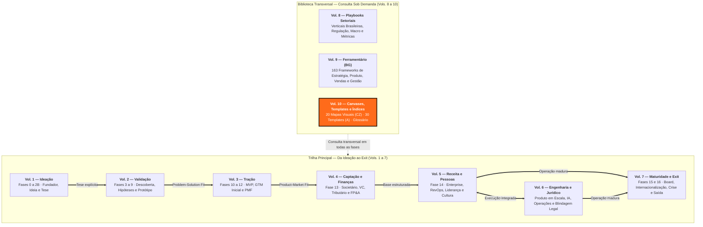

---

## Sumário deste Volume

### Canvases e Mapas Visuais de Modelo (Apêndice CZ)

- [[#APÊNDICE CZ — CANVASES E MAPAS VISUAIS DE MODELO]]

### Templates Operacionais Prontos para Uso (Apêndice A)

- [[#APÊNDICE A — TEMPLATES PRONTOS PARA USO]]

### Glossários, Bibliografias e Índices Gerais da Coleção

- [[#APÊNDICE — DATA DE COMPILAÇÃO E NOTA SOBRE ENVELHECIMENTO]]
- [[#APÊNDICE — GLOSSÁRIO DE TERMOS TÉCNICOS]]
- [[#GLOSSÁRIO]]
- [[#APÊNDICE — LISTA DE ABREVIAÇÕES]]
- [[#APÊNDICE: BIBLIOGRAFIA]]
- [[#APÊNDICE — BIBLIOGRAFIA UNIFICADA]]
- [[#APÊNDICE: ÍNDICE ANALÍTICO]]
- [[#APÊNDICE — ÍNDICE REMISSIVO]]
- [[#ÍNDICE REMISSIVO DE TERMOS-CHAVE]]

---

# CANVASES E MAPAS VISUAIS DE MODELO (APÊNDICE CZ)

---

### Arquitetura deste Domínio: Pensamento Visual Aplicado — Os 20 Canvases e Mapas de Modelo (Apêndice CZ)

Enquanto o Volume 9 explica a teoria e o método passo a passo dos frameworks, este **Volume 10 (Canvases, Templates e Índices)** é o **caderno de oficina da coleção IGNIÇÃO**: reúne todas as ferramentas visuais e documentos copiáveis prontos para preencher com o seu time, seguidos pelo aparelho crítico geral da obra (Glossários, Bibliografias e Índices Remissivos).

Este primeiro bloco apresenta o **[[#APÊNDICE CZ — CANVASES E MAPAS VISUAIS DE MODELO|Apêndice CZ (CZ.1 a CZ.20)]]**. Diferente de livros que mostram apenas quadrantes em branco com descrições genéricas, cada um dos 20 canvases aqui incluídos traz:
1. O diagrama estrutural completo e a ordem correta de preenchimento;
2. Um **exemplo brasileiro integralmente preenchido** (permitindo ver a granularidade real de uma resposta boa versus uma resposta superficial);
3. O diagnóstico das contradições mais comuns entre blocos do mesmo mapa.

> [!tip] Quando usar um Canvas (CZ) versus um Template (A)
> Use os **Canvases (CZ.1 a CZ.20)** em sessões de alinhamento e diagnóstico visual com sócios e equipe — quando você precisa enxergar relações espaciais e tensões entre problema, cliente, proposta de valor, canais e economia em uma única página. Quando a decisão visual já estiver clara e precisar virar execução auditável, passe para os **Templates Operacionais (A.1 a A.39)** no bloco seguinte.

---

## APÊNDICE CZ — CANVASES E MAPAS VISUAIS DE MODELO

> [!note] Como usar
> Este apêndice trata em profundidade vinte canvases (telas visuais de uma página para mapear ideias) que aparecem ao longo do livro como ferramentas convocadas em fases específicas. Cada canvas vem com origem histórica, estrutura visual, princípios, instruções de aplicação, exemplo brasileiro preenchido, variações, erros comuns, limites e leitura adicional. A ordem é didática (do mais geral ao mais específico), não a ordem de uso na trajetória. Para saber qual canvas usar em qual fase, veja a tabela de mapeamento ao final desta abertura.

> [!important] Por que canvases merecem apêndice próprio
> Canvas é categoria distinta de framework (modelo de raciocínio). Framework é raciocínio (Five Forces, JTBD, AARRR). Canvas é **representação visual de uma página** que força colaboração e expõe inconsistências. A maioria dos canvases neste apêndice nasceu da escola de design thinking (pensamento de design) aplicada a estratégia (Strategyzer, IDEO, XPLANE) entre 2005 e 2020. Compartilham três traços. (1) Cabem em uma folha A3 ou parede. (2) Preenchimento é colaborativo, não solo. (3) Revelam onde o pensamento ainda está vago. Tratá-los apenas como sub-itens do ferramentário (BG) não capturava nem a teoria nem a prática brasileira.

### Mapa de uso por fase

| Fase | Canvas indicado | Pergunta que responde |
|---|---|---|
| Fase 2 (articulação) | CZ.1 BMC ou CZ.2 Lean Canvas | Como o negócio cria, entrega e captura valor? |
| Fase 2B (teoria) | CZ.16 Theory Map / Story Tree | Quais relações causais sustentam a tese? |
| Fase 3 (descoberta) | CZ.6 Empathy Map | O que o cliente pensa, sente, vê e ouve? |
| Fase 4 (pesquisa) | CZ.6 Empathy Map + CZ.3 VPC + CZ.7 Customer Journey | Como a dor vive em contexto e jornada? |
| Fase 5 (mercado) | CZ.4 Strategy Canvas + CZ.15 Canvas da Cunha | Qual é a curva de valor distinta no mercado? |
| Fase 6 (hipóteses) | CZ.14 Hypothesis Canvas | Como tornar cada aposta falsificável? |
| Fase 7 (experimentos) | CZ.9 Test Card | Como rodar cada teste com critério antes do dado? |
| Fase 8 (ideação) | CZ.5 Opportunity Canvas + CZ.11 MVP Canvas | Quais oportunidades viram MVP? |
| Fase 10 (MVP) | CZ.10 Pirate Canvas (AARRR) | Como o funil real está se comportando? |
| Fase 11 (modelo) | CZ.13 Risk Canvas | Quais riscos podem matar o modelo em escala? |
| Fase 14 (escala) | CZ.8 Team Canvas | Como o time se alinha em propósito e operação? |
| Fase 14 (escala) | CZ.19 Org Chart Evolution | Qual estrutura organizacional corresponde ao estágio atual? |
| Fase 16 + Apêndice V | CZ.12 Storytelling Canvas | Como narrar o negócio para investidor, time, cliente? |
| Fase 16 + Apêndice V | CZ.17 Capital Stack / Waterfall | Quem recebe quanto, em qual ordem, em cada cenário de exit? |
| Qualquer fase | CZ.18 Network Effects Map | Quais tipos de efeitos de rede o modelo captura — e qual é o mais forte? |
| Qualquer fase | CZ.20 Wardley Map | O que estou construindo, onde está no ciclo evolutivo, e o que devo terceirizar? |

### Catálogo dos 20 canvases

| # | Canvas | Autor / Origem | Foco |
|---|---|---|---|
| CZ.1 | Business Model Canvas | Osterwalder, 2010 | Modelo de negócio completo |
| CZ.2 | Lean Canvas | Maurya, 2012 | Modelo para startup pré-PMF |
| CZ.3 | Value Proposition Canvas | Osterwalder, 2014 | Encaixe produto-cliente |
| CZ.4 | Strategy Canvas | Kim & Mauborgne, 2005 | Posicionamento competitivo (Blue Ocean) |
| CZ.5 | Opportunity Canvas | Jeff Patton, 2014 | Discovery contínuo de oportunidades |
| CZ.6 | Empathy Map | Dave Gray / XPLANE, 2009 | Compreensão profunda do usuário |
| CZ.7 | Customer Journey Canvas | múltiplas escolas | Jornada do cliente em fases e emoções |
| CZ.8 | Team Canvas | Alex Ivanov, 2015 | Alinhamento de propósito e operação de time |
| CZ.9 | Test Card | Bland & Osterwalder, 2019 | Estruturação de experimento |
| CZ.10 | Pirate Canvas (AARRR) | Dave McClure, 2007 | Funil de aquisição → receita |
| CZ.11 | MVP Canvas | Tristan Kromer | Escopo mínimo testável |
| CZ.12 | Storytelling Canvas + SCQA + Strategic Narrative | múltiplas | Narrativa estruturada para múltiplos contextos |
| CZ.13 | Risk Canvas | múltiplas | Mapeamento e priorização de riscos |
| CZ.14 | Hypothesis Canvas | autoral do livro | Hipótese falsificável com threshold |
| CZ.15 | Canvas da Cunha | autoral do livro | Definição de cunha de mercado |
| CZ.16 | Theory Map / Story Tree | autoral do livro | Teoria causal do negócio |
| CZ.17 | Capital Stack / Waterfall Canvas | prática de M&A/VC | Distribuição de valor por classe em exit |
| CZ.18 | Network Effects Map | NFX / autoral | Tipos e força dos efeitos de rede do modelo |
| CZ.19 | Org Chart Evolution | autoral do livro | Estrutura organizacional por estágio de crescimento |
| CZ.20 | Wardley Map | Simon Wardley, 2005 | Posicionamento de componentes no ciclo evolutivo |

> [!note] Todos os 20 canvases disponíveis
> Este apêndice contém o tratamento completo dos vinte canvases: Onda 1 — Fundamentos (CZ.1 BMC, CZ.2 Lean Canvas, CZ.3 VPC, CZ.4 Strategy Canvas); Onda 2 — Discovery e validação (CZ.5 Opportunity Canvas, CZ.6 Empathy Map, CZ.7 Customer Journey Canvas, CZ.9 Test Card); Onda 3 — Métricas, MVP e narrativa (CZ.10 Pirate Canvas, CZ.11 MVP Canvas, CZ.12 Storytelling Canvas, CZ.13 Risk Canvas); Onda 4 — Time e Autorais (CZ.8 Team Canvas, CZ.14 Hypothesis Canvas, CZ.15 Canvas da Cunha, CZ.16 Theory Map); Onda 5 — Estrutura, Escala e Estratégia (CZ.17 Capital Stack, CZ.18 Network Effects Map, CZ.19 Org Chart Evolution, CZ.20 Wardley Map). Os templates preencháveis dos canvases autorais (CZ.14, CZ.15, CZ.16) encontram-se no [[#APÊNDICE A — TEMPLATES PRONTOS PARA USO|Apêndice A]] (A.10, A.12, A.9 respectivamente).

---

### CZ.1 — Business Model Canvas (Alexander Osterwalder, 2010)

#### Origem

Alexander Osterwalder propôs o Business Model Canvas (BMC) na tese de doutorado em 2004, na Universidade de Lausanne, sob orientação de Yves Pigneur. A ferramenta foi sistematizada no livro *Business Model Generation* (2010), escrito colaborativamente com 470 co-autores espalhados por 45 países via plataforma online — o livro virou bestseller global e definiu a forma como milhões de empreendedores conversam sobre modelo de negócio. No Brasil, o BMC entrou no currículo de praticamente toda aceleradora, MBA, programa do Sebrae, Endeavor e Distrito a partir de 2012, virando vocabulário comum.

#### O que é

Tela visual de uma página com **nove blocos** que representam, juntos, como uma empresa cria, entrega e captura valor. Os nove blocos são organizados em duas metades: a metade direita (cliente, valor, canais, relacionamento, receita) descreve **a frente do negócio**; a metade esquerda (recursos, atividades, parcerias, custos) descreve **as engrenagens internas**. No centro, conectando as duas, fica a **Proposta de Valor**.

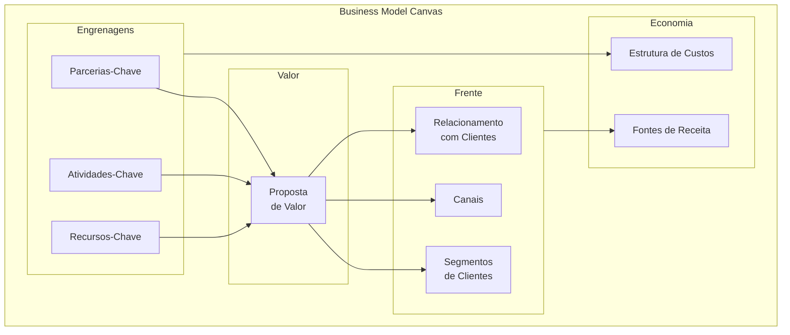

#### Quando usar

Use o BMC nas Fases 2 e 2B do IGNIÇÃO, quando a ideia já tem articulação inicial mas o modelo de negócio ainda precisa ser explicitado. Também use a cada três a seis meses como check-up: revisitar o BMC depois de um trimestre de operação real frequentemente revela inconsistências invisíveis no momento da articulação. Não use o BMC para decidir *se* a ideia é boa — para isso, [[IGNICAO-Vol-2-Validacao#FASE 3 — DESCOBERTA DO PROBLEMA|Fase 3 (Vol. 2)]] (descoberta com cliente) e [[IGNICAO-Vol-2-Validacao#FASE 7 — EXPERIMENTOS DE VALIDAÇÃO DO PROBLEMA|Fase 7 (Vol. 2)]] (experimentos) são as ferramentas certas.

#### Princípios

A tese central de Osterwalder é que **modelo de negócio é objeto de design, não de planejamento**. Designar requer iteração rápida, conversa colaborativa e tolerância à ambiguidade temporária. Os nove blocos são interdependentes: mudar um afeta vários, e o valor do BMC está em tornar essa interdependência visível. O canvas é **descritivo** (mapeia o que você entende do negócio), não **prescritivo** (não diz se o modelo é bom). Por isso, ter um BMC coerente não significa ter um negócio viável — apenas ter clareza sobre o que precisa ser testado.

#### Como aplicar

Reúna 2-4 pessoas (cofundadores idealmente, mais 1 mentor externo se possível). Imprima a tela em A1 ou desenhe na parede com fita crepe. Use post-its (cores diferentes para cada bloco). Bloco a bloco, **na ordem que importa**:

1. **Segmentos de Clientes** primeiro — sem cliente, nada mais importa.
2. **Proposta de Valor** — por que esses clientes pagariam.
3. **Canais** — como o cliente descobre, compra, recebe e pede suporte.
4. **Relacionamento** — self-service, comunidade, suporte humano, automação.
5. **Fontes de Receita** — modelo (assinatura, transação, licença, freemium).
6. **Recursos-Chave** — o que a empresa precisa ter (pessoas, tecnologia, IP, capital).
7. **Atividades-Chave** — o que a empresa precisa fazer todo dia.
8. **Parcerias-Chave** — quem a empresa precisa ao lado (fornecedores, integradores, distribuição).
9. **Estrutura de Custos** — onde o dinheiro sai.

Tempo total: 60-120 minutos para a primeira versão. Cada bloco com 3-5 post-its (não parágrafos longos). Revisitar mensalmente nas fases iniciais, trimestralmente depois de PMF.

#### Exemplo brasileiro preenchido — Nubank em 2014

| Bloco | Conteúdo |
|---|---|
| **Segmentos de Clientes** | Brasileiros 25-40 anos, urbanos, classes A/B/C+, insatisfeitos com banco tradicional, familiares com smartphone |
| **Proposta de Valor** | Cartão de crédito sem anuidade, gerenciado 100% por app, sem burocracia, atendimento humano via chat, transparência |
| **Canais** | App mobile (iOS + Android), landing page, marketing digital orgânico, convite por fila de espera viral |
| **Relacionamento** | Self-service via app, suporte humano on-demand via chat, comunicação pelo nome próprio |
| **Fontes de Receita** | Intercâmbio (% sobre cada transação no cartão), juros do rotativo, futuro: receitas adjacentes (lending, investimento) |
| **Recursos-Chave** | Equipe técnica (engenharia, produto, design), licenças regulatórias, capital, algoritmos de credit scoring |
| **Atividades-Chave** | Desenvolvimento de produto digital, aquisição de clientes, gestão de risco de crédito, atendimento |
| **Parcerias-Chave** | Bandeiras (Mastercard, Visa), processadoras de pagamento, BACEN (regulador), provedores cloud |
| **Estrutura de Custos** | Salários de tecnologia (majoritário), atendimento, marketing, provisões de risco de crédito, compliance |

**Insight do caso.** O BMC do Nubank em 2014 mostra um modelo intencionalmente enxuto: poucos blocos com complexidade real (cartão único, segmento único, canal único). A disciplina foi não adicionar produtos ou segmentos antes de dominar o primeiro. Expansão para conta corrente (2017), lending (2019), investimentos (2020) só aconteceu depois de o cartão dominar o segmento original. Empresas que tentam preencher os nove blocos com complexidade simultânea desde o início frequentemente falham por dispersão. BMC bem feito tem cara de simples.

#### Variações e extensões

- **Lean Canvas** (CZ.2): substitui Parcerias, Atividades, Recursos e Relacionamento por Problema, Solução, Métricas-Chave e Vantagem Injusta. Mais útil em estágio pré-PMF.
- **Social Business Model Canvas**: adiciona blocos de impacto social, beneficiários e métricas de impacto.
- **Platform Business Model Canvas**: adapta para marketplaces de dois lados.
- **Sustainable Business Model Canvas (Triple Layer)**: adiciona camadas ambiental e social.

#### Erros comuns

- Preencher sozinho na cabeça em vez de em conversa colaborativa — o valor do BMC está no debate entre múltiplos olhares, não no documento final.
- Tratar como artefato estático, não revisitar — BMC sem atualização perde sentido em três meses.
- Confundir clareza do BMC com validação do mercado — ter BMC bonito não prova que cliente existe.
- Excesso de detalhe em cada bloco — se você precisa de parágrafo para explicar um bloco, a ideia ainda não está clara.
- Forçar um único BMC para múltiplos segmentos muito distintos — cada segmento merece BMC próprio.

#### Quando NÃO usar

Em empresas maduras com modelo estabelecido e operando — frameworks de execução como OGSM, Hoshin Kanri ou Balanced Scorecard servem melhor. Em negócios muito simples (consultoria solo, freelance) — BMC introduz overhead sem valor. Em negócios complexos com várias linhas distintas, não force um único BMC: cada linha precisa do seu.

#### Conexão com outros canvases

O BMC **precede** o Lean Canvas (CZ.2) como ferramenta histórica, mas o Lean Canvas é mais adequado para startup pré-PMF. O **Value Proposition Canvas** (CZ.3) aprofunda o bloco "Proposta de Valor" do BMC, que é tipicamente preenchido de forma vaga. O **Strategy Canvas** (CZ.4) complementa olhando para fora (concorrência), enquanto o BMC olha para dentro (modelo). Em fases iniciais, comece pelo BMC para ter visão de conjunto; depois aprofunde com VPC para a proposta e Strategy Canvas para o posicionamento.

#### Leitura adicional

- *Business Model Generation* (Alexander Osterwalder & Yves Pigneur, 2010).
- *Testing Business Ideas* (David Bland & Alexander Osterwalder, 2019) — manual de validação para cada bloco.
- [strategyzer.com](https://strategyzer.com) — ferramenta online + cursos da equipe original.

---

### CZ.2 — Lean Canvas (Ash Maurya, 2012)

#### Origem

Ash Maurya criou o Lean Canvas em 2010-2012 como adaptação do Business Model Canvas especificamente para startups em estágio inicial, e documentou a ferramenta no livro *Running Lean* (2012, atualizado em 2022 para a 3ª edição). Maurya era fundador serial que aplicou Lean Startup nas próprias empresas e percebeu que o BMC original — desenhado para empresas estabelecidas — não priorizava adequadamente os elementos críticos para quem ainda não tem modelo validado: o problema, a solução, as métricas que provam tração, e a vantagem que sustenta a empresa quando o concorrente acordar. O Lean Canvas substituiu quatro dos nove blocos do BMC para capturar melhor a realidade pré-PMF.

#### O que é

Tela visual de uma página com nove blocos, **inspirada no BMC mas com quatro substituições críticas**: Parcerias-Chave vira **Problema**, Atividades-Chave vira **Solução**, Recursos-Chave vira **Métricas-Chave**, Relacionamento com Clientes vira **Vantagem Injusta**. Os outros cinco blocos permanecem (Segmentos, Proposta Única de Valor, Canais, Estrutura de Custos, Fontes de Receita).

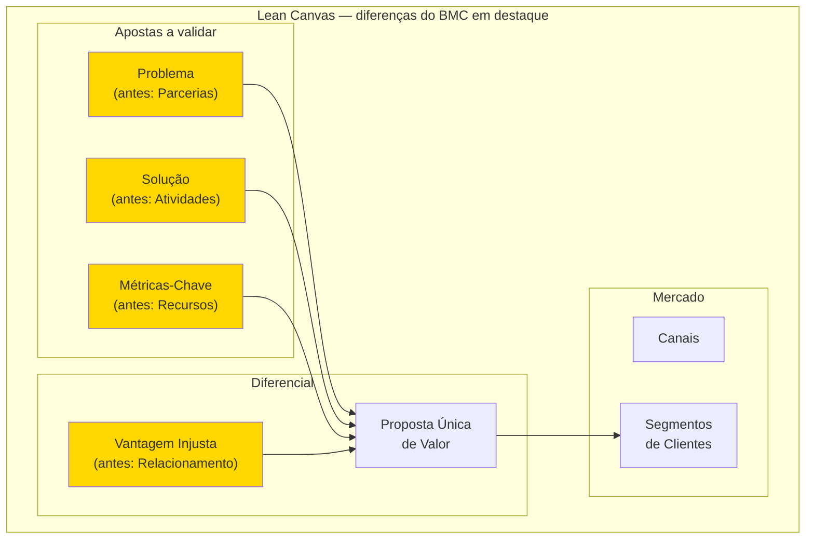

A filosofia subjacente é: startup pré-PMF não tem parcerias estabelecidas (vai construir), não tem atividades-chave definidas (vai descobrir), não tem recursos consolidados (tem capital limitado e tempo) e não tem relacionamento com clientes (não tem clientes ainda). O que tem é hipótese de problema, hipótese de solução, hipótese de métrica e hipótese de vantagem competitiva. O Lean Canvas mapeia exatamente essas hipóteses.

#### Quando usar

Use o Lean Canvas a partir da Fase 1 (encontrar a ideia) até a Fase 12 (PMF). É o canvas certo para todo o estágio de discovery e validação. Depois de PMF declarado, migre para o BMC, que mapeia melhor um modelo já operando. Use também como ferramenta de pivô: cada vez que você considerar pivotar, faça um Lean Canvas novo para a tese alternativa antes de comprometer recursos.

#### Princípios

A tese de Maurya é que **modelo de negócio em startup é hipótese, não plano**. Cada bloco do Lean Canvas corresponde a uma ou mais hipóteses falsificáveis, e a ordem de preenchimento dos blocos espelha a ordem de risco — o que pode matar a startup mais cedo é preenchido primeiro. Por isso, Problema vem antes de Solução: solução para problema inexistente é o erro mais frequente em startup. Vantagem Injusta vem por último: enquanto a startup é pequena, ainda não tem moat — a Vantagem Injusta é o que ela aposta construir.

#### Como aplicar

Reúna 1-3 pessoas (cofundadores). Use uma folha A1 ou ferramenta digital (Miro, FigJam). Preencha **na ordem de risco**, que difere do BMC:

1. **Segmentos de Clientes** primeiro (right side, top) — quem.
2. **Problema** (left side, top) — top 1-3 problemas que o segmento tem.
3. **Proposta Única de Valor** (centro, top) — uma frase única de promessa.
4. **Solução** (left side) — top 3 features que endereçam o problema.
5. **Canais** (right side) — caminhos de aquisição até o segmento.
6. **Fontes de Receita** (right side, bottom) — modelo de monetização.
7. **Estrutura de Custos** (left side, bottom) — onde o dinheiro sai.
8. **Métricas-Chave** (left side, middle) — números que provam tração.
9. **Vantagem Injusta** (right side, middle) — o que torna você inimitável.

Tempo total: 30-60 minutos para o primeiro preenchimento (mais rápido que o BMC porque os blocos são mais específicos). **Faça um Lean Canvas por segmento** — não force um canvas único para múltiplos segmentos com problemas distintos. Revisar a cada experimento concluído (a cada 2-4 semanas em fases iniciais).

#### Exemplo brasileiro preenchido — QuintoAndar em 2015

| Bloco | Conteúdo |
|---|---|
| **Problema** | Alugar apartamento em SP exige fiador, três meses de caução, vistoria agressiva, burocracia de cartório, semanas de sofrimento — para algo que o inquilino só usa 1-2 anos. Para o proprietário: longo período sem renda, risco de inadimplência, complexidade jurídica. |
| **Segmentos de Clientes** | Inquilinos: jovens profissionais classe A/B em SP, primeira ou segunda experiência de aluguel. Proprietários: pessoas físicas com 1-3 imóveis (não imobiliária). |
| **Proposta Única de Valor** | "Alugue em horas, sem fiador, sem caução exagerada, 100% online." |
| **Solução** | Plataforma online de aluguel + seguro substituindo fiador + vistoria digital + contrato digital com assinatura remota + pagamento de aluguel automatizado. |
| **Canais** | SEO orgânico (busca de imóveis), parcerias com portais imobiliários, marketing digital (Facebook, Google), indicação boca a boca. |
| **Fontes de Receita** | Taxa de administração sobre aluguel mensal + comissão de corretagem sobre assinatura inicial + (futuro) produtos financeiros adjacentes. |
| **Estrutura de Custos** | Tecnologia e produto + marketing e aquisição + operação de vistorias + sinistros de seguro + equipe de matching. |
| **Métricas-Chave** | Contratos assinados/mês, tempo médio busca → assinatura, NPS, churn de locatários, ticket médio (aluguel médio). |
| **Vantagem Injusta** | Dados proprietários de comportamento de pagamento de locatários — permitem underwriting de seguro próprio. Concorrentes novos precisariam anos para acumular esses dados. |

**Insight do caso.** O Lean Canvas do QuintoAndar em 2015 mostra como o canvas força a articular a Vantagem Injusta antes que ela exista: em 2015, a empresa ainda **não tinha** os dados proprietários — era a aposta. O canvas registra "se o modelo funcionar, será porque os dados acumulados criam underwriting próprio". Isso virou hipótese a testar (e se confirmou). Empresas que preenchem Vantagem Injusta com generalidades tipo "nosso time é incrível" ou "tecnologia avançada" não estão fazendo o exercício — são placeholders, não apostas. Vantagem Injusta deve ser específica, falsificável e de longo prazo.

#### Variações e extensões

- **Customer Forces Canvas** (também de Maurya): aprofunda a teoria de "forças" que empurram cliente entre soluções (push, pull, anxiety, habit), complementando o Lean Canvas com vista comportamental.
- **Lean Stack** (Maurya): conjunto de canvases conectados (Lean Canvas + Customer Factory Blueprint + Traction Roadmap).

#### Erros comuns

- Tratar Lean Canvas como BMC simplificado — a filosofia é distinta, focada em hipóteses testáveis.
- Preencher Vantagem Injusta com generalidades ("nosso time", "nossa tecnologia") — se qualquer concorrente teria, não é injusta.
- Não articular o Problema de forma específica — "pessoas querem X" não é problema testável; "pessoa tipo Y sofre com Z em contexto W" é.
- Forçar um único Lean Canvas para múltiplos segmentos com problemas diferentes — cada segmento merece canvas próprio.
- Confundir Solução com Proposta Única de Valor — Solução é *o que você constrói*, Proposta de Valor é *a promessa que ressoa para o cliente*.

#### Quando NÃO usar

Em empresas pós-PMF com modelo estabelecido — use BMC. Em projetos internos de empresa grande (intrapreneurship em corporação madura) — Lean Canvas força o framing de "ainda não temos cliente" que pode não bater com a realidade. Em consultoria solo ou freelance — overhead sem retorno.

#### Conexão com outros canvases

O Lean Canvas **se relaciona ao BMC (CZ.1)** como ferramenta complementar para estágios distintos. **Se relaciona ao Hypothesis Canvas (CZ.14)**: cada bloco do Lean Canvas vira uma ou mais entradas no banco de hipóteses. **Se relaciona ao Test Card (CZ.9)**: cada hipótese do Lean Canvas vira um ou mais Test Cards na Fase 7. **Precede o BMC**: depois de PMF, migre.

#### Leitura adicional

- *Running Lean* (Ash Maurya, 2012; 3ª edição em 2022).
- *Scaling Lean* (Ash Maurya, 2016) — aplicação pós-PMF.
- [leanstack.com](https://leanstack.com) — ferramenta online + cursos da equipe.

---

### CZ.3 — Value Proposition Canvas (Alexander Osterwalder, 2014)

#### Origem

O Value Proposition Canvas (VPC) é extensão direta do Business Model Canvas, criado pela mesma equipe (Alexander Osterwalder, Yves Pigneur, Greg Bernarda, Alan Smith) e publicado no livro *Value Proposition Design* (2014). A motivação foi observação de campo: o bloco "Proposta de Valor" do BMC era invariavelmente o mais mal preenchido — fundadores escreviam frases vagas tipo "produto melhor" ou "atendimento de qualidade". Osterwalder concluiu que esse bloco merecia uma ferramenta própria, mais profunda, que forçasse a verificar **explicitamente** o encaixe entre o que o cliente precisa e o que o produto oferece.

#### O que é

Tela visual de duas partes complementares que se encaixam como um quebra-cabeça:

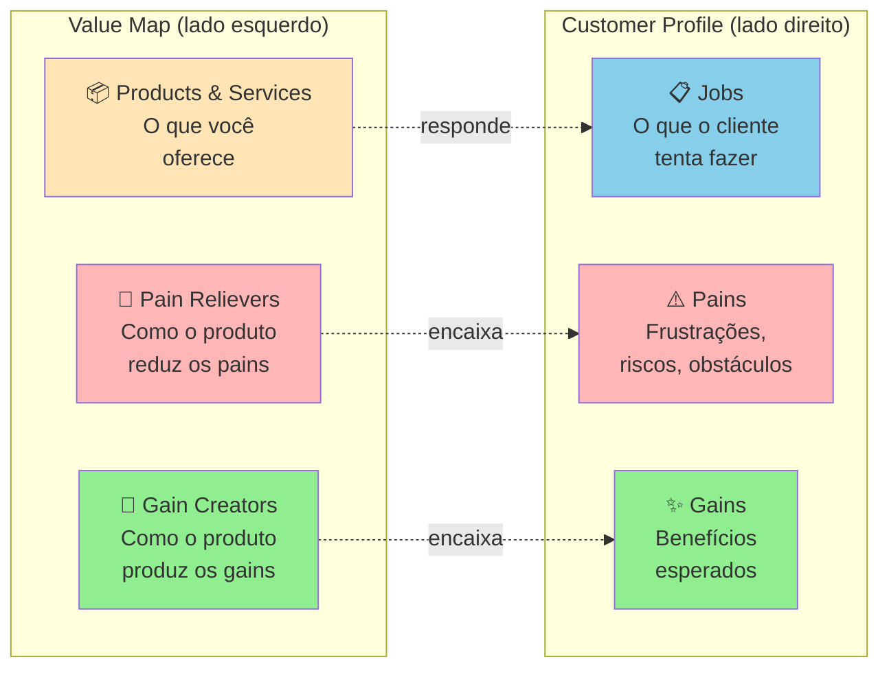

O **Customer Profile** mapeia o cliente em três dimensões: Jobs (tarefas funcionais, sociais, emocionais que tenta cumprir), Pains (o que o frustra, prejudica, ameaça) e Gains (o que ele deseja, espera, sonha). O **Value Map** mapeia o produto em três dimensões espelhadas: Products & Services (o que você oferece), Pain Relievers (como o produto alivia os pains do cliente) e Gain Creators (como o produto produz os gains).

O **fit** acontece quando os Pain Relievers correspondem a Pains reais e os Gain Creators correspondem a Gains que o cliente realmente valoriza. Pain Relievers sem Pain correspondente = features inúteis. Pains sem Pain Reliever = motivos de churn.

#### Quando usar

Use o VPC depois de fazer pesquisa qualitativa real (Fase 4 — entrevistas em profundidade, observação em campo, análise de jornada). É a ferramenta certa para tornar o Dossiê do Usuário (saída da Fase 4) acionável: cada persona vira um Customer Profile, e o produto que está sendo desenhado vira o Value Map. Use também como ferramenta de auditoria: revisitar o VPC a cada três meses pós-MVP revela features que viraram Pain Relievers órfãos (sem Pain real) ou Pains que ficaram sem Pain Reliever construído.

#### Princípios

A tese de Osterwalder é que **proposta de valor não é o que você diz que o produto faz, é a correspondência verificável entre as frustrações/desejos do cliente e o que o seu produto efetivamente alivia/entrega**. Fit não se presume — verifica-se com entrevistas, testes, observação. A falha mais comum em startup não é "produto ruim" — é produto bom atacando problema que o cliente não considera importante. O VPC força essa verificação tornando explícita cada conexão.

#### Como aplicar

**Etapa 1 — Customer Profile (sempre primeiro).** Reúna o que você aprendeu na Fase 4. Para a persona escolhida, liste:

- **Jobs** (5-10): o que ela tenta fazer? Funcionais ("conciliar pagamentos do dia"), sociais ("parecer profissional para a equipe"), emocionais ("ter paz antes de dormir").
- **Pains** (5-10): o que dói? Pode ser frustração ("isso demora 3 horas"), risco ("se eu errar, perco o cliente"), obstáculo ("não tenho como integrar").
- **Gains** (5-10): o que ela quer? Esperados ("uma forma de fazer mais rápido"), desejados ("relatório que impressione o chefe"), inesperados ("automação que eu não sabia ser possível").

**Importante**: NÃO INVENTE. Cada item deve poder ser citado de uma entrevista, observação ou diário de usuário documentado. Customer Profile com Jobs/Pains/Gains intuitivos = VPC teórico.

**Etapa 2 — Value Map.** Liste:

- **Products & Services**: o que você está construindo (ou planeja construir).
- **Pain Relievers**: para cada Pain do cliente, como o produto alivia? Seja específico.
- **Gain Creators**: para cada Gain, como o produto produz? Idem.

**Etapa 3 — Avaliação de fit.** Cada Pain tem Pain Reliever correspondente? Cada Gain tem Gain Creator? Se há Pains sem cobertura, são oportunidades não endereçadas. Se há Pain Relievers sem Pain real, são features potencialmente desperdiçadas.

Tempo: 2-4 horas para a primeira versão (após pesquisa pronta). Cada segmento merece VPC próprio.

#### Exemplo brasileiro preenchido — Wellhub (Gympass) em 2016, B2B

**Customer Profile** — Head de RH de empresa média (200-1000 funcionários):

| Jobs | Pains | Gains |
|---|---|---|
| Oferecer benefício que ajude retenção | Caro contratar academia única que não atende todos | Retenção mensurável melhor |
| Gerenciar programa de bem-estar sem overhead | Funcionários pedem academia mas subsídio direto é complicado (tributário, equidade) | Marca empregadora fortalecida |
| Prestar contas à diretoria sobre ROI | Difícil medir uso real e impacto em produtividade | Dados de engajamento para C-level |
| Atender perfis diversos (academia, yoga, crossfit) sem caos | Negociar com múltiplos fornecedores consome tempo | Benefício percebido sem esforço administrativo |

**Value Map** — Wellhub (Gympass) o que oferecia em 2016:

| Products & Services | Pain Relievers | Gain Creators |
|---|---|---|
| Plataforma empresarial com acesso a milhares de academias via assinatura | Uma assinatura única cobre todas academias (flexibilidade sem multiplicação de contratos) | Benefício percebido pelo funcionário gera retenção mensurável |
| Dashboard de uso para RH | Plataforma administra matrícula, pagamento, cancelamento (zero overhead) | Oferta diversa atende perfis diferentes |
| App para funcionário escolher academia | Estrutura tributária correta (benefício registrado) | Dados de uso para relatórios executivos sobre engagement e ROI |
| Suporte para RH e funcionário | Negociação consolidada com uma empresa só (em vez de 50 academias) | Fortalecimento da marca empregadora |

**Análise de fit.** Encaixe forte entre quase todos os Pains/Gains e os Pain Relievers/Gain Creators. Note que a oferta da Wellhub não inova radicalmente — apenas elimina as fricções específicas que o RH enfrentava no modelo tradicional (negociar com cada academia, gerenciar reembolsos, justificar tributariamente, medir uso). **A lição: value proposition forte não exige features impressionantes — exige fit preciso entre o que o cliente sofre e o que você alivia.**

#### Variações e extensões

- **Job-to-Be-Done Canvas** (Christensen / Moesta): foco mais profundo em Jobs (especialmente as 4 forças de Moesta — push, pull, anxiety, habit). Ver [[IGNICAO-Vol-2-Validacao#FASE 4 — PESQUISA COM USUÁRIOS (CUSTOMER DISCOVERY APROFUNDADO)|Fase 4 (Vol. 2)]].
- **Empathy Map** (CZ.6): complementar ao Customer Profile, foca em estados internos do cliente (pensa/sente/vê/ouve).
- **VPC for Multi-Sided Markets**: marketplaces fazem um VPC para cada lado (oferta e demanda).

#### Erros comuns

- Preencher Customer Profile com intuições em vez de dados reais — VPC teórico não representa mercado.
- Fazer VPC genérico para "todos os clientes" — segmentos diferentes têm Jobs/Pains/Gains diferentes; cada segmento merece VPC próprio.
- Inflar Gain Creators — listar benefícios que o produto teoricamente poderia entregar mas não entrega ainda.
- Ignorar Pains sem Pain Reliever correspondente — essas lacunas são frequentemente os motivos reais de churn.
- Confundir Products & Services (o que você constrói) com Pain Relievers (como alivia uma dor específica) — o primeiro é descritivo, o segundo é causal.

#### Quando NÃO usar

Em mercados commoditizados com propostas de valor muito padronizadas — VPC adiciona pouco valor onde o cliente já compara só preço e prazo. Em produtos B2B enterprise muito complexos — a "unidade cliente" tem múltiplos stakeholders (usuário final, comprador econômico, sponsor executivo, TI), cada um com seu VPC; a abordagem stakeholder mapping é mais útil.

#### Conexão com outros canvases

O VPC **aprofunda** o bloco "Proposta de Valor" do BMC (CZ.1) — preencher BMC sem antes ter VPC tipicamente produz blocos de Proposta de Valor vazios. **Pareia com o Empathy Map (CZ.6)** para construir o Customer Profile com profundidade emocional. **Alimenta o Lean Canvas (CZ.2)**: os Pains do cliente viram o bloco Problema; os Pain Relievers + Gain Creators viram a Proposta Única de Valor.

#### Leitura adicional

- *Value Proposition Design* (Osterwalder, Pigneur, Bernarda, Smith, 2014).
- *Testing Business Ideas* (David Bland & Alexander Osterwalder, 2019) — como validar cada elemento do VPC.
- [strategyzer.com/canvas/value-proposition-canvas](https://strategyzer.com/canvas/value-proposition-canvas).

---

### CZ.4 — Strategy Canvas (W. Chan Kim & Renée Mauborgne, 2005)

#### Origem

W. Chan Kim e Renée Mauborgne, professores do INSEAD, publicaram *Blue Ocean Strategy* em 2005 após quinze anos de pesquisa empírica analisando 150 movimentos estratégicos em 30 indústrias ao longo de cem anos. A tese central é que **competir em mercado saturado (red ocean) é destrutivo, e criar novo espaço de mercado (blue ocean) é a estratégia vencedora**. O Strategy Canvas é a ferramenta visual central do framework — gráfico que compara curvas de valor de concorrentes para revelar onde existe espaço de diferenciação real, em vez da disputa palmo-a-palmo nas mesmas dimensões. O livro vendeu mais de quatro milhões de cópias e o Strategy Canvas virou referência em planejamento estratégico, embora tenha sido subutilizado em startup brasileira (frequentemente substituído por Porter's Five Forces ou matriz BCG, que são ferramentas distintas).

#### O que é

Gráfico de duas dimensões. **Eixo X**: fatores de competição relevantes no setor (tipicamente 8-15 fatores listados horizontalmente). **Eixo Y**: nível de oferta de cada fator, em escala de baixo a alto. Para cada concorrente (incluindo você), traça-se uma **curva de valor** — uma linha que conecta os pontos representando quanto desse concorrente oferece em cada fator.

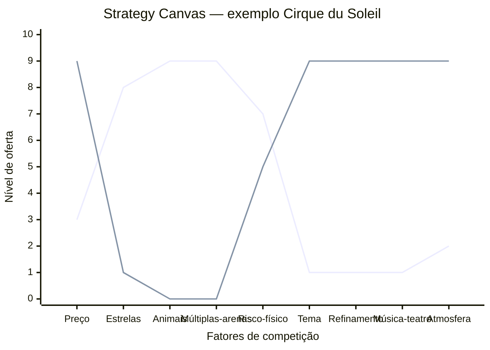

A linha superior representa o circo tradicional (Ringling, Barnum & Bailey): alto em estrelas, animais, múltiplas arenas, risco. A linha inferior representa o Cirque du Soleil: alto em tema, refinamento, música/teatro, atmosfera; baixo em estrelas e animais. Onde as curvas divergem dramaticamente, há diferenciação. Onde se sobrepõem, há comoditização.

A análise associada é o **ERRC Grid** — quatro decisões estratégicas para mover a curva:

- **Eliminate**: que fatores que o setor compete podem ser totalmente eliminados?
- **Reduce**: que fatores podem ser reduzidos abaixo do padrão do setor?
- **Raise**: que fatores devem ser elevados acima do padrão?
- **Create**: que fatores nunca oferecidos pelo setor podem ser criados?

#### Quando usar

Use o Strategy Canvas na Fase 5 (mapeamento de mercado e concorrência) quando o setor parece saturado e você precisa decidir como diferenciar. Também use a cada 18-24 meses como check-up estratégico — concorrência se aproxima da sua curva ao longo do tempo, e o Strategy Canvas revela quando a diferenciação está erodindo. Use também em Fase 15 (reinvenção) quando considerar segunda curva.

#### Princípios

A tese de Kim e Mauborgne é que **competição direta é desperdício de capital**. Se duas empresas oferecem o mesmo conjunto de fatores em níveis ligeiramente diferentes, elas brigam por margem cada vez menor. A saída é **mudar o jogo**, não jogar melhor o mesmo jogo. Para isso, é preciso mapear honestamente o que o setor compete (a maioria não articula explicitamente) e identificar onde você pode oferecer perfil radicalmente distinto. **Diferenciação + Custo Baixo simultâneos** é possível quando você elimina/reduz fatores caros e cria fatores baratos mas valiosos.

#### Como aplicar

**Etapa 1 — Mapear o setor atual.** Liste os 8-15 fatores em que os concorrentes competem. Pergunte: o que o cliente compara antes de comprar? O que aparece nas propagandas? O que aparece nas reviews? Tipicamente: preço, qualidade, marca, conveniência, suporte, customização, velocidade, escala. Seja específico ao seu setor.

**Etapa 2 — Traçar curvas dos concorrentes.** Para cada concorrente principal (3-5), atribua nota 1-10 em cada fator e desenhe a linha. Use dados reais (preço de tabela, NPS, share, reviews) quando disponível.

**Etapa 3 — Aplicar ERRC Grid.** Para cada fator, decida: eliminar, reduzir, elevar, criar. Articule por que (qual job-to-be-done deixa de ser servido vs qual passa a ser).

**Etapa 4 — Traçar a curva nova.** A sua curva deve ser **visualmente distinta** das curvas dos concorrentes. Se ela sobrepõe a média do setor com pequeno offset, não é Blue Ocean — é apenas otimização de Red Ocean.

**Etapa 5 — Validar com cliente.** Mostre as curvas para clientes-alvo. Pergunte: "Se essas duas opções existissem, qual escolheria? Por quê?". Se a resposta é "depende", a diferenciação não é forte o suficiente.

Tempo: 4-8 horas para a primeira versão (exige pesquisa de campo dos concorrentes). Revisar a cada 12-18 meses.

#### Exemplo brasileiro preenchido — Stone vs adquirentes tradicionais (2014)

Em 2014, o setor brasileiro de adquirência (Cielo, Rede, Stone nascente) competia em fatores tipicamente bancários: preço de MDR (taxa por transação), aluguel de máquina, prazo de antecipação, marca, capilaridade. Stone construiu sua curva de valor diferente:

| Fator | Cielo / Rede (média do setor) | Stone (entrante 2014) | Decisão ERRC |
|---|---|---|---|
| MDR (taxa) | 3-4% | 2-3% | Reduce |
| Aluguel da máquina | R$ 50-100/mês | R$ 0 (subsidiado) | Reduce |
| Prazo de antecipação | 30-60 dias | 1 dia (D+1) | Raise |
| Atendimento ao lojista | Call center distante, demora dias | "Ponto-de-Atenção" — humano dedicado, resposta em horas | Raise |
| Capilaridade física | Alta (rede bancária) | Baixa (foco digital) | Reduce |
| Hardware proprietário | Padrão setor (Verifone) | Stone Box (proprietário) | Create |
| Software de gestão integrada | Pouco | Stone Hub (PDV + gestão) | Create |
| Marca corporativa-bancária | Alta | Baixa (mas crescente) | Reduce |

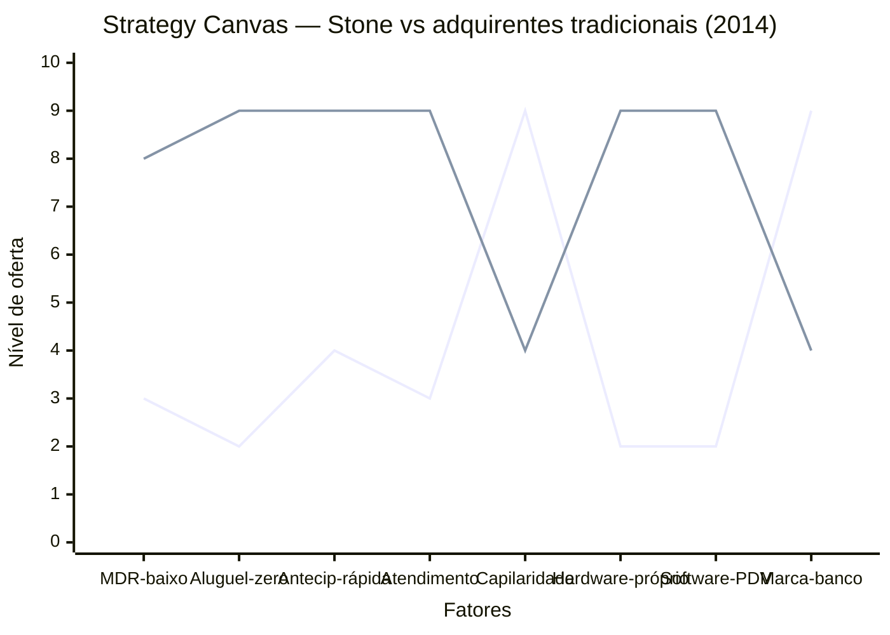

**Insight do caso.** Stone não venceu fazendo o que Cielo fazia mais barato. Venceu **mudando o que o setor competia**: criou Atendimento Diferenciado (Ponto-de-Atenção, não call center), criou hardware/software próprios para lojistas pequenos (não comprou da Verifone), reduziu o aluguel a zero, antecipou pagamento. O resultado foi uma curva visualmente distinta — comprador de Stone NÃO via Stone como "Cielo mais barata", via como **adquirente diferente**. Isso é Blue Ocean: a Stone não tirava clientes da Cielo apenas via preço, abria mercado novo (lojistas pequenos antes desatendidos pela burocracia bancária). O IPO em 2018 (NASDAQ, valuation US$ 7+ bilhões) validou a aposta.

#### Variações e extensões

- **Pioneer-Migrator-Settler Map**: classifica produtos do portfólio em pioneiros (alta diferenciação, alta margem), migradores (alguma diferenciação) e colonos (commodity). Útil para gestão de portfólio.
- **Six Paths Framework**: seis lentes para identificar Blue Ocean (indústria alternativa, grupos estratégicos, cadeia de compradores, oferta complementar, apelo emocional vs funcional, tendências de tempo).
- **Buyer Utility Map**: cruza ciclo de uso do cliente com seis utilidades (produtividade, simplicidade, conveniência, risco, diversão, sustentabilidade).

#### Erros comuns

- Listar fatores genéricos (preço, qualidade) em vez de fatores específicos do setor.
- Curva nova "ligeiramente acima" da média do setor — isso é otimização, não Blue Ocean.
- Eliminar/reduzir fatores que clientes ainda valorizam — pesquisar antes, não decidir no escritório.
- Confundir Strategy Canvas com posicionamento de marketing — é estratégia operacional (o que construir), não slogan.
- Não validar a curva nova com cliente antes de comprometer recursos — Blue Ocean teórico que ninguém prefere é apenas oceano vazio.

#### Quando NÃO usar

Em setores muito regulados onde os fatores de competição são fixados por norma (não há liberdade de Eliminar/Reduzir/Raise/Create). Em commoditização extrema onde o cliente realmente só compara preço. Em produtos B2B muito customizados onde cada deal tem fatores distintos — Strategy Canvas pressupõe oferta padronizada.

#### Conexão com outros canvases

O Strategy Canvas **complementa** o BMC (CZ.1): o BMC olha para dentro (modelo), o Strategy Canvas olha para fora (concorrência). **Pareia com o Canvas da Cunha (CZ.15)**: a Cunha define o nicho de entrada; o Strategy Canvas define a curva de valor distinta nesse nicho. **Sucede o VPC (CZ.3)**: depois de entender Pains e Gains do cliente, o Strategy Canvas decide quais Pain Relievers/Gain Creators construir vs eliminar.

#### Leitura adicional

- *Blue Ocean Strategy* (W. Chan Kim & Renée Mauborgne, 2005).
- *Blue Ocean Shift* (Kim & Mauborgne, 2017) — versão com playbook executivo mais detalhado.
- [blueoceanstrategy.com](https://www.blueoceanstrategy.com) — biblioteca de cases e ferramentas.

---

### CZ.5 — Opportunity Canvas (Jeff Patton, 2014)

#### Origem

Jeff Patton, autor de *User Story Mapping* (2014) e referência em product management ágil, criou o Opportunity Canvas como ferramenta para times de produto avaliarem se uma oportunidade vale a pena ser perseguida **antes** de comprometer roadmap. A motivação foi observação prática: PMs e times técnicos pulavam direto da ideia ("vamos construir feature X") para a especificação ("aqui está o PRD"), sem articular *por que* essa oportunidade deveria ser priorizada sobre todas as outras. O Opportunity Canvas força a explicitar a tese da oportunidade — quem ganha o quê, com que custo, contra qual alternativa — em uma página visual antes que se gaste tempo construindo.

#### O que é

Tela visual de uma página com **nove blocos** organizados em torno da pergunta central "vale a pena perseguir esta oportunidade?":

- **Problems / Solutions** (lado esquerdo): qual é o problema; qual é a solução proposta?
- **Users & Customers**: quem usa; quem paga (em B2B podem ser distintos)?
- **Solutions Today**: como o problema é resolvido hoje (concorrentes, workarounds, status quo)?
- **User Value**: que benefício tangível o usuário ganha?
- **Business Problems**: qual problema *do negócio* essa oportunidade resolve (retenção, aquisição, monetização)?
- **Adoption Strategy**: como vamos fazer o usuário descobrir e adotar?
- **Metrics**: quais números medem que está funcionando?
- **Budget**: quanto vamos investir antes de re-avaliar?

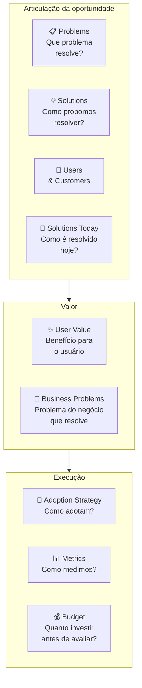

#### Quando usar

Use o Opportunity Canvas na Fase 8 (ideação) e durante todo o ciclo de descoberta contínua pós-PMF. É a ferramenta certa para responder "vale a pena construir essa feature/produto/oportunidade adjacente?" antes de comprometer um trimestre de roadmap. Também use em comitês de priorização: comparar três Opportunity Canvases lado a lado é mais informativo que comparar três PRDs longos.

#### Princípios

A tese de Patton é que **decisão de roadmap é decisão de capital** — cada feature construída custa o custo de oportunidade da feature não construída. O Opportunity Canvas força articular *o trade-off* explicitamente. Diferente do BMC (que descreve o negócio inteiro) e do Lean Canvas (que descreve um modelo a validar), o Opportunity Canvas descreve **uma aposta específica de produto** e pode coexistir com vários outros: uma empresa madura típica tem 10-30 Opportunity Canvases ativos em portfólio.

#### Como aplicar

Reúna PM + tech lead + designer + 1 stakeholder de negócio (RH, vendas, operações) — 4-5 pessoas. Tempo: 60-90 minutos. Comece pelos Problems & Users; só depois vá para Solutions. A ordem importa: começar por Solutions reforça viés de "já sabemos o que construir" e mascara perguntas críticas sobre adoção.

1. **Problems**: descreva o problema sem mencionar a solução. "Usuário tipo X sofre com Y em contexto Z."
2. **Users & Customers**: quem especificamente. Em B2B, distinguir usuário (quem mexe), comprador (quem paga), influenciador (quem decide).
3. **Solutions Today**: como o problema é resolvido hoje? Excel, processo manual, concorrente, "não fazer nada". Liste 3-5 alternativas com prós/contras.
4. **User Value**: o que o usuário ganha que hoje não tem? Específico e mensurável.
5. **Business Problems**: que problema do negócio (retenção, aquisição, monetização, expansion) essa oportunidade endereça?
6. **Solutions**: agora sim, descreva o que vai construir.
7. **Adoption Strategy**: como o usuário descobre, experimenta, adota? In-app, email, CSM, marketing pago?
8. **Metrics**: 2-3 métricas leading + 1 lagging. Se não consegue definir, oportunidade está mal articulada.
9. **Budget**: quanto vai investir (pessoas × tempo + custo de aquisição) antes de reavaliar? Sem budget, Opportunity Canvas vira fantasia.

Tempo total: 60-90 minutos por canvas. Faça antes de comprometer roadmap — não depois.

#### Exemplo brasileiro preenchido — Hotmart, oportunidade "Hotmart Sparkle" para microcreators (2022)

Em 2022, a Hotmart já dominava infoprodutos médios e grandes (creators que vendiam cursos de R$ 300+ a milhares de alunos). Identificou uma oportunidade adjacente: **microcreators** — pessoas com audiência pequena (1-5k seguidores) que queriam monetizar conteúdo curto e barato (R$ 9-49 por item). O Opportunity Canvas dessa aposta:

| Bloco | Conteúdo |
|---|---|
| **Problems** | Microcreators têm audiência pequena mas engajada e querem monetizar, mas o setup atual da Hotmart (criar curso completo com landing page, hospedar conteúdo, configurar afiliados) é overkill para conteúdo de 30-90 minutos a R$ 19. |
| **Users & Customers** | Usuário e cliente são a mesma pessoa: microcreator brasileiro com 1-5k seguidores no Instagram/TikTok, audiência engajada, já tem conteúdo gravado mas não no formato curso. |
| **Solutions Today** | (1) Vender via DM no Instagram com PIX — alta fricção, sem rastreamento. (2) Plataformas estrangeiras (Gumroad) — barreiras de PIX/pagamento BR. (3) Não monetizar — "perder" a audiência. |
| **User Value** | Setup de produto digital em 5 minutos (vs 1-2h da plataforma principal). Pagamento via PIX integrado. Link de venda direto pra bio do Instagram. Sem necessidade de criar landing, configurar funil, integrar afiliados. |
| **Business Problems** | (1) Aquisição: capturar a base de microcreators que ainda não usa Hotmart e que daqui a 3-5 anos pode virar creator médio. (2) Diversificação: reduzir dependência de "top 1000 creators". (3) Defesa de mercado: bloquear entrada de Gumroad/Stan/Ko-fi no Brasil. |
| **Solutions** | "Hotmart Sparkle": fluxo simplificado de criação (3 telas), template de venda mobile-first, pagamento PIX nativo, link de bio gerado automaticamente, sem afiliados/cupons (corte deliberado). |
| **Adoption Strategy** | Indicação de creators existentes (microcreators são frequentemente fans/alunos de creators médios), parcerias com agências de microinfluência, conteúdo orgânico no Instagram da Hotmart focado nesse perfil. |
| **Metrics** | Leading: número de microcreators ativando produto/mês, GMV médio por microcreator, conversão de visitante em comprador no link de bio. Lagging: % de microcreators que migram para a plataforma principal em 12 meses. |
| **Budget** | 1 squad (5 pessoas) por 6 meses para MVP + 4 meses de aquisição inicial = ~R$ 1.5M. Reavaliar em 10 meses: se GMV mensal não chegar a R$ 2M ou 5k microcreators ativos, descontinuar. |

**Insight do caso.** O bloco mais valioso aqui é o **Business Problems** explícito — articula que essa oportunidade não é "feature legal", é resposta a três problemas estratégicos da Hotmart (aquisição de creators emergentes, diversificação de dependência, defesa de mercado). Sem essa articulação, "Hotmart Sparkle" pareceria projeto secundário; com ela, fica claro por que merece squad dedicado. **A lição: Opportunity Canvas força distinguir oportunidade-de-produto de oportunidade-de-negócio. Feature sem business problem definido raramente sobrevive a corte de roadmap.**

#### Variações e extensões

- **Lean UX Canvas** (Jeff Gothelf): variação focada em times UX-driven, com bloco de hipóteses explícito.
- **Product Discovery Canvas** (Roman Pichler): variação para PMs em ambientes ágeis, com ênfase em assumptions e experimentos.
- **Now/Next/Later Roadmap**: complementa o Opportunity Canvas — uma vez que a oportunidade vale a pena, onde no roadmap ela entra?

#### Erros comuns

- Pular Problems & Users e ir direto para Solutions — viés de "já sei o que construir" mascara perguntas críticas.
- Articular User Value em features ("vamos ter um botão de X") em vez de benefícios ("o usuário consegue Y em Z minutos vs hoje em W horas").
- Esquecer Business Problems — oportunidade que ajuda só o usuário sem resolver problema do negócio é caridade, não estratégia.
- Definir Metrics só lagging (GMV, retenção D90) sem leading — leva 3-6 meses para saber se está funcionando.
- Não definir Budget de saída — oportunidade roda indefinidamente sem reavaliação, consumindo time.

#### Quando NÃO usar

Em decisões muito pequenas (mudar copy de um botão, ajustar layout) — overhead de canvas não compensa. Em decisões muito grandes e estruturais (entrar em novo país, lançar segunda linha de produto) — use BMC (CZ.1) ou Lean Canvas (CZ.2), que dão visão de modelo completo. Em ambientes onde o roadmap é ditado de fora (clientes enterprise B2B com contratos) — espaço de manobra limitado torna o canvas teatro.

#### Conexão com outros canvases

O Opportunity Canvas **sucede o BMC/Lean** (CZ.1/2): depois que o modelo de negócio está claro, cada oportunidade-feature tem seu Opportunity Canvas próprio. **Pareia com o Hypothesis Canvas (CZ.14)**: cada Opportunity Canvas pode gerar 3-5 hipóteses falsificáveis para validar antes de construir. **Antecede o MVP Canvas (CZ.11)**: depois de aprovada, a oportunidade vira escopo de MVP.

#### Leitura adicional

- *User Story Mapping* (Jeff Patton, 2014).
- *Inspired* (Marty Cagan, 2008/2017) — escola de product discovery contínuo onde o Opportunity Canvas se encaixa.
- [jpattonassociates.com](https://www.jpattonassociates.com) — biblioteca de templates e ensaios de Patton.

---

### CZ.6 — Empathy Map (Dave Gray / XPLANE, 2009)

#### Origem

O Empathy Map foi criado por Dave Gray e a equipe da consultoria XPLANE em torno de 2009 e popularizado no livro *Gamestorming* (Gray, Brown & Macanufo, 2010). Surgiu como ferramenta de design thinking para deslocar conversas sobre cliente do registro demográfico ("nossa persona é mulher, 30-40 anos, classe B") para o registro **comportamental e emocional** ("o que ela vê quando abre o aplicativo de banco no celular pela manhã, antes do café?"). A motivação foi a observação de que personas tradicionais produziam descrições caricatas que não geravam empatia real — Empathy Map força sair do "quem é" e entrar no "como vive".

#### O que é

Tela visual em forma de cruz com **seis quadrantes** organizados ao redor de uma pessoa (avatar central):

- **Pensa & Sente** (centro/cima): o que ocupa a cabeça dessa pessoa? O que a preocupa? O que a entusiasma?
- **Vê** (esquerda): o que ela observa no ambiente — clientes, concorrentes, mercado, mídia?
- **Ouve** (direita): o que ela escuta — chefe, família, amigos, especialistas, mídia?
- **Fala & Faz** (baixo): o que ela diz publicamente? Como age?
- **Pains** (canto inferior esquerdo): medos, frustrações, obstáculos.
- **Gains** (canto inferior direito): desejos, motivações, métricas de sucesso pessoais.

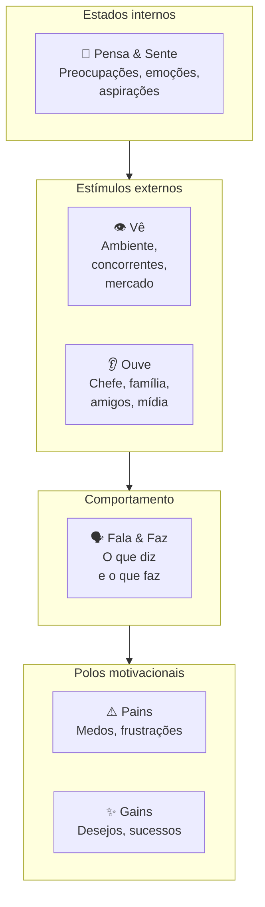

A tese é que comportamento humano é resultado da tensão entre **estímulos** (vê/ouve), **estados internos** (pensa/sente) e **polos motivacionais** (pains/gains). Mapear os seis revela contradições — pessoa que diz X publicamente mas faz Y; pessoa que ouve A do chefe mas é movida por B internamente — e essas contradições são exatamente onde produto novo encontra adoção.

#### Quando usar

Use o Empathy Map na Fase 3 (descoberta) como complemento ao Mom Test — entrevistas de problema capturam comportamento passado; o Empathy Map captura **o universo emocional e contextual** que cerca esse comportamento. Use também na Fase 4 (pesquisa) para construir o Customer Profile do VPC (CZ.3) com profundidade emocional. Em times de produto maduros, faça Empathy Map de cada persona principal a cada 12 meses — clientes mudam, e o mapa fica datado.

#### Princípios

A tese de Gray é que **empatia é capacidade construída, não dom**. Para construir, é preciso processo deliberado: ler verbatim de entrevistas, observar em campo, mapear com a equipe num exercício colaborativo. Empathy Map preenchido só com intuição é ficção. Preenchido com base em pesquisa real, vira ferramenta de tomada de decisão — quando alguém propõe uma feature que contradiz o que está mapeado em "Pains" e "Gains", a contradição fica visível.

#### Como aplicar

Reúna 3-5 pessoas (PM + designer + customer success + 1-2 fundadores). Tempo: 90-120 minutos. **Pré-requisito**: pesquisa real concluída — pelo menos 5-10 entrevistas qualitativas + observação em campo. Sem isso, Empathy Map vira intuição coletiva.

1. **Escolha uma persona específica** — não "nossos clientes em geral", mas "Mariana, dona de padaria de duas unidades em São Paulo". Empathy Map é por pessoa, não por segmento.
2. **Vê** — leia verbatim de entrevistas e observação. O que essa pessoa vê no celular pela manhã? No trabalho? Em casa? Que ambiente físico habita? Que mídia consome?
3. **Ouve** — quem fala com ela? O que esses falantes dizem? Chefe, sócio, família, amigos, podcasts, influenciadores.
4. **Pensa & Sente** — o que ocupa a mente? O que tira o sono? O que entusiasma? Aqui é zona de inferência cuidadosa — ancore em verbatim.
5. **Fala & Faz** — o que ela diz publicamente (LinkedIn, conversas profissionais)? Como age (rotina, decisões observadas)? Há contradição entre os dois?
6. **Pains** — medos específicos, não genéricos. "Tenho medo de quebrar" é vago; "tenho medo de não conseguir pagar a folha do mês 13" é Pain.
7. **Gains** — sucessos pessoais que ela buscaria. "Quero crescer" é vago; "quero abrir terceira unidade até 2027" é Gain.

Tempo: 90-120 min para a primeira versão. Refazer a cada 6-12 meses ou após mudança significativa de mercado.

#### Exemplo brasileiro preenchido — Loggi, persona "Carlos motoboy" (2018)

Quando a Loggi expandiu de courier corporativo para entregas last-mile B2C em 2018, fez Empathy Map dos entregadores parceiros — não dos clientes finais. A descoberta levou a redesenho do app do entregador.

| Quadrante | Conteúdo |
|---|---|
| **Vê** | App da Loggi competindo por atenção com WhatsApp, Uber, iFood, Rappi no celular. Outros motoboys em redes informais comentando preços e rotas. Trânsito de São Paulo em tempo real. Posto de gasolina como ponto de socialização. Estabelecimentos comerciais como "clientes da semana". |
| **Ouve** | Esposa pedindo para "voltar mais cedo". Outros entregadores em grupo de WhatsApp reclamando de plataforma X ou recomendando rota Y. Atendente da Loggi por mensagem (raramente por voz). Clientes finais quando entrega presencial — alguns simpáticos, outros agressivos sobre atraso. |
| **Pensa & Sente** | Ansiedade sobre quanto vai ganhar no fim do dia. Cálculo mental constante de R$/km. Frustração com cancelamentos e endereços errados. Orgulho discreto quando completa entregas difíceis. Cansaço acumulado mas necessidade de não parar. Comparação com outros entregadores — "fulano fez 30 entregas hoje, eu só 22". |
| **Fala & Faz** | Diz publicamente que "trabalha pela liberdade de horário". Faz: aceita corridas das 6h às 22h porque precisa do faturamento. Recusa entregas longas mesmo com bônus se for fim de semana. Compartilha dicas em grupo de WhatsApp mas guarda os melhores estabelecimentos para si. |
| **Pains** | Ganhar menos que o pico do mês passado. Acidente sem cobertura — "se eu cair, fico sem renda". Bateria do celular acabar no meio do dia. Endereço errado em região perigosa. Diarreia/doença sem direito a auxílio. Multas de trânsito que comem ganho do dia. Cliente que não responde interfone. |
| **Gains** | Faturar R$ 3-4k/mês líquido (após combustível e manutenção). Conseguir folga de domingo sem perder ranking. Ter celular novo (ferramenta de trabalho). Comprar moto melhor — sonho de 12-24 meses. Ter dia mais previsível. Ser tratado com respeito por atendentes e clientes. |

**Insight do caso.** O quadrante "Vê" revelou algo crítico: o app da Loggi competia com 4-6 outros apps por atenção do entregador na mesma tela. Times anteriores haviam tratado o app como "ferramenta de trabalho dedicada" — a realidade é que o entregador trocava entre apps ao longo do dia conforme o que pagava melhor naquela janela. Isso levou a três decisões: (1) reduzir tempo de aceite de corrida (de 30s para 15s — entregador estava em outro app); (2) notificações mais agressivas com bônus (não dependendo de ele abrir o app); (3) **comunicação por voz** com atendente em casos críticos (entregador não consegue ler chat enquanto pilota). **A lição: Empathy Map dos não-clientes (parceiros, fornecedores, intermediários) frequentemente revela mais que Empathy Map do cliente final — porque essas pessoas têm múltiplos chefes invisíveis e otimizam por critérios que você não enxerga sem mapear.**

#### Variações e extensões

- **Empathy Map Canvas (atualizado, Dave Gray, 2017)**: versão mais recente que adiciona "Goal" no centro (objetivo da pessoa) e desloca o foco para tarefa-a-realizar — versão JTBD-friendly.
- **Stakeholder Empathy Map**: para B2B enterprise, fazer um Empathy Map para cada stakeholder no processo de compra (usuário, comprador, sponsor, TI).
- **Day-in-the-Life Map**: variação que mapeia 24 horas concretas ao invés de estados gerais.

#### Erros comuns

- Preencher com intuição em vez de pesquisa — Empathy Map sem dado real é projeção coletiva, não empatia.
- Tratar como descrição estática — pessoas mudam; refaça periodicamente.
- Confundir "Vê" com demografia — "Vê" é o ambiente físico/digital específico, não "tem 30 anos".
- Ignorar contradições entre "Fala & Faz" — frequentemente é onde estão as oportunidades de produto.
- Fazer Empathy Map só do cliente ideal — clientes problemáticos ou não-clientes (quem não compra) revelam mais sobre adoção real.

#### Quando NÃO usar

Em decisões puramente técnicas (escolha de stack, refatoração interna). Em mercados B2B muito padronizados onde o "comprador" é processo formal de licitação — Empathy Map do comprador individual tem peso menor que o entendimento do processo de compra. Quando a pesquisa qualitativa é insuficiente — fazer Empathy Map sem 5+ entrevistas por persona produz ficção.

#### Conexão com outros canvases

O Empathy Map **alimenta o Customer Profile do VPC (CZ.3)** — Pains e Gains do Empathy Map se traduzem diretamente em Pains e Gains do VPC. **Pareia com o Customer Journey Canvas (CZ.7)**: Empathy Map é estado; Customer Journey é trajetória. Os dois juntos dão "estado interno em cada momento da jornada". **Antecede o BMC/Lean** (CZ.1/2): entender clientes profundamente vem antes de articular o modelo.

#### Leitura adicional

- *Gamestorming* (Dave Gray, Sunni Brown & James Macanufo, 2010).
- *Updated Empathy Map Canvas* (Gray, blog post, 2017) — a versão revisada com foco em Goal.
- [gamestorming.com](https://gamestorming.com) — biblioteca de templates de Gray.

---

### CZ.7 — Customer Journey Canvas

#### Origem

O Customer Journey Map / Canvas surgiu da convergência de três escolas em meados dos anos 2000: design thinking (IDEO, Stanford d.school), service design (Nordic School, livet Lavrans Løvlie / Ben Reason) e experiência do cliente (Forrester, escola de CX corporativo). Não tem autor único — virou padrão de prática colaborativa entre 2008 e 2015, com formalização no livro *This Is Service Design Doing* (Marc Stickdorn et al., 2018). A motivação foi observação recorrente: empresas otimizavam touchpoints isolados (home page, atendimento, cobrança) sem ver a jornada inteira do cliente, e o resultado eram experiências fragmentadas onde cada ponto funcionava isolado mas o conjunto deixava o cliente confuso ou frustrado.

#### O que é

Tela visual organizada em **eixo horizontal de tempo** (fases da jornada do cliente, da descoberta ao pós-uso) e **eixo vertical de dimensões** (mínimo cinco):

- **Etapa**: nome curto da fase (Descoberta, Consideração, Compra, Onboarding, Uso, Suporte, Renovação).
- **Ação**: o que o cliente faz nessa etapa (concretamente — clica, abre app, liga, fala com).
- **Objetivo**: o que ele tenta cumprir.
- **Pontos de Dor**: onde algo dá errado, demora, frustra.
- **Emoções**: o que ele sente (ansiedade, alívio, raiva, tédio, entusiasmo).
- **Oportunidades**: onde existe espaço para intervenção.

Versões mais avançadas adicionam: ferramentas/canais usados, métricas de sucesso por etapa, KPIs internos, owners do touchpoint, dados quantitativos (NPS por etapa, conversão).

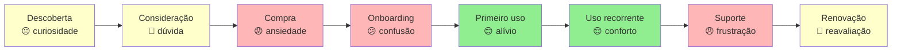

A linha emocional (verde alto / amarelo neutro / vermelho baixo) ao longo da jornada é o output mais valioso: pontos vermelhos consecutivos antecipam churn; pontos verdes isolados cercados de vermelho são "experiências boas no contexto errado".

#### Quando usar

Use o Customer Journey Canvas na Fase 4 (pesquisa) como entregável central — junto com personas e VPC. Use também a cada 12 meses como auditoria operacional pós-PMF: a jornada que funcionava em 2024 frequentemente não funciona em 2026 porque mudaram canais (TikTok, WhatsApp), expectativas (resposta em segundos), regulação (LGPD, PIX). Em momentos de pivô (Fase 15), refaça a jornada antes de qualquer investimento operacional.

#### Princípios

A tese é que **experiência do cliente é uma fita contínua, não pontos isolados**. Times divididos por função (marketing, vendas, sucesso, produto, suporte) tendem a otimizar suas próprias caixinhas e ignorar transições entre etapas. O Customer Journey Canvas força olhar a fita inteira e identificar **o ponto mais fraco** — porque a experiência do cliente é tão boa quanto o pior elo. Cliente que teve compra fácil mas onboarding caótico não fica; cliente que teve onboarding ótimo mas suporte distante churna na primeira dúvida real.

#### Como aplicar

Pré-requisito: 5-15 entrevistas qualitativas + dados quantitativos (analytics, NPS, CSAT). Reúna PM + designer + customer success + 1-2 representantes de marketing/vendas/operações. Tempo: 3-4 horas para a primeira versão.

1. **Defina escopo da jornada** — começo e fim. Comece **antes** do ponto óbvio: se você é SaaS, jornada começa quando cliente percebe o problema, não quando entra no site.
2. **Liste etapas** — 5-10 etapas nomeadas. Use vocabulário do cliente, não interno ("Considera comprar" não "Lead Qualificado").
3. **Para cada etapa**, preencha as 6 dimensões com base em verbatim e dados.
4. **Trace a linha emocional** — atribua emoção dominante a cada etapa.
5. **Identifique pontos críticos** — onde a emoção cai abruptamente, onde há atrito sistemático, onde o cliente abandona.
6. **Liste oportunidades** — para cada ponto crítico, 1-3 intervenções possíveis. Prioriza pelo impacto na linha emocional, não pelo custo de implementação.

Após primeira versão, **valide com 3-5 clientes reais** — peça que olhem o mapa e apontem onde discordam. Customer Journey desenhado sem validação é frequentemente "como queremos que seja", não "como é".

#### Exemplo brasileiro preenchido — iFood, jornada de primeira compra (2017)

Em 2017, o iFood mapeou a jornada de primeira compra para entender por que 40% dos novos cadastros não completavam pedido inicial. O canvas:

| Etapa | Ação | Objetivo | Dor | Emoção | Oportunidade |
|---|---|---|---|---|---|
| **Gatilho** | Sente fome às 19h, vê amigo pedindo via app | Resolver fome rápido | "Será que tem o que eu quero?" | Curiosidade | Hero card mostrando opções na cidade do usuário |
| **Descoberta** | Baixa app, abre primeira vez | Ver o que tem por perto | Tela inicial mostra muitos restaurantes — paralisia de escolha | Sobrecarga | Curadoria "mais pedidos hoje", reduzir opções iniciais |
| **Cadastro** | Preenche nome, email, telefone, endereço | Concluir cadastro rápido | Confirmação de SMS demora, formulário pede CPF (não obrigatório) | Frustração | Reduzir cadastro para email + senha + endereço; CPF só na compra |
| **Busca** | Filtra por categoria ou busca restaurante | Achar comida que quer | Restaurantes que não entregam no endereço aparecem | Decepção | Filtrar por entrega real antes de mostrar |
| **Cardápio** | Abre restaurante, navega cardápio | Escolher prato | Foto baixa qualidade, descrição inconsistente, preço sem ICMS visível | Dúvida | Padronização de cardápios + preço final na lista |
| **Carrinho** | Adiciona itens, vê total | Conferir antes de pagar | Taxa de entrega aparece tarde, "valor mínimo" surge surpresa | Irritação | Mostrar taxa e mínimo desde o cardápio |
| **Pagamento** | Escolhe forma, confirma | Pagar e fechar pedido | Cartão recusado sem explicação, 2FA do banco demora | Ansiedade alta | Adicionar débito em conta e boleto como alternativas ao cartão, mostrar erro específico por tipo ("cartão sem limite" vs "dados incorretos" vs "banco bloqueou"), salvar tentativas no carrinho |
| **Espera** | Acompanha entrega no mapa | Saber quando chega | Mapa não atualiza em tempo real nos primeiros 10min | Inquietação | Streaming de status mais granular, comunicação proativa de atrasos |
| **Recebimento** | Recebe entrega, avalia | Comer e avaliar | Pedido errado / faltando item — sem caminho claro de queixa | Raiva | Botão "tem problema?" no mesmo card do pedido |
| **Pós-uso** | Recebe email pedindo nota | Avaliar (se lembrar) | Email genérico chega 3 dias depois | Apatia | Pedir nota in-app logo após entrega, com 1-tap |

**Insight do caso.** A jornada revelou que **a maior queda de conversão acontecia entre Pagamento e Espera** — clientes davam tudo certo até o pagamento, e quando o cartão era recusado sem explicação, abandonavam. Isso levou a três decisões: (1) adicionar débito em conta e boleto bancário como alternativas ao cartão recusado — formas de pagamento mais acessíveis para o ICP em 2017; (2) mensagens de erro específicas ("cartão sem limite" vs "dados incorretos" vs "banco bloqueou"); (3) salvar carrinho mesmo após falha — cliente não precisava recomeçar do zero. **A lição: Customer Journey Canvas frequentemente revela que o problema não está onde a equipe achava (qualidade de cardápio? variedade?) mas em transição específica que ninguém estava monitorando (o segundo entre "click pagar" e "pedido confirmado").**

#### Variações e extensões

- **Service Blueprint**: extensão do Customer Journey adicionando "linha de visibilidade" — o que o cliente vê (frontstage) vs o que acontece nos bastidores (backstage). Útil para ops e suporte.
- **Multi-persona Journey Map**: mesma jornada vista por 2-3 personas distintas (decisor vs usuário em B2B; comprador vs presenteado em B2C).
- **Future-State Journey Map**: jornada como queremos que seja em 12-18 meses, ao lado da atual. Útil para roadmap.

#### Erros comuns

- Mapear a jornada que a empresa quer (frictionless, lógica) em vez da que existe (fragmentada, cheia de workarounds) — desconectado do cliente real.
- Começar muito tarde (no momento da compra) — perde o gatilho que define quem chega ao site.
- Tratar como artefato estático — mercados e canais mudam (rise do TikTok como descoberta, do PIX como pagamento, do WhatsApp como suporte); jornada precisa atualização.
- Otimizar pontos isolados sem ver consequências em pontos seguintes — onboarding mais rápido pode produzir mais churn em 30 dias.
- Não medir — Customer Journey sem dados é hipótese; precisa NPS por etapa, conversão entre etapas, tempo médio em cada etapa.

#### Quando NÃO usar

Em produtos transacionais simples sem relacionamento contínuo (vending machine, compra one-shot de baixo valor) — overhead não compensa. Em mercados B2B enterprise muito longos (ciclo de venda 12+ meses) — Customer Journey vira documento de 50 páginas que ninguém lê; melhor abordar com sequence diagram do processo de compra.

#### Conexão com outros canvases

O Customer Journey Canvas **pareia com o Empathy Map (CZ.6)**: Empathy Map é estado; Customer Journey é trajetória. **Alimenta o VPC (CZ.3)**: pontos de dor da jornada viram Pains do Customer Profile. **Alimenta o Pirate Canvas / AARRR (CZ.10)**: as etapas da jornada mapeiam diretamente para Acquisition → Activation → Retention → Referral → Revenue. **Sucede o BMC (CZ.1)**: BMC mapeia o modelo; Customer Journey mapeia a experiência operacional do cliente dentro desse modelo.

#### Leitura adicional

- *This Is Service Design Doing* (Marc Stickdorn, Markus Edgar Hormess, Adam Lawrence, Jakob Schneider, 2018).
- *Mapping Experiences* (James Kalbach, 2nd ed. 2020) — manual extensivo sobre todos os tipos de mapas de experiência.
- [servicedesigntools.org](https://servicedesigntools.org) — biblioteca de templates open-source.

---

### CZ.9 — Test Card (David Bland & Alexander Osterwalder, 2019)

#### Origem

O Test Card foi formalizado no livro *Testing Business Ideas* (David Bland & Alexander Osterwalder, 2019), parte da família Strategyzer (mesma escola do BMC e VPC). É a sistematização — em formato de cartão único — do que já era prática tácita no Lean Startup desde Eric Ries (2011): para cada hipótese, defina o experimento que vai testá-la **antes** de coletar dados, com critério de sucesso explícito. O Test Card tornou esse exercício replicável: cabe numa folha A5, tem campos fixos, e força o time a articular o critério de sucesso antes do experimento começar (não depois, quando já há viés de confirmação).

O que o livro IGNIÇÃO chama de "Cartão de Experimento" (Template A.4 do Apêndice A) é uma adaptação direta do Test Card, com algumas extensões para o contexto brasileiro (custo em R$, linguagem local). A origem da ferramenta é Strategyzer.

#### O que é

Cartão de uma página com **oito campos** estruturados:

- **ID do experimento** (numeração sequencial).
- **Hipótese testada** (uma frase falsificável copiada do banco de hipóteses).
- **Pergunta central** (o que especificamente queremos responder).
- **Desenho** (passo a passo do experimento).
- **Público** (quantas pessoas, qual perfil, como alcançadas).
- **Métrica principal e critério de sucesso** (definido **antes** de ver dados).
- **Critério de refutação** (o que invalida a hipótese — também antes).
- **Custo e duração** (orçamento e prazo).

Após o experimento, o cartão se completa com:

- **Resultado observado**.
- **Decisão** (Persevere / Pivote / Ajuste / Abandone).
- **Aprendizados** (o que isso nos ensina sobre o modelo).

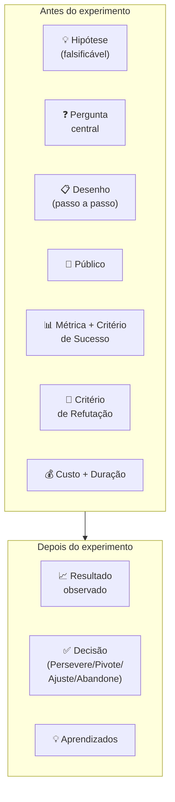

A disciplina central é definir **Critério de Sucesso e Critério de Refutação ANTES** de rodar o experimento. Times que definem critério depois invariavelmente racionalizam os dados a favor da hipótese ("converteu menos do que esperávamos, mas ainda é positivo porque..."). Critério pré-definido evita auto-engano.

#### Quando usar

Use o Test Card na Fase 7 (experimentos de validação do problema) como artefato central — um Test Card por experimento, vivo até o experimento concluir. Use também na Fase 6 (formulação de hipóteses) como follow-up imediato: cada hipótese bet-the-company gera 1-3 Test Cards. Em times pós-PMF com cultura de discovery contínuo, Test Card vira hábito semanal — qualquer feature ou mudança de fluxo gera Test Card antes da implementação.

#### Princípios

A tese de Bland & Osterwalder é que **experimento sem critério pré-definido não é experimento, é demonstração**. Demonstração começa com a conclusão pronta e busca evidência que confirme. Experimento começa com pergunta aberta e aceita qualquer resposta. A diferença é a definição prévia do critério de refutação. Test Card formaliza esse rigor — sem ele, a maioria dos "experimentos" em startup é teatro de método científico.

#### Como aplicar

Para cada hipótese a testar, abrir um Test Card. Tempo de preenchimento: 30-45 min. Participantes: 2-3 pessoas (PM + tech/design + 1 fundador).

1. **Hipótese** — copie da Fase 6, escreva como afirmação falsificável: "X% dos visitantes da landing page se cadastrarão em até 7 dias", não "as pessoas vão gostar".
2. **Pergunta central** — o que estamos testando especificamente? Frequentemente é o coração da hipótese reformulado.
3. **Desenho** — passo a passo do experimento. Concreto: que landing page? Quais ads? Que público?
4. **Público** — N planejado, perfil específico, canal. "100 visitantes ICP via Meta Ads" é diferente de "100 visitantes quaisquer".
5. **Métrica + Critério de Sucesso** — definir **antes**. "Sucesso = 8% de conversão visitante → cadastro em 14 dias."
6. **Critério de Refutação** — também antes. "Abaixo de 2% = hipótese refutada."
7. **Custo e Duração** — R$ X (Ads + ferramenta) + Y dias.
8. **Riscos e vieses** — o que pode distorcer? Tráfego ruim? Dia da semana? Novidade?

Rodar o experimento. Atualizar o cartão com resultado, decisão e aprendizados.

**Regra de ouro**: sucesso e refutação devem ser distintos com zona de incerteza no meio. Entre 2% e 8% no exemplo acima = inconclusivo, exige novo experimento. Sem zona de incerteza, qualquer resultado vira "sucesso" ou "fracasso" por viés.

#### Exemplo brasileiro preenchido — PadariaPro, smoke test de proposta de valor (2024)

Equipe da PadariaPro (caso recorrente do livro) considerava lançar produto de gestão de delivery próprio para padarias artesanais com 1-3 unidades em São Paulo. Antes de construir, rodaram este Test Card:

| Campo | Conteúdo |
|---|---|
| **ID** | EXP-2024-03 |
| **Hipótese testada** | Donos de padaria com 1-3 unidades em SP que fazem delivery próprio têm dor suficiente para pagar R$ 290/mês por software de gestão integrada de pedidos. |
| **Pergunta central** | Visitantes ICP convertem em formulário "quero conhecer" a ≥10%? Dos que preenchem, ≥30% confirmam disposição a pagar R$ 290 em ligação? |
| **Desenho** | (1) Landing page descrevendo o produto como se existisse, com R$ 290/mês destacado e formulário de "quero conhecer". (2) Meta Ads segmentando "donos de padaria em SP" via interesses + lookalike de base de email comprada. (3) Para cada formulário preenchido, ligar em 24h e fazer entrevista de 15 min. |
| **Público** | 100 visitantes ICP (donos/sócios de padaria 1-3 unidades em SP capital), via Meta Ads. Verba de R$ 1.500. |
| **Métrica principal** | Taxa de conversão visitante → formulário preenchido. Sucesso: ≥10%. Refutação: ≤2%. |
| **Métrica secundária** | Dos preenchimentos, % que confirma disposição a pagar R$ 290 em ligação. Sucesso: ≥30%. Refutação: ≤10%. |
| **Critério de Refutação** | Conversão <2% OU confirmação de pagamento <10% = hipótese refutada. Reconsiderar preço ou ICP. |
| **Custo e Duração** | R$ 1.500 em Ads + 14 dias (1 semana de tráfego + 1 semana de ligações) + ~10h do fundador em entrevistas. |
| **Riscos e vieses** | Público frio do Meta pode não bater com ICP real (donos de padaria não usam Meta Ads como ferramenta de descoberta de software B2B). Mitigação: reforçar segmentação por interesses + lookalike. |

**Resultado** (preenchido após 14 dias):

- 47 visitantes ICP confirmados via tag de evento (audience pequena demais, limitação de targeting).
- 12 preencheram formulário (25,5% — acima do critério de sucesso primário).
- 7 atendiam à ligação. Dos 7: 4 confirmaram disposição a R$ 290, 2 a R$ 400, 1 a R$ 590. Confirmação de pagamento: 4/7 = 57% (acima do critério).

**Decisão**: Persevere. Hipótese reforçada — disposição a pagar é maior que o teste assumia (alguns aceitariam R$ 400-590). Próximo experimento: pré-venda paga real (R$ 290 com reembolso garantido) para os 12 do formulário.

**Aprendizados**: (1) ICP via Meta Ads funcionou apesar de ceticismo inicial — segmentação por interesse "padaria artesanal" + lookalike captou perfil certo. (2) Disposição a pagar > preço testado sugere que estamos subprecificando — testar R$ 390 no próximo experimento. (3) Tempo de resposta importa: dos 12 que preencheram, os 5 que não atenderam ligação foram contatados em D+2 (vs D+1 nos 7 atendidos). Diferença de 24h em tempo de resposta queimou 40% da amostra.

**Insight do caso.** A disciplina do Test Card neste exemplo evitou três erros típicos: (1) **viés de confirmação** — sem critério pré-definido, "47 visitantes" pareceria sucesso ou fracasso conforme a vontade do time; com critério, é claramente "amostra menor que planejada, mas suficiente porque conversão alta compensa"; (2) **subestimação de preço** — sem perguntar preço de forma sistemática, a equipe assumiria R$ 290 e nunca testaria preços maiores; (3) **falsa sensação de progresso** — sem "Critério de Refutação" registrado, o time poderia ter levado meses para perceber que algo simples como "responder em 24h" estava destruindo a amostra. **A lição: Test Card não é burocracia — é o equipamento de proteção contra os auto-enganos sistemáticos do empreendedor entusiasmado.**

#### Variações e extensões

- **Learning Card** (Strategyzer): cartão complementar focado em "o que aprendemos" (não "o que testamos"). Útil para destilar insights de múltiplos Test Cards rodados.
- **Assumption Map** (Bland & Osterwalder): grid 2x2 que prioriza quais assumptions virar Test Cards primeiro (importância × evidência atual).
- **Riskiest Assumption Test (RAT)** (Lean Startup community / Lean UX): variação minimalista — só testa a única assumption que mais pode matar o produto.

#### Erros comuns

- Definir critério de sucesso depois de ver resultados — auto-engano garantido.
- Critério vago ("queremos boa adoção") em vez de quantitativo ("≥X% em Y dias") — resultado fica em zona cinza permanente.
- Não definir critério de refutação — só "sucesso" e "ainda não", nunca "refutado", impede aprendizado real.
- Rodar muitos Test Cards em paralelo sem capacidade de analisar — vira teatro de experimentação.
- Confundir Test Card com PRD (Product Requirements Document) — Test Card valida hipótese; PRD especifica construção. São documentos para fases distintas.

#### Quando NÃO usar

Em decisões reversíveis e baratas (pequena mudança de copy, ajuste de preço pontual) — overhead do cartão não compensa. Em decisões que não cabem em hipótese falsificável ("devemos ter cultura mais transparente?") — Test Card não serve para questões de identidade ou valores. Em ambientes onde o time não tem disciplina para parar e analisar antes de avançar — Test Card sem cultura de revisão vira papel.

#### Conexão com outros canvases

O Test Card **sucede o Hypothesis Canvas (CZ.14)**: cada hipótese vira 1-3 Test Cards. **Sucede o Lean Canvas (CZ.2)**: cada bloco do Lean Canvas gera hipóteses, que geram Test Cards. **Antecede o MVP Canvas (CZ.11)**: depois de Test Cards validarem que a oportunidade existe, MVP Canvas define o escopo do que construir. **No livro IGNIÇÃO**, o Test Card é a fonte canônica do "Cartão de Experimento" do Template A.4 — são a mesma ferramenta com nome localizado.

#### Leitura adicional

- *Testing Business Ideas* (David Bland & Alexander Osterwalder, 2019).
- *The Lean Startup* (Eric Ries, 2011) — origem filosófica da disciplina.
- [strategyzer.com/library](https://strategyzer.com/library) — biblioteca de Test Cards preenchidos por categoria.

---

### CZ.10 — Pirate Canvas / AARRR (Dave McClure, 2007)

#### Origem

Dave McClure, fundador do fundo 500 Startups, apresentou o framework AARRR em 2007 num slide deck chamado "Startup Metrics for Pirates" — o acrônimo soa como "ARRRR" de pirata, daí o apelido. O contexto era a explosão de startups web na fase pós-Web 2.0, quando times de produto rastreavam dezenas de métricas sem saber quais importavam. AARRR reorganizou o caos em cinco métricas de ciclo de vida do cliente. O "Pirate Canvas" — ou AARRR Canvas — é a versão visual posterior, que traduz as cinco letras em uma tela preenchível com métricas, canais, e hipóteses organizadas por funil. O framework virou o padrão de facto de métricas early-stage em aceleradoras e fundos de venture capital global, incluindo YC, Antler e os principais VCs brasileiros.

#### O que é

Tela visual em cinco colunas correspondendo às cinco letras do acrônimo:

- **Acquisition (Aquisição)**: como o usuário chega. Canais, CAC, volume por canal.
- **Activation (Ativação)**: primeiro momento de valor — o usuário experimenta o produto e reconhece que funciona. Taxa de ativação, tempo até ativação.
- **Retention (Retenção)**: o usuário volta. D7, D30, coortes, churn mensal.
- **Referral (Indicação)**: o usuário traz outros. NPS, taxa de indicação, viralidade (K-factor).
- **Revenue (Receita)**: o usuário paga. Conversão freemium → pago, ARPU, LTV.

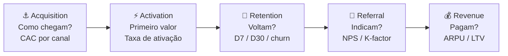

A distinção entre Acquisition e Activation é central: usuário que chegou mas não ativou é desperdício de CAC. A métrica de ativação (o "aha moment") é frequentemente o indicador mais importante do produto — encontrá-la é o trabalho de discovery dos primeiros meses.

#### Quando usar

Use o Pirate Canvas na Fase 10 (MVP e primeiros usuários) como estrutura padrão de instrumentação de métricas. Implante antes de lançar o MVP — não depois. Pós-PMF, use-o mensalmente como dashboard de saúde do funil: onde está a maior queda? Qual etapa tem pior conversão? A etapa com maior vazamento é o foco de crescimento do próximo ciclo. Em Fase 14 (escala), o Pirate Canvas orienta alocação de budget por etapa do funil.

#### Princípios

A tese de McClure é que **times sem modelo de funil explícito otimizam a métrica errada**. Times de produto tendem a focar em Acquisition (visível, fácil de medir, resulta em reuniões celebrando "crescimento") e ignorar Retention (invisível, difícil, mas única que gera crescimento sustentável). AARRR força o time a encarar que crescimento em Acquisition com retenção de 20% no D30 é uma banheira furada — você está enchendo o balde enquanto o buraco cresce. **Retenção precede escala de aquisição.**

#### Como aplicar

Monte o Pirate Canvas em três etapas, nesta ordem:

1. **Defina a métrica de cada etapa** — 1 métrica primária por etapa. Não 5. Uma. Acquisition: CAC médio ponderado por canal. Activation: taxa de usuários que atingem o "aha moment" em X dias. Retention: retenção D30 (ou D7 para apps). Referral: NPS ou taxa de indicação ativa (mês). Revenue: conversão freemium → pago ou ARPU mensal.
2. **Defina o benchmark mínimo** — o que é "saudável" nesta métrica para o seu modelo? SaaS B2B: retenção D30 > 70%. Consumer app: retenção D30 > 25%. Marketplace: depende do lado.
3. **Identifique o maior vazamento** — onde está a maior queda de conversão entre etapas? Esse é o único foco do próximo trimestre. Não mexa nas outras etapas até resolver essa.

Iteração mensal: atualize números, identifique onde o funil mudou, ajuste foco.

#### Exemplo brasileiro preenchido — Conta Simples, aceleração do funil B2B (2021)

A Conta Simples (conta empresarial digital para PMEs brasileiras) tinha problema claro em 2021: Acquisition funcionava bem (CAC baixo via Google Ads B2B + indicação), mas Activation era o gargalo — 60% dos cadastros não ativavam cartão em 14 dias.

| Etapa | Métrica principal | Número | Benchmark alvo | Status |
|---|---|---|---|---|
| **Acquisition** | CAC via canais digitais | R$ 180/cliente | < R$ 250 | ✅ Dentro |
| **Activation** | % completa onboarding + usa cartão em D14 | 40% | > 65% | 🔴 Crítico |
| **Retention** | Retenção D30 (conta ainda ativa e com transação) | 71% | > 70% | ✅ Dentro (marginal) |
| **Referral** | NPS (escala 0-100) | 52 | > 50 | ✅ Dentro |
| **Revenue** | ARPU mensal (receita por conta ativa) | R$ 68 | > R$ 60 | ✅ Dentro |

**O diagnóstico AARRR.** Com esse canvas, ficou claro: o problema não era "crescer" (Acquisition OK), não era "produto ruim" (Retention e NPS OK), e não era "precificação" (ARPU OK). Era **Activation** — usuários chegavam e não ativavam o cartão em 14 dias. Isso revelou dois culpados: (1) o processo KYC (validação regulatória) tinha fricção invisível — três documentos, dois dias de análise manual; (2) o email de onboarding não explicava por que o cartão era o "primeiro valor" da conta.

**As três ações decorrentes:** (1) automatizar 70% do KYC via integração com Receita Federal + Serasa, reduzindo de 2 dias para 4 horas; (2) reescrever o fluxo de onboarding in-app com checklist progressivo (cada step destravava o próximo); (3) enviar WhatsApp (não email) no D2 com link direto para "ativar seu cartão agora". Resultado em 90 dias: Activation subiu de 40% para 67%.

**Insight do caso.** A armadilha clássica sem Pirate Canvas seria investir mais em Acquisition ("vamos crescer mais cadastros"). O canvas mostrou que investir em Acquisition com 40% de Activation significava jogar 60 centavos de cada R$ 1 de CAC no lixo. **A lição: AARRR não é painel de monitoramento — é protocolo de priorização. O maior vazamento do funil vence o debate de roadmap.**

#### Variações e extensões

- **RARRA** (Thomas Petit & Gabor Papp, 2018): reordena para Retention → Activation → Referral → Revenue → Acquisition — enfatiza que Retention deve ser resolvida antes de escalar Acquisition.
- **North Star Metric**: uma única métrica que captura valor entregue ao cliente e prediz crescimento de longo prazo. Complementa o AARRR (que é funil; North Star é foco). Exemplos: Airbnb (noites reservadas), WhatsApp (mensagens enviadas por dia), Spotify (tempo de escuta/mês).
- **Growth Accounting**: decompõe variação de usuários ativos em Novos + Ressuscitados − Churned. Complemento quantitativo ao AARRR.

#### Erros comuns

- Definir múltiplas métricas primárias por etapa — diluição de foco.
- Focar em Acquisition enquanto Retention é crítica — encher banheira furada.
- Usar D7 e D30 intercambiavelmente — D7 mede habit formation, D30 mede stickiness; são perguntas distintas.
- Não segmentar o funil por persona/canal — um funil "médio" pode esconder que canal A tem Activation 80% e canal B tem 15%.
- Tratar AARRR como relatório (olhar uma vez por mês sem decidir nada) em vez de protocolo de priorização.

#### Quando NÃO usar

Em estágio pré-Activation (antes de ter produto em mãos de usuários reais) — métricas de funil não existem ainda. Em produtos com ciclo de venda B2B enterprise muito longo (6-18 meses) — AARRR pressupõe ciclo curto o suficiente para medir D7/D30; em ciclos longos, use pipeline de vendas (stage-by-stage). Em produtos de uso único (compra one-shot sem recorrência) — Retention não se aplica, e o framework perde uma das cinco etapas.

#### Conexão com outros canvases

O Pirate Canvas **alimenta o Lean Canvas (CZ.2)**: métricas do AARRR preenchem os blocos "Métricas-chave" e "Canais" do Lean Canvas com dados reais (não hipóteses). **Sucede o Customer Journey (CZ.7)**: as etapas da jornada do cliente mapeiam diretamente para as etapas do AARRR — Descoberta/Consideration = Acquisition, Onboarding = Activation, Uso recorrente = Retention, Recomendação = Referral, Upgrade = Revenue. **Orienta o MVP Canvas (CZ.11)**: o maior vazamento do AARRR é o foco do próximo MVP de crescimento.

#### Leitura adicional

- *Startup Metrics for Pirates* (Dave McClure, slide deck, 2007) — original disponível publicamente.
- *Hacking Growth* (Sean Ellis & Morgan Brown, 2017) — expansão prática do framework AARRR em equipes de growth.
- *Lean Analytics* (Alistair Croll & Benjamin Yoskovitz, 2013) — benchmarks por modelo de negócio (SaaS, marketplace, e-commerce, mobile app).

---

### CZ.11 — MVP Canvas (Tristan Kromer)

#### Origem

Tristan Kromer, coach de inovação e autor do blog Grasshopper Herder, desenvolveu o MVP Canvas como resposta a uma frustração recorrente: times que "lançavam MVPs" sem definir antecipadamente o que estavam tentando aprender. O MVP Canvas surgiu ao redor de 2013-2015 como artefato estruturado para forçar três definições antes de qualquer linha de código: qual é a hipótese que o MVP testa, quem são os usuários do MVP (não os usuários futuros do produto final), e qual é o critério de sucesso que dirá ao time o que construir a seguir. Kromer parte da premissa de Eric Ries (*The Lean Startup*, 2011) mas torna operacional a pergunta mais ignorada: "MVP de quê, exatamente?"

#### O que é

Tela visual de uma página com **sete blocos** distribuídos em torno da pergunta central "o que estamos aprendendo com este MVP?":

- **Hipótese central**: a crença que o MVP testa — escrita como falsificável.
- **Segmento de usuário do MVP**: não o cliente final do produto, mas o cliente específico que validará *essa hipótese* (pode ser subconjunto menor).
- **Proposta de valor do MVP**: o que o usuário ganha com o MVP — pode ser diferente do produto final.
- **Canais de recrutamento**: como vamos chegar nos usuários deste MVP.
- **Critério de sucesso**: o que precisamos ver para considerar a hipótese validada.
- **Critério de invalidação**: o que precisamos ver para considerar a hipótese refutada.
- **Tipo de MVP**: qual experimento — landing page, concierge, wizard of oz, protótipo clicável, pré-venda, fake door.

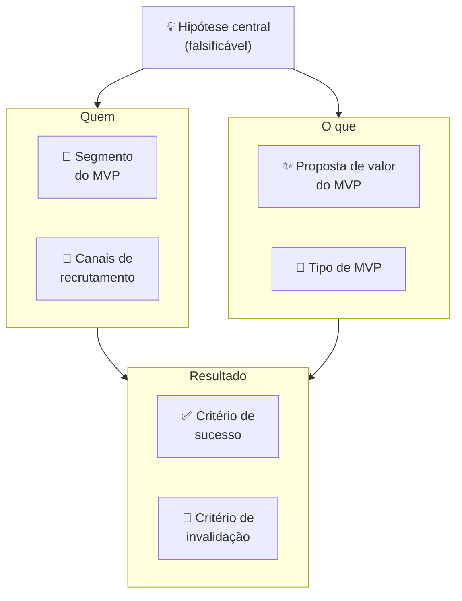

#### Quando usar

Use o MVP Canvas na Fase 8 (prototipagem e MVP) como artefato de entrada — antes de qualquer construção. Para cada MVP que o time planeja lançar, preencha o canvas em 30-45 minutos com as pessoas envolvidas. Em times pós-PMF com discovery contínuo, MVP Canvas precede qualquer sprint de desenvolvimento de feature nova: cada feature experimentada como "MVP de aprendizado" antes de virar permanente.

#### Princípios

A tese de Kromer é que **"MVP" sem hipótese explícita é só produto incompleto**. A maioria dos times chama de MVP qualquer versão inicial do produto, mas "versão inicial" sem hipótese não ensina nada — você lança, alguns usuários gostam, outros não, e o time não sabe o que isso significa. MVP Canvas faz a pergunta que a maioria evita: "Qual crença específica este MVP vai testar? E quando sabemos que foi refutada?" Sem essa resposta, o MVP nunca "falha" — ele simplesmente não tem critério de aprendizado.

#### Como aplicar

Reúna PM + tech lead + designer + fundador. Tempo: 30-45 minutos. **Sequência de preenchimento:**

1. **Hipótese central** — escreva primeiro, antes de falar sobre o MVP em si. "Acredito que [usuário Y] vai [fazer X] por causa de [razão Z]." Teste: a hipótese pode ser refutada? Se não, reescreva.
2. **Segmento do MVP** — quem especificamente vai testar esta hipótese? Pode ser 20 pessoas, não 20.000. Quanto mais estreito o segmento, mais limpa a evidência.
3. **Proposta de valor do MVP** — o que o usuário ganha hoje com esta versão? Não o que o produto promete no futuro — o que o MVP entrega agora.
4. **Canais de recrutamento** — como vai encontrar essas pessoas? "Nossos clientes" é vago; "lista de 50 churned users do último trimestre via email pessoal do founder" é um canal.
5. **Tipo de MVP** — qual é o formato do experimento? Não construa código se um protótipo clicável testa a mesma hipótese em 1/10 do tempo.
6. **Critério de sucesso** — define antes. Número específico.
7. **Critério de invalidação** — define antes. Zona de incerteza entre sucesso e invalidação = inconclusivo.

Após preencher, faça a pergunta de Kromer: "Se o MVP falhar pelo critério de invalidação, o que construímos a seguir?" Se a resposta for "pivotamos para X", o MVP está bem definido. Se a resposta for "não sabemos", a hipótese precisa ser mais específica.

#### Exemplo brasileiro preenchido — Wildlife Studios, MVP de novo mecanismo de monetização (2022)

A Wildlife Studios (São Paulo, one of the largest mobile game studios globally) testou em 2022 um novo mecanismo de monetização para seu jogo *Sniper 3D*: season passes (passe de temporada com recompensas progressivas), alternativa a loot boxes avulsas. O MVP Canvas:

| Bloco | Conteúdo |
|---|---|
| **Hipótese central** | Jogadores de Sniper 3D que compraram ao menos 1 item nos últimos 90 dias pagarão R$ 15 por season pass se perceberem progressão visual clara de recompensas ao longo de 30 dias. |
| **Segmento do MVP** | Cohort de 50.000 jogadores "moderate spenders" (1-3 compras/trimestre, ARPU R$ 18/mês) em mercado brasileiro. Excluídas as duas pontas — free-to-play puro e heavy spenders — para isolar o segmento mais sensível à proposta. |
| **Proposta de valor do MVP** | 30 recompensas progressivas (visuais, skins, boosters) por R$ 15 — previsibilidade de valor vs. loteria de loot box. |
| **Canais de recrutamento** | In-game banner para o cohort selecionado + push notification personalizada no D1 do teste. Sem anúncio externo — experimento contido na base existente. |
| **Tipo de MVP** | Feature real implementada no jogo para o cohort (não protótipo) — o investimento de desenvolvimento era pequeno o suficiente para ser justificado pela potencial monetização. |
| **Critério de sucesso** | ≥12% de conversão do cohort (compra do season pass) nos primeiros 7 dias. ARPU do cohort ≥ R$ 22 em 30 dias (vs. R$ 18 baseline). |
| **Critério de invalidação** | < 6% de conversão em 7 dias OU ARPU < R$ 16 em 30 dias = hipótese refutada. Considerar alternativas de monetização ou repricing. |

**Resultado:** 17% de conversão em D7 (acima do critério de sucesso). ARPU do cohort subiu para R$ 24 em 30 dias. Decisão: Persevere — expandir season pass para todos os usuários ativos + outros jogos do portfólio.

**Insight do caso.** O MVP Canvas forçou a Wildlife a definir o segmento com precisão — testar nos dois extremos (free-to-play puro e heavy spenders) contaminaria o resultado (FTP não compra nada; heavy spenders compram tudo, inclusive o que não funciona). A limpeza do cohort produziu evidência acionável: a proposta funciona para *moderate spenders*, que é exatamente o segmento de maior potencial de upgrade. **A lição: o trabalho mais importante do MVP Canvas é definir quem NÃO entra no experimento — não apenas quem entra.**

#### Variações e extensões

- **Concierge MVP Canvas**: variação específica para MVPs onde o serviço é entregue manualmente (você faz tudo na mão para 10-20 usuários). Canvas adiciona bloco "Script de operação manual".
- **Wizard of Oz Canvas**: variação onde o backend é falso (humano operando). Canvas adiciona bloco "O que o usuário vê" vs. "O que realmente acontece" para mapear a ilusão deliberada.
- **Sprint Goal Canvas** (adaptação ágil): integra MVP Canvas com sprint planning — cada sprint tem um canvas de hipótese + critério.

#### Erros comuns

- Chamar de "MVP" qualquer versão incompleta do produto — MVP sem hipótese é produto inacabado, não experimento.
- Segmento do MVP = segmento total do mercado — dilui o sinal; o experimento não produz evidência limpa.
- Tipo de MVP mais caro que o necessário — se landing page testa a hipótese, não construa produto; se protótipo clicável testa, não escreva código.
- Não definir critério de invalidação — MVP "sempre aprende algo", nunca "falha"; loop de aprendizado não fecha.
- Usar MVP Canvas para justificar construção que já foi decidida — canvas como teatro, não como ferramenta de decisão.

#### Quando NÃO usar

Em produtos altamente regulados onde qualquer versão pública precisa de certificação (healthtech com classe de risco II+, fintech com obrigação de compliance desde o primeiro usuário) — MVP Canvas pressupõe liberdade de lançar versão experimental; em ambientes regulados, o canvas é útil para MVPs internos e simulações. Em produtos onde o custo de construção do MVP mínimo é maior que o custo de validação por entrevistas — entrevista, não construa.

#### Conexão com outros canvases

O MVP Canvas **sucede o Opportunity Canvas (CZ.5)**: a oportunidade aprovada vira hipótese central do MVP Canvas. **Pareia com o Test Card (CZ.9)**: MVP Canvas define o experimento; Test Card registra e acompanha a execução. **Antecede o Pirate Canvas (CZ.10)**: o MVP bem sucedido gera os primeiros dados reais do funil AARRR. **Alimenta o Lean Canvas (CZ.2)**: Proposta de valor validada pelo MVP preenche o bloco "Solução" com dado real.

#### Leitura adicional

- Blog Grasshopper Herder (Tristan Kromer) — onde o MVP Canvas e variações são documentados.
- *The Lean Startup* (Eric Ries, 2011) — fundação filosófica.
- *Continuous Discovery Habits* (Teresa Torres, 2021) — escola de discovery contínuo onde MVP Canvas se integra ao ciclo semanal de produto.

---

### CZ.12 — Storytelling Canvas

#### Origem

Não tem autor único. O Storytelling Canvas emerge da convergência de três tradições ao longo dos anos 2010: (1) o trabalho de Nancy Duarte (*Resonate*, 2010) e Simon Sinek (*Start With Why*, 2009), que sistematizaram estruturas narrativas para comunicação de liderança e pitch; (2) a escola de narrativa estratégica de empresas como Narrative Science e FrameWorks Institute, que estudaram como enquadramento de mensagem afeta percepção de valor; (3) a prática de pitch coaching em aceleradoras (YC, Endeavor, Wayra) onde templates de narrativa viram ferramentas de workshop. O Storytelling Canvas é o artefato visual que condensa essas três tradições — uma tela para construir a narrativa de pitch ou comunicação institucional antes de abrir o PowerPoint.

#### O que é

Tela visual organizada em **oito blocos** que correspondem às oito decisões narrativas centrais:

- **Herói**: quem é o protagonista da história? (O cliente, não a empresa.)
- **Mundo antes**: como era o mundo antes do problema existir — ou o mundo atual do herói, antes da solução.
- **Problema / Tensão**: o que perturba o equilíbrio? Qual a dor do herói?
- **Tentativas falhas**: o que o herói já tentou? Por que não funcionou?
- **A virada**: como a solução entra? Qual é o insight que muda tudo?
- **Mundo depois**: como o mundo do herói muda com a solução?
- **Evidências**: o que prova que a virada é real? (Dados, casos, depoimentos.)
- **Chamada para ação**: o que você quer que o ouvinte faça após ouvir a história?

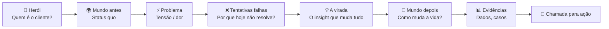

A estrutura segue o arco narrativo clássico de Joseph Campbell (A Jornada do Herói) aplicado ao contexto de produto e pitch — mas com um twist: **o herói não é o fundador nem a empresa, é o cliente**. A empresa é o "guia" (Gandalf, Yoda) que equipa o herói (Frodo, Luke) para vencer o problema.

#### Quando usar

Use o Storytelling Canvas em três contextos: (1) **pitch de investimento** — qualquer conversa com VC, anjo ou processo de aceleração; (2) **comunicação institucional** — lançamento de produto, entrada em novo mercado, apresentação para board; (3) **venda B2B complexa** — a proposta comercial também é uma narrativa, e o Storytelling Canvas ajuda a estruturá-la do ponto de vista do cliente, não do fornecedor. Preencha o canvas antes de criar o deck — a narrativa define a estrutura; o deck é execução.

#### Princípios

A tese unificada de Duarte, Sinek e da escola de pitch é que **dados sem narrativa não mudam comportamento**. O ser humano toma decisões emocionais e as justifica com lógica (Kahneman, *Thinking, Fast and Slow*). Uma história bem construída ativa a decisão emocional; os dados no bloco "Evidências" fornecem a justificativa racional. Inversamente, decks com dados sem narrativa produzem memorização zero — o investidor sai da reunião sem saber "o que essa empresa faz de diferente". O Storytelling Canvas força articular a narrativa primeiro, os dados depois.

#### Como aplicar

Preencha individualmente primeiro (20-30 min), depois valide em grupo (30 min). A sequência importa:

1. **Herói** — descreva o cliente em uma frase: quem é, em que contexto, qual seu papel. Concreto: "Mariana, diretora de RH de empresa com 200 funcionários em SP, responsável por recrutamento de vagas técnicas."
2. **Mundo antes** — como é a vida de Mariana hoje, no contexto do problema? Sem mencionar a solução. Quanto tempo perde? Que ferramentas usa? Com que frustrações convive?
3. **Problema / Tensão** — qual perturbação ela sofre? Qual é a pergunta que ela não consegue responder? Qual é o custo (tempo, dinheiro, emocional) do problema?
4. **Tentativas falhas** — o que ela já tentou? LinkedIn Recruiter (caro, barulhento), indicações (lentas), agências (caras, incertas). Por que cada um falha?
5. **A virada** — como a solução entra? Não "o que o produto faz" — qual insight muda tudo para Mariana? "E se ela tivesse acesso ao candidato passivo certo, antes de ele atualizar o LinkedIn?"
6. **Mundo depois** — como é a vida de Mariana com a solução? Concreto: "Mariana fecha vagas técnicas em 18 dias em vez de 45, sem agência, com candidatos que ela não encontraria no LinkedIn."
7. **Evidências** — dados, casos, resultados de pilotos. "3 clientes beta fecharam 87% das vagas abertas em <20 dias. NPS de 72 entre candidatos."
8. **Chamada para ação** — o que você quer que o ouvinte faça agora? "Assinar pilot de 60 dias com 3 vagas inclusas." Específico, com urgência.

#### Exemplo brasileiro preenchido — Omie (ERP para PMEs), pitch de Series B (2020)

A Omie levantou Series B em 2020 (R$ 52 milhões, Softbank + Redpoint Eventures) com uma narrativa clara. Reconstrução do Storytelling Canvas:

| Bloco | Conteúdo |
|---|---|
| **Herói** | Carlos, dono de empresa contábil com 80 clientes PME em São Paulo. Responsável por fechar a contabilidade de todos os clientes, muitos dos quais usam sistemas diferentes ou planilhas. |
| **Mundo antes** | Carlos passa 40% do seu tempo recoletando dados de cada cliente — nota fiscal em um sistema, fluxo de caixa em planilha, folha em outro fornecedor. Nenhum sistema conversa. Cada cliente usa software diferente. Fechar o balancete mensal exige 3-4 dias de trabalho manual. |
| **Problema / Tensão** | Carlos não consegue escalar — com os 80 clientes atuais já está no limite. Para crescer para 150, precisaria contratar 3 auxiliares. Mas o problema não é falta de mão de obra — é que o modelo de coleta manual é insustentável em qualquer escala. |
| **Tentativas falhas** | Outros ERPs (Totvs, SAP) são caros demais para PME e exigem implementação. Excel é insustentável. ERPs simples de PME não têm API para o escritório contábil acessar dados do cliente. |
| **A virada** | E se o ERP do cliente PME e o sistema do contador fossem o mesmo ambiente? Cliente lança nota, contador vê em tempo real. Fim do mês de coleta. |
| **Mundo depois** | Carlos atende 150 clientes com a mesma equipe de hoje. Balancete fecha em 4 horas. Carlos se torna consultor estratégico dos clientes, não operador de dados. |
| **Evidências** | 12.000 empresas ativas na plataforma. NPS de 76. Churn mensal < 1%. Tempo médio de onboarding: 3 dias (vs. 3 meses de ERPs tradicionais). |
| **Chamada para ação** | Investimento de R$ 52M para expandir de SP para todo o Brasil e dobrar a equipe de CS/produto nos próximos 18 meses. |

**Insight do caso.** O Storytelling Canvas da Omie colocou o **contador como herói** — não o dono de PME, não a Omie. Isso foi uma decisão estratégica deliberada: o contador é o gatekeeper de adoção (ele indica o ERP para o cliente PME, não o contrário). Ao fazer o contador o herói, a narrativa ativa o interesse do investidor *e* do canal de distribuição ao mesmo tempo. **A lição: quem você escolhe como herói define quem vai abraçar a sua narrativa. Em B2B com canais de distribuição, o herói frequentemente não é o usuário final — é o intermediário que decide a adoção.**

#### Variações e extensões

- **Pitch Deck Canvas**: versão que mapeia cada bloco do Storytelling Canvas para um slide do deck — Herói → slide de problema, Virada → slide de solução, Evidências → slide de tração.
- **Press Release Canvas** (Amazon): variação do "trabalhar de trás para frente" da Amazon — escrever o press release do produto *antes* de construí-lo, forçando articular o "Mundo depois" com precisão.
- **One-Pager Canvas**: comprime o Storytelling Canvas em uma única página A4 para comunicação escrita (email para investidor, proposta comercial).

#### Extensão A — SCQA: narrativa para contextos além do pitch

O **SCQA** (Situation → Complication → Question → Answer), criado por Barbara Minto no McKinsey e sistematizado no *The Minto Pyramid Principle* (1987), é a estrutura de comunicação estruturada mais útil para o fundador em contextos onde o Storytelling Canvas seria pesado demais.

**A lógica do SCQA:**

```text
Situation:    O que todos já sabem — o contexto compartilhado
              (estabelece base comum, não discute)

Complication: O que mudou, o problema, a tensão que apareceu
              (por que estamos tendo essa conversa agora?)

Question:     A pergunta implícita que a Complication gera
              (o que fazemos a respeito?)

Answer:       A resposta — sua recomendação, tese ou pedido
              (o que estou propondo)
```

**Por que SCQA, não Storytelling Canvas:**

| Contexto | Use Storytelling Canvas | Use SCQA |
|---|---|---|
| Pitch de investimento (primeira reunião) | ✅ Narrativa emocional cria conexão | — |
| Update de board (trimestral) | — | ✅ Contexto já existe; foco em problema e ação |
| Investor update mensal (escrito) | — | ✅ Curto, direto, explica por que a questão importa agora |
| Email para parceiro estratégico | — | ✅ Respeita o tempo; faz o ponto sem rodeio |
| PR/press release | — | ✅ Lead jornalístico já é SCQA (who/what/why now) |
| Comunicação interna de mudança | — | ✅ Time precisa entender o porquê antes de aceitar o o quê |
| All-hands em momento de crise | Risco — emoção sem substância | ✅ Explica a situação antes de propor a solução |

**SCQA em prática — exemplos do fundador brasileiro:**

*Investor update mensal — SCQA:*

```text
S: Estamos crescendo MRR 15% ao mês há 6 meses; agendamos 
   100+ demos no trimestre com conversão de 23%.

C: Nos últimos 30 dias, o ciclo de fechamento dobrou de 21 
   para 42 dias. A causa identificada: 80% dos deals agora 
   envolvem aprovação de TI, que não estava no processo original.

Q: Como ajustar o processo sem perder velocidade de vendas?

A: Estamos criando deck técnico específico para TI e adicionando 
   discovery de TI como etapa obrigatória na Fase 2 do pipeline.
   [Pedido: intro para CISOs de 3 empresas mid-market no seu portfólio]
```

*Comunicação interna de layoff — SCQA:*

```text
S: Levantamos R$ 8M em agosto e planejamos crescimento 
   de 40% de headcount ao longo de 2024.

C: O mercado desacelerou. Churn acelerou para 4,5% ao mês. 
   No ritmo atual, atingimos burn crítico em 7 meses.

Q: O que precisamos fazer para preservar a empresa?

A: Vamos reduzir o time em 20%, focando nas áreas de produto 
   e vendas que sustentam o núcleo. Aqui está o que muda para 
   quem fica, e como vamos apoiar quem vai sair.
```

**SCQA no board deck:**
No slide de "Roadblocks e Riscos" do board deck (Template A.31), cada problema deve ser apresentado em formato SCQA implícito: a célula "Risco / problema" é a Complication; "Mitigação atual" é a resposta parcial; "Ajuda necessária do board" é a Question. Quando o board member lê o slide, ele já vê Situation (conhece a empresa), Complication (o problema), e sabe que a questão é "o que fazemos". Sua resposta é a Answer colaborativa.

#### Extensão B — Strategic Narrative Framework (Andy Raskin)

O **Strategic Narrative** de Andy Raskin, consultor de pitch que trabalhou com Zuora, Salesforce, GitHub e outras empresas de alto crescimento, é distinto do Storytelling Canvas em um ponto fundamental: o foco não é a jornada do cliente — é a **mudança no mundo** que torna o status quo inaceitável e posiciona a empresa como única capaz de endereçar o novo estado.

**A estrutura de 5 elementos:**

```text
1. MUDANÇA PARADIGMÁTICA NO MUNDO
   "Algo mudou — e isso muda tudo."
   Uma tendência irrefutável que cria um novo estado no mercado.
   Não é o problema do cliente. É a força externa que criou o problema.

2. PERDEDORES E VENCEDORES
   "Quem perde com essa mudança, quem ganha."
   Posiciona o cliente como potencial vencedor se agir.
   Cria urgência sem pressão artificial.

3. A TERRA PROMETIDA
   "Como é o mundo para quem ganhar."
   O estado desejado — específico, vívido, apetecível.
   Não é o produto. É o que o produto permite.

4. OS OBSTÁCULOS (e por que a velha solução falha)
   "Por que o caminho para a Terra Prometida é difícil."
   O que impede os potenciais vencedores de chegar lá.
   Por que as soluções existentes não resolvem.

5. A PONTE
   "Como a empresa remove os obstáculos."
   O produto como instrumento para a Terra Prometida.
   Apresentado por último — quando o interlocutor já acredita no problema.
```

**Por que é diferente do Storytelling Canvas:**

| Aspecto | Storytelling Canvas | Strategic Narrative |
|---|---|---|
| Protagonista | Cliente como herói | A mudança no mundo é o protagonista |
| Tom | Empático, próximo | Estratégico, macro |
| Melhor para | Pitch 1:1 com investidor ou cliente | Comunicação de categoria: site, all-hands, press, keynote |
| Inimigo explícito | Ausente (solução falha, não villain) | Presente — status quo ou concorrente pode ser nomeado |
| Urgência | Via storytelling emocional | Via inevitabilidade da mudança |

**Exemplo brasileiro — Nubank Strategic Narrative (implícito):**

```text
1. MUDANÇA: A internet transformou como consumidores comparam, escolhem 
   e exigem serviços — em todos os setores, exceto bancos.

2. PERDEDORES / VENCEDORES: Brasileiros que continuam com os 5 grandes 
   bancos pagam tarifas e enfrentam burocracia desenhada para outra era. 
   Quem migra para modelo digital tem custo zero e controle real.

3. TERRA PROMETIDA: Serviço financeiro sem agência, sem tarifa, com 
   experiência de produto de tecnologia — não de banco. Controle do 
   dinheiro na palma da mão, sem horário de atendimento.

4. OBSTÁCULOS: Abertura de conta é burocrática. Cartões têm tarifas 
   ocultas. O banco ligo confuso para reter. Os incumbentes têm inércia 
   de décadas de monopólio regulatório.

5. A PONTE: Nubank — conta e cartão digital sem tarifas, com suporte 
   humano via app, abertura em 2 minutos, produto desenhado como software.
```

**Como combinar Strategic Narrative com Storytelling Canvas:**

O Strategic Narrative é o macro — define o posicionamento de categoria. O Storytelling Canvas é o micro — operacionaliza a narrativa para uma audiência e contexto específicos. Em prática:

1. Construa o Strategic Narrative primeiro — essa é a tese da empresa
2. Use o bloco "Mudança Paradigmática" como contexto para o Storytelling Canvas
3. O Storytelling Canvas herda "Mundo antes" e "Tentativas falhas" do Strategic Narrative
4. Para investidor: Strategic Narrative nos primeiros 3 slides do deck; Storytelling Canvas nos próximos 5
5. Para o site: Strategic Narrative no hero section; Storytelling Canvas na página de cases/testimonials

#### Erros comuns

- Fazer a empresa o herói — ouvinte não se importa com a jornada da empresa; se importa com o problema do cliente.
- Pular "Tentativas falhas" — sem esse bloco, a solução não tem contraste; parece mais uma entre muitas.
- "Chamada para ação" vaga ("entre em contato", "vamos conversar") — ouvinte não sabe o próximo passo; taxa de avanço cai.
- Evidências genéricas ("clientes adoram", "crescemos 2x") — não constroem credibilidade; dado específico com contexto é o que convence.
- Usar o mesmo Storytelling Canvas para audiências diferentes — investidor, cliente, parceiro e imprensa têm "Herói" e "Chamada para ação" distintos; o canvas precisa ser refeito para cada audiência.

#### Quando NÃO usar

Em comunicações operacionais internas (status report para time, reunião de sprint) — overhead narrativo não agrega. Em contextos onde a audiência já conhece a narrativa (board recorrente, reunião de acompanhamento) — o canvas é para articular o pitch inicial, não para recapitular.

#### Conexão com outros canvases

O Storytelling Canvas **usa como insumo o BMC (CZ.1)** — os blocos "Segmento de Clientes" e "Proposta de Valor" do BMC alimentam Herói e Virada. **Usa o VPC (CZ.3)** — os Pains do Customer Profile alimentam "Problema / Tensão"; os Gain Creators alimentam "Mundo depois". **Usa métricas do Pirate Canvas (CZ.10)** para o bloco "Evidências" — tração real preenche o que sem AARRR seria só afirmação.

#### Leitura adicional

- *Resonate* (Nancy Duarte, 2010) — estrutura narrativa para apresentações de impacto.
- *Start With Why* (Simon Sinek, 2009) — Golden Circle como framework de narrativa de propósito.
- *Building a StoryBrand* (Donald Miller, 2017) — o cliente como herói, empresa como guia.

---

### CZ.13 — Risk Canvas

#### Origem

O Risk Canvas não tem origem única — emerge da prática de gestão de risco em projetos de inovação e de frameworks como o Risk Register (PMI, PRINCE2) adaptados para o contexto de startup. As versões mais difundidas foram sistematizadas por praticantes de design thinking e lean startup entre 2015 e 2020, a partir da observação de que times de produto tendiam a discutir riscos informalmente, sem estrutura, e invariavelmente esqueciam categorias inteiras (risco regulatório, risco de equipe, risco de modelo) enquanto superestimavam risco técnico. O Risk Canvas operacionaliza a varredura sistemática de risco numa tela visual única, priorizando pelo impacto e pela probabilidade de materialização.

#### O que é

Tela visual organizada em **duas dimensões** — impacto (alto / baixo) × probabilidade (alta / baixa) — com **seis categorias de risco** mapeadas nesse espaço:

- **Risco de mercado**: o problema não existe, não é doloroso, ou o timing está errado.
- **Risco de cliente**: o segmento-alvo não adota, ou o ICP está errado.
- **Risco de solução**: a solução proposta não resolve o problema, ou não é preferida às alternativas.
- **Risco de modelo de negócio**: o CAC é maior que o LTV, ou a monetização não funciona.
- **Risco regulatório**: a regulação bloqueia a operação, ou muda o mercado de forma adversa.
- **Risco de equipe**: falta competência, comprometimento, ou cofundadores divergem.

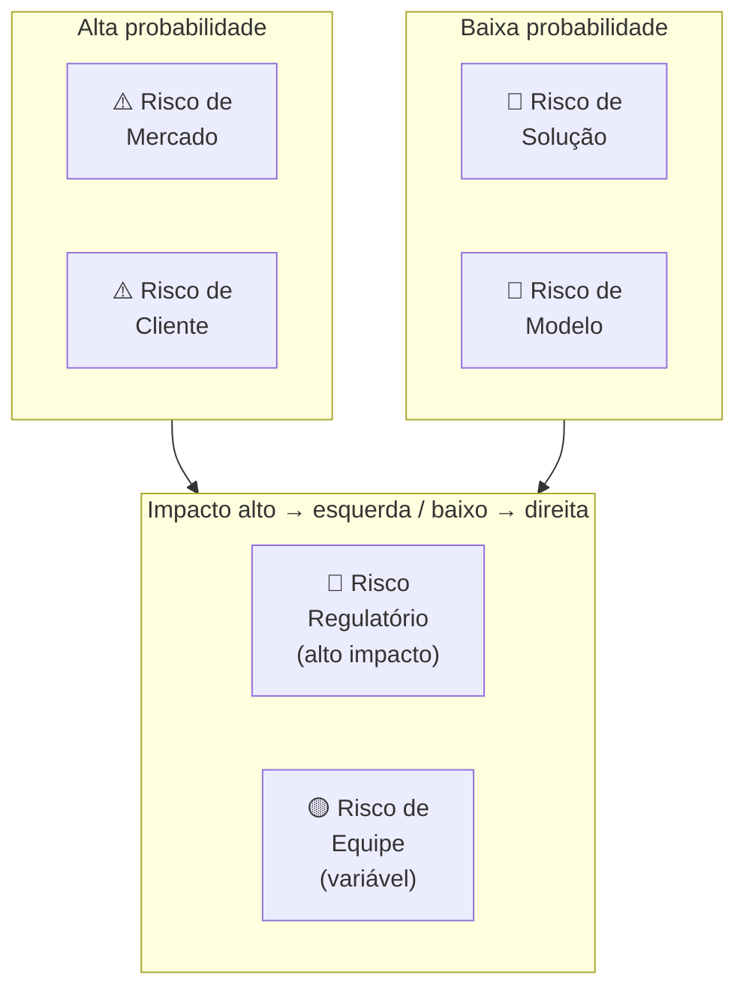

Para cada risco identificado, o canvas registra: **descrição específica**, **probabilidade** (1-5), **impacto** (1-5), **score** (prob × impacto), **mitigação planejada** e **owner** (quem cuida desse risco).

#### Quando usar

Use o Risk Canvas na Fase 11 (modelo de negócio) como check-up antes de comprometer recursos significativos — equipe maior, captação, expansão de canal. Use também antes de cada rodada de captação: investidores farão due diligence em risco; o Risk Canvas mostra que o time já fez o trabalho. Em Fase 15 (reinvenção), refaça o Risk Canvas para a segunda curva — os riscos de uma empresa em escala são diferentes dos de uma startup early-stage.

#### Princípios

A tese central é que **risco não gerenciado não desaparece — cresce silenciosamente**. Times de startup tendem a gerenciar risco de forma reativa (quando o risco se materializa, correm para mitigar) em vez de proativa (antes de se materializar, reduzirem a probabilidade ou o impacto). O Risk Canvas faz o risco visível e priorizado antes da crise. A segunda tese é que **riscos têm donos** — risco sem owner é risco sem mitigação. O canvas força nomear quem é responsável por acompanhar e mitigar cada risco crítico.

#### Como aplicar

Sessão de 2-3 horas com o time fundador completo. **Sequência:**

1. **Brainstorm livre de riscos** (30 min, todos contribuem, sem julgamento) — liste todos os "e se..." que tiram o sono. Foco em completude, não em priorização.
2. **Categorize** — atribua cada risco a uma das seis categorias.
3. **Pontue** — para cada risco, atribua Probabilidade (1-5) e Impacto (1-5). Score = Prob × Impacto. Riscos com score ≥ 15 são críticos.
4. **Priorize os top 5** — concentre energia de mitigação nos 5 com maior score.
5. **Defina mitigação** — para cada top 5: o que podemos fazer para reduzir a probabilidade? O que podemos fazer para reduzir o impacto se ocorrer? Qual experimento ou ação testa isso?
6. **Atribua owners** — cada risco crítico tem uma pessoa responsável por monitorar e executar a mitigação.
7. **Defina revisão** — quando este canvas é revisado? Mínimo trimestral.

#### Exemplo brasileiro preenchido — Méliuz, expansão para cartão de crédito (2020)

A Méliuz (cashback e cupons, listada na B3 em 2020) decidiu expandir para cartão de crédito próprio com Banco Inter. O Risk Canvas antes da decisão:

| Risco | Categoria | Prob | Impacto | Score | Mitigação | Owner |
|---|---|---|---|---|---|---|
| Regulação BACEN exige capital mínimo e demora aprovação | Regulatório | 4 | 5 | 20 | Parceria com banco já licenciado (Inter) ao invés de licença própria | CFO + Jurídico |
| ICP de cashback (comprador online) não usa cartão físico | Cliente | 3 | 4 | 12 | Teste A/B: oferecer cartão para cohort de usuários ativos antes do lançamento geral | CPO |
| CAC do cartão é 5-8x maior que CAC de cashback digital | Modelo | 3 | 5 | 15 | Distribuição cruzada: oferecer cartão apenas para base existente (CAC ≈ 0) nos primeiros 12 meses | CMO |
| Churn de usuários sem limite aprovado mancha a marca | Solução | 2 | 4 | 8 | Política de crédito conservadora nos primeiros 6 meses; comunicação proativa de critérios | COO |
| Time de produto dividido entre dois produtos simultâneos | Equipe | 3 | 3 | 9 | Squad dedicado ao cartão, separado do squad cashback; CPO de cartão contratado externamente | CEO |
| Banco Inter muda condições da parceria | Mercado | 2 | 5 | 10 | Cláusula de exclusividade de 24 meses + direito de first refusal em extensão | CEO + Jurídico |

**Diagnóstico.** Os dois riscos críticos (score ≥ 15): Regulatório (20) e Modelo (15). A mitigação do regulatório foi estrutural — ao invés de licença própria, parceria com banco já licenciado transferiu o risco regulatório para o parceiro especializado. A mitigação do modelo foi comportamental — distribuição exclusivamente para a base existente nos primeiros 12 meses eliminava o CAC de aquisição nova, tornando o unit economics do cartão viável antes de escalar.

**Insight do caso.** O Risk Canvas revelou que o risco mais intuitivo do time (risco de equipe — dividir atenção entre dois produtos) tinha score 9 — alto, mas não o mais crítico. O risco menos óbvio (modelo — CAC 5-8x maior) tinha score 15. Sem o canvas, o time provavelmente teria investido mais energia no risco que estava vendo (equipe) e menos no que não estava calculando explicitamente (CAC do cartão vs. da base digital). **A lição: a função mais importante do Risk Canvas é revelar os riscos que o time não está falando — não documentar os que já estão na cabeça de todos.**

#### Variações e extensões

- **Pre-Mortem** (Gary Klein): exercício complementar — imagem o produto falhou daqui a 12 meses. Por quê? Liste as razões. As razões mais citadas viram inputs do Risk Canvas.
- **Risk Register** (PMI): versão mais formal e detalhada, com campos adicionais (data de identificação, histórico de revisão, plano de contingência). Para projetos maiores ou empresas em expansão.
- **Scenario Planning Canvas**: variação que mapeia três cenários futuros (otimista, base, pessimista) e os riscos específicos de cada um.

#### Erros comuns

- Fazer Risk Canvas só uma vez (no início) e nunca revisar — riscos evoluem; canvas anual é ficcional.
- Risco sem owner — ninguém cuida, risco materializa, time é pego de surpresa.
- Listar riscos genéricos ("risco de mercado") sem especificidade ("nosso ICP não tem budget Q4 por conta do ciclo orçamentário de empresas de capital aberto") — genérico não gera mitigação.
- Focar só em riscos técnicos — times de engenharia subestimam sistematicamente riscos regulatórios, de equipe e de modelo.
- Confundir mitigação com "ter um plano B" — mitigação é ação que reduz probabilidade ou impacto antes da crise; plano B é resposta depois que a crise aconteceu.

#### Quando NÃO usar

Em decisões pequenas e reversíveis (ajuste de preço, mudança de canal) — overhead do canvas não compensa. Em times muito jovens (<3 meses de operação) sem dados suficientes para estimar probabilidade e impacto — nessa fase, a varredura qualitativa de risco (pre-mortem verbal) é mais ágil que o canvas formal.

#### Conexão com outros canvases

O Risk Canvas **complementa o Lean Canvas (CZ.2)**: cada bloco do Lean Canvas gera riscos específicos — "Problema" → risco de mercado, "Solução" → risco de solução, "Canais" → risco de cliente, "Fontes de Receita" → risco de modelo. **Pareia com o Test Card (CZ.9)**: cada risco crítico do canvas pode gerar um Test Card — o experimento que vai testar se o risco é real e qual a magnitude. **Antecede rodadas de captação** (Apêndice V): investidores farão perguntas exatamente sobre os riscos do canvas; chegar à reunião com o canvas preenchido demonstra maturidade de gestão.

#### Leitura adicional

- *PMBOK Guide* (Project Management Institute, 6ª ed. 2017) — padrão de gestão de projetos que formalizou o Risk Register como artefato de projeto.
- *Thinking in Bets* (Annie Duke, 2018) — framework de decisão sob incerteza que complementa o Risk Canvas.
- *Pre-Mortems: A Simple Technique to Save Any Project from Failure* (Gary Klein, HBR, 2007) — artigo seminal sobre pre-mortem como prática.

---

### CZ.8 — Team Canvas (Alex Ivanov, 2015)

#### Origem

Alex Ivanov, designer e facilitador russo, publicou o Team Canvas em 2015 como resposta a um problema recorrente em workshops de times: grupos saíam de reuniões de alinhamento com a sensação de que "conversamos muito, mas não sabemos exatamente o que foi decidido nem quem é responsável por quê". O Team Canvas é inspirado no Business Model Canvas de Osterwalder mas voltado para dentro — não para o modelo de negócio, mas para o modelo do time. Parte da premissa de que um time é uma organização em miniatura: tem propósito, papéis, recursos (as pessoas), canais de comunicação, e estrutura de valor (o que cada membro dá e recebe). Sem tornar esse modelo explícito, o time opera com pressupostos implícitos que geram conflito, retrabalho e desengajamento. O Team Canvas tornou o exercício de alinhamento de time replicável em 60-90 minutos.

#### O que é

Tela visual de uma página com **nove blocos** organizados em torno do time como unidade central:

- **People & Roles**: quem são as pessoas, qual papel cada uma exerce no time (não o cargo formal — o papel funcional real).
- **Common Goals**: quais são os objetivos compartilhados do time para o próximo período. Distingue de objetivos individuais.
- **Personal Goals**: o que cada membro quer pessoalmente ganhar com esse trabalho (desenvolvimento, visibilidade, dinheiro, aprendizado). Frequentemente não dito.
- **Purpose**: por que esse time existe? Qual é o propósito que vai além das metas operacionais?
- **Values**: quais são os valores que o time quer viver — não os valores corporativos genéricos, mas os que esse time específico prioriza no trabalho conjunto.
- **Strengths & Assets**: o que o time tem de melhor — habilidades, experiências, redes, recursos.
- **Weaknesses & Risks**: onde o time é fraco ou onde existe risco de conflito.
- **Needs & Expectations**: o que cada membro precisa dos outros para trabalhar bem. Acordos explícitos.
- **Rules & Activities**: como o time trabalha — rituais, cadências, normas de comunicação, processos de decisão.

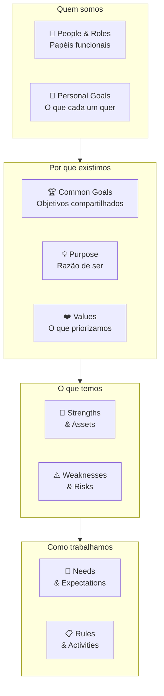

#### Quando usar

Use o Team Canvas na Fase 14 (escala e time) como artefato de onboarding de novos squads ou ao montar equipe de liderança expandida. Use também em momentos de ruptura: entrada de cofundador ou C-level novo, fusão de times após aquisição, reorganização de squads. Em times de 3-8 pessoas, o canvas pode ser preenchido em sessão única de 90 minutos. Em times maiores, faça por squad e depois alinhe os Common Goals e Values entre squads.

#### Princípios

A tese de Ivanov é que **conflito de time frequentemente não é conflito de personalidade — é conflito de pressupostos não declarados**. Dois co-fundadores que não conversaram sobre Personal Goals assumem que o outro quer a mesma coisa (crescimento acelerado vs. lifestyle company; vender em 5 anos vs. construir por 20). Dois engenheiros que não conversaram sobre Needs & Expectations têm expectativas diferentes sobre code review, autonomia, e prazo. O Team Canvas torna esses pressupostos visíveis antes de se tornarem conflito. **A sessão de preenchimento é mais valiosa que o artefato preenchido** — o que emerge na conversa é o trabalho, não o documento final.

#### Como aplicar

Sessão presencial ou remota (Miro, Mural, FigJam). Facilitador (pode ser o próprio fundador, mas facilita melhor quem não está no canvas). 60-90 minutos para times pequenos (3-6 pessoas); 120-150 minutos para times maiores (6-12).

1. **People & Roles** (10 min) — cada pessoa escreve seu nome e o papel funcional real (não o cargo): "sou quem toma decisão técnica final" / "sou quem mantém relação com os clientes âncora".
2. **Personal Goals** (15 min) — individualmente primeiro, depois compartilha. O que cada pessoa quer ganhar pessoalmente com esse trabalho nos próximos 12 meses? Dinheiro? Aprendizado? Visibilidade? Espaço para criar? Sem julgamento.
3. **Common Goals** (15 min) — o que o time quer alcançar *junto*? 3-5 objetivos específicos para o próximo semestre. Discutir até consenso real.
4. **Purpose** (10 min) — por que esse time existe além das metas? Qual seria a perda para o mundo se esse time parasse de existir?
5. **Values** (10 min) — quais 3-5 valores o time quer praticar no trabalho conjunto? Votar, depois discutir os que geraram divergência.
6. **Strengths & Assets / Weaknesses & Risks** (15 min) — o que o time tem de excelente e onde é vulnerável. Honestidade é o requisito — equipe que só lista forças não faz o exercício.
7. **Needs & Expectations** (10 min) — o que cada pessoa precisa dos outros para trabalhar bem. "Preciso de feedback direto, sem rodeios." "Preciso de autonomia sobre decisões de design." Acordos explícitos.
8. **Rules & Activities** (10 min) — rituais, cadências, normas. Stand-up diário ou não? Code review obrigatório ou não? Decisão por consenso ou por voto?

Após a sessão: registrar o canvas, colocar visível, revisitar em 3-6 meses.

#### Exemplo brasileiro preenchido — Loggi, formação do squad de expansão nacional (2019)

Quando a Loggi decidiu expandir de São Paulo para 15 cidades em 12 meses (2019), formou um squad de expansão composto por pessoas de produto, operações, dados e comercial que nunca tinham trabalhado juntas. O Team Canvas da sessão inicial:

| Bloco | Conteúdo |
|---|---|
| **People & Roles** | PM (decisão de produto e priorização), líder de operações (viabilidade logística e parcerias locais), data analyst (modelo de precificação e projeção de demanda), comercial B2B (clientes-âncora em cada cidade), engenheiro de backend (adaptações de sistema por região). |
| **Personal Goals** | PM: "quero aprender como se escala operação física, não só digital." Ops: "quero provar que consigo gestão multi-regional." Data: "quero usar modelos preditivos em decisão real, não só relatório." Comercial: "quero virar head de vendas regionais." Engenheiro: "quero ter mais influência na arquitetura." |
| **Common Goals** | (1) 15 cidades ativas em 12 meses. (2) NPS de entregadores ≥ 45 em todas as cidades ao fim do mês 3. (3) CAC de lojista ≤ R$ 800 nos novos mercados. (4) Tempo de onboarding de cidade ≤ 6 semanas. |
| **Purpose** | "Tornar entrega rápida acessível para qualquer lojista no Brasil, não só em SP." |
| **Values** | (1) Velocidade sobre perfeição. (2) Dados antes de opinião. (3) Transparência sobre problemas cedo — sem surpresas tardias. (4) Respeito pela operação local — cada cidade tem suas particularidades. |
| **Strengths & Assets** | Produto já validado em SP com >18 meses de dados. Marca forte entre entregadores paulistanos. Time com histórico de execução em ambiente caótico. |
| **Weaknesses & Risks** | Ninguém do squad conhece os mercados-alvo (Recife, BH, Porto Alegre). Risco de replicar o modelo SP sem adaptar. Tensão potencial entre velocidade de expansão (PM + comercial) e qualidade operacional (ops + engenheiro). |
| **Needs & Expectations** | PM precisa de dados do ops *antes* de priorizar features. Ops precisa de 2 semanas de lead time para qualquer mudança de processo. Data precisa de acesso a dados brutos, sem camadas de abstração. Comercial precisa de suporte de produto para reuniões com clientes grandes. Engenheiro precisa de critério claro de "done" antes de começar cada sprint. |
| **Rules & Activities** | Weekly de 45 min às segundas (sem slides — só dados + decisões). Slack para comunicação assíncrona (resposta em até 4h em horário comercial). Decisão técnica: engenheiro tem veto. Decisão de produto/prioridade: PM tem última palavra. Decisão de operação: ops tem última palavra. Conflicts escalados para o trio PM + ops + comercial em 24h. |

**Insight do caso.** O bloco que gerou mais conversa foi **Personal Goals** — especialmente o engenheiro que queria "mais influência na arquitetura" e o PM que assumia que o engenheiro estava "só para implementar". Sem o Team Canvas, essa tensão teria emergido na primeira divergência de sprint. Com o canvas, o time chegou a um acordo explícito: o engenheiro entra na reunião de priorização com voto consultivo sobre viabilidade técnica, e o PM explica as decisões de "não agora" com contexto de negócio. **A lição: o conflito mais destrutivo em times de startup é o conflito sobre quem decide o quê. Team Canvas não resolve o conflito — antecipa a conversa e torna o acordo explícito antes que o conflito aconteça.**

#### Variações e extensões

- **Team Canvas Basic**: versão simplificada com apenas 5 blocos (Goals, Roles, Values, Needs, Rules) — para times muito pequenos (2-3 pessoas) ou sessões rápidas de 45 minutos.
- **Squad Health Check** (Spotify): complemento do Team Canvas — avalia periodicamente a saúde do time em dimensões como Ownership, Speed, Fun, Learning. Útil para revisão trimestral.
- **Working Agreements Canvas**: foco exclusivo em normas de trabalho — versão mais operacional que o Team Canvas completo.

#### Erros comuns

- Fazer o Team Canvas sem o bloco Personal Goals — é exatamente onde estão os pressupostos não declarados mais perigosos.
- Facilitador que também está no canvas — difícil ser objetivo; terceiro facilita melhor.
- Canvas como check-box burocrático (preencher por obrigação, nunca revisitar) — valor está na sessão e na revisão periódica, não no documento.
- Confundir Values com slogan corporativo — "inovação", "integridade", "excelência" são valores genéricos que não guiam decisão real. "Velocidade sobre perfeição" ou "dados antes de opinião" são valores acionáveis.
- Tratar o canvas como imutável — times mudam; refaça a cada 6 meses ou quando a composição muda significativamente.

#### Quando NÃO usar

Em times de 1-2 pessoas (overhead não compensa). Em contextos onde há hierarquia rígida que impede honestidade nos blocos Personal Goals e Weaknesses (o canvas produz respostas performáticas, não reais). Em squads temporários de projeto com vida útil <3 meses — overhead de sessão pode não compensar.

#### Conexão com outros canvases

O Team Canvas **complementa o BMC (CZ.1)** e o **Lean Canvas (CZ.2)**: estes descrevem o modelo externo (o negócio); o Team Canvas descreve o modelo interno (o time que vai executar). **Orienta o Risk Canvas (CZ.13)** no bloco "Risco de equipe" — o Team Canvas é o diagnóstico; o Risk Canvas é a priorização e mitigação. **Precede o Storytelling Canvas (CZ.12)** em narrativas de expansão: time alinhado produz narrativa coerente; time desalinhado produz narrativa contraditória.

#### Leitura adicional

- [teamcanvas.com](https://www.teamcanvas.com) — Alex Ivanov mantém o site com templates e estudos de caso.
- *The Five Dysfunctions of a Team* (Patrick Lencioni, 2002) — modelo de saúde de time que se integra ao Team Canvas.
- *An Elegant Puzzle* (Will Larson, 2019) — engineering management com foco em time e alinhamento, relevante para squads técnicos.

---

### CZ.14 — Hypothesis Canvas (autoral IGNIÇÃO)

#### Origem

O Hypothesis Canvas documentado neste livro é uma ferramenta autoral desenvolvida especificamente para o contexto de founder brasileiro operando com recursos limitados e necessidade de ciclos curtos de aprendizado. Parte da tradição do Lean Startup (Eric Ries, 2011) e da metodologia de hipóteses científicas aplicada a negócio (Karl Popper via Steve Blank), mas incorpora duas inovações práticas ausentes nos templates estrangeiros: (1) a ligação explícita entre cada hipótese e a **árvore de teoria** do negócio (Fase 2B) — forçando o fundador a articular *qual premissa causal da teoria* está sendo testada; (2) o bloco de **due diligence da amostra** antes da comparação com o threshold — evitando o erro de aceitar resultado de amostra inadequada como evidência válida. O template completo preenchível está no [[#APÊNDICE A — TEMPLATES PRONTOS PARA USO|Apêndice A (A.10)]].

#### O que é

Artefato de uma página — estruturado como tabela de quatro quadrantes — que captura os oito elementos de uma hipótese rigorosamente testável:

- **Teoria**: qual parte da árvore de teoria (Fase 2B) esta hipótese testa? Qual é o atributo ou seta causal em jogo?
- **Hipótese**: afirmação falsificável em uma frase — quantitativa sempre que possível.
- **Evidência**: como a evidência será coletada? Método, público-alvo, tamanho de amostra, duração, custo.
- **Medidas**: o que especificamente será contado? Qual é a fórmula da métrica? Quais medidas alternativas foram descartadas?
- **Threshold (pré-definido)**: qual resultado mínimo considera a hipótese suportada? Qual resultado a considera refutada? Qual é a zona inconclusiva entre os dois?
- **Due diligence da amostra**: antes de comparar resultado com threshold, a amostra é adequada? Representa o ICP? Há vieses identificados?
- **Avaliação**: resultado observado vs. threshold ajustado — Suportada / Refutada / Inconclusiva?
- **Decisão**: Perseverar / Pivotar / Mais dados / Abandonar + próxima ação concreta + impacto na árvore de teoria.

A sequência de preenchimento é deliberada: blocos superiores e médios **antes** de coletar dados; blocos inferiores **após** — respeitando a barreira anti-viés de confirmação.

#### Quando usar

Use o Hypothesis Canvas na Fase 6 (formulação de hipóteses) como artefato central — um canvas por hipótese bet-the-company. Use também em discovery contínuo pós-PMF: qualquer feature ou mudança de modelo que envolva uma crença não testada merece um canvas. Em times que fazem Test Cards (CZ.9), o Hypothesis Canvas é o nível acima: o Test Card registra um experimento; o Hypothesis Canvas registra a hipótese que o experimento testa, com contexto teórico e decisão final.

#### Princípios

Três princípios fundamentam o design do canvas:

**Primeiro: hipótese sem conexão teórica é ruído.** O bloco "Teoria" força o fundador a articular qual pressuposto da teoria do negócio está em jogo. Hipótese validada que não conecta à teoria pode ser irrelevante; hipótese refutada que conecta a um nó crítico da teoria pode matar o modelo inteiro — a diferença importa.

**Segundo: threshold pré-definido evita auto-engano.** Definir critério de sucesso e refutação antes de ver dados é o único mecanismo eficaz contra viés de confirmação. Times que definem threshold após o resultado invariavelmente o ajustam para validar o que já queriam. O bloco de due diligence da amostra acrescenta um segundo filtro: mesmo que o resultado supere o threshold, se a amostra era inadequada, o resultado não é evidência.

**Terceiro: decisão conecta de volta à teoria.** O bloco "Decisão" exige que o fundador articule o impacto na árvore de teoria — não só "vamos continuar" mas "este resultado fortalece/invalida qual nó ou seta da nossa teoria causal do negócio". Sem isso, aprendizados se acumulam sem atualizar a teoria, e a teoria fica desatualizada em relação à evidência coletada.

#### Como aplicar

Para cada hipótese bet-the-company da Fase 6, abra um canvas. Tempo de preenchimento inicial: 30-45 minutos (a parte antes de coletar dados). Conclusão: após coleta e análise.

Use o template completo do [[#APÊNDICE A — TEMPLATES PRONTOS PARA USO|Apêndice A (A.10)]] para o preenchimento. A estrutura do canvas orienta a sequência — não pule blocos, não preencha de baixo para cima.

**Sequência obrigatória:**

1. **Teoria**: abra a árvore de teoria da Fase 2B. Qual atributo ou seta esta hipótese testa? Importância (1-5). É bet-the-company?
2. **Hipótese**: escreva como afirmação falsificável. "X% de [persona Y] fará [ação Z] em [contexto W]."
3. **Evidência**: escolha o método. Entrevista, questionário, landing page, pré-venda, concierge, A/B, fake door, etc. Tamanho de amostra, duração, custo.
4. **Medidas**: o que conta? Qual é a fórmula exata? Quais alternativas foram descartadas?
5. **Threshold**: defina sucesso, refutação e zona inconclusiva. Justifique os números. Assine e date.
6. **[Coleta de dados]**
7. **Due diligence da amostra**: tamanho efetivo coletado. Adequado? Representa o ICP? Vieses.
8. **Ajuste do threshold**: se necessário, documente a razão.
9. **Avaliação** e **Decisão**.

#### Exemplo brasileiro preenchido — startup de gestão de frota para transportadoras médias (2023)

Uma startup B2B de gestão de frota estava testando a hipótese de que transportadoras de 20-50 caminhões em SP pagariam R$ 180/veículo/mês por rastreamento + relatórios de eficiência integrados.

| Bloco | Conteúdo |
|---|---|
| **Teoria** | Atributo A3 da árvore: "cliente paga pelo relatório de eficiência, não só pelo rastreamento". Seta causal: relatório de eficiência → redução de custo de combustível → disposição a pagar premium. Importância: 5. Bet-the-company: sim (preço de R$ 180 vs. concorrente a R$ 90 depende desta hipótese). |
| **Hipótese** | Transportadoras de 20-50 caminhões em SP com gerente de frota dedicado pagarão R$ 180/veículo/mês por rastreamento + relatório de eficiência mensal, se o relatório mostrar redução ≥5% de consumo de combustível. |
| **Evidência** | 8 pré-vendas reais (contrato de 3 meses, reembolso se insatisfeito) via cold outreach para lista de 40 transportadoras identificadas em LinkedIn + associações de classe. |
| **Medidas** | Número de contratos assinados a R$ 180. Threshold: ≥4/8 (50%) = suportada. ≤1/8 (12,5%) = refutada. Entre 2-3 = inconclusivo. |
| **Threshold** | Sucesso: ≥4 contratos em 30 dias. Refutação: ≤1 contrato. Zona inconclusiva: 2-3 contratos (exige entrevistas adicionais para entender objeções). |
| **Due diligence** | 8 empresas abordadas, 6 tiveram reunião (2 declinaram). Das 6: 3 assinaram a R$ 180, 1 pediu R$ 120, 2 declinaram. Amostra de 8 é pequena mas representa o ICP (todas têm 20-50 caminhões, SP, gerente de frota). Viés possível: acesso via rede pessoal pode ter selecionado empresas mais abertas a inovação. |
| **Avaliação** | 3/6 reuniões = 50% de conversão das reuniões. Vs. threshold original (4/8 total): inconclusivo. Ajuste de threshold: com 6 reuniões em vez de 8, o critério proporcional seria ≥3 — resultado beira o limiar de sucesso. |
| **Decisão** | Mais dados. Ação: expandir para 20 novas abordagens antes de concluir. A 1 que pediu R$ 120 sinaliza que o relatório de eficiência não está bem justificado em termos de ROI — refinar a apresentação do relatório antes das próximas abordagens. Impacto na teoria: hipótese parcialmente suportada, mas seta causal "relatório → disposição a pagar premium" precisa ser reforçada com cálculo de ROI explícito na proposta. |

**Insight do caso.** O bloco de due diligence revelou que a amostra era pequena (6 reuniões, não 8 planejadas), e o resultado ficou na zona cinza. Sem o canvas, o time poderia ter concluído "50% de conversão — excelente, vamos escalar". Com o canvas, ficou claro que 3 contratos numa amostra de 6 é inconclusivo, e a ação certa era ampliar — não comemorar. **A lição: threshold sem due diligence da amostra é falsa precisão. O número de contratos importa, mas a qualidade da amostra que gerou esses contratos importa igualmente.**

#### Variações e extensões

- **Hypothesis Canvas Rápido**: versão de 4 blocos (Hipótese + Método + Threshold + Decisão) para hipóteses de menor risco onde o rigor completo é overhead excessivo.
- **Portfolio de Hipóteses**: planilha com todos os canvas abertos em paralelo, ranqueados por Importância e status (Pendente / Em teste / Suportada / Refutada). Útil para o "banco de hipóteses" da Fase 6.

#### Quando NÃO usar

Em decisões operacionais rotineiras que não testam premissa nova (ajuste de preço incremental, mudança de copy). Em hipóteses onde a coleta de evidência levaria mais de 90 dias — nesse horizonte, outros aspectos do negócio já terão mudado; redesenhe o experimento para ser mais rápido ou use o canvas como hipótese de longo prazo com checkpoint intermediário.

#### Conexão com outros canvases

O Hypothesis Canvas **sucede a Theory Map (CZ.16)**: cada nó ou seta da árvore teórica gera hipóteses a testar. **Pareia com o Test Card (CZ.9)**: o Hypothesis Canvas define a hipótese e o contexto teórico; o Test Card define o experimento específico. **Alimenta o Lean Canvas (CZ.2)**: hipóteses validadas atualizam os blocos do Lean Canvas com dado real. **Alimenta o Risk Canvas (CZ.13)**: hipóteses refutadas são, frequentemente, a materialização de riscos previamente identificados.

#### Leitura adicional

- Template completo preenchível: [[#APÊNDICE A — TEMPLATES PRONTOS PARA USO|Apêndice A, A.10]].
- *The Lean Startup* (Eric Ries, 2011) — fundação filosófica.
- *Thinking, Fast and Slow* (Daniel Kahneman, 2011) — viés de confirmação e por que threshold pré-definido importa.

---

### CZ.15 — Canvas da Cunha (autoral IGNIÇÃO)

#### Origem

O Canvas da Cunha é ferramenta autoral desenvolvida para o contexto específico de startups B2B brasileiras que precisam escolher um segmento de entrada estreito antes de escalar. O conceito de "cunha" (wedge) vem da escola de go-to-market de Peter Thiel (*Zero to One*, 2014) — a ideia de que toda startup dominante começou controlando um nicho pequeno e específico antes de expandir. O canvas operacionaliza essa estratégia: força o fundador a articular com precisão cirúrgica *quem* é o cliente do segmento de entrada, *qual* dor específica está sendo resolvida, e *como* o resultado é mensurável. O "Teste do Grupo de WhatsApp" — você consegue listar nominalmente 100-300 pessoas específicas como potenciais primeiros clientes? — é o teste de falsificabilidade da cunha: cunha bem definida passa no teste; cunha vaga não passa. O template completo preenchível está no [[#APÊNDICE A — TEMPLATES PRONTOS PARA USO|Apêndice A (A.12)]].

#### O que é

Tela visual de uma página com **seis blocos** que definem a anatomia completa da cunha de entrada:

- **ICP (Ideal Customer Profile) preciso**: descrição em 2-3 linhas do cliente específico — não "PMEs", mas "donos de padaria artesanal com 1-3 unidades em SP com delivery próprio".
- **Dor específica**: um fluxo de trabalho específico que está quebrado ou ineficiente para esse ICP. Não "dificuldade em gestão", mas "gasta 3 horas por semana consolidando pedidos de delivery de três canais diferentes manualmente".
- **Resultado mensurável**: como o cliente sabe que a solução funcionou? Escolha 1-2 categorias: receita gerada, custo reduzido, risco eliminado, tempo economizado. Com número: "reduz de 3h para 15min/semana".
- **Dono do orçamento**: cargo e nível hierárquico de quem assina o cheque — não quem usa o produto.
- **Teste do Grupo de WhatsApp**: você consegue listar nominalmente 100-300 potenciais primeiros clientes? Se sim, a cunha está bem definida. Se não, é muito larga — refine.
- **Alternativa atual e vantagem**: o que o cliente faz hoje para resolver esse problema? Por que você é melhor, em uma frase com número?

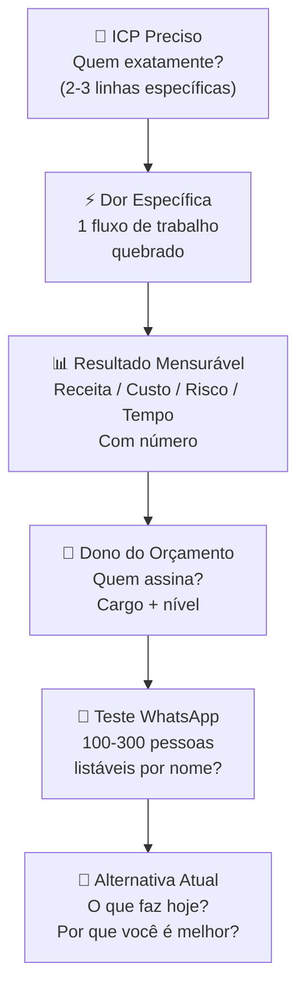

#### Quando usar

Use o Canvas da Cunha na Fase 5 (mapeamento de mercado) como entregável final antes de avançar para a Fase 6. É o artefato de saída da fase — sem ele preenchido e aprovado nos três testes complementares (Teste de Precisão do Comprador, ausência de escopo instável, independência de plataforma), a Fase 5 não está concluída. Use também em momentos de pivô (Fase 15): a segunda curva frequentemente exige redefinir a cunha, começando o ciclo de entrada de mercado novamente com o ativo da marca existente.

#### Princípios

Três princípios fundamentam o canvas:

**Primeiro: especificidade é vantagem competitiva, não limitação.** O instinto do fundador é ampliar o ICP ("não quero excluir potenciais clientes"). O canvas vai na direção oposta: quanto mais estreito o ICP, mais forte a proposta de valor, mais rápido o feedback de mercado, mais fácil a venda. Você não está excluindo clientes — está escolhendo *por onde entrar*. Escala vem depois.

**Segundo: a cunha é definida pela dor, não pelo produto.** O erro mais comum é definir a cunha pelo que o produto faz ("somos um ERP para PMEs"). A cunha correta é definida pelo problema específico que está sendo resolvido para um cliente específico ("somos a ferramenta que resolve o problema de recoletada manual de dados para escritórios contábeis com 50-100 clientes PME"). O produto pode evoluir; a dor específica é o núcleo.

**Terceiro: o Teste do WhatsApp é o critério de verdade.** Qualquer fundador pode escrever "donos de PME com dificuldade em gestão" como ICP. Muito poucos conseguem listar 200 nomes específicos de pessoas que atendem a esse critério. O teste força a realidade — se você não consegue nominar 100 pessoas, seu ICP não está definido o suficiente para ser uma cunha viável.

#### Como aplicar

Preencha individualmente primeiro (20-30 min) e depois valide com pelo menos um cofundador ou mentor externo (30 min). Use o template completo do [[#APÊNDICE A — TEMPLATES PRONTOS PARA USO|Apêndice A (A.12)]].

**Sequência:**

1. **ICP**: descreva quem é o cliente em 2-3 linhas. Inclua: setor, porte, localização, critério operacional (tem delivery próprio, tem gerente de frota, tem mais de X clientes, etc.). Não use adjetivos vagos ("médias empresas") — use critérios objetivos.
2. **Dor específica**: escolha um fluxo de trabalho. Descreva o que está quebrado com verbos concretos ("gasta", "consolida manualmente", "perde"). Se você precisar de 3 frases, o ICP ainda é largo demais.
3. **Resultado mensurável**: escolha 1-2 categorias. Coloque um número. Se não tem o número, pergunte a 5 potenciais clientes antes de preencher o bloco.
4. **Dono do orçamento**: não é necessariamente quem usa o produto. Em B2B, frequentemente é um nível acima. Nomeie o cargo e o contexto hierárquico.
5. **Teste do WhatsApp**: tente listar. Se conseguir 100-300 nomes específicos (LinkedIn, associações, contatos do setor, indicações), a cunha está certa. Se não conseguir 50, está larga demais.
6. **Alternativa atual e vantagem**: descreva o que o cliente faz *hoje* (Excel, processo manual, concorrente, "não faz nada"). Escreva a vantagem em uma frase com número. Sem número, não é comparação — é afirmação vaga.

Após preencher, aplique os três testes complementares do template A.12 antes de avançar.

#### Exemplo brasileiro preenchido — PadariaPro (caso recorrente do livro)

| Bloco | Conteúdo |
|---|---|
| **ICP** | Donos ou donas operacionais de padarias artesanais com 1-3 unidades físicas em São Paulo (capital + ABC), com delivery próprio via WhatsApp ou iFood, faturamento R$ 80-400k/mês, há pelo menos 2 anos no mercado. Excluir: padarias industriais, franquias, padarias sem delivery próprio. |
| **Dor específica** | Consolida pedidos de delivery de 2-3 canais (WhatsApp, iFood, site próprio) manualmente — copia pedido do WhatsApp para planilha, confere com iFood, passa para a produção. Processo leva 2-3 horas/dia, gera erros de pedido e atrasos que resultam em avaliações negativas. |
| **Resultado mensurável** | Reduz consolidação de pedidos de 2-3h/dia para 15 min/dia (tempo). Reduz erro de pedido de ~8% para <1% (qualidade → preservação de avaliação). |
| **Dono do orçamento** | O próprio dono ou sócia operacional — em padarias dessa faixa, não há gestor intermediário; quem sofre o problema é quem paga. |
| **Teste do WhatsApp** | Fundadores conseguiram listar 180 padarias específicas em SP via Instagram (buscando perfis de padaria artesanal com >500 seguidores) + associação de panificadores de SP + grupos de WhatsApp de donos de padaria. Cunha aprovada. |
| **Alternativa atual** | Planilha Excel + cópia manual de mensagens de WhatsApp. Por que melhor: "Reduz 2,5h/dia de trabalho manual e elimina 90% dos erros de pedido, por R$ 290/mês — equivale a menos de 20 minutos do custo de mão de obra do dono." |

**Insight do caso.** O bloco mais trabalhoso foi a **Dor específica** — a primeira versão dizia "dificuldade em gestão de delivery". Com esse enunciado, o Teste do WhatsApp seria impossível (como listar donos de padaria com "dificuldade em gestão"?). Ao refinar para "consolida pedidos de 2-3 canais manualmente 2-3h/dia", o teste ficou testável: o critério de inclusão na lista era "tem delivery via WhatsApp E pelo menos mais um canal". **A lição: o Teste do WhatsApp não é só um teste de tamanho do mercado — é um teste de especificidade da dor. Se você não consegue montar a lista, o critério de dor está vago demais para gerar uma proposta de valor precisa.**

#### Variações e extensões

- **Canvas da Cunha para B2C**: versão adaptada onde "Dono do orçamento" é substituído por "Contexto de decisão de compra" (impulso, pesquisa, influência social) — em B2C o comprador e o usuário são o mesmo.
- **Canvas da Segunda Cunha**: para empresas em escala que querem atacar um novo segmento com o produto existente — mesma estrutura mas com bloco adicional "Vantagem incumbente" (o que a empresa já tem que facilita a entrada neste segmento vs. novo entrante).

#### Quando NÃO usar

Em modelos de negócio B2C de massa com aquisição digital escalável desde o início (e-commerce com SAM > 1M pessoas) — a lógica de cunha estreita pode ser substituída por segmentação de produto/canal. Em startups de plataforma onde o valor é gerado pela rede desde o início — o Canvas da Cunha ajuda a definir o lado inicial da rede, mas o framework de marketplace dynamics (Apêndice AE) é mais adequado para a dinâmica de crescimento.

#### Conexão com outros canvases

O Canvas da Cunha **sucede o Empathy Map (CZ.6)** e o **Customer Journey (CZ.7)**: esses canvases revelam quem é o cliente e como vive o problema; o Canvas da Cunha define *qual segmento de cliente* é o ponto de entrada. **Antecede o Lean Canvas (CZ.2)**: a cunha bem definida preenche os blocos "Problema", "Segmento de Clientes" e "Canais" do Lean com precisão. **Conecta ao Strategy Canvas (CZ.4)**: a cunha é o ponto de entrada; o Strategy Canvas define a curva de valor distinta nesse nicho que impede imitação fácil.

#### Leitura adicional

- Template completo preenchível: [[#APÊNDICE A — TEMPLATES PRONTOS PARA USO|Apêndice A, A.12]].
- *Zero to One* (Peter Thiel & Blake Masters, 2014) — origem do conceito de "wedge".
- *Crossing the Chasm* (Geoffrey Moore, 1991) — estratégia de segmento de entrada para tecnologia B2B.

---

### CZ.16 — Theory Map / Story Tree (autoral IGNIÇÃO)

#### Origem

A Theory Map — também chamada de Story Tree no contexto de Fase 2B — é ferramenta autoral desenvolvida para este livro a partir da convergência de três tradições intelectuais: (1) o Directed Acyclic Graph (DAG) causal de Judea Pearl (*The Book of Why*, 2018), que formaliza relações causais em grafos direcionados; (2) o conceito de "theory of change" das ciências sociais e de impacto social (Teoria da Mudança), que mapeia a lógica causal entre intervenção e resultado; (3) a prática de Steve Blank e Bob Dorf de externalizar as "apostas" de um modelo de negócio antes de testar. A motivação foi observação prática: fundadores que chegam com Lean Canvas preenchido frequentemente não conseguem articular *por que* acreditam que cada bloco do canvas se sustenta. Theory Map força externalizar essa lógica causal implícita — tornando-a auditável, falsificável e revisável à medida que a evidência chega. O template completo preenchível está no [[#APÊNDICE A — TEMPLATES PRONTOS PARA USO|Apêndice A (A.9)]].

#### O que é

Grafo visual — árvore ou rede de nós conectados por setas causais — que representa a teoria do negócio: a cadeia de premissas que, se verdadeiras em conjunto, tornam o negócio viável. Cada **nó** é um atributo ou estado do mundo ("clientes pagam R$ 180/mês", "CAC < R$ 400", "retenção D30 > 60%"). Cada **seta** é uma afirmação causal ("porque X, então Y" — "porque a dor é aguda o suficiente, clientes pagarão mensalmente"). O grafo é **acíclico** — sem loops; se houver, é sinal de raciocínio circular.

Cada nó recebe três classificações:

- **Conhecimento (K1-K5)**: quão bem estabelecida é esta premissa? K1 = evidência robusta. K5 = pura suposição.
- **Importância (I1-I5)**: quanto o negócio depende desta premissa? I5 = bet-the-company.
- **Prioridade de teste (P = K × I)**: premissas com maior P devem ser testadas primeiro.

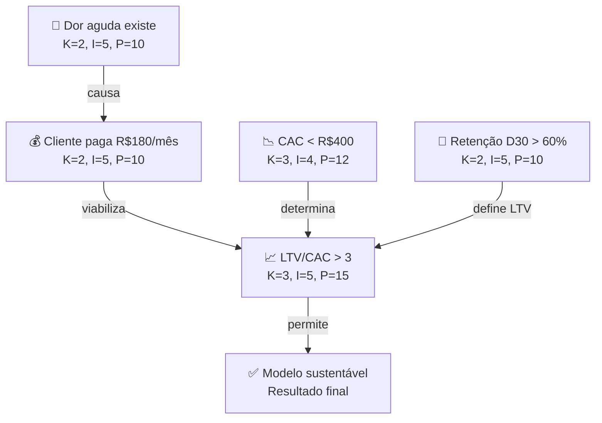

#### Quando usar

Use a Theory Map na Fase 2B (construção da teoria do negócio) como artefato central — antes de qualquer experimento ou desenvolvimento de produto. A árvore construída na Fase 2B é o mapa que orienta todas as fases seguintes: cada hipótese da Fase 6 testa um nó ou seta da árvore; cada experimento da Fase 7 coleta evidência sobre as premissas mais incertas e importantes. Revise a árvore após cada rodada de experimentos — evidência nova deve atualizar o grafo, não ser arquivada separadamente.

#### Princípios

Três princípios fundamentam o design:

**Primeiro: modelo de negócio é teoria causal, não conjunto de features.** Lean Canvas e BMC descrevem o modelo como conjunto de componentes (problema, solução, canais, receita). Theory Map descreve o modelo como rede de afirmações causais sobre o mundo. A diferença é crítica: um Canvas pode ser preenchido de forma internamente consistente sem que nenhuma das premissas seja verdadeira. Uma Theory Map que é internamente consistente mas tem nós K5 (pure assumption) é honesta sobre onde está o risco — e esses nós K5 com alta importância são exatamente o que os primeiros experimentos devem testar.

**Segundo: apostas implícitas são apostas não gerenciadas.** Todo fundador opera com uma teoria implícita do negócio — "acredito que X porque Y". A maioria nunca a externaliza. Theory Map força a externalização: cada bloco de Lean Canvas ou BMC vira um nó com premissas explícitas. O processo de construção frequentemente revela premissas que o fundador assumia serem fato mas são K4-K5 (pouca ou nenhuma evidência). Essas premissas descobertas durante a construção da árvore são as bet-the-company hypotheses a testar primeiro.

**Terceiro: árvore viva bate árvore estática.** Theory Map não é documento de planejamento — é modelo vivo que deve ser atualizado à medida que evidência chega. Cada experimento da Fase 7 muda o K (conhecimento) de algum nó. Cada atualização de K muda a P (prioridade de teste) de outros nós. Time que mantém a árvore atualizada tem uma vantagem: sabe em tempo real quais premissas críticas ainda não foram testadas e qual é o estado atual da teoria.

#### Como aplicar

Sessão de 2-3 horas com o time fundador (2-4 pessoas). Facilitador recomendado para a primeira versão. Use o template do [[#APÊNDICE A — TEMPLATES PRONTOS PARA USO|Apêndice A (A.9)]] para conectar a árvore ao BMC existente, ou construa a árvore diretamente se ainda não houver BMC.

**Sequência:**

1. **Resultado final**: escreva no topo da árvore o resultado que torna o negócio viável ("empresa sustentável com LTV/CAC > 3" ou "mercado de R$ 50M endereçável com participação de 5% em 5 anos"). Um só nó no topo.
2. **Premissas de primeiro nível**: o que precisa ser verdade para o resultado final acontecer? Geralmente 3-5 premissas de alto nível (clientes têm a dor, clientes pagam, CAC viável, retenção suficiente, canal escalável).
3. **Decomposição**: para cada premissa de primeiro nível, quais premissas de segundo nível são necessárias? Repita até chegar em premissas testáveis empiricamente.
4. **Classificação**: para cada nó, atribua K (1-5) e I (1-5). Calcule P = K × I. Nós com P > 12 são prioridade imediata de teste.
5. **Identificação de apostas bet-the-company**: nós com I = 5 e K ≥ 4 são as premissas mais importantes com menos evidência — essas são as hipóteses que os primeiros experimentos devem atacar.
6. **Conexão com o BMC/Lean Canvas**: use o template A.9 para verificar que cada bloco do Canvas tem ao menos um nó correspondente na árvore, e que cada nó da árvore tem ao menos um bloco correspondente no Canvas. Inconsistências revelam: (a) canvas com blocos sem justificativa teórica (remova ou construa a teoria); (b) teoria com premissas sem elemento no canvas (modelo incompleto).

#### Exemplo brasileiro preenchido — Creditas, árvore de teoria inicial (2012)

Quando Sergio Furio fundou a Creditas (então BankFacil) em 2012, a teoria central era: brasileiros com imóvel ou veículo pagam juros altíssimos em crédito pessoal porque os bancos tradicionais não usam o ativo como garantia. Um modelo de crédito com garantia poderia oferecer taxas menores e ter unidade economics superiores. A Theory Map inicial simplificada:

| Nó | Premissa | K | I | P | Status |
|---|---|---|---|---|---|
| A | Brasileiros com imóvel pagam >50% a.a. em crédito pessoal | 1 | 5 | 5 | Fato verificável — dados Banco Central |
| B | Regulação permite crédito com garantia de imóvel por fintech | 4 | 5 | 20 | Incerto — exige análise jurídica |
| C | Clientes aceitam usar imóvel como garantia para taxa menor | 4 | 5 | 20 | Hipótese comportamental — exige teste |
| D | CAC via digital < CAC de banco tradicional | 3 | 4 | 12 | Suposição — exige teste de canal |
| E | Inadimplência em crédito com garantia < 3% | 3 | 5 | 15 | Dados históricos internacionais como proxy |
| F | LTV/CAC > 4 com modelo de garantia | 4 | 5 | 20 | Depende de B, C, D, E — só verificável após validar os anteriores |
| G | Empresa sustentável | — | — | — | Resultado final |

**Apostas bet-the-company identificadas:** B (regulação — P=20, bloqueante se falso), C (comportamento do cliente — P=20), E (inadimplência — P=15, crítico para unit economics). Note: A tem P=5 pois é fato verificável — não precisa de experimento, só de pesquisa documental (dados Banco Central).

**Decisões decorrentes:** (1) contratar advogado especializado em regulação antes de qualquer produto — valida B; (2) 50 entrevistas com donos de imóvel em 30 dias — valida C; (3) análise de dados históricos de crédito com garantia no Brasil — reduz incerteza de E.

**Insight do caso.** O nó B (regulação) foi a descoberta mais valiosa do exercício: no ambiente regulatório de 2012, crédito com garantia de imóvel por instituição não-bancária tinha restrições que exigiram estrutura jurídica específica (parceria com banco). Sem a Theory Map, essa premissa teria emergido apenas meses depois, após produto construído. Com a árvore, foi identificada como aposta de alto risco antes de qualquer investimento técnico. **A lição: o valor da Theory Map está nas premissas que você não sabia que estava fazendo. A construção da árvore produz surpresas — cada surpresa é um risco que você não estava gerenciando.**

#### Variações e extensões

- **Story Tree narrativa**: versão mais linear da Theory Map usada para comunicação — conta a teoria como "se A então B, se B então C" em formato de história causal. Útil em pitch e comunicação interna.
- **Causal Loop Diagram**: versão avançada que permite loops (A causa B que causa A) — mais complexa, útil em análise de sistemas mas requer facilitação especializada.
- **Assumption Map** (Bland & Osterwalder): versão 2×2 (importância × evidência) que prioriza assumptions para teste — estruturalmente similar à classificação K × I da Theory Map.

#### Quando NÃO usar

Em decisões puramente operacionais sem premissa nova a testar. Em times sem disciplina para manter a árvore atualizada — árvore desatualizada é pior que não ter árvore (induz falsa segurança). Em contextos onde a regulação ou o mercado muda tão rápido que qualquer teoria fica obsoleta em semanas — nesse caso, ciclos muito curtos de experimentos práticos são mais eficientes que planejamento teórico.

#### Conexão com outros canvases

A Theory Map **precede todos os outros canvases** — é o mapa que justifica por que o BMC (CZ.1), o Lean Canvas (CZ.2) e o VPC (CZ.3) têm os blocos que têm. **Alimenta o Hypothesis Canvas (CZ.14)**: cada nó ou seta K≥3+I≥4 da árvore vira hipótese prioritária. **Conecta ao Canvas da Cunha (CZ.15)**: a cunha de entrada de mercado é a operacionalização dos primeiros nós da árvore — qual segmento específico valida as premissas mais críticas com maior velocidade?

#### Leitura adicional

- Template completo preenchível: [[#APÊNDICE A — TEMPLATES PRONTOS PARA USO|Apêndice A, A.9]].
- *The Book of Why* (Judea Pearl & Dana Mackenzie, 2018) — fundação matemática de grafos causais.
- *The Startup Owner's Manual* (Steve Blank & Bob Dorf, 2012) — externalização de apostas como prática de discovery.

---

### CZ.17 — Capital Stack / Waterfall Canvas

#### Origem

O Waterfall Canvas não tem um autor único — emerge da prática de M&A e de VC como ferramenta para visualizar a distribuição de valor entre diferentes classes de acionistas em um evento de liquidez. Advogados e banqueiros usam modelos de waterfall em planilhas desde os anos 1990; a versão em canvas surgiu da necessidade de tornar esse cálculo compreensível para fundadores em negociações de term sheet e de saída.

#### O que é

Tela visual que mapeia como o valor total de um evento de liquidez (venda da empresa, IPO, secondary) é distribuído entre os diferentes detentores de participação, respeitando a hierarquia de liquidation preferences. Permite simular múltiplos cenários de exit price e visualizar quem recebe quanto em cada um.

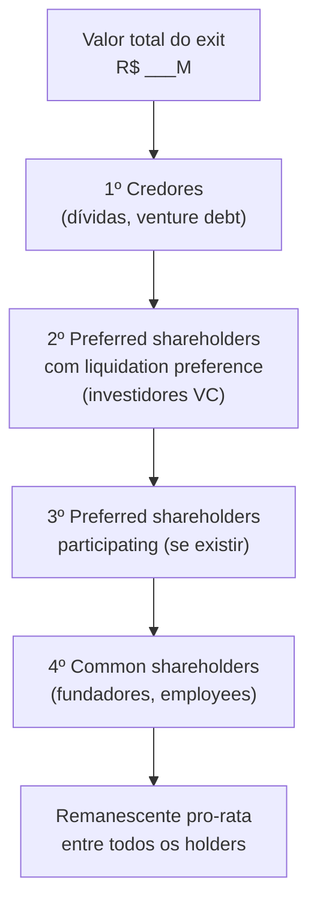

**Os seis campos do canvas:**

- **Cap table atual**: % de cada classe (common, preferred Série Seed, Série A, etc.) e número de ações
- **Liquidation preferences**: 1x, 2x ou participating — por classe e por investidor
- **Anti-dilution adjustments**: se houve down round, qual é o ajuste de preço de conversão
- **Option pool**: opções outorgadas, exercíveis, não-exercidas
- **Preço de exit simulado**: faixa de cenários (pessimista, base, otimista)
- **Distribuição resultante**: R$ por classe e por indivíduo em cada cenário

#### Quando usar

Use o Waterfall Canvas em três momentos: (1) **ao receber um term sheet** — para entender o impacto da liquidation preference proposta em diferentes cenários de exit; (2) **antes de iniciar processo de M&A** — para saber quanto cada sócio recebe em diferentes preços de oferta e identificar onde há conflito de interesse; (3) **ao converter SAFEs ou notas conversíveis** — para visualizar a diluição real e o impacto no cap table pós-conversão.

#### Princípios

**Primeiro: liquidation preference é o mecanismo mais importante que a maioria dos fundadores subestima.** Uma empresa vendida por R$ 50M com R$ 20M de preferred com 2x participating pode entregar menos de R$ 5M para o fundador que detém 30% do cap table. Sem o Waterfall Canvas, essa realidade só aparece no dia da assinatura.

**Segundo: simule sempre pelo menos três cenários.** Exit @ 1x capital investido (resultado fraco), @ 3x (resultado bom), @ 10x (resultado excepcional). O comportamento das liquidation preferences é radicalmente diferente nesses três pontos.

**Terceiro: o conflito de interesse entre fundadores e investidores é estrutural.** Investidores com preferred querem maximum protection; fundadores com common querem maximum upside. Modelar o waterfall revela onde os interesses divergem — antes da negociação, não durante.

#### Como aplicar

**Passo 1 — Montar o cap table completo:**

| Holder | Classe | # Ações | % Fully Diluted | Liq. Pref. | Valor Pref. |
|---|---|---|---|---|---|
| Fundador A | Common | 4.000.000 | 30% | — | — |
| Fundador B | Common | 3.000.000 | 22,5% | — | — |
| Fundo Seed | Preferred A | 2.000.000 | 15% | 1x non-participating | R$ 3M |
| Fundo Série A | Preferred B | 3.000.000 | 22,5% | 1x participating | R$ 12M |
| Option pool | Common | 1.500.000 | 11,25% | — | — |

**Passo 2 — Simular cenários de exit:**

Para cada preço de venda simulado, calcular na sequência:

1. Pagar liquidation preference de cada série preferred (ordem: mais recente primeiro, ou pari passu — checar o acordo de sócios)
2. Se preferred for participating: dividir o remanescente pro-rata entre todos
3. Se preferred for non-participating: comparar o resultado da preference com a conversão — o holder escolhe o maior
4. Distribuir o remanescente entre common shareholders pro-rata

**Exemplo simplificado — exit @ R$ 20M:**

```text
Exit: R$ 20M
Dívidas: zero
Preferred A (Seed): R$ 3M pref. 1x non-participating → recebe R$ 3M OU converte em 15%
Preferred B (Série A): R$ 12M pref. 1x participating → recebe R$ 12M + participa no restante
Remanescente após prefs: R$ 20M - R$ 3M - R$ 12M = R$ 5M
  Preferred A: decide converter → 15% de R$ 20M = R$ 3M → igual à preference → indiferente
  Preferred B (participating): 22,5% de R$ 5M = R$ 1,12M adicional
  Common (fundadores + pool): 62,5% de R$ 5M = R$ 3,12M

Distribuição total @ R$ 20M:
  Fundo Seed: R$ 3M (15%)
  Fundo Série A: R$ 12M + R$ 1,12M = R$ 13,12M (65,6%)
  Fundadores + pool: R$ 3,12M (15,6%)
  → Fundadores com 52,5% do cap table recebem 15,6% do exit
```

**Exit @ R$ 80M (mesmas condições):**

```text
Remanescente após prefs: R$ 80M - R$ 3M - R$ 12M = R$ 65M
  Preferred A: 15% de R$ 65M = R$ 9,75M → melhor converter (R$ 9,75M > R$ 3M preference)
  Preferred B: R$ 12M pref + 22,5% × R$ 65M = R$ 12M + R$ 14,6M = R$ 26,6M
  Common: 62,5% × R$ 65M = R$ 40,6M
  Fundadores (52,5% do common): ≈ R$ 33,8M
  → Exit mais alto = common shareholders recuperam participação real
```

#### Erros comuns

- Não modelar participating preferred separado de non-participating — a diferença é enorme em exits medianos.
- Calcular dilution apenas como % do cap table — a % não conta onde está o dinheiro.
- Ignorar o option pool não-exercido — em muitos acordos, opções não exercidas voltam para o common no momento do exit.
- Usar o cap table "de memória" em vez do documento legal atual — cap tables têm erros; use o documento oficial.

#### Quando NÃO usar

Em estágio pré-seed ou seed early sem investidores institucionais — sem preferred shares, o waterfall é trivial (pro-rata simples). Como decisão estratégica isolada — a ferramenta informa negociação, não substitui análise de mérito do investidor ou do deal. Como projeção de valor da empresa — o canvas mostra distribuição em cenário de exit, não estima o valor.

#### Conexão com outros canvases

O Waterfall Canvas **usa o cap table atual** (não é um canvas de modelo de negócio) e **alimenta diretamente a negociação de term sheet** (Apêndice V e Template A.33). É o único canvas deste apêndice de natureza financeira — os demais são estratégicos ou operacionais.

#### Leitura adicional

- Template A.33 (Term Sheet Anotado) — cláusulas de liquidation preference e anti-dilution.
- [[IGNICAO-Vol-4-Captacao-e-Financas#APÊNDICE DA — MARCO LEGAL DAS STARTUPS: LC 182/2021|Apêndice DA (Vol. 4)]] — COCP como alternativa ao preferred.
- [[IGNICAO-Vol-5-Receita-e-Pessoas#APÊNDICE DB — STOCK OPTIONS E ESOP NO BRASIL|Apêndice DB (Vol. 5)]] — stock options e impacto no cap table.
- *Venture Deals* (Brad Feld & Jason Mendelson, 2019) — explicação definitiva de waterfall mechanics.

---

### CZ.18 — Network Effects Map

#### Origem

O mapeamento sistemático dos tipos de efeitos de rede foi popularizado pela NFX (firma de venture capital de San Francisco) a partir de 2018, quando publicaram a taxonomia dos 16 tipos de network effects como framework para investidores e founders avaliarem a defensibilidade de modelos de negócio. O trabalho de James Currier e Pete Flint na NFX codificou décadas de observação empírica — de Metcalfe (Ethernet, 1980) a Reed (grupos, 1999) — numa estrutura acionável para startups. O Network Effects Map adapta essa taxonomia para formato visual em canvas, com foco brasileiro.

#### O que é

Tela visual que mapeia quais tipos de efeitos de rede um modelo de negócio captura, com que força, e como eles interagem. O objetivo não é apenas identificar "tem efeito de rede" — é entender qual tipo, qual a força relativa, e onde está o loop de reforço que torna o modelo defensável.

**Os tipos principais de efeitos de rede (síntese da taxonomia NFX):**

| Tipo | Mecanismo | Exemplos | Força |
|---|---|---|---|
| **Direto** | Cada usuário adicional aumenta o valor para todos os outros | WhatsApp, telefone | ●●●●● |
| **Two-sided** | Dois grupos se beneficiam mutuamente (compradores/vendedores) | iFood, Mercado Livre | ●●●●○ |
| **Data** | Mais dados = produto melhor = mais usuários = mais dados | Google Search, Waze | ●●●●○ |
| **Tech Performance** | Mais uso = infraestrutura mais eficiente | CDNs, blockchain com proof-of-work | ●●●○○ |
| **Language** | Plataforma vira padrão de vocabulário/formato | Slack (canais), GitHub (pull request) | ●●●○○ |
| **Belief** | Valor existe porque todos acreditam (convenção social) | Bitcoin, moeda fiat | ●●●●● |
| **Bandwagon** | Pressão social para adotar o que "todo mundo usa" | TikTok, tendências virais | ●●●○○ |
| **Platform** | Desenvolvedores criam valor para usuários | iOS App Store, Salesforce AppExchange | ●●●●○ |

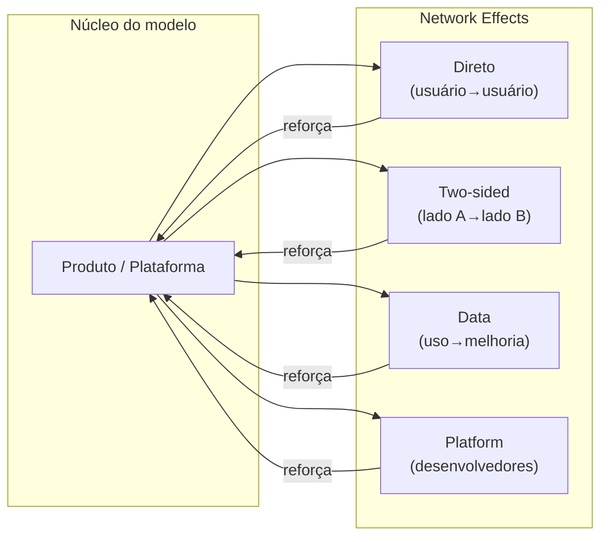

#### Quando usar

Use o Network Effects Map em dois momentos: (1) **ao desenhar o modelo de negócio** (Fase 2–5) — para identificar se e onde há loops de NE que podem ser construídos intencionalmente; (2) **ao preparar pitch de investimento** — investidores de VC avaliam defensibilidade, e NE são um dos principais mecanismos. Saber nomear e explicar o tipo de NE do seu modelo diferencia o fundador.

#### Princípios

**Primeiro: a maioria das startups não tem efeito de rede — tem economias de escala.** "Quanto mais clientes, mais barato o custo unitário" é escala, não NE. Efeito de rede requer que um usuário adicional torne o produto melhor para os outros. Confundir os dois é erro comum de pitch.

**Segundo: NE two-sided são os mais comuns e os mais frágeis no início.** Marketplace sem compradores não atrai vendedores, e vice-versa. O chicken-and-egg problem é o desafio central de modelos two-sided. A solução geralmente é subsidiar um lado temporariamente (iFood subsidiou entregadores; Mercado Livre não cobrou comissão dos primeiros vendedores).

**Terceiro: NE de dados são os mais subestimados.** Poucos fundadores percebem que o loop dados→modelo→produto→mais dados é um dos NE mais poderosos — e mais difíceis de copiar depois de certa escala.

#### Como aplicar

**Passo 1 — Listar todos os NE candidatos:** Para cada tipo na tabela acima, perguntar "nosso modelo tem isso?" e pontuar 0 (não tem), 1 (fraco / emergente) ou 2 (forte / comprovado).

**Passo 2 — Mapear os loops:** Para cada NE identificado com score ≥ 1, desenhar o loop de reforço: Produto → [mecanismo] → mais usuários/dados → produto melhor.

**Passo 3 — Identificar o NE dominante:** Qual é o loop mais forte? Qual é o que mais diferencia o modelo de um produto sem NE? Esse é o NE a comunicar para investidores e a proteger como moat.

**Passo 4 — Identificar onde o NE ainda não existe:** Quais tipos poderiam ser construídos com mudanças de produto? Um SaaS B2B sem NE pode criar NE de dados (analytics de benchmark) ou NE de plataforma (marketplace de integrações).

#### Exemplo brasileiro preenchido — iFood

| Tipo de NE | Score | Mecanismo |
|---|---|---|
| Two-sided (restaurante ↔ consumidor) | ●●●●● | Mais restaurantes = mais opções = mais pedidos = mais receita para restaurantes = mais restaurantes |
| Two-sided (consumidor ↔ entregador) | ●●●○○ | Mais pedidos = mais entregadores disponíveis = menor tempo de entrega = mais pedidos |
| Data | ●●●○○ | Histórico de pedidos alimenta personalização de feed e estimativa de tempo de entrega |
| Bandwagon | ●●○○○ | "Todo mundo pede pelo iFood" — pressão social para estar na plataforma |
| **NE dominante** | — | Two-sided restaurante↔consumidor: o loop mais forte e mais defensável |

**Insight do caso:** O NE mais forte do iFood não é o tecnológico (dados) — é o two-sided de distribuição (restaurante↔consumidor). Por isso, o moat principal é a cobertura geográfica de restaurantes — quem tem mais restaurantes em mais bairros vence a guerra de aquisição de consumidores. Isso explica por que iFood investiu agressivamente em onboarding de restaurantes mesmo com unit economics negativos no curto prazo.

#### Erros comuns

- Chamar escala de efeito de rede — confunde o time e o investidor.
- Ter NE two-sided fraco no início e não subsidiar o lado correto.
- Ignorar NE de dados enquanto constrói produto — os dados de hoje são o moat de amanhã.
- Subestimar o chicken-and-egg: lançar em muitas cidades ao mesmo tempo dilui o NE two-sided — melhor dominar uma cidade completamente antes de expandir.

#### Quando NÃO usar

Em modelos onde a defensibilidade não vem de rede (negócios verticais com regulação, IP forte, ou switching costs contratuais) — forçar análise de NE em modelo que não é de rede gera narrativa falsa em pitch. Em estágio muito inicial sem nenhum usuário — sem volume mínimo, o exercício é especulativo e os scores se tornam wishful thinking. Como substituto de unit economics — NE potencial não compensa unit economics ruins se o loop ainda não está em pé.

#### Conexão com outros canvases

O Network Effects Map **alimenta o Strategy Canvas (CZ.4)** — NE são uma das dimensões de competição onde a empresa pode criar distância; e **alimenta a Theory Map (CZ.16)** — o loop de NE é frequentemente uma das premissas centrais da teoria do negócio que precisa ser validada empiricamente (um NE que não se materializa é uma premissa falsa).

#### Leitura adicional

- NFX Bible (nfx.com/post/network-effects-bible) — taxonomia completa com 16 tipos e exemplos.
- *The Cold Start Problem* (Andrew Chen, 2021) — como iniciar redes quando o NE ainda não existe.
- *Platform Revolution* (Parker, Van Alstyne & Choudary, 2016) — NE em plataformas de dois lados.

---

### CZ.19 — Org Chart Evolution

#### Origem

O Org Chart Evolution não é canvas de um autor único — é síntese de observações empíricas de como as estruturas organizacionais de startups evoluem com o crescimento. O trabalho de Greiner (*Evolution and Revolution as Organizations Grow*, Harvard Business Review, 1972), de Brian Chesky (Airbnb) sobre recentralização em crise, e de Camille Fournier (*The Manager's Path*, 2017) sobre progressão técnica formam a base. O canvas foi desenvolvido como ferramenta diagnóstica para fundadores que precisam responder à pergunta "que estrutura organizacional corresponde ao meu estágio?"

#### O que é

Série de quatro diagramas que mostram como a estrutura da empresa deve evoluir em quatro estágios de crescimento, com os princípios de design organizacional subjacentes a cada transição.

**Os quatro estágios:**

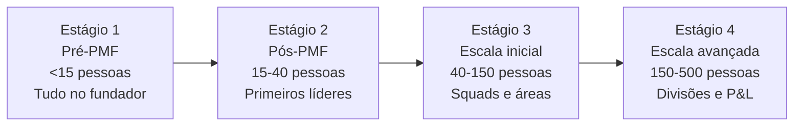

#### Estágio 1 — Pré-PMF (< 15 pessoas)

**Princípio:** Todos fazem tudo. O fundador é o CEO, o CPO, o head de vendas e às vezes ainda escreve código. Não há hierarquia — há comprometimento.

```mermaid
flowchart TD
    CEO["CEO/Fundador(es)"]
    CEO --> T1["Eng/Produto (1-3)"]
    CEO --> T2["Vendas/CS (1-2)"]
    CEO --> T3["Operações/Admin (1)"]
```

**O que não montar aqui:**

- VPs ou Heads antes de ter ~10 pessoas diretas para eles gerenciarem
- Comitês de decisão — o fundador decide, rápido
- Departamentos de RH, Jurídico, Financeiro próprios — terceirize

**Sinal de que é hora de passar para Estágio 2:** Fundador não consegue mais falar com cada pessoa da empresa toda semana.

#### Estágio 2 — Pós-PMF (15–40 pessoas)

**Princípio:** Contratar os primeiros líderes funcionais. Eles ainda executam — não são gestores puros. O fundador ainda decide tudo estratégico, mas libera espaço operacional.

```mermaid
flowchart TD
    CEO["CEO"]
    CEO --> VP1["Head of Product\nou CTO"]
    CEO --> VP2["Head of Sales\nou Head of Growth"]
    CEO --> VP3["Head of Ops\nou COO eventual"]
    VP1 --> E1["Eng 1"] & E2["Eng 2"] & E3["PM 1"]
    VP2 --> S1["AE 1"] & S2["AE 2"] & S3["CS 1"]
    VP3 --> O1["Ops 1"] & O2["Fin/Admin"]
```

**O que não montar aqui:**

- Mais de 3-4 reports diretos do CEO — limite cognitivo real
- Processo de performance review formal antes de 25 pessoas — overhead injustificado
- Departamentos separados de Marketing, Brand, PR — concentre em Growth/Revenue

**Sinal de que é hora de passar para Estágio 3:** Produto ou vendas têm mais de 8-10 pessoas e o head não consegue gerenciar diretamente + há conflito de prioridades entre áreas sem fórum de resolução.

#### Estágio 3 — Escala inicial (40–150 pessoas)

**Princípio:** Squads autônomos orientados a resultado. O fundador/CEO gerencia líderes, não output direto. Rituais formais de alinhamento (OKRs, weekly leadership, quarterly planning).

```mermaid
flowchart TD
    CEO["CEO"]
    CEO --> CPO["CPO"]
    CEO --> CTO["CTO"]
    CEO --> CRO["CRO / VP Sales"]
    CEO --> CFO["CFO"]
    CEO --> COO["COO / VP Ops"]
    CPO --> PM1["Squad: Onboarding"] & PM2["Squad: Core Product"] & PM3["Squad: Growth"]
    CTO --> EM1["Squad: Platform"] & EM2["Squad: Infra"] & EM3["Squad: Mobile"]
    CRO --> S1["AE Team"] & S2["CS Team"] & S3["Marketing"]
    CFO --> F1["Finance"] & F2["BI/Analytics"]
    COO --> O1["HR/People"] & O2["Legal"] & O3["Admin"]
```

**O que não montar aqui:**

- Mais de 5-6 reports diretos do CEO — atenção fica diluída
- Estrutura matricial complexa (funcional + por produto) — cria conflito de autoridade sem benefício
- P&L separado por produto — ainda cedo para accountability de margem por divisão

**Sinal de que é hora de passar para Estágio 4:** Mais de uma linha de produto / mercado com lógicas de go-to-market distintas, ou headcount acima de 150 com decisões cruzando mais de 3 camadas hierárquicas.

#### Estágio 4 — Escala avançada (150–500 pessoas)

**Princípio:** Divisões com P&L próprio. O CEO gerencia um "portfólio" de negócios, não um único produto. Cada divisão tem sua liderança completa. Governança corporativa formal (board, comitês, auditoria).

```mermaid
flowchart TD
    CEO["CEO"]
    CEO --> COO["COO\n(operações compartilhadas)"]
    CEO --> CFO["CFO"]
    CEO --> CHRO["CHRO"]
    CEO --> DIV1["GM: Divisão A\n(produto principal)"]
    CEO --> DIV2["GM: Divisão B\n(novo mercado)"]
    CEO --> DIV3["GM: Divisão C\n(enterprise)"]
    DIV1 --> D1["Product + Eng + Sales + CS"]
    DIV2 --> D2["Product + Eng + Sales + CS"]
    DIV3 --> D3["Product + Eng + Sales + CS"]
    COO --> SH["Shared: Infra, Legal,\nFinance, HR, IT"]
```

#### Armadilhas transversais

1. **Contratar sênior antes do time.** VP de Marketing sem time de marketing produz overhead e frustração. Contrate o líder quando já tem 3-5 pessoas para liderar.
2. **Reorganizar em crise.** Reorg consome 3-6 meses de energia. Se a empresa está em crise, reorg piora antes de melhorar. Resolva o problema, depois reorganize.
3. **Copiar estrutura de empresa maior.** Spotify Model, Amazon Two-Pizza Teams — são para outra escala. Em 30 pessoas, tribe e squad são burocracia vazia.
4. **Manter estrutura de Estágio 1 na Fase de Escala.** Fundador que ainda gerencia 15 ICs diretamente a 50 pessoas é gargalo — não liderança.

#### Conexão com outros canvases

O Org Chart Evolution **complementa o Team Canvas (CZ.8)** — o Team Canvas define propósito e valores do time atual; o Org Chart Evolution define a estrutura que o time assume conforme cresce. **Alimenta o Apêndice J** (organizações em escala) e as [[IGNICAO-Vol-4-Captacao-e-Financas#FASE 13 — ESTRUTURAÇÃO JURÍDICA, FINANCEIRA E OPERACIONAL|Fase 13 (Vol. 4)]] e [[IGNICAO-Vol-5-Receita-e-Pessoas#FASE 14 — ESCALA: TIME, OPERAÇÕES, CRESCIMENTO E CAPITAL|Fase 14 (Vol. 5)]].

#### Leitura adicional

- *The Manager's Path* (Camille Fournier, 2017) — progressão de carreira técnica e estruturas de eng.
- *High Output Management* (Andy Grove, 1983) — gestão por output, não por atividade.
- [[IGNICAO-Vol-3-Tracao#APÊNDICE J — FRAMEWORK DE CANAIS DE AQUISIÇÃO|Apêndice J — Organizações em escala: de 20 a 500 pessoas (Vol. 3)]].

---

### CZ.20 — Wardley Map

#### Origem

Simon Wardley desenvolveu o Wardley Mapping entre 2005 e 2007 enquanto era CEO da Fotango (subsidiária da Canon). Frustrado com a incapacidade de ferramentas estratégicas existentes (SWOT, Porter, BCG Matrix) de capturar a dinâmica de evolução tecnológica, Wardley criou um sistema de mapeamento que combina posicionamento de componentes com seu estágio evolutivo. O primeiro paper foi publicado em 2008; o livro *Wardley Maps* foi disponibilizado gratuitamente em 2020. A ferramenta é amplamente usada em engenharia de plataforma, estratégia de produto e tomada de decisão de build/buy/partner.

#### O que é

Mapa bidimensional onde o eixo X representa o estágio evolutivo de um componente (da esquerda — genesis/custom, para a direita — commodity/utility) e o eixo Y representa a visibilidade para o usuário (de cima — mais visível, para baixo — infraestrutura invisível). Os componentes são conectados por linhas de dependência, criando uma cadeia de valor visível.

```mermaid
flowchart TB
    subgraph WM["Wardley Map — eixos"]
        direction LR
        subgraph Y["↑ Visível para o usuário"]
            U["Usuário / Cliente"]
        end
        subgraph Meio["Componentes de valor"]
            A["Componente A\n(Custom — Genesis)"]
            B["Componente B\n(Produto)"]
            C["Componente C\n(Commodity)"]
        end
        subgraph Base["↓ Infraestrutura"]
            I["Componente D\n(Utility)"]
        end
        U --> A
        A --> B
        B --> C
        C --> I
    end
```

**Os quatro estágios evolutivos:**

| Estágio | Característica | Exemplos |
|---|---|---|
| **Genesis** | Novo, incerto, experimental. Vantagem competitiva se funcionar. | LLMs em 2020, blockchain em 2015 |
| **Custom Built** | Feito sob medida para cada usuário. Caro, difícil de escalar. | Engenharia de dados customizada, algoritmos proprietários |
| **Product** | Produto definido, repetível, com variações. Mercado existe. | SaaS B2B, frameworks de ML |
| **Commodity/Utility** | Padrão de mercado, intercambiável, comprado por preço. | Cloud computing, email, pagamentos |

#### Quando usar

Use o Wardley Map em dois contextos: (1) **decisão de build vs. buy vs. partner** — para cada componente da stack, o estágio evolutivo indica a estratégia correta: construir no Genesis/Custom (diferenciação), comprar/licenciar no Product (time-to-market), usar commodity/utility (sem fricção); (2) **planejamento de plataforma** — para visualizar quais componentes vão se tornar commodity e onde a vantagem competitiva vai se deslocar nos próximos 3-5 anos.

#### Princípios

**Primeiro: tudo evolui da esquerda para a direita.** Um componente que é Genesis hoje (LLMs em 2023) se torna Commodity mais rápido do que parece (LLM-as-a-service via API em 2025). Estratégia baseada em componentes que estão evoluindo para commodity é estratégia baseada em areia movediça.

**Segundo: construa no Genesis, compre no Product, use utilities.** Investir em construir internamente algo que já é commodity é desperdício de capital e talento. O mapa torna essa decisão visual — e discutível.

**Terceiro: a vantagem competitiva está nos componentes à esquerda que seus concorrentes ainda não têm.** Mas atenção: componente Genesis é arriscado porque pode não evoluir para Product, pode demorar mais do que o planejado, ou pode ser ultrapassado por nova abordagem.

#### Como aplicar

**Passo 1 — Identificar o usuário e suas necessidades:** O que o usuário precisa? (ex: "pagamento de fornecedores aprovado em < 1 hora")

**Passo 2 — Mapear a cadeia de valor:** Quais componentes entregam essa necessidade? Decomponha recursivamente: necessidade → componentes de produto → componentes de tecnologia → infraestrutura.

**Passo 3 — Posicionar cada componente no eixo X:** Para cada componente, determinar se é Genesis, Custom, Product ou Commodity no mercado atual.

**Passo 4 — Identificar movimentos estratégicos:**

- Componentes Custom/Genesis onde há diferenciação: proteger e investir
- Componentes Product que concorrentes têm e você não: acelerar adoção
- Componentes que estão evoluindo para Commodity: parar de construir internamente, migrar para solução de mercado
- Gaps na cadeia de valor: onde há componentes ausentes que impedem a entrega?

**Passo 5 — Simular o mapa em 3 anos:** Como cada componente vai ter evoluído? Onde vai surgir nova diferenciação?

#### Exemplo brasileiro — Startup de crédito (simplificado)

| Componente | Estágio atual | Estratégia |
|---|---|---|
| Modelo de crédito proprietário | Custom → Product | Construir internamente — diferenciação |
| Análise de dados alternativos (redes sociais, telecom) | Genesis → Custom | Investir — moat potencial |
| Engine de decisão de crédito (regras) | Product → Commodity | Avaliar plataformas de mercado (Experian, Serasa APIs) |
| Infraestrutura de open banking | Commodity | Usar APIs do Banco Central — não construir |
| Antifraude | Product | Licenciar (Konduto, Sift) — não construir |
| App mobile | Product | Construir UX própria; usar componentes de produto para funcionalidades não-diferenciadoras |

**Insight:** A startup gasta engenharia em antifraude (Product → Commodity) quando deveria gastar em dados alternativos (Genesis → Custom). O Wardley Map torna essa má alocação visível — e debatível com o board.

#### Erros comuns

- Mapear tudo como "nós construímos" por orgulho técnico — não há vantagem em reinventar commodity.
- Confundir "é importante" com "deve ser Genesis" — um componente pode ser crítico e ser commodity.
- Fazer o mapa uma vez e nunca atualizar — o eixo X muda ao longo do tempo; o mapa envelhece.
- Usar o Wardley Map para decisões táticas — é ferramenta estratégica, de horizonte 1-3 anos, não de sprint.

#### Quando NÃO usar

Em decisões táticas de sprint ou trimestre — o eixo evolutivo opera em janela de 1-3 anos. Em produtos sem cadeia de valor técnica significativa (negócios de serviço puramente humano, marketplace de oferta tradicional). Em fase pré-PMF, quando os componentes da cadeia de valor ainda não estão estabilizados — o mapa fica especulativo e pode anchorar decisões em premissas que serão substituídas.

#### Conexão com outros canvases

O Wardley Map **complementa o Strategy Canvas (CZ.4)** — o Strategy Canvas mostra onde competir em dimensões do mercado; o Wardley Map mostra como a tecnologia e os componentes evoluem. **Alimenta decisões de make/buy/partner no Apêndice CC** (Plataforma vs. Produto) e no [[IGNICAO-Vol-6-Engenharia-e-Juridico#APÊNDICE CR — ENGINEERING MANAGEMENT: GESTÃO DO TIME TÉCNICO E DEVELOPER EXPERIENCE|Apêndice CR — Engineering Management (Vol. 6)]].

#### Leitura adicional

- *Wardley Maps* (Simon Wardley, 2020) — disponível gratuitamente em medium.com/@swardley.
- *Team Topologies* (Skelton & Pais, 2019) — estrutura organizacional alinhada à topologia do sistema.
- [[IGNICAO-Vol-2-Validacao#APÊNDICE CC — PLATAFORMA VS PRODUTO: QUANDO CONSTRUIR PLATAFORMA E QUANDO NÃO|Apêndice CC — Plataforma vs. Produto (Vol. 2)]].
- Ferramenta online: onlinewardleymaps.com

---

# TEMPLATES OPERACIONAIS PRONTOS PARA USO (APÊNDICE A)

---

### Arquitetura deste Domínio: Do Papel em Branco à Execução — Os Templates Prontos e Casos Brasileiros (Apêndice A)

O segundo bloco deste volume reúne o **[[#APÊNDICE A — TEMPLATES PRONTOS PARA USO|Apêndice A (A.1 a A.39)]]**, dividido em duas camadas complementares: primeiro, as estruturas copiáveis em texto puro (prontas para colar no Notion, Google Docs ou repositório Markdown da sua empresa); em seguida, a seção **[[#Templates preenchidos com casos brasileiros]]**, onde instrumentos críticos são demonstrados na prática tanto com o caso pedagógico contínuo (**PadariaPro**) quanto com empresas brasileiras documentadas.

Para localizar rapidamente o instrumento do seu momento atual:
- **Ideação e Teoria do Negócio (Vol. 1):** A.1 (Declaração Inicial da Ideia), A.7 (Story Tree), A.8 (DAG Causal), A.9 (Theory Map) e A.28 (Entrevista com Advisor).
- **Validação, Pesquisa e Protótipo (Vol. 2):** A.2 (Entrevista de Problema), A.3 (Banco de Hipóteses), A.4 (Cartão de Experimento), A.5 (Persona com Dados), A.6 (Especificação de MVP), A.10 (Hypothesis Canvas), A.11 (Precisão do Comprador), A.12 (Canvas da Cunha), A.19 (Técnicas de Validação), A.20 (Roteiro de Teste de Usabilidade), A.24 (Customer Journey Map), A.27 (Entrevista com Especialista), A.29 (Entrevista JTBD Switcher) e A.30 (Síntese de Rodada de Entrevistas).
- **Tração, MVP e PMF (Vol. 3):** A.21 (Checklist de Pre-Launch), A.22 (Scorecard de PMF) e A.25 (Story Map de MVP).
- **Captação, Escala e Governança (Vols. 4, 5, 6 e 7):** A.13 (Matriz de Parcerias), A.14 (Financiamento Não-Diluitivo), A.15 (Plano de Marca e PR), A.16 (Founder Mode vs Manager Mode), A.17 (Pitch Deck SCQA), A.18 (Investor Update Mensal), A.23 (Opportunity Solution Tree), A.26 e A.36 (OKRs Trimestral e Cascade Anual), A.31 (Board Deck), A.32 (Data Room Checklist), A.33 (Term Sheet Anotado), A.34 (Job Descriptions de Heads), A.35 (Post-Mortem de Incidente Técnico), A.37 (Plano de Rodada), A.38 (Reunião 1:1) e A.39 (Semana do Fundador).

---

## APÊNDICE A — TEMPLATES PRONTOS PARA USO

> [!note] Como usar
> Esse apêndice reúne todos os templates operacionais (modelos prontos para usar) referenciados ao longo do livro. Cada template tem indicação da fase ou apêndice de origem. Copie, adapte ao seu contexto e preencha. Templates são ponto de partida, não camisa-de-força. Se o formato não funcionar para o seu negócio, modifique-o. O que importa é o raciocínio que o template força, não a forma exata.


> [!important] Família discovery (descoberta) — A.2, A.27, A.28, A.29 e A.30
> Cinco dos templates deste apêndice formam um conjunto coerente de artefatos de discovery (descoberta de cliente), cada um para um tipo distinto de conversa. Confundi-los é o erro clássico que o IGNIÇÃO denuncia: tratar opinião de especialista como evidência de cliente, ou conselho de advisor (conselheiro) como dado de mercado. Use o template certo para o tipo certo. A tabela e a regra de ouro abaixo guiam a escolha.

| Template | Use quando… | NÃO use quando… |
|---|---|---|
| **A.2 — Entrevista de Problema** | Está validando se um problema existe, com que frequência, e quão doloroso é, na vida de um cliente potencial. [[IGNICAO-Vol-2-Validacao#FASE 3 — DESCOBERTA DO PROBLEMA|Fase 3 (Vol. 2)]]. | Já tem produto e quer validar solução. Está buscando opinião de quem não sofre o problema. |
| **A.27 — Entrevista com Especialista de Mercado** | Quer mapear setor, dinâmicas competitivas, pontos cegos, tendências regulatórias. A pessoa conhece o mercado — não necessariamente é cliente dele. | Quer saber se *o cliente* tem dor. Especialista opina; cliente prova com comportamento. |
| **A.28 — Entrevista com Advisor** | Tem decisão específica em cima da mesa e quer conselho tático/estratégico de alguém com experiência relevante. | Ainda está explorando. Advisor é para refinar decisão, não para descobrir o problema. |
| **A.29 — Entrevista com Switcher (JTBD)** | A pessoa **trocou** de solução (deixou um concorrente, largou um processo manual, migrou de ferramenta). Foco no momento da troca, com as 4 forças de Moesta. | A pessoa nunca trocou de nada — não há "switch" para investigar. Use A.2. |
| **A.30 — Síntese de Rodada de Entrevistas** | Rodou 15-30 entrevistas e precisa sintetizar o agregado para decidir avanço de fase: perseverar, pivotar problema, pivotar cliente ou abandonar. | Ainda está no meio da coleta. Consolidar cedo vicia a análise — espere a rodada fechar. |

**Regra de ouro.** Apenas A.2 e A.29 geram evidência de comportamento de cliente. A.27 e A.28 informam como construir, não se há mercado. A.30 é quem decide avanço de fase — nenhuma entrevista individual decide sozinha.

### A.1 Declaração Inicial da Ideia (Fase 2)

**Para que serve.** Captura a ideia inicial em formato auditável com problema, cliente, solução, modelo, hipóteses e incertezas categorizadas, antes de qualquer construção.

**Quando usar.** Ao concluir a Fase 2 e antes de entrar em descoberta de problema (Fase 3). Refaça também sempre que pivotar em qualquer um dos sete blocos, marcando nova versão.

**Exemplo de preenchimento.** Problema, "donos de restaurante de bairro perdem 3-6h por semana conciliando taxas de iFood, Iiood e cartão". Para quem, "operações independentes com 1 a 3 unidades, faturamento R$80k-R$300k/mês". Alternativa atual, "planilha manual com extratos baixados um a um". Solução, "concilia automático via integração com adquirentes e marketplaces". Modelo, "assinatura R$199/mês por unidade". Por que pode funcionar, "dono prefere pagar a contratar mais um auxiliar administrativo".

A DII tem sete blocos de conteúdo mais a lista de incertezas categorizada. Cabe em uma página (400 a 800 palavras). Em ideias B2B, o bloco "Para quem" tem sub-estrutura com Decisor Econômico e Champion separados.

```text
DECLARAÇÃO INICIAL DA IDEIA
Versão: ___ | Data: ___

1. PROBLEMA (3-5 frases, ancoradas em dados quando possível, sem mencionar sua solução)
___________________________________________
___________________________________________
Dados/referências (opcional, recomendado em B2B-enterprise):
- _______________________________________
- _______________________________________

2. PARA QUEM
2a. Quem é (filtros objetivos: setor, tamanho, frequência, momento)
___________________________________________
2b. Quem NÃO é (anti-perfil — descarta na primeira chamada e por quê)
___________________________________________
[Se B2B, preencha 2c e 2d]
2c. Decisor Econômico (papel que aprova orçamento + pergunta de qualificação em 1 frase)
___________________________________________
2d. Champion (papel que opera o produto e vende internamente + pergunta de qualificação em 1 frase)
___________________________________________

3. ALTERNATIVA ATUAL (como o cliente resolve hoje — planilha, processo manual, concorrente, ignorar)
___________________________________________

4. SOLUÇÃO PROPOSTA (capacidades, não features)
___________________________________________

5. MODELO DE NEGÓCIOS (quem paga, quanto, como, contra o que compete)
- Modelo: [assinatura | transacional | performance | work-as-a-service | ...]
- Preço-rascunho: ___________________________
- Gatilho de pagamento: ______________________
- Compete contra: [não compete com software, compete com custo de analista interno; não compete com X, compete com Y]

6. POR QUE PODE FUNCIONAR (3-5 hipóteses sobre o mundo, formato testável "[Persona] [verbo] [objeto]")
1) _______________________________________
2) _______________________________________
3) _______________________________________

7. POR QUE NÓS (Founder-Market Fit em 1-2 frases — vantagem injusta concreta, não adjetivos)
___________________________________________

8. O QUE EU NÃO SEI (10-25 incertezas em 6 categorias; nenhuma categoria vazia)
Demanda (cliente percebe o problema como prioridade?):
- _______________________________________
Mercado (orçamento existe? Onde está alocado? Como o mercado se comporta?):
- _______________________________________
Solução (a forma proposta resolve? É a forma certa?):
- _______________________________________
Adoção (o cliente vai mudar de comportamento para usar?):
- _______________________________________
Canal (como o cliente descobre? Onde está acessível?):
- _______________________________________
Modelo (pricing percebido como justo? ROI defensável internamente?):
- _______________________________________
```

### A.2 Entrevista de Problema (Fase 3)

> [!important] Disciplina central
> Nesta entrevista você **não fala da sua solução**. Você escuta. No momento em que apresenta a ideia, o entrevistado reage à ideia em vez de descrever a realidade dele — e você perde a evidência limpa.

Este template tem duas partes. A **Parte A** é o roteiro para consultar *durante* a conversa (deixe aberto na tela ou imprima). A **Parte B** é a síntese para preencher *depois* — idealmente nas 24h seguintes, enquanto a memória está fresca. As duas formam um único artefato: roteiro sem síntese vira entrevista perdida; síntese sem roteiro vira interpretação livre. Use as duas em todas as entrevistas da rodada.

#### Parte A — Roteiro da Entrevista (uso durante a conversa)

**Duração alvo:** 30-45 min · **Balanço de fala:** o entrevistado fala a maior parte do tempo. Se você se pegar falando mais que ele em qualquer trecho de 5 minutos, volte a fazer perguntas abertas.

**Abertura (2 min)**

> "Oi, obrigado pelo tempo. Antes de começar: não estou aqui pra te vender nada. Estou pesquisando como [público-alvo] lidam com [área ampla], porque quero entender se existe um problema real antes de construir qualquer coisa. Vou fazer perguntas abertas, sem respostas certas. Posso gravar pra transcrever depois? A gravação fica privada."

**Contexto (5 min)**

- Me conta um pouco sobre o que você faz no dia a dia.
- Quanto tempo você está nesse papel / nessa empresa?
- Quem mais na sua rotina está envolvido em [área ampla]?

**Exploração (10 min) — *ainda sem falar da sua solução***

- Me descreve como funciona a rotina quando [atividade relacionada ao problema].
- Quais são as partes mais chatas dessa rotina?
- Me conta a última vez que algo deu errado nisso.

**Aprofundamento por problema mencionado (10-15 min)**

Para cada problema que a pessoa citar espontaneamente:

- Me fala mais sobre isso.
- Quando foi a última vez que aconteceu?
- O que você fez?
- Quanto tempo / dinheiro isso custou?
- O que acontece se você simplesmente **não** resolver? *(mapeia escalação)*

**Tentativas de solução (5 min)**

- O que você já tentou pra resolver?
- Funcionou? Por que parou ou continua usando?
- **Já gastou dinheiro (ferramenta, consultor, pessoa extra) pra resolver isso?**
- Quanto? Por quanto tempo?

**Encerramento (3 min)**

- Tem mais alguém que passa por isso e que eu poderia conversar?
- Posso voltar se surgirem mais perguntas?
- Topa ver um protótipo em 30-60 dias e dar sua opinião?

**NÃO PERGUNTAR (lista de proibições)**

- "Você pagaria R$X por isso?"
- "Se existisse Y, você usaria?"
- "Você acha que isso seria útil?"
- "Eu tive uma ideia, o que você acha?"
- "Você não acharia melhor se…?"
- Qualquer pergunta que comece com hipótese sua a ser validada pelo entrevistado.

#### Parte B — Síntese Pós-Entrevista

##### Metadados

| Campo | Valor |
|---|---|
| **ID** | `ENTR-[AAAA-MM-DD]-[##]` |
| **Data e hora** | `[DD/MM/AAAA — HH:MM]` |
| **Duração real** | `[min]` |
| **Formato** | `[ ] Remoto  [ ] Presencial` |
| **Gravação (com consentimento)** | `[link ou "não gravada"]` |
| **Transcrição** | `[link]` |
| **Entrevistador** | `[Nome]` |
| **Anotador (se houver)** | `[Nome]` |
| **Relação com a hipótese** | `[ID da hipótese em teste, se formal]` |

##### Perfil do Entrevistado e Aderência ao ICP

| Campo | Valor |
|---|---|
| **Nome** | `[...]` |
| **Papel / cargo** | `[...]` |
| **Empresa / contexto** | `[...]` |
| **Porte do negócio** | `[nº funcionários / faturamento / estágio — seja específico]` |
| **Localização** | `[cidade / estado / país]` |
| **Fonte do contato** | `[rede pessoal / LinkedIn / indicação / cold outreach]` |
| **Vínculo pessoal com o entrevistador?** | `[ ] Não  [ ] Sim` — *se sim: atenção a viés de cortesia nas respostas.* |
| **Aderente ao ICP hipotético?** | `[ ] Sim  [ ] Parcial  [ ] Não` |

> *Se "Não", a entrevista vale como aprendizado mas **não conta** para o denominador de validação (regra da [[IGNICAO-Vol-2-Validacao#FASE 3 — DESCOBERTA DO PROBLEMA|Fase 3 (Vol. 2)]]).*

##### 1. Contexto e rotina

> *Não pergunte sobre o problema ainda. Deixe a pessoa descrever o mundo dela. Pergunte sobre rotina, responsabilidades, ferramentas, periodicidade. Aqui você calibra o universo onde o problema vive.*

**Descrição geral.** `[Descreva em prosa o que a pessoa faz. Use as palavras dela. 3-5 linhas.]`

**Processo atual mapeado em fases.** *Se o problema investigado tem a forma de um processo ou workflow (recrutamento, compra, onboarding, fechamento, reconciliação, etc.), documente em fases numeradas. Isso ancora onde cada dor acontece — a mesma pessoa pode ter dor forte na Fase 2 e nenhuma na Fase 5. Sem esse mapa, você registra "dor em recrutamento" quando na verdade é "dor em triagem inicial", que é outro problema.*

- **Fase 1 — `[nome curto]`:** `[o que acontece, quem faz, com que ferramenta, quanto tempo leva]`
- **Fase 2 — `[nome curto]`:** `[...]`
- **Fase 3 — `[nome curto]`:** `[...]`
- **Fase 4 — `[nome curto]`:** `[...]`

*(adicione ou remova fases conforme o caso)*

**Ferramentas e stack atual.**

- `[ferramenta — para que usa]`
- `[...]`

##### 2. Problemas mencionados (o que foi dito — não o que você interpretou)

> *Para cada problema que emergiu na conversa, preencha um bloco. **Crítico:** documente apenas o que o entrevistado disse espontaneamente ou em resposta a pergunta aberta. Problemas que você "provocou" com pergunta tendenciosa valem zero.*

**Problema A — `[título curto, nas palavras do entrevistado se possível]`**

- **Descrição literal:** `[...]`
- **Era esperado ou inesperado?** `[ ] Esperado (ligado à hipótese em teste)  [ ] Inesperado (surgiu e não estávamos procurando — pode ser o ouro do discovery)`
- **Em qual fase do processo ocorre?** `[Fase 1 / Fase 2 / transversal / fora do processo mapeado]`
- **Menção foi espontânea ou provocada?** `[ ] Espontânea  [ ] Provocada por pergunta aberta  [ ] Provocada por pergunta tendenciosa (descartar)`
- **Frequência observável:** `[diária / semanal / mensal / esporádica]`
- **Última ocorrência (comportamento passado):** `[quando? o que aconteceu?]`
- **Custo atual (tempo / dinheiro / energia):** `[número ou descrição concreta]`
- **Emoção observada:** `[exemplo: frustração, resignação, vergonha, medo — use a palavra que cabe]`
- **Tentativas anteriores de resolver:** `[o que já tentou? funcionou? por que parou ou continuou?]`
- **Já gastou dinheiro para resolver?** `[ ] Não  [ ] Sim — quanto? em que? por quanto tempo?]` — *sinal operacional mais limpo de dor. Dinheiro já gasto > promessa de pagar.*
- **Escalação — o que piora se NÃO resolver?** `[perde cliente / perde contrato / multa / perde emprego / nada concreto]` — *separa urgência real de incômodo crônico.*

**Problema B — `[...]`** `[bloco com mesma estrutura do Problema A]`

**Problema C — `[...]`** `[bloco com mesma estrutura do Problema A]`

##### 3. Verbatim (citações literais)

> *Transcreva exatamente o que a pessoa falou, entre aspas. Mínimo 3 citações marcantes. Verbatim é ouro — serve de evidência em deck interno, no pitch, no roadmap.*

1. > *"[citação literal]"* — sobre `[Problema A]`
2. > *"[citação literal]"* — sobre `[Problema B]`
3. > *"[citação literal]"* — sobre `[tema]`
4. > *"[citação literal]"* — sobre `[tema]`

##### 4. Vocabulário do cliente

> *Anote as palavras e expressões **exatas** que a pessoa usou para descrever o problema, a rotina e as soluções atuais. Não parafraseie. Esse vocabulário vai direto para o marketing, para a landing page e para o roteiro de vendas depois — se você usa a linguagem do cliente, ele se reconhece; se você usa a sua, ele ignora.*

| Como a pessoa chama | Contexto em que usou |
|---|---|
| `[palavra / expressão exata]` | `[o que ela estava descrevendo]` |
| `[...]` | `[...]` |
| `[...]` | `[...]` |

**Termos que ela *não* usou e que nós estávamos prontos a usar:** `[...]` — *se a pessoa não usa a nossa palavra, provavelmente estamos falando a linguagem errada.*

##### 5. Hierarquia de sinais coletados

> *Classifique a evidência desta entrevista pelo tipo de sinal. **Esta tabela é o filtro central do Mom Test:** só os três primeiros tipos movem decisão — os três últimos enganam.*

| Sinal | Peso | O que veio nesta entrevista? |
|---|---|---|
| **Comportamento passado** ("semana passada gastei 4h nisso") | Alto | `[...]` |
| **Tentativas anteriores de solução** ("usei X, Y e Z, nada resolveu") | Alto | `[...]` |
| **Métricas de custo** (tempo, dinheiro, energia já gastos) | Alto | `[...]` |
| **Ideias soltas** ("seria legal se tivesse X") | Baixo-médio | `[...]` |
| **Hipóteses futuras** ("eu pagaria por isso") | Baixo | `[...]` — *não usar para decisão* |
| **Elogios** ("que ideia legal!") | Zero | `[...]` — *descartar* |

##### 6. Classificação de Pain Level

> *Atribua **um único nível** ao entrevistado. Padrão de Pain Level 4+ em volume (tipicamente ≥5 entrevistas) é o que move a tese; uma entrevista isolada em nível 3 não descarta a investigação, só ainda não confirma.*

- [ ] **Nível 1** — Tem o problema, mas não sabe que tem.
- [ ] **Nível 2** — Sabe que tem, mas tolera. Não vai pagar sozinho.
- [ ] **Nível 3** — Está ativamente procurando solução. Lead quente.
- [ ] **Nível 4** — Já improvisou gambiarra (planilha Frankenstein, processo manual, ferramenta adaptada). Forte evidência de que pagaria.
- [ ] **Nível 5** — Tem orçamento comprometido ou facilmente acessível para comprar solução. Cliente ideal.

> *Nível 5 se verifica por **sinal indireto**, nunca por pergunta direta sobre disposição a pagar (que é armadilha e está na lista de proibições da Parte A). Pistas válidas: a pessoa mencionou espontaneamente valor já gasto, contratação de alguém para resolver, mensalidade paga em ferramenta análoga, verba carimbada no orçamento do ano.*

**Justificativa da classificação:** `[1-2 linhas com a evidência direta — não interpretação — que sustenta a nota.]`

##### 7. Observações do entrevistador

> *Separadas dos fatos. Use itálico. Aqui entram sua leitura da linguagem corporal, tom, nível de energia e suspeitas. Fatos acima; interpretação aqui.*

*`[...]`*

*`[...]`*

##### 8. Armadilhas — autoavaliação pós-entrevista

> *Esta seção verifica se as proibições da Parte A foram respeitadas. Marque honestamente o que aconteceu.*

- [ ] Cheguei a apresentar minha solução em algum momento? — *se sim, dados após esse ponto devem ser lidos com ceticismo.*
- [ ] Fiz pergunta tendenciosa tipo "você não acharia melhor se…"?
- [ ] Fiz pergunta hipotética sobre o futuro ("você usaria X?", "pagaria Y?")?
- [ ] Em algum trecho de 5 min, falei mais que o entrevistado?
- [ ] Filtrei o que ouvi para confirmar tese que eu já tinha?
- [ ] Tratei uma fala apaixonada como equivalente a um padrão de 10 entrevistas?

> *Cada marca acima contamina parte da evidência. Anote **quais achados ficam sob suspeita** em função dessas contaminações:* `[...]`

##### 9. Refinamento do ICP

> *ICP não muda a cada entrevista — muda quando padrão aparece em 5-10 conversas. Esta seção registra sinais individuais que, acumulados com os de outras entrevistas, podem mover o recorte. Exemplo: a hipótese original do iFood era "redes grandes"; entrevistas acumuladas refinaram para "restaurantes pequenos sem telemarketing".*

**Sub-segmento mais agudo observado nesta entrevista.** *Dentro do perfil entrevistado, o que parece correlacionado com sofrer mais? Porte? Setor? Senioridade? Estágio? Tempo no cargo? Stack? Volume? Anote o recorte que se destacou.*

`[Ex: "padarias com 3+ lojas sentem; com 1-2 não" — ou — "só operadores que fazem a reconciliação manualmente, não quem tem financeiro dedicado"]`

**Esta entrevista sugere algum refino de ICP?**

- [ ] **Estreitou** — ICP ficou mais específico. Novo recorte: `[...]`
- [ ] **Ampliou** — ICP precisa incluir um perfil que não tínhamos mapeado: `[...]`
- [ ] **Mudou de direção** — perfil entrevistado era hipótese, mas a dor real aparece em outro lugar: `[...]`
- [ ] **Confirmou** — ICP atual permanece. Esta entrevista não muda o recorte.

##### 10. Indicações (snowball)

- **Outras pessoas que passam por isso e que podemos conversar:** `[nome — contato — por que foi indicado]`
- **Posso voltar para nova conversa?** `[ ] Sim  [ ] Não`
- **Topa ver um protótipo em 30-60 dias?** `[ ] Sim  [ ] Não`

##### 11. Decisão pós-entrevista individual

> *Uma única entrevista não decide nada — mas cada entrevista move a agulha. Marque para onde ela moveu.*

- [ ] **Reforça** a hipótese de problema em teste
- [ ] **Enfraquece** a hipótese
- [ ] **Ambígua** — precisa de mais dados
- [ ] **Falso positivo identificado** (pessoa disse que tem o problema mas o comportamento refuta)

**Justificativa (2-3 linhas):** `[...]`

##### 12. Próximos passos de investigação

> *Distintos de "ações internas de produto". Aqui registramos **perguntas novas que esta entrevista gerou** e que informam a próxima entrevista, uma pesquisa desk, ou um dado a buscar externamente. É o espírito iterativo do discovery: cada conversa afina a próxima.*

**Perguntas a incluir em próximas entrevistas.**

- `[...]`
- `[...]`

**Dados a buscar externamente (pesquisa desk, benchmark, números de mercado).**

- `[...]`
- `[...]`

**Perfis diferentes a entrevistar para cruzar padrões.** *"Esta dor é padrão no setor ou é específica desta empresa? Preciso falar com alguém de porte X ou região Y para comparar."*

- `[...]`

##### Anexos

- Gravação: `[link]`
- Transcrição: `[link]`
- Artefatos compartilhados pelo entrevistado (prints, planilhas): `[link]`
- Entrevistas relacionadas: `[ENTR-..., ENTR-...]`

*Preenchido por `[Nome]` em `[DD/MM/AAAA]`.*

> [!tip] Consolidação da rodada
> Cada entrevista preenchida pela Parte B é uma linha do agregado. A decisão de avanço de fase não sai daqui — sai do **A.30 (Síntese de Rodada de Entrevistas)**, que cruza Pain Level, padrões, workarounds e vocabulário das 15-30 entrevistas para decidir perseverar, pivotar problema, pivotar cliente ou abandonar.

### A.3 Banco de Hipóteses — modelo de planilha (Fase 6)

**Para que serve.** Centraliza todas as hipóteses do negócio em uma única planilha com tipo, critério de validação, método, custo e status, evitando que aprendizados se percam em conversas e documentos espalhados.

**Quando usar.** Ao iniciar a Fase 6 (priorização). Mantenha viva ao longo de toda a jornada até PMF, atualizando status sempre que um experimento for executado e adicionando hipóteses novas conforme descobertas.

**Exemplo de preenchimento.** Linha H03, tipo "Adoção", hipótese "operadores de loja farão login no app pelo menos 3x por semana", porquê importa "se falso, o produto vira shelfware mesmo com compra do dono", critério "≥60% dos usuários ativos D7 nas primeiras 4 semanas", método "piloto com 5 lojas medindo eventos de login", custo "R$2.000 + 6 semanas", status "Em teste".

| ID | Tipo | Hipótese | Porquê importa | Critério validação | Método | Custo | Status | Resultado |
|----|------|----------|----------------|-------------------|--------|-------|--------|-----------|
| H01 | Problema | Donos de restaurante perdem ≥3h/semana com conciliação de frete | Se falso, o problema não é dolorido o suficiente | ≥60% dos 20 entrevistados menciona espontaneamente | Entrevistas de problema | R$0 + 3 semanas | Em teste |, |
| H02 | Monetização | ICP pagará ≥R$149/mês pela solução | Determina viabilidade do modelo | ≥15% conversão em landing page com oferta | Smoke test + pré-venda | R$1.500 + 3 semanas | Nova |, |

### A.4 Cartão de Experimento (Fase 7)

**Para que serve.** Documenta um experimento individual em uma página com hipótese, desenho, métrica, critério de sucesso pré-registrado e decisão, garantindo rigor de método e prevenindo racionalização posterior do resultado.

**Quando usar.** Antes de cada experimento da Fase 7. O preenchimento dos blocos "Critério de Sucesso", "Riscos e Vieses" e "Métrica Principal" deve ocorrer ANTES de ver qualquer dado, não depois. Preencha "Resultado", "Decisão" e "Aprendizados" no encerramento.

**Exemplo de preenchimento.** Hipótese testada, "ICP paga R$149/mês". Pergunta central, "quantos visitantes da landing finalizam compra no checkout antes do produto existir?". Desenho, "rodar Google Ads para 5 termos de cauda longa por 14 dias, medir conversão até cartão informado". Métrica principal, "taxa de conversão visita→cartão". Critério de sucesso, "validar se ≥10%, refutar se ≤3%, zona cinzenta entre 3% e 10%".

```text
EXPERIMENTO #___
Data planejada: ___ a ___

HIPÓTESE TESTADA
___________________________________________

PERGUNTA CENTRAL
___________________________________________

DESENHO (passo a passo)
1) _______________________________________
2) _______________________________________
3) _______________________________________

PÚBLICO
Quantidade: _____ Perfil: _____________
Como alcanço: ___________________________

MÉTRICA PRINCIPAL
___________________________________________

CRITÉRIO DE SUCESSO (antes de ver resultado)
Validar se: ________________________________
Refutar se: _______________________________

DURAÇÃO E CUSTO
Tempo: _____ dias Custo: R$ _____

RISCOS E VIESES
___________________________________________

RESULTADO (preencher depois)
___________________________________________

DECISÃO
 Persevere Ajuste Pivote Abandone

APRENDIZADOS
___________________________________________
```

### A.5 Persona com dados (Fase 4)

**Para que serve.** Sintetiza o ICP em um arquétipo único ancorado em evidência de entrevistas reais, com motivações, frustrações, JTBDs e citação verbatim, em vez de persona inventada de workshop.

**Quando usar.** Após executar 15 a 30 entrevistas de problema (A.2) e consolidar a rodada (A.30). Atualize sempre que descobrir um novo padrão de comportamento ou que o ICP for refinado por filtragem de anti-perfil.

**Exemplo de preenchimento.** Persona "Carla, gerente de operações". Contexto, "trabalha em rede de 12 farmácias regionais, responde direto ao dono". Motivações, "ser confiável, não deixar furo de estoque". Frustrações, "fechar inventário no fim do mês toma um sábado inteiro". Comportamento observado, "exporta planilha do ERP e refaz manual no Excel mesmo tendo módulo nativo". JTBD, "quando fecho o mês, quero conferir estoque sem refazer cálculo, para que eu não trabalhe no sábado". Citação, "eu não confio no sistema, então sempre faço de novo na mão".

```text
PERSONA: [nome fictício]

Contexto profissional/pessoal
___________________________________________

Perfil demográfico
___________________________________________

Motivações principais (do que se importa)
1) _______________________________________
2) _______________________________________

Frustrações principais
1) _______________________________________
2) _______________________________________

Comportamentos observados (não declarados)
1) _______________________________________
2) _______________________________________

Ferramentas/canais/fontes que usa
___________________________________________

JTBDs prioritários
1) Quando _____, eu quero _____, para que _____.
2) Quando _____, eu quero _____, para que _____.

Citação verbatim representativa
"___________________________________________"

Base de evidência: [quantas entrevistas, quais]
```

### A.6 Especificação de MVP (Fase 9)

**Para que serve.** Define o escopo mínimo viável com proposta de valor, persona foco, JTBDs, listas MoSCoW (must/should/could/won't), critérios de sucesso pós-90 dias e orçamento, prevenindo escopo inflado.

**Quando usar.** Ao concluir validação de problema e solução (Fases 3-7) e entrar em Fase 9 (construção). Refaça toda vez que o time quiser adicionar feature ao escopo. A regra é mover algo para "won't have" antes de adicionar novo "must".

**Exemplo de preenchimento.** Proposta de valor, "concilia repasses de marketplace em 5 minutos por mês". Persona foco, "Carla operações de farmácia, 5 a 15 unidades". Must haves, "import de extrato CSV, conciliação com regra de tolerância R$2, relatório por unidade". Won't haves, "integração API direta com adquirentes (fica para v2)". Critério pós-90 dias, "10 clientes pagantes, retenção D30 ≥80%, NPS ≥30".

```text
ESPECIFICAÇÃO DO MVP
Versão: ___ | Data: ___

PROPOSTA DE VALOR (uma frase)
___________________________________________

PERSONA FOCO (beachhead)
___________________________________________

JTBDs PRINCIPAIS A RESOLVER
1) _______________________________________
2) _______________________________________

MUST HAVES (máximo 15)
□ _______________________________________
□ _______________________________________
...

SHOULD HAVES (roadmap pós-MVP)
□ _______________________________________

COULD HAVES (se tempo permitir)
□ _______________________________________

WON'T HAVES (explicitamente fora)
× _______________________________________

CRITÉRIOS DE SUCESSO DO MVP (após 90 dias)
- Usuários ativos: _____
- Retenção D30: _____
- Conversão trial → pago: _____
- NPS mínimo: _____

FAIXA DE PREÇO PLANEJADA
R$ ____ a R$ ____

CANAIS DE AQUISIÇÃO INICIAIS
1) _______________________________________
2) _______________________________________

PRAZO DE DESENVOLVIMENTO
Início: ___ Lançamento: ___

ORÇAMENTO
R$ _____
```

### A.7 Árvore de Teoria — Story Tree (Fase 2B)

**Para que serve.** Estrutura a teoria do negócio como um conjunto de atributos com probabilidade subjetiva e relações causais entre eles, isolando explicitamente os 2 a 5 atributos bet-the-company que destruiriam a ideia se refutados.

**Quando usar.** Na Fase 2B, depois que a DII (A.1) está estável e antes de priorizar hipóteses (Fase 6). Refaça quando descobrir um atributo novo, ou quando a refutação de um atributo bet-the-company forçar redesenho da teoria.

**Exemplo de preenchimento.** Atributo A1 "operadores percebem conciliação como dor top 3", crença 70%. A2 "donos pagam para retirar dor de operadores", crença 40%. Relação A1→A2 confiança média, evidência "BG.16.x sobre transferência de dor entre persona-operador e persona-comprador". Bet-the-company, "A2 (se dono não paga, modelo morre)".

```text
ÁRVORE DE TEORIA, v___ Data: ___/___/___

PERGUNTAS-ÂNCORA:

(a) Qual problema ou fenômeno você está observando?
____________________________________________________________
____________________________________________________________

(b) Por que isso está acontecendo? (causas-raízes)
____________________________________________________________
____________________________________________________________

(c) O que você poderia fazer a respeito? (caminhos de solução)
____________________________________________________________
____________________________________________________________

ATRIBUTOS (elementos com realização incerta):

ID | Atributo | Crença sobre realização (0-100%)
----|-----------------------------------|-----------------------------------
A1 | |
A2 | |
A3 | |
A4 | |
A5 | |
A6 | |
A7 | |
A8 | |
...

RELAÇÕES CAUSAIS (A → B):

De | Para | Direção do efeito | Confiança (alta/média/baixa) | Evidência prévia
------|-------|-------------------|------------------------------|------------------
A1 | A2 | + ou - | |
A2 | A3 | + ou - | |
...

ATRIBUTOS BET-THE-COMPANY (2 a 5):

Marque os atributos cuja refutação destruiria a ideia inteira:
[ ] A___ Justificativa: __________________________________
[ ] A___ Justificativa: __________________________________
[ ] A___ Justificativa: __________________________________

TESTE DE PARCIMÔNIA:

Quais atributos eu posso remover sem perder poder explicativo?
Removidos nesta versão: _________________________________

TESTE DE ALTERNATIVA:

Teoria alternativa (explicação diferente para o mesmo fenômeno):
____________________________________________________________
Principais atributos diferentes: _________________________
Como saberei qual teoria é melhor: _______________________

VALIDAÇÃO EXTERNA:

Três pessoas que conseguiram repetir minha teoria com as próprias palavras:
1) _______________________ Data: ___
2) _______________________ Data: ___
3) _______________________ Data: ___
```

### A.8 Mapa Causal — DAG Simplificado (Fase 2B)

**Para que serve.** Representa a teoria como grafo acíclico dirigido, com probabilidades marginais nos nós e probabilidades condicionais nas arestas, permitindo calcular plausibilidade do caminho crítico até o outcome final (cliente paga, cliente adota).

**Quando usar.** Na Fase 2B, como passo seguinte ao Story Tree (A.7) quando a teoria já tem 6 a 10 atributos e o empreendedor precisa de visão mais formal das dependências. Útil também quando há disputa sobre qual atributo é o gargalo causal.

**Exemplo de preenchimento.** A "operador sente dor" P(A)=70%, A→B "operador reporta dor para dono" P(A→B)=50%, B "dono prioriza resolver" P(B|A)=35%, B→C "dono autoriza compra" P(B→C)=60%, C "cliente paga" P(C|B)=21%. Plausibilidade do caminho 70% × 50% × 60% = 21%, dentro do sweet spot 15-50% indicando teoria coerente mas frágil.

Use esta representação quando quiser uma visão mais precisa e probabilística da teoria. É o passo seguinte ao Story Tree, para empreendedores que já dominam o básico.

```text
MAPA CAUSAL, v___

Instruções:
1) Liste atributos em caixas.
2) Desenhe setas apenas em uma direção (sem ciclos).
3) Sobre cada seta, anote a probabilidade subjetiva de que a relação seja verdadeira.
4) Sobre cada nó, anote a probabilidade subjetiva de que aquele atributo se realize.

Representação textual (desenhe no papel ou ferramenta de diagrama):

 [Atributo A] P(A)=___%
 |
 | P(A→B)=___%
 v
 [Atributo B] P(B|A)=___%
 |
 | P(B→C)=___%
 v
 [Atributo C] P(C|B)=___% <-- bet-the-company

VERIFICAÇÃO:

[ ] Não há setas circulares (A→B→A).
[ ] Cada nó tem uma probabilidade marginal estimada.
[ ] Cada seta tem uma probabilidade condicional estimada.
[ ] Os nós bet-the-company estão destacados.
[ ] Existe ao menos uma folha terminal (nó sem saída) que representa o outcome final (ex.: "cliente paga", "cliente adota").

CÁLCULO DE PLAUSIBILIDADE GERAL (opcional):

Multiplicando as probabilidades ao longo do caminho crítico:
P(caminho) = P(A) × P(A→B) × P(B→C) ×... = ___%

Interpretação: se o resultado for <10%, sua ideia está assumindo
uma cadeia muito frágil. Se >70%, provavelmente você está otimista
demais. Sweet spot inicial: entre 15% e 50%.
```

### A.9 Theory Map — Conexão com Business Model Canvas (Fase 2B)

Use este template quando já preencheu um BMC ou Lean Canvas e precisa transformá-lo em teoria causal.

> [!note] Teoria completa em CZ.16
> Origem, estrutura, princípios, como aplicar e caso brasileiro do Theory Map / Story Tree encontram-se em [[#APÊNDICE CZ — CANVASES E MAPAS VISUAIS DE MODELO|CZ.16]]. Este template é o complemento prático (campos preencháveis) daquela seção.

```text
THEORY MAP, Conexão BMC ↔ Teoria v___

Para cada bloco do BMC, responda as três perguntas:

BLOCO: SEGMENTOS DE CLIENTES
(i) Quem exatamente? ____________________________________
(ii) Qual atributo da minha árvore este bloco representa? A___
(iii) Como se conecta causalmente com os outros blocos?
 Afeta: _____________________________________________
 É afetado por: _____________________________________

BLOCO: PROPOSTA DE VALOR
(i) Valor concreto oferecido? __________________________
(ii) Qual atributo? A___
(iii) Conexões causais:
 Afeta: _____________________________________________
 É afetado por: _____________________________________

BLOCO: CANAIS
(i) Quais canais? _______________________________________
(ii) Qual atributo? A___
(iii) Conexões causais:
 Afeta: _____________________________________________
 É afetado por: _____________________________________

BLOCO: RELACIONAMENTO COM CLIENTES
(i) Tipo de relação? ____________________________________
(ii) Qual atributo? A___
(iii) Conexões causais: ________________________________

BLOCO: FONTES DE RECEITA
(i) Como monetiza? ______________________________________
(ii) Qual atributo? A___
(iii) Conexões causais: ________________________________

BLOCO: RECURSOS-CHAVE
(i) O que é indispensável? ______________________________
(ii) Qual atributo? A___
(iii) Conexões causais: ________________________________

BLOCO: ATIVIDADES-CHAVE
(i) Quais ações? ________________________________________
(ii) Qual atributo? A___
(iii) Conexões causais: ________________________________

BLOCO: PARCEIROS-CHAVE
(i) Quem? _______________________________________________
(ii) Qual atributo? A___
(iii) Conexões causais: ________________________________

BLOCO: ESTRUTURA DE CUSTOS
(i) Principais custos? __________________________________
(ii) Qual atributo? A___
(iii) Conexões causais: ________________________________

DIAGNÓSTICO:

[ ] Existe algum bloco do BMC sem atributo correspondente na árvore?
 Se sim, o BMC tem um item sem justificativa teórica. Remova ou
 adicione à árvore.

[ ] Existe algum atributo da árvore sem bloco correspondente no BMC?
 Se sim, seu modelo de negócio está incompleto. Reabra o BMC.

[ ] Blocos do BMC que eu removi após este exercício:
 _______________________________________________________

[ ] Atributos da árvore que surgiram durante este exercício:
 _______________________________________________________
```

### A.10 Hypothesis Canvas (Fases 5 + 6)

Template central para conectar teoria, hipótese, evidência e avaliação. Use um canvas por hipótese prioritária. Preencha os blocos superior e médio **antes** de coletar dado, os blocos inferiores são preenchidos **após** a coleta, respeitando a ordem indicada.

> [!note] Teoria completa em CZ.14
> Origem, estrutura, princípios, como aplicar e caso brasileiro do Hypothesis Canvas encontram-se em [[#APÊNDICE CZ — CANVASES E MAPAS VISUAIS DE MODELO|CZ.14]]. Este template é o complemento prático (campos preencháveis) daquela seção.

```text
╔══════════════════════════════════════════════════════════╗
║ HYPOTHESIS CANVAS #___ ║
╠════════════════════════════╦═════════════════════════════╣
║ TEORIA ║ HIPÓTESE ║
║ Qual parte da sua árvore ║ Afirmação falsificável a ║
║ esta hipótese testa? ║ testar: ║
║ ║ ║
║ Atributo/seta: ___________ ║ ___________________________ ║
║ Importância (1-5): _______ ║ ___________________________ ║
║ É bet-the-company? S / N ║ ___________________________ ║
╠════════════════════════════╬═════════════════════════════╣
║ EVIDÊNCIA ║ MEDIDAS ║
║ Como vou coletar? ║ O que especificamente vou ║
║ [ ] Entrevista ║ contar? ║
║ [ ] Questionário ║ ║
║ [ ] Landing page ║ Pergunta/evento: __________ ║
║ [ ] Pré-venda ║ Respostas possíveis: ______ ║
║ [ ] Concierge ║ Fórmula da medida: ________ ║
║ [ ] Wizard of Oz ║ ___________________________ ║
║ [ ] A/B test ║ ║
║ [ ] Fake door ║ Medidas ALTERNATIVAS que eu ║
║ [ ] Outro: _______ ║ descartei e por quê: ______ ║
║ ║ ___________________________ ║
║ Público-alvo: ____________ ║ ║
║ Tamanho planejado: _______ ║ ║
║ Duração: _________________ ║ ║
║ Custo: R$ ________________ ║ ║
╠════════════════════════════╩═════════════════════════════╣
║ THRESHOLD (preencher ANTES de olhar os dados) ║
║ ║
║ Minha crença subjetiva Resultado mínimo para ║
║ sobre o valor real: considerar SUPORTADA: ║
║ ║
║ [ __________ ] [ __________ ] ║
║ ║
║ Resultado que considerarei REFUTADO: ║
║ [ __________ ] ║
║ ║
║ Zona INCONCLUSIVA (exige novo experimento): ║
║ entre [ ______ ] e [ ______ ] ║
║ ║
║ Justificativa do threshold: _____________________________ ║
║ __________________________________________________________ ║
╠════════════════════════════════════════════════════════════╣
║ DUE DILIGENCE DA AMOSTRA (antes de comparar com threshold)║
║ ║
║ Tamanho efetivo coletado: _____ ║
║ Adequado para o tipo de teste? [ ] Sim [ ] Não ║
║ ║
║ A amostra representa o ICP? [ ] Sim [ ] Parcial [ ] Não ║
║ Vieses identificados: ____________________________________║
║ ___________________________________________________________║
║ ║
║ AJUSTE DO THRESHOLD: ║
║ [ ] Mantido ║
║ [ ] Aumentado para ______ (amostra favorece a hipótese) ║
║ [ ] Diminuído para ______ (amostra desfavorece hipótese) ║
║ Justificativa do ajuste: ________________________________ ║
╠════════════════════════════╦═════════════════════════════╣
║ AVALIAÇÃO ║ DECISÃO ║
║ ║ ║
║ Resultado observado: ║ [ ] Perseverar ║
║ [ _____________ ] ║ [ ] Pivotar ║
║ ║ [ ] Mais dados ║
║ Vs. threshold ajustado: ║ [ ] Abandonar ║
║ [ ] SUPORTADA ║ ║
║ [ ] REFUTADA ║ Próxima ação concreta: ║
║ [ ] INCONCLUSIVA ║ __________________________ ║
║ ║ __________________________ ║
║ Explicação alternativa ║ ║
║ plausível? ______________ ║ Impacto na árvore de teoria:║
║ ________________________ ║ __________________________ ║
║ ║ __________________________ ║
╚════════════════════════════╩═════════════════════════════╝

Data de preenchimento inicial: ___/___/___
Data de conclusão: ___/___/___
Assinatura do empreendedor: _______________________________
```

**Observação sobre o Hypothesis Canvas**: o propósito dele é forçar o empreendedor a tornar visível cada passo do raciocínio. O canvas não é decorativo, se algum bloco estiver em branco quando o experimento começa, é porque esse passo não foi pensado. E um experimento iniciado com passos não pensados é um experimento que vai produzir conclusões erradas, mesmo se o resultado parecer claro.

### A.11 Teste de Precisão do Comprador (Fase 5)

Use este template para validar o elemento #4 da Anatomia da Cunha (Dono do Orçamento) antes de avançar para a [[IGNICAO-Vol-2-Validacao#FASE 6 — FORMULAÇÃO RIGOROSA DE HIPÓTESES|Fase 6 (Vol. 2)]]. É exercício de 10-15 minutos, se demora mais, o próprio atraso já é o diagnóstico.

```text
TESTE DE PRECISÃO DO COMPRADOR, v___ Data: ___/___/___

A FRASE QUE NÃO DEVE TRAVAR:

"Nós vendemos para [CARGO] em [TIPO DE EMPRESA] porque essa pessoa
é responsável por [RESULTADO ESPECÍFICO] e controla
[ORÇAMENTO ESPECÍFICO]."

MINHA VERSÃO:

CARGO (nominal, existente no organograma do cliente):
___________________________________________________________

TIPO DE EMPRESA (tamanho + setor + segmento):
___________________________________________________________

RESULTADO ESPECÍFICO (pelo qual esse cargo responde):
___________________________________________________________

ORÇAMENTO ESPECÍFICO (rubrica + faixa de valor):
___________________________________________________________

CRITÉRIOS DE APROVAÇÃO (3 checks obrigatórios):

[ ] (1) Frase escrita em menos de 30 segundos, sem rascunhar
 variações para audiências diferentes.

[ ] (2) Cargo é REAL e existente no organograma típico do ICP
 (não usar "decisor", "stakeholder", "gestor", "líder").

[ ] (3) Orçamento é RUBRICA EXISTENTE no cliente
 (não criar rubrica nova para comprar de você:
 rubricas novas triplicam o ciclo de decisão).

SE REPROVOU:

Qual item travou? __________________________________________

Hipótese sobre o motivo
(ex.: venda depende de múltiplos papéis, ICP ainda misturado,
comprador econômico não conhecido, produto exige nova rubrica):
___________________________________________________________
___________________________________________________________

Próxima ação
(voltar à Fase 4 com foco em qual pergunta específica?):
___________________________________________________________

CHECK DE SEPARAÇÃO DE PAPÉIS (B2B):

No meu contexto, Usuário, Campeão Interno e Comprador
Econômico são:

[ ] A mesma pessoa (contexto B2C ou SMB muito pequeno).
[ ] Duas pessoas distintas, especifique:
 Usuário/Campeão: ___________________________
 Comprador Econômico: ___________________________
[ ] Três pessoas distintas, especifique cada uma:
 Usuário: ___________________________
 Campeão Interno: ___________________________
 Comprador Econômico: ___________________________

VALIDAÇÃO EXTERNA:

Três pessoas independentes que conseguiram repetir a frase
sem ajuste e a consideraram plausível para o ICP:

1) _______________________ Data: ___/___/___
2) _______________________ Data: ___/___/___
3) _______________________ Data: ___/___/___
```

**Observação sobre o Teste de Precisão do Comprador**: reprovar neste teste raramente significa que sua ideia é ruim, significa que a pesquisa de usuário da [[IGNICAO-Vol-2-Validacao#FASE 4 — PESQUISA COM USUÁRIOS (CUSTOMER DISCOVERY APROFUNDADO)|Fase 4 (Vol. 2)]] ficou centrada em quem usa o produto e não em quem paga pelo produto. Em B2B, são quase sempre pessoas diferentes, e essa diferença é o motivo mais comum de ciclo de venda travado. Reprovação aqui é um presente: revela a lacuna antes dela custar meses de vendas fracassadas.

### A.12 Canvas da Cunha (Fase 5)

Use este template como entregável final da [[IGNICAO-Vol-2-Validacao#FASE 5 — MAPEAMENTO DE MERCADO E CONCORRÊNCIA|Fase 5 (Vol. 2)]].

> [!note] Teoria completa em CZ.15
> Origem, estrutura, princípios, como aplicar e caso brasileiro do Canvas da Cunha encontram-se em [[#APÊNDICE CZ — CANVASES E MAPAS VISUAIS DE MODELO|CZ.15]]. Este template é o complemento prático (campos preencháveis) daquela seção. Ele consolida os quatro elementos da Anatomia da Cunha, o Teste do Grupo de WhatsApp e a comparação com a alternativa atual. Preencha **antes** de avançar para a [[IGNICAO-Vol-2-Validacao#FASE 6 — FORMULAÇÃO RIGOROSA DE HIPÓTESES|Fase 6 (Vol. 2)]], sem ele, as hipóteses da fase seguinte não terão ancoragem no mercado específico que você escolheu atacar.

```text
CANVAS DA CUNHA, v___ Data: ___/___/___

ICP (preciso): _______________________________________
 _______________________________________

Dor específica: _______________________________________
(1 fluxo de trabalho) _______________________________________

Resultado mensurável: _____________________________________
(escolha 1-2 categorias: receita / custo / risco / tempo)
Métrica do resultado: _____________________________________
(ex.: "reduz de 4h para 15min por semana")

Dono do orçamento: _______________________________________
(cargo + nível hierárquico)

Teste do grupo de WhatsApp:
Quantas pessoas específicas eu consigo listar nominalmente
como potenciais primeiros clientes? _____
[ ] Cunha aprovada (100-300 pessoas listáveis).
[ ] Cunha muito larga (refinar).

Alternativa atual (o que o cliente faz hoje):
___________________________________________________________

Por que eu sou melhor do que a alternativa atual
(em 1 frase, com número se possível):
___________________________________________________________

VERIFICAÇÕES COMPLEMENTARES:

[ ] Teste de Precisão do Comprador (template A.11) aprovado.
[ ] Nenhum ou no máximo 1 dos 4 sinais de escopo instável presentes.
[ ] Distinção Cunha vs Plataforma compreendida, a ideia é vendável
 como cunha autônoma, sem depender de promessa de roadmap futuro.

VALIDAÇÃO EXTERNA:

Três pessoas independentes (mentor, cliente-alvo, investidor)
que confirmaram a Cunha como plausível e bem definida:

1) _______________________ Data: ___/___/___
2) _______________________ Data: ___/___/___
3) _______________________ Data: ___/___/___
```

**Observação sobre o Canvas da Cunha**: o canvas sozinho é um artefato morto se não passar pelos três testes acima (Precisão do Comprador, ausência de escopo instável, independência de plataforma). Cada um desses testes revela um tipo diferente de fragilidade oculta. Canvas preenchido + três testes aprovados = autorização para avançar à [[IGNICAO-Vol-2-Validacao#FASE 6 — FORMULAÇÃO RIGOROSA DE HIPÓTESES|Fase 6 (Vol. 2)]]. Canvas preenchido mas algum teste reprovado = refinar antes de avançar, não pular.

### A.20 Roteiro de Teste de Usabilidade (Fase 9)

**Para que serve.** Estruturar uma sessao de teste de usabilidade com usuario real, garantindo que voce observa comportamento e nao opiniao.

**Quando usar.** Quando voce tem prototipo navegavel ou MVP funcional e quer descobrir onde os usuarios travam. Tipicamente 5 a 8 sessoes individuais de 45 a 60 minutos.

**Exemplo de preenchimento.** Sessao para testar app de pagamentos B2B com PME do varejo.

```
ROTEIRO DE TESTE DE USABILIDADE
Versao: ___ | Data: ___ | Participante: ___

1. RAPPORT (5 minutos)
- Apresentacao do testador e do contexto da sessao
- Confirmacao de que a sessao sera gravada
- Esclarecimento, "estamos testando o produto, nao voce"

2. PERFIL E CONTEXTO (5 minutos)
- Que ferramentas a pessoa usa hoje para o problema X?
- Frequencia e contexto de uso

3. TAREFAS (30 minutos)
- Tarefa 1, [descrever cenario sem dar instrucao especifica]
- Tarefa 2, idem
- Tarefa 3, idem

Em cada tarefa, observar e nao explicar.

4. PROBES (5 minutos)
- "Voce mencionou que travou em X. Conte mais."
- "Se voce pudesse mudar uma coisa, qual seria?"

5. ENCERRAMENTO (5 minutos)
- Agradecimento
- Compensacao se houver
```

### A.21 Checklist de Pre-Launch (Fase 9-10)

**Para que serve.** Cobrir os 12 itens criticos de qualquer launch publico de produto MVP, evitando que voce descubra um buraco basico nos primeiros tres dias.

**Quando usar.** Uma a duas semanas antes do dia D do launch publico do MVP ou de feature significativa.

**Exemplo de preenchimento.** Lancamento publico do MVP de SaaS B2B contabil.

```
CHECKLIST DE PRE-LAUNCH
Data alvo: ___ | Responsavel: ___

PRODUTO
[ ] Cobertura de testes basicos (smoke tests passam)
[ ] Logs e monitoramento ativos (erro 500 dispara alerta)
[ ] Onboarding funcional ate primeiro valor entregue

CONTEUDO
[ ] Landing page no ar e testada em mobile
[ ] FAQ com top 10 duvidas antecipadas
[ ] Documentacao publica acessivel

ANALYTICS
[ ] Tracking de eventos-chave funcionando (signup, ativacao, retencao D1)
[ ] Funnel observavel em ferramenta (Mixpanel, Amplitude, GA)

SUPORTE
[ ] Canal de contato ativo (email, chat, ou ambos)
[ ] Pessoa de plantao para primeira semana

JURIDICO E COMPLIANCE
[ ] Termos de uso e politica de privacidade publicados
[ ] LGPD em conformidade

COMUNICACAO
[ ] Mensagem de launch escrita e revisada
[ ] Lista de pessoas-chave informadas em primeira mao
[ ] Plano de divulgacao para primeiro 7 dias
```

### A.22 Scorecard de PMF (Fase 11-12)

**Para que serve.** Sintetizar em uma pagina os indicadores que dizem se voce tem PMF, evitando autoengano comum de declarar PMF cedo demais.

**Quando usar.** Mensalmente apos lancamento publico, ate atingir todos os criterios. Reusar a cada quadrimestre apos PMF para confirmar que segue valido.

**Exemplo de preenchimento.** SaaS B2B com 80 clientes pagantes, 6 meses pos-launch.

```
SCORECARD DE PMF
Periodo: ___

1. SEAN ELLIS TEST
- Pergunta, "Como voce se sentiria se nao pudesse mais usar [produto]?"
- Total respondentes, ___
- "Muito decepcionado", ___ por cento
- Threshold, >= 40 por cento → forte sinal de PMF

2. RETENCAO
- Cohort retention week 4, ___ por cento (target setor: ___)
- Cohort retention month 3, ___ por cento
- Estavel ou melhorando ao longo de cohorts? sim/nao

3. CRESCIMENTO ORGANICO
- Crescimento semanal medio dos ultimos 8 weeks, ___ por cento
- Threshold YC, 5 a 7 por cento por semana sustentado

4. UNIT ECONOMICS BASICO
- LTV/CAC, ___ (target: > 3)
- Payback CAC, ___ meses (target: < 12 em SaaS, < 6 em B2C)

5. SINAIS QUALITATIVOS
- Numero de clientes que recomendaram organicamente, ___
- Receita de referrals como por cento do total, ___ por cento
- "Buchas" de clientes que ficariam zangados se cancelasse, ___

DIAGNOSTICO
[ ] Sinais matematicos batem (Sean Ellis + retencao + crescimento)
[ ] Unit economics em faixa saudavel
[ ] Sinais qualitativos confirmam ou contradizem?

DECISAO
[ ] PMF confirmado, escalar com cuidado
[ ] PMF ainda nao, qual lacuna especifica?
```

### A.19 Tabela de técnicas de validação por tipo de hipótese (Fases 2-9)

Esta tabela resume as técnicas de coleta de evidência mais usadas no manual, organizadas pelo tipo de hipótese que cada uma testa melhor. Inspirada na Tabela 1 de Coali et al. (2024), com ajustes para operadores brasileiros.

| Técnica | Descrição | Melhor para... | Amostra típica | Onde no manual |
|---|---|---|---|---|
| **Entrevistas 1-a-1** | Conversas estruturadas de 30-60 min com perguntas no estilo Mom Test | Desenvolvimento de teoria ([[IGNICAO-Vol-1-Ideacao#FASE 2B — CONSTRUÇÃO DA TEORIA DO NEGÓCIO|Fase 2B (Vol. 1)]]), validação de problema ([[IGNICAO-Vol-2-Validacao#FASE 3 — DESCOBERTA DO PROBLEMA|Fase 3 (Vol. 2)]]), mecanismos causais da dor ([[IGNICAO-Vol-2-Validacao#FASE 4 — PESQUISA COM USUÁRIOS (CUSTOMER DISCOVERY APROFUNDADO)|Fase 4 (Vol. 2)]]) | 15-30 entrevistados | [[IGNICAO-Vol-2-Validacao#FASE 3 — DESCOBERTA DO PROBLEMA|Fase 3 (Vol. 2)]]-3 |
| **Questionários (surveys)** | Série de perguntas fechadas em escala, distribuídas em grupos maiores | Validação de problema em escala, validação de atratividade de proposta | 100-500 respondentes | [[IGNICAO-Vol-2-Validacao#FASE 3 — DESCOBERTA DO PROBLEMA|Fase 3 (Vol. 2)]] late, 5-6 |
| **Landing page / smoke test** | Página descrevendo o produto antes dele existir, mede conversão de interesse | Validação de proposta de valor, teste de canal de aquisição, "fake door" | 500-5.000 visitantes | [[IGNICAO-Vol-2-Validacao#FASE 7 — EXPERIMENTOS DE VALIDAÇÃO DO PROBLEMA|Fase 7 (Vol. 2)]] |
| **Pré-venda** | Aceitar pagamento antecipado sem produto pronto | Teste máximo de Willingness to Pay, elimina viés de "eu pagaria" declarado | 10+ pagamentos reais | [[IGNICAO-Vol-2-Validacao#FASE 7 — EXPERIMENTOS DE VALIDAÇÃO DO PROBLEMA|Fase 7 (Vol. 2)]] |
| **Concierge / Wizard of Oz** | Entregar manualmente o valor que a solução automatizaria | Validar solução antes de build, aprender requisitos reais de uso | 3-10 clientes durante 4-8 semanas | [[IGNICAO-Vol-2-Validacao#FASE 8 — IDEAÇÃO E PROTOTIPAGEM DE SOLUÇÕES|Fase 8 (Vol. 2)]]-8 |
| **Protótipo interativo** | Versão clicável/funcional parcial submetida a uso real | Validação de fluxo de solução, identificação de pontos de atrito | 8-15 usuários qualitativo | [[IGNICAO-Vol-2-Validacao#FASE 8 — IDEAÇÃO E PROTOTIPAGEM DE SOLUÇÕES|Fase 8 (Vol. 2)]] |
| **MVP real** | Versão funcional mínima em produção com usuários pagantes | Validação de valor em uso prolongado, retenção, economics | 10+ usuários pagantes, 8-12 semanas | [[IGNICAO-Vol-3-Tracao#FASE 10 — MVP E EXPERIMENTOS DE MERCADO|Fase 10 (Vol. 3)]] |
| **Teste A/B** | Comparação experimental controlada entre 2+ versões | Comparação de features, proposta de valor ou pricing, identificação de causalidade | Centenas a milhares de exposições | [[IGNICAO-Vol-3-Tracao#FASE 10 — MVP E EXPERIMENTOS DE MERCADO|Fase 10 (Vol. 3)]], 13C |

**Regra de escolha rápida**: quanto menos evidência você tem sobre o problema, mais qualitativa deve ser a técnica (entrevistas > questionários > A/B test). Quanto mais avançada a validação, mais quantitativa (A/B test > questionário > entrevistas). Landing page, pré-venda e concierge ficam no meio, são qualitativas em amostra e quantitativas em conversão.

**Nota de tradução vocabular, Problem / Offer / Solution validation (Ries, 2011).** Quem vem da literatura do Lean Startup encontrará três tipos distintos de validação que este manual cobre mas não nomeia sempre de forma unificada. A correspondência é:

- **Problem validation** (o problema é real, agudo, no ICP certo?) = Fases 2, 3 e parte da 6.
- **Offer validation** (a proposta de valor é atrativa? o cliente quer comprar isso?) = [[IGNICAO-Vol-2-Validacao#FASE 7 — EXPERIMENTOS DE VALIDAÇÃO DO PROBLEMA|Fase 7 (Vol. 2)]] late, 7 e 8.
- **Solution validation** (a solução específica funciona, escala, tem economics?) = Fases 8, 9 e 10.

Essa distinção importa operacionalmente: falhar na **Problem validation** exige pivotar de ICP ou problema (volta à [[IGNICAO-Vol-2-Validacao#FASE 3 — DESCOBERTA DO PROBLEMA|Fase 3 (Vol. 2)]]). Falhar na **Offer validation** pode significar que o problema está certo mas a proposta de valor ou o preço estão errados (volta à [[IGNICAO-Vol-2-Validacao#FASE 6 — FORMULAÇÃO RIGOROSA DE HIPÓTESES|Fase 6 (Vol. 2)]] ou 7). Falhar na **Solution validation** sugere que o problema e a oferta estão ok, mas a execução da solução não, iterar dentro da [[IGNICAO-Vol-2-Validacao#FASE 9 — TESTES DE SOLUÇÃO E USABILIDADE|Fase 9 (Vol. 2)]]-9 costuma bastar. Saber qual das três está quebrando muda a decisão de pivot vs. iterate.

### A.13 Matriz de Parcerias

Documento único para gestão de pipeline de parcerias. Atualizar mensalmente. Teoria, critérios de qualificação e tipologia de parcerias em [[IGNICAO-Vol-5-Receita-e-Pessoas#APÊNDICE CX — CANAIS INDIRETOS E PARCERIAS: PARCERIAS, FRANQUIAS, CHANNEL|Apêndice CX (Vol. 5)]].

| # | Parceiro | Tipo (1-5) | Estágio | Métrica sucesso 90d | Sponsor do lado deles | Sponsor nosso | Próximo passo | Data próximo passo | Status |
|---|---|---|---|---|---|---|---|---|---|
| 1 | | | Prospecção / Discovery / POC / Contrato / Ativo / Encerrada | | | | | | Verde / Amarelo / Vermelho |

Preencher com 5-15 parcerias ativamente em movimento. Parcerias em "standby há 2+ trimestres" devem ser encerradas formalmente ou reativadas, não deixar zumbis.

### A.14 Plano de Financiamento Não-Diluitivo

Documento de 2-3 páginas, revisão semestral. Tipologia das fontes (Lei do Bem, Finep, BNDES, FAPESP, Venture Debt, RBF), critérios de elegibilidade e ordem de ataque em [[IGNICAO-Vol-4-Captacao-e-Financas#APÊNDICE P — FINANCIAMENTO NÃO-DILUITIVO|Apêndice P (Vol. 4)]].

**Necessidade de caixa nos próximos 18 meses:**

- Cenário conservador: R$ _____
- Cenário realista: R$ _____
- Cenário pessimista: R$ _____

**Composição planejada:**

| Fonte | Valor (R$) | % do total | Janela | Status |
|---|---|---|---|---|
| Caixa atual | | |, | Ativo |
| Receita orgânica prevista | | | 18m |, |
| Incentivos fiscais (Lei do Bem etc.) | | | 12m | Planejado / Em análise |
| Grants/editais (Finep, BNDES, FAPESP) | | | 3-9m |, |
| Antecipação de recebíveis | | | Contínuo |, |
| Venture Debt | | |, |, |
| RBF | | |, |, |
| Equity (rodada) | | |, |, |
| **Total** | | 100% | | |

**Decisões-chave:**

- Qual o gap a cobrir, após receita orgânica?
- Qual a ordem de ataque (priorizar não-diluitivo antes de equity)?
- Quais covenants/condições são aceitáveis?
- Quais garantias corporativas ou pessoais estão na mesa?

**Próximos 90 dias:**

1. _____
2. _____
3. _____

### A.15 Plano de Marca e PR

Documento vivo de 4-6 páginas, revisão trimestral. Princípios de posicionamento de longo prazo, narrativa, calendário editorial e gestão de imprensa em [[IGNICAO-Vol-5-Receita-e-Pessoas#APÊNDICE CQ — MARCA, PR E POSICIONAMENTO DE LONGO PRAZO|Apêndice CQ (Vol. 5)]].

**Narrativa Oficial (uma página):**

- Para quem somos a primeira escolha, e por quê?
- Qual mudança no mundo justifica existirmos agora?
- Qual é a "inimiga declarada"?

**Cadência do fundador:**

- LinkedIn: [X posts/semana]
- Newsletter: [quinzenal/mensal, tamanho]
- Podcasts: [X por trimestre]

**Relações com imprensa:**

- Lista viva de 10-20 jornalistas-chave (nome, veículo, última interação, status relação)
- Press releases: calendário + critério de release

**Conteúdo institucional:**

- Blog: [X posts/mês]
- Recursos baixáveis: [X por ano]
- Estudos setoriais próprios: [cronograma]

**Eventos:**

- Que patrocinamos: [lista]
- Em quais falamos: [lista]
- Próprios: [cronograma]

**Métricas mensais:**

- Share of Voice: _____
- Branded Search: _____
- Direct Traffic: _____
- Cobertura editorial: _____
- Pipeline atribuído a marca/referência: _____
- NPS: _____

### A.16 Mapa de Modos — Founder Mode vs Manager Mode

Documento de 2 páginas, revisão semestral, compartilhado com C-level. Conceito de Founder Mode (Paul Graham, 2024), critérios de quando delegar e quando manter envolvimento direto em [[IGNICAO-Vol-5-Receita-e-Pessoas#APÊNDICE R — FOUNDER MODE, DELEGAÇÃO E QUANDO PARAR DE FAZER|Apêndice R (Vol. 5)]].

| Domínio | Modo atual (Founder / Manager / Híbrido) | Gatilho para mudar | Delegado atual | Revisitar em |
|---|---|---|---|---|
| Produto e roadmap | | | | |
| Engenharia | | | | |
| Design e UX | | | | |
| Vendas, top 10 contas | | | | |
| Vendas, base | | | | |
| Marketing de marca | | | | |
| Marketing performance | | | | |
| Finanças/captação | | | | |
| Jurídico | | | | |
| Operações | | | | |
| Pessoas/RH | | | | |
| Atendimento a cliente | | | | |
| Parcerias estratégicas | | | | |

**Teste de honestidade** (responder por escrito, para si mesmo):

- Em quais domínios estou em Founder Mode porque agrega valor diferencial, e em quais por vício de controle?
- Em quais estou em Manager Mode porque delega bem, e em quais por não querer dizer "não"?

**Mecanismos ativos de preservação de Founder Mode:**

- [ ] Skip-level 1:1s mensais?
- [ ] Office hours semanais?
- [ ] Cliente-tour mensal?
- [ ] Desafios rotativos trimestrais?

### A.17 Pitch Deck SCQA — Esqueleto

Documento Google Slides ou Keynote de 12-15 slides, estrutura sugerida. Princípios da estrutura SCQA (Situation, Complication, Question, Answer), critérios para cada slide e relacionamento com investidores em [[IGNICAO-Vol-4-Captacao-e-Financas#APÊNDICE V — CAPTAÇÃO DE EQUITY, PITCH E RELACIONAMENTO COM INVESTIDORES|Apêndice V (Vol. 4)]].

**Slide 1, Capa**

- Nome da empresa + logo
- Tagline de 1 frase
- Data | Nome do fundador | Papel

**Slide 2, Tagline expandida (opcional)**

- Uma frase: "[Empresa] é [categoria] para [ICP] que faz [job] de forma [diferencial]."

**Slide 3, SITUAÇÃO (S do SCQA)**

- 3-5 dados do mercado atual
- TAM e crescimento
- Estrutura do mercado (fragmentação, concentração, comportamento)

**Slide 4, COMPLICAÇÃO (C do SCQA)**

- O problema específico que o mercado atual não resolve
- Quantificação (dor em R$, tempo, fricção)
- Uma quote de cliente real (opcional, mas forte)

**Slide 5, QUESTÃO (Q do SCQA)**

- Pergunta central que a situação + complicação levantam
- Janela de "por que agora"

**Slide 6, RESPOSTA / Produto (A do SCQA, início)**

- O que a empresa faz
- Screenshot real (não mockup)
- Mecanismo (como funciona), não lista de features

**Slide 7, Tração**

- ARR/MRR atual + crescimento MoM/YoY
- Número de clientes + churn mensal
- NPS ou outra métrica de satisfação
- Coortes de retenção (gráfico)

**Slide 8, Modelo de Negócio / Unit Economics**

- Ticket médio (ACV)
- Margem bruta
- LTV : CAC e payback
- Observação sobre como escalam

**Slide 9, Go-to-Market**

- Canais validados com % da aquisição
- CAC por canal
- Plano de expansão 12-18 meses

**Slide 10, Competição**

- Mapa competitivo (grid 2x2 ou tabela comparativa)
- Diferenciação em dimensão não-óbvia
- Moat estrutural

**Slide 11, Time**

- Fundadores (background relevante, 2-3 linhas cada)
- Contratações-chave recentes
- "Por que este time ganha" em 1 frase

**Slide 12, Projeção Financeira**

- 3-5 anos: receita, margem, burn, headcount
- Premissas por trás
- 3 cenários (pessimista, realista, otimista)

**Slide 13, Rodada**

- Valor captando e estágio (Seed / Série A / etc.)
- Uso de capital (% produto, time, marketing, etc.)
- Milestones que atingem com capital
- Cronograma para próxima rodada

**Slide 14, Contato / Ask**

- Próximos passos sugeridos
- Informações de contato
- O que estão buscando além de capital (conselheiros, intros, etc.)

**Slide 15, Apêndice (opcional)**

- Cap table detalhado
- Roadmap de produto
- Análise competitiva detalhada
- Casos de uso reais

---

### A.18 Investor Update Mensal — Template

E-mail mensal para todos os investidores. Enviar no mesmo dia de cada mês (ex.: sempre dia 5). Cadência completa de relacionamento com investidores, governança da rodada e regras de transparência em [[IGNICAO-Vol-4-Captacao-e-Financas#APÊNDICE V — CAPTAÇÃO DE EQUITY, PITCH E RELACIONAMENTO COM INVESTIDORES|Apêndice V (Vol. 4)]].

```text
Assunto: [Empresa], Update [Mês/Ano]

Olá investidores,

**TL;DR:**
[2-3 frases sintetizando o mais importante do mês]

**MÉTRICAS-CHAVE**
- MRR/ARR: R$ X (crescimento Y% MoM)
- Clientes: N total (+X novos, -Y churn)
- Churn mensal: Z%
- Burn: R$ W / mês
- Runway: M meses
- North Star [métrica]: [número] (+X% MoM)

**DESTAQUES DO MÊS**
1. [Conquista operacional concreta]
2. [Movimento estratégico ou parceria]
3. [Contratação-chave ou perda relevante]
4. [Outro destaque, se houver]

**DESAFIOS**
1. [Problema honesto 1, o que está fazendo a respeito]
2. [Problema honesto 2, o que está fazendo a respeito]

**PEDIDOS DE AJUDA**
1. [Intro específica: "conhecem alguém em [empresa/função]?"]
2. [Candidato: "buscando [perfil] para [posição]"]
3. [Feedback: "queremos input sobre [decisão estratégica]"]

**PRÓXIMOS 30 DIAS**
1. [Objetivo mensurável 1]
2. [Objetivo mensurável 2]
3. [Objetivo mensurável 3]

Como sempre, estão à disposição para conversas.

Abraço,
[Nome]
CEO, [Empresa]
```

Regras:

- Enviar mesmo dia do mês, sempre.
- Mesmas métricas, todo update (não trocar sem contexto).
- Pedidos específicos, não "ajuda geral".
- Transparência em desafios, não maquiar.
- Manter formato consistente para leitura rápida.

---

## Templates preenchidos com casos brasileiros

Esta seção traz versões preenchidas de templates-chave do [[#APÊNDICE A — TEMPLATES PRONTOS PARA USO|Apêndice A]] com exemplos baseados em empresas brasileiras reais. Cada template em branco tem sua utilidade, mas aprendizado de verdade vem de ver a ferramenta aplicada a caso concreto, não abstratamente. Os casos abaixo são reconstruções aproximadas baseadas em informação pública, números e detalhes específicos foram simplificados para fins didáticos.

### A.23 Diagrama de Opportunity Solution Tree (Teresa Torres) — exemplo em SaaS brasileiro

```mermaid
graph TD
    A[Outcome: Aumentar retenção D30 de 45% para 60%] --> B1[Opportunity: Usuários não descobrem a feature core no primeiro dia]
    A --> B2[Opportunity: Onboarding focado em features, não em resultado]
    A --> B3[Opportunity: Falta de feedback positivo nas primeiras 72h de uso]

    B1 --> C1[Solução 1: Tour interativo no login]
    B1 --> C2[Solução 2: E-mail automático no D0 com link direto à feature]
    B1 --> C3[Solução 3: Pop-up contextual quando usuário está perdido]

    B2 --> C4[Solução 4: Redesenhar onboarding em torno de job-to-be-done]
    B2 --> C5[Solução 5: Case-study no onboarding com cliente similar]

    B3 --> C6[Solução 6: Notificação celebrando primeira ação completa]
    B3 --> C7[Solução 7: Follow-up humano da CS no D3]

    C1 --> D1{Experimento: A/B testing 2 semanas}
    C6 --> D2{Experimento: rollout 50/50 com medição}
```

**Uso:** o topo da árvore é o outcome desejado (métrica mensurável). Opportunities são hipóteses sobre o que, se resolvido, moveria o outcome. Solutions são experimentos específicos para cada opportunity. A disciplina é nunca pular direto de outcome para solution, sempre explicitar qual opportunity a solução tenta endereçar.

---

### A.24 Customer Journey Map em Mermaid — compra em e-commerce brasileiro

> [!note] Compatibilidade — tipo journey, renderiza com plugin Mermaid atualizado

```mermaid
journey
    title Jornada do Cliente, primeira compra em e-commerce B2C
    section Descoberta
      Vê anúncio no Instagram: 3: Cliente
      Clica no link, vê produto: 4: Cliente
      Pesquisa avaliações fora do site: 3: Cliente
    section Consideração
      Retorna ao site via retargeting: 4: Cliente
      Compara com concorrente: 2: Cliente
      Lê reviews de compradores: 5: Cliente
    section Decisão
      Adiciona ao carrinho: 5: Cliente
      Preenche cadastro: 2: Cliente
      Escolhe frete e pagamento: 3: Cliente
      Finaliza compra: 4: Cliente
    section Pós-compra
      Recebe e-mail de confirmação: 5: Cliente
      Aguarda entrega: 2: Cliente
      Produto chega: 5: Cliente
      Usa produto e avalia: 5: Cliente
```

**Uso:** mapas de jornada revelam pontos de fricção (notas baixas) que exigem investigação. Neste exemplo, "comparar com concorrente" e "preencher cadastro" são as friccções mais dolorosas, candidatas a otimização prioritária.

---

### A.25 Story Map exemplo — MVP de app de entrega regional

Horizontal (jornada): cliente *Descobre* → *Seleciona loja* → *Escolhe produtos* → *Paga* → *Acompanha* → *Recebe*

| Atividade | Essencial (Release 1) | Intermediário (Release 2) | Avançado (Release 3) |
|---|---|---|---|
| Descobre | Busca por CEP | Ordenação por distância | Recomendação personalizada |
| Seleciona loja | Lista com foto e nota média | Filtro por categoria | Favoritos e histórico |
| Escolhe produtos | Cardápio simples, uma foto por item | Variações (tamanho, sabor) | Personalização detalhada, combos |
| Paga | Cartão de crédito via gateway | PIX + carteira digital | Cashback, cupons, parcelamento |
| Acompanha | Status em texto (recebido, em preparo, saindo) | Mapa em tempo real | Chat com entregador |
| Recebe | Confirmação por SMS | Avaliação da entrega | Foto do produto na entrega |

**Insight:** Release 1 corta horizontalmente a jornada inteira, cliente consegue fazer todo o fluxo, mesmo que limitado. Release 1 é MVP de verdade. A tentação de começar por "release vertical" (construir todo o módulo de pagamento primeiro) é erro clássico: não entrega valor completo até o último release.

---

### A.26 Template de OKRs trimestral preenchido — scaleup brasileira em PMF

**Objetivo 1: Transformar retention em motor de crescimento sustentável**

- KR1: Aumentar retenção D30 de 45% para 58% (medido em cohort trimestral)
- KR2: Reduzir churn mensal de 8% para 5%
- KR3: Elevar NPS de 32 para 45

**Objetivo 2: Abrir canal de crescimento indirecto escalável**

- KR1: Fechar 3 parcerias estratégicas com volume mínimo de 500 usuários/mês cada
- KR2: Lançar programa de indicação com taxa de conversão >= 15%
- KR3: Atingir 30% de aquisição mensal via canais não-pagos (vs 12% atual)

**Objetivo 3: Profissionalizar operação de produto**

- KR1: Implementar descoberta contínua com 3 entrevistas de usuário por PM por semana
- KR2: Rodar 8 experimentos controlados (A/B) no trimestre com resultado decisivo
- KR3: Documentar roadmap priorizado usando RICE para todos os features de prioridade P0/P1

**Insight do exemplo:** OKRs boas são *mensuráveis* (números específicos), *desafiadoras* (se você atinge 100%, provavelmente foram fáceis demais, atingir 70% é sucesso), e *alinhadas* entre si (neste caso, retenção melhor viabiliza programa de indicação, ambos viabilizam canal sustentável). Três objetivos é o máximo recomendado por ciclo, mais que isso dilui foco.

---

### A.27 Entrevista com Especialista de Mercado (mapa de setor · Fases 3-5)

> [!important] Disciplina central
> Aqui você **quer opinião** — é legítimo. Mas opinião de especialista é hipótese a testar, não evidência de cliente. O erro é tratar "o especialista disse X" como validação. A especialista conhece o mercado; quem prova o mercado é o cliente com a carteira.

Use quando precisa mapear setor, dinâmicas competitivas, pontos cegos e tendências regulatórias — a pessoa conhece o mercado, não necessariamente é cliente dele. Não use para saber se *o cliente* tem dor; para isso o instrumento é A.2. Como o A.2, este template tem Parte A (roteiro durante) e Parte B (síntese pós-conversa, idealmente em 24h).

#### Parte A — Roteiro da Conversa (uso durante)

**Duração alvo:** 45-60 min · **Balanço de fala:** o especialista fala mais que você, mas aqui é legítimo intervir para confrontar e pedir exemplos específicos.

**Abertura (3 min)**

> "Obrigado pelo tempo. Estou pesquisando [setor/dinâmica] porque estou construindo uma tese sobre [resumo em uma frase]. Quero muito ouvir onde você acha que estou errado, quais sinais eu não estou vendo e que anti-cases você já viu. Posso gravar?"

**Calibração (5 min)**

- Há quanto tempo você está nesse setor?
- Em quais posições você viu a dinâmica de perto?
- O que mudou no setor nos últimos 3 anos?

**Mapa do setor (10 min)**

- Quem são os players relevantes hoje, e por que cada um ainda existe?
- Qual é a dinâmica competitiva dominante — preço, tecnologia, canal, rede, regulação?
- Que ciclos e sazonalidades afetam o setor?

**Confronto à nossa tese (15-20 min — seção mais valiosa).** *Esta é a seção mais importante. Se a pessoa só elogia, você perdeu a conversa.*

- Nossa hipótese é [X]. **Onde você acha que está mais fraca?**
- Que premissas dessa tese são não-triviais — o que teria que ser verdade pra ela funcionar?
- Você já viu alguém tentar algo parecido? O que aconteceu?
- Se isso fosse fácil, por que ninguém fez ainda?

**Especificidades de contexto (5 min)**

- Que particularidades regulatórias / tributárias / culturais do Brasil mudam essa tese?
- Como funciona o capital nesse setor no Brasil?

**Pontos cegos e redes (5 min)**

- O que eu ainda não perguntei e deveria?
- Outras pessoas com quem eu deveria conversar?
- Leituras / relatórios que você recomendaria?

**Encerramento (2 min)**

- Posso voltar com dúvidas?
- Topa receber o resumo do que aprendi em 48h?

**NÃO CONFUNDIR**

- Opinião informada ≠ dado de cliente. Anotar como opinião, não como validação.
- Elogio à tese é ruído — se não houve pushback, a conversa foi incompleta.
- "Eu sempre vi assim" ≠ "isso se aplica ao seu caso". Heurística do veterano precisa de fit específico.

#### Parte B — Síntese Pós-Conversa

##### Metadados

| Campo | Valor |
|---|---|
| **ID** | `ESP-[AAAA-MM-DD]-[##]` |
| **Data e hora** | `[DD/MM/AAAA]` |
| **Duração** | `[min]` |
| **Formato** | `[ ] Remoto  [ ] Presencial` |
| **Entrevistador(es)** | `[Nome]` |
| **Gravação / transcrição** | `[link]` |
| **Conflito de interesse?** | `[ ] Nenhum  [ ] Consultor pago  [ ] Investidor no setor  [ ] Trabalha em concorrente  [ ] Outro]` — *descrever* |

##### Perfil do Especialista

| Campo | Valor |
|---|---|
| **Nome** | `[...]` |
| **Posição atual / papel** | `[...]` |
| **Tempo na área** | `[...]` |
| **Credenciais relevantes** | `[empresas onde atuou, publicações, deals, etc.]` |
| **Recorte de expertise** | `[técnico / comercial / regulatório / financeiro / operacional]` |
| **Por que esta pessoa?** | `[1-2 linhas sobre a adequação dela à pergunta em aberto]` |

##### 1. Objetivo da conversa

**Qual hipótese de mercado estamos testando?** `[...]`

**O que precisamos sair sabendo?**

- `[...]`
- `[...]`
- `[...]`

**O que já presumíamos e queríamos ver se ela confirma ou refuta?**

- `[...]`
- `[...]`

##### 2. Mapa do setor (na visão dela)

**Players relevantes e como se posicionam.**

| Player | Posicionamento | Vantagens | Fraquezas |
|---|---|---|---|
| `[...]` | `[...]` | `[...]` | `[...]` |

**Dinâmica competitiva dominante hoje.** `[preço? tecnologia? canal? marca? rede? regulatório?]`

**Tendências relevantes (3-5 anos).**

- `[...]`
- `[...]`

**Ciclos e sazonalidades do setor.** `[...]`

##### 3. Onde o especialista acha que estamos errados

> *Esta é a seção mais valiosa. Pergunte explicitamente: "onde você acha que nossa tese está mais fraca?" Se a pessoa só elogia, você perdeu a conversa.*

- **Fragilidade apontada 1:** `[...]`
- **Fragilidade apontada 2:** `[...]`
- **Fragilidade apontada 3:** `[...]`

**Anti-cases mencionados (onde tese parecida já falhou).**

| Empresa / caso | O que tentou | Por que quebrou |
|---|---|---|
| `[...]` | `[...]` | `[...]` |

##### 4. "What would have to be true" para a nossa tese

> *Pergunta enquadradora útil em conversa com especialista: "para essa tese dar certo, o que teria que ser verdade sobre o mercado, cliente, regulação, tecnologia?"*

Premissas que a pessoa identificou como *críticas e não-triviais*:

1. `[premissa — e por que é não-trivial]`
2. `[...]`
3. `[...]`

##### 5. Especificidades contextuais (Brasil, setor, regulatório)

> *Especialistas brasileiros valem muito por capturar o que livro importado ignora: tributação real, ciclo de capital local, cultura de negócio, governo.*

- **Regulatório / tributário:** `[...]`
- **Canais dominantes no Brasil:** `[...]`
- **Dinâmica de capital / investidores relevantes:** `[...]`
- **Relação com governo / compras públicas (se aplicável):** `[...]`
- **Padrões culturais que afetam adoção:** `[...]`

##### 6. Hierarquia de sinais da conversa

> *Especialista mistura cinco tipos de afirmação em qualquer conversa — e elas **não têm o mesmo peso**. Classificar o que ouvimos força leitura crítica pós-conversa. Quanto mais alto na tabela, mais peso na decisão.*

| Tipo de sinal | Peso | O que veio nesta conversa? |
|---|---|---|
| **Dado verificável** (estatística, relatório, regulação, fonte pública nomeada) | Alto | `[...]` |
| **Caso pessoal vivido** (ela mesma operou, decidiu, observou de perto — com detalhe específico) | Alto | `[...]` |
| **Opinião informada** (tese construída com base em padrão repetido observado, mas sem dado formal) | Médio | `[...]` |
| **Intuição de veterano** ("tenho a sensação de que…", reconhecimento de padrão sem articulação clara) | Baixo-médio | `[...]` — *tratar como hipótese a testar* |
| **Heurística genérica** ("eu sempre acho que…", máxima aplicada sem fit específico ao nosso caso) | Baixo | `[...]` — *descartar para decisão* |

**Fatos verificáveis a checar depois.** *Listar aqui especificamente o que cai na primeira linha — porque tem que ir para a fila de verificação.*

| Afirmação | Fonte sugerida | Responsável | Prazo |
|---|---|---|---|
| `[...]` | `[link / órgão / relatório]` | `[Nome]` | `[DD/MM]` |

##### 7. Pontos cegos identificados

> *"Coisas que eu não sabia que não sabia." Catalogue aqui temas que só apareceram porque a pessoa levantou.*

- `[...]`
- `[...]`

##### 8. Vocabulário setorial

> *Especialistas dominam o jargão do setor. Capturar como a tribo realmente se expressa vale para marketing, pitch a investidor e conversa com próximo especialista.*

| Termo / expressão | O que significa na prática do setor |
|---|---|
| `[termo exato]` | `[...]` |
| `[...]` | `[...]` |

##### 9. Citações marcantes

> *Não com o mesmo peso da Entrevista de Problema, mas guardar frases bem articuladas do especialista ajuda a reutilizar em deck e memorando interno.*

1. > *"[citação]"*
2. > *"[citação]"*

##### 10. Armadilhas — autoavaliação pós-conversa

> *Marque honestamente o que aconteceu. Cada item contamina parte da evidência coletada.*

- [ ] Tratei elogio à tese como validação?
- [ ] Aceitei "eu sempre vi assim" sem pedir caso específico?
- [ ] Confundi opinião informada com dado verificável?
- [ ] Deixei passar contradição entre o que ela disse agora e o que disse antes?
- [ ] Não pedi pushback explícito — só ouvi concordância?
- [ ] Entrei na conversa sem tese clara a confrontar, e saí com "muitas perspectivas" em vez de direção?

**Achados sob suspeita em função dessas contaminações:** `[...]`

##### 11. Referências, leituras e redes

- **Livros / papers / relatórios indicados:** `[...]`
- **Outras pessoas que deveríamos conversar:** `[nome — por quê — se topa fazer intro]`
- **Eventos / comunidades relevantes:** `[...]`

##### 12. Ações internas pós-conversa

**Hipóteses que mudaram.**

- `[hipótese X — como mudou]`

**Hipóteses novas geradas.**

- `[...]`

**Outras ações.**

| Ação | Responsável | Prazo |
|---|---|---|
| `[...]` | `[Nome]` | `[DD/MM]` |

**Follow-up com a pessoa.**

- [ ] Agradecer e compartilhar resumo (dentro de 48h)
- [ ] Compartilhar material prometido: `[...]`
- [ ] Convidar para conversa futura em: `[gatilho / data]`
- [ ] Avaliar como advisor formal? `[ ] Sim  [ ] Não`

##### 13. Próximos passos de investigação

> *Perguntas novas que esta conversa gerou. Especialistas tipicamente abrem mais frentes do que fecham — registre as frentes abertas para não perder o fio.*

**Perguntas a explorar com outros especialistas.** `[...]`

**Dados a buscar externamente.** `[...]`

**Hipóteses de mercado a testar com cliente (entrevista de problema A.2).** `[...]`

*Preenchido por `[Nome]` em `[DD/MM/AAAA]`.*

---

### A.28 Entrevista com Advisor (decisão específica · tradeoffs)

> [!important] Disciplina central
> Advisor é para **refinar decisão que já está em cima da mesa**, não para descobrir o problema. Se você não consegue nomear a decisão em uma frase, você não está pronto para essa conversa — volte para A.2 (entrevista de problema) ou A.27 (especialista). Pareamento natural com o [[IGNICAO-Vol-1-Ideacao#APÊNDICE AL — REDE, MENTORES E ADVISORS — COMO CONSTRUIR O CAPITAL HUMANO DO EMPREENDEDOR|Apêndice AL (Vol. 1)]], que cobre como construir e formalizar a relação com advisors. Este template é o que se usa **dentro** da conversa, depois que o advisor já está no jogo.

#### Parte A — Roteiro da Conversa (uso durante)

**Duração alvo:** 60-90 min · **Balanço de fala:** advisor fala bastante, mas você conduz — prepare a pauta e volte a ela quando a conversa derivar.

**Abertura (3 min)**

> "Obrigado pelo tempo. A decisão que temos em cima da mesa é [frase única]. As opções são [A, B, C]. Meu objetivo nessa conversa é ouvir como você veria o problema, que contra-argumentos você enxerga, e que casos parecidos você já viu. Posso gravar para o time ouvir depois?"

**Contexto (5 min)**

- Apresentar em 3 minutos: onde estamos, a decisão, o que tentamos, o que já descartamos e por quê.
- Confirmar que a pessoa teve acesso ao material prévio, ou resumir o que ela não viu.

**Reenquadramento (10 min — antes de pedir recomendação).** *Frequentemente o valor do advisor está em reformular a pergunta, não em responder a que você trouxe.*

- Do jeito que eu descrevi, a decisão parece a decisão certa a tomar? Ou você formularia diferente?
- Que pergunta anterior a essa nós ainda não respondemos?

**Recomendação e raciocínio (15 min)**

- Qual é sua recomendação? (Forçar decisão binária: A, B ou C, não "depende".)
- Qual é a convicção — alta, média, baixa?
- Me leva pelo raciocínio — o que te fez chegar aí?

**Objeções e condições de reversão (10 min).** *Advisor bom lista o que pode dar errado com a própria recomendação. Se não ouviu objeção nenhuma, pergunte explicitamente.*

- Se você estivesse no nosso lugar, o que te faria mudar de ideia?
- Em que condições essa recomendação deixaria de valer?
- Já viu essa recomendação dar errado? Quando?

**Casos análogos (10 min)**

- Você já viu empresa parecida tomar decisão parecida? O que rolou?
- Onde o caso que você está citando **não** se aplica ao nosso?

**Riscos e pontos cegos (5 min)**

- Que riscos nós não estamos pesando?
- Que riscos você acha que estamos superdimensionando?

**Encerramento (3 min)**

- O que você faria nos próximos 30 dias se fosse nós?
- Topa reportar o resultado dessa decisão em [prazo]?

**NÃO FAZER**

- Pedir recomendação sem apresentar o problema com rigor — vira conversa de opinião genérica.
- Engolir a recomendação sem confronto — advisor não decide por você.
- Confundir "já vi isso" com "isso se aplica aqui".
- Tratar heurística pessoal ("eu sempre fiz X") como lei do setor.

#### Parte B — Síntese Pós-Conversa

##### Metadados

| Campo | Valor |
|---|---|
| **ID** | `ADV-[AAAA-MM-DD]-[##]` |
| **Data e hora** | `[DD/MM/AAAA]` |
| **Duração** | `[min]` |
| **Formato** | `[ ] Remoto  [ ] Presencial` |
| **Participantes internos** | `[Nome(s)]` |
| **Gravação / notas compartilhadas** | `[link]` |
| **Tipo de relação** | `[ ] Board member  [ ] Advisor formal com equity  [ ] Advisor informal  [ ] Consultor remunerado  [ ] Mentor pontual]` |
| **Remuneração / contrato** | `[equity %, fee, pro bono, etc.]` |
| **Conflitos de interesse conhecidos** | `[...]` |

##### Perfil do Advisor

| Campo | Valor |
|---|---|
| **Nome** | `[...]` |
| **Trajetória curta** | `[2-3 linhas sobre empresas, papéis, resultados relevantes]` |
| **Por que esta pessoa para esta decisão?** | `[fit específico — experiência prévia, rede, especialidade]` |
| **Já tomou decisão parecida?** | `[ ] Sim — detalhe  [ ] Análoga  [ ] Não, mas observou de perto]` |

##### 1. Decisão em pauta

**A decisão, em uma frase.** *Teste: se você não consegue enquadrar em uma frase com verbo claro, a conversa vai para todo lado. Volte e afie antes.*

`[Ex: "Devemos levantar Series A agora com US$ 8M em termos X, ou esperar 9 meses com mais tração?"]`

**Janela de decisão.**

- **Prazo que temos para decidir:** `[...]`
- **Custo de adiar:** `[...]`
- **Reversibilidade:** `[ ] Reversível  [ ] Parcialmente reversível  [ ] Irreversível]`

**Opções em cima da mesa.**

| Opção | Descrição curta | Quem defende internamente |
|---|---|---|
| A | `[...]` | `[...]` |
| B | `[...]` | `[...]` |
| C (status quo) | `[...]` | `[...]` |

##### 2. Contexto compartilhado antes da conversa

> *O advisor recebeu briefing? Leu material? Quanto viu dos números? Isso modula o peso da recomendação.*

- **Material enviado antes:** `[link ou descrição]`
- **Tempo de preparo da pessoa:** `[...]`
- **Lacunas que ficaram — o que ela não viu:** `[...]`

##### 3. Como o advisor reenquadrou o problema

> *Frequentemente o valor do advisor não está na resposta — está no reenquadramento. "Vocês estão fazendo a pergunta errada" vale mais do que "a resposta é B".*

**Ela viu a decisão diferente de como chegamos?** `[ ] Sim, de forma significativa  [ ] Sim, em aspecto pontual  [ ] Não, viu igual`

**Qual foi o reenquadramento? (se houve)** `[...]`

##### 4. Recomendação

**Recomendação principal (em uma frase).** `[...]`

**Convicção do advisor.** `[ ] Alta ("eu faria isso")  [ ] Média ("tendo a achar que…")  [ ] Baixa ("não tenho certeza, mas considere…")`

**Linha de raciocínio (principais porquês).**

1. `[...]`
2. `[...]`
3. `[...]`

##### 5. Objeções e contra-argumentos levantados

> *Advisor bom lista o que pode dar errado com a própria recomendação. Se você não ouviu objeção nenhuma, ou ela foi frouxa ou você não perguntou.*

- **Contra-argumento 1:** `[...]`
- **Contra-argumento 2:** `[...]`
- **Condições em que a recomendação mudaria:** `[...]`

##### 6. Tradeoffs destacados

| Tradeoff | O que ganhamos | O que perdemos |
|---|---|---|
| `[...]` | `[...]` | `[...]` |
| `[...]` | `[...]` | `[...]` |

##### 7. Casos e analogias citadas

> *"Já vi isso acontecer em [empresa X]" é o ativo central do advisor. Registre — inclusive para comparar entre advisors sobre a mesma decisão.*

| Caso / empresa | O que rolou | Como se aplica ao nosso caso | Como não se aplica |
|---|---|---|---|
| `[...]` | `[...]` | `[...]` | `[...]` |

##### 8. Riscos destacados

- **Riscos que não havíamos pesado:** `[...]`
- **Riscos que já víamos mas foram amplificados:** `[...]`
- **Riscos que ela acha que estamos superdimensionando:** `[...]`

##### 9. Separação fato vs. opinião vs. heurística pessoal

> *Advisor mistura três coisas em qualquer conversa: fato (verificável), opinião (tese informada) e heurística pessoal ("eu sempre fiz assim"). Separar ajuda a decidir o que pesar.*

**Fatos citados (checáveis).** `[...]`

**Opiniões (com base em experiência mas não necessariamente generalizáveis).** `[...]`

**Heurísticas pessoais (padrão pessoal da pessoa, tratar com cautela).** `[...]`

##### 10. Vocabulário e quadros mentais

> *Advisor bom traz quadros mentais (frameworks, analogias, axiomas) que organizam a decisão. Registre os que ressoaram — você vai reutilizar em pitch, board e nas próximas conversas internas.*

| Termo / framework / analogia | Como ela usou |
|---|---|
| `[...]` | `[...]` |

##### 11. Armadilhas — autoavaliação pós-conversa

> *Marque honestamente. Advisor tem autoridade natural — isso contamina a escuta se você não checar.*

- [ ] Engoli a recomendação sem confronto porque a pessoa tem muita credibilidade?
- [ ] Tratei caso pessoal dela como generalizável sem verificar o fit com nosso contexto?
- [ ] Aceitei heurística pessoal ("eu sempre fiz assim") como lei do setor?
- [ ] Pedi recomendação sem ter apresentado a decisão com rigor?
- [ ] Deixei de pedir objeção / contra-argumento explicitamente?
- [ ] Confundi convicção dela com qualidade do argumento?

**Achados sob suspeita:** `[...]`

##### 12. Nossa posição pós-conversa

> *Tão importante quanto ouvir é registrar o que fizemos com o que ouvimos. Advisor não decide por nós. Decidimos nós, informados por ela.*

**Frente à recomendação.**

- [ ] **Aceitamos integralmente** — justificativa: `[...]`
- [ ] **Aceitamos com modificação** — modificação e por quê: `[...]`
- [ ] **Rejeitamos** — justificativa: `[...]`
- [ ] **Adiamos decisão** — o que falta saber antes: `[...]`

**Convicção interna após a conversa.** `[ ] Aumentou  [ ] Diminuiu  [ ] Mesma, melhor argumentada  [ ] Gerou confusão — precisamos reprocessar]`

##### 13. Ações acordadas

| Ação | Responsável | Prazo |
|---|---|---|
| `[...]` | `[Nome]` | `[DD/MM]` |

**Follow-up com o advisor.**

- [ ] Enviar resumo desta conversa em até 48h (com o que decidimos, inclusive quando decidimos diferente da recomendação)
- [ ] Reportar resultado da decisão em: `[prazo]`
- [ ] Próxima conversa agendada? `[data / gatilho]`

##### 14. Reflexão interna (pós-conversa, sem o advisor)

> *Fazer 30 min depois da conversa, só com o time interno. Três perguntas.*

**O que foi sinal e o que foi ruído nesta conversa?** `[...]`

**Onde ela pode estar errada em função do viés dela (experiência datada, setor diferente, ego)?** `[...]`

**Se seguirmos a recomendação e der errado, conseguimos explicar por que parecia razoável na hora?** `[...]`

##### 15. Próximos passos de investigação

> *Perguntas que esta conversa gerou e que precisam ser respondidas antes da próxima rodada de decisão.*

**Outras fontes a consultar antes de decidir.**

- `[outro advisor com viés complementar / especialista no tema / dado externo]`
- `[...]`

**Dados internos a levantar.** `[...]`

**Se decidirmos, o que precisa estar pronto?** `[...]`

*Preenchido por `[Nome]` em `[DD/MM/AAAA]`.*

---

### A.29 Entrevista com Switcher (JTBD, entrevista de troca · Fase 4)

> [!important] Disciplina central
> Esta entrevista **só se aplica a quem trocou** — deixou um concorrente, largou um processo manual, migrou de ferramenta, mudou de fornecedor. O foco **não é** na rotina atual nem na dor genérica: é no **momento específico** em que a pessoa decidiu que o velho não servia mais. Sem um switch real para investigar, use o A.2.

A Switch Interview é o instrumento da escola JTBD de Bob Moesta para reconstruir o momento da decisão. Pareia diretamente com a [[IGNICAO-Vol-2-Validacao#FASE 4 — PESQUISA COM USUÁRIOS (CUSTOMER DISCOVERY APROFUNDADO)|Fase 4 (Vol. 2)]], onde JTBDs são formulados pela primeira vez. Use quando entrevistados na rodada da Fase 3 mencionam que trocaram de algo — esses entrevistados merecem uma segunda conversa, agora estruturada pelas 4 forças (push, pull, anxiety, habit). Como os outros templates da família, tem Parte A (roteiro durante) e Parte B (síntese pós).

#### Parte A — Roteiro da Entrevista (uso durante a conversa)

**Duração alvo:** 45-60 min · **Balanço de fala:** o entrevistado fala a maior parte do tempo. Se você se pegar falando mais que ele em qualquer trecho de 5 minutos, volte a fazer perguntas abertas.

**Abertura (2 min)**

> "Oi, obrigado pelo tempo. Estou pesquisando como pessoas como você decidiram trocar de [categoria antiga] para [categoria nova]. Não estou te vendendo nada — quero entender a história dessa decisão em detalhe, o que estava acontecendo antes, o que mudou, como foi. Posso gravar?"

**Linha do tempo da troca (15 min).** *O coração da Switch Interview: reconstruir a timeline específica, de trás pra frente. A pessoa comprou uma coisa nova num momento específico. Quando foi? O que estava acontecendo antes?*

- Quando você começou a usar [nova solução]?
- Antes dela, o que você usava? Por quanto tempo?
- Quando foi a **primeira vez** que você pensou "isso aqui não está funcionando"? Me conta essa cena.
- Entre esse momento e quando você realmente trocou, quanto tempo passou?
- O que aconteceu nesse meio-tempo?

**O momento do empurrão (push) — 10 min.** *O que estava acontecendo com a solução antiga que empurrou a pessoa pra fora dela?*

- Me conta a gota d'água. Qual foi o episódio específico?
- Antes dessa gota, o que te irritava no dia a dia da [solução antiga]?
- Tinha algo que você fazia pra contornar o problema? O que?
- Você reclamou com alguém? Com quem? O que eles disseram?

**O momento da atração (pull) — 10 min.** *O que puxou a pessoa pra nova solução? Como ela soube que existia?*

- Como você conheceu [nova solução]? Foi busca ativa ou veio até você?
- O que chamou sua atenção no primeiro contato?
- O que você **imaginava** que a nova solução ia fazer por você? (Essa imagem mental, lá atrás.)
- Chegou a considerar outras opções nessa hora? Quais? Por que essas?

**Ansiedades e hábitos (10 min).** *As duas forças de resistência: medo da mudança (ansiedade) e inércia do jeito antigo (hábito).*

- O que te preocupava sobre trocar?
- Teve algum momento em que você quase desistiu da troca? O que trouxe você de volta?
- Que parte da rotina antiga você sentiu falta depois?
- Alguém foi contra a troca? Como você lidou?

**Implementação e resultado (8 min)**

- Como foi a primeira semana com a nova solução?
- Faltou algo que você esperava e não veio?
- Hoje, retrospectivamente, a troca valeu? Em que medida?
- Em que condições você voltaria pra solução antiga?

**Encerramento (3 min)**

- Tem outras pessoas que passaram por troca parecida e que eu poderia conversar?
- Posso voltar se surgirem mais perguntas?

**NÃO PERGUNTAR**

- "Se a [nova solução] tivesse [feature X], seria melhor?" — *hipótese futura, contamina dado.*
- "O que você acharia de um produto que fizesse Y?" — *apresentação de ideia disfarçada.*
- "Por que você escolheu?" em genérico — *pergunta muito aberta gera racionalização pós-hoc.*

#### Parte B — Síntese Pós-Entrevista

##### Metadados

| Campo | Valor |
|---|---|
| **ID** | `JTBD-[AAAA-MM-DD]-[##]` |
| **Data e hora** | `[DD/MM/AAAA]` |
| **Duração real** | `[min]` |
| **Formato** | `[ ] Remoto  [ ] Presencial` |
| **Gravação (com consentimento)** | `[link]` |
| **Transcrição** | `[link]` |
| **Entrevistador** | `[Nome]` |

##### Perfil e contexto da troca

| Campo | Valor |
|---|---|
| **Nome / empresa do entrevistado** | `[...]` |
| **Papel / cargo** | `[...]` |
| **Porte do negócio** | `[nº funcionários / faturamento / estágio]` |
| **Localização** | `[cidade / estado / país]` |
| **Solução antiga** | `[o que usava antes — nome específico, não categoria]` |
| **Solução nova** | `[para onde migrou]` |
| **Data da troca** | `[mês/ano]` |
| **Tempo na solução antiga antes de trocar** | `[...]` |
| **Tempo na solução nova até hoje** | `[...]` |
| **Decisor da troca** | `[ela mesma / chefe / time / comitê]` |

##### 1. Timeline da troca

> *Reconstrua em 4 marcos. Seja específico com datas, episódios, gatilhos. A timeline é o núcleo da Switch Interview.*

| Marco | Quando | O que aconteceu |
|---|---|---|
| **Primeiro pensamento** ("isso não está funcionando") | `[...]` | `[...]` |
| **Evento de ativação** (gota d'água) | `[...]` | `[...]` |
| **Decisão de trocar** | `[...]` | `[...]` |
| **Primeira utilização da solução nova** | `[...]` | `[...]` |

**Intervalo entre "primeiro pensamento" e "decisão de trocar":** `[quanto tempo passou? o que aconteceu no meio?]`

##### 2. As quatro forças (Moesta)

> *Toda troca é resultado de quatro forças simultâneas. Duas empurram para fora do velho e atraem para o novo (push e pull); duas resistem à troca (anxiety e habit). Se as forças de mudança não superam as de resistência, não há troca. Esta é a variável central da análise.*

**PUSH — o que empurrou para fora da solução antiga.** `[Falhas, frustrações, episódios específicos. Cite verbatim onde possível.]`

- `[...]`
- `[...]`
- `[...]`

**PULL — o que atraiu para a solução nova.** `[O que a pessoa imaginava que ganharia. Promessa percebida, não funcionalidade listada.]`

- `[...]`
- `[...]`
- `[...]`

**ANXIETY — o que causou ansiedade sobre trocar.** `[Medos, riscos percebidos, objeções de stakeholders. O que quase fez desistir.]`

- `[...]`
- `[...]`

**HABIT — a inércia do jeito antigo.** `[Conforto com rotina conhecida, sunk cost, relacionamentos, dados históricos.]`

- `[...]`
- `[...]`

##### 3. Conjunto de comparação (comparison set)

> *O que a pessoa comparou antes de escolher? A "categoria concorrente" do ponto de vista dela frequentemente não é o que a gente presume. Às vezes nossa concorrência real é Excel + WhatsApp, não o competidor óbvio.*

| Opção considerada | Como soube dela | Por que descartou |
|---|---|---|
| `[nova solução escolhida]` | `[...]` | *(escolhida)* `[por quê?]` |
| `[alternativa A]` | `[...]` | `[...]` |
| `[alternativa B]` | `[...]` | `[...]` |
| `[status quo — ficar com a antiga]` | — | `[por que não ficou?]` |

##### 4. Job to be Done formulado

> *Com base nas 4 forças e no comparison set, formule o job que a pessoa estava contratando a solução nova para cumprir. Estrutura: "Quando [situação], eu quero [motivação], para que [resultado esperado]."*

**Formulação:** `Quando [...], eu quero [...], para que [...]`

**Evidência direta que sustenta essa formulação:** `[cite verbatim ou descreva episódio específico]`

##### 5. Verbatim (citações literais)

1. > *"[citação sobre o push]"*
2. > *"[citação sobre o pull]"*
3. > *"[citação sobre ansiedade]"*
4. > *"[citação sobre a gota d'água]"*

##### 6. Vocabulário do cliente

| Como a pessoa chamou | Contexto |
|---|---|
| `[palavra / expressão exata]` | `[o que descrevia]` |

##### 7. Observações do entrevistador

*`[leitura de linguagem corporal, tom, hesitações, momentos de energia alta/baixa]`*

*`[...]`*

##### 8. Racionalização vs. razão real

> *Pessoas reconstroem as próprias decisões depois que tomam. O que ela diz hoje que foi o motivo pode ser racionalização pós-hoc. Confronte: a razão declarada bate com a timeline reconstruída?*

- **Razão declarada pela pessoa:** `[...]`
- **O que a timeline sugere que foi o motivo real:** `[...]`
- **Divergem?** `[ ] Sim  [ ] Não` — *se sim, descreva a diferença e explique o que a pessoa pode estar racionalizando.*

##### 9. Calibração da nossa narrativa

> *O que esta entrevista faz com a nossa tese de por que as pessoas trocam? Toda Switch Interview deveria mexer em algum dos quatro vetores. Se não mexer, revise a análise.*

- **Push que subestimamos:** `[...]`
- **Pull que estávamos usando e não ressoou:** `[...]`
- **Anxiety que não tínhamos mapeado:** `[...]`
- **Habit mais forte do que imaginávamos:** `[...]`

**Implicação para o posicionamento / mensagem / onboarding:** `[...]`

##### 10. Armadilhas — autoavaliação pós-entrevista

- [ ] Perguntei sobre hipótese futura ("se tivesse X…")?
- [ ] Aceitei a primeira explicação ("troquei porque é melhor") sem pedir o episódio específico?
- [ ] A timeline tem buracos grandes que eu não investiguei?
- [ ] Falei mais de 20% do tempo?
- [ ] Confundi o que ela disse hoje com o que ela pensava na hora da decisão?

**Achados sob suspeita:** `[...]`

##### 11. Indicações (snowball)

- **Outras pessoas que fizeram troca parecida:** `[...]`
- **Posso voltar?** `[ ] Sim  [ ] Não`
- **Topa ver algo que estamos construindo em 30-60 dias?** `[ ] Sim  [ ] Não`

##### 12. Próximos passos de investigação

> *Perguntas novas geradas por esta Switch Interview que informam próximas conversas ou pesquisa externa. Switch Interviews tipicamente geram dois tipos de pergunta: padrões a verificar em outros switchers (a timeline desse cara bate com a do próximo?) e dados de mercado a buscar (qual é o volume real de quem troca, qual é o ciclo médio de decisão no segmento).*

**Perguntas a incluir em próximas Switch Interviews.**

- `[...]`
- `[...]`

**Dados a buscar externamente (mercado, comparação, benchmark).**

- `[...]`
- `[...]`

**Perfis diferentes a entrevistar para cruzar padrões de troca.** `[...]`

##### Anexos

- Gravação: `[link]`
- Transcrição: `[link]`
- Artefatos compartilhados: `[link]`
- Switch Interviews relacionadas: `[JTBD-..., JTBD-...]`

*Preenchido por `[Nome]` em `[DD/MM/AAAA]`.*

---

### A.30 Síntese de Rodada de Entrevistas (decisão de avanço · Fase 3 → Fase 4)

> [!important] Disciplina central
> Este não é registro de conversa — é o artefato em que o agregado de entrevistas vira decisão. É aqui que a frase "5 pessoas disseram isso" vira "o problema existe, neste recorte, com esta dor, e devemos perseverar" — ou o contrário. Nenhuma entrevista individual é suficiente para essa decisão; nenhuma consolidação feita **antes** da rodada fechar é confiável, porque viesa as entrevistas restantes. Consolide só quando a rodada terminou.

A.30 é o entregável da [[IGNICAO-Vol-2-Validacao#FASE 3 — DESCOBERTA DO PROBLEMA|Fase 3 (Vol. 2)]] que sustenta o Mapa de Problemas e a decisão de avanço. Feito em reunião de time (2-4 pessoas) após a rodada fechar, duração típica 2-4h. Deve ser rodado com todas as sínteses individuais (Partes B do A.2, A.29 e, opcionalmente, A.27) abertas e referenciadas. A decisão final registrada aqui tem mais autoridade do que qualquer conversa individual.

#### Metadados da rodada

| Campo | Valor |
|---|---|
| **ID da rodada** | `ROUND-[AAAA-MM]-[##]` |
| **Período coberto** | `[DD/MM a DD/MM]` |
| **Duração total da rodada** | `[semanas]` |
| **Participantes da consolidação** | `[Nomes]` |
| **Data da consolidação** | `[DD/MM/AAAA]` |
| **Status** | `[ ] Rascunho  [ ] Em revisão  [ ] Decisão tomada]` |

#### Hipótese em teste (ao iniciar a rodada)

> *Registre como a hipótese estava formulada **quando a rodada começou**, não como está hoje. O que muda entre o início e o fim é parte do aprendizado.*

**Hipótese de problema.** `[...]`

**ICP hipotético inicial.** `[...]`

**Critério de sucesso da rodada definido no início.** *Exemplo do livro: ≥5 entrevistados em Pain Level 4 ou 5; sub-segmento agudo identificado; padrão de workaround consistente.*

`[...]`

#### Entrevistas consolidadas

> *Rastreabilidade. Liste cada entrevista por ID. Sem esse mapa, a consolidação vira retórica — aqui cada afirmação deve voltar a uma conversa documentada.*

| ID | Tipo | Data | Aderente ao ICP? | Pain Level | Sob suspeita? |
|---|---|---|---|---|---|
| `ENTR-...-01` | Problema (A.2) | `[DD/MM]` | `[Sim / Parcial / Não]` | `[1-5]` | `[ ] Não  [ ] Sim — motivo]` |
| `ENTR-...-02` | Problema (A.2) | `[DD/MM]` | `[...]` | `[...]` | `[...]` |
| `JTBD-...-01` | Switcher (A.29) | `[DD/MM]` | `[...]` | — | `[...]` |
| `ESP-...-01` | Especialista (A.27) | `[DD/MM]` | — | — | `[...]` |
| … | | | | | |

**Totais.**

- Entrevistas de Problema (A.2): `[N]` (aderentes ao ICP: `[N]`)
- Entrevistas com Switcher (A.29): `[N]`
- Entrevistas com Especialistas (A.27): `[N]`
- Contaminadas / sob suspeita (a não computar no denominador): `[N]`

##### 1. Distribuição de Pain Level (só entrevistas aderentes ao ICP)

> *Esta é a tabela central da consolidação. Critério do livro para avanço: **≥5 entrevistas em Pain Level 4 ou 5**. Se não chegou nisso, a hipótese de problema ainda não está validada — independente do que "a gente sentiu" nas conversas.*

| Pain Level | Nº de entrevistas | % do total aderente |
|---|---|---|
| 1 — Tem mas não sabe | `[N]` | `[%]` |
| 2 — Sabe mas tolera | `[N]` | `[%]` |
| 3 — Buscando solução | `[N]` | `[%]` |
| 4 — Tem gambiarra rodando | `[N]` | `[%]` |
| 5 — Orçamento comprometido | `[N]` | `[%]` |
| **Total nível 4+** | **`[N]`** | **`[%]`** |

**Atingimos o benchmark de ≥5 em Pain Level 4+?** `[ ] Sim  [ ] Não`

##### 2. Padrões de problema (agregação por problema, não por pessoa)

> *Aqui você agrupa problemas que apareceram em múltiplas entrevistas. A unidade de análise deixa de ser a pessoa e passa a ser o problema recorrente. Um problema citado em 1 entrevista é anedota; em 10, é padrão.*

| Problema | Nº entrevistas que mencionaram | Espontâneo em quantas? | Frequência típica | Custo médio reportado | Pain Level médio dos que citaram |
|---|---|---|---|---|---|
| `[título do problema]` | `[N / total]` | `[N]` | `[diária / semanal / mensal]` | `[tempo / dinheiro]` | `[1-5]` |
| `[...]` | `[...]` | `[...]` | `[...]` | `[...]` | `[...]` |
| `[...]` | `[...]` | `[...]` | `[...]` | `[...]` | `[...]` |

**Problema dominante (mais recorrente + mais severo):** `[...]`

**Problemas "inesperados" que apareceram em mais de uma entrevista (ouro emergente):** `[...]`

##### 3. Workarounds e alternativas dominantes

> *Se múltiplas pessoas resolvem o problema da mesma forma improvisada, você descobriu o concorrente real — frequentemente é Excel, WhatsApp, ou planilha Frankenstein, não a categoria óbvia.*

| Solução atual (workaround) | Nº entrevistas que usam | O que falta / frustra |
|---|---|---|
| `[...]` | `[N / total]` | `[...]` |
| `[...]` | `[...]` | `[...]` |

**Concorrente real identificado no agregado:** `[...]`

**Pessoas que já gastaram dinheiro tentando resolver:** `[N]` *(sinal operacional mais forte do que intenção declarada)*

##### 4. Vocabulário agregado do cliente

> *Cruze os campos "Vocabulário do Cliente" de todas as entrevistas de problema. Termos que aparecem em 3+ conversas são os que o cliente usa de fato. Isto vai direto para a landing page, o pitch e o roteiro de vendas.*

**Termos recorrentes (mencionados por 3+ entrevistados).**

| Termo / expressão | Nº de entrevistas | Contexto típico |
|---|---|---|
| `[...]` | `[N]` | `[...]` |
| `[...]` | `[...]` | `[...]` |

**Termos que NÓS usávamos e que o cliente NÃO usou.** *Se uma palavra que estava no nosso pitch não aparece em nenhuma entrevista, provavelmente ela não ressoa. Candidata a corte.*

- `[...]`
- `[...]`

##### 5. Refinamento do ICP

**ICP inicial (hipótese que entrou na rodada).** `[...]`

**Sub-segmento mais agudo identificado na rodada.** *O recorte dentro do ICP inicial que sofreu mais — mais Pain Level 4+, mais frequência, mais workaround ativo. Exemplo: "padarias com 3+ lojas, não com 1-2".*

`[...]`

**Perfis dentro do ICP inicial que NÃO deram sinal.** *Descartes são tão informativos quanto confirmações. Se um perfil que parecia óbvio não sofreu, o ICP precisa cortar esse perfil.*

- `[perfil] — motivo: [...]`
- `[...]`

**ICP refinado ao final da rodada.** `[nova formulação, mais específica do que a inicial]`

##### 6. Hierarquia de sinais no agregado

> *Some a hierarquia de cada entrevista individual. O balanço entre evidência forte e ruído diz se a rodada foi rica ou rasa.*

| Tipo de sinal | Contagem agregada (quantas entrevistas trouxeram) |
|---|---|
| Comportamento passado concreto | `[N]` |
| Tentativas anteriores de solução | `[N]` |
| Métricas de custo (tempo / dinheiro reportado) | `[N]` |
| Ideias soltas / hipóteses futuras | `[N]` |
| Elogios sem substância | `[N]` |

**Balanço:** `[os sinais fortes dominam / empatam / são minoria em relação ao ruído?]`

##### 7. Análise de contaminação

> *Quantas entrevistas tiveram armadilhas marcadas na autoavaliação pós-entrevista? Achados contaminados precisam ser segregados antes de entrar na decisão.*

| Tipo de contaminação | Nº entrevistas afetadas | Achados específicos sob suspeita |
|---|---|---|
| Apresentei solução durante a conversa | `[N]` | `[...]` |
| Pergunta tendenciosa ou hipotética | `[N]` | `[...]` |
| Falei mais que o entrevistado em trechos | `[N]` | `[...]` |
| Filtrei para confirmar tese prévia | `[N]` | `[...]` |

**Achados descartados dessa consolidação por contaminação:** `[...]`

##### 8. Insights emergentes (só visíveis no agregado)

> *Coisas que nenhuma entrevista individual mostrou, mas que aparecem quando você empilha as 20. Padrões, correlações, contradições. Frequentemente este é o trecho mais valioso da consolidação.*

- **Padrão 1:** `[...]`
- **Padrão 2:** `[...]`
- **Correlação observada:** `[ex: "todos os que sentem mais dor têm mais de 3 anos no cargo"]`
- **Contradição a investigar:** `[...]`

##### 9. Decisão de avanço de fase

> *Use o vocabulário específico do livro. Evite "Hold" ou "Go/No-Go genérico" — cada decisão abaixo dispara uma ação diferente.*

**Decisão.**

- [ ] **Perseverar** — problema validado, ICP refinado, sub-segmento agudo identificado. Avançar para [[IGNICAO-Vol-2-Validacao#FASE 4 — PESQUISA COM USUÁRIOS (CUSTOMER DISCOVERY APROFUNDADO)|Fase 4 (Vol. 2)]] (Pesquisa Aprofundada) com a hipótese atual.
- [ ] **Pivotar problema** — o problema que estávamos investigando não se confirmou, mas outro emergiu do agregado. Reformular hipótese e rodar nova rodada focada no novo problema.
- [ ] **Pivotar cliente** — o problema existe, mas não no perfil que estávamos investigando. Mudar o ICP e rodar nova rodada com o novo perfil.
- [ ] **Abandonar** — nem problema claro, nem ICP promissor. Liberar recurso, documentar aprendizados, pensar em outra direção.

**Justificativa (5-10 linhas).** *Aponte explicitamente para as tabelas acima: Pain Level, padrões de problema, workarounds, sub-segmento agudo. A decisão tem que ser rastreável à evidência, não à sensação do time.*

`[...]`

**Nível de confiança na decisão.**

- [ ] Alto — evidência clara, benchmark atingido, time alinhado
- [ ] Médio — alguns sinais fortes mas lacunas em áreas específicas (descrever): `[...]`
- [ ] Baixo — decisão forçada por prazo; idealmente precisaríamos de mais: `[...]`

**Votos divergentes do time (se houver).** *Se alguém do time discordou, registre. É memória útil quando a decisão for revisitada em 6 meses.*

- `[Nome] discordou porque: [...]`

##### 10. Próximos passos (por ramo de decisão)

**Se PERSEVERAR.**

- [ ] Atualizar documento de ICP com a versão refinada desta rodada
- [ ] Produzir persona v1 com base no sub-segmento agudo (template [[#A.5 Persona com dados (Fase 4)|A.5]])
- [ ] Avançar para [[IGNICAO-Vol-2-Validacao#FASE 4 — PESQUISA COM USUÁRIOS (CUSTOMER DISCOVERY APROFUNDADO)|Fase 4 (Vol. 2)]] (Pesquisa Aprofundada)
- [ ] Seguir rodada com Entrevistas com Switcher (A.29) focadas no sub-segmento agudo? `[ ] Sim  [ ] Não`
- [ ] Definir experimentos de solução a montar na [[IGNICAO-Vol-2-Validacao#FASE 5 — MAPEAMENTO DE MERCADO E CONCORRÊNCIA|Fase 5 (Vol. 2)]]: `[...]`

**Se PIVOTAR (problema ou cliente).**

- [ ] Documentar por que a hipótese anterior falhou — aprendizado vale para futuras rodadas
- [ ] Formular nova hipótese: `[...]`
- [ ] Definir escopo da nova rodada: quantas entrevistas, em quanto tempo, com qual perfil
- [ ] Reusar quais contatos / indicações da rodada atual? `[...]`

**Se ABANDONAR.**

- [ ] Escrever post-mortem: o que aprendemos sobre o mercado / cliente que continua valendo
- [ ] Manter rede de contatos viva? `[ ] Sim — como  [ ] Não, encerrar`
- [ ] Próxima tese a explorar (se houver): `[...]`

##### 11. Artefatos a produzir a partir desta consolidação

> *A.30 gera output — documentos novos, não só decisão. Liste o que essa consolidação obriga a produzir.*

| Artefato | Responsável | Prazo | Status |
|---|---|---|---|
| ICP refinado v[N] | `[Nome]` | `[DD/MM]` | `[ ] Pendente  [ ] Em curso  [ ] Feito` |
| Persona v1 (sub-segmento agudo) | `[Nome]` | `[DD/MM]` | `[...]` |
| Landing page com vocabulário do cliente | `[Nome]` | `[DD/MM]` | `[...]` |
| Post-mortem da rodada (aprendizados) | `[Nome]` | `[DD/MM]` | `[...]` |
| Plano da próxima rodada (se pivotar) | `[Nome]` | `[DD/MM]` | `[...]` |

##### 12. Follow-up externo

- [ ] Agradecer todos os entrevistados da rodada com resumo não-confidencial do que aprendemos
- [ ] Convidar entrevistados Pain Level 4+ para lista de early adopters / beta
- [ ] Compartilhar aprendizados com advisors envolvidos (A.28) e pedir reação

##### Anexos

- Todas as sínteses individuais de entrevista: `[links ENTR-..., JTBD-..., ESP-...]`
- Transcrições: `[link de pasta]`
- Planilha de distribuição Pain Level: `[link]`
- Documento de ICP inicial (antes da rodada): `[link]`
- Rodadas anteriores (para comparação): `[ROUND-..., ROUND-...]`

*Consolidado por `[Nomes]` em `[DD/MM/AAAA]`. Versão `[1.0]`.*

---

### A.31 Board Deck (Apresentação para o Conselho)

> [!note] Quando usar
> Reunião trimestral ou mensal de board. Contexto: fundador apresentando para conselheiros e investidores com assento. Não é pitch — o board já acredita na empresa. É atualização operacional com decisões reais na mesa.

> [!tip] Regra de ouro
> Board deck não é documento de relações públicas. Problemas escondidos viram surpresas ruins seis meses depois. Mostre o que está indo mal com a mesma clareza do que está indo bem.

#### Estrutura-padrão (12–18 slides / ~60 min de reunião)

**Capa**

- Nome da empresa · Data · Período de referência (ex: Q2 2026)
- Confidencial — não circular

**1. Headline do trimestre (1 slide)**

- Uma frase: o que mais importou neste trimestre
- 3 bullets: maior vitória, maior aprendizado, decisão crítica a tomar hoje

**2. Métricas-chave (1–2 slides)**

| Métrica | Meta Q[N] | Real Q[N] | Δ% | Tendência |
|---|---|---|---|---|
| MRR / ARR | `[R$ ___]` | `[R$ ___]` | `[___]%` | `[↑ / → / ↓]` |
| Clientes ativos | `[___]` | `[___]` | `[___]%` | `[↑ / → / ↓]` |
| Churn (MoM) | `[___]%` | `[___]%` | `[___]pp` | `[↑ / → / ↓]` |
| CAC | `[R$ ___]` | `[R$ ___]` | `[___]%` | `[↑ / → / ↓]` |
| LTV / CAC | `[___x]` | `[___x]` | `[___]` | `[↑ / → / ↓]` |
| Burn rate (MoM) | `[R$ ___]` | `[R$ ___]` | `[___]%` | `[↑ / → / ↓]` |
| Runway | `[___ meses]` | `[___ meses]` | — | `[↑ / → / ↓]` |

> Inclua apenas as métricas relevantes para o estágio. Pre-PMF: ativação e retenção. Pós-PMF: crescimento e eficiência. Escala: eficiência e margem.

**3. Financeiro (1–2 slides)**

- P&L simplificado: receita, COGS, gross margin, opex, EBITDA (ou queima)
- Cashflow: saldo inicial, entradas, saídas, saldo final
- Projeção para os próximos 3 meses vs. orçamento
- Variações relevantes: o que saiu fora do plano e por quê

**4. Produto e tecnologia (1 slide)**

- O que foi entregue no trimestre (top 3 itens)
- O que está em construção agora (com ETA)
- Dívida técnica ou incidentes relevantes: `[descrição + status de resolução]`

**5. Time (1 slide)**

- Headcount: início do trimestre vs. final vs. plano
- Contratações críticas abertas: `[cargo] — prioridade [alta/média]`
- Saídas relevantes e impacto
- Nível de engajamento / resultado de pesquisa interna (se houver)

**6. GTM e clientes (1–2 slides)**

- Pipeline: `[R$ ___]` (top of funnel) → `[R$ ___]` (forecast 90d)
- Deals fechados no trimestre: destaque para logo / tamanho / vertical
- Churn e downgrade: causas, padrão, ação
- NPS ou CSAT: `[___]` (vs. último período: `[___]`)

**7. Roadblocks e riscos (1 slide)**

> [!warning] Este slide é o mais importante
> Liste os 3–5 problemas reais que impedem crescimento. Para cada um: causa-raiz, o que já foi tentado, o que você precisa do board.

| Risco / problema | Probabilidade | Impacto | Mitigação atual | Ajuda necessária do board |
|---|---|---|---|---|
| `[Descrever]` | `[Alta/Média/Baixa]` | `[Alto/Médio/Baixo]` | `[Ação em curso]` | `[Sim/Não — o quê]` |

**8. Decisões para o board (1 slide)**

> Itens que requerem aprovação formal ou input estratégico dos conselheiros. Não é espaço para validação — é espaço para decidir.

- [ ] `[Decisão 1]`: proposta do management → `[___]` · Opções: `[A / B / C]`
- [ ] `[Decisão 2]`: proposta do management → `[___]` · Opções: `[A / B]`

**9. Próximo trimestre (1 slide)**

- Top 3 prioridades com responsável e métrica de sucesso
- OKRs ou metas do período
- Eventos críticos: captação, lançamento, evento regulatório, renovação de contrato

**10. Apêndices (opcional)**

- Detalhes de cohort, unit economics, pipeline por vertical, forecast detalhado
- Não ler na reunião — existem para perguntas

#### Dicas de facilitação

- Envie o deck **72h antes** da reunião para os conselheiros lerem
- Reserve os primeiros 10 min para perguntas sobre o material, não para apresentar
- Para cada decisão do slide 8, proponha uma recomendação clara — board que "só escuta" não ajuda
- Documente as decisões tomadas no board memo (preencher após a reunião)

---

### A.32 Data Room — Checklist de Due Diligence

> [!note] Quando usar
> Ao preparar captação de rodada (Seed, Série A em diante) ou processo de M&A. O data room organiza os documentos que um investidor ou adquirente vai solicitar durante a due diligence. Monte antes de iniciar o processo — improvisação no meio da DD sinaliza desorganização.

> [!tip] Ferramentas
> Notion, Google Drive com permissões por pasta, Capshare, Datasite ou DocSend para controle de acesso e analytics de visualização.

#### Seção 1 — Empresa e societário

- [ ] Contrato social / estatuto social (versão vigente consolidada)
- [ ] Atas de assembleias e reuniões de sócios (últimos 3 anos)
- [ ] Cap table atual: percentuais, classes de ações, opções outorgadas e em aberto
- [ ] Acordos de sócios e shareholders agreements
- [ ] Certidões negativas: Receita Federal, PGFN, FGTS, Trabalhista (CNDT), Estadual, Municipal
- [ ] Histórico de alterações societárias (entradas, saídas, fusões)
- [ ] Estrutura holding / subsidiárias (se houver): organograma societário

#### Seção 2 — Financeiro

- [ ] DRE dos últimos 24–36 meses (auditada ou revisada se disponível)
- [ ] Balanço patrimonial dos últimos 24–36 meses
- [ ] Cashflow statement dos últimos 12 meses
- [ ] Projeções financeiras para 24–36 meses (com premissas explícitas)
- [ ] Modelo financeiro com unit economics: CAC, LTV, payback, gross margin, burn
- [ ] Extrato bancário dos últimos 6 meses
- [ ] Lista de dívidas ativas: banco, montante, vencimento, garantias
- [ ] Contratos de venture debt ou RBF ativos (se houver)
- [ ] Nota fiscal de emissão e conciliação de receita (últimos 12 meses)

#### Seção 3 — Clientes e receita

- [ ] Lista dos top 20 clientes: nome, MRR/ARR, data de início, status de renovação
- [ ] Contratos dos top 10 clientes (MSA, SOW ou equivalente)
- [ ] Histórico de churn: clientes perdidos nos últimos 12 meses e razão
- [ ] Análise de cohort de retenção (mínimo 12 meses)
- [ ] Pipeline de vendas atual: CRM export ou planilha com stage, valor, responsável
- [ ] NPS ou CSAT score e metodologia de coleta

#### Seção 4 — Produto e tecnologia

- [ ] Descrição da arquitetura técnica (diagrama de sistemas)
- [ ] Inventário de infra: cloud provider, custos mensais, SLAs
- [ ] Política de segurança da informação e relatório de pentest (se houver)
- [ ] Histórico de incidentes de segurança ou downtime relevante
- [ ] Stack tecnológico: linguagens, frameworks, dependências críticas
- [ ] Dívida técnica conhecida: lista priorizada

#### Seção 5 — Propriedade Intelectual

- [ ] Registro de marcas: número de processo, status, classes (INPI ou equivalente internacional)
- [ ] Patentes: número, status, jurisdição (se aplicável)
- [ ] Contratos de cessão de IP com fundadores e funcionários-chave
- [ ] Contratos de confidencialidade (NDAs) com ex-funcionários relevantes
- [ ] Licenças de software de terceiros usadas no produto
- [ ] Domínios registrados e DNS

#### Seção 6 — Time e RH

- [ ] Organograma atual
- [ ] Contratos de trabalho / prestação de serviço dos C-levels e tech leads
- [ ] Plano de ESOP/stock options: pool total, outorgado, vesting schedule, good/bad leaver
- [ ] Política de remuneração: faixas por nível
- [ ] Benefícios vigentes
- [ ] Processos trabalhistas ativos (descrição + status)
- [ ] Últimas duas folhas de pagamento

#### Seção 7 — Jurídico e regulatório

- [ ] Contratos de fornecedores críticos (cloud, pagamentos, infraestrutura)
- [ ] Contratos de parceiros comerciais relevantes
- [ ] Processos judiciais ativos: cível, tributário, trabalhista (descrição + estimativa de valor)
- [ ] Passivo tributário contingente (se houver parecer jurídico, incluir)
- [ ] Licenças e autorizações regulatórias (BACEN, ANVISA, ANATEL — conforme setor)
- [ ] Política de privacidade e termos de uso vigentes
- [ ] DPA (Data Processing Agreement) com clientes enterprise (se houver)
- [ ] Laudo LGPD / relatório de adequação (se disponível)

#### Seção 8 — Rodadas anteriores

- [ ] Documentos de captações anteriores: term sheet, contrato de investimento, side letters
- [ ] Notas conversíveis ou SAFEs em aberto: valor, cap, desconto, vencimento
- [ ] Relatórios de gestão enviados a investidores (últimos 4 quarters)
- [ ] Comunicações materiais com o board (atas de reunião)

#### Dicas operacionais

- Organize por pasta com numeração (1. Societário / 2. Financeiro etc.)
- Versionamento: sempre inclua a data no nome do arquivo (`DRE_2026-Q1.pdf`)
- Controle de acesso: investidores em estágio inicial recebem acesso parcial (Seções 1–3); DD completa libera tudo
- Watermark em documentos confidenciais com nome do investidor — rastreável

---

### A.33 Term Sheet Anotado — Guia de Leitura

> [!note] Quando usar
> Ao receber um term sheet de investidor (Seed, Série A, SAFE com cap, nota conversível). Não substitui advogado especializado em venture — mas permite que você entre na negociação entendendo o que cada cláusula faz antes de chamar o jurídico.

> [!warning] Aviso
> Cláusulas variam por fundo, jurisdição e estágio. Este guia cobre o padrão brasileiro mais comum. Leia sempre o documento original. Consulte advogado com experiência em venture antes de assinar qualquer instrumento.

#### Estrutura típica de um term sheet

**Parte I — Termos econômicos**

| Cláusula | O que significa | Ponto de negociação |
|---|---|---|
| **Valuation pre-money** | Valor da empresa antes do aporte. Determina a participação do investidor: `participação = aporte / (pre-money + aporte)` | Principal alavanca. Fundo âncora tem mais poder aqui. |
| **Montante do aporte** | Valor total da rodada, incluindo conversão de notas anteriores | Verifique se inclui conversão de SAFEs — impacta participação real |
| **Participação pós-rodada** | Percentual do investidor após o aporte, fully diluted (inclui option pool) | Pool criado *antes* da rodada dilui fundadores, não o investidor — negocie tamanho |
| **Option pool** | Reserva para ESOP (típico: 10–20% pós-money). Geralmente criado antes do closing | Se já existe pool, não crie novo sem necessidade. "Pre-money pool refresh" é diluitivo para fundadores |
| **Tipo de ação** | Preferred shares (ações preferenciais) vs. ordinária. Preferred tem direitos especiais | Quase universal em venture. O que varia são os direitos específicos — veja abaixo |
| **Liquidation preference** | Valor que o investidor recebe primeiro numa liquidação (venda ou encerramento) | 1x non-participating é padrão. 2x ou participating preference é agressivo — questione |
| **Participating preferred** | Investidor recebe a preference E participa pro-rata na distribuição restante | Evite se possível. Reduz significativamente o retorno dos fundadores em exits menores |
| **Anti-dilution** | Proteção do investidor se rodada futura tiver valuation menor (down round) | Broad-based weighted average é razoável. Full ratchet é extremo — evite |
| **Dividendos** | Geralmente cumulativos ou não. Startups raramente pagam dividendos antes do exit | Dividendo cumulativo acumula preferência na liquidação — impacto real em exit |

**Parte II — Termos de controle e governança**

| Cláusula | O que significa | Ponto de negociação |
|---|---|---|
| **Assento no board** | Quantos assentos o investidor recebe e em que composição (fundador / investidor / independente) | Estrutura 2-2-1 (2 fundadores, 2 investidores, 1 independente) é padrão em Série A |
| **Direito de voto** | Matérias que requerem aprovação do investidor (veto) | Vetos padrão aceitáveis: venda da empresa, emissão de novas ações, mudança de estatuto. Veto em contratação de C-level ou orçamento é excessivo |
| **Protective provisions** | Lista de ações que requerem aprovação dos preferred shareholders | Negocie para proteger decisões operacionais cotidianas da interferência do investidor |
| **Pro-rata rights** | Direito de manter participação em rodadas futuras | Razoável para investidores lead. Pode encarecer e complicar rodadas futuras se muito amplo |
| **Information rights** | Relatórios que você deve enviar (mensal, trimestral, anual) | Defina formato e prazo realistas. Investidores anjos aceitam relatório trimestral simples |
| **ROFR (Right of First Refusal)** | Investidor tem direito de comprar ações antes de terceiros | Padrão e razoável. Verifique se inclui co-sale (drag and tag) |
| **Co-sale (tag-along)** | Se fundador vende, investidor pode vender junto nas mesmas condições | Padrão. Protege investidor minoritário |
| **Drag-along** | Maioria pode obrigar todos a vender se houver oferta de aquisição | Necessário para viabilizar M&A. Verifique threshold — geralmente 70–75% |

**Parte III — Termos de proteção ao investidor**

| Cláusula | O que significa | Ponto de negociação |
|---|---|---|
| **Vesting dos fundadores** | Agenda de consolidação das ações dos fundadores, geralmente reset parcial na rodada | 4 anos / 1 ano cliff é padrão. Crédito por tempo já trabalhado é negociável |
| **Exclusividade** | Período em que você não pode negociar com outros investidores | 30–45 dias é razoável. 90+ dias é excessivo |
| **Condições precedentes** | O que precisa acontecer antes do closing (due diligence, aprovação regulatória) | Liste itens específicos — condição genérica ("a critério do investidor") é perigosa |
| **No-shop** | Proibição de solicitar outras ofertas enquanto o term sheet está ativo | Padrão. Garanta que tem saída se o investidor não fechar no prazo |
| **Break-up fee** | Penalidade se alguma das partes desistir sem causa justa | Pouco comum em Brasil. Se houver, deve ser simétrico |
| **Representations e warranties** | Declarações e garantias que você faz sobre o estado da empresa | Mantenha dentro do razoável. Indemnification ilimitada é arriscada |

#### Checklist antes de assinar

- [ ] Calculei minha participação pós-rodada fully diluted (incluindo option pool e conversão de notas)?
- [ ] Entendi o impacto da liquidation preference em cenários de exit: 2x, 5x, 10x?
- [ ] O vesting dos fundadores foi discutido? Quanto de crédito pelo passado?
- [ ] Quais matérias o investidor tem veto efetivo?
- [ ] A composição do board após o investimento foi definida?
- [ ] O período de exclusividade é razoável para a due diligence que o investidor vai conduzir?
- [ ] Advogado com experiência em venture revisou o documento?

---

### A.34 Job Descriptions — Contratações-chave

> [!note] Quando usar
> Ao abrir posições sênior de produto, engenharia ou vendas. JDs vagas atraem candidatos errados e atrasam o processo. Use como base e adapte ao contexto real da empresa.

#### A.34.1 Head of Product

**Sobre a empresa**
`[Descrever em 3 frases: o que faz, para quem, estágio atual e cultura]`

**O papel**
Você será o primeiro líder de produto estruturado da empresa. Trabalhará diretamente com os co-fundadores para transformar aprendizados de clientes em roadmap executável, e conduzirá os squads de produto do discovery à entrega.

**O que você vai fazer**

- Construir e evoluir o processo de discovery: entrevistas, testes, análise quantitativa
- Definir e manter o roadmap de produto alinhado à estratégia de negócio
- Trabalhar na interface entre clientes, vendas, engenharia e dados
- Contratar e desenvolver PMs à medida que o time cresce
- Definir as métricas de produto e garantir que o time monitora o que importa

**O que esperamos**

- `[X]+` anos de experiência como PM ou líder de produto em produto digital
- Experiência comprovada em discovery: entrevistas, protótipos, testes de usabilidade
- Capacidade de trabalhar com dados: SQL ou equivalente funcional, análise de cohort
- Experiência em produto B2B `[SaaS / marketplace / plataforma]` — descreva o contexto relevante
- Capacidade de contratar, treinar e avaliar PMs
- Fluência em inglês `[se necessário]`

**O que é diferencial**

- Experiência em empresa no estágio `[pré-PMF / pós-PMF / escala]`
- Histórico em `[vertical específica da empresa]`
- Ter construído roadmap em empresa com restrição de recursos

**O que oferecemos**

- Salário: `[faixa ou "competitivo com mercado — discutir na triagem"]`
- Stock options: `[percentual ou faixa do pool]` · vesting 4 anos / 1 ano cliff
- Benefícios: `[lista]`
- Modelo de trabalho: `[remoto / híbrido / presencial]` — `[cidade, se aplicável]`

---

#### A.34.2 Head of Engineering

**Sobre a empresa**
`[Descrever em 3 frases]`

**O papel**
Você vai liderar o time técnico da empresa, equilibrando entrega de produto, qualidade de código e crescimento das pessoas. Em estágios iniciais, ainda escreve código regularmente. Em estágios posteriores, o foco é contratação, arquitetura e processo.

**O que você vai fazer**

- Liderar o time de engenharia: squads, ritmo de entrega, cerimônias
- Tomar decisões de arquitetura e dívida técnica com visão de longo prazo
- Contratar e desenvolver engenheiros de todos os níveis
- Garantir padrões de qualidade: code review, testes, CI/CD, segurança
- Trabalhar com produto para transformar requisitos em especificações técnicas executáveis
- Gerenciar infra e custos de cloud

**O que esperamos**

- `[X]+` anos de experiência em engenharia, `[Y]+` em papel de liderança
- Histórico de construção e crescimento de times técnicos (de `[N]` para `[M]` engenheiros)
- Proficiência técnica no stack ou equivalente: `[linguagem principal, cloud, etc.]`
- Experiência com práticas de engenharia modernas: CI/CD, observabilidade, arquitetura de microsserviços `[ou monolito, conforme contexto]`
- Capacidade de dar feedback técnico e de carreira

**O que é diferencial**

- Experiência em empresa de `[vertical]` ou que lida com `[escala / conformidade regulatória / hardware]`
- Histórico de escalar produto de `[N]` para `[M]` usuários
- Experiência com segurança da informação e compliance (LGPD, PCI — conforme contexto)

**O que oferecemos**

- Salário: `[faixa]`
- Stock options: `[faixa do pool]` · vesting 4 anos / 1 ano cliff
- Benefícios: `[lista]`
- Modelo de trabalho: `[remoto / híbrido / presencial]`

---

#### A.34.3 Head of Sales (AE / Account Executive Lead)

**Sobre a empresa**
`[Descrever em 3 frases]`

**O papel**
Você vai construir e operar a máquina de vendas da empresa. No início, isso significa vender pessoalmente e documentar o processo. Depois, contratar e escalar um time de AEs. Você é o primeiro líder de vendas — vem de IC forte ou de líder que ainda fecha negócios.

**O que você vai fazer**

- Gerenciar e evoluir o pipeline de vendas (CRM, forecasting, estágios)
- Fechar os contratos mais estratégicos pessoalmente
- Construir o playbook de vendas: ICP, discovery, objeções, fechamento
- Contratar e treinar os primeiros AEs
- Trabalhar com produto e CS para garantir que o cliente adquirido seja o cliente certo
- Definir metas, comissões e cadência de operação

**O que esperamos**

- `[X]+` anos em vendas B2B `[SaaS / serviços / enterprise]`
- Histórico documentado de quota attainment (trazer dados concretos)
- Experiência em ciclos de venda `[transacional / enterprise / consultivo — conforme o modelo]`
- Capacidade de construir processo do zero: você não vem para gerenciar time pronto
- Habilidade de coachear e desenvolver vendedores iniciantes

**O que é diferencial**

- Experiência em `[vertical]` — conhece o cliente que a empresa atende
- Ter feito o movimento de IC para líder antes
- Experiência com CRM: Salesforce, HubSpot ou equivalente

**O que oferecemos**

- Salário fixo + variável: `[faixa base]` + `[% ou fórmula de comissão]`
- Stock options: `[faixa do pool]` · vesting 4 anos / 1 ano cliff
- Benefícios: `[lista]`
- Modelo de trabalho: `[remoto / híbrido / presencial]`

---

### A.35 Post-Mortem de Incidente Técnico

> [!note] Quando usar
> Após qualquer incidente que afetou usuários, dados ou operações por mais de 15 minutos, ou que causou perda de dados, falha de pagamento, ou exposição de informações. Preencher em até 48h após a resolução, com o time envolvido.

> [!tip] Cultura blameless
> Post-mortem é sobre o sistema, não sobre a pessoa. O objetivo é impedir a recorrência, não punir quem estava no plantão. Nomeie ações concretas no sistema, não comportamentos individuais.

---

**Incidente:** `[Nome curto, ex: "API de pagamento fora do ar — 2026-04-15"]`
**Severidade:** `[ ] P0 — crítico  [ ] P1 — alto  [ ] P2 — médio`
**Status:** `[ ] Resolvido  [ ] Mitigado  [ ] Em monitoramento`
**Data do incidente:** `[DD/MM/AAAA HH:MM]`
**Duração:** `[___ min / horas]`
**Impacto:** `[N usuários afetados / R$ perdidos / N transações falhadas]`
**Autores do post-mortem:** `[Nomes]`
**Data do post-mortem:** `[DD/MM/AAAA]`

---

#### 1. Resumo executivo (3 parágrafos)

`[O que aconteceu, em linguagem não-técnica]`

`[Qual foi o impacto para usuários / negócio]`

`[O que foi feito para resolver e o que vai ser feito para não repetir]`

#### 2. Timeline do incidente

| Horário | Evento | Quem |
|---|---|---|
| `[HH:MM]` | Primeiro sinal detectado | `[Sistema / pessoa]` |
| `[HH:MM]` | Alerta disparado para o time | `[Sistema / canal]` |
| `[HH:MM]` | Diagnóstico inicial | `[Nome]` |
| `[HH:MM]` | Mitigação aplicada | `[Nome]` |
| `[HH:MM]` | Resolução completa confirmada | `[Nome]` |
| `[HH:MM]` | Comunicação para usuários enviada | `[Nome]` |

#### 3. Causa-raiz (5 Porquês)

- **Por quê 1:** `[O serviço ficou fora do ar porque…]`
- **Por quê 2:** `[Isso aconteceu porque…]`
- **Por quê 3:** `[Isso foi possível porque…]`
- **Por quê 4:** `[O sistema permitiu isso porque…]`
- **Por quê 5 (causa-raiz):** `[A causa fundamental foi…]`

#### 4. Fatores contribuintes

- `[Fator 1: ex. falta de teste de carga antes do deploy]`
- `[Fator 2: ex. alertas configurados com threshold muito alto]`
- `[Fator 3: ex. runbook de rollback desatualizado]`

#### 5. O que funcionou bem

- `[Exemplo: alarme disparou em < 2 min após degradação]`
- `[Exemplo: time conseguiu comunicar status em 15 min]`

#### 6. O que não funcionou

- `[Exemplo: não havia circuit breaker configurado no serviço X]`
- `[Exemplo: canal de alertas não estava monitorado fora do horário comercial]`

#### 7. Ações corretivas

| Ação | Responsável | Prazo | Tipo |
|---|---|---|---|
| `[Ação concreta]` | `[Nome]` | `[DD/MM]` | `[Preventiva / Detectiva / Corretiva]` |
| `[Ação concreta]` | `[Nome]` | `[DD/MM]` | `[Preventiva / Detectiva / Corretiva]` |

> **Preventiva:** impede que o problema aconteça.
> **Detectiva:** detecta mais rápido quando acontecer.
> **Corretiva:** resolve mais rápido quando detectado.

#### 8. Comunicação com clientes

- [ ] Status page atualizada durante o incidente
- [ ] E-mail / in-app notification enviado para afetados
- [ ] SLA credit aplicado (se contratualmente obrigado)
- [ ] Resposta individual para clientes enterprise que reportaram

---

### A.36 OKR Cascade Anual

> [!note] Quando usar
> Ao iniciar o ciclo anual de OKRs, geralmente em dezembro / janeiro. Este template guia a definição top-down dos objetivos anuais da empresa e a cascata para time e individual.

> [!tip] Princípios
> OKRs são aspiracionais — atingir 70% de um KR ambicioso é sucesso. Não misture OKR com meta de bônus: isso cria sandbagging. Máximo de 3–5 Objectives por nível; máximo de 3–4 KRs por Objective.

#### Nível 1 — OKRs da empresa (Anuais)

**Contexto estratégico do ano:** `[Uma frase sobre o que esse ano representa para a empresa]`

---

**Objective 1:** `[Verbo + resultado qualitativo ambicioso. Ex: "Tornar-se a referência em X para Y"]`

| Key Result | Meta | Atual | Dono | Prazo |
|---|---|---|---|---|
| KR1.1: `[Mensurável e verificável]` | `[___]` | `[___]` | `[Nome]` | `[MM/AAAA]` |
| KR1.2: `[Mensurável e verificável]` | `[___]` | `[___]` | `[Nome]` | `[MM/AAAA]` |
| KR1.3: `[Mensurável e verificável]` | `[___]` | `[___]` | `[Nome]` | `[MM/AAAA]` |

---

**Objective 2:** `[Verbo + resultado qualitativo]`

| Key Result | Meta | Atual | Dono | Prazo |
|---|---|---|---|---|
| KR2.1: | | | | |
| KR2.2: | | | | |
| KR2.3: | | | | |

---

**Objective 3:** `[Verbo + resultado qualitativo]`

| Key Result | Meta | Atual | Dono | Prazo |
|---|---|---|---|---|
| KR3.1: | | | | |
| KR3.2: | | | | |

---

#### Nível 2 — OKRs de time (Trimestral)

> Cada time define seus OKRs trimestrais contribuindo para pelo menos um Objective da empresa. Um KR da empresa pode ser quebrado em múltiplos KRs de time ou gerar um Objective de time.

**Time:** `[Produto / Engenharia / Vendas / Growth / Operações / etc.]`
**Trimestre:** `[Q1 / Q2 / Q3 / Q4 AAAA]`
**Contribuição para OKR da empresa:** `[Objective X, KR Y]`

---

**Objective T1:** `[O que esse time vai conquistar esse trimestre]`

| Key Result | Meta | Check-in semana 4 | Check-in semana 8 | Final | Dono |
|---|---|---|---|---|---|
| KRT1.1: | | | | | |
| KRT1.2: | | | | | |

---

#### Nível 3 — OKRs individuais (Trimestral)

> Opcionais em empresas pequenas (< 15 pessoas). Obrigatórios em escala (> 50 pessoas). Derivam dos OKRs de time — o indivíduo apoia os KRs do time, não inventa objetivos pessoais desconectados.

**Colaborador:** `[Nome]`
**Cargo:** `[___]`
**Time:** `[___]`
**Contribuição para OKR de time:** `[Objective X, KR Y]`

| Objective | KR | Meta | Progresso | Score final |
|---|---|---|---|---|
| `[O que alcançar]` | `[Como medir]` | `[Valor]` | | |

---

#### Check-in semanal (5 min por OKR)

Para cada KR em andamento:

- Status: `[ ] On track  [ ] At risk  [ ] Off track`
- Progresso atual: `[___]` / Meta: `[___]`
- Bloqueio (se houver): `[___]`
- Ação para desbloquear: `[___]`

#### Scoring ao final do trimestre

| Score | Interpretação |
|---|---|
| 0.0–0.3 | Não avançou ou errou a direção. Revisar abordagem. |
| 0.4–0.6 | Progresso parcial. Analise por que não foi além. |
| 0.7–0.9 | Zona alvo — OKR foi ambicioso e foi executado bem. |
| 1.0 | Bateu 100%. Provavelmente a meta era conservadora demais. |

> Score médio ideal por trimestre: 0.6–0.7. Consistentemente 1.0 = metas fáceis demais.

#### Retrospectiva de ciclo (ao final de cada trimestre)

- O que aprendemos sobre o negócio executando esses OKRs?
- Quais KRs foram úteis como guia? Quais não funcionaram como métricas?
- O que vamos mudar na configuração do próximo ciclo?

---

### A.37 Plano de Rodada (Fundraising Project Plan)

> [!note] Quando usar
> Ao iniciar preparação para captação de rodada (Seed ou Série A). Captação é projeto com prazo, stakeholders e dependências — trate como projeto. Ver também [[IGNICAO-Vol-4-Captacao-e-Financas#APÊNDICE CF — PLANEJAMENTO DE RODADA COMO PROCESSO: FUNDRAISING COMO PROJETO ESTRUTURADO|Apêndice CF (Vol. 4)]] para o método completo.

> [!warning] Tempo real
> O processo Seed leva 3–6 meses em média. Série A, 4–8 meses. Não comece com 2 meses de runway.

---

**Empresa:** `[Nome]`
**Rodada target:** `[Seed / Série A / etc.]`
**Montante target:** `[R$ ___ / US$ ___]`
**Valuation pretendido (pre-money):** `[R$ ___ / US$ ___]`
**Runway atual:** `[___ meses]`
**Data de início do processo:** `[DD/MM/AAAA]`
**Meta de closing:** `[DD/MM/AAAA]`
**Lead do processo:** `[Nome do fundador responsável]`

---

#### Fase 1 — Preparação (semanas 1–4)

| Entregável | Responsável | Prazo | Status |
|---|---|---|---|
| Tese da rodada (por que agora, por que esse montante) | `[Nome]` | `[___]` | `[ ]` |
| Deck de pitch v1 (10–12 slides) | `[Nome]` | `[___]` | `[ ]` |
| One-pager executivo | `[Nome]` | `[___]` | `[ ]` |
| Modelo financeiro: projeções 24–36 meses + premissas | `[Nome]` | `[___]` | `[ ]` |
| Data room básico montado (seções 1–4 do A.32) | `[Nome]` | `[___]` | `[ ]` |
| Lista de investidores alvo: tier 1 (10–15), tier 2 (20–30) | `[Nome]` | `[___]` | `[ ]` |
| Mapa de warm intros: quem pode apresentar para quem | `[Nome]` | `[___]` | `[ ]` |
| Narrativa da empresa refinada (SCQA ou Elevator Pitch) | `[Nome]` | `[___]` | `[ ]` |

---

#### Fase 2 — Outreach e primeiras reuniões (semanas 5–10)

| Entregável | Responsável | Prazo | Status |
|---|---|---|---|
| Envio de outreach para tier 1 (warm intros prioritários) | `[Nome]` | `[___]` | `[ ]` |
| Envio de outreach para tier 2 | `[Nome]` | `[___]` | `[ ]` |
| Deck v2 refinado após primeiros feedbacks | `[Nome]` | `[___]` | `[ ]` |
| CRM de fundraising atualizado semanalmente | `[Nome]` | toda sexta | `[ ]` |
| Sessão de mock pitch com advisor ou investidor de confiança | `[Nome]` | `[___]` | `[ ]` |
| Meta de reuniões nesta fase: `[___]` primeiras conversas | — | — | — |

#### Painel de acompanhamento do pipeline

| Investidor | Tier | Quem apresentou | Status | Última interação | Próximo passo |
|---|---|---|---|---|---|
| `[Fundo A]` | 1 | `[Nome]` | `[1ª reunião / DD / Term sheet / Pass]` | `[DD/MM]` | `[___]` |
| `[Fundo B]` | 1 | `[Nome]` | `[___]` | `[DD/MM]` | `[___]` |

---

#### Fase 3 — Due diligence e negociação (semanas 10–16)

| Entregável | Responsável | Prazo | Status |
|---|---|---|---|
| Data room completo aberto para fundos em DD | `[Nome]` | `[___]` | `[ ]` |
| Respostas a perguntas de DD (log de Q&A) | `[Nome]` | contínuo | `[ ]` |
| Advogado de venture contratado | `[Nome]` | `[___]` | `[ ]` |
| Term sheet recebido e revisado com jurídico | `[Nome]` | `[___]` | `[ ]` |
| Negociação de termos: valuation, liquidation preference, board | `[Nome]` | `[___]` | `[ ]` |
| Referências do fundo / parceiro checadas (back-channel) | `[Nome]` | `[___]` | `[ ]` |

---

#### Fase 4 — Closing (semanas 16–20)

| Entregável | Responsável | Prazo | Status |
|---|---|---|---|
| Documentos definitivos enviados pelo fundo | `[Nome]` | `[___]` | `[ ]` |
| Revisão completa com advogado | `[Nome]` | `[___]` | `[ ]` |
| Assinaturas de todos os sócios | `[Nome]` | `[___]` | `[ ]` |
| Wire / aporte confirmado na conta | `[Nome]` | `[___]` | `[ ]` |
| Comunicação interna: time informado | `[Nome]` | `[___]` | `[ ]` |
| Comunicação externa: press release / LinkedIn (opcional) | `[Nome]` | `[___]` | `[ ]` |
| Reunião de kick-off com novo investidor | `[Nome]` | `[___]` | `[ ]` |

---

#### Regras operacionais do processo

- **Não pare de operar.** Captação não suspende o negócio. Métricas continuando a crescer durante o processo fortalecem a posição do fundador.
- **Crie urgência real.** Múltiplas conversas paralelas criam competição natural. Artificiar urgência sem base (falso deadline) destrói confiança.
- **Documente tudo.** Cada reunião: o que foi dito, o que o investidor pediu, próxima ação combinada. CRM simples funciona (planilha ou Notion).
- **Proteja o tempo.** Bloquear 3–4h por dia para captação é suficiente para a maioria dos processos. Fundador que passa 100% do tempo levantando capital destrói o produto que está vendendo.

---

### A.38 1:1 — Template de Reunião Individual

> [!note] Quando usar
> Reunião semanal ou quinzenal entre líder e liderado direto. A 1:1 é do liderado, não do líder. O liderado preenche a maior parte da pauta. O líder escuta, remove obstáculos e dá contexto.

> [!tip] Duração e frequência
> 30–45 min semanais para times em crescimento. 60 min quinzenais para times estabelecidos. Não cancele — cancelar 1:1 repetidamente sinaliza que o liderado não é prioridade.

---

**Liderado:** `[Nome]`
**Líder:** `[Nome]`
**Data:** `[DD/MM/AAAA]`
**Formato:** `[ ] Presencial  [ ] Vídeo`

---

#### Parte 1 — Check-in do liderado (10 min)

*Preencher pelo liderado antes da reunião.*

**Como estou essa semana?** `[Uma frase — pode ser pessoal ou profissional]`

**O que foi bem desde a última 1:1?**

- `[___]`

**O que travou ou não andou como esperado?**

- `[___]`

**O que preciso do meu líder hoje?**
`[ ] Decisão  [ ] Feedback  [ ] Contexto / informação  [ ] Só escuta  [ ] Outro: [___]`

---

#### Parte 2 — Tópicos da semana (15–20 min)

*Lista do liderado — trazer os itens mais importantes, não os mais urgentes.*

1. `[Tópico 1]` → `[O que você precisa: decisão / feedback / contexto]`
2. `[Tópico 2]` → `[O que você precisa]`
3. `[Tópico 3 — opcional]`

*Tópicos do líder (se houver):*

- `[___]`

---

#### Parte 3 — Carreira e desenvolvimento (5–10 min — não toda semana)

> Reserve este bloco para cada 3–4 reuniões. Não precisa ser toda semana, mas precisa acontecer regularmente.

**Onde você está em relação às suas metas de carreira?** `[___]`

**O que você aprendeu nas últimas semanas que mudou como você trabalha?** `[___]`

**Tem algo sobre o seu trabalho que está te desgastando ou que não faz sentido?** `[___]`

**O que posso fazer mais (ou menos) para te ajudar a crescer?** `[___]`

---

#### Parte 4 — Acordos da reunião (5 min)

| Ação | Responsável | Prazo |
|---|---|---|
| `[Ação comprometida pelo líder]` | Líder | `[DD/MM]` |
| `[Ação comprometida pelo liderado]` | Liderado | `[DD/MM]` |

**Nota do líder para o próximo 1:1:** `[Acompanhar: ___]`

---

#### Perguntas de apoio para o líder

> Use quando a conversa travar ou quando quiser ir mais fundo.

- "O que você faria se eu não existisse para te dar essa resposta?"
- "Qual é o problema real por trás disso?"
- "Se isso não fosse resolvido em 30 dias, o que aconteceria?"
- "O que você mais gosta do trabalho agora? O que menos gosta?"
- "Tem algo que o time todo está vendo mas ninguém está falando?"
- "Se você pudesse mudar uma coisa no seu trabalho esta semana, o que seria?"

---

#### Dicas de condução para o líder

- Comece com o item que o liderado disse que precisava — não com a sua pauta
- Tome notas durante a reunião — mostra que você leva a sério
- Não resolva tudo na hora. Às vezes o liderado precisa de espaço para resolver por conta própria
- Cumpra os acordos que você fechou — liderados lembram quando o líder não cumpre
- Após o 1:1, registre em algum lugar (Notion, doc compartilhado) para ter histórico

> [!info] Fases relacionadas
> Referenciado em: Fase 2, Fase 2B, Fase 3, Fase 4, Fase 5, Fase 6, Fase 8, Fase 9, Fase 10.

---

### A.39 Cronograma Minuto a Minuto da Semana do Fundador (Apêndice BQ)

**Para que serve.** Template de referência para o fundador desenhar a própria semana com granularidade horária, partindo de uma estrutura arquetípica testada. Complementa o esqueleto em blocos amplos da seção principal de BQ.

**Quando usar.** Quando o esqueleto em blocos de BQ não basta e você precisa de um modelo cru para customizar. Tipicamente fundadores que estão tentando se reorganizar pós-PMF, ou após contratação do primeiro management e perceberam que o calendário virou caos.

**Exemplo de preenchimento.** Fundador de SaaS B2B Série A com cinco gerentes diretos.

**Segunda-feira**
- 8h00 às 9h00, weekly review pessoal e priorização da semana
- 9h00 às 10h00, weekly com management
- 10h00 ao meio-dia, bloco maker (estratégia de produto, escrita de memo, deep work)
- Almoço, em geral com investidor, parceiro estratégico ou candidato
- 14h00 às 16h00, 1:1s com diretos
- 16h00 às 17h00, bloco buffer (correção de curso, follow-ups)
- 17h00 às 18h00, leitura ou revisão de board update

**Terça e quarta-feira**
- 9h00 ao meio-dia, blocos maker contínuos
- Almoço livre
- 14h00 às 17h00, blocos de execução (vendas estratégicas, design review, problem-solving)
- 17h00 em diante, networking ou estudo

**Quinta-feira**
- 9h00 às 11h00, bloco maker
- 11h00 às 13h00, encontros externos (advisor, investor relations, community)
- 14h00 às 17h00, 1:1s adicionais ou pesquisa de cliente
- 17h00 às 18h00, encerramento de pendências

**Sexta-feira**
- 9h00 às 11h00, retrospectiva semanal pessoal
- 11h00 às 12h00, conversa de fechamento com chief of staff ou braço direito
- 14h00 em diante, planejamento da semana seguinte e respiro

**Fim de semana**
- Reservado para descanso, família e leitura. Sem reuniões, sem call. Excecoes raras (crise real, decisão de runway).

Adapte cada bloco para sua realidade. Founders em estágio pré-PMF têm distribuição diferente, com mais tempo em pesquisa de cliente e menos em management. Founders em pós-Série B têm mais tempo em board e investor relations e menos em maker direto.

---

# GLOSSÁRIOS, BIBLIOGRAFIAS E ÍNDICES GERAIS DA COLEÇÃO

---

### Arquitetura deste Domínio: Aparelho Crítico da Coleção — Glossários, Bibliografias e Índices Gerais

Encerrando o décimo e último volume da coleção **IGNIÇÃO**, este bloco consolida toda a infraestrutura de consulta léxica, bibliográfica e remissiva dos 10 volumes:

1. **Temporalidade e Manutenção da Obra:** A [[#APÊNDICE — DATA DE COMPILAÇÃO E NOTA SOBRE ENVELHECIMENTO|Nota sobre Data de Compilação e Envelhecimento]], distinguindo o que é perene do que exige revisão regulatória ou tributária periódica.
2. **Léxico Técnico e Siglas do Ecossistema:** O [[#APÊNDICE — GLOSSÁRIO DE TERMOS TÉCNICOS|Glossário de Termos Técnicos]], o [[#GLOSSÁRIO|Glossário Geral]] e a [[#APÊNDICE — LISTA DE ABREVIAÇÕES|Lista de Abreviações]], traduzindo o jargão de Venture Capital, SaaS, produto, contabilidade e direito societário para o português operacional.
3. **Fontes Primárias e Literatura de Base:** A [[#APÊNDICE: BIBLIOGRAFIA|Bibliografia Comentada]] e a [[#APÊNDICE — BIBLIOGRAFIA UNIFICADA|Bibliografia Unificada]], reunindo as obras, artigos acadêmicos, marcos legais brasileiros e cartas de fundadores que fundamentam os 10 volumes.
4. **Roteamento Analítico e Remissivo Multi-Volume:** O [[#APÊNDICE: ÍNDICE ANALÍTICO|Índice Analítico]], o [[#APÊNDICE — ÍNDICE REMISSIVO|Índice Remissivo]] e o [[#ÍNDICE REMISSIVO DE TERMOS-CHAVE|Índice Remissivo de Termos-Chave]], com todos os ponteiros atualizados para a arquitetura de 10 volumes.

---

## APÊNDICE — DATA DE COMPILAÇÃO E NOTA SOBRE ENVELHECIMENTO

**Versão Ignição, compilada em abril de 2026.**

Esta edição foi montada em abril de 2026 e reflete o estado do ecossistema empreendedor brasileiro e o entendimento do autor naquele momento. Partes do livro envelhecem em velocidades diferentes.

**Envelhece devagar (meia-vida de décadas):** frameworks clássicos (Porter, Osterwalder, Christensen), padrões psicológicos do fundador, dinâmicas societárias, estruturas genéricas de captação, princípios de descoberta de cliente, lógica de unit economics.

**Envelhece em anos (revisão bianual recomendada):** quadro regulatório brasileiro (reforma tributária em fase de implementação inicial 2026-2032 após promulgação da EC 132/2023), ferramentas específicas de IA para fundador, plataformas de distribuição (LinkedIn, TikTok, etc), valuations típicos de rodadas, instrumentos de captação (SAFE no BR ainda em consolidação), casos brasileiros específicos (startups em trajetórias ainda em curso).

**Envelhece em meses (verificar antes de usar):** dados específicos de mercado, múltiplos de valuation, features de produtos de IA de terceiros, nomes de fundos/investidores ativos, rankings e prêmios, números concretos de arrecadação ou market cap, notícias sobre empresas mencionadas.

Ao consultar este livro depois de 2027, tenha esse mapa em mente. O que parece verdade universal pode ser apenas estado do mundo de abril de 2026. Verifique antes de agir sobre dado específico.

---

*Consulta vitalícia*

---

Esta seção do livro foi desenhada para ser consultada por você durante toda a sua trajetória, não apenas enquanto você lê pela primeira vez, mas durante os anos em que você estiver construindo, operando, escalando e eventualmente vendendo sua empresa.

Três blocos compõem a Referência:

**O Ferramentário Completo do Empreendedor.** Cento e quarenta e uma ferramentas gerenciais consagradas, organizadas em dezenove categorias, estratégia clássica e moderna, planejamento, pensamento estruturado, resolução de problemas, pesquisa qualitativa e quantitativa, UX research, metodologias e priorização de produto, growth e aquisição, marketing e posicionamento, sales, negociação, operações e execução, liderança e gestão de pessoas, finanças e valuation, inovação e segunda curva. Cada ferramenta apresentada com origem histórica, princípios, como aplicar do jeito certo, exemplo aplicado ao contexto brasileiro, erros comuns, quando não usar, e leitura adicional. É, em volume, um livro dentro deste livro, e pode ser lido como tal, ou consultado ponto a ponto.

**Glossário.** Termos técnicos usados recorrentemente ao longo do manual, agrupados por tema (produto, métricas, captação, operação, etc.). Quando um termo aparece pela primeira vez no corpo principal, ele é definido no contexto, aqui está a referência canônica.

**Templates Prontos para Uso.** Declaração inicial, guia de entrevista de descoberta, banco de hipóteses, cartão de experimento, perfil de persona, spec de MVP, story tree, DAG de métricas, theory map, hypothesis canvas, canvas da cunha, teste de precisão do comprador, matriz de parcerias, plano de financiamento, plano de marca, mapa de modos do fundador, pitch deck SCQA, investor update. Cada template acompanhado de instruções de preenchimento e exemplo.

### Como usar a Referência

Se você está começando, não se intimide com o tamanho do Ferramentário. Ele não foi feito para ser lido de uma vez. As próprias fases e apêndices do livro vão te remeter a ferramentas específicas quando forem aplicáveis, use a seção como manual de apoio, não como leitura obrigatória.

Se você já opera, provavelmente vai chegar à Referência buscando uma ferramenta específica que alguém mencionou em uma reunião ou um artigo, "o que é mesmo MEDDPICC?", "qual é o modelo de 7 Powers?", "como calcula Rule of 40?". Consulte o índice do Ferramentário por categoria e vá direto ao ponto.

O Glossário e os Templates são de acesso permanente. Use o Glossário como dicionário do manual, use os Templates como ponto de partida para seus próprios documentos, não os reinvente do zero, adapte.

---

## APÊNDICE — GLOSSÁRIO DE TERMOS TÉCNICOS

> [!note] Como usar
> Glossário de termos técnicos usados ao longo do livro. Organizado alfabeticamente. Para cada termo: definição em uma frase, contexto de uso e, quando relevante, fase ou apêndice onde o conceito é desenvolvido em profundidade.
>
> Este glossário é a referência canônica de vocabulário do livro. Se um termo aparece em uma fase ou apêndice com tradução inline entre parênteses, a definição autoritativa está aqui.

---

### A

**ACV (Annual Contract Value).** Valor anual de um contrato com cliente. Usado em vendas B2B para dimensionar deals e calcular receita por cliente. Ver [[IGNICAO-Vol-3-Tracao#FASE 11 — VALIDAÇÃO DO MODELO DE NEGÓCIO|Fase 11 (Vol. 3)]].

**Acqui-hire.** Aquisição de empresa cujo objetivo principal é contratar o time, não o produto ou receita. O produto é frequentemente descontinuado. Pagamento típico: R$ 500 mil a R$ 3 milhões por engenheiro sênior em pacote de retenção. Ver [[IGNICAO-Vol-7-Maturidade-e-Exit#FASE 16 — EXIT STRATEGY|Fase 16 (Vol. 7)]].

**ADR (Architecture Decision Record).** Documento que registra decisões arquiteturais de software, incluindo o contexto, a decisão tomada e as alternativas consideradas. Ferramenta de gestão do conhecimento em times de engenharia.

**Advisor.** Conselheiro externo que orienta o fundador em áreas específicas (técnica, comercial, regulatória, captação). Tipicamente compensado com 0,1% a 1% de equity sob contrato FAST. Ver [[IGNICAO-Vol-1-Ideacao#APÊNDICE AL — REDE, MENTORES E ADVISORS — COMO CONSTRUIR O CAPITAL HUMANO DO EMPREENDEDOR|Apêndice AL (Vol. 1)]] (rede de advisors, contrato FAST e ativação desde estágio zero).

**Aha moment.** Momento em que o usuário percebe pela primeira vez o valor central do produto. Ponto crítico da etapa de ativação no funil AARRR.

**Ambidestria organizacional.** Capacidade de uma empresa de explorar o modelo atual (exploit) e explorar novos modelos (explore) simultaneamente. Estrutura central na [[IGNICAO-Vol-7-Maturidade-e-Exit#FASE 15 — REINVENÇÃO E SEGUNDA CURVA|Fase 15 (Vol. 7)]].

**ANPD (Autoridade Nacional de Proteção de Dados).** Autarquia federal brasileira responsável por fiscalizar e aplicar a LGPD. Pode aplicar multas até 2% do faturamento (limite R$ 50 milhões por infração).

**Anti-dilution.** Cláusula societária que protege investidores de diluição em rodadas futuras a valuation menor. Variantes: full ratchet (ajuste integral) e weighted average (mais comum, ajuste ponderado). Ver [[IGNICAO-Vol-4-Captacao-e-Financas#FASE 13 — ESTRUTURAÇÃO JURÍDICA, FINANCEIRA E OPERACIONAL|Fase 13 (Vol. 4)]] e [[IGNICAO-Vol-4-Captacao-e-Financas#APÊNDICE V — CAPTAÇÃO DE EQUITY, PITCH E RELACIONAMENTO COM INVESTIDORES|Apêndice V (Vol. 4)]] (cláusulas de term sheet incluindo full ratchet e weighted average).

**ARR (Annual Recurring Revenue).** Receita anual recorrente. Soma de todos os contratos ativos anualizados. Principal métrica de tamanho de empresa SaaS. ARR = MRR × 12.

**ASP (Average Selling Price).** Preço médio de venda. Receita total dividida pela quantidade vendida. Diferenças relevantes entre ASP por segmento ou canal indicam oportunidade de pricing diferenciado.

**Assumption Mapping.** Técnica de mapeamento e priorização de hipóteses por importância e nível de evidência. Originada por David Bland (2019). Ver BG.9.8 (Assumption Mapping com matriz de importância vezes evidência).

---

### B

**BaaS (Banking as a Service).** Infraestrutura bancária fornecida como serviço por empresa licenciada. Permite fintechs operarem sem licença bancária própria, integrando serviços financeiros via API.

**BATNA (Best Alternative to a Negotiated Agreement).** Melhor alternativa caso a negociação não resulte em acordo. Quanto melhor o BATNA, mais poder o negociador tem. Conceito central de Fisher e Ury (Getting to Yes, 1981). Ver [[IGNICAO-Vol-3-Tracao#APÊNDICE DS — NEGOCIAÇÃO COMO DISCIPLINA|Apêndice DS (Vol. 3)]] (BATNA, ZOPA e o método Harvard de negociação).

**BCB (Banco Central do Brasil).** Autoridade monetária e regulatória do sistema financeiro brasileiro. Regula bancos, fintechs, instituições de pagamento e sandbox regulatório de inovação financeira.

**Beachhead.** Segmento inicial de mercado onde a empresa concentra esforços antes de expandir. Derivado da estratégia militar (cabeça de praia). O beachhead deve ser pequeno o suficiente para ser dominado, mas grande o suficiente para financiar a expansão. Ver [[IGNICAO-Vol-2-Validacao#FASE 5 — MAPEAMENTO DE MERCADO E CONCORRÊNCIA|Fase 5 (Vol. 2)]].

**Bet-the-company (aposta central).** Hipótese cuja refutação invalida o modelo de negócio inteiro. Diferente de hipóteses secundárias, que podem ser refutadas sem comprometer a empresa. Todo negócio tem duas a cinco apostas-centrais. Ver [[IGNICAO-Vol-1-Ideacao#FASE 2B — CONSTRUÇÃO DA TEORIA DO NEGÓCIO|Fase 2B (Vol. 1)]].

**Blitzscaling.** Estratégia de crescimento deliberadamente ineficiente em velocidade extrema para capturar mercado winner-takes-most antes dos competidores. Conceito de Reid Hoffman. Aceita custo e caos em troca de velocidade. Ver BG.12.5.

**Board.** Conselho de administração. Órgão de governança da empresa. Em startups, tipicamente 3-5 membros: fundadores, investidores e independentes. Ver [[IGNICAO-Vol-7-Maturidade-e-Exit#APÊNDICE AM — BOARD E GOVERNANCE|Apêndice AM (Vol. 7)]] (composição, dinâmica e governança do board em startup).

**Bootstrap / Bootstrapped.** Empresa financiada exclusivamente pelo capital dos fundadores e pela própria receita, sem capital externo de risco.

**Burn Multiple.** Net burn (caixa gasto) dividido por net new ARR gerado. Mede eficiência de queima de caixa. Referência: ≤ 1.5x excelente, ≤ 2.5x aceitável, acima de 3x preocupante.

**Burn rate.** Velocidade de consumo de caixa por mês. Caixa disponível dividido pelo burn rate mensal = runway.

---

### C

**CAC (Customer Acquisition Cost).** Custo total de marketing e vendas dividido pelo número de novos clientes no período. Calculado por canal para diagnóstico preciso, não apenas blended.

**CAC Payback.** Número de meses necessários para recuperar o CAC com a margem bruta gerada pelo cliente. Referência: ≤ 12 meses B2C, ≤ 18 meses B2B enterprise.

**Cap table (Tabela de capitalização).** Documento que registra a estrutura de propriedade de uma empresa: quem tem quantas ações, de qual classe, com qual vesting e a que preço foram emitidas.

**Carta de intenção (LOI, Letter of Intent).** Documento não-vinculante que formaliza interesse de uma parte em realizar transação (investimento, aquisição) com outra, antes da due diligence completa.

**Category design.** Estratégia de criar e dominar uma categoria de mercado nova, em vez de competir em categoria existente. Empresa define o problema de forma nova, tornando-se referência da categoria. Ver BG.12.7.

**Churn.** Taxa de cancelamento ou perda de clientes ou receita em um período. Churn de clientes: percentual de clientes que cancelaram. Churn de receita (MRR churn): percentual da receita mensal perdida por cancelamentos e downgrades.

**CIM (Confidential Information Memorandum).** Documento confidencial preparado pelo banco de investimento ou advisor que descreve a empresa para potenciais compradores em processo de M&A. Ver [[IGNICAO-Vol-7-Maturidade-e-Exit#FASE 16 — EXIT STRATEGY|Fase 16 (Vol. 7)]].

**Cliff (de vesting).** Período inicial de vesting em que nenhuma parte da participação veste. Tipicamente 12 meses para cofundadores e funcionários: se sair antes de 1 ano, não recebe nada. Ver [[IGNICAO-Vol-4-Captacao-e-Financas#FASE 13 — ESTRUTURAÇÃO JURÍDICA, FINANCEIRA E OPERACIONAL|Fase 13 (Vol. 4)]].

**Closing.** Momento de assinatura e execução de uma transação (rodada de investimento, M&A). Marca a transferência efetiva de capital e participação. Tipicamente precedido por due diligence, term sheet e SPA.

**Cofundador.** Pessoa que funda a empresa em conjunto com um ou mais sócios desde o início. No Brasil, distinto de "co-founder" — usar termo em português é a convenção do livro.

**COGS (Cost of Goods Sold).** Custo dos produtos ou serviços vendidos. Em SaaS: custos de infraestrutura, suporte e serviços diretamente vinculados à entrega. Determina a margem bruta.

**Compliance.** Conformidade regulatória. Em startups, refere-se à aderência a normas de LGPD, anticorrupção, trabalhistas, fiscais e setoriais. Apêndice EM trata de Compliance e Anticorrupção em profundidade.

**Continuous discovery.** Prática de pesquisa contínua com usuários integrada ao ciclo de desenvolvimento de produto, em vez de pesquisas pontuais. Conceito de Teresa Torres. Ver BG.10.1 (Continuous Discovery Habits).

**CRM (Customer Relationship Management).** Sistema de gestão de relacionamento com clientes. Registra interações, pipeline de vendas e histórico do cliente. Exemplos: Salesforce, HubSpot, Pipedrive.

**CSD (Certezas, Suposições, Dúvidas).** Framework de mapeamento de hipóteses que separa o que se sabe com certeza, o que se supõe e o que é genuinamente desconhecido. Ver [[IGNICAO-Vol-2-Validacao#FASE 6 — FORMULAÇÃO RIGOROSA DE HIPÓTESES|Fase 6 (Vol. 2)]].

---

### D

**DAG (Directed Acyclic Graph).** Grafo causal direcionado sem ciclos. Usado em construção de teoria do negócio para mapear relações causais entre variáveis. Ver [[IGNICAO-Vol-1-Ideacao#FASE 2B — CONSTRUÇÃO DA TEORIA DO NEGÓCIO|Fase 2B (Vol. 1)]].

**DAU/MAU.** Proporção de usuários ativos diários sobre usuários ativos mensais. Indica frequência de uso do produto. ≥ 20% é referência para produto de uso frequente.

**DCF (Discounted Cash Flow).** Método de valuation que desconta fluxos de caixa futuros pelo custo de capital (WACC). Teoricamente rigoroso, altamente sensível a premissas em startups.

**Deal flow.** Fluxo de oportunidades de investimento ou aquisição que chega a um investidor ou a uma empresa compradora.

**Delaware Flip.** Reestruturação societária em que uma empresa brasileira passa a ser detida por holding em Delaware (EUA). Comum para startups que captam fundos americanos. Custo típico: US$ 30 mil a US$ 80 mil. Ver [[IGNICAO-Vol-7-Maturidade-e-Exit#APÊNDICE CU — INTERNACIONALIZAÇÃO: ESTRUTURA E PRODUTO PARA MÚLTIPLOS MERCADOS|Apêndice CU (Vol. 7)]] (estrutura societária, custo e mecânica do flip).

**Dilution.** Redução da participação percentual de um acionista em decorrência de novas emissões de ações. Ocorre em cada rodada de captação.

**Down round.** Rodada de captação a valuation menor que o da rodada anterior. Penaliza fundadores e investidores anteriores.

**DPA (Data Processing Agreement).** Acordo de processamento de dados pessoais entre controlador e operador, exigido pela LGPD quando há transferência de dados a terceiro processador.

**DPO (Data Protection Officer).** Encarregado de proteção de dados. Função obrigatória sob a LGPD para empresas que processam grandes volumes de dados pessoais ou dados sensíveis.

**Drag-along.** Cláusula societária que permite ao acionista majoritário forçar os minoritários a vender suas participações nas mesmas condições, em caso de venda da empresa. Ver [[IGNICAO-Vol-4-Captacao-e-Financas#FASE 13 — ESTRUTURAÇÃO JURÍDICA, FINANCEIRA E OPERACIONAL|Fase 13 (Vol. 4)]].

**Dual-Track Agile.** Modelo em que descoberta (discovery) e entrega (delivery) rodam em trilhos paralelos, alimentando-se mutuamente. Conceito de Marty Cagan. Ver [[IGNICAO-Vol-6-Engenharia-e-Juridico#APÊNDICE AB — PRODUTO EM ESCALA E DESCOBERTA CONTÍNUA|Apêndice AB (Vol. 6)]] (descoberta e entrega em trilhos paralelos).

**Due diligence (DD).** Processo de investigação e verificação de informações sobre empresa-alvo antes de investimento ou aquisição. Cobre dimensões financeiras, jurídicas, operacionais, tecnológicas e tributárias.

---

### E

**Earnout.** Parte do preço de aquisição condicionada ao atingimento de metas pós-closing. Tipicamente 20-40% do deal value, pago ao longo de 12 a 36 meses. Ver [[IGNICAO-Vol-7-Maturidade-e-Exit#FASE 16 — EXIT STRATEGY|Fase 16 (Vol. 7)]] e [[IGNICAO-Vol-7-Maturidade-e-Exit#APÊNDICE BR — SUCESSÃO NO EXIT E TRANSIÇÃO PÓS-AQUISIÇÃO|Apêndice BR (Vol. 7)]] (estrutura, riscos e transição pós-closing).

**EBITDA.** Lucro antes de juros, impostos, depreciação e amortização. Métrica de geração operacional de caixa, usada em valuation por múltiplos (EV/EBITDA) e em covenants bancários.

**eNPS (Employee Net Promoter Score).** Adaptação do NPS para medir engajamento e satisfação de funcionários. Pergunta: "Em escala de 0 a 10, o quanto você recomendaria trabalhar aqui a um amigo?" Referência saudável: ≥ 30.

**EOR (Employer of Record).** Empresa que atua como empregadora formal de funcionários no exterior, permitindo a startup contratar globalmente sem abrir entidade local. Exemplos: Deel, Remote, Oyster.

**ERP (Enterprise Resource Planning).** Sistema de gestão integrada que centraliza processos operacionais como financeiro, estoque, RH e produção. Exemplos: SAP, Totvs, Oracle.

**ESOP (Employee Stock Option Plan).** Plano de outorga de opções de ações a funcionários. Tipicamente reserva de 10-20% do cap table para o pool. Mecanismo central de retenção em startups. Ver [[IGNICAO-Vol-5-Receita-e-Pessoas#APÊNDICE DB — STOCK OPTIONS E ESOP NO BRASIL|Apêndice DB (Vol. 5)]] (estrutura, vesting, tributário e exemplos brasileiros).

**EV (Enterprise Value).** Valor total da empresa: capitalização de mercado mais dívida líquida. Usado como numerador nos múltiplos de valuation (EV/ARR, EV/EBITDA).

**Exit.** Saída do fundador ou investidor da empresa, geralmente via M&A, IPO ou secondary. Ver [[IGNICAO-Vol-7-Maturidade-e-Exit#FASE 16 — EXIT STRATEGY|Fase 16 (Vol. 7)]].

---

### F

**FMF (Founder-Market Fit).** Alinhamento entre o perfil, experiência e motivação do fundador e as características do problema e mercado que a empresa ataca. Primeiro filtro de avaliação de ideia. Ver [[IGNICAO-Vol-1-Ideacao#FASE 1 — ENCONTRAR A IDEIA|Fase 1 (Vol. 1)]].

**Founder Mode.** Estilo de gestão hands-on do fundador-CEO em estágio early-to-growth, em contraste com o "manager mode" delegativo. Conceito popularizado por Paul Graham (2024). Ver [[IGNICAO-Vol-5-Receita-e-Pessoas#APÊNDICE BQ — GESTÃO DE TEMPO DO FUNDADOR E OPERATING CADENCE|Apêndice BQ (Vol. 5)]] (Founder Mode vs Manager Mode, agenda e cadência operacional).

**FP&A (Financial Planning & Analysis).** Função financeira responsável por planejamento, orçamento e análise de variâncias. Em startups, surge tipicamente após Série B. Ver [[IGNICAO-Vol-3-Tracao#APÊNDICE AN — MODELAGEM FINANCEIRA OPERACIONAL|Apêndice AN (Vol. 3)]] (modelagem, planejamento e análise de variâncias).

**Freemium.** Modelo de negócio com camada gratuita permanente e camada paga com funcionalidades avançadas. Taxa de conversão típica: 2 a 5% dos usuários gratuitos.

**FRR (Feature Request Rate).** Taxa de solicitações de novas funcionalidades por cliente. Alta FRR indica gaps no produto ou base de clientes inadequada para o produto atual.

**First Principles Thinking.** Método de raciocinar a partir do fundamento, decompondo crenças aceitas e reconstruindo do zero. Atribuído a Aristóteles, popularizado por Elon Musk. Ver BG.4.1 (First Principles Thinking como modelo mental).

---

### G

**GMV (Gross Merchandise Value).** Volume bruto de transações processadas em uma plataforma. A receita da plataforma é o take rate aplicado sobre o GMV.

**Go-to-market (GTM).** Estratégia de como a empresa leva o produto ao mercado: quais segmentos atacar, por quais canais, com qual motion de vendas e posicionamento. Ver [[IGNICAO-Vol-3-Tracao#APÊNDICE DU — GTM PLAYBOOK: DA IDEIA AO PRIMEIRO MILHÃO DE ARR|Apêndice DU (Vol. 3)]] (playbook completo de GTM da ideia ao primeiro milhão de ARR).

**GRR (Gross Revenue Retention).** Percentual da receita mantida de um período para o outro, excluindo expansão. Mede churn puro. GRR ideal: acima de 90% em B2B.

---

### H

**Headcount.** Número total de funcionários de uma empresa.

**Hipótese falsificável.** Hipótese que pode ser refutada por evidência observável. Hipóteses não-falsificáveis são crenças, não hipóteses científicas. Central na metodologia do livro. Ver [[IGNICAO-Vol-2-Validacao#FASE 6 — FORMULAÇÃO RIGOROSA DE HIPÓTESES|Fase 6 (Vol. 2)]].

---

### I

**ICP (Ideal Customer Profile).** Perfil ideal do cliente: a empresa ou pessoa para quem o produto foi especificamente construído e que extrai mais valor dele. Mais específico que persona, que é mais específico que segmento.

**Innovator's Dilemma.** Fenômeno documentado por Clayton Christensen onde empresas bem-sucedidas são incapazes de adotar tecnologias disruptivas por serem racionalmente focadas em seus clientes atuais. Ver BG.19.1 e [[IGNICAO-Vol-7-Maturidade-e-Exit#FASE 15 — REINVENÇÃO E SEGUNDA CURVA|Fase 15 (Vol. 7)]].

**IP (Intellectual Property).** Propriedade intelectual: patentes, marcas registradas, código-fonte, segredos comerciais. Em startups, instrumento de cessão de IP do fundador para a empresa é cláusula obrigatória de contrato societário. Ver [[IGNICAO-Vol-6-Engenharia-e-Juridico#APÊNDICE DC — PROPRIEDADE INTELECTUAL E INPI|Apêndice DC (Vol. 6)]] (cessão de IP fundador-empresa, registro INPI, marcas e patentes).

**IPO (Initial Public Offering).** Oferta pública inicial — abertura de capital na bolsa de valores. No Brasil, na B3. Tipicamente alvo de empresas com ARR ≥ R$ 300 milhões e crescimento ≥ 30% YoY. Ver [[IGNICAO-Vol-7-Maturidade-e-Exit#APÊNDICE DE — IPO NO BRASIL: QUANDO, COMO E O QUE MUDA|Apêndice DE (Vol. 7)]] (timing, processo e mudança operacional pós-IPO).

---

### J

**JTBD (Jobs to be Done).** Framework de pesquisa que entende comportamento do consumidor como contratação de produtos para realizar um "trabalho" funcional, emocional ou social. Originado por Tony Ulwick (Strategyn, 1990, aplicando Six Sigma à inovação), popularizado por Clayton Christensen em *The Innovator's Solution* (2003), e operacionalizado em Switch Interviews por Bob Moesta. Ver BG.11.1 (Jobs to Be Done Framework) e BG.6.2 (JTBD Switch Interviews).

---

### L

**Lead.** Potencial cliente que demonstrou interesse inicial. Pode ser MQL (Marketing Qualified Lead) ou SQL (Sales Qualified Lead) dependendo do nível de qualificação.

**LGPD (Lei Geral de Proteção de Dados).** Lei 13.709/2018 que regula o tratamento de dados pessoais no Brasil. Multa máxima: 2% do faturamento, limite R$ 50 milhões por infração. Fiscalizada pela ANPD. Ver [[IGNICAO-Vol-6-Engenharia-e-Juridico#APÊNDICE T — LGPD, COMPLIANCE E GOVERNANÇA DE DADOS|Apêndice T (Vol. 6)]] (LGPD na prática, ANPD e governança de dados).

**Liquidation preference.** Direito dos investidores preferenciais de receber seu investimento de volta (com ou sem juros) antes dos fundadores e acionistas ordinários em caso de exit. Pode ser 1x, 2x ou mais. Ver [[IGNICAO-Vol-4-Captacao-e-Financas#APÊNDICE V — CAPTAÇÃO DE EQUITY, PITCH E RELACIONAMENTO COM INVESTIDORES|Apêndice V (Vol. 4)]] (cláusulas de term sheet, 1x/2x, participating versus non-participating).

**Lock-up.** Período pós-IPO ou pós-aquisição durante o qual os acionistas (fundadores, investidores) não podem vender suas ações. Tipicamente 180 dias pós-IPO, 12 a 36 meses pós-M&A.

**LTV (Lifetime Value).** Valor presente líquido da receita gerada por um cliente ao longo de toda a sua relação com a empresa. LTV/CAC ≥ 3x é referência para modelo sustentável.

---

### M

**M&A (Mergers and Acquisitions).** Fusões e aquisições. Caminho mais comum de exit para startups brasileiras. Ver [[IGNICAO-Vol-7-Maturidade-e-Exit#FASE 16 — EXIT STRATEGY|Fase 16 (Vol. 7)]].

**Magic Number.** Net new ARR do período dividido pelo investimento em Sales & Marketing do período anterior. Mede eficiência de crescimento. ≥ 0.75 indica que escalar gasto em GTM faz sentido.

**Margem bruta.** (Receita - COGS) / Receita. Em SaaS: tipicamente 65-80%. Em marketplace: 30-50%. Em hardware: 30-55%.

**Market fit.** Versão mais ampla de PMF que inclui adequação ao momento de mercado, não apenas ao produto.

**MECE (Mutually Exclusive, Collectively Exhaustive).** Princípio de estruturação de problemas em categorias mutuamente exclusivas (sem sobreposição) e coletivamente exaustivas (cobrem todo o espaço). Ferramenta de consultoria estratégica. Ver BG.4.5 (MECE como princípio estruturante de problem solving).

**MEDDPICC.** Framework de qualificação de oportunidades em vendas enterprise: Metrics, Economic buyer, Decision criteria, Decision process, Paper process, Identify pain, Champion, Competition. Ver [[IGNICAO-Vol-5-Receita-e-Pessoas#APÊNDICE EB — VENDAS COMPLEXAS ENTERPRISE: CICLO LONGO, ALTO VALOR, MÚLTIPLOS DECISORES|Apêndice EB (Vol. 5)]] (qualificação MEDDPICC em vendas enterprise) e BG.14.5 (origem e variantes do framework).

**MoM (Month over Month).** Crescimento mês a mês. Em early-stage, crescimento saudável é ≥ 10% MoM sustentado.

**Mom Test, The.** Método de entrevista que evita respostas educadas (de mães) ao perguntar sobre o passado e fatos concretos do entrevistado, em vez de hipóteses sobre o futuro. Rob Fitzpatrick (2013). Ver [[IGNICAO-Vol-2-Validacao#FASE 3 — DESCOBERTA DO PROBLEMA|Fase 3 (Vol. 2)]].

**Moat.** Barreira competitiva difícil de replicar. Pode ser efeito de rede, custo de troca, marca, escala, IP ou regulação. Conceito popularizado por Warren Buffett. Ver BG.2.3 (7 Powers de Hamilton Helmer — taxonomia rigorosa de moats).

**MQL (Marketing Qualified Lead).** Lead qualificado pelo marketing com base em critérios de engajamento, mas ainda não abordado pelo time de vendas.

**MRR (Monthly Recurring Revenue).** Receita recorrente mensal. Soma de todos os contratos ativos, normalizada para mensal.

**MVP (Minimum Viable Product).** Versão mínima do produto com funcionalidades suficientes para validar hipóteses críticas com usuários reais e coletar feedback. Não é produto incompleto: é produto deliberadamente mínimo. Ver [[IGNICAO-Vol-3-Tracao#FASE 10 — MVP E EXPERIMENTOS DE MERCADO|Fase 10 (Vol. 3)]].

---

### N

**NDA (Non-Disclosure Agreement).** Acordo de confidencialidade. Documento legal que restringe o compartilhamento de informações confidenciais entre as partes.

**Net Revenue Retention (NRR).** Percentual da receita mantida e expandida em coorte de clientes existentes. Inclui upsell, cross-sell, expansão de seats e desconta churn e downgrades. NRR ≥ 110% indica crescimento orgânico da base.

**NPS (Net Promoter Score).** Métrica de lealdade e satisfação. Pergunta: "Em escala de 0 a 10, o quanto você recomendaria [empresa/produto] para um amigo?" Promotores (9-10) menos Detratores (0-6) = NPS. Referência: ≥ 40 consumer, ≥ 30 enterprise.

---

### O

**OKR (Objectives and Key Results).** Framework de definição de metas com objetivo qualitativo e resultados-chave mensuráveis. Criado na Intel por Andy Grove, popularizado pelo Google. Ver BG.3.

**Onboarding.** Processo de entrada e ativação de um novo usuário ou colaborador. Onboarding de cliente: caminho do cadastro até o "aha moment". Onboarding de funcionário: integração nas primeiras 4-12 semanas.

**Outbound.** Motion de vendas onde a empresa ativamente prospecta clientes, em vez de esperar inbound. Inclui cold outreach, SDRs e prospecção ativa.

---

### P

**P&L (Profit and Loss).** Demonstração de resultados. Mostra receita, custos, despesas e lucro/prejuízo no período. Ver [[IGNICAO-Vol-3-Tracao#APÊNDICE DR — DEMONSTRATIVOS FINANCEIROS PARA O FUNDADOR|Apêndice DR (Vol. 3)]] (P&L, balanço, fluxo de caixa e leitura para o fundador).

**Parity feature.** Funcionalidade necessária para não perder clientes para concorrentes, mas que não gera diferenciação. Distinta de features que geram vantagem competitiva.

**Pivot.** Mudança estrutural de uma ou mais dimensões do modelo de negócio (cliente, problema, solução, canal, modelo de receita) mantendo aprendizados anteriores. Diferente de pivô cosmético (renomear) e de "abandonar". Ver [[IGNICAO-Vol-3-Tracao#APÊNDICE CL — PIVOT: TIPOLOGIA, DECISÃO E EXECUÇÃO|Apêndice CL (Vol. 3)]] (tipologia de pivot, critério de decisão e execução).

**PLG (Product-Led Growth).** Motion de crescimento onde o produto é o principal veículo de aquisição, conversão e expansão. Produto gera valor suficiente para que usuário traga outros usuários. Contraposto a SLG (Sales-Led Growth).

**PMF (Product-Market Fit).** Momento em que produto e mercado se encaixam: produto resolve dor real de segmento identificado de forma que gera retenção, engajamento e crescimento orgânico. Diagnóstico central da [[IGNICAO-Vol-3-Tracao#FASE 12 — PRODUCT-MARKET FIT|Fase 12 (Vol. 3)]].

**Positioning.** Posicionamento — escolha estratégica de como a empresa quer ser percebida em relação a concorrentes e alternativas, na mente do cliente. Ver [[IGNICAO-Vol-3-Tracao#APÊNDICE DX — BRANDING E POSICIONAMENTO DE MARCA PARA STARTUPS|Apêndice DX (Vol. 3)]] (branding e posicionamento prático) e BG.13.1 (Positioning de Ries e Trout).

**Post-mortem.** Análise retrospectiva de falha ou incidente, com foco em aprendizado sistêmico em vez de atribuição de culpa. Blameless post-mortem é variante que explicitamente remove julgamento pessoal.

**Pre-seed.** Rodada de captação anterior à Série Seed. Tipicamente R$ 300 mil a R$ 3 milhões, de anjos ou fundos micro-VC, para time e MVP inicial.

---

### R

**Radical Candor.** Modelo de feedback de Kim Scott (2017) que combina "care personally" com "challenge directly". Antídoto à manipulação insincera, agressão obnóxia e empatia ruinosa.

**Ratchet.** Mecanismo de proteção do investidor que ajusta sua participação para cima se a empresa não atingir metas. Gerado por rodadas de valorização ou metas de performance não atingidas.

**RBF (Revenue-Based Financing).** Financiamento em que a empresa devolve um múltiplo do principal como percentual da receita futura, em vez de juros fixos. Não-diluitivo. Exemplos no Brasil: a55, Capital Empreendedor.

**Retenção por coorte.** Análise de quanto um grupo de usuários adquiridos no mesmo período continua ativo ao longo do tempo. Curva que estabiliza (não vai a zero) é o sinal central de PMF.

**RFC (Request for Comments).** Documento que descreve uma proposta técnica ou organizacional e coleta feedback antes da decisão. Mecanismo de escala de decisão em times técnicos. Ver [[IGNICAO-Vol-6-Engenharia-e-Juridico#APÊNDICE CR — ENGINEERING MANAGEMENT: GESTÃO DO TIME TÉCNICO E DEVELOPER EXPERIENCE|Apêndice CR (Vol. 6)]] (RFC como mecanismo de escala de decisão técnica).

**ROFR (Right of First Refusal).** Direito de preferência. Cláusula que dá a uma parte (tipicamente investidores existentes) o direito de igualar oferta externa antes que a venda aconteça. Ver [[IGNICAO-Vol-4-Captacao-e-Financas#APÊNDICE V — CAPTAÇÃO DE EQUITY, PITCH E RELACIONAMENTO COM INVESTIDORES|Apêndice V (Vol. 4)]] (cláusulas de term sheet, ROFR e direito de preferência).

**ROI (Return on Investment).** Retorno sobre investimento. (Ganho - Custo) / Custo. Métrica genérica de eficiência de capital aplicado.

**Rockefeller Habits.** Disciplina de execução de Verne Harnish (2014) baseada em prioridades trimestrais, métricas semanais e ritmo de reuniões diárias/semanais/mensais/trimestrais.

**RPO (Recovery Point Objective).** Quantidade máxima de dados que a empresa pode perder em caso de falha, medida em tempo. Define frequência de backups. Parte do BCP.

**RTO (Recovery Time Objective).** Tempo máximo tolerável de interrupção de um processo crítico antes que cause dano irreparável. Define prioridade de recuperação.

**Rule of 40.** Crescimento percentual de ARR somado com margem EBITDA percentual. Startups saudáveis em escala devem ter Rule of 40 ≥ 40. Criada para avaliar trade-off entre crescimento e lucratividade.

**Runway.** Número de meses antes de a empresa ficar sem caixa, considerando o burn rate atual. Referência: mínimo 12 meses após rodada, ideal 18 a 24 meses.

---

### S

**SAFE (Simple Agreement for Future Equity).** Instrumento de captação criado pela Y Combinator. Conversível em ações em rodada futura, sem juros e sem prazo de vencimento. Adaptação brasileira é a "Nota Conversível". Ver [[IGNICAO-Vol-4-Captacao-e-Financas#APÊNDICE DF — INSTRUMENTOS DE CAPTAÇÃO: SAFE, NOTA CONVERSÍVEL E MÚTUO CONVERSÍVEL|Apêndice DF (Vol. 4)]] (SAFE, Nota Conversível e Mútuo Conversível na prática brasileira).

**SAM (Serviceable Addressable Market).** Porção do TAM que sua empresa pode realisticamente alcançar com seu modelo de negócio e GTM atual.

**Scenario Planning.** Planejamento por cenários — método desenvolvido pela Royal Dutch Shell nos anos 1970 para preparar a empresa para múltiplos futuros plausíveis, em vez de apostar em uma única previsão. Ver BG.2.6 (Scenario Planning como método estratégico) e [[IGNICAO-Vol-3-Tracao#APÊNDICE CL — PIVOT: TIPOLOGIA, DECISÃO E EXECUÇÃO|Apêndice CL (Vol. 3)]] (cenários como antessala da decisão de pivot).

**SDK (Software Development Kit).** Conjunto de ferramentas, bibliotecas e documentação que facilita o desenvolvimento de aplicações em uma plataforma específica.

**Second-Order Thinking.** Pensamento de segunda ordem — método de considerar as consequências das consequências de uma decisão. Conceito central de Howard Marks. Ver BG.4.2 (Second-Order Thinking como modelo mental).

**Seed.** Rodada de captação inicial de startup. No Brasil, tipicamente R$ 1 milhão a R$ 10 milhões, de fundos seed ou anjos, para validar PMF e motor inicial de crescimento.

**Shape Up.** Metodologia de produto da Basecamp (Ryan Singer, 2019). Ciclos fixos de 6 semanas, escopo flexível, autonomia da equipe. Alternativa ao Scrum. Ver BG.10.4 (Shape Up como metodologia) e [[IGNICAO-Vol-6-Engenharia-e-Juridico#APÊNDICE AB — PRODUTO EM ESCALA E DESCOBERTA CONTÍNUA|Apêndice AB (Vol. 6)]] (Shape Up aplicado ao contexto de produto em escala).

**SLA (Service Level Agreement).** Acordo de nível de serviço. Define métricas de disponibilidade, performance e tempo de resposta que a empresa se compromete a manter. Violações geram créditos ou penalidades.

**SLG (Sales-Led Growth).** Motion de crescimento liderado por vendas. Empresa investe em time comercial (SDRs, AEs) que prospecta e fecha contratos. Contraposto a PLG.

**SOM (Serviceable Obtainable Market).** Parcela do SAM que a empresa pode realisticamente capturar nos próximos 3 anos. Base para projeções de crescimento defensáveis.

**SPA (Share Purchase Agreement).** Contrato de compra e venda de participação societária. Documento principal de fechamento de rodada de investimento ou M&A.

**SPADE.** Framework de decisão de Gokul Rajaram para decisões importantes: Setting (contexto), People (envolvidos), Alternatives (opções), Decide (escolha), Explain (comunicação). Ver [[IGNICAO-Vol-1-Ideacao#APÊNDICE EJ — TOMADA DE DECISÃO COMO DISCIPLINA|Apêndice EJ (Vol. 1)]] (SPADE para documentar decisões importantes) e BG.17.14 (SPADE Decision Framework).

**SPIN Selling.** Método de vendas consultivas de Neil Rackham baseado em quatro tipos de pergunta: Situation, Problem, Implication, Need-payoff. Ver BG.14.2 (SPIN Selling como metodologia) e [[IGNICAO-Vol-5-Receita-e-Pessoas#APÊNDICE EB — VENDAS COMPLEXAS ENTERPRISE: CICLO LONGO, ALTO VALOR, MÚLTIPLOS DECISORES|Apêndice EB (Vol. 5)]] (SPIN Selling em vendas consultivas enterprise).

**SQL (Sales Qualified Lead).** Lead qualificado pelo time de vendas como oportunidade real. Critérios BANT: Budget, Authority, Need, Timeline.

---

### T

**Tag-along.** Cláusula que garante ao acionista minoritário o direito de vender suas ações nas mesmas condições que o majoritário em caso de venda. Proteção do minoritário. Ver [[IGNICAO-Vol-4-Captacao-e-Financas#FASE 13 — ESTRUTURAÇÃO JURÍDICA, FINANCEIRA E OPERACIONAL|Fase 13 (Vol. 4)]].

**TAM (Total Addressable Market).** Mercado total endereçável: receita máxima possível se a empresa capturasse 100% do mercado. Calculado preferencialmente bottom-up.

**Take rate.** Percentual do GMV que a plataforma retém como receita. Varia por setor: delivery 15-30%, ride-sharing 20-30%, marketplace 10-20%.

**Technical debt (dívida técnica).** Custo futuro de retrabalho decorrente de decisões técnicas rápidas feitas no passado para ganhar velocidade. Como dívida financeira: acumula juros (velocidade de desenvolvimento decrescente) se não paga.

**Term sheet.** Documento que resume os termos comerciais de uma rodada de investimento ou M&A antes do contrato definitivo. Não vinculante na maior parte das cláusulas, mas vinculante em exclusividade e confidencialidade. Ver [[IGNICAO-Vol-4-Captacao-e-Financas#APÊNDICE V — CAPTAÇÃO DE EQUITY, PITCH E RELACIONAMENTO COM INVESTIDORES|Apêndice V (Vol. 4)]] (term sheet por inteiro, cláusulas e negociação).

**TRL (Technology Readiness Level).** Escala de 1 a 9 que mede a maturidade de uma tecnologia, de conceito (TRL 1) a produto comercial pleno (TRL 9). Usada principalmente em deep tech. Ver [[IGNICAO-Vol-8-Playbooks-Setoriais#APÊNDICE CA — HARDWARE E DEEP TECH: CONSTRUIR NEGÓCIO COM FABRICAÇÃO, IP E HORIZONTES LONGOS|Apêndice CA (Vol. 8)]] (TRL aplicado a deep tech e fabricação).

---

### U

**Unit economics.** Métricas de rentabilidade no nível da unidade básica do negócio (um cliente, uma transação, um produto). CAC, LTV, margem por transação, payback period.

---

### V

**Valuation.** Valor estimado de uma empresa. Em startups privadas, determinado por rodadas de captação. Pode ser calculado por múltiplos (EV/ARR, EV/EBITDA), DCF ou transações comparáveis. Ver [[IGNICAO-Vol-4-Captacao-e-Financas#APÊNDICE CE — VALUATION METHODS: COMO INVESTIDORES CALCULAM E COMO VOCÊ CALCULA PARA NEGOCIAR|Apêndice CE (Vol. 4)]] (métodos de valuation: múltiplos, DCF, comparáveis).

**Venture Debt.** Financiamento por dívida para startups que já captaram equity. Concedido por bancos especializados (Silicon Valley Bank historicamente) ou fundos de venture debt. Não-diluitivo, mas exige garantias e covenants. Ver [[IGNICAO-Vol-4-Captacao-e-Financas#APÊNDICE BB — VENTURE DEBT E REVENUE-BASED FINANCING (RBF)|Apêndice BB (Vol. 4)]] (Venture Debt e RBF como financiamento não-diluitivo).

**Vesting.** Mecanismo pelo qual a participação em uma empresa é ganha gradualmente ao longo do tempo. Vesting padrão: 4 anos com 1 ano de cliff. Protege a empresa se fundador ou funcionário sai cedo.

---

### W

**WACC (Weighted Average Cost of Capital).** Custo médio ponderado de capital. Taxa de desconto usada em DCF para refletir o custo de capital próprio e de dívida da empresa.

**Wedge.** Ponto de entrada no mercado. Nicho inicial onde a empresa tem vantagem diferenciada e a partir do qual pode expandir. Estratégia de entrar pequeno para sair grande. Ver [[IGNICAO-Vol-2-Validacao#APÊNDICE L — IDEA → WEDGE → SCALE: O FRAMEWORK ANTLER COMO LENTE TRANSVERSAL|Apêndice L (Vol. 2)]] (Idea → Wedge → Scale, framework Antler).

---

### Y

**YoY (Year over Year).** Crescimento ano a ano. ARR crescendo ≥ 3x YoY é referência para startup em escala.

---

### Z

**ZOPA (Zone of Possible Agreement).** Zona de acordo possível em negociação: sobreposição entre o mínimo aceitável de uma parte e o máximo aceitável da outra. Conceito de Fisher e Ury (Getting to Yes, 1981). Ver [[IGNICAO-Vol-3-Tracao#APÊNDICE DS — NEGOCIAÇÃO COMO DISCIPLINA|Apêndice DS (Vol. 3)]] (ZOPA, BATNA e o método Harvard de negociação).

---

## GLOSSÁRIO

Termos técnicos usados recorrentemente neste manual, agrupados por tema. Quando um termo aparece pela primeira vez em uma fase, ele é brevemente definido no contexto, aqui está a referência canônica.

### Termos de produto e descoberta

**Cunha (Wedge):** segmento inicial, específico e defensável, escolhido como ponto de ataque ao mercado, a "entrada estreita" pela qual a empresa começa antes de expandir. Ver [[IGNICAO-Vol-2-Validacao#APÊNDICE L — IDEA → WEDGE → SCALE: O FRAMEWORK ANTLER COMO LENTE TRANSVERSAL|Apêndice L (Vol. 2)]] e [[IGNICAO-Vol-2-Validacao#FASE 5 — MAPEAMENTO DE MERCADO E CONCORRÊNCIA|Fase 5 (Vol. 2)]].

**Hipótese falsificável:** afirmação formulada em termos testáveis (SE X, ENTÃO Y, MENSURADO POR Z), cujo teste pode invalidá-la. Ver [[IGNICAO-Vol-2-Validacao#FASE 6 — FORMULAÇÃO RIGOROSA DE HIPÓTESES|Fase 6 (Vol. 2)]] e [[#APÊNDICE A — TEMPLATES PRONTOS PARA USO|Apêndice A]].3.

**ICP (Ideal Customer Profile):** descrição específica e operacional do tipo de cliente que a empresa serve, não demografia abstrata, mas perfil observável e identificável por nomes reais.

**JTBD (Jobs To Be Done):** abordagem que entende o uso de produto como "contratação" para realizar um trabalho específico (funcional, emocional, social) no contexto do usuário. Ver [[IGNICAO-Vol-2-Validacao#FASE 4 — PESQUISA COM USUÁRIOS (CUSTOMER DISCOVERY APROFUNDADO)|Fase 4 (Vol. 2)]].

**MVP (Minimum Viable Product):** primeira versão funcional de um produto, concebida com escopo mínimo suficiente para testar uma hipótese central. Ver [[IGNICAO-Vol-3-Tracao#FASE 10 — MVP E EXPERIMENTOS DE MERCADO|Fase 10 (Vol. 3)]] e [[#APÊNDICE A — TEMPLATES PRONTOS PARA USO|Apêndice A]].6.

**Persona:** representação fictícia mas baseada em dados reais de um segmento de usuário, com contexto, comportamento, motivações. Ver [[#APÊNDICE A — TEMPLATES PRONTOS PARA USO|Apêndice A]].5.

**Pivot / Pivotagem:** mudança deliberada de direção em resposta a aprendizado, pode ser de segmento, produto, canal, modelo de negócio.

**PMF (Product-Market Fit):** estado em que o produto é desejado pelo mercado de forma que o uso cresce organicamente, a retenção se estabiliza em patamar alto, e o churn é baixo. Ver [[IGNICAO-Vol-3-Tracao#FASE 12 — PRODUCT-MARKET FIT|Fase 12 (Vol. 3)]].

### Termos de economia e finanças do negócio

**ARR (Annual Recurring Revenue):** receita recorrente anualizada, soma de toda receita contratada em base recorrente projetada para 12 meses.

**Burn rate:** velocidade mensal com que a empresa consome caixa, geralmente medida em R$/mês. "Gross burn" é despesa total, "net burn" é despesa menos receita.

**CAC (Customer Acquisition Cost):** custo para adquirir um novo cliente, inclui marketing pago, comissões de vendas, tempo de sales com atribuição.

**Cap table:** tabela que documenta a composição societária (quem detém quanto), incluindo investidores, founders, e pool de ESOP.

**EBITDA:** lucros antes de juros, impostos, depreciação e amortização, proxy para geração de caixa operacional.

**Gross Margin (Margem Bruta):** (Receita - Custo para servir) / Receita. Em SaaS B2B saudável, ≥ 70%.

**LTV (Lifetime Value):** receita total (ou margem) esperada de um cliente ao longo de sua relação com a empresa. LTV = Margem unitária × Vida média do cliente.

**LTV:CAC:** razão entre LTV e CAC, indicador crítico de saúde de unit economics. Alvo: ≥ 3:1, forte: ≥ 5:1.

**MRR (Monthly Recurring Revenue):** receita recorrente mensal, base para cálculo de ARR (MRR × 12) e análise de crescimento.

**NRR (Net Revenue Retention):** receita mantida + expandida na base atual versus 12 meses atrás, expresso em %. Alvo em SaaS: ≥ 110%. PLG maduro: ≥ 120%.

**GRR (Gross Revenue Retention):** receita retida sem considerar expansão. Complementa NRR para distinguir retenção pura de expansão.

**Payback de CAC:** tempo (em meses) para recuperar o CAC via margem de contribuição mensal. Alvo: ≤ 18 meses. SaaS saudável: 12-15.

**Runway:** tempo (em meses) que a empresa consegue operar com o caixa atual no burn atual

**Visualização de runway, o gráfico que você deveria olhar toda semana:**

> [!note] Compatibilidade — requer Mermaid 10+ (Obsidian 1.4+)

```mermaid
xychart-beta
 title "Runway, caixa ao longo dos meses"
 x-axis "Meses" [0, 2, 4, 6, 8, 10, 12, 14, 16, 18]
 y-axis "Caixa (R$ mil)" 0 --> 2000
 bar [1800, 1620, 1440, 1260, 1080, 900, 720, 540, 360, 180]
 line [1800, 1620, 1440, 1260, 1080, 900, 720, 540, 360, 180]
```

*Exemplo: caixa inicial R$ 1,8M, burn R$ 90k/mês → runway 20 meses. Regras operacionais:*

- *≤ 12 meses: começar captação imediatamente (captar leva 3-9 meses).*
- *≤ 6 meses: ou contrato novo assinado ou bridge em closing, não há mais tempo.*
- *≤ 3 meses: modo sobrevivência (cortar tudo o que puder, board aprova).*
- *Negativo: já morreu, não sabe ainda.*

*Não apenas o saldo: também monitore **burn trajectory**, está crescendo? Estável? Receita compensando? Runway é função de duas variáveis (caixa e burn), e ambas se movem.*

**Runway:** meses que o caixa atual cobre no ritmo de burn vigente, sem nova receita. Alvo: ≥ 12 meses, alerta: < 6.

**TAM/SAM/SOM:** Total Addressable Market (mercado total global), Serviceable Addressable Market (endereçável pela empresa), Serviceable Obtainable Market (obtenível realisticamente em 3 anos).

**Ticket médio (ACV, Average Contract Value):** receita média contratada por cliente anualmente.

**Unit Economics:** economia por unidade (cliente, transação, pedido), LTV, CAC, margem, payback. É a base para avaliar se o modelo escala com viabilidade.

### Métricas de produto e uso

**Activation (Ativação):** ação (ou conjunto) que marca quando um usuário novo obteve valor inicial e está propenso a continuar. Varia por produto.

**Churn:** taxa de perda de clientes em um período (mensal geralmente). Churn de 5% a.m. significa perda de 5% da base a cada mês.

**Coorte:** grupo de usuários que entraram em período específico (ex.: "coorte de janeiro"), analisado ao longo do tempo para medir retenção.

**NPS (Net Promoter Score):** indicador de satisfação baseado na pergunta "em uma escala de 0-10, quanto recomendaria?". NPS = % Promotores (9-10) - % Detratores (0-6). Alvo: ≥ 40.

**North Star Metric:** métrica única que melhor expressa o valor entregue pela empresa, foco organizacional.

**Retention (Retenção):** % de usuários que continuam ativos após um tempo desde entrada. Análise por coorte é padrão.

**TTV (Time to Value):** tempo entre primeiro uso e primeiro valor obtido pelo usuário. Em PLG: minutos é alvo, dias é aceitável, semanas é problema.

### Termos de vendas

**Champion:** pessoa dentro da empresa-cliente que defende internamente a compra do produto. Sem champion identificado, deals complexos tendem a morrer.

**Discovery:** primeira fase de venda B2B onde o vendedor investiga dor, contexto, critério de decisão do cliente, sem pitch.

**Funil (Pipeline):** representação das deals em andamento em estágios (lead → qualificado → proposta → negociação → fechado).

**MEDDIC:** framework de qualificação de vendas enterprise, Metrics, Economic buyer, Decision criteria, Decision process, Identify pain, Champion. Ver [[IGNICAO-Vol-3-Tracao#APÊNDICE CP — SALES: MOTION COMPLETA, DO OUTBOUND AO RENEWAL|Apêndice CP (Vol. 3)]].

**MQL (Marketing Qualified Lead):** lead qualificado por critério de marketing (ex.: baixou material, atingiu score de engajamento).

**Outbound:** aquisição ativa, iniciada pela empresa (cold call, cold e-mail, LinkedIn outreach). Oposto de Inbound (onde o cliente vem).

**PQL (Product Qualified Lead):** lead qualificado pelo comportamento no próprio produto (ex.: atingiu limite gratuito, convidou múltiplos usuários). Padrão em PLG.

**SQL (Sales Qualified Lead):** lead qualificado por critérios de vendas (BANT ou MEDDIC), pronto para avançar no funil.

**Win Rate:** % de deals qualificados que são fechados.

### Marketing e crescimento

**AARRR (Pirate Metrics):** framework de Dave McClure, Aquisição, Ativação, Retenção, Referência, Receita. Estrutura do funil completo.

**Branded Search:** volume de buscas pelo nome da empresa, indicador de marca viva.

**CAC por canal:** CAC segmentado por fonte de aquisição, varia significativamente entre canais e ao longo do tempo.

**CPA (Cost Per Acquisition):** custo para obter uma ação específica (conversão), geralmente em tráfego pago.

**CTR (Click-Through Rate):** taxa de clique, % de impressões que resultam em clique.

**Direct Traffic:** tráfego web que vem por URL direta (sem referrer). Indicador de marca conhecida.

**PLG (Product-Led Growth):** estratégia em que o próprio produto é motor de aquisição, ativação, retenção e expansão, com mínimo envolvimento humano. Ver expansão no [[IGNICAO-Vol-3-Tracao#APÊNDICE J — FRAMEWORK DE CANAIS DE AQUISIÇÃO|Apêndice J (Vol. 3)]].

**PLS (Product-Led Sales):** híbrido, PLG na entrada + camada de sales para expansão enterprise.

**Share of Voice (SOV):** % de menções sobre a marca no setor / total de menções do setor. Indicador de presença de marca.

**Viralidade / K-factor:** taxa com que usuários trazem novos usuários. K > 1 = crescimento viral autossustentado (raro).

### Financiamento e investimento

**Bootstrapping:** crescer o negócio sem capital externo, usando receita orgânica e caixa próprio.

**Diluição:** redução percentual da participação dos sócios atuais quando novo capital é emitido.

**Equity:** participação acionária na empresa, capital "diluitivo" (gera diluição).

**Grant:** recurso não-reembolsável obtido via edital (ex.: Finep, FAPESP, BNDES), não diluitivo, não dívida.

**Pre-money / Post-money:** valuation da empresa antes / depois da rodada. Post-money = Pre-money + novo capital.

**RBF (Revenue-Based Financing):** financiamento onde repayment é atrelado a % de receita até atingir múltiplo acordado.

**SAFE (Simple Agreement for Future Equity):** instrumento pré-rodada que converte em equity em futura captação, origem americana (YC).

**Seed / Série A / Série B / Série C:** etapas progressivas de captação equity. Seed: validação. Série A: escalar PMF. Série B: growth. Série C+: escala institucional.

**Term Sheet:** documento não-vinculante que resume condições principais de uma rodada (valuation, liquidation preference, vesting, board etc.).

**Valuation:** valor atribuído à empresa, base para calcular participação do investidor após rodada.

**Venture Debt:** dívida estruturada para startups, geralmente com warrants associados. Complementa equity, não substitui.

### Governança e proteção

**DPA (Data Processing Agreement):** contrato com operador (terceiro que trata dados pessoais em nome do controlador), exigido pela LGPD. Ver [[IGNICAO-Vol-6-Engenharia-e-Juridico#APÊNDICE T — LGPD, COMPLIANCE E GOVERNANÇA DE DADOS|Apêndice T (Vol. 6)]].

**DPO (Data Protection Officer / Encarregado):** pessoa formalmente designada como responsável por LGPD, canal de contato público obrigatório. Ver [[IGNICAO-Vol-6-Engenharia-e-Juridico#APÊNDICE T — LGPD, COMPLIANCE E GOVERNANÇA DE DADOS|Apêndice T (Vol. 6)]].

**LGPD:** Lei Geral de Proteção de Dados (Lei 13.709/2018), regula tratamento de dados pessoais no Brasil.

**RIPD (Relatório de Impacto à Proteção de Dados):** documento que descreve tratamentos de dados e avaliação de riscos, exigido em certas operações. Ver [[IGNICAO-Vol-6-Engenharia-e-Juridico#APÊNDICE T — LGPD, COMPLIANCE E GOVERNANÇA DE DADOS|Apêndice T (Vol. 6)]].

### Gestão e cultura

**1:1:** reunião recorrente (geralmente semanal) entre líder e liderado, com agenda focada em desenvolvimento, feedback, carreira.

**Founder Mode:** modo operacional em que o fundador atua diretamente em áreas críticas, não só estratégicas, em oposição a "Manager Mode" puro. Ver [[IGNICAO-Vol-5-Receita-e-Pessoas#APÊNDICE R — FOUNDER MODE, DELEGAÇÃO E QUANDO PARAR DE FAZER|Apêndice R (Vol. 5)]].

**KPI (Key Performance Indicator):** indicador-chave de desempenho, métrica que mede progresso em relação a objetivo.

**Manager Mode:** operar via hierarquia delegada formalmente, padrão clássico de gestão corporativa.

**OKR (Objectives and Key Results):** framework de planejamento, objetivo qualitativo + 2-4 key results mensuráveis. Ciclos trimestrais padrão.

**Skip-level:** reunião entre líder sênior e colaborador direto do liderado deste (pulando 1 nível). Função: ouvir sem filtro hierárquico.

### Estratégia e defensabilidade

**Category Design:** disciplina de nomear, definir e reivindicar uma categoria nova, em oposição a competir em categoria existente. Ver [[IGNICAO-Vol-2-Validacao#APÊNDICE S — CATEGORY DESIGN|Apêndice S (Vol. 2)]].

**Moat:** vantagem competitiva estrutural que protege de concorrência (network effects, switching costs, escala, propriedade intelectual, marca).

**Network Effects:** efeito em que valor do produto aumenta à medida que mais usuários se juntam à rede.

**POV (Point of View):** declaração da visão de mundo que sustenta a existência de uma categoria, pilar 1 do Category Design.

**Switching Costs:** custos (financeiros, operacionais, cognitivos) que um cliente incorre para trocar para um concorrente.

*Fim do manual.*

*Para comentar, corrigir ou contribuir com este material, entre em contato via canais do autor.*

---

## APÊNDICE — LISTA DE ABREVIAÇÕES

Manual usa dezenas de siglas e acrônimos do vocabulário padrão de empreendedorismo, gestão, finanças e regulação. Esta lista reúne as mais frequentes em ordem alfabética. O Glossário traz definições expandidas para termos técnicos, aqui está apenas a expansão da sigla e a área em que mais aparece.

**AARRR**: Acquisition, Activation, Retention, Referral, Revenue (framework de métricas de growth, Dave McClure). *Growth.*

**AB / A/B**: teste A/B: experimento controlado comparando duas variantes. *Experimentação.*

**ANPD**: Autoridade Nacional de Proteção de Dados. *Regulação / LGPD.*

**API**: Application Programming Interface. *Tecnologia.*

**ARR**: Annual Recurring Revenue (receita recorrente anual). *SaaS / métricas.*

**B2B**: Business-to-Business. *Modelo de negócio.*

**B2B2C**: Business-to-Business-to-Consumer. *Modelo de negócio.*

**B2C**: Business-to-Consumer. *Modelo de negócio.*

**BACEN**: Banco Central do Brasil. *Regulação.*

**BG**: Baú Gerencial (nome interno deste manual para o ferramentário de frameworks). *Estrutura do livro.*

**BMC**: Business Model Canvas. *Estratégia / modelagem de negócio.*

**BNDES**: Banco Nacional de Desenvolvimento Econômico e Social. *Financiamento.*

**CAC**: Customer Acquisition Cost (custo de aquisição de cliente). *Unit economics.*

**CEO**: Chief Executive Officer. *Gestão.*

**CFO**: Chief Financial Officer. *Gestão.*

**CLT**: Consolidação das Leis do Trabalho (regime trabalhista brasileiro com vínculo formal). *Trabalho.*

**CMO**: Chief Marketing Officer. *Gestão.*

**CMV**: Custo de Mercadoria Vendida (contabilidade). *Finanças.*

**COGS**: Cost of Goods Sold (equivalente em inglês ao CMV). *Finanças.*

**CPO**: Chief Product Officer. *Gestão.*

**CRM**: Customer Relationship Management (sistema ou prática). *Vendas.*

**CTO**: Chief Technology Officer. *Gestão.*

**CVM**: Comissão de Valores Mobiliários. *Regulação.*

**CVV**: Centro de Valorização da Vida (linha de apoio 188). *Saúde mental.*

**DCF**: Discounted Cash Flow (valuation por fluxo de caixa descontado). *Finanças.*

**DPA**: Data Processing Agreement (adendo contratual de dados). *LGPD.*

**DPO**: Data Protection Officer (encarregado de dados sob LGPD). *LGPD.*

**EBITDA**: Earnings Before Interest, Taxes, Depreciation and Amortization. *Finanças.*

**EOR**: Employer of Record (estrutura para contratação internacional). *Expansão / RH.*

**EPP**: Empresa de Pequeno Porte (classificação brasileira). *Regulação.*

**EVP**: Employee Value Proposition. *RH.*

**FMEA**: Failure Mode and Effects Analysis. *Qualidade / risco.*

**GMV**: Gross Merchandise Value (volume bruto de transações). *Marketplaces.*

**HR / RH**: Human Resources / Recursos Humanos. *Gestão.*

**HRBP**: HR Business Partner. *RH.*

**ICP**: Ideal Customer Profile. *Vendas e marketing.*

**IFRS**: International Financial Reporting Standards. *Contabilidade.*

**INSS**: Instituto Nacional do Seguro Social. *Regulação trabalhista.*

**IPCA**: Índice de Preços ao Consumidor Amplo (indicador de inflação). *Economia brasileira.*

**IPO**: Initial Public Offering (abertura de capital em bolsa). *Exit.*

**IRPJ**: Imposto de Renda Pessoa Jurídica. *Tributos.*

**JTBD**: Jobs To Be Done. *Framework de produto.*

**KR**: Key Result (no framework OKR). *Planejamento.*

**LGPD**: Lei Geral de Proteção de Dados (Lei 13.709/2018). *Regulação.*

**LTV**: Lifetime Value (valor vitalício de cliente). *Unit economics.*

**LTV:CAC**: razão entre LTV e CAC. *Unit economics.*

**M&A**: Mergers and Acquisitions (fusões e aquisições). *Exit.*

**MEI**: Microempreendedor Individual. *Regulação.*

**MQL**: Marketing Qualified Lead. *Vendas.*

**MRR**: Monthly Recurring Revenue. *SaaS / métricas.*

**MVP**: Minimum Viable Product (produto mínimo viável). *Produto.*

**NDA**: Non-Disclosure Agreement (acordo de confidencialidade). *Jurídico.*

**NPS**: Net Promoter Score (métrica de recomendação). *Satisfação.*

**OKR**: Objectives and Key Results. *Planejamento.*

**P&L / DRE**: Profit and Loss / Demonstração de Resultado. *Contabilidade.*

**PIX**: sistema de pagamentos instantâneos do BACEN. *Pagamentos Brasil.*

**PJ**: Pessoa Jurídica (regime de contratação). *Trabalho.*

**PLG**: Product-Led Growth. *Growth.*

**PLR**: Participação nos Lucros e Resultados. *RH.*

**PM**: Product Manager. *Produto.*

**PMF**: Product-Market Fit. *Conceito central.*

**RAPID**: Recommend, Agree, Perform, Input, Decide (framework de decisão). *Gestão.*

**RACI**: Responsible, Accountable, Consulted, Informed. *Gestão.*

**RBF**: Revenue-Based Financing. *Captação não-diluitiva.*

**RFP**: Request for Proposal. *Vendas B2B.*

**RIPD**: Relatório de Impacto de Proteção de Dados. *LGPD.*

**ROI**: Return on Investment. *Finanças.*

**SaaS**: Software as a Service. *Modelo de negócio.*

**SAFE**: Simple Agreement for Future Equity (instrumento de captação). *Captação.*

**SDR**: Sales Development Representative. *Vendas.*

**SIPOC**: Suppliers, Inputs, Process, Outputs, Customers. *Operações.*

**SMB**: Small and Medium Business. *Segmento.*

**SQL**: Sales Qualified Lead. *Vendas.*

**SWOT**: Strengths, Weaknesses, Opportunities, Threats. *Estratégia.*

**TAM / SAM / SOM**: Total Addressable Market, Serviceable Addressable Market, Serviceable Obtainable Market. *Estratégia de mercado.*

**VC**: Venture Capital. *Captação.*

**VP**: Vice President. *Gestão.*

**VPC**: Value Proposition Canvas. *Framework de produto.*

**YoY**: Year-over-Year (comparação ano a ano). *Métricas.*

**ZOPA**: Zone of Possible Agreement. *Negociação.*

---

### 📚 Currículo curado de leitura por fase

Para o leitor que quer aprofundar além do próprio manual, abaixo uma sequência curada por fase da jornada. Não todas as referências, apenas a obra essencial por fase. As demais estão na bibliografia completa.

**[[IGNICAO-Vol-1-Ideacao#FASE 0 — PREPARAÇÃO DO EMPREENDEDOR|Fase 0 (Vol. 1)]] (Preparação):** *The Hard Things About Hard Things* (Ben Horowitz). Leitura obrigatória antes de empreender. Desmistifica.

**[[IGNICAO-Vol-1-Ideacao#FASE 1 — ENCONTRAR A IDEIA|Fase 1 (Vol. 1)]]-2 (Ideia):** *Zero to One* (Peter Thiel). Framework para pensar monopolio e diferenciação.

**Fases 3-4 (Descoberta do Problema):** *The Mom Test* (Rob Fitzpatrick). Menor livro, maior retorno por hora de leitura.

**[[IGNICAO-Vol-2-Validacao#FASE 5 — MAPEAMENTO DE MERCADO E CONCORRÊNCIA|Fase 5 (Vol. 2)]] (Mercado):** *Crossing the Chasm* (Geoffrey Moore). Adoção, segmentação e diferenciação.

**Fases 6-7 (Hipóteses e Experimentos):** *The Lean Startup* (Eric Ries) + *Running Lean* (Ash Maurya). Metodologia fundacional.

**Fases 8-9 (Ideação e Testes):** *Inspired* (Marty Cagan). Produto moderno.

**[[IGNICAO-Vol-3-Tracao#FASE 10 — MVP E EXPERIMENTOS DE MERCADO|Fase 10 (Vol. 3)]] (MVP):** *Sprint* (Jake Knapp) + *The Right It* (Alberto Savoia, Pretotyping).

**[[IGNICAO-Vol-3-Tracao#FASE 11 — VALIDAÇÃO DO MODELO DE NEGÓCIO|Fase 11 (Vol. 3)]] (Validação do Modelo):** *Lean Analytics* (Croll & Yoskovitz). Métricas que importam em cada estágio.

**[[IGNICAO-Vol-3-Tracao#FASE 12 — PRODUCT-MARKET FIT|Fase 12 (Vol. 3)]] (PMF):** *tração* (Gabriel Weinberg). Canais e bullseye.

**[[IGNICAO-Vol-4-Captacao-e-Financas#FASE 13 — ESTRUTURAÇÃO JURÍDICA, FINANCEIRA E OPERACIONAL|Fase 13 (Vol. 4)]] (Estruturação):** *Venture Deals* (Brad Feld). Deal terms e cap table.

**[[IGNICAO-Vol-5-Receita-e-Pessoas#FASE 14 — ESCALA: TIME, OPERAÇÕES, CRESCIMENTO E CAPITAL|Fase 14 (Vol. 5)]] (Escala):** *High Output Management* (Andy Grove) + *Scaling People* (Claire Hughes Johnson). Gestão e estrutura em escala.

**[[IGNICAO-Vol-7-Maturidade-e-Exit#FASE 15 — REINVENÇÃO E SEGUNDA CURVA|Fase 15 (Vol. 7)]] (Reinvenção):** *The Innovator's Dilemma* (Clayton Christensen).

**[[IGNICAO-Vol-7-Maturidade-e-Exit#FASE 16 — EXIT STRATEGY|Fase 16 (Vol. 7)]] (Exit):** *The Art of the Start 2.0* (Guy Kawasaki). Cobre fundraising e exit.

**Sempre disponível (cross-phase):** *Thinking, Fast and Slow* (Daniel Kahneman). Psicologia de decisão, aplica em todas as fases.

**Leitura mensal recomendada:** *First Round Review* (newsletter), *Stratechery* (Ben Thompson), *Paul Graham essays* (releitura periódica).

12-15 livros no total. Se você lê 1 por mês durante a jornada, cobre todos em um ano de leitura disciplinada. Complemento ao manual, não substituto.

---

## APÊNDICE: BIBLIOGRAFIA

> Obras citadas ao longo do livro, em padrão Chicago author-date adaptado para português. Para citações web ou ensaios online, indica-se URL e data de acesso. Para obras estrangeiras, prefere-se a edição em inglês original quando há ambiguidade de tradução, com nota da edição brasileira quando relevante.

> [!note] Como ler a bibliografia
> Esta lista reúne autores e obras citados em prosa, em entradas do Ferramentário BG, em apêndices temáticos e em chamadas de leitura adicional. Não é exaustiva. Cada apêndice e ferramenta traz suas próprias referências específicas. Aqui estão consolidadas as cerca de cento e cinquenta entradas de maior frequência e peso argumentativo. Para uma versão curada e mais curta, ver também o [[#APÊNDICE — BIBLIOGRAFIA UNIFICADA|Apêndice — Bibliografia Unificada]] mais adiante.

### Livros

Adamson, Brent, e Matthew Dixon. *The Challenger Sale: Taking Control of the Customer Conversation.* Portfolio, 2011.

Andreessen, Marc, e Ben Horowitz. (Coletânea de ensaios em a16z.com, 2009 em diante.)

Blank, Steve. *The Four Steps to the Epiphany: Successful Strategies for Products that Win.* K&S Ranch, 2003 (2ª ed. 2013).

Blank, Steve, e Bob Dorf. *The Startup Owner's Manual: The Step-By-Step Guide for Building a Great Company.* K&S Ranch, 2012.

Bosworth, Mike. *Solution Selling: Creating Buyers in Difficult Selling Markets.* McGraw-Hill, 1994.

Bryar, Colin, e Bill Carr. *Working Backwards: Insights, Stories, and Secrets from Inside Amazon.* St. Martin's Press, 2021.

Buckingham, Marcus, e Curt Coffman. *First, Break All the Rules: What the World's Greatest Managers Do Differently.* Simon & Schuster, 1999.

Cagan, Marty. *Inspired: How to Create Tech Products Customers Love.* 2ª ed. Wiley, 2017.

Chen, Andrew. *The Cold Start Problem: How to Start and Scale Network Effects.* Harper Business, 2021.

Christensen, Clayton M. *The Innovator's Dilemma: When New Technologies Cause Great Firms to Fail.* Harvard Business Review Press, 1997.

Christensen, Clayton M., Taddy Hall, Karen Dillon, e David S. Duncan. *Competing Against Luck: The Story of Innovation and Customer Choice.* HarperBusiness, 2016.

Christensen, Clayton M., e Michael E. Raynor. *The Innovator's Solution: Creating and Sustaining Successful Growth.* Harvard Business Review Press, 2003.

Cialdini, Robert B. *Influence: The Psychology of Persuasion.* Harper Business, 1984 (edição revista 2006).

Cialdini, Robert B. *Pre-Suasion: A Revolutionary Way to Influence and Persuade.* Simon & Schuster, 2016.

Collins, Jim. *Good to Great: Why Some Companies Make the Leap and Others Don't.* HarperBusiness, 2001.

Collins, Jim, e Jerry I. Porras. *Built to Last: Successful Habits of Visionary Companies.* HarperBusiness, 1994.

Coyle, Daniel. *The Culture Code: The Secrets of Highly Successful Groups.* Bantam, 2018.

Croll, Alistair, e Benjamin Yoskovitz. *Lean Analytics: Use Data to Build a Better Startup Faster.* O'Reilly, 2013.

Doerr, John. *Measure What Matters: How Google, Bono, and the Gates Foundation Rock the World with OKRs.* Portfolio, 2018.

Drucker, Peter F. *The Effective Executive.* Harper & Row, 1967.

Drucker, Peter F. *Innovation and Entrepreneurship: Practice and Principles.* Harper & Row, 1985.

Drucker, Peter F. *Management: Tasks, Responsibilities, Practices.* Harper & Row, 1973.

Duke, Annie. *Thinking in Bets: Making Smarter Decisions When You Don't Have All the Facts.* Portfolio, 2018.

Dunford, April. *Obviously Awesome: How to Nail Product Positioning so Customers Get It, Buy It, Love It.* Ambient Press, 2019.

Eyal, Nir. *Hooked: How to Build Habit-Forming Products.* Portfolio, 2014.

Feld, Brad, e Jason Mendelson. *Venture Deals: Be Smarter Than Your Lawyer and Venture Capitalist.* 4ª ed. Wiley, 2019.

Fisher, Roger, e William Ury. *Getting to Yes: Negotiating Agreement Without Giving In.* Penguin, 1981.

Fitzpatrick, Rob. *The Mom Test: How to Talk to Customers and Learn if Your Business is a Good Idea When Everyone is Lying to You.* Founder Centric, 2013.

Gompers, Paul A., e Josh Lerner. *The Money of Invention: How Venture Capital Creates New Wealth.* Harvard Business Review Press, 2001.

Grove, Andrew S. *High Output Management.* Random House, 1983 (reedição Vintage 1995).

Hamel, Gary, e C.K. Prahalad. *Competing for the Future.* Harvard Business Review Press, 1994.

Harnish, Verne. *Scaling Up: How a Few Companies Make It and Why the Rest Don't.* Gazelles, 2014.

Hastings, Reed, e Erin Meyer. *No Rules Rules: Netflix and the Culture of Reinvention.* Penguin Press, 2020.

Helmer, Hamilton. *7 Powers: The Foundations of Business Strategy.* Deep Strategy LLC, 2016.

Hoffman, Reid, e Chris Yeh. *Blitzscaling: The Lightning-Fast Path to Building Massively Valuable Companies.* Currency, 2018.

Horowitz, Ben. *The Hard Thing About Hard Things: Building a Business When There Are No Easy Answers.* HarperBusiness, 2014.

Kahneman, Daniel. *Thinking, Fast and Slow.* Farrar, Straus and Giroux, 2011. (Edição brasileira: *Rápido e Devagar: Duas Formas de Pensar.* Objetiva, 2012.)

Kawasaki, Guy. *The Art of the Start 2.0: The Time-Tested, Battle-Hardened Guide for Anyone Starting Anything.* Portfolio, 2015.

Kim, W. Chan, e Renée Mauborgne. *Blue Ocean Strategy: How to Create Uncontested Market Space and Make the Competition Irrelevant.* Harvard Business Review Press, 2005.

Klein, Gary. *Sources of Power: How People Make Decisions.* MIT Press, 1998.

Knapp, Jake, John Zeratsky, e Braden Kowitz. *Sprint: How to Solve Big Problems and Test New Ideas in Just Five Days.* Simon & Schuster, 2016.

Lafley, A.G., e Roger L. Martin. *Playing to Win: How Strategy Really Works.* Harvard Business Review Press, 2013.

Lencioni, Patrick. *The Five Dysfunctions of a Team: A Leadership Fable.* Jossey-Bass, 2002.

Marks, Howard. *The Most Important Thing: Uncommon Sense for the Thoughtful Investor.* Columbia Business School Publishing, 2013.

Maurya, Ash. *Running Lean: Iterate from Plan A to a Plan That Works.* O'Reilly, 2012 (3ª ed. 2022).

Moesta, Bob. *Demand-Side Sales 101: Stop Selling and Help Your Customers Make Progress.* Lioncrest, 2020.

Moore, Geoffrey A. *Crossing the Chasm: Marketing and Selling High-Tech Products to Mainstream Customers.* HarperBusiness, 1991 (3ª ed. 2014).

Munger, Charles T. *Poor Charlie's Almanack: The Wit and Wisdom of Charles T. Munger.* Editado por Peter D. Kaufman. Donning Company, 2005 (edição expandida Stripe Press 2023).

O'Reilly, Charles A., e Michael L. Tushman. *Lead and Disrupt: How to Solve the Innovator's Dilemma.* Stanford Business Books, 2016.

Osterwalder, Alexander, e Yves Pigneur. *Business Model Generation: A Handbook for Visionaries, Game Changers, and Challengers.* Wiley, 2010.

Osterwalder, Alexander, Yves Pigneur, Greg Bernarda, e Alan Smith. *Value Proposition Design: How to Create Products and Services Customers Want.* Wiley, 2014.

Patton, Jeff. *User Story Mapping: Discover the Whole Story, Build the Right Product.* O'Reilly, 2014.

Pink, Daniel H. *Drive: The Surprising Truth About What Motivates Us.* Riverhead Books, 2009.

Porter, Michael E. *Competitive Strategy: Techniques for Analyzing Industries and Competitors.* Free Press, 1980.

Porter, Michael E. *Competitive Advantage: Creating and Sustaining Superior Performance.* Free Press, 1985.

Rackham, Neil. *SPIN Selling.* McGraw-Hill, 1988.

Ries, Eric. *The Lean Startup: How Today's Entrepreneurs Use Continuous Innovation to Create Radically Successful Businesses.* Crown Business, 2011. (Edição brasileira: *A Startup Enxuta.* Lua de Papel, 2012.)

Ross, Aaron, e Marylou Tyler. *Predictable Revenue: Turn Your Business Into a Sales Machine with the $100 Million Best Practices of Salesforce.com.* PebbleStorm, 2011.

Rumelt, Richard P. *Good Strategy / Bad Strategy: The Difference and Why It Matters.* Crown Business, 2011.

Sarasvathy, Saras D. *Effectuation: Elements of Entrepreneurial Expertise.* Edward Elgar, 2008.

Savoia, Alberto. *The Right It: Why So Many Ideas Fail and How to Make Sure Yours Succeed.* HarperOne, 2019.

Scott, Kim. *Radical Candor: Be a Kick-Ass Boss Without Losing Your Humanity.* St. Martin's Press, 2017.

Singer, Ryan. *Shape Up: Stop Running in Circles and Ship Work that Matters.* Basecamp, 2019.

Smart, Geoff, e Randy Street. *Who: The A Method for Hiring.* Ballantine, 2008.

Smart, Bradford D. *Topgrading: How Leading Companies Win by Hiring, Coaching, and Keeping the Best People.* Penguin/Portfolio, 1999 (3ª ed. 2012).

Thaler, Richard H., e Cass R. Sunstein. *Nudge: Improving Decisions About Health, Wealth, and Happiness.* Yale University Press, 2008.

Thiel, Peter, e Blake Masters. *Zero to One: Notes on Startups, or How to Build the Future.* Crown Business, 2014.

Torres, Teresa. *Continuous Discovery Habits: Discover Products that Create Customer Value and Business Value.* Product Talk, 2021.

Tzuo, Tien, e Gabe Weisert. *Subscribed: Why the Subscription Model Will Be Your Company's Future and What to Do About It.* Portfolio, 2018.

Ulwick, Anthony W. *What Customers Want: Using Outcome-Driven Innovation to Create Breakthrough Products and Services.* McGraw-Hill, 2005.

Ulwick, Anthony W. *Jobs to Be Done: Theory to Practice.* Idea Bite Press, 2016.

Voss, Chris, e Tahl Raz. *Never Split the Difference: Negotiating As If Your Life Depended On It.* HarperBusiness, 2016.

Weinberg, Gabriel, e Justin Mares. *Traction: How Any Startup Can Achieve Explosive Customer Growth.* Portfolio, 2014. (Edição brasileira: *Tração.* Alta Books, 2015.)

Wickman, Gino. *Traction: Get a Grip on Your Business.* BenBella, 2007.

Wiseman, Liz. *Multipliers: How the Best Leaders Make Everyone Smarter.* HarperBusiness, 2010.

### Artigos acadêmicos e papers

Ansoff, H. Igor. "Strategies for Diversification." *Harvard Business Review* 35(5), 1957, pp. 113-124.

Blank, Steve. "Why the Lean Start-Up Changes Everything." *Harvard Business Review* 91(5), 2013, pp. 63-72.

Camuffo, Arnaldo, Alessandro Cordova, Alfonso Gambardella, e Chiara Spina. "A Scientific Approach to Entrepreneurial Decision Making: Evidence from a Randomized Control Trial." *Management Science* 66(2), 2020, pp. 564-586.

Camuffo, Arnaldo, Alfonso Gambardella, Andrea Maccheroni, Massimo Marinacci, e Andrea Pignataro. "A Scientific Approach to Entrepreneurial Decision-Making: Large-Scale Replication and Extension." Working paper, 2024 (RCT em quatro países, aproximadamente 750 empreendedores).

Coali, Andrea, Arnaldo Camuffo, e Alfonso Gambardella. "When Do Entrepreneurs Benefit from Acting Like Scientists?" Working paper, 2024.

Danziger, Shai, Jonathan Levav, e Liora Avnaim-Pesso. "Extraneous Factors in Judicial Decisions." *Proceedings of the National Academy of Sciences* 108(17), 2011, pp. 6889-6892. (Estudo dos juízes israelenses; ver também réplicas e críticas no mesmo ano.)

Felin, Teppo, Alfonso Gambardella, e Todd Zenger. "Theory-Based Reasoning in Strategy and Entrepreneurship." Working paper, 2024.

Hagel, John, e Marc Singer. "Unbundling the Corporation." *Harvard Business Review* 77(2), 1999, pp. 133-141.

Kahneman, Daniel, e Amos Tversky. "Intuitive Prediction: Biases and Corrective Procedures." *TIMS Studies in Management Science* 12, 1979, pp. 313-327. (Origem do conceito de planning fallacy.)

Kozyrkov, Cassie. "The First Thing Great Decision Makers Do." *Harvard Business Review*, 2019.

Lovallo, Dan, e Daniel Kahneman. "Delusions of Success: How Optimism Undermines Executives' Decisions." *Harvard Business Review* 81(7), 2003, pp. 56-63.

Norton, Michael I., Daniel Mochon, e Dan Ariely. "The IKEA Effect: When Labor Leads to Love." *Journal of Consumer Psychology* 22(3), 2012, pp. 453-460.

Ott, T. E., e Kathleen M. Eisenhardt. "Decision Weaving: Forming Novel, Complex Strategy in Entrepreneurial Settings." *Strategic Management Journal* 41(12), 2020, pp. 2275-2314.

Porter, Michael E. "How Competitive Forces Shape Strategy." *Harvard Business Review* 57(2), 1979, pp. 137-145.

Porter, Michael E. "The Five Competitive Forces That Shape Strategy." *Harvard Business Review* 86(1), 2008, pp. 25-40.

Prahalad, C.K., e Gary Hamel. "The Core Competence of the Corporation." *Harvard Business Review* 68(3), 1990, pp. 79-91.

Snowden, David J., e Mary E. Boone. "A Leader's Framework for Decision Making." *Harvard Business Review* 85(11), 2007, pp. 68-76. (Cynefin.)

Spina, Chiara, Arnaldo Camuffo, e Alfonso Gambardella. "Founders, Apply the Scientific Method to Your Startup." *Harvard Business Review* (online), 2020.

### Ensaios e blog posts

Bezos, Jeff. "Cartas anuais aos acionistas da Amazon, 1997 a 2020." Disponíveis em aboutamazon.com/news/company-news/2020-letter-to-shareholders e arquivos da SEC. Acesso em janeiro de 2026.

Chesky, Brian. "Founder Mode (Y Combinator talk)." Setembro de 2024. Notas e transcrição em paulgraham.com/foundermode.html. Acesso em janeiro de 2026.

Ellis, Sean. "The Startup Pyramid (40% Test for Product/Market Fit)." startup-marketing.com, 2009. Acesso em janeiro de 2026.

Graham, Paul. "How to Start a Startup." paulgraham.com/start.html, março de 2005. Acesso em janeiro de 2026.

Graham, Paul. "The 18 Mistakes That Kill Startups." paulgraham.com/startupmistakes.html, outubro de 2006. Acesso em janeiro de 2026.

Graham, Paul. "Maker's Schedule, Manager's Schedule." paulgraham.com/makersschedule.html, julho de 2009. Acesso em janeiro de 2026.

Graham, Paul. "Keep Your Identity Small." paulgraham.com/identity.html, fevereiro de 2009. Acesso em janeiro de 2026.

Graham, Paul. "Mean People Fail." paulgraham.com/mean.html, novembro de 2014. Acesso em janeiro de 2026.

Graham, Paul. "Default Alive or Default Dead?" paulgraham.com/aord.html, outubro de 2015. Acesso em janeiro de 2026.

Graham, Paul. "Earnestness." paulgraham.com/earnest.html, dezembro de 2020. Acesso em janeiro de 2026.

Graham, Paul. "Founder Mode." paulgraham.com/foundermode.html, setembro de 2024. Acesso em janeiro de 2026.

McClure, Dave. "Startup Metrics for Pirates: AARRR!" 500hats.com e slideshare, 2007. Acesso em janeiro de 2026.

Rachleff, Andy. "Product/Market Fit, Wedge Strategy and Why Some Startups Win." Wealthfront blog e palestras Stanford GSB, 2013 a 2015. Acesso em janeiro de 2026.

Rajaram, Gokul. "SPADE: A Toolkit for Making Better Decisions." Medium e gokulrajaram.com, 2019. Acesso em janeiro de 2026.

Ressi, Adeo. "FAST Agreement (Founder/Advisor Standard Template)." Founder Institute, 2011 (atualizações posteriores). fi.co/fast. Acesso em janeiro de 2026.

Thompson, Ben. "Stratechery." stratechery.com, ensaios sobre estratégia em tech, 2013 em diante. Acesso em janeiro de 2026.

### Reportagens e fontes brasileiras

ABStartups. "Mapeamento e relatórios anuais do ecossistema brasileiro de startups." abstartups.com.br. Diversos anos.

Brasscom. "Relatórios setoriais de tecnologia da informação e comunicação no Brasil." brasscom.org.br. Diversos anos.

Brazil Journal. Cobertura de venture capital, M&A e mercado de capitais brasileiro. braziljournal.com. 2018 em diante.

Distrito. "Inside Reports e Panoramas anuais do ecossistema brasileiro de startups, fintechs, agtechs, healthtechs e demais verticais." distrito.me. 2019 em diante.

Endeavor Brasil. "Scaleups no Brasil" e outras pesquisas sobre empreendedorismo de alto impacto. endeavor.org.br. Diversos anos.

EXAME. Cobertura de negócios e startups brasileiras. exame.com. Diversos anos.

Folha de S.Paulo. Cobertura econômica e de negócios. folha.uol.com.br.

InfoMoney. Cobertura de mercado financeiro e startups. infomoney.com.br. Diversos anos.

NeoFeed. Cobertura de venture capital, M&A e ecossistema brasileiro. neofeed.com.br. 2020 em diante.

O Estado de S. Paulo. Cobertura econômica e tecnologia. estadao.com.br.

Pipeline Valor. Cobertura de venture capital e operações estruturadas. pipelinevalor.globo.com. 2020 em diante.

Sebrae. "Sobrevivência das empresas no Brasil" e publicações sobre MEI, microempreendedor e pequenas empresas. sebrae.com.br. Diversos anos.

StartSe. Cobertura de inovação e startups. startse.com. Diversos anos.

Valor Econômico. Cobertura econômica, jornal de referência em negócios. valor.globo.com.

### Documentos legais e regulatórios brasileiros

Lei 4.595/1964. Lei do Sistema Financeiro Nacional.

Lei 7.802/1989. Lei dos Agrotóxicos (revogada pela Lei 14.785/2023).

Lei 8.078/1990. Código de Defesa do Consumidor (CDC).

Lei 8.248/1991. Lei da Informática (atualizada pela Lei 13.969/2019).

Lei 8.666/1993. Antiga Lei de Licitações (substituída pela Lei 14.133/2021).

Lei 8.955/1994. Antiga Lei de Franquias (revogada pela Lei 13.966/2019).

Lei 9.249/1995. Estabelece o regime de Juros sobre Capital Próprio (JCP), art. 9º.

Lei 9.456/1997. Lei de Proteção de Cultivares.

Lei 10.101/2000. Participação nos Lucros e Resultados (PLR).

Lei 11.196/2005. Lei do Bem (incentivos fiscais a P&D).

Lei 11.788/2008. Lei do Estágio.

Lei 12.865/2013. Marco Legal das Instituições de Pagamento.

Lei 13.176/2015. Disposições sobre investidor-anjo.

Lei 13.188/2015. Direito de resposta.

Lei 13.257/2016. Marco Legal da Primeira Infância.

Lei Complementar 155/2016. Investidor-anjo no âmbito do Simples Nacional, incluindo art. 61-A na LC 123/2006.

Lei 13.483/2017. Disposições sobre TJLP, mantida especificamente para JCP no art. 12, § 2º.

Lei 13.640/2018. Marco regulatório do transporte por aplicativo (regulamentação municipal).

Lei 13.709/2018. Lei Geral de Proteção de Dados (LGPD).

Lei 13.787/2018. Prontuário eletrônico e digitalização de prontuários.

Lei 13.966/2019. Nova Lei de Franquias (revogou a Lei 8.955/1994).

Lei 13.969/2019. Atualizou a Lei da Informática (Lei 8.248/1991).

Lei Complementar 182/2021. Marco Legal das Startups e do Empreendedorismo Inovador.

Lei 14.133/2021. Nova Lei de Licitações e Contratos Administrativos.

Lei 14.300/2022. Marco legal da geração distribuída de energia.

Lei 14.442/2022. Trabalho remoto, dispositivos sobre teletrabalho.

Lei 14.460/2022. Transformou a ANPD em autarquia de natureza especial.

Lei 14.478/2022. Marco Legal dos Criptoativos (PSAV).

Lei 14.510/2022. Telemedicina em caráter permanente.

Lei 14.785/2023. Nova Lei dos Agrotóxicos (substituiu a Lei 7.802/1989).

Lei Complementar 224/2025. Reforma tributária, dividendos PF e ajustes de JCP a partir de 2026.

Decreto 9.057/2017. Regulamenta EAD (Educação a Distância).

Decreto 11.563/2023. Designou o BCB como regulador de PSAV no marco de criptoativos.

Decreto 11.856/2023. Política Nacional de Cibersegurança (PNCiber).

Decreto 11.871/2024. Atualizou a regulamentação de EAD.

Resolução CMN (diversas, em complemento à Lei 4.595/1964 sobre cooperativas de crédito).

Resolução CVM 88/2022. Equity crowdfunding (substituiu a Instrução CVM 588/2017).

Resolução CVM 175/2022. Fundos de investimento, inclusive estruturas tokenizadas.

Instrução CVM 356. FIDC (parcialmente substituída pela Resolução CVM 175 a partir de 2023).

Instrução Normativa RFB 2.296/2025. Limites de base e regras de transição para JCP a partir de 2026.

---

> [!note] Bibliografia complementar curada
> A bibliografia acima é abrangente e sempre crescente. Para um recorte curado e mais curto, com aproximadamente sessenta obras de maior frequência de citação, ver também o [[#APÊNDICE — BIBLIOGRAFIA UNIFICADA|Apêndice — Bibliografia Unificada]] mais adiante neste volume. Os dois apêndices se complementam, esta entrada cobre o universo de obras citadas, a unificada destaca as de maior peso para releitura recorrente.

---

## APÊNDICE — BIBLIOGRAFIA UNIFICADA

Consolidação das principais referências citadas ao longo do livro. Cada item aparece também na seção "Leitura adicional" da ferramenta ou apêndice que a referencia, aqui estão reunidas para facilitar pesquisa bibliográfica. Organizada por tema, com anotação breve quando relevante.

### Estratégia e modelo de negócio

- **Osterwalder, A. & Pigneur, Y.** (2010). *Business Model Generation.* Wiley. → Framework BMC, clássico fundacional.
- **Osterwalder, A. et al.** (2014). *Value Proposition Design.* Wiley. → Detalhamento do VPC, complemento essencial.
- **Maurya, A.** (2012, 3ª ed. 2022). *Running Lean.* O'Reilly. → Lean Canvas e metodologia adaptada.
- **Porter, M.** (1985). *Competitive Advantage.* Free Press. → Five Forces e Value Chain.
- **Rumelt, R.** (2011). *Good Strategy / Bad Strategy.* Crown Business. → Diagnóstico estratégico rigoroso.
- **Helmer, H.** (2016). *7 Powers.* Deep Strategy LLC. → Defensibilidade estrutural.
- **Kim, W.C. & Mauborgne, R.** (2005). *Blue Ocean Strategy.* Harvard Business Review Press.
- **Sarasvathy, S.** (2008). *Effectuation.* Edward Elgar. → Como empreendedores experientes pensam.
- **Lafley, A.G. & Martin, R.** (2013). *Playing to Win.* Harvard Business Review Press.

### Descoberta, pesquisa e produto

- **Fitzpatrick, R.** (2013). *The Mom Test.* Founder Centric. → Leitura obrigatória para entrevistas.
- **Blank, S.** (2005). *The Four Steps to the Epiphany.* K&S Ranch. → Customer Development.
- **Blank, S. & Dorf, B.** (2012). *The Startup Owner's Manual.* K&S Ranch.
- **Ries, E.** (2011). *The Lean Startup.* Crown Business. → Build-Measure-Learn.
- **Savoia, A.** (2019). *The Right It.* HarperOne. → Pretotyping.
- **Torres, T.** (2021). *Continuous Discovery Habits.* Product Talk.
- **Ulwick, A.** (2016). *Jobs to Be Done: Theory to Practice.* Idea Bite Press.
- **Christensen, C. et al.** (2016). *Competing Against Luck.* HarperBusiness. → JTBD.
- **Patton, J.** (2014). *User Story Mapping.* O'Reilly.
- **Cagan, M.** (2017). *Inspired.* Wiley. → Produto moderno.
- **Knapp, J. et al.** (2016). *Sprint.* Simon & Schuster. → Design Sprint.
- **Singer, R.** (2019). *Shape Up.* Basecamp (e-book grátis).

### Growth, vendas, marketing

- **Weinberg, G. & Mares, J.** (2014). *tração.* Portfolio. → Bullseye Framework.
- **Moore, G.** (1991). *Crossing the Chasm.* HarperBusiness.
- **Chen, A.** (2021). *The Cold Start Problem.* Harper Business.
- **Hoffman, R. & Yeh, C.** (2018). *Blitzscaling.* Currency.
- **Dunford, A.** (2019). *Obviously Awesome.* Ambient Press. → Positioning.
- **Rackham, N.** (1988). *SPIN Selling.* McGraw-Hill.
- **Dixon, M. & Adamson, B.** (2011). *The Challenger Sale.* Portfolio.
- **Fisher, R. & Ury, W.** (1981). *Getting to Yes.* Penguin. → Harvard Negotiation.
- **Voss, C.** (2016). *Never Split the Difference.* HarperBusiness.

### Operações, liderança e pessoas

- **Grove, A.** (1983). *High Output Management.* Vintage.
- **Horowitz, B.** (2014). *The Hard Things About Hard Things.* HarperBusiness. → Essencial.
- **Doerr, J.** (2018). *Measure What Matters.* Portfolio. → OKRs.
- **Scott, K.** (2017). *Radical Candor.* St. Martin's Press.
- **Wickman, G.** (2007). *tração (EOS).* BenBella.
- **Harnish, V.** (2014). *Scaling Up.* Gazelles.
- **Lencioni, P.** (2002). *The Five Dysfunctions of a Team.* Jossey-Bass.
- **Smart, G. & Street, R.** (2008). *Who: The A Method for Hiring.* Ballantine.
- **Hastings, R. & Meyer, E.** (2020). *No Rules Rules.* Penguin Press.
- **Coyle, D.** (2018). *The Culture Code.* Bantam.

### Finanças, captação e valuation

- **Feld, B. & Mendelson, J.** (2011, 4ª ed. 2019). *Venture Deals.* Wiley. → Leitura obrigatória pré-captação.
- **Kawasaki, G.** (2015). *The Art of the Start 2.0.* Portfolio.
- **Gompers, P. & Lerner, J.** (2001). *The Money of Invention.* Harvard Business Review Press.

### Inovação e transformação

- **Christensen, C.** (1997). *The Innovator's Dilemma.* Harvard Business Review Press.
- **Christensen, C. & Raynor, M.** (2003). *The Innovator's Solution.* Harvard Business Review Press.
- **O'Reilly, C. & Tushman, M.** (2016). *Lead and Disrupt.* Stanford Business Books. → Ambidextrous.

### Pensamento, decisão e psicologia

- **Kahneman, D.** (2011). *Thinking, Fast and Slow.* FSG.
- **Klein, G.** (2003). *Sources of Power.* MIT Press. → Pre-mortem.
- **Marks, H.** (2013). *The Most Important Thing.* Columbia Business School Publishing. → Second-order.
- **Snowden, D.** (2007). "A Leader's Framework for Decision Making." HBR. → Cynefin.
- **Ericsson, K.A. & Simon, H.A.** (1984). *Protocol Analysis.* MIT Press. → Think-Aloud.

### Brasil e contexto nacional

- **Endeavor Brasil** (várias publicações). Scaleups e pesquisas sobre empreendedorismo brasileiro.
- **Distrito** (relatórios anuais). Panorama do ecossistema.
- **Sebrae** (publicações sobre MEI, pequenas empresas, sobrevivência).
- **Receita Federal** (Manual de Legislação Tributária).
- **ANPD** (publicações sobre LGPD).
- **Brazil Journal, NeoFeed, Pipeline, StartSe**: jornalismo de negócios em tempo real sobre o ecossistema.

### Leitura periódica recomendada (2025-2026)

- *a16z blog* (Andreessen Horowitz), ensaios sobre estratégia e mercado.
- *First Round Review*, práticas de fundador e operação.
- *Stratechery* (Ben Thompson), análise estratégica de tech.
- *Not Boring* (Packy McCormick), análises de startups.
- *The Generalist*, research sobre empresas em crescimento.
- *Latamlist, Brazil Journal, Pipeline*, cobertura do ecossistema brasileiro.

**Observação sobre a lista.** Esta bibliografia é curada, não exaustiva. Cada ferramenta no Ferramentário BG traz sua própria seção "Leitura adicional" com referências específicas. Aqui estão concentradas as ~60 obras de maior frequência e importância. Livros publicados antes de 2020 tendem a ser clássicos de meia-vida longa, publicações pós-2020 ainda estão em validação temporal, trate com cuidado ("é novo" não é "é bom").

---

## APÊNDICE: ÍNDICE ANALÍTICO

> [!note] Como usar esse apêndice
> Índice de termos-chave do livro em ordem alfabética. Cada entrada aponta para fases, apêndices ou seções onde o termo aparece com peso conceitual, não toda menção literal. Para definição curta de cada termo, ver o [[#APÊNDICE — GLOSSÁRIO DE TERMOS TÉCNICOS|Glossário de Termos Técnicos]]. Para framework relacionado, ver o [[IGNICAO-Vol-9-Ferramentario#APÊNDICE: ÍNDICE DE FRAMEWORKS|Índice de Frameworks (Vol. 9)]]. Para citações textuais e ocorrências por capítulo, ver o [[#APÊNDICE — ÍNDICE REMISSIVO|Índice Remissivo]].

### A

- **AARRR** (Pirate Funnel), [[IGNICAO-Vol-3-Tracao#APÊNDICE J — FRAMEWORK DE CANAIS DE AQUISIÇÃO|Apêndice J (Vol. 3)]], [[IGNICAO-Vol-3-Tracao#APÊNDICE AY — MARKETING DE PERFORMANCE EM PROFUNDIDADE|Apêndice AY (Vol. 3)]]
- **ACV** (Annual Contract Value), [[IGNICAO-Vol-5-Receita-e-Pessoas#APÊNDICE EB — VENDAS COMPLEXAS ENTERPRISE: CICLO LONGO, ALTO VALOR, MÚLTIPLOS DECISORES|Apêndice EB (Vol. 5)]], [[IGNICAO-Vol-4-Captacao-e-Financas#APÊNDICE EG — REVENUE FORECASTING: MODELOS, ACURÁCIA E PROCESSO PARA O FOUNDER|Apêndice EG (Vol. 4)]]
- **advisor**, [[IGNICAO-Vol-1-Ideacao#APÊNDICE AL — REDE, MENTORES E ADVISORS — COMO CONSTRUIR O CAPITAL HUMANO DO EMPREENDEDOR|Apêndice AL (Vol. 1)]], [[IGNICAO-Vol-7-Maturidade-e-Exit#APÊNDICE AM — BOARD E GOVERNANCE|Apêndice AM (Vol. 7)]]
- **AI-native product**, [[IGNICAO-Vol-3-Tracao#APÊNDICE Z — AI COMO PARTE DO PRODUTO (AI-NATIVE PRODUCT)|Apêndice Z (Vol. 3)]], [[IGNICAO-Vol-1-Ideacao#APÊNDICE I — IA GENERATIVA COMO ACELERADOR DO EMPREENDEDOR (2026)|Apêndice I (Vol. 1)]]
- **anchoring** (viés de ancoragem), [[IGNICAO-Vol-1-Ideacao#APÊNDICE D — ARMADILHAS MENTAIS E VIESES|Apêndice D (Vol. 1)]], [[IGNICAO-Vol-3-Tracao#APÊNDICE DS — NEGOCIAÇÃO COMO DISCIPLINA|Apêndice DS (Vol. 3)]]
- **ANPD** (Autoridade Nacional de Proteção de Dados), [[IGNICAO-Vol-6-Engenharia-e-Juridico#APÊNDICE T — LGPD, COMPLIANCE E GOVERNANÇA DE DADOS|Apêndice T (Vol. 6)]], [[IGNICAO-Vol-8-Playbooks-Setoriais#APÊNDICE AW — REGULATÓRIO SETORIAL BRASILEIRO|Apêndice AW (Vol. 8)]]
- **anti-dilution**, [[IGNICAO-Vol-4-Captacao-e-Financas#APÊNDICE V — CAPTAÇÃO DE EQUITY, PITCH E RELACIONAMENTO COM INVESTIDORES|Apêndice V (Vol. 4)]], [[IGNICAO-Vol-4-Captacao-e-Financas#APÊNDICE DF — INSTRUMENTOS DE CAPTAÇÃO: SAFE, NOTA CONVERSÍVEL E MÚTUO CONVERSÍVEL|Apêndice DF (Vol. 4)]]
- **ARR** (Annual Recurring Revenue), [[IGNICAO-Vol-4-Captacao-e-Financas#APÊNDICE EG — REVENUE FORECASTING: MODELOS, ACURÁCIA E PROCESSO PARA O FOUNDER|Apêndice EG (Vol. 4)]], [[IGNICAO-Vol-3-Tracao#APÊNDICE DU — GTM PLAYBOOK: DA IDEIA AO PRIMEIRO MILHÃO DE ARR|Apêndice DU (Vol. 3)]], [[IGNICAO-Vol-3-Tracao#APÊNDICE CB — SUBSCRIPTION ECONOMY EM PROFUNDIDADE: ALÉM DO "COBRA MENSALMENTE"|Apêndice CB (Vol. 3)]]

### B

- **B3**, [[IGNICAO-Vol-7-Maturidade-e-Exit#APÊNDICE DE — IPO NO BRASIL: QUANDO, COMO E O QUE MUDA|Apêndice DE (Vol. 7)]], [[IGNICAO-Vol-8-Playbooks-Setoriais#APÊNDICE AW — REGULATÓRIO SETORIAL BRASILEIRO|Apêndice AW (Vol. 8)]]
- **BACEN**, [[IGNICAO-Vol-8-Playbooks-Setoriais#APÊNDICE AW — REGULATÓRIO SETORIAL BRASILEIRO|Apêndice AW (Vol. 8)]], [[IGNICAO-Vol-4-Captacao-e-Financas#APÊNDICE FA — RELAÇÕES BANCÁRIAS E CRÉDITO NO BRASIL|Apêndice FA (Vol. 4)]]
- **balanço patrimonial**, [[IGNICAO-Vol-3-Tracao#APÊNDICE DR — DEMONSTRATIVOS FINANCEIROS PARA O FUNDADOR|Apêndice DR (Vol. 3)]], [[IGNICAO-Vol-3-Tracao#APÊNDICE AN — MODELAGEM FINANCEIRA OPERACIONAL|Apêndice AN (Vol. 3)]]
- **BANT**, [[IGNICAO-Vol-3-Tracao#APÊNDICE CP — SALES: MOTION COMPLETA, DO OUTBOUND AO RENEWAL|Apêndice CP (Vol. 3)]], [[IGNICAO-Vol-5-Receita-e-Pessoas#APÊNDICE EB — VENDAS COMPLEXAS ENTERPRISE: CICLO LONGO, ALTO VALOR, MÚLTIPLOS DECISORES|Apêndice EB (Vol. 5)]]
- **board** (conselho), [[IGNICAO-Vol-7-Maturidade-e-Exit#APÊNDICE AM — BOARD E GOVERNANCE|Apêndice AM (Vol. 7)]], [[IGNICAO-Vol-7-Maturidade-e-Exit#APÊNDICE BI — EMPRESA FAMILIAR E SUCESSÃO: GOVERNANÇA, DINÂMICA E PSICOLOGIA|Apêndice BI (Vol. 7)]]
- **bootstrap**, [[IGNICAO-Vol-1-Ideacao#APÊNDICE CS — BOOTSTRAP vs VENTURE CAPITAL: A ESCOLHA FUNDACIONAL|Apêndice CS (Vol. 1)]], [[IGNICAO-Vol-4-Captacao-e-Financas#APÊNDICE P — FINANCIAMENTO NÃO-DILUITIVO|Apêndice P (Vol. 4)]]

### C

- **CAC** (Customer Acquisition Cost), [[IGNICAO-Vol-3-Tracao#APÊNDICE AY — MARKETING DE PERFORMANCE EM PROFUNDIDADE|Apêndice AY (Vol. 3)]], [[IGNICAO-Vol-8-Playbooks-Setoriais#APÊNDICE C — CATÁLOGO DE MÉTRICAS POR FASE|Apêndice C (Vol. 8)]], [[IGNICAO-Vol-3-Tracao#APÊNDICE CD — MODELAGEM FINANCEIRA COM COHORTS: PROJEÇÕES QUE FUNCIONAM EM EMPRESA RECORRENTE|Apêndice CD (Vol. 3)]]
- **CADE**, [[IGNICAO-Vol-8-Playbooks-Setoriais#APÊNDICE ER — CADE E ANTITRUSTE — QUANDO O CRESCIMENTO ATRAI O REGULADOR|Apêndice ER (Vol. 8)]]
- **cap table**, [[IGNICAO-Vol-4-Captacao-e-Financas#APÊNDICE V — CAPTAÇÃO DE EQUITY, PITCH E RELACIONAMENTO COM INVESTIDORES|Apêndice V (Vol. 4)]], [[IGNICAO-Vol-4-Captacao-e-Financas#APÊNDICE CF — PLANEJAMENTO DE RODADA COMO PROCESSO: FUNDRAISING COMO PROJETO ESTRUTURADO|Apêndice CF (Vol. 4)]]
- **CARF**, [[IGNICAO-Vol-4-Captacao-e-Financas#APÊNDICE W — CONTABILIDADE, TRIBUTÁRIO E REGIMES FISCAIS PARA STARTUP BRASILEIRA|Apêndice W (Vol. 4)]], [[IGNICAO-Vol-4-Captacao-e-Financas#APÊNDICE EN — TRIBUTÁRIO ESTRATÉGICO PARA STARTUPS|Apêndice EN (Vol. 4)]]
- **cash conversion cycle**, [[IGNICAO-Vol-4-Captacao-e-Financas#APÊNDICE EZ — CAPITAL DE GIRO E RECEBÍVEIS|Apêndice EZ (Vol. 4)]], [[IGNICAO-Vol-3-Tracao#APÊNDICE AT — GESTÃO DE CAIXA EM PROFUNDIDADE|Apêndice AT (Vol. 3)]]
- **Challenger Sale**, [[IGNICAO-Vol-3-Tracao#APÊNDICE CP — SALES: MOTION COMPLETA, DO OUTBOUND AO RENEWAL|Apêndice CP (Vol. 3)]], [[IGNICAO-Vol-5-Receita-e-Pessoas#APÊNDICE EB — VENDAS COMPLEXAS ENTERPRISE: CICLO LONGO, ALTO VALOR, MÚLTIPLOS DECISORES|Apêndice EB (Vol. 5)]]
- **churn**, [[IGNICAO-Vol-3-Tracao#APÊNDICE AA — CUSTOMER SUCCESS COMO DISCIPLINA|Apêndice AA (Vol. 3)]], [[IGNICAO-Vol-3-Tracao#APÊNDICE CB — SUBSCRIPTION ECONOMY EM PROFUNDIDADE: ALÉM DO "COBRA MENSALMENTE"|Apêndice CB (Vol. 3)]], [[IGNICAO-Vol-3-Tracao#APÊNDICE DT — CUSTOMER EXPERIENCE: DA JORNADA AO NPS AO CHURN ZERO|Apêndice DT (Vol. 3)]]
- **cliff** (vesting), [[IGNICAO-Vol-5-Receita-e-Pessoas#APÊNDICE DB — STOCK OPTIONS E ESOP NO BRASIL|Apêndice DB (Vol. 5)]], [[IGNICAO-Vol-4-Captacao-e-Financas#APÊNDICE V — CAPTAÇÃO DE EQUITY, PITCH E RELACIONAMENTO COM INVESTIDORES|Apêndice V (Vol. 4)]]
- **comp plan** (plano de comissão), [[IGNICAO-Vol-3-Tracao#APÊNDICE CP — SALES: MOTION COMPLETA, DO OUTBOUND AO RENEWAL|Apêndice CP (Vol. 3)]], [[IGNICAO-Vol-5-Receita-e-Pessoas#APÊNDICE ED — COMPENSAÇÃO E BENEFÍCIOS NO BRASIL|Apêndice ED (Vol. 5)]]
- **confirmation bias**, [[IGNICAO-Vol-1-Ideacao#APÊNDICE D — ARMADILHAS MENTAIS E VIESES|Apêndice D (Vol. 1)]], [[IGNICAO-Vol-1-Ideacao#APÊNDICE EJ — TOMADA DE DECISÃO COMO DISCIPLINA|Apêndice EJ (Vol. 1)]]
- **CRL** (Customer Readiness Level), [[IGNICAO-Vol-2-Validacao#APÊNDICE H — TRL E CRL: MATURIDADE TECNOLÓGICA E DE MERCADO|Apêndice H (Vol. 2)]]
- **CVM**, [[IGNICAO-Vol-7-Maturidade-e-Exit#APÊNDICE DE — IPO NO BRASIL: QUANDO, COMO E O QUE MUDA|Apêndice DE (Vol. 7)]], [[IGNICAO-Vol-4-Captacao-e-Financas#APÊNDICE CI — EQUITY CROWDFUNDING NO BRASIL: CAPTAÇÃO PÚBLICA DE PEQUENOS INVESTIDORES|Apêndice CI (Vol. 4)]], [[IGNICAO-Vol-8-Playbooks-Setoriais#APÊNDICE AW — REGULATÓRIO SETORIAL BRASILEIRO|Apêndice AW (Vol. 8)]]

### D

- **default alive / default dead**, definição canônica em [[IGNICAO-Vol-3-Tracao#FASE 11 — VALIDAÇÃO DO MODELO DE NEGÓCIO|Fase 11 (Vol. 3)]] (Passo 10). Também em [[IGNICAO-Vol-3-Tracao#APÊNDICE AT — GESTÃO DE CAIXA EM PROFUNDIDADE|Apêndice AT (Vol. 3)]] e [[IGNICAO-Vol-4-Captacao-e-Financas#APÊNDICE EC — PLANEJAMENTO FINANCEIRO E ORÇAMENTO|Apêndice EC (Vol. 4)]].
- **DEI** (Diversity, Equity, Inclusion), [[IGNICAO-Vol-5-Receita-e-Pessoas#APÊNDICE BU — DIVERSIDADE, EQUIDADE E INCLUSÃO (DEI) EM STARTUP BRASILEIRA|Apêndice BU (Vol. 5)]]
- **drag-along**, [[IGNICAO-Vol-4-Captacao-e-Financas#APÊNDICE V — CAPTAÇÃO DE EQUITY, PITCH E RELACIONAMENTO COM INVESTIDORES|Apêndice V (Vol. 4)]], [[IGNICAO-Vol-7-Maturidade-e-Exit#APÊNDICE BP — DISPUTA SOCIETÁRIA E SAÍDA DE SÓCIO|Apêndice BP (Vol. 7)]]
- **DRE** (Demonstração de Resultado), [[IGNICAO-Vol-3-Tracao#APÊNDICE DR — DEMONSTRATIVOS FINANCEIROS PARA O FUNDADOR|Apêndice DR (Vol. 3)]], [[IGNICAO-Vol-3-Tracao#APÊNDICE AN — MODELAGEM FINANCEIRA OPERACIONAL|Apêndice AN (Vol. 3)]]
- **due diligence**, [[IGNICAO-Vol-4-Captacao-e-Financas#APÊNDICE V — CAPTAÇÃO DE EQUITY, PITCH E RELACIONAMENTO COM INVESTIDORES|Apêndice V (Vol. 4)]], [[IGNICAO-Vol-7-Maturidade-e-Exit#APÊNDICE BJ — M&A ATIVO E ROLL-UPS: FUNDADOR COMO COMPRADOR|Apêndice BJ (Vol. 7)]], [[IGNICAO-Vol-7-Maturidade-e-Exit#APÊNDICE BR — SUCESSÃO NO EXIT E TRANSIÇÃO PÓS-AQUISIÇÃO|Apêndice BR (Vol. 7)]]

### E

- **EBITDA**, [[IGNICAO-Vol-3-Tracao#APÊNDICE DR — DEMONSTRATIVOS FINANCEIROS PARA O FUNDADOR|Apêndice DR (Vol. 3)]], [[IGNICAO-Vol-4-Captacao-e-Financas#APÊNDICE CE — VALUATION METHODS: COMO INVESTIDORES CALCULAM E COMO VOCÊ CALCULA PARA NEGOCIAR|Apêndice CE (Vol. 4)]]
- **engineering manager**, [[IGNICAO-Vol-6-Engenharia-e-Juridico#APÊNDICE CR — ENGINEERING MANAGEMENT: GESTÃO DO TIME TÉCNICO E DEVELOPER EXPERIENCE|Apêndice CR (Vol. 6)]], [[IGNICAO-Vol-6-Engenharia-e-Juridico#APÊNDICE DW — MANAGEMENT PARA O FUNDADOR TÉCNICO|Apêndice DW (Vol. 6)]]
- **equity crowdfunding**, [[IGNICAO-Vol-4-Captacao-e-Financas#APÊNDICE CI — EQUITY CROWDFUNDING NO BRASIL: CAPTAÇÃO PÚBLICA DE PEQUENOS INVESTIDORES|Apêndice CI (Vol. 4)]]
- **ESOP**, [[IGNICAO-Vol-5-Receita-e-Pessoas#APÊNDICE DB — STOCK OPTIONS E ESOP NO BRASIL|Apêndice DB (Vol. 5)]], [[IGNICAO-Vol-4-Captacao-e-Financas#APÊNDICE V — CAPTAÇÃO DE EQUITY, PITCH E RELACIONAMENTO COM INVESTIDORES|Apêndice V (Vol. 4)]]
- **exit tax**, [[IGNICAO-Vol-7-Maturidade-e-Exit#APÊNDICE DG — TRIBUTAÇÃO DO EXIT PARA FUNDADORES BRASILEIROS|Apêndice DG (Vol. 7)]]

### F

- **FCF** (Free Cash Flow), [[IGNICAO-Vol-3-Tracao#APÊNDICE DR — DEMONSTRATIVOS FINANCEIROS PARA O FUNDADOR|Apêndice DR (Vol. 3)]], [[IGNICAO-Vol-3-Tracao#APÊNDICE AT — GESTÃO DE CAIXA EM PROFUNDIDADE|Apêndice AT (Vol. 3)]]
- **FIDC**, [[IGNICAO-Vol-4-Captacao-e-Financas#APÊNDICE P — FINANCIAMENTO NÃO-DILUITIVO|Apêndice P (Vol. 4)]], [[IGNICAO-Vol-4-Captacao-e-Financas#APÊNDICE EZ — CAPITAL DE GIRO E RECEBÍVEIS|Apêndice EZ (Vol. 4)]]
- **FIP** (Fundo de Investimento em Participações), [[IGNICAO-Vol-4-Captacao-e-Financas#APÊNDICE V — CAPTAÇÃO DE EQUITY, PITCH E RELACIONAMENTO COM INVESTIDORES|Apêndice V (Vol. 4)]], [[IGNICAO-Vol-8-Playbooks-Setoriais#APÊNDICE AW — REGULATÓRIO SETORIAL BRASILEIRO|Apêndice AW (Vol. 8)]]
- **first principles**, [[IGNICAO-Vol-1-Ideacao#APÊNDICE EJ — TOMADA DE DECISÃO COMO DISCIPLINA|Apêndice EJ (Vol. 1)]], [[IGNICAO-Vol-1-Ideacao#APÊNDICE D — ARMADILHAS MENTAIS E VIESES|Apêndice D (Vol. 1)]]
- **Founder Mode**, [[IGNICAO-Vol-5-Receita-e-Pessoas#APÊNDICE R — FOUNDER MODE, DELEGAÇÃO E QUANDO PARAR DE FAZER|Apêndice R (Vol. 5)]], [[IGNICAO-Vol-5-Receita-e-Pessoas#APÊNDICE BQ — GESTÃO DE TEMPO DO FUNDADOR E OPERATING CADENCE|Apêndice BQ (Vol. 5)]]

### G

- **GRR** (Gross Revenue Retention), [[IGNICAO-Vol-3-Tracao#APÊNDICE AA — CUSTOMER SUCCESS COMO DISCIPLINA|Apêndice AA (Vol. 3)]], [[IGNICAO-Vol-4-Captacao-e-Financas#APÊNDICE EG — REVENUE FORECASTING: MODELOS, ACURÁCIA E PROCESSO PARA O FOUNDER|Apêndice EG (Vol. 4)]]

### H

- **holding**, [[IGNICAO-Vol-4-Captacao-e-Financas#APÊNDICE W — CONTABILIDADE, TRIBUTÁRIO E REGIMES FISCAIS PARA STARTUP BRASILEIRA|Apêndice W (Vol. 4)]], [[IGNICAO-Vol-7-Maturidade-e-Exit#APÊNDICE BI — EMPRESA FAMILIAR E SUCESSÃO: GOVERNANÇA, DINÂMICA E PSICOLOGIA|Apêndice BI (Vol. 7)]]

### I

- **IC** (Individual Contributor), [[IGNICAO-Vol-6-Engenharia-e-Juridico#APÊNDICE CO — RECRUTAMENTO TÉCNICO EM PROFUNDIDADE|Apêndice CO (Vol. 6)]], [[IGNICAO-Vol-6-Engenharia-e-Juridico#APÊNDICE CR — ENGINEERING MANAGEMENT: GESTÃO DO TIME TÉCNICO E DEVELOPER EXPERIENCE|Apêndice CR (Vol. 6)]]
- **ICP** (Ideal Customer Profile), [[IGNICAO-Vol-3-Tracao#APÊNDICE DU — GTM PLAYBOOK: DA IDEIA AO PRIMEIRO MILHÃO DE ARR|Apêndice DU (Vol. 3)]], [[IGNICAO-Vol-3-Tracao#APÊNDICE CP — SALES: MOTION COMPLETA, DO OUTBOUND AO RENEWAL|Apêndice CP (Vol. 3)]]
- **Inova Simples**, [[IGNICAO-Vol-4-Captacao-e-Financas#APÊNDICE DA — MARCO LEGAL DAS STARTUPS: LC 182/2021|Apêndice DA (Vol. 4)]]
- **inversion** (técnica de inversão), [[IGNICAO-Vol-1-Ideacao#APÊNDICE EJ — TOMADA DE DECISÃO COMO DISCIPLINA|Apêndice EJ (Vol. 1)]], [[IGNICAO-Vol-1-Ideacao#APÊNDICE D — ARMADILHAS MENTAIS E VIESES|Apêndice D (Vol. 1)]]
- **IPO**, [[IGNICAO-Vol-7-Maturidade-e-Exit#APÊNDICE DE — IPO NO BRASIL: QUANDO, COMO E O QUE MUDA|Apêndice DE (Vol. 7)]], [[IGNICAO-Vol-4-Captacao-e-Financas#APÊNDICE CE — VALUATION METHODS: COMO INVESTIDORES CALCULAM E COMO VOCÊ CALCULA PARA NEGOCIAR|Apêndice CE (Vol. 4)]]

### J

- **JCP** (Juros sobre Capital Próprio), [[IGNICAO-Vol-4-Captacao-e-Financas#APÊNDICE W — CONTABILIDADE, TRIBUTÁRIO E REGIMES FISCAIS PARA STARTUP BRASILEIRA|Apêndice W (Vol. 4)]], [[IGNICAO-Vol-4-Captacao-e-Financas#APÊNDICE EN — TRIBUTÁRIO ESTRATÉGICO PARA STARTUPS|Apêndice EN (Vol. 4)]]
- **JTBD** (Jobs to Be Done), [[IGNICAO-Vol-6-Engenharia-e-Juridico#APÊNDICE AB — PRODUTO EM ESCALA E DESCOBERTA CONTÍNUA|Apêndice AB (Vol. 6)]], [[IGNICAO-Vol-3-Tracao#APÊNDICE EA — PRODUCT MARKETING: POSICIONAMENTO, MENSAGEM E LANÇAMENTO|Apêndice EA (Vol. 3)]]

### L

- **LC 182/2021** (Marco Legal das Startups), [[IGNICAO-Vol-4-Captacao-e-Financas#APÊNDICE DA — MARCO LEGAL DAS STARTUPS: LC 182/2021|Apêndice DA (Vol. 4)]]
- **LGPD**, [[IGNICAO-Vol-6-Engenharia-e-Juridico#APÊNDICE T — LGPD, COMPLIANCE E GOVERNANÇA DE DADOS|Apêndice T (Vol. 6)]], [[IGNICAO-Vol-6-Engenharia-e-Juridico#APÊNDICE AH — CONTRATOS E ASPECTOS LEGAIS OPERACIONAIS|Apêndice AH (Vol. 6)]]
- **LTV** (Lifetime Value), [[IGNICAO-Vol-3-Tracao#APÊNDICE AA — CUSTOMER SUCCESS COMO DISCIPLINA|Apêndice AA (Vol. 3)]], [[IGNICAO-Vol-3-Tracao#APÊNDICE CD — MODELAGEM FINANCEIRA COM COHORTS: PROJEÇÕES QUE FUNCIONAM EM EMPRESA RECORRENTE|Apêndice CD (Vol. 3)]], [[IGNICAO-Vol-8-Playbooks-Setoriais#APÊNDICE C — CATÁLOGO DE MÉTRICAS POR FASE|Apêndice C (Vol. 8)]]
- **Lucro Real / Lucro Presumido**, [[IGNICAO-Vol-4-Captacao-e-Financas#APÊNDICE W — CONTABILIDADE, TRIBUTÁRIO E REGIMES FISCAIS PARA STARTUP BRASILEIRA|Apêndice W (Vol. 4)]], [[IGNICAO-Vol-4-Captacao-e-Financas#APÊNDICE EN — TRIBUTÁRIO ESTRATÉGICO PARA STARTUPS|Apêndice EN (Vol. 4)]]

### M

- **M&A**, [[IGNICAO-Vol-7-Maturidade-e-Exit#APÊNDICE BJ — M&A ATIVO E ROLL-UPS: FUNDADOR COMO COMPRADOR|Apêndice BJ (Vol. 7)]], [[IGNICAO-Vol-7-Maturidade-e-Exit#APÊNDICE BR — SUCESSÃO NO EXIT E TRANSIÇÃO PÓS-AQUISIÇÃO|Apêndice BR (Vol. 7)]], [[IGNICAO-Vol-7-Maturidade-e-Exit#APÊNDICE DI — RETENÇÃO DE TALENTOS APÓS M&A: O QUE MUDA E O QUE SE PERDE|Apêndice DI (Vol. 7)]]
- **Marco Civil da Internet**, [[IGNICAO-Vol-6-Engenharia-e-Juridico#APÊNDICE T — LGPD, COMPLIANCE E GOVERNANÇA DE DADOS|Apêndice T (Vol. 6)]], [[IGNICAO-Vol-8-Playbooks-Setoriais#APÊNDICE AW — REGULATÓRIO SETORIAL BRASILEIRO|Apêndice AW (Vol. 8)]]
- **MEDDPICC**, [[IGNICAO-Vol-5-Receita-e-Pessoas#APÊNDICE EB — VENDAS COMPLEXAS ENTERPRISE: CICLO LONGO, ALTO VALOR, MÚLTIPLOS DECISORES|Apêndice EB (Vol. 5)]], [[IGNICAO-Vol-3-Tracao#APÊNDICE CP — SALES: MOTION COMPLETA, DO OUTBOUND AO RENEWAL|Apêndice CP (Vol. 3)]]
- **Mom Test**, [[IGNICAO-Vol-6-Engenharia-e-Juridico#APÊNDICE AB — PRODUTO EM ESCALA E DESCOBERTA CONTÍNUA|Apêndice AB (Vol. 6)]], [[IGNICAO-Vol-9-Ferramentario#APÊNDICE: ÍNDICE DE FRAMEWORKS|Índice de Frameworks (Vol. 9)]]
- **MRR** (Monthly Recurring Revenue), [[IGNICAO-Vol-4-Captacao-e-Financas#APÊNDICE EG — REVENUE FORECASTING: MODELOS, ACURÁCIA E PROCESSO PARA O FOUNDER|Apêndice EG (Vol. 4)]], [[IGNICAO-Vol-3-Tracao#APÊNDICE CB — SUBSCRIPTION ECONOMY EM PROFUNDIDADE: ALÉM DO "COBRA MENSALMENTE"|Apêndice CB (Vol. 3)]]
- **mútuo conversível**, [[IGNICAO-Vol-4-Captacao-e-Financas#APÊNDICE DF — INSTRUMENTOS DE CAPTAÇÃO: SAFE, NOTA CONVERSÍVEL E MÚTUO CONVERSÍVEL|Apêndice DF (Vol. 4)]], [[IGNICAO-Vol-4-Captacao-e-Financas#APÊNDICE V — CAPTAÇÃO DE EQUITY, PITCH E RELACIONAMENTO COM INVESTIDORES|Apêndice V (Vol. 4)]]
- **MVP** (Minimum Viable Product), [[IGNICAO-Vol-2-Validacao#APÊNDICE F — ABORDAGEM CIENTÍFICA vs LEAN STARTUP: QUANDO USAR CADA UMA|Apêndice F (Vol. 2)]], [[IGNICAO-Vol-6-Engenharia-e-Juridico#APÊNDICE AB — PRODUTO EM ESCALA E DESCOBERTA CONTÍNUA|Apêndice AB (Vol. 6)]]

### N

- **North Star Metric**, [[IGNICAO-Vol-5-Receita-e-Pessoas#APÊNDICE CG — GROWTH COMO FUNÇÃO ORGANIZACIONAL: TIME DE GROWTH, BUILD VS HIRE, RELAÇÃO COM PRODUTO|Apêndice CG (Vol. 5)]], [[IGNICAO-Vol-8-Playbooks-Setoriais#APÊNDICE C — CATÁLOGO DE MÉTRICAS POR FASE|Apêndice C (Vol. 8)]]
- **NPS** (Net Promoter Score), [[IGNICAO-Vol-3-Tracao#APÊNDICE DT — CUSTOMER EXPERIENCE: DA JORNADA AO NPS AO CHURN ZERO|Apêndice DT (Vol. 3)]], [[IGNICAO-Vol-3-Tracao#APÊNDICE AA — CUSTOMER SUCCESS COMO DISCIPLINA|Apêndice AA (Vol. 3)]]
- **NRR** (Net Revenue Retention), [[IGNICAO-Vol-3-Tracao#APÊNDICE AA — CUSTOMER SUCCESS COMO DISCIPLINA|Apêndice AA (Vol. 3)]], [[IGNICAO-Vol-4-Captacao-e-Financas#APÊNDICE EG — REVENUE FORECASTING: MODELOS, ACURÁCIA E PROCESSO PARA O FOUNDER|Apêndice EG (Vol. 4)]]

### O

- **OKR**, [[IGNICAO-Vol-9-Ferramentario#APÊNDICE: ÍNDICE DE FRAMEWORKS|Índice de Frameworks (Vol. 9)]], [[IGNICAO-Vol-5-Receita-e-Pessoas#APÊNDICE BZ — PERFORMANCE REVIEWS ESTRUTURADOS: CICLO, CALIBRAÇÃO E CONEXÃO COM COMPENSAÇÃO|Apêndice BZ (Vol. 5)]]
- **OST** (Opportunity Solution Tree), [[IGNICAO-Vol-6-Engenharia-e-Juridico#APÊNDICE AB — PRODUTO EM ESCALA E DESCOBERTA CONTÍNUA|Apêndice AB (Vol. 6)]], [[IGNICAO-Vol-9-Ferramentario#APÊNDICE: ÍNDICE DE FRAMEWORKS|Índice de Frameworks (Vol. 9)]]
- **OTE** (On-Target Earnings), [[IGNICAO-Vol-3-Tracao#APÊNDICE CP — SALES: MOTION COMPLETA, DO OUTBOUND AO RENEWAL|Apêndice CP (Vol. 3)]], [[IGNICAO-Vol-5-Receita-e-Pessoas#APÊNDICE ED — COMPENSAÇÃO E BENEFÍCIOS NO BRASIL|Apêndice ED (Vol. 5)]]

### P

- **payback** (CAC payback), [[IGNICAO-Vol-3-Tracao#APÊNDICE AY — MARKETING DE PERFORMANCE EM PROFUNDIDADE|Apêndice AY (Vol. 3)]], [[IGNICAO-Vol-3-Tracao#APÊNDICE CD — MODELAGEM FINANCEIRA COM COHORTS: PROJEÇÕES QUE FUNCIONAM EM EMPRESA RECORRENTE|Apêndice CD (Vol. 3)]]
- **performance review**, [[IGNICAO-Vol-5-Receita-e-Pessoas#APÊNDICE BZ — PERFORMANCE REVIEWS ESTRUTURADOS: CICLO, CALIBRAÇÃO E CONEXÃO COM COMPENSAÇÃO|Apêndice BZ (Vol. 5)]]
- **phantom share**, [[IGNICAO-Vol-5-Receita-e-Pessoas#APÊNDICE DB — STOCK OPTIONS E ESOP NO BRASIL|Apêndice DB (Vol. 5)]]
- **pivot**, [[IGNICAO-Vol-3-Tracao#APÊNDICE CL — PIVOT: TIPOLOGIA, DECISÃO E EXECUÇÃO|Apêndice CL (Vol. 3)]]
- **PMF** (Product-Market Fit), [[IGNICAO-Vol-6-Engenharia-e-Juridico#APÊNDICE AB — PRODUTO EM ESCALA E DESCOBERTA CONTÍNUA|Apêndice AB (Vol. 6)]], [[IGNICAO-Vol-3-Tracao#APÊNDICE DU — GTM PLAYBOOK: DA IDEIA AO PRIMEIRO MILHÃO DE ARR|Apêndice DU (Vol. 3)]], [[IGNICAO-Vol-2-Validacao#APÊNDICE F — ABORDAGEM CIENTÍFICA vs LEAN STARTUP: QUANDO USAR CADA UMA|Apêndice F (Vol. 2)]]
- **post-money / pre-money**, [[IGNICAO-Vol-4-Captacao-e-Financas#APÊNDICE CE — VALUATION METHODS: COMO INVESTIDORES CALCULAM E COMO VOCÊ CALCULA PARA NEGOCIAR|Apêndice CE (Vol. 4)]], [[IGNICAO-Vol-4-Captacao-e-Financas#APÊNDICE V — CAPTAÇÃO DE EQUITY, PITCH E RELACIONAMENTO COM INVESTIDORES|Apêndice V (Vol. 4)]]
- **pre-mortem**, [[IGNICAO-Vol-1-Ideacao#APÊNDICE EJ — TOMADA DE DECISÃO COMO DISCIPLINA|Apêndice EJ (Vol. 1)]], [[IGNICAO-Vol-1-Ideacao#APÊNDICE D — ARMADILHAS MENTAIS E VIESES|Apêndice D (Vol. 1)]]

### R

- **ramp time**, [[IGNICAO-Vol-3-Tracao#APÊNDICE CP — SALES: MOTION COMPLETA, DO OUTBOUND AO RENEWAL|Apêndice CP (Vol. 3)]], [[IGNICAO-Vol-6-Engenharia-e-Juridico#APÊNDICE CO — RECRUTAMENTO TÉCNICO EM PROFUNDIDADE|Apêndice CO (Vol. 6)]]
- **RBF** (Revenue-Based Financing), [[IGNICAO-Vol-4-Captacao-e-Financas#APÊNDICE BB — VENTURE DEBT E REVENUE-BASED FINANCING (RBF)|Apêndice BB (Vol. 4)]], [[IGNICAO-Vol-4-Captacao-e-Financas#APÊNDICE P — FINANCIAMENTO NÃO-DILUITIVO|Apêndice P (Vol. 4)]]
- **RICE** (priorização), [[IGNICAO-Vol-6-Engenharia-e-Juridico#APÊNDICE AB — PRODUTO EM ESCALA E DESCOBERTA CONTÍNUA|Apêndice AB (Vol. 6)]], [[IGNICAO-Vol-9-Ferramentario#APÊNDICE: ÍNDICE DE FRAMEWORKS|Índice de Frameworks (Vol. 9)]]
- **ROFR** (Right of First Refusal), [[IGNICAO-Vol-4-Captacao-e-Financas#APÊNDICE V — CAPTAÇÃO DE EQUITY, PITCH E RELACIONAMENTO COM INVESTIDORES|Apêndice V (Vol. 4)]], [[IGNICAO-Vol-7-Maturidade-e-Exit#APÊNDICE BP — DISPUTA SOCIETÁRIA E SAÍDA DE SÓCIO|Apêndice BP (Vol. 7)]]
- **runway**, [[IGNICAO-Vol-3-Tracao#APÊNDICE AT — GESTÃO DE CAIXA EM PROFUNDIDADE|Apêndice AT (Vol. 3)]], [[IGNICAO-Vol-4-Captacao-e-Financas#APÊNDICE EC — PLANEJAMENTO FINANCEIRO E ORÇAMENTO|Apêndice EC (Vol. 4)]]

### S

- **SAFE** (Simple Agreement for Future Equity), [[IGNICAO-Vol-4-Captacao-e-Financas#APÊNDICE DF — INSTRUMENTOS DE CAPTAÇÃO: SAFE, NOTA CONVERSÍVEL E MÚTUO CONVERSÍVEL|Apêndice DF (Vol. 4)]], [[IGNICAO-Vol-4-Captacao-e-Financas#APÊNDICE V — CAPTAÇÃO DE EQUITY, PITCH E RELACIONAMENTO COM INVESTIDORES|Apêndice V (Vol. 4)]]
- **secondary** (mercado secundário), [[IGNICAO-Vol-7-Maturidade-e-Exit#APÊNDICE BA — SECONDARY E LIQUIDEZ DE FOUNDER|Apêndice BA (Vol. 7)]], [[IGNICAO-Vol-7-Maturidade-e-Exit#APÊNDICE DH — MERCADO SECUNDÁRIO E LIQUIDEZ ANTECIPADA PARA FOUNDERS E EARLY EMPLOYEES|Apêndice DH (Vol. 7)]]
- **security token**, [[IGNICAO-Vol-4-Captacao-e-Financas#APÊNDICE CJ — TOKENIZAÇÃO PARA FOUNDERS: ATIVOS DIGITAIS, SECURITY TOKENS E QUANDO NÃO É HYPE|Apêndice CJ (Vol. 4)]]
- **Simples Nacional**, [[IGNICAO-Vol-4-Captacao-e-Financas#APÊNDICE W — CONTABILIDADE, TRIBUTÁRIO E REGIMES FISCAIS PARA STARTUP BRASILEIRA|Apêndice W (Vol. 4)]]
- **SPADE** (framework de decisão), [[IGNICAO-Vol-1-Ideacao#APÊNDICE EJ — TOMADA DE DECISÃO COMO DISCIPLINA|Apêndice EJ (Vol. 1)]]
- **SPIN Selling**, [[IGNICAO-Vol-3-Tracao#APÊNDICE CP — SALES: MOTION COMPLETA, DO OUTBOUND AO RENEWAL|Apêndice CP (Vol. 3)]]
- **stock option**, [[IGNICAO-Vol-5-Receita-e-Pessoas#APÊNDICE DB — STOCK OPTIONS E ESOP NO BRASIL|Apêndice DB (Vol. 5)]], [[IGNICAO-Vol-4-Captacao-e-Financas#APÊNDICE V — CAPTAÇÃO DE EQUITY, PITCH E RELACIONAMENTO COM INVESTIDORES|Apêndice V (Vol. 4)]]
- **sunk cost** (viés do custo afundado), [[IGNICAO-Vol-1-Ideacao#APÊNDICE D — ARMADILHAS MENTAIS E VIESES|Apêndice D (Vol. 1)]], [[IGNICAO-Vol-1-Ideacao#APÊNDICE EJ — TOMADA DE DECISÃO COMO DISCIPLINA|Apêndice EJ (Vol. 1)]]

### T

- **tag-along**, [[IGNICAO-Vol-4-Captacao-e-Financas#APÊNDICE V — CAPTAÇÃO DE EQUITY, PITCH E RELACIONAMENTO COM INVESTIDORES|Apêndice V (Vol. 4)]], [[IGNICAO-Vol-7-Maturidade-e-Exit#APÊNDICE BP — DISPUTA SOCIETÁRIA E SAÍDA DE SÓCIO|Apêndice BP (Vol. 7)]]
- **technical debt**, [[IGNICAO-Vol-6-Engenharia-e-Juridico#APÊNDICE BC — TECHNICAL DEBT COMO DISCIPLINA GERENCIADA|Apêndice BC (Vol. 6)]]
- **term sheet**, [[IGNICAO-Vol-4-Captacao-e-Financas#APÊNDICE V — CAPTAÇÃO DE EQUITY, PITCH E RELACIONAMENTO COM INVESTIDORES|Apêndice V (Vol. 4)]], [[IGNICAO-Vol-4-Captacao-e-Financas#APÊNDICE CF — PLANEJAMENTO DE RODADA COMO PROCESSO: FUNDRAISING COMO PROJETO ESTRUTURADO|Apêndice CF (Vol. 4)]]
- **tokenização**, [[IGNICAO-Vol-4-Captacao-e-Financas#APÊNDICE CJ — TOKENIZAÇÃO PARA FOUNDERS: ATIVOS DIGITAIS, SECURITY TOKENS E QUANDO NÃO É HYPE|Apêndice CJ (Vol. 4)]]
- **TRL** (Technology Readiness Level), [[IGNICAO-Vol-2-Validacao#APÊNDICE H — TRL E CRL: MATURIDADE TECNOLÓGICA E DE MERCADO|Apêndice H (Vol. 2)]], [[IGNICAO-Vol-8-Playbooks-Setoriais#APÊNDICE CA — HARDWARE E DEEP TECH: CONSTRUIR NEGÓCIO COM FABRICAÇÃO, IP E HORIZONTES LONGOS|Apêndice CA (Vol. 8)]]
- **Type 1 / Type 2 decision**, [[IGNICAO-Vol-1-Ideacao#APÊNDICE EJ — TOMADA DE DECISÃO COMO DISCIPLINA|Apêndice EJ (Vol. 1)]]

### V

- **valuation**, [[IGNICAO-Vol-4-Captacao-e-Financas#APÊNDICE CE — VALUATION METHODS: COMO INVESTIDORES CALCULAM E COMO VOCÊ CALCULA PARA NEGOCIAR|Apêndice CE (Vol. 4)]], [[IGNICAO-Vol-4-Captacao-e-Financas#APÊNDICE V — CAPTAÇÃO DE EQUITY, PITCH E RELACIONAMENTO COM INVESTIDORES|Apêndice V (Vol. 4)]]
- **venture capital**, [[IGNICAO-Vol-1-Ideacao#APÊNDICE CS — BOOTSTRAP vs VENTURE CAPITAL: A ESCOLHA FUNDACIONAL|Apêndice CS (Vol. 1)]], [[IGNICAO-Vol-4-Captacao-e-Financas#APÊNDICE V — CAPTAÇÃO DE EQUITY, PITCH E RELACIONAMENTO COM INVESTIDORES|Apêndice V (Vol. 4)]]
- **venture debt**, [[IGNICAO-Vol-4-Captacao-e-Financas#APÊNDICE BB — VENTURE DEBT E REVENUE-BASED FINANCING (RBF)|Apêndice BB (Vol. 4)]], [[IGNICAO-Vol-4-Captacao-e-Financas#APÊNDICE P — FINANCIAMENTO NÃO-DILUITIVO|Apêndice P (Vol. 4)]]
- **vesting**, [[IGNICAO-Vol-5-Receita-e-Pessoas#APÊNDICE DB — STOCK OPTIONS E ESOP NO BRASIL|Apêndice DB (Vol. 5)]], [[IGNICAO-Vol-4-Captacao-e-Financas#APÊNDICE V — CAPTAÇÃO DE EQUITY, PITCH E RELACIONAMENTO COM INVESTIDORES|Apêndice V (Vol. 4)]]
- **VPC** (Value Proposition Canvas), [[#APÊNDICE CZ — CANVASES E MAPAS VISUAIS DE MODELO|Apêndice CZ]], [[IGNICAO-Vol-9-Ferramentario#APÊNDICE: ÍNDICE DE FRAMEWORKS|Índice de Frameworks (Vol. 9)]]

### W

- **working capital** (capital de giro), [[IGNICAO-Vol-4-Captacao-e-Financas#APÊNDICE EZ — CAPITAL DE GIRO E RECEBÍVEIS|Apêndice EZ (Vol. 4)]], [[IGNICAO-Vol-3-Tracao#APÊNDICE AT — GESTÃO DE CAIXA EM PROFUNDIDADE|Apêndice AT (Vol. 3)]]

---

## APÊNDICE — ÍNDICE REMISSIVO

Índice alfabético curado dos tópicos mais buscados, apontando para o local canônico onde cada um é tratado em profundidade. Não exaustivo, foca em 150 termos essenciais. Use em complemento ao Sumário (que dá a estrutura completa) e ao Glossário (que dá definições).

### A

- **AARRR (Pirate Metrics)**: BG.12.1, aplicação em [[IGNICAO-Vol-5-Receita-e-Pessoas#FASE 14 — ESCALA: TIME, OPERAÇÕES, CRESCIMENTO E CAPITAL|Fase 14 (Vol. 5)]]
- **A/B Testing rigoroso**: BG.8.4
- **Acordo de sócios**: [[IGNICAO-Vol-1-Ideacao#FASE 0 — PREPARAÇÃO DO EMPREENDEDOR|Fase 0 (Vol. 1)]] (Escolha de sócios), [[IGNICAO-Vol-4-Captacao-e-Financas#FASE 13 — ESTRUTURAÇÃO JURÍDICA, FINANCEIRA E OPERACIONAL|Fase 13 (Vol. 4)]], [[IGNICAO-Vol-6-Engenharia-e-Juridico#APÊNDICE AH — CONTRATOS E ASPECTOS LEGAIS OPERACIONAIS|Apêndice AH (Vol. 6)]]
- **Aquisição (estratégia)**: [[IGNICAO-Vol-7-Maturidade-e-Exit#FASE 16 — EXIT STRATEGY|Fase 16 (Vol. 7)]] (Exit), [[IGNICAO-Vol-3-Tracao#APÊNDICE CL — PIVOT: TIPOLOGIA, DECISÃO E EXECUÇÃO|Apêndice CL (Vol. 3)]]
- **Anti-dilution clauses**: [[IGNICAO-Vol-4-Captacao-e-Financas#FASE 13 — ESTRUTURAÇÃO JURÍDICA, FINANCEIRA E OPERACIONAL|Fase 13 (Vol. 4)]], [[IGNICAO-Vol-4-Captacao-e-Financas#APÊNDICE V — CAPTAÇÃO DE EQUITY, PITCH E RELACIONAMENTO COM INVESTIDORES|Apêndice V (Vol. 4)]]
- **Assumption Mapping**: BG.9.8
- **ARR / MRR**: [[IGNICAO-Vol-3-Tracao#FASE 11 — VALIDAÇÃO DO MODELO DE NEGÓCIO|Fase 11 (Vol. 3)]], [[IGNICAO-Vol-3-Tracao#FASE 12 — PRODUCT-MARKET FIT|Fase 12 (Vol. 3)]], BG.18.1
- **Autoestima do fundador**: [[IGNICAO-Vol-1-Ideacao#FASE 0 — PREPARAÇÃO DO EMPREENDEDOR|Fase 0 (Vol. 1)]], [[IGNICAO-Vol-1-Ideacao#APÊNDICE Y — SAÚDE MENTAL, DINÂMICA DE CO-FOUNDERS E HUMANIDADE DO FUNDADOR|Apêndice Y (Vol. 1)]]

### B

- **BANT (Budget-Authority-Need-Timeline)**: BG.14.1
- **Blitzscaling**: BG.12.5, quando usar vs não usar [[IGNICAO-Vol-5-Receita-e-Pessoas#FASE 14 — ESCALA: TIME, OPERAÇÕES, CRESCIMENTO E CAPITAL|Fase 14 (Vol. 5)]]
- **Blue Ocean Strategy**: BG.1.8
- **Board (composição, governança)**: [[IGNICAO-Vol-4-Captacao-e-Financas#FASE 13 — ESTRUTURAÇÃO JURÍDICA, FINANCEIRA E OPERACIONAL|Fase 13 (Vol. 4)]], [[IGNICAO-Vol-4-Captacao-e-Financas#APÊNDICE CF — PLANEJAMENTO DE RODADA COMO PROCESSO: FUNDRAISING COMO PROJETO ESTRUTURADO|Apêndice CF (Vol. 4)]]
- **Bootstrap vs VC**: [[IGNICAO-Vol-1-Ideacao#APÊNDICE CS — BOOTSTRAP vs VENTURE CAPITAL: A ESCOLHA FUNDACIONAL|Apêndice CS (Vol. 1)]], [[IGNICAO-Vol-4-Captacao-e-Financas#FASE 13 — ESTRUTURAÇÃO JURÍDICA, FINANCEIRA E OPERACIONAL|Fase 13 (Vol. 4)]]
- **Burn Multiple**: BG.18.4
- **Business Model Canvas (BMC)**: [[#APÊNDICE CZ — CANVASES E MAPAS VISUAIS DE MODELO|CZ.1]] (teoria, princípios, exemplo Nubank 2014)

### C

- **CAC (Customer Acquisition Cost)**: BG.18, [[IGNICAO-Vol-3-Tracao#FASE 12 — PRODUCT-MARKET FIT|Fase 12 (Vol. 3)]], [[IGNICAO-Vol-3-Tracao#APÊNDICE AN — MODELAGEM FINANCEIRA OPERACIONAL|Apêndice AN (Vol. 3)]]
- **Canvas (vários)**: [[#APÊNDICE CZ — CANVASES E MAPAS VISUAIS DE MODELO|Apêndice CZ]] consolida 20 canvases (BMC em CZ.1, Lean Canvas em CZ.2, VPC em CZ.3, Strategy Canvas em CZ.4, e outros)
- **Cap Table**: [[IGNICAO-Vol-4-Captacao-e-Financas#FASE 13 — ESTRUTURAÇÃO JURÍDICA, FINANCEIRA E OPERACIONAL|Fase 13 (Vol. 4)]], [[IGNICAO-Vol-4-Captacao-e-Financas#APÊNDICE CF — PLANEJAMENTO DE RODADA COMO PROCESSO: FUNDRAISING COMO PROJETO ESTRUTURADO|Apêndice CF (Vol. 4)]]
- **Captação (processo completo)**: [[IGNICAO-Vol-4-Captacao-e-Financas#APÊNDICE V — CAPTAÇÃO DE EQUITY, PITCH E RELACIONAMENTO COM INVESTIDORES|Apêndice V (Vol. 4)]]
- **Churn**: [[IGNICAO-Vol-3-Tracao#FASE 12 — PRODUCT-MARKET FIT|Fase 12 (Vol. 3)]], [[IGNICAO-Vol-3-Tracao#APÊNDICE AA — CUSTOMER SUCCESS COMO DISCIPLINA|Apêndice AA (Vol. 3)]]
- **Cofundador matching**: [[IGNICAO-Vol-1-Ideacao#FASE 0 — PREPARAÇÃO DO EMPREENDEDOR|Fase 0 (Vol. 1)]] (Encontrar co-fundador)
- **Cold Start Problem**: BG.12.10
- **Comunicação pública do fundador**: [[IGNICAO-Vol-5-Receita-e-Pessoas#APÊNDICE BM — COMUNICAÇÃO PÚBLICA DO FUNDADOR: NARRATIVA, IMPRENSA E PORTA-VOZ|Apêndice BM (Vol. 5)]]. Apêndice Marca Pessoal
- **Consultoria (como serviço ou modelo)**: [[IGNICAO-Vol-1-Ideacao#FASE 2B — CONSTRUÇÃO DA TEORIA DO NEGÓCIO|Fase 2B (Vol. 1)]]. [[IGNICAO-Vol-2-Validacao#APÊNDICE CC — PLATAFORMA VS PRODUTO: QUANDO CONSTRUIR PLATAFORMA E QUANDO NÃO|Apêndice CC (Vol. 2)]]
- **Contabilidade inicial**: [[IGNICAO-Vol-4-Captacao-e-Financas#FASE 13 — ESTRUTURAÇÃO JURÍDICA, FINANCEIRA E OPERACIONAL|Fase 13 (Vol. 4)]], [[IGNICAO-Vol-4-Captacao-e-Financas#APÊNDICE W — CONTABILIDADE, TRIBUTÁRIO E REGIMES FISCAIS PARA STARTUP BRASILEIRA|Apêndice W (Vol. 4)]]
- **Contratação (primeiros funcionários)**: [[IGNICAO-Vol-5-Receita-e-Pessoas#FASE 14 — ESCALA: TIME, OPERAÇÕES, CRESCIMENTO E CAPITAL|Fase 14 (Vol. 5)]], BG.17.5, Apêndice K
- **Contratos (frameworks)**: [[IGNICAO-Vol-6-Engenharia-e-Juridico#APÊNDICE AH — CONTRATOS E ASPECTOS LEGAIS OPERACIONAIS|Apêndice AH (Vol. 6)]]
- **Crise (gestão de)**: [[IGNICAO-Vol-7-Maturidade-e-Exit#APÊNDICE CW — CRISE E CONTINUIDADE: PREVENÇÃO, RESPOSTA, RECUPERAÇÃO|Apêndice CW (Vol. 7)]]
- **Cultura organizacional**: [[IGNICAO-Vol-5-Receita-e-Pessoas#APÊNDICE AP — CULTURA COMO DISCIPLINA|Apêndice AP (Vol. 5)]], BG.17.9
- **Customer Development**: BG.10.12
- **Customer Discovery**: [[IGNICAO-Vol-2-Validacao#FASE 4 — PESQUISA COM USUÁRIOS (CUSTOMER DISCOVERY APROFUNDADO)|Fase 4 (Vol. 2)]]
- **Customer Journey Map**: BG.9.6, exemplo A.24

### D

- **Data (compilação do livro)**: Apêndice sobre Envelhecimento (abril 2026)
- **DCF (Discounted Cash Flow)**: BG.18.9
- **Decisão (frameworks)**: BG.4, BG.5
- **Demissão**: [[IGNICAO-Vol-5-Receita-e-Pessoas#FASE 14 — ESCALA: TIME, OPERAÇÕES, CRESCIMENTO E CAPITAL|Fase 14 (Vol. 5)]] (seção Demitir bem), [[IGNICAO-Vol-7-Maturidade-e-Exit#APÊNDICE BV — LAYOFFS E DOWNSIZING: COMO DEMITIR EM ESCALA SEM DESTRUIR A EMPRESA|Apêndice BV (Vol. 7)]]
- **Descoberta contínua (Continuous Discovery)**: BG.10.1. [[IGNICAO-Vol-2-Validacao#APÊNDICE H — TRL E CRL: MATURIDADE TECNOLÓGICA E DE MERCADO|Apêndice H (Vol. 2)]]
- **Design Sprint**: BG.10.3
- **Design Thinking**: BG.10.5
- **Disciplinas éticas / ESG**: Apêndice sobre Impacto e Ética
- **DORA Metrics**: BG.16.8
- **Due diligence (como alvo)**: [[IGNICAO-Vol-4-Captacao-e-Financas#APÊNDICE V — CAPTAÇÃO DE EQUITY, PITCH E RELACIONAMENTO COM INVESTIDORES|Apêndice V (Vol. 4)]]

### E

- **Effectuation**: BG.2.11
- **Empathy Map**: BG.9.5
- **Encerramento voluntário (shutdown)**: [[IGNICAO-Vol-7-Maturidade-e-Exit#FASE 16 — EXIT STRATEGY|Fase 16 (Vol. 7)]] (seção dedicada)
- **Entrevista de usuário (Mom Test)**: BG.6.1. [[IGNICAO-Vol-2-Validacao#FASE 4 — PESQUISA COM USUÁRIOS (CUSTOMER DISCOVERY APROFUNDADO)|Fase 4 (Vol. 2)]]
- **EOR (Employer of Record)**: [[IGNICAO-Vol-7-Maturidade-e-Exit#APÊNDICE CU — INTERNACIONALIZAÇÃO: ESTRUTURA E PRODUTO PARA MÚLTIPLOS MERCADOS|Apêndice CU (Vol. 7)]]
- **Equity (divisão inicial)**: [[IGNICAO-Vol-1-Ideacao#FASE 0 — PREPARAÇÃO DO EMPREENDEDOR|Fase 0 (Vol. 1)]], [[IGNICAO-Vol-4-Captacao-e-Financas#FASE 13 — ESTRUTURAÇÃO JURÍDICA, FINANCEIRA E OPERACIONAL|Fase 13 (Vol. 4)]]
- **Escala (Volumes 4, 5 e 6 da jornada)**: [[IGNICAO-Vol-5-Receita-e-Pessoas#FASE 14 — ESCALA: TIME, OPERAÇÕES, CRESCIMENTO E CAPITAL|Fase 14 (Vol. 5)]] inteira
- **Escolha de investidor**: [[IGNICAO-Vol-4-Captacao-e-Financas#APÊNDICE V — CAPTAÇÃO DE EQUITY, PITCH E RELACIONAMENTO COM INVESTIDORES|Apêndice V (Vol. 4)]] (seção dedicada)
- **Ética empreendedora**: Apêndice sobre Ética e Impacto
- **Exit (estratégias)**: [[IGNICAO-Vol-7-Maturidade-e-Exit#FASE 16 — EXIT STRATEGY|Fase 16 (Vol. 7)]]
- **Experimentos controlados**: [[IGNICAO-Vol-2-Validacao#FASE 7 — EXPERIMENTOS DE VALIDAÇÃO DO PROBLEMA|Fase 7 (Vol. 2)]], BG.8.4

### F

- **Fail-fast / pivotar / matar**: Apêndice Pivot
- **Financeiro (modelagem)**: [[IGNICAO-Vol-3-Tracao#APÊNDICE AN — MODELAGEM FINANCEIRA OPERACIONAL|Apêndice AN (Vol. 3)]], BG.18
- **First Principles Thinking**: BG.4.1
- **Fiscal (tributário BR)**: [[IGNICAO-Vol-4-Captacao-e-Financas#APÊNDICE W — CONTABILIDADE, TRIBUTÁRIO E REGIMES FISCAIS PARA STARTUP BRASILEIRA|Apêndice W (Vol. 4)]]
- **FMEA (análise de risco)**: BG.5.10
- **Framework de decisão (geral)**: BG.5.5 (DACI/RACI)
- **Fundraising**: [[IGNICAO-Vol-4-Captacao-e-Financas#APÊNDICE V — CAPTAÇÃO DE EQUITY, PITCH E RELACIONAMENTO COM INVESTIDORES|Apêndice V (Vol. 4)]], [[IGNICAO-Vol-4-Captacao-e-Financas#APÊNDICE CF — PLANEJAMENTO DE RODADA COMO PROCESSO: FUNDRAISING COMO PROJETO ESTRUTURADO|Apêndice CF (Vol. 4)]], [[IGNICAO-Vol-4-Captacao-e-Financas#APÊNDICE CE — VALUATION METHODS: COMO INVESTIDORES CALCULAM E COMO VOCÊ CALCULA PARA NEGOCIAR|Apêndice CE (Vol. 4)]]

### G

- **Gestão de tempo do fundador**: [[IGNICAO-Vol-1-Ideacao#FASE 0 — PREPARAÇÃO DO EMPREENDEDOR|Fase 0 (Vol. 1)]], [[IGNICAO-Vol-5-Receita-e-Pessoas#FASE 14 — ESCALA: TIME, OPERAÇÕES, CRESCIMENTO E CAPITAL|Fase 14 (Vol. 5)]]
- **Governança (board, shareholders)**: [[IGNICAO-Vol-4-Captacao-e-Financas#FASE 13 — ESTRUTURAÇÃO JURÍDICA, FINANCEIRA E OPERACIONAL|Fase 13 (Vol. 4)]], [[IGNICAO-Vol-4-Captacao-e-Financas#APÊNDICE CF — PLANEJAMENTO DE RODADA COMO PROCESSO: FUNDRAISING COMO PROJETO ESTRUTURADO|Apêndice CF (Vol. 4)]]
- **Growth (função e práticas)**: [[IGNICAO-Vol-5-Receita-e-Pessoas#APÊNDICE CG — GROWTH COMO FUNÇÃO ORGANIZACIONAL: TIME DE GROWTH, BUILD VS HIRE, RELAÇÃO COM PRODUTO|Apêndice CG (Vol. 5)]]. BG.12
- **Growth Loops**: BG.12.2

### H

- **Hipóteses (formulação)**: [[IGNICAO-Vol-2-Validacao#FASE 6 — FORMULAÇÃO RIGOROSA DE HIPÓTESES|Fase 6 (Vol. 2)]]
- **Hiring (primeiros líderes)**: [[IGNICAO-Vol-5-Receita-e-Pessoas#FASE 14 — ESCALA: TIME, OPERAÇÕES, CRESCIMENTO E CAPITAL|Fase 14 (Vol. 5)]], Apêndice K
- **Hoshin Kanri**: BG.3.1

### I

- **IA / IA como acelerador**: [[IGNICAO-Vol-1-Ideacao#APÊNDICE I — IA GENERATIVA COMO ACELERADOR DO EMPREENDEDOR (2026)|Apêndice I (Vol. 1)]]
- **Ideias (como encontrar)**: [[IGNICAO-Vol-1-Ideacao#FASE 1 — ENCONTRAR A IDEIA|Fase 1 (Vol. 1)]]
- **Impacto (negócio de impacto social)**: Apêndice dedicado
- **Indicadores (KPIs por fase)**: cada fase tem seção própria
- **Internacionalização**: [[IGNICAO-Vol-7-Maturidade-e-Exit#APÊNDICE CU — INTERNACIONALIZAÇÃO: ESTRUTURA E PRODUTO PARA MÚLTIPLOS MERCADOS|Apêndice CU (Vol. 7)]]
- **Investidores (tipos, critérios)**: [[IGNICAO-Vol-4-Captacao-e-Financas#APÊNDICE V — CAPTAÇÃO DE EQUITY, PITCH E RELACIONAMENTO COM INVESTIDORES|Apêndice V (Vol. 4)]]
- **Ishikawa Diagram**: BG.5.8

### J

- **Jobs to Be Done (JTBD)**: BG.11.1. JTBD Switch BG.6.2. ODI BG.11.8
- **Jurídico (estruturação)**: [[IGNICAO-Vol-4-Captacao-e-Financas#FASE 13 — ESTRUTURAÇÃO JURÍDICA, FINANCEIRA E OPERACIONAL|Fase 13 (Vol. 4)]], [[IGNICAO-Vol-6-Engenharia-e-Juridico#APÊNDICE AH — CONTRATOS E ASPECTOS LEGAIS OPERACIONAIS|Apêndice AH (Vol. 6)]]

### K

- **Kano Model**: BG.11.2

### L

- **Launch (playbook de lançamento)**: [[IGNICAO-Vol-3-Tracao#FASE 10 — MVP E EXPERIMENTOS DE MERCADO|Fase 10 (Vol. 3)]] (seção dedicada)
- **Lean Canvas**: [[#APÊNDICE CZ — CANVASES E MAPAS VISUAIS DE MODELO|CZ.2]] (teoria, princípios, exemplo QuintoAndar 2015)
- **Lean Startup (BML Loop)**: BG.10.13
- **LGPD (proteção de dados)**: [[IGNICAO-Vol-6-Engenharia-e-Juridico#APÊNDICE CV — SEGURANÇA DA INFORMAÇÃO: DA CERTIFICAÇÃO À ENGENHARIA|Apêndice CV (Vol. 6)]], vários
- **Liderança**: BG.17 inteiro
- **Liquidation preference**: [[IGNICAO-Vol-4-Captacao-e-Financas#FASE 13 — ESTRUTURAÇÃO JURÍDICA, FINANCEIRA E OPERACIONAL|Fase 13 (Vol. 4)]], [[IGNICAO-Vol-4-Captacao-e-Financas#APÊNDICE V — CAPTAÇÃO DE EQUITY, PITCH E RELACIONAMENTO COM INVESTIDORES|Apêndice V (Vol. 4)]]

### M

- **Marca pessoal do fundador**: Apêndice dedicado
- **Marketplace / efeitos de rede**: BG.12.10 (Cold Start). [[IGNICAO-Vol-5-Receita-e-Pessoas#APÊNDICE CG — GROWTH COMO FUNÇÃO ORGANIZACIONAL: TIME DE GROWTH, BUILD VS HIRE, RELAÇÃO COM PRODUTO|Apêndice CG (Vol. 5)]]
- **MEDDIC / MEDDPICC**: BG.14.5
- **Mercado (mapeamento)**: [[IGNICAO-Vol-2-Validacao#FASE 5 — MAPEAMENTO DE MERCADO E CONCORRÊNCIA|Fase 5 (Vol. 2)]]
- **Mom Test**: BG.6.1
- **MVP**: [[IGNICAO-Vol-3-Tracao#FASE 10 — MVP E EXPERIMENTOS DE MERCADO|Fase 10 (Vol. 3)]] inteira
- **Mulheres fundadoras (casos)**: [[IGNICAO-Vol-5-Receita-e-Pessoas#APÊNDICE BU — DIVERSIDADE, EQUIDADE E INCLUSÃO (DEI) EM STARTUP BRASILEIRA|Apêndice BU (Vol. 5)]] (DEI em startup brasileira) e casos dispersos no livro

### N

- **Negociação (frameworks)**: BG.15 inteiro
- **Never Split the Difference**: BG.15.2
- **North Star Framework**: BG.11.5
- **NPS**: BG.8.5

### O

- **OKRs**: BG.16.1, template A.26
- **Open Innovation**: BG.19.3
- **Operação (primeiros processos)**: [[IGNICAO-Vol-5-Receita-e-Pessoas#FASE 14 — ESCALA: TIME, OPERAÇÕES, CRESCIMENTO E CAPITAL|Fase 14 (Vol. 5)]], [[IGNICAO-Vol-7-Maturidade-e-Exit#APÊNDICE BF — SECOND-TIME FOUNDER|Apêndice BF (Vol. 7)]] (ops de precisão)
- **Opportunity Solution Tree**: BG.10.2, diagrama A.23
- **Outcome-Driven Innovation (ODI)**: BG.11.8

### P

- **Pareto Analysis**: BG.5.9
- **Parcerias estratégicas**: [[IGNICAO-Vol-5-Receita-e-Pessoas#FASE 14 — ESCALA: TIME, OPERAÇÕES, CRESCIMENTO E CAPITAL|Fase 14 (Vol. 5)]], [[IGNICAO-Vol-5-Receita-e-Pessoas#APÊNDICE CX — CANAIS INDIRETOS E PARCERIAS: PARCERIAS, FRANQUIAS, CHANNEL|Apêndice CX (Vol. 5)]]
- **Personas**: BG.9.4
- **Pivot**: Apêndice Pivot (tipologia, decisão, execução)
- **PMF (Product-Market Fit)**: [[IGNICAO-Vol-3-Tracao#FASE 12 — PRODUCT-MARKET FIT|Fase 12 (Vol. 3)]]
- **Positioning**: BG.13.1, BG.13.2 (Dunford)
- **Pré-PMF (navegação)**: Fases 10-11
- **Prestação de contas (board)**: [[IGNICAO-Vol-4-Captacao-e-Financas#APÊNDICE CF — PLANEJAMENTO DE RODADA COMO PROCESSO: FUNDRAISING COMO PROJETO ESTRUTURADO|Apêndice CF (Vol. 4)]]
- **Pretotyping**: BG.10.11
- **Pricing**: [[IGNICAO-Vol-3-Tracao#FASE 11 — VALIDAÇÃO DO MODELO DE NEGÓCIO|Fase 11 (Vol. 3)]], [[IGNICAO-Vol-3-Tracao#APÊNDICE AN — MODELAGEM FINANCEIRA OPERACIONAL|Apêndice AN (Vol. 3)]]
- **Priorização (RICE, ICE)**: BG.11.3, BG.11.4
- **Processo de produto**: BG.10. [[IGNICAO-Vol-6-Engenharia-e-Juridico#APÊNDICE AB — PRODUTO EM ESCALA E DESCOBERTA CONTÍNUA|Apêndice AB (Vol. 6)]]
- **Proposta de valor**: [[#APÊNDICE CZ — CANVASES E MAPAS VISUAIS DE MODELO|CZ.3]] (Value Proposition Canvas). [[IGNICAO-Vol-2-Validacao#FASE 3 — DESCOBERTA DO PROBLEMA|Fase 3 (Vol. 2)]], [[IGNICAO-Vol-2-Validacao#FASE 6 — FORMULAÇÃO RIGOROSA DE HIPÓTESES|Fase 6 (Vol. 2)]]

### Q

- **Qualidade (processos de)**: BG.5.8-5.10 (Ishikawa, Pareto, FMEA)

### R

- **RACI / DACI / RAPID**: BG.5.5
- **Radical Candor**: BG.17.1
- **Recrutamento**: [[IGNICAO-Vol-5-Receita-e-Pessoas#FASE 14 — ESCALA: TIME, OPERAÇÕES, CRESCIMENTO E CAPITAL|Fase 14 (Vol. 5)]], BG.17.5, Apêndice K
- **Red flags (investidores, sócios, contratações)**: várias fases
- **Referências (como pedir a candidatos)**: [[IGNICAO-Vol-5-Receita-e-Pessoas#FASE 14 — ESCALA: TIME, OPERAÇÕES, CRESCIMENTO E CAPITAL|Fase 14 (Vol. 5)]], BG.17.5
- **Relatório financeiro**: [[IGNICAO-Vol-3-Tracao#APÊNDICE AN — MODELAGEM FINANCEIRA OPERACIONAL|Apêndice AN (Vol. 3)]]
- **Retention Analysis**: [[IGNICAO-Vol-3-Tracao#FASE 12 — PRODUCT-MARKET FIT|Fase 12 (Vol. 3)]], BG.18.2
- **RICE Scoring**: BG.11.3
- **Runway (pessoal e empresa)**: [[IGNICAO-Vol-1-Ideacao#FASE 0 — PREPARAÇÃO DO EMPREENDEDOR|Fase 0 (Vol. 1)]], [[IGNICAO-Vol-3-Tracao#FASE 11 — VALIDAÇÃO DO MODELO DE NEGÓCIO|Fase 11 (Vol. 3)]], [[IGNICAO-Vol-3-Tracao#APÊNDICE AN — MODELAGEM FINANCEIRA OPERACIONAL|Apêndice AN (Vol. 3)]]

### S

- **SaaS (métricas específicas)**: BG.18 inteiro
- **SAFE (Simple Agreement for Future Equity)**: [[IGNICAO-Vol-4-Captacao-e-Financas#APÊNDICE V — CAPTAÇÃO DE EQUITY, PITCH E RELACIONAMENTO COM INVESTIDORES|Apêndice V (Vol. 4)]]
- **Saúde mental do fundador**: [[IGNICAO-Vol-1-Ideacao#APÊNDICE Y — SAÚDE MENTAL, DINÂMICA DE CO-FOUNDERS E HUMANIDADE DO FUNDADOR|Apêndice Y (Vol. 1)]] inteiro
- **Scaling Up (Rockefeller Habits)**: BG.16.4
- **Segunda curva (reinvenção)**: [[IGNICAO-Vol-7-Maturidade-e-Exit#FASE 15 — REINVENÇÃO E SEGUNDA CURVA|Fase 15 (Vol. 7)]]. BG.19
- **Series A, B, C (captações)**: [[IGNICAO-Vol-4-Captacao-e-Financas#APÊNDICE V — CAPTAÇÃO DE EQUITY, PITCH E RELACIONAMENTO COM INVESTIDORES|Apêndice V (Vol. 4)]]
- **Shutdown voluntário**: [[IGNICAO-Vol-7-Maturidade-e-Exit#FASE 16 — EXIT STRATEGY|Fase 16 (Vol. 7)]] (seção dedicada)
- **SIPOC**: BG.16.12
- **Sócios (escolha, conflitos, divórcio)**: [[IGNICAO-Vol-1-Ideacao#FASE 0 — PREPARAÇÃO DO EMPREENDEDOR|Fase 0 (Vol. 1)]], [[IGNICAO-Vol-4-Captacao-e-Financas#FASE 13 — ESTRUTURAÇÃO JURÍDICA, FINANCEIRA E OPERACIONAL|Fase 13 (Vol. 4)]], [[IGNICAO-Vol-1-Ideacao#APÊNDICE Y — SAÚDE MENTAL, DINÂMICA DE CO-FOUNDERS E HUMANIDADE DO FUNDADOR|Apêndice Y (Vol. 1)]]
- **Spotify Model**: BG.17.13
- **Story Mapping**: BG.11.7, exemplo A.25
- **SWOT / TOWS**: BG.1.2

### T

- **TAM / SAM / SOM**: [[IGNICAO-Vol-2-Validacao#FASE 5 — MAPEAMENTO DE MERCADO E CONCORRÊNCIA|Fase 5 (Vol. 2)]]
- **Taxas (tributárias BR)**: [[IGNICAO-Vol-4-Captacao-e-Financas#APÊNDICE W — CONTABILIDADE, TRIBUTÁRIO E REGIMES FISCAIS PARA STARTUP BRASILEIRA|Apêndice W (Vol. 4)]]
- **Time (primeiros líderes, C-level)**: [[IGNICAO-Vol-5-Receita-e-Pessoas#FASE 14 — ESCALA: TIME, OPERAÇÕES, CRESCIMENTO E CAPITAL|Fase 14 (Vol. 5)]], Apêndice K
- **Tipos de empresa (ME, EPP, LTDA, SA)**: [[IGNICAO-Vol-4-Captacao-e-Financas#FASE 13 — ESTRUTURAÇÃO JURÍDICA, FINANCEIRA E OPERACIONAL|Fase 13 (Vol. 4)]], [[IGNICAO-Vol-4-Captacao-e-Financas#APÊNDICE W — CONTABILIDADE, TRIBUTÁRIO E REGIMES FISCAIS PARA STARTUP BRASILEIRA|Apêndice W (Vol. 4)]]
- **Tributos**: [[IGNICAO-Vol-4-Captacao-e-Financas#APÊNDICE W — CONTABILIDADE, TRIBUTÁRIO E REGIMES FISCAIS PARA STARTUP BRASILEIRA|Apêndice W (Vol. 4)]]

### U

- **Unit economics**: BG.18.1. [[IGNICAO-Vol-3-Tracao#FASE 11 — VALIDAÇÃO DO MODELO DE NEGÓCIO|Fase 11 (Vol. 3)]]
- **Usabilidade (testes)**: BG.7.1. [[IGNICAO-Vol-2-Validacao#FASE 9 — TESTES DE SOLUÇÃO E USABILIDADE|Fase 9 (Vol. 2)]]
- **UX Research**: BG.7 inteiro

### V

- **Validação de problema**: [[IGNICAO-Vol-2-Validacao#FASE 7 — EXPERIMENTOS DE VALIDAÇÃO DO PROBLEMA|Fase 7 (Vol. 2)]]
- **Valuation**: BG.18.9, BG.18.10. [[IGNICAO-Vol-4-Captacao-e-Financas#APÊNDICE V — CAPTAÇÃO DE EQUITY, PITCH E RELACIONAMENTO COM INVESTIDORES|Apêndice V (Vol. 4)]]
- **Value Proposition Canvas (VPC)**: [[#APÊNDICE CZ — CANVASES E MAPAS VISUAIS DE MODELO|CZ.3]] (teoria, princípios, exemplo Wellhub 2016)
- **Venture Capital**: [[IGNICAO-Vol-4-Captacao-e-Financas#APÊNDICE V — CAPTAÇÃO DE EQUITY, PITCH E RELACIONAMENTO COM INVESTIDORES|Apêndice V (Vol. 4)]]. Apêndice Bootstrap vs VC
- **Vesting**: [[IGNICAO-Vol-1-Ideacao#FASE 0 — PREPARAÇÃO DO EMPREENDEDOR|Fase 0 (Vol. 1)]], [[IGNICAO-Vol-4-Captacao-e-Financas#FASE 13 — ESTRUTURAÇÃO JURÍDICA, FINANCEIRA E OPERACIONAL|Fase 13 (Vol. 4)]]
- **V2MOM**: BG.16.2

### W

- **Wardley Mapping**: BG.2.5
- **Wedge (wedge theory)**: [[IGNICAO-Vol-1-Ideacao#FASE 1 — ENCONTRAR A IDEIA|Fase 1 (Vol. 1)]], [[IGNICAO-Vol-2-Validacao#FASE 5 — MAPEAMENTO DE MERCADO E CONCORRÊNCIA|Fase 5 (Vol. 2)]]
- **Working Backwards (Amazon PR-FAQ)**: BG.10.6

### Y

- **YC (Y Combinator) matching e filosofia**: [[IGNICAO-Vol-1-Ideacao#FASE 0 — PREPARAÇÃO DO EMPREENDEDOR|Fase 0 (Vol. 1)]], referências dispersas

---

## ÍNDICE REMISSIVO DE TERMOS-CHAVE

> [!note] Como usar
> Lista compacta dos termos técnicos mais frequentes do livro, com referência ao apêndice ou fase principal onde cada um é tratado em profundidade. Para cada termo, a referência aponta para o lugar canônico de definição e aprofundamento. Os termos aparecem em dezenas a centenas de outras passagens do livro; este índice serve de porta de entrada.

### Métricas de Negócio

- **ARR** (Annual Recurring Revenue): [[IGNICAO-Vol-3-Tracao#FASE 11 — VALIDAÇÃO DO MODELO DE NEGÓCIO|Fase 11 (Vol. 3)]], [[IGNICAO-Vol-3-Tracao#APÊNDICE CD — MODELAGEM FINANCEIRA COM COHORTS: PROJEÇÕES QUE FUNCIONAM EM EMPRESA RECORRENTE|Apêndice CD (Vol. 3)]]
- **MRR** (Monthly Recurring Revenue): [[IGNICAO-Vol-3-Tracao#APÊNDICE CB — SUBSCRIPTION ECONOMY EM PROFUNDIDADE: ALÉM DO "COBRA MENSALMENTE"|Apêndice CB (Vol. 3)]]
- **CAC** (Customer Acquisition Cost): [[IGNICAO-Vol-3-Tracao#APÊNDICE AY — MARKETING DE PERFORMANCE EM PROFUNDIDADE|Apêndice AY (Vol. 3)]], [[IGNICAO-Vol-5-Receita-e-Pessoas#APÊNDICE CG — GROWTH COMO FUNÇÃO ORGANIZACIONAL: TIME DE GROWTH, BUILD VS HIRE, RELAÇÃO COM PRODUTO|Apêndice CG (Vol. 5)]]
- **LTV** (Lifetime Value): [[IGNICAO-Vol-3-Tracao#APÊNDICE CD — MODELAGEM FINANCEIRA COM COHORTS: PROJEÇÕES QUE FUNCIONAM EM EMPRESA RECORRENTE|Apêndice CD (Vol. 3)]], [[IGNICAO-Vol-3-Tracao#APÊNDICE AA — CUSTOMER SUCCESS COMO DISCIPLINA|Apêndice AA (Vol. 3)]]
- **NRR** (Net Revenue Retention): [[IGNICAO-Vol-3-Tracao#APÊNDICE AA — CUSTOMER SUCCESS COMO DISCIPLINA|Apêndice AA (Vol. 3)]]
- **GRR** (Gross Revenue Retention): [[IGNICAO-Vol-3-Tracao#APÊNDICE AA — CUSTOMER SUCCESS COMO DISCIPLINA|Apêndice AA (Vol. 3)]]
- **NPS** (Net Promoter Score): [[IGNICAO-Vol-9-Ferramentario#BG.8.5 — Net Promoter Score (Fred Reichheld, 2003)|BG.8.5 (Vol. 9)]]
- **TAM/SAM/SOM**: [[IGNICAO-Vol-2-Validacao#FASE 5 — MAPEAMENTO DE MERCADO E CONCORRÊNCIA|Fase 5 (Vol. 2)]]
- **OKRs** (Objectives and Key Results): [[IGNICAO-Vol-9-Ferramentario#BG.16.1 — OKRs — Objectives and Key Results (Andy Grove, 1970s; John Doerr, popularizou)|BG.16.1 (Vol. 9)]], [[IGNICAO-Vol-5-Receita-e-Pessoas#APÊNDICE BQ — GESTÃO DE TEMPO DO FUNDADOR E OPERATING CADENCE|Apêndice BQ (Vol. 5)]]
- **KPIs**: [[IGNICAO-Vol-4-Captacao-e-Financas#FASE 13 — ESTRUTURAÇÃO JURÍDICA, FINANCEIRA E OPERACIONAL|Fase 13 (Vol. 4)]]
- **Burn Multiple**: [[IGNICAO-Vol-9-Ferramentario#BG.18.4 — Burn Multiple (David Sacks, 2020)|BG.18.4 (Vol. 9)]]
- **Magic Number**: [[IGNICAO-Vol-9-Ferramentario#BG.18.6 — Magic Number (Scale Venture Partners; popularizado por Lars Leckie / Hummer Winblad, 2008)|BG.18.6 (Vol. 9)]]
- **Rule of 40**: [[IGNICAO-Vol-9-Ferramentario#BG.18.5 — Rule of 40 (Brad Feld / SaaS community)|BG.18.5 (Vol. 9)]]

### Conceitos Fundamentais

- **PMF** (Product-Market Fit): [[IGNICAO-Vol-3-Tracao#FASE 12 — PRODUCT-MARKET FIT|Fase 12 (Vol. 3)]]
- **MVP** (Minimum Viable Product): [[IGNICAO-Vol-3-Tracao#FASE 10 — MVP E EXPERIMENTOS DE MERCADO|Fase 10 (Vol. 3)]]
- **ICP** (Ideal Customer Profile): [[IGNICAO-Vol-2-Validacao#FASE 4 — PESQUISA COM USUÁRIOS (CUSTOMER DISCOVERY APROFUNDADO)|Fase 4 (Vol. 2)]]
- **JTBD** (Jobs to Be Done): [[IGNICAO-Vol-9-Ferramentario#BG.11.1 — Jobs to Be Done Framework (Clayton Christensen, Anthony Ulwick, Bob Moesta)|BG.11.1 (Vol. 9)]], [[IGNICAO-Vol-9-Ferramentario#BG.6.2 — Jobs to Be Done Switch Interviews (Bob Moesta & Chris Spiek, via Clayton Christensen)|BG.6.2 (Vol. 9)]]
- **Wedge**: [[IGNICAO-Vol-2-Validacao#APÊNDICE L — IDEA → WEDGE → SCALE: O FRAMEWORK ANTLER COMO LENTE TRANSVERSAL|Apêndice L (Vol. 2)]]
- **Schlep**: [[IGNICAO-Vol-1-Ideacao#FASE 1 — ENCONTRAR A IDEIA|Fase 1 (Vol. 1)]]
- **Founder Mode**: [[IGNICAO-Vol-5-Receita-e-Pessoas#APÊNDICE R — FOUNDER MODE, DELEGAÇÃO E QUANDO PARAR DE FAZER|Apêndice R (Vol. 5)]]

### Frameworks de Estratégia

- **SWOT/TOWS**: [[IGNICAO-Vol-9-Ferramentario#BG.1.2 — SWOT / TOWS Matrix (Albert Humphrey, 1960s)|BG.1.2 (Vol. 9)]]
- **PESTEL**: [[IGNICAO-Vol-9-Ferramentario#BG.1.6 — PESTEL Analysis (Francis Aguilar, 1967, originalmente ETPS)|BG.1.6 (Vol. 9)]]
- **VRIO/VRIN**: [[IGNICAO-Vol-9-Ferramentario#BG.1.9 — VRIO Framework (Jay Barney, 1995; antecessor VRIN, 1991)|BG.1.9 (Vol. 9)]]
- **Five Forces**: [[IGNICAO-Vol-9-Ferramentario#BG.1.1 — Porter's Five Forces (Michael Porter, 1979)|BG.1.1 (Vol. 9)]]
- **Value Chain**: [[IGNICAO-Vol-9-Ferramentario#BG.1.7 — Value Chain Analysis (Michael Porter, 1985)|BG.1.7 (Vol. 9)]]
- **Blue Ocean**: [[IGNICAO-Vol-9-Ferramentario#BG.1.8 — Blue Ocean Strategy (W. Chan Kim & Renée Mauborgne, 2005)|BG.1.8 (Vol. 9)]]
- **7 Powers**: [[IGNICAO-Vol-9-Ferramentario#BG.2.3 — 7 Powers (Hamilton Helmer, 2016)|BG.2.3 (Vol. 9)]]
- **Wardley Map**: [[IGNICAO-Vol-9-Ferramentario#BG.2.5 — Wardley Mapping (Simon Wardley, 2005)|BG.2.5 (Vol. 9)]]
- **Hedgehog Concept**: [[IGNICAO-Vol-9-Ferramentario#BG.3.4 — Hedgehog Concept (Jim Collins, 2001)|BG.3.4 (Vol. 9)]]

### Frameworks de Produto

- **JTBD Switch Interview**: [[IGNICAO-Vol-9-Ferramentario#BG.6.2 — Jobs to Be Done Switch Interviews (Bob Moesta & Chris Spiek, via Clayton Christensen)|BG.6.2 (Vol. 9)]]
- **The Mom Test**: [[IGNICAO-Vol-9-Ferramentario#BG.6.1 — The Mom Test (Rob Fitzpatrick, 2013)|BG.6.1 (Vol. 9)]]
- **Continuous Discovery**: [[IGNICAO-Vol-9-Ferramentario#BG.10.1 — Continuous Discovery Habits (Teresa Torres, 2021)|BG.10.1 (Vol. 9)]]
- **Opportunity Solution Tree**: [[IGNICAO-Vol-9-Ferramentario#BG.10.2 — Opportunity Solution Tree (Teresa Torres)|BG.10.2 (Vol. 9)]]
- **Design Sprint**: [[IGNICAO-Vol-9-Ferramentario#BG.10.3 — Google Design Sprint (Jake Knapp, 2016)|BG.10.3 (Vol. 9)]]
- **Shape Up**: [[IGNICAO-Vol-9-Ferramentario#BG.10.4 — Shape Up (Ryan Singer / Basecamp, 2019)|BG.10.4 (Vol. 9)]]
- **Pretotyping**: [[IGNICAO-Vol-9-Ferramentario#BG.10.11 — Pretotyping (Alberto Savoia, 2011)|BG.10.11 (Vol. 9)]]
- **Build-Measure-Learn**: [[IGNICAO-Vol-9-Ferramentario#BG.10.13 — Build-Measure-Learn Loop (Eric Ries, 2011)|BG.10.13 (Vol. 9)]]
- **Kano Model**: [[IGNICAO-Vol-9-Ferramentario#BG.11.2 — Kano Model (Noriaki Kano, 1984)|BG.11.2 (Vol. 9)]]
- **RICE Scoring**: [[IGNICAO-Vol-9-Ferramentario#BG.11.3 — RICE Scoring (Intercom, circa 2016)|BG.11.3 (Vol. 9)]]
- **ICE Scoring**: [[IGNICAO-Vol-9-Ferramentario#BG.11.4 — ICE Scoring (Sean Ellis)|BG.11.4 (Vol. 9)]]
- **HEART Framework**: [[IGNICAO-Vol-9-Ferramentario#BG.11.6 — HEART Framework (Google, Kerry Rodden et al., 2010)|BG.11.6 (Vol. 9)]]
- **Story Mapping**: [[IGNICAO-Vol-9-Ferramentario#BG.11.7 — Story Mapping (Jeff Patton, 2014)|BG.11.7 (Vol. 9)]]

### Frameworks de Growth e Vendas

- **AARRR (Pirate Metrics)**: [[IGNICAO-Vol-9-Ferramentario#BG.12.1 — AARRR Pirate Metrics (Dave McClure, 2007)|BG.12.1 (Vol. 9)]]
- **Growth Loops**: [[IGNICAO-Vol-9-Ferramentario#BG.12.2 — Growth Loops (Balfour, Winters, Kwok, A. Chen / Reforge, 2019)|BG.12.2 (Vol. 9)]]
- **T2D3**: [[IGNICAO-Vol-9-Ferramentario#BG.12.3 — T2D3 (Neeraj Agrawal, 2015)|BG.12.3 (Vol. 9)]]
- **Bullseye Framework**: [[IGNICAO-Vol-9-Ferramentario#BG.12.4 — Bullseye Framework (Gabriel Weinberg & Justin Mares, 2014)|BG.12.4 (Vol. 9)]]
- **Crossing the Chasm**: [[IGNICAO-Vol-9-Ferramentario#BG.12.6 — Crossing the Chasm (Geoffrey Moore, 1991)|BG.12.6 (Vol. 9)]]
- **Hook Model**: [[IGNICAO-Vol-9-Ferramentario#BG.12.11 — Hook Model (Nir Eyal, 2014)|BG.12.11 (Vol. 9)]]
- **Cold Start Problem**: [[IGNICAO-Vol-9-Ferramentario#BG.12.10 — Cold Start Problem (Andrew Chen, 2021)|BG.12.10 (Vol. 9)]]
- **SPIN Selling**: [[IGNICAO-Vol-9-Ferramentario#BG.14.2 — SPIN Selling (Neil Rackham, 1988)|BG.14.2 (Vol. 9)]]
- **MEDDIC/MEDDPICC**: [[IGNICAO-Vol-9-Ferramentario#BG.14.5 — MEDDIC / MEDDPICC (Jack Napoli / Dick Dunkel, PTC, 1996)|BG.14.5 (Vol. 9)]]
- **Challenger Sale**: [[IGNICAO-Vol-9-Ferramentario#BG.14.4 — Challenger Sale (Matthew Dixon & Brent Adamson, 2011)|BG.14.4 (Vol. 9)]]
- **BANT**: [[IGNICAO-Vol-9-Ferramentario#BG.14.1 — BANT (IBM, anos 1960)|BG.14.1 (Vol. 9)]]
- **BATNA / Getting to Yes**: [[IGNICAO-Vol-9-Ferramentario#BG.15.1 — Harvard Negotiation / BATNA & ZOPA (Roger Fisher & William Ury, 1981)|BG.15.1 (Vol. 9)]]

### Regulação e Marco Legal Brasileiro

- **LC 182/2021** (Marco Legal das Startups): [[IGNICAO-Vol-4-Captacao-e-Financas#APÊNDICE DA — MARCO LEGAL DAS STARTUPS: LC 182/2021|Apêndice DA (Vol. 4)]]
- **LGPD** (Lei 13.709/2018): [[IGNICAO-Vol-6-Engenharia-e-Juridico#APÊNDICE T — LGPD, COMPLIANCE E GOVERNANÇA DE DADOS|Apêndice T (Vol. 6)]]
- **Lei 13.467/2017** (Reforma Trabalhista): [[IGNICAO-Vol-6-Engenharia-e-Juridico#APÊNDICE EL — DIREITO DO TRABALHO PARA STARTUPS|Apêndice EL (Vol. 6)]]
- **Lei 14.133/2021** (Nova Lei de Licitações): [[IGNICAO-Vol-8-Playbooks-Setoriais#APÊNDICE DK — GOVTECH: STARTUP VENDENDO PARA GOVERNO|Apêndice DK (Vol. 8)]]
- **Lei 14.457/2022** (Emprega+Mulheres): [[IGNICAO-Vol-5-Receita-e-Pessoas#APÊNDICE BU — DIVERSIDADE, EQUIDADE E INCLUSÃO (DEI) EM STARTUP BRASILEIRA|Apêndice BU (Vol. 5)]]
- **Lei 11.196/2005** (Lei do Bem): [[IGNICAO-Vol-4-Captacao-e-Financas#APÊNDICE EN — TRIBUTÁRIO ESTRATÉGICO PARA STARTUPS|Apêndice EN (Vol. 4)]]
- **Lei 15.042/2024** (SBCE / Mercado de Carbono): [[IGNICAO-Vol-8-Playbooks-Setoriais#APÊNDICE DN — CLEANTECH E ESG: STARTUPS DE IMPACTO AMBIENTAL NO BRASIL|Apêndice DN (Vol. 8)]]
- **Resolução CVM 88/2022** (Equity Crowdfunding): [[IGNICAO-Vol-4-Captacao-e-Financas#APÊNDICE CI — EQUITY CROWDFUNDING NO BRASIL: CAPTAÇÃO PÚBLICA DE PEQUENOS INVESTIDORES|Apêndice CI (Vol. 4)]]
- **Resolução BCB 4.656/2018** (SCD/SEP): [[IGNICAO-Vol-8-Playbooks-Setoriais#APÊNDICE AW — REGULATÓRIO SETORIAL BRASILEIRO|Apêndice AW (Vol. 8)]]
- **Marco Civil da Internet** (Lei 12.965/2014): [[IGNICAO-Vol-6-Engenharia-e-Juridico#APÊNDICE T — LGPD, COMPLIANCE E GOVERNANÇA DE DADOS|Apêndice T (Vol. 6)]]
- **Reforma Tributária** (IBS/CBS, 2026-2033): [[IGNICAO-Vol-4-Captacao-e-Financas#APÊNDICE W — CONTABILIDADE, TRIBUTÁRIO E REGIMES FISCAIS PARA STARTUP BRASILEIRA|Apêndice W (Vol. 4)]]
- **PIX**: [[IGNICAO-Vol-6-Engenharia-e-Juridico#APÊNDICE T — LGPD, COMPLIANCE E GOVERNANÇA DE DADOS|Apêndice T (Vol. 6)]], [[IGNICAO-Vol-4-Captacao-e-Financas#APÊNDICE FA — RELAÇÕES BANCÁRIAS E CRÉDITO NO BRASIL|Apêndice FA (Vol. 4)]]
- **Drex (CBDC BR)**: [[IGNICAO-Vol-4-Captacao-e-Financas#APÊNDICE FA — RELAÇÕES BANCÁRIAS E CRÉDITO NO BRASIL|Apêndice FA (Vol. 4)]]
- **Open Finance**: [[IGNICAO-Vol-4-Captacao-e-Financas#APÊNDICE FA — RELAÇÕES BANCÁRIAS E CRÉDITO NO BRASIL|Apêndice FA (Vol. 4)]]

### Órgãos e Agências BR

- **ANS** (Agência Nacional de Saúde Suplementar): [[IGNICAO-Vol-8-Playbooks-Setoriais#APÊNDICE CM — BIOTECH E HEALTHTECH: PLAYBOOK DE REGULAÇÃO, ENSAIOS E CAPITAL|Apêndice CM (Vol. 8)]]
- **ANPD** (Autoridade Nacional de Proteção de Dados): [[IGNICAO-Vol-6-Engenharia-e-Juridico#APÊNDICE T — LGPD, COMPLIANCE E GOVERNANÇA DE DADOS|Apêndice T (Vol. 6)]]
- **BCB** (Banco Central do Brasil): [[IGNICAO-Vol-4-Captacao-e-Financas#APÊNDICE FA — RELAÇÕES BANCÁRIAS E CRÉDITO NO BRASIL|Apêndice FA (Vol. 4)]]
- **CADE**: [[IGNICAO-Vol-8-Playbooks-Setoriais#APÊNDICE ER — CADE E ANTITRUSTE — QUANDO O CRESCIMENTO ATRAI O REGULADOR|Apêndice ER (Vol. 8)]]
- **CFM** (Conselho Federal de Medicina): [[IGNICAO-Vol-8-Playbooks-Setoriais#APÊNDICE CM — BIOTECH E HEALTHTECH: PLAYBOOK DE REGULAÇÃO, ENSAIOS E CAPITAL|Apêndice CM (Vol. 8)]]
- **CVM** (Comissão de Valores Mobiliários): [[IGNICAO-Vol-4-Captacao-e-Financas#APÊNDICE V — CAPTAÇÃO DE EQUITY, PITCH E RELACIONAMENTO COM INVESTIDORES|Apêndice V (Vol. 4)]], [[IGNICAO-Vol-7-Maturidade-e-Exit#APÊNDICE DE — IPO NO BRASIL: QUANDO, COMO E O QUE MUDA|Apêndice DE (Vol. 7)]]
- **BNDES**: [[IGNICAO-Vol-4-Captacao-e-Financas#APÊNDICE P — FINANCIAMENTO NÃO-DILUITIVO|Apêndice P (Vol. 4)]]
- **FINEP**: [[IGNICAO-Vol-4-Captacao-e-Financas#APÊNDICE P — FINANCIAMENTO NÃO-DILUITIVO|Apêndice P (Vol. 4)]]
- **EMBRAPA**: [[IGNICAO-Vol-8-Playbooks-Setoriais#APÊNDICE DL — AGRITECH: PLAYBOOK PARA O CAMPO BRASILEIRO|Apêndice DL (Vol. 8)]]
- **OAB**: [[IGNICAO-Vol-8-Playbooks-Setoriais#APÊNDICE DP — LEGALTECH: TECNOLOGIA JURÍDICA NO BRASIL|Apêndice DP (Vol. 8)]]
- **INPI**: [[IGNICAO-Vol-6-Engenharia-e-Juridico#APÊNDICE DC — PROPRIEDADE INTELECTUAL E INPI|Apêndice DC (Vol. 6)]]

### Casos Brasileiros Recorrentes

- **Nubank** (David Vélez, Cristina Junqueira, Edward Wible — 2013): [[IGNICAO-Vol-7-Maturidade-e-Exit#APÊNDICE BH — POST-MORTEMS BRASILEIROS: CATÁLOGO DE CASOS EM PROFUNDIDADE|Apêndice BH (Vol. 7)]]
- **Stone** (André Street, Eduardo Pontes — 2012; IPO 2018): [[IGNICAO-Vol-5-Receita-e-Pessoas#FASE 14 — ESCALA: TIME, OPERAÇÕES, CRESCIMENTO E CAPITAL|Fase 14 (Vol. 5)]]
- **iFood** (Sigrist, Bonifácio, Baer, Fioravante — 2011; controlado por Movile/Prosus): [[IGNICAO-Vol-2-Validacao#APÊNDICE AE — MARKETPLACE DYNAMICS E RISCO DE PLATAFORMA|Apêndice AE (Vol. 2)]]
- **VTEX** (Mariano Gomide, Geraldo Thomaz — 1999): [[IGNICAO-Vol-6-Engenharia-e-Juridico#APÊNDICE AB — PRODUTO EM ESCALA E DESCOBERTA CONTÍNUA|Apêndice AB (Vol. 6)]]
- **Wellhub/Gympass** (Cesar Carvalho — 2012): [[IGNICAO-Vol-1-Ideacao#FASE 1 — ENCONTRAR A IDEIA|Fase 1 (Vol. 1)]]
- **Magazine Luiza** (família Trajano — 1957): [[IGNICAO-Vol-2-Validacao#APÊNDICE AE — MARKETPLACE DYNAMICS E RISCO DE PLATAFORMA|Apêndice AE (Vol. 2)]]
- **QuintoAndar/Loft** (proptechs — 2013-2018): [[IGNICAO-Vol-8-Playbooks-Setoriais#APÊNDICE DO — PROPTECH: TECNOLOGIA NO MERCADO IMOBILIÁRIO BRASILEIRO|Apêndice DO (Vol. 8)]]
- **99/Loggi** (mobility/logística — 2012-2013): [[IGNICAO-Vol-8-Playbooks-Setoriais#APÊNDICE DQ — LOGTECH: TECNOLOGIA EM LOGÍSTICA E SUPPLY CHAIN NO BRASIL|Apêndice DQ (Vol. 8)]]
- **Hotmart** (João Pedro Resende, Mateus Bicalho — 2011): [[IGNICAO-Vol-8-Playbooks-Setoriais#APÊNDICE DM — EDTECH: PLAYBOOK PARA TECNOLOGIA DE EDUCAÇÃO NO BRASIL|Apêndice DM (Vol. 8)]]
- **Movile** (Fabrício Bloisi — 1998): [[IGNICAO-Vol-7-Maturidade-e-Exit#APÊNDICE BH — POST-MORTEMS BRASILEIROS: CATÁLOGO DE CASOS EM PROFUNDIDADE|Apêndice BH (Vol. 7)]]

### Captação e Liquidez

- **SAFE / Nota Conversível**: [[IGNICAO-Vol-4-Captacao-e-Financas#APÊNDICE DF — INSTRUMENTOS DE CAPTAÇÃO: SAFE, NOTA CONVERSÍVEL E MÚTUO CONVERSÍVEL|Apêndice DF (Vol. 4)]]
- **Term Sheet**: [[IGNICAO-Vol-4-Captacao-e-Financas#APÊNDICE V — CAPTAÇÃO DE EQUITY, PITCH E RELACIONAMENTO COM INVESTIDORES|Apêndice V (Vol. 4)]]
- **Cap Table / Waterfall**: [[IGNICAO-Vol-4-Captacao-e-Financas#APÊNDICE CE — VALUATION METHODS: COMO INVESTIDORES CALCULAM E COMO VOCÊ CALCULA PARA NEGOCIAR|Apêndice CE (Vol. 4)]]
- **Venture Debt / RBF**: [[IGNICAO-Vol-4-Captacao-e-Financas#APÊNDICE BB — VENTURE DEBT E REVENUE-BASED FINANCING (RBF)|Apêndice BB (Vol. 4)]]
- **Secondary**: [[IGNICAO-Vol-7-Maturidade-e-Exit#APÊNDICE BA — SECONDARY E LIQUIDEZ DE FOUNDER|Apêndice BA (Vol. 7)]], [[IGNICAO-Vol-7-Maturidade-e-Exit#APÊNDICE DH — MERCADO SECUNDÁRIO E LIQUIDEZ ANTECIPADA PARA FOUNDERS E EARLY EMPLOYEES|Apêndice DH (Vol. 7)]]
- **IPO / Dual Listing**: [[IGNICAO-Vol-7-Maturidade-e-Exit#APÊNDICE DE — IPO NO BRASIL: QUANDO, COMO E O QUE MUDA|Apêndice DE (Vol. 7)]]
- **ESOP / Stock Options**: [[IGNICAO-Vol-5-Receita-e-Pessoas#APÊNDICE DB — STOCK OPTIONS E ESOP NO BRASIL|Apêndice DB (Vol. 5)]]

### Pipeline Editorial e Voz do Autor

Termos próprios deste manual usados consistentemente:

- **DII** (Declaração Inicial da Ideia): [[IGNICAO-Vol-1-Ideacao#FASE 2 — ARTICULAÇÃO E CAPTURA DA IDEIA|Fase 2 (Vol. 1)]]
- **Hipóteses bet-the-company**: [[IGNICAO-Vol-2-Validacao#FASE 6 — FORMULAÇÃO RIGOROSA DE HIPÓTESES|Fase 6 (Vol. 2)]]
- **Theory Map / Story Tree**: [[IGNICAO-Vol-1-Ideacao#FASE 2B — CONSTRUÇÃO DA TEORIA DO NEGÓCIO|Fase 2B (Vol. 1)]]
- **Canvas da Cunha**: [[#APÊNDICE CZ — CANVASES E MAPAS VISUAIS DE MODELO|CZ.15]]
- **Hypothesis Canvas**: [[#APÊNDICE A — TEMPLATES PRONTOS PARA USO|A.10]]
- **Pergunta de FMF** (Founder-Market Fit por fase): elemento estrutural de cada Fase
