# IGNIÇÃO: Volume 10: Economia da Inovação, Hubs Globais e Playbooks das 42 Verticais

**Ecossistemas, Geografia de Hubs por Continente, Regulação, 42 Verticais da Economia Real e Dicionário da Coleção (Capítulos 1 a 48, de A Economia da Inovação e seus Atores a Operações de Caixa Rápido e Serviços de Rua, e Índices)**

*João Prado · 2026 · Edição Narrativa Enxuta (v5.2)*

---

## Sobre este Volume

Este é o **Volume 10 (Economia da Inovação, Hubs Globais e Playbooks das 42 Verticais)** da coleção **IGNIÇÃO: O manual operacional do empreendedor brasileiro** (10 volumes).

O volume encerra a coleção IGNIÇÃO organizando o conteúdo em três frentes complementares. A primeira parte mapeia os atores do sistema científico e financeiro, a geografia mundial da inovação por continente, as cinco vantagens competitivas do Brasil, os 15 principais polos nacionais, os ciclos macroeconômicos, a regulação setorial, o antitruste e as políticas públicas (Capítulos 1 a 6, de A Economia da Inovação e seus Atores a Política Pública como Estratégia). A segunda parte reúne os 42 playbooks setoriais das verticais tecnológicas, setores primários, commodities e negócios de caixa da economia real (Capítulos 7 a 48, de Fintech a Operações de Caixa Rápido e Serviços de Rua). A terceira traz o Dicionário de Termos Técnicos (Glossário Geral), a Lista de Siglas e Abreviações, a Bibliografia e os Índices Gerais Unificados da Coleção.

---

## Mapa da Coleção IGNIÇÃO

```mermaid
graph LR
    subgraph J1["Do Zero à Validação"]
        V1["<b>Vol. 1: Ideação</b><br/>Fases 0 a 3 · Fundador e Teoria"]
        V2["<b>Vol. 2: Descoberta e Mercado</b><br/>Fases 4 a 6 · Cliente e Cunha"]
        V3["<b>Vol. 3: Hipóteses e Protótipo</b><br/>Fases 7 a 10 · Testes e Modelos"]
        V1 --> V2 --> V3
    end
    subgraph J2["Tração e Escala"]
        V4["<b>Vol. 4: Tração e PMF</b><br/>Fases 11 a 13 · MVP, GTM e Vendas"]
        V5["<b>Vol. 5: Finanças e Captação</b><br/>Fase 14 · Caixa, VC, Tributário e FP&A"]
        V6["<b>Vol. 6: Receita e Pessoas</b><br/>Fases 15 e 16 · Enterprise, Líderes e Cultura"]
        V7["<b>Vol. 7: Produto e Engenharia</b><br/>Fase 17 · Operações, IA e Arquitetura"]
        V8["<b>Vol. 8: Jurídico e Segurança</b><br/>Fase 18 · Societário, Contratos e LGPD"]
        V3 --> V4 --> V5 --> V6 --> V7 --> V8
    end
    subgraph J3["Ciclo Longo e Setores"]
        V9["<b>Vol. 9: Maturidade, Exit e Family Office</b><br/>Fases 19 e 20 · Board, Crise, M&A, IPO e Cash Cow"]
        V10["<b>Vol. 10: Economia da Inovação e 42 Verticais</b><br/>Hubs Globais, Regulação, 42 Setores e Dicionário"]
        V8 --> V9
    end
    V10 -. "Consulta Setorial e Dicionário" .-> J1
    V10 -. "Consulta Setorial e Dicionário" .-> J2
    V10 -. "Consulta Setorial e Dicionário" .-> J3
```

---

## Sumário deste Volume

### Economia da Inovação, Geografia Mundial de Hubs, Macroeconomia e Regulação (Capítulos 1 a 6)

- [[#CAPÍTULO 1: A ECONOMIA DA INOVAÇÃO E SEUS ATORES: UNIVERSIDADE, ESTADO, CORPORAÇÕES, VENTURE STUDIOS E CAPITAL DE RISCO|CAPÍTULO 1: A ECONOMIA DA INOVAÇÃO E SEUS ATORES: UNIVERSIDADE, ESTADO, CORPORAÇÕES, VENTURE STUDIOS E CAPITAL DE RISCO]]
- [[#CAPÍTULO 2: GEOGRAFIA MUNDIAL DA INOVAÇÃO: CONTINENTES, ESPECIALIZAÇÃO, VANTAGENS COMPETITIVAS E HUBS GLOBAIS E BRASILEIROS|CAPÍTULO 2: GEOGRAFIA MUNDIAL DA INOVAÇÃO: CONTINENTES, ESPECIALIZAÇÃO, VANTAGENS COMPETITIVAS E HUBS GLOBAIS E BRASILEIROS]]
- [[#CAPÍTULO 3: CICLOS MACROECONÔMICOS E A STARTUP BRASILEIRA|CAPÍTULO 3: CICLOS MACROECONÔMICOS E A STARTUP BRASILEIRA]]
- [[#CAPÍTULO 4: REGULATÓRIO SETORIAL BRASILEIRO|CAPÍTULO 4: REGULATÓRIO SETORIAL BRASILEIRO]]
- [[#CAPÍTULO 5: CADE E ANTITRUSTE: QUANDO O CRESCIMENTO ATRAI O REGULADOR|CAPÍTULO 5: CADE E ANTITRUSTE: QUANDO O CRESCIMENTO ATRAI O REGULADOR]]
- [[#CAPÍTULO 6: POLÍTICA PÚBLICA COMO ESTRATÉGIA|CAPÍTULO 6: POLÍTICA PÚBLICA COMO ESTRATÉGIA]]
### Cluster I: Serviços Financeiros, Crédito, Seguros e Mercado de Capitais (Capítulos 7 a 10)

- [[#CAPÍTULO 7: FINTECH: PAGAMENTOS, BANKING-AS-A-SERVICE (BAAS), PIX, OPEN FINANCE E INFRAESTRUTURA FINANCEIRA|CAPÍTULO 7: FINTECH: PAGAMENTOS, BANKING-AS-A-SERVICE (BAAS), Pix, OPEN FINANCE E INFRAESTRUTURA FINANCEIRA]]
- [[#CAPÍTULO 8: CRÉDITO DIGITAL, LENDING, SECURITIZAÇÃO (FIDCS), ANTECIPAÇÃO DE RECEBÍVEIS E COBRANÇA|CAPÍTULO 8: CRÉDITO DIGITAL, LENDING, SECURITIZAÇÃO (FIDCS), ANTECIPAÇÃO DE RECEBÍVEIS E COBRANÇA]]
- [[#CAPÍTULO 9: INSURTECH: SEGUROS DIGITAIS, SEGUROS EMBARCADOS (EMBEDDED INSURANCE), SINISTROS E PREVIDÊNCIA|CAPÍTULO 9: INSURTECH: SEGUROS DIGITAIS, SEGUROS EMBARCADOS (EMBEDDED INSURANCE), SINISTROS E PREVIDÊNCIA]]
- [[#CAPÍTULO 10: WEALTHTECH, MERCADO DE CAPITAIS, GESTÃO PATRIMONIAL, CRIPTO E TOKENIZAÇÃO DE ATIVOS (DREX E RWA)|CAPÍTULO 10: WEALTHTECH, MERCADO DE CAPITAIS, GESTÃO PATRIMONIAL, CRIPTO E TOKENIZAÇÃO DE ATIVOS (DREX E RWA)]]
### Cluster II: Agro, Pecuária/Aquicultura, Commodities/Trading, Biocombustíveis/Bioeconomia, Infra, Energia, Resíduos, Mineração e Indústria (Capítulos 11 a 21)

- [[#CAPÍTULO 11: AGRITECH: PLAYBOOK PARA O CAMPO BRASILEIRO|CAPÍTULO 11: AGRITECH: PLAYBOOK PARA O CAMPO BRASILEIRO]]
- [[#CAPÍTULO 12: PECUÁRIA DE PRECISÃO (PECTECH), PROTEÍNA ANIMAL, GENÉTICA BOVINA (FIV), RASTREABILIDADE E AQUICULTURA (AQUATECH)|CAPÍTULO 12: PECUÁRIA DE PRECISÃO (PECTECH), PROTEÍNA ANIMAL, GENÉTICA BOVINA (FIV), RASTREABILIDADE E AQUICULTURA (AQUATECH)]]
- [[#CAPÍTULO 13: TRADING DE COMMODITIES, ORIGINAÇÃO, BARTER, ARMAZENAGEM (SILOS), HEDGE (CBOT/B3) E ESCOAMENTO (ARCO NORTE)|CAPÍTULO 13: TRADING DE COMMODITIES, ORIGINAÇÃO, BARTER, ARMAZENAGEM (SILOS), HEDGE (CBOT/B3) E ESCOAMENTO (ARCO NORTE)]]
- [[#CAPÍTULO 14: BIOCOMBUSTÍVEIS (ETANOL DE MILHO, SAF, CBIOS), BIOINSUMOS, AGROMINERAIS, IRRIGAÇÃO E BIOECONOMIA EXTRATIVISTA|CAPÍTULO 14: BIOCOMBUSTÍVEIS (ETANOL DE MILHO, SAF, CBIOS), BIOINSUMOS, AGROMINERAIS, IRRIGAÇÃO E BIOECONOMIA EXTRATIVISTA]]
- [[#CAPÍTULO 15: INFRATECH: SANEAMENTO, CONCESSÕES, PPPS, OBRAS PESADAS E INFRAESTRUTURA CRÍTICA|CAPÍTULO 15: INFRATECH: SANEAMENTO, CONCESSÕES, PPPS, OBRAS PESADAS E INFRAESTRUTURA CRÍTICA]]
- [[#CAPÍTULO 16: ENERGYTECH: GERAÇÃO DISTRIBUÍDA, MERCADO LIVRE DE ENERGIA, SMART GRIDS E ARMAZENAMENTO|CAPÍTULO 16: ENERGYTECH: GERAÇÃO DISTRIBUÍDA, MERCADO LIVRE DE ENERGIA, SMART GRIDS E ARMAZENAMENTO]]
- [[#CAPÍTULO 17: CLEANTECH E ESG: STARTUPS DE IMPACTO AMBIENTAL NO BRASIL|CAPÍTULO 17: CLEANTECH E ESG: STARTUPS DE IMPACTO AMBIENTAL NO BRASIL]]
- [[#CAPÍTULO 18: GESTÃO DE RESÍDUOS SÓLIDOS, ECONOMIA CIRCULAR, RECICLAGEM INDUSTRIAL, BIOMETANO E BASE FLORESTAL/CELULOSE|CAPÍTULO 18: GESTÃO DE RESÍDUOS SÓLIDOS, ECONOMIA CIRCULAR, RECICLAGEM INDUSTRIAL, BIOMETANO E BASE FLORESTAL/CELULOSE]]
- [[#CAPÍTULO 19: MININGTECH, OIL & GAS TECH, GEOLOGIA DIGITAL E RECURSOS NATURAIS PESADOS|CAPÍTULO 19: MININGTECH, OIL & GAS TECH, GEOLOGIA DIGITAL E RECURSOS NATURAIS PESADOS]]
- [[#CAPÍTULO 20: INDÚSTRIA 4.0, MANUFATURA AVANÇADA, MANUTENÇÃO PREDITIVA, IIOT E AUTOMAÇÃO FABRIL|CAPÍTULO 20: INDÚSTRIA 4.0, MANUFATURA AVANÇADA, MANUTENÇÃO PREDITIVA, IIOT E AUTOMAÇÃO FABRIL]]
- [[#CAPÍTULO 21: HARDWARE E DEEP TECH: CONSTRUIR NEGÓCIO COM FABRICAÇÃO, IP E HORIZONTES LONGOS|CAPÍTULO 21: HARDWARE E DEEP TECH: CONSTRUIR NEGÓCIO COM FABRICAÇÃO, IP E HORIZONTES LONGOS]]
### Cluster III: Logística, Mobilidade, Consórcios/Rental/Aftermarket, Imobiliário, Segurança/Facilities, Telecom/Data Centers e Aeroespacial (Capítulos 22 a 28)

- [[#CAPÍTULO 22: LOGTECH: TECNOLOGIA EM LOGÍSTICA E SUPPLY CHAIN NO BRASIL|CAPÍTULO 22: LOGTECH: TECNOLOGIA EM LOGÍSTICA E SUPPLY CHAIN NO BRASIL]]
- [[#CAPÍTULO 23: MOBITECH: MOBILIDADE URBANA, GESTÃO DE FROTAS, TELEMETRIA, ELETROMOBILIDADE E AUTÔNOMOS|CAPÍTULO 23: MOBITECH: MOBILIDADE URBANA, GESTÃO DE FROTAS, TELEMETRIA, ELETROMOBILIDADE E AUTÔNOMOS]]
- [[#CAPÍTULO 24: CONSÓRCIOS ADMINISTRADOS (BACEN), RENTAL DE MÁQUINAS/FROTAS PESADAS E AFTERMARKET AUTOMOTIVO (AUTOPEÇAS, SEMINOVOS E LEILÕES)|CAPÍTULO 24: CONSÓRCIOS ADMINISTRADOS (BCB), RENTAL DE MÁQUINAS/FROTAS PESADAS E AFTERMARKET AUTOMOTIVO (AUTOPEÇAS, SEMINOVOS E LEILÕES)]]
- [[#CAPÍTULO 25: PROPTECH: TECNOLOGIA NO MERCADO IMOBILIÁRIO BRASILEIRO|CAPÍTULO 25: PROPTECH: TECNOLOGIA NO MERCADO IMOBILIÁRIO BRASILEIRO]]
- [[#CAPÍTULO 26: SEGURANÇA PRIVADA, PATRIMONIAL, CONDOMINIAL (PORTARIA REMOTA/AUTÔNOMA), VISÃO COMPUTACIONAL E FACILITIES|CAPÍTULO 26: SEGURANÇA PRIVADA, PATRIMONIAL, CONDOMINIAL (PORTARIA REMOTA/AUTÔNOMA), VISÃO COMPUTACIONAL E FACILITIES]]
- [[#CAPÍTULO 27: TELECOMUNICAÇÕES, PROVEDORES REGIONAIS DE FIBRA (ISPS), REDES PRIVATIVAS 5G, TORRES E DATA CENTERS DE IA|CAPÍTULO 27: TELECOMUNICAÇÕES, PROVEDORES REGIONAIS DE FIBRA (ISPS), REDES PRIVATIVAS 5G, TORRES E DATA CENTERS DE IA]]
- [[#CAPÍTULO 28: AEROSPACE, SPACETECH, DRONES, SATÉLITES E TECNOLOGIA DE DEFESA (DUAL-USE)|CAPÍTULO 28: AEROSPACE, SPACETECH, DRONES, SATÉLITES E TECNOLOGIA DE DEFESA (DUAL-USE)]]
### Cluster IV: Saúde Digital e Biotech, Saúde Física Privada (Clínicas, Odonto, Estética, Diagnóstico, Farma e OPME), Educação, Governo e Setor Jurídico (Capítulos 29 a 33)

- [[#CAPÍTULO 29: BIOTECH E HEALTHTECH: PLAYBOOK DE REGULAÇÃO, ENSAIOS E CAPITAL|CAPÍTULO 29: BIOTECH E HEALTHTECH: PLAYBOOK DE REGULAÇÃO, ENSAIOS E CAPITAL]]
- [[#CAPÍTULO 30: SAÚDE FÍSICA PRIVADA: REDES DE CLÍNICAS MÉDICAS E ODONTOLÓGICAS, ESTÉTICA AVANÇADA, MEDICINA DIAGNÓSTICA, FARMÁCIAS MAGISTRAIS E OPME|CAPÍTULO 30: SAÚDE FÍSICA PRIVADA: REDES DE CLÍNICAS MÉDICAS E ODONTOLÓGICAS, ESTÉTICA AVANÇADA, MEDICINA DIAGNÓSTICA, FARMÁCIAS MAGISTRAIS E OPME]]
- [[#CAPÍTULO 31: EDTECH: PLAYBOOK PARA TECNOLOGIA DE EDUCAÇÃO NO BRASIL|CAPÍTULO 31: EDTECH: PLAYBOOK PARA TECNOLOGIA DE EDUCAÇÃO NO BRASIL]]
- [[#CAPÍTULO 32: GOVTECH: STARTUP VENDENDO PARA GOVERNO|CAPÍTULO 32: GOVTECH: STARTUP VENDENDO PARA GOVERNO]]
- [[#CAPÍTULO 33: LEGALTECH: TECNOLOGIA JURÍDICA NO BRASIL|CAPÍTULO 33: LEGALTECH: TECNOLOGIA JURÍDICA NO BRASIL]]
### Cluster V: Varejo, Alimentação, Bens de Consumo (D2C), Turismo, Pet, Longevidade e Setor Funerário/Assistencial (Capítulos 34 a 38)

- [[#CAPÍTULO 34: RETAILTECH, E-COMMERCE, OMNICHANNEL, SOCIAL COMMERCE E DIGITALIZAÇÃO DO VAREJO FÍSICO|CAPÍTULO 34: RETAILTECH, E-COMMERCE, OMNICHANNEL, SOCIAL COMMERCE E DIGITALIZAÇÃO DO VAREJO FÍSICO]]
- [[#CAPÍTULO 35: FOODTECH, FOOD SERVICE, DARK KITCHENS, SUPPLY CHAIN ALIMENTAR E NOVOS INGREDIENTES|CAPÍTULO 35: FOODTECH, FOOD SERVICE, DARK KITCHENS, SUPPLY CHAIN ALIMENTAR E NOVOS INGREDIENTES]]
- [[#CAPÍTULO 36: MARCAS NATIVAS DIGITAIS (D2C), BELEZA, MODA, BENS DE CONSUMO (CPG) E WELLNESS/FITNESS|CAPÍTULO 36: MARCAS NATIVAS DIGITAIS (D2C), BELEZA, MODA, BENS DE CONSUMO (CPG) E WELLNESS/FITNESS]]
- [[#CAPÍTULO 37: TRAVELTECH, HOSPITALIDADE, EVENTOS, SPORTSTECH, PETTECH E ECONOMIA DA LONGEVIDADE (SILVER ECONOMY)|CAPÍTULO 37: TRAVELTECH, HOSPITALIDADE, EVENTOS, SPORTSTECH, PETTECH E ECONOMIA DA LONGEVIDADE (SILVER ECONOMY)]]
- [[#CAPÍTULO 38: SETOR FUNERÁRIO, CEMITÉRIOS, CREMATÓRIOS, PLANOS DE ASSISTÊNCIA FAMILIAR, DEATHTECH E SUCESSÃO|CAPÍTULO 38: SETOR FUNERÁRIO, CEMITÉRIOS, CREMATÓRIOS, PLANOS DE ASSISTÊNCIA FAMILIAR, DEATHTECH E SUCESSÃO]]
### Cluster VI: Software Corporativo (SaaS), Serviços B2B Tech-Enabled, IA, Cibersegurança, DevTools, RH, Marketing, Creator Economy e Games (Capítulos 39 a 48)

- [[#CAPÍTULO 39: HORIZONTAL B2B SAAS, ERPS, PRODUTIVIDADE, AUTOMAÇÃO DE BACKOFFICE E PMES|CAPÍTULO 39: HORIZONTAL B2B SAAS, ERPS, PRODUTIVIDADE, AUTOMAÇÃO DE BACKOFFICE E PMES]]
- [[#CAPÍTULO 40: VERTICAL SAAS: SISTEMAS OPERACIONAIS SETORIAIS COM PAGAMENTOS, CRÉDITO E IA EMBARCADOS|CAPÍTULO 40: VERTICAL SAAS: SISTEMAS OPERACIONAIS SETORIAIS COM PAGAMENTOS, CRÉDITO E IA EMBARCADOS]]
- [[#CAPÍTULO 41: SERVIÇOS PROFISSIONAIS B2B DE ALTA MARGEM, CONSULTORIAS, SOFTWARE HOUSES, EXPORTAÇÃO DE ENGENHARIA (NEARSHORING) E BPO|CAPÍTULO 41: SERVIÇOS PROFISSIONAIS B2B DE ALTA MARGEM, CONSULTORIAS, SOFTWARE HOUSES, EXPORTAÇÃO DE ENGENHARIA (NEARSHORING) E BPO]]
- [[#CAPÍTULO 42: AI-NATIVE, MODELOS FUNDACIONAIS, AGENTES AUTÔNOMOS, INFRAESTRUTURA DE DADOS E MLOPS|CAPÍTULO 42: AI-NATIVE, MODELOS FUNDACIONAIS, AGENTES AUTÔNOMOS, INFRAESTRUTURA DE DADOS E MLOPS]]
- [[#CAPÍTULO 43: CYBERSECURITY, IDENTIDADE DIGITAL, BIOMETRIA, PREVENÇÃO A FRAUDES E PRIVACIDADE|CAPÍTULO 43: CYBERSECURITY, IDENTIDADE DIGITAL, BIOMETRIA, PREVENÇÃO A FRAUDES E PRIVACIDADE]]
- [[#CAPÍTULO 44: DEVTOOLS, CLOUD INFRASTRUCTURE, APIS, OBSERVABILIDADE E OPEN SOURCE COMERCIAL (COSS)|CAPÍTULO 44: DEVTOOLS, CLOUD INFRASTRUCTURE, APIS, OBSERVABILIDADE E OPEN SOURCE COMERCIAL (COSS)]]
- [[#CAPÍTULO 45: HRTECH, FOLHA DE PAGAMENTO, BENEFÍCIOS FLEXÍVEIS, RECRUTAMENTO E FUTURE OF WORK|CAPÍTULO 45: HRTECH, FOLHA DE PAGAMENTO, BENEFÍCIOS FLEXÍVEIS, RECRUTAMENTO E FUTURE OF WORK]]
- [[#CAPÍTULO 46: MARTECH, ADTECH, SALESTECH, CRM, ATENDIMENTO CONVERSACIONAL (WHATSAPP-FIRST) E RETAIL MEDIA|CAPÍTULO 46: MARTECH, ADTECH, SALESTECH, CRM, ATENDIMENTO CONVERSACIONAL (WHATSAPP-FIRST) E RETAIL MEDIA]]
- [[#CAPÍTULO 47: CREATOR ECONOMY, MÍDIA DIGITAL, STREAMING, ÁUDIO, INFOPRODUTOS E PLATAFORMAS DE COMUNIDADE|CAPÍTULO 47: CREATOR ECONOMY, MÍDIA DIGITAL, STREAMING, ÁUDIO, INFOPRODUTOS E PLATAFORMAS DE COMUNIDADE]]
- [[#CAPÍTULO 48: GAMING, ESTÚDIOS DE JOGOS, E-SPORTS, APOSTAS REGULADAS (IGAMING/BETS) E ECONOMIA VIRTUAL|CAPÍTULO 48: GAMING, ESTÚDIOS DE JOGOS, E-SPORTS, APOSTAS REGULADAS (IGAMING/BETS) E ECONOMIA VIRTUAL]]
### Dicionário Geral, Bibliografia e Índices Unificados da Coleção

- [[#DATA DE COMPILAÇÃO E NOTA SOBRE ENVELHECIMENTO|DATA DE COMPILAÇÃO E NOTA SOBRE ENVELHECIMENTO DE DADOS E REGULAMENTAÇÕES]]
- [[#GLOSSÁRIO DE TERMOS TÉCNICOS|DICIONÁRIO DE TERMOS TÉCNICOS E GLOSSÁRIO GERAL (DEFINIÇÕES DOS TERMOS MAIS USADOS NA COLEÇÃO)]]
- [[#LISTA DE ABREVIAÇÕES|LISTA DE ABREVIAÇÕES]]
- [[#BIBLIOGRAFIA GERAL|BIBLIOGRAFIA GERAL]]
- [[#IGNIÇÃO: Volume 10: Economia da Inovação, Hubs Globais e Playbooks das 42 Verticais|ÍNDICE GERAL DE FRAMEWORKS DA COLEÇÃO]]
- [[#ÍNDICE REMISSIVO|ÍNDICE REMISSIVO E CONSULTA RÁPIDA]]

---

# ECONOMIA DA INOVAÇÃO, GEOGRAFIA MUNDIAL DE HUBS, MACROECONOMIA E REGULAÇÃO (CAPÍTULOS 1 A 6)

Margem, acesso a capital, talento e barreiras competitivas dependem de três fatores externos à empresa: a economia da inovação, o polo geográfico onde ela se instala e as regras regulatórias da sua vertical. Estes seis capítulos dissecam os 8 atores da Economia da Inovação, os hubs mundiais por continente e os 15 polos brasileiros, os ciclos macroeconômicos da Selic e do câmbio, as autarquias reguladoras (BCB, CVM, SUSEP, ANVISA, ANS, ANATEL, ANEEL, ANP), o CADE e a estratégia de políticas públicas.

---

## CAPÍTULO 1: A ECONOMIA DA INOVAÇÃO E SEUS ATORES: UNIVERSIDADE, ESTADO, CORPORAÇÕES, VENTURE STUDIOS E CAPITAL DE RISCO

### A Assimetria dos Oito Relógios Institucionais

Muitos fundadores técnicos quebram no Brasil por descompasso de relógio: negociam com uma universidade federal na velocidade de um fundo de Venture Capital ou tentam levantar dinheiro de capital de risco apresentando a previsibilidade linear de uma PME tradicional. Quando uma *spin-off* acadêmica com oito meses de caixa aguarda doze meses pela assinatura de um licenciamento no Núcleo de Inovação Tecnológica (NIT) da universidade enquanto o investidor-anjo cobra crescimento mensal de receita, ela descobre na prática que cada instituição opera em um fuso horário próprio. Sem alinhar esses prazos, a empresa esgota o caixa esperando um contrato de inovação aberta corporativa que precisa passar por quatorze aprovações entre os departamentos jurídico e de compras.

A economia da inovação tem oito atores, mapeados na matriz da seção 2: **universidades e ICTs, Estado e agências de fomento, incubadoras e venture studios, investidores-anjo, fundos de Venture Capital, fundos de growth e private equity, grandes corporações e mercados de capitais**. Cada um desses agentes responde a métricas, prazos e incentivos institucionais próprios.

Você precisa dominar **A Assimetria dos Oito Relógios Institucionais**: a regra prática segundo a qual quem pesquisa, quem regula, quem financia e quem compra operam em escalas de tempo, aversão a risco e métricas de carreira incompatíveis entre si. Enquanto o fundador iniciante entrega 20% do cap table para um investidor-anjo sem repertório setorial ou trava sua propriedade intelectual em um convênio mal redigido com um NIT universitário, o estrategista combina **subvenção econômica não dilutiva (Finep e FAPESP)**, distribuição corporativa e capital de risco na sequência exata em que cada peça destrava a próxima sem destruir o controle societário.

Superar a Assimetria dos Oito Relógios Institucionais exige mapear, antes de cada negociação, a métrica de sucesso, a origem do orçamento e o ciclo decisório de cada interlocutor, substituindo premissas otimistas de planilha por cronogramas compatíveis com o fôlego real de caixa da startup.

---

> [!abstract] Posição no livro
> Este capítulo disseca as leis econômicas que separam a economia tradicional da economia da inovação e mapeia a função utilidade, os incentivos ocultos, as métricas e as armadilhas dos oito atores institucionais do ecossistema. Aplique este conteúdo diretamente em conjunto com a Fase 0 (Preparação do Empreendedor) e o Capítulo 4 (Bootstrap vs Venture Capital: A Escolha Fundacional) do Volume 1, com a Fase 14 (Capital para Escala, Rodadas e Eficiência Financeira) e o Capítulo 9 (Captação de Equity: Preparação, Execução, Term Sheet e Negociação) do Volume 5, com a Fase 20 (Estratégia de Saída (Exit Strategy)) do Volume 9 e com os Playbooks Setoriais deste Volume 10.

---

### 1. A Física Econômica da Inovação vs. Economia Tradicional

A maior parte dos erros estratégicos cometidos por fundadores de primeira viagem, gestores públicos e executivos corporativos nasce de uma confusão epistemológica simples: **tentar aplicar as regras da economia neoclássica de equilíbrio à economia da inovação**.

Na economia tradicional (como em uma rede de padarias, uma fábrica de cimento, um escritório de contabilidade ou uma distribuidora regional), imperam os retornos decrescentes de escala, a previsibilidade atuarial e a distribuição normal (gaussiana). Se você abre uma segunda fábrica de calçados, seu custo marginal de produção não cai a zero: você precisa comprar mais couro, contratar mais operários, alugar outro galpão e financiar capital de giro proporcional. O risco é mensurável por séries históricas (inadimplência média, depreciação de máquinas, elasticidade de preço), o que permite que bancos comerciais financiem a expansão via dívida com garantias reais (imóveis, recebíveis, estoques).

Na economia da inovação tecnológica e científica, as leis da física econômica se invertem. Joseph Schumpeter, em *Capitalismo, Socialismo e Democracia* (1942), definiu o motor real do desenvolvimento capitalista como o vendaval perene da **destruição criativa**, e não como a simples competição por preço dentro de estruturas existentes: trata-se da mutação industrial que revoluciona a estrutura econômica por dentro, destruindo o antigo e criando o novo. Quando o WhatsApp desmaterializou a receita de SMS das operadoras de telecomunicações, quando o Nubank comprimiu as tarifas bancárias de dezenas de milhões de brasileiros ou quando os inoculantes com estirpes de *Bradyrhizobium* selecionadas pela Embrapa substituíram a adubação nitrogenada mineral na soja brasileira, o setor inteiro mudou de patamar. Curvas de custo antigas desabaram e mercados novos nasceram.

Quatro propriedades estruturais separam a economia da inovação da economia tradicional:

#### 1.1. Retornos Crescentes de Escala e Custo Marginal Próximo de Zero

Como demonstrado pelo economista W. Brian Arthur (Santa Fe Institute), setores intensivos em conhecimento (software, inteligência artificial, fármacos patenteados, plataformas digitais, semicondutores de ponta) exigem um **alto investimento fixo inicial e irrecuperável (*sunk cost*)** em pesquisa, desenvolvimento e validação. Porém, uma vez que o primeiro bit de software é compilado ou a primeira molécula é aprovada, o custo de reproduzir a milionésima cópia tende a zero. Enquanto a empresa tradicional sofre atrito crescente ao escalar, a empresa de tecnologia experimenta alavancagem operacional exponencial: a margem bruta de 75% a 90% do software permite reinvestir massivamente em P&D e aquisição de clientes.

#### 1.2. Efeitos de Rede, Custos de Troca e Dinâmica *Winner-Takes-Most*

Em mercados tradicionais, se uma construtora detém 8% de participação nacional, ela é uma gigante altamente lucrativa. O mercado comporta dezenas de operadores regionais. Em mercados governados por efeitos de rede diretos (ex.: Pix, WhatsApp), efeitos de rede de dois lados (ex.: iFood, Mercado Livre, Uber) ou economias de aprendizado por dados (ex.: modelos fundacionais de IA, sistemas antifraude como ClearSale e Unico), o líder acumula uma vantagem composta que degrada a utilidade relativa do segundo e do terceiro colocados. O resultado é uma concentração assimétrica de mercado (*Winner-Takes-All* ou *Winner-Takes-Most*), na qual poucos líderes capturam a maior parte do valor gerado.

#### 1.3. Distribuição por Lei de Potência (*Power Law*) vs. Curva de Gauss

Na natureza física e no comércio tradicional, os resultados seguem uma curva normal (sino de Gauss): a altura média de uma população ou o faturamento anual de restaurantes em uma metrópole varia dentro de dois desvios-padrão previsíveis, e nenhum restaurante fatura 10.000 vezes mais que a média da rua. Na economia da inovação, os retornos seguem uma **Lei de Potência (*Power Law* ou distribuição de Pareto)**: no estudo da Horsley Bridge sobre cerca de 7 mil investimentos realizados entre 1985 e 2014, apenas 6% dos negócios geraram perto de 60% do retorno total da indústria de capital de risco. Já na base da Correlation Ventures sobre mais de 21 mil rodadas de financiamento, 65% das empresas investidas não devolvem o capital aportado e somente 4% rendem 10 vezes ou mais. Essa assimetria estatística explica por que o crédito bancário tradicional, remunerado por juros limitados e avesso à perda do principal, não consegue financiar projetos em estágio inicial, exigindo o nascimento de classes de ativos próprias: o **Capital de Risco (*Venture Capital*)** e o **Fomento Público Não Reembolsável**.

#### 1.4. A Tríade de Riscos: Tecnológico, de Mercado e de Execução

Para navegar os atores da inovação, o fundador precisa decompor a incerteza do seu negócio em três vetores distintos, pois **cada ator do ecossistema existe para absorver um tipo específico de risco**:

1. **Risco Tecnológico (ou Científico):** *"Isto funciona fisicamente/biologicamente/computacionalmente fora do laboratório?"* É o risco de uma nova rota enzimática não escalar no biorreator, de um novo material fotônico falhar sob estresse térmico ou de um algoritmo não atingir a acurácia clínica necessária. Quem financia este risco: **Universidades, Agências de Fomento Público (Finep, FAPESP, EMBRAPII) e Fundos de Deep Tech/Pre-Seed especializados**. Investidores de Growth ou bancos fogem desse risco.
2. **Risco de Mercado (ou de Demanda / *Product-Market Fit*):** *"Alguém se importa o suficiente com esse problema para pagar um preço que cubra o custo de aquisição e gere margem?"* A tecnologia pode funcionar perfeitamente (risco tecnológico zero), mas o cliente não percebe urgência ou o ciclo de vendas destrói o caixa. Quem financia a travessia desse risco: **Bootstrap do fundador, Investidores-Anjo, Aceleradoras, Venture Studios e Fundos de Venture Capital (Pre-Seed e Seed)**.
3. **Risco de Execução e Escala (Operacional e Competitivo):** *"Sabemos que o produto funciona e que o mercado quer comprar, conseguimos multiplicar a receita por 10x ou 50x mantendo *unit economics* saudáveis, contratando executivos e defendendo o fosso competitivo?"* Quem financia esse estágio: **Venture Capital (Séries A, B e C+), fundos de crescimento (*Growth Equity*), *Venture Debt*, *Private Equity* e Mercado de Capitais**.

---

### 2. O Mapa Completo dos 8 Atores da Economia da Inovação

Um fundador que pede a um banco de desenvolvimento a velocidade de um anjo, ou que espera de uma grande corporação a tolerância ao erro de um fundo Seed, será esmagado pela frustração. Na economia da inovação, **ninguém age contra a própria função de incentivo**. Antes de sentar à mesa com qualquer instituição, consulte a matriz comparativa abaixo:

| Ator do Ecossistema | Risco Principal que Absorve | Horizonte de Tempo | Instrumento / Ticket Típico (Brasil) | Métrica Central de Sucesso | O que Espera do Fundador |
| :--- | :--- | :--- | :--- | :--- | :--- |
| **1. Universidades e ICTs (TRL 1 a 4)** | Científico e tecnológico básico e prova de conceito laboratorial (TRL 1 a 4; os níveis TRL 5 a 9 completam-se com fomento, *venture capital* e mercado) | 3 a 15 anos | Bolsas de pesquisa, infraestrutura laboratorial, licenciamento de PI | Publicações de alto impacto, patentes depositadas, *royalties* e *spin-offs* | Rigor científico, conformidade com o NIT (Lei de Inovação), partilha clara de titularidade de PI |
| **2. Estado e Agências de Fomento** | Tecnológico e falha de mercado (TRL 2 a 7) | 2 a 10 anos | Subvenção não reembolsável (R$ 100k a R$ 15M), crédito subsidiado (indexado à TR na Finep ou à TLP no BNDES, conforme a linha vigente), compras (CPSI) | Externalidades sociais/econômicas, soberania tecnológica, empregos qualificados, prestação de contas impecável | Documentação completa, aderência estrita ao edital, execução físico-financeira conforme o plano de trabalho |
| **3. Incubadoras, Aceleradoras e Venture Studios** | Validação inicial, formação e *Product-Market Fit* (TRL 3 a 7) | 3 meses a 3 anos | Taxa mensal subsidiada e 0% a 2% de participação (incubadora), R$ 150 mil a R$ 1 milhão por 5% a 12% (aceleradora), ou 20% a 50% (Venture Studio) | Sobrevivência das graduadas, *follow-on* de VC nas coortes, criação repetível de empresas | Velocidade de experimentação, *coachability*, tração inicial rápida para o *Demo Day* |
| **4. Anjos, Syndicates, Family Offices e Micro-VCs** | Risco de Mercado inicial e tese (Pre-Seed / Seed) | 4 a 8 anos | Mútuo Conversível ou SAFE (R$ 200 mil a R$ 3 milhões na rodada Seed) | Múltiplo de capital investido (MOIC de 5x a 30x), reciclagem patrimonial, acesso a fluxo de negócios | Pele em risco (*skin in the game*), dedicação integral, transparência mensal, caixa bem usado e controlado |
| **5. Fundos de Venture Capital (Seed a Série B+)** | Validação de PMF e Hipercrescimento (TRL 6 a 9) | 7 a 10 anos (ciclo do fundo) | Participação societária preferencial / SAFE (R$ 3M no Seed a R$ 150M+ na Série B/C) | TVPI > 3x, DPI (dinheiro devolvido aos LPs), IRR > 25%–30% a.a. via *outliers* de 10x a 100x | Crescimento exponencial (2x–3x ao ano), mercado bilionário (TAM), governança limpa e caminho para *exit* |
| **6. Growth Equity, Private Equity, Venture Debt e ETA** | Risco de Execução, Consolidação e Alavancagem (TRL 9) | 3 a 6 anos | Equity de expansão (R$ 50M–R$ 500M+), dívida estruturada (Venture Debt) ou aquisição de controle | Geração de EBITDA, fluxo de caixa livre, expansão de múltiplos, pagamento de juros + *equity kicker* | Previsibilidade de receita, *unit economics* comprovados, eficiência de capital, gestão profissionalizada |
| **7. Grandes Corporações (Open Innovation, CVC, M&A)** | Risco de obsolescência estratégica e eficiência operacional | 6 meses (POC) a 5 anos (CVC/M&A) | Contratos comerciais (*Venture Client*), aportes de CVC (R$ 5M a R$ 50M, em rodadas de Série A/B) ou aquisição de controle (100% do *equity*) | Ganho de produtividade interna, novas linhas de receita, defesa de participação de mercado e sinergia pós-M&A | Segurança da informação (LGPD/ISO), estabilidade operacional e integração compatível com sistemas legados |
| **8. Mercados de Capitais, Secondaries e Reguladores** | Risco Sistêmico, Liquidez e Governança Pública | Perene / Trimestral | IPO (B3, Nasdaq, NYSE), blocos secundários de ações, licenças regulatórias (BCB, CVM) | Liquidez diária, conformidade regulatória estrita, proteção ao investidor e estabilidade sistêmica | Governança nível auditoria *Big Four*, previsibilidade trimestral (*guidance*), controles internos robustos |

Abaixo, o fluxo sistêmico de como **propriedade intelectual (PI), talento, capital e liquidez** circulam entre os oito atores ao longo do ciclo de vida de uma empresa inovadora:

```mermaid
flowchart TD
    U["1. Universidades e ICTs (Ciência Básica e Talento - TRL 1-4)"]
    E["2. Estado e Agências de Fomento (Subvenção, Crédito e CPSI - TRL 2-7)"]
    I["3. Incubadoras, Aceleradoras e Venture Studios (Validação e Coorte)"]
    A["4. Investidores-Anjo, Syndicates e Micro-VCs (Pre-Seed / Seed)"]
    V["5. Fundos de Venture Capital (Seed, Series A, Series B+)"]
    G["6. Growth Equity, Private Equity e Venture Debt (Escala, M&A e Consolidação)"]
    C["7. Grandes Corporações (Venture Client, CVC e M&A Estratégico)"]
    M["8. Mercados de Capitais, Secondaries e Reguladores (IPO, Liquidez e Regras)"]

    U -->|"Spin-offs, Licenciamento de PI e Engenheiros/Doutores"| I
    U -->|"Projetos Cooperativos (EMBRAPII / Lei do Bem)"| C
    E -->|"Bolsas de Pesquisa e Recursos do FNDCT para ICTs"| U
    E -->|"Capital Catalítico e Fundos de Fundos (BNDES)"| V, E -->|"Subvenção (Finep / FAPESP PIPE) e Compras Públicas (CPSI)"| S["Startup (Do Laboratório à Escala)"]; C -->|"Contratos Comerciais (Venture Client)"| S
    I -->|"Dealflow Qualificado e Startups Validadas"| A
    A -->|"Primeira Governança e Tração Inicial"| V
    V -->|"Escala Validada e Liderança de Categoria"| G
    V -->|"Venda Estratégica (Trade Sale / M&A)"| C
    C -->|"Contratos Comerciais (POC / Venture Client), Receita B2B e Capital de CVC"| V
    G -->|"Consolidação Setorial (Roll-up) e Preparação para Bolsa"| M
    M -->|"Liquidez (DPI) Reciclada para Novos Fundos (LPs) e Novos Anjos"| A
    M -->|"Retorno Institucional aos Cotistas (LPs)"| V
```

---

### 3. Anatomia operacional de cada ator do ecossistema de capital

#### 3.1. Ator 1: Universidades, Institutos de Ciência e Tecnologia (ICTs) e Transferência Tecnológica

Nenhuma economia avançada construiu soberania tecnológica apenas com aplicativos de consumo. Na base da cadeia alimentar de semicondutores, biotecnologia, novos materiais, aeroespacial, agronomia tropical e inteligência artificial estão as **Universidades de Pesquisa e os Institutos de Ciência e Tecnologia (ICTs)**.

Para dialogar com a academia e os órgãos de fomento, você precisa dominar a escala **TRL (*Technology Readiness Level* ou Nível de Maturidade Tecnológica)**, originalmente criada pela NASA e hoje adotada universalmente pela Finep, FAPESP, EMBRAPII e União Europeia:

* **TRL 1 a 3 (Pesquisa Básica e Prova de Conceito Analítica/Experimental):** Princípios básicos observados (TRL 1), conceito tecnológico formulado (TRL 2) e prova de conceito experimental em bancada (TRL 3). É o território clássico do artigo científico, da tese de doutorado e das bolsas CNPq/CAPES.
* **TRL 4 a 6 (O "Vale da Morte" da Transferência Tecnológica):** Validação em ambiente de laboratório (TRL 4), validação em ambiente relevante ou simulado (TRL 5) e demonstração de protótipo em ambiente relevante (TRL 6). É nessa faixa intermediária que a maior parte das pesquisas universitárias brasileiras fica retida sem chegar ao mercado: o pesquisador já publicou o *paper* (cumprindo seu incentivo acadêmico na Plataforma Lattes), mas a tecnologia ainda é imatura demais para um fundo de Venture Capital tradicional assinar um cheque.
* **TRL 7 a 9 (Demonstração Operacional, Certificação e Escala Comercial):** Demonstração de protótipo do sistema em ambiente operacional (TRL 7), sistema completo qualificado e certificado (TRL 8) e operação comercial comprovada no mercado (TRL 9).

No Brasil, o **Marco Legal de Ciência, Tecnologia e Inovação (Lei nº 13.243/2016 e Decreto nº 9.283/2018, complementando a Lei de Inovação nº 10.973/2004)** consolidou a segurança jurídica na relação entre universidade e empresa. Embora a Lei de Inovação de 2004 já autorizasse o compartilhamento de laboratórios (art. 4º), o licenciamento de criações (art. 6º) e a licença ao pesquisador público para constituir empresa (art. 15), lacunas infralegais mantinham receio de questionamento que paralisava Núcleos de Inovação Tecnológica (NITs) e procuradorias. O Marco de 2016 ampliou e regulamentou essas garantias para o licenciamento de patentes com ou sem exclusividade, o uso compartilhado de laboratórios públicos por startups mediante contrapartida, a participação minoritária da ICT no capital social da *spin-off* e as bolsas de estímulo à inovação.

O órgão interno que opera essa ponte dentro de cada universidade é o **NIT (Núcleo de Inovação Tecnológica)**. Exemplos de destaque no país incluem a **Inova Unicamp** (referência nacional em licenciamento de patentes, que mapeia e acompanha mais de mil empresas-filhas da UNICAMP), a **AUSPIN (USP)**, a **CTIT (UFMG)** e a **AGIR (UFF)**. Ao lado das universidades, operam centros de ciência aplicada brasileira: a **EMBRAPA** (responsável pela tropicalização da soja, pela correção e manejo dos solos ácidos e pela fixação biológica de nitrogênio que tornaram o Cerrado produtivo a partir dos anos 1970), a **Fiocruz** e o **Instituto Butantan** (imunobiológicos, vacinas e biofármacos), o **CNPEM** em Campinas (que opera o acelerador de partículas **Sirius**, única fonte de luz síncrotron de quarta geração do Hemisfério Sul para análise de materiais, proteínas e nanotecnologia) e o **CPQD** (telecomunicações, IA e IoT).

> [!warning] A armadilha do Cap Table Acadêmico ("Dead Equity Universitário")
> Ao constituir uma *spin-off* acadêmica, nunca distribua 40% ou 50% do *equity* da empresa para um professor orientador que continuará em dedicação exclusiva na universidade trabalhando 2 horas por semana no negócio. Fundos de Venture Capital rejeitam imediatamente startups onde quem detém o controle societário não está 100% dedicado à operação (*dead equity*). A solução limpa é: (a) os alunos/pós-doutorandos que deixam a bancada para operar a startup em tempo integral detêm 80% a 90%+ do *cap table* fundador, (b) o professor que permanece na universidade recebe participação de *advisor* científico (1% a 5% com *vesting* de 4 anos), e (c) a universidade/ICT é remunerada via contrato de licenciamento de patente com *royalties* sobre a receita líquida (tipicamente 1% a 5%, com carência de 2 a 3 anos até a entrada em receita comercial).

---

#### 3.2. Ator 2: O Estado Empreendedor, Agências de Fomento e Bancos de Desenvolvimento

Como mostrou a economista Mariana Mazzucato em *O Estado Empreendedor*, tecnologias que formam a espinha dorsal da economia moderna foram financiadas pelo Estado no estágio de maior incerteza, e não pelo capital de risco privado: entre elas estão a internet (DARPA), o GPS (Departamento de Defesa dos EUA), as telas sensíveis ao toque (CERN, CIA e NSF), a assistente Siri (SRI International e DARPA) e os algoritmos iniciais de busca (financiamento da NSF em Stanford).

No ecossistema brasileiro, o Estado atua em quatro frentes complementares que todo fundador de base tecnológica ou de setores regulados precisa dominar. Essas frentes foram fortalecidas pela Lei Complementar 177/2021, que proibiu o contingenciamento do FNDCT (cujo orçamento anual atingiu cerca de R$ 14,7 bilhões em 2025 e cerca de R$ 17,7 bilhões em 2026, somando-se aos Decretos nº 12.912/2026 e nº 12.913/2026), e pelo programa Mais Inovação Brasil, operado por Finep e BNDES dentro da Nova Indústria Brasil. O funcionamento prático desses mecanismos na operação das empresas é aprofundado no Capítulo 21 (Hardware e Deep Tech: Construir Negócio com Fabricação, IP e Horizontes Longos) e no Capítulo 32 (GovTech: Startup Vendendo para Governo) deste volume:

1. **Subvenção Econômica Não Reembolsável (Capital Não Dilutivo):** É o recurso mais estratégico para pesquisa e desenvolvimento: financiamento não reembolsável (não gera dívida nem exige participação societária) destinado a cobrir o risco tecnológico nas fases de validação e prototipagem (TRL 2 a 7). Os dois maiores motores do país são a **Finep (Financiadora de Estudos e Projetos)**, por meio de chamadas públicas de subvenção econômica, do programa *Tecnova* e das linhas do FNDCT (Fundo Nacional de Desenvolvimento Científico e Tecnológico), e as **FAPs (Fundações Estaduais de Amparo à Pesquisa)**. Em São Paulo, destaca-se o **PIPE da FAPESP (Pesquisa Inovativa em Pequenas Empresas)**, estruturado pelas normas vigentes em 2026 em Fase 1 de demonstração de viabilidade técnica (teto de até R$ 300 mil em até 9 meses, chegando a R$ 500 mil em chamadas específicas como a PIPE Jornada Tecnológica de 2026), Fase 2 de desenvolvimento de pesquisa (teto de até R$ 1,5 milhão em até 24 meses) e Fase 3 de desenvolvimento comercial e industrial de produtos (apoiada por chamadas conjuntas FAPESP/Finep, além da capacitação em gestão pelo programa PIPE Empreendedor), ao lado de programas de FAPERJ (RJ), FAPEMIG (MG), FACEPE (PE) e FAPESC (SC).
2. **Co-financiamento Industrial e P&D Cooperativo (EMBRAPII e SEBRAE):** A **EMBRAPII (Empresa Brasileira de Pesquisa e Inovação Industrial)** opera um modelo ágil para P&D aplicado (TRL 3 a 6): sem depender de editais com janelas anuais, ela credencia unidades de pesquisa (institutos SENAI de Inovação, CPQD, IPT e laboratórios universitários). Na divisão usual das regras vigentes em 2026, a EMBRAPII cobre em recursos não reembolsáveis até **um terço (33%) do custo do projeto** (proporção ampliada para micro e pequenas empresas em modalidades apoiadas pelo **SEBRAE**), a empresa aporta ao menos um terço em contrapartida financeira e a unidade credenciada completa a parcela restante com horas de pesquisadores e infraestrutura laboratorial.
3. **Bancos de Desenvolvimento e Papel de LP Catalítico (BNDES e Finep Investimento):** O **BNDES** e a **Finep** não operam apenas concedendo crédito de longo prazo (como as linhas *Finep Inovacred* ou *BNDES Mais Inovação*). Seu papel estruturante na história do Venture Capital brasileiro foi atuar como **LP (cotista âncora) de fundos privados**: o pioneiro **Programa Inovar (lançado pela Finep em 2000)**, a família de fundos de capital semente **Criatec do BNDES (Criatec I em 2007, Criatec II em 2013 e Criatec III em 2016)** e os fundos setoriais de transição energética, bioeconomia e inteligência artificial formaram a primeira geração de gestores profissionais de VC no Brasil quando o capital privado doméstico ainda se concentrava em imóveis e renda fixa.
4. **Incentivos Fiscais e Compras Públicas de Inovação (Lei do Bem, Lei de Informática e CPSI):**
   * **Lei do Bem (Lei nº 11.196/2005, Cap. III):** Pelas regras vigentes em outubro de 2026 (com os arts. 19, 19-A e 26 preservados da redução linear de 10% da LC nº 224/2025 pela IN RFB nº 2.305/2025), permite que empresas no regime de Lucro Real com lucro fiscal excluam da base de cálculo do IRPJ e da CSLL, além da dedução normal da despesa operacional (art. 17, I), um adicional de 60% a 80% dos dispêndios com P&D, podendo chegar a 100% de exclusão adicional com patente concedida ou cultivar registrado (art. 19). Mesmo quando sua startup ainda opera no Simples ou no Lucro Presumido, a Lei do Bem funciona como um **argumento comercial B2B**: grandes corporações no Lucro Real podem contratar ICTs e projetos cooperativos de P&D valendo-se desse benefício fiscal.
   * **Lei de Informática (Lei nº 8.248/1991, atualizada pela Lei nº 13.969/2019 e igualmente resguardada do corte linear pela LC nº 224/2025, art. 4º, § 8º, XIII):** Concede créditos financeiros em troca de investimento obrigatório em P&D (tipicamente de 4% a 5% do faturamento bruto incentivado, conforme as regras vigentes em outubro de 2026) para fabricantes de hardware, automação e eletrônica, gerando bilhões de reais anuais em obrigações legais de P&D (segundo os relatórios anuais do MCTI sobre a Lei de Informática) aplicados em convênios com institutos credenciados pelo CATI/MCTI e startups.
   * **CPSI (Contrato Público de Solução Inovadora: Marco Legal das Startups, LC nº 182/2021, arts. 12 a 15) e Encomenda Tecnológica (ETEC: Lei de Inovação nº 10.973/2004, art. 20):** O **CPSI**, criado pela LC 182/2021 mediante licitação em modalidade especial focada no problema público, permite contratar testes remunerados de validação por **até R$ 1,6 milhão por contrato** (12 meses prorrogáveis por mais 12) e celebrar **Contrato de Fornecimento Posterior de até R$ 8 milhões** sem nova licitação (24 meses prorrogáveis por mais 24, valores sujeitos à atualização anual pelo IPCA prevista no art. 14, § 3º). Já a **Encomenda Tecnológica (ETEC)** é um instrumento distinto, regido pelo **art. 20 da Lei nº 10.973/2004** e pelo Decreto nº 9.283/2018, voltado à contratação direta de P&D com risco tecnológico para solucionar problema técnico específico sem solução disponível no mercado.

---

#### 3.3. Ator 3: Incubadoras, Aceleradoras, Parques Tecnológicos e Venture Studios

Agrupar incubadoras, aceleradoras, *venture studios* e comunidades de fundadores no mesmo saco conceitual custa caro ao fundador. São quatro modelos econômicos com estruturas de incentivos distintas:

* **Incubadoras de Base Tecnológica e Parques Tecnológicos (ex.: CIETEC/USP, Centev/UFV, Incamp/Unicamp, Porto Digital, Tecnopuc, Sapiens Parque, Parque Tecnológico de SJC):** São infraestruturas de abrigo e maturação longa (1 a 3 anos), geralmente ligadas a universidades ou governos locais. Oferecem espaço físico subsidiado, laboratórios compartilhados, assessoria para captação de fomento (FAPESP/Finep) e proximidade com pesquisadores. **Modelo econômico:** Cobram taxas mensais baixíssimas de manutenção e **não costumam exigir participação societária relevante (0% a 2%)**. São ideais para *Deep Techs*, *Biotechs* e *Hardtechs* que precisam de anos de bancada antes de ir a mercado.
* **Aceleradoras de Coorte (ex.: Y Combinator e Techstars globalmente, Darwin Startups, ACE Startups, Wow Aceleradora e Venturini/ Quintal no Brasil, entre as gestoras ativas em 2026):** Operam em ciclos curtos e intensivos (3 a 6 meses) com turmas (*batches*) selecionadas competitivamente, culminando em um *Demo Day* para investidores. **Modelo econômico:** Investem um cheque padronizado em troca de participação minoritária (globalmente, o acordo padrão da Y Combinator combina US$ 125 mil por 7% de participação com US$ 375 mil em SAFE sem teto, no Brasil, os cheques variam de R$ 150 mil a R$ 1 milhão por 5% a 12%).
* **Venture Studios / Venture Builders (Fábricas de Startups):** Diferente da aceleradora (que seleciona um time fundador externo que já tem uma empresa), o **Venture Studio cria a tese internamente**, aloca seu próprio capital inicial, usa um time compartilhado de design, engenharia, jurídico e *growth* para validar o MVP e **recruta cofundadores externos (EIRs: *Entrepreneurs in Residence*)** para liderar a operação. **Modelo econômico:** Como o Studio assume o risco zero-a-um e aporta a infraestrutura inicial, ele retém uma fatia pesada do *cap table* (**20% a 50% do *equity***).
* **Comunidades de Fundadores e Redes de Escala (ex.: Endeavor, Cubo Itaú, InovaBra, Instituto Caldeira):** Não tomam *equity* pela adesão, operam por curadoria rigorosa e mensalidade ou patrocínio corporativo, conectando fundadores a clientes B2B, mentores que já escalaram unicórnios e fundos de Venture Capital (para ritos de decisão e governança documental de equipes em escala, como o uso de RFCs, ver a Fase 17, Operações, Processos e Gestão em Escala, e o Capítulo 9, Comunicação Interna, do Volume 7).

> [!tip] Regra de Bolso: Quando Ceder Equity para Aceleradora ou Venture Studio
> **Jamais entregue 7% a 15% da sua empresa para uma "aceleradora" que não coloca dinheiro vivo no seu caixa (*cash-in*)** ou que cobra de volta metade do cheque investido a título de "taxa de consultoria, horas de mentoria e espaço de coworking". Só faz sentido diluir seu *cap table* em uma aceleradora se ela entregar simultaneamente: (1) capital líquido real na conta da empresa, (2) sinalização de mercado que aumente seu *valuation* na rodada seguinte em pelo menos 2x a 3x a diluição sofrida, e (3) acesso direto a clientes corporativos ou investidores que você não conseguiria acessar sozinho. Como regra unificada de saúde societária (aplicada também no filtro de decisão ao final do capítulo), os fundadores operacionais devem reter **pelo menos 65% do *cap table* somado após a rodada Seed** em trajetórias independentes (ou **ao menos 50% antes do Seed quando a empresa nasce dentro de um *Venture Studio*** que cofundou e financiou a operação do zero), sob pena de a startup se tornar **infinanciável (*uninvestable*)** para fundos institucionais na Série A.

---

#### 3.4. Ator 4: Investidores-Anjo, Syndicates, Family Offices e Micro-VCs

Quando a startup supera a ideação e precisa captar de **R$ 200 mil a R$ 3 milhões** na rodada inicial (em linha com a matriz de atores da seção 2) para validar seu *Product-Market Fit* e contratar os primeiros engenheiros e vendedores, ela entra no território do capital privado de primeiro estágio:

1. **Investidores-Anjo Individuais e Redes de Anjos (ex.: Anjos do Brasil, GVAngels, Poli Angels, Insper Angels, Harvard/Stanford Angels):** São pessoas físicas (executivos sêniores, empresários ou ex-fundadores que tiveram liquidez) que investem do próprio patrimônio líquido. No Brasil, o cheque individual típico varia de **R$ 25 mil a R$ 150 mil por anjo**. Para evitar ter 30 pessoas físicas assinando cada alteração do contrato social na Junta Comercial, **agrupe investidores-anjo em um veículo único (SPE, clube ou *Syndicate*)** ou utilize instrumentos adequados ao direito brasileiro, como o **Mútuo Conversível**, o **Contrato de Participação de Investidor-Anjo** (LC 155/2016 e LC 182/2021) ou a **Opção de Subscrição**, prevendo em acordo de sócios que, após a conversão em quotas ou ações, os anjos votarão em bloco representados pelo líder da rodada (*lead angel*), sempre com revisão de advogado societário.
2. **Anjo Operador (*Smart Money*) vs. Anjo Turístico:** O melhor anjo do mundo é um fundador ou executivo C-level do seu próprio setor que já viveu a sua dor, abre a agenda de telefone para os seus primeiros 10 clientes B2B e entende que 7 em cada 10 startups do portfólio podem quebrar. O pior investidor possível é o **"anjo turístico"**: um empresário tradicional do setor imobiliário ou varejista que nunca investiu em tecnologia, coloca R$ 100 mil achando que comprou uma franquia, exige 25% da empresa, liga toda segunda-feira cobrando dividendos no terceiro mês e ameaça judicializar o negócio quando você precisa pivotar.
3. **Family Offices (Single e Multi-Family Offices):** Gestores do patrimônio de famílias empresárias brasileiras (com capital oriundo do agronegócio, da indústria, do setor financeiro ou do varejo). Nos últimos anos, os *Family Offices* brasileiros profissionalizaram suas carteiras de *Venture Capital*, atuando tanto como LPs de fundos quanto em investimentos diretos em rodadas Pre-Seed e Seed (dentro da faixa de R$ 200 mil a R$ 3 milhões deste estágio, além de acompanharem rodadas de Série A ao lado dos fundos da seção 3.5), muitas vezes trazendo acesso comercial às empresas operacionais da própria família.
4. **Micro-VCs e Fundos de Primeiro Cheque (ex.: Maya Capital, Latitud Ventures, Bossa Invest, Domo Invest e ABSeed, entre as gestoras ativas em 2026):** Gestoras de estágio inicial (que na América Latina administram desde veículos locais de R$ 30 milhões a R$ 150 milhões até fundos em dólar voltados à primeira rodada institucional) focadas em pré-seed e seed. Operam com processos decisórios ágeis (2 a 6 semanas), contratos padronizados de mercado e apoio direto na preparação para a Série A.

---

#### 3.5. Ator 5: Fundos de Venture Capital (Pre-Seed, Seed, Series A, Series B+): A Matemática Interna do Fundo

Muitos fundadores entram em uma reunião com um fundo de Venture Capital (como Kaszek, Monashees, Valor Capital, Astella, Redpoint eventures, Upload, Canary, Atlantico, Igah, DGF, Quartz ou fundos globais como a16z, Sequoia, General Catalyst e Riverwood) achando que o sócio do fundo (*General Partner*) avalia se a empresa será um bom negócio lucrativo de R$ 20 milhões por ano. Ele mede outra coisa: se a fatia do fundo nessa única empresa tem potencial para devolver o patrimônio inteiro do veículo. Para entender o comportamento de um VC, você precisa dominar a equação financeira do fundo (ver Volume 5, Capítulo 9, Captação de Equity: Preparação, Execução, Term Sheet e Negociação):

##### A Estrutura GP e LP e a Regra do "2 e 20"

Um fundo de Venture Capital opera com capital institucional de terceiros, e não com o patrimônio pessoal de seus gestores. Ele é estruturado juridicamente (no Brasil, via **FIP: Fundo de Investimento em Participações**, regido pela Resolução CVM 175, ou no exterior via *Limited Partnership* em jurisdições como Delaware, Cayman e Ontário) separando duas figuras:
* **LPs (*Limited Partners* ou Cotistas):** São os provedores institucionais e privados do capital, incluindo fundos de pensão, *endowments* universitários, *Family Offices*, fundos de fundos (FoFs), agências e bancos de desenvolvimento (BNDES, IFC, BID Lab) e empreendedores egressos de liquidez. Eles subscrevem de 98% a 99% do patrimônio comprometido do fundo.
* **GPs (*General Partners* ou Gestores):** São os sócios da gestora responsáveis por formular teses de investimento, selecionar ativos, atuar nos conselhos e conduzir o desinvestimento das startups, aportando de 1% a 2% do veículo como *GP Commit* para alinhar incentivos com os cotistas.

A remuneração padrão segue a **regra do 2 e 20**:
* **Taxa de Administração (*Management Fee*) de cerca de 2% ao ano** sobre o capital comprometido durante o período de investimento (com redução gradual na fase de desinvestimento), destinada a custear folha da equipe de análise, estrutura operacional, viagens, auditoria e despesas regulatórias do fundo.
* **Taxa de Performance (*Carried Interest* ou *Carry*) de 20%** (podendo alcançar 25% a 30% em fundos com retorno elevado) incidente sobre o ganho líquido que exceder a devolução integral do capital chamado dos LPs, após a superação do retorno preferencial mínimo (*hurdle rate*, comum em FIPs brasileiros na faixa de IPCA mais 6% a 8% ao ano, mas raro em fundos de VC americanos em dólar).

##### O ciclo fechado de 10 anos (5 + 5) e a matemática do *Fund Returner*

Um fundo de VC opera como condomínio fechado com prazo determinado, tipicamente de **10 anos (prorrogáveis por até 2 períodos anuais mediante aprovação dos cotistas)**:
* **Anos 1 a 5 (Período de Investimento / *Deployment Period*):** O fundo constrói a carteira realizando aportes iniciais (*initial checks*) em 15 a 30 startups e preservando de 40% a 50% do capital comprometido em reserva técnica para rodadas subsequentes (*follow-ons* nas empresas de melhor desempenho).
* **Anos 5 a 10 (Período de Maturação e Colheita / *Harvest Period*):** O fundo não pode mais investir em novas empresas, sua única missão é ajudar as empresas do portfólio a crescerem e **vender suas participações (via M&A, venda secundária ou IPO)** para devolver dinheiro vivo aos LPs.

Essa estrutura de retorno da carteira determina o que o fundo de Venture Capital exige da startup:
Imagine um fundo brasileiro de **R$ 500 milhões**. Em 10 anos, para compensar a iliquidez e o risco frente ao CDI ou ao S&P 500, o gestor precisa devolver aos LPs pelo menos **3x o fundo líquido (R$ 1,5 bilhão)**.
Se o fundo investe em 25 startups e, no momento da saída (*exit*), após diluições sucessivas de Series A, B e C, o fundo detém em média **10% de participação** em cada vencedora:
* Pelas estatísticas globais da indústria (em linha com os 65% de perdas mapeados na seção 1.2 e no Capítulo 9, Captação de Equity: Preparação, Execução, Term Sheet e Negociação, do Volume 5), das 25 empresas da carteira do fundo, **15 ou 16 devolvem menos que o capital aportado (0x a <1x)**, **6 a 8 têm saídas modestas (1x a 4x)**, e **apenas 1 a 3 empresas tornam-se *outliers* capazes de devolver o fundo (*Fund Returners*)**.
* Para que **uma única empresa** devolva o fundo inteiro de R$ 500 milhões com o fundo tendo 10% dela na saída, essa startup precisa ser vendida ou abrir capital por **R$ 5 bilhões (aproximadamente US$ 1 bilhão: um unicórnio)**.
* Se o seu negócio é saudável e vai valer R$ 80 milhões no teto do seu mercado, vender 10% dele gera R$ 8 milhões para o fundo, o equivalente a apenas 1,6% de um veículo de R$ 500 milhões. **Por isso um fundo grande diz "não" para bons negócios de nicho:** a conta de retorno da carteira impede o gestor de alocar um assento de conselho em uma tese cujo teto de mercado não comporte devolver uma fração expressiva do fundo inteiro, mesmo quando a empresa é lucrativa e bem gerida.

##### As 3 Métricas que Governam a Vida de um GP: TVPI, DPI e IRR

Quando você conversa com um VC, saiba como os LPs dele o avaliam:

1. **TVPI (*Total Value to Paid-In Capital*):** Valor total do portfólio (soma do dinheiro já devolvido + valor de marcação no papel das startups ainda abertas) dividido pelo capital chamado dos LPs. É a riqueza "no papel".
2. **DPI (*Distributed to Paid-In Capital*):** **A métrica soberana desde 2022.** Mede exclusivamente o **dinheiro em espécie (*cash*) efetivamente devolvido à conta bancária dos LPs** dividido pelo capital aportado. Em janelas de juros altos, LPs não comem *valuation* de papel (TVPI), eles exigem DPI. Por isso fundos com mais de 6 ou 7 anos de vida pressionam ativamente os fundadores do portfólio por M&A ou liquidez secundária.
3. **IRR / TIR (*Internal Rate of Return* / Taxa Interna de Retorno):** Mede o retorno composto anualizado ponderado pelo tempo. Quanto mais rápido ocorre o *exit*, maior a TIR do fundo.

---

#### 3.6. Ator 6: Growth Equity, Private Equity, Venture Debt e Search Funds (ETA)

Quando a startup atravessa a Fase 13 (PMF consolidado), passa de R$ 30 milhões a R$ 100 milhões de receita anual recorrente (ARR) e elimina o risco tecnológico e de produto, entram em cena os atores da **alavancagem financeira e consolidação operacional**:

* **Growth Equity (ex.: General Atlantic, Riverwood Capital, SoftBank, Warburg Pincus, Patria, Vinci, Kinea, Crescera):** Investem cheques de R$ 50 milhões a R$ 500 milhões+ em participações minoritárias relevantes (15% a 35%) ou controle compartilhado. Diferente do VC inicial, o fundo de *Growth Equity* **não aceita taxa de mortalidade alta na carteira**: ele espera que quase 100% das investidas multipliquem seu valor por 2,5x a 5x em 3 a 5 anos através de expansão geográfica, novos produtos, eficiência de vendas e aquisições (*M&A*).
* **Private Equity / Buyout (ex. Advent, Brookfield, Patria, Vinci, IG4, Bain Capital):** Compram o **controle (51% a 100%)** de empresas maduras ou plataformas tecnológicas geradoras de caixa, utilizam alavancagem financeira, trocam ou reforçam a diretoria executiva, cortam gorduras operacionais e executam **teses de consolidação setorial (*Roll-ups*)**: comprando 5, 10 ou 20 empresas menores do mesmo setor por múltiplos de 4x a 6x EBITDA para integrá-las em uma plataforma única avaliada a 12x ou 15x EBITDA.
* **Venture Debt e Crédito Estruturado (por exemplo, gestoras de dívida privada e *special situations*, mesas corporativas do Itaú BBA e do BTG Pactual, além de fundos de FIDC para fintechs):** Para startups com receita recorrente previsível ou carteira de recebíveis (como *fintechs* de crédito, *SaaS* B2B com baixo *churn* ou *Hardware-as-a-Service*), usar *equity* caro para financiar capital de giro ou compra de equipamentos é um erro primário de estrutura de capital. O **Venture Debt** é uma dívida de médio prazo (24 a 48 meses) que combina juros mensais com um pequeno componente de participação societária chamado **warrant / equity kicker** (tipicamente direito de subscrever o equivalente a 5% a 15% do valor do empréstimo em ações na próxima rodada), permitindo estender o *runway* ou financiar aquisições com diluição mínima.
* **Search Funds / ETA (*Entrepreneurship Through Acquisition*):** Os *search funds* crescem rápido no Brasil, que já figura entre os maiores mercados dessa classe de ativos fora dos Estados Unidos e da Espanha, segundo o estudo bienal do IESE Business School e de Stanford GSB, contando com investidores e aceleradoras dedicados ao modelo no país. Em vez de começar uma startup do zero (Fase 0, Preparação do Empreendedor), um ou dois empreendedores (geralmente com passagem por MBA, consultoria estratégica ou banco de investimento) captam um fundo inicial de busca (*Search Capital* de R$ 1,5M a R$ 2,5M) com 12 a 20 investidores para passar 18 a 24 meses procurando **uma única PME brasileira lucrativa, com receita recorrente entre R$ 20 milhões e R$ 100 milhões, margem EBITDA de 15% a 35% e fundadores sem sucessão familiar**. Encontrada a empresa, os *searchers* captam o *Acquisition Capital*, compram 100% do negócio (usando *equity* dos investidores, dívida bancária e *seller note* parcelado com o ex-dono), assumem como CEOs e recebem de 15% a 30% do *equity* atrelado a metas de retorno (TIR). Para fundadores de empresas de software de nicho que desejam vender 100% do negócio por R$ 30M a R$ 120M, os *Search Funds* tornaram-se compradores ágeis e líquidos no país.

---

#### 3.7. Ator 7: Grandes Corporações: Open Innovation, Venture Clienting, CVC e M&A Estratégico

Relacionar-se com grandes corporações (como Itaú, Bradesco, Petrobras, Vale, Ambev, Gerdau, WEG, Raízen, Suzano, Natura, Hospital Albert Einstein, TOTVS, B3) pode acelerar sua startup em três anos ou matá-la por asfixia burocrática no chamado **Purgatório de Provas de Conceito (*POC Purgatory*)**. Para sobreviver e lucrar, diferencie os três chapéus que uma corporação usa ao falar com startups:

1. **Venture Clienting (Compra Comercial de Inovação):** A corporação quer ser sua **cliente pagante**, e não sua sócia, contratando a startup para resolver uma dor de eficiência, custo ou receita. É a relação mais saudável no início: receita comercial não dilui o *cap table* e valida o produto.
   * *Como evitar o purgatório de pilotos (POC Purgatory):* Nunca aceite rodar um "piloto gratuito de 6 meses" sem patrocinador executivo (*champion*) com orçamento aprovado. Uma POC saudável no B2B corporativo deve ser: (a) **paga** (cobrando entre R$ 30 mil e R$ 80 mil para cobrir *setup*, pois o ato de homologar e cadastrar a startup no ERP de compras da corporação já supera a etapa burocrática mais lenta rumo ao contrato definitivo), (b) **curta** (30 a 90 dias), e (c) com **critérios binários de sucesso pré-acordados** (*"Se reduzirmos o tempo de conciliação em 25% no piloto, o contrato anual de R$ 600 mil entra em vigor automaticamente"*).
2. **Corporate Venture Capital: CVC (ex.: Vivo Ventures, Wayra, Bradesco/Inovabra Ventures, Gerdau Next Ventures, Vale Ventures e Suzano Ventures entre os veículos corporativos ativos em 2026, ao lado de hubs de inovação aberta e incubação corporativa como o Eretz.bio do Hospital Israelita Albert Einstein, já a Oxygea, criada pela Braskem em 2022, teve novos aportes suspensos pela controladora em fevereiro de 2025):** É o braço de investimento de risco da corporação. Existem dois tipos de CVC e você precisa identificar com qual deles está conversando desde a primeira reunião:
   * **CVC Financeiro Independente:** Tem fundo constituído separado do balanço anual da empresa, equipe própria com remuneração atrelada a *carry*, velocidade de VC tradicional e tese de longo prazo.
   * **CVC Estratégico / de Balanço:** Investe diretamente do caixa operacional da matriz e responde ao diretor de inovação ou CFO. Se o preço da *commodity* da matriz cair ou se o CEO da corporação trocar, o CVC pode congelar novos cheques da noite para o dia.
   * **Regra de ouro ao captar com CVC:** **Nunca conceda ao CVC de um cliente ou player setorial direito de preferência exclusivo na compra da empresa (*Right of First Refusal: ROFR*), direito de veto sobre venda para concorrentes ou exclusividade comercial no setor.** Se a corporação A tem direito de preferência ou veto sobre seu *cap table*, as corporações concorrentes B, C e D jamais comprarão seu software (por medo de vazamento de dados estratégicos) e jamais farão uma oferta de M&A na Fase 20, destruindo o leilão competitivo na sua saída. Aceite apenas um **Right of First Notice (Direito de Primeira Notificação)**: se a startup receber uma proposta de compra ou abrir processo de M&A, o CVC é avisado para poder apresentar uma proposta em igualdade de condições, sem travar o mercado.
3. **M&A Estratégico (*Trade Sale*):** No Brasil, **a grande maioria das saídas (*exits*) de startups (mais de 80% das transações mapeadas em levantamentos históricos do Distrito e da LAVCA) acontece via M&A estratégico ou consolidação por fundos de Private Equity**, e não via IPO na bolsa (conforme detalhado na Fase 20, Estratégia de Saída (Exit Strategy), do Volume 9). A grande corporação compra uma startup por um de três motivos: (a) **Comprar Tempo (*Build vs. Buy*)**: a corporação levaria quatro anos para construir internamente a tecnologia e a carteira de clientes que a startup já tem, (b) **Expandir Receita Cross-Sell**: plugar o produto da startup na força de vendas de milhares de representantes da corporação (estratégia clássica de TOTVS, Locaweb/LWSA, Linx/Stone e Magazine Luiza), ou (c) **Defesa Competitiva**: adquirir um desafiante em crescimento antes que ele capture o mercado principal.

---

#### 3.8. Ator 8: Mercados de Capitais, Liquidez Secundária e Autarquias Reguladoras

No topo da pirâmide de liquidez estão os mercados públicos de ações, os fundos de mercado secundário e os xerifes regulatórios do sistema:

* **Bolsas de Valores (B3 no Brasil vs. Nasdaq / NYSE nos EUA):** Abrir capital (IPO) exige escala comprovada, previsibilidade trimestral consistente e governança de companhia aberta. Na **B3**, onde veteranas de software como a TOTVS (listada em 2006, ainda como Microsiga) e a Sinqia (listada em 2013 e adquirida pela Evertec em novembro de 2023) pavimentaram o caminho, a janela para empresas de tecnologia abre e fecha ao sabor do ciclo da taxa Selic, como mostra o Capítulo 3 (Ciclos Macroeconômicos e a Startup Brasileira) deste volume. Depois da janela de 2020 e 2021, que levou à bolsa empresas como Locaweb, Méliuz, Bemobi e Intelbras, a B3 passou anos sem novos IPOs de tecnologia, exigindo faturamento anual na casa de centenas de milhões de reais e geração consistente de lucro líquido e EBITDA. Já na **Nasdaq e na NYSE**, onde há investidores institucionais especializados em tecnologia e software, abriram capital os maiores *outliers* brasileiros e latino-americanos (Nubank, Mercado Livre, XP, Stone, PagSeguro, VTEX, CI&T e dLocal).
* **Fundos de Liquidez Secundária (*Secondaries*):** Como o tempo mediano até o IPO ou grande M&A alongou-se para **11 a 14 anos na década de 2020** (segundo séries históricas de Jay Ritter e do PitchBook), o mercado secundário global de capital privado atingiu o recorde de **US$ 240 bilhões em 2025** (alta de 48% sobre 2024, segundo o relatório anual da Jefferies de fevereiro de 2026, divididos entre US$ 125 bilhões em operações *LP-led* e US$ 115 bilhões em *GP-led*). Embora a maior parte desse volume global concentre-se em fundos de *private equity* e *buyout* (cerca de 70% das operações *GP-led*), uma fatia crescente de veículos especializados (como Lexington Partners, StepStone e G Squared globalmente, além de fundos dedicados a *secondaries* no Brasil) compra participações de *venture capital* diretamente de fundadores, primeiros funcionários (com *stock options* já adquiridas) e fundos de pré-seed e seed no oitavo ou nono ano de vida antes de a empresa inteira ser vendida. No secundário direto de VC, isso permite que o fundador realize entre R$ 5 milhões e R$ 30 milhões nas rodadas de Série B ou de Série C para garantir segurança patrimonial familiar e seguir focado em construir uma operação maior sem a pressão de vender a empresa inteira cedo demais.
* **Autarquias Reguladoras como Arquitetas de Mercado (BCB, CVM, SUSEP, ANVISA, ANEEL, CADE):** Conforme detalhado nos Capítulos 4 (Regulatório Setorial Brasileiro), 5 (CADE e Antitruste: Quando o Crescimento Atrai o Regulador) e 6 (Política Pública como Estratégia) deste volume, o regulador no Brasil deixou de atuar apenas como fiscal punitivo para se tornar um **criador de infraestrutura de mercado**. No sistema financeiro, as agendas **BC+ (2016) e BC# (a partir de 2019) do Banco Central do Brasil** articularam marcos decisivos: a regulamentação das SCDs e SEPs (Resolução CMN nº 4.656/2018, sucedida pela Resolução CMN nº 5.050/2022), a duplicata escritural (Lei nº 13.775/2018), o lançamento do Pix em 2020 e o Open Finance em 2021. Em paralelo, a modernização da **CVM** (com a Resolução CVM nº 88/2022 para *equity crowdfunding* até R$ 15 milhões e a Resolução CVM nº 175/2022 para FIPs e FIDCs) desenhou os trilhos societários e de capitais sobre os quais centenas de *fintechs* e gestoras operam no país.

---

### 4. Regras de Sobrevivência para Navegar o Tabuleiro Institucional

> [!tip] Cinco Princípios de Alinhamento na Assimetria dos Oito Relógios
> 1. **Case a fonte de capital com a natureza do risco:** Nunca use dívida bancária com aval pessoal para financiar risco científico ou descoberta de produto (Fases 1 a 10). Use subvenção pública (Finep/FAPESP/EMBRAPII) para risco tecnológico, bootstrap/anjo/VC para risco de mercado e Venture Debt/bancos apenas quando o motor comercial for previsível (Fases 14 a 19).
> 2. **Proteja a investibilidade futura do seu quadro societário (*cap table*):** Cada participação cedida nas rodadas de pré-seed e seed conta uma história para os fundos de Série A, Série B, Série C e fundos de crescimento. Se no início da jornada você entregou 30% para uma incubadora ou consultoria, 20% para um sócio inativo da universidade e assinou uma cláusula de direito de preferência (*ROFR*) com uma corporação, nenhum fundo institucional de Série A investirá na sua empresa sem antes exigir uma reestruturação societária (*recap*, com recompra e limpeza do quadro de sócios).
> 3. **Saiba em qual ano de vida está o fundo do seu VC:** Antes de assinar um *term sheet*, pergunte de qual fundo (*vintage year*) sairá o cheque. Entrar como o primeiro investimento de um fundo novo (Ano 1 ou 2) dá a você 7 a 8 anos de paciência institucional e ampla reserva para *follow-on*. Entrar como o último cheque do Ano 5 de um fundo significa que os GPs precisarão mostrar liquidez (DPI) em 3 a 4 anos.
> 4. **Use o dinheiro não dilutivo como alavanca de valuation, não como muleta de consultoria:** Evite o desvio da "startup caçadora de edital", em que a empresa sobrevive por 8 anos ganhando editais públicos de R$ 500 mil sem nunca vender para um cliente privado. Subvenção pública serve para financiar o P&D que destrava o produto comercial, permitindo que você chegue ao investidor privado em TRL 6 ou 7 valendo três vezes mais e diluindo metade.
> 5. **Clientes pagam salários. Investidores financiam aceleração:** Entre um cheque de R$ 1 milhão de um investidor e R$ 1 milhão em contratos comerciais assinados com clientes B2B (Venture Clienting), o milhão do cliente vale muito mais: não gera diluição, comprova a aderência de mercado (*Product-Market Fit*) na prática e faz com que os próprios investidores disputem o direito de entrar na sua rodada.

---

### Filtro de Alinhamento e Prontidão: Perguntas de Validação Prática

Aplicar o filtro de alinhamento institucional abaixo protege a governança e o *cap table* da startup contra diluições prematuras em estágio inicial, evita a paralisia de caixa em negociações lentas com NITs ou grandes corporações e garante que a empresa busque o veículo de capital exato para o seu perfil de retorno.

Antes de assinar qualquer acordo com investidores, universidades ou programas corporativos, responda sem rodeios:

1. **O Teste da Lei de Potência:** O seu negócio tem estrutura de custos e mercado endereçável para devolver de 10x a 30x o cheque que o fundo de Venture Capital investir, ou você está forçando uma boa empresa geradora de dividendos a vestir uma roupa de unicórnio que vai sufocá-la?
2. **O Teste da Assimetria dos Relógios:** Se a corporação ou agência de fomento com quem você negocia hoje operar no seu relógio institucional lento e atrasar o repasse em nove meses, você continua vivo com a receita de clientes privados ou fecha as portas?
3. **A Blindagem de IP e Cap Table:** Os fundadores operacionais manterão pelo menos 65% de participação somada após a rodada Seed em trajetórias independentes (ou ao menos 50% antes do Seed quando a empresa nasce dentro de um Venture Studio com cofundação pesada) e 100% da liberdade comercial sobre o seu código?

**O Movimento de Segunda-Feira:** Na segunda-feira, abra uma planilha com as chamadas abertas da sua FAP estadual e da Finep, a unidade EMBRAPII credenciada mais próxima da sua área tecnológica (que opera em fluxo contínuo, sem depender de edital anual) e cinco investidores-anjo que já construíram ou operaram empresas no seu setor, descartando intermediários que cobrem participação societária apenas para fazer apresentações.


---

## CAPÍTULO 2: GEOGRAFIA MUNDIAL DA INOVAÇÃO: CONTINENTES, ESPECIALIZAÇÃO, VANTAGENS COMPETITIVAS E HUBS GLOBAIS E BRASILEIROS

### A Regra do Jogo: A Arbitragem Geográfica de Talento e Distribuição

Quando empresas brasileiras de tecnologia fecharam escritórios em 2020 achando que a localização física deixara de importar, descobriram dois anos depois que continuavam dependendo da Faria Lima para fechar contratos corporativos e captar Séries A e B, enquanto disputavam engenheiros com salários em dólar nos polos universitários. O fundador que abre sua startup isolado de qualquer polo técnico tenta contratar engenheiros seniores pagando salários inflacionados da Faria Lima sem ter rede de confiança local e tenta vender software para o agronegócio do Mato Grosso ou para indústrias de Joinville sem nunca ter pisado no chão de fábrica ou na BR-163. Dezoito meses depois, o custo de aquisição de clientes (CAC) dispara e a equipe técnica se desfaz por falta de densidade local.

Como Enrico Moretti demonstrou em *The New Geography of Jobs* (2012), a inovação não se distribui de maneira uniforme pelo território: ela depende da concentração geográfica de talento especializado, clientes-âncora e capital de risco no mesmo raio físico. Cada continente e cada um dos quinze polos brasileiros mapeados neste capítulo desenvolveu uma especialização técnica e comercial própria.

Fundadores que escalam com menor queima de caixa praticam **A Arbitragem Geográfica de Talento e Distribuição**: a capacidade de desacoplar onde se constrói a engenharia profunda (como São Carlos, Santa Rita do Sapucaí, Florianópolis ou Recife, onde a formação acadêmica em computação e engenharia é sólida e a disputa por engenheiros costuma ser menos inflacionada que na Faria Lima) de onde se fecham contratos corporativos e se levanta capital institucional (São Paulo ou polos setoriais específicos). Quem escolhe a cidade errada para a vertical errada paga um sobrepreço mensal na folha de pagamento e no ciclo comercial.

Desenhar a arquitetura territorial da startup desde o primeiro ano evita tanto o isolamento comercial longe dos centros decisórios quanto a queima prematura de caixa disputando equipes inteiras de engenharia nos metros quadrados mais caros do país.

---

O quadro a seguir situa como a geografia econômica global, as vantagens comparativas brasileiras e os 15 polos nacionais se conectam aos demais volumes da coleção:

> [!abstract] Posição no livro
> Este capítulo analisa a geografia econômica da tecnologia: por que o talento e o capital de risco se aglomeram em cidades específicas, o que cada continente faz melhor, onde o Brasil detém vantagem comparativa global consolidada e como escolher entre os 15 principais polos brasileiros e globais para alocar engenharia, vendas e estrutura societária. Aplique este conteúdo em conjunto com a Fase 6 (Mapeamento de Mercado e Concorrência) do Volume 2, o Capítulo 11 (Instrumentos de Captação) do Volume 5, a Fase 16 (Time, Liderança Executiva e Cultura em Escala) e o Capítulo 15 (Remote, Hybrid e Distribuído) do Volume 6, o Capítulo 5 (Internacionalização) do Volume 9 e os Playbooks Setoriais deste Volume 10.

---

### 1. O Paradoxo da Geografia Digital: Por que a Inovação se Concentra no Espaço

Nos anos 1990 e novamente em 2020, futuristas previram a "morte da distância": se o código viaja na velocidade da luz pela fibra óptica e reuniões acontecem por vídeo, as empresas de tecnologia deveriam se espalhar uniformemente pelo planeta em busca do metro quadrado mais barato. Não foi o que ocorreu: segundo os levantamentos globais do *Startup Genome* (GSER) e do PitchBook na década de 2020, mais de metade do capital de risco mundial continuou concentrada em poucas regiões metropolitanas. Quanto mais digital e intensiva em conhecimento a economia se tornou, mais concentrada geograficamente ficou a criação de valor tecnológico.

A explicação econômica para esse aparente paradoxo apoia-se nas economias de aglomeração formuladas por **Alfred Marshall (1890)** e atualizadas por **Enrico Moretti (2012, *The New Geography of Jobs*)**, combinadas às vantagens competitivas de clusters setoriais analisadas por **Michael Porter (1990)** e ao fenômeno contemporâneo da reciclagem de capital e talento:

#### 1.1. As Três Forças de Aglomeração de Marshall-Moretti

1. **Mercados de Trabalho Densos:** Um engenheiro de aprendizado de máquina sênior ou um VP de Vendas Enterprise B2B só aceita o risco de trocar um emprego estável por uma startup incipiente se souber que, caso aquela startup quebre em 18 meses, existem outras 200 startups no mesmo raio geográfico ou ecossistema prontas para contratá-lo na semana seguinte sem que ele precise mudar os filhos de escola. Da mesma forma, uma startup em crescimento acelerado precisa contratar 30 especialistas que já escalaram um produto de 0 a 10 milhões de usuários. Essas pessoas se formam na vivência prática dentro de outros *outliers*, e não apenas em livros.
2. **Transbordamento de Conhecimento Tácito (*Knowledge Spillovers*):** Conhecimento codificado (documentação técnica, *papers* no arXiv, cursos online) viaja pelo mundo instantaneamente e de graça. Já o **conhecimento tácito** viaja na velocidade de cafés presenciais, jantares de fundadores e trocas de profissionais entre empresas vizinhas: é ali que se descobre qual arquitetura de cobrança reduziu a fraude no Pix em 40% na semana anterior, qual fundo de VC está com caixa travado ou qual cláusula um grande banco passou a exigir nos contratos de Open Finance.
3. **Ecossistema de Fornecedores Hiperespecializados:** Em um hub maduro, o escritório de advocacia já redigiu centenas de contratos de *SAFE* e a estrutura com holding nas Ilhas Cayman no topo, uma LLC em Delaware no meio e a operação brasileira Ltda. na base (o chamado *Cayman sandwich*), o contador domina a Lei do Bem e o *stock option plan*, o *headhunter* conhece pelo nome os 50 melhores diretores de produto do país, e o banco comercial tem uma mesa dedicada a startups. Em uma cidade isolada, você gasta seis meses educando seu advogado sobre o que é *vesting* com *cliff*.

#### 1.2. Reciclagem de Capital e as Redes de Ex-Fundadores ("Máfias de Fundadores")

Um polo de inovação atinge massa crítica quando ocorre a **primeira onda de grandes eventos de liquidez (*exits* ou IPOs) que transformam dezenas de primeiros funcionários em investidores-anjos e fundadores de novas empresas**, e não quando o governo inaugura um prédio de vidro.

No Vale do Silício, o caso arquetípico foi a **PayPal Mafia**: após a venda do PayPal para o eBay em 2002 por US$ 1,5 bilhão, seus fundadores e primeiros executivos (Peter Thiel, Elon Musk, Reid Hoffman, Max Levchin, Roelof Botha, David Sacks, Keith Rabois, Chad Hurley, Steve Chen e Jeremy Stoppelman) criaram ou lideraram **Tesla, SpaceX, LinkedIn, YouTube, Palantir, Affirm, Yelp e Yammer**, fundaram o **Fundadores Fund** e tornaram-se sócios de casas como **Sequoia Capital** e **Khosla Ventures**.

No Brasil, entre 2018 e 2026, consolidou-se exatamente o mesmo motor de reciclagem geracional. Hoje, a espinha dorsal das melhores rodadas Pre-Seed e Seed do país é liderada pelas **"Máfias Brasileiras de Fundadores"**:
* **Máfia ex-Nubank ("NuMafia"):** Dezenas de ex-diretores de engenharia, produto, crédito e operações do Nubank que fundaram novas *fintechs* de infraestrutura bancária, inteligência artificial, seguros, cripto e *SaaS* B2B, já saindo na largada com acesso direto a fundos do Vale do Silício e de São Paulo.
* **Máfia ex-iFood / Movile:** Executivos forjados na escola de hiperescala logística, *marketplaces* e M&A da Movile e do iFood (em Campinas e São Paulo), que criaram dezenas de startups em logística, *foodtech*, *fintech* e *retail media*.
* **Máfia ex-99 (primeiro unicórnio brasileiro) e pioneiros de consumo digital:** Os fundadores da 99 (Paulo Veras, Ariel Lambrecht e Renato Freitas) e seus primeiros executivos passaram a investir como anjos e criaram novas startups em mobilidade, saúde, educação e serviços financeiros (como a Yellow e a Kovi), somando-se a fundadores de outras safras pioneiras do consumo digital brasileiro (como Florian Hagenbuch e Mate Pencz, da Printi e da Loft, e Julio Vasconcellos, do Peixe Urbano, que se uniram a Marcos Toledo e Patrick de Picciotto na criação da gestora Canary).
* **Máfias ex-Stone / Pagar.me / Arpex, ex-VTEX, ex-QuintoAndar, ex-Wildlife, ex-RD Station e ex-Mercado Livre:** Verdadeiras universidades práticas de execução que abastecem o ecossistema com fundadores de segunda viagem (*second-time fundadores*): profissionais que já sabem contratar, já têm capital próprio para o primeiro ano e levantam rodadas Seed em semanas.

---

### 2. Radiografia da Inovação por Continente: Especialização, Cultura e Hubs

O mundo não é plano: cada continente e cada grande polo desenvolveu uma **especialização darwiniana** moldada por sua matriz industrial, regulação estatal, universidades e mercado consumidor. Compreender esse mapa permite ao fundador brasileiro tomar três decisões práticas em cada polo: **de quais fundos internacionais captar, para quais mercados com dores parecidas expandir vendas e onde abrir subsidiária ou recrutar engenharia especializada**:

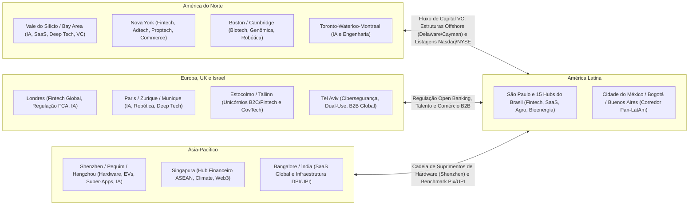

#### 2.1. América do Norte (Estados Unidos e Canadá)

A América do Norte permanece como o centro gravitacional de liquidez global, concentrando mais de 50% do capital de risco do planeta, o mercado comprador corporativo (Fortune 500) mais disposto a testar software novo e as bolsas de maior liquidez (Nasdaq e NYSE).
* **Vale do Silício e Bay Área (San Francisco, Palo Alto, Mountain View, San Jose):** Principal polo mundial de **Inteligência Artificial Generativa e Fundacional**, **SaaS B2B**, **Semicondutores** e **Deep Tech**. Sua vantagem competitiva combina a pesquisa de Stanford e UC Berkeley, mais de US$ 100 bilhões anuais em capital de risco na Sand Hill Road e uma **cultura empresarial que trata a falência honesta como aprendizado curricular** e onde gigantes de tecnologia compram de startups de 10 pessoas sem exigir 5 anos de balanço auditado.
* **Nova York (Silicon Alley):** Segundo o *Global Startup Ecosystem Report* (Startup Genome, 2024/2025), figura de forma consistente como o segundo maior ecossistema de startups do mundo ocidental, atrás apenas do Vale do Silício. Enquanto o Vale constrói infraestrutura tecnológica pura, Nova York domina a aplicação tecnológica nos setores que sedia: Fintech e Mercado de Capitais, Mídia e Adtech, Proptech (Imobiliário), E-commerce/Marcas D2C e Healthtech comercial.
* **Boston e Cambridge (Massachusetts):** Principal polo norte-americano de **Biotecnologia, Genômica, Farmacêutica (Kendall Square), Dispositivos Médicos e Robótica Avançada**, ancorado na concentração acadêmica e clínica do **MIT**, de **Harvard**, hospitais universitários de ponta (Mass General) e laboratórios de P&D das maiores farmacêuticas globais.
* **Austin, Miami, Los Angeles e Seattle:** **Seattle** é a capital mundial de *Cloud Computing* e *Enterprise Software* (forjada por Microsoft e Amazon/AWS), **Los Angeles** lidera em *Creator Economy*, *Gaming*, entretenimento e aeroespacial privado e defesa (fábrica principal da SpaceX em Hawthorne, embora a sede societária tenha migrado para o Texas em 2024, e Anduril em Costa Mesa, Orange County), **Austin** consolidou-se em semicondutores, infraestrutura e operações, e **Miami** tornou-se a **ponte financeira e societária entre os Estados Unidos e a América Latina**, abrigando gestores de VC pan-regionais, *fintechs* cross-border e fundadores latino-americanos.
* **Corredor Canadense (Toronto – Waterloo – Montreal – Vancouver):** Berço acadêmico do *Deep Learning* moderno (Geoffrey Hinton em Toronto, Yoshua Bengio no Mila em Montreal). A **Universidade de Waterloo** possui o programa de engenharia cooperativa (*co-op*) mais produtivo da América do Norte, funcionando como celeiro de talentos técnicos e *SaaS* (como a Shopify em Ottawa e Toronto). O país combina incentivos fiscais de P&D (SR&ED) ampliados no final de 2025 (quando o teto de gastos elegíveis ao crédito reembolsável de 35% subiu de C$ 3 milhões para C$ 6 milhões) com regras de imigração mais seletivas desde 2024 (incluindo o encerramento de novos pedidos no programa *Start-up Visa* em 31 de dezembro de 2025 para transição a um novo modelo piloto).

#### 2.2. Europa e Reino Unido

A Europa combina excelência científica universitária, forte financiamento público de transição climática/industrial (Horizon Europe, EIC, Bpifrance, KfW) e regulação pioneira (GDPR em privacidade, PSD2 em Open Banking, AI Act), embora enfrente maior fragmentação linguística e mercados de capitais locais menos profundos que os EUA.
* **Londres (com o triângulo Oxford–Cambridge):** Principal centro financeiro e tecnológico da Europa em **Fintech** (Revolut, Monzo, Wise, Checkout.com) e **Inteligência Artificial** (berço da Google DeepMind). A **FCA (*Financial Conduct Authority*)** britânica lançou o primeiro *Regulatory Sandbox* do mundo em junho de 2016, e a **CMA** (autoridade de concorrência do Reino Unido) determinou o *Open Banking* aos grandes bancos em fevereiro de 2017, dois modelos que inspiraram diretamente o Banco Central do Brasil.
* **Paris (França):** Impulsionada pelo banco público de investimento **Bpifrance**, pela **Station F** (campus de startups inaugurado em 2017 com 34 mil m² e capacidade para mais de mil empresas residentes) e por escolas de matemática e engenharia de elite (*École Polytechnique*, *ENS*), Paris tornou-se a capital continental da **IA europeia** (sede da Mistral AI e do Kyutai, grande centro de P&D da Hugging Face, fundada por franceses com sede em Nova York, e laboratórios de IA da Meta e do Google), além de liderar em *Deep Tech*, saúde e tecnologias para a indústria do luxo.
* **Berlim e Munique (Alemanha):** Duas vocações complementares. **Berlim** é o polo de consumo digital, *Fintech* (N26, Trade Republic), *E-commerce* e *SaaS* (alavancado historicamente pela escola operacional da Rocket Internet), **Munique**, ancorada na **TUM (Universidade Técnica de Munique)** e nas gigantes industriais (BMW, Siemens, Allianz), é a potência alemã em **Robótica, Mobilidade Autônoma, Indústria 4.0, Aeroespacial e Defesa**.
* **Estocolmo (Suécia) e Nórdicos:** Com cerca de 2,4 milhões de habitantes na região metropolitana, Estocolmo figura entre as cidades com maior número de unicórnios *per capita* da Europa, segundo relatórios da Atomico (*State of European Tech*), tendo gerado **Spotify, Klarna, King, Mojang/Minecraft, iZettle e Lovable**. A eficiência sueca apoia-se em três fatores: a reforma tributária *Hem-PC* de 1998 (que barateou a adoção de computadores domésticos cedidos por empregadores), uma rede de proteção social que amortece o custo pessoal do fracasso e a vocação exportadora de empresas que projetam produtos globais desde a fundação.
* **Zurique e Lausanne (Suíça):** Ancoradas no **ETH Zurich** e na **EPFL**, formam um polo europeu de alta concentração de laboratórios de doutorado e spin-offs acadêmicas em **Robótica, Visão Computacional, Biotecnologia e Criptografia/Blockchain** (Crypto Valley em Zug).
* **Amsterdã e Eindhoven (Holanda):** Eindhoven é o cérebro do hardware de semicondutores europeu, sede da **ASML** (única empresa do planeta capaz de produzir as máquinas de litografia ultravioleta extrema, EUV, que fabricam os chips mais avançados do mundo), enquanto Amsterdã lidera em pagamentos globais (**Adyen**) e plataformas de viagens (**Booking.com**).
* **Tallinn (Estônia):** País de 1,3 milhão de habitantes que construiu o Estado 100% digital mais eficiente do mundo (*X-Road*, identidade digital universal, abertura de empresas em minutos via *e-Residency*) e gerou **Skype, Wise, Bolt, Pipedrive e Veriff**.

#### 2.3. Ásia-Pacífico (China, Índia, Singapura, Coreia, Japão e Austrália)

A Ásia deixou há muito tempo de ser a "fábrica copiadora do Ocidente" para se tornar a fronteira mundial em manufatura avançada, transição energética, pagamentos instantâneos e comércio móvel:
* **Shenzhen e Grande Baía (China):** O ecossistema físico de **Hardware, Eletrônica, Robótica, Drones (DJI), Baterias e Veículos Elétricos (BYD, além da cadeia ligada à CATL de Fujian), Telecomunicações (Huawei) e Internet/Pagamentos (Tencent)** mais rápido e integrado da história humana. Um protótipo de hardware que leva 4 meses para ser iterado na Califórnia ou em São Paulo é produzido, testado e modificado em **48 a 72 horas em Shenzhen** graças à concentração de milhares de fábricas de placas (PCBs), moldes de injeção, sensores e componentes num raio de 50 quilômetros.
* **Pequim (Zhongguancun), Xangai e Hangzhou:** **Pequim** (ancorada na Universidade Tsinghua e na Universidade de Pequim) é o centro de **Inteligência Artificial e LLMs (Baidu, ByteDance/TikTok e Zhipu AI)**. **Xangai** lidera em **Semicondutores, Finanças e Biotech**. Já **Hangzhou**, sede do Alibaba, do Ant Group e do laboratório de IA **DeepSeek**, reinventou o **Social Commerce, o Live Commerce e a Logística Automatizada**.
* **Singapura:** A cidade-Estado funciona como a "Suíça tropical" e sede regional obrigatória para todo o **Sudeste Asiático (ASEAN)**: um mercado consumidor vizinho de mais de 680 milhões de pessoas (Indonésia, Vietnã, Tailândia, Filipinas, Malásia). Impulsionada pelos fundos soberanos **Temasek** e **GIC**, Singapura domina **Fintech, Comércio Marítimo/Supply Chain, Biotecnologia Asiática e Climate Tech**.
* **Índia (Bangalore, Mumbai, Delhi-NCR, Hyderabad e Chennai):** O ecossistema mais importante do mundo para um fundador brasileiro estudar e comparar. **Bangalore** e **Chennai** tornaram-se potências de **SaaS B2B Global** (Freshworks, Postman, Zoho: construindo software com engenharia indiana a uma fração do custo americano e vendendo em dólar para os EUA). Além da exportação de software, a Índia construiu a **India Stack (DPI, *Digital Public Infrastructure*)**, combinando identidade biométrica universal (**Aadhaar**, com mais de 1,3 bilhão de pessoas), pagamentos instantâneos interoperáveis (**UPI**, que ultrapassou 18 bilhões de transações mensais em 2025 segundo a NPCI, formando com o Pix brasileiro os dois maiores sistemas públicos de pagamento instantâneo do mundo) e compartilhamento de dados (**Account Aggregator**). A comparação direta entre o **UPI indiano** e o **Pix + Open Finance + Gov.br brasileiros** mostra que Brasil e Índia protagonizam os dois maiores casos mundiais de infraestrutura pública digital financeira em escala populacional.
* **Seul, Tóquio e Sydney/Melbourne:** **Seul** lidera em semicondutores de memória (Samsung, SK Hynix), baterias, *gaming*, robótica e cultura pop digitalizada (Coupang, Krafton, Naver/Kakao), **Tóquio** destaca-se em robótica industrial, materiais avançados, automação para sociedades em envelhecimento demográfico e *Corporate Venture Capital* global (SoftBank), e a **Austrália (Sydney/Melbourne)** provou como construir gigantes globais de software *Product-Led Growth (PLG)* longe dos EUA, como **Atlassian (Jira/Trello)** e **Canva**.

#### 2.4. Oriente Médio e África (MENA e África Subsaariana)

* **Israel (Tel Aviv, Herzliya, Haifa):** A chamada *Startup Nation* (com cerca de 10,2 milhões de habitantes em 2026) possui a maior densidade mundial de investimento de VC como percentual do PIB e forte presença de companhias listadas em bolsas americanas como Nasdaq e NYSE fora dos EUA e da China (Mobileye, Check Point, Monday.com, Wix, Fiverr e Nice), além de aquisições bilionárias concluídas no início de 2026, como a da CyberArk (comprada pela americana Palo Alto Networks em fevereiro de 2026) e a da Wiz (adquirida pelo Google por US$ 32 bilhões em março de 2026). A vantagem competitiva israelense nasce da combinação entre pesquisa universitária (Technion, Instituto Weizmann, Universidade Hebraica), serviço militar tecnológico obrigatório (como a **Unidade 8200** de inteligência cibernética e o programa **Talpiot**, onde jovens de 18 a 22 anos lideram projetos decisivos de criptografia, IA e defesa) e uma premissa geográfica central: **como o mercado doméstico é reduzido, as startups israelenses nascem no dia zero projetadas em inglês para vender B2B Enterprise nos Estados Unidos e na Europa**.
* **Emirados Árabes Unidos (Dubai e Abu Dhabi) e Arábia Saudita (Riade):** Consolidaram-se entre os principais polos de **Capital Soberano do mundo** (Mubadala, ADIA e MGX em Abu Dhabi, PIF e Sanabil na Arábia Saudita, investidores diretos em grandes fundos globais de IA e ativos relevantes no Brasil), além de oferecerem zonas francas jurídicas de direito anglo-saxão (*Common Law* no DIFC e no ADGM), imposto corporativo federal de 9% sobre lucros acima de AED 375 mil desde junho de 2023 (com alíquota zero restrita à renda qualificada em zona franca, pelo Decreto-Lei Federal nº 47/2022) e conexões aéreas entre Europa, Ásia e África.
* **África (Lagos na Nigéria, Nairóbi no Quênia, Cairo no Egito e Cidade do Cabo na África do Sul):** Os chamados *"Big Four"* africanos são laboratórios extraordinários de **inovação de fronteira para mercados informais e desbancorizados**. O Quênia (**Nairóbi / Silicon Savannah**) foi pioneiro mundial em dinheiro móvel com o **M-Pesa** em 2007 (muito antes do Ocidente) e em energia solar distribuída *Pay-As-You-Go* (M-KOPA), a Nigéria (**Lagos**) produziu gigantes de infraestrutura de pagamentos e *fintech* como **Flutterwave, Paystack (adquirida pela Stripe), Interswitch e Moniepoint**, o **Cairo** conecta o talento de engenharia egípcio ao mercado do Golfo Árabe, e a **Cidade do Cabo** lidera em software corporativo, seguros e biotecnologia no continente.

#### 2.5. América Latina e a Tese Pan-Latino-Americana

A América Latina soma mais de **660 milhões de habitantes**, PIB superior a US$ 6,5 trilhões, altíssima urbanização (~81%) e penetração massiva de smartphones e redes sociais, dividida em apenas dois grandes idiomas (Português e Espanhol) com forte afinidade cultural e dores estruturais idênticas (crédito caro, informalidade, saúde pública sobrecarregada, logística fragmentada e burocracia contábil).
* **O Eixo São Paulo – Cidade do México (CDMX):** Concentra entre dois terços e três quartos dos aportes de *venture capital* da região, conforme os levantamentos plurianuais da LAVCA. A tese clássica dos grandes vencedores regionais (**Mercado Livre, Nubank, Kavak, Rappi, dLocal, Creditas, QuintoAndar/Benvi, VTEX, EBANX, Wellhub**) desdobra-se em três caminhos: a empresa surge no próprio México (caso da Kavak) mirando o corredor com a América do Sul, ou nasce no **Brasil** (que responde por cerca de metade do mercado tecnológico latino-americano nos relatórios da Crunchbase, viabilizando escala de unicórnio já na operação doméstica) e depois usa a **Cidade do México** como segundo motor de crescimento, ou nasce na **Colômbia (Bogotá/Medellín)**, **Argentina (Buenos Aires)**, **Chile (Santiago)** ou **Uruguai (Montevidéu)**, países com talentos técnicos excepcionais mas mercados internos menores, e expande imediatamente para o México e o Brasil.
* **A complementaridade dos hubs hispânicos:** **Buenos Aires** e **Montevidéu** têm a tradição mais antiga de fundadores globais da região (Mercado Livre, Globant, Auth0, Despegar, PedidosYa, dLocal), **Bogotá e Medellín** destacam-se em operações, logística de última milha e talento de engenharia (Rappi, Habi), **Santiago** oferece o ambiente institucional e bancário mais estável da América do Sul (Cornershop/Uber, NotCo, Buk, Betterfly), e **Monterrey e Cidade do México** surfam a onda histórica do **Nearshoring industrial e logístico** com os Estados Unidos.

---

### 3. As 5 Vantagens Competitivas Estruturais do Brasil no Mundo

Um erro estratégico grave de fundadores brasileiros é tentar copiar teses do Vale do Silício onde o Brasil tem desvantagem comparativa (como tentar desenhar chips de inteligência artificial para disputar com Nvidia e AMD sem acesso a fundições avançadas da TSMC e a uma cadeia local de semicondutores), ignorando as **cinco áreas em que o Brasil acumula vantagem competitiva e escala real diante dos Estados Unidos e da Europa**:

#### 3.1. Vantagem 1: Infraestrutura Financeira Digital, Pagamentos Instantâneos e Crédito (Pix, Open Finance e Sistemas de Liquidação)

Graças a décadas de hiperinflação (até 1994), que obrigaram os bancos brasileiros a automatizar a compensação bancária nacional, à reestruturação do Sistema de Pagamentos Brasileiro (SPB) em abril de 2002 com liquidação bruta em tempo real (STR, análogo interbancário do Fedwire norte-americano) e à agenda pró-competição do **Banco Central do Brasil**, o país conta com uma das infraestruturas financeiras digitais mais integradas do mundo. O **Pix**, lançado em novembro de 2020 (quase três anos antes do FedNow americano, de julho de 2023), alcançou 148 milhões de usuários pessoas físicas ativos (cerca de 86% da população adulta) e 12,8 milhões de empresas segundo o Relatório de Gestão do Pix 2023–2025 do BCB, expandindo-se com QR Codes, Pix Automático e Pix por aproximação. Somado ao **Open Finance**, ao arcabouço de **SCDs, IPs e FIDCs** e à modernização dos sistemas de liquidação e registro de garantias (mesmo após o desligamento da plataforma piloto em *blockchain* do **Drex** pelo BCB em novembro de 2025 para redesenho arquitetural sem tecnologia DLT definida no curto prazo), esse ecossistema permite que uma *fintech* brasileira opere sobre trilhos regulatórios e tecnológicos altamente padronizados.

#### 3.2. Vantagem 2: Agronegócio Tropical, Biotecnologia de Solo e Clima Aberto

Enquanto a agricultura temperada americana ou europeia colhe uma safra por ano com inverno rigoroso que interrompe o ciclo biológico no campo, o Brasil é a maior potência agrícola tropical capaz de realizar **duas a três safras por ano no mesmo solo (soja, milho safrinha e culturas de cobertura ou integração lavoura-pecuária)** sob pressão constante de pragas e doenças. Isso converteu o país em um dos mercados líderes globais na adoção de **insumos biológicos (*Bioinputs*: biofertilizantes, bionematicidas e fixação biológica de nitrogênio)**, **genética tropical**, **monitoramento satelital de safras**, **fintechs de crédito rural privado (CPR digital, Barter e FIAGRO)** e **conectividade e telemetria de máquinas no campo** (ver Capítulos 11 a 14 deste volume, de Agritech: Playbook para o Campo Brasileiro a Biocombustíveis, Bioinsumos, Agrominerais, Irrigação e Bioeconomia Extrativista).

#### 3.3. Vantagem 3: Matriz Energética Limpa, Bioeconomia, Biocombustíveis e Mercado de Carbono

Com **cerca de 87% da matriz elétrica renovável em 2025** (86,8% segundo o Balanço Energético Nacional 2026 da EPE, após 88,2% em 2024, combinando geração hidrelétrica, eólica no Nordeste e solar distribuída), liderança mundial em **etanol de cana**, segunda posição global em etanol total e de milho (atrás dos EUA), forte potencial de escala em **biodiesel, biometano e SAF** (com mandato legal a partir de 2027 pela Lei nº 14.993/2024) e a maior reserva florestal e de biodiversidade tropical da Terra (Amazônia, Cerrado e Mata Atlântica), o Brasil destaca-se globalmente em quatro frentes: (a) *Cleantechs* de mensuração, rastreabilidade e certificação de carbono (MRV digital), (b) *Data Centers* verdes de Inteligência Artificial abastecidos por energia limpa com custo competitivo em contratos de longo prazo no mercado livre, (c) hidrogênio de baixa emissão e industrialização descarbonizada (*green steel* e *green fertilizers*), e (d) bioprospecção de moléculas da biodiversidade para cosméticos, alimentos e fármacos (ver Capítulo 14, Biocombustíveis, Bioinsumos, Agrominerais, Irrigação e Bioeconomia Extrativista, Capítulo 16, Energytech: Geração Distribuída, Mercado Livre de Energia, Smart Grids e Armazenamento, e Capítulo 17, Cleantech e ESG: Startups de Impacto Ambiental no Brasil, deste volume).

#### 3.4. Vantagem 4: Demografia Conectada, Hiper-Adoção Social e Digitalização de Serviços Essenciais

O brasileiro está entre os povos que passam mais horas por dia conectados à internet e ao **WhatsApp** no mundo, com pouca resistência cultural para adotar novas tecnologias digitais de consumo e trabalho. Ao mesmo tempo, o país apresenta gargalos severos em serviços essenciais: saúde suplementar e pública (SUS), educação profissionalizante, segurança patrimonial, varejo de vizinhança e logística rodoviária. Essa combinação de **dor aguda no mundo físico com população conectada no celular** permite que *Healthtechs*, *Edtechs*, *Logtechs* e soluções de *Conversational Commerce* (vendas e atendimento via agentes de IA no WhatsApp) alcancem milhões de usuários rapidamente.

#### 3.5. Vantagem 5: Software de Gestão (SaaS/ERP/Tax/Legal) Forjado na Maior Complexidade Operacional do Mundo

O sistema tributário, trabalhista, regulatório e judiciário brasileiro (Nota Fiscal Eletrônica em tempo real, SPED, substituição tributária, transição do IVA Dual CBS/IBS da Reforma Tributária, eSocial e PJe nos tribunais) está entre os ambientes operacionais mais complexos do mundo. Isso produz dois efeitos estratégicos. Primeiro, cria uma **barreira competitiva inicial contra concorrentes estrangeiros que tem prazo para mudar**: enquanto a CBS substitui PIS e Cofins já em 2027 e o IPI é zerado fora da Zona Franca de Manaus, os tributos subnacionais (ICMS e ISS) convivem com o novo IBS até 2032 (reduzindo-se de 2029 a 2032 nos termos dos arts. 125 a 129 do ADCT, incluídos pela EC nº 132/2023, e da LC nº 214/2025), o que eleva a exigência técnica e protege o software fiscal local (um ERP ou software contábil estrangeiro falha ao calcular a tributação de uma mercadoria cruzando três estados brasileiros). A partir de 2033, com a extinção definitiva do ICMS, do ISS e da substituição tributária, essa proteção regulatória diminui e a disputa passa a depender diretamente da eficiência do produto. Segundo, **forja engenheiros e arquitetos de software brasileiros habituados a regras de negócio exigentes, conciliação financeira em alto volume e sistemas governamentais decisivos**.

---

### 4. Mapa e Especialização de 15 Polos de Inovação do Brasil (Selecionados por Volume de Startups, ICTs e Capital)

O ecossistema brasileiro distribui-se em uma rede continental de polos tecnológicos com vocações setoriais distintas. Conhecer a vocação real de cada um dos **15 principais hubs brasileiros** permite a você decidir onde recrutar seus engenheiros, onde buscar parceria com universidades/EMBRAPII e onde posicionar sua operação comercial:

| # | Hub / Polo Brasileiro | Vocação Setorial Dominante | Universidades, ICTs e Parques-Âncora | Casos Icônicos e Referências Locais | Vantagem Competitiva Distintiva |
| :--- | :--- | :--- | :--- | :--- | :--- |
| **1** | **São Paulo (Capital)** | Fintech, SaaS B2B, Marketplaces, Proptech, Healthtech, Adtech, IA Comercial e Capital de Risco | USP (Poli, IME, FEA, FMUSP), Insper, FGV, IPT, CIETEC, Cubo Itaú, InovaBra | Nubank, QuintoAndar, Creditas, TOTVS, Wellhub, Unico, Loft, Omie, iFood (escritórios executivos) | Concentra de 60% a 70% do volume de Venture Capital investido no país (ABVCAP/Distrito, 2025), sedes das corporações clientes (Faria Lima e Berrini) e maior reserva de executivos de escala |
| **2** | **Campinas (SP)** | Deep Tech, SaaS, Logística, Foodtech, Agro, Fotônica, Telecom e P&D Corporativo | UNICAMP (Inova Unicamp), CNPEM (Sirius), CPQD, Instituto Eldorado, PUC-Campinas, IAC | iFood, CI&T, Movile, Sensedia, Griaule, Matera, dezenas de *spin-offs* da Unicamp | Maior ecossistema de ciência aplicada e patentes do país combinado com cultura de engenharia global (CI&T/iFood) a 90 km da capital |
| **3** | **São José dos Campos (SP)** | Aeroespacial, Defesa, Drones, Satélites, Mobilidade Aérea (eVTOL), Fintech e SaaS | ITA, DCTA, INPE, CEMADEN, UNIFESP, Parque Tecnológico de SJC (Nexus) | Embraer / Eve Air Mobility, Quero Educação, Birdie, Visiona Tecnologia Espacial | Formação de excelência em engenharia (ITA) voltada à resolução de problemas complexos e integração direta com a cadeia aeronáutica global |
| **4** | **Piracicaba (SP)** | Agritech, Biotecnologia Agrícola, Bioenergia, AgFintech e Sensoriamento Rural | ESALQ/USP, CENA/USP, EsalqTec, Pulse (Raízen), AgTech Garage (PwC), Pecege | Solinftec (presença no polo), @Tech, Bart Digital, Traive, dezenas de biotechs de solo e insumos | O "Vale do Piracicaba" (AgTech Valley): maior concentração de agrônomos, doutores em genética vegetal e usinas/corporações do agro |
| **5** | **São Carlos (SP)** | Deep Tech, Óptica/Fotônica, Novos Materiais, IA, Robótica, Drones e Insurtech/Fintech | USP São Carlos (ICMC, EESC, IFSC, IQSC), UFSCar, Embrapa Instrumentação, ParqTec | Opto Eletrônica, Xmobots, Arquivei, Kakau, Monitora, *spin-offs* de física e computação | Alta densidade de doutores por habitante no país (cerca de 1 doutor para cada 180 a 200 moradores, segundo dados divulgados pela prefeitura municipal e pelas universidades locais USP e UFSCar); excelência em física, materiais e computação |
| **6** | **Florianópolis (SC)** | SaaS B2B, MarTech, Inside Sales, Gestão para PMEs, Energia e Saúde Digital | UFSC, UDESC, Fundação CERTI, ACATE, Sapiens Parque, Centros de Inovação | RD Station, Neoway, Involves, Exact Sales, Softplan, Chaordic (histórico), Intelbras (Grande Floripa) | A "Ilha do Silício": tecnologia é a primeira atividade econômica da cidade; associativismo forte (ACATE) e escola nacional de *Inside Sales* |
| **7** | **Joinville, Blumenau e Vale do Itajaí (SC)** | ERP, Gestão Contábil/Fiscal, Indústria 4.0, Automação, Fintech B2B e E-commerce Têxtil | UDESC Joinville, UFSC Joinville, FURB, Ágora Tech Park (Perini Business Park), SENAI/SC | ContaAzul, Asaas, Senior Sistemas (em Blumenau, no mesmo eixo do Vale do Itajaí) e ecossistema Blusoft, Philips Clinical Informatics (origem local), WEG (Jaraguá do Sul) | Integração direta com o parque industrial do norte catarinense (metal-mecânica, motores elétricos na WEG, têxtil e plásticos) |
| **8** | **Recife (PE) e Polo Nordeste (Campina Grande/PB)** | Engenharia de Software em Escala, Serviços Financeiros, Saúde Digital, Games e GovTech | CIn-UFPE (Centro de Informática), CESAR, Porto Digital, UPE, UNICAP e UFCG (Campina Grande) | Porto Digital (mais de 415 empresas embarcadas e cerca de 18 mil a 20 mil profissionais nos levantamentos de 2024 e 2025 do NGPD/Porto Digital), CESAR, Tempest Security, Neurotech, In Loco/Incognia | Maior parque tecnológico urbano aberto do Brasil; o CIn-UFPE, o CESAR e a UFCG formam uma das principais escolas de ciência da computação e engenharia de software da América Latina |
| **9** | **Belo Horizonte (MG)** | Creator Economy, Martech, SaaS, Conversational AI, Fintech, Biotech e Mineração | UFMG (DCC, ICB, Engenharia), BH-TEC, PUC Minas, Biominas, FIEMG Lab | Hotmart, Blip (que adquiriu a Stilingue), Méliuz, Sympla, Samba Tech, Akwan (comprada pelo Google: 1º centro de P&D do Google na AL) | "San Pedro Valley": cultura comunitária de ajuda mútua entre fundadores, centro de P&D do Google na América Latina e excelência em busca/IA e bio |
| **10** | **Curitiba (PR)** | Fintech de Pagamentos Cross-Border, E-commerce/Varejo, Contabilidade Digital e Mobilidade | UFPR, UTFPR, PUCPR (Hotmilk), Vale do Pinhão | EBANX, Olist, MadeiraMadeira, Contabilizei, Pipefy, James Delivery, VHSYS | Forte pragmatismo comercial: berço de três unicórnios paranaenses (EBANX, Olist e MadeiraMadeira) e referência em *SaaS* de processos e pagamentos |
| **11** | **Porto Alegre e São Leopoldo (RS)** | Semicondutores, SaaS Enterprise, Fintech/Varejo, Healthtech e Agrotech | UFRGS, PUCRS (Tecnopuc), UNISINOS (Tecnosinos), Instituto Caldeira, CEITEC | Getnet (nascida no RS), Sicredi/Woop, Agibank, Zenvia, Nelogica, HT Micron | Tradição universitária consolidada, parques tecnológicos de referência (Tecnopuc e Tecnosinos) e articulação empresarial e financeira no Instituto Caldeira |
| **12** | **Rio de Janeiro (RJ)** | Energia, Óleo & Gás, Transição Energética, Matemática Aplicada/IA, Games, Marítimo e Mídia | UFRJ (COPPE e Parque Tecnológico da UFRJ), IMPA, PUC-Rio, FGV-Rio, IME (Exército), Fiocruz | VTEX (nascida no RJ), Stone (nascida no RJ), Passei Direto e Tembici (originada em projeto universitário carioca) | O **IMPA** (referência mundial em matemática pura e aplicada), a **COPPE/UFRJ** (maior centro de engenharia de petróleo, oceânica e energia) e a **PUC-Rio** (criadora da linguagem Lua) |
| **13** | **Santa Rita do Sapucaí (MG) e Polo Industrial de Manaus (AM)** | Hardware, Telecomunicações, IoT, Sensores, Cidades Inteligentes e Manufatura Eletrônica | INATEL (Instituto Nacional de Telecomunicações), ETE FMC, FAI e institutos de P&D da Zona Franca de Manaus (SUFRAMA/CBA) | Cerca de 150 a 160 empresas de eletroeletrônica e telecom associadas ao polo mineiro, como Leucotron, Sense e Ativa Soluções (SINDVEL, 2024), além da cadeia de montagem em escala em Manaus | O "Vale da Eletrônica" mineiro em projeto de placa, firmware e rádio-frequência, complementado pelos incentivos industriais e de Lei de Informática do polo de Manaus |
| **14** | **Uberlândia e Triângulo Mineiro (MG)** | Agritech, Logística Nacional, Atacado Distribuidor, Saúde Suplementar e Clínicas (operadoras reguladas pela ANS sob a Lei nº 9.656/1998), Telecom e Serviços Financeiros | UFU (Universidade Federal de Uberlândia), Uberhub, Brain (centro de inovação da Algar) | Sankhya, Zup Innovation (adquirida pelo Itaú), Cedro Technologies, Brain/Algar, iCrop | Posição logística central no Brasil (entroncamento entre Sudeste, Centro-Oeste e Nordeste) combinada com força no agro, saúde regional e *enterprise software* |
| **15** | **Goiânia, Brasília e Eixo Centro-Oeste (GO/DF/MT)** | Govtech, Regtech, Cibersegurança (Brasília); Agritech, Logtech, Fintech Rural e Saúde (GO/MT) | UnB, UFG (CEIA: Centro de Excelência em IA), UFMT, Embrapa Cerrados (Planaltina, DF) e Embrapa Agrossilvipastoril (Sinop, MT), Hub Goiás, Biotic (DF) | Aliare (originada da Siagri em Goiânia), Auvo (Goiânia), spin-offs de IA do CEIA-UFG, govtechs em Brasília e agritechs nos polos de Rio Verde (GO), Sorriso, Sinop e Rondonópolis (MT) | **Brasília** concentra o orçamento federal, tribunais superiores e bancos públicos (CPSI/Govtech); **Goiânia (CEIA-UFG)** tornou-se polo nacional de talentos de IA; e **MT/GO** são o laboratório de campo em escala real da produção de grãos e proteína animal |

---

### 5. Playbook de Decisão Geográfica: Onde Sediar, Onde Construir e Quando Internacionalizar

Com o mapa mundial e os 15 polos brasileiros na mesa, todo fundador depara-se com três decisões práticas de arquitetura geográfica ao longo das Fases 0 a 20. A primeira define onde alocar comercial e engenharia (Seção 5.1). A segunda estabelece quando operar com estrutura societária 100% brasileira e quando montar estrutura internacional (Seção 5.2), e a terceira orienta a escolha do estado e do município para sediar o CNPJ operacional, combinando acesso à Fundação de Amparo à Pesquisa estadual (FAPESP, FAPEMIG, FACEPE, FAPERGS) com proximidade de talentos e considerando que a Reforma Tributária (EC nº 132/2023 e LC nº 214/2025) reduz gradualmente os benefícios municipais de ISS entre 2029 e 2032 até a sua extinção em 2033, quando o IBS passa a ser cobrado integralmente no destino:

#### 5.1. Onde Alocar a Equipe: Comercial na Faria Lima e Engenharia nos Polos Universitários

A decisão de separar a frente comercial da base de engenharia responde diretamente à diferença de custo e de retenção de talentos entre os centros financeiros e os polos universitários brasileiros.
O erro clássico da startup que acaba de captar seu primeiro cheque em São Paulo é tentar contratar 40 desenvolvedores juniores e plenos disputando-os no mesmo quarteirão da Avenida Faria Lima com bancos de investimento e gigantes globais, pagando salários inflacionados e sofrendo um *turnover* (rotatividade) de 35% ao ano.

As startups brasileiras que mais rendem por real investido operam uma **arquitetura geográfica distribuída ou em dois polos**:
* **Comercial Enterprise, Relações com Investidores, Regulatório e Parcerias Corporativas:** Mantêm presença física (ou viagens quinzenais estruturadas) em **São Paulo (Capital)** ou no polo específico do cliente (como **Piracicaba, Cuiabá ou Goiânia** para Agritech, **Brasília** para Govtech Federal, e **Rio de Janeiro** para Óleo, Gás e Energia). Negócios B2B de alto valor (*High-Touch*), M&A e captação de rodadas de Série A em diante ainda dependem de confiança presencial.
* **Engenharia de Software, Ciência de Dados, IA e P&D Físico:** Alocam seus centros de engenharia ou contratam células inteiras nos polos universitários mapeados na tabela deste capítulo, como **Campinas (UNICAMP)**, **Recife e Campina Grande (CIn-UFPE/Porto Digital e UFCG)**, **Belo Horizonte (UFMG)**, **São Carlos (USP/UFSCar)**, **Florianópolis e Joinville (UFSC/UDESC)**, **Goiânia (CEIA-UFG)**, **Uberlândia (UFU)**, **Curitiba (UTFPR/UFPR)** e **Porto Alegre e São Leopoldo (UFRGS/PUCRS/UNISINOS)**. Nesses polos, a densidade de egressos de ciência da computação e engenharias permite formar equipes técnicas estáveis com menor rotatividade anual e custo total de folha inferior ao praticado no eixo da Faria Lima, além de habilitar projetos cooperativos com as FAPs estaduais.

#### 5.2. Quando Abrir Entidade Internacional (*Flip*, Estrutura *Cayman Sandwich* com Holding em Cayman e LLC em Delaware, ou Delaware C-Corp)

Conforme detalhado no Capítulo 5 (Internacionalização) do Volume 9 e no Capítulo 11 (Instrumentos de Captação) do Volume 5, abrir uma estrutura *offshore* exige cautela tributária (antes do *flip*, simule com um tributarista o risco de ganho de capital na conferência de quotas e a tributação anual de 15% em 31 de dezembro sobre lucros de controladas no exterior situadas em regime fiscal favorecido ou com renda ativa própria abaixo de 60%, nos termos da Lei nº 14.754/2023) e custa caro (US$ 15 mil a US$ 50 mil de *setup* jurídico e contábil inicial, mais US$ 10 mil a US$ 25 mil por ano de manutenção, contabilidade e declarações ao Banco Central e à Receita Federal). Portanto, **não abra estrutura internacional no Dia Zero por vaidade**:

* **Quando operar 100% com Ltda. ou S.A. brasileira:** Enquanto você estiver validando problema, solução, modelo de negócio e *Product-Market Fit* (Fases 1 a 13, de Encontrar a Ideia a Product-Market Fit), captando com subvenção pública (Finep e FAPESP exigem CNPJ brasileiro operacional), investidores-anjos locais ou fundos de Pre-Seed e Seed com veículos locais em reais (FIPs na CVM). Uma Ltda. brasileira com contrato de Mútuo Conversível bem redigido resolve a captação inicial com agilidade e custo baixo.
* **Quando executar o *Flip* (subir a holding para Cayman/Delaware ou constituir Delaware C-Corp direto):**

  1. **Captação com VCs Internacionais ou Regionais Dolarizados:** Se o *lead investor* do seu Seed ou Series A investe a partir de um veículo em Delaware ou Cayman (prática padrão de fundos globais e da maioria dos grandes fundos latino-americanos), eles exigirão investir na *holding* estrangeira (frequentemente o modelo **Cayman HoldCo → Delaware LLC → Brasil Ltda.** para empresas com operação predominante no Brasil, ou **Delaware C-Corp** pura para empresas de SaaS/IA que vendem diretamente nos Estados Unidos).
  2. **Venda Global desde o Dia 1 (*Global-First SaaS / AI / DevTools*):** Se o seu produto é uma ferramenta para desenvolvedores, infraestrutura de IA ou *SaaS* em inglês cujo cliente está nos EUA e na Europa, constituir uma **Delaware C-Corp** com conta bancária e processamento via Stripe nos EUA facilita receber pagamentos em dólar sem fricção cambial. Atenção, porém, ao planejamento fiscal: uma C-Corp detida por residentes no Brasil não elimina a carga tributária, pois está sujeita ao imposto corporativo norte-americano, às regras de controladas no exterior da Lei nº 14.754/2023 e às normas de preços de transferência (Lei nº 14.596/2023) na remuneração da equipe técnica mantida no Brasil, exigindo assessoria tributária especializada antes da abertura.

> [!warning] Onde Construir e Onde Vender: A Ambição Geográfica
> **Nunca deixe o CEP onde você nasceu definir o teto do mercado que você atende.** O Brasil possui hoje talentos de engenharia de software, inteligência artificial, agronomia, biotecnologia e serviços financeiros que competem de igual para igual com qualquer centro do mundo. Use a densidade do seu polo local para construir um produto tecnicamente impecável com custo eficiente, use a escala continental do mercado brasileiro (ou a ponte direta com os EUA) para validar a economia unitária e trate o mapa mundial de capital e talentos como o seu verdadeiro tabuleiro de jogo.

---

### Filtro de Alinhamento e Prontidão: Perguntas de Validação Prática

Submeter a escolha das bases operacionais e da estrutura societária às três perguntas abaixo evita que a startup imobilize caixa em escritórios caros antes do *Product-Market Fit* ou execute um *flip* internacional prematuro sem necessidade comercial ou de captação.

Antes de escolher a sede fiscal ou alugar escritório, passe por três perguntas de fogo:

1. **Proximidade da Dor Real:** Você está a menos de duas horas dos vinte maiores compradores do seu setor para tomar café olho no olho, ou tenta vender para um setor tradicional por vídeo a mil quilômetros de distância?
2. **Fonte de Engenharia Sustentável:** O polo onde você recruta forma centenas de engenheiros na sua tecnologia todos os anos com retenção superior a três anos, ou você disputa cada programador a peso de ouro com bancos e big techs?
3. **Incentivo Fiscal e Fomento Local:** Sua sede dá acesso à FAP estadual mais adequada para a sua vertical (FAPESP, FAPEMIG, FACEPE, FAPERGS)? Lembre-se de que o benefício municipal de alíquota reduzida de ISS vale integralmente até 2028 e reduz-se à razão de 10% ao ano na transição da Reforma Tributária (2029 a 2032), extinguindo-se em 2033, quando o IBS passa a ser cobrado integralmente no município de destino do comprador.

**O Movimento de Segunda-Feira:** Nesta segunda-feira, selecione o hub brasileiro líder da sua vertical na tabela deste capítulo, liste cinco fundadores residentes e agende as conversas, nos 15 dias seguintes, realize uma imersão presencial de três dias no polo com um roteiro objetivo sobre custo de engenharia, retenção técnica e acesso a clientes.


---

## CAPÍTULO 3: CICLOS MACROECONÔMICOS E A STARTUP BRASILEIRA

### A Gravidade da Selic de Dois Dígitos sobre o Valuation

Entre 2020 e março de 2021, com a taxa Selic na mínima histórica de 2% ao ano e o mercado global inundado de liquidez a juro próximo de zero, muitos fundadores no Brasil passaram a gerenciar operações como se o capital fosse gratuito e inesgotável. Contratavam centenas de pessoas antes da receita existir, subsidiavam frete e *cashback* com dinheiro de Venture Capital e comemoravam múltiplos de vinte vezes a receita recorrente. Quando a Selic subiu para 9,25% no fim de 2021 e alcançou 13,75% em agosto de 2022, acompanhada pela alta dos juros do Federal Reserve americano a partir de março de 2022, o ajuste veio em poucos trimestres: quem dependia de capital barato viu o custo do capital de giro disparar, a inadimplência dos clientes subir e os fundos internacionais retraírem novas alocações, forçando cortes de 20% a 40% nas equipes para preservar o caixa.

Jim Collins e Morten T. Hansen mostraram em *Great by Choice* (2011) que vencem ambientes turbulentos as empresas que operam com paranoia produtiva, disciplina empírica e margem de segurança financeira. No Brasil, a taxa Selic e o câmbio decidem diretamente o fluxo de caixa e o custo de capital da sua segunda-feira.

Toda startup brasileira opera sob a **Gravidade da Selic de Dois Dígitos**: quando o título público federal livre de risco remunera acima de 10% a 12% ao ano, o custo de oportunidade do dinheiro encarece a taxa de desconto do fluxo de caixa (como veremos no cálculo de *valuation* da seção 3), obriga o gestor a acompanhar um painel macroeconômico disciplinado (seção 8) e inviabiliza qualquer software B2B que demore mais de seis meses para gerar retorno em caixa ao cliente. O fundador calejado reajusta seus contratos pela inflação, protege seus custos em dólar e usa a retração cíclica para conquistar participação de mercado enquanto concorrentes alavancados perdem fôlego.

Gerenciar uma startup brasileira exige incorporar a gravidade dos juros básicos, da inflação setorial e do câmbio diretamente no orçamento operacional e nas cláusulas de reajuste contratual, protegendo a margem de contribuição e o fôlego de caixa antes que o ciclo monetário vire.

---

> [!abstract] Posição no livro
> Este capítulo analisa como os ciclos macroeconômicos brasileiros (taxa Selic, inflação, câmbio e retração do capital de risco) afetam as decisões de captação, escala e saída, dialogando diretamente com a Fase 14 (Capital para Escala, Rodadas e Eficiência Financeira, no Volume 5). Aplicar especialmente em:
> - [[IGNICAO-Vol-5-Financas-e-Captacao#FASE 14: CAPITAL PARA ESCALA, RODADAS E EFICIÊNCIA FINANCEIRA|Fase 14: Capital para Escala, Rodadas e Eficiência Financeira (Vol. 5)]] e [[IGNICAO-Vol-5-Financas-e-Captacao#CAPÍTULO 9: CAPTAÇÃO DE EQUITY: PLANEJAMENTO DE RODADA, PITCH E RELACIONAMENTO COM INVESTIDORES|Capítulo 9: Captação de Equity: Planejamento de Rodada, Pitch e Relacionamento com Investidores (Vol. 5)]] para *timing* e estruturação de rodada
> - [[IGNICAO-Vol-6-Receita-e-Pessoas#FASE 16: TIME, LIDERANÇA EXECUTIVA E CULTURA EM ESCALA|Fase 16 (Vol. 6)]] para estratégia de contração em janela ruim
> - [[IGNICAO-Vol-9-Maturidade-e-Exit#FASE 20: ESTRATÉGIA DE SAÍDA (EXIT STRATEGY)|Fase 20 (Vol. 9)]] para timing de saída

---

### 1. Por que o macro importa para startups

Existe uma narrativa sedutora no ecossistema de inovação: a startup opera num mercado próprio, cria demanda onde não existia, então os ciclos da "velha economia" não se aplicam. Essa ilusão mata empresas.

A realidade é que todo negócio brasileiro está exposto ao ambiente macroeconômico de maneira direta e indireta, mesmo quando os fundadores não conseguem ver as conexões. Os três canais de transmissão mais relevantes são:

**Canal 1: Custo de capital**

Quando o Banco Central mantém a Selic acima de 13% ao ano (como no pico de 15% ao ano entre junho de 2025 e março de 2026 e no patamar de 13,75% ao ano em outubro de 2026, data de referência desta edição), o custo de oportunidade do dinheiro sobe para todo o sistema financeiro. O alocador que antes aceitava apostar em um SaaS em estágio *seed* passa a obter retorno de dois dígitos ao ano com liquidez diária e risco soberano no Tesouro Selic (LFT). O prêmio exigido para imobilizar capital em ativos ilíquidos cresce, comprimindo múltiplos e tornando as rodadas mais seletivas.

**Canal 2: Burn rate real**

Inflação corrói o poder de compra do caixa. Uma startup que levantou R$ 2 milhões em janeiro de 2021 e projetou 24 meses de runway viu esse prazo encolher porque o IPCA acumulou cerca de 16,4% nesse período (10,06% em 2021 e 5,79% em 2022), fazendo os R$ 2 milhões comprarem no fim de 2022 o equivalente a cerca de R$ 1,72 milhão. Custos de escritório, softwares, serviços terceirizados e folha de pagamento sobem. O runway nominal permanece, mas o runway real se contrai.

**Canal 3: Exposição cambial invisível**

A maioria das startups brasileiras tem custos em dólar que não aparecem como dólar na contabilidade: servidores AWS, Stripe, licenças Figma, HubSpot, Slack, Notion, Intercom. Quando o real se desvaloriza de R$ 4,00 para R$ 5,50 por dólar, a linha de despesas de infraestrutura cresce 37,5% sem que nenhuma decisão operacional tenha sido tomada.

> [!warning]
> Ignorar o macro não o neutraliza. Significa apenas que você será surpreendido por ele em vez de se preparar para ele.

---

### 2. O ciclo econômico brasileiro: as quatro fases

O Brasil tem um ciclo econômico mais volátil do que economias desenvolvidas por quatro fatores estruturais: dependência de commodities, fragilidade fiscal recorrente (em que desvios da meta de resultado primário sob o arcabouço fiscal deslocam rapidamente a curva futura de juros DI), sensibilidade a fluxos de capital externo e incerteza nos anos de ciclo eleitoral presidencial (como em 2026, quando a volatilidade do câmbio e dos prêmios de risco nos meses em torno do pleito costuma travar janelas de bolsa e alongar comitês de investimento). Essa combinação amplifica tanto as expansões quanto as contrações.

```text
CICLO ECONÔMICO - FASES E CARACTERÍSTICAS

┌─────────────────────────────────────────────────────────────────┐
│  EXPANSÃO          │  Crédito barato, confiança alta,           │
│                    │  investidor com apetite, talentos caros     │
├─────────────────────────────────────────────────────────────────┤
│  PICO              │  Inflação acelera, BCB inicia alta da Selic,│
│                    │  janela de captação começa a fechar         │
├─────────────────────────────────────────────────────────────────┤
│  CONTRAÇÃO         │  Crédito se contrai, VC recua, runway       │
│                    │  encurta, clientes cortam gastos            │
├─────────────────────────────────────────────────────────────────┤
│  RECUPERAÇÃO       │  Oportunidade de consolidação, valuation    │
│                    │  comprimido cria M&A barato, capital         │
│                    │  começa a retornar seletivamente            │
└─────────────────────────────────────────────────────────────────┘
```

**2010–2012: O boom**

O Brasil vivia o ciclo das commodities, fluxo de capital externo abundante e crédito barato. A SELIC caiu para 7,25% em 2012: mínima histórica até então. O ecossistema de startups cresceu numa bolha de otimismo. Fundadores captavam com múltiplos generosos porque o custo de oportunidade do dinheiro era baixo e a narrativa do "Brasil que vai dar certo" estava no auge.

**2015–2016: A recessão**

O PIB recuou 3,5% em 2015 e mais 3,3% em 2016, enquanto a meta Selic foi mantida em 14,25% ao ano entre julho de 2015 e outubro de 2016. O crédito secou, a taxa de desocupação na PNAD Contínua dobrou de cerca de 6,5% em 2014 para 12% no fim de 2016 (atingindo 13,7% no início de 2017) e o consumo das famílias retraiu-se. Startups dependentes da expansão rápida do consumo doméstico sentiram a contração da demanda: empresas com *runway* curto encerraram atividades, ao passo que operações eficientes em capital sobreviveram e consolidaram participação de mercado.

**2020: A pandemia**

Um choque exógeno que paralisou setores inteiros em semanas. O Banco Central cortou a Selic para a mínima de 2% ao ano em agosto de 2020, abrindo uma janela expressiva de captação no ecossistema brasileiro, porque o capital barato e a digitalização aceleraram a demanda por software. Empresas de saúde digital, educação e logística registraram em 12 meses a expansão que antes projetavam para 3 a 5 anos.

**2021–2022: O aperto monetário global**

O ciclo de juro zero terminou. O Federal Reserve subiu a faixa-alvo dos juros americanos de 0%–0,25% para 5,25%–5,50% entre março de 2022 e julho de 2023. O Banco Central do Brasil, que havia iniciado o aperto monetário ainda em março de 2021, levou a Selic a 13,75% em agosto de 2022. O capital de risco global retraiu-se, alongando o fechamento das rodadas e comprimindo os *valuations* de entrada em relação ao pico de 2021 (os parâmetros detalhados dessa retração estão na seção 6 deste capítulo). O inverno do capital de risco havia chegado.

> [!note]
> O Banco Central do Brasil costuma iniciar o ciclo de alta de juros antes do Federal Reserve americano, fazendo com que o ecossistema local sinta a desaceleração primeiro. Na saída do aperto, o padrão varia conforme a dinâmica inflacionária doméstica: em agosto de 2023, por exemplo, o BCB iniciou os cortes da Selic mais de um ano antes do primeiro corte do Fed, em setembro de 2024.

---

### 3. SELIC e startups: o mecanismo de compressão de valuations

A taxa Selic é a âncora do custo de oportunidade e da taxa de desconto de todos os ativos da economia brasileira. Para entender como a Selic comprime diretamente os múltiplos de avaliação de startups, observe o mecanismo financeiro:

**O modelo de fluxo de caixa descontado**

O valor de qualquer ativo é o valor presente dos fluxos de caixa futuros. A taxa de desconto usada nesse cálculo inclui a taxa livre de risco (aproximada pela SELIC para ativos em real) mais um prêmio de risco. Quando a SELIC sobe, a taxa de desconto sobe, e o valor presente dos fluxos futuros cai.

Uma startup de SaaS que projeta R$ 10 milhões de fluxo de caixa livre daqui a cinco anos vale:

```text
IMPACTO DA SELIC + PRÊMIO DE RISCO VC (+20 P.P.) NO VALOR PRESENTE DE R$ 10M EM 5 ANOS

Cenário de Selic base  │ Taxa de desconto total (Ke) │ Valor presente de R$ 10M daqui a cinco anos
───────────────────────┼─────────────────────────────┼────────────────────────────────────
Selic 8% a.a.          │ 28% a.a. (8% + 20 p.p.)     │ R$ 2,91 milhões (cenário base)
Selic 13% a.a.         │ 33% a.a. (13% + 20 p.p.)    │ R$ 2,40 milhões (queda de 17%)
Selic 15% a.a.         │ 35% a.a. (15% + 20 p.p.)    │ R$ 2,23 milhões (queda de 23%)
```

O efeito é ainda mais dramático para startups em fase inicial, onde os fluxos positivos estão mais distantes no tempo.

**O efeito no apetite do investidor**

Quando a renda fixa soberana entrega retorno anual em dois dígitos altos com liquidez diária (como na faixa acima de 13% ao ano registrada desde 2025, conforme detalhado na seção 1.1), o fundo de Venture Capital precisa enxergar um retorno composto muito superior para justificar uma década de iliquidez e risco de execução: menos empresas passam pelo comitê de investimento, os cheques exigem eficiência comprovada de caixa e as cláusulas de governança ficam mais rigorosas.

**O custo de crédito operacional**

Mesmo que a startup não dependa de Venture Capital, o custo do capital de giro bancário, do desconto de duplicatas e de dívidas corporativas sobe diretamente com a taxa básica: linhas contratadas a CDI + 3% ou CDI + 5% ao ano tornam-se pesadas quando o CDI acompanha uma Selic elevada, exigindo testar o fluxo de caixa com um cenário de estresse adicional de +3 pontos percentuais sobre a taxa vigente (superando o pico recente de 15% ao ano).

> [!important]
> Fundadores devem conhecer a SELIC projetada pelo boletim Focus para os próximos 12 meses antes de projetar qualquer modelo de valuation ou planejamento de captação.

---

### 4. Inflação e operações: proteger contratos e custo do time

A inflação impacta diretamente a margem operacional da startup em três frentes simultâneas: reajuste de contratos com clientes, evolução da folha salarial e precificação de novos planos.

**Contratos e cláusulas de reajuste**

Todo contrato SaaS ou de serviço firmado no Brasil sem cláusula de reajuste é um contrato que perde valor em termos reais ao longo do tempo. A prática recomendada é incluir reajuste anual indexado a um índice de preços.

A escolha do índice importa:

```text
ÍNDICES DE INFLAÇÃO - COMPARATIVO

Índice   │ O que mede                   │ Quando usar (periodicidade mín. anual)
─────────┼──────────────────────────────┼───────────────────────────────────────
IPCA     │ Inflação oficial ao consumo  │ Contratos B2C e SaaS B2B (Lei 10.192)
IGP-M    │ Atacado (IPA), consumo e INCC│ Contratos imobiliários e energia
INPC     │ Cesta de famílias até 5 SM   │ Dissídios e negociações sindicais CLT
IPCA-E   │ Série trimestral do IPCA-15  │ Fase pré-judicial trabalhista (ADC 58. Dívidas civis seguem IPCA + taxa legal pela Lei 14.905/2024)
```

O IGP-M tem alta volatilidade, chegou a acumular 23% em 2020, e pode criar passivos inesperados se usado em contratos com clientes que não têm essa exposição natural. Para a maioria das startups B2B, o IPCA é o índice mais defensável e aceito pelos clientes.

A cláusula de reajuste deve ser clara: "O valor contratual será reajustado anualmente na data de aniversário do contrato pelo IPCA acumulado nos 12 meses anteriores, divulgado pelo IBGE." Sem ambiguidade sobre o índice, o período de cálculo e a data de aplicação.

**Custo do time e salário real**

Em períodos de inflação alta, manter talentos exige atenção ao salário real, não apenas ao nominal. Um colaborador que não recebeu aumento enquanto o IPCA acumulou 8% sofreu queda de cerca de 7,4% no poder de compra ($1 - 1/1{,}08$). Isso gera perda salarial real, eleva a rotatividade e aumenta o risco de perder pessoas-chave para empresas que recomponham a inflação.

Para equipes contratadas sob regime CLT, confira obrigatoriamente a **convenção ou acordo coletivo da categoria sindical (data-base)** antes de fixar a política anual, pois o piso de recomposição salarial da convenção coletiva é vinculante. Acima do piso da convenção coletiva, a prática saudável é comunicar com transparência o critério de reajuste e mérito da empresa antes que o colaborador precise negociar individualmente. Além disso, caso uma retração severa exija redução de quadro (ver protocolo completo de desligamentos no **Capítulo 10, Layoffs e Downsizing: Como Demitir em Escala sem Destruir a Empresa, do Volume 9**), lembre-se de somar no cálculo do *runway* o **caixa imediato consumido pelas verbas rescisórias** (aviso prévio indenizado, férias e 13º proporcionais e multa de 40% sobre o saldo do FGTS): demitir reduz a queima mensal futura, mas drena caixa à vista no mês do corte.

**Pricing em período inflacionário**

Aumentar preço em período de inflação alta é politicamente mais fácil do que em período de estabilidade, porque o contexto geral justifica a conversa. Empresas que postergam reajustes de preço perdem margem e precisam de aumentos maiores e mais disruptivos no futuro.

> [!tip]
> Em contratos anuais, programe o reajuste para coincidir com a renovação. Em contratos mensais, avise com 30 dias de antecedência e use a linguagem de reajuste contratual previsto: não de "aumento de preço".

---

### 5. Câmbio como risco e oportunidade

O câmbio é a variável mais frequentemente ignorada em modelos financeiros de startups brasileiras. Existem dois perfis opostos de exposição:

**O perfil de risco: custo em dólar, receita em real**

É o perfil da maioria das startups em fase inicial. A infraestrutura é americana (AWS, GCP, Azure), as ferramentas são americanas (Stripe, Twilio, Segment, Amplitude), e a receita é em real. Quando o dólar sobe de R$ 4,80 para R$ 5,60, variação de 16,7%, os custos de infraestrutura crescem na mesma proporção sem nenhuma contrapartida na receita.

Ações para mitigar:

- Mapear todas as despesas em moeda estrangeira e calcular a exposição mensal em dólar
- Negociar créditos anuais com provedores cloud, reduzindo exposição a variação intra-ano
- Manter parte do caixa em dólar como reserva de hedge (para o CNPJ, exige conta regular sob a Lei 14.286/2021, contabilização da variação cambial com o contador e, para ativos no exterior de US$ 1 milhão ou mais em 31 de dezembro, declaração CBE ao Banco Central)
- Avaliar alternativas nacionais para componentes de baixa criticidade (provedores cloud locais, ferramentas nacionais)

**O perfil de vantagem: receita em dólar, equipe em real**

Startups com tração internacional, seja por produto global, seja por clientes fora do Brasil, têm vantagem competitiva quando o real se desvaloriza. A receita em dólar se converte em mais reais, enquanto o custo da equipe permanece em real. A margem operacional real sobe.

Essa assimetria entre receita em moeda forte e estrutura de engenharia em reais leva fundadores de software com vocação exportadora a buscar clientes internacionais cedo, combinando expansão de mercado com proteção cambial (*hedge* natural) no próprio fluxo operacional.

**Hedge cambial para PME**

Para startups com exposição significativa ao câmbio, existem instrumentos de proteção acessíveis a pequenas empresas:

```text
INSTRUMENTOS DE HEDGE CAMBIAL

Instrumento       │ Como funciona                  │ Adequado para
──────────────────┼────────────────────────────────┼──────────────────────
NDF               │ Contrato a termo de câmbio     │ Exposição previsível,
(Non-Deliverable  │ sem entrega física, liquidado  │ pagamentos futuros
Forward)          │ pela diferença                 │ em USD conhecidos
──────────────────┼────────────────────────────────┼──────────────────────
Opção de câmbio   │ Direito (não obrigação) de     │ Proteção com custo
                  │ comprar USD a preço fixo       │ definido, exposição
                  │                                │ variável
──────────────────┼────────────────────────────────┼──────────────────────
Reserva em USD    │ Manter parte do caixa em       │ Exige conta PJ regular
                  │ dólar em conta no exterior     │ (Lei 14.286), tributação cambial e CBE
                  │ ou conta internacional         │ ao BCB (se ativos >= US$ 1M em 31/12)
──────────────────┼────────────────────────────────┼──────────────────────
Conta no exterior │ Conta em banco americano       │ Startups com receita
                  │ ou europeu para receber        │ internacional
                  │ e pagar em USD                 │ recorrente
```

> [!warning]
> NDF e opções de câmbio têm custo e exigem contrapartes bancárias. Para a maioria das startups em fase inicial, a reserva em dólar é a solução mais prática. Contratar instrumentos financeiros complexos sem entender o mecanismo pode criar risco adicional.

---

### 6. Ciclos de capital de risco: o inverno do VC

A oferta de capital de risco (*Venture Capital*) expande-se e contrai-se em ondas pronunciadas que acompanham a taxa básica de juros americana (*Fed Funds*) e a liquidez global. Compreender em que ponto desse ciclo o mercado está evita planejar rodadas com premissas defasadas.

**O mecanismo de transmissão global**

Quando o Fed sobe juros nos EUA, os fundos de pensão e endowments americanos, que são os LPs (Limited Partners) dos grandes VCs globais, alocam mais capital em renda fixa e menos em fundos alternativos como VC. Os grandes VCs reduzem a velocidade de investimento. Os VCs brasileiros, que frequentemente recebem capital de fundos internacionais ou de LPs que também investem em fundos internacionais, sentem o mesmo aperto com defasagem de 6 a 12 meses.

**O inverno de 2022–2023**

O ciclo de aperto monetário global que começou em 2022 provocou uma contração severa no mercado de VC global. No Brasil, o impacto foi direto:

- O volume financeiro aportado recuou mais de 50% em 2022–2023 em relação ao pico histórico de 2021, enquanto o número de rodadas caiu entre 40% e 50% (segundo as séries históricas do Distrito e da LAVCA)
- Os *valuations pré-money* de rodadas Seed e Série A recuaram na faixa estimada de 40% a 60% em relação ao pico de 2021 nas safras de 2022 a 2024, acompanhando o alongamento do tempo de fechamento das rodadas de cerca de 3 meses para 6 a 9 meses
- O tempo médio de fechamento de uma rodada institucional subiu de cerca de 60 a 90 dias no auge de 2021 para 6 a 9 meses
- Exigência de métricas de eficiência (LTV/CAC, payback period, margem bruta) substituiu foco exclusivo em crescimento

**O que os VCs brasileiros fazem quando o mercado global esfria**

Os gestores de VC locais adotam comportamentos previsíveis em downturns:

- Desaceleram o ritmo de novas alocações para preservar caixa para novos aportes (*follow-ons*) nas empresas do portfólio existente, elevam a régua de entrada, exigem caminho claro para a lucratividade em rodadas menores e reforçam cláusulas de proteção em crises (como *liquidation preference*, a preferência na distribuição de recursos em evento de liquidez)
- Elevam o bar de entrada: exigem receita recorrente, path para rentabilidade e fundadores com experiência anterior
- Aumentam o peso de due diligence financeira em relação à due diligence de mercado
- Preferem valuations mais baixos e rounds menores com cláusulas de proteção (anti-diluição, liquidation preference)

**Como se preparar para captar em ambiente restritivo**

A preparação começa 12 a 18 meses antes da rodada:

- Atingir métricas de eficiência que resistam ao escrutínio: churn abaixo de 2% ao mês, LTV/CAC acima de 3x, payback em menos de 12 meses
- Construir relacionamento com 3 a 5 fundos antes de precisar do dinheiro
- Ter 18 meses de runway no momento em que iniciar o processo de captação
- Documentar a tese de resiliência: como o negócio se comportou (ou se comportaria) em contração econômica

> [!note]
> Separe dois momentos distintos do ciclo econômico: **para contratar talentos escassos e adquirir concorrentes ou carteiras de clientes a preços descontados**, a melhor janela é o **início da recuperação** (logo após o fundo do vale), quando a maioria do mercado ainda está retraída. Já **para captar rodadas de *equity* com *valuation* atraente e termos limpos**, a janela favorável se abre quando a queda dos juros se consolida e múltiplos fundos voltam a disputar ativamente as mesmas lideranças setoriais.

---

### 7. Estratégia de crise: o playbook de contração

Quando o cenário macroeconômico aperta, a startup precisa de um plano claro de preservação de caixa. A decisão central é binária: estender runway (modo defensivo) ou crescer através do downturn (modo ofensivo).

**Quando estender runway**

A escolha defensiva é apropriada quando:

- O mercado-alvo da startup é diretamente afetado pelo ciclo (consumo discricionário, crédito, imóveis)
- A startup ainda não atingiu product-market fit claro
- O runway atual é inferior a 18 meses
- O pipeline de captação está incerto

O objetivo é chegar ao outro lado da crise com a empresa intacta. Isso significa cortes reais, não cosméticos.

**O que cortar primeiro**

```text
HIERARQUIA DE CORTES EM CRISE

Prioridade 1 - Cortar imediatamente:
  - Marketing de aquisição pago com CAC elevado
  - Contratos de fornecedores não essenciais
  - Viagens e eventos
  - Softwares com uso abaixo de 30% da capacidade contratada

Prioridade 2 - Renegociar:
  - Aluguel de escritório (home office como padrão)
  - Contratos de prestadores de serviço
  - Planos de infraestrutura cloud (right-sizing)

Prioridade 3 - Avaliar com cuidado:
  - Headcount em funções não essenciais ao produto core
  - Projetos de expansão de produto sem validação de demanda

Nunca cortar:
  - Time core de produto e engenharia
  - Customer success de clientes que geram receita
  - Capacidade de entrega do produto atual
```

**Quando crescer através do downturn**

A escolha ofensiva é válida quando:

- O produto da startup resolve um problema que se intensifica em crise (redução de custo, automação, eficiência)
- A startup tem runway superior a 24 meses
- Concorrentes estão recuando, abrindo espaço de mercado
- A janela de captação ainda está aberta para o perfil da empresa

**A crise como janela de consolidação**

Downturns criam oportunidades de M&A que não existem em períodos de expansão. Concorrentes com menos capital ficam vulneráveis. Talentos ficam disponíveis. Clientes que estavam satisfeitos com o status quo ficam abertos a soluções mais eficientes.

Empresas que atravessaram crises com saúde financeira e capturaram consolidação saíram estruturalmente mais fortes. Na recessão brasileira de 2015 e 2016, por exemplo, enquanto competidores descapitalizados encerravam operações ou reduziam investimentos, empresas de software de gestão e tecnologia com balanço sólido (como a TOTVS e a Linx no software corporativo, ou o iFood consolidando concorrentes regionais de entrega de refeições entre 2014 e 2016) aproveitaram a retração para adquirir carteiras de clientes e ampliar sua liderança de mercado.

> [!important]
> A pior decisão em crise é a indecisão: nem cortar o suficiente para garantir runway nem investir com convicção suficiente para capturar oportunidade. Defina o modo em que está operando e execute com consistência.

---

### 8. Indicadores que o fundador deve monitorar

O acompanhamento do ambiente macroeconômico não exige ser economista. Exige um painel de 6 a 8 indicadores monitorados com frequência definida.

```text
PAINEL MACROECONÔMICO DO FUNDADOR

Indicador                  │ Fonte        │ Frequência  │ O que sinaliza
───────────────────────────┼──────────────┼─────────────┼─────────────────────────────
SELIC (Meta Copom)         │ Banco Central│ A cada 45 d │ Custo de capital, apetite VC (8 reuniões/ano)
SELIC (Boletim Focus)      │ Banco Central│ Semanal     │ Expectativa do mercado 12m
IPCA (acumulado 12m)       │ IBGE         │ Mensal      │ Pressão de custo, pricing
IGP-M                      │ FGV          │ Mensal      │ Contratos com indexação
USD/BRL (câmbio comercial) │ Banco Central│ Diária      │ Custo infra, receita USD
Inadimplência PJ           │ Banco Central│ Mensal      │ Saúde financeira de clientes
ICE/FGV (Confiança do      │ FGV          │ Mensal      │ Propensão a investir/contratar
Empresário)                │              │             │
PIB (prévia e realizado)   │ IBGE         │ Trimestral  │ Ciclo econômico geral
```

**SELIC e Boletim Focus**

O Boletim Focus é publicado toda segunda-feira pelo Banco Central e consolida as expectativas de mais de 100 instituições financeiras para os principais indicadores. A SELIC projetada para 12 e 24 meses é o dado mais relevante para planejar captações e modelar valuation.

**IPCA acumulado 12 meses**

O IPCA cheio dá o contexto geral, mas para startups de software é útil acompanhar o IPCA de serviços, que tende a ser mais persistente e reflete melhor o custo de mão de obra qualificada.

**Inadimplência pessoa jurídica**

Publicado mensalmente pelo Banco Central, o índice de inadimplência de pessoas jurídicas sinaliza a saúde financeira das empresas clientes. Para startups B2B, inadimplência crescente precede cancelamentos e dificuldades de cobrança.

**Confiança Empresarial (ICE da FGV IBRE e ICEI da CNI) e Atividade Econômica (IBC-Br do Banco Central)**

O ICE mede a percepção dos empresários sobre o ambiente de negócios atual e futuro. Quando o índice cai de forma consistente, decisões de compra corporativas ficam represadas: o que afeta diretamente o ciclo de vendas de startups B2B.

**Construindo o hábito de monitoramento**

A sugestão prática é criar um ritual de 30 minutos mensais para atualizar o painel. Não para fazer previsões macroeconômicas, isso não é o papel do fundador, mas para verificar se o cenário operacional mudou o suficiente para exigir ajuste de plano.

> [!tip]
> O **SGS (Sistema Gerenciador de Séries Temporais)**, portal web do Banco Central com API pública aberta, permite consultar e exportar séries históricas de juros, câmbio, crédito e atividade (como o IBC-Br) diretamente em formato CSV/JSON para o seu modelo financeiro. Conecte a API do SGS (ou do boletim Focus) à planilha da tesouraria e configure regras de formatação condicional para destacar em vermelho sempre que a Selic, o IPCA ou o dólar ultrapassarem os limites de segurança definidos no seu orçamento.

---

### A Mentalidade Macro de Trincheira: Paranoia Produtiva e Caixa como Oxigênio

Este capítulo cobre os três canais pelos quais o ambiente macroeconômico afeta startups (custo de capital, burn real e câmbio), a dinâmica do ciclo de Venture Capital e os playbooks operacionais para cada fase do ciclo. Ele conversa diretamente com a Fase 15 (Máquina de Crescimento e Expansão em Escala, no Volume 6), com a Fase 14 (Capital para Escala, Rodadas e Eficiência Financeira, no Volume 5) e com o Capítulo 3 (Modelagem Financeira Operacional Bottom-Up e Projeções por Coortes (Cohorts)) do Volume 5, onde as decisões de runway e captação precisam incorporar a leitura macroeconômica.

```text
PRINCÍPIOS DE RESILIÊNCIA MACROECONÔMICA

1. Manter runway mínimo de 18 meses em qualquer fase do ciclo
2. Incluir cláusula de reajuste anual automático por índice de inflação (IPCA) desde o primeiro contrato comercial
3. Mapear exposição cambial antes de ela se tornar um problema
4. Monitorar o painel macro mensalmente, não reativamente
5. Definir gatilhos de decisão antecipados: "se SELIC superar X, faço Y"
6. Construir para eficiência antes de precisar dela
7. Cultivar relacionamentos com investidores fora dos processos de captação
```

A startup que sobrevive a um ciclo completo, expansão, contração, recuperação, emerge com vantagens competitivas que não podem ser compradas: resiliência operacional, base de clientes testada e equipe que sabe operar sob pressão.

---

**Capítulos relacionados na coleção (incluindo Gestão de Caixa no Capítulo 5, Capital de Giro, Recebíveis e Gestão de Caixa em Profundidade, e Captação nos Capítulos 9, Captação de Equity, 11, Instrumentos de Captação, e 13, Venture Debt e Revenue-Based Financing, do Volume 5, Precificação no Capítulo 6, Pricing Strategy e Economia da Recorrência, do Volume 4, e Hedging Cambial no Capítulo 7, Hedging Cambial e Gestão de Moeda Multicountry, do Volume 9):**

- [[IGNICAO-Vol-5-Financas-e-Captacao#CAPÍTULO 3: MODELAGEM FINANCEIRA OPERACIONAL BOTTOM-UP E PROJEÇÕES POR COORTES (COHORTS)|Capítulo 3: Modelagem Financeira Operacional Bottom-Up e Projeções por Coortes (Vol. 5)]], [[IGNICAO-Vol-5-Financas-e-Captacao#CAPÍTULO 5: CAPITAL DE GIRO, RECEBÍVEIS E GESTÃO DE CAIXA EM PROFUNDIDADE|Capítulo 5: Capital de Giro, Recebíveis e Gestão de Caixa em Profundidade (Vol. 5)]] e [[IGNICAO-Vol-5-Financas-e-Captacao#CAPÍTULO 9: CAPTAÇÃO DE EQUITY: PLANEJAMENTO DE RODADA, PITCH E RELACIONAMENTO COM INVESTIDORES|Capítulo 9: Captação de Equity (Vol. 5)]], além do [[IGNICAO-Vol-9-Maturidade-e-Exit#CAPÍTULO 7: HEDGING CAMBIAL E GESTÃO DE MOEDA MULTICOUNTRY|Capítulo 7: Hedging Cambial (Vol. 9)]] e do [[IGNICAO-Vol-9-Maturidade-e-Exit#CAPÍTULO 10: LAYOFFS E DOWNSIZING: COMO DEMITIR EM ESCALA SEM DESTRUIR A EMPRESA|Capítulo 10: Layoffs e Downsizing (Vol. 9)]]
- [[IGNICAO-Vol-6-Receita-e-Pessoas#CAPÍTULO 2: VENDAS COMPLEXAS ENTERPRISE: CICLO LONGO, ALTO VALOR, MÚLTIPLOS DECISORES|Capítulo 2: Vendas Complexas Enterprise: Ciclo Longo, Alto Valor, Múltiplos Decisores (Vol. 6)]]
- [[IGNICAO-Vol-5-Financas-e-Captacao#CAPÍTULO 4: PLANEJAMENTO FINANCEIRO (FP&A), ORÇAMENTO E REVENUE FORECASTING|Capítulo 4: Planejamento Financeiro (FP&A), Orçamento e Revenue Forecasting (Vol. 5)]]
- [[IGNICAO-Vol-6-Receita-e-Pessoas#CAPÍTULO 11: COMPENSAÇÃO E BENEFÍCIOS NO BRASIL|Capítulo 11: Compensação e Benefícios no Brasil (Vol. 6)]]
- [[IGNICAO-Vol-2-Descoberta-e-Mercado#CAPÍTULO 2: INTELIGÊNCIA COMPETITIVA, POSICIONAMENTO E CATEGORY DESIGN|Capítulo 2: Inteligência Competitiva, Posicionamento e Category Design (Vol. 2)]]
- [[IGNICAO-Vol-4-Tracao-e-PMF#FASE 12: VALIDAÇÃO DO MODELO DE NEGÓCIO|Fase 12: Validação do Modelo de Negócio (Vol. 4)]]
- [[IGNICAO-Vol-6-Receita-e-Pessoas#FASE 15: MÁQUINA DE CRESCIMENTO E EXPANSÃO EM ESCALA|Fase 15: Máquina de Crescimento e Expansão em Escala (Vol. 6)]]

---

### Filtro de Alinhamento e Prontidão: Perguntas de Validação Prática

Transformar a leitura macroeconômica em rotina mensal de tesouraria protege a startup contra choques de juros e câmbio: quando os gatilhos de *runway*, repasse inflacionário e exposição em moeda estrangeira são monitorados preventivamente, a gestão substitui cortes emergenciais por ajustes graduais de alocação de capital.

Antes de aprovar seu orçamento anual ou assinar despesas fixas no Brasil, responda:

1. **O Teste de Estresse de Choque na Selic (+3 p.p.):** Se a Selic voltar a subir três pontos percentuais sobre o patamar vigente (superando o pico recente de 15% ao ano) e a janela de Venture Capital fechar por 24 meses, sua operação chega ao *breakeven* com o caixa atual ou precisa de nova rodada para pagar a folha?
2. **A Auditoria da Moeda Descasada:** Qual percentual da sua margem bruta evapora amanhã se o dólar saltar de R$ 5,00 para R$ 6,20 na sua fatura de nuvem, APIs de IA e ferramentas em moeda forte?
3. **A Cláusula de Inflação:** Todos os seus contratos B2B possuem reajuste anual automático por IPCA que entra na fatura sem exigir renegociação comercial?

**O Movimento de Segunda-Feira:** Nos próximos 15 dias, liste cada contrato de nuvem e software cobrado em dólar com valor e vencimento, simule na planilha de fluxo de caixa o impacto de um dólar a R$ 6,20 combinado a um corte de 25% nas despesas discricionárias e marque os serviços de baixa criticidade que podem migrar para cobrança em reais no próximo trimestre.


---

## CAPÍTULO 4: REGULATÓRIO SETORIAL BRASILEIRO

### A Licença como Barreira de Entrada

Aplicar o lema do Vale do Silício (*"peça desculpas depois, não peça permissão"*) em setores supervisionados pelo Banco Central, pela CVM, pela SUSEP, pela ANVISA ou pela ANS paralisa uma startup brasileira em poucos dias. Uma *stop order* da CVM ou uma medida cautelar da autarquia suspende imediatamente a oferta pública do produto, enquanto o Poder Judiciário pode bloquear contas corporativas via Sisbajud. Além disso, operar instituição financeira ou de valores mobiliários sem autorização legal configura crime contra o Sistema Financeiro Nacional (Lei nº 7.492/1986, art. 16), inviabilizando novas rodadas de captação institucional.

O fundador experiente em setores regulados enxerga as autarquias brasileiras sob a lente do fosso competitivo de Warren Buffett combinada à análise econômica da regulação de George Stigler (cuidando sempre para não incorrer em abuso regulatório vedado pelo art. 4º da Lei da Liberdade Econômica, Lei nº 13.874/2019, nem em fechamento anticompetitivo punido pelo CADE, como mostra o Capítulo 5, CADE e Antitruste: Quando o Crescimento Atrai o Regulador). Quando uma vertical exige conformidade estrita, capital regulatório mínimo e auditoria técnica recorrente, o requisito regulatório deixa de ser apenas um custo burocrático e converte-se em proteção competitiva contra entrantes improvisados.

Esse é o princípio de **A Licença como Barreira de Entrada**: usar a escada progressiva das autarquias, começando como parceiro contratual de instituição autorizada (via BaaS ou MGA) para validar a demanda em semanas e requerendo a licença própria (SCD, IP, S4 ou registro na ANVISA) quando a escala operacional torna o custo fixo de conformidade uma barreira cara para quem chega atrasado.

Estruturar a operação regulatória desde o desenho do MVP exige tratar o cronograma de licenciamento, o capital mínimo e os controles de prevenção à lavagem de dinheiro ou vigilância sanitária como variáveis centrais da economia unitária, e não como apêndices jurídicos delegados para depois do crescimento.

---

> [!important] Mapa regulatório transversal das verticais deste volume
> Este capítulo funciona como índice regulatório transversal e conecta cada autarquia aos playbooks verticais deste Volume 10: Capítulo 7 (Fintech: Pagamentos, Banking-as-a-Service (BaaS), Pix, Open Finance e Infraestrutura Financeira), Capítulo 8 (Crédito Digital, Lending, Securitização (FIDCs), Antecipação de Recebíveis e Cobrança), Capítulo 9 (Insurtech: Seguros Digitais, Seguros Embarcados (Embedded Insurance), Sinistros e Previdência), Capítulo 10 (Wealthtech, Mercado de Capitais, Gestão Patrimonial, Cripto e Tokenização de Ativos (Drex e RWA)), Capítulo 11 (Agritech: Playbook para o Campo Brasileiro), Capítulo 17 (Cleantech e ESG: Startups de Impacto Ambiental no Brasil), Capítulo 21 (Hardware e Deep Tech: Construir Negócio com Fabricação, IP e Horizontes Longos), Capítulo 25 (PropTech: Tecnologia no Mercado Imobiliário Brasileiro), Capítulos 29 (Biotech e Healthtech: Playbook de Regulação, Ensaios e Capital) e 30 (Saúde Física Privada: Redes de Clínicas Médicas e Odontológicas, Estética Avançada, Medicina Diagnóstica, Farmácias Magistrais e OPME), Capítulo 31 (EdTech: Playbook para Tecnologia de Educação no Brasil) e Capítulo 32 (GovTech: Startup Vendendo para Governo).
> Este capítulo apresenta o índice geral da regulação setorial brasileira aplicável a startups. Na arquitetura da coleção, três dimensões regulatórias complementam-se:
> - **Regulação transversal de sistemas de inteligência artificial e dados:** detalhada no [[IGNICAO-Vol-8-Juridico-LGPD-e-Seguranca#CAPÍTULO 10: REGULATÓRIO DE IA NO BRASIL|Capítulo 10 (Regulatório de IA no Brasil) (Vol. 8)]]
> - **Controle de estruturas (M&A) e defesa da concorrência:** detalhado no [[#CAPÍTULO 5: CADE E ANTITRUSTE: QUANDO O CRESCIMENTO ATRAI O REGULADOR|Capítulo 5 (CADE e Antitruste: Quando o Crescimento Atrai o Regulador)]]
> - **Relacionamento institucional, consultas públicas e *sandbox*:** detalhados no [[#CAPÍTULO 6: POLÍTICA PÚBLICA COMO ESTRATÉGIA|Capítulo 6 (Política Pública como Estratégia)]] para política pública e representação setorial
> - **Enquadramento operacional por vertical:** detalhado no Capítulo 11 (Agritech: Playbook para o Campo Brasileiro), Capítulo 17 (Cleantech e ESG: Startups de Impacto Ambiental no Brasil), Capítulo 21 (Hardware e Deep Tech: Construir Negócio com Fabricação, IP e Horizontes Longos), Capítulo 25 (PropTech: Tecnologia no Mercado Imobiliário Brasileiro), Capítulos 29 (Biotech e Healthtech: Playbook de Regulação, Ensaios e Capital) e 30 (Saúde Física Privada), Capítulo 31 (EdTech: Playbook para Tecnologia de Educação no Brasil) e Capítulo 32 (GovTech: Startup Vendendo para Governo).

> [!abstract] Posição no livro
> Este Capítulo 4 (Regulatório Setorial Brasileiro) organiza as licenças, os prazos e os custos de conformidade das autarquias brasileiras. Quando a operação exigir aprofundamento específico, consulte diretamente:
> - [[IGNICAO-Vol-8-Juridico-LGPD-e-Seguranca#CAPÍTULO 10: REGULATÓRIO DE IA NO BRASIL|Capítulo 10 (Regulatório de IA no Brasil) (Vol. 8)]], quando o tema central é a regulação de sistemas de IA e governança algorítmica
> - [[#CAPÍTULO 5: CADE E ANTITRUSTE: QUANDO O CRESCIMENTO ATRAI O REGULADOR|Capítulo 5 (CADE e Antitruste: Quando o Crescimento Atrai o Regulador)]], quando a empresa cresceu o suficiente para atrair atenção concorrencial em participações de mercado ou fusões
> - [[#CAPÍTULO 6: POLÍTICA PÚBLICA COMO ESTRATÉGIA|Capítulo 6 (Política Pública como Estratégia)]], para influenciar a norma antes que ela seja escrita
> - Capítulos verticais regulados deste Volume 10 (Capítulos 7 a 10 para finanças, 11 para agro, 17 para clima, 21 para hardware, 25 para imobiliário, 29 e 30 para saúde e bio, 31 para educação e 32 para governo), para aprofundamento setorial específico

> [!note] Nota de validade
> Regulação setorial muda frequentemente no Brasil. Alíquotas, prazos de tramitação, entendimento fronteiriço e custos específicos têm meia-vida de doze a vinte e quatro meses. Este capítulo apresenta o mapa estrutural da regulação brasileira atualizado até 2026 (incluindo o Marco Legal dos Seguros da Lei 15.040/2024, as Resoluções BCB de ativos virtuais de 2025/2026 e o novo marco do EaD de 2025): não substitui advogado setorial especializado para decisões operacionais. Princípios (arquitetura de reguladores, ordem de magnitude de custo, armadilhas recorrentes) têm validade mais longa que detalhes pontuais.

### Como uma ordem de suspensão da autarquia (*stop order*) trava a operação e a rodada da noite para o dia

Conformidade regulatória setorial é pré-requisito de sobrevivência. Em serviços financeiros e mercado de capitais, operar fora da moldura legal aciona três esferas distintas de resposta estatal: (1) na **esfera administrativa**, a autarquia (como a CVM ao emitir uma *stop order* pública de suspensão imediata contra captação irregular de valores mobiliários ou oferta de contratos de investimento coletivo sem registro, ou o BCB ao determinar a cessação de atividade de pagamento não autorizada) paralisa a distribuição do produto em 24 horas, (2) na **esfera judicial**, o Poder Judiciário pode decretar o bloqueio cautelar de contas e ativos via Sisbajud a pedido de órgãos públicos ou lesados, e (3) na **esfera penal**, fazer funcionar instituição financeira ou de valores mobiliários sem a devida autorização configura crime contra o Sistema Financeiro Nacional (**Lei nº 7.492/1986, art. 16**, além do art. 27-E da Lei nº 6.385/1976). Por isso, uma fintech precisa operar sob autorização própria, atuar contratualmente sob a estrutura de instituição autorizada (via *Banking-as-a-Service* ou como correspondente no país nos termos da **Resolução CMN nº 4.935/2021**, que revogou a antiga Resolução CMN nº 3.954/2011) ou respeitar estritamente as hipóteses normativas vigentes do BCB.

Reguladores brasileiros variam em agilidade e previsibilidade. Cada autarquia opera em um ritmo distinto: o Banco Central publica sua agenda evolutiva e submete minutas a consulta pública com prazos previsíveis. A ANVISA enfrenta filas de análise técnica que podem superar doze meses em registros complexos, e a ANEEL combina regulação tarifária periódica com chamadas anuais de P&D. Monte o cronograma do produto de acordo com o relógio do seu regulador. Conhecer o regulador específico é parte do trabalho.

A competição entre startups reguladas é filtrada por compliance: quem não consegue atingir requisitos sai do jogo cedo. Isso gera tanto barreira de entrada quanto oportunidade para quem domina. E investidor sério não investe em empresa regulada com compliance em atraso. Due diligence descobre, e risco regulatório mal endereçado inviabiliza a rodada ou a aquisição (*deal-killer*).

### A Escada de Licenciamento: Quando Operar via BaaS e Quando Pleitear Licença Própria

A regra prática de transição apoia-se em um gatilho financeiro prospectivo: comece operando sobre a licença de um parceiro de BaaS ou seguradora (*fronting*) para colocar o produto no ar e validar a demanda em 60 a 90 dias. Como o processo de autorização própria leva de 6 a 18 meses de análise no BCB ou na SUSEP, inicie o protocolo assim que a projeção comercial indicar que, dentro do horizonte de tramitação do pedido, a comissão anual repassada ao parceiro (tipicamente 15% a 25% da margem transacional) superará o custo fixo de manter estrutura regulatória própria (diretor estatutário, auditoria, *compliance*, PLD-FT e capital social mínimo, conforme detalhado na escada de licenças do Capítulo 7, Fintech: Pagamentos, Banking-as-a-Service (BaaS), Pix, Open Finance e Infraestrutura Financeira).

Na [[IGNICAO-Vol-2-Descoberta-e-Mercado#FASE 4: DESCOBERTA DO PROBLEMA|Fase 4 (Vol. 2)]] (descoberta do problema), se você identifica oportunidade em setor regulado, entenda a arquitetura regulatória antes de construir o MVP. Descobrir que seu produto exige licença dezoito meses depois de construí-lo é catastrófico. Na [[IGNICAO-Vol-4-Tracao-e-PMF#FASE 11: MVP E EXPERIMENTOS DE MERCADO|Fase 11 (Vol. 4)]] (MVP), busque primeiras licenças piloto ou sandboxes regulatórios: ambientes controlados de teste (quando existem). Na [[IGNICAO-Vol-4-Tracao-e-PMF#FASE 13: PRODUCT-MARKET FIT|Fase 13 (Vol. 4)]] (PMF), compliance pleno é pré-requisito para captar Série A em setor regulado. Da [[IGNICAO-Vol-6-Receita-e-Pessoas#FASE 16: TIME, LIDERANÇA EXECUTIVA E CULTURA EM ESCALA|Fase 16 (Vol. 6)]] em diante, compliance officer dedicado, relacionamento estruturado com regulador e participação em consultas públicas.

### Os Reguladores na Prática, Setor a Setor: BCB, CVM, SUSEP, ANVISA, ANS, ANATEL, ANEEL, ANP, MEC e MAPA

> **Mapa rápido das autarquias de infraestrutura e seguros antes do mergulho setorial:** Além dos blocos detalhados abaixo para Fintech (BCB/CVM), Saúde (ANVISA/ANS), Educação (MEC) e Agro (MAPA), três reguladores estruturam teses setoriais decisivas deste volume: **(i) SUSEP (Seguros, Previdência Aberta e Capitalização: ver Capítulo 9, Insurtech: Seguros Digitais, Seguros Embarcados (Embedded Insurance), Sinistros e Previdência):** o setor passou pela maior modernização legal em décadas com a **Lei nº 15.040/2024 (Marco Legal do Contrato de Seguro**, sancionada em dezembro de 2024 com *vacatio legis* de um ano, em vigor desde dezembro de 2025 para disciplinar prescrição, questionário de risco, agravamento e liquidação de sinistros em 30 dias) e com a **Lei Complementar nº 213/2025**, que trouxe as **cooperativas de seguros e as administradoras de operações de proteção patrimonial mutualista** (antigas associações de proteção veicular) para a regulação e supervisão direta da SUSEP; **(ii) ANATEL (Telecomunicações e Conectividade: ver Capítulo 21, Hardware e Deep Tech: Construir Negócio com Fabricação, IP e Horizontes Longos, e Capítulo 27, Telecomunicações, Provedores Regionais de Fibra (ISPs), Redes Privativas 5G, Torres e Data Centers de IA):** exige homologação compulsória de qualquer hardware com módulo de radiofrequência (Wi-Fi, Bluetooth, LoRa, 4G/5G) antes da comercialização no país, além de regular licenças SCM para provedores regionais (ISPs) e operadoras móveis virtuais (MVNOs); **(iii) ANP (Petróleo, Gás Natural e Biocombustíveis: ver Capítulo 14, Biocombustíveis, Bioinsumos, Agrominerais, Irrigação e Bioeconomia Extrativista, e Capítulo 19, Miningtech, Oil & Gas Tech, Geologia Digital e Recursos Naturais Pesados):** administra a Cláusula de P&D da ANP (que destina de 0,5% a 1% da receita bruta de campos de alta produção para pesquisa e desenvolvimento, habilitando contratação direta de startups de base tecnológica) e regula a especificação e mistura de biocombustíveis (etanol, biodiesel, biometano e SAF sob a Lei do Combustível do Futuro nº 14.993/2024).

#### 1. FINTECH: regulação pelo Banco Central (BCB) e pela CVM (ver detalhes operacionais nos Capítulos 7, 8 e 10)

**Arquitetura regulatória:**

O Brasil tem uma das arquiteturas fintech mais articuladas do mundo, com o BCB funcionando como regulador ativo, iniciador de inovações (Pix, Open Finance) e supervisor. Agenda BC# do BCB estrutura prioridades regulatórias em cinco eixos: inclusão, competitividade, transparência, educação e sustentabilidade.

**Tipos de autorização/licença relevantes:**

**Instituição de Pagamento (IP)**: criada pela **Lei nº 12.865, de 9 de outubro de 2013** (marco legal dos arranjos e instituições de pagamento no Brasil, regulamentado pelas Resoluções BCB nºs 80 e 81/2021 e reformulado em 2025 pela **Resolução BCB nº 494/2025**, que extinguiu a dispensa de autorização por volume transacionado e exigiu que as IPs já em operação protocolassem pedido até maio de 2026, e pela **Resolução Conjunta CMN/BCB nº 14/2025**, que substituiu os antigos pisos fixos de R$ 1 milhão e R$ 2 milhões por uma nova metodologia de capital mínimo com transição de julho de 2026 a janeiro de 2028 para a faixa de **R$ 9,2 milhões a R$ 32,8 milhões** conforme as atividades e o volume). Opera nas quatro modalidades abaixo:

- **Emissor de moeda eletrônica** (contas de pagamento pré-pagas, *wallets*): exige autorização prévia do BCB independentemente de volume (Resolução BCB nº 494/2025) e enquadra-se no cronograma de transição de capital mínimo de julho de 2026 a janeiro de 2028 para a faixa de R$ 9,2 milhões a R$ 32,8 milhões nos termos da Resolução Conjunta CMN/BCB nº 14/2025.
- **Emissor de instrumento de pagamento pós-pago** (cartões de crédito, BNPL): exige autorização prévia do BCB (Resolução BCB nº 494/2025) e submete-se à mesma transição de capital regulatório da Resolução Conjunta CMN/BCB nº 14/2025 (faixa de R$ 9,2 milhões a R$ 32,8 milhões entre julho de 2026 e janeiro de 2028, em substituição ao piso histórico de R$ 2 milhões).
- **Credenciadora** (adquirência): exige autorização prévia do BCB (Resolução BCB nº 494/2025) e segue a transição de capital mínimo da Resolução Conjunta CMN/BCB nº 14/2025 (faixa de R$ 9,2 milhões a R$ 32,8 milhões até janeiro de 2028, substituindo o piso histórico de R$ 2 milhões).
- **Iniciador de Transação de Pagamento (ITP)**: modalidade de iniciação no Open Finance, sujeita a autorização prévia do BCB e à nova metodologia de capital mínimo por atividade e custos fixos da Resolução Conjunta CMN/BCB nº 14/2025 (substituindo o piso inicial de R$ 1 milhão).

**Processo de autorização de IP:** submissão ao BCB com plano de negócios, estrutura societária, governança, controles de conformidade, PLD-FT e arquitetura de tecnologia (observando que a Resolução BCB nº 496/2025 também restringiu transações no Pix acima de R$ 15 mil para instituições não autorizadas ou que operem por PSTI não credenciado). Prazo estimado de análise regulatória após a instrução do processo: 6 a 18 meses. Custo estimado de assessoria jurídica e estruturação técnica: R$ 300 mil a R$ 800 mil. **Antes da autorização própria:** a startup só pode operar contratualmente como parceira comercial de uma instituição já autorizada pelo Banco Central (no modelo de *Banking-as-a-Service*, ou BaaS).

**Sociedade de Crédito Direto (SCD)**: regulada pela **Resolução CMN nº 5.050/2022** (que substituiu a Resolução CMN nº 4.656/2018 a partir de janeiro de 2023, tendo a norma de 2018 sido integralmente revogada pela Resolução CMN nº 5.177/2024, a Resolução CMN nº 5.050/2022 foi atualizada pela Resolução CMN nº 5.159/2024). Modelo voltado a fintechs de crédito que operam com capital próprio ou cessão de recebíveis a FIDCs, sem captação de depósitos do público, com piso histórico de R$ 1 milhão sujeito à transição da nova metodologia de capital por atividades da Resolução Conjunta CMN/BCB nº 14/2025.

- Processo de autorização: 4-12 meses, custo: R$ 200-500k.
- SCD tornou viável para fintech pequena operar crédito sem virar banco completo.

**Sociedade de Empréstimo entre Pessoas (SEP)**: regulada, ao lado da SCD, pela **Resolução CMN nº 5.050/2022** (que substituiu a antiga Resolução CMN nº 4.656/2018, integralmente revogada pela Resolução CMN nº 5.177/2024, com atualizações pela Resolução CMN nº 5.159/2024). Opera o modelo de empréstimo ponto a ponto (*peer-to-peer lending*), com limite máximo de exposição de R$ 15 mil por credor em uma mesma SEP (salvo investidores qualificados) e capital mínimo submetido à transição da Resolução Conjunta CMN/BCB nº 14/2025.

**Banco Digital (Banco Múltiplo ou Banco Comercial)**: autorização bancária plena, com exigência de capital regulatório significativamente superior (historicamente a partir de R$ 17,5 milhões para banco comercial e reescalonado por carteira e atividades sob a Resolução Conjunta CMN/BCB nº 14/2025), tramitação de 12 a 36 meses e estruturação na casa de R$ 2 milhões a R$ 10 milhões. O C6 Bank já nasceu com licença de banco múltiplo e o Banco Inter é a denominação adotada em 2017 pelo antigo Banco Intermedium, que já detinha licença bancária, já o Nubank escalou combinando licenças de IP, SCFI (financeira) e DTVM.

**Cooperativa de Crédito**: instituição financeira de natureza cooperativa regida pela **Lei Complementar nº 130/2009** (Sistema Nacional de Crédito Cooperativo) e pela **Resolução CMN nº 5.051/2022**, sob autorização e supervisão do Banco Central do Brasil.

**CVM, regulação de valores mobiliários:**

- **Administração de carteira e gestão de recursos de terceiros (Resolução CVM nº 21/2021)**: exige credenciamento como administrador de carteira de valores mobiliários na CVM, diretor responsável certificado (CGA/ANBIMA) e estrutura segregada de *compliance* e risco.
- **Distribuidora de valores mobiliários**: autorização para distribuir produtos de investimento.
- **Crowdfunding de investimento**: disciplinado pela **Resolução CVM 88/2022**, voltada a sociedades empresárias de pequeno porte com receita bruta anual de até R$ 40 milhões (ou R$ 80 milhões no grupo econômico consolidado). Startups podem captar até R$ 15M/ano via plataformas autorizadas.
- **Tokenização**: regulamentação em construção. CVM classificou alguns tokens como valores mobiliários, depende da natureza.

**COAF, prevenção a lavagem de dinheiro:**

- Toda fintech deve ter programa AML/PLD (Prevenção à Lavagem de Dinheiro).
- Programa obrigatório de Prevenção à Lavagem de Dinheiro e ao Financiamento do Terrorismo (PLD-FT) supervisionado e fiscalizado diretamente pelo regulador do setor (BCB pela Circular BCB nº 3.978/2020, CVM pela Resolução CVM nº 50/2021 ou SUSEP pela Circular SUSEP nº 612/2020), com comunicação de operações suspeitas ao COAF via Siscoaf (o cadastro direto no COAF aplica-se apenas a setores obrigados que não possuem órgão regulador próprio).
- Obrigação de reportar operações suspeitas.
- Auditoria periódica.

**Sandbox Regulatório do Banco Central (Res. CMN 4.865/2020 e Res. BCB 29/2020, distinto do laboratório LIFT Lab)**:

- Programa para startups testarem soluções inovadoras em ambiente controlado.
- Não substitui licença plena mas permite operação piloto com flexibilização regulatória.
- Ciclos abertos por chamada específica do Banco Central, com duração de 1 ano prorrogável por igual período (Resolução CMN nº 4.865/2020 e Resolução BCB nº 29/2020, não confundir o Sandbox Regulatório do BCB com o laboratório de prototipagem **LIFT**, criado em 2018 pelo BCB em parceria com a Fenasbac).
- Alternativa valiosa para startups em fronteira regulatória.

**Criptoativos e Sociedades Prestadoras de Serviços de Ativos Virtuais (PSAVs/VASPs):**

- **Marco Legal e Regulamentação do BCB (2025/2026):** a **Lei nº 14.478/2022** e o **Decreto nº 11.563/2023** designaram o Banco Central como supervisor das prestadoras de serviços de ativos virtuais (sem prejuízo da competência da CVM sobre *tokens* que configurem valores mobiliários). Em 10 de novembro de 2025, o BCB editou as **Resoluções BCB nºs 519, 520 e 521/2025** (em vigor desde 2 de fevereiro de 2026), disciplinando a constituição e o funcionamento das **Sociedades Prestadoras de Serviços de Ativos Virtuais (SPSAVs)** nas modalidades de intermediárias, custodiantes e corretoras, com exigência de capital mínimo entre **R$ 10,8 milhões e R$ 37,2 milhões**, segregação patrimonial, governança de PLD-FT, reporte de operações ao câmbio/BCB e prazo de transição de 270 dias (encerrado no fim de outubro de 2026) para que as empresas já em atividade protocolassem pedido formal de autorização (ver aprofundamento no Capítulo 10, Wealthtech, Mercado de Capitais, Gestão Patrimonial, Cripto e Tokenização de Ativos (Drex e RWA), deste volume).
- Fronteira com valores mobiliários: ativos virtuais que configurem contrato de investimento coletivo ou securitização (Parecer de Orientação CVM nº 40/2022 e Resolução CVM nº 88/2022) permanecem sob jurisdição da CVM (ver seção 5 deste capítulo e Capítulo 10, Wealthtech, Mercado de Capitais, Gestão Patrimonial, Cripto e Tokenização de Ativos (Drex e RWA), deste volume).
- Empresas como Mercado Bitcoin, Foxbit, Bitso operam neste regime.

**Open Finance:**

- Fase de implementação avançada em 2026.
- Fintechs podem participar como iniciadoras (ITP) ou agregadoras.
- Exige padronização técnica (APIs regulamentadas) e compliance específico.

**Custo típico de compliance em fintech operacional:**

- Capital regulatório próprio (patrimônio líquido mínimo exigido na estrutura societária, que não se confunde com despesa operacional): varia conforme a licença e a transição da Resolução Conjunta CMN/BCB nº 14/2025 e das Resoluções BCB nºs 519 a 521/2025 (de R$ 1 milhão no piso histórico de SCD/SEP até a faixa de R$ 9,2 milhões a R$ 32,8 milhões para IPs e de R$ 10,8 milhões a R$ 37,2 milhões para SPSAVs, ver quadros acima).
- Compliance officer + time jurídico: R$ 500k-2M/ano.
- Auditoria e certificações: R$ 200-500k/ano.
- Tecnologia de compliance (RegTech): R$ 100-500k/ano.
- Total: 5-15% do OpEx em fase inicial, reduz com escala.

**Armadilhas específicas de fintech BR:**

- **Tratar o regulador como inimigo ou operar na "zona cinzenta" esperando passar despercebido:** resulta em *stop order*, suspensão sumária da operação e perda imediata de confiança bancária e institucional.
- **Capitalizar a empresa apenas no piso mínimo regulatório:** sem colchão de patrimônio líquido acima do mínimo exigido pelo BCB, o crescimento da carteira trava e o investidor institucional exige desconto ou suspende a rodada.
- Negligenciar a Prevenção à Lavagem de Dinheiro e ao Financiamento do Terrorismo (PLD-FT) achando que "a operação ainda é pequena": nas instituições autorizadas pelo BCB (Circular BCB nº 3.978/2020), pela CVM (Resolução CVM nº 50/2021) ou pela SUSEP, a supervisão e o processo administrativo sancionador cabem ao próprio regulador setorial, enquanto as comunicações de operações suspeitas são enviadas ao COAF via Siscoaf.
- **Tratar o *Banking as a Service* (BaaS) como arquitetura definitiva em escala:** sem um plano de migração para licença própria (SCD ou IP) à medida que o volume transacionado cresce, a dependência tarifária e operacional do parceiro liquidante comprime a margem bruta e fragiliza a avaliação em diligências (*due diligence*) de Série A e B.
- **Importar modelos regulatórios estrangeiros (como SEC nos EUA ou PSD2 na União Europeia) sem adaptação à arquitetura brasileira:** o Sistema Financeiro Nacional opera sob regras próprias de arranjos de pagamento (BCB), valores mobiliários (CVM) e compartilhamento de dados (Open Finance), exigindo modelagem jurídica local desde o desenho do produto.

**Referências práticas:**

- BCB: www.bcb.gov.br (Agenda BC#, resoluções do CMN e do BCB, normas de autorização e conformidade).
- CVM: www.cvm.gov.br.
- ABFintechs: www.abfintechs.com.br (associação, canais com reguladores).
- Anbima: www.anbima.com.br (regulação autorregulatória).

#### 2. HEALTHTECH: regulação pela ANVISA, ANS, CFM e conselhos profissionais

**Arquitetura regulatória:**

Saúde no Brasil tem múltiplos reguladores com jurisdições parcialmente sobrepostas. Desafio fundador: entender qual(is) regulador(es) incidem sobre seu produto específico.

**ANVISA, Agência Nacional de Vigilância Sanitária:**

Na **ANVISA (RDC 751/2022)**, os **dispositivos médicos** dividem-se em quatro classes de risco (distintas da nomenclatura europeia MDR I, IIa, IIb e III): as **Classes I e II** seguem o rito simplificado de **notificação**, ao passo que as **Classes III e IV** exigem **registro sanitário completo**, dossiê técnico de engenharia, certificação de Boas Práticas de Fabricação (CBPF) e evidência clínica:

- **Classe I** (baixo risco): termômetros clínicos, estetoscópios, materiais médicos não invasivos. Sujeitos a regime de notificação simplificada na ANVISA (RDC nº 751/2022, art. 6º). Aplicativos de bem-estar (*wellness*) sem finalidade diagnóstica ou terapêutica ficam fora do registro sanitário (RDC nº 657/2022, sobre *Software as a Medical Device*, detalhada no Capítulo 29, Biotech e Healthtech: Playbook de Regulação, Ensaios e Capital).
- **Classe II** (médio risco): equipamentos de diagnóstico e monitoramento não invasivos. Sujeitos ao rito de **notificação** na ANVISA (nos termos da RDC nº 751/2022, em vigor desde março de 2023, as Classes I e II vão a notificação, enquanto o registro sanitário aplica-se às Classes III e IV).
- **Classe III** (alto risco): equipamentos invasivos de suporte ou monitorização decisiva, *stents* não farmacológicos e próteses ortopédicas. Exigem **registro sanitário completo** na ANVISA, certificação de Boas Práticas de Fabricação (CBPF), ensaios técnicos em laboratórios acreditados (INMETRO/RBC) e avaliação clínica, com prazo típico de aprovação de 6 a 18 meses.
- **Classe IV** (máximo risco): dispositivos implantáveis de alto risco (como marca-passos, válvulas cardíacas, *stents* farmacológicos e implantes neurológicos) e equipamentos decisivos de suporte à vida. Exigem **registro sanitário de máxima complexidade**, dossiê clínico robusto e CBPF prévia, cujo ciclo completo de desenvolvimento, ensaios clínicos e aprovação regulatória pode levar de 18 a 36 meses ou mais.

**Software como Dispositivo Médico (SaMD, Software as a Medical Device):**

- RDC 657/2022 específica para SaMD.
- Classificação baseada em impacto (diagnóstico, monitoramento, suporte à decisão) e severidade (condição séria vs. não séria).
- App de diagnóstico de diabetes baseado em IA pode ser Classe II ou III dependendo de uso.
- Registro na ANVISA para dispositivos de Classes III e IV (enquanto Classes I e II seguem notificação pela RDC nº 751/2022): 6 a 24 meses de análise técnica e ensaios, com investimento estimado de R$ 50 mil a R$ 300 mil conforme a complexidade.

**Telemedicina, regulação combinada:**

- Lei 14.510/2022 legalizou telemedicina em caráter permanente.
- **Normas do Conselho Federal de Medicina (CFM) para telessaúde e documentos digitais:**
- A Resolução CFM nº 2.314/2022 regulamenta o exercício da telemedicina no Brasil (definindo modalidades como teleconsulta, teleinterconsulta e teletriagem), e a Resolução CFM nº 2.381/2024 disciplina a emissão de atestados e documentos médicos, inclusive em meio digital.
- Exigências: consentimento informado, prontuário eletrônico, conexão segura, identificação de profissional.
- **Prescrição eletrônica**: juridicamente válida quando assinada com certificado digital padrão **ICP-Brasil** (Lei nº 14.063/2020), passível de conferência pública pelo farmacêutico no validador nacional do ITI (Instituto Nacional de Tecnologia da Informação) e emitida em plataformas integradas ao fluxo clínico (como Memed ou portal do CFM), observadas as regras específicas da ANVISA para medicamentos sujeitos a controle especial.

**ANS, Agência Nacional de Saúde Suplementar:**

Regula planos e operadoras de saúde. Startup saúde complementar (novos modelos de plano de saúde) enfrenta:

- Registro como operadora: processo longo (12-24 meses), capital mínimo R$ 5-12M dependendo do porte.
- Constituição de reservas técnicas, solvência, compliance atuarial.
- Comercialização supervisionada.
- Custo típico: R$ 2-5M para estruturar operação.

Modelos alternativos que escapam do registro ANS:

- **Cartão de descontos** (não é plano): regras específicas, não oferece cobertura real.
- **Benefícios corporativos de saúde e fronteira com a ANS:** qualquer produto que garanta cobertura ou assistência à saúde mediante pagamento periódico caracteriza plano privado de assistência à saúde (Lei nº 9.656/1998, art. 1º, § 1º), sujeito a registro na ANS (inclusive modalidades com coparticipação, prevista no art. 16, VIII, e autogestões patrocinadas por empregadores, art. 1º, § 2º). Arranjos corporativos restritos a desconto em rede ou reembolso administrativo sem assunção de risco atuarial operam em fronteira regulatória estreita e exigem parecer jurídico especializado em saúde suplementar antes do lançamento.
- **Telemedicina avulsa**: não requer registro ANS, mas requer compliance CFM.

**CFM e conselhos profissionais:**

- Conselho Federal de Medicina regula prática médica.
- Conselhos estaduais (CREMESP, CREMERJ) têm regulamentações próprias.
- Odontologia (CFO), psicologia (CFP), enfermagem (COFEN), fisioterapia (COFFITO) têm conselhos análogos com regras para ato profissional à distância, propaganda, limite de atuação.

**LGPD específica para saúde:**

- Dados de saúde são **dados sensíveis** (Art. 5, II da LGPD).
- Tratamento exige consentimento específico ou hipóteses legais estritas (tutela de saúde por profissional, emergência).
- A multa administrativa da LGPD chega a 2% do faturamento no Brasil, limitada ao teto legal de R$ 50 milhões por infração (art. 52, II da Lei 13.709/2018), como dados de saúde são classificados como **dados pessoais sensíveis** (art. 5º, II), o vazamento agrava a dosimetria da sanção segundo o regulamento da ANPD (Resolução CD/ANPD 4/2023).

**ANVISA para medicamentos, suplementos e cosméticos:**

- Medicamentos: regulação rigorosa, exclui maior parte das startups sem experiência pharma.
- Suplementos alimentares: regulados pela ANVISA via RDC 243/2018.
- Cosméticos: RDC 752/2022 define categorias e registro.

**Armadilhas específicas de healthtech BR:**

- Adicionar funções de triagem diagnóstica ou recomendação terapêutica a um aplicativo de "bem-estar": o produto passa a enquadrar-se como *Software as a Medical Device* (SaMD, RDC nº 657/2022) e fica exposto a interdição cautelar da ANVISA se operar sem regularização sanitária.
- Telemedicina sem compliance CFM, suspensão e processo ético.
- Dado de saúde tratado como dado comum, multa LGPD ampliada.
- Claim médico em marketing sem registro ANVISA, autuação de publicidade.
- Emitir prescrição eletrônica sem assinatura digital qualificada no padrão ICP-Brasil (Lei nº 14.063/2020): a receita é juridicamente inválida para dispensação em farmácias, especialmente em medicamentos antibióticos e controlados.
- Modelo de "plano de saúde" mascarado de cartão de descontos, ANS autua.

**Referências práticas:**

- ANVISA: www.gov.br/anvisa (consultas técnicas, classificação de dispositivos).
- ANS: www.gov.br/ans.
- CFM: portal.cfm.org.br.
- Sindusfarma, Abimed (associações setoriais).

#### 3. EDTECH: regulação pelo MEC, CAPES, conselhos

**Arquitetura regulatória:**

Educação tem duas camadas principais: educação **livre** (mercado aberto, sem acreditação) e educação **formal** (certificados com valor legal). Distinção é fundamental, estruturas regulatórias são completamente diferentes.

**Educação livre:**

- Cursos de aperfeiçoamento, profissionalizante, extensão (sem certificado com valor legal para carreira formal).
- Não requer reconhecimento MEC.
- Exemplos: Alura, Rocketseat, Hotmart, Coursera operando no BR.
- Regulação principal: CDC (Código de Defesa do Consumidor), LGPD, contratos.
- **Marco Legal da Primeira Infância (Lei nº 13.257/2016)** e **ECA Digital (Lei nº 15.211/2025)**: diretrizes de proteção integral na educação infantil e obrigações de verificação de idade e supervisão parental para plataformas digitais acessadas por menores (ver detalhamento em LGPD e proteção de menores na educação, abaixo).

**Educação formal:**

- Cursos regulares de ensino superior, técnico, médio.
- Ensino superior privado: exige credenciamento institucional, autorização de curso e reconhecimento pelo **MEC** no sistema federal de ensino (LDB, Lei nº 9.394/1996, arts. 9º, IX, e 16, II). Já as escolas privadas de educação básica (ensino infantil, fundamental, médio e técnico de nível médio) integram os sistemas estaduais e municipais e são autorizadas pelo respectivo **Conselho Estadual ou Municipal de Educação** (LDB, arts. 10, IV, e 17, III).
- Educação a distância (EaD) no ensino superior possui regulamentação própria pelo **Novo Marco Regulatório da EaD (Decreto nº 12.456, de 19 de maio de 2025**, que revogou o antigo Decreto nº 9.057/2017).
- Exemplos: Estácio, Uninter, Cruzeiro do Sul, UniCesumar em EAD.

**Processo de reconhecimento MEC para ensino superior:**

- Credenciamento institucional: 12-36 meses, investimento R$ 1-10M.
- Autorização de curso: 6-18 meses por curso.
- Reconhecimento (após primeira turma): processo formal.
- Renovação periódica obrigatória.

**CAPES, Coordenação de Aperfeiçoamento de Pessoal de Nível Superior:**

- Regula pós-graduação stricto sensu (mestrado, doutorado).
- Avaliação quadrienal de programas.
- Escopo muito específico, startup típica não opera neste nível.

**LGPD específica para educação:**

- Dados pessoais de crianças e adolescentes: o tratamento deve observar o melhor interesse do menor (LGPD, art. 14, e Enunciado CD/ANPD nº 1/2023), exigindo consentimento específico e em destaque de pelo menos um dos pais ou do responsável legal para crianças (até 12 anos incompletos, art. 14, § 1º) e estrita observância das salvaguardas do ECA Digital (Lei nº 15.211/2025).
- Dados de desempenho escolar e aprendizagem: embora não integrem o rol taxativo de dados pessoais sensíveis do art. 5º, II, da LGPD (salvo quando revelarem dado de saúde ou neurodivergência, art. 11, § 1º), seu uso para perfilamento automatizado de estudantes sofre restrições severas no ECA Digital e assegura ao titular o direito à revisão de decisões automatizadas (LGPD, art. 20).
- Plataformas escolares (K-12): compliance rigoroso.
- Conformidade obrigatória com o **ECA Digital (Lei nº 15.211/2025, em vigor desde 17 de março de 2026 conforme o art. 41-A incluído pela Lei nº 15.352/2026, sob fiscalização da Agência Nacional de Proteção de Dados, ANPD, nos termos do Decreto nº 12.622/2025)** para qualquer produto digital direcionado a crianças e adolescentes ou de acesso provável por eles: exige mecanismos confiáveis de aferição de idade (vedada a simples autodeclaração por caixa de seleção), ferramentas acessíveis de supervisão parental, configuração de privacidade no nível mais alto por padrão (*privacy by default*) e proibição de perfilamento comportamental de menores para publicidade comercial.

**Conselhos profissionais em educação:**

- Conselhos de classe (CREFITO, CRA, CRP, CRM) regulamentam formação específica de profissionais de suas áreas. Curso que "forma" profissional destas classes entra na órbita do respectivo conselho.
- Cursos preparatórios para OAB, concursos, residência médica: mercado livre, mas conteúdo pode gerar questionamentos éticos (uso de material das bancas sem autorização).

**ENADE e avaliação:**

- Alunos de cursos reconhecidos são avaliados via ENADE.
- Performance afeta reconhecimento do curso.
- Para edtech em educação formal, gestão de ENADE é decisiva.

**Marco Legal da Educação à Distância:**

- **Formatos de oferta no ensino superior (Decreto nº 12.456/2025):**
- O **Novo Marco Regulatório da EaD (Decreto nº 12.456, de 19 de maio de 2025, que revogou o Decreto nº 9.057/2017)** estruturou os formatos presencial, semipresencial e a distância para a graduação.
- Cursos de graduação em **Direito, Medicina, Enfermagem, Odontologia e Psicologia** devem ser ofertados exclusivamente no formato presencial, sendo vedada a modalidade a distância (Decreto nº 12.456/2025).

**Armadilhas específicas de edtech BR:**

- "Nossa formação tem valor de certificado reconhecido" quando não tem, propaganda enganosa, autuação PROCON.
- Coletar dados de menores sem compliance LGPD, multa ampliada.
- Modelo híbrido sem enquadramento claro (parte livre, parte formal), complicação regulatória.
- Usar conteúdo licenciado sem autorização, violação de direito autoral.
- Publicidade com claim de empregabilidade sem dados, problema CDC.

#### 4. AGRITECH: regulação pelo MAPA (incluindo o SNPC), IBAMA, ANVISA e órgãos estaduais

**Arquitetura regulatória:**

Agronegócio brasileiro é economicamente dominante mas tem regulação fragmentada (federal, estadual, municipal) e específica por cadeia produtiva.

**Ministério da Agricultura e Pecuária (MAPA):**

- Registros de produtos agropecuários.
- Regulamentação de defensivos agrícolas (agrotóxicos).
- Regras de rastreabilidade (carnes, lácteos, grãos).
- Certificação orgânica.
- Sanidade animal e vegetal.

**Lei nº 14.785/2023 (Marco Legal dos Defensivos Agrícolas) e Lei nº 15.070/2024 (Marco Legal dos Bioinsumos):**

- Substituiu Lei 7.802/1989.
- Muda arquitetura de aprovação de novos produtos.
- Transição em implementação.

**IBAMA, Instituto Brasileiro do Meio Ambiente:**

- Licenciamento ambiental (quando aplicável, observando as normas gerais da **Lei Geral do Licenciamento Ambiental, Lei nº 15.190/2025**, incluindo hipóteses de Licença por Adesão e Compromisso para atividades de baixo e médio potencial poluidor, além das regras do órgão ambiental estadual competente).
- Controle de produtos e resíduos.
- Relevante para agritech que lida com impacto ambiental direto.

**SNPC (MAPA), proteção de cultivares (Lei 9.456/1997, o INPI registra patentes e marcas, não variedades vegetais):**

- Proteção de cultivares (sementes, variedades).
- Lei 9.456/1997.
- Relevante para agritech de genética/melhoramento.

**Regulamentação estadual:**

- Cada estado tem secretarias de agricultura com competências próprias.
- Defesa agropecuária estadual: inspeções sanitárias, certificações.
- Produtos específicos (café em MG, soja em MT) podem ter regulamentação regional.

**Conectividade rural e regulação:**

- ANATEL regula serviços de telecomunicações.
- Programa Nacional de Conectividade (Wi-Fi Brasil, internet rural) cria oportunidades regulatórias específicas.

**Crédito rural:**

- Crédito rural regulamentado via BCB (SNCR, Sistema Nacional de Crédito Rural).
- CPR (Cédula de Produto Rural): instrumento específico de crédito agrícola.
- Fintechs em crédito rural enfrentam regulação cruzada (BCB + MAPA).

**Conformidade Socioambiental (ESG), Regulação Europeia Antidesmatamento (EUDR) e Autorização de Supressão de Vegetação (ASV):**

- Rastreabilidade georreferenciada de origem (bovinos, soja, madeira, café e cacau) passa a ser exigida para exportação à União Europeia sob o regulamento antidesmatamento europeu (**EUDR**, cuja aplicação foi fixada pelo Regulamento (UE) 2025/2650 para **30 de dezembro de 2026** no caso de médios e grandes operadores e **30 de junho de 2027** para micro e pequenas empresas), enquanto pactos setoriais privados de compra sustentável, como a Moratória da Soja, tornaram-se alvo de escrutínio antitruste e constitucional no CADE e no STF entre 2024 e 2026 (ver seção 6 do Capítulo 5, CADE e Antitruste: Quando o Crescimento Atrai o Regulador).
- Agritech de rastreabilidade opera em espaço regulatório + contratual.

**Armadilhas específicas de agritech BR:**

- Ignorar especificidades estaduais, operação que funciona em SP falha em MT.
- Subestimar sazonalidade regulatória (safras, calendários).
- Ignorar cooperativismo (forte no setor), cooperativas têm poder regulatório informal significativo.
- Produto sem registro MAPA quando necessário, suspensão comercial.

#### 5. BLOCKCHAIN, TOKENIZAÇÃO E ATIVOS VIRTUAIS: fronteira CVM vs. BCB (Resoluções BCB 519 a 521/2025) e Receita Federal (DeCripto / IN RFB 2.291/2025)

**Arquitetura regulatória:**

A regulação de criptoativos no Brasil consolidou seu marco institucional entre 2022 e 2026 a partir da Lei nº 14.478/2022 (Marco Legal dos Criptoativos), do Decreto nº 11.563/2023 e das Resoluções BCB nºs 519, 520 e 521/2025 (cujos requisitos de capital mínimo de R$ 10,8 milhões a R$ 37,2 milhões para SPSAVs estão sintetizados na seção 1 deste capítulo e detalhados no Capítulo 10, Wealthtech, Mercado de Capitais, Gestão Patrimonial, Cripto e Tokenização de Ativos (Drex e RWA)).

**Prestadores de Serviços de Ativos Virtuais (PSAV):**

- Lei 14.478/2022 define PSAV e estabelece regras de operação.
- Decreto 11.563/2023 designou BCB como regulador.
- Exchanges (Mercado Bitcoin, Foxbit, Bitso) operam neste regime.
- Regulamentação das SPSAVs em vigor desde 2 de fevereiro de 2026 (Resoluções BCB nºs 519, 520 e 521/2025), com prazo de 270 dias (até o fim de outubro de 2026) para que as prestadoras já em atividade no país protocolassem pedido formal de autorização junto ao Banco Central.

**CVM e tokens:**

- Token classificado como valor mobiliário exige registro CVM.
- O Parecer de Orientação 40 da CVM (2022) consolidou os critérios de enquadramento de criptoativos como valores mobiliários no Brasil (inspirados no teste de Howey norte-americano para contratos de investimento coletivo).
- Tokens de investimento, dívida, ações são valores mobiliários, tokens de utilidade pura podem não ser.
- Ofertas públicas de tokens (ICO) exigem enquadramento cuidadoso.

**COAF e AML/PLD:**

- Como instituição supervisionada pelo Banco Central, a SPSAV deve manter programa completo de PLD-FT e KYC fiscalizado pelo próprio BCB (sujeita a processo administrativo sancionador da autarquia em caso de falha) e realizar a comunicação de operações suspeitas ao COAF via Siscoaf.
- KYC rigoroso.
- Reporte de operações suspeitas.

**Receita Federal:**

- Obrigações acessórias na Receita Federal migraram para a **DeCripto (Declaração de Criptoativos)**, instituída pela **IN RFB nº 2.291/2025** no padrão internacional *CARF* (*Crypto-Asset Reporting Framework*) da OCDE: em vigor desde janeiro de 2026, substituiu os procedimentos da antiga IN RFB nº 1.888/2019 nas entregas mensais a partir de julho de 2026.
- Ganhos de pessoa física em exchanges nacionais tributados como ganho de capital (15% a 22,5%), com isenção em meses cujas vendas totais não ultrapassem R$ 35 mil, criptoativos no exterior seguem a Lei 14.754/2023 (tributação anual de 15%).
- Pela **IN RFB nº 2.291/2025 (DeCripto)**, tanto as prestadoras de serviços de ativos virtuais domiciliadas no Brasil quanto as *exchanges* estrangeiras que operam no mercado brasileiro reportam mensalmente à Receita Federal as operações de seus usuários, além da obrigação declaratória direta da pessoa física ou jurídica residente quando opera por plataforma sem reporte local ou supera o limite mensal de R$ 35 mil.

**Armadilhas específicas de cripto BR:**

- Token utility mascarando token de investimento, CVM autua.
- Operação sem cadastro PSAV após regulamentação plena, operação suspensa.
- KYC frágil, COAF autua.
- Claim de retorno garantido, configuração de pirâmide. MP atua.

#### 6. MOBILIDADE: regulação pelo CONTRAN/SENATRAN, ANTT e esfera municipal

**Regulação federal:**

- CONTRAN e SENATRAN (antigo DENATRAN, renomeado em 2021): registro nacional de veículos, homologação e regulamentação de trânsito.
- ANTT (Agência Nacional de Transportes Terrestres): transporte rodoviário de carga e passageiros.

**Regulação estadual e municipal:**

- Transporte por aplicativo: regulamentado por cada município desde Lei 13.640/2018.
- Cadastro municipal, taxas, seguros obrigatórios variam.
- SP, RJ, BH têm regulamentações robustas, cidades menores frequentemente não têm regras específicas.

**Mobilidade urbana:**

- Patinetes, bikes, scooters: regulamentação municipal.
- Car sharing: regulamentação municipal.

**Segurança veicular (autônomos, ADAS):**

- Regulamentação em desenvolvimento.
- CONTRAN publicou resoluções sobre tecnologias de assistência.
- Veículos autônomos plenos não têm regulamentação clara ainda (2026).

**Armadilhas:**

- Operar em cidade sem compliance municipal, multas acumuladas.
- Enquadramento jurídico de motoristas e entregadores de aplicativo (autônomos, categoria intermediária ou vínculo CLT): tema central em julgamento de repercussão geral no **STF (Tema 1291)** e em tramitação legislativa no Congresso Nacional (como o PLP nº 12/2024), exigindo acompanhamento atualizado antes de modelar a estrutura de custos operacionais da plataforma.

#### 7. ENERGIA: regulação pela ANEEL, operação pelo ONS e liquidação pela CCEE

**Arquitetura regulatória:**

O setor elétrico brasileiro possui governança institucional quadripartite: a **ANEEL** regula tarifas, concessões e autorizações. O **ONS (Operador Nacional do Sistema Elétrico)** coordena tecnicamente o despacho de geração e transmissão no Sistema Interligado Nacional. A **CCEE (Câmara de Comercialização de Energia Elétrica)** contabiliza e liquida a compra e venda de energia no mercado livre e nos leilões, e o **MME (Ministério de Minas e Energia)** formula a política energética (ver aprofundamento no Capítulo 16, Energytech: Geração Distribuída, Mercado Livre de Energia, Smart Grids e Armazenamento).

**Geração distribuída (Marco Legal da Lei nº 14.300/2022):**

- Lei 14.300/2022: marco legal da geração distribuída.
- Pequenas usinas solares, eólicas.
- Sistema de compensação de energia (net metering) em transição.

**Comercialização de energia:**

- Migração do mercado cativo (atendido pelas distribuidoras locais) para o **Mercado Livre de Energia (ACL)**: aberto a todos os consumidores do **Grupo A (alta e média tensão)** desde janeiro de 2024 (Portaria Normativa MME nº 50/2022) e com cronograma legal de abertura para a **baixa tensão (Grupo B)** fixado pela **Lei nº 15.269/2025** e pelo **Decreto nº 13.097/2026** (a partir de 25 de novembro de 2027 para indústria e comércio e a partir de 25 de novembro de 2028 para os demais consumidores, incluindo residenciais).
- Expansão do mercado livre programada para 2026-2028.
- Comercializadoras de energia exigem registro.

**Eficiência energética:**

- PROCEL, Selo Procel.
- Incentivos regulatórios para eficiência.

**Armadilhas:**

- Modelos de compensação complexos mal entendidos.
- Contratos de energia com cláusulas mal calibradas (take-or-pay).
- Regulação mudando durante operação.

#### 8. OUTROS SETORES REGULADOS: telecom, segurança privada, apostas de quota fixa, mineração, águas e proteção de dados

**Telecomunicações**: reguladas pela **ANATEL** (licenças SCM para banda larga fixa, SMP para telefonia móvel, credenciamento de MVNO e homologação compulsória de equipamentos emissores de radiofrequência). Toda startup de conectividade rural ou IoT precisa dessas licenças e certificações (ver Capítulo 27, Telecomunicações, Provedores Regionais de Fibra (ISPs), Redes Privativas 5G, Torres e Data Centers de IA).

**Turismo**: Cadastur (Ministério do Turismo), regulamentação de agências, hospedagem, guias.

**Seguros**: SUSEP, resseguros, seguros paramétricos, insurtech. Capital mínimo elevado (R$ 15-30M para seguradora plena).

**Previdência complementar**: Previc, fundos de pensão.

**Defensivos e químicos**: ANVISA + MAPA + IBAMA para produtos químicos industriais.

**Aviação**: ANAC, drones, mobilidade aérea urbana.

**Segurança privada, armas e produtos controlados**: a prestação de serviços de segurança privada, escolta, transporte de valores e monitoramento patrimonial eletrônico é regulada e fiscalizada pela **Polícia Federal** sob o **Estatuto da Segurança Privada (Lei nº 14.967/2024)**, enquanto armas de fogo e produtos controlados de uso restrito submetem-se ao **Comando do Exército** (ver Capítulo 26, Segurança Privada, Patrimonial, Condominial (Portaria Remota/Autônoma), Visão Computacional e Facilities). Somam-se a esse quadro setorial: **Apostas de Quota Fixa e iGaming**, regulados pela **SPA/MF (Secretaria de Prêmios e Apostas do Ministério da Fazenda)** sob a **Lei nº 14.790/2023** (ver Capítulo 48, Gaming, Estúdios de Jogos, E-Sports, Apostas Reguladas (iGaming/Bets) e Economia Virtual), **Mineração**, regulada pela **ANM (Agência Nacional de Mineração)** (ver Capítulo 19, Miningtech, Oil & Gas Tech, Geologia Digital e Recursos Naturais Pesados), **Saneamento e Recursos Hídricos**, sob normas de referência da **ANA (Agência Nacional de Águas e Saneamento Básico, Lei nº 14.026/2020)** (ver Capítulo 15, Infratech: Saneamento, Concessões, PPPs, Obras Pesadas e Infraestrutura Crítica), **Transporte Aquaviário e Portos**, regulados pela **ANTAQ** (ver Capítulo 22, Logtech: Tecnologia em Logística e Supply Chain no Brasil), e **Proteção de Dados e IA**, sob fiscalização transversal da **ANPD (Agência Nacional de Proteção de Dados, transformada em agência reguladora pela Lei nº 15.352/2026)** (ver Capítulo 9, LGPD, Compliance e Governança de Dados, e Capítulo 10, Regulatório de IA no Brasil, do Volume 8).

**Mídia e radiodifusão**: ANATEL, limitação constitucional à propriedade.

### Métricas de governança regulatória, requisitos de diretor estatutário e SLA de resposta a ofícios

Acompanhe seis indicadores objetivos de conformidade regulatória no painel do conselho: (1) **licenças obtidas vs. requeridas** (meta única de 100% antes de operar o produto regulado), (2) **custo total de conformidade sobre a receita operacional** (tipicamente de 5% a 15% do OpEx em setores regulados, somando assessoria jurídica, auditoria e sistemas de KYC/PLD-FT), (3) **homologação de administradores e designação de diretores estatutários obrigatórios** (no BCB, a posse de administradores eleitos passa por aprovação prévia de reputação ilibada e capacitação técnica, além da designação nominal do diretor estatutário responsável pela política de PLD-FT exigida pela Circular BCB nº 3.978/2020), (4) **SLA interno de resposta a ofícios de supervisão** (triagem jurídica no mesmo dia e envio da resposta auditada com 48 horas de antecedência sobre o prazo fatal), (5) **autuações ou processos administrativos sancionadores pendentes** (meta zero), e (6) **renovações de alvarás, certificados e relatórios regulatórios em dia** (meta de 100%).

### Os Erros Fatais: Operar à Margem da Norma, Copiar Modelo Americano e Subestimar Capital Mínimo

> [!warning] Armadilhas regulatórias
> Três erros adicionais comprometem startups em mercados supervisionados. O primeiro é **paralisar o negócio esperando a regulamentação final ser publicada**: em setores em formação, aguardar passivamente significa entregar a liderança aos concorrentes que participam das consultas públicas e operam dentro de estruturas contratuais permitidas. O segundo é **contratar advogado generalista e subcapitalizar a área de conformidade**: um profissional sem vivência na autarquia específica deixa passar riscos estruturais no desenho do produto que custam múltiplas vezes mais para corrigir após uma autuação. O terceiro é **protocolar consulta formal vinculante ao regulador cedo demais**: quando a consulta é formulada de modo prematuro e sem tese jurídica madura, uma resposta restritiva do órgão vincula a empresa e fecha portas que uma estruturação prévia adequada manteria abertas.

> [!tip] Checklist
> - [ ] Mapear todas as autarquias e normas setoriais que incidem sobre o modelo de negócio antes do lançamento comercial.
> - [ ] Contratar assessoria jurídica regulatória especializada na vertical de atuação e designar um responsável funcional por *compliance*.
> - [ ] Dimensionar o cronograma realista de licenças e reservar de 5% a 15% do OpEx para obrigações regulatórias, auditoria e controles internos.
> - [ ] Avaliar a elegibilidade a programas de *sandbox* regulatório e estruturar processos internos auditáveis desde a primeira versão do produto.
> - [ ] Participar de associações setoriais e consultas públicas, mantendo cadência mensal ou trimestral de monitoramento normativo e diálogo técnico institucional.

---

### Filtro de Alinhamento e Prontidão: Perguntas de Validação Prática

Incorporar o filtro de prontidão regulatória abaixo ao planejamento do produto e do caixa garante que a startup escale sobre licenças adequadas ao seu estágio, evitando tanto a paralisação por autuação administrativa quanto a imobilização prematura de capital regulatório.

Antes de lançar qualquer produto que toque dinheiro de terceiros, saúde humana, seguros, energia, telecomunicações ou combustíveis, responda com rigor:

1. **A Fronteira da Ilegalidade:** O seu modelo operacional atual exige autorização prévia de alguma autarquia (BCB, CVM, SUSEP, ANVISA, ANS, ANATEL, ANEEL ou ANP) ou você está operando em uma zona cinzenta que pode ser fechada por uma única denúncia de um concorrente incumbente?
2. **Alugar vs. Comprar Licença:** Você consegue validar os primeiros doze meses plugado na infraestrutura regulatória de um parceiro autorizado (como BaaS, MGA ou indústria terceirista certificada) antes de imobilizar milhões de reais em patrimônio líquido regulatório?
3. **O CPF Estatutário:** Quem no seu time tem histórico limpo e competência técnica para assinar como diretor estatutário responsável perante a autarquia?

**O Movimento de Segunda-Feira:** Até esta sexta-feira, solicite propostas a três escritórios jurídicos com atuação comprovada perante a autarquia do seu setor (nunca um generalista) e encomende um parecer objetivo de enquadramento regulatório de duas páginas mapeando os degraus de licença, os prazos e os custos da sua operação.


---

## CAPÍTULO 5: CADE E ANTITRUSTE: QUANDO O CRESCIMENTO ATRAI O REGULADOR

### A Regra Invisível do Jogo: O Paradoxo do Discurso de Monopólio na Mesa do CADE

Imagine a cena que compromete o racional econômico de uma fusão ou aquisição no Brasil: o fundador prepara uma apresentação para investidores ou compradores estratégicos cheia de frases agressivas como *"nós vamos dominar 80% do mercado nacional, varrer os concorrentes do mapa e criar um monopólio com poder absoluto de preço"*. Meses depois, quando uma grande corporação decide comprar a startup por R$ 400 milhões e a operação precisa ser submetida ao Conselho Administrativo de Defesa Econômica (CADE), no formulário de notificação do ato de concentração sob rito ordinário, a Superintendência-Geral do CADE exige a apresentação dos estudos estratégicos, apresentações ao conselho e documentos internos elaborados para avaliar a operação e o mercado relevante. Aquele slide escrito para impressionar fundos de *venture capital* desloca a operação do rito sumário para uma instrução prolongada e serve de evidência para impor remédios antitruste que tiram da transação a sua razão de existir.

O empreendedor iniciante acha que o direito concorrencial só interessa a gigantes como bancos e companhias aéreas. O operador experiente compreende que, na economia digital brasileira, o CADE entra na vida da startup de duas formas decisivas: como instrumento legítimo de defesa concorrencial, quando um incumbente dominante tenta excluir a empresa do mercado com cláusulas de exclusividade abusivas, e como porteiro final do *exit*, quando os fundadores vendem a operação para o líder do setor.

**Quando você é a vítima (como representar contra conduta anticompetitiva no CADE):** Se um incumbente com posição dominante impõe exclusividade aos canais de distribuição, bloqueia o acesso a uma infraestrutura essencial ou pratica venda casada para excluir entrantes, sua startup pode protocolar uma **Representação por Infração à Ordem Econômica** na **Superintendência-Geral do CADE** (art. 66 da Lei nº 12.529/2011) cumulada com pedido de **Medida Preventiva** (art. 84) para suspender imediatamente a trava contratual. Foi por esse caminho que plataformas entrantes obtiveram medidas preventivas e que os incumbentes investigados firmaram Termos de Compromisso de Cessação (TCC) em casos brasileiros de exclusividade em mercados digitais, como o caso iFood no mercado de entregas (iniciado após representação de concorrentes em 2020 e encerrado com TCC em 2023 limitando exclusividades) e o caso Gympass/Wellhub em agregadores de academias (TCC firmado com o CADE em 2022). Para sustentar o pedido, reúna três provas antes de peticionar: delimitação do mercado relevante com estimativa de participação acima de 20% do incumbente, declarações ou e-mails de clientes impedidos de contratar sua empresa por multa de exclusividade e demonstração técnica do fechamento de mercado.

Domine desde cedo **O Paradoxo do Discurso de Monopólio**: construa fossos competitivos profundos por meio de eficiência e experiência superior do cliente, mas documente cada movimento interno sob a ótica de redução de preços, aumento de escolha e eficiência para o consumidor brasileiro.

Na estruturação de rodadas de crescimento e de operações estratégicas de M&A, a governança antitruste precisa começar na redação das atas do conselho, na delimitação técnica do mercado relevante e no desenho dos contratos comerciais com canais parceiros, evitando que a linguagem interna de expansão crie passivos regulatórios na hora da liquidez.

---

> [!note] Nota de escopo e instrução antitruste
> Este capítulo aplica a **Lei nº 12.529/2011 (Lei de Defesa da Concorrência)** e as resoluções do CADE ao contexto de startups e *scaleups* brasileiras. Nos atos de concentração de rito ordinário (ou quando a Superintendência-Geral aprofunda a instrução de mercado), o formulário de notificação exige a juntada dos estudos, apresentações a conselhos e análises internas preparados para avaliar a operação e as participações de mercado, razão pela qual slides com linguagem predatória entram diretamente nos autos. As cenas narradas têm finalidade didática e não substituem assessoria jurídica antitruste.

Para a maioria dos fundadores em estágio inicial, o CADE só aparece no noticiário sobre grandes fusões bancárias ou industriais, até o dia em que a documentação comercial da Série A entra nos autos de um ato de concentração ou de um inquérito administrativo.

Tanto na análise prévia de estruturas societárias quanto na investigação de condutas comerciais no mercado, a atuação da autoridade antitruste não se restringe às companhias abertas: acordos de associação, cláusulas de paridade ou operações de venda para grupos econômicos relevantes podem atrair escrutínio formal e consumir meses de atenção da liderança executiva.

> [!important] O custo do desconhecimento é assimétrico
> Não saber as regras antitruste não protege contra as consequências de violá-las. Multas, nulidades de contrato e investigações administrativas acontecem independentemente da intenção. O fundador que escala sem entender os limites que o crescimento impõe constrói risco silencioso que se materializa no pior momento possível: durante um processo de M&A, numa rodada de captação, ou após uma disputa com concorrente.

### 1. O que é o CADE e quando ele entra na vida da startup

O CADE existe desde 1962 (Lei 4.137/1962, transformado em autarquia pela Lei 8.884/1994). A **Lei 12.529/2011** deu a ele a estrutura atual e tornou obrigatória a aprovação prévia das operações de concentração antes do fechamento. Sua função é garantir que a concorrência no mercado brasileiro funcione: o que significa, na prática, impedir que empresas usem poder de mercado para prejudicar consumidores, fornecedores ou competidores de forma ilegítima.

A estrutura do CADE tem três órgãos:

- **Tribunal Administrativo.** Decide os processos administrativos e analisa os atos de concentração (fusões e aquisições que superem os patamares legais de faturamento (*thresholds*)). Composto por seis conselheiros e um presidente, todos com mandato fixo.

- **Superintendência-Geral.** Instrui os processos, conduz investigações, realiza buscas e apreensões, aprova diretamente por despacho os atos de concentração sem restrições concorrenciais e remete ao Tribunal Administrativo apenas os casos que impugna ou que sejam avocados.

- **Departamento de Estudos Econômicos.** Produz análises econômicas de suporte. Cresceu em influência após a agenda de economia digital pós-2020.

O CADE atua em dois vetores de risco para startups.

**Controle de estruturas (fusões e aquisições).** Toda operação que ultrapasse os patamares legais de faturamento (fixados em R$ 750 milhões para um dos grupos econômicos e R$ 75 milhões para o outro, nos termos da Lei 12.529/2011 atualizada pela Portaria Interministerial MJ/MF 994/2012) deve ser notificada ao CADE antes de ser consumada. A lógica é preventiva: avaliar se a concentração de mercado resultante prejudicaria a concorrência.

**Controle de condutas.** Investigação de comportamentos anticompetitivos de empresas já no mercado. Cartel, abuso de posição dominante, preços predatórios, fechamento de mercado. Aqui a lógica é repressiva: identificar, investigar e punir.

Para a startup, o primeiro vetor é relevante em operações de M&A: tanto quando a startup compra quanto quando ela é comprada. O segundo vetor se torna relevante quando a empresa atinge posição de destaque em seu mercado, especialmente em plataformas digitais.

> [!note] CADE não é sinônimo de problema
> A maioria das startups brasileiras nunca terá contato direto com o CADE. O risco surge quando o crescimento chega a um patamar relevante de mercado, quando há operações de M&A de porte, ou quando práticas comerciais agressivas cruzam a linha do que a lei permite. O objetivo deste capítulo é mapear onde essa linha fica.

---

### 2. Ato de Concentração: obrigação, prazo e consequências do erro

**O que é um ato de concentração.** A Lei nº 12.529/2011 (art. 90) define ato de concentração como qualquer fusão de duas ou mais empresas anteriormente independentes, aquisição de controle ou de partes de uma ou mais empresas, incorporação ou celebração de contrato associativo, consórcio ou *joint venture* que produza efeitos estruturais no mercado brasileiro (excluídos os consórcios formados exclusivamente para participar de licitações públicas).

**Os thresholds obrigatórios.** A notificação ao CADE é obrigatória quando dois critérios cumulativos são atendidos:

- O grupo econômico de pelo menos uma das partes tenha registrado faturamento bruto anual no Brasil superior a **R$ 750 milhões** no ano anterior à operação.

- O grupo econômico de pelo menos outra das partes envolvidas tenha registrado faturamento bruto anual no Brasil superior a **R$ 75 milhões** no mesmo período.

Os dois critérios devem ser atendidos simultaneamente. Se apenas um for atendido, a notificação não é obrigatória.

**O que entra no cálculo.** O faturamento considerado é o do grupo econômico inteiro: não apenas da entidade que formalmente participa da operação. Fundos de private equity e venture capital precisam calcular o faturamento consolidado de todo o portfólio no Brasil para fins de threshold. Esse ponto é frequentemente subestimado por startups adquiridas por fundos com portfólios grandes.

**Sistema gun jumping: a consequência do erro.**

O Brasil adota o sistema de notificação prévia. A operação não pode ser consumada antes de receber aprovação do CADE. Consumar a operação antes da aprovação, mesmo que a aprovação venha depois, configura infração denominada gun jumping.

As consequências são graves:

- Multa entre **R$ 60 mil e R$ 60 milhões** por cada operação consumada antes da aprovação.

- **Nulidade do ato**: a operação é considerada inválida juridicamente até a aprovação ser concedida.

- Risco de imposição de medidas para desfazer os efeitos da operação no período de análise.

> [!warning] Gun jumping em M&A de startup
> Na prática de M&A de startups, o gun jumping costuma acontecer por desconhecimento, não por má-fé. A empresa adquirente começa a integrar times, sistemas e operações antes da aprovação. O adquirido passa a agir como unidade da adquirente antes do closing formal. Qualquer coordenação operacional entre as partes antes da aprovação pode configurar a infração. O protocolo correto é manter as empresas operando de forma completamente independente até o closing autorizado.

**Prazo de análise.** O CADE tem o prazo legal de até **240 dias** para concluir a análise de um ato de concentração após a notificação completa, prorrogável por até mais **90 dias** por decisão fundamentada do Tribunal (art. 88, §§ 2º e 9º, da Lei nº 12.529/2011, totalizando até 330 dias no limite máximo). Na prática, a grande maioria das operações é aprovada em prazo muito menor: operações sem sobreposição horizontal relevante e sem integração vertical sensível costumam ser aprovadas em 20 a 30 dias corridos pelo rito sumário (Resolução CADE nº 33/2022). Operações complexas, com sobreposição elevada ou em mercados concentrados, seguem pelo rito ordinário e podem demandar o prazo completo.

**O processo de notificação.**

A submissão ao CADE exige o preenchimento do formulário de notificação (ordinário ou sumário, conforme a Resolução CADE nº 33/2022) com dados sobre as partes, a definição do mercado relevante, as participações de mercado e os efeitos econômicos da operação. O protocolo recolhe uma taxa processual fixa de R$ 85 mil por ato de concentração notificado (art. 23 da Lei nº 12.529/2011, com a redação da Lei nº 13.196/2015). A condução técnica do processo cabe a advogados especializados em direito concorrencial contratados pelas partes, cabendo aos fundadores fornecer dados auditáveis de mercado e revisar a consistência dos documentos internos submetidos.

---

### 3. Quando a startup vira alvo do CADE

O controle de condutas é a dimensão do antitruste que afeta empresas que ainda não estão no radar de M&A. Uma startup com posição relevante em seu mercado pode ser investigada por como se comporta: independentemente de qualquer operação societária.

**Posição dominante.** A lei brasileira não proíbe ter posição dominante: proíbe o abuso dela. Uma empresa tem posição dominante quando é capaz de agir de forma independente dos concorrentes, clientes e fornecedores, ou quando controla parcela relevante do mercado (presunção legal acima de 20% do mercado relevante, conforme art. 36, §2º da Lei 12.529/2011). A startup que chega a esse patamar em seu nicho começa a ter obrigações adicionais sobre como compete.

**Condutas que configuram abuso de posição dominante.**

- Imposição de preços excessivos sem justificativa de custo.

- Recusa de venda ou prestação de serviços sem justificativa legítima: especialmente em plataformas que funcionam como infraestrutura essencial.

- Condicionamento de contratos à aquisição de produtos ou serviços não relacionados (venda casada).

- Discriminação injustificada entre clientes ou fornecedores similares.

- Práticas que visam eliminar concorrente sem eficiência objetiva que justifique o comportamento (predação).

**Plataformas com efeito de rede.** Plataformas digitais acumulam efeitos de rede que as tornam difíceis de desafiar após atingirem massa crítica. O CADE está particularmente atento a práticas que exploram esse efeito para fechar o mercado a novos entrantes: cláusulas de paridade de preços (MFN, most favored nation), auto-preferência da plataforma em relação a vendedores terceiros, e acesso seletivo a dados gerados pelos usuários.

**Aquisições preventivas (*killer acquisitions*), aportes de CVC e contratos associativos.** A compra de uma startup nascente para neutralizar uma ameaça competitiva futura é chamada na literatura antitruste de *killer acquisition*. Mesmo quando a startup adquirida fatura abaixo do piso legal de R$ 75 milhões, dois mecanismos da **Lei nº 12.529/2011** exigem atenção redobrada. Primeiro, o **art. 88, § 7º**, faculta ao CADE requisitar a submissão de **qualquer operação de concentração fora dos patamares de faturamento em até 1 (um) ano após a sua data de consumação**. Segundo, **aportes minoritários de *Corporate Venture Capital* (CVC)** em concorrentes ou em empresas verticalmente relacionadas (Resolução CADE nº 33/2022) e **contratos associativos com duração igual ou superior a 2 anos** em que haja compartilhamento de riscos e resultados entre concorrentes (Resolução CADE nº 17/2016) também configuram ato de concentração de notificação prévia obrigatória quando os grupos econômicos envolvidos superam os patamares legais de faturamento.

> [!tip] O teste da estratégia
> Uma pergunta útil antes de qualquer decisão comercial agressiva: "Se eu publicasse essa estratégia no jornal descrevendo como eliminamos o concorrente X do mercado, isso seria notícia negativa sobre práticas anticompetitivas?" Se a resposta for sim, o comportamento merece revisão jurídica antes de ser executado.

---

### 4. Mercados digitais e o CADE pós-2022

O CADE acompanhou a tendência internacional de escrutínio concorrencial sobre plataformas digitais. A partir de 2020, a Superintendência-Geral e o Departamento de Estudos Econômicos (DEE/CADE) ampliaram os inquéritos e estudos sobre mercados digitais, incluindo investigações sobre cláusulas de exclusividade em aplicativos de entrega e agregadores de serviços que resultaram em Termos de Compromisso de Cessação (TCC) em 2022 e 2023, além de inquéritos sobre ecossistemas móveis da Apple e do Google. Em paralelo ao debate europeu do *Digital Markets Act* (DMA) e às ações da FTC e do DOJ nos Estados Unidos, o Poder Executivo federal encaminhou ao Congresso Nacional propostas de regulação econômica ex-ante de plataformas digitais de relevância sistêmica (como o debate em torno do PL nº 2.768/2022 e dos estudos do Ministério da Fazenda de 2024 e 2025 para dotar o CADE de unidade especializada na designação de grandes *gatekeepers* digitais).

**Investigações sobre exclusividade e condutas unilaterais em plataformas digitais (2020–2026).** No caso do mercado de intermediação de entregas de restaurantes (iniciado em 2020 após representação da Rappi e da Abrasel contra o iFood, com medida preventiva em 2021), o CADE celebrou em fevereiro de 2023 um TCC que vedou exclusividades com redes de 30 ou mais lojas e limitou o percentual de exclusividade por volume e por município, de modo similar ao TCC firmado em 2022 no mercado de agregadores de academias (caso Gympass/Wellhub). Além das travas de exclusividade, a análise antitruste de plataformas digitais concentra-se em três frentes: cláusulas de paridade de preços (*most-favored-nation clauses*) que impedem vendedores de praticar preços menores em seus canais próprios, autopreferência algorítmica da plataforma em detrimento de vendedores terceiros e uso assimétrico de dados comerciais gerados pelos parceiros no marketplace.

**O estudo sobre ecossistemas digitais.** O Departamento de Estudos Econômicos do CADE publicou análises sobre dinâmica de ecossistemas de tecnologia: a prática de grandes plataformas de integrar verticalmente serviços adjacentes de forma a dificultar a interoperabilidade com concorrentes.

**O que pode tornar sua plataforma objeto de investigação.**

- Crescimento para posição de liderança em mercado com fortes efeitos de rede.

- Cláusulas contratuais que impeçam parceiros de trabalhar com plataformas concorrentes (exclusividade).

- Uso de dados de comportamento de parceiros para criar produtos concorrentes aos deles.

- Discriminação sistemática de concorrentes no acesso a funcionalidades da plataforma.

- Alterações unilaterais de regras que prejudicam parceiros dependentes.

**O modelo de plataforma bilateral e os riscos antitruste.**

Plataformas bilaterais, que conectam dois lados distintos de um mercado (como motoristas e passageiros, vendedores e compradores, ou anunciantes e usuários), têm dinâmica antitruste própria. O CADE analisa a interdependência entre os lados do mercado relevante, o que pode resultar em conclusões contraintuitivas: uma plataforma com participação moderada na oferta geral pode deter poder de mercado elevado sobre um segmento de parceiros comerciais que dependa daquela base específica de usuários.

> [!important] Dados como ativo e como risco antitruste
> A acumulação de dados de usuários e parceiros cria vantagem competitiva legítima. Mas o uso desses dados para replicar produtos de parceiros que dependem da plataforma, ou para discriminar concorrentes no algoritmo de rankeamento, é conduta que a literatura antitruste contemporânea identifica como abuso de dados. O CADE ainda está desenvolvendo sua doutrina nessa área: o que significa que as regras estão sendo escritas agora, e o comportamento de hoje pode ser investigado com standards de amanhã.

---

### 5. Compliance antitruste básico

O compliance antitruste não é assunto exclusivo de grandes empresas. Uma startup com time comercial ativo e concorrentes identificáveis já opera em território onde condutas inadequadas podem gerar investigação administrativa e multas.

**O que o time de vendas nunca pode combinar com concorrente.**

Existe uma categoria de condutas anticompetitivas horizontais que a lei e a jurisprudência do CADE tratam como infrações pelo próprio objeto (*por objeto* ou *per se*), consideradas ilícitas independentemente da comprovação de efeito líquido negativo imediato no mercado:

- **Combinação de preços.** Acordar com concorrente o preço que cada um vai praticar, o piso abaixo do qual ninguém vai cobrar, ou o teto que nenhum vai ultrapassar. Qualquer forma de coordenação de preços entre competidores é cartel.

- **Divisão de mercado.** Acordar com concorrente que um ficará com determinado território, segmento de clientes, ou tipo de produto. "Você fica com SP, eu fico com RJ" é divisão de mercado e é cartel.

- **Divisão de clientes.** Concordar que determinados clientes pertencem a cada competidor, sem disputa.

- **Combinação de propostas em licitações.** Combinação de quem vai vencer uma licitação pública ou privada, e a qual preço, é uma das condutas mais severamente punidas pelo CADE.

A pena máxima para cartel é de **20% do faturamento bruto** da empresa no ramo de atividade afetado, no último exercício anterior à abertura do processo administrativo.

**O risco nas associações setoriais.**

Reuniões de associações setoriais (cuja participação institucional em consultas públicas veremos no Capítulo 6, Política Pública como Estratégia) são também o ambiente onde condutas anticompetitivas frequentemente se iniciam sem que os fundadores percebam que cruzaram uma linha vermelha da Lei nº 12.529/2011. Por isso, aplique sempre o protocolo de segurança antitruste antes de qualquer encontro associativo: **preços futuros, margens, custos individuais, descontos e divisão de clientes ou regiões jamais entram na pauta**, e qualquer tentativa de coordenação exige saída imediata registrada em ata.

Informação competitiva sensível inclui: preços praticados ou a serem praticados, custos, capacidade produtiva, estratégias comerciais, base de clientes, condições de fornecimento, e qualquer dado que, se compartilhado entre concorrentes, possa reduzir a incerteza sobre o comportamento futuro de cada um.

O CADE e os tribunais administrativos entendem que a troca de informação competitiva sensível entre concorrentes pode configurar cartel mesmo sem qualquer acordo explícito: porque o efeito prático (redução da rivalidade) é o mesmo.

```text
Protocolo mínimo para reuniões de associações setoriais:

Antes da reunião
  - Verificar se a pauta inclui temas de preço, custo ou estratégia comercial
  - Solicitar que o advogado da associação esclareça o escopo permitido
  - Preparar posição sobre o que pode ser discutido e o que não pode

Durante a reunião
  - Se temas proibidos forem levantados: objetar em voz alta e registrar a objeção
  - Não responder a perguntas sobre seus preços, custos ou estratégias
  - Sair da reunião se o tema anticompetitivo persistir após a objeção

Após a reunião
  - Registrar internamente qualquer incidente
  - Consultar advogado se houver dúvida sobre o que foi discutido
```

> [!warning] "Foi uma conversa informal" não é defesa
> O CADE investiga conversas em happy hour, trocas de mensagem em WhatsApp, e e-mails pessoais com a mesma autoridade com que investiga acordos formais. A informalidade do canal não descaracteriza a infração. O critério é o conteúdo e o efeito: não o suporte.

---

### 6. Como responder a uma investigação do CADE

Se a startup receber notificação de inquérito administrativo, busca e apreensão, ou qualquer outra comunicação do CADE, a resposta nas primeiras horas define a trajetória do processo.

**Preserve integralmente todos os registros e documentos (jamais destrua, oculte ou adultere arquivos físicos ou digitais).**

Esta é a regra mais importante e a mais frequentemente violada por instinto. A destruição ou ocultação de documentos após a ciência de uma investigação sujeita a empresa a multas pesadas por embaraço à fiscalização ou enganosidade (arts. 40 a 43 da Lei 12.529/2011), agrava a dosimetria da sanção administrativa e pode configurar crime de fraude processual (além de o próprio cartel já constituir crime contra a ordem econômica pelo art. 4º da Lei 8.137/1990). "Limpar" e-mails, apagar mensagens de WhatsApp, formatar computadores: qualquer dessas ações, após a ciência da investigação, é ilegal e agrava enormemente a situação.

**Acione advogado especializado imediatamente.**

O direito da concorrência é área de alta especialização. O advogado generalista da empresa, mesmo que competente em direito empresarial, raramente tem o domínio necessário para conduzir uma defesa antitruste de qualidade. A primeira providência após a notificação é acionar um escritório com prática comprovada em antitruste brasileiro.

**Busca e apreensão: o que acontece e como reagir.**

O CADE tem autoridade para conduzir buscas e apreensões em empresas investigadas, mediante autorização judicial. O procedimento envolve chegada de auditores do CADE com mandado judicial, acesso às instalações da empresa, e coleta de documentos, computadores, e registros eletrônicos.

```text
Protocolo de busca e apreensão do CADE:

1. Verificar o mandado judicial antes de permitir acesso - checar validade, escopo e identidade dos auditores
2. Contatar imediatamente o advogado antitruste da empresa
3. Designar um funcionário sênior para acompanhar cada auditor durante toda a busca
4. Não obstruir o cumprimento do mandado - cooperação com o mandado não é confissão
5. Solicitar cópia de tudo que for coletado
6. Registrar por escrito o que foi apreendido
7. Orientar funcionários a não fazer declarações espontâneas além do estritamente necessário
8. Não bloquear comunicações entre funcionários e seus advogados pessoais
```

**Programa de leniência como estratégia.**

O programa de leniência do CADE (art. 86 da Lei nº 12.529/2011) permite que a primeira empresa ou pessoa física que denunciar um cartel e colaborar integralmente com a investigação obtenha imunidade total de multa administrativa e extinção da punibilidade criminal. Quando a autoridade antitruste já tinha conhecimento prévio da infração, o primeiro proponente a qualificar-se obtém redução de 1/3 a 2/3 da penalidade pecuniária (§ 4º do mesmo dispositivo). Os demais envolvidos que buscarem colaborar depois não se qualificam para a leniência, mas podem negociar Termo de Compromisso de Cessação (TCC, art. 85), com descontos regressivos na multa conforme a ordem de chegada.

O programa é relevante quando a startup participou de conduta anticompetitiva, provavelmente sem ter sido o protagonista, e enfrenta o risco de investigação. A leniência exige denúncia genuína, colaboração completa, e cessação imediata da conduta. A decisão de solicitar leniência deve ser tomada com advogado especializado e com urgência: o benefício integral vai para quem chega primeiro.

> [!important] Investigação do CADE dura anos
> Processos administrativos no CADE frequentemente duram entre três e seis anos da abertura do inquérito até a decisão final do Tribunal. Esse prazo consome recursos legais, atenção da liderança, e cria incerteza que afeta captação, parceiros e M&A. Prevenção, compliance bem estruturado antes do problema, é muito menos custosa do que defesa.

---

### 7. Fusões e aquisições: como o CADE impacta o timeline e os remédios

Para a startup que está sendo adquirida ou que está adquirindo, o CADE é um personagem ativo na negociação: mesmo que silencioso até o momento da notificação.

**Como a análise do CADE entra no cronograma de M&A.**

O SPA (Sale and Purchase Agreement) ou o instrumento de M&A precisa prever:

- **Condição precedente de aprovação do CADE.** A operação fica condicionada à aprovação do CADE. Sem essa cláusula, as partes ficam expostas ao risco de gun jumping ou à necessidade de desfazer a operação caso o CADE rejeite ou imponha remédios graves.

- **Long-stop date.** Prazo máximo para a aprovação do CADE ser obtida. Se não vier dentro do prazo, as partes podem desistir da operação sem penalidade. Dado o prazo legal de 240 dias prorrogáveis por até mais 90 dias (totalizando até 330 dias no limite legal), o long-stop date costuma ser negociado entre 11 e 15 meses.

- **Covenants de conduta no período de espera.** Obrigações sobre como as partes se comportam entre a assinatura e o closing: especialmente sobre o que podem e não podem coordenar (para evitar gun jumping).

- **Remédios e sua alocação de risco.** Quem arca com o custo se o CADE impuser remédios graves? Essa alocação de risco é negociada no SPA.

**Remédios comportamentais versus estruturais.**

Quando o CADE aprova uma operação com condições, os remédios podem ser de dois tipos.

Remédios comportamentais: obrigações de como a empresa combinada deve se comportar após o closing. Exemplos: obrigação de não discriminar concorrentes no acesso à plataforma, obrigação de manter interoperabilidade por determinado prazo, obrigação de licenciar tecnologia a terceiros em termos não discriminatórios. São mais fáceis de negociar, mas exigem monitoramento.

Remédios estruturais (desinvestimentos): o Tribunal do CADE pode condicionar a aprovação do ato de concentração à venda de uma unidade de negócio, marca, tecnologia ou carteira de contratos para um comprador viável, restaurando a pressão competitiva no mercado relevante. Embora mais complexos e custosos de negociar do que compromissos comportamentais, eliminam na raiz a sobreposição horizontal ou o fechamento vertical apontado pela Superintendência-Geral.

**O papel do advogado antitruste no M&A.**

Em operações que se aproximam dos thresholds de notificação, o advogado antitruste deve ser acionado desde a fase de due diligence: não apenas para preparar a notificação, mas para:

- Avaliar se os thresholds são atingidos (considerando todos os grupos econômicos envolvidos).

- Mapear sobreposições horizontais e relações verticais que podem gerar preocupações concorrenciais.

- Identificar riscos de remédios e seu impacto no valuation e na lógica da operação.

- Estruturar os covenants do período de espera para evitar gun jumping.

> [!tip] O CADE não rejeita a maioria das operações
> A percepção de que o CADE reprova sistematicamente operações de M&A não corresponde às estatísticas oficiais da autarquia: historicamente, mais de 90% dos atos de concentração notificados ao CADE são aprovados sem restrições, em grande parte pelo rito sumário em menos de 30 dias corridos. O risco real em transações de tecnologia não é o veto sumário, mas a perda do rito sumário em operações com sobreposição horizontal ou integração vertical sensível, levando a meses de instrução ordinária e à negociação de remédios estruturais ou comportamentais que podem alterar o racional econômico da operação. Planejamento antitruste desde a preparação do *data room* transforma esse risco em cronograma previsível.

---

### Auditoria Antitruste de Trincheira antes de Assinar Exclusividades ou Term Sheets de M&A

**Antes de qualquer operação de M&A.**

- [ ] Faturamento das partes calculado incluindo todos os grupos econômicos?
- [ ] Threshold de R$ 750 milhões e R$ 75 milhões verificados para o ano anterior?
- [ ] Advogado antitruste acionado na fase de due diligence?
- [ ] Condição precedente de aprovação do CADE incluída no SPA?
- [ ] Long-stop date negociado?
- [ ] Covenants de conduta no período de espera revisados para evitar gun jumping?

**Compliance de condutas.**

- [ ] Time de vendas treinado sobre o que não pode ser combinado com concorrente?
- [ ] Política interna de participação em reuniões de associações setoriais existente?
- [ ] Procedimento para busca e apreensão do CADE documentado?
- [ ] Advogado antitruste de referência identificado?

**Se a empresa está crescendo em mercado digital.**

- [ ] Cláusulas de paridade de preços (MFN) revisadas com advogado antitruste?
- [ ] Política de acesso de concorrentes à plataforma documentada?
- [ ] Uso de dados de parceiros para desenvolvimento de produtos próprios revisado?
- [ ] Aquisições de concorrentes menores avaliadas quanto ao risco de killer acquisition?

---

**Capítulos relacionados na coleção (CADE, M&A, Contratos e Governança):**

[[IGNICAO-Vol-9-Maturidade-e-Exit#CAPÍTULO 12: M&A ATIVO E ROLL-UPS: FUNDADOR COMO COMPRADOR|Capítulo 12: M&A Ativo e Roll-ups: Comprando Concorrentes e Complementos (Vol. 9)]], [[IGNICAO-Vol-9-Maturidade-e-Exit#CAPÍTULO 18: SUCESSÃO NO EXIT, TRANSIÇÃO PÓS-AQUISIÇÃO (M&A) E RETENÇÃO DE TALENTOS|Capítulo 18: Integração Pós-Aquisição (PMI): Os Primeiros 100 Dias e a Sobrevivência do Earnout (Vol. 9)]], [[IGNICAO-Vol-9-Maturidade-e-Exit#CAPÍTULO 1: BOARD E GOVERNANCE|Capítulo 1: Board of Directors Profissional (Vol. 9)]], [[IGNICAO-Vol-8-Juridico-LGPD-e-Seguranca#CAPÍTULO 5: ARQUITETURA CONTRATUAL PARA STARTUPS: OPERAÇÃO E CONTRATOS EM PROFUNDIDADE POR TIPO|Capítulo 5: Arquitetura Contratual para Startups: NDAs, MOUs, MSAs, SLAs e Contratos Comerciais (Vol. 8)]], [[IGNICAO-Vol-8-Juridico-LGPD-e-Seguranca#CAPÍTULO 11: COMPLIANCE E ANTICORRUPÇÃO PARA STARTUPS|Capítulo 11: Compliance, Ética Corporativa e Lei Anticorrupção (Vol. 8)]] (consulte também a Fase 20, Estratégia de Saída (Exit Strategy), do Vol. 9, e o Capítulo 6, Política Pública como Estratégia, deste Vol. 10)

---

### Filtro de Alinhamento e Prontidão: Perguntas de Validação Prática

Aplicar o protocolo concorrencial desde a redação dos documentos de governança até a estruturação do contrato de compra e venda (*SPA*) protege o valor da transação contra atrasos de fechamento, multas por *gun jumping* e remédios estruturais evitáveis.

Antes de assinar contratos de exclusividade ou iniciar conversas de M&A com um grande grupo econômico, responda:

1. **O Gatilho do Grupo Econômico:** Você sabe que os patamares de notificação obrigatória de R$ 750 milhões e R$ 75 milhões (previstos no art. 88 da Lei 12.529/2011 e atualizados pela Portaria Interministerial MJ/MF nº 994/2012) somam o faturamento de todas as empresas e fundos do grupo econômico do comprador e dos seus próprios investidores?
2. **A Higiene dos Documentos Internos:** Se o CADE requisitar amanhã todas as apresentações do seu conselho, encontrará linguagem sobre "gerar eficiência para o cliente" ou bravatas sobre "eliminar concorrentes e controlar preços"?
3. **A Armadilha do Gun Jumping:** Durante a negociação de M&A, você instituiu um *Clean Team* isolado para filtrar a troca de informações concorrencialmente sensíveis na auditoria e vedou no contrato qualquer interferência do comprador na sua precificação ou gestão até o trânsito em julgado da aprovação do CADE (15 dias após a publicação no Diário Oficial sem recurso nem avocação)?

**O Movimento de Segunda-Feira:** Nos próximos 15 dias, revise seus contratos de exclusividade e submeta essas cláusulas ao crivo de um advogado antitruste, instituindo também uma diretriz de redação para os próximos *pitch decks*, memorandos e atas societárias (sem jamais alterar ou suprimir documentos e registros já lavrados no passado).


---

## CAPÍTULO 6: POLÍTICA PÚBLICA COMO ESTRATÉGIA

### A Regra Invisível do Jogo: A Assimetria de Brasília e o Fosso de Política Pública

Quando o Decreto nº 10.854/2021 e as normas subsequentes do Programa de Alimentação do Trabalhador (PAT) redesenharam as regras de arranjos de pagamento e portabilidade no mercado de benefícios corporativos, parte das empresas do setor só reagiu depois da publicação no Diário Oficial, vendo sua tese comercial mudar da noite para o dia. Enquanto fundadores desavisados tratam decisões de Brasília como eventos climáticos imprevisíveis e assistem à sua margem bruta encolher, operadores experientes acompanham as consultas públicas dezoito meses antes da edição da norma, apresentando notas técnicas fundamentadas aos órgãos reguladores para demonstrar os impactos operacionais e concorrenciais de cada artigo.

Como George Stigler demonstrou na teoria econômica da regulação (1971) e como confirmam episódios recentes no Brasil, desde o Decreto nº 10.854/2021 e o Decreto nº 12.712/2025 no mercado do PAT até a Lei nº 14.300/2022 no marco legal da micro e minigeração distribuída de energia solar, alterações pontuais em decretos infralegais ou em leis ordinárias redistribuem bilhões de reais de margem entre incumbentes e entrantes. No Brasil, o Estado atua simultaneamente como o regulador que define as regras de operação, o maior comprador individual de bens e serviços, o principal financiador não diluitivo de pesquisa aplicada e o criador de infraestruturas públicas digitais como o Pix e o Open Finance.

A regra que separa startups que ajudam a informar tecnicamente o desenho de mercados regulados daquelas que apenas reagem a portarias publicadas é **A Assimetria de Brasília**: quem participa tecnicamente das consultas públicas contribui com dados auditáveis antes da norma nascer, enquanto quem se omite herda regras escritas sem considerar sua arquitetura operacional. Essa participação institucional legítima, transparente e baseada em evidências empíricas não se confunde com captura regulatória: a edição de norma infralegal que crie reserva artificial de mercado ou barre a entrada de competidores configura **abuso do poder regulatório**, vedado à administração pública pelo **art. 4º, I e II, da Lei da Liberdade Econômica (Lei nº 13.874/2019)**, e a empresa que tenta coordenar barreiras anticompetitivas expõe-se à atuação da advocacia da concorrência do Ministério da Fazenda, ao CADE e à Lei Anticorrupção.

Tratar relações institucionais, editais de compras públicas para inovação (CPSI e ETEC) e instrumentos de fomento não diluitivo (Finep, EMBRAPII e FAPs) como frentes técnicas da diretoria executiva permite destravar financiamento de P&D e acessar contratos governamentais sem diluição societária prematura.

---

> [!abstract] Posição no livro
> Política pública como ferramenta estrategica, ler ambiente regulatório, influenciar normas antes que sejam escritas, acessar capital não diluidor. Vizinhos relevantes,
> - [[#CAPÍTULO 4: REGULATÓRIO SETORIAL BRASILEIRO|Capítulo 4 (Regulatório Setorial Brasileiro)]], indice de reguladores e licencas por setor
> - [[#CAPÍTULO 32: GOVTECH: STARTUP VENDENDO PARA GOVERNO|Capítulo 32 (Govtech: Startup Vendendo para Governo)]], quando o Estado é o cliente comprador
> - [[#CAPÍTULO 5: CADE E ANTITRUSTE: QUANDO O CRESCIMENTO ATRAI O REGULADOR|Capítulo 5 (CADE e Antitruste: Quando o Crescimento Atrai o Regulador)]], antitruste como vetor regulatório quando a startup cresce
> - [[IGNICAO-Vol-6-Receita-e-Pessoas#CAPÍTULO 4: BUSINESS DEVELOPMENT E PARCERIAS COM GRANDES CORPORAÇÕES BRASILEIRAS|Capítulo 4 (Business Development e Parcerias com Grandes Corporações Brasileiras) (Vol. 6)]], grandes empresas como aliadas em advocacy setorial

**Política Pública como Estratégia: Como Startups Interagem com o Estado Brasileiro**

---

O empreendedor brasileiro que desconsidera o setor público em seu planejamento estratégico opera com um ponto cego relevante: o Estado regula os mercados mais rentáveis do país, contrata tecnologia em escala nacional, financia pesquisa e desenvolvimento com capital não diluitivo e, em diversas frentes de infraestrutura digital, atua como provedor direto de serviços.

Este capítulo trata de política pública (o conjunto de leis, decretos, normas regulatórias e programas governamentais que moldam a estrutura econômica de um setor) como ferramenta de negócio. Não de política partidária, não de clientelismo, não de atalhos ilegais. Trata de como fundadores atentos leram o ambiente regulatório, participaram tecnicamente de consultas públicas antes que as normas fossem editadas, acessaram fomento público sem diluir participação societária e transformaram exigências regulatórias em vantagem competitiva.

---

### 1. Por que o Estado é Inevitável

O Estado brasileiro opera em quatro papéis simultâneos no ecossistema de startups: regulador, comprador, financiador e competidor. Cada papel cria oportunidades e ameaças distintas.

#### O Estado como Regulador

A economia brasileira é uma das mais reguladas do mundo. Qualquer startup que atue em setores de infraestrutura, saúde, financeiro, telecomunicações, transporte ou dados pessoais responde a pelo menos uma agência reguladora federal.

```text
AGÊNCIA        SETOR                         STARTUPS AFETADAS
----------------------------------------------------------------------
BCB         Sistema financeiro            Fintechs, meios de pagamento
ANATEL         Telecomunicações              IoT, conectividade, MVNOs
ANPD           Proteção de dados             Toda startup que trata dados
ANTT           Transporte terrestre          Logística, fretamento
ANS            Saúde suplementar             Healthtechs, planos de saúde
ANVISA         Alimentos, medicamentos       Medtechs, foodtechs, cosmetics
CVM            Mercado de capitais           Fintechs, crowdfunding
SUSEP          Seguros e previdência         Insurtechs
ANEEL          Energia elétrica              Cleantech, energia distribuída
```

Para setores regulados, o arcabouço normativo define as condições de competição: compreender o processo decisório das autarquias e contribuir tecnicamente nas consultas públicas reduz o risco de obsolescência regulatória do produto.

#### O Estado como Comprador

As compras públicas da União, dos estados, dos municípios e das estatais movimentam mais de 10% do PIB brasileiro por ano, segundo levantamentos do Ipea e do Painel de Compras do Governo Federal. Uma fração pequena dessa demanda direcionada à contratação de inovação representa mercado suficiente para dezenas de startups construírem dezenas de milhões de reais em receita recorrente anual atendendo desafios de saúde, educação, gestão fazendária e infraestrutura.

O obstáculo histórico sempre foi o rito licitatório tradicional, desenhado para comprar bens e serviços padronizados pelo menor preço unitário, e não para testar soluções tecnológicas inéditas. O Marco Legal das Startups (Lei Complementar nº 182/2021) alterou essa estrutura, como detalharemos na seção 5.

Além das compras diretas, há canais indiretos relevantes:

- **BID (Banco Interamericano de Desenvolvimento):** financia projetos de governos estaduais e municipais, abrindo contratos para soluções tecnológicas
- **BNDES:** além de financiador, é comprador de tecnologia para seus próprios sistemas e para projetos que apoia
- **Banco Mundial:** projetos no Brasil frequentemente exigem componentes de inovação que governos subnacionais terceirizam

#### O Estado como Financiador

O Brasil possui uma rede abrangente de financiamento público à inovação, mas muitos fundadores deixam de acessá-la por desconhecerem o funcionamento dos editais, enquanto outros ingressam nos programas sem calcular previamente a contrapartida financeira e o custo administrativo de prestação de contas (detalhados na seção 6).

```text
INSTRUMENTO         ÓRGÃO      MODALIDADE              VALOR TÍPICO
----------------------------------------------------------------------
Subvenção Econômica FINEP      Não reembolsável        R$ 500k–R$ 15M
PIPE                         FAPESP         Subvenção não reembolsável  Até R$ 300k (F1, R$ 500k em chamadas específicas) / R$ 1,5M (F2)
EMBRAPII            EMBRAPII   Não reembolsável (1/3)  Até 1/3 do projeto (via ICT)
Programa Centelha            Finep / FAPs   Subvenção econômica         R$ 60k–R$ 100k (conforme edital estadual)
Tecnova (I, II, III) FINEP/FAP Subvenção econômica     R$ 150k–R$ 600k
Crédito FINEP       FINEP      Reembolsável c/ juros   R$ 1M–R$ 50M
```

#### O Estado como Competidor

Este quarto papel exige avaliação fria de posicionamento de produto, pois o Estado brasileiro atua como desenvolvedor e operador direto de infraestruturas digitais gratuitas que substituem serviços privados, como o **Pix** (que comprimiu a receita de transferências e boletos das fintechs, analisado na seção 8) e a plataforma **gov.br** (com identidade digital e assinatura eletrônica qualificada gratuita, que reduziu o espaço de certificadoras e soluções simples de autenticação):

- **Correios:** logística e entregas de última milha
- **Caixa Econômica Federal:** crédito pessoal, FGTS, benefícios sociais, base de dados que nenhuma fintech replica
- **Detran Digital:** emissão de documentos, habilitação, que estados vêm digitalizando com sistemas próprios ou contratos exclusivos
- **BB e Caixa em pagamentos:** após o Pix, ampliaram presença em meios de pagamento
- **DataPrev e Serpro:** processamento de dados governamentais que poderiam ser terceirizados

> [!warning]
> Construir uma startup cujo modelo de negócio depende de uma lacuna que o Estado pode decidir preencher com solução própria é risco existencial. Mapeie se o governo já tentou resolver o problema que você resolve, por que falhou, e se os incentivos políticos mudaram desde então.

---

### 2. Regulação como Fosso Competitivo (Complemento ao Capítulo 4)

A narrativa popular sobre regulação no Brasil é de obstáculo burocrático. A narrativa estratégica, que poucos fundadores articulam abertamente, é diferente: regulação bem navegada é vantagem competitiva sustentável.

#### A Primeira Onda das Fintechs

Quando Nubank e PicPay nasceram, o sistema financeiro brasileiro era oligopolizado por cinco grandes bancos. A regulação do BCB era densa, os requisitos de capital eram elevados e o processo de obtenção de licença era opaco.

A estratégia não foi combater a regulação: foi entendê-la melhor que os incumbentes.

O Nubank estruturou sua operação inicial de cartão de crédito em 2014 e, após a regulamentação das instituições de pagamento pela Lei nº 12.865/2013, obteve em 2018 autorização do Banco Central para operar a Nu Financeira S.A. como Sociedade de Crédito, Financiamento e Investimento (SCFI), iniciando a oferta de empréstimo pessoal. No mesmo ano de 2018, o CMN criou a figura da Sociedade de Crédito Direto (SCD, Resolução CMN nº 4.656/2018, posteriormente substituída pela Resolução CMN nº 5.050/2022), destravando a originação própria de crédito para dezenas de fintechs.

O PicPay usou a estrutura de carteira digital (também IP) para operar fora do sistema bancário tradicional, capturando usuários desbancarizados antes que os grandes bancos entendessem o que estava acontecendo.

```text
LINHA DO TEMPO REGULATÓRIO - FINTECHS BR

2013 ─── Lei 12.865 cria o marco legal das Instituições de Pagamento (IPs)
         └── Abre caminho para carteiras digitais sem licença bancária

2013 ─── Nubank recebe capital semente
         └── Emite cartão sem anuidade via instituição de pagamento própria
             (Nu Pagamentos), sem depender de licença bancária plena na largada

2018 ─── BCB e Fenasbac lançam o laboratório de inovação LIFT
         └── Canal direto de diálogo regulatório para fintechs

2018 ─── Resolução SCDs e SEPs
         └── Fintechs ganham licença para crédito e P2P lending
         └── Nubank obtém autorização da SCFI (Nu Financeira) e fintechs passam a requerer licença de SCD

2021 ─── Pix atinge 100M de usuários
         └── Infraestrutura de pagamentos instantâneos que nenhuma
             fintech precisou construir sozinha
```

#### Regulação como Barreira para Novos Entrantes

Um efeito estrutural frequente no desenho de normas técnicas é a assimetria operacional: empresas que participam ativamente das consultas públicas fornecendo dados técnicos de produção ajudam o regulador a calibrar padrões de segurança, interoperabilidade e conformidade que refletem o estado da arte já implantado em suas operações.

Quando incumbentes tentam distorcer esse processo para moldar normas técnicas com o fim de barrar concorrentes, configura-se o fenômeno conhecido na literatura econômica como **captura regulatória** (*regulatory capture*). No Brasil, a Lei da Liberdade Econômica (Lei nº 13.874/2019, art. 4º) veda expressamente o **abuso do poder regulatório** que crie reserva artificial de mercado, favoreça grupo econômico ou impeça a entrada de novos competidores, permitindo que startups levem dados técnicos à advocacia da concorrência do Ministério da Fazenda e ao CADE, ou acionem o Poder Judiciário, para contestar exigências desproporcionais. Mesmo sem ilegalidade, a simples participação técnica legítima gera uma vantagem de adaptação importante:

Uma startup inovadora engaja ativamente com o regulador durante a fase de consulta pública e Avaliação de Impacto Regulatório (AIR). Como sua engenharia já opera na fronteira tecnológica do setor, ela apresenta métricas auditáveis sobre o que é tecnicamente seguro e viável. As normas que emergem incorporam requisitos de segurança e interoperabilidade que essa startup já domina em produção, enquanto concorrentes que ignoraram o debate público precisam reescrever sua arquitetura às pressas para cumprir o novo padrão.

Isso não é necessariamente corrupto ou ilegal. É o resultado natural de quem se engaja versus quem fica de fora.

> [!important]
> A janela para influenciar normas regulatórias é estreita e específica: durante consultas públicas, audiências públicas e grupos de trabalho do regulador. Depois que a norma é publicada, a influência passa a custar muito mais: em tempo de adaptação, em capital político e às vezes em litígio.

#### Como Identificar se Regulação é seu Moat ou seu Risco

Faça duas perguntas:

- Se o regulador endurece as normas do seu setor amanhã, você fica mais forte ou mais fraco que seus concorrentes?
- Se o regulador relaxa as normas, quem entra no seu mercado?

Se endurecer te beneficia e relaxar te ameaça, você tem moat regulatório. Se endurecer te mata e relaxar te ajuda, você tem risco regulatório não precificado.

---

### 3. Advocacy e Influência Regulatória

Fundadores brasileiros raramente se enxergam como interlocutores técnicos do processo regulatório, e essa omissão custa caro. Enquanto empresas globais de tecnologia estruturam áreas de políticas públicas antes mesmo de escalar vendas em mercados regulados, muitos empreendedores locais limitam-se a reclamar da norma depois que ela entra em vigor.

#### Associações Setoriais como Veículo

As associações setoriais são o canal mais acessível para startups que ainda não têm escala para manter uma área própria de relações institucionais (observando sempre o protocolo antitruste do Capítulo 5, CADE e Antitruste: Quando o Crescimento Atrai o Regulador: jamais discutir preços, margens, custos ou divisão de clientes em reuniões associativas).

```text
ASSOCIAÇÃO                    FOCO PRINCIPAL
----------------------------------------------------------------------
ABFintechs                    Fintechs, regulação BCB/CVM
ABComm                        E-commerce, logística, regulação fiscal
Associação Brasileira de
  Startups (ABStartups)       Ecossistema geral, Marco Legal
BRASSCOM                      TI e telecomunicações
ABINC                         IoT e cidades inteligentes
ABES                          Software empresarial
Saúde Digital Brasil          Healthtechs, telemedicina e regulação ANVISA/ANS
```

A participação em associações não é filantropia. Você recebe:

- Acesso antecipado a consultas públicas relevantes
- Inteligência regulatória agregada de dezenas de empresas
- Representação em audiências onde sua voz isolada seria ignorada
- Legitimidade junto ao regulador ("não sou só eu dizendo isso")

> [!tip]
> Antes de pagar mensalidade de associação, pergunte: essa associação já foi citada em votos do regulador relevante para meu setor? Ela enviou contribuições às últimas três consultas públicas abertas? Se a resposta for não, o dinheiro pode ser melhor investido.

#### Audiências Públicas

As agências reguladoras federais listadas na Lei Geral das Agências Reguladoras (Lei nº 13.848/2019, art. 9º, que hoje alcança 12 autarquias especiais, incluída a ANPD pela Lei nº 15.352/2026) são obrigadas por lei a realizar Análise de Impacto Regulatório (AIR) e abrir consulta pública antes de decidir sobre atos normativos de interesse geral, sendo a audiência pública facultativa (art. 10). No sistema financeiro, o Banco Central e a CVM também submetem suas minutas normativas relevantes a consultas públicas periódicas.

Na prática, a maioria das contribuições que chegam a uma audiência pública de um regulador como BCB ou ANATEL é de grandes incumbentes com times jurídicos. Uma contribuição técnica bem fundamentada de uma startup, especialmente sobre aspectos operacionais que o regulador desconhece, tem impacto desproporcional.

Como estruturar uma contribuição:

- Identifique o artigo ou parágrafo específico que impacta seu negócio
- Explique o impacto concreto com números, não com retórica
- Proponha texto alternativo específico, não apenas decisiva
- Inclua exemplos de como outros países regularam o mesmo ponto

#### Sandbox Regulatório

O sandbox regulatório é o mecanismo mais importante criado na última década para startups que inovam em setores regulados. Em vez de esperar anos por uma licença ou operar na ilegalidade, a startup testa seu modelo sob supervisão do regulador, com regras especialmente flexibilizadas para o período de teste.

A SUSEP abriu o primeiro *sandbox* regulatório do sistema financeiro brasileiro em março de 2020, seguida pela CVM em maio de 2020 e pelo Banco Central em outubro de 2020. A seção 4 detalha o funcionamento dos três programas.

---

### 4. Sandbox Regulatório em Detalhes

#### O Sandbox Regulatório do BCB

O Sandbox Regulatório do Banco Central (instituído pela Resolução CMN nº 4.865/2020 e pela Resolução BCB nº 29/2020, ambas de 26 de outubro de 2020, com o Ciclo 1 regulamentado pela Resolução BCB nº 50/2020) permite que instituições autorizadas ou proponentes selecionados testem projetos inovadores na área financeira ou de pagamento por período determinado (ciclo de um ano, prorrogável uma vez), com autorização temporária e flexibilização modulada de requisitos regulatórios sob supervisão direta do BCB.

```text
ESTRUTURA DO SANDBOX BCB

Fase 1 - Inscrição
  ├── Empresa apresenta proposta de inovação
  ├── BCB avalia viabilidade técnica e risco sistêmico
  └── Prazo: abertura por edital específico de cada ciclo (ex.: Ciclo 1 do Sandbox BCB pela Res. CMN 4.865/2020, Res. BCB 29/2020 e Res. BCB 50/2020, distinto do laboratório tecnológico LIFT criado em 2018 com a Fenasbac)

Fase 2 - Admissão
  ├── BCB publica lista de admitidos
  ├── Empresa recebe "autorização de teste" específica
  └── Define-se: escopo, limites operacionais e prazo (1 ano, prorrogável por até 1 ano adicional pela Res. BCB 29/2020)

Fase 3 - Operação em Sandbox
  ├── Empresa opera com regras flexibilizadas no escopo autorizado
  ├── Reporta resultados periodicamente ao BCB
  └── Limite de clientes/volume negociado durante o teste

Fase 4 - Resultado
  ├── Autorização plena (se modelo aprovado)
  ├── Encerramento com aprendizado incorporado às normas
  └── Negativa fundamentada
```

O que o Sandbox do BCB permite testar:

- Modelos de crédito com estruturas jurídicas não contempladas nas categorias existentes
- Serviços de pagamento com características híbridas entre categorias reguladas
- Open finance com APIs em formatos não padronizados
- Operações cambiais simplificadas para casos específicos

Quem foi admitido e o que aprendemos:

No Ciclo 1 do Sandbox Regulatório do BCB (com 7 projetos selecionados em novembro de 2021 e início operacional em dezembro de 2021), foram admitidos testes em temas como mercado secundário de Cédulas de Crédito Bancário (Inco), renda fixa privada para investidores (Bolsa OTC), crédito imobiliário digital (LendMe), aporte de numerário em espécie via varejistas (Mercado Pago), crédito no Pix (Itaucard), contas temporárias (Iupi) e transferências internacionais com *blockchain* entre instituições (J.P. Morgan). Já os testes pioneiros de tokenização de ativos mobiliários e *crowdfunding* ocorreram no Sandbox da CVM (Resolução CVM nº 29/2021), cujos aprendizados ajudaram a informar a evolução normativa do mercado de capitais.

> [!note]
> Ser admitido no Sandbox não garante que você será autorizado ao final. Garante de 12 a 24 meses de operação experimental autorizada sob dispensa temporária de requisitos regulatórios (prorrogáveis conforme o edital de cada autarquia), com acompanhamento direto do corpo técnico do regulador. Para muitas startups, esse tempo é suficiente para validar o modelo e captar as rodadas que tornam a operação plena viável.

#### Sandbox Regulatório da SUSEP, da CVM e Base Geral do Marco Legal (Art. 11 da LC 182/2021)

Em termos cronológicos, o primeiro *sandbox* regulatório do sistema financeiro brasileiro foi lançado pela **SUSEP** em março de 2020 (**Resolução CNSP nº 381, de 4 de março de 2020**, atualizada pela Resolução CNSP nº 416/2021), seguido pela **CVM** em maio de 2020 (**Instrução CVM nº 626, de 15 de maio de 2020**, hoje consolidada na **Resolução CVM nº 29/2021**, que permitiu testar modelos de tokenização e mercados de balcão organizados) e pelo **Banco Central** em outubro de 2020 (**Resolução CMN nº 4.865/2020, Resolução BCB nº 29/2020 e Resolução BCB nº 50/2020**). Em 2021, o **art. 11 da Lei Complementar nº 182/2021 (Marco Legal das Startups)** conferiu autorização legal expressa para que qualquer órgão ou entidade da administração pública com competência de regulamentação setorial institua programas de ambiente regulatório experimental (*sandbox* regulatório). No caso da SUSEP, o programa permitiu testar apólices simplificadas, seguros intermitentes, paramétricos e embarcados (*embedded insurance*) com exigências proporcionais de capital.

#### Sandbox ANATEL

A Agência Nacional de Telecomunicações abriu mecanismo para projetos de IoT, conectividade em frequências experimentais e novos modelos de MVNO (operadoras virtuais). Menos estruturado que o BCB, mas relevante para startups de hardware e de conectividade industrial.

---

### 5. Contratação Pública como Canal de Receita

#### O Marco Legal das Startups

A Lei Complementar 182/2021, conhecida como Marco Legal das Startups, criou dois mecanismos cruciais para startups venderem ao governo:

**1. Contrato Público para Solução Inovadora (CPSI, LC 182/2021) e Encomenda Tecnológica (ETEC, Lei 10.973/2004)**

O Marco Legal das Startups (LC nº 182/2021, arts. 12 a 15) criou a licitação em modalidade especial focada no problema prático a resolver, permitindo assinar o **CPSI (Contrato Público para Solução Inovadora)** por até R$ 1,6 milhão por contrato (valor fixado no art. 14, § 2º, da LC nº 182/2021) para validação em até 12 meses (prorrogáveis por mais 12) e, atingidas as metas de resultado, firmar Contrato de Fornecimento posterior sem nova licitação por até 24 meses, prorrogáveis por mais 24, com limite de até R$ 8 milhões (cinco vezes o teto do CPSI, art. 15, § 2º. Ver detalhes operacionais no Capítulo 32, Govtech: Startup Vendendo para Governo). Paralelamente, para projetos de alto risco tecnológico sem solução disponível no mercado, o art. 20 da Lei de Inovação (Lei nº 10.973/2004, regulamentado pelo Decreto nº 9.283/2018 e contratado com dispensa de licitação pelo art. 75, V, da Lei nº 14.133/2021) prevê a **Encomenda Tecnológica (ETEC)**.

Permite que órgãos públicos contratem startups para resolver problemas de relevância pública sem processo licitatório tradicional, quando a solução ainda não existe no mercado. O conceito é análogo ao SBIR/STTR americano.

Como funciona na prática:

- O órgão público define um problema (não uma solução)
- Startups apresentam propostas
- O órgão pode contratar diretamente, com prazo de até 24 meses
- Se a startup desenvolver a solução, pode licenciar para o órgão ou vender a propriedade intelectual

**2. Detalhamento da Modalidade Especial de Licitação e CPSI (LC nº 182/2021, arts. 12 a 15)**

Na modalidade especial de licitação da LC nº 182/2021 (arts. 12 a 15), o órgão público publica um edital descrevendo o desafio prático a ser superado, sem impor especificação técnica prévia fechada, e uma comissão especial julgadora de três especialistas avalia o potencial de resolução do problema, o grau de desenvolvimento da solução, a viabilidade econômica e a relação custo-benefício, celebrando o **CPSI (Contrato Público para Solução Inovadora)** de até R$ 1,6 milhão por contrato. Isso afasta a exigência tradicional de atestados de fornecimento idêntico que barrava soluções inéditas nos pregões comuns.

```text
REQUISITOS PARA VENDER AO GOVERNO VIA MARCO LEGAL (LC 182/2021)

Participante elegível no edital especial (art. 13):
  ├── Aberto a pessoas físicas ou jurídicas, isoladas ou em consórcio
  ├── Aberta a pessoas físicas ou jurídicas, isoladamente ou em consórcio (art. 13: não exige o enquadramento societário do art. 4º)
  ├── Proposta de solução inovadora para o desafio público descrito no edital
  └── Edital pode dispensar habilitação (salvo regularidade com seguridade social)

Para Encomenda Tecnológica (Lei 10.973/2004, art. 20 / Lei 14.133, art. 75, V):
  ├── Solução ainda não disponível no mercado (P&D com risco tecnológico)
  ├── Órgão define o problema técnico e contrata o desenvolvimento experimental
  └── Permite remuneração por etapas e compartilhamento de propriedade intelectual

Para o CPSI e Contrato de Fornecimento (LC 182/2021, arts. 14 e 15):
  ├── CPSI (teste remunerado): até R$ 1,6M por contrato (12 meses, prorrogável +12)
  ├── Julgamento por comissão especial (potencial de resolução, grau de desenvolvimento e viabilidade)
  └── Contrato de Fornecimento pós-meta atingida: até R$ 8M sem nova licitação
```

#### O que é o MROSC

O Marco Regulatório das Organizações da Sociedade Civil (Lei 13.019/2014) é frequentemente confundido com o Marco Legal das Startups, mas é diferente. O MROSC regula parcerias entre governo e OSCs (ONGs, associações). Startups constituídas como sociedade anônima ou LTDA não se enquadram no MROSC: a estrutura correta é o Marco Legal ou contratos diretos.

> [!warning]
> Startups que tentam usar o MROSC para contratar com governo frequentemente enfrentam problemas de prestação de contas e impedimentos legais. Se um gestor público sugerir essa estrutura, questione a assessoria jurídica antes de assinar.

#### Como Estruturar uma Proposta para Órgão Público

O maior erro de startups em propostas para governo é apresentar a proposta como se fosse para um fundo de venture capital: com foco em escalabilidade, TAM e métricas de crescimento. Gestores públicos precisam justificar a decisão para auditores do TCU, CGU e para seus superiores hierárquicos.

Estrutura recomendada:

- **Problema público claramente delimitado:** qual indicador melhora, quantos cidadãos são afetados
- **Solução e evidências de funcionamento:** o que foi testado, onde, com quais resultados mensuráveis
- **Enquadramento legal:** qual dispositivo do Marco Legal ou da Lei de Licitações sustenta a contratação
- **Proposta de valor em linguagem auditável:** custo por beneficiário, comparação com a alternativa atual
- **Cronograma com entregáveis verificáveis:** o gestor precisa saber o que mostrar na prestação de contas

---

### 6. Financiamento Público Não Diluitivo: Critérios de Decisão

O financiamento público não diluidor é o capital mais barato disponível para startups brasileiras. O problema não é sua existência: é o custo real de acesso que poucos calculam antes de entrar.

#### FINEP

A Financiadora de Estudos e Projetos é o principal instrumento federal de financiamento à inovação empresarial.

**Subvenção Econômica:** Recurso não reembolsável (a fundo perdido) para empresas brasileiras que desenvolvem projetos de inovação tecnológica de alto risco, operado em chamadas públicas com temas prioritários definidos pelo MCTI e pela Finep. Os valores por projeto costumam situar-se entre R$ 500 mil e R$ 15 milhões, e os editais exigem contrapartida financeira e não financeira proporcional ao porte da empresa, sendo significativamente menor para microempresas e empresas de pequeno porte (frequentemente entre 5% e 10% nos editais Finep/Tecnova) e crescente para médias e grandes empresas.

**Crédito FINEP:** Financiamento reembolsável com encargos abaixo do mercado (indexado à TR ou à TLP mais *spread*, conforme a linha operacional vigente e o porte da mutuária), destinado a planos estruturados de P&D. Valores a partir de R$ 1 milhão. Exige garantias reais ou fiança bancária: proibitivo para startups early-stage.

**Programa Tecnova (sucessor do histórico PAPPE Subvenção):** Executado de forma descentralizada em parceria com as FAPs estaduais, com tíquetes de R$ 150 mil a R$ 600 mil e processo mais próximo do ecossistema local, voltado a startups de micro e pequeno porte.

#### FAPESP

A Fundação de Amparo à Pesquisa do Estado de São Paulo é modelo internacional de financiamento à pesquisa aplicada.

**PIPE (Pesquisa Inovativa em Pequenas Empresas):** Subvenção **não reembolsável** (a fundo perdido) em três fases para empresas com até 250 funcionários com unidade de P&D no Estado de São Paulo. Pelas normas vigentes em 2026 (em linha com o Capítulo 1, A Economia da Inovação e Seus Atores: Universidade, Estado, Corporações, Venture Studios e Capital de Risco), a **Fase 1** (demonstração de viabilidade técnica, até 9 meses) aporta **até R$ 300 mil** no fluxo contínuo (podendo chegar a **até R$ 500 mil** em chamadas específicas). A **Fase 2** (desenvolvimento da pesquisa, até 24 meses) aporta **até R$ 1,5 milhão**, e a **Fase 3** apoia o desenvolvimento comercial e industrial, frequentemente combinada a chamadas conjuntas Finep/FAPESP.

**PITE (Parceria para Inovação Tecnológica):** Financia pesquisa colaborativa entre empresa e universidade, com a empresa aportando contrapartida e a FAPESP financiando a parte acadêmica.

> [!note]
> A FAPESP exige que os projetos tenham rigor científico documentado. O programa PIPE da FAPESP avalia o mérito científico e tecnológico do projeto e exige que o pesquisador responsável tenha vínculo formal com a pequena empresa sediada no Estado de São Paulo (não é obrigatório ter parceria formal com a USP, a UNICAMP ou a UNESP, embora contar com pesquisadores experientes na equipe ou como consultores eleve a qualidade técnica da proposta). Cultivar uma relação com um professor orientador antes de submeter o projeto é estratégia que melhora significativamente as chances.

#### EMBRAPII

A Associação Brasileira de Pesquisa e Inovação Industrial (EMBRAPII) opera por meio de unidades credenciadas (como institutos SENAI de Inovação, IPT, CIMATEC, CPQD e laboratórios universitários) que coexecutam projetos de P&D com empresas industriais e startups. No modelo padrão de cooperação, **a EMBRAPII aporta até 1/3 do valor total do projeto em recursos não reembolsáveis** (proporção que pode ser ampliada para micro e pequenas empresas quando combinada a recursos de parceiros como o Sebrae), a unidade credenciada entra com sua parcela em infraestrutura laboratorial e horas de pesquisadores, e a empresa arca com a contrapartida financeira restante.

Para startups, o valor é acesso a infraestrutura de laboratório, prototipagem e validação técnica sem precisar montar estrutura própria. Relevante para startups de hardware, agrotechs e soluções de indústria 4.0.

#### FAPs Estaduais

Cada estado tem (ou deveria ter) sua Fundação de Amparo à Pesquisa. Além da FAPESP em São Paulo, destacam-se FAPERJ (Rio de Janeiro), FAPEMIG (Minas Gerais), FAPESC (Santa Catarina) e FAPESB (Bahia). Editais menores, processo mais ágil, menos concorrência nacional.

#### O Custo Real do Capital Público

```text
COMPONENTE DE CUSTO          ESTIMATIVA REALISTA
----------------------------------------------------------------------
Tempo de preparação          3-6 meses de trabalho dedicado
Equipe mínima para gerir     1 pessoa parcial durante todo o projeto
Relatórios e prestações      40-60 dias/ano de trabalho administrativo
Risco de glosa               10-30% do projeto pode ser questionado
Tempo até o primeiro desemb. 6-18 meses após aprovação
Custo de auditoria externa   R$ 15k-50k/ano dependendo do porte
```

O que as melhores startups usam: subvenção FINEP para projetos com equipe técnica dedicada que já existiria de qualquer forma; PIPE FAPESP para startups baseadas em SP com componente científico genuíno; FAPs estaduais para projetos menores de validação.

O que evitam: crédito FINEP sem garantias reais disponíveis. Projetos onde o trabalho de prestação de contas excede o valor recebido. Editais com temas tão específicos que a startup precisa distorcer seu roadmap para se enquadrar.

> [!important]
> Capital público não diluitivo é capital de alavancagem tecnológica, pensado para acelerar pesquisa e desenvolvimento que já fazem parte do roteiro do produto. Se você precisa da Finep para pagar a folha salarial do mês que vem, seu problema imediato é fôlego de caixa (*runway*), pois editais de subvenção e linhas de fomento têm ciclos longos de análise, contratação e liberação e não financiam despesas operacionais correntes.

---

### 7. Relações com o Congresso

#### Como funciona a representação de interesses no Brasil sem lei específica de lobby

O Brasil segue sem lei federal específica que regulamente a atividade de representação de interesses (*lobby*) no Congresso Nacional: o projeto original (PL nº 1.202/2007) foi aprovado pela Câmara dos Deputados em novembro de 2022 e enviado ao Senado Federal (PL nº 2.914/2022), onde recebeu substitutivo na Comissão de Transparência, Governança, Fiscalização e Controle e Defesa do Consumidor (CTFC) em dezembro de 2024 e permaneceu em tramitação na Comissão de Constituição e Justiça (CCJ) ao longo de 2025. No Poder Executivo federal, contudo, a divulgação de compromissos e audiências com agentes privados é regida pela Lei de Conflito de Interesses (Lei nº 12.813/2013), pela Lei de Acesso à Informação (Lei nº 12.527/2011) e pelo sistema eletrônico **e-Agendas** (Decreto nº 10.889/2021).

O que mudou com a Lei de Conflito de Interesses (Lei 12.813/2013), o sistema eletrônico unificado de agendas públicas (**e-Agendas**, Decreto 10.889/2021) e a Lei de Acesso à Informação (Lei 12.527/2011) é que reuniões de ministros e agentes públicos de alto escalão com representantes de empresas são crescentemente registradas e publicadas. Isso criou incentivo para que o lobby seja feito de forma mais estruturada e documentável.

Na prática, para startups, o Congresso importa em dois momentos:

- **Quando uma norma que afeta seu setor está sendo legislada:** PLs sobre tributação de fintechs, regulamentação de plataformas, proteção de dados específicos para saúde
- **Quando você precisa do Congresso para reverter regulação de agência:** agências reguladoras respondem ao Congresso, pressão parlamentar coordenada pode acelerar ou bloquear normas

#### Por que Grandes Fintechs Têm Escritório em Brasília

As principais instituições financeiras digitais e plataformas de pagamento do país mantêm equipes dedicadas de relações governamentais e regulatórias com atuação constante em Brasília, diretamente ou por meio de associações setoriais como a Zetta, a ABFintechs e a Abipag. O objetivo central dessa estrutura é acompanhar a agenda técnica das autarquias e contribuir tempestivamente nas consultas públicas.

Um profissional sério de Relações Governamentais (RelGov) acompanha sistematicamente a **Agenda Regulatória pública** do Banco Central, da CVM e das agências setoriais, os editais de **Consultas e Audiências Públicas** e a tramitação aberta de projetos de lei e comissões no Congresso Nacional, preparando a adaptação técnica da startup meses antes de quem só descobre a norma quando ela sai no Diário Oficial. **Fronteira ética inegociável (Lei Anticorrupção nº 12.846/2013 e Lei de Conflito de Interesses nº 12.813/2013):** informação interna ou sigilosa de regulador jamais se solicita, jamais se aceita e jamais se utiliza. Toda atuação legítima ocorre em audiências formais registradas em agenda oficial e por contribuições técnicas escritas em consultas públicas.

#### Quando contratar um profissional de relações governamentais

Para a maioria das startups em estágio inicial (*early-stage*), manter consultoria dedicada de relações governamentais em Brasília gera custo fixo sem retorno imediato. Os critérios práticos para o momento em que a contratação passa a fazer sentido são:

```text
INDICADOR                               SINAL DE MATURIDADE
----------------------------------------------------------------------
Receita anual > R$ 10M                  Escala para justificar o custo
Setor com risco regulatório ativo       PL relevante em tramitação
Você participa de associação setorial   Mas precisa de posição própria
Contrato público relevante em disputa   > R$ 5M em jogo
Expansão para mercado regulado          Licença depende de ato normativo
```

Abaixo desses patamares, a melhor estratégia é atuar via associação setorial e cultivar um ou dois interlocutores em agências reguladoras relevantes: não no Congresso.

> [!tip]
> Uma via acessível para startups brasileiras acompanharem o debate legislativo é a participação técnica em frentes parlamentares temáticas voltadas ao empreendedorismo, à economia digital e à ciência e tecnologia. Como muitos gabinetes recebem quase exclusivamente subsídios de grandes confederações e incumbentes, uma startup que apresente dados empíricos claros e notas técnicas bem fundamentadas sobre o impacto prático de um projeto de lei consegue contribuir de forma qualificada em audiências públicas e grupos de trabalho.

---

### 8. Risco Regulatório como Risco de Negócio

#### O que é Risco Regulatório

Risco regulatório é a probabilidade de uma mudança no arcabouço legal ou normativo que afeta materialmente o modelo de negócio de uma empresa. Não é risco hipotético: é risco com probabilidade, impacto e frequência mensuráveis, que deve entrar no valuation e nas decisões estratégicas.

O problema é que fundadores frequentemente enxergam regulação como dado fixo. Não é. É variável.

#### Caso: A Guerra do Intercâmbio nas Maquininhas

Até julho de 2010, o mercado brasileiro de credenciamento de cartões operava sob exclusividade de bandeira entre Visanet (Cielo) e Redecard (Rede). Mesmo após a abertura regulatória promovida pelo Banco Central e pelas autoridades de defesa da concorrência em 2010, que permitiu a entrada de credenciadoras como Getnet, Stone e PagSeguro, as duas líderes ainda concentravam cerca de 90% do volume em 2014. A taxa de desconto (MDR, cobrada do lojista por transação e da qual a credenciadora repassa a tarifa de intercâmbio ao banco emissor) e o *spread* de antecipação de recebíveis eram o motor financeiro do modelo e geravam receita suficiente para sustentar margens elevadas.

Stone, SumUp, GetNet e outras entrantes cresceram em parte porque o BCB e o CADE forçaram a interoperabilidade do sistema, quebrando as exclusividades de aceitação de bandeiras. A regulação destruiu o moat dos incumbentes e criou oportunidade para as entrantes.

Mas a mesma lógica vale no sentido inverso: qualquer emissor de cartões que concentrou sua receita na tarifa de intercâmbio ficou exposto à compressão regulatória pelo Banco Central, como ocorreu em 2018, quando o BCB limitou o intercâmbio do cartão de débito à média ponderada de 0,5% (com teto de 0,8% por transação), e em abril de 2023 (Resolução BCB nº 246/2022), quando fixou o teto de 0,7% para o cartão pré-pago.

Quem não precificou esse risco no modelo financeiro foi surpreendido. Quem precificou construiu receitas alternativas (hardware, software, crédito) antes que a compressão chegasse.

#### Caso: Open Banking como Disrupção dos Incumbentes

O Open Finance brasileiro (implementado em fases a partir de 2021 sob coordenação do Banco Central, em paralelo ao Open Insurance supervisionado pela SUSEP) foi uma decisão regulatória de transferir a titularidade prática dos dados financeiros das instituições para os clientes, obrigando os grandes bancos a disponibilizar APIs padronizadas de dados cadastrais, contas, operações de crédito, investimentos e iniciação de pagamentos mediante consentimento expresso do usuário.

```text
IMPACTO DO OPEN FINANCE POR AGENTE

Grandes bancos:
  └── Perda do monopólio sobre dados do cliente
  └── Obrigados a investir bilhões em APIs

Fintechs (winners):
  └── Acesso a dados que antes exigiam relacionamento bancário
  └── Custo de aquisição caiu para quem soube usar os dados

Fintechs (losers):
  └── Modelos baseados em "scrapers" de extrato destruídos
  └── Modelos baseados em raspagem de tela (screen scraping) perderam espaço para APIs padronizadas e reguladas

Startups de crédito:
  └── Acesso a histórico completo do cliente sem depender de Serasa
  └── Análise de risco mais precisa = menor inadimplência
```

O Open Finance é um exemplo de risco regulatório positivo para quem se posicionou antecipadamente. Fintechs que participaram dos grupos de trabalho do BCB durante a construção das normas chegaram ao lançamento com APIs já integradas, enquanto concorrentes levaram meses para adaptar.

#### Caso: Pix e a Guerra das Tarifas

Quando o BCB lançou o Pix em novembro de 2020, a primeira consequência foi a destruição de receita de DOC e TED para bancos: transações que geravam R$ 5-15 por operação foram substituídas por transferências gratuitas para pessoas físicas.

O que não estava claro em 2020:

- Até a edição da Resolução BCB nº 19, em 1º de outubro de 2020 (seis semanas antes do lançamento operacional de novembro de 2020), o mercado ainda debatia o desenho exato das isenções de tarifas para pessoas físicas e MEIs e o modelo de precificação para pessoas jurídicas, além da velocidade real de adesão da população e do efeito sobre o volume de boletos bancários
- As fintechs que construíram receita sobre volume de transações PF enfrentariam compressão imediata
- O Pix criaria nova disputa em cobranças (Pix Cobrança vs. boleto vs. cartão), com implicações para toda a cadeia de meios de pagamento

Startups que tinham "taxa por transferência" como linha de receita principal viram esse modelo erodir em meses. As que sobreviveram tinham diversificado receita para crédito, float ou serviços value-added antes do lançamento.

#### Como Avaliar e Precificar Risco Regulatório

```text
FRAMEWORK DE AVALIAÇÃO DE RISCO REGULATÓRIO

1. MAPEAMENTO
   ├── Quais normas sustentam meu modelo de negócio hoje?
   ├── Quais normas, se alteradas, destruiriam minha receita?
   └── Quem mais (incumbentes, concorrentes) é afetado pela mesma norma?

2. PROBABILIDADE
   ├── Há PL em tramitação sobre o tema?
   ├── O regulador fez consultas públicas recentes?
   ├── Há pressão de incumbentes para mudar a norma?
   └── O tema é politicamente sensível (eleições, escândalos)?

3. IMPACTO
   ├── Qual % da receita depende dessa norma?
   ├── Em quanto tempo consigo adaptar o modelo se a norma mudar?
   └── Qual o custo de compliance de uma norma mais restritiva?

4. MITIGAÇÃO
   ├── Diversificação de receita fora do escopo regulatório de risco
   ├── Participação antecipada no processo regulatório
   ├── Construção de moat que independe da norma atual
   └── Cláusulas contratuais de reequilíbrio com clientes
```

> [!warning]
> O maior erro em análise de risco regulatório é tratar o regulador como ator racional e consistente. Reguladores brasileiros respondem a pressão política, a escândalos setoriais, a mandatos de dirigentes e a acordos internacionais. Uma mudança de diretoria no BCB pode mudar a prioridade de pauta de um tema por anos. Monitore pessoas, não apenas normas.

#### Construindo Resiliência Regulatória

A startup mais resiliente regulatoriamente não é a que tem o melhor lobista: é a que construiu modelo de negócio onde o valor entregue ao cliente é suficientemente alto para que clientes e parceiros defendam a empresa quando regulação ameaça.

Quando uma autarquia discute mudanças normativas que afetam diretamente um serviço digital usado diariamente por milhões de cidadãos e pequenas empresas, a utilidade comprovada do produto e a redução mensurável de tarifas para o consumidor final tornam-se o argumento técnico mais sólido nas consultas públicas. Isso só ocorre quando a solução gera economia real e dependência operacional legítima na ponta.

A resiliência regulatória se constrói na fundação:

- Modelos de receita com múltiplas fontes que não dependem de uma única norma
- Relacionamento proativo com reguladores antes de precisar deles
- Participação em associações setoriais que criam corpo coletivo de influência
- Documentação de evidências de impacto positivo ao consumidor: o argumento que mais pesa nas decisões regulatórias

---

### O Mapa de Comando Institucional para Fundadores de Setores Regulados

```text
ESTADO COMO VARIÁVEL ESTRATÉGICA - MAPA DE AÇÃO

PAPEL DO ESTADO    AÇÃO PRIORITÁRIA              HORIZONTE
----------------------------------------------------------------------
Regulador          Engajar em consultas públicas  Contínuo
                   Participar de sandbox          Quando elegível
                   Monitorar PLs relevantes        Mensal

Comprador          Mapear editais de CPSI (LC 182/2021) e ETEC  Trimestral
                   Qualificar para edital CPSI     Ano 1-2
                   Identificar gestor-campeão      Por oportunidade

Financiador        Subvenção FINEP/FAPESP          P&D maduro
                   FAPs estaduais                  Early stage
                   EMBRAPII via parceiro           Hardware/indústria

Competidor         Mapear sobreposição             Fundação
                   Definir diferenciação           Produto
                   Monitorar expansão digital      Trimestral
```

O Estado brasileiro é um sistema institucional complexo, com múltiplos órgãos reguladores, janelas de oportunidade específicas e atualização normativa constante. Fundadores que aprendem a interagir tecnicamente com esse sistema constroem vantagens operacionais que concorrentes desatentos ou recém-chegados levam anos para compreender, e muitas vezes não conseguem replicar.

---

**Capítulos relacionados na coleção (Fomento Público, CPSI e Mercados Regulados):**

- [[IGNICAO-Vol-5-Financas-e-Captacao#CAPÍTULO 12: FINANCIAMENTO NÃO DILUITIVO|Capítulo 12: Financiamento Não Diluitivo (Vol. 5)]]: subvenção econômica, crédito subsidiado e editais públicos de inovação
- [[IGNICAO-Vol-5-Financas-e-Captacao#CAPÍTULO 13: VENTURE DEBT E REVENUE-BASED FINANCING (RBF)|Capítulo 13: Venture Debt e Revenue-Based Financing (RBF) (Vol. 5)]]: combinação de dívida e financiamento não diluitivo (em conjunto com o Capítulo 32, Govtech: Startup Vendendo para Governo, deste volume)
- [[IGNICAO-Vol-4-Tracao-e-PMF#FASE 11: MVP E EXPERIMENTOS DE MERCADO|Fase 11: MVP e Experimentos de Mercado (Vol. 4)]] – como testar modelos regulados dentro de limites legais
- [[IGNICAO-Vol-9-Maturidade-e-Exit#FASE 19: REINVENÇÃO E SEGUNDA CURVA|Fase 19: Reinvenção e Segunda Curva (Vol. 9)]] – gestão de risco regulatório em expansão de mercado

---

### Filtro de Alinhamento e Prontidão: Perguntas de Validação Prática

Integrar o monitoramento de consultas públicas, a participação técnica ética nas agências reguladoras e o uso seletivo de editais de CPSI e subvenção econômica transforma o ambiente institucional brasileiro em alavanca de financiamento de P&D e de proteção legítima do modelo de negócios.

Antes de escalar um negócio cujo modelo de receita depende de brechas normativas, incentivos fiscais ou regras setoriais em mutação, responda:

1. **O Teste da Canetada:** Se uma portaria ministerial, decreto ou resolução de autarquia limitar amanhã a principal tarifa ou arbitragem do seu modelo (como fez o BCB na Resolução BCB nº 246/2022 ao fixar o teto de **0,7% na tarifa de intercâmbio do cartão pré-pago** a partir de abril de 2023, ou como fizeram o Decreto nº 10.854/2021 e o Decreto nº 12.712/2025 no Programa de Alimentação do Trabalhador ao limitar o intercâmbio a 2%, o MDR a 3,6% e o prazo de liquidação a até 15 dias), qual é o seu Plano B de monetização?
2. **Voz Institucional:** Sua empresa atua isolada tentando se esconder do regulador ou você já tem assento ativo na associação setorial que senta à mesa nas consultas públicas técnicas?
3. **Capital Público Não Diluitivo:** Você já mapeou quanto do seu orçamento de P&D dos próximos 24 meses pode ser financiado por subvenção econômica (FINEP, FAPESP ou EMBRAPII) a custo zero de equity?

**Plano de Ação (Segunda-Feira e 15 Dias):** Na segunda-feira, configure alertas quinzenais para as consultas públicas da autarquia do seu setor e projetos de lei na Câmara e no Senado, em até 15 dias, realize uma reunião técnica com a diretoria executiva da associação setorial mais representativa do seu mercado.


---

# CLUSTER I: SERVIÇOS FINANCEIROS, CRÉDITO, SEGUROS E MERCADO DE CAPITAIS (CAPÍTULOS 7 A 10)

Impulsionado pela infraestrutura pública digital do Banco Central (Pix e Open Finance) e pelos *spreads* historicamente altos do país, o setor financeiro é a maior vertical tecnológica da América Latina. Os 4 playbooks a seguir dissecam Fintechs de Pagamentos/BaaS, Crédito Digital e FIDCs, Insurtechs e Wealthtechs/Tokenização.

---

## CAPÍTULO 7: FINTECH: PAGAMENTOS, BANKING-AS-A-SERVICE (BAAS), PIX, OPEN FINANCE E INFRAESTRUTURA FINANCEIRA

### A Regra do Jogo em Pagamentos: A Ilusão do TPV Sem Margem de Crédito e Float

Entre 2019 e 2023, diversas carteiras digitais de nicho e contas B2C alugadas em plataformas de *Banking as a Service* (BaaS) encerraram operações ou foram absorvidas no Brasil mesmo após movimentar centenas de milhões de reais. Os fundadores dessas carteiras faziam festa ao cruzar a marca de R$ 1 bilhão em Volume Total de Pagamentos (TPV) processado via Pix e cartões pré-pagos, acreditando que construíam o próximo grande banco digital. Dezoito meses depois, muitas dessas operações fecharam as portas ou foram vendidas sem retorno para os investidores. A conta unitária não fechava: no Brasil pós-Pix e pós-teto de intercâmbio do cartão pré-pago (Resolução BCB nº 246/2022), processar pagamento puro sem saldo parado em conta (*float*) e sem originação de crédito gera centavos de margem bruta que são inteiramente consumidos pelo custo de KYC, prevenção a fraudes, infraestrutura de nuvem e tratamento de devoluções via Mecanismo Especial de Devolução (MED).

Quem analisa o demonstrativo de resultados do setor bancário compreende que conta digital gratuita e Pix nunca foram a fonte direta de margem, que reside no crédito e na remuneração do saldo em conta (*float*): eles são apenas a isca de distribuição e captura de dados transacionais.

Quem entra no setor financeiro brasileiro precisa compreender o risco do **TPV oco (volume transacionado sem margem de crédito e sem *float*)**: movimentar bilhões de reais que entram às 9h da manhã e saem via Pix às 9h05 só gera passivo regulatório e risco operacional. Os vencedores em Fintech no Brasil utilizam o fluxo transacional, o registro de ônus e gravames sobre unidades de recebíveis nas registradoras autorizadas (CERC, TAG, B3 e Núclea, nos termos da Resolução CMN nº 4.734/2019) e a inteligência do Open Finance para reter o depósito operacional diário da empresa (*float* remunerado a CDI) ou para embutir serviços financeiros (*Embedded Finance*) dentro de um software vertical em que o custo de aquisição de clientes (CAC) já está pago.

Em Curitiba, ao acoplar serviços de liquidação e antecipação de recebíveis B2B à sua plataforma de gestão operacional para indústrias e concessionárias, **Henrique** descartou o modelo de conta digital genérica e atrelou cada transação processada à retenção de saldo operacional (*float*) e ao desconto de títulos performados, evitando a armadilha do TPV oco.

---

> [!note] Síntese Executiva da Vertical
> O Brasil possui uma das infraestruturas financeiras mais digitalizadas e reguladas do mundo emergente e, em frentes como liquidação instantânea em tempo real (SPI/Pix), registro centralizado de recebíveis de cartão e Open Finance supervisionado, supera em capilaridade muitos mercados desenvolvidos. Segundo estatísticas do Banco Central do Brasil consolidadas em 2025, o Pix ultrapassou 60 bilhões de transações anuais e mais de 160 milhões de usuários cadastrados, em um ecossistema com centenas de Instituições de Pagamento (IPs), Sociedades de Crédito Direto (SCDs) e participantes do Open Finance. Nesse ambiente maduro, a margem deixou de vir da oferta gratuita de contas e cartões B2C em neobancos generalistas. O valor econômico deslocou-se para **infraestrutura B2B**, **Embedded Finance verticalizado**, **automação de tesouraria corporativa (*CFO Stack*)**, **iniciação de pagamentos via Open Finance** e **orquestração de múltiplos trilhos de liquidação**.

---

### 1. Arquitetura do Sistema de Pagamentos Brasileiro (SPB) e do SPI

Nenhum fundador constrói uma fintech sólida no Brasil sem compreender onde o dinheiro realmente dorme e por quais trilhos ele trafega. O **Sistema de Pagamentos Brasileiro (SPB)**, reformulado em 2002 para eliminar o risco sistêmico de quebra em cadeia e modernizado continuamente pelo Banco Central do Brasil (BCB), opera sobre dois grandes motores de liquidação e três camadas de infraestrutura de dados e garantias:

1. **STR (Sistema de Transferência de Reservas):** O coração da liquidação bruta em tempo real (*RTGS, Real-Time Gross Settlement*) para operações de alto valor, reservas bancárias, TEDs e janelas de compensação de câmaras. Opera em dias úteis e exige que os participantes diretos detenham Conta Reservas Bancárias ou Conta de Liquidação no BCB.
2. **SPI (Sistema de Pagamentos Instantâneos) e DICT (Diretório de Identificadores de Contas Transacionais):** Lançado em novembro de 2020 como a infraestrutura do **Pix**, o SPI opera 24 horas por dia, 365 dias por ano, liquidando transações em menos de 2 segundos diretamente em Contas Pagamento Instantâneo (Conta PI) mantidas no BCB. O DICT resolve o roteamento associando chaves (CPF, CNPJ, e-mail, celular, EVP) aos dados da conta (ISPB, agência, número).
3. **Núclea (antiga CIP, Câmara Interbancária de Pagamentos):** Processa a compensação de boletos de cobrança, débitos diretos autorizados (DDA), portabilidade de crédito e liquidação centralizada da grade de cartões (SLC, operada pela Núclea, que também operava o SILOC para boletos e para o extinto DOC).
4. **Infraestrutura do Ecossistema Pix (2024–2026):** O Pix deixou de ser apenas transferência P2P e QR Code estático/dinâmico para substituir toda a matriz de meios de pagamento recorrentes e presenciais:
   - **Pix Automático (em operação desde junho de 2025, Resolução BCB nº 402/2024):** Substituto moderno do débito automático bancário tradicional (historicamente restrito aos grandes bancos conveniados) e alternativa direta ao cartão de crédito para cobranças recorrentes. Permite que empresas de SaaS, concessionárias de serviços públicos, escolas, academias e seguradoras debitem mensalidades fixas ou variáveis mediante consentimento prévio único do pagador no aplicativo bancário, reduzindo o custo de captura de 2,5%–3,5% do cartão para centavos fixos por transação.
   - **Pix por Aproximação (NFC):** Integração do fluxo de iniciação do Pix diretamente em carteiras digitais de smartphones (*wallets*) via protocolo padronizado pelo BCB, competindo diretamente com o *tap-to-pay* das bandeiras Visa e Mastercard no varejo físico.
   - **Boleto Híbrido com QR Code Pix (*BolePix*) e Duplicata Escritural:** A convergência do boleto bancário tradicional com o QR Code Pix dinâmico embutido tornou automática a conciliação de cobrança B2B: a empresa emite a duplicata mercantil ou de prestação de serviços (título executivo extrajudicial passível de protesto e execução nos termos da Lei nº 5.474/1968 e do regime de escrituração eletrônica da Lei nº 13.775/2018 em implantação pelas escrituradoras autorizadas pelo BCB) e envia ao comprador um único documento com código de barras e QR Code Pix, recebendo à vista com baixa e conciliação instantânea via *webhook*.
   - **Crédito Vinculado ao Pix (Parcelamento Privado na Iniciação):** Após descontinuar o antigo projeto de *"Pix Garantido"*, a diretoria do Banco Central decidiu em dezembro de 2025 não editar arranjo padronizado próprio para parcelamento e vedou o uso mercadológico da marca *"Pix Parcelado"* pelas instituições participantes. Na prática operacional de 2026, o parcelamento de transferências via Pix para o comprador (com recebimento à vista pelo lojista) funciona por meio de linhas privadas de crédito concedidas pelo emissor ou iniciador da transação (usando limite de cartão de crédito ou empréstimo pessoal vinculado à iniciação do Pix, com taxas e prazos definidos por cada instituição).
5. **Open Finance e ITP (Iniciador de Transação de Pagamento):** No Faseamento do Open Finance Brasil, a licença de **Iniciador de Transação de Pagamento (ITP)** permite que uma fintech inicie um pagamento Pix ou transferência diretamente da conta bancária que o usuário detém no Itaú, Bradesco, Banco do Brasil ou Nubank, sem que o usuário precise sair do checkout do e-commerce ou copiar e colar código Pix. Ao dispensar a troca manual de aplicativo para leitura da chave alfanumérica, o disparo direto via API eleva de maneira substancial o índice de conclusão das compras online, segundo relatórios técnicos de processadoras de pagamento (no fluxo *jornada sem redirecionamento* / biometria).

---

### 2. Adquirência, Subadquirência, Gateways e Registradoras de Recebíveis

Mesmo com a consolidação do Pix nos pagamentos à vista, o mercado brasileiro de cartões (crédito, débito e pré-pago) movimenta mais de R$ 4 trilhões anuais (dados da Abecs em 2024/2025), sustentado pelo hábito cultural e financeiro do **parcelamento sem juros pelo lojista**. Na prática, o "parcelado sem juros" brasileiro é uma operação de crédito embutida no preço da mercadoria, na qual o comerciante aguarda de 30 a 360 dias nas agendas de liquidação para receber, ou paga uma taxa de desconto para antecipar esses recebíveis.

A cadeia de valor de cartões reúne quatro atores econômicos diretos e duas camadas de infraestrutura tecnológica e registral:

- **Bandeiras (Schemes: Visa, Mastercard, Elo, Amex):** Definem as regras do arranjo de pagamento, padrões de segurança (PCI-DSS, autenticação 3DS 2.0 e tokenização de credenciais), roteamento entre adquirentes e emissores, e fixam a grade de *interchange fee*.
- **Emissores (Issuers: Bancos e IPs Emissoras de Moeda Eletrônica ou Pós-Paga):** Concedem o limite de crédito ou guardam o saldo pré-pago do portador, assumem o risco de inadimplência (*credit risk*) do consumidor final e recebem da credenciadora a **Tarifa de Intercâmbio (*Interchange Fee*)** descontada do MDR pago pelo lojista. No Brasil, o BCB limitou o *interchange* do cartão de débito (média ponderada de 0,5% e teto de 0,8% desde 2018) e do cartão pré-pago comum em arranjo aberto (teto de 0,7% desde abril de 2023 pela Resolução BCB nº 246/2022, enquanto nos cartões do PAT o Decreto nº 12.712/2025 fixou teto de 2% de intercâmbio e 3,6% de MDR), permanecendo livre o *interchange* do cartão de crédito (tipicamente entre 1,40% e 2,10% conforme a categoria do plástico: Standard, Gold, Platinum, Black/Infinite).
- **Credenciadoras / Adquirentes (Acquirers: Rede, Cielo, Getnet, Stone, PagBank, Adyen):** Conectam o estabelecimento comercial às bandeiras e liquidam os valores na instituição domicílio do lojista. Cobram o **MDR (*Merchant Discount Rate*)** bruto e repassam o *interchange* ao emissor e o *scheme fee* à bandeira, retendo o **Net MDR de captura** (tipicamente entre 0,15% e 0,45% em grandes contas, ou 0,30% a 0,70% no varejo PME antes das receitas financeiras de antecipação, que elevam o *take rate* líquido total para a faixa de 0,35% a 0,95%+ conforme o giro de pré-pagamento).
- **Subcredenciadores (conhecidos comercialmente como *PayFacs* ou subadquirentes: ex.: Asaas, Pagar.me, Vindi, Iugu):** Habilitam estabelecimentos comerciais, plataformas de *Vertical SaaS* e *marketplaces* a aceitar cartões e Pix com divisão automática de pagamento (*split*). Pelos regulamentos dos arranjos de pagamento do Banco Central (**Resolução BCB nº 150/2021**), todo subcredenciador participa obrigatoriamente da **liquidação centralizada na CIP/Nuclea** (exceto nas hipóteses estritas de dispensa para volume acumulado inferior a R$ 500 milhões em 12 meses nos arranjos sujeitos à regra), e mesmo a plataforma de SaaS que opera via parceiro de BaaS ou subcredenciador licenciado permanece contratualmente responsável por diligência cadastral (*KYC*), prevenção à fraude e à lavagem de dinheiro (PLD-FT) e gestão de *chargebacks* da sua base.
- **Gateways de Pagamento e Orquestradores (Payment Orchestration):** Camada puramente tecnológica (não toca no fluxo financeiro nem sofre regulação de liquidação na CIP). Conecta grandes varejistas a múltiplas adquirentes simultaneamente, fazendo roteamento inteligente por menor taxa ou maior taxa de aprovação (*smart routing*), retentativa automática em caso de queda (*fallback*) e cofre de cartões (*token vault*).
- **Registradoras de Recebíveis (CERC, TAG, B3, Nuclea):** A Resolução CMN 4.734 e a Resolução BCB 264 quebraram a "trava bancária" das adquirentes e dos grandes bancos. Antes de 2021, se um lojista usava a maquininha da Adquirente X ou tomava um empréstimo no Banco Y, toda a sua agenda futura de vendas no cartão ficava bloqueada ("travada") em um único CNPJ. Hoje, toda agenda de recebíveis de cartão é obrigatoriamente registrada em sistemas de registro autorizados (CERC, TAG, B3). Cada parcela futura de cada venda vira uma **Unidade de Recebível (UR)** perfeitamente fracionável e negociável: qualquer fintech, FIDC ou fornecedor B2B pode consultar a agenda do lojista (mediante opt-in) e comprar ou gravar ônus sobre URs específicas para antecipação ou garantia de crédito com risco quase zero de desvio de fluxo.

> [!tip] Onde está o lucro real na Adquirência e Subadquirência Brasileira
> O Net MDR de captura tornou-se *commodity* comprimida pela competição. Na prática, conforme demonstram os balanços das adquirentes listadas focadas em PMEs (como Stone e PagBank), **a maior parte do resultado bruto** não vem do MDR puro, mas do **Spread de Pré-Pagamento (Antecipação Automática de Recebíveis de Cartão, RAV)** em D+1 ou D+2. A credenciadora ou subadquirente capta recursos via FIDC ou depósitos a um custo atrelado ao CDI (por exemplo, CDI + 1,5% a 3% ao ano, equivalente a cerca de 1,0% a 1,35% ao mês em cenário de Selic entre 11% e 15% ao ano) e desconta as parcelas de 2x a 12x da venda no cartão cobrando de 1,60% a 2,80% ao mês por parcela antecipada, capturando um *spread* financeiro com baixíssima perda de crédito (já que na agenda de cartão o devedor financeiro primário é o banco emissor, restando o risco operacional de *chargeback* por contestação ou não entrega da mercadoria).

---

### 3. Banking-as-a-Service (BaaS), Embedded Finance e a Escada Regulatória do BCB

O movimento de **Embedded Finance** (finanças embarcadas) parte de uma tese simples: empresas de software vertical (ERPs para clínicas, sistemas para imobiliárias, plataformas de gestão de frotas, marketplaces B2B, redes varejistas) já detêm os dois ativos mais caros do setor financeiro: **o canal de distribuição com CAC pago** e **os dados operacionais em tempo real do cliente**. Em vez de enviar esse usuário para um banco tradicional na hora de pagar boletos, emitir cobranças, antecipar notas fiscais ou conciliar folha, o software vertical embute a conta digital, o cartão corporativo e a cobrança dentro da própria interface (*White-Label*), capturando de 30% a 70% da receita financeira gerada pela sua base.

Para que uma startup de software (ou uma fintech em estágio inicial) opere produtos financeiros sem esperar três anos nem imobilizar dezenas de milhões de reais em patrimônio líquido regulatório, surgiram os provedores de **Banking-as-a-Service (BaaS)** e **Infraestrutura Financeira** no Brasil (como **Qi Tech, Celcoin, Dock, Swap, BaaS do Stark Bank / BTG Pactual / Banco BV / Fitbank**). Eles alugam sua licença regulatória (*BIN Sponsorship*, acesso direto ao STR/SPI/CIP, motor de emissão de CCBs) via APIs REST e Webhooks.

À medida que a operação escala, o repasse de tarifas por transação e participação na receita ao provedor de BaaS passa a consumir uma fatia crescente da margem bruta. A regra prática de transição (que conecta o Capítulo 4, Regulatório Setorial Brasileiro, a este Capítulo 7, Fintech: Pagamentos, Banking-as-a-Service (BaaS), Pix, Open Finance e Infraestrutura Financeira) é iniciar o processo de licença própria (cuja instrução e aprovação no BCB levam de **9 a 18 meses**) quando o custo pago ao parceiro de BaaS ultrapassa **15% a 25% da margem bruta financeira** e supera o custo fixo anual de manter capital regulatório próprio, auditoria e diretoria estatutária de conformidade. É nesse momento que a fintech sobe os degraus da **Escada Regulatória do Banco Central (Resolução BCB nº 80/2021, Resolução CMN nº 5.050/2022, Resolução BCB nº 494/2025 e Resolução Conjunta nº 14/2025)**:

| Degrau Regulatório | Figura Jurídica / Licença | Capital Mínimo Regulatório (Referência Base) | O que pode fazer na prática | Quando faz sentido migrar |
|---|---|---|---|---|
| **1. Parceiro Comercial via BaaS / Correspondente no País** | Sociedade Limitada ou S.A. comum operando sob contrato com IP/SCD/Banco autorizado (Res. CMN 4.935/2021) | R$ 0 de capital regulatório no BCB (exigência apenas contratual e operacional do parceiro BaaS) | Oferecer conta *white-label*, Pix, cartões e crédito em nome da instituição parceira autorizada. Não guarda recursos de clientes no próprio CNPJ. | **Pré-Seed à Série A**: validação de produto e distribuição nos primeiros 60 a 90 dias até que o repasse ao BaaS atinja 15%–25% da margem financeira. |
| **2. Regime de Transição de IPs e Restrições Operacionais (Res. BCB 494 e 496/2025)** | Instituição de Pagamento que operava sob a antiga dispensa de volume (extinta pela Res. BCB 494/2025) | Transição da antiga regra (R$ 1M–R$ 2M) para os novos pisos da Res. Conjunta 14/2025 (jul/2026 a jan/2028) | A Res. BCB 494/2025 extinguiu a operação sem autorização prévia por faixa de volume (exigindo pedido até 31/05/2026 para quem já operava), e a Res. BCB 496/2025 limitou o Pix a R$ 15 mil por transação para IPs não autorizadas ou que usem PSTI não credenciado. | **Degrau encerrado para novos entrantes:** qualquer nova IP precisa obter autorização prévia do BCB antes de iniciar operações (ou começar via BaaS no degrau 1). |
| **3. Instituição de Pagamento (IP) Autorizada pelo BCB** | IP Emissora de Moeda Eletrônica, Emissora de Instrumento Pós-Pago, Credenciadora ou ITP | R$ 9,2 milhões a R$ 32,8 milhões conforme modalidades e variáveis de atividade (Res. Conjunta 14/2025, com transição de jul/2026 a jan/2028) | Acesso próprio ao SPI/Pix (participante direto ou indireto), emissão de cartões e gestão de Contas de Pagamento segregadas do patrimônio da empresa. **Vedado conceder empréstimo com funding próprio.** | **Série A e Série B** (operações com alto volume transacional ou base relevante de contas gerando *float* e *interchange* que justificam o custo fixo regulatório). |
| **4. SCD (Sociedade de Crédito Direto) ou SEP (Sociedade de Empréstimo entre Pessoas)** | Instituição Financeira de escopo focado (Res. CMN 5.050/2022, alterada pela Res. CMN 5.159/2024, que substituiu a revogada Res. CMN 4.656/2018) | Piso inicial histórico de R$ 1 milhão na Res. CMN 5.050/2022, elevado pela metodologia da Res. Conjunta 14/2025 conforme escopo operacional e plano de negócios | Emitir CCB (Cédula de Crédito Bancário) no próprio CNPJ sem depender de banco parceiro (*fronting*), ceder créditos para FIDCs, emitir moeda eletrônica e acessar o SCR (Sistema de Informações de Créditos). | Quando a empresa tem operação relevante de crédito ou antecipação e quer eliminar o custo de *fronting* bancário (0,15% a 0,50% por emissão de CCB). |
| **5. SCFI (Financeira) ou Banco Múltiplo / Comercial** | Instituição Financeira Plena | Capital regulatório elevado (escalonado pela Res. Conjunta 14/2025 entre R$ 14M e R$ 60M+ conforme carteira e licenças) e Índice de Basileia completo | Captar depósitos a prazo cobertos pelo FGC (Fundo Garantidor de Créditos) até o limite regulamentar (via Letras de Câmbio nas financeiras/SCFIs ou CDB e RDB nos bancos) e emitir Letras Financeiras (sem cobertura do FGC, voltadas a investidores institucionais para alongar o passivo), financiando a carteira com custo próximo do CDI (ou abaixo dele quando há depósitos à vista). | **Scale-ups consolidadas** (Nubank, Stone, PagBank, Inter, Agibank) com bilhões de reais em carteira de crédito ativa. |

> [!warning] Segregação Patrimonial da Conta de Pagamento (Lei 12.865/2013)
> Nunca confunda o saldo das Contas de Pagamento dos seus clientes com o caixa operacional da sua startup. Pela Lei 12.865/2013, os recursos mantidos em Contas de Pagamento de uma IP constituem **patrimônio separado**, que não se comunica com o patrimônio da instituição de pagamento, não pode ser dado em garantia de dívidas da startup e não entra na massa falida em caso de recuperação judicial ou falência. Eles devem permanecer alocados no BCB (espécie/Conta PI) ou em Títulos Públicos Federais (Selic/LFT). A receita da IP vem da remuneração (*float*) desses títulos públicos (quando não repassada integralmente ao cliente), nunca do uso do principal para pagar folha ou fornecedores.

---

### 4. Unit Economics de Fintech: Take Rate, Float, Interchange, Fraude e Compliance

Diferentemente de empresas de SaaS puro (onde a receita é MRR previsível e o COGS resume-se a nuvem e suporte), a demonstração de resultados (DRE) de uma fintech de pagamentos ou BaaS é governada por **Take Rate Líquido sobre TPV (Total Payment Volume)** e **Custo Variável de Transação, Risco e Compliance**:

1. **Gross Take Rate vs. Net Take Rate:** Se a sua fintech processa R$ 100 milhões/mês de TPV e cobra uma média ponderada de 1,80% dos clientes (R$ 1,8 milhão de receita bruta), mas paga 1,10% de *interchange* ao emissor, 0,15% de taxa de bandeira, 0,12% de custo de processamento/liquidação ao BaaS ou CIP e 0,13% de tributos indiretos sobre a receita líquida de intermediação (PIS, Cofins e ISS no regime atual, atenção à transição da Reforma Tributária a partir de 2027, em que a LC 214/2025 substitui esses tributos pelo regime específico de IBS e CBS aplicável às instituições financeiras e de pagamento), o seu **Net Take Rate (Take Rate Líquido)** é de apenas **0,30%** (R$ 300 mil de margem de contribuição antes de perdas). Apresentar *Gross Take Rate* para investidores como se fosse margem de software é amadorismo imediato.
2. **Receita de Float (Rendimento de Saldo em Conta):** Em ciclos de taxa Selic em dois dígitos (que oscilou entre 10,5% e 15% a.a. no período de 2024 a 2026), o *float* de saldos parados em contas correntes ou de pagamento de clientes B2B (que não exigem remuneração automática de 100% do CDI no saldo operacional diário) rende cerca de **0,8% a 1,2% ao mês** livre de risco de crédito sobre o saldo médio diário (*Average Daily Balance*). Para uma fintech B2B com 20.000 PMEs mantendo saldo médio de R$ 15.000 em caixa operacional (R$ 300 milhões de *deposit base*), o *float* sozinho gera mais de R$ 30 milhões/ano de receita de baixíssimo custo marginal.
3. **Interchange de Cartão Corporativo / Pré-Pago:** Emitir cartões corporativos de crédito ou pré-pagos para que PMEs paguem mídia digital (Meta Ads, Google Ads, AWS) e despesas de viagem gera até **0,70% (teto regulatório do pré-pago comum pela Res. BCB 246/2022)** ou até **1,80%+ (crédito corporativo)** de *interchange* sobre cada real gasto, além de *spread* cambial (2% a 4%) em compras internacionais.
4. **Custo de Onboarding (KYC/KYB), PLD/FT e Fraude Transacional:** Todo novo usuário PF ou PJ custa dinheiro antes de gerar um centavo. A pilha obrigatória de **KYC (*Know Your Customer*)**, **KYB (*Know Your Business*)**, biometria facial com prova de vida (*liveness detection* via Unico, Caf, Serpro Datavalid ou Idwall), consulta a listas restritivas (OFAC, PEP, CEIS, trabalho escravo) e monitoramento contínuo de **PLD/FT (Prevenção à Lavagem de Dinheiro e ao Financiamento do Terrorismo, Circular BCB nº 3.978/2020)** custa entre **R$ 1,80 e R$ 4,50 por cadastro aprovado de pessoa física** (alinhado à tabela de referência a seguir) e entre **R$ 6,00 e R$ 18,00 na verificação societária completa de pessoa jurídica (KYB)**, conforme a profundidade das consultas a birôs e listas restritivas, além das ferramentas de prevenção a fraude transacional e *chargeback* (ClearSale, Konduto, Incognia, Feedzai).

| Métrica Operacional e Financeira | Definição Prática | Faixa de Referência no Brasil (Estimativa Operacional, 2026) | Zona de Perigo / Alerta Vermelho |
|---|---|---|---|
| **Net Take Rate (Pagamentos / Subadquirência)** | (Receita Bruta de MDR + RAV + Tarifas − Interchange − Bandeira − Custo BaaS/CIP − Impostos) / TPV | **0,35% a 0,95%** no SMB; **0,10% a 0,25%** no Enterprise | < 0,15% no SMB (incapaz de absorver CAC e *chargeback*) |
| **Custo Unitário de KYC/KYB no Onboarding** | Soma de birôs, biometria facial (*liveness*), OCR de documentos e motor de regras por conta ativada (cotações comerciais de provedores de identidade e antifraude no Brasil, 2025/2026) | **R$ 1,80 a R$ 4,50** (PF); **R$ 6,00 a R$ 18,00** (PJ com verificação de quadro societário/QSA) | > R$ 10,00 em PF com ativação inferior a 20% (queima de caixa com contas fantasmas) |
| **Loss Rate de Fraude e Chargeback / TPV** | Perdas líquidas com *chargeback* não recuperado, *account takeover* (ATO) e MED (Mecanismo Especial de Devolução Pix) / TPV | **< 0,04% do TPV** (4 bps) | **> 0,15% do TPV** (15 bps: corrói metade do Net Take Rate) |
| **Ativação Real de Conta (D30 Active Rate)** | % de contas abertas que realizam > 3 transações ou mantêm saldo > R$ 200 nos primeiros 30 dias | **> 40%** em B2B / Embedded; **> 25%** em B2C nichado | **< 15%** (aquisição baseada em bônus de indicação caçado por fraudadores) |
| **ARPU Mensal vs. CAC (Payback de CAC)** | Custo de Aquisição de Cliente (CAC) dividido pela margem de contribuição mensal gerada pelo cliente ativo (indicando quantos meses a operação leva para recuperar o CAC) | **Payback < 6 meses** (B2C) e **< 9 meses** (B2B) | **Payback > 18 meses** sem produto de crédito acoplado |

---

### 5. Casos Reais Brasileiros e Globais: Arquiteturas Vencedoras

> [!example] Estudo de Caso: Asaas, Stark Bank, Qi Tech e Celcoin: A Segunda Geração B2B Brasileira
> Enquanto a primeira geração de fintechs brasileiras (2012–2018) concentrou-se nas contas digitais para pessoa física e no credenciamento de cartões (levando o **Nubank** a superar 100 milhões de clientes ao combinar cartão de crédito sem anuidade e experiência de uso fluida antes de expandir para empréstimo pessoal e consignado, e consolidando adquirentes listadas como **Stone** e **PagBank**, que ganharam participação sobre o antigo duopólio Cielo-Rede com distribuição por polos locais e conta integrada para microempreendedores), a segunda geração (2019–2026) deslocou a criação de valor para a infraestrutura B2B, a automação financeira de PMEs e o crédito embarcado (**Asaas**, **Stark Bank**, **QI Tech** e **Celcoin**):
> - **Asaas (Joinville/SC):** Fundado em 2010 pelos irmãos Piero e Diego Contezini e autorizado pelo Banco Central como Instituição de Pagamento (desde 2021) e Sociedade de Crédito Direto (SCD), o Asaas percebeu que milhões de PMEs prestadoras de serviços não precisavam apenas de uma maquininha física, mas de um sistema de **gestão de contas a receber e régua automática de cobrança** (enviando avisos por WhatsApp, SMS e e-mail antes e depois do vencimento, negativando em birôs de crédito e antecipando recebíveis). Evoluiu de plataforma de cobrança para IP e SCD autorizada pelo BCB, combinando conta PJ, ERP financeiro e antecipação de recebíveis com elevada retenção da base.
> - **Stark Bank (São Paulo/SP):** Fundado por Rafael Stark, recusou a disputa por contas gratuitas de pessoas físicas e microempresas para construir uma instituição financeira B2B *API-first* voltada a *scale-ups*, empresas de tecnologia e médias e grandes corporações. Ao oferecer conciliação instantânea, aprovação de pagamentos em lote via código (SDKs nativos em Python, Node e Go), centenas de chaves Pix programáveis e controle granular de tesouraria, atingiu equilíbrio operacional com baixo custo de aquisição em relação ao volume transacional por cliente.
> - **QI Tech e Celcoin:** Consolidaram-se como provedoras centrais da infraestrutura financeira B2B brasileira. A **QI Tech** (primeira SCD autorizada pelo BCB em 2018, que posteriormente adquiriu a distribuidora e administradora Singulare) construiu uma infraestrutura de APIs para emissão de CCBs, bancarização e administração e custódia automatizada de FIDCs. A **Celcoin** expandiu sua plataforma de BaaS, recargas e pagamento de contas por meio de aquisições focadas em meios de pagamento recorrentes (Galax Pay, 2022), infraestrutura de crédito (Flow Finance, 2022) e Open Finance (Finansystech, 2023).
> - **Pismo:** Fundada por veteranos de processamento de cartões no Brasil, construiu uma plataforma nativa em nuvem (*cloud-native core banking & card processing*) que processava dezenas de milhões de contas para bancos como Itaú e Citi antes de ser adquirida pela **Visa por US$ 1 bilhão** em 2023: um dos maiores *exits* de infraestrutura de software da história da América Latina.

---

### 6. Armadilhas Fatais em Fintech

> [!warning] As 5 Armadilhas que Quebram Fintechs de Pagamentos e BaaS no Brasil
> 1. **A Armadilha da Conta Digital B2C Gratuita sem Motor de Crédito:** Lançar mais um "banco digital para o público X" oferecendo Pix grátis, boleto grátis e cartão de débito ou pré-pago. O Pix para pessoa física é gratuito por força da Resolução BCB nº 19/2020, mas gera custo direto de nuvem, antifraude e suporte para a fintech, enquanto o *interchange* do cartão pré-pago comum está limitado a 0,7% desde abril de 2023 (Resolução BCB nº 246/2022). Sem um produto de crédito rentável, seguros ou câmbio, cada usuário ativo gera **prejuízo operacional mensal**.
> 2. **Cegueira em PLD/FT e Contas Laranja (Mule Accounts):** Crescer aceleradamente afrouxando o KYB/KYC de abertura de conta PJ ou PF. Quadrilhas especializadas em golpes de Pix e lavagem de dinheiro de apostas ilegais (*bets* não reguladas) detectam em horas qualquer fintech cujo onboarding tenha falha de *liveness* ou validação societária, abrindo milhares de "contas de passagem" para escoar fraudes via MED (Mecanismo Especial de Devolução). O resultado é bloqueio cautelar pelo BCB, multas milionárias e rescisão imediata pelo parceiro de BaaS.
> 3. **Risco de Conciliação e Reprocessamento Duplicado (Bug de Idempotência):** Em infraestrutura financeira, um erro de software na fila de mensageria que liquide duas vezes um lote de saques Pix na madrugada de domingo pode drenar todo o caixa próprio da startup em 15 minutos. Chaves de idempotência (*idempotency keys*), *ledgers* imutáveis de partidas dobradas (*double-entry accounting ledger* no banco de dados) e travas de limite volumétrico por minuto (*circuit breakers*) são requisitos de sobrevivência desde o MVP.
> 4. **Subestimar o Risco de Chargeback Solidário em Subadquirência:** Habilitar um lojista fraudulento que vende eletrônicos inexistentes parcelados em 12x, solicita antecipação de recebíveis em D+2, saca o dinheiro via Pix e desaparece. Quando os compradores abrem *chargeback* 45 dias depois, a adquirente debita a subadquirente na fonte. Antecipação de recebíveis em D+1 para lojistas novos sem histórico de entrega comprovada (*tracking* logístico) é suicídio financeiro.
> 5. **Dependência Monolítica de um Único Provedor de BaaS/Adquirência:** Construir todo o código acoplado à API proprietária de um único parceiro sem uma camada interna de abstração. Se o parceiro sofrer intervenção regulatória, reajustar preços abruptamente ou enfrentar incidente cibernético na mensageria do SPI (como ocorreu nos ataques a provedores tecnológicos do sistema financeiro em 2025, que levaram o Banco Central a endurecer os requisitos de segurança, limites operacionais e certificação de PSTIs), sua operação pode ficar fora do ar em pleno dia de pagamento de salários.

---

### Filtro de Alinhamento e Prontidão: Perguntas de Validação Prática

Em Curitiba, ao aplicar esse roteiro de prontidão à operação financeira acoplada ao seu software B2B, **Henrique** condicionou a migração do parceiro de BaaS para licença própria do BCB ao momento em que o repasse anual superasse 20% da margem financeira bruta e vinculou a liberação de limites transacionais à conciliação diária de garantias nas registradoras.

Antes de alocar um único real para lançar uma operação de pagamentos, conta digital ou Embedded Finance, responda:

1. **A Matemática dos Basis Points:** Depois de descontar o custo do parceiro de BaaS, tributos, KYC/biometria e provisão para fraudes no Pix (MED) e chargebacks, quantos pontos-base (*bps*) líquidos restam para a empresa a cada R$ 100 transacionados? (Regra de corte: se no segmento de PMEs sobrarem menos de 15 bps líquidos após custos de liquidação, antifraude e devoluções do MED, o modelo não se sustenta sem receita acoplada de crédito ou *float*.)
2. **A Propriedade do Saldo (*Float*):** O dinheiro do seu cliente dorme na sua conta gerando receita de *float* atrelada à Selic, ou sua plataforma é apenas um corredor de passagem onde o saldo zera em cinco minutos?
3. **A Vantagem de Distribuição:** Você já possui um software de gestão onde o cliente opera o dia inteiro (CAC próximo de zero), ou pretende comprar anúncios para disputar abertura de conta com grandes bancos?

**O Movimento de Segunda-Feira (Ação do Dia 1 e Entrega em 15 Dias):** Hoje, solicite as tabelas de tarifas e a documentação de API de instituições liquidantes do SPI e de iniciadores de pagamento, ao longo das próximas duas semanas, monte a DRE unitária de uma transação de R$ 1.000 cotando custos reais com três provedores de BaaS autorizados pelo BCB e dois motores de biometria.


---

## CAPÍTULO 8: CRÉDITO DIGITAL, LENDING, SECURITIZAÇÃO (FIDCS), ANTECIPAÇÃO DE RECEBÍVEIS E COBRANÇA

### O difícil no crédito é receber de volta com lucro

Qualquer pessoa com R$ 10 milhões em caixa consegue criar uma página bonita na internet e "escalar" uma carteira de crédito no Brasil em noventa dias: basta aprovar quem os grandes bancos recusaram. O fundador sem experiência em ciclo de crédito, vindo do mundo de software puro, olha para a primeira safra de empréstimos (*vintage*) nos dois primeiros meses, vê a inadimplência próxima de zero e anuncia ao conselho uma carteira aparentemente rentável a taxas de 5% ao mês. Entre o sexto e o décimo segundo mês, quando a inadimplência acima de 90 dias (*NPL 90+*) amadurece na carteira e os fraudadores que pagaram apenas as duas primeiras parcelas para ganhar limite desaparecem, a safra entra em perda líquida, a subordinação do FIDC é inteiramente consumida e a startup morre insolvente.

Como mostrou a crise das hipotecas *subprime* americanas de 2007 e 2008 retratada por Michael Lewis em *A Jogada do Século* (*The Big Short*), crises de crédito nascem quando originadores remunerados por volume repassam carteiras sem alinhamento com a perda final. No Brasil, o risco de crédito reside na qualidade da informação sobre o tomador, na estrutura de custo do *funding* e na garantia que se consegue efetivamente executar na comarca. A interface do aplicativo vem depois.

A regra desta vertical é **A Tirania da Safra Madura e do Colateral Executável**: você só sabe se ganhou dinheiro quando a safra atinge a maturidade completa, depois de deduzir o custo do capital sênior (CDI + *spread*), o custo de cobrança e a perda líquida (*Net Credit Loss*). Enquanto o iniciante tenta escalar crédito pessoal descoberto (*clean*) e sofre com a seleção adversa, o operador disciplinado amarra o pagamento na fonte: ônus registrado sobre recebíveis de cartão na registradora, consignado averbado em folha, alienação fiduciária com retomada ágil ou antecipação B2B contra grandes sacados.

Estruturar uma operação de crédito digital e securitização via FIDC no Brasil exige subordinar o crescimento comercial à maturação estatística das primeiras coortes (*vintages*) e à eficácia jurídica da execução de garantias antes de alavancar capital de terceiros.

---

> [!note] Síntese Executiva da Vertical
> No Brasil, os meios de pagamento funcionam como cunha de aquisição e retenção, mas **o crédito concentra a maior parte do resultado líquido das instituições financeiras, conforme demonstram historicamente os Relatórios de Economia Bancária do Banco Central**. Com *spreads* bancários elevados, escassez de capital de giro para PMEs e baixa penetração de crédito colateralizado em comparação com economias da OCDE, o país oferece espaço relevante para fintechs de concessão de crédito (*lending*). Contudo, neste setor colocar o dinheiro na rua é trivial: o desafio inteiro do negócio é **receber o principal de volta com juros que superem o custo de *funding*, a perda por inadimplência e o custo de aquisição**.

---

### 1. O Mapa das Modalidades de Crédito no Brasil: Risco, Colateral e Retorno

O mercado de crédito brasileiro divide-se nitidamente entre linhas **sem garantia (*clean*)**, caracterizadas por taxas de juros elevadas (3% a 15%+ ao mês) e inadimplência estruturalmente alta, e linhas **com colateral ou desconto em folha e fluxo**, nas quais a engenharia jurídica e tecnológica de execução da garantia permite taxas significativamente menores (1,1% a 2,8% ao mês) e prazos mais longos.

| Modalidade de Crédito (Referência Brasil, 2025/2026) | Público-Alvo | Taxa Típica de Juros a.m. (Estatísticas BCB e Mercado) | Inadimplência > 90 dias (NPL 90+, Estimativa Setorial) | Mecanismo de Garantia / Retenção de Fluxo | Principais Desafios Operacionais |
|---|---|---|---|---|---|
| **Crédito Pessoal Clean (Não Consignado)** | PF (Classes C, D e emergentes) | **5,5% a 14,0% a.m.** | **8% a 22%+** | Nenhuma garantia real (apenas protesto/negativação em birôs Serasa/SPC/Boa Vista e cobrança digital). | Seleção adversa severa; alta sensibilidade ao ciclo de desemprego e inflação de alimentos. |
| **Consignado Público (INSS e Servidores), Saque-Aniversário FGTS e Consignado Privado CLT** | Aposentados (INSS), servidores públicos, trabalhadores com saldo no FGTS (antecipação restrita desde nov/2025) e empregados CLT via eSocial (Crédito do Trabalhador, que opera em faixa própria de risco, com juros médios próximos de 4% a.m. e inadimplência em torno de 5,6% no início de 2026) | **1,50% a 2,60% a.m.** no público/FGTS (sujeito a tetos legais) e **~3,5% a 4,5% a.m.** no CLT privado | **1,2% a 3,5%** (público/FGTS) e **5% a 7%** (CLT privado) | Averbação direta na folha de pagamento (Dataprev, portais de servidores ou Carteira de Trabalho Digital/eSocial) ou bloqueio de saldo do FGTS na Caixa. | Risco regulatório de redução de teto de juros no INSS, restrições ao saque-aniversário, fraude de identidade na formalização e rotatividade (*turnover*) demissional no consignado privado CLT. |
| **Crédito com Garantia de Imóvel (Home Equity / CGI) ou Veículo (Auto Equity)** | PF e donos de PMEs com ativos quitados | **1,05% a 1,65% a.m. + IPCA** (Imóvel); **1,8% a 3,2% a.m.** (Veículo) | **1,5% a 4,0%** | **Alienação Fiduciária** (Lei 9.514/1997 para imóveis; Decreto-Lei 911/1969 e Marco Legal das Garantias: Lei 14.711/2023). | Custo e tempo de avaliação do bem, registro em cartório de imóveis/Detran e execução extrajudicial de retomada/leilão. |
| **Antecipação de Recebíveis (Cartões, Duplicatas Escriturais, Notas Fiscais)** | PMEs varejistas, indústrias e prestadores de serviços B2B | **1,30% a 2,80% a.m.** | **0,8% a 3,0%** | Trava de agenda em registradoras (CERC/TAG/B3) para cartões; notificação ao sacado (grandes empresas) e duplicata escritural. | Fraude de **duplicata fria / nota simulada** (emissão de NF sem entrega real de mercadoria ou em conluio com o comprador). |
| **Capital de Giro B2B Clean ou com Aval / Recebíveis Pix** | PMEs e Médias Empresas (Middle Market) | **2,20% a 5,00% a.m.** | **4,0% a 9,5%** | Aval dos sócios + retenção percentual automática de vendas diárias (*split* de adquirente ou conta vinculada *escrow*). | Assimetria contábil de PMEs (balanços defasados); desvio de vendas para outra maquininha ou chave Pix (*leakage* de garantia). |
| **BNPL (*Buy Now, Pay Later*) e Financiamento no Ponto de Venda** | Consumidores no checkout de e-commerce, clínicas de saúde, educação ou projetos de energia solar | **0% para o comprador** (subsidiado pelo lojista) ou **1,9% a 5,5% a.m.** | **4,5% a 11,0%** | *Score* de checkout em tempo real combinado a entrada de 20%–30% via Pix (o uso de aplicativos de bloqueio remoto de celulares dados em garantia foi considerado abusivo à luz do CDC por decisões do TJSP e do TJDFT em 2025, exigindo cautela jurídica). | Fraude sintética no checkout e disputa comercial quando o prestador de serviço (clínica ou escola) encerra atividades e o consumidor suspende o pagamento das parcelas. |

---

### 2. Arquitetura de Funding: De Onde Vem o Dinheiro para Emprestar

Um erro clássico de fundadores de primeira viagem é achar que uma startup de crédito empresta indefinidamente o caixa societário captado em rodadas de *Venture Capital* (*equity*). **O capital societário não financia a carteira em escala, financia a cota subordinada (tranche júnior):** cada R$ 100 milhões em recebíveis dentro de um FIDC exigem de R$ 10 milhões a R$ 25 milhões de subordinação (10% a 25% do patrimônio do fundo) para absorver as primeiras perdas e proteger os investidores seniores. Por isso, a startup só imobiliza caixa próprio diretamente na concessão nos primeiros R$ 500 mil a R$ 2 milhões originados, exclusivamente para comprovar o comportamento estatístico das primeiras safras (*proof of concept* de *underwriting*) antes de estruturar o veículo de securitização.

Para escalar uma operação de crédito de R$ 5 milhões para R$ 500 milhões ou R$ 5 bilhões no Brasil, utiliza-se uma **arquitetura combinada de emissão regulatória e securitização**:

1. **Emissão da CCB (Cédula de Crédito Bancário: Lei 10.931/2004):** Para que os juros cobrados pela startup não sofram a limitação da Lei da Usura (Decreto 22.626/1933) em operações de crédito com pessoas físicas ou fora das exceções da Lei 14.905/2024 (cujo art. 3º afastou a Lei da Usura de obrigações entre pessoas jurídicas e das representadas por títulos de crédito), o empréstimo precisa ser originado por uma instituição integrante do Sistema Financeiro Nacional. A startup tem dois caminhos:
   - **BaaS de Crédito (Banking-as-a-Service / Fronting):** Contratar uma SCD ou banco parceiro (Qi Tech, Celcoin, BMP, BV, Topázio) que emite a CCB eletronicamente em segundos via API, cobra uma taxa de emissão (*fronting fee* de 0,15% a 0,50% do valor de face) e endossa imediatamente essa CCB para o veículo de funding da startup.
   - **SCD Própria (Sociedade de Crédito Direto):** Obter licença própria de SCD junto ao BCB, emitindo CCBs diretamente e cedendo-as para fundos de investimento.
2. **A Engenharia do FIDC (Fundo de Investimento em Direitos Creditórios, Resolução CVM nº 175):** O FIDC é o principal veículo de *funding* do mercado de crédito brasileiro. Trata-se de um condomínio de investidores gerido por uma Gestora (*Asset*) e administrado e custodiado por uma instituição autorizada pela CVM (Singulare/QI Tech, Vórtx, Oliveira Trust, BTG Pactual, Kanastra), que adquire as CCBs ou duplicatas originadas pela fintech. Além de segregar o risco patrimonial, o FIDC oferece **diferimento tributário no nível da carteira (observadas as regras da Lei nº 14.754/2023 e da LC nº 214/2025)**: a carteira é isenta de IR e CSLL no nível do fundo e, quando o FIDC se enquadra como entidade de investimento (Lei nº 14.754/2023, art. 24), o IR dos cotistas incide apenas na distribuição, amortização ou resgate (sem esse enquadramento, incide o come-cotas semestral em maio e novembro, razão pela qual o regulamento deve ser validado por tributarista), contando ainda com tratamento específico nas operações de cessão.
3. **A Cascata de Subordinação do FIDC (Cotas Sênior, Mezanino e Subordinada Júnior):** Para convencer investidores institucionais conservadores (bancos, fundos de crédito privado, *family offices*) a colocarem R$ 100 milhões no seu FIDC pagando CDI + 2,5% a.a., o fundo é fatiado em *tranches* de risco:
   - **Cota Sênior (tipicamente 65% a 80% do patrimônio do FIDC):** Tem prioridade absoluta de recebimento de juros e amortização de principal. Remunera tipicamente **CDI + 1,8% a CDI + 3,5% a.a.** Só perde um centavo se a inadimplência da carteira inteira destruir toda a cota subordinada e toda a mezanino.
   - **Cota Mezanino (tipicamente 10% a 20% do patrimônio):** Absorve perdas depois da subordinada e antes da sênior. Remunera mais alto (**CDI + 5% a CDI + 9% a.a.**), atraindo fundos *high yield* e *special situations*.
   - **Cota Subordinada Júnior (tipicamente 10% a 25% do patrimônio):** É o "colchão de primeiras perdas" (*first-loss piece* / *skin in the game*), em regra subscrita pela própria fintech originadora por exigência contratual dos investidores das cotas seniores (para garantir alinhamento de interesses e absorção das primeiras perdas sob a Resolução CVM 175, sendo aportada com capital próprio da originadora ou lucros retidos: na prática, cada R$ 100 milhões de carteira no FIDC exigem de R$ 10 milhões a R$ 25 milhões de capital próprio imobilizado na cota subordinada, o que obriga o fundador a planejar suas rodadas de captação considerando essa exigência de margem de garantia). Se a carteira performa bem e gera um spread líquido muito acima do custo da Sênior e da Mezanino, todo o **excesso de spread** flui para a Cota Subordinada, gerando retornos de 30% a 60%+ a.a. para a startup. Se a inadimplência explode além do esperado, o valor da Cota Subordinada é **comido (marcado a zero)** para honrar o pagamento dos cotistas seniores.

```text
ESTRUTURA DE CASCATA (WATERFALL) DE UM FIDC DE R$ 100 MILHÕES

┌─────────────────────────────────────────────────────────────────────────┐
│ CARTEIRA DE RECEBÍVEIS / CCBs (R$ 100M) - Rendimento Médio: 42% a.a.    │
└───────────────────────────────────┬─────────────────────────────────────┘
                                    │ Fluxo de Pagamentos dos Tomadores
                                    ▼
┌─────────────────────────────────────────────────────────────────────────┐
│ 1º) COTA SÊNIOR (R$ 75M - 75%)                                          │
│     • Prioridade máxima de pagamento  • Retorno alvo: CDI + 2,5% a.a.   │
├─────────────────────────────────────────────────────────────────────────┤
│ 2º) COTA MEZANINO (R$ 10M - 10%)                                        │
│     • Risco intermediário             • Retorno alvo: CDI + 6,5% a.a.   │
├─────────────────────────────────────────────────────────────────────────┤
│ 3º) COTA SUBORDINADA JÚNIOR - FINTECH (R$ 15M - 15%)                    │
│     • Absorve 100% dos primeiros R$ 15M de calote (First-Loss)          │
│     • Captura todo o excesso de spread líquido remanescente             │
└─────────────────────────────────────────────────────────────────────────┘
```

---

### 3. Modelagem de Risco de Crédito, Safras (Vintages) e Unit Economics

A equação fundamental de precificação e rentabilidade de qualquer operação de crédito é dada pela **Margem Financeira Líquida Ajustada ao Risco (Risk-Adjusted NIM)**:

$$\text{Perda Esperada (EL)} = \text{PD (Probability of Default)} \times \text{LGD (Loss Given Default)} \times \text{EAD (Exposure at Default)}$$

$$\text{Spread Líquido Ajustado ao Risco (\%)} = \text{Taxa Efetiva de Juros} - \text{Custo de Funding (WACC do FIDC)} - \text{Perda Esperada (\% da carteira = PD \times LGD)} - \text{Custos de Originação, Servicing e Tributos}$$

Para gerir essa equação sem quebrar, toda fintech de crédito deve operar sob três pilares analíticos inegociáveis (além de observar, desde 1º de janeiro de 2025, o regime contábil de provisão por **perda esperada** da **Resolução CMN 4.966/2021** aplicável às SCDs e SEPs e, nas operações com pessoa física, os deveres de crédito responsável e preservação do mínimo existencial da **Lei do Superendividamento, Lei 14.181/2021**):

1. **Análise de Safras (*Vintage Analysis*) e a Distorção do NPL Geral:** Jamais avalie a inadimplência de uma fintech dividindo o total de créditos vencidos há mais de 90 dias pela carteira total ativa do dia (*NPL 90+ Over Total Portfolio*) enquanto a originação cresce rapidamente. Se a empresa originou R$ 10 milhões em janeiro e 15% dessa safra (R$ 1,5 milhão) superou 90 dias de atraso no segundo trimestre, mas nesse intervalo originou R$ 90 milhões em novos contratos que ainda não têm idade contábil para atingir 90 dias de atraso, a carteira total salta para R$ 100 milhões e o NPL 90+ aparente cai para 1,5% (R$ 1,5 milhão / R$ 100 milhões), mascarando a perda real da coorte inicial. A métrica fidedigna é a **Curva de Safra por Mês de Originação (MOB, *Months on Book*)**: acompanhar cada coorte mensal separadamente em MOB 1, MOB 3, MOB 6, MOB 9 e MOB 12 (*Ever 30+*, *Ever 90+*), combinada ao indicador antecedente de **FPD (*First Payment Default*, percentual de clientes que não pagam a primeira parcela)**. Se o FPD superar a faixa de 2% a 4% em crédito com garantia ou de 6% a 8% em crédito *clean*, o motor de concessão ou de antifraude precisa ser recalibrado imediatamente.
2. **Fontes de Dados para *Underwriting* no Brasil:** Os birôs tradicionais (Serasa Experian, Boa Vista/Equifax, Quod, SPC) e o **Cadastro Positivo** fornecem a linha de base do mercado, mas a diferenciação na modelagem de risco vem da combinação de quatro camadas adicionais de dados, das quais a última é genuinamente proprietária:
   - **SCR do BCB (Sistema de Informações de Créditos):** Mostra o endividamento bancário total do CPF/CNPJ por faixa de vencimento, prejuízo baixado e limite de cartão tomado no mercado (acessível via SCD ou parceiro BaaS mediante autorização do cliente).
   - **Open Finance e Extrato Bancário Estruturado:** Leitura direta do fluxo de caixa real dos últimos 12 meses (volatilidade de entradas, comprometimento de renda com apostas/*bets*, uso recorrente de cheque especial).
   - **Dados Fiscais, Notas Fiscais Eletrônicas (NF-e/NFS-e) e Registradoras:** Em crédito B2B, conectar via API à emissão de notas fiscais (ou ERP do cliente) e às agendas de CERC/TAG revela em tempo real se o faturamento da PME caiu 40% neste mês: muito antes que o primeiro boleto atrase.
   - **Dados Comportamentais de Ecossistema (Embedded Lending):** Quando uma plataforma SaaS ou adquirente empresta para seu próprio usuário, ela conhece a frequência de login, o giro de estoque e a reputação do lojista há anos.
3. **Cobrança Digital e Recuperação de Crédito (Collections Engine):** Em crédito *clean* ou PME, ganhar dinheiro depende de recuperar de 25% a 50% do que atrasa nos primeiros 30 dias (*Early Collections*). As melhores operações substituíram *call centers* agressivos e caros por **réguas multicanal automatizadas baseadas em propensão** (WhatsApp oficial interativo com botão de negociação, descontos dinâmicos calculados por modelo de *Machine Learning* que estima a probabilidade de auto-cura vs. perda total, parcelamento via Pix instantâneo e acionamento automatizado de travas de garantia).

---

### 4. Casos Brasileiros de Destaque em Crédito Digital

> [!example] Estudo de Caso: Creditas, Solfácil, Zippi e Koin: Quatro Teses Distintas de Crédito no Brasil
> - **Creditas (São Paulo/SP):** Fundada por Sergio Furio em 2012, atacou uma distorção histórica do crédito brasileiro: famílias com imóveis e veículos quitados que tomavam crédito pessoal ou cheque especial pagando, na época, mais de 10% ao mês (antes do teto de 8% ao mês fixado para o cheque especial pela Resolução CMN nº 4.765/2019 a partir de 2020) e juros ainda maiores no rotativo do cartão. Ao digitalizar a originação, a avaliação jurídica e de engenharia e a securitização (via FIDCs, CRIs e FIIs) de empréstimos com garantia de imóvel (*Home Equity*), veículo (*Auto Equity*) e consignado privado, construiu uma carteira de crédito na casa dos bilhões de reais com taxas substancialmente menores que as do crédito descoberto (*clean*). O caso demonstrou que, em crédito colateralizado de longo prazo, a estruturação no **mercado de capitais (securitização e casamento de prazos e indexadores IPCA/CDI)** tem o mesmo peso operacional que o software de aquisição.
> - **Solfácil:** Criou o maior ecossistema de financiamento de energia solar distribuída do Brasil combinando *fintech* e *marketplace/IoT*. Em vez de financiar um bem de consumo que se deprecia, a Solfácil financia placas solares cujo retorno vem da **economia imediata na conta de luz** do cliente: a parcela do financiamento equivale ao que o cliente já pagava para a distribuidora de energia. Além disso, desenvolveu um sensor IoT proprietário (*Ampera*) conectado ao inversor solar para monitoramento de geração e gestão da garantia.
> - **Zippi (São Paulo/SP):** Desenvolveu um modelo de capital de giro voltado a autônomos e microempreendedores (MEIs) que compram insumos toda semana. Em vez de conceder um empréstimo tradicional de 12 meses (no qual o microempreendedor perde visibilidade do fluxo mensal), estruturou uma fatura semanal via Pix e cartão: o cliente compra mercadoria na segunda-feira, vende durante a semana e quita a fatura na quarta-feira seguinte para liberar o limite imediatamente, permitindo recalibrar o risco (aumentar ou cortar o limite) a cada ciclo de 7 dias conforme o comportamento de pagamento.
> - **Koin (adquirida pelo Grupo Decolar):** Pioneira em *Buy Now, Pay Later (BNPL)* via boleto e Pix parcelado no e-commerce brasileiro e em turismo, demonstrando como combinar motor antifraude de checkout com parcelamento fora do limite do cartão de crédito para aumentar a conversão do varejista.

---

### 5. Armadilhas Fatais em Crédito Digital

> [!warning] As 5 Armadilhas que Destroem Startups de Crédito
> 1. **Acelerar a Originação Antes de Maturar a Safra (O "Voo Cego" de 6 a 12 Meses):** A startup lança um produto de crédito com prazo de 12 ou 24 meses, observa apenas 1% de atraso nos primeiros 60 dias e multiplica a concessão por 10x (caindo na ilusão de denominador demonstrada no exemplo numérico da seção 4). No 6º ou 8º mês (*peak default window*), descobre que a perda real daquela safra era de 18%, muito acima dos 4% estimados na modelagem inicial, mas já emprestou R$ 80 milhões com o *score* descalibrado. Nunca multiplique a concessão de prazo longo antes de observar a maturação completa de pelo menos uma safra (*cohort*). Enquanto a primeira coorte não amadurece, opere com limites autoliquidáveis de giro curto (7 a 30 dias) renovados apenas após a liquidação.
> 2. **Ter a Cota Subordinada "Comida" pelo FIDC e Sofrer Eventos de Avaliação:** Os regulamentos de FIDC contêm **Índices de Subordinação Mínima** e gatilhos de **Eventos de Avaliação / Liquidação** (ex.: se o índice de atraso > 90 dias ultrapassar X% ou o excesso de spread ficar negativo). Quando a inadimplência sobe, a cota subordinada da startup encolhe. Para o fundo não entrar em amortização forçada (travando novas compras de CCBs e matando a operação comercial da fintech da noite para o dia), a startup é obrigada a **aportar caixa próprio de emergência** no FIDC no pior momento do ciclo.
> 3. **Descasamento de Indexadores e *Duration* (Risco de Taxa de Juros):** Emprestar a uma taxa prefixada de 1,8% a.m. por 36 ou 60 meses enquanto o passivo do FIDC é pós-fixado em CDI + 3% a.a. Quando o Banco Central eleva rapidamente a Selic, como ocorreu no ciclo de março de 2021 a agosto de 2022 (de 2% para 13,75% a.a.) ou no ciclo de setembro de 2024 a junho de 2025 (de 10,5% para 15% a.a.), o custo de *funding* do FIDC sobe imediatamente e a carteira prefixada antiga passa a gerar margem negativa mês após mês até o vencimento, a menos que a operação mantenha proteção (*hedge*) ativa via contratos de DI Futuro na B3.
> 4. **Seleção Adversa por Preço Alto Demais:** Quando uma fintech cobra 9% ao mês de uma PME achando que a taxa alta vai compensar o risco, ela expulsa todas as PMEs saudáveis (que conseguem crédito a 2%–3% a.m. em cooperativas como Sicredi/Sicoob ou linhas de FGI/Pronampe) e atrai exclusivamente empresas desesperadas à beira da falência ou fraudadores que nunca tiveram intenção de pagar.
> 5. **Fraude de Conluio e Duplicata Simulada no B2B:** Descontar duplicatas de uma PME sem validar a existência real da mercadoria no Manifesto Eletrônico de Documentos Fiscais (MDF-e / CT-e) e sem confirmação formal do sacado (comprador) em registradora. Quadrilhas abrem duas empresas, emitem notas fiscais milionárias de serviços ou mercadorias fictícias entre si, pagam pontualmente durante quatro meses para inflar o limite na fintech e, no quinto mês, descontam R$ 5 milhões em notas frias e somem.

---

### Filtro de Alinhamento e Prontidão: Perguntas de Validação Prática

Subordinar a velocidade de originação à maturação estatística das coortes (*MOB 6 a MOB 12*), ao registro tempestivo de garantias executáveis e ao casamento de indexadores entre ativo e passivo do FIDC é o que preserva a cota subordinada da fintech e sustenta a captação contínua de séries seniores no mercado de capitais.

Antes de emprestar o primeiro real ou estruturar um FIDC no Brasil, responda:

1. **A Trava da Fonte Pagadora:** Como você recebe seu dinheiro de volta antes que o tomador decida se paga o boleto: você tem trava automática em registradora de cartões, desconto em folha, retenção no ERP ou garantia real líquida?
2. **O Dado Proprietário de Subscrição:** Qual informação exclusiva sobre a saúde financeira em tempo real daquele tomador você possui que os grandes bancos e a Serasa ainda não enxergam?
3. **A Matemática da Cota Subordinada:** Se a perda de crédito (*default*) da sua carteira dobrar em uma recessão, sua cota subordinada no FIDC aguenta o tranco ou você perderá 100% do equity investido?

**Plano de Ação (Segunda-Feira e 15 Dias):** Na segunda-feira, solicite a duas administradoras de FIDC a minuta padrão de *covenants* de subordinação e inadimplência da sua classe de ativo, ao longo das duas semanas seguintes, antes de escrever qualquer motor próprio de crédito, execute um piloto manual (*Shadow Underwriting*) analisando 50 pastas reais de clientes.


---

## CAPÍTULO 9: INSURTECH: SEGUROS DIGITAIS, SEGUROS EMBARCADOS (EMBEDDED INSURANCE), SINISTROS E PREVIDÊNCIA

### Seguro de carona: por que a apólice não é comprada avulsa, mas embutida na jornada

Quem entra no mercado de seguros brasileiro olhando apenas para a baixa penetração de apólices na população costuma apostar na venda direta ao consumidor: cria um aplicativo com jornada digital, capta uma rodada Seed e aloca milhões em mídia paga no Google e na Meta para vender seguro de vida ou residencial. Poucos trimestres depois, esbarra no comportamento real do comprador: quase ninguém acorda num sábado de sol com vontade de contratar um produto que fala sobre morte, incêndio ou roubo. O CAC no leilão de anúncios supera o prêmio anual, os clientes que entram espontaneamente pelo anúncio concentram maior probabilidade de acionar o sinistro logo após a carência (seleção adversa), e a sinistralidade inviabiliza a operação.

Seguro de varejo e PME raramente é buscado de forma avulsa pelo consumidor final. Ele escala quando é vendido no exato momento em que o cliente assume um risco patrimonial ou operacional concreto: na assinatura do contrato de locação imobiliária, na compra de um equipamento financiado, na contratação de um frete rodoviário ou na admissão de funcionários.

As insurtechs que constroem margem sustentável no Brasil aplicam **A Regra do Seguro Embarcado e da Seleção de Risco**: em vez de disputar leilões caros de palavras-chave na internet, você integra a apólice via API diretamente no checkout da transação principal em que o risco nasce. E, em vez de imobilizar dezenas de milhões de reais em capital regulatório antes de validar a distribuição, inicia a operação como **MGA (*Managing General Agent*)**, atuando no Brasil como representante de seguros com poderes de subscrição delegados por contrato por uma seguradora parceira, ou requer autorização da SUSEP para operar como seguradora enquadrada no segmento prudencial **S4** (voltado a operações de porte reduzido e perfil simplificado sob a Resolução CNSP nº 388/2020), capturando comissão de distribuição e participação no resultado técnico (*profit sharing*) ao controlar a sinistralidade com dados.

No mercado segurador brasileiro, a viabilidade econômica de uma insurtech depende de substituir a aquisição avulsa em mídia paga pela distribuição contextual embarcada em canais B2B2C e de alinhar a subscrição técnica aos prazos rigorosos de aceitação e liquidação de sinistros da Lei nº 15.040/2024.

---

> [!note] Síntese Executiva da Vertical
> O setor de seguros brasileiro (supervisionado pela SUSEP nos ramos de danos, pessoas, previdência complementar aberta e capitalização, e pela ANS em saúde suplementar e odontologia) superou R$ 400 bilhões anuais nos ramos SUSEP ex-saúde e ultrapassou R$ 700 bilhões somada a saúde suplementar (segundo dados consolidados da CNseg e da ANS em 2024/2025), mas mantém penetração no PIB inferior à média da OCDE em coberturas como Vida Individual, Residencial, Responsabilidade Civil, Riscos Cibernéticos e PMEs. Para o empreendedor, a oportunidade estrutural não está em replicar o balanço das seguradoras incumbentes de grande porte, mas em dominar a **distribuição contextual (*Embedded Insurance* / B2B2C)**, a **subscrição técnica via MGA** e a **automação de regulação de sinistros com inteligência artificial**.

---

### 1. A Cadeia de Valor do Seguro e Onde as Insurtechs Capturam Margem

O seguro é uma indústria de transferência e mutualização estatística de risco. Compreender os seis elos da cadeia é fundamental para escolher onde posicionar sua startup sem imobilizar dezenas de milhões de reais desnecessariamente:

1. **Corretora Digital e Comparador:** Atua exclusivamente na distribuição e intermediação (regulada pela Lei nº 4.594/1964 e pelas normas da SUSEP), sem assumir risco atuarial no próprio balanço. Recebe uma **Comissão de Corretagem** (que varia tipicamente de 10% a 25% no Seguro Auto, de 20% a 35% no Seguro Garantia e de 30% a 50%+ no primeiro ano em Vida Individual e Affinity). Seu principal desafio econômico é o custo de aquisição em canais de busca paga, onde a disputa direta por seguro automotivo avulso comprime o LTV/CAC.
2. **MGA (Representante de Seguros Tecnológico):** É o modelo de melhor relação entre retorno e capital imobilizado para insurtechs em fase de escala (como a **Azos** no ramo de vida individual). A MGA constrói o produto técnico, desenvolve o motor proprietário de precificação e subscrição (*underwriting engine*), integra via API nos canais de distribuição e conduz a regulação inicial do sinistro, mas **utiliza o balanço e a autorização regulatória de uma seguradora parceira (*fronting*, como Excelsior, Kovr, Pottencial ou Icatu)**, que emite a apólice ao segurado e cede parte da exposição atuarial a resseguradoras (*capacity providers*, como IRB(Re), Munich Re ou Swiss Re). A MGA remunera-se por comissão de distribuição somada a *profit sharing* (participação no lucro técnico quando a sinistralidade fica abaixo da meta atuarial).
3. **Estipulante e Canal de Embedded Insurance (B2B2C):** Varejistas, bancos digitais, plataformas de mobilidade, imobiliárias, plataformas de logística e ERPs que embutem o seguro de forma nativa na jornada de uma transação principal (ex.: seguro prestamista no empréstimo, garantia estendida/roubo no checkout do celular, seguro fiança na locação do imóvel, seguro de carga por viagem no frete, seguro de acidentes pessoais para entregadores). O CAC marginal cai drasticamente e a conversão pode atingir de 8% a 25% das transações elegíveis, desde que a oferta respeite estritamente a proibição de **venda casada** (art. 39, I do Código de Defesa do Consumidor e normas da SUSEP para microsseguros, bilhete e seguro prestamista: o seguro jamais pode vir com caixa pré-assinalada no *checkout*, exigindo aceite expresso e separado, destaque claro do prêmio líquido e direito de arrependimento em 7 dias).
4. **Seguradora Autorizada (Segmentos Prudenciais S1, S2, S3 e S4 da SUSEP):** Detém licença regulatória para assumir risco no próprio balanço, emitir apólices, constituir **Provisões Técnicas** (PPNG: Provisão de Prêmios Não Ganhos, PSL: Provisão de Sinistros a Liquidar, IBNR: Sinistros Ocorridos e Não Avisados) e manter o **Capital Mínimo Requerido (CMR, equivalente ao maior valor entre o Capital Base e o Capital de Risco)**. Como as provisões técnicas permanecem aplicadas em títulos públicos e ativos financeiros vinculados rendendo próximo de 100% da Selic, as seguradoras brasileiras auferem um expressivo **Resultado Financeiro (*float* atuarial)** que complementa o resultado técnico de subscrição.
5. **Resseguradora (Reinsurer: IRB Re, Munich Re, Swiss Re, Austral):** O "seguro das seguradoras". Assume parte do risco em contratos proporcionais (*Quota Share*, onde a seguradora cede, por exemplo, 70% do prêmio e 70% do sinistro) ou não proporcionais (*Excess of Loss: XL*, cobrindo catástrofes ou sinistros individuais acima de um teto). É o parceiro estratégico que viabiliza que uma insurtech jovem emita apólices de alto valor sem quebrar no primeiro sinistro severo.
6. **Regulação de Sinistros, Vistoria e Assistência 24h:** Camada de software e serviços B2B que fornece às seguradoras incumbentes (Porto, Tokio Marine, Bradesco Seguros, Allianz, Mapfre) soluções de vistoria prévia por visão computacional, auditoria automatizada de notas fiscais médicas e de oficinas, telemetria veicular e orquestração logística de guinchos e prestadores.

---

### 2. Marco Regulatório da SUSEP, Segmentação S4, SRO e Open Insurance

A **SUSEP (Superintendência de Seguros Privados)**, autarquia vinculada ao Ministério da Fazenda, protagonizou entre 2020 e 2026 uma das modernizações regulatórias mais profundas do setor financeiro nacional:

- **Sandbox Regulatório da SUSEP e Segmentação Prudencial (S1 a S4):** Em 2020, a SUSEP avançou em duas frentes regulatórias complementares: lançou o primeiro *sandbox* regulatório do setor (Resolução CNSP nº 381/2020, com turmas selecionadas em 2020 e 2021 que permitiram a insurtechs como Pier, Iza, Darwin e 88i testar modelos digitais com capital base temporário a partir de R$ 1 milhão antes de migrarem para licenças definitivas ou operações de MGA) e instituiu a segmentação prudencial proporcional das supervisionadas (**Resolução CNSP nº 388, de setembro de 2020**), na qual o **Segmento S4** agrupa seguradoras de porte reduzido e perfil de risco simplificado, sujeitas a requisitos proporcionais de governança e solvência em comparação com os conglomerados do Segmento S1.
- **Desregulamentação de Produtos de Grandes Riscos e Liberdade Contratual:** A SUSEP substituiu o antigo regime de aprovação prévia burocrática de cláusulas padronizadas por maior liberdade de desenho de coberturas, permitindo seguros intermitentes (liga/desliga por hora ou quilômetro rodado), seguros paramétricos (que indenizam automaticamente com base em um índice objetivo externo, como volume de chuva medido por satélite no agro ou atraso de voo, sem necessidade de perícia física de dano) e apólices modulares.
- **SRO (Sistema de Registro de Operações) e Estágio Real do Open Insurance (OPIN) em 2026:** Toda operação de seguro no país passou a exigir registro granular padronizado no **SRO** junto à SUSEP, modernizando a infraestrutura de dados das seguradoras. Já no **Open Insurance (OPIN)**, a SUSEP revisou e enxugou o cronograma original após 2023 para reduzir o custo regulatório sobre o setor: embora as fases de dados públicos de produtos e de compartilhamento cadastral e de apólices mediante consentimento estejam regulamentadas, até outubro de 2026 a adesão prática do consumidor final permanece restrita e a **interoperabilidade transacional plena com o Open Finance do Banco Central ainda não opera em produção comercial ampla**. Portanto, não construa uma tese de *insurtech* cujo canal de aquisição dependa exclusivamente da portabilidade automática via OPIN, utilize integrações diretas via APIs de cotação das seguradoras e leitura automatizada de apólices (OCR/IA) como motor principal.
- **Novo Marco Legal do Contrato de Seguro (Lei nº 15.040/2024) e Supervisão das Proteções Patrimoniais Mutualistas (LC nº 213/2025):** Duas mudanças legislativas redefiniram a operação do setor a partir de 2025 e 2026. Primeiro, a **Lei nº 15.040/2024** (em vigor desde dezembro de 2025) revogou os artigos 757 a 802 do Código Civil e instituiu um regime próprio para os contratos de seguro, fixando prazos estritos de **até 25 dias** para a seguradora manifestar-se sobre a aceitação da proposta (art. 49, sob pena de aceitação tácita), de **30 dias** para manifestar-se sobre a cobertura após a reclamação do sinistro (art. 86, sob pena de decadência do direito de recusá-la, salvo solicitação fundamentada de documentos complementares) e de **30 dias** para pagar a indenização reconhecida (art. 87), exigindo motores ágeis de subscrição e regulação de sinistros. Segundo, a **Lei Complementar nº 213/2025** alterou o Decreto-Lei nº 73/1966 para submeter as cooperativas de seguros e as administradoras de operações de proteção patrimonial mutualista (antigas associações de proteção veicular) à regulação e supervisão direta da SUSEP.

---

### 3. Unit Economics e Métricas Vitais de uma Insurtech

Em seguros, a contabilidade separa o volume total movimentado da receita efetiva de cada elo: para uma corretora ou MGA, a receita líquida equivale à **comissão de intermediação e subscrição** sobre o **Prêmio Emitido (*GWP, Gross Written Premium*)**. Para a seguradora que retém o risco no balanço, cada real de prêmio emitido carrega um **passivo atuarial futuro atrelado aos sinistros** (além de submeter-se ao regime específico de serviços financeiros do IBS e da CBS instituído pela Lei Complementar nº 214/2025, com transição a partir de 2026, analisado no Capítulo 2, Planejamento Tributário, Reforma do Consumo e Incentivos à Inovação, do Vol. 5). Além da comissão líquida e da persistência da carteira (detalhadas na tabela a seguir), as duas fórmulas que determinam a solvência técnica de uma operação de seguros são:

$$\text{Sinistralidade (Loss Ratio)} = \frac{\text{Sinistros Ocorridos (Indenizações Pagas + Variação de IBNR/PSL) + Custos de Regulação (LAE)}}{\text{Prêmio Ganho (Earned Premium)}}$$

$$\text{Índice Combinado (Combined Ratio)} = \text{Sinistralidade (Loss Ratio)} + \text{Custos de Aquisição/Comissão (Commission Ratio)} + \text{Despesas Administrativas (Expense Ratio)}$$

- Se o **Índice Combinado é menor que 100%** (ex.: 92%), a seguradora tem **Lucro Técnico de Subscrição** de 8% sobre o prêmio ganho, *antes* mesmo de somar o rendimento financeiro (Selic) das provisões técnicas.
- Se o **Índice Combinado está entre 100% e 106%** no Brasil, a operação ainda pode ser lucrativa no resultado final (*Índice Combinado Ampliado*) porque o rendimento da Selic sobre as provisões técnicas compensa o leve déficit técnico.
- Se o **Índice Combinado passa de 115%–120%**, a operação destrói capital a cada apólice vendida: quanto mais cresce, mais rápido quebra.

| Ramo de Seguro no Brasil (Referência SUSEP e Operadores, 2025/2026) | Sinistralidade (Loss Ratio) Alvo Saudável | Comissão Típica de Corretagem / MGA (Estimativa de Mercado) | Persistência Anual (Retenção) | Principal Vetor de Risco e Fraude |
|---|---|---|---|---|
| **Auto / Mobilidade (Casco, RCF-V, Frotas)** | **55% a 68%** | 10% a 22% | 70% a 82% | Roubo/furto em regiões decisivas, inflação de peças automotivas, fraude de condutor principal. |
| **Vida Individual e Doenças Graves** | **20% a 38%** (em carteiras jovens/maturando) | **30% a 60%** no 1º ano + vitalício menor (ou nivelado 15%–25%) | **> 85% ao ano** | Omissão de doença preexistente no questionário de declaração pessoal de saúde (DPS). |
| **Garantia Judicial, Contratual e Fiança Locatícia** | **15% a 35%** | 20% a 35% | Vinculado ao contrato principal | Inadimplência em massa do inquilino ou quebra de empreiteira contratada. |
| **Celular, Portáteis e Affinity Varejo** | **40% a 60%** | 25% a 45% (dividido com varejista) | 60% a 75% | **Seleção adversa e fraude no dia 1** (contratar seguro após a tela já estar quebrada ou simular furto simples). |
| **Cyber Insurance e RC Profissional (E&O / D&O)** | **35% a 55%** | 18% a 28% | > 80% | Ataques de *ransomware* sistêmicos em PMEs sem higiene básica de segurança (MFA/backups). |

---

### 4. Onde Estão as Maiores Oportunidades e Casos Brasileiros

> [!example] Estudo de Caso: Azos, 180 Seguros, Justos, Pottencial e Pier: Lições Reais do Mercado Brasileiro
> - **Azos (São Paulo/SP):** Identificou que o seguro de vida individual no Brasil era caro, burocrático (exigindo exames médicos presenciais e semanas de espera) e mal distribuído. Estruturou-se como uma **MGA tecnológica** atuando em parceria com grandes seguradoras e resseguradoras globais (como Munich Re e Swiss Re), desenvolveu tecnologia própria de subscrição digital de seguro de vida que analisa o perfil do proponente e aprova apólices online sem exigir exames laboratoriais presenciais nas faixas iniciais de capital segurado, e, em vez de tentar matar o corretor de seguros tradicional, transformou **milhares de corretores independentes e planejadores financeiros em seu principal canal de distribuição**, entregando a eles um painel digital impecável e comissionamento justo.
> - **180 Seguros:** Construiu uma plataforma B2B2C de seguros embarcados (*Insurance-as-a-Service*), obtendo em 2023 autorização da SUSEP para operar veículo segurador próprio no segmento S3 combinado à sua corretora e infraestrutura de APIs, o que permite a varejistas, fintechs e proptechs lançar produtos de seguro customizados com gestão integrada de subscrição, regulação e sinistros.
> - **Justos:** Entrou no gigantesco mercado de seguro auto brasileiro utilizando **telemetria via smartphone** e inteligência artificial em visão computacional (para vistorias e abertura de sinistros em minutos pelo WhatsApp), precificando melhor motoristas prudentes e armando corretores com cotação instantânea.
> - **Pottencial Seguradora (Belo Horizonte/MG):** Consolidou liderança nacional em **Seguro Garantia** (judicial, licitações públicas e obrigações contratuais) e Seguro Fiança Locatícia ao digitalizar a análise de crédito do tomador e a emissão de apólices via API para escritórios de advocacia, departamentos jurídicos corporativos e plataformas imobiliárias.
> - **A Lição da Pier (e da Lemonade globalmente):** A Pier estreou no Sandbox da SUSEP com seguro de celular e automóvel por assinatura mensal sem carência, conquistando reconhecimento de marca no canal direto ao consumidor (B2C). Contudo, a venda avulsa de seguro de celular e auto na internet enfrenta **seleção adversa acentuada**: o consumidor que busca ativamente seguro de celular avulso online, fora do ato de compra do aparelho novo no varejista, apresenta frequência de sinistro significativamente superior à média da base. Com a contração do mercado de *venture capital* em 2023/2024 e a pressão combinada de sinistralidade e CAC no canal B2C puro (desafio semelhante ao que manteve a americana Lemonade anos em prejuízo operacional após o IPO), a Pier reestruturou custos e abriu sua distribuição para mais de 5 mil corretores parceiros, alcançando R$ 250 milhões em prêmios emitidos em 2025 segundo dados divulgados pela própria companhia. A lição operacional é direta: escalar prêmios emitidos com sinistralidade acima da meta atuarial e CAC elevado em leilão de anúncios consome o capital societário da empresa.

---

### 5. Armadilhas Fatais em Insurtech

> [!warning] As 5 Armadilhas que Destroem Insurtechs
> 1. **Seleção Adversa por Remoção Ingênua de Fricção:** No mundo de software tradicional, eliminar passos do onboarding é sempre bom. Em seguros, **certas fricções existem para impedir fraude**. Se você remove a vistoria inteligente do aparelho usado (ex.: teste de tela no espelho com visão computacional) ou elimina a carência sem contrapartida de contexto (como venda exclusiva no ato da emissão da nota fiscal do produto novo), você atrairá 100% dos fraudadores do mercado em 48 horas.
> 2. **Vender Seguro Barato para Ganhar Market Share (Subprecificação Atuarial):** Diferente de um marketplace de entregas que pode subsidiar corridas por seis meses e cortar o cupom amanhã, uma apólice de seguro anual mal precificada cria uma **cauda de passivo contratual de 12 meses (ou anos, em linhas de cauda longa como RC/Garantia)** que não pode ser cancelada unilateralmente sem justa causa legal.
> 3. **Hostilizar o Corretor de Seguros em Ramos Complexos:** No Brasil, a maior parte da distribuição de seguros fora do balcão bancário passa por corretores habilitados na SUSEP (segundo levantamentos da Fenacor e da CNseg). Em ramos de tíquete médio e alto (Vida de alta renda, Saúde PME, Frota, Condomínio, Riscos de Engenharia, D&O), o comprador brasileiro demanda consultoria especializada. Insurtechs que equipam o corretor com cotação instantânea e emissão digital escalam com CAC muito menor do que aquelas que tentam substituí-lo por anúncios em redes sociais.
> 4. **Ignorar o Custo de Regulação e Fraude na Liquidação de Sinistros:** Pagar todo sinistro em 3 minutos sem motor de *fraud scoring* gera explosão de sinistros fabricados. Demorar 45 dias pedindo papelada inútil para clientes honestos destrói o NPS e gera processos no Juizado Especial Cível (com condenação em danos morais). A excelência está na **via rápida verde (*fast-track* automático em 5 minutos)** para os 70% de sinistros de baixo risco/alto score de confiança, e investigação pericial profunda nos 10% sinalizados por grafos de anomalia.
> 5. **Confundir Regulação da SUSEP com Regulação da ANS:** Planos de saúde médicos e odontológicos (preço pré-estabelecido ou pós-estabelecido de assistência à saúde) são regulados pela **ANS (Agência Nacional de Saúde Suplementar: Lei 9.656/1998)**, com rol de procedimentos obrigatórios, regras rígidas de reajuste e reservas próprias. Já seguros de vida, diárias por incapacidade temporária (DIT) e doenças graves (que pagam uma indenização em dinheiro ao segurado no diagnóstico) são regulados pela **SUSEP**. Misturar os dois sem a licença correta gera autuação imediata.

---

### Filtro de Alinhamento e Prontidão: Perguntas de Validação Prática

A sustentabilidade de uma insurtech no Brasil apoia-se no controle rigoroso do índice combinado (*Loss Ratio* somado às despesas comerciais e operacionais abaixo de 100%), na distribuição embarcada no ponto de origem do risco e na conformidade técnica com os prazos de subscrição e liquidação da Lei nº 15.040/2024.

Antes de desenhar uma insurtech ou negociar capacidade de risco com uma seguradora no Brasil, responda:

1. **O Gatilho de Distribuição Nativa:** Em qual transação obrigatória ou hábito diário o seu seguro será oferecido como um clique nativo (*Embedded Insurance*) para que o seu CAC seja uma fração da comissão da apólice?
2. **A Blindagem contra a Seleção Adversa:** Como a sua tecnologia de vistoria, telemetria ou dados evita que a sua carteira atraia exatamente os segurados prestes a sofrer (ou forjar) um sinistro nos primeiros 60 dias?
3. **O Dono do Risco Atuarial:** Você já tem uma seguradora disposta a assinar o *fronting* do produto com acordo de *profit sharing* sobre o resultado técnico, ou está construindo telas sem ter quem garanta o capital de solvência?

**O Movimento de Segunda-Feira:** Nos próximos 15 dias, entreviste três diretores de parcerias/affinity de seguradoras e dois parceiros de canal (ERPs, marketplaces ou imobiliárias) para validar a margem de comissão e o apetite de risco.


---

## CAPÍTULO 10: WEALTHTECH, MERCADO DE CAPITAIS, GESTÃO PATRIMONIAL, CRIPTO E TOKENIZAÇÃO DE ATIVOS (DREX E RWA)

### A regra do jogo: quem paga quem (comissão contra taxa fixa)

Quando analisa de fora o mercado brasileiro de investimentos e gestão patrimonial, o fundador iniciante no setor vê trilhões de reais sob custódia e imagina que basta lançar um aplicativo de recomendações financeiras ou uma plataforma de tokenização para capturar uma fatia desse volume. Na operação real, surgem dois entraves estruturais: primeiro, o investidor pessoa física de varejo com R$ 2.000 na conta não paga assinatura mensal por aplicativo de finanças, segundo, os clientes de alta renda já são atendidos por assessores de investimento e gerentes de *private banking* cujos incentivos econômicos giram em torno de comissões embutidas (*rebates*) nos produtos distribuídos.

Como Michael Lewis retratou em *Liar's Poker* (1989) ao descrever os incentivos das mesas de distribuição de Wall Street, no mercado de capitais a pergunta decisiva nunca é apenas qual é a rentabilidade projetada na tela, mas **quem está remunerando o intermediário por trás do balcão**. No Brasil, três marcos regulatórios abriram espaço para novas infraestruturas de distribuição, gestão e custódia. Primeiro, a Resolução CVM nº 179/2023 tornou obrigatória a transparência sobre comissões e *rebates* pagos a intermediários. Segundo, as Resoluções CVM nº 88/2022 e nº 175/2022 viabilizaram a estruturação digital e a tokenização de direitos creditórios. Terceiro, a regulamentação das Sociedades Prestadoras de Serviços de Ativos Virtuais (SPSAVs) pelo Banco Central em novembro de 2025 (Resoluções BCB nº 519 a 521/2025, sob a Lei nº 14.478/2022) estabeleceu o padrão institucional para custódia e intermediação de ativos digitais.

Quem consolida margem no setor aplica a regra de **"Quem paga quem" (transparência fiduciária e infraestrutura B2B)**: em vez de tentar educar o pequeno poupador no varejo, os negócios rentáveis da vertical constroem o sistema operacional que multiplica por cinco a carteira atendida por consultores CVM *fee-based* e *multi-family offices*, ou usam tokenização e *stablecoins* B2B nos bastidores para baratear a liquidação de recebíveis e o câmbio corporativo.

Construir uma wealthtech ou infraestrutura de mercado de capitais sustentável exige escolher desde o primeiro dia entre o modelo remunerado por comissão de distribuição (*commission-based*) e o modelo de consultoria independente remunerada pelo investidor (*fee-based*), alinhando as licenças da CVM, da ANBIMA e do Banco Central à escala patrimonial mínima por cliente.

---

> [!note] Síntese Executiva da Vertical
> O mercado de capitais e de gestão de patrimônio brasileiro atravessou duas transformações estruturais: primeiro, a **desbancarização dos investimentos** liderada por plataformas abertas (XP, BTG Pactual Digital), que deslocou centenas de bilhões de reais das agências bancárias tradicionais para corretoras e escritórios de assessoria, segundo, a **institucionalização da infraestrutura de fundos (Resolução CVM nº 175), investimentos internacionais (Lei nº 14.754/2023), criptoativos regulados (Resoluções BCB nº 519 a 521/2025) e planejamento patrimonial pós-reforma da renda (Lei nº 15.270/2025)**, que passou a tributar dividendos mensais acima de R$ 50 mil em 10% na fonte e criou o imposto mínimo efetivo da alta renda a partir de 2026 (ver Capítulo 17, Aspectos Tributários do Exit: Ganho de Capital, Holdings e Planejamento Fiscal, e Capítulo 21, Holdings Patrimoniais, Family Offices e Sucessão para Fundadores, do Vol. 9). Empreender em Wealthtech no Brasil exige operar com precisão nas fronteiras entre a **CVM**, a autorregulação da **ANBIMA** e a supervisão do **Banco Central**.

---

### 1. O Mapa Regulatório da CVM e ANBIMA: Licenças, Conflitos e Modelos de Receita

Qualquer startup que recomende, distribua, faça gestão discricionária, custodie ou estruture valores mobiliários no Brasil opera sob a jurisdição da **CVM (Lei 6.385/1976)** e, na prática de mercado, sob os códigos de autorregulação da **ANBIMA**. Escolher a licença correta define como sua empresa pode cobrar e se ela pode ou não receber comissões de produtos (*rebates*):

| Figura Regulatória (CVM) | Norma de Referência | Como Monetiza (Modelo de Receita) | Restrições e Conflitos de Interesse | Exemplo de Aplicação em Startups |
|---|---|---|---|---|
| **Assessor de Investimento (AI: antigo AAI)** | **Resolução CVM 178/2023** | **Commission-Based:** Recebe percentual de corretagem, *spread* na colocação de renda fixa/estruturados (COE) e *rebate* de taxa de administração das corretoras às quais está vinculado. | Pode ser sociedade empresária, receber sócios capitalistas (investidores de VC/PE) e atuar como preposto de uma ou mais corretoras/distribuidoras, mas deve dar transparência sobre remuneração (Res. CVM 179). | Grandes escritórios de assessoria em escala acoplados a plataformas abertas (vinculados a XP, BTG Pactual, Safra Invest). |
| **Consultor de Valores Mobiliários** | **Resolução CVM 19** | **Fee-Based / Fee-Only:** Cobra diretamente do cliente uma taxa percentual sobre o patrimônio acompanhado (ex.: 0,4% a 1,0% a.a. sobre AuA) ou assinatura fixa de planejamento financeiro. | **Proibido receber comissão, rebate ou benefício oculto** de corretoras ou emissores de produtos. Caso receba qualquer valor de terceiros, este deve ser 100% devolvido (*cashback*) ao cliente. | Wealthtechs de consultoria independente, *Robo-Advisors* de planejamento e *Family Offices* (Portfel, Clube do Valor, SuperRico). |
| **Gestora de Recursos (Asset Management / Administradora de Carteiras)** | **Resolução CVM 21** (e **Res. CVM 175** para Fundos) | **Taxa de Administração** (ex.: 0,5% a 2,0% a.a. sobre o Patrimônio Líquido / AuM) + **Taxa de Performance** (tipicamente 20% sobre o que exceder o *benchmark* CDI/IBX/IPCA+X%, com linha d'água). | Exige diretor responsável com certificação CGA/CFA/CGE habilitado pela CVM, segregação física/lógica (*Chinese Wall*) de outras atividades e contratação de Administrador Fiduciário. | Gestoras quantitativas, fundos de crédito algorítmicos, carteiras administradas automatizadas (Warren, Giant Steps). |
| **Administrador Fiduciário e Custodiante Digital** | **Resolução CVM 21 (Administração de Carteiras), Res. CVM 32 (Custódia) e Res. CVM 175 (Fundos)** | Taxa de administração fiduciária, custódia, controladoria de passivo e escrituração por fundo (FIDC, FIP, FII, FIM). | Responsabilidade fiduciária direta perante a CVM pelos atos de precificação (*marcação a mercado*), enquadramento do regulamento e verificação de lastro. | **Infratechs de Mercado de Capitais** (Vórtx, Singulare/QI Tech, Kanastra, Oliveira Trust). |
| **Plataforma Eletrônica de Investimento Participativo (Crowdfunding)** | **Resolução CVM 88/2022** | Taxa de sucesso (*success fee* de 5% a 10% sobre o montante captado) + participação no *carry* ou taxa de estruturação/escrituração. | Dispensa de registro de oferta pública tradicional para empresas com receita bruta anual de até R$ 40M–R$ 80M (grupo), com captações de até **R$ 15 milhões por ano** (amplamente usada para Equity de startups, dívida PME e tokens RWA). | Plataformas de equity crowdfunding e tokenizadoras reguladas (EqSeed, CapTable, Kria, Hurst, Liqi, Mercado Bitcoin / MB Tokens). |
| **Ofertas Públicas com Rito Automático (Mercado de Capitais)** | **Resolução CVM 160/2022** | Taxa de coordenação, estruturação e distribuição (*placement fee* de 1% a 3,5%) para emissões de Debêntures, CRI, CRA, FIDC, FII e Ações. | Exige participação de instituição coordenadora líder (ou securitizadora registrada na CVM em emissões próprias de CRI/CRA até limites específicos). | Securitizadoras digitais e plataformas de originação de crédito estruturado (Opea, Bari, Virgo, True Securitizadora). |

> [!tip] A Nova Arquitetura da Resolução CVM 175 (Marco Regulatório dos Fundos)
> A **Resolução CVM 175** modernizou toda a indústria brasileira de fundos de investimento (que soma mais de R$ 9 trilhões de patrimônio líquido). Entre os avanços que criaram oportunidades diretas para wealthtechs e fintechs estão: (1) a possibilidade de **classes e subclasses de cotas com patrimônios segregados** dentro de um mesmo CNPJ de fundo (reduzindo brutalmente o custo fixo de manter múltiplos veículos), (2) a limitação da responsabilidade dos cotistas ao valor de suas cotas (acabando com o medo histórico de o investidor ser chamado a aportar dinheiro do próprio bolso se um fundo alavancado ficasse com patrimônio líquido negativo), e (3) a liberação para que investidores de varejo geral invistam em **FIDCs** (desde que cumpridos requisitos de *rating* e transparência da classe sênior) e fundos com exposição regulada a criptoativos.

---

### 2. Infraestrutura de Distribuição, Investimentos Globais e Consolidação de Carteira

Nos últimos anos, três frentes de produto redefiniram o mercado de Wealthtech para pessoas físicas e empresas no Brasil:

1. **Dolarização Patrimonial e Contas Globais de Investimento (*Cross-Border Wealth*):** O investidor brasileiro de média e alta renda buscou diversificação geográfica para proteger o patrimônio da volatilidade cambial do Real. Plataformas como **Avenue** (na qual o Itaú adquiriu 35% em 2022 e exerceu em dezembro de 2025 a opção para assumir o controle com 50,1% do capital) e **Nomad** construíram bases de milhões de clientes combinando **câmbio instantâneo via Pix, conta bancária e corretora de investimentos nos Estados Unidos** (operadas via instituições parceiras reguladas pela SEC/FINRA e cobertas pelo SIPC americano) e relatórios automatizados de apuração de imposto de renda para a Receita Federal (essenciais após a Lei nº 14.754/2023 fixar em 15% a tributação anual de rendimentos e ganhos de capital de aplicações financeiras no exterior).
2. **Infraestrutura de Backoffice para Fundos Alternativos (Kanastra, Vórtx, QI Tech):** Estruturar e gerir um FIDC, FII ou Fiagro no Brasil costumava envolver planilhas manuais, arquivos CNAB 400 legados e semanas para conciliar cada cessão de recebível. Infratechs como **Kanastra**, **Vórtx** e **Singulare/QI Tech** automatizaram de ponta a ponta a administração fiduciária, custódia, verificação de lastro via API e emissão de cotas sob a Resolução CVM nº 175, tornando-se peças centrais para gestoras de crédito privado e fintechs.
3. **Consolidação de Carteira e SaaS B2B para Assessores e MFOs:** Com o cliente mantendo ativos distribuídos entre B3 (Tesouro Direto, ações, FIIs), plataformas abertas (XP, BTG Pactual), bancos tradicionais, holdings e corretoras no exterior, softwares B2B como **Gorila, SmartBrain e Comdinheiro (adquirida pela Nelogica)** tornaram-se a ferramenta operacional diária de consultores, assessores e *Multi-Family Offices (MFOs)* (cuja estruturação de equipes comerciais e técnicas dialoga com a Fase 16, Time, Liderança Executiva e Cultura em Escala, no Vol. 6), integrando-se às APIs da **Área do Investidor da B3** e ao **escopo de investimentos do Open Finance** para calcular rentabilidade ponderada pelo tempo (*TWR*) e risco consolidado de portfólio.

---

### 3. Criptoativos, Stablecoins B2B, Drex e Tokenização de Ativos Reais (RWA)

O Brasil figura consistentemente entre os principais mercados globais em volume de adoção de criptoativos (ocupando o Top 10 do *Global Crypto Adoption Index* da Chainalysis entre 2023 e 2025), impulsionado por três frentes institucionais e corporativas além do varejo especulativo:

1. **Marco Legal dos Criptoativos (Lei nº 14.478/2022) e Regulação das Sociedades Prestadoras de Serviços de Ativos Virtuais (SPSAVs) pelo BCB (Resoluções BCB nº 519, 520 e 521, de 10 de novembro de 2025):** O Decreto nº 11.563/2023 designou o **Banco Central do Brasil** como supervisor das prestadoras de serviços de ativos virtuais (enquanto a **CVM** mantém competência sobre tokens que configurem valores mobiliários, nos termos do Parecer de Orientação CVM nº 40/2022). Em **10 de novembro de 2025**, o Banco Central publicou as **Resoluções BCB nº 519, 520 e 521/2025** (em vigor desde **2 de fevereiro de 2026**), disciplinando as **SPSAVs** (intermediárias, custodiantes e corretoras de ativos virtuais), exigindo **segregação patrimonial estrita** entre os ativos dos clientes e os da prestadora, governança de PLD/FT e conformidade no mercado de câmbio, requisitos de cibersegurança, **capital social mínimo de R$ 10,8 milhões a R$ 37,2 milhões conforme as modalidades combinadas** (alinhado ao Capítulo 4, Regulatório Setorial Brasileiro) e **prazo de transição de 270 dias (até o final de outubro de 2026)** para que empresas já em atividade protocolem seu pedido formal de autorização no BCB.
2. **Stablecoins (USDT / USDC) Enquadradas no Mercado de Câmbio e Tesouraria Cross-Border:** Segundo declarações públicas da diretoria do Banco Central entre 2024 e 2025, **cerca de 90% do fluxo de criptoativos no Brasil envolve *stablecoins* referenciadas em moeda fiduciária (principalmente USDT e USDC)**, utilizadas em pagamentos internacionais e proteção cambial. Com a regulamentação editada pelo BCB no fim de 2025 (Resolução BCB nº 521/2025, integrando ativos virtuais ao **Novo Marco Cambial: Lei nº 14.286/2021**), pagamentos e transferências internacionais com *stablecoins* passam a ser **formalmente enquadrados como operações do mercado de câmbio**: exigem intermediação por instituições autorizadas a operar em câmbio ou SPSAVs habilitadas, identificação de contrapartes, regras específicas para transferências envolvendo carteiras autocustodiadas (*self-hosted wallets*) e limites prudenciais por operação para entidades não bancárias. Na prática, isso elimina a arbitragem regulatória informal e exige que plataformas de liquidez B2B operem com licença cambial/SPSAV completa, competindo em velocidade de liquidação (24/7) e transparência de custos contra o trilho SWIFT tradicional.
3. **Tokenização de Ativos Reais (RWA: Real World Assets) e Drex (Real Digital):**
   - **RWA via Resolução CVM 88 e CVM 160:** Empresas como **Mercado Bitcoin (MB), Liqi, Hurst Capital e AmFi** já tokenizaram bilhões de reais em **direitos creditórios reais**: cotas de consórcio contempladas, precatórios federais/estaduais, fluxos de recebíveis de cartões, Cédulas de Produto Rural (CPRs) e notas comerciais. Ao fracionar uma operação de crédito estruturado de R$ 5 milhões em tokens de R$ 100 ou R$ 500 com liquidação programável via *smart contracts* (via oferta pública dispensada de registro pelo rito da Resolução CVM 88, limitada a R$ 15 milhões por ano por emissora, ou via securitização tradicional em FIDC/CRI/CRA sob a Resolução CVM 175 e a Lei 14.430/2022), elimina-se uma camada inteira de intermediários.
   - **Drex (Real Digital do BCB):** Diferente do Pix (que liquida moeda escritural no varejo), o **Drex** foi concebido pelo Banco Central para operar liquidação interbancária e conciliação de garantias e ativos registrados. Nos testes do Piloto Drex (2023 a 2025), o caso de uso central avaliado foi o **DvP (*Delivery versus Payment*, Entrega contra Pagamento) atômico**, no qual a transferência de propriedade de um veículo, imóvel ou título público ocorre simultaneamente à liquidação financeira, o que elimina o risco de inadimplemento entre as pontas. Contudo, em **agosto e novembro de 2025**, o Banco Central decidiu desligar a plataforma de registro distribuído (DLT) da Fase 1 devido aos gargalos técnicos de privacidade e sigilo bancário em contratos inteligentes, direcionando a entrega de curto prazo de 2026 para reconciliação de gravames sem blockchain e adiando a liquidação programável em DLT para etapa posterior a 2027.

---

### 4. Unit Economics de Wealthtech: AuM, AuC, ROA e LTV/CAC

O modelo econômico de uma Wealthtech é governado pelo estoque de ativos sob gestão/custódia (**AuM: Assets under Management** ou **AuC: Assets under Custody**) multiplicado pelo **ROA (Return on Assets / Revenue Yield sobre AuM)**:

$$\text{Receita Anual Recorrente} = \text{AuM Médio} \times \text{ROA Líquido (\%)}$$

| Modelo de Negócio Wealthtech (Estimativas de Operadores do Setor, 2026) | ROA Líquido Típico (Receita Anual / AuM) | Ticket Médio de Patrimônio por Cliente | CAC Médio no Brasil (Ordem de Grandeza) | Payback de CAC Saudável |
|---|---|---|---|---|
| **Consultoria Independente / Robo-Advisor (Fee-Based)** | **0,40% a 0,90% a.a.** | R$ 100 mil a R$ 2 milhões (Varejo Alta Renda / Affluent) | R$ 600 a R$ 3.500 | **6 a 14 meses** |
| **Plataforma / Corretora Aberta (Varejo + Alta Renda)** | **0,70% a 1,40% a.a.** (soma de *float*, corretagem, *spread* RF, crédito c/ garantia de investimentos) | R$ 30 mil a R$ 500 mil | R$ 300 a R$ 1.800 | **8 a 18 meses** |
| **Conta Global / Investimentos no Exterior (US/Global)** | **1,20% a 2,50% a.a.** (impulsionado por *spread* de câmbio no *funding* + *float* em dólar + *interchange* do cartão internacional) | R$ 10 mil a R$ 150 mil | R$ 120 a R$ 450 | **3 a 9 meses** |
| **Tokenização RWA / Crowdfunding de Dívida (Originador)** | **2,50% a 5,00% por emissão** (taxa de estruturação/distribuição *upfront* + *servicing* mensal) | R$ 5 mil a R$ 50 mil por investidor | R$ 150 a R$ 600 | **1ª a 2ª emissão investida** |
| **Infraestrutura B2B (Adm/Custódia FIDC / SaaS Consolidador)** | Cobrança de **R$ 4.000 a R$ 25.000/mês por fundo** (ou 0,05%–0,15% a.a. sobre PL) ou **SaaS por carteira** | B2B (Gestoras, FIDCs, MFOs) | R$ 8.000 a R$ 35.000 | **4 a 10 meses** |

---

### 5. Armadilhas Fatais em Wealthtech e Cripto

> [!warning] As 5 Armadilhas que Destroem Wealthtechs no Brasil
> 1. **Construir um "Robô-Consultor B2C para Carteiras de R$ 2.000" Cobrando 0,5% a.a.:** Faça a conta de guardanapo: um cliente com R$ 2.000 investidos pagando 0,5% ao ano gera **R$ 10,00 por ano (R$ 0,83 por mês)** de receita bruta. O custo de aquisição (CAC) em mídia digital raramente fica abaixo de R$ 80 a R$ 150, e apenas o KYC somado à manutenção cadastral custa mais do que R$ 0,83 por mês. Em consultoria *fee-based* pura (cobrando de 0,40% a 0,90% a.a. sobre o patrimônio sob consultoria), a conta unitária só fecha com piso patrimonial mínimo a partir de **R$ 100 mil por cliente** ou mediante monetização cruzada de câmbio, cartão e crédito colateralizado.
> 2. **Exercício Irregular de Consultoria ou Gestão sem Registro na CVM (Stop Order):** Criar um aplicativo com "Inteligência Artificial que monta sua carteira personalizada de ações/fundos e diz o que comprar hoje" sem ter registro de **Consultora de Valores Mobiliários (Res. CVM 19)** ou **Analista (CNPI / Res. CVM 20)**. A CVM monitora redes sociais, lojas de aplicativos e plataformas, emitindo *Stop Orders* públicas com multa diária pesada que destroem a reputação da startup perante bancos e investidores.
> 3. **Emitir Token de Receita ou Participação ignorando o enquadramento legal de oferta pública da autarquia (art. 2º, IX, da Lei 6.385/1976, equivalente brasileiro do Teste de Howey norte-americano):** Achar que chamar um investimento de "Token Utilitário / RWA em Blockchain" isenta a empresa das regras da CVM. Pelo Parecer de Orientação CVM 40, se há captação pública de poupança popular com expectativa de lucro ou remuneração derivada do esforço do empreendedor ou de terceiros, **trata-se de um Contrato de Investimento Coletivo (Valor Mobiliário)** e precisa obrigatoriamente seguir a Resolução CVM 88 (Crowdfunding até R$ 15M) ou a Resolução CVM 160.
> 4. **Dependência Exclusiva de Renda Variável em Ciclos de Selic Alta:** No Brasil, quando a Selic opera entre 12% e 15% ao ano e o investidor pessoa física dispõe de títulos de renda fixa isentos de Imposto de Renda em 2026 (mantida a isenção após a caducidade da MP nº 1.303 em outubro de 2025), pagando o equivalente a 110% a 120% do CDI bruto em papéis que vão do risco bancário coberto pelo FGC até R$ 250 mil (LCI e LCA) ao risco de crédito privado corporativo sem cobertura do FGC (CRI e CRA de securitizadoras e debêntures incentivadas), o fluxo de varejo para ações e fundos de bolsa retrai-se fortemente. Wealthtechs que dependem apenas de corretagem de renda variável perdem receita nos ciclos de juro alto. As operações resilientes equilibram a plataforma com distribuição e estruturação de renda fixa, crédito privado e alocação internacional.
> 5. **Falha de Segurança em Custódia de Chaves Privadas (Hot Wallets) em Cripto:** Em operações de ativos digitais e stablecoins, um único comprometimento de chave privada (*private key leak*) ou falha de *smart contract* é irreversível: não existe estorno na blockchain. Toda arquitetura profissional exige **MPC (Multi-Party Computation: Fireblocks, BitGo, Parfin)**, segregação entre *Cold Wallets* (95%+ dos fundos) e *Hot Wallets* operacionais com políticas estritas de *quorum* multi-assinatura.

---

### Filtro de Alinhamento e Prontidão: Perguntas de Validação Prática

A viabilidade de longo prazo em Wealthtech e infraestrutura de mercado de capitais no Brasil depende de parear o custo de conformidade regulatória (CVM, ANBIMA e normas de SPSAVs do BCB) com produtos que sustentem margem recorrente tanto nos ciclos de juro alto quanto nas janelas de expansão de risco.

Antes de escrever código para uma wealthtech, plataforma de investimentos ou tokenizadora no Brasil, responda:

1. **O Teste da Stop Order da CVM:** O ativo ou recomendação que passa pela sua plataforma pode ser caracterizado como contrato de investimento coletivo ou consultoria de valores mobiliários sem registro na CVM (Resoluções CVM 19 para consultores, 20 para analistas, 88 para plataformas de *crowdfunding* ou 160 para ofertas públicas)?
2. **A Conta do Patrimônio Mínimo:** Seu modelo depende de cobrar R$ 29/mês de clientes de baixa renda (onde o churn supera 8% ao mês), ou captura uma taxa percentual (*ROA* de 30 a 80 bps/ano) sobre carteiras acima de R$ 500 mil ou fluxos B2B?
3. **Utilidade Real e Conformidade Cambial nas SPSAVs:** Considerando que cerca de 90% do fluxo de criptoativos no Brasil envolve *stablecoins* (segundo dados do Banco Central em 2025) e que as Resoluções BCB nº 519 a 521/2025 exigem capital mínimo de R$ 10,8 milhões a R$ 37,2 milhões, identificação de carteiras autocustodiadas e reporte cambial, sua solução de liquidação internacional ou tokenização mantém vantagem real de custo e prazo frente ao SWIFT sem depender de arbitragem regulatória?

**O Movimento de Segunda-Feira:** Nos próximos 15 dias, sente-se com cinco sócios de *Multi-Family Offices* ou consultorias *fee-based* para mapear quanto tempo eles perdem hoje consolidando extratos de múltiplos bancos e offshores.


---

# CLUSTER II: AGRO, ENERGIA E INDÚSTRIA (CAPÍTULOS 11 A 21)

Este bloco reúne os onze playbooks da economia física, de recursos naturais e de base industrial do país: agronegócio dentro da porteira (Capítulo 11, Agritech: Playbook para o Campo Brasileiro), pecuária e aquicultura (Capítulo 12, Pecuária de Precisão (PecTech), Proteína Animal, Genética Bovina (FIV), Rastreabilidade e Aquicultura (AquaTech)), originação, armazenagem e comercialização de grãos (Capítulo 13, Trading de Commodities, Originação, Barter, Armazenagem (Silos), Hedge (CBOT/B3) e Escoamento (Arco Norte)), biocombustíveis, bioinsumos e irrigação (Capítulo 14, Biocombustíveis (Etanol de Milho, SAF, CBIOs), Bioinsumos, Agrominerais, Irrigação e Bioeconomia Extrativista), saneamento, infraestrutura e concessões (Capítulo 15, Infratech: Saneamento, Concessões, PPPs, Obras Pesadas e Infraestrutura Crítica), setor elétrico e geração distribuída (Capítulo 16, Energytech: Geração Distribuída, Mercado Livre de Energia, Smart Grids e Armazenamento), mercado de carbono e tecnologias climáticas (Capítulo 17, Cleantech e ESG: Startups de Impacto Ambiental no Brasil), resíduos sólidos, biometano e base florestal (Capítulo 18, Gestão de Resíduos Sólidos, Economia Circular, Reciclagem Industrial, Biometano e Base Florestal/Celulose), mineração, óleo e gás (Capítulo 19, Miningtech, Oil & Gas Tech, Geologia Digital e Recursos Naturais Pesados), manufatura avançada (Capítulo 20, Indústria 4.0, Manufatura Avançada, Manutenção Preditiva, IIoT e Automação Fabril) e hardware e *deep tech* industrial (Capítulo 21, Hardware e Deep Tech: Construir Negócio com Fabricação, IP e Horizontes Longos).

Em cada uma dessas onze verticais, o empreendedor encontrará a arquitetura regulatória (MAPA, ANEEL, ANP, ANM, ANA, IBAMA, INMETRO e CVM), a engenharia financeira de capital de giro e *project finance* e os critérios operacionais que separam soluções de prateleira de negócios escaláveis na economia real brasileira.

---

## CAPÍTULO 11: AGRITECH: PLAYBOOK PARA O CAMPO BRASILEIRO

### O cemitério do software de cabine e o calendário da safra

Todo ano, fundadores de grandes centros urbanos olham para o PIB do agronegócio brasileiro, desenham um painel de gestão agrícola no escritório com fibra óptica e embarcam para Sorriso (MT), Rio Verde (GO) ou Luís Eduardo Magalhães (BA). No campo, esbarram em três barreiras operacionais imediatas. No meio do talhão de soja a 40 °C, não há sinal 4G contínuo e uma interface cheia de botões miúdos não funciona na cabine da colheitadeira. Além disso, quem perde a janela anual de decisão de compras e implantação (que ocorre na entressafra de abril a julho nas regiões de safra única, ou na janela curta entre a colheita do milho segunda safra e o planejamento do plantio de verão, de junho a agosto, no Centro-Oeste e no Paraná) fica fora de todo o ano-safra seguinte. Por fim, o produtor rural raramente contrata uma ferramenta desconhecida sem o aval técnico do agrônomo de confiança, da revenda ou da cooperativa onde já opera seu crédito.

Geoffrey Moore ensinou que mercados pragmáticos só adotam tecnologia quando ela resolve um problema completo (*whole product*) dentro do ecossistema de confiança existente. No campo brasileiro, software isolado que exige digitação manual do peão morre em noventa dias.

O operador experiente constrói sob a regra do **Cemitério do Software de Cabine**: da porteira para dentro, só fica de pé a tecnologia *offline-first* que coleta dados automaticamente da máquina ou do sensor, comprova economia direta em reais por hectare (menos diesel, menos defensivo ou mais sacas colhidas) em uma única safra e transforma a cooperativa ou revenda agrícola em canal de distribuição remunerado.

No campo brasileiro, a sobrevivência de uma agritech depende de projetar interfaces resilientes à operação sem conectividade no talhão, sincronizar o ciclo comercial com a janela agronômica de cada cultura e distribuir a solução por meio de cooperativas, revendas e consultores técnicos que já detêm a confiança do produtor.

---

> [!note] Nota de validade
> Dados de PIB agropecuário, safra e instrumentos de crédito rural (CPR, CRA, Fiagro, BNDES) mudam anualmente. Este capítulo reflete o cenário de outubro de 2026. Condições de mercado do agronegócio são voláteis: preço de *commodity*, câmbio e clima impactam diretamente o orçamento do produtor. Revise os dados macroeconômicos do setor no início de cada ano-safra.

Os números agregados explicam por que tantos fundadores de fora do setor são atraídos pela tese (e por que tantos erram na execução): segundo o Cepea/USP e o Ministério da Agricultura e Pecuária (MAPA), o agronegócio representa cerca de 22% a 25% do PIB brasileiro, responde por quase metade das exportações nacionais (MDIC) e emprega mais de um quarto da força de trabalho do país. O Censo Agropecuário do IBGE contabilizou 5,07 milhões de estabelecimentos rurais no país, enquanto o Sistema Nacional de Cadastro Ambiental Rural (SICAR) registra mais de 7 milhões de imóveis rurais cadastrados. A soja brasileira alimenta o gado europeu e a indústria alimentícia asiática. O frango e a carne bovina brasileiros chegam a mais de 150 países.

Esse tamanho cria oportunidade, e também cria complexidade. O campo brasileiro não é uniforme. Uma fazenda de 10.000 hectares no Mato Grosso produzindo soja com precisão agrícola é cliente radicalmente diferente de um agricultor familiar com 5 hectares no Sul produzindo milho para subsistência. Esses dois segmentos exigem produtos diferentes, canais diferentes, ciclos diferentes e modelos de negócio diferentes.

O agronegócio brasileiro abrange realidades operacionais, tecnológicas e financeiras distintas conforme o porte da propriedade e a cadeia produtiva:

### A Assimetria Tropical: Onde Está a Brecha Real entre a Genética de Ponta e a Gestão no Talhão

O contraste estrutural da agritech brasileira aparece entre o volume financeiro da safra e a infraestrutura de telecomunicações no campo: enquanto o crédito rural oficial anunciado no Plano Safra supera R$ 500 bilhões a R$ 600 bilhões anuais somando agricultura empresarial e familiar (MAPA/MDA/BCB), levantamentos da ConectarAGRO mostram que a maior parte da área agrícola produtiva do país ainda opera com cobertura móvel intermitente nos talhões. Na prática, o mercado combina:

- Uma das maiores áreas agrícolas produtivas do mundo (FAO), com amplo potencial de expansão de produção via conversão de pastagens degradadas em lavoura e integração lavoura-pecuária-floresta (sem necessidade de abertura de vegetação nativa, hoje restrita por exigências de crédito bancário e, a partir de dezembro de 2026 para grandes operadores, pelos requisitos de rastreabilidade para exportação à União Europeia sob o regulamento EUDR).
- Maior frota de tratores da América Latina (mais de 1,2 milhão de unidades segundo o Censo Agropecuário do IBGE), com penetração crescente de telemetria e agricultura de precisão.
- Embrapa, uma das maiores instituições de pesquisa agrícola pública do mundo, com centenas de cultivares desenvolvidas.
- Crédito rural oficial em escala continental: no Plano Safra 2026/27 (anunciado em junho de 2026), foram destinados R$ 525,1 bilhões para a agricultura empresarial (MAPA) e R$ 97,3 bilhões para a agricultura familiar (Pronaf), após cerca de R$ 476 bilhões combinados na safra 2024/25 e mais de R$ 500 bilhões em 2025/26, complementados pelo financiamento privado via CPR, Fiagro e CRA acompanhado na Matriz de Dados do Crédito Rural do BCB.

E ao mesmo tempo:

- Conectividade 4G em menos de 50% das propriedades rurais brasileiras.
- Cerca de metade dos imóveis rurais sem cobertura móvel 4G ou 5G na propriedade: pelo Indicador de Conectividade Rural da ConectarAGRO/UFV (divulgado em abril de 2025), apenas 48,1% dos imóveis rurais brasileiros e 33,9% da área agrícola contavam com sinal 4G ou 5G adequado.
- Penetração de software de gestão agrícola em menos de 15% das propriedades médias.
- Alta dependência de relações pessoais e confiança acumulada em décadas para adoção de qualquer nova tecnologia.

A brecha tecnológica não é falta de demanda. O que dita o ritmo de crescimento da agritech no Brasil é a soma de sinal intermitente no talhão, construção lenta de confiança com o produtor e um ciclo comercial travado pelo calendário da safra.

### Os Três Mercados Distintos do Campo: Agricultura Familiar, Médio Produtor de Cooperativa e Gigantes Corporativos

O erro mais comum de fundadores agritech é tratar o produtor rural como segmento único. Na prática são três mercados com go-to-market radicalmente diferente.

| Segmento Produtivo | Definição | Número Aproximado (IBGE Censo Agro) | Ticket Médio Anual (Estimativa de Operadores, 2026) | Ciclo de Venda | Canal Adequado |
|---|---|---|---|---|---|
| Grande produtor | Fazendas > 500 ha (soja, milho, cana, algodão, boi gordo) | ~80.000 produtores | R$ 30K–300K | 3–9 meses | Venda direta, consultor técnico |
| Médio produtor | 50–500 ha, diversificado ou especializado | ~500.000 produtores | R$ 3K–30K | 2–6 meses | Revendas, cooperativas, distribuidor |
| Agricultor familiar (Lei 11.326/2006) | Até 4 módulos fiscais, produção comercial diversificada (café, leite, hortifrúti, aves/suínos integrados) | ~3,9M estabelecimentos (IBGE, Censo Agro) | R$ 200–3K/ano | 6–18 meses | Cooperativas, agroindústrias integradoras, Emater e ATER |

**Grande produtor.** É o primeiro a adotar novas tecnologias no campo. Tem acesso a capital, tem gestor técnico na fazenda (agrônomo, consultor), e está disposto a pagar por tecnologia que comprove ROI rápido. CAC é alto porque o ciclo de venda é longo e exige múltiplas visitas. Mas LTV é alto, churn é baixo (custo de troca é alto), e NPS tende a ser excelente quando a solução funciona. Startups como Agrosmart, Solinftec e Strider começaram no grande produtor por essa razão.

**Médio produtor.** É o segmento de crescimento. Tem adoção crescente de tecnologia, mas não tem orçamento para produtos premium nem equipe técnica interna para implementar soluções complexas. Acessa tecnologia via canal (cooperativa, revenda, integradoras). O produto precisa ser simples de usar, com suporte local, e preço acessível. A startup que só vende para grandes produtores não cresce porque esse mercado é finito. A que consegue adaptar o produto para o médio via canal escala.

**Agricultor familiar.** É o maior segmento em número de estabelecimentos e o menor em tíquete individual. A venda direta privada raramente fecha a conta unitária, pois o valor que o pequeno produtor pode desembolsar isoladamente não cobre o CAC de campo. O canal viável passa por cooperativas de agricultura familiar, agências estaduais de extensão rural (Emater) e enquadramento das soluções como itens financiáveis pelos produtores habilitados (com CAF ativo) nas linhas do Pronaf ou em programas de compras públicas (PAA e PNAE).

> [!important] Escolher segmento primeiro
> Startups que tentam atender simultaneamente o mega-grupo agrícola do Mato Grosso e o pequeno horticultor familiar acabam sem produto adequado para nenhum dos dois. As agritechs brasileiras que escalaram escolheram um segmento inicial claro e dominaram o canal correspondente antes de expandir: a Strider entrou pelos grandes produtores de soja, milho e algodão via consultores técnicos. A Agrosmart começou em culturas irrigadas e de maior valor agregado (café, citros, cana), e plataformas voltadas ao médio produtor no Sul e no interior paulista escalaram integrando suas soluções aos portais e equipes agronômicas de cooperativas como Coamo, Cocamar e Coopercitrus.

### O Guardião da Porteira: Como Transformar Revendas e Cooperativas no seu Exército de Distribuição

O maior erro de fundadores de agritech vindos da tecnologia urbana é tentar distribuir diretamente de porta em porta para o produtor rural. O campo opera por meio de canais consolidados com décadas de relacionamento, concessão de crédito e confiança acumulada. Ignorar revendas, cooperativas e consultores agronômicos encarece o CAC e trava a escala comercial.

**Cooperativas.** Segundo o Anuário do Cooperativismo Brasileiro da OCB (2025), existem 1.254 cooperativas no ramo agropecuário no Brasil, reunindo mais de 1,13 milhão de produtores associados. Elas fornecem insumos, repassam crédito de custeio, recebem e armazenam a safra e comercializam a produção. A cooperativa que homologa uma solução de agritech transfere à startup a confiança construída ao longo de décadas com o cooperado, abrindo acesso a carteiras de milhares de produtores em uma única negociação B2B2C. Os formatos comerciais predominantes são marca branca (*white-label*, em que a cooperativa oferta o sistema com sua identidade visual) ou marca compartilhada (*co-branded*), com participação na receita (*revenue share*) de 20% a 40%.

**Revendas agropecuárias.** São os distribuidores regionais de insumos (sementes, defensivos, fertilizantes e especialidades). O engenheiro agrônomo da revenda visita o produtor no talhão toda semana, o que faz da revenda e da cooperativa os principais canais de acesso ao médio produtor, mas exige diligência financeira rigorosa: entre 2024 e 2025, a retração das cotações de grãos combinada aos juros elevados levou grandes redes de distribuição de insumos (como a AgroGalaxy, que entrou em recuperação judicial em setembro de 2024) e produtores alavancados a reestruturações severas, obrigando a agritech a avaliar o risco de crédito do parceiro antes de concentrar nele seu faturamento. Um produto que ajude o agrônomo da revenda a comprovar produtividade e fidelizar a carteira tem vantagem decisiva sobre qualquer campanha de anúncios digitais, operando via comissão por licença vendida (10% a 25%) ou licenciamento corporativo pago pela revenda como ferramenta de retenção.

**Integradoras.** No setor de aves e suínos, integradoras como BRF (incorporada pela Marfrig em 2025 para formar a MBRF), Seara (JBS) e Aurora Coop contratam produtores para criar animais com padrões definidos. Essas integradoras têm contato direto com dezenas de milhares de produtores integrados. Parceria com integradora para distribuir solução de gestão ou monitoramento pode atingir escala rápida. Na negociação contratual, considere que a integradora costuma exigir exclusividade e reter parcela relevante da margem.

**Consultor técnico (agrônomo independente).** No segmento de grandes produtores, o consultor técnico é o influenciador com poder de recomendar ou bloquear qualquer produto. Ele visita a fazenda toda semana, conhece o produtor há anos, e tem autoridade técnica. Programa de parceria com consultores (comissão, acesso antecipado a features, suporte dedicado) é estratégia de distribuição subestimada. Agrosmart e Strider usaram explicitamente esse canal.

> [!tip] O canal é o produto
> Em agritech, a decisão de canal é tão estratégica quanto a decisão de produto. Um produto mediano distribuído pelo canal certo (cooperativa, revenda ou integradora) cresce mais rápido no campo do que um software tecnicamente superior tentando vender de porta em porta sem canal. Antes de definir roadmap de produto, definir canal e construir o produto em torno das necessidades do parceiro de canal.

### A Tirania do Calendário Agrícola: Por Que Errar a Janela de Vendas Significa Esperar 12 Meses pelo Caixa

O campo opera no calendário biológico da safra, e não no cronograma trimestral do fundador.

A soja, a principal commodity da agritech brasileira, tem ciclo definido:

- **Julho–setembro**: fechamento do planejamento da safra de verão, definição final do pacote de insumos e contratação do crédito rural. Nas regiões de safra única, a revisão orçamentária e a contratação de novas tecnologias começam já em abril, nas regiões de dupla safra do Centro-Oeste e do Paraná, onde o milho 2ª safra (*safrinha*) e o algodão ocupam o campo até o inverno, a decisão concentra-se entre junho e agosto.
- **Outubro–novembro**: plantio. Produtor está na lavoura 16 horas por dia. Não atende reunião de vendas.
- **Fevereiro–março**: colheita. Mesmo ritmo do plantio. Ninguém toma decisão de compra.
- **Abril–agosto**: desenvolvimento e colheita do milho 2ª safra (*safrinha*) e do algodão no Centro-Oeste e no Paraná, enquanto áreas de safra única entram em entressafra. A janela principal para fechamento comercial, implantação e treinamento de equipe ocorre logo após a colheita (abril a julho nas praças de safra única, junho a agosto após a safrinha), antes que as plantadeiras entrem no campo em setembro e outubro.

Uma agritech que deixa para iniciar a prospecção comercial em novembro (quando as plantadeiras já estão no talhão) perde a janela da safra de verão inteira. Startup que não entende o calendário da safra principal do seu cliente-alvo constrói pipeline no momento errado e perde a janela de vendas.

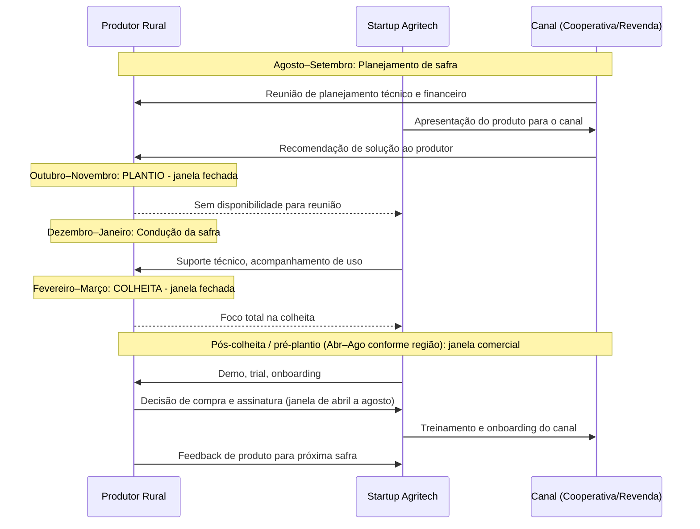

> [!warning] Erro de timing custa um ano inteiro
> Em agritech, perder a janela comercial e de implantação antes do plantio não custa apenas um mês: custa um ciclo de safra inteiro (6 a 12 meses). Uma startup que tenta vender software de plantio em outubro, com as máquinas já operando no talhão, só terá nova oportunidade no ano-safra seguinte. Planeje a prospecção comercial a partir de abril e inicie implantações que exigem 30 a 60 dias de configuração e treinamento até junho, garantindo que a operação esteja rodada em agosto antes do início da semeadura.

### Regulatório: o mapa do campo supervisionado

Agritech opera em mercado fortemente regulado pelo MAPA (Ministério da Agricultura e Pecuária) e por outras agências.

**MAPA.** É o órgão federal registrante de defensivos agrícolas, sementes, fertilizantes, inoculantes e bioinsumos. Os defensivos químicos regem-se pela **Lei nº 14.785/2023**, que centralizou a coordenação do registro no MAPA (com análise e homologação das avaliações de risco toxicológico pela ANVISA e ambiental pelo IBAMA) e fixou prazos legais de até 12 meses para produtos formulados ou genéricos e de até 24 meses para produto técnico novo. Já os bioinsumos comerciais seguem a **Lei nº 15.070/2024**, que estabeleceu marco próprio no MAPA com procedimentos simplificados para produtos biológicos e dispensou de registro a produção de bioinsumos em propriedade rural exclusivamente para uso próprio (*on-farm*). Drones de aplicação aeroagrícola exigem registro do equipamento na ANAC e cadastro operacional no MAPA (Portaria MAPA nº 298/2021).

**Embrapa como parceiro estratégico.** A Empresa Brasileira de Pesquisa Agropecuária (Embrapa) desenvolve tecnologia agropecuária há cinco décadas. Para agritechs de deep tech (biotech agrícola, genômica, sensoriamento remoto), parceria com Embrapa via licenciamento de cultivares ou acordos de transferência de tecnologia é caminho validado. A Embrapa tem unidades descentralizadas por bioma e cultura: 43 unidades distribuídas pelo Brasil. Procure diretamente a unidade da Embrapa dedicada à sua cultura-alvo.

**SNCR (Sistema Nacional de Crédito Rural).** O SNCR é a estrutura que viabiliza crédito para o produtor rural via bancos públicos e cooperativas de crédito. Startups que integram dados de crédito rural (Banco do Brasil, Sicredi, Sicoob, Cresol) na plataforma aumentam valor percebido. Startups que querem operar como plataforma de crédito rural precisam de autorização do BCB ou operar via parceria com instituição financeira autorizada.

**Pronaf.** O Programa Nacional de Fortalecimento da Agricultura Familiar financia diretamente o produtor rural familiar (com Cadastro Nacional da Agricultura Familiar, CAF, ativo) e suas cooperativas de produção. Embora uma startup de tecnologia não tome crédito do Pronaf para seu próprio capital de giro, enquadrar sua solução (software, sensores, conectividade ou bioinsumos) nos pacotes tecnológicos financiáveis via linhas do Pronaf e programas de Assistência Técnica e Extensão Rural (ATER) destrava a capacidade de pagamento do pequeno produtor.

> [!important] Registro MAPA não é opcional
> Startup que desenvolve produto biológico ou produto de aplicação agrícola sem registro MAPA não pode comercializar legalmente. Descobrir isso depois de produto desenvolvido é catastrófico. Mapeie as exigências regulatórias do MAPA já nos primeiros três meses de desenvolvimento.

### Funding agrícola: instrumentos específicos do campo

O agronegócio tem instrumentos de financiamento próprios que startups de outras verticais desconhecem.

**CPR: Cédula de Produto Rural.** Título de crédito emitido pelo produtor comprometendo entrega futura de produto agrícola. Pode ser física (compromisso de entrega do produto) ou financeira (compromisso de pagamento em dinheiro). Startup que vende para produtor pode usar CPR como instrumento de pagamento diferido alinhado ao ciclo de safra. Fintechs e plataformas especializadas em crédito agro (como Traive, Agrolend e Terra Magna, além de estruturadoras como Opea e Kanastra) originam e estruturam operações lastreadas em CPRs eletrônicas (cujo registro em entidade autorizada pelo Banco Central, como B3, CERC ou CRDC, é obrigatório para validade contra terceiros desde a Lei do Agro, Lei 13.986/2020).

**CRA: Certificado de Recebíveis do Agronegócio.** Título de securitização lastreado em recebíveis do agronegócio. Agritechs que financiam insumos, máquinas ou serviços diretamente vinculados à produção agropecuária junto a produtores rurais, cooperativas ou revendas podem ceder esses direitos creditórios para securitizadoras emitirem CRAs (observadas as restrições de lastro da Lei 11.076/2004 e das Resoluções do CMN editadas a partir de 2024, sempre mediante validação com securitizadora e assessoria jurídica especializada). Instrumento de capital de giro sem diluição de equity. Mínimo de carteira para estruturar: tipicamente R$ 5–10M em recebíveis.

**FNO, FNE e FCO: fundos constitucionais.** Os Fundos Constitucionais de Financiamento do Norte (FNO), do Nordeste (FNE) e do Centro-Oeste (FCO) contam com recursos estáveis (art. 159, I, "c", da Constituição) e taxas prefixadas ou pós-fixadas competitivas para financiar produtores rurais, cooperativas e agroindústrias na aquisição de máquinas, armazenagem, conectividade e sistemas de agritech. São operados pelo Banco da Amazônia (FNO, na Região Norte), pelo Banco do Nordeste (FNE, no Nordeste e norte de MG e ES) e pelo Banco do Brasil e instituições credenciadas (FCO, no Centro-Oeste).

**Fiagro: Fundo de Investimento nas Cadeias Produtivas Agroindustriais.** Criado pela Lei nº 14.130/2021 e regulamentado pela Resolução CVM nº 175 (Anexo Normativo VI), o Fiagro opera nas modalidades de direitos creditórios (Fiagro-FIDC), imobiliária (Fiagro-FII) e participações (Fiagro-FIP), direcionado a ativos do agronegócio como CPRs, CRAs, imóveis rurais e infraestrutura de armazenagem. Startups de agritech com originação estruturada de recebíveis utilizam o Fiagro como veículo de *funding* fora do próprio balanço (ver o detalhamento operacional na originação de grãos e no financiamento de silos no Capítulo 13, Trading de Commodities, Originação, Barter, Armazenagem (Silos), Hedge (CBOT/B3) e Escoamento (Arco Norte)).

**BNDES Crédito Rural e BNDES Fundo Clima.** O BNDES opera linhas permanentes e programas do Plano Safra para inovação, irrigação, armazenagem e descarbonização no agronegócio, como o BNDES Agro e o Programa para Construção e Ampliação de Armazéns (PCA), repassados via bancos e cooperativas de crédito credenciadas, além do **BNDES Fundo Clima** (voltado a projetos de agricultura de baixo carbono, recuperação de pastagens e bioenergia). Ver [[IGNICAO-Vol-5-Financas-e-Captacao#CAPÍTULO 12: FINANCIAMENTO NÃO DILUITIVO|Capítulo 12: Financiamento Não Diluitivo (Vol. 5)]] para detalhes de estruturação e acesso.

### Jornada de adoção do produtor rural

O produtor rural segue uma curva de adoção distinta da do mercado corporativo urbano: a confiança comercial nasce da validação prática em múltiplos ciclos de safra e do endosso de pares da mesma região.

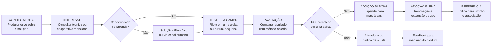

A etapa decisiva da jornada é o **teste em campo**. O produtor rural nunca arrisca a lavoura inteira no primeiro ano: ele separa um talhão de teste para comparar o retorno da tecnologia com o manejo testemunha. A startup precisa garantir que o piloto gere ganho econômico mensurável em um único ciclo de safra e que esse resultado seja documentado com rigor agronômico para que o próprio produtor e o consultor técnico o apresentem aos vizinhos da região.

### Lições da Trincheira Brasileira: Quem Dominou a Porteira e o Custo de Ignorar o Canal

No sentido oposto aos casos de consolidação abaixo, o ciclo de alta de juros e retração das margens agrícolas entre 2023 e 2025 expôs a fragilidade de modelos que tentaram operar balcões digitais de venda direta de insumos sem rede técnica em campo ou que alavancaram capital de giro sem garantias reais executáveis (como evidenciado pela recuperação judicial da rede de revendas AgroGalaxy em 2024 e pelo fechamento ou pivô de marketplaces puros de insumos para modelos de software e formalização de crédito junto a cooperativas e revendas).

**Agrosmart.** Fundada em 2014 por Mariana Vasconcelos, Raphael Pizzi e Thales Nicoleti, a Agrosmart desenvolveu soluções de monitoramento de microclima, solo e irrigação combinando sensores IoT em campo, imagens de satélite e modelos meteorológicos. A empresa iniciou sua tração em culturas irrigadas e de alto valor agregado (café, citros e cana-de-açúcar), nas quais a economia de água e energia elétrica paga rapidamente o sistema, construindo distribuição via consultores e cooperativas até expandir para o monitoramento climático e de pegada hídrica e de carbono nas cadeias de suprimentos de grandes indústrias de alimentos e bebidas (como Nestlé, Cargill e Coca-Cola) na América Latina.

**Solinftec.** Robótica e automação para colheita de cana-de-açúcar no interior de São Paulo. Fundada em 2007 em Araçatuba (SP) por engenheiros de automação cubanos radicados no país, a Solinftec desenvolveu a plataforma de inteligência artificial ALICE para orquestrar a logística de operações em usinas sucroalcooleiras (atendendo grupos como São Martinho, Adecoagro e Tereos) e lançou o robô autônomo solar **Solix** para inspeção de lavouras e pulverização localizada. Modelo B2B para grandes grupos (Raízen, Copersucar, Biosev). Captou rodadas com fundos americanos e recebeu aporte da Bunge. Exemplo de agritech de deep tech com foco em segmento específico (sucroalcooleiro) e cliente de grande porte.

**Strider.** Fundada em 2013 em Belo Horizonte (MG), construiu uma plataforma de monitoramento e tomada de decisão para controle de pragas e aplicação de defensivos agrícolas voltada a grandes produtores de soja, milho e algodão, atacando um dos maiores custos variáveis da lavoura empresarial. Utilizando consultores técnicos independentes como canal de entrada nas grandes fazendas do Cerrado, alcançou milhões de hectares monitorados e teve sua aquisição pela multinacional Syngenta anunciada em março de 2018, consolidando um dos primeiros grandes *exits* de agritech no Brasil.

**Agrotools.** Fundada em 2006 em São Paulo, construiu uma plataforma corporativa de inteligência territorial e análise socioambiental e agronômica para o agronegócio, combinando sensoriamento remoto por satélite com bancos de dados geográficos de campo. Em vez de depender de assinaturas pulverizadas de pequenos produtores, estruturou um modelo B2B de dados como serviço (*DaaS*) com tíquete corporativo, atendendo bancos na concessão e monitoramento de crédito rural, seguradoras, frigoríficos e grandes *tradings*.

**Caso ilustrativo (gestão agrícola para médio produtor via cooperativa).** Operação de software agrícola voltada ao médio produtor, com foco em usabilidade simplificada e distribuição via cooperativas. Exemplo de pivot de segmento bem executado: começou tentando atender o grande produtor, migrou para o médio via cooperativa depois de perceber que o grande produtor já tinha soluções consolidadas. O canal cooperativa foi o diferencial.

### As Ciladas Mortais no Campo: Depender de Digitação Manual, Ignorar a Revenda e Quebrar no Fluxo Safra-a-Safra

> [!warning] Armadilhas de agritech
> **Subestimar o distribuidor como porteiro do canal.** A startup que tenta vender diretamente ao produtor sem o endosso da rede comercial local enfrenta resistência mesmo com tecnologia superior. O consultor técnico e a revenda são os árbitros de confiança do campo: um produto sem o endosso do canal leva anos para penetrar, enquanto a solução validada pela revenda ou cooperativa entra na fazenda em uma safra.
>
> **Tecnologia que exige conectividade onde não há 4G.** Produto que funciona perfeitamente em São Paulo e trava em fazenda no Piauí não é produto para o campo brasileiro. Toda solução agritech precisa ter modo offline, sincronização assíncrona, e fallback por SMS ou celular 2G. Teste o aplicativo na pior condição real de conectividade (2G ou totalmente sem rede no fundo do talhão) antes de liberar a versão comercial, e nunca depois.
>
> **Ciclo anual que pune erro de timing.** Planeje o capital de giro da startup para atravessar os seis a oito meses entre a entrega do piloto na entressafra e a liquidação financeira da fatura após a colheita: muitas agritechs quebram não por falta de contratos assinados, mas por descasamento de caixa entre a folha mensal de engenheiros e o calendário anual de recebimento do campo. Startup com capital escasso que erra o timing de vendas por um ciclo pode não sobreviver.
>
> **Construção de reputação regional x ciclo individual de venda.** O produtor rural compra por referência de pares e validação técnica. Conquistar as primeiras fazendas-vitrine e o endosso do consultor ou da cooperativa de uma nova microrregião leva de 12 a 36 meses de presença consistente em dias de campo. Uma vez conquistado o endosso da cooperativa ou da revenda local, o ciclo individual de fechamento comercial cai para a faixa de 2 a 9 meses indicada na tabela de segmentos.
>
> **Precificar pela lógica de SaaS urbano.** O produtor rural compra por retorno sobre o investimento (ROI) demonstrado na safra, não por lista de funções de software. Uma cobrança mensal em "R$ X/mês" não comunica valor para quem calcula custos em sacas ou reais por hectare. Traduza sempre o preço para a unidade da lavoura: "R$ X por hectare por safra, valor que se paga se você reduzir a aplicação de defensivo em Y%."
>
> **Ignorar que o comprador é diferente do usuário.** Em grandes fazendas, quem decide a compra é o dono ou CEO da fazenda. Quem usa é o gerente agrícola ou operador. Quem influencia é o consultor técnico. São três pessoas distintas. Startup que apresenta o produto só para um deles perde o negócio.

### Fontes setoriais e bases de dados do agronegócio

- **Embrapa**: portal de transferência de tecnologia e acordos de licenciamento. Ponto de partida para agritech de deep tech.
- **OCB (Organização das Cooperativas Brasileiras)**: mapa de cooperativas por estado e por segmento. Essencial para desenho de canal.
- **MAPA, Registros de defensivos e bioinsumos**, sistema de consulta de registros vigentes e em tramitação.
- **BNDES Agro**: portal de linhas de crédito e programas de inovação para o agronegócio.
- **Relatório Agribusiness Brasil (Rabobank)**: análise anual de tendências e investimentos no agronegócio brasileiro.
- **Radar Agtech Brasil (Embrapa, SP Ventures e Homo Ludens: mapeamento anual oficial das startups do agro brasileiro, disponível no portal da Embrapa)**, **Cepea/Esalq-USP (Centro de Estudos Avançados em Economia Aplicada: séries históricas de preços, custos e PIB do agronegócio)**, **Anuário do Cooperativismo Brasileiro (Sistema OCB)** e **AgFunder Global AgriFoodTech Investment Report (relatório global de investimentos no setor)**.
- **CONAB (Companhia Nacional de Abastecimento)**: levantamentos mensais de safra, séries históricas de área plantada, produtividade por estado e capacidade estática de armazenagem.

---

### Filtro de Alinhamento e Prontidão: Perguntas de Validação Prática

Validar a operação sem internet na cabine da máquina, respeitar o calendário regional de pré-plantio e pós-colheita e remunerar adequadamente o canal de distribuição (cooperativas, revendas e consultores agronômicos) são as três condições que separam as agritechs que escalam no Brasil daquelas que estacionam no primeiro piloto gratuito.

Antes de investir construindo software, hardware ou insumos para o produtor rural brasileiro, responda sem ilusão:

1. **O Teste da Cabine sem Internet:** O seu produto funciona 100% *offline* no meio do Mato Grosso sem exigir que o operador do trator digite planilhas no celular ao final de um turno de doze horas?
2. **A Conta em Sacas por Hectare:** Você consegue provar em um talhão-piloto que a sua solução economiza pelo menos 3x o valor da assinatura em defensivos, fertilizantes, diesel ou perdas de colheita já na primeira safra?
3. **O Aliado na Porteira:** O agrônomo da cooperativa ou o RTV da revenda local ganha dinheiro e prestígio quando recomenda o seu produto, ou enxerga você como ameaça à comissão dele?

**O Movimento de Segunda-Feira:** Nos próximos 15 dias, valide sua solução no campo respeitando o calendário agrícola da região: se a praça estiver em pleno plantio ou colheita, acompanhe por três dias a rotina dos agrônomos de duas cooperativas ou revendas parceiras sem tomar o tempo do produtor na máquina, se a região estiver na janela pós-colheita, vá diretamente a três fazendas para testar o protótipo sem internet na cabine e mapear quem assina o pedido de compra.


---

## CAPÍTULO 12: PECUÁRIA DE PRECISÃO (PECTECH), PROTEÍNA ANIMAL, GENÉTICA BOVINA (FIV), RASTREABILIDADE E AQUICULTURA (AQUATECH)

### A Regra do Jogo na Pecuária: A Matemática da Arroba, da Conversão Alimentar e do Boi que Ninguém Pesa

Toda vez que o pecuarista leva um lote de bois do pasto até o curral para pesagem na balança mecânica, o estresse do manejo e do deslocamento faz cada animal perder de 3 a 5 kg de peso vivo (quase uma semana inteira de ganho de peso perdida em uma manhã). Esse contraste físico explica por que pecuária e lavoura operam sob regras distintas dentro da porteira. O fundador que vem da agricultura de grãos tenta vender um software de assinatura mensal para um pecuarista extensivo sem perceber que a física financeira da proteína animal segue outro relógio biológico: o ciclo completo da pecuária de corte leva de dois a três anos e meio conforme o nível tecnológico, o ativo principal caminha sobre quatro patas em milhares de hectares sem cobertura celular e cerca de 70% do custo de produção no confinamento, na avicultura, na suinocultura e na piscicultura concentra-se em uma única linha da planilha: a nutrição (ração). Quem oferece um painel administrativo genérico que não melhora o ganho médio diário (GMD), a taxa de prenhez ou a conversão alimentar é descartado pelo produtor.

Quem conhece a economia real da proteína animal tropical foca onde a margem se multiplica: na transição da pecuária extensiva para a pecuária de precisão, na biotecnologia reprodutiva bovina em escala comercial (IATF e FIV, na qual o Brasil é o segundo maior produtor mundial de embriões *in vitro* segundo a IETS), na rastreabilidade individual de ponta a ponta e na expansão da aquicultura intensiva (tilápia e camarão).

Aqui vigora **A Lei da Conversão Alimentar e da Rastreabilidade de Frigorífico**: em um país que lidera as exportações globais de carne bovina e de aves com margens operacionais disputadas no centavo por quilo de ração, a adoção tecnológica concentra-se no que reduz a quebra de manejo, antecipa o giro biológico do lote e comprova conformidade sanitária e socioambiental perante os frigoríficos exportadores.

Empreender em tecnologia para proteína animal no Brasil exige acoplar hardware resiliente, visão computacional ou biotecnologia diretamente às métricas zootécnicas que determinam o caixa da fazenda e do integrador: ganho médio diário de peso, conversão alimentar, intervalo entre partos e conformidade sanitária e socioambiental para exportação.

---

> [!note] Síntese Executiva da Vertical
> Enquanto a agricultura de grãos opera sob janelas sazonais de plantio e colheita em que a terra é o ativo imóvel central, a **Pecuária e a Indústria de Proteína Animal** operam sobre um **estoque biológico vivo, móvel, autorreplicável e de ciclo plurianual**. O Brasil detém o **maior rebanho bovino comercial do mundo (mais de 230 milhões de cabeças)**, lidera as exportações globais de carne bovina e de carne de frango, ocupa a 4ª posição mundial nas exportações de carne suína e expande rapidamente sua **Aquicultura continental e marinha** (superando 900 mil toneladas anuais de peixes cultivados segundo a Peixe BR). Ao mesmo tempo, o setor navega riscos comerciais e sanitários constantes, como ilustraram entre 2025 e 2026 o primeiro foco de Influenza Aviária de Alta Patogenicidade (H5N1) em granja comercial no Rio Grande do Sul em maio de 2025 (que acionou protocolos de regionalização sanitária), as investigações de salvaguarda da China sobre importações de carne bovina e as oscilações tarifárias dos Estados Unidos. Nesse cenário, o produtor e a agroindústria remuneram soluções que movem cinco indicadores auditáveis: **Ganho Médio Diário (GMD)**, **redução na Conversão Alimentar (CA)**, **aumento da taxa de prenhez**, **lotação por hectare (UA/ha)** e **rastreabilidade sanitária e socioambiental** para mercados importadores exigentes.

---

### 1. A Física Econômica da Proteína Animal vs. Lavoura: O Ciclo Pecuário Plurianual

O erro primário de fundadores oriundos da lavoura ao entrar na pecuária é ignorar a **biologia e o fluxo de caixa do ciclo produtivo bovino**. Na soja, o produtor planta de meados de setembro a novembro e colhe de janeiro a abril, conforme a região (ciclo de cerca de 120 dias). Na bovinocultura de corte, entre a inseminação da vaca matriz (9 meses de gestação), o desmame do bezerro aos 7–8 meses (fase de **Cria**), o desenvolvimento estrutural e muscular no pasto (fase de **Recria**, de 8 a 12 meses) e a terminação intensiva a pasto ou em cocho (fase de **Engorda / Confinamento**, de 90 a 120 dias), transcorrem de **20 a 30 meses no sistema tecnificado (e de 36 a 42 meses no sistema extensivo tradicional)** até que o animal atinja 18 a 21 arrobas (sendo 1 arroba equivalente a 15 kg de carcaça morta, ou cerca de 30 kg de peso vivo com rendimento de carcaça de 50% a 54%) e siga para o abate no frigorífico.

Essa latência biológica dá origem ao **ciclo plurianual de preços do boi (tipicamente de 4 a 5 anos, conforme séries históricas do Cepea/Esalq-USP e da Embrapa Gado de Corte)** negociado no contrato futuro de Boi Gordo (BGI) na B3:

1. **Fase de Baixa e Liquidação de Matrizes:** Quando o preço do bezerro cai, o criador descapitalizado envia fêmeas (vacas e novilhas) para o abate a fim de gerar caixa imediato. A oferta adicional de carne no curto prazo amplia os abates nos frigoríficos, pressionando ainda mais para baixo a cotação da arroba do boi gordo.
2. **Fase de Inversão e Retenção de Fêmeas:** Dois anos depois, faltam bezerros no mercado porque as mães foram abatidas. O preço do bezerro de reposição dispara. Os criadores passam a reter todas as fêmeas na fazenda para reproduzir, enxugando a oferta de animais para abate e fazendo a arroba do boi gordo disparar na B3.
3. **Implicação Estratégica para Startups (*PecTechs*):** Durante a fase de baixa da arroba, o pecuarista de cria corta gastos supérfluos, mas o **confinador e o recriador profissional precisam desesperadamente de eficiência nutricional, pesagem de precisão e hedge** para proteger a relação de troca (*ágio/deságio do bezerro vs. boi gordo*). Na fase de alta da arroba, explode a demanda por **biotecnologia reprodutiva (IATF e FIV)**, reforma de pastagens e expansão de rebanho.

---

### 2. Bovinocultura de Corte e Leite: Da Pecuária Extensiva à Pecuária de Precisão (PecTech)

Historicamente, a pecuária brasileira baseou-se na ocupação extensiva de fronteira: menos de 1 cabeça por hectare em pastagens degradadas, abates tardios de 36 a 42 meses no sistema extensivo e ausência de controle individual de desempenho. Nas últimas duas décadas, a valorização da terra (em que 1 hectare de pasto agricultável em São Paulo, Mato Grosso do Sul, Goiás ou Mato Grosso compete diretamente com soja, milho e cana) impulsionou a **intensificação vertical da pecuária**, reduzindo o ciclo de abate para **20 a 30 meses no sistema tecnificado**.

As quatro grandes frentes tecnológicas de *PecTech* dentro da porteira são:

#### A) Pesagem Passiva por Visão Computacional 3D, Brincos RFID e IoT no Pasto

Na pecuária tradicional, vigora o dilema do **boi que ninguém pesa**: para descobrir se um lote de 500 animais está ganhando arrobas ou dando prejuízo no pasto, o peão precisava tocar a boiada por quilômetros até o curral, conter cada animal no brete e pesá-lo na balança mecânica, processo que provoca **estresse agudo, contusões e perda imediata de 3 a 5 kg de peso vivo (quebra de manejo)**.

- **Balanças de Passagem e Visão Computacional 3D e Termográfica no Cocho e no Bebedouro:** Startups e centros de engenharia instalaram câmeras 3D (estereoscópicas, LiDAR ou *Time-of-Flight*) e plataformas de pesagem passiva acopladas às aguadas (bebedouros) ou aos saleiros solares no pasto. Toda vez que o animal entra voluntariamente para beber água, a antena lê o **brinco eletrônico RFID (ISO 11784/11785: FDX/HDX)** na orelha do bovino e a câmera 3D reconstrói a nuvem de pontos do dorso e da garupa, estimando o peso vivo com margem de erro entre 1,5% e 3% e avaliando o acabamento de gordura subcutânea. Em paralelo, uma câmera termográfica mede a temperatura ocular do animal, identificando precocemente variações térmicas associadas a febre subclínica de tristeza parasitária ou complexo respiratório bovino antes que o boi apresente prostração visível no lote.
- **Algoritmo de Ponto Ótimo de Abate:** Se um boi em confinamento está consumindo R$ 18,00/dia de ração, mas seu Ganho Médio Diário (GMD) caiu de $1,6\text{ kg/dia}$ para $0,7\text{ kg/dia}$ porque ele já atingiu a maturidade fisiológica e só está depositando sebo caro, o software emite um alerta imediato: *"Apartar animal brinco #4892 para embarque imediato ao frigorífico, mantê-lo mais 15 dias no cocho consumindo R$ 18/dia (R$ 270 de custo alimentar) para ganhar apenas 0,7 kg de peso vivo por dia (10,5 kg vivos, cerca de 0,35 @ ou R$ 110 com a arroba a R$ 315) gerará prejuízo líquido de cerca de R$ 160 por cabeça"*.

#### B) Gestão de Confinamentos, Boitéis e Cocho Inteligente

O Brasil confina cerca de **7 a 8 milhões de bovinos por ano** (segundo os levantamentos anuais da Assocon e do censo de confinamento da DSM-Firmenich) no período seco (maio a novembro), em megaoperações próprias ou **Boitéis** (hotéis de engorda terceirizada onde o pecuarista deixa o boi pagando por diária alimentar ou por arroba produzida).
- Na operação de confinamento, a **nutrição representa 70% a 80% do custo operacional (excluindo a compra do boi magro)**. Um desvio de 3% no trato diário de um confinamento de 30.000 cabeças destrói milhões de reais de margem.
- **Sistemas de Gestão de Trato, Confinamento e Pecuária de Precisão (como Ponta / PontaAgro e Prodap no confinamento, ao lado de plataformas de gestão de gado de corte a pasto como a JetBov):** O sistema integra o vagão misturador (caminhão trato com células de carga e GPS) ao software de nutrição. Antes do primeiro trato da manhã, sensores ou operadores registram o **Escore de Cocho** (se o cocho amanheceu lambido nota 0, com sobra fina nota 1 ou cheio de sobra nota 3). O algoritmo recalcula automaticamente em segundos a quantidade exata de matéria seca (silagem de milho, milho moído, farelo de soja/algodão ou DDGS de etanol de milho, núcleo mineral e ionóforos como monensina sódica) que o caminhão deve descarregar em cada curral específico, enquanto sensores de matéria seca por **espectroscopia NIR portátil** corrigem a umidade da silagem após uma chuva noturna.

#### C) Pecuária Leiteira Tecnificada e Monitoramento de Rebanho (*Smart Dairy*)

Na cadeia do leite, concentrada no Sul (PR, RS e SC), em Minas Gerais, em Goiás e no interior paulista, a profissionalização em sistemas *Compost Barn* e *Free Stall* substituiu o manejo empírico por telemetria individual contínua:

- **Colares Inteligentes de Ruminação e Atividade (acelerômetros 3-eixos + microfones acústicos no pescoço da vaca):** Monitoram 24 horas por dia os minutos de ruminação, ofegação (estresse térmico que derruba a produção de leite no verão tropical) e movimentação.
- Quando a vaca entra no **estro (cio)**, sua movimentação diária multiplica-se em relação à linha de base individual e o tempo de ruminação cai de forma acentuada (padrão fisiológico monitorado por sistemas comerciais como Allflex/MSD e CowMed). O colar alerta o inseminador sobre a janela ideal de inseminação com sêmen sexado, além de sinalizar quedas de ruminação associadas a **mastite subclínica ou cetose pós-parto** antes da perda do leite no tanque.

#### D) Manejo de Pastagens Rotacionadas via Satélite e Recuperação de Áreas Degradadas

O Brasil possui cerca de **160 milhões de hectares de pastagens**, dos quais estima-se que **80 a 100 milhões de hectares apresentem algum grau de degradação** (baixa cobertura vegetal, cupinzeiros, invasoras e perda de matéria orgânica).
- A maior oportunidade econômica e climática do agronegócio brasileiro não requer derrubar uma única árvore: **converter 40 milhões de hectares de pasto degradado em sistemas intensivos de Integração Lavoura-Pecuária-Floresta (ILPF) ou pastagem rotacionada adubada** permite dobrar a produção de carne e liberar área para grãos.
- Startups de sensoriamento remoto combinam imagens diárias de satélites (Sentinel-2, Planet) e radar (SAR) com modelos agronômicos de crescimento de gramíneas tropicais (*Brachiaria / Urochloa*, *Panicum / Megathyrsus*: Mombaça, Zuri, Miyagi) para estimar a **biomassa de matéria seca disponível em cada piquete (kg MS/ha)**, indicando ao pecuarista o dia exato de entrada e saída do gado (respeitando a altura de entrada e o resíduo pós-pastejo) e gerando protocolos auditáveis de **sequestro de carbono no solo (SOC: *Soil Organic Carbon*)**.

---

### 3. Rastreabilidade Individual da Cadeia da Carne: SISBOV, PNIB e Regulação Europeia (EUDR)

> [!important] O Gargalo Bilionário dos "Fornecedores Indiretos"
> Quando um consumidor compra um corte bovino em Londres, Xangai ou São Paulo, o frigorífico (como JBS, MBRF, Minerva Foods ou Prima Foods) conhece com precisão a **fazenda de engorda final (Fornecedor Direto)** de onde o caminhão boiadeiro partiu. O desafio estrutural está nos 24 meses anteriores: aquele mesmo animal nasceu em uma **fazenda de cria (Fornecedor Indireto Nível 2)** na fronteira agrícola, foi vendido aos 8 meses para uma **fazenda de recria (Fornecedor Indireto Nível 1)** e só depois ingressou na propriedade de terminação. Como a **Guia de Trânsito Animal (GTA)** emitida pelas agências estaduais de defesa agropecuária (INDEA-MT, IAGRO-MS, IDARON-RO, ADEPARÁ, CDA-SP) foi desenhada para controlar o trânsito de **lotes de animais para fins sanitários**, ela não encadeava automaticamente o histórico individual de cada bezerro desde o nascimento.

A necessidade de fechar essa lacuna de informação nas cadeias de exportação e varejo decorre de duas exigências regulatórias diretas e viabilizou uma arquitetura tecnológica em três camadas:

1. **Regulação da União Europeia para Produtos Livres de Desmatamento (EUDR: *EU Deforestation Regulation*) e Exigências de Importadores Globais:** A Europa, o Reino Unido e as grandes redes globais de varejo e *fast food* (Carrefour, Tesco, Casino, McDonald's, Burger King) passaram a exigir comprovação georreferenciada (polígonos de todas as fazendas pelas quais o animal passou desde o nascimento, exigência contratual já adotada por grandes redes varejistas europeias e tornada requisito legal na União Europeia pelo regulamento antidesmatamento **EUDR**, com aplicação escalonada para grandes operadores a partir de dezembro de 2026, enquanto o Reino Unido opera sob regras próprias do *Environment Act*) garantindo **desmatamento zero e ausência de trabalho análogo ao escravo ou invasão de terras indígenas/unidades de conservação**.
2. **Plano Nacional de Identificação Individual de Bovinos e Búfalos (PNIB / MAPA) e o Programa Estadual do Pará:** Lançado pelo MAPA em dezembro de 2024 em articulação com a indústria frigorífica e os estados, o PNIB estabeleceu o cronograma para a **identificação eletrônica individual obrigatória (brinco visual + botão eletrônico RFID)** de todo o rebanho nacional até 2032, enquanto o Estado do Pará instituiu pioneiramente a obrigatoriedade escalonada de rastreabilidade individual a partir de 2026 e 2027, superando o alcance restrito do antigo **SISBOV** (que cobria historicamente apenas 2% a 3% do rebanho nacional voltado à Cota Hilton europeia).
3. **Como operam as Plataformas de Compliance Socioambiental e Rastreabilidade Pecuária (Niceplanet, Ecotrace, SafeTrace, Agrotools, Visipec):**
   - **Camada 1 (Monitoramento Territorial de Fornecedores Diretos):** Antes de o comprador de gado do frigorífico fechar a aquisição de um lote, o sistema de geomonitoramento cruza automaticamente o polígono do **CAR (Cadastro Ambiental Rural)** da fazenda com bases públicas oficiais: alertas de desmatamento **PRODES e DETER (INPE)**, áreas embargadas pelo **IBAMA e ICMBio**, terras indígenas (FUNAI), territórios quilombolas (INCRA) e o Cadastro de Empregadores do Ministério do Trabalho ("Lista Suja" do trabalho análogo ao escravo). Se houver sobreposição irregular, o CPF ou CNPJ fornecedor é **bloqueado preventivamente no ERP de compras do frigorífico**.
   - **Camada 2 (Reconciliação de GTAs, Registros Auditáveis e Escritórios Verdes):** Para rastrear os fornecedores indiretos, plataformas de rastreabilidade integram a leitura dos brincos RFID na desmama com bancos de dados auditáveis de terceira parte e cruzamento de grafos de movimentação de GTAs (Guias de Trânsito Animal). Além do bloqueio preventivo, operam os **Escritórios Verdes e Plataformas de Regularização Ambiental**: quando um criador de bezerros apresenta pendência no **CAR (Cadastro Ambiental Rural)**, a startup estrutura o projeto técnico do Programa de Regularização Ambiental (PRA) e viabiliza o acesso ao crédito rural para reintegrá-lo formalmente à cadeia.

---

### 4. Genética Bovina de Elite (IATF e FIV), Nutrição e Saúde Animal

Poucos empreendedores de fora do agronegócio sabem que **o Brasil ocupa a segunda posição mundial em biotecnologia reprodutiva bovina em escala comercial**: segundo as estatísticas da Sociedade Internacional de Tecnologia de Embriões (IETS), o país produziu **493.989 embriões bovinos por Fertilização In Vitro (FIV) em 2024** (cerca de 24% do total global de 2.029.007 embriões), ficando atrás apenas dos Estados Unidos (1.037.090 embriões) e superando toda a Europa somada.

1. **A Revolução da IATF (Inseminação Artificial em Tempo Fixo) e da FIV:**
   - Na monta natural com touro no pasto, um bom reprodutor cobre 25 a 40 vacas por ano, e 80% das propriedades brasileiras ainda usavam touros comuns sem avaliação genética ("boi de boiada").
   - Com os protocolos hormonais de **IATF** (dispositivos intravaginais de progesterona + benzoato de estradiol + prostaglandina + eCG, desenvolvidos com protagonismo de pesquisadores brasileiros da USP e da UNESP e empresas como **Ourofino Saúde Animal, Biogénesis Bagó, Zoetis e MSD**), o pecuarista sincroniza a ovulação de centenas de vacas para inseminá-las em data fixa com sêmen congelado de touros provados, sem depender da observação visual de cio. Segundo relatórios da ASBIA (Associação Brasileira de Inseminação Artificial) e da FMVZ-USP, **cerca de 20% a 25% das matrizes de corte do Brasil já são inseminadas por IATF**, gerando bezerros mais pesados ao desmame e antecipando a idade de abate, inclusive no **Cruzamento Industrial** de matrizes **Nelore** com sêmen **Aberdeen Angus** para produção de carne de maior valor agregado.
   - No topo da pirâmide reprodutiva está a **FIV (Fertilização In Vitro)**: um médico-veterinário realiza a **aspiração folicular guiada por ultrassom (OPU, *Ovum Pick-Up*)** em uma vaca doadora de elite na fazenda, envia os oócitos para um laboratório de biotecnologia (como **Vitrogen/ABS Pecplan, Alta Genetics, CRV ou InVitro Brasil**), fecunda-os com sêmen sexado em incubadora por 7 dias e transfere os embriões a fresco ou vitrificados para vacas receptoras. Com essa técnica, uma única matriz Nelore ou Girolando superior, que deixaria apenas 1 bezerro por ano em reprodução natural, passa a gerar de **60 a 120 embriões viáveis por ano via FIV** (resultando em dezenas de bezerros nascidos em receptoras).
2. **Avaliação Genômica e DEPs (Diferenças Esperadas na Progênie):** Programas de melhoramento como **PMGZ (ABCZ)**, **ANCP**, **CIA de Melhoramento** e **Geneplus (Embrapa)** analisam, com chips de genotipagem de SNPs, o DNA extraído do bulbo capilar da vassoura da cauda do bezerro para prever com alta acurácia o mérito genético de precocidade sexual, área de olho de lombo (AOL), marmoreio e **consumo alimentar residual** (indicador zootécnico que identifica animais capazes de ganhar o mesmo peso ingerindo até 15% menos matéria seca e emitindo menos metano entérico por arroba produzida).
3. **Aditivos Redutores de Metano Entérico e Biológicos Veterinários:** Como ruminantes emitem metano ($\text{CH}_4$) pela eructação durante a fermentação ruminal, a indústria global de nutrição (**DSM-Firmenich com o Bovaer/3-NOP**, extratos de taninos vegetais de quebracho/acácia, óleos essenciais de caju e mamona desenvolvidos por empresas brasileiras como **Connan, Premix, Tortuga/DSM**) desenvolve moléculas que inibem a enzima metanogênica no rúmen, reduzindo a emissão de metano em **25% a 40%** e convertendo a energia economizada em mais ganho de peso.

---

### 5. Aves, Suínos e a Explosão da Aquicultura/Piscicultura (*AquaTech* e Economia Azul)

#### A) Avicultura e suinocultura integrada: galpões climatizados e granjas tecnificadas

Na avicultura de corte e postura e na suinocultura (concentradas no Sul e no Centro-Oeste sob o sistema de integração vertical com **MBRF, grupo resultante da fusão entre Marfrig e BRF em 2025, Seara/JBS, Aurora Coop, C.Vale, Copacol, Lar e Vibra**), a margem é disputada na segunda casa decimal da **Conversão Alimentar (CA)**:
- Um frango de corte moderno atinge 2,8 kg a 3,0 kg em cerca de **40 a 45 dias**, com uma Conversão Alimentar de **1,55 a 1,68 kg de ração por quilo de peso vivo** (segundo referências técnicas da Embrapa Suínos e Aves).
- Startups e fabricantes de **Ambiência, IoT e Biosseguridade para Granjas** (como a **Agriness**, fundada em Florianópolis e líder na gestão produtiva de suinocultura e avicultura na América Latina com foco no indicador de leitões desmamados por fêmea ao ano, ao lado de fabricantes de controladores de ambiência e automação como **Inobram, Corti Avioeste e Big Dutchman**) automatizam galpões *Dark House* com pressão negativa, sensores de amônia ($\text{NH}_3$), $\text{CO}_2$, umidade relativa, pesagem automática de aves em poleiros suspensos e análise acústica da vocalização de suínos e aves por IA para detectar precocemente surtos respiratórios ou **Influenza Aviária de Alta Patogenicidade (IAAP / H5N1)**.

#### B) O Boom da Aquicultura e Piscicultura Brasileira (*AquaTech*)

O Brasil detém cerca de **12% da água doce superficial disponível no planeta**, um litoral de mais de 8.500 km, águas quentes durante todo o ano nas regiões Norte e Nordeste e na maior parte do ano no Sudeste, Centro-Oeste e Oeste do Paraná, além de oferta abundante de milho e farelo de soja para fabricar ração extrusada. Essa combinação impulsionou a **Piscicultura (liderada pela tilápia no Oeste do Paraná, São Paulo, Minas Gerais e Mato Grosso do Sul, e pelo tambaqui e pirarucu na Região Norte)** e a **Carcinicultura (produção de camarão *Litopenaeus vannamei* no Rio Grande do Norte, Ceará e Paraíba)**, alcançando mais de 900 mil toneladas anuais de peixes cultivados e mais de 120 mil toneladas anuais de camarão:

- **Eficiência Biológica na Aquicultura:** Como o peixe vive suspenso na água (não gasta energia postural contra a gravidade como o boi) e é ectotérmico (não gasta calorias da ração para manter o corpo aquecido a 38,5 °C), sua **Conversão Alimentar é altamente eficiente: 1,25 a 1,50 kg de ração para produzir 1,0 kg de peixe vivo**.
- **Cinco Oportunidades em *AquaTech*:**
  1. **Sondas IoT de Oxigênio Dissolvido (OD), Amônia Tóxica ($\text{NH}_3$) e Automação de Aeradores:** Em um tanque escavado ou tanque-rede de alta densidade (de 50 a 150 kg de tilápia/m³ nas estruturas flutuantes instaladas em reservatórios hidrelétricos concedidos pela União via MPA/ANA, como Ilha Solteira, Furnas e Itaipu, segundo parâmetros da Embrapa Pesca e Aquicultura e da Peixe BR, enquanto em viveiros de terra a estocagem é muito menor e dimensionada por metro quadrado), se o **Oxigênio Dissolvido cair abaixo de $2,0\text{ mg/L}$** às 4h da madrugada (quando as microalgas consomem oxigênio na respiração noturna) ou faltar energia elétrica nos aeradores de pás, **o piscicultor pode perder o lote inteiro por hipóxia antes do amanhecer**. Sensores ópticos luminescentes de OD conectados a acionadores automáticos de aeradores e geradores salvam milhões de reais por safra.
  2. **Alimentadores Automáticos Inteligentes por Hidrofonia Passiva e Visão Computacional:** Na piscicultura e na carcinicultura, a ração extrusada representa **65% a 75% do custo total de produção**. A ração lançada em excesso na água, além de desperdiçar caixa, deposita-se no fundo do tanque e gera amônia tóxica que compromete a sobrevivência do lote. Alimentadores acústicos utilizam um **hidrofone subaquático** que capta a frequência sonora da atividade alimentar dos camarões ou do ataque das tilápias aos *pellets*: enquanto o cardume se alimenta ativamente, o equipamento libera ração. Assim que a atividade acústica de mastigação diminui, o dosador interrompe o fornecimento imediatamente.
  3. **Genética de Alevinos Revertidos e Melhorados e Pós-Larvas SPF (*Specific Pathogen Free*) + Vacinação Automatizada de Peixes:** Empresas de genética aquícola (como **AquaGenetics, GenoMar, AcquaSul, Aquabel**) utilizam seleção genômica para resistência às bactérias *Streptococcus agalactiae* e *Francisella*, enquanto máquinas automatizadas vacinam mais de **8.000 alevinos por hora** por injeção intraperitoneal guiada por visão computacional, reduzindo a mortalidade no tanque-rede de 20% para menos de 3% sem uso de antibióticos.
  4. **Biomassa e Biorrefinaria de Resíduos da Filetagem (Economia Circular do Pescado):** Quando o frigorífico de peixe corta o filé de tilápia, o rendimento de filé limpo é de apenas **32% a 35% do peso do peixe inteiro**: os outros **65% (cabeça, espinhaço, vísceras, escamas e pele)** costumavam ser um passivo ambiental. Hoje, plantas de biotecnologia extraem **colágeno hidrolisado e gelatina farmacêutica de altíssimo valor a partir da pele e escamas da tilápia** (inclusive curativos biológicos para queimaduras humanas desenvolvidos no Ceará/UFC), **óleo de peixe rico em Ômega-3** das vísceras e **farinha proteica/hidrolisado enzimático** para *pet food* super premium!
  5. **Maricultura no Litoral (Mexilhões, Ostras em Santa Catarina e Algas Marinhas *Kappaphycus alvarezii*):** Cultivo regenerativo em mar aberto no litoral de SC, SP, RJ e Nordeste para produção de **bioestimulantes agrícolas à base de extrato de algas marinhas** (que aumentam a resistência da soja à seca) e carragenana para a indústria alimentícia.

---

### 6. Unit Economics e Benchmarks Comparativos das Cadeias de Proteína Animal

| Indicador Físico e Financeiro (Fontes: Cepea, Embrapa, Peixe BR e Rabobank, Ordem de Grandeza 2025/2026) | Bovinocultura de Corte (Ciclo Completo / Confinamento) | Avicultura de Corte (Integrada / Galpão Climatizado) | Suinocultura Tecnificada (Ciclo Completo / Terminação) | Piscicultura Intensiva (Tilápia em Tanque-Rede / Viveiro) |
|---|---|---|---|---|
| **Ciclo Biológico até o Abate** | **20 a 30 meses** (sistema tecnificado) a **36 a 42 meses** (sistema extensivo) | **40 a 45 dias** | **150 a 170 dias** (115 a 125 kg de peso vivo) | **160 a 210 dias** (850 g a 1,1 kg de peso vivo) |
| **Conversão Alimentar (CA: kg ração MS / kg ganho de peso)** | **6,0 a 8,5 : 1** (em confinamento) | **1,55 a 1,68 : 1** | **2,35 a 2,65 : 1** | **1,25 a 1,55 : 1** (menor conversão alimentar entre as cadeias comerciais, segundo Embrapa e Peixe BR) |
| **Produtividade Anual por Área ou Volume Útil** | **4 a 8 arrobas/ha/ano** (Extensivo) vs. **25 a 55 arrobas/ha/ano** (Intensivo/Recria-Engorda) | Alta densidade (**35 a 42 kg/m²** por lote; 6 lotes/ano) | Alta densidade em galpões climatizados com biodigestores | **15 a 30 ton/ha/ano** por área em viveiro escavado ou **50 a 150 kg/m³** por volume em tanque-rede (Embrapa Pesca e Aquicultura / Peixe BR) |
| **Peso da Alimentação no Custo Operacional (COE)** | **70% a 80%** (na fase de confinamento, ex-boi magro) | **68% a 74%** | **72% a 78%** | **65% a 75%** (Ração extrusada flutuante de 28%–45% PB) |
| **Rendimento de Carcaça / Corte Principal** | **52% a 56%** (Carcaça quente/fria sobre peso vivo) | **72% a 75%** (Carcaça eviscerada) | **75% a 78%** (Carcaça) | **32% a 36%** (Filé limpo sem pele) + **65% coprodutos** |
| **Margem EBITDA Operacional em Sistemas Tecnificados (Varia conforme Ciclo Pecuário e do Milho)** | **12% a 25%** na recria/engorda intensiva com *hedge* de arroba e dieta (comprimida nas fases de baixa do ciclo) | **10% a 18%** na agroindústria integradora / Remuneração por lote e eficiência no produtor integrado | **10% a 20%** (fortemente sensível à relação de troca suíno vivo / milho e farelo de soja) | **15% a 25%** em operações verticalizadas com filetagem, cadeia de frio e aproveitamento de coprodutos |
| **Ticket Médio de SaaS / IoT PecTech ou AquaTech** | **R$ 1,50 a R$ 4,00 / cabeça / ano** ou **R$ 800 a R$ 4.500 / mês** por fazenda/confinamento | **R$ 400 a R$ 2.000 / mês** por núcleo de aviários | **R$ 2,50 a R$ 6,00 / matriz / ano** | **R$ 600 a R$ 3.500 / mês** por parque aquícola + comodato de sondas |

---

### 7. Casos Brasileiros de Destaque em PecTech, Genética, Saúde Animal e AquaTech

> [!example] Estudo de Caso: Ponta, Prodap (DSM-Firmenich), JetBov, BovControl, Ourofino Saúde Animal e Geneseas/Tilabras
> - **Ponta (software de gestão operacional de confinamentos) e Prodap (Belo Horizonte/MG):** A **Ponta** especializou-se na automação da rotina diária de grandes confinamentos de gado de corte na América do Sul, digitalizando a leitura de cocho, o carregamento e a distribuição do caminhão trato e o controle de conversão alimentar por curral. Já a mineira **Prodap** consolidou o modelo de **SaaS pecuário combinado a consultoria zootécnica e nutrição de precisão**: ao integrar seu software de gestão pecuária (*Prodap Views*) com assistência técnica e formulação nutricional sob medida, escalou sua presença no rebanho comercial brasileiro e foi adquirida em 2022 pela multinacional **DSM** (posteriormente **dsm-firmenich**, que em fevereiro de 2026 anunciou um acordo para vender sua divisão global de Nutrição e Saúde Animal para a CVC Capital Partners).
> - **JetBov (fundada em Xaxim/SC e sediada em Joinville/SC) e BovControl:** Diferentemente dos sistemas voltados ao trato em confinamento (como Ponta e Prodap), especializaram-se na gestão da pecuária de corte a pasto (cria, recria e engorda), resolvendo a coleta de dados offline no curral (ao integrar via Bluetooth bastões leitores de brincos RFID e barras de pesagem eletrônica Tru-Test e Coimma ao aplicativo móvel do vaqueiro) para apurar margem por lote, ganho médio diário por piquete e previsão de abate.
> - **Ourofino Saúde Animal (Cravinhos/SP):** Fundada por Norival Bonamichi e Jardel Massari em 1987 no interior paulista, tornou-se uma das maiores indústrias farmacêuticas veterinárias de capital nacional (listada na B3 desde 2014 sob o ticker OFSA3, tendo os sócios fundadores no bloco de controle e a japonesa Mitsui & Co. como acionista estratégica), competindo diretamente com multinacionais globais em vacinas, antiparasitários e protocolos hormonais de IATF.
> - **Geneseas e Tilabras (Piscicultura Industrial Verticalizada de Tilápia no Rio Paraná: SP/MS):** Operando nos reservatórios da bacia do Rio Paraná (divisa de São Paulo com Mato Grosso do Sul), empresas como **Geneseas** e **Tilabras** verticalizaram a cadeia da tilápia: melhoramento genético de alevinos, berçários, engorda em tanques-rede com alimentação automatizada, plantas frigoríficas certificadas com selos internacionais (**ASC, *Aquaculture Stewardship Council*, e BAP**) e processamento de pele e escamas para colágeno e óleo. Entre 2025 e 2026, a exposição dessas operações exportadoras ao mercado norte-americano enfrentou um teste real de resiliência com as sobretaxas comerciais impostas pelos Estados Unidos em 2025 (posteriormente revistas pela Justiça americana em fevereiro de 2026 e substituídas pela tarifa da Seção 301 em julho de 2026, que preservou o filé fresco mas tributou o congelado), evidenciando a importância de diversificar destinos de exportação e fortalecer a distribuição no mercado interno.

---

### 8. Erros Operacionais Recorrentes em PecTech, Proteína Animal e AquaTech

> [!warning] Cinco Erros que Quebram Operações de Proteína Animal
> 1. **A Armadilha da "Digitação Manual pelo Peão no Curral":** Se o seu software de gestão pecuária exige que um vaqueiro, com a mão suja de barro sob sol de 38 °C e com 400 bois agitados no brete, digite em uma tela pequena de celular um número de brinco de seis dígitos e o peso lido no visor da balança, **a operação tende a abandonar o sistema nos primeiros meses de uso**. Os dados acabam anotados com erro ou preenchidos de memória à noite no alojamento. Na pecuária e na piscicultura, **a coleta do dado primário precisa ser passiva e automatizada via Bluetooth, bastão RFID, sensores ou comando de voz**, operando **100% offline** no curral e sincronizando quando o trabalhador retorna à sede.
> 2. **Vender SaaS Puro Barato (R$ 250/mês) com Custo de Implantação Presencial no Interior do Mato Grosso ou do Pará:** Com mensalidade de R$ 250 e margem bruta de 80% (R$ 200/mês), uma única implantação presencial em uma fazenda a 180 km de estrada de terra que consuma R$ 7.000 entre diárias de técnico, combustível de caminhonete e dois dias de deslocamento leva **35 meses apenas para recuperar o CAC**, inviabilizando o fluxo de caixa da startup. Para fechar a conta unitária na pecuária, ou você cobra tíquetes corporativos (> R$ 2.500 a R$ 10.000/mês em grandes confinamentos, usinas e grupos agropecuários), ou embute sua tecnologia no canal de distribuição das **indústrias de nutrição animal, saúde veterinária, cooperativas e frigoríficos**, ou acopla receita transacional (comercialização de gado, insumos, seguro ou estruturação de CPR).
> 3. **Subestimar o Risco Sanitário e de Oxigenação na Aquicultura (Mortalidade por Hipóxia, *Streptococcus* e Outorga de Águas da União):** Na piscicultura intensiva, expandir a biomassa sem redundância operacional destrói o capital investido. Superpovoar tanques acima da capacidade de diluição de nitrogênio e fósforo sem aeração reserva (gerador a diesel com partida automática em até 10 segundos na queda de energia da rede rural) e sem vacinação contra *Streptococcus* pode causar a **perda de 50% a 100% do lote às vésperas da despesca**, exatamente quando o peixe já consumiu todo o orçamento de ração do ciclo.
> 4. **Especular no Confinamento sem Travar a Relação de Troca Boi Magro / Ração / Boi Gordo na B3:** Muitos pecuaristas e confinamentos perdem margem porque compram o boi magro e os insumos da dieta à vista no mercado físico e deixam o preço de venda do boi gordo 100% aberto para 110 dias à frente. Se uma suspensão temporária de exportações ou a virada do ciclo derrubar a arroba em 15% durante a engorda, o lote inteiro fecha no prejuízo. Operações profissionais **travam o custo da dieta e vendem contratos futuros de Boi Gordo (BGI) ou compram opções de venda (*Puts*) na B3 no dia em que o boi magro entra no curral (observando sempre dois cuidados detalhados no Capítulo 13, Trading de Commodities, Originação, Barter, Armazenagem (Silos), Hedge (CBOT/B3) e Escoamento (Arco Norte): o contrato BGI liquida pelo indicador Cepea/B3 do Estado de São Paulo, gerando risco de base quando a praça física do confinamento em MT, GO ou PA descola da referência paulista, e a venda de contrato futuro exige linha de liquidez para cobrir chamadas de ajuste diário caso a arroba suba durante a engorda)**.
> 5. **Ignorar a Conformidade Socioambiental dos Fornecedores Indiretos (Risco de Bloqueio de Exportação e Crédito):** Adquirir bezerros ou garrotes baratos "sem origem rastreada" (ou via triangulação de GTA para esquentar gado vindo de áreas embargadas pelo IBAMA) é uma bomba-relógio. Com o cruzamento automatizado de dados entre bancos (Resolução CMN/BCB que veda crédito rural para propriedades com embargos ambientais), frigoríficos exportadores e Ministérios Públicos Estaduais/Federal, **um único lote contaminado bloqueia o CNPJ inteiro da fazenda de engorda**, corta o acesso ao Plano Safra e impede a venda para qualquer planta frigorífica de primeira linha.

---

### Filtro de Alinhamento e Prontidão: Perguntas de Validação Prática

Na pecuária de precisão e na aquicultura, a adoção sustentável depende de comprovar retorno financeiro direto dentro de um único ciclo produtivo (seja um giro de confinamento, uma estação de monta ou um ciclo de engorda em tanque-rede) e de integrar a solução ao fluxo de trabalho de peões, zootecnistas e frigoríficos sem criar atrito operacional no curral.

Antes de investir em PecTech, genética, saúde animal ou AquaTech no Brasil, responda:

1. **O Teste do Cocho e da Balança:** Sua solução move diretamente uma das alavancas auditáveis da margem líquida do produtor (Conversão Alimentar, Ganho Médio Diário, Taxa de Prenhez, Lotação por Hectare ou Conformidade Sanitária/Ambiental)? Em quanto tempo o investimento se paga, comparado ao ciclo biológico específico que ela afeta (um giro de 110 dias no confinamento, uma estação de monta na cria ou uma reforma de pastagem)?
2. **A Sobrevivência no Curral ou no Açude:** Se o seu produto envolve sensor, brinco, câmera ou alimentador automático, ele suporta lama, coice de boi de 500 quilos, sol de 42 graus ou corrosão na água do viveiro por três anos sem manutenção de engenheiro?
3. **Quem Paga a Conta da Rastreabilidade:** Na rastreabilidade bovina, você depende do pequeno criador pagar do próprio bolso ou quem financia é o frigorífico/banco que exige conformidade socioambiental dos fornecedores indiretos?

**O Movimento de Segunda-Feira:** Nos próximos 15 dias, acompanhe presencialmente um dia inteiro de manejo em um confinamento comercial ou operação de piscicultura, levante no sistema da propriedade os indicadores reais do último lote fechado (GMD, conversão alimentar e mortalidade) e calcule na ponta do lápis quantos reais por cabeça sua tecnologia economizaria ou acrescentaria, validando a premissa diretamente com o gerente operacional da fazenda.


---

## CAPÍTULO 13: TRADING DE COMMODITIES, ORIGINAÇÃO, BARTER, ARMAZENAGEM (SILOS), HEDGE (CBOT/B3) E ESCOAMENTO (ARCO NORTE)

### A armadilha do marketplace de grãos sem trava de CPR e sem silo

Todo ciclo de alta das *commodities* atrai o mesmo perfil de empreendedor inexperiente para o interior do Brasil: ele olha para os bilhões de dólares movimentados pelas grandes *tradings* globais (ABCD) e decide criar o "aplicativo para conectar o produtor rural diretamente ao comprador final", cobrando 0,5% de comissão e prometendo cortar os intermediários. Entre 2020 e 2024, diversos balcões digitais independentes de corretagem de grãos encerraram operações ou tiveram de migrar para estruturação de crédito e *barter* porque um site de classificados sem balanço financeiro e sem custódia logística não sobrevive à primeira safra volátil. Ninguém comercializa cinquenta mil sacas de soja com um desconhecido num aplicativo sem garantia firme de liquidação, sem classificação física de umidade e impureza na moega do silo e sem travar simultaneamente o contrato futuro em Chicago (CBOT) e o dólar na B3. Na primeira oscilação de 15% a 20% no preço da saca entre o fechamento a termo e a colheita, a ponta perdedora tenteada pelo mercado à vista desvia o grão para terceiros (*side-selling*) ou descumpre a entrega física sem honrar o acordo de liquidação financeira da diferença (*washout*), inviabilizando o intermediário desprotegido.

Como demonstram Dan Morgan no clássico *Merchants of Grain* (1979) e Javier Blas e Jack Farchy em *The World for Sale* (2021), as grandes casas comercializadoras de commodities agrícolas constroem sua margem combinando originação física, financiamento ao produtor, arbitragem logística (como nos corredores do Arco Norte) e gestão disciplinada do diferencial de base (*basis*), muito mais do que apostando na direção especulativa das telas de futuros.

No pós-porteira, vale **A Regra dos Quatro Elos (Originação, Barter, Silo e Hedge)**: o lucro está em amarrar o insumo entregue antes do plantio ao grão colhido por meio de Cédula de Produto Rural (CPR) registrada com georreferenciamento do talhão. Os elos seguintes consistem em conferir fisicamente o estoque dentro do armazém (por termometria e espectroscopia NIR) e automatizar a trava de preço na bolsa e de câmbio no mesmo dia da compra para cooperativas, cerealistas e indústrias esmagadoras.

Na cadeia de originação, armazenagem e comercialização de grãos, a margem sustentável não vem de anúncios de corretagem avulsa, mas da integração entre formalização jurídica de garantias (CPR física registrada e monitorada), inteligência de *basis* e frete multimodal e automação da conservação física da massa de grãos nos silos.

---

> [!note] Síntese Executiva da Vertical
> Se dentro da porteira da fazenda o desafio central é biológico e agronômico, **do armazém até o porão do navio (originação, armazenagem, escoamento e comercialização) o jogo é financeiro, logístico e matemático**. É nesse elo que circula a receita das lavouras brasileiras: segundo o Ministério da Agricultura e Pecuária (MAPA) e o sistema Agrostat, o Valor Bruto da Produção (VBP) das lavouras supera **R$ 800 bilhões anuais** (dentro de um VBP agropecuário total acima de R$ 1,2 trilhão) e as exportações brasileiras do complexo soja, milho, café, açúcar, algodão e suco de laranja somam mais de **US$ 100 bilhões por ano**. As grandes corporações comercializadoras (o grupo **ABCD: ADM, Bunge, que concluiu a combinação global com a Viterra em julho de 2025, Cargill e Louis Dreyfus**, ao lado de **Amaggi, Cofco, Sucden e Olam Agri**, e de cooperativas industriais como a **Coamo**) não constroem resultado apostando na direção do preço da soja: elas ganham **arbitrando o *Basis* (prêmio físico), financiando o produtor via *Barter*, capturando o *carry* de armazenagem em silos e otimizando o frete multimodal pelo Arco Norte e pelos corredores ferroviários até os portos**. Para fundadores de *AgFintechs*, *LogTechs* e plataformas de originação, compreender a formação do preço físico, a execução da CPR e o déficit de armazenagem é o requisito básico para operar sem destruir capital na primeira safra.

---

### 1. Como se forma o preço da saca no interior do Brasil

Por que uma saca de 60 kg de soja vale R$ 135,00 no porto de Paranaguá (PR), mas no mesmo minuto vale R$ 108,00 em Sorriso (MT) ou R$ 118,00 em Rio Verde (GO)?
Qualquer empreendedor que construa software de comercialização agrícola, motores de precificação de crédito (*AgFintech*), plataformas de *Barter* ou ERPs para cooperativas precisa ter tatuada na mente a **Equação Fundamental de Paridade de Exportação (*Export Parity Pricing*)** que rege cada saca negociada no Brasil:

> **Fórmula da Paridade de Exportação (R$/saca no interior):** Preço Físico Interno (R$/saca de 60 kg) = [(Cotação Futura CBOT ou ICE em US$/bushel + Prêmio de Porto ou *Basis* em US$/bushel) × Fator de Conversão (2,2046 bushels por saca de 60 kg na soja) × Taxa de Câmbio PTAX ou NDF (R$/US$)] − Frete Interno até o Porto e Custos Portuários de Elevação (*Fobbing*).

Os **quatro componentes dessa equação** respondem a variáveis econômicas distintas e podem mover-se em direções opostas na mesma semana. Quem trava apenas a cotação de Chicago na tela e ignora os outros três componentes descobre na liquidação física que continuava exposto:

1. **Cotação na Bolsa Internacional de Referência (Tela Internacional):**
   - **Complexo Soja, Milho e Trigo na CBOT (Bolsa de Chicago, CME Group):** Os grãos de **soja, milho e trigo** são cotados em centavos de dólar por *bushel* ($\text{US cents/bu}$), onde $1\text{ saca de 60 kg de soja} = 2,20462\text{ bushels}$ ($1\text{ bushel de soja} = 27,2155\text{ kg}$) e $1\text{ saca de 60 kg de milho} = 2,3621\text{ bushels}$ ($1\text{ bushel de milho} = 25,401\text{ kg}$). Já nos derivados industriais da soja na CBOT, o **farelo de soja** é cotado em dólares por tonelada curta (*short ton* de 2.000 libras, ou 907,18 kg) e o **óleo de soja** é cotado em centavos de dólar por libra-peso ($\text{US cents/lb}$).
   - **Café Arábica, Açúcar Bruto (VHP #11), Algodão (#2), Suco de Laranja (FCOJ) e Cacau:** Na **ICE Futures US (Nova York)**, café arábica, açúcar bruto, algodão e suco de laranja são cotados em centavos de dólar por libra-peso ($\text{US cents/lb}$, onde $1\text{ saca de 60 kg} = 132,277\text{ libras-peso}$), enquanto na **ICE Futures Europe (Londres)** o **Café Robusta/Conilon** e o **Açúcar Branco Refinado** são cotados em dólares por tonelada métrica ($\text{US\$/t}$). Já o **Cacau** é negociado por tonelada métrica, em dólares ($\text{US\$/t}$) em Nova York e em libras esterlinas ($\text{£/t}$) em Londres.
   - **Contratos Agropecuários na B3 (São Paulo):** O **Milho Mercado Interno (CCM)** e o **Boi Gordo (BGI)** contam com contratos futuros de alta liquidez negociados diretamente em reais na B3, que também lista contratos de **Café Arábica** e **Etanol Hidratado** (estes com menor liquidez relativa, exigindo avaliação prévia de profundidade de livro antes da montagem do *hedge*).
2. **O Prêmio de Exportação (*Basis* Portuário: Paranaguá, Santos, Rio Grande, Barcarena, Itaqui):**
   - O **Prêmio (*Basis*)** é a diferença (positiva ou negativa, expressa em centavos de dólar por *bushel* sobre o contrato futuro de referência em Chicago) que os compradores internacionais (como os esmagadores chineses) aceitam pagar pelo grão físico embarcado em um porto brasileiro específico (*FOB Paranaguá* ou *FOB Barcarena*) em relação ao grão americano no Golfo do México.
   - **O risco de ignorar o Prêmio (*Basis*) no *hedge*:** Quando os Estados Unidos enfrentam uma estiagem no Meio-Oeste, a cotação de Chicago (CBOT) sobe, mas se o Brasil colhe uma safra recorde ao mesmo tempo (como as 171,5 milhões de toneladas em 2024/25 e as 180,4 milhões de toneladas estimadas pela Conab para a safra 2025/26) e faltam caminhões e janelas de atracação nos portos brasileiros, **o Prêmio de Paranaguá ou Santos pode cair para patamares fortemente negativos (como $-150\text{ a }-200\text{ cents/bu}$)**. O produtor ou originador que travou apenas a tela de Chicago sem travar o prêmio físico descobre na colheita que a queda do *basis* e a alta do frete rodoviário consumiram até 25% do valor esperado da soja.
3. **Taxa de Câmbio (Dólar Spot / PTAX ou Contrato Futuro de Dólar / NDF: *Non-Deliverable Forward*):**
   - Como a formação de preço da *commodity* é referenciada em dólar ($\text{US\$}$), cerca de 60% dos desembolsos operacionais da fazenda (mão de obra, arrendamento, frete rodoviário interno, tributos e manutenção) ocorrem em reais ($\text{R\$}$), enquanto fertilizantes e defensivos acompanham a moeda norte-americana. Uma valorização rápida do Real frente ao Dólar reduz imediatamente o preço em reais da saca no interior, mesmo que Chicago permaneça estável. Por isso, toda operação profissional de originação ou *barter* exige **travamento simultâneo do câmbio (via NDF ou Dólar Futuro na B3) casado com a trava da *commodity***.
4. **Custo de *Fobbing* (Despesas Portuárias de Elevação) e Frete Interno Rodoviário/Ferroviário/Hidroviário:**
   - Para trazer a soja do navio (*FOB: Free on Board*) de volta para o preço na porteira da fazenda (*Ex-Farm*), a *trading* desconta o custo de elevação portuária (*fobbing*: recepção no terminal portuário, armazenagem portuária, corretagem marítima, supervisão SGS/Cotecna e capatazia, tipicamente **US$ 8 a US$ 14/tonelada**) e o **Frete Interno** da fazenda até o porto (que no Mato Grosso até Santos pode custar **R$ 350 a R$ 480/tonelada**, ou seja, **R$ 21 a R$ 29 por saca de 60 kg**!).

---

### 2. Operações Estruturadas de *Barter* e Plataformas de Originação Digital

Como o crédito rural oficial com juros equalizados pelo Tesouro Nacional cobre menos de um terço da necessidade total de custeio e investimento da safra brasileira (estimada entre R$ 700 bilhões e R$ 800 bilhões anuais, mesmo com o Plano Safra 2026/27 anunciando R$ 525,1 bilhões para a agricultura empresarial e R$ 97,3 bilhões para o Pronaf, já que a maior parte do volume provém de taxas livres, recursos próprios dos bancos, LCAs, FIDCs e Fiagros), as **Tradings (ABCD, Amaggi, Cofco)**, as **Indústrias de Insumos (Syngenta, Bayer, Corteva, Yara, Mosaic, UPL)** e as **Revendas e Cooperativas** operam em larga escala a **Operação Triangular de *Barter* (Troca Vinculada de Insumos por Grãos Futuros)**. Na modelagem fiscal dessas operações para o ciclo 2026–2033, é indispensável observar o regime específico do agronegócio na Reforma Tributária (**Lei Complementar nº 214/2025**, arts. 164 a 168): o produtor rural (pessoa física ou jurídica) com receita anual de até R$ 3,6 milhões pode optar por não ser contribuinte regular do IBS e da CBS, transferindo um **crédito presumido** para a cooperativa, indústria ou *trading* adquirente, enquanto os insumos agropecuários e os produtos *in natura* contam com redução de 60% na alíquota padrão.

```
[1. Indústria de Sementes / Defensivos / Fertilizantes ou Revenda]
       │
       ├──► Entrega R$ 5 milhões em insumos para o Produtor em Agosto (pré-safra
       │    antes do plantio de set/out) sem desembolso de caixa no ato.
       ▼
[2. Produtor Rural] ──► Emite CPR Física (Lei 8.929/1994, modernizada pelas Leis
       │                13.986/2020 e 14.421/2022. Ver Cap. 11, Agritech: Playbook para o Campo Brasileiro),
       │                registrada em entidade autorizada pelo BCB (B3, CERC ou CRDC,
       │                requisito de validade contra terceiros desde a Lei 13.986/2020),
       │                prometendo entregar 45.000 sacas de soja em Março (Colheita),
       │                com penhor rural de 1º grau ou alienação fiduciária da lavoura.
       ▼
[3. Trading / Offtaker (Cargill, Bunge, Amaggi, Cofco)]
       ├──► Recebe a cessão/endosso da CPR ou assina contrato de compra a termo,
       ├──► Trava imediatamente a soja na CBOT + Prêmio + NDF de Dólar no mercado futuro,
       └──► Desconta/antecipa o recebível (ou lastreia um CRA/FIAGRO no mercado de capitais)
            para pagar à vista a Indústria de Insumos!
```

#### Onde as startups (*AgFintechs* e plataformas de originação) monetizam nesse fluxo

1. **Motores de Formalização Digital de Barter e Análise de Risco de Crédito (Bart Digital, Traive, Agrolend e Terra Magna):** Historicamente, formalizar uma operação de *Barter* consumia semanas de tramitação física para registrar garantias, emitir certidões e colher assinaturas. A **Bart Digital** especializou-se na automação da esteira de formalização e gestão de *barter*, integrando assinatura eletrônica, emissão e registro da **CPR Digital nas registradoras autorizadas pelo Banco Central (B3, CERC, CRDC e Núclea)** e monitoramento por satélite do polígono da lavoura dada em garantia (prevenindo que a mesma área de soja seja empenhada em duplicidade para credores distintos). Já a **Traive** desenvolveu motores de modelagem de risco de crédito agronômico e estruturação para conectar recebíveis agrícolas (CPRs, CDCAs e CRAs) ao mercado de capitais. Em escala, cobrar uma taxa tecnológica de estruturação e monitoramento entre 0,20% e 0,40% sobre R$ 2 bilhões em CPRs transacionadas representa de R$ 4 milhões a R$ 8 milhões em receita anual recorrente.
2. **Marketplaces de Comercialização e Originação Digital de Grãos (como Grão Direto e Tarken):** Antes da digitalização do balcão, para vender um lote de 10.000 sacas de milho ou soja no mercado disponível (*spot*) ou a termo, o produtor consultava por telefone ou WhatsApp poucos corretores locais, com baixa visibilidade sobre a curva de prêmios e fretes das dezenas de compradores regionais (fábricas de ração, usinas de etanol de milho, moinhos, cooperativas e exportadores). A **Grão Direto** (fundada em Uberaba/MG e investida por grandes *tradings* e fundos institucionais, detalhada nos Estudos de Caso da seção 6) digitalizou esse balcão: as compradoras publicam ofertas georreferenciadas atualizadas automaticamente conforme a CBOT e o dólar oscilam na tela, e o produtor fecha o contrato no aplicativo com integração direta à logística e à mesa de *hedge*.

---

### 3. O Déficit Crítico de Armazenagem Estática, Silos Inteligentes e Classificação Óptica/NIR

> [!tip] O Déficit de Armazenagem na Fazenda e a Perda na Venda de Pico de Safra
> Segundo as séries históricas da **Conab** e da **ABIMAQ**, enquanto a produção brasileira de grãos alcançou a faixa de **320 a 350 milhões de toneladas anuais** nas safras 2024/25 e 2025/26, a capacidade estática total de armazenagem permaneceu entre **210 e 220 milhões de toneladas (~65% da produção anual)**, e apenas cerca de **15% a 16% dessa capacidade está instalada dentro das fazendas (*on-farm*)** (contra mais de 55% a 65% nos Estados Unidos e no Canadá). Sem armazém próprio, o produtor é forçado a vender ou entregar a soja no pico da colheita (fevereiro a abril), exatamente quando o frete rodoviário sobe de **30% a 50%** e o prêmio de porto (*basis*) recua, deixando na mesa bilhões de reais por safra em descontos logísticos e comerciais.
> Como parâmetro internacional frequentemente citado pela Conab e pela ABIMAQ a partir de referências da **FAO**, recomenda-se que um país disponha de capacidade estática de armazenagem equivalente a **120% (1,2 vez) da sua produção anual de grãos**:
> - Nos **Estados Unidos e no Canadá**, a capacidade estática de armazenagem supera **130% da produção anual**, sendo que **cerca de 60% a 65% dos silos estão instalados dentro das próprias fazendas (*On-Farm Storage*, segundo séries do USDA e comparativos da CONAB)**.
> - No **Brasil**, para uma produção anual de **320 a 350 milhões de toneladas**, a capacidade estática total soma cerca de **210 a 220 milhões de toneladas (~65% da safra)**, sendo **apenas 15% a 16% localizada dentro das fazendas (*On-Farm*)**.

O que acontece na prática por causa desse déficit de silos na fazenda?
Quando chega o pico da colheita da soja em fevereiro/março no Mato Grosso, Paraná ou Goiás, chove quase todos os dias e o produtor precisa tirar a soja da roça imediatamente para plantar o milho de 2ª safra (*safrinha*). Como ele **não tem silo próprio na fazenda** para secar e guardar o grão, ele é obrigado a:
1. Carregar o caminhão direto da colheitadeira ("bica corrida") e enfrentar filas de 48 horas nos armazéns das *tradings* ou nos portos.
2. Pagar o **frete rodoviário no pico sazonal da colheita** (quando o valor por tonelada-quilômetro sobe de 30% a 50% pela disputa por caminhões), e
3. Vender o grão no momento de **menor preço físico e pior Prêmio (*Basis*) do ano**, entregando toda a margem de *carry* (valorização do grão na entressafra, de julho a novembro) para quem tem armazém!

Isso abriu três avenidas gigantescas de negócios tecnológicos e industriais:

#### A) Termometria Digital, Sensores de $\text{CO}_2$ e Automação de Aeração de Silos com IA

Um silo metálico ou armazém graneleiro horizontal com **100.000 sacas de soja (6.000 toneladas)** guarda **R$ 13 milhões a R$ 15 milhões em dinheiro vivo na forma de grãos respirando**.
- Grãos armazenados continuam respirando e liberando calor, vapor de água e $\text{CO}_2$. Se a umidade da massa de grãos subir de 13% para 16% em um bolsão quente do silo, fungos (*Aspergillus*, *Penicillium*) e insetos proliferam rapidamente, gerando **micotoxinas (aflatoxinas)**, grãos ardidos e, em casos extremos de aquecimento biológico prolongado, **autocombustão da massa**. Paralelamente, nas áreas de movimentação mecânica (moegas, elevadores de canecas e máquinas de pré-limpeza), o acúmulo de **poeira orgânica em suspensão** combinado a uma fonte de ignição (atrito mecânico ou falha elétrica) representa risco severo de **explosão de pó de silo**, exigindo sensores de temperatura de mancal, aspiração de particulados e conformidade com as normas de atmosferas explosivas.
- No sentido oposto, se o operador acionar os ventiladores de aeração em horários inadequados (com umidade relativa do ar externo muito baixa e temperatura elevada), provoca a **supersecagem (*over-drying*)**: derrubar a umidade comercial da soja de 14,0% (limite aceito sem desconto pelas compradoras) para 11,0% significa **perder cerca de 3,4% do peso físico total do lote por evaporação excessiva de umidade**, o que em um silo de 100.000 sacas equivale a desaparecer com cerca de 3.400 sacas (mais de R$ 400 mil) na balança de expedição.
- **Sistemas de Automação de Aeração e Termometria Digital (como a gaúcha Widitec, de Passo Fundo/RS, e a catarinense Procer, de Criciúma/SC):** Instalam cabos digitais de termometria e umidade no interior do silo combinados a **sensores de dióxido de carbono ($\text{CO}_2$ em ppm)** na exaustão (capazes de detectar a respiração de fungos e insetos dias antes que o calor se espalhe pela massa de grãos) e estações meteorológicas externas. O algoritmo aciona os motores de ventilação apenas nas janelas psicrométricas em que o ar externo preserva a umidade de equilíbrio do grão entre **13,5% e 14,0%**, reduzindo de **30% a 45% o consumo de energia elétrica** da unidade armazenadora e evitando a quebra técnica de peso.

#### B) Financiamento estruturado de silos *on-farm* (PCA/BNDES e Fiagros)

Fabricantes de silos, secadores e equipamentos de movimentação (como **Kepler Weber**, listada na B3 sob o ticker KEPL3, **GSI, Comil, Pagé e Casp**) e *fintechs* estruturam operações financeiras casadas para viabilizar a construção da **Unidade Armazenadora de Grãos** dentro da propriedade rural. O investimento é financiado por meio do **PCA (Programa para Construção e Ampliação de Armazéns do BNDES)** ou de **Fiagros imobiliários e de direitos creditórios** (Fiagro-FII e Fiagro-FIDC, regidos pelo Anexo Normativo VI da Resolução CVM nº 175) em estruturas *Built-to-Suit* ou *Sale-and-Leaseback*, permitindo que o produtor pague as parcelas anuais com o diferencial de **R$ 8 a R$ 15 por saca** capturado ao estocar a colheita para venda na entressafra e fugir do frete de pico.

#### C) Classificação Automatizada de Grãos e Café por Visão Computacional e Espectroscopia NIR

Na chegada do caminhão à moega do armazém ou da cooperativa, um classificador retira uma amostra com o calador pneumático e separa com uma pinça, a olho nu, os grãos **avariados, ardidos, mofados, fermentados, esverdeados, quebrados ou com impurezas** (conforme os padrões oficiais da Instrução Normativa MAPA nº 11/2007 para soja).
- Esse processo manual é lento (15 a 25 minutos por caminhão, gerando filas quilométricas na rodovia), subjetivo e alvo constante de **conflitos e suspeitas de fraude** entre o caminhoneiro/produtor e o recebedor da *trading* (pois 2% a mais de desconto de avariado/umidade rouba a margem do caminhão).
- **Classificadores Ópticos com IA e NIR (como ZoomAgri, GroundEye, Foison, Perten/PerkinElmer):** O operador despeja 500 gramas de soja, milho, cevada ou café em um scanner óptico de alta resolução combinado com **Espectroscopia no Infravermelho Próximo (NIR)**. Em **menos de 90 segundos**, redes neurais convolucionais (CNNs) analisam individualmente milhares de grãos em frente e verso, medem simultaneamente o teor de **umidade, proteína e óleo** da soja (ou a pureza varietal da cevada cervejeira para a Ambev/Heineken) e emitem um **laudo digital imutável com foto de cada grão defeituoso**, enviado no WhatsApp do produtor na mesma hora.

---

### 4. Logística de Escoamento Pesado: Ferrovias, Hidrovias e a Revolução do Arco Norte

Durante 40 anos, toda a soja produzida no Mato Grosso viajava absurdos **2.000 km de caminhão por rodovias esburacadas rumo ao Sul/Sudeste** para embarcar nos portos congestionados de **Santos (SP)** e **Paranaguá (PR)**.
Nos últimos dez anos, o Brasil executou uma das maiores revoluções geopolíticas e logísticas do comércio global de commodities: a consolidação do **Arco Norte** (todos os complexos portuários situados acima do paralelo $16^\circ\text{ S}$).

```
                 A NOVA GEOGRAFIA DO ESCOAMENTO DE GRÃOS DO BRASIL
                 
  [Norte do Mato Grosso: Sorriso / Sinop / Lucas do Rio Verde]
       │
       ├──► ROTA 1 (Arco Norte - Tapajós/Amazonas):
       │    Caminhão sobe ~950 km pela BR-163 pavimentada até MIRITITUBA (Itaituba/PA)
       │    ──► Transbordo para Comboios de 20 a 30 Barcaças Fluviais no Rio Tapajós
       │    ──► Navegação até os portos de SANTARÉM (PA), BARCARENA / VILA DO CONDE (PA)
       │        ou SANTANA (AP) ──► Navios Panamax e Supramax para Ásia e Europa
       │        (Economizando 1.000 km de caminhão + 4 a 6 dias de navegação marítima!).
       │
       ├──► ROTA 2 (Arco Norte - Madeira/Amazonas):
       │    Oeste do MT e Rondônia ──► Estação de Transbordo de PORTO VELHO (RO)
       │    ──► Barcaças pelo Rio Madeira até ITACOATIARA (AM) e SANTARÉM (PA).
       │
       ├──► ROTA 3 (Arco Norte - Corredor Leste / Matopiba):
       │    Leste do MT, Goiás e MATOPIBA (MA, TO, PI, BA)
       │    ──► Ferrovia Norte-Sul (FNS / VLI / Rumo) + Estrada de Ferro Carajás (EFC / Vale)
       │    ──► Porto do ITAQUI (São Luís / MA) - um dos portos mais profundos e eficientes do mundo.
       │
       └──► ROTA 4 (Corredor Sul/Sudeste Ferroviário):
            Sudeste do MT e MS ──► Terminais de Rondonópolis (MT) e Rio Verde (GO)
            na Malha Norte/Central da Rumo (com a Ferrovia Estadual de MT em obras
            rumo a Campo Verde e Lucas do Rio Verde, enquanto a Ferrogrão EF-170
            liberada pelo STF em maio de 2026, aguarda licenciamento e leilão no TCU)
            ──► Comboios de 120 vagões Hopper até o Porto de SANTOS (SP).
```

Pelos anuários estatísticos da **ANTAQ** e pelos boletins logísticos da **Conab**, os complexos portuários do **Arco Norte (Itaqui/MA, Barcarena/Vila do Conde/PA, Santarém/PA, Itacoatiara/AM e Santana/AP) responderam por cerca de 34% a 37% das exportações brasileiras de soja e milho** nas safras 2024/25 e 2025/26 (frente a menos de 10% no início da década de 2010), operados por empresas de logística hidroviária, ferroviária e portuária como **Hidrovias do Brasil (B3: HBSA3)**, **Amaggi Navegação**, **Cianport**, **VLI**, **Cargill**, **Bunge/Zen-Noh (Terfron)** e **Louis Dreyfus** (enquanto a **Rumo, B3: RAIL3**, concentra o escoamento ferroviário do Mato Grosso pelo corredor Sul/Sudeste até o Porto de Santos).

#### Oportunidades para Startups de Logística e Portos no Escoamento de Commodities:

1. **Sistemas de Agendamento de Pátios Ferroviários e Portuários e Controle de Fila de Caminhões (Agendamento de Pátio e Janelas de Descarga):** Uma estação de transbordo em Miritituba (PA), Rondonópolis (MT) ou um terminal em Santos (SP) recebe **milhares de caminhões por dia no pico da safra (bitrens de 7 eixos com 57 t de PBTC e rodotrens de 9 eixos com 74 t de PBTC, transportando cerca de 37 a 50 toneladas líquidas de grãos cada)**. Se um caminhão sai de Sorriso sem janela de descarga agendada (*slot*) e sem validação prévia de nota fiscal e qualidade, forma-se fila na rodovia e o recebedor paga **estadia rodoviária obrigatória por hora adicional depois das cinco primeiras horas de espera para descarregar (Lei 11.442/2007, art. 11, § 5º, na redação da Lei 13.103/2015)**.
2. **Previsão e Mitigação de *Demurrage* Marítimo (Sobreestadia de Navios Graneleiros):** Quando uma *trading* afreta um navio graneleiro *Panamax* (65.000 a 75.000 toneladas de soja), o contrato de afretamento (*Charter Party*) estipula uma franquia de tempo para carregar o navio (*Laytime*, ex.: 5 dias). Se chover no porto de Paranaguá ou faltar soja no silo portuário porque o trem atrasou e o navio ficar **10 dias esperando na barra**, a *trading* paga uma indenização diária em dólar ao armador do navio chamada **Demurrage (tipicamente de US$ 20.000 a US$ 55.000 por dia por navio parado)**. Softwares preditivos que cruzam microclima portuário (janelas de abertura de porão sem chuva), posição AIS dos navios e chegada de vagões/caminhões economizam dezenas de milhões de dólares por ano em *demurrage* e ganham **Despatch** (prêmio pago pelo armador quando o navio é carregado antes do prazo).
3. **Hidrometria Preditiva e Calado Dinâmico em Rios Amazônicos:** Durante secas extremas na Amazônia (setembro a novembro), o nível dos rios Madeira e Tapajós baixa drasticamente, obrigando os comboios de barcaças a navegar com **50% a 60% da capacidade (quebra de calado)** para não encalhar em bancos de areia e pedrais. Soluções de batimetria contínua por sonar em embarcações e modelagem hidrológica por satélite permitem maximizar cada centímetro de calado seguro por viagem.

---

### 5. Unit Economics e Margens na Cadeia de Originação, Armazenagem e Trading

| Elo da Cadeia de Commodities (Fontes: CONAB, Balanços Listados e Estimativa Setorial, 2026) | Receita / Spread Bruto Típico (Ordem de Grandeza) | Margem EBITDA Típica | Giro de Capital (Asset Turnover) | Onde Ganha e Onde Perde Dinheiro |
|---|---|---|---|---|
| **1. Trading Global / Originação Física (ABCD, Amaggi, Cofco)** | **US$ 8 a US$ 22 / ton** de margem bruta comercial e logística | **2,5% a 5,5%** sobre a receita bruta (com **ROIC de 5% a 12%** ao longo do ciclo, conforme balanços da ADM e Bunge em 2024/2025, superando 15% apenas em safras de pico) | **2,0x a 2,5x** sobre ativos totais (e **6x a 10x** no giro de estoques) | Ganha no *Basis* (comprando prêmio descontado na safra e vendendo no FOB), no *Barter* e na eficiência de frete e elevação; perde com inadimplência de entrega, desvio de grãos a terceiros (*side-selling*), custos de *washout* (liquidação financeira da diferença de preço) e sobreestadia de navios (*demurrage*). |
| **2. Unidade Armazenadora Comercial / Silo Terceirizado** | Recepção + Limpeza + Secagem (**R$ 4,50 a R$ 8,00/sc**) + Taxa de Armazenagem quinzenal + Quebra Técnica contratual | **35% a 50%** | **0,6x a 1,2x ao ano** (Infraestrutura intensiva em CAPEX) | Ganha na prestação de serviço, no *blend* de lotes (misturar soja de 12% de umidade com soja de 15% para entregar tudo a 14% sem desconto!) e no *carry* da entressafra. |
| **3. Operador Logístico Multimodal / Transbordo e Ferrovia (Rumo, Hidrovias)** | Tarifa de transporte e elevação (**R$ 120 a R$ 350 / ton** conforme distância e modal) | **42% a 60%** (Ferrovias e Terminais Portuários sob contratos *Take-or-Pay*) | **0,4x a 0,8x ao ano** | Contratos *Take-or-Pay* de 5 a 20 anos com as tradings garantem receita mínima mesmo se houver quebra de safra; risco está na seca severa de rios ou CAPEX ferroviário. |
| **4. Plataforma SaaS / Infraestrutura de Originação e Barter Digital** | **0,15% a 0,60% de *Take Rate*** sobre o volume originado (ex.: 0,30% sobre R$ 1 bilhão em CPRs gera R$ 3 milhões/ano de receita para a startup) ou **SaaS Enterprise (R$ 15 mil a R$ 150 mil/mês)** | **45% a 70%** (Software puro em escala) | Elevado (*Asset-Light*) | Ganha automatizando a formalização e o registro de CPRs, a mesa de originação e o monitoramento de garantias; quebra se assumir risco direcional de preço no próprio balanço. |

---

### 6. Casos Brasileiros de Destaque em Trading, Originação Digital, Barter e Logística

> [!example] Estudo de Caso: Amaggi, Hidrovias do Brasil, Grão Direto, Bart Digital, Traive e Kepler Weber
> - **Amaggi (Cuiabá/MT) e Hidrovias do Brasil (Corredor Logístico Norte: Miritituba–Barcarena/PA e Rio Madeira):** A **Amaggi**, fundada pela família Maggi e consolidada entre as maiores produtoras e exportadoras integradas de soja e milho da América Latina, e a **Hidrovias do Brasil** (listada no Novo Mercado da B3 sob o ticker HBSA3, na qual a **Ultrapar** construiu participação de referência a partir de 2024 e assumiu o controle acionário em 2025) exemplificam a economia física do **Arco Norte**. Ao substituir mais de 2.000 km de frete rodoviário até Santos ou Paranaguá pelo trecho pavimentado da BR-163 até as estações de transbordo de Miritituba (Itaituba/PA), no Rio Tapajós, seguido de comboios de barcaças fluviais até os terminais de Barcarena (Vila do Conde/PA), essas operações reduziram estruturalmente o custo logístico e as emissões de carbono por tonelada exportada. Ao mesmo tempo, as estiagens amazônicas de 2023 e 2024 (que reduziram temporariamente o calado operacional dos rios Tapajós e Madeira e limitaram o carregamento das barcaças) demonstraram que a logística hidroviária exige redundância multimodal, dragagem preventiva e contratos *take-or-pay* calibrados para eventos hidrológicos extremos.
> - **Grão Direto (Uberaba/MG):** Cofundada em 2016 em Uberaba (no Triângulo Mineiro) por Alexandre Borges (CEO), Frederico Marques e Pedro Paiva para digitalizar a jornada de originação, cotação e contratação de grãos, a Grão Direto resolveu o dilema estrutural dos marketplaces de *commodities*: em vez de tentar desintermediar as comercializadoras, trouxe **Amaggi, ADM, Cargill e Louis Dreyfus para o quadro de acionistas na rodada de R$ 40 milhões em 2022, seguida em março de 2025 por uma Série B de R$ 90 milhões liderada pela Kaszek com participação de Bradesco, SLC Ventures, CME Ventures e Endeavor**, conectando dezenas de *tradings*, indústrias e cooperativas como compradoras ativas na plataforma.
> - **Bart Digital (Londrina/PR) e Traive (São Paulo/SP):** Digitalizaram a infraestrutura de formalização de garantias e análise de risco do crédito agrícola no Brasil. Enquanto a **Bart Digital** consolidou uma plataforma B2B para estruturação, formalização e gestão de operações de *Barter* e emissão de CPRs digitais junto a multinacionais de insumos, revendas e bancos, a **Traive** desenvolveu modelos de inteligência artificial para análise de risco de crédito agronômico e distribuição estruturada de títulos do agronegócio (CPRs, CDCAs e CRAs) para o mercado de capitais.
> - **Kepler Weber (Panambi/RS, B3: KEPL3):** Fundada em 1925 no interior gaúcho pelos irmãos Otto e Adolfo Kepler, completou 100 anos em 2025 como uma das maiores fabricantes de equipamentos de armazenagem, secagem, limpeza e movimentação de grãos da América Latina (presente em fazendas, cooperativas e terminais portuários e ferroviários), capturando a demanda de investimentos para reduzir o déficit de armazenagem *on-farm* e industrial do Brasil e conectando suas unidades via plataforma de telemetria **Sync**.

---

### 7. Armadilhas Fatais no Trading de Commodities, Barter e Armazenagem

> [!warning] Os 4 Riscos Sistêmicos que Quebram Tradings, Cooperativas e AgFintechs na Originação de Grãos
> 1. **Risco de Inadimplência na Entrega Física, Desvio de Safra (*Side-Selling*) e Liquidação por Diferença (*Washout*) em Anos de Alta de Preços:** Imagine que em agosto (no pré-plantio da safra de verão) uma cooperativa ou *trading* comprou a termo do produtor 100.000 sacas de soja a **R$ 120,00/saca** para entrega em março e vendeu o volume equivalente na bolsa de Chicago (CBOT) e no dólar futuro para travar a margem. Em fevereiro, ocorre uma quebra climática e a soja no mercado físico à vista (*spot*) sobe para **R$ 180,00/saca**. Quando as partes renegociam de boa-fé o encerramento do contrato mediante pagamento da diferença entre o preço contratado e o de mercado, celebra-se um acordo de liquidação financeira (*washout*). Porém, quando o produtor **desvia os caminhões para vender a soja à vista a R$ 180,00 a terceiros (*side-selling*) e não entrega o grão nem paga a diferença, configura-se inadimplência contratual**: a *trading* deixa de receber a mercadoria física e, supondo prêmio e câmbio constantes no exemplo, **precisa desembolsar em caixa R$ 60,00/saca (R$ 6 milhões) de ajuste negativo na bolsa**. Desde 2023, o aumento dos pedidos de **Recuperação Judicial de produtores rurais (Lei nº 14.112/2020)** elevou esse risco: pelo art. 11 da Lei nº 8.929/1994, apenas os créditos e garantias vinculados a **CPR com liquidação física** (com antecipação parcial ou integral de preço ou em operação de *barter* de insumos) não se submetem aos efeitos da recuperação judicial, salvo caso fortuito ou força maior comprovado. Por isso, mesas profissionais exigem **CPR física com penhor rural de 1º grau ou alienação fiduciária registrada em cartório e em registradora autorizada pelo BCB, monitoramento por satélite com revisita diária ou de poucos dias (constelações ópticas e radar SAR) para identificar o início da colheita no talhão e limite máximo de comprometimento de 30% a 40% da safra esperada por produtor**.
> 2. **A Armadilha da Chamada de Margem (*Margin Call*) na Bolsa sem Linha de Liquidez:** Este descasamento de caixa já levou usinas, cooperativas e comercializadoras médias à insolvência. Quando uma empresa vende contratos futuros de soja, milho, café ou açúcar na **CBOT, ICE ou B3** para proteger (*hedgear*) seu estoque físico guardado no silo, a câmara de compensação exige **Ajuste Diário em Dinheiro (*Mark-to-Market*)**. Se o preço da *commodity* na bolsa subir 30% em duas semanas, o grão físico estocado no armazém também se valoriza, mas só se converterá em dinheiro vivo meses depois, no embarque marítimo. Enquanto isso, a bolsa e a corretora exigem o **depósito imediato de milhões de dólares ou reais em dinheiro na manhã do dia útil seguinte (no horário limite fixado pela câmara de compensação e pela corretora)**. Se a empresa não dispuser de linhas bancárias pré-aprovadas específicas para financiamento de margem (*Margin Call Facility*) ou não utilizar **Opções de Venda (*Puts*, nas quais o comprador paga o prêmio à vista e não sofre chamadas de ajuste diário negativo)**, a corretora executa a liquidação compulsória da posição no pico da alta e a operação realiza um prejuízo milionário em caixa mesmo tendo o grão no silo.
> 3. **Operar Derivativos Exóticos Alavancados Disfarçados de Proteção (*Accumulators* e *Target Forwards*):** Na crise financeira de 2008, casos documentados no mercado brasileiro como os da **Sadia** e da **Aracruz Celulose** geraram perdas bilionárias com derivativos cambiais de balcão (*Target Redemption Forwards*, TARFs, e *Accumulators Double-Up*). Em vez de contratar um *hedge* linear simples (NDF ou compra de *Put*), essas estruturas ofereciam um ganho limitado caso o dólar caísse, mas **dobravam a exposição vendida em dólar sem teto de perda se a cotação ultrapassasse uma barreira de gatilho (*Knock-In*)**. A diretriz de governança financeira para qualquer agroindústria ou originadora é inegociável: a mesa de *hedge* existe exclusivamente para **proteger a margem operacional física da safra**, nunca para especular com alavancagem assimétrica.
> 4. **Fraude de Estoque Físico ("Silo Oco" e Certificado de Depósito sem Lastro):** Antes de financiar grãos ou café estocados em armazéns gerais de terceiros via **CDA/WA (Certificado de Depósito Agropecuário e Warrant Agropecuário)**, nunca confie apenas na declaração documental do depositário. Há casos recorrentes no contencioso bancário brasileiro em que o mesmo lote físico de café ou soja foi dado em garantia simultaneamente a múltiplos credores ou retirado sem baixa do título. Exija sempre **registro em entidade autorizada pelo BCB, cubagem volumétrica periódica por drone ou LiDAR 3D no interior do armazém, telemetria de nível e auditoria física presencial de surpresa por certificadoras independentes (como SGS, Cotecna ou Bureau Veritas)**.

---

### Filtro de Alinhamento e Prontidão: Perguntas de Validação Prática

A solidez de uma operação de originação, *barter* e armazenagem de grãos apoia-se no tripé formado pela formalização registral impecável da CPR física, pela disciplina de liquidez para suportar ajustes diários de *hedge* e pela rastreabilidade física e socioambiental de cada lote desde o talhão até o terminal portuário.

Antes de construir qualquer plataforma para comercialização de grãos, barter, armazenagem ou logística de commodities, responda:

1. **Blindagem contra o Desvio de Entrega (*Side-Selling*), Risco de Crédito e Conformidade Socioambiental (EUDR e Moratória da Soja):** Se a soja em Chicago subir 25% entre a assinatura do contrato a termo e a colheita, qual trava jurídica, registral (CPR física registrada em entidade autorizada pelo BCB com penhor de 1º grau ou alienação fiduciária) e de monitoramento orbital impede que o produtor desvie o grão comprometido para o mercado *spot* sem liquidar a diferença financeira (*washout*)? Além disso, sua esteira de originação verifica automaticamente o polígono do CAR de cada talhão contra desmatamento, áreas embargadas e regras de conformidade exigidas por compradores internacionais (como o regulamento europeu EUDR, aplicável a grandes operadores a partir de dezembro de 2026, e os compromissos setoriais de rastreabilidade da soja, cujos aspectos concorrenciais e regulatórios dialogam com o Capítulo 4, Regulatório Setorial Brasileiro, e com o Capítulo 12, Pecuária de Precisão (PecTech), Proteína Animal, Genética Bovina (FIV), Rastreabilidade e Aquicultura (AquaTech))?
2. **Risco de Mesa vs. Receita de Software (Régua de Corte):** Seu modelo aufere *fee* tecnológico e *spread* financeiro integralmente casado (*back-to-back*), ou assume exposição direcional aberta à variação do preço da saca e do dólar no próprio balanço? (Régua de corte: se a operação exigir exposição direcional aberta a *commodity* ou câmbio sem derivativo espelhado, descarte o modelo antes de alocar capital.)
3. **A Verdade Física da Moega:** Como sua solução valida que o grão prometido no papel realmente existe no silo com o padrão correto de umidade e impureza?

**O Movimento de Segunda-Feira:** Nos próximos 15 dias, peça a um gerente de agronegócio de banco ou a uma revenda parceira que o apresente a duas cooperativas ou cerealistas e acompanhe presencialmente por um dia a mesa de originação e *barter*, cronometrando o tempo gasto entre o pedido de trava enviado pelo produtor no WhatsApp e a execução final da ordem na B3 ou CBOT com emissão da CPR (regra de corte: se a cooperativa já executa a trava completa com registro de CPR em menos de uma hora sem retrabalho manual, não há dor latente para vender apenas mais um painel de balcão).


---

## CAPÍTULO 14: BIOCOMBUSTÍVEIS (ETANOL DE MILHO, SAF, CBIOS), BIOINSUMOS, AGROMINERAIS, IRRIGAÇÃO E BIOECONOMIA EXTRATIVISTA

### A Regra Invisível do Jogo: A Vantagem Fotossintética Tropical e o Fosso do Registro Regulatório

Em Sorriso (MT), uma biorrefinaria de etanol de milho só fecha a conta quando arbitra ao mesmo tempo o preço do grão de segunda safra, a venda do farelo proteico (DDGS) para confinamentos e a receita dos Créditos de Descarbonização (CBIOs) na B3, enquanto a duzentos quilômetros dali um lote inteiro de bioinsumo perde viabilidade biológica no galpão da revenda a 35 °C por falha de formulação. Quem entra na transição energética e biológica copiando teses europeias dependentes de subsídio estatal ou lançando biodefensivo e projeto extrativista sem dominar a fermentação industrial, o registro concentrado no MAPA pela Lei dos Bioinsumos (Lei nº 15.070/2024, com manifestação da ANVISA e do IBAMA apenas nos casos previstos em regulamento) e o cadastro prévio no SisGen descobre rápido essa diferença. Em 2015, o Brasil produzia volume residual de etanol de milho. Na safra 2025/2026, as usinas de cereais do Centro-Oeste já entregaram 10,17 bilhões dos 37,5 bilhões de litros de etanol do país, segundo a Conab, provando que a escala pertence a quem combina engenharia tropical e conformidade regulatória.

No agronegócio e na bioenergia tropical, abundância natural de sol, água e biomassa por si só não constitui vantagem defensável. Esses recursos só se convertem em fosso competitivo quando são combinados a uma cepa microbiológica patenteada, a um processo industrial de baixo custo ou a um registro regulatório difícil de replicar na segunda safra de milho do Centro-Oeste, na indústria sucroenergética e na biodiversidade molecular brasileira.

A vantagem competitiva da bioeconomia brasileira apoia-se na conversão direta de biomassa e microbiologia em fluxo de caixa operacional. Enquanto outros mercados tentam eletrificar caminhões pesados e aeronaves sem rede elétrica suficiente, as usinas instaladas no país geram receita transformando amido de milho da safrinha em etanol de baixa pegada de carbono, queimando bagaço em cogeração elétrica, purificando biometano de vinhaça e negociando CBIOs (RenovaBio) na B3. Sobre essa infraestrutura já rentável apoiam-se tanto as apostas industriais da segunda metade da década, como o Combustível Sustentável de Aviação (SAF) e a captura e estocagem geológica de carbono na fermentação (BECCS), quanto o avanço dos bioinsumos de prateleira longa a 35 °C e da irrigação de precisão com telemetria auditada pelo órgão gestor de recursos hídricos.

Construir margem sustentável em biocombustíveis, bioinsumos, agrominerais, irrigação e bioeconomia florestal exige substituir premissas teóricas de laboratório por métricas auditáveis de campo: estabilidade biológica a 35 °C na revenda, Nota de Eficiência Energético-Ambiental (NEEA) certificada na ANP, outorga hídrica regularizada e rastreabilidade genética no SisGen desde o primeiro dia de pesquisa.

---

> [!note] Síntese Executiva da Vertical
> Se o século XX pertenceu aos hidrocarbonetos fósseis extraídos do subsolo do Oriente Médio e do Texas, **o século XXI valoriza os carboidratos, lipídios, microrganismos e moléculas renováveis sintetizados pela fotossíntese tropical brasileira**. Além de exportar grãos *in natura*, o país construiu **quatro cadeias industriais e tecnológicas de escala global no aproveitamento econômico de biomassa, microbiologia agrícola e manejo hídrico** (com mais de 80% da área de soja utilizando fixação biológica de nitrogênio segundo a Embrapa e **37,5 bilhões de litros de etanol produzidos na safra 2025/2026**, sendo 27,33 bilhões de litros de cana-de-açúcar e 10,17 bilhões de litros de milho segundo levantamento da Conab de abril de 2026): **(1) o Complexo de Biocombustíveis e Biorrefinarias** (Cana-de-Açúcar, Etanol de Milho, Biodiesel, Biometano, Etanol 2G e Combustível Sustentável de Aviação: SAF, ancorados no RenovaBio e na Lei do Combustível do Futuro), **(2) a Indústria de Bioinsumos (Biodefensivos e Inoculantes) e Agrominerais (Pó de Rocha)**, que substitui em larga escala agroquímicos e fertilizantes fósseis importados, **(3) a Agricultura Irrigada de Precisão**, capaz de viabilizar até três safras por ano no mesmo hectare, e **(4) a Bioeconomia Extrativista e Agroflorestal da Floresta em Pé** (Açaí, Cacau, Castanha-do-Brasil, Macaúba, Babaçu e ativos cosméticos e farmacêuticos da Amazônia, do Cerrado e da Caatinga). Este capítulo entrega o mapa técnico, regulatório e econômico de quem vende tecnologia, insumos ou engenharia para as empresas que transformam biomassa, solo e água em energia, produtividade agrícola e ingredientes florestais.

---

### 1. Complexo Sucroenergético, Usinas de Etanol de Milho (*Flex/Full*), SAF, BECCS e RenovaBio (CBIOs)

#### A) Da Usina de Açúcar à Biorrefinaria Integrada de Cana (E1G, E2G, Bioeletricidade e Biometano)

O setor sucroenergético brasileiro (concentrado em São Paulo, Goiás, Minas Gerais, Mato Grosso do Sul, Paraná e Alagoas/Pernambuco, liderado por grupos como **Raízen, São Martinho, bp bioenergy (nova denominação da antiga BP Bunge Bioenergia após a compra dos 50% da Bunge pela bp em outubro de 2024), Tereos, Adecoagro, Coruripe e Jalles Machado**) deixou há muito tempo de ser apenas um produtor de açúcar e álcool hidratado de posto.
Uma usina moderna opera como uma **biorrefinaria multiproduto de desperdício zero**:

1. **Caldo da Cana (Sacarose):** Arbitrado dinamicamente entre a produção de **Açúcar VHP** (*Very High Polarization*, exportado pelo Porto de Santos sob cotação da ICE NY #11) e **Etanol de Primeira Geração (E1G)**, dividido entre **Etanol Hidratado** (abastecido diretamente na frota *flex-fuel*) e **Etanol Anidro** (misturado obrigatoriamente à gasolina C). A **Lei do Combustível do Futuro (Lei nº 14.993/2024)** fixou o percentual base de mistura obrigatória de etanol anidro em **27%**, autorizando o Poder Executivo (via CNPE) a modulá-lo dentro da margem legal de **22% a 35%** desde que comprovada a viabilidade técnica. Com base nessa regra, o CNPE aprovou a elevação da mistura para **30% (E30)** a partir de agosto de 2025.
2. **Bagaço e Palha (Lignocelulose):** Queimados em caldeiras de alta pressão (65 a 100 bar) para cogeração de **Bioeletricidade limpa e despachável** exportada para o Sistema Interligado Nacional (SIN) nos meses de seca dos reservatórios hidrelétricos (maio a novembro), ou hidrolisados enzimaticamente para produzir **Etanol de Segunda Geração (E2G: Etanol Celulósico)**. A **Raízen** levou essa rota celulósica à escala comercial no Parque de Bioenergia Bonfim, em Guariba (SP), inaugurado em maio de 2024 para extrair até **50% mais etanol do mesmo hectare de cana plantada** com pegada de carbono até 80% menor que a da gasolina, embora em 2025 tenha descontinuado a operação recorrente da planta pioneira de Piracicaba (SP) e colocado em revisão o cronograma de novas unidades diante do custo elevado de capital.
3. **Vinhaça e Torta de Filtro (Resíduos Líquidos e Sólidos):** Para cada litro de etanol produzido, a destilaria gera de **10 a 13 litros de vinhaça** rica em potássio e matéria orgânica. Embora a maior parte das usinas ainda aplique a vinhaça *in natura* na lavoura (*fertirrigação*), grupos líderes já submetem a vinhaça e a torta de filtro a **biodigestores anaeróbios de escala industrial** para produzir **Biogás e Biometano** (ver a economia detalhada de aterros e resíduos no Capítulo 18, *Gestão de Resíduos Sólidos, Economia Circular, Reciclagem Industrial, Biometano e Base Florestal/Celulose*, e a regulação do mercado de carbono sob a Lei nº 15.042/2024, SBCE, no Capítulo 17, *Cleantech e ESG: Startups de Impacto Ambiental no Brasil*), abastecendo parte crescente da frota própria de caminhões canavieiros e tratores e injetando o excedente na rede de gás.

#### B) A Explosão das Usinas de Etanol de Milho (*Full* e *Flex*) no Centro-Oeste e Matopiba

Até 2015, o Brasil produzia praticamente zero litros de etanol a partir do milho. No entanto, com a explosão do **milho de 2ª safra (*safrinha*, plantado em fevereiro logo após a colheita da soja)** no Mato Grosso, Goiás, Mato Grosso do Sul e Matopiba, surgiu uma distorção econômica colossal: a mais de 1.800 km dos portos, o milho *safrinha* sobrava no interior a preços aviltantes (R$ 30 a R$ 45/saca), enquanto o Centro-Oeste precisava importar combustível caro de Paulínia (SP).
Grupos agroindustriais como a **Inpasa** (maior produtora de etanol de cereais da América Latina, com plantas em Mato Grosso, Mato Grosso do Sul, Goiás e expansão no MATOPIBA), a **FS Bioenergia** (primeira usina *Full* de milho do país em Lucas do Rio Verde/MT, *joint venture* da Summit Agricultural Group com a Tapajós), a **Cerradinho Bioenergia (Neomille, em Chapadão do Céu/GO e Maracaju/MS)** e a **São Martinho (com planta de processamento de milho acoplada em Quirinópolis/GO)** importaram e tropicalizaram a tecnologia norte-americana de moagem a seco (*dry-grind*), usando **biomassa de eucalipto plantado** em vez do gás natural fóssil para alimentar as caldeiras.

A mágica econômica da usina de etanol de milho está na **Equação de Transformação de 1 Tonelada de Milho**:
- De **1 tonelada de milho em grão** processada, a usina extrai simultaneamente **três produtos de altíssima liquidez**:
  1. **~420 a 440 litros de Etanol (Anidro/Hidratado/Neutro industrial)**.
  2. **~280 a 310 kg de DDGS (*Dried Distillers Grains with Solubles* ou WDG úmido):** Como o processo fermentativo consome apenas o amido do milho, toda a **proteína (28% a 32% de Proteína Bruta), fibra digestível e energia** se concentra no farelo DDGS, revolucionando a nutrição de confinamentos bovinos, vacas leiteiras, suínos, aves e peixes num raio de 300 km ao redor da usina.
  3. **~18 a 22 kg de Óleo de Milho Técnico (*Distillers Corn Oil*):** Vendido a preço de ouro para usinas de **Biodiesel, HVO e SAF**.
- Na prática, **a venda do DDGS e do Óleo de Milho chega a cobrir de 45% a 60% do custo de compra do grão de milho**, sustentando margens EBITDA na faixa de **25% a 38%** mesmo em anos de oscilação do petróleo.

#### C) RenovaBio (CBIOs), Lei do Combustível do Futuro, SAF (Aviação) e BECCS (Captura Geológica de Carbono)

O Brasil estruturou um arcabouço regulatório de descarbonização de transportes apoiado em três mecanismos complementares:

1. **O Mercado de CBIOs (RenovaBio: Lei nº 13.576/2017):** Cada usina de etanol, biodiesel ou biometano passa por auditoria de Análise de Ciclo de Vida (ACV do berço ao túmulo) na calculadora **RenovaCalc (ANP)** para receber sua **Nota de Eficiência Energético-Ambiental (NEEA)**. Quanto menor o consumo de diesel, menor o uso de adubo nitrogenado sintético e comprovado o desmatamento zero na lavoura fornecedora de cana, milho ou soja, maior é a nota da usina e mais **CBIOs** ela emite por litro vendido. Para cumprir as metas anuais compulsórias de descarbonização fixadas pelo CNPE, as distribuidoras de combustíveis fósseis (Vibra, Ipiranga, Raízen, Alesat) são **obrigadas por lei** a adquirir milhões de CBIOs por ano na **B3**, onde $1\text{ CBIO} = 1\text{ tonelada de }\text{CO}_2\text{ equivalente evitada}$. A cotação apresenta forte volatilidade: contra uma média histórica da série da B3 de **R$ 78,40 por título**, o preço médio recuou para **R$ 31,95 em fevereiro de 2026** diante do aumento da oferta de biocombustíveis e de liminares judiciais de distribuidoras. Pela Lei nº 13.576/2017 (art. 15-A, incluído pela Lei nº 13.986/2020), a receita do emissor primário sofre tributação exclusiva de **15% de Imposto de Renda na fonte até 31 de dezembro de 2030**, admitida a dedução dos custos de certificação da firma inspetora credenciada pela ANP e das taxas de registro e escrituração na B3 na apuração do lucro real.
   - **Oportunidade para Startups (*ClimateTechs / AgTechs*):** Como uma usina de etanol de milho ou biodiesel compra grãos de 2.000 produtores terceiros, se ela não conseguir comprovar os dados agronômicos primários de cada fazenda fornecedora, ela cai no "perfil padrão penalizado" da RenovaCalc e perde milhões em CBIOs. Startups que automatizam a coleta de dados primários de fazendas e a certificação **RenovaBio / ISCC CORSIA** capturam contratos milionários recorrentes com as usinas.
2. **Lei do Combustível do Futuro (Lei nº 14.993/2024), SAF (*Sustainable Aviation Fuel*) e Diesel Verde (HVO):** Na aviação, a lei instituiu o **ProBioQAV**, obrigando as companhias aéreas a reduzir progressivamente as emissões dos **voos domésticos** mediante o uso de **SAF** a partir de 2027, partindo de 1% de redução até atingir 10% em 2037. No transporte rodoviário e no gás canalizado, o diploma elevou a mistura obrigatória de **Biodiesel no diesel fóssil** para **15% (B15) em 2025**, com acréscimo programado de um ponto percentual ao ano até atingir **20% (B20) em 2030** (condicionado a testes de viabilidade técnica), além de criar o mandato de redução de emissões pelo uso de **Biometano** no mercado de gás natural a partir de 2026.
   - Na corrida global do **SAF**, o Brasil reúne oferta abundante de biomassa para alimentar as duas principais rotas tecnológicas (cujos processos industriais de catálise e hidrorrefino são licenciados de detentores externos como Honeywell UOP, Axens, Topsoe e LanzaJet para as primeiras biorrefinarias dedicadas previstas no país): a rota **ATJ (*Alcohol-to-Jet*)**, que desidrata e oligomeriza o etanol de cana ou milho em querosene de aviação sintético, e a rota **HEFA (*Hydroprocessed Esters and Fatty Acids*)**, que hidrotrata óleos vegetais (soja, **Macaúba** (palmeira nativa do Cerrado com potencial de 4.000 a 5.000 litros de óleo por hectare em plantio adulto tecnificado, várias vezes acima dos cerca de 600 litros por hectare da soja), palma/dendê), sebo bovino de frigoríficos e óleo de cozinha usado (UCO).
3. **BECCS (*Bioenergy with Carbon Capture and Storage*) na Fermentação do Etanol:** Durante a fermentação alcoólica da cana ou do milho pelas leveduras *Saccharomyces cerevisiae* nas dornas da usina, o gás liberado é composto por **98% a 99% de $\text{CO}_2$ biogênico puro**. Enquanto capturar $\text{CO}_2$ diluído (8% a 12%) na chaminé de uma termelétrica a carvão ou gás exige separação química estimada pela Agência Internacional de Energia (IEA) entre **US$ 80 e US$ 150 por tonelada**, comprimir, desidratar e injetar o $\text{CO}_2$ puro da fermentação a 2.000 metros de profundidade em formações salinas e basálticas tem custo técnico estimado entre **US$ 20 e US$ 35 por tonelada**. É a tese do projeto BECCS em estruturação pela **FS Bioenergia** na **Bacia dos Parecis** (Lucas do Rio Verde/MT) e de estudos na **Bacia do Paraná**, amparados pelo marco regulatório de captura e estocagem geológica de carbono instituído pela **Lei do Combustível do Futuro (Lei nº 14.993/2024)** sob outorga e regulamentação da ANP, visando gerar etanol de carbono negativo e créditos permanentes de remoção geológica de carbono (*CDR*) negociados em contratos corporativos internacionais entre **US$ 100 e US$ 200 por tonelada**.

---

### 2. A Revolução dos Bioinsumos (Biodefensivos e Inoculantes) e Agrominerais (Pó de Rocha)

#### A) Por que o Brasil Virou o Maior Laboratório de Controle Biológico e Inoculantes em Agricultura Extensiva

Enquanto na Europa e nos Estados Unidos o inverno rigoroso de $-15\text{ °C}$ interrompe naturalmente o ciclo biológico de pragas e nematoides a cada ano, **no Brasil tropical o solo permanece ativo o ano inteiro e o produtor conduz duas a três safras sucessivas na mesma área (soja no verão, seguida de milho segunda safra e, em áreas irrigadas, feijão ou algodão: a chamada "ponte verde")**.
Essa pressão biológica ininterrupta fez com que pragas devastadoras (mosca-branca, cigarrinha-do-milho *Dalbulus maidis*, lagartas *Spodoptera/Helicoverpa*, bicudo-do-algodoeiro e **nematoides de solo**) desenvolvessem resistência rápida às moléculas químicas sintéticas tradicionais (cujo custo de descoberta na indústria química já passa de US$ 300 milhões e 12 anos por molécula).

A resposta brasileira foi a **adoção em escala comercial de bioinsumos na agricultura extensiva** (com inoculação biológica em mais de 80% da área de soja do país segundo a Embrapa e a ANPII, crescendo de 20% a 35% ao ano e movimentando entre R$ 5 bilhões e R$ 8 bilhões anuais na indústria segundo levantamentos da CropLife Brasil, impulsionada pelo **Programa Nacional de Bioinsumos e pelo Marco Legal dos Bioinsumos, Lei nº 15.070, de 23 de dezembro de 2024, que concentrou no MAPA o registro de produtos comerciais e dispensou de registro a produção para uso próprio na fazenda nos termos do art. 10, § 1º**):

1. **Inoculantes e Biofertilizantes (Fixação Biológica de Nitrogênio e Solubilização de Fósforo):** Graças às pesquisas pioneiras de **Johanna Döbereiner e da Embrapa Agrobiologia/Soja**, a maior parte dos **mais de 47 milhões de hectares de soja cultivados no Brasil (Conab, safra 2025/2026)** dispensa adubação nitrogenada mineral de cobertura (ureia). As sementes recebem inoculantes líquidos ou turfosos de bactérias **Bradyrhizobium** (que formam nódulos nas raízes e capturam o nitrogênio $N_2$ do ar para a planta, gerando economia estimada pela Embrapa em **mais de US$ 15 bilhões por ano** em fertilizantes não importados) e co-inoculação com **Azospirillum brasilense**. Na década de 2020, ganharam escala os **solubilizadores biológicos de Fósforo e Potássio**, baseados em cepas de *Bacillus megaterium* e *Bacillus subtilis* (como o inoculante *BiomaPhos*, desenvolvido pela Embrapa Milho e Sorgo e licenciado comercialmente a empresas como a **Simbiose** e a **Biotrop**, esta última adquirida em 2023 pelo grupo belga **Biobest**, integrante da holding **BioFirst**), capazes de mobilizar o fósforo retido nos argilominerais e óxidos de ferro e alumínio dos solos ácidos do Cerrado.
2. **Bionematicidas, Biofungicidas e Bioinseticidas:** Fungos benéficos como **Trichoderma harzianum / asperellum** e bactérias **Bacillus aryabhattai / amyloliquefaciens** protegem as raízes contra nematoides e *Fusarium/Sclerotinia* (mofo-branco), fungos entomopatogênicos (**Beauveria bassiana**, **Metarhizium anisopliae**, **Isaria / Cordyceps**) dizimam cigarrinhas e mosca-branca, **Baculovírus** específicos matam lagartas sem tocar em abelhas ou inimigos naturais, e **macrobiológicos** (vespinhas *Trichogramma* e *Cotesia* liberadas por drones sobre canaviais e lavouras de soja/milho) parasitam os ovos das pragas no campo.

#### B) Bioinsumos Industriais (Prateleira) vs. Multiplicação *On-Farm* (Biofábricas na Fazenda)

O mercado brasileiro dividiu-se em dois modelos de negócios que operam sob o **Marco Legal dos Bioinsumos (Lei nº 15.070, de 23 de dezembro de 2024)** e seus regulamentos federais. A Lei nº 15.070/2024 consolidou o **MAPA como único órgão federal registrante dos bioinsumos comerciais** (distinguindo-os dos agrotóxicos químicos regidos pela Lei nº 14.785/2023) e pacificou a **produção de bioinsumos para uso próprio na fazenda (*on-farm*)**, dispensando o registro de produto (art. 10, § 1º) e vedando a comercialização entre propriedades, desde que o produtor cadastre a biofábrica no órgão agropecuário, conte com responsável técnico habilitado, utilize cepas oriundas de bancos de germoplasma oficiais ou produtos registrados e siga as boas práticas de controle microbiológico para evitar a multiplicação de patógenos:

- **1. Indústria de Bioinsumos Formulados de Alta Tecnologia (Biotrop, adquirida pela belga Biobest, do grupo BioFirst, em 2023 numa transação que avaliou a empresa em R$ 2,8 bilhões, Koppert Brasil, Vittia (B3: VITT3), Simbiose, Ballagro, Lallemand, Rovensa):** Selecionam cepas proprietárias (combinando consórcios de dois a quatro microrganismos sinérgicos e seus metabólitos e endósporos), formulam com protetores solares e estabilizantes que garantem **12 a 24 meses de vida de prateleira (*shelf-life*) a 35 °C sem refrigeração** e compatibilidade para mistura de tanque com defensivos químicos, distribuindo pelas revendas agrícolas com margens brutas de **50% a 70%**.
- **2. Biofábricas *On-Farm* Profissionalizadas (O Modelo SoluBio):** Grandes produtores do Cerrado (acima de 5.000 hectares) perceberam que podiam multiplicar bactérias e fungos para uso exclusivo na própria fazenda por uma fração do custo comercial. Para eliminar o risco sanitário das antigas multiplicações caseiras em caixas d'água abertas (que frequentemente proliferavam contaminantes patogênicos em vez da bactéria-alvo), empresas como a **SoluBio** (Jataí/GO) criaram o modelo de **Hardware-as-a-Service + Consumíveis Recorrentes (*Razor & Blade*)**: instalam um laboratório estéril automatizado com biorreatores de aço inox na fazenda e vendem recorrentemente os **kits fechados de meios de cultura estéreis, inóculos puros certificados e controle de qualidade laboratorial**.

#### C) Remineralizadores de Solo (Pó de Rocha / Agrominerais: Lei nº 12.890/2013) e Intemperismo Acelerado de Rochas (ERW)

Como o Brasil importa cerca de **85% dos fertilizantes químicos NPK** que consome (especial destaque para os 95% de dependência no Cloreto de Potássio, KCl, importado do Canadá, Rússia e Belarus), a **Lei Federal nº 12.890/2013** regulamentou os **Remineralizadores de Solo (Agrominerais / Pó de Rocha)**:
- Rochas silicáticas ricas em potássio, cálcio, magnésio, fósforo e micronutrientes (**basaltos, kamafugitos, fonolitos, micaxistos, verdete/glauconita**) presentes ao redor das grandes regiões agrícolas em Goiás, Minas Gerais, Mato Grosso, Paraná e Rio Grande do Sul são cominuídas (moídas em granulometria fina controlada e registradas no MAPA).
- Além de liberar nutrientes gradualmente sem o efeito salino do cloreto de potássio aplicado em doses elevadas perto da semente e de condicionar solos tropicais intemperizados, o uso de **pó de rocha basáltica em solos agrícolas quentes e úmidos** tornou-se a fronteira mundial do **Intemperismo Acelerado de Rochas (*Enhanced Rock Weathering: ERW*)**: quando o silicato de cálcio e magnésio do basalto se dissolve na água da chuva com ácido carbônico no solo da fazenda, ele **captura permanentemente o $\text{CO}_2$ atmosférico na forma de íons bicarbonato ($\text{HCO}_3^-$)** por milhares de anos. Startups de clima e agrominerais (como **InPlanet, Terradot, Verde AgriTech e Remin**) custeiam ou subsidiam o pó de rocha para o agricultor brasileiro em troca da medição geoquímica de campo e da venda dos **créditos de remoção permanente de carbono (CDR)** para compradoras globais de tecnologia.

---

### 3. Agricultura Irrigada de Precisão, Pivôs Centrais e Gestão de Recursos Hídricos (Outorga ANA)

> [!important] O Multiplicador de Terra sem Desmatamento: 3 Safras por Ano no Mesmo Hectare
> O Brasil cultiva entre **75 e 80 milhões de hectares de lavouras**, mas **irriga cerca de 8,2 milhões de hectares (perto de 10% a 11% da área cultivada, segundo o *Atlas Irrigação* de 2021 da Agência Nacional de Águas e Saneamento Básico, a ANA, com projeção oficial de alcançar 12,4 milhões de hectares até 2040)**. Segundo a própria ANA e a FAO, o país dispõe de potencial técnico e disponibilidade hídrica sustentável para **adicionar cerca de 13,7 milhões de hectares de irrigação efetiva** em áreas agrícolas já abertas e com infraestrutura próxima, dentro de uma aptidão física total superior a 55 milhões de hectares mapeada no território nacional.
> Um hectare irrigado por **Pivô Central** ou **Gotejamento Subterrâneo** nos polos de **Cristalina (GO), Paracatu e Unaí (MG), Oeste da Bahia (Luís Eduardo Magalhães e Barreiras), Sudoeste Paulista (Itapetininga e Paranapanema), Chapada Diamantina (BA) ou Mato Grosso** mitiga o risco climático de veranicos e viabiliza **duas a três safras por ano na mesma área** (por exemplo: **1ª safra de soja ou semente, seguida na 2ª safra por milho, algodão ou tomate industrial, e na 3ª safra de inverno por feijão, trigo irrigado, batata, alho, cebola ou ervilha**), multiplicando a geração operacional de caixa por hectare.

Paralelamente, no semiárido nordestino, o polo de **Petrolina (PE) e Juazeiro (BA) no Vale do São Francisco** (junto com o Vale do Açu/Mossoró no RN e a Chapada do Apodi) usa irrigação localizada por gotejamento e microaspersão combinada com indução floral e insolação de 3.000 horas/ano para colher **uvas de mesa sem semente e mangas padrão exportação** exatamente nas janelas de entressafra do Hemisfério Norte, dominando as gôndolas da Europa e dos Estados Unidos!

#### Onde Empreender em *WaterTech* e Irrigação de Precisão:

1. **Manejo Inteligente de Irrigação (*Irrigation Scheduling SaaS + IoT*: como Irriga Global, NetWord Agro, CropX, Kilimo):** Grande parte dos operadores de pivô central ainda aciona o equipamento de forma empírica ("20 milímetros de lâmina porque faz quatro dias que não chove"). Irrigar de menos na florada da soja ou do feijão derruba até 30% da produtividade. Irrigar demais **lava o nitrogênio e o potássio para o lençol freático (lixiviação), favorece podridões radiculares por fungos de solo (*Rhizoctonia* e *Fusarium*), desperdiça a água da outorga e infla a conta de energia elétrica da bomba hidráulica**, que representa o maior custo operacional do sistema. Plataformas especializadas combinam **balanço hídrico climatológico por satélite, estações meteorológicas locais (equação de Penman-Monteith da evapotranspiração da cultura $ET_c = ET_0 \times K_c$) e sondas de capacitância ou tensiômetros de perfil de solo**, enviando ao painel eletrônico do pivô (**Valley/Valmont, Lindsay/Zimmatic, Bauer, Krebs, Fockink, Netafim**) a prescrição diária em milímetros por setor (*Variable Rate Irrigation: VRI*).
2. **Eletro-hidráulica Solar, Baterias (BESS) e Tarifação Horária Noturna (Horário Reservado):** Como a energia elétrica rural no horário de ponta (tipicamente das 18h às 21h) é proibitiva, a regulação da ANEEL concede ao irrigante rural cadastrado um **desconto tarifário especial no horário reservado da madrugada (geralmente entre 21h30 e 6h, com redução de 60% a 73% na tarifa de consumo conforme a região)**. Para irrigar também durante o dia sem depender de redes rurais que não suportam a partida simultânea de múltiplos motores de 200 cv a 500 cv, expandiu-se o mercado de **usinas solares fotovoltaicas *on-farm* combinadas com bancos de baterias (BESS) ou reservatórios elevados de acumulação (piscinões revestidos de geomembrana)**, integrados a bombas com inversores de frequência e telemetria de pressão e vazão.
3. **Engenharia Hídrica, Barramentos e Inteligência Regulatória de Outorga (ANA / IGAM-MG / SEMAD-GO / INEMA-BA / SP Águas):** Nenhum banco libera financiamento de R$ 2 milhões para adquirir um pivô central (via linha **Proirriga do BNDES**, que sucedeu o antigo Moderinfra) sem a **Outorga de Direito de Uso de Recursos Hídricos** emitida pelo órgão gestor da bacia hidrográfica (estadual, como a **SP Águas**, antiga DAEE-SP, o IGAM-MG, a SEMAD-GO e o INEMA-BA, ou federal, via **ANA**). Em bacias decisivas (como São Marcos, Paracatu, Urucuia, Rio Grande e Corrente), a capacidade de suporte por captação direta já atingiu o limite: consultorias de hidrologia digital que projetam **barragens de regularização de vazão de chuva** e instalam sistemas de **telemetria hidrométrica auditável em tempo real** exigidos pelos órgãos ambientais operam com demanda reprimida de vários anos.

---

### 4. Bioeconomia Extrativista da Floresta em Pé e Bioprospecção (Lei 13.123/2015 / SisGen)

O quarto pilar exclusivo do Brasil é a **Bioeconomia da Biodiversidade Nativa** (Amazônia, Cerrado, Caatinga, Mata Atlântica e Pantanal). O país abriga cerca de **20% de todas as espécies vivas do planeta**: um banco genético e bioquímico inexplorado de trilhões de dólares em óleos funcionais, manteigas vegetais, polpas antioxidantes, alcaloides, peptídeos farmacêuticos e fragrâncias.

#### A) As Grandes Cadeias Agroextrativistas e Sistemas Agroflorestais (SAFs)

1. **O Fenômeno Global do Açaí (*Euterpe oleracea*: Pará, Amapá e Amazonas):** O que até os anos 1990 era um alimento básico de consumo estritamente regional ribeirinho em Belém e Macapá transformou-se em uma **indústria multibilionária global de *superfood* que movimenta mais de 1,7 milhão de toneladas de frutos por ano** (90%+ concentrados no Pará, gerando renda para mais de 300 mil famílias e sustentando dezenas de indústrias despolpadeiras e liofilizadoras que exportam para EUA, Europa, Japão e Austrália: casos como **Sambazon, Oakberry, Petruz Fruity, Açaí Amazonas, Point do Açaí**). Além da polpa, o **caroço do açaí** (que representa **83% a 85% do peso do fruto** e antes entupia Belém de resíduo!) hoje é transformado em **biomassa energética para caldeiras industriais/cimenteiras, carvão ativado de altíssima porosidade, fibra para compósitos e extrato antioxidante rico em polifenóis para cosméticos**!
2. **Cacau Nativo e Sombreado em Sistemas Agroflorestais (Pará, Medicilândia/Tucumã, e Sul da Bahia: *Cabruca*):** O Brasil voltou a crescer na oferta de cacau (colhendo entre 270 mil e 295 mil toneladas anuais segundo o IBGE, para uma moagem industrial próxima de 250 mil toneladas apurada pela AIPC, o que reduziu a dependência de amêndoa importada) combinando a tradição da **Cabruca baiana** (cacau plantado à sombra da Mata Atlântica nativa) com a altíssima produtividade do **cacau em Sistemas Agroflorestais no Pará** (plantado consorciado com açaí, banana, pimenta-do-reino e espécies florestais madeireiras/castanheira em áreas anteriormente degradadas da Transamazônica e São Félix do Xingu). Esse modelo deu origem a marcas *bean-to-bar* e *tree-to-bar* de alto valor agregado (como **Dengo Chocolates, Luisa Abram, Mission, Baianí**) e negócios de restauração agroflorestal em escala como a **Belterra Agroflorestas**.
3. **Oleaginosas, Manteigas e Resinas da Sociobiodiversidade (Macaúba, Babaçu, Castanha-do-Brasil, Cupuaçu, Murumuru, Ucuúba, Andiroba, Copaíba, Buriti, Pequi e Carnaúba):**
   - Na **Amazônia e no Maranhão/Tocantins (região das Quebradeiras de Coco Babaçu)**, manteigas de **Cupuaçu, Murumuru e Ucuúba** substituem silicones sintéticos e lanolina animal nos xampus, cremes e batons das maiores marcas de beleza do mundo (**Natura Ekos, L'Oréal, Lush, The Body Shop, Clarins**), processadas por biorrefinarias de ingredientes especiais como **Beraca (adquirida pela suíça Clariant), Symrise Amazon, Croda e Atina**.
   - Na **Caatinga (Piauí e Ceará)**, a **Cera de Carnaúba** (*Copernicia prunifera*) é um monopólio natural brasileiro indispensável para o revestimento brilhante de comprimidos farmacêuticos, confeitos (como M&M's), polimento automotivo e **revestimento biodegradável pós-colheita de frutas** (que triplica o tempo de prateleira de maçãs, mangas e limões sem plástico!).
   - No **Cerrado e Minas Gerais**, a **Macaúba** (*Acrocomia aculeata*: liderada por empresas pioneiras de domesticação e plantio silvicultural como **Inocas, Acelen Renováveis, Soleá**) desponta como o "dendê sustentável do semiárido e do Cerrado", produzindo até 5 toneladas de óleo por hectare em áreas de pastagem degradada para abastecer a indústria de **SAF (Combustível Sustentável de Aviação) e HVO**!

#### B) O Marco Legal da Biodiversidade (Lei 13.123/2015) e o Cadastro no SisGen

Qualquer startup de biotecnologia, cosméticos, alimentos funcionais, agroquímicos ou fármacos que realize **acesso ao patrimônio genético brasileiro (isto é, pesquisa ou desenvolvimento tecnológico sobre amostras de espécies nativas do país**, mesmo quando o insumo é adquirido em feira livre ou de fornecedor local, incluindo microrganismos isolados de solo brasileiro) precisa cumprir a **Lei Federal nº 13.123/2015 (Marco Legal da Biodiversidade)** e seu decreto regulamentador:

1. **Cadastro Obrigatório no SisGen (Sistema Nacional de Gestão do Patrimônio Genético e do Conhecimento Tradicional Associado: Ministério do Meio Ambiente / CGEN):** Todo acesso ao patrimônio genético brasileiro (PG) ou ao conhecimento tradicional associado (CTA de povos indígenas, ribeirinhos e comunidades tradicionais) deve ser **cadastrado no SisGen ANTES de requerer qualquer patente no INPI, antes de publicar resultados comerciais ou antes de comercializar o produto acabado (Notificação de Produto)**.
2. **Repartição de Benefícios Justa e Equitativa:** Quando o componente do patrimônio genético nativo é um dos elementos principais de agregação de valor do produto acabado, a empresa deve repartir benefícios:
   - Se for acesso apenas ao **Patrimônio Genético (PG)**: **1% da receita líquida anual** obtida com a venda do produto acabado (podendo cair para até **0,1%** por acordo setorial ou ser cumprida na modalidade não monetária via projetos de conservação e capacitação equivalentes a **0,75%**), isenções se aplicam a microempresas, empresas de pequeno porte e produtos intermediários na cadeia.
   - Se envolver **Conhecimento Tradicional Associado (CTA) de origem identificável**: exige **Consentimento Prévio Informado (CPI)** documentado da comunidade tradicional e negociação direta + recolhimento ao **FNRB (Fundo Nacional para a Repartição de Benefícios)**.

---

### 5. Unit Economics e Benchmarks das 4 Subverticais da Bioeconomia e Recursos Naturais

| Subvertical (Fontes: UNEM, Embrapa, MAPA e Estimativa do Autor, 2026) | Ativo / Produto Principal | CAPEX / Ticket Típico (Ordem de Grandeza) | Margem Bruta / EBITDA Típico | Principais Vetores de Retorno e Diferencial Competitivo |
|---|---|---|---|---|
| **1. Usina de Etanol de Milho (*Full*) + DDGS + Óleo + CBIOs** | Etanol Anidro/Hidratado + Farelo DDGS (30% PB) + Óleo + CBIOs | **R$ 800M a R$ 2,2 bilhões** por planta industrial | **25% a 38% EBITDA** | Diferencial do milho de 2ª safra no interior + DDGS/Óleo cobrindo ~50% do grão + receita líquida de CBIOs na B3 (IR de 15% na fonte até 2030, art. 15-A da Lei 13.576/2017). |
| **2. Indústria de Bioinsumos (Biodefensivos e Inoculantes)** | Bionematicidas, bioinseticidas, inoculantes e solubilizadores de P/K | **R$ 30M a R$ 150M** (Planta de fermentação submersa/sólida + registros MAPA) | **55% a 72% Margem Bruta** / **28% a 42% EBITDA** | Fila prioritária de registro comercial no MAPA sob a Lei 15.070/2024 (12–24 meses vs. fila plurianual de moléculas químicas sintéticas), cepas proprietárias e *shelf-life* a 35 °C. |
| **3. Agricultura Irrigada (Pivô Central + SaaS de Manejo)** | Grãos/Sementes/Hortifrúti em 3 safras/ano + Software de lâmina hídrica | **R$ 12.000 a R$ 22.000/ha** instalado (Pivô) e **R$ 35 a R$ 90/ha/ano** (SaaS) | **+40% a +120% de margem/ha** na fazenda e **70% de Margem Bruta** (SaaS) | Outorga hídrica garantida (ativo escasso que valoriza a terra em 50%–100%), economia de 20%–35% de água/energia e 3 safras anuais. |
| **4. Biorrefinaria de Ingredientes da Sociobiodiversidade (Amazônia/Cerrado)** | Manteigas, óleos fixos/essenciais, extratos cosméticos e polpa de açaí/cacau | **R$ 15M a R$ 120M** (Planta de extração supercrítica/prensagem a frio/liofilização) | **40% a 65% Margem Bruta** (Ingredientes B2B especiais) | Rastreabilidade até a cooperativa extrativista, certificações **UEBT / Fair Trade / Orgânico**, conformidade **SisGen** e contratos globais. |

---

### 6. Casos Brasileiros de Destaque em Biocombustíveis, Bioinsumos, Irrigação e Bioeconomia

> [!example] Estudo de Caso: Inpasa, FS Bioenergia, Raízen (E2G), Biotrop, Vittia, SoluBio (Biofábricas On-Farm), Irriga Global, Natura Ekos/Beraca e Belterra
> - **Inpasa (Sinop/MT, Nova Mutum/MT, Dourados/MS e expansão no MATOPIBA), FS Bioenergia (Lucas do Rio Verde e Sorriso/MT) e Raízen (Parque Bonfim em Guariba/SP: Etanol Celulósico E2G):** A **Inpasa** e a **FS Bioenergia** industrializaram o milho de segunda safra no Centro-Oeste: compram o grão localmente, extraem etanol hidratado e anidro, óleo de milho e **DDGS** (farelo proteico que abastece os confinamentos bovinos da região) e geram energia térmica e elétrica com biomassa de eucalipto plantado, operando mais de 345 dias por ano. Na cana-de-açúcar, o caso da **Raízen** no **Etanol de Segunda Geração (E2G)** ilustra tanto a viabilidade técnica quanto o rigor financeiro exigido em plantas *first-of-a-kind*: após inaugurar em maio de 2024 a planta comercial do Parque Bonfim, em Guariba (SP), submetendo bagaço e palha a pré-tratamento e hidrólise enzimática para extrair até 50% mais etanol do mesmo canavial, a companhia retirou de operação recorrente a planta pioneira de Piracicaba em 2025 e colocou em revisão o plano de expansão de novas unidades para conter o endividamento sob juros elevados.
> - **Biotrop (Vinhedo/SP e Curitiba/PR, adquirida pelo grupo belga Biobest / BioFirst), Vittia (São Joaquim da Barra/SP: B3: VITT3) e SoluBio (Jataí/GO):** Criada em 2018 sob liderança de Antonio Carlos Zem a partir da tese de bioinsumos estruturada pela gestora Aqua Capital (que reportou receita estimada de R$ 679 milhões no anúncio da venda em setembro de 2023), a **Biotrop** escalou um portfólio de biológicos e inoculantes (incluindo parceria comercial no solubilizador de fósforo *BiomaPhos* da Embrapa) e teve seu controle adquirido em setembro de 2023 pela belga **Biobest** (grupo **BioFirst**) em transação que avaliou 100% da empresa em **R$ 2,8 bilhões (€ 532 milhões)**. Enquanto a **Vittia** abriu capital na B3 combinando controle biológico, inoculantes e micronutrientes industriais, a **SoluBio** estruturou o polo oposto (hoje amparado pelo art. 10, § 1º, da Lei nº 15.070/2024): biofábricas *on-farm* automatizadas em regime de *Hardware-as-a-Service* com fornecimento recorrente de meios de cultura estéreis e controle de qualidade para grandes fazendas do Cerrado.
> - **Irriga Global (Santa Maria/RS):** Nascida na incubadora tecnológica da Universidade Federal de Santa Maria (UFSM), a Irriga Global tornou-se referência internacional em **manejo científico de irrigação como serviço (SaaS + acompanhamento agronômico)**, monitorando centenas de milhares de hectares irrigados no Brasil e no exterior e provando que algoritmos agrometeorológicos geram ROI imediato na primeira conta de energia elétrica do pivô.
> - **Natura Ekos, Beraca (Clariant) e Belterra Agroflorestas:** A linha **Natura Ekos** (lançada no ano 2000) e a paraense **Beraca** provaram ao mundo que era possível construir cadeias produtivas industriais com dezenas de cooperativas extrativistas da Amazônia (como a **CAMTA** em Tomé-Açu/PA e a **COOPAVAM** em Juruena/MT), remunerando as comunidades tanto pela compra justa da semente/óleo quanto pela repartição de benefícios do conhecimento tradicional (SisGen). Mais recentemente, a **Belterra Agroflorestas** criou um modelo escalável de parceria e arrendamento com médios e pequenos produtores em áreas degradadas no Pará, Mato Grosso, Bahia e Minas Gerais para implantar sistemas agroflorestais mecanizados de cacau, açaí, banana e madeira nativa com financiamento de impacto e créditos de carbono.

---

### 7. Armadilhas em Biocombustíveis, Bioinsumos, Irrigação e Bioeconomia

> [!warning] Os 5 Erros que Destroem Operações de Biocombustíveis, Bioinsumos, Irrigação e Biodiversidade
> 1. **Contaminação Biológica em Multiplicações *On-Farm* sem Controle de Qualidade ("Caldo de E. coli e Salmonella na Lavoura"):** Multiplicar bactérias no campo sem esterilização, sem água tratada, sem biorreator hermético e sem controle microbiológico de lote compromete a eficácia agronômica e a biossegurança. Como o meio de cultura é rico em açúcares e nutrientes e permanece aquecido a 30 °C por 24 a 48 horas, contaminantes oportunistas como *Escherichia coli*, *Salmonella*, *Klebsiella* ou *Enterococcus* competem com o *Bacillus* agrícola e podem dominar o caldo fermentado (conforme demonstraram análises laboratoriais da Embrapa Soja e da Embrapa Milho e Sorgo em amostras coletadas em tanques abertos de propriedades rurais), reduzindo a concentração do agente biológico de interesse e disseminando patógenos na lavoura. No regime de produção para uso próprio (*on-farm*) regulamentado pela **Lei nº 15.070/2024 (Marco Legal dos Bioinsumos)** e pelo MAPA, cumpra os requisitos legais: cadastro da unidade produtora, acompanhamento por responsável técnico habilitado, partida exclusiva a partir de cepas ou inóculos adquiridos de bancos de germoplasma ou estabelecimentos registrados (sendo vedada a venda do bioinsumo produzido para consumo próprio), uso de biorreatores fechados esterilizáveis e laudo de pureza microbiológica por batelada.
> 2. **Multa Milionária do IBAMA, Travamento de Patente por Ignorar o SisGen e Conta de Usina Ancorada em CBIO no Topo:** Em biotecnologia, cosméticos naturais e alimentos funcionais, muitos fundadores isolam uma levedura de solo brasileiro ou desenvolvem formulação tecnológica a partir de óleo de copaíba, guaraná ou buriti, depositam patente e lançam o produto sem perceber que toda **pesquisa ou desenvolvimento tecnológico sobre patrimônio genético nativo (Lei nº 13.123/2015)** exige **cadastro eletrônico prévio no SisGen**, consentimento prévio quando há conhecimento tradicional associado e repartição de benefícios sobre a receita líquida do produto acabado, sob pena de **Auto de Infração do IBAMA (multas de R$ 10.000 a R$ 10.000.000)** e sobrestamento da patente no INPI. Já em biocombustíveis, o erro equivalente na planilha é projetar o *payback* de plantas de etanol, biometano ou BECCS assumindo CBIO perpetuamente a R$ 80 ou R$ 100 (quando o título recuou à faixa de R$ 32 em fevereiro de 2026) ou comprar milho no *spot* sem trava de margem (*crush spread*) contra a paridade do etanol hidratado na bomba.
> 3. **Comprar e Instalar Pivô Central Sem Outorga Hídrica Definitiva e Sem Estudo de Capacidade da Rede Elétrica:** Um erro clássico de produtores empolgados é comprar um pivô central de R$ 1,8 milhão antes de ter a **Outorga de Água aprovada** e o **Parecer de Acesso da Concessionária de Energia**. Resultado: o equipamento fica 2 anos enferrujando desmontado no pátio da fazenda porque a subestação elétrica rural da concessionária não tem carga para ligar o motor de 250 cv, ou pior, o fiscal do órgão ambiental (IGAM, SEMAD, INEMA, ANA) detecta a roda do pivô pelo satélite Sentinel-2, constata captação clandestina ou acima da vazão outorgada, o órgão ambiental ou gestor de recursos hídricos lacra a casa de bombas, aplica multa administrativa por captação sem outorga (infração ao art. 49 da Política Nacional de Recursos Hídricos, Lei 9.433/1997) e suspende o acesso da propriedade ao crédito rural, podendo o responsável ainda responder por crime ambiental (Lei 9.605/1998) se a captação causar dano a corpo hídrico protegido.
> 4. **Vender "Pó de Brita Comum" como se fosse Remineralizador de Solo (Sem Registro no MAPA e Sem Ensaio Agronômico):** Nem toda pedra moída de pedreira serve para a agricultura! Rochas com alto teor de quartzo livre ($\text{SiO}_2 > 25\%$) ou metais pesados (elementos potencialmente tóxicos como arsênio, cádmio, chumbo e mercúrio acima dos limites da **Instrução Normativa MAPA nº 05/2016**) são estéreis ou tóxicas para o solo. Para ser vendido legalmente como **Remineralizador de Solo**, o agromineral exige análises petrográficas, químicas (soma de bases $\text{CaO} + \text{MgO} + \text{K}_2\text{O} \ge 9\%$ e $\text{K}_2\text{O} \ge 1\%$), granulométricas e testes agronômicos oficiais aprovados pelo MAPA, além de estar a uma distância logística máxima viável (**raio econômico de 150 a 300 km da jazida**, pois o frete rodoviário inviabiliza transportar 3 toneladas/ha de rocha por 1.000 km!).
> 5. **Quebra da Cadeia Fria e Sazonalidade Extrema na Bioeconomia Amazônica (O Caso da Safra do Açaí e da Castanha-do-Brasil):** Quem monta uma indústria de processamento de açaí, castanha-do-brasil, cacau ou óleos amazônicos achando que a floresta entrega matéria-prima uniforme de janeiro a dezembro fica sem insumo no primeiro semestre. O **açaí de várzea concentra de 70% a 80% da colheita no segundo semestre ("safra de verão", de agosto a dezembro)**. Na entressafra chuvosa (janeiro a maio), o preço da rasa de açaí fresco em Belém ou Igarapé-Miri **triplica ou quadruplica**, enquanto na **castanha-do-brasil** a coleta extrativista concentrada no período chuvoso exige secagem imediata e controle rigoroso de umidade nos barracões comunitários para impedir a contaminação por fungos produtores de **aflatoxinas**, que bloqueiam a exportação para a Europa. Além disso, o fruto de açaí recém-colhido **fermenta e azeda em menos de 24 a 36 horas sob o calor amazônico** se não for transportado em embarcação refrigerada ou despolpado e congelado a $-18\text{ °C}$ imediatamente. Dominar a **originação com adiantamento de capital de giro às cooperativas na safra, o cultivo de açaí irrigado de terra firme (que colhe na entressafra), a secagem controlada de castanha e a cadeia de frio a $-18\text{ °C}$** é o verdadeiro fosso operacional da bioeconomia amazônica.

---

### Filtro de Alinhamento e Prontidão: Perguntas de Validação Prática

A disciplina operacional que separa negócios perenes de teses frágeis na bioeconomia brasileira resume-se a submeter cada produto ao estresse real da cadeia tropical antes de escalar o dispêndio de capital: estabilidade biológica a 35 °C sem cadeia fria, auditoria primária de fornecedores para maximizar a nota de eficiência na ANP, outorga hídrica e tarifa horária validadas e conformidade prévia no SisGen.

Antes de alocar capital em biocombustíveis, bioinsumos, agrominerais, irrigação ou bioeconomia amazônica, passe sua tese por três perguntas de fogo:

1. **O Teste do Galpão a 35 °C (*Shelf-Life* de 12 a 24 Meses):** Se você desenvolve bioinsumos comerciais, sua formulação mantém a concentração mínima viável de unidades formadoras de colônia por 12 a 24 meses no galpão de uma fazenda ou revenda no Cerrado a 35 °C sem cadeia fria e sem entupir o bico do pulverizador em mistura de calda?
2. **A Blindagem Regulatória (MAPA / ANP / SisGen / ANA):** Você já mapeou o cronograma exato de registro sob a Lei dos Bioinsumos, a certificação RenovaBio na ANP ou o cadastro obrigatório no SisGen antes de publicar ou comercializar qualquer ativo da biodiversidade nacional?
3. **A Conta Econômica sem Discurso Verde:** O usineiro ou produtor rural compraria a sua tecnologia exclusivamente pelo aumento de rendimento industrial ou economia de diesel/energia/químicos, mesmo que o crédito ambiental valesse zero?

**O Movimento de Segunda-Feira:** Nos próximos 15 dias, execute o teste prático correspondente à sua subvertical: (1) **Agroenergia e RenovaBio:** peça a duas usinas o último relatório público de certificação da Nota de Eficiência Energético-Ambiental (NEEA) na ANP e conte quantos fornecedores de biomassa ainda estão penalizados no perfil padrão por falta de rastreabilidade primária, (2) **Bioinsumos:** valide seu protocolo de estabilidade de prateleira de 12 a 24 meses a 35 °C com uma unidade credenciada da EMBRAPII ou laboratório acreditado pelo MAPA, (3) **Irrigação:** audite as faturas de energia elétrica no horário reservado (desconto noturno da ANEEL) e a situação da outorga na ANA ou no órgão estadual de três fazendas com pivô central, (4) **Sociobiodiversidade:** visite uma cooperativa extrativista na entressafra para mapear controle de umidade e aflatoxina, logística fluvial fria e enquadramento de P&D no SisGen.


---

## CAPÍTULO 15: INFRATECH: SANEAMENTO, CONCESSÕES, PPPS, OBRAS PESADAS E INFRAESTRUTURA CRÍTICA

### A Regra Invisível do Jogo: Vender para a Concessionária Privada, Jamais para a Estatal Quebrada

Enquanto a distribuição de água e esgoto dos blocos da Cedae (RJ) foi concedida por 35 anos a operadores privados como Águas do Rio, Iguá e Aegea nos leilões de 2021 (mantendo-se a Cedae estatal na produção de água tratada no atacado) e companhias estaduais inteiras como a Corsan (RS) e a Sabesp (SP) foram privatizadas com metas contratuais rígidas de redução de vazamentos, o empreendedor desavisado que olha para a infraestrutura no Brasil ainda enxerga apenas obras públicas paradas e autarquias municipais que demoram dois anos para pagar uma fatura. Com medo, ele foge do setor ou, quando entra, comete o erro comercial de concentrar esforços de venda em pequenos serviços municipais deficitários. Os leilões na B3 já contrataram centenas de bilhões de reais em investimentos privados (CAPEX) e trocaram o comando operacional da infraestrutura brasileira: com o Novo Marco Legal do Saneamento (Lei nº 14.026/2020) e as ondas de concessões rodoviárias, ferroviárias, portuárias e de iluminação pública, o comprador de tecnologia passou a ser a concessionária privada e o fundo de infraestrutura, que em 2025/2026 já operavam os serviços de água e esgoto em cerca de 30% dos municípios brasileiros segundo os balanços da Abcon Sindcon e do SINISA (Sistema Nacional de Informações sobre Saneamento Básico, que substituiu o antigo SNIS).

O comprador do setor mudou de natureza jurídica e de incentivo econômico. Essas concessionárias privadas assinaram contratos de 30 a 35 anos com metas contratuais vinculantes de universalização (99% de cobertura de água potável e 90% de coleta e tratamento de esgoto até 31 de dezembro de 2033 nos termos do art. 11-B da Lei nº 11.445/2007, admitida a prorrogação excepcional até 1º de janeiro de 2040 nas modelagens regionalizadas quando estudos técnicos comprovam inviabilidade econômico-financeira com anuência da agência reguladora) e indicadores rigorosos de redução de perdas na rede. Se não cumprirem o Quadro de Indicadores de Desempenho (QID) do contrato, sofrem penalidades tarifárias da agência reguladora e comprimem a taxa interna de retorno dos acionistas.

Em Infratech, o argumento decisivo de venda é **a multa contratual de concessão evitada**: você vende diretamente para o Diretor de Engenharia ou de Operações da concessionária privada uma tecnologia (detecção acústica e por IA de vazamentos ocultos, gêmeos digitais BIM 4D/5D, telemetria de estações ou monitoramento geotécnico de pavimentos e barragens) que protege o fator de desempenho tarifário, reduz perdas físicas e comerciais de água ou energia e antecipa a entrega do CAPEX regulatório.

Em vez de queimar caixa disputando licitações morosas em pequenas autarquias municipais sem orçamento, a startup de infraestrutura que atinge escala no Brasil desenha seu produto para destravar indicadores contratuais auditáveis e reduzir o OPEX ou o CAPEX de concessionárias privadas capitalizadas, expandindo a solução da primeira Sociedade de Propósito Específico (SPE) para dezenas de operações do mesmo grupo econômico.

---

> [!note] Síntese Executiva da Vertical
> O Brasil investiu historicamente menos de 2% do PIB ao ano em infraestrutura, quando precisaria de 4,0% a 4,5% apenas para modernizar e expandir sua malha logística e urbana. Entre 2020 e 2026, porém, o país destravou o maior ciclo de **concessões privadas, desestatizações e Parcerias Público-Privadas (PPPs)** de sua história moderna, contratando centenas de bilhões de reais em investimentos plurianuais em saneamento básico, rodovias, ferrovias, portos, aeroportos, transmissão elétrica e iluminação pública (segundo os levantamentos anuais da Abdib, *Livro Azul da Infraestrutura*, e a carteira de projetos estruturados pelo BNDES e pelo PPI). Uma **Infratech** vende software, sensores de IoT, visão computacional, geotecnologia ou inteligência de dados para que concessionárias privadas cumpram seu **Quadro de Indicadores de Desempenho (QID)** contratual (auditado periodicamente por um **Verificador Independente** perante o poder concedente) com menor custo operacional (OPEX) e maior eficiência na execução das obras obrigatórias (CAPEX).

---

### 1. O Tsunami de Investimentos Contratados: Saneamento, Transportes e PPPs

Diferentemente de empresas de consumo ou varejo (cujos orçamentos de tecnologia desaparecem na primeira recessão), uma **Concessionária de Serviço Público** assina um contrato de 25 a 35 anos com o Poder Concedente, fiscalizado por agências reguladoras (ANTT, ANTAQ, ANAC, ARTESP, ARSESP, além das normas de referência nacionais da ANA no saneamento) contendo **metas contratuais vinculantes sob pena de multa bilionária, execução de seguro-garantia ou caducidade da concessão**:

1. **O Novo Marco Legal do Saneamento Básico (Lei 14.026/2020):** Exigiu que os contratos de prestação garantam metas de **universalização até 31 de dezembro de 2033** (admitida prorrogação até 2040 na prestação regionalizada se comprovada inviabilidade econômico-financeira, com anuência da agência reguladora) (99% da população com água potável e 90% com coleta e tratamento de esgoto), além de metas estritas de **redução de perdas hídricas na distribuição** (o Brasil perde, em média, **37% a 40% de toda a água tratada** antes que ela chegue ao hidrômetro do cidadão, por vazamentos não visíveis na rede subterrânea (perdas físicas) e ligações clandestinas ou submedição (perdas aparentes)). Com a privatização da **Sabesp (SP)** e da **Corsan (RS)**, os leilões de concessão dos blocos de distribuição da **Cedae no RJ** (que seguiu estatal na produção de água no atacado) e dezenas de concessões regionais vencidas por grupos como **Aegea, Iguá Saneamento, Equatorial, BRK Ambiental e Águas do Brasil**, esses certames já contrataram mais de **R$ 150 bilhões em compromissos de obra e operação**, dentro de uma necessidade total estimada pelo Instituto Trata Brasil e pela Abcon/Sindcon entre **R$ 500 bilhões e R$ 800 bilhões** até 2033 para atingir o atendimento pleno.
2. **Concessões Rodoviárias, Free Flow e Telemetria Viária:** As novas safras de leilões rodoviários federais (ANTT / Ministério dos Transportes) e estaduais (São Paulo, Paraná, Minas Gerais, Mato Grosso), operadas por gigantes como **CCR (Motiva), EcoRodovias, Pátria, Arteris e EPR**, trouxeram obrigações tecnológicas inéditas: implantação de pedágio eletrônico sem cancela (**Free Flow**: Lei 14.157/2021), cobertura integral de conectividade 4G/5G e câmeras inteligentes com detecção automática de incidentes ao longo de milhares de quilômetros, pesagem em movimento (*HS-WIM: High Speed Weigh-in-Motion*) e monitoramento estrutural contínuo de pontes, viadutos e taludes.
3. **Ferrovias, Portos e Terminais Hidroviários:** A renovação antecipada de malhas ferroviárias, a Ferrovia de Integração Oeste-Leste (FIOL), a **Ferrovia de Integração Centro-Oeste (FICO, trecho de 383 km entre Mara Rosa/GO e Água Boa/MT em obras pela Vale, com mais da metade executada em 2026 e conexão à Ferrovia Norte-Sul prevista para 2028)** e projetos na carteira federal como a **Ferrogrão (EF-170, cujo recorte no Parque Nacional do Jamanxim foi validado pelo STF em maio de 2026, mas que em outubro de 2026 ainda dependia de licenciamento ambiental e aprovação final no TCU antes de leilão e obras)**, somados à modernização de operadores como **Rumo, VLI, MRS e Vale** e aos arrendamentos portuários em Santos, Paranaguá, Itaqui e Suape, demandam digitalização de pátios, gêmeos digitais de malha, manutenção preditiva de material rodante (vagões e locomotivas) e sistemas de janela logística portuária (*Port Community Systems*).
4. **PPPs Municipais de Iluminação Pública, Resíduos Sólidos e Cidades Inteligentes:** Centenas de PPPs municipais estruturadas com apoio técnico do BNDES e da Caixa Econômica Federal estão substituindo milhões de pontos de luz por luminárias LED telegestionadas com nós de IoT urbano, câmeras de segurança e sensores ambientais. A atratividade financeira desses contratos decorre da garantia da **COSIP/CIP** (Contribuição para o Custeio do Serviço de Iluminação Pública), cobrada diretamente na fatura de energia elétrica pela distribuidora local. Antes de fornecer tecnologia ou equipamento à concessionária, a startup deve verificar se o contrato de PPP prevê **conta vinculada (*escrow account*)** operada por banco depositário que retém e transfere a arrecadação da COSIP diretamente para a SPE antes do livre movimento do tesouro municipal, blindando o fluxo de pagamento contra inadimplência da prefeitura.

---

### 2. Onde as Infratechs Entram: As 6 Teses Tecnológicas de Alto Retorno

Para vender para infraestrutura pesada sem carregar balanço de construtora, as startups brasileiras mais bem-sucedidas atacam seis dores decisivas de engenharia e operação:

| Subvertical / Tese Infratech | Problema Real da Concessionária / Obra | Solução Tecnológica (Hardware-Enabled SaaS / AI) | Comprador Direto (Champion Internamente) |
|---|---|---|---|
| **1. Combate a Perdas Hídricas e Smart Water (Saneamento)** | 38% da água tratada e bombeada (com altíssimo custo de energia elétrica e produtos químicos) vaza no subsolo ou é furtada (*perda física e perda aparente*). | Sensores acústicos IoT de correlação de ruído em adutoras, medição ultrassônica/telemetria (NB-IoT/LoRaWAN), modelagem hidráulica com IA para controle dinâmico de pressão em válvulas (VRPs) e visão satelital por radar SAR. | Diretor de Operações / Gerente de Redução de Perdas (Saneamento). |
| **2. Gêmeos Digitais (Digital Twins) e Inspeção Autônoma de Ativos Decisivos** | Inspecionar 5.000 km de rodovias, pontes, túneis, barragens ou linhas de transmissão manualmente é lento, perigoso e sujeito a falha humana. | Drones autônomos BVLOS, sensores LiDAR móveis (*Mobile Mapping*), reconstrução fotogramétrica 3D e visão computacional que detecta fissuras milimétricas, recalques (InSAR satelital) e degradação de pavimento (IRI). | Diretor de Engenharia / Gestão de Ativos e Manutenção. |
| **3. BIM 4D/5D e Acompanhamento Físico-Financeiro de Obras Pesadas** | Grandes obras de infraestrutura atrasam 30% a 80% do cronograma e estouram o CAPEX por falta de visibilidade diária entre o projeto 3D (BIM) e o que foi realmente executado em campo. | Plataformas que cruzam o modelo **BIM 4D (tempo) e 5D (custo)** com imagens 360º de capacetes/drones no canteiro, apontando automaticamente desvios de avanço físico antes da medição mensal da empreiteira. | Diretor de Implantação / CAPEX / Gerenciadora de Obras. |
| **4. Gestão Fundiária, Ambiental e de Faixas de Servidão / Domínio** | Desapropriar milhares de terrenos, obter licenças ambientais (IBAMA/órgãos estaduais) e impedir invasões ou queimadas sob linhas de transmissão, dutos e ferrovias. | Geoprocessamento automatizado de matrículas cartorárias, monitoramento diário por constelações de satélites ópticos/SAR com alertas automáticos de invasão de faixa de domínio ou supressão vegetal. | Diretoria de Meio Ambiente, Fundiário e Jurídico Regulatório. |
| **5. Free Flow, Cobrança Eletrônica e Inteligência de Tráfego** | No pedágio sem cancela (*Free Flow*), veículos sem *tag* (Sem Parar, ConectCar, Veloe) geram evasão e inadimplência se o OCR de placa falhar ou se a régua de cobrança digital for ruim. | Câmeras OCR/IA de altíssima precisão para placas Mercosul/danificadas, fusão de sensores no pórtico e plataformas digitais de notificação, parcelamento e cobrança amigável/administrativa de tarifas de pedágio. | Diretor de Tecnologia (CIO) e Diretor de Receita / Arrecadação da Concessionária. |
| **6. Eficiência Energética em Bombeamento e Estações de Tratamento (ETAs/ETEs)** | A conta de energia elétrica é o **segundo maior custo (OPEX)** de qualquer empresa de saneamento (atrás apenas de pessoal), devido às bombas de recalque operando 24h. | Algoritmos de otimização de bombeamento que deslocam o enchimento de reservatórios para fora do horário de ponta tarifária da rede elétrica e detectam perda de rendimento hidromecânico de conjuntos moto-bomba. | Diretor de Operações e Eficiência Energética. |

---

### 3. Como Vender para Concessionárias, EPCistas e Estruturadores de Project Finance

O ciclo comercial em Infratech é tipicamente B2B Enterprise de alta complexidade (6 a 18 meses), mas oferece uma alavanca poderosa de expansão: **uma vez homologada na malha de uma holding como Aegea, Motiva (ex-CCR), Equatorial, Iguá ou Pátria, a startup pode expandir o contrato da primeira SPE piloto para 5, 10 ou 30 Sociedades de Propósito Específico do mesmo grupo econômico**, elevando a retenção líquida de receita (*Net Revenue Retention*, ou NRR) para patamares muito acima de 100% ao ano à medida que novas concessões da holding entram em operação comercial, com baixíssima taxa de cancelamento (*churn*).

Para reduzir o ciclo comercial ou garantir especificação técnica desde a origem da concessão, utilize três portas de entrada práticas no setor:

1. **Entrar Durante a Fase de Estudos de Viabilidade (PMI / Estruturação do Leilão):** Antes de uma concessionária vencer um leilão na B3, consórcios e estruturadores (bancos de investimento, o BNDES, consultorias de engenharia, econômicas e de estruturação como Alvarez & Marsal Infra, Pezco e Radar PPP, e escritórios especializados como Moysés & Pires) passam meses modelando o **CAPEX e OPEX do lance**. Se a sua tecnologia (ex.: método não destrutivo de detecção de vazamentos ou monitoramento geotécnico) comprovar que reduz o CAPEX obrigatório em R$ 80 milhões no plano de negócios do leilão, você entra especificado na proposta vencedora desde o Dia 1 da SPE.
2. **Inovação Aberta de Concessionárias vs. Verba Obrigatória de P&D Regulatório (ANEEL e ANP):** Existem dois canais distintos de entrada. O primeiro são os programas corporativos de inovação aberta de operadoras de saneamento, rodovias, ferrovias e engenharia (como as iniciativas da **Aegea, Iguá Saneamento em parceria com o BrazilLAB, Sabesp, Motiva/ex-CCR, EcoRodovias, Rumo e Andrade Gutierrez com o Vetor AG**), que contratam **provas de conceito (POCs) e pilotos remunerados** com orçamento próprio de inovação fora da fila tradicional de compras, desde que o teste tenha indicadores técnicos pré-acordados para expansão comercial. O segundo canal é a **verba regulatória obrigatória de PD&I**, aplicável às concessionárias de energia elétrica sob a **Lei 9.991/2000 (P&D ANEEL, como Equatorial, CPFL, Neoenergia e Engie)** e às operadoras de óleo e gás sob a **Cláusula de PD&I da ANP**, que financiam projetos de desenvolvimento tecnológico sem diluição societária.
3. **Alinhamento com Covenants de Project Finance (Engenheiro Independente) e Indicadores da Concessão (Verificador Independente):** Quase toda grande obra de infraestrutura no Brasil é financiada por **Project Finance** (BNDES, BID, IFC e debêntures incentivadas das Leis nº 12.431/2011 e nº 14.801/2024). Na estrutura contratual, atuam duas auditorias técnicas distintas que o fundador não pode confundir: o **Engenheiro Independente (*Independent Certifier*)** responde aos bancos e debenturistas, atestando o avanço físico da obra e o cumprimento de cláusulas socioambientais antes da liberação de cada *tranche* do financiamento, enquanto o **Verificador Independente** apoia a agência reguladora e o poder concedente na aferição periódica do **Quadro de Indicadores de Desempenho (QID)** que define o reajuste tarifário e eventuais multas da SPE. Startups cujo software entrega trilha de auditoria georreferenciada e imutável para ambos os auditores tornam-se indispensáveis para o CFO e para o diretor de engenharia da concessionária.

---

### 4. Unit Economics, Precificação e Casos Brasileiros em Infratech

> [!example] Estudo de Caso: Stattus4, Construflow, Construct IN e Kartado na Digitalização de Saneamento e Obras no Brasil
> - **Stattus4 (Sorocaba/SP: detecção acústica de vazamentos ocultos com IA em redes de água):** Desenvolveu sensores acústicos e plataforma em nuvem (*4Fluid*) que analisam ruídos na tubulação para localizar vazamentos não visíveis antes que rompam o pavimento. A tecnologia já foi implantada em dezenas de municípios brasileiros junto a operadoras públicas e privadas de saneamento (como Sabesp, Sanepar, Aegea e BRK Ambiental), auxiliando concessionárias a recuperar volume expressivo de água tratada e cumprir metas contratuais de redução de perdas físicas.
> - **Construflow e Construct IN (São Paulo/SP e São Leopoldo/RS: coordenação BIM e monitoramento visual 360° de obras):** Enquanto a **Construflow** substituiu o trânsito fragmentado de e-mails e planilhas na fase de engenharia por uma plataforma de compatibilização de projetos em BIM e a **Construct IN** digitalizou o acompanhamento físico de canteiros com câmeras 360° e visão computacional (com forte presença em incorporadoras e construtoras, detalhadas no Capítulo 25, *Proptech: Tecnologia no Mercado Imobiliário Brasileiro*), ambas as tecnologias passaram a ser adotadas por diretorias de implantação de concessionárias e consórcios de engenharia pesada para evitar estouros de orçamento e atrasos de cronograma no CAPEX obrigatório de estações de tratamento, subestações e terminais.
> - **Construct IN (São Carlos/SP: documentação visual 360° e acompanhamento remoto de obras, originada do produto *Visi*):** Utilizando câmeras 360° acopladas ao capacete do engenheiro ou estagiário durante a caminhada semanal pela obra, a plataforma mapeia automaticamente as imagens na planta baixa e permite que diretores de engenharia e fundos imobiliários auditem remotamente o avanço físico de **milhões de metros quadrados construídos**, reduzindo deslocamentos presenciais e disputas de medição com empreiteiros.
> - **Kartado (Florianópolis/SC: gestão em campo de rodovias, saneamento e serviços urbanos):** Aplicativo móvel *offline-first* adotado por grandes grupos de concessões rodoviárias e engenharia para registrar apontamentos georreferenciados de pavimentação, roçada, drenagem e manutenção de ativos, gerando os relatórios fotográficos auditáveis exigidos pelas agências reguladoras (ARTESP, ANTT e agências estaduais) em **milhares de quilômetros de malha viária administrada**.

| Métrica de Negócio Infratech | Ordem de Grandeza Observada no Mercado Brasileiro | Como Estruturar o Modelo Comercial |
|---|---|---|
| **Ticket Médio Anual por SPE / Concessão (ACV, Estimativa Operacional do Autor)** | **R$ 180 mil a R$ 1,5 milhão/ano** (podendo superar R$ 5M/ano no consolidado de uma holding que replica a solução em 8 a 10 SPEs do grupo, ex.: 300 km monitorados a R$ 250/km/mês = R$ 900 mil/ano) | Cobrar por **extensão de ativo monitorado** (ex.: R$/km de rodovia ou rede de água/mês), **número de ativos decisivos** (pontes/ETAs) ou **% sobre o CAPEX gerenciado**. |
| **Margem Bruta (Gross Margin)** | **65% a 80%** (Software/Dados/Satélite) ou **50% a 65%** (Hardware-Enabled SaaS com sensores em campo) | Separar taxa de *setup/implantação inicial* (que cobre 100% do custo do hardware IoT e instalação) da assinatura recorrente de monitoramento (ARR). |
| **Payback do Cliente (Concessionária)** | **Tipicamente de 6 a 12 meses** em economia direta de água, energia elétrica, asfalto, horas de engenharia ou multas regulatórias evitadas | Nunca venda "licença de software por usuário": venda **redução comprovada de OPEX/CAPEX ou blindagem contra multa da agência reguladora**. |
| **Retenção Líquida de Receita (*Net Revenue Retention* - NRR)** | **Acima de 130% a.a.** (impulsionada pela replicação do contrato da 1ª SPE piloto para múltiplas concessões da mesma holding ao longo de 2 a 3 anos) | *Land-and-Expand*: entrar em 1 trecho rodoviário ou 1 bloco de saneamento e expandir para as demais SPEs do grupo econômico. |

---

### 5. Armadilhas Fatais em Infratech

> [!warning] As 5 Armadilhas que Matam Startups de Infraestrutura
> 1. **A Armadilha da "Fábrica Infinita de Pilotos" (*Pilot Purgatory*):** Rodar um piloto gratuito ou subprecificado de seis meses apenas com a gerência de Inovação da concessionária sem envolver o **Diretor de Operações ou Engenharia (dono do orçamento operacional)** e a área de **Suprimentos/Compras** desde o primeiro dia. Quando a startup não amarra previamente os critérios objetivos de sucesso no QID e a minuta do contrato-mestre de fornecimento, o piloto funciona tecnicamente e até ganha prêmio de inovação aberta, mas morre na gaveta por falta de verba alocada na diretoria operacional.
> 2. **Exigir Conectividade Perfeita em Campo (Não Ser Offline-First):** Obras de ferrovias no Pará, rodovias no Mato Grosso, barragens em Minas Gerais ou subsolos de galerias de saneamento **não têm sinal 4G/5G confiável**. Qualquer aplicativo móvel de campo ou sensor IoT que trave ou perca dados quando fica sem internet será abandonado pelos operadores na primeira semana. Arquitetura *offline-first* com sincronização assíncrona resiliente e conectividade híbrida (LoRaWAN, Satélite LEO/Starlink, NB-IoT) é obrigatória.
> 3. **Vender Modelo "Success Fee Puro" sobre Economia de Obra ou Água:** Parece tentador dizer à concessionária *"não me pague nada agora, me pague 20% da água ou do CAPEX que eu economizar"*. Na prática, no final do ano, a engenharia da concessionária dirá que a redução de perdas aconteceu por causa da troca de tubulação que eles mesmos fizeram, não pelo seu algoritmo, gerando uma disputa interminável de atribuição (*baseline dispute*). Sempre cobre um **piso fixo recorrente (SaaS/Monitoramento)** que cubra seus custos e garanta margem, usando bônus de performance apenas como *upside* adicional.
> 4. **Subestimar Requisitos de Saúde e Segurança do Trabalho (SST / NRs) em Campo:** Se a sua startup precisa enviar técnicos próprios para instalar sensores em rodovias movimentadas, espaços confinados de esgoto (NR-33) ou trabalho em altura em pontes e torres (NR-35), um único acidente grave de trabalho sem documentação rigorosa de segurança (PGR, PCMSO, ASO válido, certificações exigidas pelas normas regulamentadoras aplicáveis e apólice de risco operacional) paralisa toda a operação comercial e aciona responsabilidade solidária na concessionária.
> 5. **Ficar Preso em Licitações de Autarquias Municipais Inadimplentes:** Enquanto concessionárias privadas e companhias desestatizadas (Aegea, Sabesp, Iguá, Equatorial, Motiva, ex-CCR) têm acesso amplo ao mercado de capitais e cumprem cronogramas estritos de pagamento a fornecedores homologados, pequenas autarquias municipais deficitárias (SAAEs sem escala tarifária) sofrem com bloqueios judiciais e atrasos crônicos de repasse. Priorize grupos privados capitalizados e concessões ou PPPs estruturadas com contas vinculadas (*escrow*).

---

### Filtro de Alinhamento e Prontidão: Perguntas de Validação Prática

Consolidar escala em Infratech exige submeter toda oportunidade comercial a um filtro estrito de governança: só iniciar provas de conceito quando o indicador de desempenho contratual (QID), o patrocinador executivo com orçamento de engenharia ou operação e a estrutura de garantias de pagamento da SPE estiverem validados.

Antes de construir uma Infratech voltada para saneamento, concessões de transportes ou obras pesadas, passe pelo filtro das três perguntas:

1. **Privado vs. Público Deficitário:** Pelo menos 80% do seu pipeline comercial foca em concessionárias privadas capitalizadas, construtoras EPCistas e fundos de infraestrutura, ou você queima caixa licitando em autarquias municipais sem orçamento?
2. **A Conexão com o QID (Quadro de Indicadores de Desempenho):** Seu produto melhora diretamente uma métrica contratual aferida pelo Verificador Independente da concessão (índice de perdas de água, tempo de atendimento mecânico e médico na rodovia ou disponibilidade da iluminação pública) que destrava tarifa cheia ou evita multa regulatória?
3. **Fôlego para o Ciclo Enterprise:** Sua empresa tem *runway* de 18 meses para atravessar a homologação técnica de engenharia e compras de uma grande concessionária?

**O Movimento de Segunda-Feira:** Nos próximos 15 dias, baixe os editais e os contratos dos três últimos leilões de saneamento ou rodovias nos portais dos poderes concedentes (**ANTT**, secretarias estaduais de parcerias ou carteira de projetos do **BNDES**), leia o Anexo de Indicadores de Desempenho e converse com três diretores de engenharia dessas concessionárias.


---

## CAPÍTULO 16: ENERGYTECH: GERAÇÃO DISTRIBUÍDA, MERCADO LIVRE DE ENERGIA, SMART GRIDS E ARMAZENAMENTO

### A arbitragem horária do elétron e o fim do integrador solar amador

Durante anos, milhares de empreendedores ganharam dinheiro rápido no setor elétrico brasileiro comprando kits de placas solares importadas e instalando-os no telhado de residências e comércios sob isenção integral de tarifas de uso do fio. A queda de preço dos módulos fotovoltaicos comoditizou a margem da instalação física. Em seguida, a transição regulatória da **Lei nº 14.300/2022** (Marco Legal da Geração Distribuída, que instituiu a cobrança gradual do Fio B da TUSD para projetos protocolados após 7 de janeiro de 2023, atingindo 60% do encargo em 2026 rumo à regra definitiva em 2029) e as negativas de conexão das distribuidoras sob alegação de inversão de fluxo de potência no transformador comprimiram a rentabilidade do instalador que dependia apenas de vender equipamento.

O Setor Elétrico Brasileiro (SEB) entrou em sua fase mais sofisticada de criação de valor: a abertura completa do Mercado Livre de Energia (ACL) para toda a média e alta tensão (com mais de 83 mil unidades consumidoras no ambiente livre ao final de 2025 segundo a Abraceel) e o cronograma legal de abertura da baixa tensão para 2027 e 2028 (Lei nº 15.269/2025), combinados com o Preço de Liquidação das Diferenças (PLD) horário e a chegada dos sistemas de armazenamento em baterias (*BESS*).

Quem constrói margem durável na nova Energytech brasileira opera sob **a regra da hora cara e do varejista de energia**: o lucro saiu da instalação avulsa de módulos solares e migrou para a comercializadora habilitada na Câmara de Comercialização de Energia Elétrica (CCEE) como **Comercializador Varejista** (apoiada por plataformas digitais de gestão de faturas e migração em massa de PMEs para o ambiente livre), para a orquestração de usinas de geração compartilhada com inadimplência controlada e para a inteligência de baterias (*behind-the-meter*) que desconecta o cliente industrial ou comercial da rede exatamente nas três horas de ponta em que a tarifa horária da concessionária chega a quadruplicar.

A maturidade operacional de uma startup de energia no Brasil começa quando a empresa deixa de disputar margem bruta comprimida na venda de hardware fotovoltaico e passa a monetizar de forma recorrente a arbitragem tarifária entre ponta e fora de ponta, a representação varejista de PMEs no Ambiente de Contratação Livre e o controle automatizado de demanda e fator de potência.

---

> [!note] Síntese Executiva da Vertical
> O Brasil possui uma das matrizes elétricas mais limpas do mundo, com mais de 85% de geração renovável combinando hidrelétricas à rápida expansão de usinas eólicas e solares, que **ultrapassaram 110 GW de capacidade instalada somada em 2026** (cerca de 36,0 GW eólicos ao final de 2025 segundo a Abeeólica e cerca de 77,6 GW solares em setembro de 2026, sendo 54 GW em geração distribuída e 23,6 GW em usinas centralizadas). Ao mesmo tempo, o país convive com **uma das tarifas de energia elétrica ao consumidor final mais caras do planeta**, inflada por encargos setoriais (Conta de Desenvolvimento Energético, a CDE), subsídios cruzados, perdas não técnicas (furtos de energia) e tributos. O **Ambiente de Contratação Livre (ACL)** já responde por cerca de 40% de toda a eletricidade consumida no país e recebeu mais de 45 mil novas unidades consumidoras apenas na soma de 2024 e 2025 (26.834 migrações em 2024 e 18.928 em 2025, segundo a CCEE e a Abraceel). Essa combinação de tarifa cara na ponta, geração renovável barata na fonte e abertura regulatória abriu um mercado bilionário para **Energytechs** atuarem em comercialização varejista, geração distribuída compartilhada, financiamento, gestão de energia com IA, armazenamento em baterias (BESS), redes inteligentes e eletromobilidade.

---

### 1. Arquitetura Institucional e Econômica do Setor Elétrico Brasileiro (SEB)

Para construir uma Energytech sem tropeçar na regulação, o fundador precisa dominar a divisão de competências das instituições que governam o setor elétrico e a diferença operacional entre os dois ambientes de contratação de energia. Além disso, deve saber utilizar a principal alavanca de financiamento não diluitivo e entrada comercial na vertical: os programas regulados de **PD&I e de Eficiência Energética da ANEEL**, regidos pela **Lei nº 9.991/2000**, que obrigam distribuidoras, geradoras e transmissoras a investir anualmente um percentual de sua Receita Operacional Líquida em projetos de pesquisa, desenvolvimento e eficiência energética, permitindo que startups entrem como entidades executoras parceiras com orçamento pago pela concessionária, observadas as regras de propriedade intelectual e *royalties* do Manual de PDI da ANEEL:

1. **As Instituições que Governam o SEB (MME, CNPE, ANEEL, ONS, CCEE e EPE):** Enquanto o **MME (Ministério de Minas e Energia)** exerce o papel de poder concedente e edita as portarias de abertura de mercado (como a Portaria Normativa nº 50/2022) e o **CNPE (Conselho Nacional de Política Energética)** define as diretrizes estratégicas e de leilões, o fundador lida no dia a dia operacional com quatro autarquias e entidades técnicas:
   - **ANEEL (Agência Nacional de Energia Elétrica):** Autarquia reguladora que fiscaliza concessões, define as tarifas das distribuidoras (reajustes e revisões tarifárias periódicas), edita a **REN 1.000/2021** (que consolidou os direitos do consumidor e as regras de conexão e geração distribuída) e aplica multas.
   - **ONS (Operador Nacional do Sistema Elétrico):** Coordena e controla fisicamente a operação das usinas e da rede básica de transmissão (**SIN: Sistema Interligado Nacional**), decidindo em tempo real quais usinas despacham (hidrelétricas, eólicas, solares ou térmicas) e aplicando cortes de geração (*curtailment / constrained-off*) quando há excesso de oferta renovável sem linha de transmissão suficiente.
   - **CCEE (Câmara de Comercialização de Energia Elétrica):** É a câmara de contabilização e liquidação do mercado de energia no Brasil. Contabiliza quanto cada gerador produziu e quanto cada consumidor livre consumiu, liquida as diferenças financeiras e calcula o **PLD (Preço de Liquidação das Diferenças)**, o preço *spot* horário do megawatt-hora (MWh). O PLD varia dentro dos limites fixados anualmente pela ANEEL (para 2026, segundo o Despacho ANEEL nº 3.850, de 23/12/2025: piso de **R$ 57,31/MWh**, teto estrutural de **R$ 785,27/MWh** e teto horário de **R$ 1.611,04/MWh**): em períodos úmidos com reservatórios cheios e excesso solar diurno, encosta no piso, enquanto em secas severas e nas horas de rampa do fim da tarde pode superar mil reais por MWh.
   - **EPE (Empresa de Pesquisa Energética):** Planeja a expansão da matriz (PDE, Plano Decenal de Expansão de Energia) e os leilões de geração e transmissão.
2. **Os Dois Ambientes de Contratação (ACR vs. ACL) e a Abertura do Mercado Livre:**
   - **ACR (Ambiente de Contratação Regulada: "Mercado Cativo"):** Onde estão as residências e os pequenos comércios (Grupo B, Baixa Tensão, atendidos em 127V/220V/380V). O consumidor é obrigado a comprar tanto o uso do fio (**TUSD: Tarifa de Uso do Sistema de Distribuição**) quanto a energia em si (**TE: Tarifa de Energia**) da concessionária local (Enel, CPFL, Neoenergia, Equatorial, Cemig, Copel, Light, Energisa), sofrendo com as bandeiras tarifárias (verde, amarela, vermelha).
   - **ACL (Ambiente de Contratação Livre: "Mercado Livre de Energia"):** O consumidor continua pagando a TUSD (tarifa de uso do fio) para a distribuidora local, mas **escolhe livremente de qual gerador ou comercializadora compra a energia elétrica** por meio de contratos bilaterais livremente negociados. Histórica e operacionalmente, grande parte da economia de PMEs e indústrias no ACL (tipicamente de **10% a 30% na conta de luz**, variando conforme o nível de tensão e o preço da energia) apoiou-se na compra de **energia incentivada** (gerada por fontes eólicas, solares, biomassa ou PCHs, que concedem desconto de 50% a 100% na TUSD), benefício de fio que a **Lei nº 14.120/2021** determinou extinguir gradualmente para novas outorgas de geração, tornando a gestão ativa de preços e horários ainda mais decisiva.
   - **O Divisor de Águas da Portaria Normativa MME nº 50/2022 (Vigente desde Janeiro de 2024) e a Abertura da Baixa Tensão (Lei nº 15.269/2025):** A Portaria MME nº 50/2022 abriu o Mercado Livre de Energia para **100% dos consumidores do Grupo A (Alta e Média Tensão)**, independentemente da demanda contratada. De um universo total de cerca de **200 mil unidades consumidoras de média e alta tensão** no país, o ambiente livre atingiu **83.425 unidades consumidoras ao final de 2025** segundo a Abraceel (após 26.834 migrações em 2024 e 18.928 em 2025), restando cerca de **117 mil unidades do Grupo A no mercado cativo** (das quais estudo da CCEE estimou cerca de 72 mil com potencial econômico imediato de migração após descontar os consumidores já atendidos por geração distribuída): padarias, supermercados, postos de combustível, pequenas indústrias, clínicas, condomínios e hotéis com contas de luz a partir de R$ 8 mil a R$ 15 mil/mês, que obrigatoriamente precisam ser representados na CCEE por um **Comercializador Varejista**. O passo seguinte foi instituído pela **Lei nº 15.269/2025** e regulamentado pelo **Decreto nº 13.097, de 13 de agosto de 2026**, que fixou o calendário oficial de abertura da **Baixa Tensão (Grupo B)** para livre escolha de fornecedor: **indústria e comércio poderão migrar a partir de 25 de novembro de 2027**, e os **demais consumidores (incluindo residências) a partir de 25 de novembro de 2028**, atuando as distribuidoras como supridoras de última instância até 31 de dezembro de 2030.

---

### 2. Geração Distribuída (GD), Energia por Assinatura e o Marco Legal (Lei 14.300/2022)

Para os mais de 85 milhões de consumidores de **Baixa Tensão (Grupo B)** até a abertura escalonada de 2027/2028, a principal alternativa regulatória para reduzir a conta de luz em 10% a 20% sem instalar placas no próprio telhado (ou instalando no telhado com financiamento dedicado) é a **Geração Distribuída (Microgeração até 75 kW e Minigeração até 3 MW para fontes não despacháveis, como a solar fotovoltaica em novos projetos após a janela de transição do art. 26, ou até 5 MW para fontes despacháveis, como biogás e pequenas centrais hidrelétricas)**, regida pela **Lei nº 14.300/2022**:

1. **GD no Telhado (Behind-the-Meter) e Financiamento Solar:** O consumidor ou PME instala painéis fotovoltaicos no próprio telhado e injeta o excedente na rede da distribuidora em troca de créditos de energia válidos por 60 meses (**SCEE: Sistema de Compensação de Energia Elétrica**). Com a queda de mais de 70% no preço global do polissilício e dos módulos solares e o juro alto no Brasil, o gargalo da GD de telhado deixou de ser engenharia para ser **crédito/financiamento e software de projeto para os mais de 25.000 integradores solares** do país.
2. **GD Compartilhada / Fazendas Solares por Assinatura (Remote Net Metering):** Através de um consórcio, cooperativa ou condomínio voluntário, uma Energytech (como **Órigo Energia, Lemon Energia, Reenergisa, Raízen Power**) aluga usinas remotas de até 3 MW (para solar em novos projetos) ou até 5 MW (para fontes despacháveis, como biogás, ou projetos solares da regra de transição da Lei 14.300/2022) conectadas na mesma área de concessão da distribuidora local (ex.: Cemig em MG, CPFL no interior de SP) e aloca cotas de créditos de energia para milhares de residências, farmácias, restaurantes e lojas de rua. O cliente final não faz nenhuma obra, não investe um centavo de CAPEX e recebe todo mês um boleto unificado (ou dois boletos) com **10% a 20% de desconto garantido** sobre o valor que pagaria à distribuidora.

---

### 3. Novas Fronteiras: Armazenamento em Baterias (BESS), Mobilidade Elétrica, Submedição IoT, Redes Inteligentes (*Smart Grids*) e Resposta da Demanda

Com a expansão acelerada da geração solar diurna e eólica no Brasil, o sistema elétrico passou a enfrentar a chamada **Curva do Pato (*Duck Curve*)**: sobra energia barata entre 10h e 15h (provocando cortes físicos de geração, ou *curtailment*, no Nordeste e derrubando o PLD para o piso), mas falta potência firme entre **18h e 21h** (horário de ponta, quando o sol se põe e o consumo residencial dispara, exigindo que o ONS acione geração termelétrica e reserva hidrelétrica na rampa de carga do fim da tarde). Na fatura cativa de comércios e indústrias do Grupo A enquadrados em estrutura tarifária horária da ANEEL, como a modalidade Verde, o megawatt-hora consumido nesse intervalo de ponta chega a custar de 3 a 5 vezes a tarifa fora de ponta.

Isso abriu quatro teses de crescimento para startups de tecnologia energética:

- **Armazenamento em Baterias Behind-the-Meter (BESS: Battery Energy Storage Systems) e Arbitragem de Ponta (Peak Shaving):** Indústrias, supermercados, centros logísticos e fazendas do Grupo A pagam tarifas de consumo e demanda de três a cinco vezes mais caras no **Horário de Ponta (tipicamente das 18h às 21h)** ou sofrem com quedas de energia que estragam lotes industriais. Startups que combinam baterias de Lítio-Ferro-Fosfato (LFP) + software de controle inteligente (EMS: *Energy Management System*) carregam as baterias na madrugada ou no pico solar (energia barata) e descarregam entre 18h e 21h, zerando o consumo da rede no horário caro e substituindo geradores a diesel poluentes e caros.
- **Eficiência Energética Industrial, Submedição IoT, *Smart Grids* e Resposta da Demanda:** Grandes redes varejistas e industriais (com 200 a 2.000 lojas, galpões, farmácias ou agências) perdem milhões de reais todos os anos pagando **multas de ultrapassagem de demanda contratada**, **energia reativa excedente (fator de potência abaixo de 0,92)** e sistemas de climatização e refrigeração descalibrados. Plataformas de *Hardware-Enabled SaaS* (como a **Cubi Energia**, na submedição IoT e auditoria automatizada de faturas de média tensão, e a **Delfos**, na manutenção preditiva com IA de parques eólicos e solares) entregam *payback* típico entre 6 e 12 meses. Na mesma frente, duas teses reguladas ganham escala: (a) **Redes Inteligentes (*Smart Grids*) para distribuidoras**, fornecendo medição inteligente (*AMI*), sensores de transformador e algoritmos de detecção de perdas não técnicas (furtos de energia) contratados inicialmente via verba de PD&I da ANEEL (Lei nº 9.991/2000), e (b) **Agregadores de Resposta da Demanda**, que orquestram consumidores industriais e bancos de baterias nos programas regulados pela ANEEL e operados pelo ONS para reduzir ou deslocar carga nos horários de estresse do Sistema Interligado Nacional em troca de remuneração financeira e créditos nos Encargos de Serviços do Sistema (ESS).
- **Infraestrutura de Recarga de Veículos Elétricos (*EV Charging*: Operadoras CPO e Plataformas CPMS via protocolo OCPP):** Com a eletrificação da frota leve (BYD, GWM, Volvo) e de frotas comerciais de última milha no Brasil, o mercado se dividiu em dois modelos de negócios complementares conectados pelo protocolo aberto de comunicação **OCPP (*Open Charge Point Protocol*, padrão técnico que permite que carregadores de diferentes fabricantes conversem com qualquer software de gestão)**: de um lado, **operadoras de pontos de recarga (*Charge Point Operators: CPOs*, como Zletric, Ezvolt e a rede própria da Tupinambá)** investem ou co-investem nos eletropostos em estacionamentos, shoppings, condomínios e rodovias e monetizam na margem sobre o kWh/minuto vendido na recarga e em patrocínios de marcas automotivas, de outro, **plataformas de software de gestão (*CPMS white-label*, como a Voltbras e o braço de software da Tupinambá)** licenciam o sistema (SaaS + taxa transacional sobre pagamentos via Pix/cartão) para que redes de postos, concessionárias e condomínios operem, roteirizem e cobrem suas próprias estações.

| Modelo de Negócio Energytech | Receita Principal e Take Rate / Margem | CAC e Canal de Aquisição Dominante | Principal Risco Operacional / Financeiro |
|---|---|---|---|
| **Comercializadora Varejista Digital (Mercado Livre Grupo A)** | **Spread de Comercialização** (R$ 15 a R$ 45/MWh) ou taxa de gestão mensal + % da economia gerada | Inside Sales B2B + Parcerias com contabilidades, associações comerciais e integradores solares | **Risco de Mercado/Exposição ao PLD** (vender preço fixo sem ter o lastro físico/financeiro *hedgeado*) e inadimplência da PME. |
| **Orquestradora / Marketplace de Energia por Assinatura (GD Grupo B)** | **Taxa de Gestão / Take Rate de 12% a 22%** sobre os créditos de energia compensados mensalmente (sem ser dona do CAPEX da usina) | Aquisição digital (Meta/Google), venda porta a porta em comércios de rua e parcerias B2B2C (bancos, operadoras telecom, redes de franquias) | **Inadimplência do assinante B2C/PME** e demora de 60–90 dias da distribuidora para atualizar a lista de rateio de créditos. |
| **Fintech / Plataforma para Integradores Solares e BESS (ex.: Solfácil)** | **Spread de originação de crédito via FIDCs (2% a 5% do valor financiado)** + margem na distribuição de kits/equipamentos + IoT/SaaS (modelo em que a **Solfácil** superou R$ 3,5 bilhões em projetos solares financiados com uma rede de mais de 20 mil integradores parceiros) | Rede de 20.000+ integradores e instaladores regionais como canal de vendas na ponta | Ciclo de juros (Selic alta encarece a parcela frente à conta de luz) e risco de engenharia de integradores mal qualificados. |
| **SaaS + IoT de Gestão de Energia e Telemetria (B2B)** | **MRR de R$ 400 a R$ 3.500 por unidade/planta monitorada** (Margem Bruta > 70% no software) | Venda consultiva para Diretores de Operações, *Facilities* e Sustentabilidade de redes multi-site e indústrias | Ficar restrito a um painel passivo de gráficos que o cliente para de olhar após 3 meses sem automação de controle de carga. |

---

### 4. Casos Brasileiros de Destaque em Energytech

> [!example] Estudo de Caso: Clarke Energia, Lemon Energia, Órigo Energia, Solfácil e Voltbras
> - **Clarke Energia e Comerc Energia (Mercado Livre de Energia para PMEs do Grupo A):** Com a abertura regulatória da Portaria Normativa MME nº 50/2022 em janeiro de 2024 (que liberou todas as unidades consumidoras de **média e alta tensão, Grupo A**, para escolherem seu fornecedor de energia), startups como a **Clarke Energia** digitalizaram a leitura de faturas, o leilão reverso entre comercializadoras e a jornada de migração para o Ambiente de Contratação Livre (ACL), enquanto grandes comercializadoras e gestoras integradas como a **Comerc Energia** (controlada pela Vibra Energia) estruturaram braços de **Comercializador Varejista** para agregar dezenas de milhares de PMEs sem exigir CAPEX do cliente.
> - **Lemon Energia e Órigo Energia (Geração Distribuída Compartilhada por Assinatura):** A **Órigo Energia** (que atraiu aportes de centenas de milhões de dólares de gestoras globais de infraestrutura e *private equity* como **I Squared Capital, Augment Infrastructure, TPG ART e Mitsui** para expandir sua rede de fazendas solares de geração distribuída compartilhada voltada a dezenas de milhares de PMEs e residências) e a **Lemon Energia** (marketplace que conecta usinas de GD a comércios locais via compensação na fatura da distribuidora sob a Lei nº 14.300/2022) demonstraram o potencial de escala da energia solar por assinatura sem instalação de painéis no telhado do cliente.
> - **Solfácil (São Paulo/SP: fintech e ecossistema solar residencial/comercial) e Voltbras (Florianópolis/SC: software CPMS para eletromobilidade):** A **Solfácil** resolveu o gargalo de financiamento da geração distribuída ao combinar originação de crédito solar (com mais de **R$ 3 bilhões em linhas estruturadas via FIDCs e emissões verdes** para financiar projetos de milhares de integradores parceiros), distribuição de equipamentos e monitoramento IoT (*Solfácil Ampera*). Já a **Voltbras** consolidou-se como plataforma SaaS *white-label* compatível com o protocolo OCPP, gerenciando **milhares de conectores de recarga elétrica** para redes de eletropostos, concessionárias de energia e montadoras no Brasil e na América Latina.

---

### 5. Armadilhas Fatais em Energytech

> [!warning] As 5 Armadilhas que Quebram Startups do Setor Elétrico
> 1. **Operar Descasado no Mercado Livre (Exposição ao PLD sem *Hedge*):** Uma comercializadora varejista assina contratos de 3 anos prometendo 25% de desconto fixo para 500 PMEs, mas deixa de contratar o lastro de energia equivalente no longo prazo (*PPA*) apostando que o Preço de Liquidação das Diferenças (PLD) permanecerá no piso regulatório. Quando ocorre uma estiagem severa e o PLD salta acima de R$ 400/MWh em poucas semanas, a comercializadora sofre chamadas de margem milionárias na CCEE e entra em insolvência. **Toda comercializadora digital de energia deve travar 100% dos contratos em regime *back-to-back* (casando prazo, volume e submercado entre compra e venda).**
> 2. **Ignorar o Risco de Conexão e "Inversão de Fluxo" nas Distribuidoras (GD):** Construir ou alugar uma usina de geração distribuída sem parecer de acesso definitivo e descobrir que a distribuidora local negou ou condicionou a conexão a obras milionárias na subestação alegando **inversão de fluxo de potência no transformador/alimentador** (Art. 73 da REN 1.000/2021). Em GD, o orçamento de conexão aprovado pela distribuidora com viabilidade de rede é o ativo mais decisivo antes de qualquer desembolso de CAPEX.
> 3. **Subestimar o Risco de *Curtailment* (*Constrained-Off*) em Projetos de Geração Centralizada:** Em usinas solares e eólicas conectadas à rede básica, o ONS pode ordenar a redução física da geração por gargalos de transmissão ou excesso de oferta instantânea, com compensação financeira restrita pelas regras da REN ANEEL nº 1.030/2022. Modelos financeiros que assumem 100% da geração vendida sem desconto de *curtailment* quebram os *covenants* da dívida. Apenas em 2025, os cortes físicos desperdiçaram cerca de 20% da geração potencial de parques eólicos e solares no Nordeste (com perdas estimadas em R$ 6 bilhões no setor), levando a **Lei nº 15.269/2025** a prever regras específicas de ressarcimento para cortes por restrição elétrica externa ocorridos entre setembro de 2023 e novembro de 2025, enquanto em 2026 a Justiça Federal do Distrito Federal negou à Abeeólica e à Absolar o pedido de ressarcimento integral retroativo contra a ANEEL.
> 4. **Faturamento Atrasado por Falha de Leitura das Distribuidoras:** Em GD por assinatura, a startup depende dos dados de medição e compensação da distribuidora local para emitir seu boleto de cobrança ao cliente. Distribuidoras têm sistemas legados que mudam o layout da fatura sem aviso, atrasam leituras ou injetam créditos na unidade consumidora errada. Construir robôs resilientes de leitura, conciliação energética e auditoria regulatória de faturas é questão de sobrevivência de fluxo de caixa.
> 5. **Assumir o Risco de Inadimplência da Conta Inteira no Varejista sem Trava de Corte ou Garantia:** No modelo de Comercializador Varejista, se a PME cliente não pagar a fatura de energia no mês, a comercializadora continua obrigada a liquidar a energia na CCEE. Sem rigoroso *score* de crédito B2B, exigência de caução/garantia ou processo ágil de desligamento regulatório da unidade consumidora inadimplente, duas PMEs em recuperação judicial consomem a margem anual de cinquenta clientes adimplentes.

---

### Filtro de Alinhamento e Prontidão: Perguntas de Validação Prática

Transformar tecnologia energética em negócio escalável exige blindar a operação contra as três variáveis que destroem margens no setor elétrico brasileiro: a exposição descoberta à volatilidade horária do PLD na comercialização varejista, a inadimplência de pequenos assinantes na geração distribuída compartilhada e o risco de corte físico de geração (*curtailment*) em usinas centralizadas.

Antes de alocar capital em uma Energytech de geração distribuída, comercialização varejista ou armazenamento de energia no Brasil, responda:

1. **Software Recorrente vs. Obra Única:** Seu modelo captura margem recorrente mensal sobre a conta de luz economizada (via Mercado Livre, energia por assinatura ou *Energy-as-a-Service*), ou depende de vender equipamentos comoditizados uma única vez?
2. **A Blindagem da Conta de Luz:** Na energia por assinatura ou na comercialização varejista para PMEs, como seu motor de cobrança e conciliação junto às distribuidoras evita que a inadimplência dos assinantes corroa a margem operacional da startup, que já parte de um desconto de 10% a 20% concedido ao cliente sobre a tarifa compensável da distribuidora?
3. **O Risco de Mercado (PLD):** Sua startup ganha *fee* tecnológico previsível ou assume risco de descasamento entre contratos de longo prazo (PPA) e variações abruptas do Preço de Liquidação das Diferenças (PLD) na CCEE entre períodos úmidos e secas severas?

**O Movimento de Segunda-Feira:** Nos próximos 15 dias, colete as faturas de energia de dez médias empresas (supermercados, frigoríficos ou indústrias) e simule na ponta do lápis a economia exata da migração para o Mercado Livre ou de baterias no horário de ponta.


---

## CAPÍTULO 17: CLEANTECH E ESG: STARTUPS DE IMPACTO AMBIENTAL NO BRASIL

### O fim do *greenwashing* de apresentação e o prêmio da integridade auditável

Entre 2020 e 2023, uma legião de fundadores "turistas" entrou no mercado de clima e ESG no Brasil vendendo "calculadoras de pegada de carbono" genéricas ou prometendo créditos de carbono florestais mágicos em terras na Amazônia sem matrícula imobiliária limpa. Quando escândalos globais de superestimativa de créditos derrubaram os preços do mercado voluntário (VCM) e quando os diretores financeiros corporativos cortaram todos os gastos de sustentabilidade que não eram exigidos por lei ou por clientes exportadores, os turistas desapareceram.

O mercado climático e de sustentabilidade corporativa passou por uma triagem severa entre 2024 e 2026. Enquanto o relato puramente burocrático perdeu força (nos Estados Unidos, a SEC suspendeu sua regra climática em 2024, deixou de defendê-la em juízo em 2025 e propôs sua revogação em maio de 2026. Na União Europeia, o pacote Omnibus I restringiu a diretiva CSRD a empresas com mais de 1.000 empregados e € 450 milhões de faturamento, e no Brasil, a **Resolução CVM nº 244/2026** tornou opcional o relatório de sustentabilidade no padrão IFRS S1/S2 da Resolução CVM nº 193/2023, adotando o regime de "pratique ou explique" a partir de 2027), as obrigações físicas e comerciais de descarbonização endureceram: a **Lei nº 15.042/2024** instituiu o Sistema Brasileiro de Comércio de Emissões (SBCE) para instalações industriais acima de 10 mil e 25 mil tCO₂e/ano, e os mecanismos europeus de fronteira (**CBAM**, com cobrança iniciada em 2026 para aço, alumínio, cimento, fertilizantes, eletricidade e hidrogênio, e **EUDR**, para rastreabilidade florestal de commodities) transformaram pegada de carbono auditada em requisito de acesso a mercado e crédito.

No Brasil, uma Cleantech só constrói valor durável quando apoia seu modelo em uma de duas frentes econômicas: medir e remover carbono com integridade científica e prova fundiária incontestável, ou entregar descarbonização industrial que reduz simultaneamente o custo de energia, combustível ou matéria-prima do cliente. Nos projetos de base territorial e florestal, a regra de sobrevivência resume-se à máxima de que **"terra sem matrícula limpa não gera crédito"**: nenhum ativo de carbono sobrevive à diligência de compradores globais sem infraestrutura digital de mensuração, relato e verificação (dMRV por satélite, LiDAR e amostragem de solo) combinada a **certidão vintenária da cadeia dominial** no Cartório de Registro de Imóveis (estendida a 30 anos em zonas de fronteira), georreferenciamento certificado no SIGEF/INCRA e Cadastro Ambiental Rural (CAR) validado sem sobreposição com terras públicas, unidades de conservação ou territórios indígenas e quilombolas.

Quando uma siderúrgica ou indústria química brasileira precisa comprovar a pegada de carbono de seu Escopo 1 para exportar à União Europeia sob o mecanismo de ajuste de fronteira (CBAM) ou preparar suas instalações para o teto do SBCE, planilhas genéricas de marketing ESG perdem qualquer utilidade: o comprador corporativo só contrata plataformas que auditam emissões com rastreabilidade de processo ou que reduzem diretamente a fatura de energia e insumos.

---

### Os Três Motores da Tese Cleantech no Brasil: Carbono com Fundiária Blindada e dMRV, Relato de Sustentabilidade (CVM 193/244 e CBAM) e Descarbonização Industrial com ROI

Para transformar a **regra da adicionalidade física e da cadeia dominial limpa** em receita recorrente ou ativo líquido (sem repetir as teses de biocombustíveis do Capítulo 14, *Biocombustíveis (Etanol de Milho, SAF, CBIOs), Bioinsumos, Agrominerais, Irrigação e Bioeconomia Extrativista*, energia solar e mercado livre do Capítulo 16, *Energytech: Geração Distribuída, Mercado Livre de Energia, Smart Grids e Armazenamento*, resíduos e biometano do Capítulo 18, *Gestão de Resíduos Sólidos, Economia Circular, Reciclagem Industrial, Biometano e Base Florestal/Celulose*, e construção civil do Capítulo 25, *Proptech: Tecnologia no Mercado Imobiliário Brasileiro*, nem duplicar o arcabouço de governança do **Capítulo 4 do Volume 9, *ESG, Impact e Governança para Startup***), uma Cleantech brasileira precisa ancorar seu produto em **três motores econômicos que compram tecnologia climática em 2026**: **(1) Descarbonização Industrial com Retorno Operacional (ROI)**, vendendo eficiência energética, eletrificação ou substituição de insumos fósseis que se pagam pela redução de OPEX na fábrica, **(2) Conformidade Regulatória e de Fronteira (SBCE, CBAM e EUDR)**, fornecendo rastreabilidade primária de cadeia de suprimentos e monitoramento de emissões para indústrias obrigadas pela Lei nº 15.042/2024 e exportadores, e **(3) Remoção Permanente de Carbono de Alta Integridade (*CDR*)**, estruturando projetos de restauração florestal nativa (*ARR*), biocarvão (*biochar*), intemperismo acelerado de rochas (*ERW*) e captura em fermentação (*BECCS*) com fundiária blindada para contratos de compra de longo prazo (*offtake*) com gigantes globais de tecnologia e aviação. Esses três motores apoiam-se na dotação natural única do país:

**Os ativos:**

- Maior biodiversidade do planeta (15% a 20% das espécies conhecidas, segundo o MMA) e cerca de 12% da água doce superficial do mundo (ANA), 60% da Amazônia, Cerrado, Pantanal e Mata Atlântica como sumidouros de carbono
- Quarta maior capacidade de energia renovável do mundo (hidro + eólica + solar)
- Matriz elétrica com mais de 85% de fontes renováveis: entre as mais limpas de qualquer grande economia
- Maior produtor mundial de etanol de cana-de-açúcar: 30% da produção global
- Agronegócio com potencial único de carbono: 200 milhões de hectares em produção, com crescente demanda por práticas sustentáveis certificadas
- Mercado de créditos de carbono florestais: o Brasil abriga cerca de 20% dos projetos REDD+ ativos certificados no padrão VCS da Verra (agosto de 2025)

Em vez de depender de projeções genéricas de trilhões de reais, o fundador deve dimensionar a oportunidade pelos veículos concretos de capital que financiam a transição climática no Brasil em 2026: o **Fundo Clima do BNDES** (abastecido por mais de R$ 10 bilhões anuais e pelas emissões soberanas de títulos sustentáveis do Tesouro Nacional), o programa **Eco Invest Brasil** (que oferece proteção cambial e *blended finance* para investimentos verdes de longo prazo), as emissões de **debêntures incentivadas de infraestrutura sustentável (Lei nº 14.801/2024)** e os contratos corporativos de compra antecipada de créditos de remoção de carbono.

Isso não significa que é fácil. Regulação fragmentada, risco político alto, custo de capital elevado e lacuna histórica de infraestrutura (infrastructure gap) tornam o mercado tão complexo quanto atrativo.

---

### As Seis Frentes de Cleantech no Brasil: Solar, Eólica, Mobilidade Elétrica, Agro de Baixo Carbono, Resíduos e Mercado de Carbono (além do Marco do Hidrogênio de Baixa Emissão da Lei 14.948/2024)

#### Energia solar (microgeração e fazendas solares)

O segmento mais maduro do cleantech brasileiro é a geração solar distribuída e centralizada. A **Lei nº 14.300/2022 (Marco Legal da Micro e Minigeração Distribuída)** definiu as regras de transição para sistemas conectados à rede de distribuição (até 75 kW na modalidade microgeração, até 3 MW para fontes não despacháveis como a solar fotovoltaica em novos protocolos pós-transição e até 5 MW para fontes despacháveis, conforme detalhado no Capítulo 16, *Energytech: Geração Distribuída, Mercado Livre de Energia, Smart Grids e Armazenamento*) e consolidou o mercado para financiadores, gestores de geração compartilhada e plataformas de comercialização de energia.

Dois submercados distintos:

- **Microgeração distribuída (residencial e pequenas empresas):** Sistemas de 3 a 15 kWp instalados no telhado e vendidos em escala por integradores locais, nos quais o custo de aquisição de clientes (CAC) concentra-se no comissionamento comercial do instalador. O prazo de retorno para o consumidor final varia de 4 a 7 anos, impulsionado pelo financiamento dedicado via BNDES Finame e fintechs especializadas como Solfácil e BV.

- **Usinas solares centralizadas (*utility scale*):** Complexos de geração centralizada acima de 5 MW até centenas de megawatts, intensivos em capital (R$ 50 milhões a R$ 2 bilhões por complexo, alinhado à matriz da seção seguinte), que vendem energia por meio de contratos de longo prazo (*Power Purchase Agreements*, ou PPAs) no Ambiente de Contratação Livre para grandes consumidores industriais ou em leilões regulados da ANEEL e da EPE, estruturados via *project finance*.

Para startups: a oportunidade está em software de gestão de energia (EMS), plataformas de financiamento solar, marketplaces de energia, IoT para monitoramento de performance e plataformas de geração compartilhada (por consórcio, cooperativa, condomínio ou associação civil, conforme a Lei 14.300/2022).

#### Energia eólica

Segundo os relatórios do *Global Wind Energy Council* (GWEC) e da **Abeeólica**, o Brasil figura entre os seis maiores mercados do mundo em capacidade eólica instalada, somando **36,0 GW em operação ao final de 2025** em parques concentrados principalmente no Nordeste e no Sul, operados por grupos como **Auren, Engie, CPFL/State Grid, Casa dos Ventos, Voltalia, Enel Green Power e Serena Energia** (denominação adotada pela antiga Omega Energia). Como a construção de novos parques exige capital intensivo de grandes geradoras, a oportunidade para startups concentra-se em software de previsão anemométrica de alta precisão, otimização de operação e manutenção preditiva (O&M) de aerogeradores, gestão de contratos no mercado livre e resposta a eventos de *curtailment*.

#### Eletrificação de frotas e recarga (síntese climática. Ver operação e TCO no Capítulo 23 e integração com a rede no Capítulo 16)

A participação na frota circulante total ainda é reduzida (abaixo de 2% da frota nacional de veículos leves, contra mais de 25% na Noruega), mas as vendas de veículos eletrificados novos cresceram rapidamente entre 2024 e 2026, superando 170 mil emplacamentos anuais segundo a ABVE. Esse avanço foi impulsionado pela recomposição gradual do imposto de importação, que atraiu montadoras asiáticas e europeias para produzir localmente, e pelos créditos financeiros de descarbonização e P&D do **Programa Mover (Lei nº 14.902/2024)**. Os principais gargalos de escala permanecem no preço final elevado dos veículos (já que o Mover concede crédito fiscal à indústria automotiva e à cadeia de P&D, e não subsídio direto na compra pelo consumidor), na infraestrutura de recarga rápida ainda concentrada no eixo Sul-Sudeste e na necessidade de reforço na **rede de distribuição elétrica** urbana para suportar recarga simultânea em larga escala.

Oportunidade real para startups:

- Gestão de frotas elétricas para empresas (ônibus, delivery, logística)
- Infraestrutura de recarga (CPO: Charge Point Operators)
- Plataformas de roaming de carregamento
- Software de otimização de carregamento para utilities
- Conversão de frotas de combustão para elétrico (especialmente motocicletas de entrega)

#### Agro sustentável

O agronegócio responde por cerca de um quarto do PIB brasileiro e é simultaneamente o maior vetor de emissões por mudança de uso da terra e o maior gerador potencial de remoções biológicas de carbono do país. A tese central da vertical apoia-se em tecnologias que ajudam o produtor a adotar práticas regenerativas (plantio direto, integração lavoura-pecuária-floresta, a ILPF, e recuperação de pastagens degradadas) capazes de elevar a produtividade física por hectare e gerar créditos auditáveis de carbono no solo.

Startups relevantes aqui incluem: plataformas de MRV (Monitoramento, Reporte e Verificação) para créditos de carbono agrícola, soluções de manejo de precisão que reduzem emissão de N2O, bioinsumos que substituem fertilizantes sintéticos, e plataformas de rastreabilidade de supply chain sustentável.

#### Gestão de resíduos e economia circular

O Brasil gera cerca de 80 milhões de toneladas de resíduos sólidos urbanos por ano, mas apenas 2% a 4% do volume coletado é efetivamente reciclado segundo os levantamentos da Abrema e do SINISA/Sinir (contra cerca de 48% de reciclagem e compostagem na média da União Europeia apurada pelo Eurostat, conforme analisado em detalhe no Capítulo 18, *Gestão de Resíduos Sólidos, Economia Circular, Reciclagem Industrial, Biometano e Base Florestal/Celulose*). A Lei nº 12.305/2010 (Política Nacional de Resíduos Sólidos) estabeleceu o marco regulatório de logística reversa e encerramento de lixões, cuja execução abre espaço para plataformas de rastreabilidade de notas fiscais e valorização energética.

Oportunidades: plataformas de logística reversa, marketplaces de resíduos industriais (o resíduo ou subproduto de uma indústria torna-se matéria-prima ou insumo energético de outra), soluções de upcycling, gestão de aterros com captura de biogás e plataformas de compliance de responsabilidade compartilhada.

#### Créditos de carbono

É o segmento de regulação mais complexa da vertical climática: enquanto a comercialização de créditos sofreu forte ajuste de preços no mercado voluntário e o mercado regulado brasileiro (SBCE) tem implementação faseada até o fim da década, a receita recorrente mais imediata para startups está no software de inventário de emissões (Escopos 1, 2 e 3), no monitoramento digital (MRV) e na consultoria de conformidade para grandes empresas obrigadas a relatar. Detalhado na seção específica abaixo.

---

### Mercado Voluntário (VCM) vs. Mercado Regulado Brasileiro (SBCE): Onde Estão o Preço e a Liquidez

Esta é a distinção mais importante para qualquer fundador que queira operar em carbono.

#### VCM: Mercado Voluntário de Carbono (Certificação e Validação Tecnológica)

Empresas compram créditos de carbono voluntariamente para compensar emissões ou atingir metas de net zero. Os padrões dominantes são Verra (VCS: Verified Carbon Standard) e Gold Standard. No Brasil, a maioria dos projetos é de evitamento de desmatamento (REDD+) ou de projetos de energia renovável.

**Como funciona:**

1. O proponente do projeto (proprietário rural, concessionária florestal, comunidade tradicional ou indústria) estrutura o Documento de Concepção do Projeto (*Project Design Document*, ou PDD) segundo metodologia aprovada pela certificadora e submete-o à auditoria de um **organismo independente de validação e verificação acreditado (VVB)**, seguindo os nove passos detalhados na cadeia de valor abaixo.
2. Consultor independente acreditado pela Verra ou Gold Standard faz a verificação
3. Créditos são registrados no Verra Registry (1 crédito = 1 tonelada de CO2 evitada ou removida)
4. Créditos são vendidos no mercado (corretoras, brokers, bolsas como Xpansiv) para compradores finais

**Faixas de referência de preço no mercado voluntário de carbono (VCM, referências de 2024-2025 segundo levantamentos do Ecosystem Marketplace / Forest Trends e cotações Xpansiv CBL/MSCI, variando conforme safra, co-benefícios de biodiversidade e elegibilidade ao programa de aviação internacional CORSIA):**

- Créditos REDD+ de baixa integridade: USD 1–5/tCO2
- Créditos REDD+ certificados com co-benefícios (comunidades, biodiversidade): USD 8–20/tCO2
- Créditos de energia renovável (solar/eólica): USD 1–3/tCO2
- Créditos de alta integridade (CORSIA eligible, high biodiversity): USD 15–50/tCO2

> [!warning] A reprecificação e a exigência de integridade no mercado voluntário (VCM)
> A partir de 2022–2023, o mercado voluntário passou por crise de credibilidade. Investigações jornalísticas (Guardian, Zeit) questionaram a integridade de créditos REDD+ de grandes projetos na Amazônia. Compradores corporativos estão mais exigentes: querem créditos com alta integridade, metodologias robustas e co-benefícios verificáveis. Projetos de baixa qualidade estão perdendo valor. Para startups de MRV (mensuração e verificação), isso é uma oportunidade: há demanda por melhor transparência e rastreabilidade.

#### SBCE: Sistema Brasileiro de Comércio de Emissões (mercado regulado)

O Brasil instituiu o **Sistema Brasileiro de Comércio de Emissões de Gases de Efeito Estufa (SBCE)** por meio da **Lei nº 15.042, sancionada em 11 de dezembro de 2024**, cuja implementação é coordenada pela Secretaria Extraordinária do Mercado de Carbono do Ministério da Fazenda (criada em outubro de 2025) dentro de um cronograma oficial de cinco fases rumo à operação plena prevista para 2030. Pela Lei nº 15.042/2024, os limites incidem por instalação ou fonte emissora: operadores que emitem acima de **10.000 tCO₂e/ano** ficam sujeitos a plano de monitoramento e relato obrigatório de emissões, e aqueles que emitem acima de **25.000 tCO₂e/ano** ficam obrigados à conciliação periódica de suas emissões mediante entrega de **Cotas Brasileiras de Emissão (CBE)** e, até o percentual definido pelo órgão gestor, de **Créditos de Verificação de Redução ou Remoção de Emissões (CRVE)**. A **produção agropecuária primária foi expressamente excluída** das obrigações de teto de emissão, podendo atuar como geradora voluntária de créditos de remoção ou redução.

O SBCE cria oportunidade para:
- Plataformas de compliance de emissões
- Consultores e ferramentas de inventário de GEE (Gases de Efeito Estufa)
- Corretoras e market makers do mercado regulado
- Plataformas de integração entre VCM e SBCE

> [!important] Não confunda VCM com SBCE
> Créditos do mercado voluntário (Verra, Gold Standard) não são automaticamente aceitos no mercado regulado e vice-versa. São regimes distintos, com regras distintas. Projetos que geram créditos hoje no VCM podem ou não ter reconhecimento no SBCE: isso dependerá das regras de transição que o governo brasileiro vai definir. Fundadores que planejam negócio em carbono precisam ser explícitos sobre qual mercado estão endereçando.

---

### Do Projeto à Aposentadoria do Crédito de Carbono

1. **Dono do projeto** (produtor rural, comunidade tradicional ou empresa de base florestal/industrial).
2. **Desenvolvimento técnico do projeto** (elaboração do documento de concepção segundo metodologia aprovada por padrão certificador como Verra/VCS ou Gold Standard).
3. **Validação inicial** (auditoria técnica independente conduzida por organismo de validação e verificação acreditado, o VVB).
4. **Implementação e monitoramento contínuo** (ciclo operacional de 3 a 5 anos com coleta de dados de campo e satélite - MRV).
5. **Verificação periódica** (auditoria independente a cada 1 a 3 anos para atestar as reduções ou remoções líquidas).
6. **Emissão dos créditos** (registro e serialização das unidades na certificadora ou no registro do SBCE).
7. **Comercialização** (venda via *offtake* corporativo direto, corretoras ou bolsas internacionais).
8. **Comprador final** (empresa que adquire o crédito para compensação voluntária ou conciliação regulatória, exigindo em rotas tecnológicas físicas como biocarvão, ERW e BECCS a validação prévia de maturidade técnica e comercial descrita no Capítulo 2 do Volume 3, *Do Laboratório ao Mercado: TRL, Validação Científica e Transferência de Tecnologia*, e no Capítulo 21, *Hardware e Deep Tech: Construir Negócio com Fabricação, IP e Horizontes Longos*).
9. **Aposentadoria do crédito** (cancelamento definitivo do número de série no registro para impedir dupla contagem).

---

### Tabela: segmentos de cleantech, maturidade, funding e regulação

| Segmento | Maturidade de mercado | Funding disponível | Regulação decisiva | Ticket de receita típico |
|---|---|---|---|---|
| **Energia solar (microgeração)** | Maduro | Alto (BNDES, BV, bancos privados) | ANEEL, Lei 14.300/2022 | R$ 20–200K por projeto residencial/comercial |
| **Energia solar (utility scale)** | Maduro | Alto (project finance, infra) | ANEEL, leilões EPE | R$ 50M–2B por usina |
| **Energia eólica** | Maduro | Alto (project finance) | ANEEL, Ibama | R$ 100M–3B por parque |
| **Mobilidade elétrica** | Inicial/emergente | Médio (CVCs, estratégico) | CONTRAN, INMETRO, ANEEL | R$ 100K–10M por projeto |
| **Agro sustentável / carbono agrícola** | Emergente | Crescente (VCM, BNDES, Plano Safra) | MAPA; no SBCE (Lei 15.042/2024), o agro primário não tem meta obrigatória, mas pode gerar créditos (CRVE) | USD 5–25/tCO₂e |
| **Gestão de resíduos** | Fragmentado | Baixo–médio | PNRS, lei municipal | R$ 500K–50M por contrato |
| **Créditos de carbono (REDD+)** | Em transformação | Médio (impacto, soberano) | SBCE, Verra, Gold Standard | USD 1–50/tCO2 |
| **Economia circular (B2B)** | Emergente | Baixo | PNRS, legislação setorial | R$ 50K–5M por contrato |
| **Biocombustíveis (etanol, biodiesel, SAF e biometano) e Hidrogênio de Baixa Emissão** | Maduro (etanol/biodiesel), emergente (SAF e H₂) | Alto (BNDES Mais Inovação, Fundo Clima) | ANP, RenovaBio (Lei 13.576/2017), Combustível do Futuro (Lei 14.993/2024) e Marco do Hidrogênio (Lei 14.948/2024, ver Capítulo 14, *Biocombustíveis (Etanol de Milho, SAF, CBIOs), Bioinsumos, Agrominerais, Irrigação e Bioeconomia Extrativista*) | Contrato de suprimento (*offtake*) de longo prazo + CBIOs |

---

### Funding específico para cleantech

O cleantech tem fontes de capital distintas do SaaS ou do fintech. Entender cada uma é decisivo.

**BNDES Fundo Clima, Eco Invest Brasil e Taxonomia Sustentável Brasileira:** O **Fundo Clima** é o principal instrumento público de financiamento climático no Brasil, operando linhas para transição energética, descarbonização industrial, mobilidade elétrica, bioeconomia e restauração florestal com taxas fixas significativamente abaixo do custo de mercado (reforçadas pelas captações soberanas de títulos sustentáveis do Tesouro Nacional) e prazos que podem alcançar 16 a 20 anos conforme o subprograma. Ao seu lado, o programa federal **Eco Invest Brasil** (instituído pela Lei nº 14.995/2024) oferece linhas de capital catalítico (*blended finance*) e proteção cambial para projetos alinhados à **Taxonomia Sustentável Brasileira**. Operações diretas de grande porte no BNDES exigem garantias reais ou fiança bancária e apresentam ciclo de análise de 6 a 18 meses.

**Finep (Chamadas de Subvenção Econômica do FNDCT e linha Finep Mais Inovação para Transição Energética e Descarbonização):** A financiadora federal disponibiliza recursos não reembolsáveis (subvenção direta para projetos de alto risco tecnológico em energias renováveis, hidrogênio de baixa emissão, armazenamento, bioeconomia e descarbonização industrial) e crédito com encargos reduzidos (TR mais *spread*), sendo mais acessível para startups em estágio de validação técnica (TRL 3 a 7) do que o financiamento direto do BNDES, desde que a empresa comprove capacidade de execução de P&D e equipe técnica qualificada.

**Fundos de impacto:** No Brasil, gestoras com tese de impacto socioambiental declarada, como Vox Capital, MOV Investimentos, Bemtevi Investimentos e Positive Ventures, operam com cheques típicos de R$ 1 milhão a R$ 15 milhões. Avaliam tanto o retorno financeiro de mercado (não se trata de filantropia) quanto métricas auditáveis de impacto ambiental, com ciclo de decisão mais ágil que o do BNDES e vedação a setores com externalidade socioambiental negativa.

**Green bonds e CRA/CRI sustentáveis:** Instrumentos de dívida com uso de recursos vinculado a projetos verdes. Grandes emissores são utilities e empresas de agro. Para startups, acesso é indireto (via securitização de recebíveis de projetos de energia ou carbono).

**Blended finance:** Combinação de capital concessionário (governo, fundações, multilaterais) com capital privado para reduzir o risco de projetos que o mercado ainda não financia sozinho. Estrutura comum em projetos de mobilidade elétrica em áreas remotas ou de economia circular em cadeias de baixa renda. IFC (International Finance Corporation) e BID Invest são os principais multilaterais com mandato para blended finance no Brasil.

**CVCs estratégicos:** Raízen Ventures, Vibra Energia, Equatorial, EDP Ventures. Interesse em startups de tecnologia de energia, mobilidade, carbono e eficiência. Ticket de R$ 2–30M. Vantagem: acesso a infraestrutura e clientes do investidor. Risco: conflito de interesse se o investidor for também concorrente potencial.

> [!tip] BNDES Fundo Clima como alavanca, não como base
> Startups que constroem o modelo de negócio assumindo que o BNDES vai aprovar o projeto em 6 meses se frustram quando demora 18. Use funding público como alavanca sobre capital privado já comprometido: não como primeira fonte de capital.

---

### ESG como estratégia de produto: greenwashing vs. impacto real

ESG virou buzzword. Para cleantech, isso é um problema: qualquer empresa pode dizer que tem produto "sustentável" sem ter nada mensurável para mostrar.

**A diferença que importa:**

*Greenwashing* ocorre quando a alegação ambiental de uma empresa supera seu impacto físico verificável, seja por propaganda enganosa intencional, seja por ausência de metodologia científica de mensuração. Embora nos Estados Unidos a fiscalização federal tenha recuado entre 2024 e 2026 (a SEC suspendeu sua regra de divulgação climática em abril de 2024, deixou de defendê-la na Justiça em março de 2025 e propôs sua revogação em maio de 2026), o cerco jurídico contra alegações verdes sem lastro técnico apertou no Brasil via **CONAR, Procon/Senacon e Ministério Público** e, para exportadores, pelas diretivas europeias de comprovação ambiental e rastreabilidade de fronteira.

Impacto real é quando há metodologia auditável, dados transparentes e metas específicas com baseline definido.

**Frameworks de reporte:**

- **GRI (*Global Reporting Initiative*) e VSME (EFRAG):** A GRI é a estrutura mais utilizada por grandes corporações no Brasil (como Petrobras, Vale, Natura e Ambev) para relatórios de impacto socioambiental. Para pequenas e médias empresas e startups que fornecem a grandes cadeias globais, a porta de entrada mais adotada passou a combinar os guias simplificados da GRI com o padrão voluntário europeu para PMEs não listadas (**VSME**, elaborado pelo EFRAG).

- **SASB (Sustainability Accounting Standards Board):** Foco em métricas financeiramente materiais por setor. Mais adotado por investidores institucionais americanos. Complementar ao GRI.

- **TCFD e Convergência para o Padrão ISSB (IFRS S1 e S2):** Com a extinção formal da força-tarefa do TCFD no final de 2023 e a consolidação das métricas setoriais do SASB sob a Fundação IFRS, a referência contábil global convergiu para as normas **IFRS S1 e IFRS S2 emitidas pelo ISSB**. No Brasil, após a edição da **Resolução CVM nº 193/2023**, a autarquia publicou a **Resolução CVM nº 244/2026**, que substituiu a obrigatoriedade irrestrita pelo modelo de **"pratique ou explique" (*practice or explain*) para as companhias abertas a partir do exercício de 2027**, acompanhando o movimento europeu do pacote **Omnibus I**, que restringiu a obrigatoriedade da diretiva CSRD às grandes empresas com mais de 1.000 empregados e faturamento superior a € 450 milhões.

- **Sistema B (*B Corp*):** Certificação privada concedida pelo *B Lab* que avalia o impacto socioambiental da empresa e exige a alteração do contrato ou estatuto social para incluir o dever fiduciário de considerar os interesses de trabalhadores, clientes, comunidade e meio ambiente (reunindo cerca de 300 empresas certificadas no Brasil segundo a base histórica do Sistema B Brasil). **Desde 2026, a certificação segue os novos padrões do B Lab (*Revised Standards*)**, que substituíram a antiga nota mínima agregada de 80 pontos (de 200) na avaliação BIA por **requisitos mínimos obrigatórios de desempenho em sete tópicos de impacto** calibrados pelo porte e setor da empresa, funcionando como selo de integridade em vendas B2B e captação com fundos de impacto.

> [!warning] B Corp não é substituto de métrica de impacto
> A certificação B Corp atesta que a empresa tem boas práticas. Não atesta que tem impacto ambiental mensurável e crescente. Para cleantech que quer acessar fundos de impacto, a exigência é de teoria de mudança explícita + métricas de impacto com coleta de dados verificável. "Somos B Corp" não é suficiente.

---

### Na Trincheira Tropical: Casos Brasileiros de Restauração Florestal, Créditos de Carbono, Economia Circular e Energia Renovável

No ecossistema brasileiro de software climático e remoção tecnológica de carbono, destacam-se duas frentes complementares às gestoras de restauração florestal analisadas a seguir e no Capítulo 18 (*Gestão de Resíduos Sólidos, Economia Circular, Reciclagem Industrial, Biometano e Base Florestal/Celulose*): as plataformas de inventário corporativo, gestão de emissões de cadeia de suprimentos (Escopo 3) e consultoria de descarbonização (como **WayCarbon**, que teve 80% de seu capital adquirido pelo Banco Santander em 2022, **Deep ESG** e **Moss**) e as startups de remoção geoquímica e pirolítica de carbono no solo agrícola (como a **NetZero**, que opera plantas industriais de biocarvão, ou *biochar*, a partir da casca de café em Minas Gerais e no Espírito Santo, e a **InPlanet**, focada em intemperismo acelerado de pó de rocha basáltica).

**Voltalia:** Grupo franco-brasileiro com projetos de energia solar e eólica no Brasil. Exemplo de empresa que construiu portfólio diversificado de geração renovável combinando leilões de energia (B2G) e PPAs com grandes consumidores industriais (B2B). A operação brasileira é uma das maiores da empresa globalmente.

**Raízen (Shell + Cosan):** *Joint venture* que opera uma das maiores plataformas integradas de bioenergia do mundo a partir da cana-de-açúcar. Desenvolveu a rota industrial do etanol de segunda geração (E2G, produzido da hidrólise enzimática do bagaço e da palha da cana no Parque Bonfim, em Guariba/SP), embora entre 2024 e 2026 tenha adotado forte disciplina de capital, venda de ativos, encerramento da operação recorrente da planta pioneira de Piracicaba e revisão do ritmo de novas plantas para reduzir sua alavancagem financeira (ver detalhes operacionais no Capítulo 14, *Biocombustíveis (Etanol de Milho, SAF, CBIOs), Bioinsumos, Agrominerais, Irrigação e Bioeconomia Extrativista*). Paralelamente, a companhia posicionou seu etanol celulósico e rastreado como matéria-prima (*Alcohol-to-Jet*) para a produção de **Combustível Sustentável de Aviação (SAF)** visando atender aos mandatos internacionais de descarbonização aérea (CORSIA).

**Carbonext, Mombak, re.green e Biomas (REDD+ de Conservação vs. ARR de Restauração Florestal):** A **Carbonext** consolidou-se na estruturação de projetos **REDD+ (conservação de floresta em pé para evitar desmatamento)** na Amazônia (Pará, Amazonas e Acre), tendo recebido aporte estratégico de US$ 40 milhões da Shell em 2022 para expandir seu portfólio. Já na tese de **ARR (florestamento, reflorestamento e revegetação com espécies nativas)**, que remove carbono adicional da atmosfera e alcança prêmios elevados de integridade por tonelada junto a compradoras globais de tecnologia como **Microsoft e Google**, destacam-se no Brasil gestoras e biotecnológicas florestais como **Mombak**, **re.green** e **Biomas** (detalhadas no Capítulo 18, *Gestão de Resíduos Sólidos, Economia Circular, Reciclagem Industrial, Biometano e Base Florestal/Celulose*).

**Polen e Boomera (esta última adquirida pela Ambipar):** Plataformas brasileiras de logística reversa, créditos de reciclagem verificados por nota fiscal eletrônica e engenharia de resinas pós-consumo para grandes indústrias de bens de consumo cumprirem as metas da Política Nacional de Resíduos Sólidos (ver estudo completo no Capítulo 18, *Gestão de Resíduos Sólidos, Economia Circular, Reciclagem Industrial, Biometano e Base Florestal/Celulose*). Conectam geradoras de resíduos a cooperativas e recicladores industriais, emitem certificados auditáveis de destinação para conformidade legal (PNRS) e estruturam novos polímeros reciclados em modelo B2B.

**Vammo e Tembici (Micromobilidade e Motos Elétricas para Entregas):** Startups que escalaram no Brasil modelos de locação de motocicletas elétricas com estações de troca rápida de bateria (*battery swapping*) e sistemas de bicicletas compartilhadas (atacando o custo diário de combustível e manutenção do entregador profissional, conforme a conta comparativa de TCO detalhada no Capítulo 23, *Mobitech: Mobilidade Urbana, Gestão de Frotas, Telemetria, Eletromobilidade e Autônomos*), combinando assinatura de veículos e parcerias com plataformas de entrega. A viabilidade econômica apoia-se na alta quilometragem diária do motociclista profissional (100 a 200 km por dia nas metrópoles): ao separar o custo da bateria em estações de troca rápida, a eletrificação reduz simultaneamente as emissões urbanas e o gasto operacional semanal do condutor.

---

### O Quadro Regulatório Climático Pós-COP30: Lei nº 15.042/2024 (SBCE), CVM 193/244, Artigo 6 do Acordo de Paris e Direitos Territoriais

Além dos órgãos licenciadores setoriais abaixo, cinco marcos definem a conformidade jurídica e econômica de projetos climáticos no Brasil em 2026: (1) o **SBCE (Lei nº 15.042/2024)**, com seus pisos de relato e conciliação por instalação industrial e regras de qualificação para créditos nacionais (CRVE), (2) a **Resolução CVM nº 193/2023 atualizada pela Resolução CVM nº 244/2026**, que disciplinou os relatórios de sustentabilidade no padrão IFRS S1/S2 sob o modelo "pratique ou explique" para companhias abertas a partir de 2027, (3) o **Artigo 6 do Acordo de Paris** e os instrumentos financeiros consolidados na **COP30 (realizada em Belém/PA em novembro de 2025)**, incluindo a exigência de autorização governamental e **ajuste correspondente** (*corresponding adjustment*) no inventário nacional para evitar dupla contagem em transferências internacionais de resultados de mitigação (ITMOs) e o lançamento do fundo global para florestas tropicais (*Tropical Forest Forever Facility*, o TFFF), (4) a **Taxonomia Sustentável Brasileira** e o programa **Eco Invest Brasil**, que balizam o enquadramento de títulos verdes e crédito público, e (5) o respeito estrito aos direitos originários e territoriais de **povos indígenas e comunidades quilombolas ou tradicionais**, incluindo o dever de **Consulta Prévia, Livre e Informada** previsto na **Convenção 169 da OIT** (Decreto nº 10.088/2019) e as salvaguardas da FUNAI, do INCRA e do Ministério Público Federal sobre projetos em terras públicas ou tradicionais.

**ANEEL (Agência Nacional de Energia Elétrica):** Regula geração, transmissão, distribuição e comercialização de energia elétrica. Qualquer startup que opere na geração de energia (solar, eólica, biogás) ou na comercialização de energia no mercado livre precisa entender as normativas da ANEEL. A Lei 14.300/2022 é o principal marco recente para microgeração distribuída.

**IBAMA, ICMBio, Órgãos Estaduais (CETESB, INEA, FEPAM) e Municípios:** O licenciamento ambiental no país passou a ser regrado nacionalmente pela **Lei Geral do Licenciamento Ambiental (Lei nº 15.190/2025)**: após o Congresso Nacional derrubar em novembro de 2025 a maior parte dos vetos presidenciais (com promulgação dos dispositivos restaurados em 5 de dezembro de 2025), voltou a vigorar a **Licença por Adesão e Compromisso (LAC)** para empreendimentos de pequeno ou médio porte e baixo ou médio potencial poluidor, enquanto a **Licença Ambiental Especial (LAE)** para projetos estratégicos foi disciplinada via conversão da MP nº 1.308/2025 (PLV nº 11/2025, aprovado em dezembro de 2025 com exigência de EIA/RIMA). A competência permanece dividida conforme a abrangência do impacto entre a esfera federal (IBAMA) e as agências estaduais, cabendo aos municípios o alvará de localização e, em empreendimentos urbanos de maior porte (como centrais de triagem e valorização de resíduos), o **Estudo de Impacto de Vizinhança (EIV, previsto no Estatuto da Cidade, Lei nº 10.257/2001)**. O prazo de licenciamento varia de poucos meses nos ritos simplificados ou por adesão até vários anos em projetos sujeitos a EIA/RIMA completo.

**MAPA (Ministério da Agricultura):** Regula práticas agrícolas, incluindo uso de bioinsumos, registro de insumos agrícolas e certificações de produto orgânico/sustentável. Para startups de agro sustentável, a aprovação de novos bioinsumos no MAPA pode ser o gargalo de go-to-market.

**ANP (Agência Nacional do Petróleo, Gás Natural e Biocombustíveis):** Regula a cadeia de combustíveis e biocombustíveis, atuando na certificação da produção eficiente de biocombustíveis para emissão de **CBIOs no âmbito do RenovaBio (Lei nº 13.576/2017**, cujas metas anuais compulsórias de descarbonização para distribuidoras são fixadas pelo CNPE e já sofreram revisões de calendário e patamar) e na fiscalização dos mandatos de mistura obrigatória de etanol anidro na gasolina e de biodiesel no diesel, ampliados pela **Lei do Combustível do Futuro (Lei nº 14.993/2024)**, que também instituiu o Programa Nacional de Combustível Sustentável de Aviação (**ProBioQAV / SAF**).

**Lei nº 14.300/2022: Marco Legal da Geração Distribuída:** Define as regras para microgeração (até 75 kW) e minigeração distribuída (até 3 MW para fontes não despacháveis, como a solar fotovoltaica após o período de transição do art. 26, e até 5 MW para fontes despacháveis, conforme detalhado no Capítulo 16, *Energytech: Geração Distribuída, Mercado Livre de Energia, Smart Grids e Armazenamento*). Estruturou juridicamente a geração compartilhada (via consórcio, cooperativa, condomínio voluntário ou associação civil), o autoconsumo remoto e os empreendimentos com múltiplas unidades consumidoras (EMUC), distintos do regime de autoprodução do mercado livre.

---

### As Ciladas do Setor: Risco Fundiário no CAR, Anos de Fila na Certificadora, Regulação Cambiante e Vender ESG Sem Retorno Financeiro

Além das seis armadilhas operacionais detalhadas a seguir, duas falhas eliminam projetos brasileiros logo na diligência de investidores e compradores: (a) **sobreposição fundiária ou cadeia dominial frágil na Amazônia e no Cerrado** (comprar direitos de carbono apoiado apenas em Cadastro Ambiental Rural autodeclaratório pendente de validação, sem **certidão vintenária de matrícula** no Registro de Imóveis, ou trintenária em glebas de fronteira, e sem checagem de sobreposição com terras públicas federais e estaduais, unidades de conservação ou territórios tradicionais, falha que motivou ações civis públicas do MPF e levou certificadoras internacionais como a Verra a suspender projetos REDD+ no Pará após investigações da Polícia Federal sobre grilagem de terras públicas, como na *Operação Greenwashing*, em 2024) e (b) **tentar vender software ESG apenas como peça de comunicação reputacional**, sem atrelar a ferramenta a uma obrigação legal e comercial rígida (SBCE, CBAM, EUDR, condicionantes de licenciamento) ou a uma redução direta de custo de energia, água, combustível ou *spread* de crédito bancário.

**1. Depender de regulação favorável que muda com governo**

As metas anuais compulsórias de aquisição de CBIOs no RenovaBio (Lei 13.576/2017) já sofreram revisões de cronograma e reduções pontuais pelo CNPE diante de pressões inflacionárias sobre os combustíveis (enquanto o mandato físico de mistura de etanol anidro na gasolina e de biodiesel no diesel é regido por legislação específica atualizada pela Lei do Combustível do Futuro, Lei 14.993/2024). Os instrumentos nacionais de planejamento energético e climático, como o PDE (Plano de Expansão de Energia de 10 anos, elaborado pela EPE/MME), o Plano Nacional de Energia (PNE 2050) e o Plano Clima coordenado pelo MMA, sofrem revisões de prioridade a cada troca de ciclo governamental. Startups que constroem modelo dependendo de incentivo fiscal ou mandato regulatório específico têm risco político alto. O ICMS-Energia para solar, por exemplo, foi alvo de disputa judicial por anos. Modele cenários com e sem o incentivo regulatório.

**2. Subestimar o custo de certificação ambiental**

Certificar um projeto de carbono pela Verra (Verra VCS) custa tipicamente USD 50–200K em consultoria, auditoria e taxas de registro: antes de emitir o primeiro crédito. O prazo vai de 18 a 36 meses. Startups que modelam receita de crédito de carbono no ano 1 sem contar esse custo e prazo chegam ao investidor com projeção irrealista.

**3. Confundir mercado voluntário com mercado regulado de carbono**

São mercados com compradores diferentes, preços diferentes, metodologias diferentes e riscos diferentes. Uma startup que está desenvolvendo projeto para o VCM (Verra) não tem garantia de que seus créditos serão aceitos no SBCE quando o mercado regulado iniciar. Planejar para um mercado e comunicar para o outro é receita de problema com investidor.

**4. Ignorar o requisito de adicionalidade física e financeira**

Aplicando na prática a regra da adicionalidade apresentada na abertura deste capítulo, todo projeto de carbono precisa demonstrar que a redução ou remoção de emissões só ocorreu graças à receita do crédito: sem o projeto, as emissões continuariam. Projetos de geração renovável em mercados onde a energia solar e eólica de grande porte já é economicamente competitiva sem a receita de créditos de carbono deixam de cumprir o critério de adicionalidade, razão pela qual novos parques renováveis centralizados no Brasil perderam elegibilidade nos principais padrões do mercado voluntário (VCM).

**5. Confundir impacto com narrativa**

Fundadores de cleantech frequentemente são movidos por propósito ambiental genuíno, o que ajuda a atrair talentos técnicos e parceiros comerciais. Investidores institucionais de impacto e compradores corporativos de carbono, porém, alocam capital com base em evidências auditáveis: sem teoria de mudança estruturada, linha de base (*baseline*) rigorosa de emissões e métrica verificável de adicionalidade, uma promessa de conservação florestal ou descarbonização não passa pela primeira diligência técnica.

**6. Subestimar o custo de capital de projetos físicos**

Software de cleantech opera com a economia de um SaaS B2B (margem bruta elevada e baixo CAPEX). Já projetos de infraestrutura física (usinas solares centralizadas, parques eólicos, plantas de biometano, biorrefinarias ou reflorestamento nativo em larga escala) exigem capital intensivo, prazo de maturação e retorno de 10 a 20 anos, risco de engenharia e domínio de financiamento estruturado de longo prazo (*project finance*). Fundadores oriundos do desenvolvimento de software que entram em cleantech física sem separar a camada digital da propriedade dos ativos pesados frequentemente travam no ciclo de capital.

---

### Auditoria de Trincheira antes de Iniciar um Projeto de Carbono ou Software ESG no Brasil

- [ ] O modelo de negócio é software (cleantech-enabled) ou projeto físico (infraestrutura)? As unit economics são radicalmente diferentes.
- [ ] Se carbono: VCM ou SBCE? A estratégia foi desenhada para o mercado correto?
- [ ] O custo e prazo de certificação ambiental foram modelados antes de projetar receita?
- [ ] Há exposição a risco regulatório específico (incentivo fiscal, mandato de mistura, tarifa subsidiada)?
- [ ] O modelo de impacto tem teoria de mudança explícita, baseline e métrica verificável?
- [ ] As fontes de funding foram mapeadas corretamente (BNDES, Finep, fundos de impacto, blended finance)?
- [ ] O licenciamento ambiental foi estimado com prazo realista (não otimista)?
- [ ] Para agro sustentável: o MAPA e o processo de aprovação de bioinsumos foram considerados?
- [ ] Para mobilidade elétrica: a infraestrutura de carregamento disponível no mercado-alvo foi verificada?
- [ ] A empresa tem capacidade de distinguir greenwashing de impacto real nas comunicações?

---

**Capítulos relacionados na coleção (incluindo Gestão de Capital de Giro, Fluxo de Caixa e Runway no Capítulo 5 do Volume 5, Estratégia de Precificação e Monetização no Capítulo 6 do Volume 4 e Captação de Equity: Da Preparação ao Term Sheet no Capítulo 9 do Volume 5):** [[IGNICAO-Vol-9-Maturidade-e-Exit#CAPÍTULO 4: ESG, IMPACT E GOVERNANÇA PARA STARTUP|Capítulo 4 do Volume 9 (ESG, Impact e Governança para Startup)]], [[#CAPÍTULO 21: HARDWARE E DEEP TECH: CONSTRUIR NEGÓCIO COM FABRICAÇÃO, IP E HORIZONTES LONGOS|Capítulo 21 (Hardware e Deep Tech: Construir Negócio com Fabricação, IP e Horizontes Longos)]], [[IGNICAO-Vol-5-Financas-e-Captacao#CAPÍTULO 12: FINANCIAMENTO NÃO DILUITIVO|Capítulo 12 do Volume 5 (Financiamento Não Diluitivo: Subvenção, Finep, BNDES, FAPESP e EMBRAPII)]]

---

### Filtro de Alinhamento e Prontidão: Perguntas de Validação Prática

A governança prática de uma Cleantech no Brasil exige submeter cada projeto ou produto a três travas antes de comprometer capital: validação fundiária completa por certidão vintenária nos projetos territoriais, identificação de um comprador corporativo movido por obrigação regulatória ou redução direta de OPEX e separação clara entre receita de tecnologia e CAPEX de infraestrutura.

Antes de investir em créditos de carbono, restauração florestal ou software de sustentabilidade no Brasil, responda sem hesitar:

1. **O Teste da Cadeia Dominial (Certidão Vintenária para Projetos de Terra):** Se o seu negócio envolve carbono florestal, regeneração de solo ou bioeconomia, você concluiu a diligência fundiária completa com certidão vintenária de matrícula no Registro de Imóveis (ou trintenária em áreas de fronteira amazônica), georreferenciamento certificado no SIGEF/INCRA e CAR validado sem sobreposição com terras públicas, unidades de conservação ou territórios tradicionais?
2. **O Teste do Comprador Obrigado (Para Software ESG):** Seu software resolve uma obrigação legal auditável (Resolução CVM 193, SBCE acima de 10.000 tCO2e/ano ou passaporte EUDR/CBAM), ou é um painel cosmético cortado na primeira crise?
3. **O Fôlego até a Emissão:** Se a certificação e auditoria externa do crédito levarem 24 a 36 meses até a primeira receita, quem financia seu fluxo de caixa nesse intervalo?

**Plano de Ação (Segunda-Feira e 15 Dias):** Na segunda-feira, selecione e contate três diretores financeiros, de operações ou de sustentabilidade de grandes exportadoras (sujeitas ao CBAM ou ao EUDR) ou de indústrias com instalações acima de 25 mil tCO₂e/ano sujeitas ao SBCE. Ao longo das duas semanas seguintes, conduza entrevistas estruturadas para mapear quanto essas empresas gastam hoje auditando dados primários de fornecedores (Escopo 3) ou onde um projeto de eficiência energética e descarbonização entrega retorno de caixa em menos de 24 meses.


---

## CAPÍTULO 18: GESTÃO DE RESÍDUOS SÓLIDOS, ECONOMIA CIRCULAR, RECICLAGEM INDUSTRIAL, BIOMETANO E BASE FLORESTAL/CELULOSE

### A Regra Invisível do Jogo: A Matemática do Duplo Faturamento no Lixo e a Escala da Celulose Tropical

Para o empreendedor "turista", resíduos sólidos e plantações de eucalipto parecem setores sem charme, dominados por caminhões basculantes e indústrias pesadas. Quando o turista tenta entrar na reciclagem no Brasil, ele geralmente cria um "aplicativo de gamificação para moradores separarem o lixo em casa". Em menos de um ano, o aplicativo fracassa porque ignora a física logística: coletar pequenas quantidades de recicláveis pulverizadas no trânsito urbano custa três vezes mais em diesel e mão de obra do que o valor da sucata vendida na ponta final.

O setor de resíduos industriais, aterros sanitários privados e base florestal abriga algumas das maiores margens operacionais da infraestrutura brasileira, apoiadas em dois motores distintos. Na base florestal, a vantagem é biológica: no eucalipto clonado, o Brasil detém o ciclo de colheita mais curto do mundo (de seis a sete anos até o corte raso, enquanto o pínus no Sul do país leva de doze a quinze anos e as coníferas boreais na Escandinávia, no Canadá e na Rússia levam de 35 a 70 anos, segundo os relatórios da Indústria Brasileira de Árvores, a IBÁ). Na gestão de resíduos industriais e urbanos, a geração de caixa (com margens EBITDA de 45% a 58% nos ecoparques maduros) decorre de uma estrutura financeira rara:

Esse segredo é **A Matemática do Duplo Faturamento (Gate Fee + Insumo Valorizado)**: diferente de qualquer indústria tradicional que paga caro pela matéria-prima, o operador de gestão de resíduos e valorização industrial **recebe dinheiro para aceitar a matéria-prima** (a taxa de destinação ou *gate fee* paga pelas indústrias geradoras obrigadas pela Política Nacional de Resíduos Sólidos e pelo manifesto MTR/SINIR a dar fim correto ao passivo) e **recebe dinheiro uma segunda vez** quando transforma aquele resíduo em biometano, resina reciclada de grau alimentício, combustível derivado de resíduos (CDR para cimenteiras) ou créditos de logística reversa.

Construir escala sustentável na gestão de resíduos sólidos, na reciclagem industrial e na cadeia florestal exige substituir projetos subcapitalizados de coleta avulsa por engenharia de adensamento logístico na ponta, licenciamento ambiental prévio e contratos plurianuais que combinem tarifa de recebimento (*gate fee*) com valorização energética e molecular do resíduo.

---

> [!note] Síntese Executiva da Vertical
> Poucos setores da economia brasileira combinam barreiras regulatórias elevadas, contratos de longo prazo reajustados pela inflação e margens **EBITDA na faixa de 45% a 58% nas operações maduras de ecoparques de resíduos (como a Orizon Valorização de Resíduos) e de 34% a mais de 50% na indústria integrada de celulose e papel (como Suzano e Klabin, que registrou margem EBITDA ajustada de 38% no 1º trimestre de 2025 e de 34% no 1º trimestre de 2026)** como a cadeia de **Gestão e Valorização de Resíduos Sólidos** e a **Indústria de Base Florestal e Celulose**. Onde o observador externo vê apenas descarte urbano ou plantio silvicultural, o capital institucional identifica **ativos de infraestrutura com barreira geográfica de licenciamento**, **plantas de produção de biometano** e a **vantagem comparativa do ciclo biológico florestal brasileiro**. Empreender nesta vertical exige dominar o licenciamento ambiental, a engenharia de processos e a monetização combinada na entrada (*gate fee* nos ecoparques) e na saída (energia, moléculas renováveis, certificados de reciclagem, celulose competitiva e ativos de carbono).

---

### 1. O Marco Regulatório da PNRS (Lei 12.305/2010) e a Economia do Lixo no Brasil

O Brasil gera cerca de **80 milhões de toneladas de Resíduos Sólidos Urbanos (RSU)** por ano, além de dezenas de milhões de toneladas de resíduos industriais, agrossilvipastoris, de serviços de saúde (RSS) e da construção civil (RCC). Durante décadas, o destino de grande parte desse volume foi o vazadouro a céu aberto ("lixão"), passivo sanitário e climático responsável pela contaminação de lençóis freáticos por chorume e pela emissão descontrolada de metano (CH₄), gás de efeito estufa cujo potencial de aquecimento global é cerca de 28 vezes superior ao do dióxido de carbono (CO₂) no horizonte de 100 anos, segundo o IPCC.

A transformação estrutural do setor apoia-se em quatro pilares regulatórios que criaram mercados bilionários obrigatórios por força de lei:

1. **Política Nacional de Resíduos Sólidos (PNRS: Lei Federal nº 12.305/2010) e o Novo Marco do Saneamento (Lei nº 14.026/2020):** Estabeleceram a obrigatoriedade do encerramento definitivo dos lixões municipais (com prazos legais no art. 54 que escalonaram de agosto de 2021 para capitais até agosto de 2024 para municípios abaixo de 50 mil habitantes, embora mais de 1.500 municípios ainda mantivessem vazadouros a céu aberto ou aterros controlados precários em 2024/2025 segundo os levantamentos da Abrema e da Confederação Nacional de Municípios, a CNM), a instituição obrigatória de taxas ou tarifas de sustentabilidade econômico-financeira do manejo de resíduos urbanos pelos municípios (frequentemente cobradas na fatura de água e esgoto ou no IPTU) e a hierarquia legal de gestão: não geração, redução, reutilização, reciclagem, tratamento dos resíduos sólidos e disposição final ambientalmente adequada apenas dos **rejeitos** (fração que não comporta mais viabilidade técnica ou econômica de reaproveitamento).
2. **Responsabilidade Compartilhada pelo Ciclo de Vida dos Produtos e Logística Reversa Obrigatória:** Pelo artigo 33 da PNRS e pelo Decreto nº 10.936/2022, fabricantes, importadores, distribuidores e comerciantes são obrigados a estruturar e custear sistemas de logística reversa independentes do serviço público de limpeza urbana. Esse regime consolidou-se nas embalagens vazias de defensivos agrícolas (nas quais o Brasil, por meio do **inpEV**, dá destinação ambientalmente correta, entre reciclagem e coprocessamento autorizado, a cerca de 94% das embalagens plásticas primárias, referência mundial no setor), pneus inservíveis, óleos lubrificantes, pilhas e baterias, lâmpadas fluorescentes e eletroeletrônicos, expandindo-se para **embalagens em geral** (plástico, vidro, papel e papelão, alumínio e aço), medicamentos vencidos e baterias automotivas e de íons de lítio.
3. **Certificados de Crédito de Reciclagem (CCRLR, CERE e Massa Futura, Decreto nº 11.413/2023, que revogou o Decreto 11.044/2022) e Rastreabilidade por Nota Fiscal Eletrônica:** Como uma indústria de alimentos ou cosméticos sediada em São Paulo não consegue fisicamente ir buscar cada garrafa plástica ou caixa de papelão descartada pelo consumidor no interior do Pará, o marco regulatório criou o mecanismo de compensação via **Certificados de Crédito de Reciclagem (CCRs)**. Cooperativas de catadores, operadores de triagem e recicladores emitem Notas Fiscais Eletrônicas (NF-e) da venda do material reciclável para a indústria transformadora, essas notas são auditadas e lastreadas por entidades gestoras e plataformas tecnológicas (como **Polen, Tuhu, Central de Custódia**), gerando créditos que as grandes marcas de bens de consumo (FMCG) compram para comprovar o cumprimento das metas legais de logística reversa (que caminham de 22% para 45%+ do volume colocado no mercado) perante os órgãos ambientais estaduais (CETESB, INEA, FEPAM, SEMAD).
4. **Responsabilidade Solidária e Passivo Ambiental Perpétuo do Gerador Industrial:** No direito ambiental brasileiro, a responsabilidade pelo dano ambiental é **objetiva, solidária e imprescritível**. Se uma fábrica automotiva ou farmacêutica contratar um transportador barato que despeja seus resíduos químicos em um terreno clandestino, **a indústria geradora responde civilmente de forma objetiva e solidária pela reparação do passivo ambiental** (art. 14, § 1º da Lei 6.938/1981 e jurisprudência do STJ), mesmo tendo pago pelo serviço de descarte, e seus gestores ainda podem responder na esfera penal (Lei de Crimes Ambientais, Lei 9.605/1998) caso fique demonstrada culpa ou negligência na escolha e fiscalização de receptor clandestino sem licença. Por isso, grandes corporações não compram "frete de caçamba": elas compram **segurança jurídica, rastreabilidade (MTR, Manifesto de Transporte de Resíduos via SINIR/SIGOR) e Certificados de Destinação Final (CDF)** emitidos por operadores de altíssima reputação.

---

### 2. As 5 Grandes Subverticais de Resíduos, Economia Circular e Base Florestal

| Subvertical | Modelo de Negócio e Fonte de Receita | Margem EBITDA Típica | Principais Barreiras de Entrada (Moat) |
|---|---|---|---|
| **1. Ecoparques (Aterros Sanitários Privados), Biogás e Biometano** | Recebimento de RSU municipal e resíduos industriais Classe II (*gate fee* por tonelada) + purificação de biogás em **Biometano** + geração elétrica + venda de créditos de carbono (ver SBCE, Lei 15.042/2024, no Capítulo 17, *Cleantech e ESG: Startups de Impacto Ambiental no Brasil*) ou CBIOs. | **45% a 58%** (referência operacional: Orizon Valorização de Resíduos) | Licenciamento ambiental de 5 a 8 anos, área com geologia impermeável próxima a centros urbanos e concessões ou PPPs de 20 a 35 anos. |
| **2. Gestão de Resíduos Industriais Perigosos (Classe I), Coprocessamento e Emergências** | Manufatura reversa dentro da planta do cliente (*Total Waste Management*), blendagem de resíduos para coprocessamento em fornos de clínquer (cimenteiras), autoclavagem/incineração de resíduos de saúde (RSS) e prontidão 24/7 para emergências químicas. | **30% a 45%** | Licenças para resíduos perigosos/inflamáveis/tóxicos (NBR 10004), plantas de blendagem certificadas, frota especializada e homologação em grandes indústrias. |
| **3. Reciclagem Industrial em Escala e Rastreabilidade Digital** | Transformação física/química de sucata pós-consumo em matéria-prima industrial (resina PET *bottle-to-bottle* grau alimentício, alumínio secundário, vidro, compostos de PP/PE, reciclagem de baterias de lítio/chumbo e *e-waste*) + venda de CCRs. | **18% a 32%** (industrial) / **60%+** (SaaS/Marketplace CCR) | Logística reversa capilarizada de sucata limpa, tecnologia de descontaminação aprovada pela ANVISA (no caso de resina grau alimentício) e capital de giro. |
| **4. Silvicultura, Ativos Florestais (TIMOs) e Celulose/Papel/Embalagens** | Plantio clonal de **Eucalipto** (ciclo de 6 a 7 anos no Brasil para fibra curta, segundo a IBÁ) e **Pinus** (12 a 15 anos para fibra longa e serraria), voltado a celulose de mercado, papel *kraftliner*, *tissue*, madeira engenheirada (CLT) e biomassa energética. | **34% a 52%** (referência das demonstrações financeiras de Suzano e Klabin entre 2024 e 2026) | Genética florestal clonal proprietária, terras produtivas com logística ferroviária e portuária dedicada e plantas industriais de US$ 3 bilhões a US$ 4 bilhões. |
| **5. ForestTech, AgTech Florestal e Novos Biomateriais** | Monitoramento de incêndios florestais e pragas via satélite/torres ópticas com IA, inventário florestal com LiDAR/drones, silvicultura de precisão e desenvolvimento de bioplásticos/lignina/nanocelulose. | **35% a 75%** | Algoritmos calibrados para dossel florestal tropical, contratos enterprise com gigantes de papel/celulose e TIMOs (*Timber Investment Management Organizations*). |

#### Subvertical 1: Dos Aterros Sanitários aos Ecoparques Produtores de Biometano

Grupos como **Orizon Valorização de Resíduos**, **Marca Ambiental**, **Solví (Essencis/Revita)** e **Estre** transformaram a economia dos aterros sanitários privados no Brasil ao projetá-los e operá-los como **biorreatores químicos industriais que processam massa orgânica por 20 a 30 anos**.
Quando a fração orgânica do lixo (que no Brasil representa cerca de 50% do peso do RSU, muito acima dos 25%–30% da Europa) se decompõe anaerobiamente sob camadas compactadas e impermeabilizadas com geomembranas de PEAD, ela gera **biogás** (composto por ~50% a 55% de metano CH₄ e ~40% a 45% de CO₂).
Historicamente, os aterros queimavam o metano captado em *flares* (convertendo CH₄ em CO₂ para gerar créditos de carbono) ou acionavam motogeradores para vender eletricidade. Na década de 2020, o eixo econômico migrou para a **purificação do biogás em Biometano** por sistemas de membranas ou adsorção por oscilação de pressão (*PSA*), que separam o CO₂, o gás sulfídrico e os siloxanos para elevar a pureza do metano acima de 96,5%, tornando-o intercambiável com o gás natural fóssil segundo as especificações da ANP. Essa rota ganhou demanda compulsória com a **Lei do Combustível do Futuro (Lei nº 14.993/2024)**, que obriga produtores e importadores de gás natural a reduzir emissões a partir de 2026 mediante compra física de biometano ou de **Certificados de Garantia de Origem de Biometano (CGOB)**, partindo de 1% do volume comercializado em 2026 até o teto legal de 10% conforme regulamentação do CNPE e da ANP:
- O **Biometano** substitui diretamente o **óleo diesel** em frotas pesadas de caminhões (Scania, Mercedes, Iveco a gás/biometano) e o **gás natural** em fornos industriais de vidro, cerâmica, alimentos e química (clientes como Ambev, Nestlé, Saint-Gobain, L'Oréal e Unilever assinam contratos de compra de longo prazo para descarbonizar seu Escopo 1).
- Além de vender a molécula física de combustível renovável, a planta de biometano habilita-se à emissão de **CBIOs (Créditos de Descarbonização do RenovaBio, ANP)** negociados na B3 ou de **Créditos de Carbono** de metano evitado (conforme as regras do mercado voluntário e do Sistema Brasileiro de Comércio de Emissões, Lei nº 15.042/2024, detalhado no Capítulo 17, *Cleantech e ESG: Startups de Impacto Ambiental no Brasil*, observadas as travas contra dupla contagem entre programas), compondo **múltiplas linhas de receita sobre a tonelada de resíduo que já remunerou a entrada no portão (*gate fee*)**.

#### Subvertical 2: Valorização de Resíduos Industriais, Coprocessamento e Manufatura Reversa

Nenhuma grande fábrica da **Ambev, Natura, GM, Vale, Petrobras ou Klabin** quer correr o risco de ter uma embalagem com sua marca encontrada em um lixão ou ter um caminhão de carga química tombado na Rodovia Presidente Dutra estampado no jornal.
Isso deu origem a dois modelos B2B altamente rentáveis:

1. **Gerenciamento Global de Resíduos Industriais (*Total Waste Management*: TWM) e Coprocessamento:** A gestora ambiental assume a operação da central de resíduos dentro da fábrica do cliente. Tudo o que é reciclável é segregado e comercializado. Os resíduos industriais perigosos ou não recicláveis com poder calorífico (borras de tinta, solventes, óleos contaminados, EPIs usados e lamas químicas Classe I e II) passam por **unidades de blendagem** para compor **CDR (Combustível Derivado de Resíduos)** e *blends* energéticos, queimados a 1.450 °C nos fornos rotativos de clínquer das cimenteiras (Votorantim Cimentos, InterCement, CSN Cimentos), onde a alta temperatura e o tempo de residência destroem os compostos orgânicos com eficiência superior a 99,99%, incorporam a fração mineral inorgânica à estrutura do clínquer e substituem parte do coque de petróleo importado.
2. **Descaracterização Industrial, Manufatura Reversa e Resposta a Emergências (O Modelo Ambipar / Environment & Response):** Lotes de medicamentos vencidos, cosméticos fora de especificação, produtos falsificados apreendidos pela Receita Federal ou eletrônicos obsoletos precisam ser triturados, descaracterizados com gravação em vídeo auditada e reinseridos como matéria-prima secundária. Paralelamente, o modelo de **Resposta a Emergências Ambientais** funciona como uma assinatura de seguro operacional: transportadoras de cargas perigosas, ferrovias, portos e indústrias químicas pagam um *retainer* mensal fixo para ter bases operacionais prontas 24/7 em todo o território nacional, mais faturamento adicional por evento de contenção de vazamento químico, óleo ou incêndio.

#### Subvertical 3: Reciclagem Industrial em Escala e DeepTech Circular

O Brasil é uma potência mundial na reciclagem de **latas de alumínio** (taxa de reciclagem próxima a **98% a 100%**, com ciclo médio de retorno da lata à prateleira em apenas 60 dias, sustentado pelo alto valor por tonelada da sucata de alumínio e pela economia de 95% de energia elétrica frente à produção de alumínio primário via bauxita/alumina).
O grande oceano de oportunidades para empreendedores e industriais está nas cadeias onde a reciclagem ainda é gargalo técnico ou logístico:

- **Resinas Plásticas Pós-Consumo (PCR) e PET *Bottle-to-Bottle*:** Transformar fardos de garrafas PET ou embalagens flexíveis de polietileno/polipropileno coletadas em cooperativas em **resina PCR de grau alimentício ou cosmético** (sem odor, com cor controlada e descontaminação aprovada pela ANVISA) permite cobrar **prêmios de preço (Green Premium)** de multinacionais que assumiram metas globais de ter 25% a 50% de plástico reciclado em suas embalagens.
- **Mineração Urbana (*Urban Mining*): Lixo Eletrônico (E-Waste) e Baterias de Lítio/Chumbo:** Placas de circuito impresso de celulares, servidores e computadores descartados possuem concentrações de **ouro, prata, paládio e cobre** por tonelada dezenas de vezes superiores às do minério bruto extraído de uma mina subterrânea. Com a eletrificação da frota de ônibus, carros elétricos e sistemas de armazenamento de energia (BESS), a logística reversa, o diagnóstico para **segunda vida (*second-life batteries*)** e a reciclagem hidrometalúrgica (*black mass*) de baterias de íons de lítio (LFP e NMC) despontam como uma das teses industriais mais valiosas da década.

#### Subvertical 4: A Hegemonia Brasileira em Silvicultura, Celulose e Biomateriais

O setor brasileiro de **florestas plantadas e celulose** detém uma vantagem biológica e climática estrutural perante os produtores do hemisfério norte. Enquanto na Escandinávia (Finlândia e Suécia) ou no Canadá uma conífera de fibra longa leva de **35 a 70 anos** para atingir o ponto de colheita com um **IMA (Incremento Médio Anual)** de 4 a 10 m³/ha/ano, no Brasil o melhoramento genético clonal do **Eucalipto**, combinado à insolação tropical, ao regime hídrico e à silvicultura de precisão, permite colher a floresta em **6 a 7 anos**, com um **IMA médio nacional de 33 a 39 m³/ha/ano segundo os anuários da IBÁ** (ultrapassando 50 m³/ha/ano nos clones comerciais de ponta).
- Essa produtividade florestal confere às gigantes brasileiras de celulose de mercado e embalagens integradas, como **Suzano** (maior produtora mundial de celulose de mercado de eucalipto), **Eldorado Brasil** e **Klabin** (maior produtora e exportadora de papéis para embalagens do país, integrando fibra curta de eucalipto, fibra longa de pínus e celulose *fluff*), o **menor custo caixa de produção (*cash cost*) de celulose do mundo**, vantagem biológica que também abastece fabricantes de papel de imprimir e escrever como a **Sylvamo** e de painéis de madeira reconstituída (MDF e MDP) como a **Dexco**.
- **Para onde vai a inovação aberta (ForestTech e Bioeconomia):** Gigantes como a Suzano (via **Suzano Ventures**) e a Klabin contratam e investem pesadamente em startups que resolvem três frentes:
  1. **Proteção e Produtividade Florestal:** Detecção precoce de focos de incêndio em menos de 3 minutos via câmeras ópticas/termais em torres e algoritmos de visão computacional (como a **Sintecsys / Um Grau e Meio**, que monitora mais de 17 milhões de hectares no Brasil), controle biológico de pragas florestais (formiga-cortadeira, percevejo-bronzeado), inventário florestal automatizado por drones/LiDAR e previsão microclimática.
  2. **Mercados de Carbono Florestal (ARR: *Afforestation, Reforestation and Revegetation*) e Restauração Ecológica:** Conforme analisado no Capítulo 17 (*Cleantech e ESG: Startups de Impacto Ambiental no Brasil*), gestoras e startups brasileiras focadas em restauração florestal nativa em larga escala, como **Mombak**, **re.green** e **Biomas** (distintas de desenvolvedoras focadas em conservação de floresta em pé via REDD+, caso da **Carbonext**), captaram fundos dedicados de centenas de milhões de dólares e firmaram contratos de longo prazo (*offtake*) com compradoras globais de tecnologia (como **Microsoft e Google**) para adquirir ou arrendar pastagens degradadas na Amazônia e na Mata Atlântica, recompor florestas nativas biodiversas com rastreabilidade digital (LiDAR e eDNA) e comercializar créditos permanentes de remoção de carbono (*CDR*) na faixa de US$ 35 a mais de US$ 60 por tonelada de CO₂ equivalente.
  3. **Substituição de Fósseis pela Árvore (*Fossil-to-Tree*):** Desenvolvimento de celulose microfibrilada (MFC), lignina industrial (para substituir resinas fenólicas derivadas de petróleo em compensados, pneus e asfalto), bioplásticos e têxteis celulósicos (viscose/liocel).

---

### 3. Unit Economics da Gestão de Resíduos: A Matemática do Duplo Faturamento

> [!tip] O Segredo Econômico do Setor de Resíduos: Ser Pago pela Matéria-Prima
> Em 99% das indústrias humanas, você precisa **pagar caro ao fornecedor** para comprar a matéria-prima, processá-la e tentar vendê-la com alguma margem. Na gestão de resíduos e valorização ambiental, **o fornecedor da matéria-prima (o município ou a indústria geradora) PAGA A VOCÊ (*Gate Fee*) para você aceitar receber o material no seu portão**. Toda a receita obtida depois com a venda do biometano, da energia elétrica, do composto orgânico, da sucata metálica/plástica reciclada e dos créditos de carbono entra com **custo de matéria-prima negativo**!

Analise a anatomia financeira de um **Ecoparque de Escala Regional** no Brasil (recebendo 2.500 toneladas/dia de RSU = ~900.000 toneladas/ano):

| Linha de Receita / Custo do Ecoparque | Premissa Operacional | Receita / Custo por Tonelada de RSU Entrada | Impacto Anual (Base: 900 mil ton/ano) |
|---|---|---|---|
| **1. Gate Fee (Tarifa de Disposição e Tratamento)** | Cobrado das prefeituras consorciadas e geradores privados (Classes IIA/IIB) na balança de entrada | **R$ 85 a R$ 145 / ton** | **R$ 76,5M a R$ 130,5M / ano** |
| **2. Venda de Biometano (ou Energia Elétrica)** | ~65 a 85 Nm³ de biometano purificado por tonelada de RSU depositada ao longo da curva de decaimento | **R$ 55 a R$ 95 / ton equivalente** | **R$ 49,5M a R$ 85,5M / ano** |
| **3. Créditos de Carbono + CBIOs (RenovaBio)** | Destruição/evitação de metano (~0,45 a 0,65 tCO₂e por ton de RSU) ou emissão de CBIOs na venda do combustível (ressalva: padrões voluntários como Verra e Gold Standard e normas da ANP restringem a dupla reivindicação sobre a mesma redução de emissões, exigindo conferir a cumulatividade e modelar a viabilidade considerando apenas um dos ativos ambientais) | **R$ 18 a R$ 38 / ton** | **R$ 16,2M a R$ 34,2M / ano** |
| **4. Triagem Mecanizada (UTM) + CDR + Certificados (Decreto 11.413/2023)** | Recuperação de 4% a 8% de recicláveis secos + venda de CDR para cimenteiras + emissão de **CCRLR, CERE e CCMF** (certificados instituídos pelo Decreto nº 11.413/2023, que revogou o antigo Decreto nº 11.044/2022) | **R$ 12 a R$ 25 / ton** | **R$ 10,8M a R$ 22,5M / ano** |
| **(=) Receita Bruta Total Combinada (Caso-Base sem Dupla Contagem)** | Soma do *gate fee*, biometano, recicláveis/CDR e um único ativo ambiental (crédito de carbono ou CBIO, sem empilhar ambos sobre o mesmo CH₄) | **R$ 170 a R$ 303 / ton** | **R$ 153M a R$ 272,7M / ano** (EBITDA de 48% a 58% descontado OPEX de R$ 70–R$ 85M) |
| **(-) OPEX Operacional (Compactação, Tratamento de Chorume, Purificação, Monitoramento)** | Tratores de esteira, geomembranas de avanço de célula, estação de tratamento de efluentes (osmose reversa/nanofiltração) e equipe | **(R$ 75 a R$ 125 / ton)** | **(R$ 67,5M a R$ 112,5M / ano)** |
| **(=) EBITDA Operacional do Ecoparque (Modelo Ilustrativo de Planta Integrada)** | Margem EBITDA consolidada de **45% a 58%** (em linha com os balanços divulgados por operadores listados de valorização de resíduos no país, como a Orizon Valorização de Resíduos - ORVR3) | **R$ 95 a R$ 178 / ton** | **R$ 85,5M a R$ 160,2M / ano** |

---

### 4. Casos Brasileiros de Destaque em Resíduos, Circularidade e Florestas

> [!example] Estudo de Caso: Orizon, Ambipar, Boomera, Polen/Tuhu e o Ecossistema Florestal (Suzano / Um Grau e Meio)
> - **Orizon Valorização de Resíduos (B3: ORVR3):** Protagonista do primeiro IPO puro de gestão e valorização de resíduos da bolsa brasileira (2021), a Orizon transformou antigos aterros sanitários em uma rede de mais de 15 **Ecoparques** de alta tecnologia que atendem mais de 40 milhões de brasileiros. Em vez de depender apenas da tarifa pública de enterramento de lixo, a Orizon instalou plantas de triagem mecanizada em larga escala, unidades de produção de Combustível Derivado de Resíduos (CDR), usinas termelétricas a biogás e uma joint venture estratégica (**BioE** e parcerias com distribuidoras de gás como Compass/Ultragaz) para se tornar uma das maiores produtoras de **biometano** do hemisfério sul.
> - **Ambipar (B3: AMBP3) e a Lição Estrutural sobre Alavancagem em *Roll-Ups*:** Fundada por Tércio Borlenghi Junior originalmente no atendimento a emergências químicas rodoviárias, a Ambipar estruturou duas verticais complementares (**Ambipar Response**, focada em resposta a emergências químicas e industriais, e **Ambipar Environment**, dedicada ao gerenciamento total de resíduos dentro de fábricas, coprocessamento e economia circular), provando a eficácia comercial da venda cruzada (*cross-sell*) B2B em que o cliente da prontidão de emergência terceiriza também sua central de resíduos. No entanto, a estratégia de crescimento acelerado via dezenas de aquisições em série (*roll-up*) financiada por dívida pesada sob juros elevados levou o grupo a ajuizar **pedido de recuperação judicial em 20 de outubro de 2025** na 3ª Vara Empresarial do Rio de Janeiro, com passivo de cerca de **R$ 10,4 bilhões** (tendo o processamento deferido em 30/10/2025 e acordo de reestruturação negociado com a maioria dos detentores de *green notes* em julho de 2026). Para o fundador, o caso deixa uma regra inegociável: sinergia comercial de venda cruzada não substitui disciplina de estrutura de capital nem integração operacional caixa a caixa pós-M&A.
> - **Boomera (adquirida pela Ambipar), Polen e Tuhu:** Na frente de economia circular e rastreabilidade, a **Boomera** (fundada por Guilherme Brammer) ficou famosa por aplicar engenharia de materiais para reciclar resíduos "não recicláveis" (cápsulas de café, fraldas descartáveis, embalagens laminadas de salgadinhos BOPP) em parceria com cooperativas de catadores e grandes marcas como Nestlé e P&G, transformando sucata complexa em novos produtos industriais. Já plataformas como **Polen** e **Tuhu** digitalizaram a custódia, auditoria antifraude de notas fiscais (via blockchain e cruzamento na Receita Federal) e comercialização de **Certificados de Crédito de Reciclagem**, conectando centenas de cooperativas às metas de compliance ESG das maiores indústrias do país.
> - **Um Grau e Meio (Sintecsys: Jundiaí/SP):** Consolidou-se como referência tecnológica no monitoramento e combate precoce a incêndios em florestas plantadas, reservas naturais e canaviais no Brasil. Utilizando câmeras instaladas em torres conectadas a modelos proprietários de visão computacional treinados para diferenciar fumaça real de neblina, poeira de estrada de terra ou nuvens baixas, reduziu o tempo de detecção de focos de incêndio de horas para poucos minutos (segundo dados operacionais divulgados pela empresa junto a clientes como Suzano, Klabin, Bracell, Dexco e Raízen), contendo drasticamente a área queimada por ocorrência.

---

### 5. Armadilhas Fatais na Gestão de Resíduos e Base Florestal

> [!warning] As 4 Armadilhas que Quebram Operações de Resíduos, Reciclagem e Ativos Florestais
> 1. **A Armadilha Logística da Sucata de Baixa Densidade ("Transportar Ar"):** O erro mais comum de startups de reciclagem e logística reversa é coletar plástico pós-consumo, isopor (EPS) ou papelão solto em pequenos pontos de entrega voluntária (PEVs) e enviá-los de caminhão por 400 km até a planta recicladora. Um caminhão baú cheio de garrafas PET não prensadas ou isopor solto transporta **cerca de 90% de ar em volume**: o gasto com óleo diesel, pedágio e motorista custa de duas a três vezes o valor da sucata transportada. Nenhuma operação de reciclagem fecha a conta sem **adensamento físico local na ponta (prensas enfardadeiras verticais, trituradores ou moinhos móveis e extrusoras compactadoras)** para garantir que a carreta viaje próxima ao limite de peso da balança rodoviária (30 a 48 toneladas).
> 2. **Dupla Contagem em Créditos de Reciclagem e Dupla Reivindicação entre Carbono e CBIOs:** No mercado de logística reversa, órgãos ambientais e o Ministério Público combatem a emissão de "notas fiscais frias" (venda da mesma tonelada de reciclável para múltiplas indústrias baterem meta), o que exige **auditoria física de balanço de massa na recicladora**, geolocalização e registro no SINIR/SIGOR. De modo análogo, em projetos de biogás e biometano, verifique nas regras da certificadora (Verra, Gold Standard ou futuro SBCE) e da ANP (RenovaBio) as restrições de **dupla reivindicação (*double claiming*)** sobre o mesmo metano destruído, modelando o caso-base financeiro com apenas um dos ativos ambientais quando o padrão vedar a cumulatividade.
> 3. **Subestimar o Prazo da Licença Prévia (LP), de Instalação (LI) e de Operação (LO) e o Passivo *Propter Rem* em Plantas *Brownfield*:** Empreendedores de primeira viagem alugam um galpão industrial, compram R$ 5 milhões em máquinas de lavagem e extrusão de plástico ou tratamento de resíduos financiadas pelo banco e só então descobrem que o órgão ambiental estadual (**CETESB em SP, INEA no RJ, FEPAM no RS ou SEMAD em MG/GO**) levará **14 a 24 meses** para concluir o licenciamento, sem contar a outorga de água, a estação de tratamento de efluentes (ETE) em circuito fechado e o Estudo de Impacto de Vizinhança (EIV, exigido pela prefeitura sob o Estatuto da Cidade, Lei nº 10.257/2001, antes do alvará de funcionamento), devendo o fundador acompanhar também as regras de Licença por Adesão e Compromisso (LAC) restauradas na **Lei Geral do Licenciamento Ambiental (Lei nº 15.190/2025)**. Nunca imobilize CAPEX pesado de máquinas antes da Licença de Instalação aprovada. Se optar por crescer comprando ou arrendando plantas industriais já licenciadas (*brownfield*), realize antes uma auditoria ambiental completa de passivo oculto (sondagem de contaminação de solo e lençol freático, cadastro de áreas contaminadas e condicionantes da LO) e formalize a transferência da licença no contrato: pela **Súmula 623 do STJ**, as obrigações ambientais possuem natureza *propter rem* (acompanham o imóvel), permitindo que o Ministério Público ou o órgão ambiental cobre a remediação diretamente do proprietário ou possuidor atual, mesmo que o dano tenha sido causado pelo operador anterior.
> 4. **Risco de Crédito Municipal sem Garantia Líquida Estruturada:** Ao operar coleta urbana, triagem ou aterro sanitário para prefeituras brasileiras de pequeno e médio porte, assinar um contrato administrativo simples de prestação de serviços sem garantia segregada expõe a empresa a atrasos crônicos em anos eleitorais ou trocas de gestão. Atenção ao limite jurídico: o **art. 167, IV, da Constituição Federal** veda a vinculação direta de receitas de impostos (como FPM ou ICMS) em contratos administrativos comuns, exigindo modelagem jurídica de **Parceria Público-Privada (PPP)** com lei municipal autorizativa e fundo garantidor, contratação via **Consórcio Público Intermunicipal** ou, na rota mais segura trazida pela **Lei nº 14.026/2020**, conta vinculada (*escrow*) abastecida pela **cobrança da taxa ou tarifa de manejo de resíduos sólidos diretamente na fatura de água e esgoto** da concessionária de saneamento. Exija parecer jurídico especializado antes de comprometer CAPEX municipal.

---

### Filtro de Alinhamento e Prontidão: Perguntas de Validação Prática

Na rotina de uma startup de resíduos sólidos, reciclagem industrial ou tecnologia florestal, a disciplina de capital depende de validar três premissas antes de assinar qualquer contrato: o adensamento físico da carga antes do transporte rodoviário, a titularidade da licença ambiental sem passivo oculto e a blindagem jurídica do recebível ou do ativo ambiental.

Antes de investir em gestão de resíduos, economia circular, biometano ou silvicultura/florestas no Brasil, responda:

1. **A Conta da Densidade Logística:** Você captura resíduos concentrados e homogêneos na porta de grandes geradores B2B (indústrias, CDs, supermercados, usinas e aterros) que pagam *gate fee*, ou tenta coletar quilos espalhados no varejo residencial?
2. **A Blindagem de Compliance Fiscal e Ambiental:** Se sua operação envolve sucatas ou recicláveis, sua plataforma audita 100% das notas fiscais, licenças ambientais (CADRI/LO) e manifestos MTR no SINIR para blindar compradores corporativos contra passivos solidários?
3. **O Teste do Raio Econômico:** Na sua tese de biometano ou florestal, o cliente âncora (*offtaker*) está a um raio logístico viável de gasoduto virtual ou transporte de madeira?

**Plano de Ação (Segunda-Feira e 15 Dias):** Na segunda-feira, agende visitas técnicas a dois aterros sanitários privados e a duas indústrias geradoras de resíduos da sua região. Ao longo das duas semanas seguintes, levante quanto os aterros cobram por tonelada recebida no portão (*gate fee*), quanto as indústrias pagam hoje pela destinação somada ao frete e qual é o custo de prensagem e transporte por tonelada adensada no seu modelo operacional.


---

## CAPÍTULO 19: MININGTECH, OIL & GAS TECH, GEOLOGIA DIGITAL E RECURSOS NATURAIS PESADOS

### O Financiamento por P&D Obrigatório da ANP, a Inovação Aberta Mineral e a Licença Social para Operar

Grande parte dos empreendedores de tecnologia passa longe dos setores de mineração pesada e óleo e gás achando que são feudos impenetráveis onde uma startup jamais conseguiria fechar um contrato sem dez anos de relacionamento. Quando tenta vender para uma gigante como Petrobras, Vale ou operadoras internacionais do pré-sal e do Quadrilátero Ferrífero, o fundador inexperiente bate na porta de compras comuns oferecendo um software genérico e trava na fila de homologação de suprimentos.

Quem atua na fronteira tecnológica industrial utiliza a principal fonte de fomento obrigatório do país: pela Cláusula de PD&I da ANP, as concessionárias de petróleo e gás devem investir de 0,5% a 1,0% da receita bruta dos campos de grande produção em Pesquisa, Desenvolvimento e Inovação no Brasil, direcionando cerca de R$ 3,5 bilhões a mais de R$ 4 bilhões por ano (segundo o Painel Dinâmico de PD&I da ANP entre 2023 e 2025) para projetos tecnológicos sem que a startup ceda participação societária. Na mineração, após Mariana e Brumadinho, a resolução da ANM proibindo barragens a montante e exigindo monitoramento geotécnico em tempo real transformou segurança e descaracterização de rejeitos em sobrevivência penal para os diretores.

Em MiningTech e Oil & Gas Tech, o acesso ao mercado obedece à **regra do financiamento de PD&I e do custo da hora parada**. No setor de petróleo e gás, o orçamento para desenvolver tecnologia profunda já está carimbado por cláusula contratual obrigatória da **ANP** (operada com o **CENPES/Petrobras**, petroleiras internacionais e unidades da **EMBRAPII**), enquanto na mineração não há obrigação legal equivalente de P&D, mas operam orçamentos estruturados de inovação aberta e *corporate venture capital* (como o **Mining Hub**, iniciativa voluntária das mineradoras com o IBRAM e a Neo Ventures em Belo Horizonte, e a **Vale Ventures**). Para capturar esses contratos mantendo a cotitularidade da propriedade intelectual, sua tecnologia precisa retirar pessoas de zonas de risco ou evitar a parada não programada de ativos cujo lucro cessante ou diferimento de receita atinge **de R$ 200 mil a R$ 500 mil por hora parada em uma linha de britagem primária de minério de ferro, ou de US$ 5,6 milhões a US$ 10,5 milhões por dia (cerca de US$ 230 mil a US$ 440 mil por hora) em um FPSO do Pré-Sal produzindo de 80 mil a 150 mil barris diários a US$ 70 por barril**.

Superar a barreira de entrada nas cadeias de petróleo, gás e mineração pesada exige substituir a fila comum de compras corporativas pelos programas regulados de encomenda tecnológica e inovação aberta, dimensionando o caixa da startup para suportar os quatro a nove meses de homologação técnica, de segurança (SMS) e de integridade nos portais Petronect e SAP Ariba.

---

> [!note] Síntese Executiva da Vertical
> Mineração, Siderurgia e Óleo & Gás formam a espinha dorsal do saldo comercial brasileiro e concentram os maiores orçamentos individuais de engenharia, manutenção e Pesquisa & Desenvolvimento (P&D) obrigatório do Hemisfério Sul. Uma única parada não programada em um FPSO (navio-plataforma de produção de petróleo no Pré-Sal) ou em uma usina de beneficiamento de minério de ferro em Carajás custa **de R$ 200 mil a R$ 500 mil por hora em uma linha de britagem primária de minério de ferro e de US$ 3 milhões a US$ 6 milhões por dia em um FPSO de grande porte**. Por isso, gigantes como **Petrobras, Vale, PRIO, Equinor, Shell Brasil, Brava Energia, CSN, Gerdau, Usiminas, CBA, Anglo American, Kinross, Nexa e CBMM** não compram tecnologia porque é "moderna": compram porque reduz risco catastrófico de segurança operacional (HSE), destrava recuperação física de reserva ou evita milhões de dólares em *downtime* e emissões.

---

### 1. A Máquina Bilionária de P&D Obrigatório: Cláusula da ANP, CENPES e Mining Hub

Poucas startups de *deep tech*, robótica e IA industrial percebem que as operadoras de petróleo e gás são **obrigadas, pelas cláusulas de seus contratos com a ANP, a investir bilhões de reais todos os anos em Pesquisa, Desenvolvimento e Inovação (PD&I)** no Brasil, formando um orçamento carimbado que precisa ser alocado em projetos com universidades, institutos de pesquisa (ICTs) e empresas brasileiras qualificadas:

1. **A Cláusula de PD&I da ANP (Agência Nacional do Petróleo, Gás Natural e Biocombustíveis):** Nos contratos de concessão, cessão onerosa e partilha de produção de campos de alta produtividade (como o polígono do Pré-Sal nas Bacias de Santos e Campos), as operadoras de petróleo (**Petrobras, Shell, TotalEnergies, Equinor, Petrogal, Repsol Sinopec, CNOOC e PRIO**) têm a obrigação contratual de investir **entre 0,5% e 1,0% da Receita Bruta da Produção** de cada campo em PD&I no país. Esse mecanismo gera um volume anual obrigatório de **R$ 3,5 bilhões a mais de R$ 4 bilhões em investimentos em PD&I** (conforme os boletins e o Painel Dinâmico de PD&I da ANP entre 2023 e 2026, regido pelo Regulamento Técnico da **Resolução ANP nº 918/2023**).
   - **Como Startups Acessam a Cláusula de P&D da ANP na Prática:** Historicamente, a maior parte dos recursos da obrigação contratual de P&D concentrava-se em infraestrutura laboratorial de universidades e institutos credenciados. As revisões do **Regulamento Técnico da ANP (Resolução ANP nº 918/2023 e atualizações)** mantiveram percentuais mínimos obrigatórios para universidades/ICTs credenciadas, mas consolidaram a **alocação direta em empresas brasileiras (incluindo startups e *scale-ups* de base tecnológica)** para projetos de TRL 3 a TRL 8 em temas de óleo e gás, transição energética, descarbonização, CCUS, hidrogênio, robótica e integridade de ativos. Programas estruturados como o **Petrobras Conexões para Inovação** (dividido em módulos como **Módulo Startups**: em parceria com o Sebrae e cocriação com a Finep, **Módulo EMBRAPII**, **Módulo Encomendas Tecnológicas** e **Módulo Transferência de Tecnologia**) podem custear o desenvolvimento tecnológico **sem diluição societária (recursos não reembolsáveis da Cláusula de P&D)**, mediante contrapartidas técnicas estritas, prestação de contas auditada pela ANP e regras pré-acordadas de **cotitularidade de propriedade intelectual, *royalties* ou licença de uso não exclusiva para a operadora**.
2. **O Ecossistema da Mineração: Mining Hub, ANM e Vale Ventures:**
   - **Mining Hub (Belo Horizonte/MG):** Primeiro hub de inovação aberta do setor mineral do mundo, reunindo mais de 20 grandes mineradoras (Vale, Anglo American, Samarco, Kinross, Gerdau, Usiminas, CBMM, Nexa, Aura, Lundin Mining) e grandes fornecedores de engenharia (Sotreq/Caterpillar, Metso, ABB, Weir) sob o teto do IBRAM. Opera ciclos contínuos de provas de conceito (POCs) remuneradas com acesso direto às plantas industriais e minas em Minas Gerais, Pará, Goiás e Bahia.
   - **ANM (Agência Nacional de Mineração), Segurança Geotécnica, Licença Social e Vale Ventures:** Após as tragédias de Mariana (2015) e Brumadinho (2019), a **Lei nº 14.066/2020** (que reformou a **Política Nacional de Segurança de Barragens, Lei nº 12.334/2010**) e as resoluções da ANM proibiram o alteamento de barragens a montante e impuseram monitoramento geotécnico automatizado 24/7, descaracterização de estruturas e planos de ação de emergência. Ao mesmo tempo, a **Licença Social para Operar** tornou-se requisito de sobrevivência para mineradoras e operadores logísticos: projetos que envolvem comunidades no entorno de cavas e ferrovias, territórios tradicionais, condicionantes socioambientais e a gestão transparente da **CFEM (Compensação Financeira pela Exploração de Recursos Minerais)** demandam plataformas de monitoramento socioambiental, diálogo comunitário e descarbonização (tese também apoiada por veículos corporativos como a **Vale Ventures**, fundo de CVC de US$ 100 milhões da Vale voltado a mineração sustentável, descarbonização e minerais de transição).

---

### 2. As 6 Grandes Oportunidades Tecnológicas em MiningTech e Oil & Gas Tech

| Frente de Oportunidade | Dor Decisiva da Operadora (Vale, Petrobras, PRIO, CSN) | Solução Startup (AI / Robótica / Biotecnologia / Sensores) | Ticket Típico de Contrato / Projeto |
|---|---|---|---|
| **1. Robótica de Inspeção em Espaços Confinados, Subaquáticos (ROV/AUV) e Altura** | Inspecionar dutos e *risers* a 2.000 m de lâmina d'água consome diárias elevadas de navios de apoio offshore, ao passo que enviar mergulhadores saturados em águas rasas ou alpinistas industriais para dentro de tanques de carga de FPSOs, caldeiras e britadores expõe vidas humanas a risco letal e exige parar a planta por dias. | Robôs magnéticos escaladores (*crawlers*), drones confinados resistentes a colisão, AUVs/ROVs autônomos com sonar/laser 3D e visão computacional para medição de espessura por ultrassom e detecção de corrosão sob isolamento (CUI). | **R$ 800 mil a R$ 8 milhões/ano** (RaaS: *Robotics-as-a-Service* ou projeto ANP). |
| **2. Geologia Digital, Exploração Assistida por IA e Minerais Decisivos/Estratégicos** | Descobrir e viabilizar jazidas de **Lítio (Vale do Jequitinhonha/MG), Cobre, Níquel, Grafita e Terras Raras** (impulsionadas em 2025/2026 pelas chamadas conjuntas de R$ 5 bilhões do **BNDES e da Finep** para minerais estratégicos da transição energética) exige processar décadas de testemunhos de sondagem, geofísica aérea e geoquímica. | Modelos fundacionais geológicos, imageamento hiperespectral em testemunhos de sondagem (*core scanning*) e inversão geofísica por IA para reduzir furos de sonda secos (cada furo custa centenas de milhares de reais). | **R$ 500 mil a R$ 4 milhões** por campanha ou licença anual. |
| **3. Geotecnia, Segurança de Barragens, Cavas e Taludes em Tempo Real** | Deslizamento de talude em mina a céu aberto ou liquefação de rejeitos para a operação inteira, gera multas bilionárias e risco de vida. | Fusão de dados de radares interferométricos terrestres/satelitais (InSAR), piezômetros automatizados, fibra óptica distribuída (DAS/DTS) e modelos preditivos hidrogeológicos. | **R$ 600 mil a R$ 3,5 milhões/ano** por complexo minerador. |
| **4. Otimização de Processos Metalúrgicos, Cominuição e Beneficiamento (Plant AI)** | A moagem e britagem (*cominuição*) consomem até **40% a 50% de toda a energia de uma mineradora**, e variações de 0,5% na recuperação metálica na flotação equivalem a dezenas de milhões de dólares por ano. | Sistemas de controle avançado de processos (*APC / Soft Sensors* baseados em *Machine Learning*) que ajustam dosagem de reagentes, velocidade de moinhos e granulometria por visão computacional na correia transportadora. | **R$ 400 mil a R$ 2,5 milhões/ano** por usina de beneficiamento. |
| **5. Descarbonização de Frota Fora-de-Estrada, Gestão de Pneus e Diesel (Escopo 1)** | Caminhões fora-de-estrada (de 240 a 400 toneladas, como Caterpillar 797 e Komatsu 930E) queimam milhões de litros de diesel; cada pneu gigante custa **US$ 40.000 a US$ 60.000**. | Telemetria de ciclo de transporte (*dispatch optimization*), sensores TPMS térmicos preditivos para pneus gigantes, mistura de biocombustíveis/etanol/hidrogênio e eletrificação de frotas subterrâneas. | **R$ 300 mil a R$ 3 milhões/ano** por frota de mina. |
| **6. Economia Circular de Rejeitos, Bio-lixiviação e Remediação Ambiental** | Bilhões de toneladas de rejeitos acumulados que contêm metais residuais valiosos ou exigem descomissionamento ambiental caro. | Biotecnologia (bactérias bio-lixiviadoras para extrair cobre/ouro/terras raras de rejeitos de baixo teor), reaproveitamento de rejeitos na construção civil/agregados e monitoramento de efluentes. | Parcerias de P&D + *Royalties* de produção. |

---

### 3. Como Codesenvolver via ANP, CENPES e EMBRAPII sem Perder a Propriedade Intelectual (PI)

Um temor recorrente de fundadores de *Deep Tech* ao assinar um convênio de P&D de R$ 3 milhões a R$ 10 milhões com a Petrobras (CENPES), com uma petroleira internacional (Shell, Equinor, Repsol, TotalEnergies) ou com uma mineradora é: *"A corporação vai ficar dona da minha patente e do meu código-fonte, e eu vou virar apenas uma fábrica de software barata que não pode vender para mais ninguém no mercado?"*

A resposta está em saber negociar as **cláusulas de Propriedade Intelectual (Background IP vs. Foreground IP)** e licenciamento comercial desde a minuta do plano de trabalho:

1. **Separe Explicitamente o "Background IP" (Conhecimento Pré-Existente):** Antes de assinar o termo de cooperação ou contrato de encomenda tecnológica, liste em um anexo formal todas as patentes depositadas, algoritmos, bibliotecas de software, arquiteturas de hardware e *know-how* que a sua startup **já possuía antes do projeto**. O *Background IP* permanece 100% de titularidade exclusiva da startup.
2. **Negocie Cotitularidade com Direito de Exploração Comercial Exclusivo para a Startup no "Foreground IP":** Nos projetos da Cláusula de P&D da ANP e da EMBRAPII, a titularidade da propriedade intelectual gerada durante o projeto (*Foreground IP*) costuma ser compartilhada (ex. 50%/50% ou proporcional ao aporte) entre a operadora (ex. Petrobras/Shell) e a startup/ICT. Porém, **o objetivo de uma petroleira ou mineradora não é virar vendedora de software ou robôs no mercado**: o objetivo dela é usar a tecnologia nas suas próprias plataformas/minas e receber uma compensação justa. Portanto, a cláusula contratual que a startup deve buscar negociar (sempre assessorada por advogado especialista em Propriedade Intelectual e nas regras da Resolução ANP 918/2023 e do Regulamento de Licitações e Contratos da Petrobras, já que as minutas iniciais das operadoras costumam prever cotitularidade sem exclusividade) contempla:
   - **Licença de Uso Interna Gratuita (Royalty-Free) para a Operadora Financiadora** nas suas próprias unidades operacionais.
   - **Direito Exclusivo de Comercialização para Terceiros pela Startup**, mediante o pagamento de um *royalty* modesto (ex.: 2% a 5% sobre a receita líquida de vendas daquele módulo específico para outras empresas, muitas vezes limitado a um teto ou prazo) para a operadora financiadora e/ou unidade EMBRAPII.
3. **A Alavanca do Contrato de Primeiro Fornecimento Pós-TRL 7 (Compra Pós-Encomenda):** Na Petrobras e em estatais submetidas à **Lei nº 13.303/2016** e ao Marco Legal de CT&I (**Lei nº 10.973/2004**, art. 20, § 4º), projetos contratados via **Encomenda Tecnológica (ETEC)** admitem juridicamente a **contratação direta do fornecimento em escala comercial** por dispensa de licitação com o próprio desenvolvedor caso a solução atinja as metas técnicas de validação operacional. De forma complementar, quando a estatal adota em seu regulamento interno o **Contrato Público de Solução Inovadora (CPSI, arts. 12 a 15 da LC nº 182/2021)**, o contrato de fornecimento subsequente pode ser firmado sem nova licitação pelo prazo de até 24 meses (prorrogável por mais 24 meses), limitado a cinco vezes o teto do CPSI (isto é, até R$ 8 milhões corrigidos). Verifique sempre o edital específico e o regulamento interno de contratações da estatal antes de projetar a receita de escala.

---

### 4. Casos Brasileiros de Destaque em MiningTech e Oil & Gas Tech

> [!example] Estudo de Caso: Instor, Vidya Technology, Radaz e I.Systems (em Mineração, Óleo & Gás e Siderurgia)
> - **Vidya Technology (Curitiba/PR: Gêmeo Digital e Gestão de Integridade de Ativos Decisivos):** Nascida da pesquisa aplicada em engenharia de materiais e corrosão, a **Vidya** desenvolveu uma plataforma de *Asset Performance Management (APM)* e Gêmeo Digital 3D que monitora dezenas de milhares de equipamentos, válvulas e quilômetros de tubulações em plataformas *offshore* (FPSOs da Petrobras e operadoras globais) e plantas de processo, reduzindo em até **30% a 50% as horas de embarque humano em área classificada** para inspeção visual.
> - **Radaz (São Carlos/SP: Sensoriamento Remoto por Radar SAR embarcado em Drones) e Instor (Porto Alegre/RS: Engenharia de Sistemas e Automação Decisiva):** A *deep tech* **Radaz** desenvolveu o primeiro radar de abertura sintética (SAR) de múltiplas bandas (P, L e C) miniaturizado para drones, capaz de atravessar a copa densa da floresta tropical e penetrar no solo para monitorar **dezenas de quilômetros de dutos enterrados, encostas de mineração e barragens** onde o LiDAR óptico falha. Já a gaúcha **Instor** consolidou-se no fornecimento de sistemas embarcados robustecidos, telemetria e automação para ambientes industriais severos na cadeia de óleo, gás e energia.
> - **I.Systems (Campinas/SP: Controle Avançado de Processos com IA e Lógica *Fuzzy*):** Fundada por pesquisadores da Unicamp, a **I.Systems** desenvolveu o software *Leaf*, que atua em malha fechada diretamente sobre os CLPs de dezenas de grandes plantas industriais, usinas de pelotização e mineração, papel e celulose e sucroenergéticas (atendendo grupos como Vale, Klabin, Suzano e Raízen), estabilizando pressão, vazão e dosagem de reagentes com ganhos reportados pela empresa entre **2% e 8% em eficiência energética e rendimento de processo**.

---

### 5. Armadilhas Fatais em MiningTech e Oil & Gas

> [!warning] As 5 Armadilhas que Matam Startups em Recursos Naturais Pesados
> 1. **Desconhecer a Certificação de Área Classificada (Atmosfera Explosiva: ATEX, IECEx e INMETRO):** Tentar embarcar um sensor IoT, câmera ou robô comum em uma plataforma de petróleo, refinaria ou planta petroquímica sem certificação **Ex (Intrinsecamente Seguro ou À Prova de Explosão)**. No Brasil, a **Portaria INMETRO nº 115/2022** consolidou os requisitos de avaliação da conformidade para equipamentos elétricos em atmosferas explosivas (substituindo a antiga Portaria nº 179/2010): o processo de ensaio laboratorial e certificação Ex leva tipicamente **de 6 a 12 meses** (podendo superar um ano em projetos complexos) e custa **de R$ 80 mil a R$ 300 mil por família de equipamento**. Uma única faísca elétrica de uma bateria de lítio não certificada em Zona 0, 1 ou 2 pode causar uma explosão catastrófica, razão pela qual o equipamento sequer recebe autorização de embarque no helicóptero ou navio de apoio sem o certificado INMETRO/IECEx válido.
> 2. **Morrer no Fluxo de Caixa Esperando o Cadastro de Fornecedores (Petronect na Petrobras e SAP Ariba nas Mineradoras):** Entre o "sim" técnico do gerente de engenharia da Vale ou da Petrobras e o primeiro pagamento cair na conta bancária da startup, transcorrem tipicamente **4 a 9 meses** de homologação jurídica, financeira, de integridade (*Due Diligence* de Integridade: DDI), de Saúde, Meio Ambiente e Segurança (SMS) e de cadastro nos portais **Petronect** (Petrobras) ou **SAP Ariba** (grandes mineradoras e industriais). Startups sem fôlego de caixa (*runway*) de pelo menos 12 a 18 meses quebram na fila de suprimentos antes da assinatura do pedido de compra.
> 3. **Viver de "Bolsa de P&D" sem Construir Produto Escalável (Armadilha da Consultoria Acadêmica):** Algumas startups viciam em captar projetos de P&D da ANP sob medida (cada projeto pede uma coisa diferente), incham a folha com 40 pesquisadores e nunca lançam um produto padronizado com receita recorrente (ARR). Quando os projetos terminam, a empresa não tem time de vendas nem produto replicável. Use o recurso da ANP/EMBRAPII exclusivamente para financiar os módulos do seu **roadmap central de produto**.
> 4. **Subestimar a Hostilidade Física do Ambiente (Poeira de Minério, Vibração e Salinidade):** Na mineração de ferro ou bauxita, a poeira fina condutiva e abrasiva combinada com chuva torrencial amazônica e vibração de britadores destrói em 15 dias qualquer hardware projetado para escritório (exige grau de proteção **IP67/IP68/IP69K** e conectores padrão militar/industrial M12). No *offshore*, a névoa salina corrói alumínio e aço comum em semanas (exige aço inox 316L, titânio ou polímeros de engenharia naval).
> 5. **Ignorar o Sindicato, o Operador de Campo e a Cultura de Segurança:** Se o operador da escavadeira ou o técnico de manutenção sentir que o seu sensor com câmera/IA é um "big brother" criado pela diretoria para demiti-lo ou puni-lo, o equipamento aparecerá misteriosamente "quebrado por uma pedra" ou "com o cabo cortado" no terceiro dia. O produto precisa entregar **segurança e facilidade real para o trabalhador da ponta** desde o primeiro turno.

---

### Filtro de Alinhamento e Prontidão: Perguntas de Validação Prática

A governança prática de uma startup voltada a mineração, óleo e gás e geologia pesada exige validar três pré-requisitos antes de comprometer engenharia: a proteção contratual da propriedade intelectual em projetos de PD&I regulado, a viabilidade de certificação para atmosfera explosiva (Ex) quando há hardware em campo e o capital de giro necessário para atravessar o ciclo de homologação corporativa.

Antes de iniciar ou escalar uma startup voltada para mineração, petróleo, gás ou geologia pesada no Brasil, responda objetivamente:

1. **A Cláusula de Liberdade Comercial da IP:** Nos seus contratos de co-desenvolvimento via verba ANP ou EMBRAPII com uma petroleira ou mineradora, está garantido que sua startup detém o direito de licenciar a tecnologia para todas as outras empresas do mercado?
2. **O Custo da Hora Parada ou da Vida Humana:** O problema que você resolve atua diretamente na segurança operacional decisiva (barragens, espaço confinado, prevenção de vazamentos) ou evita a parada não programada de uma ferrovia de minério, planta de beneficiamento ou plataforma FPSO (em que uma unidade de 150 mil barris/dia com petróleo a US$ 75/barril deixa de produzir cerca de US$ 470 mil por hora, ou mais de US$ 11 milhões por dia parado)?
3. **A Travessia do TRL 6 para Suprimentos:** Você conhece o caminho para sair do laboratório de P&D e ser homologado no cadastro oficial de fornecedores (Petronect / compras)?

**O Movimento de Segunda-Feira:** Nos próximos 15 dias, mapeie os desafios abertos no portal Conexões para Inovação (Petrobras) e no Mining Hub, e agende reunião com uma unidade EMBRAPII credenciada na ANP.


---

## CAPÍTULO 20: INDÚSTRIA 4.0, MANUFATURA AVANÇADA, MANUTENÇÃO PREDITIVA, IIOT E AUTOMAÇÃO FABRIL

### O Muro entre a TI e a Automação de Chão de Fábrica (OT) e a Conta da Hora Parada

Em dezenas de provas de conceito de telemetria fabril (IIoT) realizadas em polos como Joinville, Caxias do Sul, ABC Paulista e Manaus, o fornecedor iniciante de software esbarra na mesma barreira logo na primeira reunião: vai conversar com o Diretor de TI (*CIO*) e propõe conectar todas as máquinas da planta diretamente na nuvem para gerar um painel bonito de dados. Em cinco minutos, o Gerente de Manutenção e Engenharia de Automação (**OT**, de *Operational Technology*, a tecnologia operacional do chão de fábrica) veta o projeto inteiro. Por quê? Porque no chão de fábrica brasileiro, onde convivem máquinas novas com prensas e tornos instalados em 1994 rodando protocolos fechados, nenhuma diretoria de OT ou de segurança da informação permite que uma startup externa abra portas na rede de automação industrial que possam expor os controladores lógicos programáveis (CLPs) a ataques cibernéticos ou travar a linha de produção (risco governado pela norma internacional de cibersegurança industrial **IEC 62443**, enquanto a **NR-12** veda alterações físicas ou elétricas que comprometam os circuitos de parada de emergência e proteção de máquinas).

Quem fornece sistemas para plantas de manufatura conhece a prioridade de quem responde pela produção: o gerente industrial não quer mais um gráfico na tela, ele quer que a linha não pare de madrugada e que o seu indicador central de eficiência global (**OEE**, de *Overall Equipment Effectiveness*) suba três pontos percentuais.

A chave que abre o orçamento industrial brasileiro é a **Conta da Hora Parada** (critério retomado no cálculo de ROI da seção 3 e no Movimento de Segunda-Feira ao final deste capítulo): as startups que escalam na Indústria 4.0 instalam sensores externos *plug-and-play* (vibração triaxial, temperatura, ultrassom e corrente elétrica) em poucos minutos por ponto monitorado na carcaça do motor sem interromper o CLP nem parar a linha, processam o sinal na borda (*Edge AI*) com conectividade celular própria e entregam diagnóstico prescritivo no celular do gestor de manutenção: *"substitua o rolamento do eixo secundário na janela programada de quinta-feira e evite R$ 480 mil de lucro cessante"*.

A velocidade de adoção de uma tecnologia de Indústria 4.0 e manutenção preditiva no Brasil depende diretamente de eliminar o atrito com a engenharia de automação (OT) e com a segurança da informação (TI): quando o sensor é instalado na carcaça do equipamento em poucos minutos por ponto, transmite dados por rede celular própria (4G/LTE-M) sem tocar no CLP e entra como despesa operacional (OPEX) dentro da alçada do gerente de manutenção, o ciclo comercial cai de mais de um ano para poucas semanas.

---

> [!note] Síntese Executiva da Vertical
> A indústria de transformação brasileira (alimentos e bebidas, papel e celulose, química e petroquímica, siderurgia, metalmecânica, automotiva, autopeças, farmacêutica, têxtil, cimento e embalagens) movimenta mais de R$ 1,2 trilhão no PIB industrial (IBGE/CNI), mas opera com uma **idade média de máquinas e equipamentos próxima de 14 a 17 anos** (segundo levantamentos periódicos da ABIMAQ e sondagens industriais da CNI sobre atualização de parque fabril). Substituir parques fabris inteiros por máquinas alemãs ou japonesas novas é financeiramente inviável com o custo de capital brasileiro. É para responder a essa restrição de capital que se consolidou a principal tese de **Indústria 4.0 no Brasil**: o **Retrofit Digital e Inteligência Plug-and-Play (IIoT + IA)**, que consiste em acoplar sensores não invasivos e camadas de software sobre ativos industriais existentes (*brownfield*) para elevar a disponibilidade e a eficiência com *payback* inferior a 3 a 6 meses.

---

### 1. A Pilha Tecnológica do Chão de Fábrica (OT vs. IT) e a Equação do OEE

Para vender qualquer solução para um Diretor Industrial, Gerente de Planta ou Gerente de Manutenção (Confiabilidade), você precisa falar a língua da **Pirâmide de Automação Industrial (ISA-95)** e dominar a métrica que define o bônus anual de todo executivo de fábrica: o **OEE**.

$$\text{OEE (\%)} = \text{Disponibilidade (\%)} \times \text{Performance / Ritmo (\%)} \times \text{Qualidade (\%)}$$

- **Disponibilidade:** Tempo em que a máquina realmente produziu dividido pelo tempo programado para produzir. Cai quando há **Paradas Não Programadas (Downtime por quebra mecânica/elétrica)** ou *setups* demorados (troca de molde/ferramenta: SMED).
- **Performance (Velocidade):** Velocidade real de produção dividida pela velocidade nominal de projeto da máquina. Cai por microparadas de 30 segundos, engasgos na linha ou operação abaixo da velocidade padrão.
- **Qualidade (First-Pass Yield):** Unidades boas produzidas de primeira divididas pelo total de unidades processadas. Cai por refugo (*scrap*), peças defeituosas e retrabalho.
- **A Realidade Brasileira:** Enquanto linhas industriais de referência global (*World-Class Manufacturing*) operam com **OEE acima de 85%**, diagnósticos de produtividade industrial do SENAI e de consultorias de manufatura indicam que boa parte das fábricas brasileiras de médio porte (com parque de máquinas cuja idade média supera uma década, segundo levantamentos da ABIMAQ e da CNI) opera com **OEE estimado entre 50% e 65%**, ainda apoiado em apontamentos manuais em papel ou planilhas preenchidas ao fim do turno (em que paradas corretivas frequentemente são registradas como ajustes de rotina).

Na arquitetura de sistemas fabris, as startups precisam navegar a separação histórica entre **OT** (chão de fábrica) e **IT** (TI corporativa):

1. **Nível de Campo e Controle (Sensores, Atuadores, CLPs e CNCs):** Onde estão os Controladores Lógicos Programáveis (**CLPs / PLCs** da Siemens, Rockwell/Allen-Bradley, Schneider, WEG, Mitsubishi) falando protocolos industriais como **Modbus, Profibus, Profinet, OPC-UA, EtherNet/IP e MQTT**.
2. **Nível de Supervisão (SCADA e IHM):** Telas operacionais que monitoram temperatura, pressão, vazão e alarmes em tempo real na sala de controle.
3. **Nível de Execução da Manufatura (MES: Manufacturing Execution System) e Gestão de Manutenção (CMMS / EAM):** Onde residem o apontamento de ordens de produção (OEE) e o gerenciamento de ordens de serviço de manutenção preventiva/corretiva.
4. **Nível Corporativo (ERP: SAP S/4HANA, TOTVS Protheus/Datasul, Oracle, Sankhya):** Onde moram o orçamento, a compra de peças de reposição (MRO, *Maintenance, Repair and Operations*), o estoque e a contabilidade de custos.

> [!tip] A Regra de Ouro do IIoT Brasileiro: "Zero Intrusão na Rede de Automação (OT)"
> Se para fazer uma prova de conceito (POC) de R$ 15 mil/mês a sua startup exigir que a equipe de engenharia da fábrica pare a linha de produção, altere a programação *ladder* do CLP da máquina (arriscando perder a garantia do fabricante original) e abra portas no *firewall* da rede industrial da planta para a nuvem externa, **o projeto piloto tende a ficar meses retido nas filas de aprovação de Segurança da Informação (CISO) e de Engenharia de Automação**. As startups brasileiras que encurtaram esse ciclo de implantação adotaram arquiteturas **não invasivas (*plug-and-play*)**: em manutenção preditiva (**Tractian e Dynamox**), o sensor de vibração e temperatura é fixado com ímã ou parafuso na carcaça do motor ou mancal em poucos minutos por ponto monitorado (instrumentando o lote de ativos decisivos em uma única tarde, sem parar a linha) e envia a telemetria via *gateway* com conectividade celular própria (4G/LTE-M) ou rede segregada, enquanto em gestão de produtividade e apontamento de chão de fábrica (**Cogtive**) a coleta de ciclos para o cálculo de OEE ocorre por sensores ópticos/amperímetros externos e coletores em nuvem sem tocar em um único cabo lógico do CLP original.

---

### 2. As 4 Grandes Teses de Produto na Indústria 4.0 Brasileira

| Tese de Produto | Como Funciona na Prática | Problema Financeiro que Resolve | Casos e Referências no Brasil |
|---|---|---|---|
| **1. Manutenção Preditiva Assistida por IA + CMMS (Hardware-Enabled SaaS)** | Sensores sem fio de **vibração triaxial (acelerômetros de alta frequência), temperatura e horímetro/corrente** colados em motores, redutores, compressores, bombas e ventiladores. Algoritmos de análise espectral (FFT: Transformada Rápida de Fourier) e IA detectam desalinhamento, cavitação, folga mecânica ou falha de rolamento semanas antes da quebra catastrófica, já abrindo a Ordem de Serviço no celular do mecânico. | Reduz **paradas não programadas (Unplanned Downtime)** em 30% a 60%, alonga a vida útil do ativo e corta o custo de manutenção corretiva emergencial (que custa 3x a 5x mais que a planejada). | **Tractian, Dynamox, Semeq** |
| **2. MES / OEE Ágil e Digitalização de Chão de Fábrica em Tempo Real** | Coleta automática de ciclos de máquina (via sensores ópticos/indutivos ou gateway OPC-UA) combinada com tablets industriais na bancada do operador para apontamento em tempo real de motivos de parada, refugo, rastreabilidade de lote e fila de ordens de produção. | Aumenta a capacidade produtiva da fábrica em **10% a 25% sem comprar uma única máquina nova (CAPEX zero)**, apenas eliminando microparadas e tempos mortos de *setup*. | **Cogtive, Intelup, Prodwin, HarboR** |
| **3. Otimização de Processos Contínuos e Malhas de Controle (Industrial AI / Process Mining)** | Em indústrias contínuas (celulose, açúcar e etanol, cimento, química, refino, siderurgia), milhares de válvulas e malhas de controle PID operam desreguladas no modo manual. Softwares conectam-se ao historiador de dados (*PI System / Aveva*) e usam *Machine Learning* para recomendar o *setpoint* ótimo de vapor, pressão e insumos químicos a cada minuto. | Reduz o consumo específico de vapor/energia/insumos químicos em **2% a 8%** e estabiliza a qualidade da batelada, gerando milhões de reais de ganho direto no EBITDA da planta. | **BirminD (otimização de malhas de controle industrial, adquirida pela WEG), ST-One (coleta e ciência de dados industriais)** |
| **4. Visão Computacional Industrial para Inspeção de Qualidade e Segurança (EHS)** | Câmeras industriais de alta velocidade na esteira (com iluminação controlada e processamento em *Edge AI* via GPUs embarcadas tipo NVIDIA Jetson) inspecionam 100% das peças/embalagens a 300 unidades por minuto; ou câmeras de segurança detectam uso de EPI, invasão de área de risco de robô/empilhadeira e ergonomia. | Elimina devoluções de lotes inteiros por clientes exigentes (montadoras automotivas, farmacêuticas, varejo alimentar) e evita interdições trabalhistas por acidentes graves. | **Pix Force, Visio.ai (Visão Computacional Industrial) e integradoras de automação/conectividade como V2COM (Grupo WEG) e SKA** |

---

### 3. O Modelo Comercial Vencedor: Hardware-Enabled SaaS e a Matemática do ROI de Downtime

Na indústria tradicional, fabricantes de sensores tentavam vender o hardware como **CAPEX** (ex.: cobrar R$ 80.000 de entrada pelos sensores e instalação), o que exigia aprovação da diretoria financeira em comitê anual de investimentos. As startups brasileiras de Indústria 4.0 revolucionaram esse go-to-market ao transformar tudo em **OPEX via Hardware-Enabled SaaS**:

1. **Hardware em Comodato (Assinatura Tudo-Incluso por Ponto Monitorado):** A startup não vende o sensor físico: ela cobra uma assinatura mensal recorrente (**tipicamente de R$ 90 a R$ 350/mês por ativo ou ponto monitorado**, contratada em pacotes anuais ou plurianuais de 50, 100 ou 500 pontos, gerando contratos anuais de **R$ 60 mil a mais de R$ 600 mil por planta**). O sensor vai em comodato com garantia vitalícia de substituição em caso de defeito, conectividade 4G inclusa e acesso ilimitado ao software. Como a cobrança entra na linha de **OPEX de manutenção** (e não como compra de imobilizado no CAPEX), o próprio Gerente de Manutenção ou Gerente de Planta consegue aprovar o **piloto pago inicial (20 a 50 sensores instalados em poucos minutos por ponto monitorado, na faixa de R$ 3 mil a R$ 8 mil mensais)** diretamente dentro de sua alçada de despesa operacional. Já a expansão para o contrato anual da planta inteira segue para o departamento de compras corporativas respaldada pelo relatório de horas paradas evitadas durante o piloto.
2. **Unit Economics do Sensor (*Hardware Payback*):** Um sensor industrial IoT projetado para manufatura em escala apresenta custo de produção (**BOM, *Bill of Materials* + montagem**) típico entre **R$ 180 e R$ 450**. Ao cobrar uma taxa de implantação (*setup*) ou amortizar o equipamento nos primeiros **2 a 3 meses de contrato**, a operação recupera o custo físico do hardware no início da vigência e passa a operar com **margem bruta combinada de 65% a 78%** (já descontados os custos recorrentes de conectividade celular M2M/4G, nuvem, reposição de peças em comodato e suporte técnico) e alta retenção líquida, sustentada pelo elevado custo de troca (*switching cost*) após a instalação física de centenas de sensores integrados à rotina de manutenção da planta.
3. **Como Calcular o ROI na Reunião de Vendas (A Conta de Horas de Parada Evitadas):** Nunca venda "tecnologia de análise espectral de vibração por inteligência artificial". Nos primeiros dez minutos da reunião com o Gerente de Manutenção, faça três perguntas objetivas para quantificar na ponta do lápis: **(a)** quantas horas de parada não programada a linha gargalo sofreu nos últimos 12 meses, **(b)** qual é o faturamento ou margem de Contribuição perdida por hora parada daquela linha, e **(c)** quanto custou o último reparo emergencial de motor, redutor ou rolamento queimado (somando peça de urgência e hora extra de oficina). Veja como as duas primeiras perguntas já fecham a conta financeira diante do cliente:
   - *"Quantas paradas não programadas decisivas vocês tiveram nos últimos 12 meses nesta linha?"* (Ex.: 6 paradas de 8 horas cada = 48 horas paradas/ano).
   - *"Quanto custa uma hora desta linha de produção parada em faturamento perdido, matéria-prima estragada e hora-extra de equipe?"* (Em uma indústria média de alimentos, embalagens ou autopeças, 1 hora de linha principal parada custa facilmente **R$ 15.000 a R$ 80.000**, em papel e celulose, siderurgia ou automotiva, passa de **R$ 200.000/hora**).
   - **O Fechamento Matemático:** Se a assinatura anual do seu sistema para monitorar os 100 ativos decisivos daquela linha custa **R$ 180.000/ano** e uma única quebra de redutor evitada no ano economiza **8 horas de parada (R$ 320.000)** mais a diferença entre trocar um rolamento de R$ 800 versus comprar um motor/redutor novo de R$ 45.000 de emergência, **uma única detecção paga quase 2 anos inteiros do seu contrato**.

---

### 4. Casos Brasileiros de Destaque na Indústria 4.0

> [!example] Estudo de Caso: Tractian, Dynamox e BirminD: Do Chão de Fábrica Brasileiro para o Mundo
> - **Tractian (São Paulo/SP: Atlanta/EUA):** Fundada em 2019 por Igor Marinelli e Gabriel Lameirinhas (que cresceram vendo de perto a rotina de manutenção industrial), a Tractian escalou o monitoramento de dezenas de milhares de ativos industriais em centenas de fábricas, captando rodadas de *venture capital* (incluindo Série C de US$ 120 milhões anunciada em 2024) com investidores internacionais (General Catalyst, Sapphire Ventures, Next47) e expandindo fortemente para os Estados Unidos e México. O segredo da Tractian foi duplo: (1) projeto integrado de hardware e firmware que permitiu ao técnico de manutenção instalar o sensor *Smart Trac* em poucos minutos com conectividade celular nativa e alertas diagnósticos mastigados (*"Desalinhamento severo detectado no mancal dianteiro: inspecionar acoplamento em até 72h"*), e (2) perceber cedo que o sensor sozinho não bastava se a ordem de serviço ficasse perdida no papel: lançando o **TracOS (CMMS / EAM completo assistido por IA)** para se tornar o sistema operacional central de toda a equipe de manutenção e confiabilidade da planta.
> - **Dynamox (Florianópolis/SC):** Nascida no polo tecnológico e eletromecânico catarinense, construiu sensores sem fio de vibração e temperatura de altíssima precisão industrial (incluindo certificações rigorosas para atmosferas explosivas e ambientes severos de mineração, siderurgia e papel e celulose), monitorando centenas de milhares de ativos em gigantes industriais no Brasil e no exterior.
> - **BirminD (Sorocaba/SP, adquirida pela WEG):** Fundada em 2015 em Sorocaba (SP) e adquirida pelo grupo **WEG** (que comprou 51% do capital em julho de 2020 e assumiu 100% do controle em julho de 2023), especializou-se na inteligência matemática das indústrias de processos contínuos (açúcar e etanol, química, papel e celulose), aplicando *analytics* industrial diretamente sobre as malhas de controle (PID) e dados de historiadores existentes sem exigir troca de hardware, comprovando que reduzir a variabilidade do controle gera economia direta de vapor e energia elétrica.

---

### 5. Armadilhas Fatais na Indústria 4.0

> [!warning] As 5 Armadilhas que Destroem Startups de Manufatura e IIoT
> 1. **A Armadilha do "Dashboard Passivo de Gráficos" (Fadiga de Alertas):** Entregar uma tela cheia de gráficos de espectro de frequência e curvas de temperatura esperando que o engenheiro de manutenção fique olhando para o monitor o dia inteiro. No chão de fábrica real, a equipe está apagando incêndio com chave inglesa na mão. Se o seu sistema não entregar **diagnóstico prescritivo acionável** (*o que está falhando, qual a severidade, qual peça trocar e qual o prazo limite*) integrado diretamente ao fluxo da **Ordem de Serviço no celular ou no SAP PM / TOTVS**, o software será ignorado após 60 dias e cancelado na renovação.
> 2. **Excesso de Falsos Positivos Destruindo a Confiança da Manutenção:** Se o seu algoritmo de IA recomendar a parada de uma linha decisiva para desmontar um motor de 2 toneladas na terça-feira apontando falha no rolamento e, ao abrir o equipamento, a equipe constatar que a peça estava íntegra, **o sistema perde a credibilidade perante os técnicos de manutenção**. No alerta seguinte, mesmo diante de uma falha real, a equipe hesitará em parar a máquina. Por isso, calibrar a relação entre precisão e revocação (*Precision* vs. *Recall*) mantendo engenheiros de confiabilidade na validação dos alertas (*Human-in-the-Loop*) durante a maturação do modelo é requisito operacional indispensável.
> 3. **Subestimar o Efeito Gaiola de Faraday nos Galpões Fabris:** Galpões industriais cheios de estruturas metálicas pesadas, fornos, pontes rolantes e interferência eletromagnética de inversores de frequência bloqueiam sinais de Wi-Fi, Bluetooth e até celular em cantos subterrâneos. Projetar topologias de rede industrial robustas (sub-GHz, LoRa, *mesh* industrial ou gateways posicionados estrategicamente com antenas de alto ganho e buffer local na memória flash do sensor) evita buracos cegos de dados.
> 4. **Morrer no Custo de Suporte Presencial (*Field Service* Não Escalável):** Se para cada 20 sensores vendidos você precisar enviar um engenheiro da sua startup de avião até o interior do Paraná ou de Goiás para instalar, configurar e trocar bateria a cada seis meses, sua margem bruta de tecnologia vira margem de empreiteira de manutenção. O produto precisa ser **autoinstalável pelo próprio técnico da fábrica em poucos minutos por ponto monitorado** (com aplicativo guiado que permita instrumentar os ativos decisivos em uma única tarde) e contar com **bateria de duração mínima de 3 a 5 anos**.
> 5. **Vender Apenas para o Gerente de Inovação sem Conquistar o Apoio do Chefe da Manutenção:** O Gerente de Manutenção experiente (com 20 ou 25 anos de fábrica) muitas vezes enxerga a startup como uma ameaça externa trazida para expor falhas da equipe dele perante a diretoria. Transforme o gestor de manutenção no **patrocinador e protagonista interno do projeto**: mostre como os relatórios do seu sistema comprovam para a diretoria financeira que a equipe dele evitou R$ 2 milhões em quebras catastróficas e justificam o orçamento técnico que ele sempre pleiteou.

---

### Filtro de Alinhamento e Prontidão: Perguntas de Validação Prática

Na venda técnica para a indústria de transformação brasileira, a previsibilidade comercial nasce quando a startup abandona pilotos customizados que exigem integração no CLP ou abertura de *firewall* corporativo e adota um protocolo único de implantação não invasiva, enquadrada no orçamento de OPEX da manutenção e ancorada na conta de horas paradas evitadas.

Antes de tentar vender IoT industrial, visão computacional ou software MES e de manutenção para fábricas no Brasil, aproveite os instrumentos públicos que financiam a digitalização do seu cliente industrial (como o programa **Brasil Mais Produtivo**, operado por SENAI, SEBRAE, BNDES e Finep dentro da **Nova Indústria Brasil**, que subsidia consultoria e transformação digital para milhares de PMEs industriais, as linhas de inovação da **Finep Mais Inovação** e, para startups que fabricam máquinas, sistemas e hardware de automação no país, o credenciamento do equipamento no **BNDES Finame** via **Portal CFI**, que desde 2019 avalia o processo produtivo e as etapas fabris realizadas no Brasil, permitindo que a indústria cliente compre o hardware financiado, regra aplicável a bens físicos e sistemas de automação, e não a serviços avulsos) e responda a estas três perguntas de validação:

1. **O Teste da Instalação sem Parada:** Sua solução pode ser instalada pelo próprio técnico do cliente em poucos minutos por ponto monitorado (cobrindo o lote de ativos decisivos da planta em menos de uma tarde), sem parar a linha de produção, sem violar o painel elétrico original da máquina e sem depender do Wi-Fi instável do galpão?
2. **Alarme de Gráfico vs. Diagnóstico Prescritivo:** Seu sistema apenas joga um gráfico de vibração na tela, ou diz exatamente qual peça vai quebrar, em quantos dias e gera a Ordem de Serviço automática no SAP/TOTVS?
3. **Opex vs. Capex:** Seu modelo comercial permite que o gerente de manutenção contrate o piloto dentro da alçada mensal de despesas operacionais (Opex), sem esperar doze meses pelo orçamento anual de Capex?

**O Movimento de Segunda-Feira (Ação do Dia 1 e Meta de 15 Dias):** Hoje, ligue para três gerentes de manutenção ou diretores industriais da sua rede e agende uma caminhada técnica pelo chão de fábrica (*Gemba Walk*). Nos próximos 15 dias, visite as três plantas industriais, peça ao gerente de manutenção para apontar as cinco máquinas "gargalo A" e calcule quanto custa uma hora de parada não planejada.


---

## CAPÍTULO 21: HARDWARE E DEEP TECH: CONSTRUIR NEGÓCIO COM FABRICAÇÃO, IP E HORIZONTES LONGOS

### A Travessia do Vale da Morte Físico, o Rigor de Manufatura e os Incentivos Industriais no Brasil

Existe um tipo particular de tragédia quando um fundador tenta construir uma startup de Hardware ou Deep Tech (robótica, fotônica, novos materiais, semicondutores, dispositivos médicos ou biotecnologia industrial) usando o manual de um aplicativo de software puro. O empreendedor monta um protótipo funcional em bancada de laboratório com placas de desenvolvimento e impressão 3D (*TRL 4*), levanta uma pequena rodada com investidores que esperam receita recorrente em seis meses e promete entregar mil unidades no trimestre seguinte. Um ano e meio após a captação, o caixa da rodada fica retido no desembaraço aduaneiro de Viracopos esperando componentes eletrônicos importados, o lote piloto reprova nos ensaios de compatibilidade eletromagnética (EMC) da ANATEL e do INMETRO por falta de pré-homologação dos módulos de rádio, e o custo unitário da lista de materiais (*Bill of Materials*, o BOM) supera o preço de venda prometido ao cliente.

Atravessar esse vale da morte físico no Brasil exige combinar engenharia para manufatura (*Design for Manufacturing*, o DFM) desde o protótipo com o domínio das alavancas tributárias e de fomento industrial do país: entender como a **Lei de Informática (Lei nº 8.248/1991, atualizada pela Lei nº 13.969/2019)** gera créditos financeiros mediante o cumprimento de **Processo Produtivo Básico (PPB)** e obriga fabricantes de TIC a investir parte da receita em P&D com ICTs e startups, como a **Zona Franca de Manaus (ZFM)** altera o custo tributário do BOM em produção de alto volume, como a **Lei do Bem (Lei nº 11.196/2005)** reduz o imposto de renda de clientes e indústrias no lucro real que investem em P&D, e, para hardware embarcado em veículos, autopeças e máquinas autopropulsadas, como o **Programa Mover (Lei nº 14.902/2024, que sucedeu o Rota 2030)** remunera projetos de P&D e descarbonização na cadeia automotiva.

Em *De Zero a Um*, Peter Thiel contrasta a velocidade dos *bits* com a dificuldade de inovar no mundo dos *átomos* e mostra que negócios defensáveis exigem tecnologia proprietária dez vezes superior à alternativa existente. No hardware e na ciência dura, essa barreira competitiva é ainda mais alta, porque nenhum concorrente consegue copiar cinco anos de física, química, testes clínicos e patentes em um fim de semana. Em contrapartida, átomos não aceitam *deploy* de correção na sexta-feira à noite.

Quem escala hardware e *deep tech* no Brasil apoia-se na **Engenharia para Manufatura (*DFM, Design for Manufacturing*) e na Alavancagem de Fomento Industrial**: em vez de financiar o risco científico inicial apenas com diluição societária em Venture Capital, combina subvenção econômica (FINEP, FAPESP PIPE, EMBRAPII e recursos obrigatórios da Lei de Informática, ANP e ANEEL), projeta a placa eletrônica desde a primeira revisão com componentes disponíveis nas montadoras terceirizadas (*EMS*) nacionais e comercializa o equipamento atrelado a receitas recorrentes de telemetria, consumíveis ou comodato (*Hardware-as-a-Service*).

A sobrevivência de uma startup de hardware ou ciência profunda depende de substituir a pressa comercial do software pela sincronização rigorosa entre maturidade tecnológica (TRL), prontidão de manufatura (MRL), depósito prévio de patentes antes de qualquer publicação acadêmica e financiamento não diluitivo para atravessar as fases de certificação regulatória.

---

### A Física dos Átomos e da Ciência Profunda: Do Laboratório (TRL 1–4) à Manufatura em Escala (TRL 7–9)

O episódio do lote piloto retido no desembaraço aduaneiro de Viracopos e reprovado nos ensaios de compatibilidade eletromagnética da ANATEL sintetiza a diferença estrutural entre uma startup de software puro e uma **deep tech de hardware**: enquanto um aplicativo corrige um erro de arquitetura com uma atualização em nuvem em 15 minutos, uma empresa cujo diferencial reside em nova física, química, biotecnologia, novos materiais ou sistemas embarcados (dispositivos médicos, semicondutores, robótica, drones, satélites, sensores industriais e equipamentos de IoT) decide a sobrevivência do caixa na **engenharia da lista de materiais (*Bill of Materials: BOM*)**, na **homologação regulatória prévia (ANATEL, INMETRO, ANVISA e ANAC)** e no **financiamento do ciclo de estoque físico** detalhados passo a passo neste capítulo.

A diferença entre hardware ou deep tech e software puro é o ciclo. Software vai de ideia a MVP (produto mínimo viável) em três meses, e de MVP a produto com cliente pagante em seis a doze. Hardware vai de ideia a protótipo em doze a dezoito meses, e de protótipo a produto escalável em três a cinco anos. Deep tech biofarma exige oito a doze anos de ciclo pré-receita. A matemática de venture capital (capital de risco) convencional pressupõe retorno em sete a dez anos, o que aperta hardware. Em biofarma, em geral nem fecha sem capital paciente específico.

No Brasil, o ecossistema de *deep tech* amadureceu de forma consistente na última década. A aproximação com a academia acelerou a transferência de tecnologia a partir de centros como **USP, Unicamp, IPT, INPE, ITA e Embrapa**, apoiada por subvenções do **FAPESP PIPE**, da **Finep** e da **EMBRAPII** e por gestoras de *venture capital* especializadas em base científica, agtech, indústria e impacto (como **KPTL, SP Ventures, Barn Investimentos, Indicator Capital, Pitanga e Vox Capital**, detalhadas no quinto elemento da seção 4 abaixo). Enquanto a **WEG** (fundada em 1961 em Jaraguá do Sul/SC) permanece como a grande referência histórica de engenharia industrial brasileira, surgiram nos últimos dez anos casos relevantes de base tecnológica e industrial, como a **Eve Air Mobility** (*spin-off* de eVTOL da Embraer listada na NYSE via SPAC), a **Tractian** (sensores IoT industriais com IA), a **Kryptus** (criptografia e defesa), a **Xmobots** (drones agrícolas e aeroespaciais em São Carlos/SP), a **Pumatronix** (visão computacional rodoviária em Curitiba/PR) e a **Biotrop** (microbiologia agrícola). Como saídas bilionárias puras de hardware ainda são raras no país, o fundador precisa combinar disciplina extrema contra as armadilhas locais (importação lenta de componentes, certificação demorada e contratos de *royalties* mal estruturados em Núcleos de Inovação Tecnológica universitários) com modelos híbridos de receita recorrente.

### Por que construir no mundo físico: quatro vantagens estruturais para o fundador brasileiro

Há quatro razões pelas quais deep tech e hardware merecem atenção num manual de empreendedorismo brasileiro.

A primeira é oportunidade científica real. O Brasil tem ciência de ponta em agro, biotecnologia vegetal, energia renovável, materiais de biomassa, mineração e aviação. A academia brasileira, com USP, UFMG, UFRJ, UFSC, Unicamp, produz tecnologia que morre em paper por falta de empreendedores tecnicamente competentes para levar a mercado. Transferência de tecnologia continua sendo oportunidade relevante e mal explorada.

A segunda vantagem é geográfica e setorial em agro, bioeconomia, energia limpa e engenharia aeroespacial. O Brasil responde por cerca de 40% da produção mundial de soja (USDA), abriga de 15% a 20% da biodiversidade global conhecida (MMA), opera com uma matriz elétrica cerca de 88% renovável (EPE, Balanço Energético Nacional 2025) e sedia a **Embraer**, terceira maior fabricante de jatos comerciais do mundo (atrás apenas de Boeing e Airbus) e âncora de um polo aeroespacial e de defesa de alta complexidade em São José dos Campos (SP). Startups de hardware e ciência aplicada nesses quatro setores nascem próximas a clientes âncoras de escala global.

A terceira vantagem é o acesso a capital especializado global. Após o pico de liquidez de 2021 e a forte reprecificação de múltiplos entre 2022 e 2024, o capital de risco internacional para *deep tech* tornou-se mais seletivo, mas concentrou bilhões de dólares em quatro teses prioritárias: tecnologia climática (com fundos como Breakthrough Energy Ventures, Lowercarbon e Energy Impact Partners), semicondutores e fotônica (impulsionados por programas públicos após o *CHIPS and Science Act*), defesa, espaço e manufatura decisiva (com casas como Lux Capital, Fundadores Fund e a tese *American Dynamism* da Andreessen Horowitz) e biotecnologia *first-in-class*. Fundadores brasileiros com propriedade intelectual globalmente defensável conseguem acessar esses veículos quando estruturam a proteção patentária nos mercados certos.

A quarta é moat (barreira competitiva) real. Hardware bem executado, protegido por patentes de invenção, segredo industrial de fabricação e contratos sólidos na cadeia de suprimentos, constrói um fosso competitivo duradouro que software raramente cria. Empresa de hardware com cem patentes ativas, cinco fábricas e cinquenta parceiros de fornecimento é difícil de copiar. Software é muitas vezes copiável em seis meses.

### O Filtro da Fronteira Científica: Diferenciando Deep Tech Real de Integração de Prateleira

O teste prático é direto: o produto que você está construindo depende de um avanço científico publicado nos últimos dez anos, de uma patente específica ou de um processo de engenharia e fabricação que poucos grupos no mundo dominam?

Se sim, é deep tech. Se a resposta for negativa e o produto depender apenas de integração de software existente, trata-se de um negócio de software tradicional, por mais sofisticada que seja a narrativa comercial. Fundador precisa ser honesto consigo nesse ponto. Vender discurso de *deep tech* entregando apenas software tradicional atrai o investidor errado nas duas pontas: o fundo paciente de base científica frustra-se com a falta de propriedade intelectual defensável, enquanto o fundo generalista de software frustra-se com o ciclo longo de desenvolvimento.

> [!example] É deep tech ou não é
> **É:** A **Eve Air Mobility (Embraer)** desenvolvendo aeronaves elétricas de pouso e decolagem vertical (eVTOL, que exigem certificação aeronáutica primária, propulsão elétrica distribuída e sistemas decisivos de controle de voo). Uma empresa de biotecnologia industrial com linhagem microbiana engenheirada para fermentação de precisão. Um fabricante de sensor óptico ou biossensor baseado em física e eletrônica proprietárias, ou uma desenvolvedora de nova química de célula de bateria validada em laboratório.
> **Não é (apesar de complexo):** Fintech com modelo proprietário de escoragem de crédito, software de controle de estoque com aprendizado de máquina para inventário industrial, marketplace de veículos com algoritmo de precificação ou plataforma de RH com sistema de pontuação.

### Sincronizando a Escada TRL com o Tipo Certo de Capital (Subvenção antes do Venture Capital)

A jornada de deep tech tem quatro estágios típicos antes de virar empresa industrial madura.

No estágio de pré-spin-off acadêmico (de 0 a 12 meses), há um pesquisador ou engenheiro com uma invenção técnica validada em ambiente controlado, amparada por artigo científico, pedido de patente ou protótipo de bancada, mas ainda sem empresa formalizada. A prioridade nessa etapa é validar se existe demanda de mercado e se a tecnologia comporta escalonamento comercial, realizando entrevistas com 30 a 50 potenciais compradores industriais, análise de viabilidade de fabricação e mapeamento de propriedade intelectual concorrente.

No *spin-off* técnico, entre 12 e 24 meses, a empresa já está constituída, o protótipo opera fora da bancada de laboratório, o levantamento de liberdade de operação (*freedom-to-operate*, ou FTO, que verifica a ausência de infração a patentes de terceiros) está concluído e os primeiros testes em ambiente operacional estão em andamento. O financiamento típico combina fundações estaduais de amparo à pesquisa (FAPESP, FAPERJ, FAPEMIG), Finep, BNDES, unidades da EMBRAPII e editais internacionais: subvenções da **Gates Foundation** (nova denominação adotada em janeiro de 2025 pela antiga Bill & Melinda Gates Foundation) para saúde global e agricultura tropical, consórcios do programa europeu **Horizon Europe** abertos a instituições brasileiras e chamadas conjuntas da **FAPESP com a UKRI** britânica (que sucederam o antigo Newton Fund, encerrado em 2021). Já programas federais norte-americanos como **SBIR/STTR**, **DARPA** e **ARPA-E** exigem, em regra, empresa constituída nos Estados Unidos com controle acionário majoritário de cidadãos ou residentes permanentes americanos e execução da pesquisa em solo norte-americano.

No pré-produto comercial, dos vinte e quatro aos quarenta e oito meses, o produto está validado em piloto e prepara escala. Primeiras vendas B2B aparecem, com tickets pequenos, mais validação que receita. Série seed ou A específica de deep tech entra. Surge necessidade de contratação industrial real, supply chain, manufacturing, qualidade.

Na produção em escala, a partir dos quarenta e oito meses, o produto vende consistentemente, a fábrica (própria ou contratada) opera, e a série B+ já tem lógica de growth. A empresa passa a se comportar mais como indústria do que como startup, com preocupações de margem bruta, inventário e logística.

> [!warning] Biotech farma é outro animal
> Ciclo pré-receita é de oito a doze anos, financiado por séries seguidas (seed, A, B, C, D) antes do primeiro produto. Venture capital biotech especializado e IPO em pré-receita são normais. O Brasil ainda conta com poucos fundos privados dedicados exclusivamente a biotecnologia clínica humana. Por isso, boa parte das *spin-offs* brasileiras de descoberta de fármacos constitui holding nos Estados Unidos ou na Europa logo após a prova de conceito acadêmica para acessar capital especializado e infraestrutura de testes clínicos.

### Quem Precisa Estar no Time de Deep Tech: Cientistas, Engenharia de Manufatura (DFM), Regulatório e Vendas Técnicas

Times de deep tech têm estrutura diferente de software.

O CEO é normalmente fundador técnico ou executivo de indústria com conhecimento técnico suficiente. Não precisa ser PhD, mas precisa entender tecnologia para defendê-la com investidor e cliente. CEO "só de vendas" sem backup técnico cofundador tem dificuldade em deep tech.

O CTO ou Chief Science Officer é PhD ou MSc com publicações relevantes e experiência de produto, responsável pela tecnologia. Em biotech farma, CSO separado de CTO (CSO cuida de ciência, CTO cuida de desenvolvimento de produto). Em hardware puro, normalmente é uma pessoa só.

O **Diretor de Engenharia** (*VP of Engineering*) responde pela arquitetura de produto e transição do protótipo para a linha de montagem (mecânico, elétrico, eletrônico dependendo do setor) com experiência em levar produto do protótipo à produção. Brasil tem escassez, mas Embraer, Petrobras e WEG formam engenheiros sêniores que podem ir para startup.

O Head of Manufacturing ou Operations é alguém que já fez supply chain, contract manufacturing e qualidade. Em hardware, função decisiva e subestimada por fundadores técnicos.

O responsável por assuntos regulatórios (*Head of Regulatory*, indispensável em setores regulados) conduz a interface técnica com a **ANVISA** (dispositivos médicos e fármacos), a **ANAC** (aviação civil e drones), a **ANATEL** (homologação de radiofrequência e direito de exploração de satélites), a **Agência Espacial Brasileira (AEB)** (licenciamento de operadores e lançamentos espaciais, atuando o **INPE/LIT** como instituto de pesquisa e laboratório de qualificação e testes espaciais), o **MAPA** (insumos agropecuários e bioinsumos) e o **IBAMA** (licenciamento ambiental). Sem um especialista dedicado desde o projeto conceitual, exigências regulatórias atrasam o lançamento comercial em meses ou anos.

O responsável por desenvolvimento de negócios e vendas B2B complexas precisa ser um executivo comercial ou gerente de contas industriais com experiência comprovada em ciclos técnicos longos de 9 a 18 meses e relacionamento com diretorias de engenharia, e não um perfil acostumado apenas à prospecção transacional de SaaS.

Os conselheiros científicos (*scientific advisors*) formam um comitê de 3 a 5 doutores ou executivos seniores da indústria que conferem validação técnica e abrem portas comerciais, sendo remunerados com participação societária (tipicamente de 0,1% a 0,5% em opções com *vesting* para cada membro).

Head of People entra mais tarde mas é relevante. Cultura de hardware precisa equilibrar rigor de engenharia, ritmo de startup e respeito a cronogramas industriais.

### Da Bancada à Linha de Montagem: Os Seis Elementos de Execução em Deep Tech

O primeiro elemento é propriedade intelectual. IP em deep tech não é opcional. Quatro princípios governam.

O primeiro elemento é patentear cedo e estrategicamente. Manter uma família de patentes até a concessão internacional exige orçamento plurianual: o depósito inicial e o exame no **INPI** custam poucos milhares de reais em taxas oficiais (com redução para microempresas e ICTs) somados aos honorários de redação técnica, mas a extensão internacional via tratado **PCT** (em até 12 meses da prioridade) e a entrada nas fases nacionais dos **Estados Unidos (USPTO)**, da **Europa (EPO)** e da **Ásia** aos 30 meses, somando traduções técnicas, taxas oficiais e escritórios locais, consomem **de R$ 150 mil a mais de R$ 400 mil por família de patente** ao longo de 3 a 5 anos, que é o prazo típico até a concessão definitiva. Priorize a invenção central do produto nos mercados onde estão os compradores ou fabricantes concorrentes e preserve em segredo industrial (*trade secret*) os parâmetros de processo que não possam ser descobertos por engenharia reversa.

A análise de liberdade de operação (*Freedom-to-Operate*, ou FTO) responde a uma questão jurídica prévia ao escalonamento industrial: o produto infringe alguma patente em vigor de terceiros nos mercados-alvo? Esse levantamento é indispensável antes de imobilizar capital em desenvolvimento e ferramental, exigindo bancas especializadas em propriedade industrial com atuação internacional (como Dannemann Siemsen, Daniel Advogados, Kasznar Leonardos, Gusmão & Labrunie ou Licks Attorneys) quando a startup planeja comercializar nos Estados Unidos ou na Europa.

Gestão de IP quando há universidade envolvida. Spin-off acadêmico normalmente compartilha IP com universidade (via NIT, Núcleo de Inovação Tecnológica). Negociar cedo: quem é titular, quem licencia, royalties, exclusividade. Contrato mal feito na origem vira problema recorrente na vida da empresa.

Na proteção internacional, o depósito via **PCT (*Patent Cooperation Treaty*)**, realizado em até 12 meses a partir da data de prioridade do primeiro pedido no INPI, funciona como uma compra estratégica de tempo: preserva a prioridade internacional e adia para o **30º mês** a despesa pesada de escolha dos países e contratação de bancas nacionais, permitindo que a startup valide o mercado e capte recursos antes de desembolsar centenas de milhares de reais.

O segundo elemento é a sincronização entre o cronograma técnico e o comercial. Uma *deep tech* opera com dois planejamentos que precisam caminhar juntos: o cronograma técnico avança de TRL 1 (princípio básico observado) a TRL 9 (sistema comprovado em operação comercial), exigindo ensaios e prototipagem em escalas crescentes. Já o cronograma de negócios vai do primeiro cliente-piloto às vendas repetíveis em escala. O erro recorrente ocorre quando o desenvolvimento técnico sofre um atraso natural de engenharia, mas a área comercial mantém a promessa original de faturamento: o conselho pressiona por receita imediata, a equipe técnica atalha etapas de teste, o produto sai com confiabilidade inferior e o mercado o rejeita. A disciplina correta é sincronizar ambos: se a engenharia atrasa seis meses, o plano comercial é recalibrado junto a investidores que compreendem o ciclo de maturação tecnológica.

O terceiro elemento é a cadeia de suprimentos (*supply chain*) e a engenharia de manufatura. Em hardware, cerca de 70% do custo unitário decorre dos componentes (*BOM*) e da montagem industrial, e não do software embarcado:

A transição segura do protótipo de bancada para a produção seriada apoia-se em cinco decisões operacionais:

- **Projeto voltado à manufaturabilidade (*Design for Manufacturability* - DFM):** o engenheiro deve desenhar a placa e o gabinete desde o primeiro dia usando componentes comerciais com múltiplos fornecedores e encaixes que simplifiquem a montagem.
- **Dupla fonte de componentes decisivos (*Dual Sourcing*):** nunca desenhe o circuito dependendo de um único microcontrolador ou sensor sem substituto pino a pino, sob pena de parar a fábrica em qualquer falta global de semicondutores.
- **Equilíbrio entre lote mínimo e obsolescência:** comprar lotes maiores reduz o custo unitário da lista de materiais (BOM), mas imobiliza caixa em estoque que pode ficar obsoleto se a revisão seguinte da placa mudar.
- **Manufatura terceirizada (EMS/CM) antes de fábrica própria:** no Brasil, contratar montadoras eletrônicas certificadas (em polos como Santa Rita do Sapucaí, Campinas, Curitiba ou Manaus) evita imobilizar milhões em máquinas *pick-and-place* antes de atingir escala.
- **Certificação de rádio e segurança (ANATEL e INMETRO), qualificação de fornecedores, manufatura contratada (EMS) e *nearshoring*:** utilize módulos de comunicação (Wi-Fi, Bluetooth, 4G, LoRa) já pré-homologados na ANATEL para reduzir o custo e o prazo dos ensaios de compatibilidade eletromagnética (EMC) em laboratórios acreditados (como CPQD, Eldorado ou Labelo/PUCRS), evitando a armadilha de deixar o redesenho de placa (*Design for Manufacturing*, o DFM) para uma "versão 2" que obriga a refazer toda a certificação. Na cadeia de componentes, homologue sempre um **segundo fornecedor qualificado (*second source*)** para itens decisivos e gerencie o giro de estoque para não imobilizar o capital de giro nem parar a linha por falta de um chip de dois dólares. Em vez de imobilizar milhões em fábrica própria logo no início, startups de eletrônica costumam produzir em **montadoras contratadas (*Contract Manufacturers* / EMS)**, como Flex, Jabil e Foxconn em escala global ou Positivo, Digibras, HI-MIX e Multilaser Industrial no Brasil, reservando planta própria apenas para processos químicos ou mecânicos com propriedade intelectual decisiva. Por fim, ao planejar exportações de hardware para os Estados Unidos sob a tese de *nearshoring* (diversificação fora da Ásia), verifique o enquadramento tarifário exato do produto (NCM/HTS): após a invalidação das tarifas emergenciais da IEEPA em fevereiro de 2026, o governo norte-americano instituiu em **22 de julho de 2026 uma sobretaxa de 25% sob a Seção 301** para uma lista específica de produtos brasileiros, mantendo tarifas próprias da **Seção 232** sobre aço, alumínio, cobre, veículos e semicondutores, enquanto aeronaves civis e peças aeroespaciais permaneceram isentas.

O quarto elemento é o caminho regulatório, que em *deep tech* atua como trava de lançamento (*gating*). Na saúde (**ANVISA**, FDA e reguladores europeus), o prazo e o custo dependem estritamente do enquadramento sanitário: no Brasil, a **RDC ANVISA nº 751/2022** (em vigor desde março de 2023) divide os dispositivos médicos em **quatro classes de risco (Classes I, II, III e IV)**, nas quais as **Classes I e II seguem o rito simplificado de notificação (art. 6º)**, enquanto as **Classes III e IV** (equipamentos de suporte à vida e implantes decisivos) exigem **registro completo (art. 7º)**, Certificado de Boas Práticas de Fabricação (CBPF), ensaios em laboratórios acreditados (INMETRO/RBC) e estudos clínicos que levam de dois a cinco anos e consomem milhões de reais. Na aviação (**ANAC**, FAA e EASA), a homologação de um **componente ou sistema embarcado decisivo** consome anos e dezenas de milhões de reais, enquanto certificar uma **aeronave nova completa (como um eVTOL)** leva perto de uma década e exige **centenas de milhões de dólares** (o programa de certificação do eVTOL da Eve Air Mobility na ANAC, iniciado em 2022, teve orçamento estimado em cerca de US$ 540 milhões). No setor espacial, a licença de lançamento e operação cabe à **AEB (Agência Espacial Brasileira)**, enquanto o direito de exploração de satélite no Brasil e o uso de radiofrequência são outorgados pela **ANATEL** (Resolução ANATEL nº 748/2021), que coordena as órbitas e frequências perante a **UIT (ITU)**, só havendo necessidade de autorização da **FCC** norte-americana caso o satélite preste serviço ao mercado dos Estados Unidos. Em meio ambiente (**IBAMA** e órgãos estaduais), plantas piloto de biotecnologia, energia e mineração exigem licenciamentos de 1 a 3 anos, e na indústria farmacêutica o ciclo pré-comercial na ANVISA leva de 6 a 12 anos. Contrate especialistas regulatórios cedo: fundadores subestimam em duas a três vezes o prazo de homologação.

> [!important] Fator de correção
> Multiplique por dois o prazo e o custo do orçamento e do cronograma originais (e por três nas fases de certificação regulatória e escala fabril). Se ainda não fecha, projeto está subfinanciado.

O quinto elemento é a arquitetura de capital, combinando cinco fontes ao longo da curva de maturação tecnológica. **(1) Subvenções e recursos não diluitivos (*grants*):** fundações estaduais de amparo à pesquisa (FAPESP PIPE, FAPERJ, FAPEMIG), subvenção econômica da Finep, unidades da EMBRAPII, BNDES, consórcios do Horizon Europe e da rede Eureka e programas da Gates Foundation (lembrando que editais norte-americanos como o NIH-SBIR exigem subsidiária nos EUA com controle acionário majoritário de cidadãos ou residentes permanentes americanos). Encadear de dois a cinco projetos não diluitivos nos primeiros cinco anos permite financiar de R$ 2 milhões a R$ 10 milhões de risco de bancada (TRL 2 a 5) sem diluir os fundadores. **(2) Venture Capital especializado:** globalmente, casas como Lux Capital, Fundadores Fund, 8VC, Lowercarbon, Breakthrough Energy Ventures, Bessemer Deep Tech e Playground Global, no Brasil, gestoras com histórico em base científica, agtech, indústria e impacto, como **SP Ventures** e **Barn Investimentos** (agtech e greentech), **KPTL** (gestora dos fundos Criatec e de fundos setoriais de inovação), **Indicator Capital** (IoT e conectividade industrial, gestora do Fundo 5G), **Pitanga** e **Vox Capital** (saúde, impacto e clima). **(3) *Corporate Venture Capital (CVC)* e inovação aberta industrial:** grandes grupos operam veículos e programas no país, como **Vale Ventures**, **Embraer Ventures**, **WEG** e programas de PD&I da **Petrobras/CENPES** (enquanto a Braskem, que havia lançado o hub **Oxygea** em 2022, decidiu em fevereiro de 2025 encerrar novos aportes no veículo). O CVC traz validação industrial e acesso a plantas, mas exige atenção redobrada na negociação para evitar cláusulas de exclusividade comercial ou direito de primeira recusa que afastem concorrentes do investidor em uma venda futura (*exit*). **(4) Incentivos fiscais industriais:** enquadramento na **Lei de Informática (Lei nº 8.248/1991 e Lei nº 13.969/2019)** mediante cumprimento do **Processo Produtivo Básico (PPB)**, benefícios tributários da **Zona Franca de Manaus (ZFM)** para produção eletrônica em escala, **Lei do Bem (Lei nº 11.196/2005)** e créditos de P&D do **Programa Mover (Lei nº 14.902/2024)** para hardware da cadeia automotiva e de máquinas. **(5) Dívida e financiamento de ativos (*Hardware-as-a-Service*):** quando o hardware já gera contratos recorrentes de comodato ou locação, estruturas de FIDCs, antecipação de recebíveis performados e linhas de *venture debt* financiam a fabricação de novos lotes sem diluir o *cap table*.

O sexto elemento é a estruturação de parcerias industriais, já que tecnologias físicas profundas raramente escalam no mercado global apenas com a força de vendas própria de uma startup. Existem quatro formatos principais de aliança com grandes indústrias (*OEMs* e *Tier-1*): **(1) Fornecimento de componente ou módulo proprietário (*OEM Supply*):** a startup fabrica ou entrega o módulo de alta tecnologia que a grande indústria integra em seu produto final, trocando parte da margem unitária por escala imediata de distribuição, **(2) Licenciamento de Propriedade Intelectual (*IP Licensing*):** modelo clássico da biotecnologia agrícola e farmacêutica, no qual a startup valida a molécula, cepa ou patente até a prova de conceito e licencia a exploração comercial para uma multinacional em troca de pagamentos por marcos (*milestones*) e *royalties* sobre vendas, **(3) Codesenvolvimento industrial e distribuição:** acordos em que a corporação cofinancia a homologação da tecnologia para uso em sua cadeia produtiva ou rede de revendas, exigindo cuidado jurídico para não ceder exclusividade sem metas mínimas de compra, e **(4) *Joint Venture* industrial:** criação de uma sociedade específica entre a startup detentora do processo e o grupo industrial que aporta o CAPEX da fábrica, comum em bioenergia, novos materiais e infraestrutura, cuja governança deve proteger os fundadores contra diluição forçada em chamadas de capital.

### Métricas de Hardware e Deep Tech: Escala TRL/MRL, Multiplicador de BOM (≥ 3x), Rendimento de Linha (*First-Pass Yield*), Giro de Estoque e Margem Híbrida

As métricas diferem entre setores, mas as mais comuns incluem TRL (progresso técnico), patentes concedidas vs depositadas (robustez de IP), freedom-to-operate score (risco legal), custo por unidade em diferentes volumes (curva de aprendizado industrial), yield de produção (porcentagem de unidades boas saindo da fábrica), time-to-first-revenue-customer (primeiro cliente pagante), pipeline industrial (número de clientes em piloto e em venda ativa), burn multiple específico (deep tech tem burn maior, ajustar benchmarks), milestones regulatórios (status de certificações relevantes) e papers publicados ou apresentações em conferências (credibilidade técnica).

Métricas convencionais de SaaS (ARR, churn, NRR, CAC) são parcialmente relevantes em deep tech, mas burn multiple típico de SaaS (menor que duas vezes) não se aplica. Deep tech frequentemente tem burn multiple de cinco a dez vezes nos primeiros anos.

### Armadilhas Clássicas em Deep Tech e Hardware: Da Bancada à Manufatura e ao Fluxo de Caixa

> [!warning] Armadilhas de deep tech e hardware
> Fundador técnico sem cofundador CEO-oriented. Cientista brilhante que vira CEO sem habilidades de mercado sofre em venda complexa, comunicação com investidor, gestão de equipe e negociação industrial. Solução: cofundador complementar desde cedo.
>
> Subestimar cronograma e orçamento em duas a três vezes. "Em dezoito meses a gente lança o produto" vira três a quatro anos. "Três milhões é suficiente para primeira fase" vira dez a quinze milhões.
>
> Contratar VC convencional que não entende timeline. VC de SaaS generalista pressiona por crescimento rápido, resulta em cortes de canto, lançamento prematuro e fracasso. Fundador precisa fazer due diligence reversa: o VC entende o setor? Tem portfolio similar? Aceita timeline?
>
> Não investir em regulatório cedo. "Depois a gente vê isso." Depois é tarde. Produto inteiro precisa ser redesenhado para atender norma que não foi considerada no início.
>
> Perder foco perseguindo múltiplas aplicações. "Nossa tecnologia serve para agro, saúde, energia, defesa." Cinco mercados é igual a zero mercado. Foco em uma aplicação primária, validar ali, expandir depois.
>
> Ignorar supply chain até precisar produzir. Descobrir que componente-chave não está disponível, ou tem lead time de nove meses, ou só tem um fornecedor no mundo com queue de dezoito meses. Começar negociação com fornecedores cedo.
>
> Gestão de IP ruim com universidade. Acordo original concede muito à universidade (cinquenta por cento de royalty, exclusividade de uso). Investidor futuro vê e desiste ou exige renegociação difícil.
>
> Parceria industrial com cláusula de exclusividade ampla demais. OEM oferece parceria mas pede exclusividade em setor inteiro por dez anos. Negociar exclusividade limitada (geografia, aplicação, janela de tempo).
>
> **Focar na tecnologia e esquecer a precificação.** É um erro desenvolver um equipamento tecnicamente sofisticado por um custo unitário que o mercado-alvo não aceita pagar. Valide a disposição de pagamento (*willingness-to-pay*) desde cedo com compradores industriais reais.
>
> **Perder o prazo de 12 meses do tratado PCT ou divulgar a invenção antes do depósito:** o pedido internacional via *Patent Cooperation Treaty* (PCT) deve ser protocolado em até **12 meses** contados da data de prioridade do primeiro depósito no INPI. Perder esse prazo de 12 meses faz a startup perder o **direito de prioridade** da data original (embora, como o pedido brasileiro permanece em sigilo por 18 meses nos termos do art. 30 da Lei da Propriedade Industrial, Lei nº 9.279/1996, ainda seja possível depositar no exterior sem prioridade caso não tenha ocorrido nenhuma divulgação pública). O erro irreversível é **publicar artigo científico, tese ou demonstração pública antes de depositar o pedido de patente**: enquanto o Brasil e os Estados Unidos concedem um período de graça (*grace period*) de 12 meses ao inventor, o **Escritório Europeu de Patentes (EPO) não admite período de graça geral** para divulgações acadêmicas ou comerciais, tornando a invenção imediatamente de domínio público na Europa. Regra de ouro: deposite sempre no INPI antes de qualquer publicação ou apresentação externa.

> [!tip] Checklist
> - [ ] **Valide a natureza científica do negócio:** confirme se o produto depende de propriedade intelectual ou engenharia física real (e não apenas de software convencional).
> - [ ] **Equilibre a sociedade fundadora:** garanta um cofundador técnico (mestre, doutor ou engenheiro sênior de P&D) ao lado de um cofundador dedicado a vendas, regulação e captação.
> - [ ] **Formalize a titularidade da PI no dia zero:** assine contratos de cessão integral de propriedade intelectual com todos os sócios, bolsistas e consultores, e conclua o licenciamento com o NIT da universidade antes de captar.
> - [ ] **Deposite a patente antes de publicar:** nunca apresente resultados em congresso ou publique artigo antes do protocolo do pedido no INPI, e agende no calendário o prazo fatal de 12 meses para a extensão via PCT.
> - [ ] **Planeje o caixa com margem de segurança de 2x a 3x:** dimensione o cronograma e o orçamento considerando atrasos de importação de componentes, reprovação em pré-testes de laboratório e filas de certificação (ANATEL, INMETRO, ANVISA, MAPA).
> - [ ] **Sincronize capital não diluitivo, propriedade intelectual e cadeia de suprimentos antes do Venture Capital:** estruture subvenções (FAPESP PIPE, Finep, EMBRAPII, CNPq) para financiar o risco tecnológico de bancada (TRL 2 a 5), conclua a análise de liberdade de operação (*FTO*) nos mercados prioritários, negocie com advogado especializado o contrato de licenciamento com o Núcleo de Inovação Tecnológica (NIT) da universidade antes de constituir a *spin-off* e qualifique ao menos dois fornecedores (*second source*) para os componentes decisivos do *BOM* antes de captar rodadas diluitivas de *equity*.

> [!note] Nota de validade
> **Nota de Validade (Cenário 2026):** O financiamento de *deep tech* e hardware passou por forte disciplina de avaliação após o pico de liquidez de 2021, exigindo que rodadas *Seed* e Série A apresentem marcos físicos auditáveis de engenharia (TRL/MRL), proteção patentária depositada e economia unitária de manufatura (*BOM*) validada. No plano geopolítico e de fomento, acompanhe anualmente a execução das políticas industriais: o *CHIPS and Science Act*, a revisão de subsídios do *Inflation Reduction Act (IRA)* e as tarifas comerciais das Seções 232 e 301 nos Estados Unidos, o *Net-Zero Industry Act* na União Europeia e, no Brasil, a execução dos recursos do FNDCT (Finep e BNDES) no âmbito da **Nova Indústria Brasil (NIB)**, das chamadas de **Minerais Decisivos e Estratégicos** e do **Plano Brasileiro de Inteligência Artificial (PBIA)**.

---

### Filtro de Alinhamento e Prontidão: Perguntas de Validação Prática

A governança prática de uma operação de hardware e *deep tech* consiste em impedir que a empresa assuma compromissos comerciais de entrega em escala antes de vencer três travas físicas: margem bruta de manufatura capaz de absorver o custo do *BOM*, certificação regulatória (ANATEL, INMETRO, ANVISA ou ANAC) com módulos pré-homologados e financiamento não diluitivo para atravessar o vale da morte entre os níveis TRL 4 e TRL 7.

Antes de comprometer anos da sua vida e milhões de reais em Hardware ou Deep Tech no Brasil, responda sem rodeios:

1. **O Teste do Preço Mínimo de Três a Quatro Vezes o BOM:** O seu preço final de venda equivale a pelo menos três a quatro vezes o custo total da lista de materiais e montagem (*BOM* limitado a uma faixa de 25% a 33% do preço final em escala de 1.000 unidades), garantindo margem bruta para pagar engenharia, certificações, assistência técnica e canal comercial?
2. **A Receita Recorrente Acoplada:** Depois que o equipamento físico é instalado no cliente, ele gera uma assinatura obrigatória de software/dados ou venda recorrente de consumíveis proprietários (*razor-and-blade* ou *HaaS*)?
3. **O Financiamento do Vale da Morte e os Incentivos Industriais:** Você já tem um plano estruturado para financiar os testes e certificações (TRL 4 a 7) combinando subvenção (Finep, FAPESP PIPE e EMBRAPII) com verbas obrigatórias de P&D (Lei de Informática para eletrônica/TIC ou Programa Mover para a cadeia automotiva e de máquinas) e já calculou o efeito do Processo Produtivo Básico (PPB), da Lei do Bem e da Zona Franca de Manaus no custo do seu *BOM*?

**Plano de Ação (Segunda-Feira e 15 Dias):** Na segunda-feira, assine um acordo de confidencialidade (*NDA*) com duas montadoras eletrônicas (*EMS*) nacionais e envie para cotação preliminar a lista de materiais (*BOM*) e as especificações de montagem do seu protótipo (preservando o esquemático completo caso a invenção ainda não tenha pedido de patente depositado). Em até 15 dias, conduza com a engenharia dessas montadoras uma revisão técnica de *Design for Manufacturing (DFM)*, uso de módulos pré-homologados na ANATEL e prazos de importação de componentes decisivos.


---

# CLUSTER III: LOGÍSTICA, MOBILIDADE, CONSÓRCIOS/RENTAL/AFTERMARKET, IMOBILIÁRIO, SEGURANÇA/FACILITIES, TELECOM/DATA CENTERS E AEROESPACIAL (CAPÍTULOS 22 A 28)

Este cluster reúne as 7 verticais que movem cargas, frotas, ativos pesados, imóveis e infraestrutura crítica em escala continental: Logtech, Mobitech, Consórcios Administrados (BCB), Rental de Máquinas/Frotas e Aftermarket Automotivo, Proptech/Construtech, Segurança Privada, Portaria Remota e Facilities, Telecom/ISPs de Fibra e Data Centers de IA, e Aerospace/Drones/Defesa.

---

## CAPÍTULO 22: LOGTECH: TECNOLOGIA EM LOGÍSTICA E SUPPLY CHAIN NO BRASIL

### A Regra Invisível do Jogo: A Ilusão do Frete Subvencionado e o Imposto do Caminhão Vazio e do Gris

O mercado brasileiro de logística movimenta centenas de bilhões de reais por ano em um país continental dependente de rodovias, atraindo fundadores de software que subestimam a complexidade física da operação. Olhando de fora, o empreendedor iniciante no setor tenta criar um "aplicativo de frete": levanta capital de risco, subsidia o valor da viagem para tomar embarcadores das transportadoras tradicionais e comemora o aumento do volume transacionado (GMV). Poucos trimestres depois, a conta fecha no vermelho: assim que a startup retira o subsídio e tenta cobrar 8% de comissão (*take rate*) apenas pelo anúncio da viagem, sem embutir seguro de carga, emissão fiscal nem adiantamento de recebíveis, o motorista autônomo e o embarcador passam a negociar o frete seguinte diretamente pelo WhatsApp. Além disso, uma única carga roubada na rodovia sem gerenciamento de risco (*Gris*) adequado consome a margem de centenas de viagens.

Quem opera logística no Brasil sabe que a rentabilidade do setor depende de quatro variáveis operacionais: densidade de rota, capital de giro de viagem do caminhoneiro (adiantamento de diesel e vale-pedágio no ato do carregamento), conformidade fiscal e regulatória (CT-e, MDF-e e CIOT) e gerenciamento de risco contra roubo de carga.

As empresas que consolidam margem em Logtech no Brasil operam sob a regra da **densidade de malha e da trava fiscal do frete**: elas ganham dinheiro quando eliminam o retorno vazio do caminhão (*backhaul*), quando adensam quarteirões no *last-mile* com pontos de coleta (*PUDOs*) ou quando se tornam o sistema operacional indispensável da transportadora e do embarcador (TMS, torre de controle, auditoria de fretes e pagamento de vale-pedágio/CIOT homologado pela ANTT).

Na operação de distribuição D2C entre Recife e Goiânia, **Rafael e Bia** sentiram esse risco na pele quando uma transportadora parceira cortou o subsídio promocional de rota e o motorista autônomo propôs fechar o frete seguinte direto pelo WhatsApp por 10% a menos, mas sem averbação de seguro nem emissão de MDF-e. Bastou um bloqueio em posto fiscal na BR-101 com lote de cosméticos retido para a dupla instituir como trava operacional que nenhuma carga sairia do galpão sem CT-e, MDF-e e apólices de seguro validados via sistema.

---

> [!note] Conexões na coleção
> Relevante para [[IGNICAO-Vol-3-Experimentos-e-Prototipagem#CAPÍTULO 4: MARKETPLACES, PLATAFORMAS E EFEITOS DE REDE: LIQUIDEZ, OVO-E-GALINHA E RISCO DE PLATAFORMA|Capítulo 4: Marketplaces, Plataformas e Efeitos de Rede (Vol. 3)]], [[#CAPÍTULO 4: REGULATÓRIO SETORIAL BRASILEIRO|Capítulo 4: Regulatório Setorial Brasileiro]], [[IGNICAO-Vol-3-Experimentos-e-Prototipagem#CAPÍTULO 5: B2B2C: QUANDO SUA EMPRESA VENDE PARA OUTRA EMPRESA QUE VENDE PARA CONSUMIDOR|Capítulo 5: B2B2C: Quando sua Empresa Vende para Outra Empresa que Vende para Consumidor (Vol. 3)]], [[IGNICAO-Vol-8-Juridico-LGPD-e-Seguranca#CAPÍTULO 6: DIREITO DO TRABALHO PARA STARTUPS|Capítulo 6: Direito do Trabalho para Startups (Vol. 8)]] e para fundadores que operam em e-commerce, agronegócio, indústria ou qualquer operação em que o produto precisa se mover fisicamente.

---

### O Paradoxo Continental Brasileiro: Rodovias, Frete de Retorno Vazio, Roubo de Carga e Complexidade Fiscal

O vazamento de transações para o WhatsApp vivido na cena de abertura ocorre porque qualquer plataforma de logística no Brasil opera sobre um gargalo físico e regulatório severo: com 8,5 milhões de km² (o 5º maior território do planeta) e entre as dez maiores economias do mundo em PIB nominal (8º a 10º lugar nas séries do FMI de 2024 a 2026), o país consumiu **15,5% do PIB em custo logístico total em 2025** (15,6% em 2024, segundo o estudo anual do Instituto ILOS, frente a 8,8% do PIB nos Estados Unidos no mesmo levantamento). Nesse ambiente de margens espremidas, o caminhoneiro autônomo e a transportadora só permanecem dentro da sua plataforma se o sistema resolver a **trava financeiro-fiscal da viagem**: cumprimento da tabela de piso mínimo de frete da ANTT, emissão automática de MDF-e e CIOT (Código Identificador da Operação de Transporte), averbação instantânea dos seguros obrigatórios da carga e antecipação do capital de giro para o diesel na saída do pátio.

Essa diferença de quase sete pontos percentuais do PIB em relação ao padrão norte-americano decorre diretamente da combinação de quatro distorções estruturais da matriz de transporte brasileira:

Essa diferença de custo logístico decorre diretamente da combinação entre a matriz de transporte brasileira, a infraestrutura viária, o custo de gerenciamento de risco contra roubo de cargas e a fragmentação da frota:

- **Dependência excessiva do modal rodoviário:** cerca de **61% a 67,6% da carga no Brasil** (medida em toneladas-quilômetro úteis, TKU, segundo a série do Plano Nacional de Logística da EPL/Infra S.A. e da CNT) é transportada por rodovias. Nos Estados Unidos, segundo o *Bureau of Transportation Statistics*, ferrovias e hidrovias absorvem de 40% a 45% das TKU, deixando o caminhão com 38% a 42% da matriz.
- **Malha ferroviária insuficiente e desconectada:** com cerca de 30.000 km de extensão total (dos quais menos de um terço opera com tráfego comercial denso, segundo a ANTT e a CNT, frente a mais de 200.000 km nos Estados Unidos), o escoamento de longa distância recai sobre o caminhão, encarecendo o frete por tonelada e abrindo espaço para softwares de roteirização e contratação digital de retorno.
- **Gargalos portuários e burocracia de despacho:** o tempo de espera de caminhões nos acessos terrestres e o custo de movimentação portuária (superior à média de portos asiáticos e europeus de referência) geram estadias (*demurrage*) que plataformas de agendamento de janelas de pátio e visibilidade em tempo real conseguem mitigar.
- **Assimetria regional de infraestrutura fora do eixo Sul-Sudeste:** o frete de retorno vazio nas rotas que conectam o Centro-Oeste, o Norte e o Nordeste aos centros consumidores eleva o preço do transporte rodoviário, criando demanda direta por *marketplaces* de carga que casam embarques de ida e volta.
- **Pulverização e informalidade dos transportadores autônomos:** como a frota depende de centenas de milhares de caminhoneiros independentes (TACs) sem capital de giro para combustível e pedágio, a startup que embute adiantamento de recebíveis, emissão fiscal (CT-e/CIOT) e validação de risco captura valor onde a planilha manual falha.

Esses fatores combinados (dependência rodoviária, custo de seguro contra roubo de carga, filas em docas e descapitalização do motorista autônomo) explicam por que a tecnologia logística no Brasil não pode se limitar a um painel de rastreamento: a startup precisa atacar a ociosidade do ativo e a fricção financeira da viagem, precificando desde o primeiro dia o risco físico e regulatório da estrada.

---

### O Marco Regulatório do Transporte Rodoviário: ANTT, RNTRC, CIOT, Vale-Pedágio Obrigatório, CT-e/MDF-e e PGR

Qualquer plataforma tecnológica que intermedie fretes, pague caminhoneiros ou gerencie embarques no Brasil precisa operar em conformidade estrita com cinco instrumentos regulatórios e securitários:

1. **RNTRC (Registro Nacional de Transportadores Rodoviários de Cargas - ANTT):** cadastro obrigatório na ANTT para toda transportadora (ETC), cooperativa (CTC) e caminhoneiro autônomo (TAC) que presta serviço remunerado de frete.
2. **CIOT (Código Identificador da Operação de Transporte) e PEF (Resolução ANTT 5.862/2019):** toda contratação de transportador autônomo (TAC) ou equiparado exige a geração gratuita do **CIOT** via Instituição de Pagamento Eletrônico de Frete (IPEF) homologada pela ANTT, sendo proibido o pagamento por carta-frete em papel.
3. **Vale-Pedágio Obrigatório (Lei 10.209/2001):** o embarcador é obrigado por lei a antecipar o valor integral do pedágio ao transportador em modelo próprio homologado pela ANTT, separado do valor do frete, o descumprimento gera multa administrativa e passivo judicial de indenização equivalente ao dobro do valor do frete (regra cuja constitucionalidade foi confirmada pelo STF no julgamento da ADI 6031 em março de 2020, cabendo ao transportador comprovar os pedágios da rota nas ações de cobrança).
4. **NF-e, CT-e e MDF-e (Documentação Fiscal Eletrônica - SEFAZ):** a mercadoria circula acobertada pela Nota Fiscal Eletrônica (NF-e), a prestação de serviço de transporte interestadual/intermunicipal exige a emissão do **Conhecimento de Transporte Eletrônico (CT-e)** antes da saída, e a vinculação dos documentos da carga ao veículo e ao motorista exige o **Manifesto Eletrônico de Documentos Fiscais (MDF-e)**, encerrado obrigatoriamente ao fim da viagem.
5. **PGR (Plano de Gerenciamento de Riscos) e Apólices Obrigatórias RCTR-C, RC-DC e RC-V:** desde a **Lei nº 14.599/2023**, todo transportador (ETC, CTC ou TAC) é obrigado a manter diretamente três seguros obrigatórios: **RCTR-C** (acidentes rodoviários como colisão, tombamento e incêndio), **RC-DC** (roubo, furto e desaparecimento de carga) e **RC-V** (danos corporais e materiais causados a terceiros pelo veículo). Para que a seguradora pague a indenização do RC-DC em caso de roubo, a operação deve cumprir rigorosamente o **PGR** estipulado na apólice (consulta prévia do motorista em gerenciadoras de risco, rastreador redundante, isca de carga e parada apenas em postos homologados).

#### ANTT e o transportador autônomo de carga (TAC)

Nos termos da **Lei nº 11.442/2007** (cuja constitucionalidade e natureza comercial, sem vínculo trabalhista, foram confirmadas pelo STF na ADC 48), o transporte rodoviário remunerado de cargas é exercido por Transportadores Autônomos de Cargas (TAC), Empresas de Transporte Rodoviário de Cargas (ETC) ou Cooperativas de Transporte (CTC), todos obrigatoriamente ativos no RNTRC da ANTT.

A Lei 11.442/2007 regulamentou o transporte autônomo de cargas e criou o TAC (Transportador Autônomo de Cargas), figura jurídica distinta da empresa transportadora.

Para plataformas de intermediação e software de fretes, como a **Frete.com** (holding formada em 2021 pela união entre a **Fretebras**, plataforma de assinatura e anúncio de fretes, e a **CargoX**), essa regra exige validação eletrônica contínua do RNTRC via webservice antes da liberação de qualquer embarque, sob pena de autuação regulatória e perda de cobertura securitária na carga transportada.

> [!warning] RNTRC e responsabilidade da plataforma
> Se a plataforma intermedeia um frete e o transportador está com o RNTRC vencido ou suspenso, a responsabilidade administrativa e securitária pelo transporte irregular pode atingir a operação. Verifique o status do RNTRC de cada motorista no cadastro e automatize a revalidação periódica antes de cada embarque.

#### Nota fiscal eletrônica (NF-e) e CT-e

Toda movimentação comercial de mercadorias por transportadora no Brasil exige a combinação de três documentos eletrônicos integrados: a **NF-e** (emitida pelo embarcador para a mercadoria), o **CT-e** (emitido pela transportadora para o serviço de frete) e o **MDF-e** (manifesto que vincula as notas e conhecimentos ao caminhão e ao motorista perante os postos fiscais). Essa tríade documental é auditada eletronicamente nas barreiras fiscais e nos sistemas de leitura automática de placas nas rodovias.

Embora o leiaute XML de NF-e, CT-e e MDF-e seja padronizado nacionalmente pelo CONFAZ e pelo ENCAT, cada SEFAZ autorizadora estadual (ou ambiente de Sefaz Virtual, como SVRS e SVC-AN) opera com endpoints próprios, janelas de manutenção, tempos de resposta e regras estaduais específicas de cancelamento e carta de correção.

#### ANVISA para cold chain

O transporte de medicamentos, insumos farmacêuticos, alimentos perecíveis e produtos de origem animal exige controle térmico auditável, rastreabilidade de lote e licenciamento sanitário específico. Para medicamentos e produtos para a saúde, a **RDC ANVISA nº 430/2020** (Boas Práticas de Distribuição, Armazenagem e Transporte) exige qualificação térmica de veículos e rotas, calibração periódica de sensores e monitoramento contínuo de temperatura e umidade (com cadeia fria controlada entre 2 °C e 8 °C para termolábeis e faixa de 15 °C a 30 °C para carga seca farmacêutica). No transporte refrigerado de alimentos, os veículos precisam de licença da **Vigilância Sanitária local** e, no caso de carnes, lácteos e pescados em trânsito interestadual ou exportação, de registro e controle sanitário junto ao **MAPA (SIF/SISBI)**.

Startups de logística de alimentos (incluindo dark kitchens com entrega própria) e de medicamentos precisam incorporar os requisitos da ANVISA desde o design do produto: não como afterthought.

#### Lei do frete mínimo (Lei 13.703/2018)

Após a paralisação dos caminhoneiros de 2018, a **Lei nº 13.703/2018** instituiu a Política Nacional de Pisos Mínimos do Transporte Rodoviário de Cargas (questionada no STF nas ADIs 5956, 5959 e 5964, relatadas pelo ministro Luiz Fux, que seguiam sem julgamento definitivo de mérito até agosto de 2026, permanecendo em pleno vigor a lei e as tabelas da agência). A tabela vinculante é atualizada pela ANTT conforme o tipo de carga, a quantidade de eixos e a distância percorrida, com gatilho de revisão sempre que o óleo diesel S10 oscila além do limite legal. **Quatro marcos regulatórios e tributários redefinem a operação das LogTechs até 2033:** (1) **Reforma Tributária no Transporte (EC 132/2023 e LC 214/2025):** substituição gradual entre 2026 e 2033 do ICMS interestadual de transporte e do ISS municipal de logística urbana pelo **IBS e pela CBS**, cobrados pelo princípio do destino e com crédito financeiro amplo para os embarcadores, (2) **Documento Eletrônico de Transporte (DT-e, Lei 14.206/2021):** integração digital progressiva dos documentos de viagem e do CIOT, (3) **Natureza comercial do TAC (ADC 48 no STF):** decisão vinculante que confirma a relação comercial (e não trabalhista) da contratação de transportador autônomo sob a Lei 11.442/2007 quando preenchidos os requisitos legais, e (4) **Novo Marco das Ferrovias (Lei 14.273/2021) e Cabotagem (BR do Mar, Lei 14.301/2022):** abertura à autorização ferroviária privada e flexibilização de afretamento na navegação costeira, ampliando a demanda por sistemas de roteirização e conciliação intermodal.

Para marketplaces de frete: o preço negociado na plataforma não pode ser inferior à tabela de frete mínimo. Plataformas que facilitavam "leilão de fretes" abaixo do mínimo foram autuadas. Isso limita o espaço para competição por preço e desloca a diferenciação para confiabilidade, rastreamento e prazo.

---

### Cadeia logística típica no Brasil

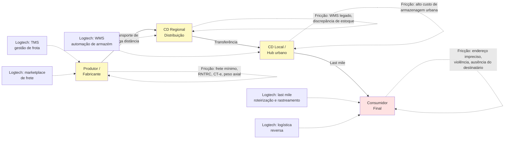

> [!note] Last mile como campo de batalha
> A última milha, do hub urbano ao consumidor final, concentra os maiores custos unitários e os problemas mais difíceis. No Brasil, endereços imprecisos (CEP que cobre quadra inteira), violência urbana em regiões de risco, alta densidade de pedestres em centros e informalidade de destinatários tornam a última milha significativamente mais cara do que em países comparáveis.

---

### Segmentos logtech e suas dinâmicas

#### 1. TMS: Transportation Management System

Sistemas de gestão de transporte (*Transportation Management Systems*, TMS) orquestram a operação de embarcadores e transportadoras de ponta a ponta: incluem cotação e contratação de tabelas de frete, roteirização multi-parada, emissão e averbação automática de CT-e e MDF-e, controle de custo por viagem e auditoria eletrônica de faturas de frete contra os contratos negociados.

Comprador típico: empresas de transporte de médio e grande porte, ou embarcadores (indústrias e distribuidoras) que gerenciam frota própria ou contratada.

Ticket médio: R$ 1.000–30.000/mês dependendo do porte da frota. Modelo SaaS com módulos adicionais.

#### 2. Last mile delivery

A entrega de última milha (*last mile*) concentra a maior pressão competitiva e a maior queima histórica de capital da logística porque substitui o ganho de escala de um caminhão pesado em rodovia pela pulverização de milhares de paradas urbanas sujeitas a trânsito, endereços imprecisos e ausência do destinatário. Suas três frentes principais abrangem:

- Delivery de e-commerce (Loggi, Total Express, Jadlog)
- Delivery de alimentos (iFood, Rappi: integrados verticalmente)
- Entrega expressa corporativa

O modelo de unit economics decisivo é o custo por entrega. No Brasil, o custo médio de uma entrega last mile para e-commerce varia de R$ 8 a R$ 25 dependendo da distância, densidade urbana e nível de serviço.

Para reduzir o custo unitário por pacote nas entregas de e-commerce, as operadoras líderes substituíram o despacho ponto a ponto por malhas de *cross-docking* automatizado e roteirização adensada por CEP (elevando o número de paradas por quilômetro quadrado). O uso de entregadores autônomos preserva a flexibilidade nos picos sazonais, mas exige governança jurídica rigorosa (ver seção de armadilhas).

#### 3. Marketplace de frete

Plataformas que conectam embarcadores a caminhoneiros autônomos ou pequenas transportadoras retêm os dois lados da operação quando entregam na própria viagem a infraestrutura que o contato direto via WhatsApp não resolve: averbação automática das apólices de seguro, emissão de CT-e e CIOT, Vale-Pedágio obrigatório e antecipação de capital de giro via Pix. Com esses serviços embutidos, o marketplace sustenta um *take rate* líquido de **3% a 8% sobre o frete**, combinado à receita de assinatura SaaS das transportadoras.

A **Frete.com** consolidou-se como a principal referência brasileira nesse modelo híbrido de assinatura SaaS para transportadoras e intermediação digital de cargas. O desafio operacional contínuo consiste em auditar a conformidade documental e securitária de cada viagem (RNTRC ativo na ANTT, CNH compatível, histórico em gerenciadoras de risco e apólices vigentes) antes da liberação do carregamento.

#### 4. WMS: Warehouse Management System

Gestão de armazéns: recebimento, conferência, armazenagem, separação de pedidos (picking) e expedição. Integrado a TMS e ao ERP do cliente.

O mercado é dominado por grandes players (SAP WM, Oracle WMS) na enterprise, com espaço para SaaS mid-market. Empresas de fulfillment (que operam armazéns para terceiros) são clientes relevantes.

#### 5. Rastreamento e visibilidade

Plataformas de track & trace que consolidam eventos de múltiplas transportadoras e exibem status em tempo real para o embarcador e para o destinatário final.

Modelo de receita: SaaS por volume de eventos rastreados ou por transportadora integrada. A Intelipost opera nesse espaço como camada de abstração entre e-commerce e múltiplas transportadoras.

#### 6. Logística reversa

Coleta de devoluções, gestão de RMA (Return Merchandise Authorization), reprocessamento e descarte adequado. Ganha relevância com o crescimento do e-commerce e com regulação de logística reversa de embalagens (Política Nacional de Resíduos Sólidos: Lei 12.305/2010).

Segmento ainda emergente como produto standalone. Grandes players de last mile incluem reversa como módulo adicional.

#### 7. Cold chain

Cadeia de frio: transporte e armazenagem de produtos que requerem temperatura controlada. Inclui alimentos perecíveis, medicamentos, vacinas, flores.

Regulação ANVISA impõe requisitos rígidos de temperatura, registro de desvios e rastreabilidade. Startups nesse segmento precisam de hardware (sensores IoT de temperatura) integrado ao software de gestão.

---

### Tabela comparativa dos segmentos de logtech no Brasil

| Segmento | Modelo de receita | Desafio operacional decisivo | Caso referência |
|---|---|---|---|
| TMS / gestão de frota | SaaS por módulo ou veículo | Integração com NF-e e CT-e de múltiplos estados | Intelipost, Senior, Cobli |
| Last mile delivery | Custo por entrega (cobrado do embarcador) | Custo unitário × volume mínimo rentável | Loggi, Total Express |
| Marketplace de frete | Assinatura SaaS + take rate (3% a 8% com serviços embarcados) | Verificação RNTRC, CIOT, PGR e qualidade do transportador | Frete.com (Fretebras + CargoX) |
| WMS | SaaS por armazém ou por pedido | Integração com ERPs legados do cliente | Senior Sistemas (WMS), TOTVS WMS, Sankhya |
| Rastreamento / visibilidade | SaaS por volume de eventos ou transações | Integração com 50–100+ transportadoras | Intelipost |
| Logística reversa | Por coleta ou SaaS integrado | Fluxo reverso é menos previsível que forward | Kangu, Mandaê |
| Cold chain | SaaS + hardware IoT | Uptime dos sensores, conformidade ANVISA | Sensorweb, Nexxto |
| Micromobilidade (last mile urbano) | Assinatura mensal da bicicleta / patinete | Manutenção de frota, vandalismo | Tembici |

---

### Unit economics específicos de logtech

#### Marketplace de frete: take rate

Em marketplaces de frete no Brasil, motoristas e embarcadores aceitam pagar comissão quando a plataforma resolve a burocracia fiscal, securitária e financeira da viagem: operações sustentáveis praticam um *take rate* líquido de **3% a 8% sobre o volume transacionado** (ou combinam assinatura mensal SaaS das transportadoras com *spread* de antecipação de recebíveis), entregando na mesma transação verificação cadastral de risco do motorista, emissão automática de CT-e/MDF-e e CIOT, seguro de carga acoplado e adiantamento à vista do saldo de frete via Pix. Abaixo de 3%, a plataforma não cobre os custos de suporte e verificação regulatória. Acima de 8%, ou quando tenta cobrar comissão de 8% apenas pelo anúncio do contato telefônico como na cena de abertura, transportadores e embarcadores frequentes migram para acordos diretos fora do sistema.

A chave é o volume: com baixo volume, o marketplace não tem liquidez suficiente para cobrir todas as rotas. Com alto volume, surgem transportadores que tentam sair da plataforma.

Métricas de saúde de um marketplace de frete:

- **Taxa de match:** percentual das cargas publicadas que encontram transportador qualificado e validado no PGR em menos de 4 horas nas rotas rodoviárias de carga lotação (ou dentro da janela de corte exigida pelo embarcador).
- **Taxa de conclusão:** % dos fretes iniciados que são concluídos sem incidente
- **Repeat rate:** % de embarcadores que usam a plataforma mais de uma vez por mês
- **Custo de verificação por transportador:** quanto custa validar RNTRC, seguro, CNH

#### Last mile: custo por entrega

Diferentemente do transporte rodoviário de carga lotação (regido pelo custo por tonelada-quilômetro), a economia unitária do *last mile* depende da **densidade de paradas por quilômetro quadrado e do tempo de parada por pacote**: quando o entregador realiza 12 entregas na mesma rua comercial, o custo unitário despenca, quando percorre bairros dispersos, a margem desaparece. Na ponta do lápis, o custo por pacote entregue decompõe-se em:

- Custo do entregador (gig ou CLT): 40–60% do custo total
- Combustível ou recarga (para elétrico / bicicleta): 5–15%
- Custo de hub urbano e handling: 10–20%
- Tentativas frustradas (destinatário ausente, endereço errado): 10–20% de sobrecusto em média
- Custo de suporte e atendimento a ocorrências: 5–10%

No Brasil, a taxa de insucesso na primeira tentativa de entrega pode chegar a 20–30% em cidades com endereçamento precário: contra 5–10% nos EUA. Isso sozinho representa diferença de 15–25% no custo total da operação.

#### Armazenagem: giro de estoque

Para operadores de fulfillment (que armazenam estoque de e-commerce de terceiros), a métrica central é o giro: quantos dias, em média, um SKU fica no armazém antes de ser vendido e expedido.

Giro alto (< 15 dias) = armazém produtivo, receita por m² relevante.
Giro baixo (> 60 dias) = capital imobilizado do cliente, pressão para cobrar armazenagem adicional.

Para evitar que mercadorias de giro lento imobilizem posições-palete sem gerar receita de movimentação, a precificação de um operador de *fulfillment* deve desacoplar o custo fixo de ocupação física do custo variável de mão de obra operacional, separando contratualmente:

- Taxa de recebimento (por item ou por SKU)
- Taxa de picking e embalagem (por pedido)
- Armazenagem (por pallete-dia ou m²-dia)
- Expedição (por pedido, integrada à transportadora)

---

### Lições da Estrada Brasileira: Como os Vencedores Construíram Fossos em Frete (Frete.com), TMS (Intelipost/Frete Rápido) e Last-Mile (Loggi)

Três arquiteturas distintas mostram como criar retenção real na logística brasileira: (1) no **transporte pesado de lotação**, a **Frete.com** combinou o efeito de rede de centenas de milhares de caminhoneiros cadastrados com assinatura SaaS para transportadoras e serviços financeiros de pagamento de frete e pedágio, (2) no **software de gestão de fretes para e-commerce e indústria (TMS)**, plataformas como **Intelipost** e **Frete Rápido** criaram alto custo de troca ao integrar o cálculo de frete em milissegundos no *checkout* a centenas de tabelas de transportadoras fracionadas e à auditoria automática de faturas de CT-e, e (3) no **last-mile de encomendas**, a **Loggi** migrou das entregas avulsas de documentos por motoboy para uma malha nacional de *cross-docking* automatizado (*sorters* ópticos) e roteirização por CEP que reduziu o custo unitário por pacote entregue para grandes varejistas.

#### Loggi: do documento ao e-commerce

A Loggi iniciou a operação em 2013 com entrega expressa de documentos corporativos em São Paulo e migrou para pacotes de e-commerce apoiada em engenharia de malha: ao combinar *sorters* ópticos em centros de triagem com agências leves de última milha, escalou para centenas de milhares de pacotes processados por dia, baixando o custo por parada pela densidade de entregas na mesma rua.

Com essa malha de triagem automatizada e adensamento algorítmico de paradas por CEP, a operação elevou a produtividade de dezenas de entregas diárias por motorista em rota densa e reduziu o índice de devolução por ausência do destinatário mediante notificações em tempo real e rede de pontos parceiros de retirada (*Pick-up & Drop-off Points*, PUDO).

#### Frete.com: assinatura SaaS e liquidez de frete em escala nacional

A CargoX criou marketplace de frete rodoviário de cargas, conectando embarcadores industriais (açúcar, grãos, insumos) a caminhoneiros autônomos e pequenas transportadoras.

O diferencial foi a automação da verificação regulatória (RNTRC, seguro) e a transparência de preço: em um mercado onde os fretes eram negociados manualmente por telefone.

#### Intelipost: camada de integração para e-commerce

Posicionamento como *middleware* logístico de alta retenção: o embarcador integra uma única API da Intelipost e acessa centenas de transportadoras homologadas em todo o país. A plataforma calcula o frete na tela de *checkout* em milissegundos, consolida o rastreamento e audita faturas e CT-es automaticamente, criando elevado custo de troca (*switching cost*) operacional.

Modelo de receita SaaS com cobrança por volume de etiquetas e envios. Beneficia de efeito de rede à medida que mais transportadoras e mais e-commerces entram na plataforma.

#### Tembici: micromobilidade como first e last mile

Na micrologística urbana de última milha, o adensamento de entregas em centros metropolitanos congestionados impulsionou o uso de bicicletas elétricas cargueiras e veículos elétricos leves apoiados por *micro-hubs* de bairro. O modelo operacional e financeiro das frotas leves compartilhadas e de troca rápida de baterias (*battery swapping*), liderado no país por **Tembici** e **Vammo**, é detalhado no Capítulo 23 (Mobitech: Mobilidade Urbana, Gestão de Frotas, Telemetria, Eletromobilidade e Autônomos).

O modelo B2G (patrocínio de banco ou prefeitura) sustenta a infraestrutura, com monetização adicional via assinaturas mensais de usuários.

#### Mandaê: fulfillment para PMEs

Fulfillment terceirizado para pequenos e médios e-commerces: recebe o estoque, armazena, separa e expede. O lojista não precisa de armazém próprio.

O modelo compete diretamente com o fulfillment do Mercado Livre (MELI) e da Amazon. A diferença é que a Mandaê atende e-commerces que vendem em múltiplos canais (próprio + marketplaces), não apenas no marketplace da plataforma dona do fulfillment.

---

### As Armadilhas Setoriais: Subsidiar Frete com Capital de VC, Passivo Trabalhista, Fraude de Carga Fantasma e Custo de Insucesso na Entrega

Antes da lista detalhada abaixo, atenção às duas armadilhas financeiras que mais encerraram operações de LogTech no país: **subsidiar o valor do frete com capital de Venture Capital para inflar GMV** (assim que a startup retira o subsídio para buscar margem positiva, o embarcador e o motorista migram no dia seguinte para o concorrente ou voltam ao contato direto, provando que volume comprado abaixo do custo marginal não cria efeito de rede) e **sofrer roubo de "carga fantasma" por falha de validação documental** (quadrilhas que cadastram caminhões clonados e CNHs falsas em plataformas digitais sem checagem biométrica e sem integração com gerenciadoras de risco, desaparecendo com cargas de R$ 500 mil a R$ 2 milhões na primeira viagem, sinistro que a seguradora recusa pagar quando o protocolo do PGR não foi integralmente cumprido).

**1. Risco trabalhista e previdenciário no modelo de entregadores autônomos (*gig economy*) e seu impacto na margem por entrega**

Na contratação de entregadores por aplicativo para operações de *last-mile*, o cenário trabalhista brasileiro em outubro de 2026 exige dupla precificação de risco: enquanto turmas do TST mantêm decisões que reconhecem vínculo empregatício quando há controle de preço, jornada e punições algorítmicas, o STF tem cassado reconhecimentos de vínculo CLT em Reclamações Constitucionais desde 2023 e julga o mérito em repercussão geral no **Tema 1.291** (recursos de Uber e Rappi, com sustentações orais em outubro de 2025, início da votação em agosto de 2026 e parecer da **Procuradoria-Geral da República** contrário ao vínculo empregatício), ao passo que o Congresso Nacional debate regulação própria para trabalhadores de plataformas (como o PLP 12/2024). Modele a economia unitária da operação considerando tanto o regime autônomo quanto o impacto de encargos previdenciários e securitários sobre cada entrega.

O risco não é hipotético: há passivos trabalhistas bilionários sendo discutidos nas principais plataformas de delivery. Startups que replicam o modelo sem precificar esse passivo potencial podem encontrar dívida trabalhista maior do que o negócio vale.

> [!important] Precifique o risco trabalhista desde o início
> O modelo de gig pode ser a única forma de ter escala operacional inicialmente. Mas construa reservas para o cenário de reconhecimento de vínculo empregatício. Consulte advogado trabalhista com experiência em plataformas digitais antes de definir o modelo de contratação.

**2. Concentração geográfica no eixo SP-RJ**

É tentador construir o modelo em São Paulo, onde a densidade urbana, o volume de e-commerce e a infraestrutura são melhores. O problema é que o eixo SP-RJ representa menos de 30% da população e do território brasileiro. Quando a startup tenta expandir para o Nordeste, Norte ou Centro-Oeste, frequentemente descobre que o modelo de unit economics não funciona nas mesmas condições.

**3. Violência e risco de carga**

O Brasil tem uma das maiores taxas de roubo de carga do mundo. São Paulo, Rio de Janeiro e regiões de fronteira têm índices que impactam diretamente o custo do seguro de carga e as rotas possíveis.

No cumprimento da **Lei nº 14.599/2023** (regulamentada pela SUSEP e pela ANTT), que tornou obrigatória a contratação direta pelo transportador dos três seguros detalhados no item 5 da seção regulatória (**RCTR-C**, **RC-DC** e **RC-V**) e vedou a imposição de apólices estipuladas unilateralmente pelo embarcador com cobrança de taxas de averbação em duplicidade, o sistema da *logtech* precisa operar como trava automática de pátio: validar eletronicamente a vigência das três apólices do transportador no cadastro da viagem, executar a averbação eletrônica do CT-e e do MDF-e antes da partida e confirmar que o rastreador e o motorista cumprem integralmente o PGR da apólice de RC-DC.

**4. Informalidade do motorista como risco de qualidade**

Segundo os dados do Registro Nacional de Transportadores Rodoviários de Cargas (**RNTRC / ANTT**) e as pesquisas de perfil da **CNT**, os transportadores autônomos (**TACs**) representam a maior parte dos caminhoneiros em atividade no país (mais de 60% dos transportadores cadastrados e cerca de um terço a 40% da frota nacional de veículos de carga, convivendo com as empresas de transporte - ETCs). Muitos operam com documentação irregular, veículos fora da manutenção adequada ou sem o RNTRC atualizado. Aceitar motoristas informais para cobrir rotas é tentador mas cria risco regulatório e de sinistro.

**5. Importação de peças e custo Brasil**

Veículos de logística (caminhões, vans, equipamentos de armazém) têm componentes que dependem de importação. O custo Brasil (impostos de importação, taxa de câmbio, tempo de desembaraço alfandegário) impacta o custo de manutenção de frota de forma relevante. Startups que operam frota própria precisam precificar esse custo desde o início.

**6. Heterogeneidade regional de infraestrutura**

Uma solução de TMS ou WMS desenvolvida para rotas entre capitais no Sul-Sudeste pode falhar completamente no Norte, onde parte das rotas é fluvial, estradas são precárias e a cobertura de telefonia 4G é fragmentada. Não assuma que o que funciona em São Paulo funciona no Brasil.

> [!tip] Estratégia de expansão regional
> Startups de logtech bem-sucedidas no Brasil tipicamente adicionam uma região por vez, adaptando o modelo de operação (parceiros locais, cobertura de seguro diferenciada, tipo de veículo) antes de avançar. Expansão nacional acelerada em logística frequentemente termina em burn de capital sem produto-mercado fit regional.


---

### Filtro de Alinhamento e Prontidão: Perguntas de Validação Prática

Na operação de distribuição D2C entre Recife e Goiânia, **Rafael e Bia** transformaram as perguntas abaixo em protocolo obrigatório antes de homologar transportadoras ou assinar softwares logísticos: passaram a exigir averbação automática das apólices RCTR-C, RC-DC e RC-V via API e bloqueio de saída de pátio sem CT-e e MDF-e autorizados, encerrando de vez as cotações informais pelo WhatsApp.

Antes de investir em uma Logtech de frete rodoviário, entregas urbanas, armazenagem ou supply chain no Brasil, responda:

1. **O Teste do WhatsApp (Anti-Leakage):** Por que o embarcador e o motorista continuam transacionando na sua plataforma na décima viagem em vez de fecharem direto no WhatsApp? Você amarra a operação emitindo automaticamente o **CT-e** (Conhecimento de Transporte Eletrônico), o **MDF-e** (Manifesto Eletrônico de Documentos Fiscais exigido na fiscalização de rota), o **CIOT** (Código Identificador da Operação de Transporte, obrigatório pela ANTT para regulamentar o pagamento eletrônico de frete ao autônomo) e o **Vale-Pedágio obrigatório** (Lei nº 10.209/2001, pago separado do frete), além de embutir seguro e antecipação de recebíveis?
2. **A Matemática da Parada por Km² (Para Last-Mile):** Quantas entregas você concentra no mesmo quarteirão na mesma janela horária para que a margem por pacote supere o custo do motorista e dos destinatários ausentes?
3. **A Blindagem contra o Roubo de Carga:** Sua plataforma valida antecedentes, bloqueia motoristas fantasmas e cumpre integralmente o **Plano de Gerenciamento de Risco (PGR)** (protocolo exigido pelas seguradoras nas apólices de responsabilidade civil e roubo, RCTR-C e RC-DC, que impõe regras estritas de cadastro em gerenciadoras de risco, rastreamento ativo, iscas de carga e paradas autorizadas sob pena de perda da cobertura)?

**O Movimento de Segunda-Feira:** Nos próximos 15 dias, passe duas madrugadas na doca de um centro de distribuição ou transportadora acompanhando a expedição real, a emissão de CT-e/MDF-e e a contratação de caminhoneiros.


---

## CAPÍTULO 23: MOBITECH: MOBILIDADE URBANA, GESTÃO DE FROTAS, TELEMETRIA, ELETROMOBILIDADE E AUTÔNOMOS

### A Regra Invisível do Jogo: A Física Implacável do Ativo sobre Rodas e do Pneu Furado

Poucos setores queimaram tanto dinheiro de investidores desavisados na última década quanto a mobilidade urbana B2C. O empreendedor iniciante se encanta com a febre dos patinetes elétricos e dos aplicativos de carona subsidiados, importa veículos leves, espalha-os pelas calçadas dos bairros nobres de São Paulo ou do Rio de Janeiro e projeta em uma planilha que cada equipamento durará trinta e seis meses rodando seis viagens por dia. Na vida real brasileira, sob chuva tropical, asfalto esburacado, vandalismo, furto de baterias e custo logístico diário de caminhonetes recolhendo equipamentos descarregados de madrugada, o veículo se destrói em quatro meses, antes de pagar um terço do próprio custo de aquisição (CapEx).

A experiência acumulada na mobilidade brasileira mostra que as tentativas de competir em transporte individual B2C subsidiado queimaram centenas de milhões em capital sem retenção, enquanto os negócios mais rentáveis e resilientes do setor concentram-se no **B2B de gestão de frotas corporativas, telemetria pesada, videotelemetria anticolisão e eletrificação de frotas comerciais de alta rodagem**.

A lei férrea deste setor é **A Equação do TCO (Custo Total de Propriedade) por Quilômetro Rodado**: para qualquer operador de frota no Brasil (seja de ônibus, caminhões, furgões de entrega ou carros corporativos), três vilões devoram a margem operacional: o combustível ou energia, a manutenção corretiva por mau uso do motorista e o sinistro ou roubo. Quem instala telemetria com visão computacional (DMS/ADAS) que detecta fadiga do motorista, corta o consumo de diesel em 8% a 12%, reduz sinistros em 30% a 50% (faixas reportadas pelas operadoras do setor) e comprova a economia em um piloto de 30 dias dificilmente é desligado da frota.

Na operação real de frotas comerciais e mobilidade urbana no Brasil, a diferença entre construir um negócio rentável e queimar capital em ativos depreciados está na auditoria diária do custo por quilômetro rodado: frotistas corporativos renovam contratos plurianuais quando a tecnologia embarcada comprova, já no primeiro mês de operação, redução direta no gasto com diesel, pneus, oficina e sinistros.

---

> [!note] Síntese Executiva da Vertical
> Empreender em Mobitech no Brasil exige compreender que a mobilidade brasileira opera sob três forças estruturais simultâneas: (1) déficit histórico de infraestrutura metroferroviária que concentra nas rodovias cerca de 65% da matriz nacional de cargas em TKU (segundo a CNT e a EPL, atual Infra S.A.) e mais de 85% dos deslocamentos motorizados de passageiros (ANTP/CNT), (2) frota registrada de 124 milhões de veículos no Senatran em 2024, dos quais cerca de 62,1 milhões efetivamente circulam segundo o Sindipeças (48,1 milhões de autoveículos e 14 milhões de motos), com idade média acima de 11 anos, alto índice de sinistralidade viária e custo severo de combustível e seguro, e (3) mais de 1,7 milhão de trabalhadores atuando em aplicativos de transporte de passageiros e entregas urbanas (segundo a PNAD Contínua do IBGE). Quem domina a equação entre software de otimização, telemetria embarcada e estruturação financeira de ativos constrói negócios altamente defensáveis.

---

### 1. O ecossistema de mobilidade no Brasil: escala, gargalos e regulação

A mobilidade urbana e corporativa no Brasil responde por centenas de bilhões de reais por ano entre transporte público coletivo, transporte individual por aplicativo, locação de veículos, gestão de frotas corporativas e eletromobilidade. Ao contrário da Europa ou da Ásia Oriental, onde redes densas de metrô e trens de subúrbio estruturam o deslocamento metropolitano, as cidades brasileiras cresceram sobre o ônibus urbano, o automóvel particular e, na última década, a motocicleta, que se tornou a espinha dorsal tanto do *last-mile* logístico quanto do transporte de passageiros (*moto-táxi* e *moto-app*) fora dos centros expandidos das capitais.

Do ponto de vista regulatório, toda startup de Mobitech opera em um tabuleiro federativo de três níveis:

- **Nível Federal (CONTRAN, SENATRAN e ANTT):** O Conselho Nacional de Trânsito (CONTRAN) e a Secretaria Nacional de Trânsito (SENATRAN) regulam homologação veicular, equipamentos obrigatórios, prontuários de condutores, notificações eletrônicas (SNE) e diretrizes de segurança viária e sistemas avançados de assistência ao condutor (ADAS). Já a Agência Nacional de Transportes Terrestres (ANTT) regula o transporte rodoviário interestadual de passageiros e o Registro Nacional de Transportadores Rodoviários de Cargas (RNTRC).
- **Nível Estadual (DETRANs e Secretarias de Fazenda):** Os 27 DETRANs estaduais controlam registro, licenciamento anual, transferência de propriedade (CRLV-e e ATPV-e), vistoria veicular e pontuação de CNH, enquanto as SEFAZ estaduais definem alíquotas e isenções de IPVA, com diferenciação por impacto ambiental autorizada pela EC 132/2023 (fator decisivo para locadoras e frotas nas legislações estaduais vigentes em 2026: o Paraná aplica alíquota geral de 1,9%, Distrito Federal, Rio Grande do Sul, Pernambuco, Paraíba, Rio Grande do Norte, Acre e Tocantins isentam elétricos, Minas Gerais restringe a isenção a elétricos fabricados no estado, e São Paulo cobra 4% de carros elétricos puros).
- **Nível Municipal (Prefeituras e Secretarias de Mobilidade):** A Lei Federal 13.640/2018 atribuiu aos municípios a competência exclusiva para regulamentar e fiscalizar o transporte remunerado privado individual de passageiros por aplicativo. Cada prefeitura define cobrança por quilômetro rodado na malha viária (como o sistema de outorga onerosa por uso do viário em São Paulo), idade máxima do veículo, exigências de seguro APP (Acidentes Pessoais de Passageiros) e regras para operação de micromobilidade (bicicletas e patinetes compartilhados) e corredores exclusivos de ônibus.

> [!warning] A assimetria regulatória municipal e o risco trabalhista
> Uma operação de mobilidade que é regular em São Paulo pode sofrer apreensão de veículos ou bloqueio administrativo no Rio de Janeiro, em Fortaleza ou em municípios médios no dia seguinte. No campo trabalhista, como detalhado no Capítulo 22 (Logtech: Tecnologia em Logística e Supply Chain no Brasil), o cenário em outubro de 2026 exige dupla precificação: enquanto turmas do TST mantêm decisões divididas sobre subordinação algorítmica, o STF tem cassado reconhecimentos de vínculo CLT em Reclamações Constitucionais desde 2023 e julga o mérito em repercussão geral no **Tema 1.291** (recursos de Uber e Rappi, com sustentações orais em outubro de 2025, início da votação em agosto de 2026 e parecer da **Procuradoria-Geral da República** contrário ao vínculo empregatício), ao passo que o Congresso discute regulação específica (como o PLP 12/2024). Consulte assessoria jurídica trabalhista e modele a margem de contribuição da startup para absorver eventual contribuição previdenciária sem inviabilizar a operação.

---

### 2. As sete subverticais de Mobitech no Brasil

O mercado brasileiro de tecnologia para mobilidade divide-se em sete subverticais com arquiteturas tecnológicas, compradores e exigências de capital radicalmente distintos:

#### 2.1 Transporte público, bilhetagem eletrônica e MaaS (Mobility-as-a-Service)

O Brasil registra mais de 30 milhões de viagens diárias em ônibus urbanos. Durante décadas, os sistemas de bilhetagem eletrônica foram caixas-pretas controladas por sindicatos de empresas de ônibus, com cartões proprietários fechados e conciliação opaca. A nova geração de Mobitechs ataca a digitalização do pagamento em transporte coletivo (QR Code, Pix no validador, pagamento por aproximação NFC/EMV com cartão de débito/crédito direto na catraca e carteiras digitais de benefícios de Vale-Transporte), além da previsão de chegada em tempo real via GPS dos ônibus (como Cittamobi e Moovit). No segmento corporativo, plataformas de fretamento inteligente otimizam rotas de transporte de colaboradores industriais e administrativos, reduzindo de 15% a 30% o custo de fretado das empresas por meio de algoritmos de *clustering* de endereços e ocupação dinâmica de vans e ônibus.

#### 2.2 Ride-hailing, transporte sob demanda e micromobilidade

Nos aplicativos de corrida urbana, a dinâmica clássica de *marketplace* bilateral hiperlocal consolidou-se em grandes plataformas (Uber, 99, inDrive), mas abriu espaço para nichos verticalizados (transporte executivo corporativo integrado a sistemas de despesas, cooperativas municipais de motoristas e logística urbana sobre duas rodas). Já na micromobilidade, o mercado brasileiro comprovou entre 2018 e 2020 que patinetes sem estação física (*free-floating*), expostos a vandalismo, furto de baterias e depreciação em 4 meses, não fecham a conta: a **Grow** (fusão das operações de bicicletas e patinetes Yellow e Grin), após captar mais de US$ 150 milhões e espalhar dezenas de milhares de patinetes pelas calçadas de mais de uma dezena de cidades brasileiras, encerrou a operação de patinetes e entrou em recuperação judicial em 2020 (tendo a falência decretada pela Justiça de São Paulo em novembro de 2023). O modelo sustentável no país, consolidado pela **Tembici** em concessões municipais com patrocínio corporativo B2B plurianual (*naming rights* de bancos e grandes marcas, como o Bike Itaú em São Paulo e no Rio de Janeiro, que cobrem parcela substancial do CapEx), baseia-se em estações fixas integradas ao transporte público e planos de assinatura semanais de bicicletas elétricas robustas para entregadores de aplicativos (como o projeto iFood Pedal).

#### 2.3 Gestão de frotas leves e pesadas e videotelemetria com IA

Esta subvertical B2B apresenta forte relação entre retorno e capital investido no Brasil. O país possui milhões de veículos comerciais leves (utilitários, picapes e frotas técnicas de telecom, energia e saneamento) e caminhões pesados afetados por três custos recorrentes: desperdício de combustível por condução agressiva ou marcha lenta excessiva, manutenção corretiva não planejada e sinistros de trânsito. Empresas como **Cobli** e **Golfleet** evoluíram do rastreador passivo para plataformas de **videotelemetria com Inteligência Artificial embarcada (Edge AI)** (enquanto startups complementares como a **Prolog** digitalizaram a gestão eletrônica de sulco e pressão de pneus e checklists de oficina). Nas soluções de videotelemetria, câmeras duplas (*dual-facing dashcams*) analisam em tempo real a via e a cabine do motorista (fadiga, uso de celular ao volante, distância de seguimento), emitindo alertas sonoros imediatos na cabine e reduzindo o consumo de combustível em 8% a 12% e os sinistros em 30% a 50%, segundo estudos de caso divulgados pelas operadoras do setor.

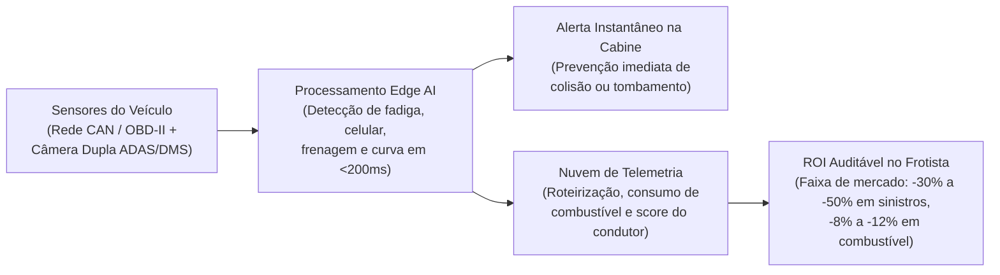

#### 2.4 Assinatura de veículos para motoristas de app e carsharing digital

Milhões de brasileiros desejam trabalhar como motoristas de aplicativo ou precisam de um carro na metrópole, mas não possuem entrada nem *score* de crédito bancário para financiar um veículo a taxas de 25% a 35% ao ano. Startups como a **Kovi** criaram o modelo de locação e assinatura com opção de compra (*rent-to-own*) desenhado especificamente para motoristas profissionais: análise de crédito baseada em dados comportamentais e histórico de corridas, telemetria com bloqueio remoto de segurança, cobrança semanal descontada diretamente do fluxo de ganhos e manutenção preventiva em oficinas próprias de altíssimo giro. Em paralelo, o *carsharing* 100% digital por hora ou dia (liderado pela **Turbi** em São Paulo) eliminou a loja física e o balcão de locadora: o usuário destrava o carro pelo smartphone em estacionamentos parceiros 24/7, devolve no mesmo ponto e paga apenas pelo tempo e quilometragem utilizados.

#### 2.5 Eletromobilidade comercial e infraestrutura de recarga (EV)

No Brasil, a eletrificação de frotas comerciais avança pela combinação da **matemática de TCO (Custo Total de Propriedade)** com os marcos tributários e industriais recentes: no plano federal, o **Programa Mover (Mobilidade Verde e Inovação, Lei 14.902/2024)** destinou R$ 19 bilhões em créditos financeiros até 2028 vinculados a metas de eficiência energética do poço à roda (*well-to-wheel*) e reciclabilidade, enquanto a recomposição escalonada do Imposto de Importação para veículos elétricos e híbridos (chegando a 35% em 2026) acelerou a montagem local em polos como Camaçari (BA) e Anápolis (GO). No plano estadual, a isenção ou alíquota reduzida de **IPVA** para veículos elétricos e híbridos em diversos estados e a dispensa do rodízio municipal em São Paulo alteram diretamente o custo anual de propriedade da frota em veículos que rodam mais de 150 km por dia. A conta mensal de TCO explica a adesão dos entregadores profissionais: para um motociclista que roda 4.500 a 6.000 km por mês em moto a combustão própria de 150 a 160 cc (fazendo de 35 a 40 km/l, ou 120 a 160 litros mensais), o gasto apenas com gasolina fica entre R$ 750 e R$ 1.000 aos preços médios da ANP, subindo para **R$ 1.300 a R$ 1.650 por mês** quando se somam trocas de óleo, kit de relação, freios, manutenção severa e depreciação/parcela da moto. Em comparação, na assinatura de moto elétrica com troca rápida de bateria (*battery swapping*) operada por startups como a **Vammo**, o entregador desembolsa de **R$ 220 a R$ 350 por semana (R$ 950 a R$ 1.500 por mês, já com moto, manutenção preventiva e energia incluídas)**, substitui a bateria descarregada por outra 100% carregada em menos de dois minutos nas estações urbanas e elimina tanto o CapEx da bateria quanto o tempo parado na tomada. Já no segmento de carros e utilitários elétricos (impulsionado pela entrada de montadoras como BYD e GWM no país), cresceram plataformas de software de gestão de recarga, faturamento de energia e interoperabilidade de eletropostos (como **Tupinambá**, **Voltbras** e **Zletric**).

#### 2.6 Fretamento rodoviário sob demanda e digitalização de passagens

O transporte rodoviário interurbano brasileiro movimenta mais de 130 milhões de passageiros por ano em linhas regulares e fretadas, superando o volume doméstico da aviação comercial. Após décadas de operação concentrada em linhas concedidas, plataformas de fretamento colaborativo (como a **Buser**) e marketplaces de passagens rodoviárias conectaram frotas de ônibus de fretamento diretamente aos passageiros. Na esfera regulatória e judicial, o fretamento por aplicativo enfrenta contencioso intenso movido pelas empresas de linhas regulares e fiscalização da **ANTT** e de agências estaduais (ARTESP, DETER, AGERBA) em torno da regra do **circuito fechado** (exigência de que o grupo de passageiros da viagem de ida seja o mesmo do retorno no fretamento eventual, tema com decisões divergentes nos Tribunais Regionais Federais e no STJ e arguições no STF). Para mitigar esse risco, as plataformas passaram a combinar o fretamento colaborativo com a revenda em marketplace de passagens de viações regulares operadas sob o regime de autorização da ANTT, utilizando precificação dinâmica de assentos e telemetria embarcada para praticar tarifas 30% a 50% inferiores às dos guichês tradicionais nas rotas de alta densidade.

#### 2.7 Veículos autônomos e robótica móvel em ambientes confinados

Enquanto o *robotáxi* urbano de Nível 4 enfrenta no Brasil barreiras severas de sinalização viária precária, infraestrutura heterogênea e custo de sensores (LiDAR/radares importados), os **veículos autônomos para ambientes operacionais confinados ou privados** já são realidade comercial no país. Caminhões autônomos e remotamente assistidos em minas a céu aberto, tratores e transbordos autônomos na colheita de cana-de-açúcar e grãos (como **Grunner** e **Lume Robotics**) e rebocadores autônomos (AMRs/AGVs) dentro de centros de distribuição e portos operam em propriedades privadas (fora do Código de Trânsito Brasileiro público) e pagam seu investimento pela redução da compactação do solo, operação 24 horas sem troca de turno em locais remotos e economia de diesel.

---

### 3. Unit economics de Mobitech: a física financeira do ativo sobre rodas

Negócios de mobilidade quebram quando os fundadores tratam uma operação intensiva em ativos físicos (*asset-heavy*) como se tivesse a estrutura de margem de um software puro (*asset-light*). Mesmo nas startups que vendem apenas software e hardware de telemetria (HaaS), o produto só é retido se melhorar diretamente o demonstrativo de resultados da frota do cliente.

As cinco métricas fundamentais que governam qualquer operação de Mobitech são:

1. **TCO por Quilômetro Rodado (R$/km):** Soma de depreciação do veículo, custo financeiro do capital imobilizado, combustível ou energia elétrica, pneus, manutenção preventiva e corretiva, seguro/sinistralidade, impostos (IPVA/licenciamento) e multas, dividida pelo total de quilômetros produtivos rodados no período.
2. **Taxa de Utilização Física e Financeira da Frota (%):** Em locação, assinatura ou *carsharing*, é a proporção de veículos efetivamente alugados e adimplentes sobre a frota total disponível. Uma frota de locação precisa operar consistentemente entre **82% e 92% de utilização física**, abaixo de 75%, o custo financeiro da dívida (indexada ao CDI) e a depreciação devoram o EBITDA.
3. **Sinistralidade, Perda Total e Taxa de Recuperação Veicular (%):** Percentual da frota envolvido em colisões severas, furtos, roubos ou apropriação indébita. Em operações de locação para aplicativos no Brasil, reduzir a perda de ativos de 4% para menos de 0,8% ao ano via inteligência de dados, cercas eletrônicas (*geofencing*) e pronta-resposta define quem sobrevive.
4. **Payback do Hardware Embarcado e LTV/CAC em Telemetria (HaaS):** Quando a startup fornece o rastreador ou a câmera de IA em comodato, o prazo de recuperação do CapEx depende do par equipamento-mensalidade (com margem bruta de serviço entre 65% e 78%): um kit básico de telemetria OBD/CAN (R$ 600 instalado, com assinatura de R$ 90 a R$ 120/mês) recupera o hardware em **6 a 8 meses**, enquanto um sistema completo de videotelemetria com câmera dupla de IA embarcada (R$ 1.800 a R$ 2.200 instalado, com assinatura de R$ 220 a R$ 280/mês) recupera o equipamento em **9 a 12 meses** (e o investimento total somado ao CAC comercial em 12 a 15 meses), exigindo contratos mínimos de 24 a 36 meses com multa rescisória proporcional ao ativo.
5. **Resultado de Desmobilização (*Remarketing* de Seminovos):** Em modelos de frota própria, grande parte do lucro líquido do ciclo de 24 a 36 meses do veículo não vem apenas da locação mensal, mas da diferença entre o valor contábil depreciado e o preço real de venda do veículo seminovo no varejo ou atacado ao final do ciclo.

#### Tabela de Benchmarks e Unit Economics por Subvertical de Mobitech no Brasil

| Subvertical | Modelo de Receita Dominante | Ticket / Receita Típica | Margem Bruta Típica | Métrica Operacional Decisiva | Intensidade de Capital (CapEx) | Casos Brasileiros de Referência |
|---|---|---|---|---|---|---|
| **Videotelemetria e Gestão de Frotas (HaaS + SaaS)** | Assinatura mensal por placa ativa (comodato de câmera/IoT) | R$ 90 a R$ 280 / veículo / mês | 65% a 78% (após amortização do hardware) | *Hardware Payback* (6 a 12 meses conforme o kit) e *Net Revenue Retention* (> 110%) | Média (financiamento do lote de câmeras/IoT via dívida ou giro) | Cobli, Golfleet, Prolog, Sascar |
| **Locação / Assinatura para Motoristas de App** | Receita semanal recorrente (locação ou *rent-to-own*) | R$ 650 a R$ 1.150 / semana por carro | 35% a 50% (operacional antes da dívida) | Utilização (> 88%), Inadimplência (< 3%) e Perda de Ativo (< 1%) | Altíssima (exige FIDC / Debêntures para compra da frota) | Kovi, Localiza Zarp, Movida |
| **Carsharing Urbano B2C por Hora / Dia** | Tarifa por hora + R$/km rodado + pacotes diários | R$ 18 a R$ 35 / hora + R$ 0,60 a R$ 1,20 / km | 40% a 55% | Horas faturadas por carro/dia (> 9h) e custo de estacionamento/manutenção | Alta (frota financiada via dívida estruturada) | Turbi, Awto |
| **Motos Elétricas e Battery Swapping** | Assinatura da moto + plano de trocas de bateria | R$ 220 a R$ 350 / semana (R$ 950 a R$ 1.500 / mês, moto + energia) | 45% a 60% | Ciclos úteis da bateria de lítio (> 1.500 ciclos) e densidade de estações | Alta (motos + banco de baterias + estações de recarga) | Vammo, Tembici (e-bikes iFood Pedal) |
| **Software para Infraestrutura de Recarga EV** | SaaS por conector gerenciado + *take rate* sobre recarga (R$/kWh) | R$ 80 a R$ 250 / ponto/mês + 8% a 15% da recarga | 70% a 85% (no modelo puro de software) | Uptime dos carregadores (> 97%) e kWh vendidos por estação/dia | Baixa (se puro CPMS) a Alta (se dono do eletroposto/CPO) | Tupinambá, Voltbras, Zletric |
| **Fretamento Corporativo e Rodoviário** | Comissão (*take rate*) ou contrato mensal B2B por rota otimizada | 15% a 25% de *take rate* sobre o bilhete (B2C) ou R$ 12k–25k/ônibus/mês em contratos corporativos (B2B) | **50% a 70% de margem bruta sobre a receita líquida de comissão** (equivalente a 10% a 16% sobre o GMV total transacionado) | Ocupação média por viagem (> 75% dos assentos) | Baixa (frota de terceiros parceiros) | Buser, Fretadão, BusUp |

---

### 4. Casos reais brasileiros: estratégias vencedoras e lições duras

> [!example] Caso 1: Cobli, Golfleet e Prolog, O ROI imediato da videotelemetria e gestão de ativos no B2B
> Vender software para gestores de frota no Brasil sempre esbarrou em uma objeção pragmática: o frotista não quer mais um painel com gráficos bonitos. Ele quer gastar menos com óleo diesel, pneus e oficinas. A **Cobli** e a **Golfleet** escalaram combinando telemetria avançada e câmeras com IA embarcada porque conseguem provar matematicamente, em um teste operacional de 30 a 60 dias com 20 veículos do cliente, que a redução de excesso de velocidade, freadas bruscas e uso de celular ao volante gera reduções expressivas de sinistros rodoviários (frequentemente de 30% a 50% nos estudos de caso de frotas comerciais monitoradas com alerta em cabine) e uma economia de óleo diesel e manutenção que paga múltiplas vezes a assinatura mensal do hardware em comodato. Na mesma linha, a **Prolog** construiu uma solução vertical focada no segundo maior custo variável de uma transportadora pesada depois do diesel (os pneus), digitalizando a aferição de sulco e calibragem com sensores eletrônicos para evitar perdas prematuras de carcaças que custam milhares de reais cada.

> [!example] Caso 2: Kovi e Turbi, A vitória da engenharia de risco, telemetria e dívida estruturada
> Tanto a **Kovi** (focada em motoristas profissionais de aplicativos) quanto a **Turbi** (focada em *carsharing* B2C por hora ou dia em São Paulo) estruturaram seu crescimento separando o **capital de tecnologia (Equity)** do **capital de frota (Dívida Estruturada via FIDCs e emissões de debêntures)**. Na Kovi, a vantagem operacional reside nos algoritmos proprietários de concessão e monitoramento contínuo de risco do motorista, na manutenção industrializada em megacentros próprios (reduzindo o tempo de carro parado em oficina de dias para horas) e nos protocolos de recuperação rápida de ativos em caso de inadimplência ou tentativa de fraude. Na Turbi, a tecnologia de abertura sem chave (*keyless*), vistoria digital por foto na devolução e precificação dinâmica por zona horária permitiu atingir taxas de utilização superiores às de locadoras tradicionais com zero funcionários em agências físicas.

> [!example] Caso 3: Vammo e Tembici, Eletrificação com unit economics de trabalho
> Enquanto fabricantes que tentaram vender motos elétricas diretamente no varejo brasileiro antes de consolidar cadeia de peças de reposição, rede de pós-venda e capital de giro enfrentaram grave crise operacional (como a **Voltz Motors**, que após inaugurar fábrica em Manaus sofreu atrasos generalizados de entrega, ações de despejo e entrou com pedido de recuperação judicial em 2023/2024), a **Vammo** atacou o problema pelo modelo integrado de assinatura com rede própria de *battery swapping*. O entregador profissional não compra a bateria (o componente mais caro e sujeito a degradação química). Ele assina a moto e troca a bateria em menos de 2 minutos nas estações espalhadas pela metrópole. De forma complementar, a **Tembici** transformou a bicicleta elétrica compartilhada em ferramenta de trabalho para dezenas de milhares de entregadores urbanos, reduzindo o custo operacional diário do trabalhador e combinando receita recorrente de assinaturas com contratos corporativos de patrocínio.

---

### 5. Armadilhas fatais em Mobitech

1. **Financiar compra de frota (CapEx) com Equity de Venture Capital:** Usar dinheiro de diluição societária (Seed/Série A) para comprar centenas de carros, motos ou ônibus no balanço é suicídio societário. O equity deve financiar apenas produto, software, equipe, dados e o *equity cushion* (subordinação de 10% a 20%) exigido para levantar dívida estruturada (**FIDC** de recebíveis de locação, **debêntures**, **notas comerciais** ou linhas bancárias de financiamento de frota / CDC, já a emissão de **CRA** aplica-se apenas quando o lastro é vinculado ao agronegócio, como locação de tratores, colheitadeiras e caminhões para produtores rurais ou agroindústrias) que financia os outros 80% a 90% dos veículos.
2. **Subestimar o crime organizado, a fraude de identidade e a apropriação indébita:** No Brasil, qualquer operação que entregue um veículo de R$ 15 mil (moto) a R$ 90 mil (carro) sem biometria facial robusta com prova de vida (*liveness detection*), validação de antecedentes, múltiplos dispositivos de rastreamento redundantes (incluindo iscas de radiofrequência imunes a *jammers* de GPS) e equipe de pronta-resposta em campo sofrerá perdas de frota que inviabilizam o negócio nos primeiros seis meses.
3. **Confundir o Brasil com a Califórnia em recarga elétrica residencial:** Mais de 70% dos motoristas de aplicativo e entregadores das grandes capitais brasileiras moram em condomínios populares, vilas ou residências sem garagem preparada para instalar um *wallbox* dedicado. Modelos de eletromobilidade comercial no Brasil que exigem que o motorista carregue o veículo por 6 horas em casa durante a noite têm seu mercado endereçável drasticamente amputado se não oferecerem infraestrutura pública rápida ou troca de bateria.
4. **Ignorar a severidade mecânica do pavimento brasileiro na conta de depreciação:** Buracos, lombadas fora de padrão, combustível adulterado e trânsito severo desgastam suspensão, embreagem, freios e baterias muito mais rápido do que nos manuais europeus ou chineses. Se o seu modelo financeiro copiar a curva de manutenção de fora do país, sua margem operacional tende a ficar negativa já a partir do segundo ano de vida da frota, quando se concentram as reposições estruturais.

> [!tip] Checklist de Validação para Fundadores de Mobitech
> - [ ] **Separe o balanço de tecnologia do balanço de ativos:** estruture desde o início o caixa operacional da startup (OpEx e engenharia de software) em veículo societário distinto do veículo de financiamento da frota (FIDC, dívida bancária ou arrendamento mercantil).
> - [ ] Para soluções B2B de frota/telemetria: o piloto comprova economia financeira líquida em combustível, pneus ou sinistros pelo menos **3x maior** que a mensalidade cobrada?
> - [ ] O hardware embarcado possui homologação **ANATEL** ativa e opera com chip *multi-operadora (eSIM/M2M)* com armazenamento local (*offline buffer*) para zonas de sombra de sinal?
> - [ ] Para modelos de locação/assinatura: existe protocolo automatizado de cobrança semanal, bloqueio preventivo seguro (expressamente previsto em cláusula contratual destacada, acionado exclusivamente com o veículo parado por segurança viária e validado por advogado especializado, conforme jurisprudência das Turmas Recursais) e equipe de recuperação física de veículos com SLA inferior a 4 horas?
> - [ ] A regulação municipal específica (outorga por km, cadastro de condutores/veículos) e as regras estaduais de IPVA para frotistas foram incorporadas na planilha de *unit economics* de cada cidade antes da expansão?

---

### Filtro de Alinhamento e Prontidão: Perguntas de Validação Prática

Antes de imobilizar capital próprio ou de investidores em veículos, estações de recarga ou lotes de sensores em comodato, submeta o modelo de negócio aos três testes de validação abaixo para confirmar que a economia gerada por placa cobre a depreciação física e o custo financeiro da frota:

Antes de investir em mobilidade, gestão de frotas, telemetria ou recarga elétrica no Brasil, responda sem dourar a planilha:

1. **Quem Paga a Depreciação do Ativo:** Se o negócio envolve veículos, baterias ou carregadores físicos, o risco de depreciação, roubo e manutenção está coberto por contratos B2B *take-or-pay* de 36 a 60 meses, ou você depende de demanda avulsa B2C?
2. **A Prova do Retorno de 3x no Combustível e na Oficina:** Se você vende telemetria ou software para frotas, consegue rodar um piloto de 30 dias em 20 veículos e comprovar uma economia mensal em diesel, pneus, multas e oficina pelo menos três vezes maior que a sua mensalidade por placa?
3. **Resistência à Sabotagem:** Seu hardware automotivo suporta painel a 70 °C sob o sol e detecta tentativas de desconexão ou bloqueio da câmera pelo motorista?

**O Movimento de Segunda-Feira:** Nos próximos 15 dias, entreviste cinco gestores de frotas com mais de 100 veículos e audite quanto eles perderam no último ano com desvios em abastecimento, oficinas e colisões.


---

## CAPÍTULO 24: CONSÓRCIOS ADMINISTRADOS (BACEN), RENTAL DE MÁQUINAS/FROTAS PESADAS E AFTERMARKET AUTOMOTIVO (AUTOPEÇAS, SEMINOVOS E LEILÕES)

> **Nota de arquitetura do volume:** Este capítulo analisa em conjunto três mercados conectados pelo ciclo físico e financeiro dos veículos e máquinas pesadas no Brasil: (1) os **consórcios administrados** (que, sob a ótica regulatória da Lei 11.795/2008 e do Banco Central, dialogam diretamente com os playbooks de serviços financeiros e crédito dos Capítulos 7 (Fintech: Pagamentos, Banking-as-a-Service (BaaS), Pix, Open Finance e Infraestrutura Financeira) e 8 (Crédito Digital, Securitização (FIDCs), Cobrança e Financiamento Embarcado) do Cluster I, mas na prática operam como um dos principais motores de financiamento de caminhões, máquinas agrícolas e veículos no país), (2) a **locação terceirizada (*rental*) de máquinas, caminhões e frotas pesadas**, e (3) a **cadeia de reposição de autopeças, oficinas e desmobilização de seminovos e leilões (*aftermarket*)**.

### Onde está o dinheiro: taxa de administração, desconto de montadora e giro de pátio

Em 2021, com a taxa Selic a 2% ao ano, diversas locadoras regionais de caminhões e equipamentos tomaram dívida bancária pós-fixada em CDI para comprar frota e assinaram contratos de locação de 60 meses a preços fixos. Menos de dezoito meses depois, com a Selic a 13,75% ao ano em agosto de 2022, a despesa financeira engoliu toda a margem operacional de quem não casou o indexador da dívida nem dominou a revenda do seminovo. Já os grupos brasileiros que dominaram a engenharia financeira e operacional dos consórcios, da locação pesada (*rental*) e da reposição automotiva (*aftermarket*), como Ademicon, Vamos, Armac, Mills e Fras-le Mobility, construíram operações bilionárias porque esses três mercados resolvem a escassez e o custo do crédito de longo prazo no Brasil.

Quando um amador entra no *rental* de caminhões, máquinas ou carros, ou abre uma operação de seminovos, acha que ganha dinheiro apenas na mensalidade do aluguel. Em menos de dois anos de Selic em dois dígitos, o juro da dívida tomada para comprar os ativos corrói 100% do lucro operacional e os equipamentos parados no pátio levam a empresa à recuperação judicial.

Quem constrói negócios duráveis nessa vertical estrutura sua operação sobre **Os Três Pilares da Economia Automotiva e de Equipamentos no Brasil**:
1. Nos **Consórcios regulados pelo BCB (Lei nº 11.795/2008)**, a administradora cobra de 15% a 22% de taxa de administração ao longo do ciclo do grupo **sem tomar risco de funding bancário** (pois a poupança coletiva dos consorciados financia as contemplações) e pode somar receita de corretagem sobre o seguro prestamista facultativo.
2. No **Rental de Frotas e Linha Amarela**, o retorno sobre o capital investido (ROIC de 16% a 24% ao ano nas demonstrações financeiras de 2024 e 2025 arquivadas na CVM pelas companhias abertas de grande porte Vamos, Armac e Mills) combina a geração de caixa de contratos de **36 a 60 meses** (yield mensal de 2,5% a 3,5%) com a **arbitragem entre o desconto de 15% a 25% na compra direta de fábrica em grande volume e a revenda do ativo seminovo na desmobilização**.
3. Nas **Autopeças e Oficinas**, vence quem resolve a catalogação exata por placa/chassi em uma frota com mais de dez anos de idade média e entrega a peça no elevador do mecânico em noventa minutos.

Quem empreende ou investe em consórcios, locação de máquinas pesadas e reposição automotiva precisa separar a planilha comercial da realidade mecânica e regulatória do ativo: a rentabilidade da operação depende do controle da inadimplência nas primeiras parcelas da cota, do casamento entre o indexador da dívida e o reajuste do contrato de locação e da disponibilidade física de peças e manutenção na ponta.

---

> [!note] Síntese Executiva da Vertical
> Em um país onde a taxa básica de juros (Selic) permanece estruturalmente elevada e o *spread* bancário para compra de bens duráveis e máquinas encarece o financiamento tradicional, a economia real brasileira apoia-se em três motores de financiamento alternativo, uso compartilhado de ativos e extensão de vida útil: **(1) o Sistema de Consórcios**, regulado pelo Banco Central, que comercializou **R$ 378 bilhões em novos créditos em 2024** para mais de **10,5 milhões de consorciados ativos** (segundo o consolidado anual da ABAC divulgado em 2025), remunerando as administradoras pela taxa de administração sem risco de *funding* bancário, **(2) a Indústria de *Rental* (Locação e Terceirização de Caminhões, Máquinas de Linha Amarela, Equipamentos Agrícolas e Intralogística)**, que permite às empresas clientes trocar o desembolso imediato de CapEx por despesa operacional de locação (dedutível de IRPJ e CSLL para empresas no Lucro Real, nas quais o ganho efetivo em relação à depreciação da compra própria é de liquidez e valor presente no fluxo de caixa), e **(3) o *Aftermarket* Automotivo (Autopeças, Oficinas, Seminovos e Leilões)**, que abastece uma frota nacional de **124 milhões de veículos registrados no Senatran, dos quais cerca de 62,1 milhões efetivamente circulam com idade média acima de 11 anos** (Sindipeças, 2024). Este capítulo examina a engenharia financeira, regulatória e operacional desses três setores.

---

### 1. O Sistema de Consórcios no Brasil (Lei nº 11.795/2008, Resolução BCB nº 285/2023 e Regime da LC 214/2025)

Antes de detalhar a mecânica de cada vertical, convém registrar como a reforma tributária do consumo (EC 132/2023 e LC 214/2025, em transição de 2026 a 2033) e a política industrial tratam os três elos: a administração de consórcios enquadra-se no regime específico dos serviços financeiros, com incidência de IBS e CBS sobre a taxa de administração sob alíquota e base próprias. A locação de veículos e máquinas opera sob o regime de bens móveis, gerando créditos tributários de IBS e CBS para clientes B2B no regime regular, e, na indústria de autopeças, o programa Mobilidade Verde e Inovação (Mover, Lei nº 14.902/2024) concede créditos financeiros vinculados a metas de descarbonização, reciclabilidade e investimentos em P&D no país.

#### A) A Física Econômica Imbatível da Administradora de Consórcios

Criado no Brasil no início da década de 1960 por funcionários do Banco do Brasil para viabilizar a compra de automóveis da nascente indústria automobilística nacional e hoje regido pela **Lei Federal nº 11.795/2008** e pela **Resolução BCB nº 285/2023 do Banco Central do Brasil**, o **Consórcio** é um dos mecanismos de autofinanciamento mais longevos e difundidos entre os mercados emergentes.
Um banco comercial precisa captar recursos em CDB ou LCI pagando percentual do CDI, emprestar ao tomador assumindo risco de inadimplência no próprio balanço e manter capital regulatório mínimo (Índice de Basileia). A **Administradora de Consórcios**, de forma distinta, opera como **gestora fiduciária de grupos de autofinanciamento (poupança coletiva com patrimônio e contabilidade segregados por grupo, nos termos da Lei nº 11.795/2008)**:

1. **Patrimônio Separado (Art. 5º da Lei 11.795/2008):** Os recursos arrecadados dos participantes de cada grupo de consórcio pertencem exclusivamente ao próprio grupo (não se comunicam com o patrimônio da Administradora nem respondem por dívidas dela). O crédito entregue nas contemplações mensais vem 100% da arrecadação das parcelas dos próprios consorciados daquele grupo (o crédito sai da arrecadação do próprio grupo, sem risco de *funding* bancário para a administradora).
2. **As 5 Fontes de Receita Empilhadas da Administradora de Consórcios:**
   - **1. Taxa de Administração Total (15% a 22% sobre o valor da Carta de Crédito):** Diluída no prazo do grupo (ex.: 18% em 180 meses em imóveis, ou 1,2% ao ano, 16% em 80 meses em veículos, ou 2,4% ao ano). Nos termos do **art. 27, § 3º, da Lei nº 11.795/2008** e da **Resolução BCB nº 285/2023** (combinada às normas do CMN e do Banco Central sobre autorização para funcionar e capital mínimo das administradoras, conforme o art. 7º da Lei 11.795/2008), é facultado à administradora cobrar, no ato da assinatura do contrato de adesão, a **antecipação de parcela da taxa de administração** destinada a cobrir despesas imediatas de venda e comissão de representantes comerciais, deduzindo esse percentual da taxa diluída nas prestações seguintes.
   - **2. Gestão Fiduciária dos Recursos do Grupo (Fundo Comum e Fundo de Reserva):** Pela **Lei nº 11.795/2008 (arts. 24, § 1º, e 25, parágrafo único)** e pelas normas do Banco Central, os rendimentos líquidos das aplicações financeiras do Fundo Comum e do Fundo de Reserva (alocados em títulos públicos federais ou fundos referenciados) **pertencem obrigatoriamente ao próprio grupo de consorciados e acrescem o valor do crédito contemplado**, não constituindo receita de *float* da administradora (cuja remuneração provém da taxa de administração e da parcela contratual da multa rescisória de cotas excluídas). Quando a administradora pertence a um conglomerado bancário ou cooperativa de crédito, a instituição financeira do grupo captura apenas a sinergia indireta de manter a custódia e os serviços bancários dos contemplados.
   - **3. Seguro Prestamista Facultativo:** O seguro prestamista, que quita o saldo devedor da cota em caso de morte ou invalidez permanente do consorciado, é de contratação estritamente facultativa (sendo vedada a venda casada pelo art. 39, I, do CDC). Quando o consorciado opta pela cobertura, a administradora obtém receita complementar atuando como estipulante da apólice coletiva ou por meio de corretora de seguros própria habilitada na SUSEP.
   - **4. Multas, Juros de Atraso (divididos entre o grupo e a administradora) e Taxas de Transferência/Cessão de Cota.**
   - **5. Retenção Contratual sobre Cotas Canceladas (Desistentes/Excluídos) e Revenda de Cotas de Reposição.**

#### B) A Engenharia Matemática dos Grupos: Sorteio, Lance Livre, Lance Fixo e Lance Embutido

Um grupo de consórcio moderno (seja de **Imóveis**, **Caminhões/Tratores/Colheitadeiras**, **Automóveis/Motos**, **Usinas Solares Fotovoltaicas** ou **Serviços Médicos/Estéticos/Reformas**) não é mais aquele produto passivo dos anos 1980 onde o cliente rezava anos para uma bolinha do globo ser sorteada.
Hoje, o consórcio é operado como um **instrumento sofisticado de planejamento financeiro e alavancagem patrimonial**, estruturado sobre quatro mecanismos de contemplação mensal nas Assembleias Gerais Ordinárias (AGOs):

1. **Contemplação por Sorteio (Extração da Loteria Federal):** Garante a isonomia estatística para todos os consorciados adimplentes do grupo.
2. **Lance Livre (% sobre a Carta ou Valor da Categoria):** Funciona como um leilão fechado na assembleia: ganha a carta de crédito quem oferecer antecipar o maior percentual de quitação do saldo devedor usando recursos próprios (ou o seu FGTS, no caso de consórcio imobiliário residencial).
3. **Lance Fixo (ex.: 25% ou 40% da Carta):** Todos os consorciados que ofertam exatamente o percentual fixo estipulado no regulamento do grupo concorrem apenas entre si, utilizando os critérios de desempate previstos no contrato. Na prática, a probabilidade de contemplação no lance fixo equivale ao número de cotas contempladas nessa modalidade na assembleia dividido pelo total de cotistas que ofertaram aquele percentual, por isso, antes de aderir, o comprador deve auditar junto à administradora o histórico real de contemplações e de ofertantes das últimas doze assembleias do grupo.
4. **Lance Embutido (O Grande Acelerador Comercial):** O regulamento do grupo permite que o consorciado utilize **parte da própria Carta de Crédito (ex.: até 25% ou 30% do crédito) para pagar o lance**!
   - *Exemplo Prático:* Um transportador precisa de **R$ 700.000 líquidos** para comprar um caminhão pesado. O consultor vende uma **Carta de Crédito de R$ 1.000.000** e o cliente oferta na assembleia um **lance total de 40%**: **30% de Lance Embutido (R$ 300.000 descontados da própria carta)** somados a **10% de recursos próprios (R$ 100.000 pagos do bolso)**. Se vencer a disputa de lances da assembleia (já que a Lei 11.795/2008 veda promessa de contemplação em prazo certo), ele recebe a disponibilidade líquida de R$ 700.000 para faturar o veículo sem juros bancários, mas paga a taxa de administração e o reajuste anual (pelo índice do contrato, como IPCA, INCC ou tabela do fabricante) calculados sobre o valor integral da carta de R$ 1.000.000, razão pela qual o custo efetivo total deve ser sempre comparado ao de um financiamento tradicional ou Finame.

#### C) Consórcio-as-a-Service (White-Label), Investimento Imobiliário e Mercado Secundário de Cotas

Como obter uma nova autorização do Banco Central para operar uma Administradora de Consórcios do zero exige capital social e patrimônio líquido mínimos fixados pelo CMN e pelo BCB (art. 7º da Lei 11.795/2008 e Resolução BCB nº 285/2023), além de estrutura de *compliance*/PLD e processo de aprovação que leva de 12 a 24 meses, consolidaram-se três modelos de negócios para empreendedores que entram no setor sem licença própria:

1. **Consórcio como Canal Distribuído (*White-Label* / Parcerias de Distribuição sob Administradora Autorizada pelo BCB):** Pela **Lei nº 11.795/2008** e pela **Resolução BCB nº 285/2023** (em vigor desde 1º de julho de 2024), a constituição e a administração de grupos de consórcio são atividades privativas de **Administradoras de Consórcio autorizadas pelo Banco Central** (como Ademicon, Embracon, Racon/Randoncorp, Porto Seguro Consórcio e Âncora). Empresas sem licença própria não podem administrar grupos: operam juridicamente como representantes comerciais ou parceiros de distribuição de uma administradora autorizada, que deve ser expressamente identificada no contrato de adesão e em todo o material publicitário. Nesse arranjo, redes de concessionárias de máquinas agrícolas, cooperativas de crédito, integradores de energia solar, incorporadoras e *fintechs* comercializam cotas com sua própria força de vendas e recebem **comissão de distribuição entre 4% e 10% sobre o valor da carta vendida** (tipicamente 4% a 8% para o parceiro comercial direto e 6% a 10% para corretoras *master* que gerenciam sub-redes), paga de forma parcelada conforme o adimplemento das primeiras prestações pelo consorciado.
2. **Boutiques de Investimento e Alavancagem Patrimonial com Consórcio Imobiliário:** Consultorias especializadas que estruturam carteiras de cotas imobiliárias para médicos, empresários e investidores comprarem imóveis comerciais ou residenciais para locação (fazendo o inquilino pagar a parcela do consórcio após a contemplação) ou para *arbitragem de ágio na venda da cota contemplada*.
3. **Mercado Secundário e Bolsas de Cotas Contempladas e Canceladas (Descontempladas):**
   - **Cotas Contempladas:** Um consorciado que foi sorteado na 3ª parcela de uma carta de R$ 500.000 (tendo pago apenas R$ 9.000 até ali) pode ceder/vender legalmente sua cota contemplada para um comprador que tem pressa do crédito imediato por um ágio negociado à vista na transferência da cota contemplada. Trata-se de um mercado secundário de nicho que exige cautela: a cessão depende de anuência expressa da administradora, nova análise de crédito do comprador (cessionário), verificação direta da autenticidade da cota junto à administradora para evitar fraudes de falsas cotas contempladas e instrumento formal de transferência
   - **Cotas Canceladas / Excluídas (Com Deságio):** Pela Lei 11.795/2008 (arts. 22, § 2º, e 30), o consorciado excluído por desistência ou inadimplência continua concorrendo aos sorteios mensais do grupo para receber de volta os valores pagos ao fundo comum (acrescidos dos rendimentos financeiros e deduzida a multa contratual). Mesas e plataformas especializadas no mercado secundário compram essas cotas excluídas com deságio de quem busca liquidez imediata, mediante termo formal de cessão aprovado pela administradora. **Atenção ao risco de prazo (*duration*):** a rentabilidade efetiva (TIR) da operação depende diretamente de quando a cota excluída é sorteada, se o sorteio demorar e a restituição ocorrer apenas no encerramento do grupo (o que pode levar mais de dez anos em consórcios imobiliários), a TIR anual cai drasticamente, além de existir risco administrativo caso uma administradora de pequeno porte sofra intervenção ou liquidação extrajudicial pelo Banco Central. Simule sempre o cenário de recebimento apenas no último mês do grupo antes de precificar o deságio.

---

### 2. *Rental*: Locação e Terceirização de Máquinas Pesadas, Linha Amarela, Caminhões e Equipamentos

Enquanto o consórcio financia a propriedade do bem, a segunda megatendência estrutural do Brasil corporativo é a **desmobilização do balanço (*Asset-Light Transition*) via *Rental* de Longo Prazo**.
Por que uma grande usina sucroenergética, mineradora, construtora, operador logístico ou indústria prefere **alugar 500 caminhões pesados, 200 escavadeiras e pás-carregadeiras ("Linha Amarela"), 300 empilhadeiras elétricas e 150 plataformas elevatórias** em contratos de 36 a 60 meses com companhias como **Vamos (B3: VAMO3)**, **Armac (B3: ARML3)**, **Mills (B3: MILS3)** ou locadoras regionais especializadas, em vez de imobilizar capital próprio na compra das máquinas?

#### A) A Dupla Arbitragem Econômica e Tributária do *Rental* no Brasil

1. **A Conta Fiscal do Aluguel no Lucro Real (OpEx vs. CapEx):** Quando uma empresa tributada pelo **Lucro Real** aluga equipamentos ou frota com manutenção contratada (OpEx), a fatura mensal de locação é dedutível na apuração do IRPJ e da CSLL. Como a aquisição própria (CapEx) também permite deduzir os encargos anuais de depreciação e aproveitar créditos sobre a depreciação de máquinas e equipamentos utilizados na produção ou prestação de serviços (art. 3º, VI e § 1º, III, da Lei 10.833/2003), **a vantagem real da locação está na preservação imediata de caixa e no valor presente do desembolso**. No regime de PIS/COFINS não cumulativo, o aluguel de máquinas e equipamentos gera crédito de 9,25% (art. 3º, IV, da Lei 10.833/2003), enquanto o crédito sobre locação de veículos (como caminhões) é historicamente contestado pela Receita Federal (Solução de Consulta Cosit nº 1/2014, que distingue veículos de máquinas, exigindo comprovação como insumo essencial da atividade), já na transição para a **CBS (a partir de 2027) e o IBS (LC 214/2025)**, passa a vigorar o crédito financeiro amplo tanto para a locação quanto para a aquisição de bens de capital operacionais. Simule sempre os dois cenários com o contador da operação.
2. **A Arbitragem de Compra (OEM Discount) e Venda de Seminovos:** Uma empresa média que adquire poucos caminhões ou máquinas na concessionária paga preço próximo ao de tabela (embora possa recorrer a linhas de financiamento como o BNDES Finame ou ao consórcio para reduzir o custo de capital em relação ao crédito bancário livre). Uma locadora de escala que compra milhares de ativos por ano obtém **descontos diretos de fábrica (*OEM Fleet Discount*) de 15% a 25%** na largada (patamar reportado pelas companhias abertas Vamos, Armac e Mills), tornando o aluguel competitivo quando a soma do desconto de volume, da gestão de manutenção própria e da revenda do seminovo supera o custo do financiamento direto pelo cliente.
   - Durante o ciclo contratual de **36 a 60 meses**, a locadora aluga esse equipamento cobrando um **Yield Mensal de 2,5% a 3,5% sobre o valor de reposição do ativo**, gerando margens EBITDA de locação entre 45% e 65% e um ROIC consolidado de 16% a 24% ao ano nas grandes companhias listadas (conforme demonstrações financeiras de 2024 e 2025 arquivadas na CVM).
   - Ao final do 5º ano, como a locadora comprou a máquina com 22% de desconto na largada e a inflação de máquinas novas subiu o preço de tabela nos últimos 5 anos, ela revende o caminhão ou trator seminovo em sua rede própria de desmobilização. O ganho ou perda na revenda depende diretamente do ciclo do ativo: enquanto na alta atípica de 2021 e 2022 os seminovos foram vendidos por valores nominais próximos ao de compra, a correção dos preços de caminhões usados em 2023 e 2024 (com a transição do Euro 5 para o Euro 6 e juros altos) mostrou que superestimar o valor residual comprime a margem na desmobilização.

$$\text{ROIC Anual do Rental} = \frac{\text{NOPAT (Lucro Operacional de Locação e Desmobilização de Seminovos após Depreciação e IR/CSLL)}}{\text{Capital Investido Médio (Frota Líquida Imobilizada + Capital de Giro)}}$$

#### B) Os 5 Nichos de Ouro para Empreender em *Rental* Regional ou Especializado

Você não precisa disputar carros de passeio em aeroportos com a Localiza (onde a escala exige dezenas de bilhões de reais em CapEx). Nas demonstrações financeiras de 2024 e 2025 arquivadas na CVM por companhias abertas como Vamos, Armac e Mills, os contratos B2B de 36 a 60 meses registram **ROIC de 16% a 24% ao ano e Margem EBITDA de locação de 45% a 65%**, apoiados em descontos de compra OEM de 15% a 25%. Para uma locadora regional ou entrante, que não dispõe inicialmente desse desconto de montadora nem do mesmo custo de dívida no mercado de capitais, a defesa de margem está em operar **nichos técnicos B2B onde a manutenção própria e a disponibilidade mecânica na ponta são o diferencial competitivo**:

1. **Linha Amarela e Movimentação Interna de Granéis (*Dry Rental* vs. *Wet Rental* com Operador: O Modelo Armac):** Alugar escavadeiras hidráulicas, pás-carregadeiras, tratores de esteira e retroescavadeiras para operações industriais contínuas (24/7 em pátios de biomassa e cavaco florestal, fertilizantes, terminais portuários de grãos, mineração e aterros sanitários) gera receita recorrente menos volátil que obras civis isoladas, mas exige separar no contrato a locação do ativo e a prestação de serviços antes de formar o preço. No direito brasileiro, a **locação pura de bem móvel sem operador (*dry rental*)** não configura prestação de serviços e **não sofre incidência de ISS** (**Súmula Vinculante nº 31 do STF** e item 3.01 vetado da LC nº 116/2003). Quando a locadora fornece **máquina com operador próprio e manutenção dedicada (*wet rental* ou prestação de serviços de movimentação de cargas)**, a parcela de mão de obra e operação passa a recolher **ISS municipal (2% a 5%)**, sujeita-se à **retenção previdenciária de 11% do INSS na cessão de mão de obra** (art. 31 da Lei nº 8.212/1991 e IN RFB nº 2.110/2022) e atrai responsabilidade trabalhista subsidiária do tomador (Súmula 331 do TST) e normas de segurança operacional (NR-11 e NR-12), além de transitar para o regime unificado de IBS e CBS na Reforma Tributária (LC nº 214/2025). Estruture os contratos segregando claramente locação de equipamento e serviço operacional com seu contador e advogado tributarista antes de enviar proposta comercial.
2. **Plataformas Elevatórias Móveis de Trabalho (PEMT / *Aerial Work Platforms*), Fôrmas/Escoramentos e Compressores/Geradores (O Modelo Mills):** Com a fiscalização rigorosa da **NR-18 e NR-35 (Trabalho em Altura)** pelo Ministério do Trabalho, o antigo andaime de madeira improvisado foi banido das indústrias, galpões logísticos e shoppings, sendo substituído pela locação diária/mensal de **plataformas tesoura e articuladas elétricas/diesel** (fabricantes JLG, Genie, Haulotte, Skyjack), que geram *payback* em 24 a 30 meses.
3. **Intralogística: Empilhadeiras Elétricas de Lítio, Transpaleteiras e Rebocadores para Centros de Distribuição (CDs):** Com o boom do e-commerce (Mercado Livre, Shopee, Amazon, Magalu) e atacarejos (Assaí, Atacadão), nenhum grande CD quer comprar empilhadeiras a gás GLP ou gerenciar salas de baterias chumbo-ácidas. Locadoras especializadas em **empilhadeiras elétricas com bateria de íons de lítio (LFP) + telemetria de impacto e bloqueio por crachá do operador** assinam contratos de 60 meses com churn próximo de zero.
4. **Rental de Equipamentos Médicos, Estéticos e Laboratoriais (*MedTech / BeautyTech Rental*):** Clínicas dermatológicas, centros cirúrgicos e hospitais médios alugam **lasers dermatológicos (como Lavieen e Fotona), aparelhos de ultrassom microfocado (como Ultraformer), arcos cirúrgicos, torres de vídeo-endoscopia, ecógrafos e monitores multiparamétricos** por diária (*laser day*) ou assinatura mensal. Por exemplo, um equipamento adquirido por R$ 250.000 e locado por diárias de R$ 1.500 em 12 dias úteis por mês fatura R$ 18.000 mensais brutos, mas a operação exige registro vigente de cada aparelho na **ANVISA**, seguro de equipamentos móveis, logística própria de transporte calibrado, manutenção preventiva certificada e responsável técnico habilitado.
5. **Rental de Tecnologia, Coletores de Dados RFID/Código de Barras, Notebooks Corporativos e Maquinário de Limpeza Profissional (*Device-as-a-Service*):** Locação de frotas de coletores Zebra/Honeywell para logística, lavadoras de piso tripuladas para supermercados e parques de TI corporativos com seguro e reposição em 24h.

---

### 3. *Aftermarket* Automotivo: Autopeças, Oficinas, Seminovos e Leilões

Quando um veículo sai da garantia de fábrica (após os primeiros 3 a 5 anos de uso), ele deixa de frequentar a concessionária autorizada da montadora (OEM) e entra no gigantesco oceano do **Aftermarket Automotivo Independente (IAM)**.
No Brasil, a frota registrada no Senatran alcançou **124 milhões de veículos em 2024**, dos quais a **frota circulante efetiva é estimada em 62,1 milhões de veículos** pelo Sindipeças (48,1 milhões de autoveículos e 14 milhões de motocicletas), com **idade média de 11 anos e 2 meses nos automóveis**. Como a grande maioria dos veículos em circulação já ultrapassou o período de garantia de fábrica (tipicamente de 3 a 5 anos), a manutenção preventiva e corretiva dessa frota concentra-se nas oficinas mecânicas independentes e no varejo multimarcas de autopeças de reposição.

#### A) A Cadeia de Autopeças e o Desafio Tecnológico da Catalogação (da Placa ao Chassi e ao Código da Peça)

Somando indústria, distribuição e varejo de peças e serviços de manutenção, o ecossistema de reposição automotiva (*aftermarket*) movimenta dezenas de bilhões de reais por ano no país (com faturamento industrial na base do Sindipeças e capilaridade nacional no comércio de autopeças), distribuído em quatro elos:

1. **Indústria Fabricante de Autopeças de Reposição (Tier 1 / Aftermarket):** Gigantes nacionais e globais como **Fras-le Mobility / Randoncorp (B3: FRAS3, líder em lonas/pastilhas de freio, suspensão Nakata e amortecedores)**, **Baterias Moura**, **Tupy / MWM**, **Metal Leve / Mahle (B3: LEVE3)**, **Iochpe-Maxion (MYPK3)**, **Schulz (SHUL4)**, **Bosch, ZF, Cofap/Marelli, Valeo e Schaeffler**.
2. **Grandes Distribuidores Atacadistas e Redes Associativas:** **Nakata** e **Pellegrino** (adquiridas pela Fras-le Mobility/Randoncorp em 2020 e 2021, conforme fatos relevantes arquivados pela companhia na CVM), além de redes e distribuidoras nacionais como **Rede Âncora**, **DPK (Grupo DPaschoal)** e **Furacão**.
3. **Varejistas de Autopeças de Balcão (> 60.000 lojas de bairro/cidade) e E-commerce (Mercado Livre Autopeças, Canal da Peça, Hipervarejo, PneuStore).**
4. **Oficinas Mecânicas, Centros Automotivos e Funilarias (> 120.000 estabelecimentos).**

> [!important] O Gargalo de Ouro das *AutoTechs*: O Problema da Aplicação Veicular
> Por que **20% a 25% das peças compradas pela internet ou pelo telefone para oficinas mecânicas são devolvidas por erro de aplicação**? Porque o dono da oficina pede *"um jogo de pastilha de freio dianteira do Gol 1.6 ano 2014"*, mas para aquele mesmo ano/modelo existem **3 sistemas de pinça de freio diferentes (Teves, Bosch ou Varga) com medidas incompatíveis**!
> As startups que dominam o *Aftermarket* automotivo brasileiro (como **Canal da Peça**, **Cilia Tecnologia** no orçamento de colisão/sinistro para seguradoras, **Doutor-IE** em enciclopédias técnicas de reparação e **Sua Oficina Online / Ultracar / Oficina Inteligente**) construíram **bancos de dados proprietários que cruzam a placa do veículo com a decodificação do chassi (VIN) nas bases da SENATRAN (via integradores credenciados pelo Serpro) e das montadoras, conectando o padrão internacional TecDoc ao código OEM original e às referências cruzadas de dezenas de marcas de reposição**. Quem domina o catálogo de aplicação domina a transação B2B entre a oficina e o distribuidor.

#### B) Comércio de Seminovos, Vistoria Cautelar, Repasse B2B e Leilões Automotivos

O Brasil transaciona cerca de **14 a 15 milhões de veículos usados e seminovos por ano** (uma proporção de **5 a 6 veículos usados vendidos para cada 1 veículo zero-quilômetro emplacado**!).
As oportunidades tecnológicas e operacionais de maior margem nesse mercado estão nas infraestruturas de confiança, liquidez e giro:

1. **Leilões Industriais de Veículos de Seguradoras (Salvados de Sinistro) e Retomados de Financiamento Bancário (Busca e Apreensão: Lei 14.711/2023):** Quando um banco (BV, Santander, Bradesco, Itaú, Pan) retoma um veículo de um devedor inadimplente na alienação fiduciária, ou quando uma seguradora (Porto, Tokio Marine, Bradesco, Allianz) indeniza perda total ou média monta, eles precisam transformar grandes lotes de veículos parados no pátio em liquidez em poucos dias. Plataformas gigantes de leilão físico e digital (**Copart Brasil, Sodré Santoro, Superbid Exchange, Freitas Leiloeiro, Guariglia, Milan Leilões**) cobram **5% de comissão do comprador (leiloeiro) + taxas logísticas/administrativas de pátio e guarda**, operando com liquidez diária e forte geração operacional de caixa.
2. **Plataformas de Repasse B2B (*Wholesale*) e Compra Instantânea (*C2B*):** Quando um cliente entrega seu carro usado de oito anos na troca (*trade-in*) por um veículo zero-quilômetro em uma concessionária de marca, a concessionária não mantém aquele usado antigo no salão, ela precisa repassá-lo rapidamente para um lojista multimarcas. Plataformas B2B como **AutoAvaliar**, **InstaCarro**, **OLX** e o ecossistema **Webmotors Cockpit** (do grupo Santander e Carsales), ao lado de operações que reestruturaram seu modelo no país como a **Kavak**, digitalizaram o laudo de avaliação física, o pregão eletrônico de repasse em 30 minutos e as linhas de crédito para financiamento de estoque das lojas (*floor plan*).
3. **Vistoria Cautelar Veicular e Histórico Veicular (Super Visão, Dekra, Terceira Visão, Olho no Carro, Checkauto):** Antes de comprar um seminovo de R$ 100.000, lojistas e compradores prudentes exigem um **Laudo de Vistoria Cautelar (R$ 220 a R$ 450 por veículo, com margem bruta de 65% a 80%)**, que verifica adulteração numérica de chassi, motor e câmbio, reparos estruturais graves em longarinas e colunas, passagem por leilão de sinistro, restrições judiciais (Renajud) e fraude de hodômetro via scanner OBD-II (distinguindo-se da vistoria oficial de transferência, que exige credenciamento como ECV junto ao DETRAN estadual).

---

### 4. Unit Economics e Benchmarks: Consórcio, Rental Pesado e Aftermarket Automotivo

| Subvertical | Métrica Principal de Receita / Yield | Margem Bruta / EBITDA Típico | Ciclo / Payback de Capital | Indicador Decisivo de Sobrevivência (KPI) |
|---|---|---|---|---|
| **1. Administradora de Consórcios (Autorizada BCB)** | **Taxa de Adm. de 15% a 22%** no ciclo (~1,0% a 3,0% a.a. conforme o prazo) + Corretagem de Prestamista Facultativo | **35% a 55% Margem EBITDA** sobre a receita de taxas | **Zero CapEx de crédito**; Payback do CAC de comissão nas primeiras 4–6 parcelas | **Inadimplência/Cancelamento Precoce (nas primeiras 3 parcelas < 12%)** e saúde atuarial do Fundo Comum. |
| **2. Parceiro Comercial / Corretora Master de Consórcio** | **4% a 10% de Comissão Bruta** sobre a Carta vendida (4%–8% parceiro direto; 6%–10% corretora *master*) | **25% a 45% EBITDA** (após repasse aos vendedores) | Recebimento da comissão em **1 a 6 parcelas** conforme pagamento do cliente | **Clawback (Estorno de Comissão)** se o cliente cancelar antes da 3ª/6ª parcela + Custo de Aquisição de Leads. |
| **3. Rental de Caminhões, Linha Amarela e Equipamentos (Vamos, Armac, Mills)** | **Yield Mensal de 2,5% a 3,5%** sobre o ativo + Revenda na Desmobilização | **45% a 65% Margem EBITDA** (Locação) / **16% a 24% ROIC** (reportado CVM 2024–2025) | Contratos de **36 a 60 meses** (*Take-or-Pay* com multa rescisória) | **Taxa de Ocupação Física da Frota (> 85%–90%)**, Desconto de Compra OEM (**15% a 25%**) e Spread sobre o custo de capital. |
| **4. Distribuidor / E-commerce de Autopeças e Pneus** | Markup de **25% a 45%** (Distribuição) / **35% a 60%** (Varejo/Oficina) | **8% a 16% EBITDA** (Distribuição) / **20% a 32%** (Oficina/Serviço) | Giro de estoque médio de **60 a 90 dias** (Curva A < 30 dias) | **Taxa de Devolução por Erro de Aplicação (< 3%)** e controle rigoroso de obsolescência da Curva C (itens sem giro > 180 dias). |
| **5. Leilões Automotivos e Vistoria Cautelar** | **Leilão: 5% de comissão + 3%–6% pátio; Vistoria: R$ 250–R$ 400/laudo** | **Margem Bruta: 65% a 80%** / **50% a 70% EBITDA** (Leilão Digital e Rede de Vistoria) | Recebimento **100% à vista** antes da retirada do lote no pátio (*Cash Cow*) | Contratos de exclusividade com Bancos/Seguradoras (Leilão) e Credenciamento junto aos DETRANs Estaduais (ECV). |

---

### 5. Casos Brasileiros de Destaque em Consórcios, Rental e Aftermarket

> [!example] Estudo de Caso: Ademicon, Vamos, Armac, Mills, Fras-le Mobility, Superbid e Cilia
> - **Ademicon (Curitiba/PR):** Originada da Ademilar (administradora independente de consórcio imobiliário fundada no Paraná em 1991 e liderada por Tatiana Schuchovsky Reichmann), a **Ademicon** (que recebeu aportes dos fundos Treecorp e 23S Capital) escalou nacionalmente a distribuição de consórcios por meio de parcerias *white-label* e lojas licenciadas, superando R$ 20 bilhões em créditos comercializados por ano nos balanços divulgados pela companhia em 2024–2025.
> - **Vamos (Grupo Simpar, B3: VAMO3), Armac (B3: ARML3) e Mills (B3: MILS3):** O trio que consolidou na B3 a tese de *rental* pesado. A **Vamos** (liderada por Gustavo Couto dentro da holding Simpar, controlada pela família Simões, de Fernando Simões, e que em 2024 segregou a rede de concessionárias para focar em locação pura e seminovos) escalou contratos de 60 meses de caminhões, máquinas agrícolas e intralogística. A **Armac** (fundada em 1994 por José Augusto Carvalho Aragão e Lúcia Rosa Pereira Aragão como operação de terraplanagem e expandida na segunda geração pelos filhos Fernando e José Augusto Pereira Aragão para locação de máquinas) tornou-se referência em linha amarela ao internalizar a manutenção em operações contínuas do agronegócio, mineração e infraestrutura. Já a **Mills** migrou das fôrmas e escoramentos de engenharia pesada para a liderança nacional em plataformas elevatórias móveis de trabalho (PEMT), compressores e linha amarela, reportando margens EBITDA de locação na faixa de 45% a 50% em suas demonstrações arquivadas na CVM.
> - **Fras-le Mobility (Caxias do Sul/RS, B3: FRAS3, controlada pela Randoncorp):** Consolidou a maior plataforma brasileira de reposição (*aftermarket*) de autopeças por meio de crescimento orgânico e aquisições estratégicas (como pastilhas e lonas Fras-le, amortecedores e componentes de suspensão **Nakata**, discos de freio **Fremax** e a distribuidora britânica **Juratek**, conforme fatos relevantes da companhia na CVM). Como a demanda por peças de reposição é defensiva em ciclos de juros altos (quando famílias e frotistas adiam a troca pelo veículo zero-quilômetro e ampliam a manutenção da frota circulante), o grupo manteve expansão consistente de receita e geração de caixa.
> - **Superbid Exchange e Cilia Tecnologia (Goiânia/GO):** Enquanto a **Superbid** digitalizou os leilões industriais de máquinas pesadas, frotas corporativas e ativos inservíveis das maiores empresas do Brasil, a goiana **Cilia Tecnologia** conquistou a maioria das seguradoras e milhares de oficinas de funilaria do país com seu sistema de orçamentação eletrônica de sinistros automotivos em 3D com catálogo de peças integrado.

---

### 6. Armadilhas Fatais em Consórcios, Rental de Frotas e Aftermarket Automotivo

> [!warning] Os 5 Erros Mortais que Destroem Operações de Consórcio, Locadoras de Máquinas e Autopeças
> 1. **A Fraude da "Promessa de Contemplação Garantida na 1ª Assembleia" ("Golpe da Cota Já Contemplada") e a Omissão do Custo Efetivo:** Pela Lei nº 11.795/2008 (arts. 5º, 22, 23 e 27), o consórcio não cobra juros remuneratórios, mas embute taxa de administração (15% a 22% sobre a carta), fundo de reserva e correção anual integral do crédito e do saldo devedor pelo índice setorial (INCC ou IPCA). Se a contemplação demorar ou exigir lance alto, o custo efetivo total e o desembolso acumulado podem se aproximar do financiamento tradicional, e a contemplação ocorre exclusivamente por sorteio ou lance, sem prazo garantido. Representantes inescrupulosos que vendem cotas comuns prometendo liberação rápida na primeira assembleia geram ações judiciais em que Administradora e Corretora respondem **solidariamente pelo Código de Defesa do Consumidor**, além de atrair sanções do **Banco Central e do Ministério Público**. **Regra operacional:** grave 100% das ligações de *Welcome Call* antes de validar a proposta, perguntando explicitamente se o consorciado compreende a taxa de administração, a regra de reajuste anual da carta e a ausência de data garantida de contemplação. Se houver promessa de entrega com data certa, cancele a venda imediatamente, estorne os valores e descredencie o parceiro.
> 2. **Descasamento de Juros no *Rental* (Dívida Pós-Fixada em CDI vs. Contrato de Aluguel Fixo sem Reajuste):** Esse descasamento comprimiu severamente o resultado financeiro das locadoras alavancadas quando a taxa Selic subiu de 2% ao ano (março de 2021) para 13,75% ao ano (agosto de 2022). Operações que financiaram a compra de caminhões e máquinas emitindo dívida atrelada a **CDI + *spread*** e assinaram contratos de locação de 60 meses com mensalidade fixa calculada sob juros de um dígito viram a despesa financeira absorver a geração de caixa operacional (EBITDA). Em *rental*, como o negócio é intensivo em capital, é obrigatório **casar a *duration* e o indexador da dívida com os do contrato de locação (contratando *swap* de CDI para IPCA/prefixado ou embutindo cláusula contratual de repasse periódico de variação de custos e indexadores)**.
> 3. **Subestimar o Custo de Manutenção de Fim de Ciclo e a Volatilidade do Valor Residual na Desmobilização (*Residual Value Risk*):** Nos primeiros 18 meses, uma máquina nova exige pouca oficina, mas do 36º ao 60º mês em operação severa o custo corretivo de motor, transmissão, material rodante e pneus fora-de-estrada cresce acentuadamente. Além disso, o preço de revenda do seminovo é cíclico: a valorização atípica de caminhões e máquinas usadas em 2021 e 2022 reverteu-se em 2023 e 2024 (com a transição do motor Euro 5 para o Euro 6, encarecimento do crédito e normalização das fábricas, mantendo os preços de usados pressionados até 2025/2026). Se a locadora precificar o contrato projetando manutenção de primeiro ano ou assumindo ganho garantido na revenda (ou comprar marcas sem liquidez no mercado secundário), o lucro contábil do contrato converte-se em perda financeira na desmobilização.
> 4. **Morte por Estoque Obsoleto de Curva C no Varejo e Distribuição de Autopeças:** Uma loja ou distribuidora de autopeças precisa trabalhar com 30.000 a 80.000 SKUs. O erro clássico do dono de autopeças é comprar lotes grandes de peças de baixo giro ("Curva C": ex. lanterna traseira de um carro importado de 2012) atraído por 10% de desconto do fabricante. O dinheiro da empresa fica enterrado em prateleiras empoeiradas que não giram há 3 anos, enquanto falta caixa para repor os **20% de itens de Curva A (filtros, pastilhas, óleo, baterias, velas, kits de embreagem dos 20 carros mais vendidos do Brasil)** que geram 80% do faturamento diário!
> 5. **Falta de Telemetria de Bloqueio Remoto e Apropriação Indébita de Máquinas e Veículos Locados:** No Brasil, quadrilhas especializadas abrem empresas de fachada ("laranjas"), alugam 5 caminhões, 3 retroescavadeiras ou 10 carros executivos, pagam o primeiro boleto em dia e, na segunda semana, arrancam o rastreador comum e cruzam a fronteira com o Paraguai/Bolívia ou desmancham os equipamentos. Toda operação de *Rental* exige **kyB/análise antifraude rigorosa do CNPJ e dos sócios antes da entrega técnica, cercamento eletrônico (*geofencing*) com múltiplos sensores redundantes (satelital + RF/LoRa escondidos no chassi) e corte remoto de partida no minuto em que a máquina sai do perímetro da obra contratada**.

---

### Filtro de Alinhamento e Prontidão: Perguntas de Validação Prática

Antes de assinar contratos de distribuição de consórcios, imobilizar capital em máquinas para locação ou abrir um marketplace de autopeças, valide se a sua operação supera as três travas financeiras e operacionais abaixo:

Antes de alocar capital em consórcios, locação de máquinas/veículos (*rental*) ou tecnologia para autopeças e seminovos, responda:

1. **O Teste do ROIC sobre o Custo de Capital (Para Rental):** Calculado pelo padrão financeiro (lucro operacional após impostos, *NOPAT*, já descontada a depreciação anual da frota e somado o resultado líquido da revenda na desmobilização, dividido pelo capital investido médio), o seu *ROIC* supera o custo médio ponderado de capital (*WACC*) e o custo da dívida líquida de impostos em pelo menos 4 a 5 pontos percentuais com a Selic em dois dígitos?
2. **Venda Qualificada vs. Cancelamento Precoce (Para Consórcios):** Seu funil vende consórcio como planejamento patrimonial (retendo o cliente além da 6ª parcela), ou atrai compradores com falsa promessa de contemplação imediata que cancelam e geram estorno de comissão?
3. **Da Placa ao Parafuso (Para Autopeças):** Sua catalogação garante que a peça comprada pelo mecânico serve exatamente naquele ano/motorização do carro no elevador, reduzindo devoluções para menos de 3%?

**O Movimento de Segunda-Feira:** Escolha um único subsetor para validar em campo nas próximas duas semanas e volte com um entregável numérico auditável: (a) se o foco for **autopeças e oficinas**, visite cinco oficinas mecânicas independentes e anote o percentual de devolução de peças por erro de aplicação (ano/modelo/motor) e o capital parado em estoque de baixo giro, (b) se o foco for **rental de equipamentos**, levante em duas locadoras regionais a taxa de disponibilidade física da frota, o custo da dívida em relação ao CDI e o deságio real na venda do seminovo após 36 a 48 meses, ou (c) se o foco for **distribuição de consórcios**, audite em uma operação *white-label* a taxa de cancelamento de cotas até a 6ª parcela e o impacto do estorno de comissão (*clawback*) no fluxo de caixa comercial.


---

## CAPÍTULO 25: PROPTECH: TECNOLOGIA NO MERCADO IMOBILIÁRIO BRASILEIRO

### A Regra Invisível do Jogo: A Armadilha do Portal de Anúncios Imobiliários e o Cofre da Garantia Locatícia

Ao analisar o mercado imobiliário brasileiro, muitos fundadores estreantes tentam lançar mais um portal de classificados apostando apenas em fotos melhores e busca por IA. Esse caminho repete o erro de dezenas de portais regionais que encolheram entre 2022 e 2024 quando o capital secou. Quem olha apenas para a vitrine digital ignora que os classificados puros já têm efeito de rede consolidado. Além disso, a compra e venda de imóveis ocorre a cada dez ou quinze anos e sofre evasão estrutural (*leakage*): comprador e corretor se conhecem pessoalmente na visita ao imóvel e concluem a negociação fora da plataforma, a menos que a empresa controle a garantia locatícia ou a originação do financiamento.

**QuintoAndar** e **Loft** ganharam escala no mercado imobiliário brasileiro quando deixaram de atuar como portais de classificados e atacaram o atrito financeiro e jurídico da transação, enquanto construtechs B2B como **Sienge (Softplan)** e **Construflow** consolidaram receita recorrente ao controlar o orçamento e os suprimentos dentro do canteiro de obras.

Domine **a trava financeira do aluguel e o controle de suprimentos no canteiro de obras**: na locação residencial, vence quem elimina o atrito do fiador assumindo a garantia de pagamento em dia para o proprietário e capturando de 8% a 12% do aluguel todo mês durante um ciclo médio de 30 meses (em um aluguel de R$ 3.000 com taxa de 10%, são R$ 300 mensais ou R$ 9.000 de receita bruta acumulada por contrato, além da taxa de intermediação inicial, seguros e originação de crédito). Já na Construtech B2B, a retenção está no software e marketplace que reduz de 3% a 7% o custo direto de materiais e retrabalho na SPE da incorporadora antes que o estouro do orçamento pelo INCC corroa a margem da obra.

No mercado imobiliário brasileiro, a diferença entre uma proptech que constrói receita recorrente defensável e um portal que perde o cliente após a primeira visita está em assumir a custódia do fluxo financeiro da locação, da garantia locatícia ou do suprimento de obra, onde o custo de troca para proprietários, imobiliárias e incorporadoras é estruturalmente alto.

---

> [!note] Posição no livro
> Relevante para [[#CAPÍTULO 4: REGULATÓRIO SETORIAL BRASILEIRO|Capítulo 4: Regulatório Setorial]], [[IGNICAO-Vol-5-Financas-e-Captacao#CAPÍTULO 14: CAPTAÇÃO ALTERNATIVA DIGITAL: EQUITY CROWDFUNDING (CVM 88) E TOKENIZAÇÃO DE ATIVOS|Capítulo 14: Tokenização de Ativos (Vol. 5)]], [[IGNICAO-Vol-8-Juridico-LGPD-e-Seguranca#CAPÍTULO 1: MARCO LEGAL DAS STARTUPS: LC 182/2021|Capítulo 1: Marco Legal das Startups (Vol. 8)]] e para fundadores que atuam em marketplaces com ativos de alto valor, crédito ou construção civil.

---

### Por Que o Maior Ativo das Famílias Brasileiras Ainda Opera entre Cartórios Analógicos e Canteiros Artesanais

O maior ativo das famílias brasileiras ainda troca de dono com papel, certidões dispersas e fila de cartório. O saldo de crédito imobiliário no Brasil supera R$ 1,1 trilhão (dados do Banco Central, 2025/2026), enquanto os lançamentos e vendas anuais movimentam centenas de bilhões de reais (Abrainc/CBIC) sobre um estoque habitacional e comercial estimado em vários trilhões de reais. É o maior ativo individual da maioria das famílias brasileiras. E, ao mesmo tempo, é um dos mercados mais fragmentados, lentos e opacos do país.

Comprar um imóvel no Brasil exige:

- Na compra e venda de imóveis urbanos, a jornada jurídica e registral exige cinco etapas sequenciais: (1) emissão e auditoria das certidões negativas do imóvel e dos vendedores, (2) lavratura de escritura pública em Tabelionato de Notas (ou instrumento particular com força de escritura pública nos financiamentos do SFH e do SFI, conforme o art. 61 da Lei 4.380/1964 e o art. 38 da Lei 9.514/1997), (3) recolhimento do ITBI municipal, (4) protocolo e registro da transferência na matrícula junto ao Cartório de Registro de Imóveis (art. 1.245 do Código Civil), e (5) liberação dos recursos pelo banco financiador após a averbação da alienação fiduciária. Sempre que houver intermediação remunerada na transação, é obrigatória a atuação de corretor ou imobiliária com registro ativo no CRECI (Lei 6.530/1978).
- Registro em cartório de imóveis (prazo legal reduzido pela Lei do SERP, Lei nº 14.382/2022, que alterou o art. 188 da Lei nº 6.015/1973 para 10 dias úteis na qualificação e 5 dias úteis nas escrituras sem exigências, embora gargalos operacionais ainda estendam o ciclo total da transação para 30 a 60 dias)
- Escritura lavrada por notário
- Verificação de múltiplas certidões negativas (municipais, estaduais, federais)
- Pagamento de ITBI (Imposto de Transmissão de Bens Imóveis): variável por município, geralmente 2–3%
- Financiamento via SFH (Sistema Financeiro de Habitação) ou crédito livre

Cada etapa é um ponto de fricção. Cada ponto de fricção é uma oportunidade para proptech.

---

### As Regras que Governam o Tijolo: Lei do Inquilinato (Lei 8.245/91), Incorporação e Patrimônio de Afetação (Lei 4.591/64), CRECI e Registro Eletrônico (ONR/SERP)

O quadro jurídico das proptechs apoia-se em três peças legais: (1) na locação urbana, o art. 37 da **Lei do Inquilinato (Lei 8.245/1991)** permite apenas uma modalidade de garantia por contrato (caução, fiança, seguro-fiança ou cessão fiduciária de quotas), tornando nula de pleno direito a exigência de mais de uma garantia no mesmo contrato, (2) na incorporação imobiliária, o **Patrimônio de Afetação** (arts. 31-A a 31-F da Lei 4.591/1964, incluídos pela Lei 10.931/2004) segrega o terreno e as acessões de cada obra das demais obrigações da incorporadora e habilita a adesão ao Regime Especial de Tributação (RET, detalhado na subseção especifica a seguir), e (3) nos registros públicos, o **ONR (Operador Nacional do Sistema de Registro Eletrônico de Imóveis)** e o **SERP (Lei 14.382/2022)** unificaram o protocolo eletrônico de títulos e certidões em todo o país, embora a análise registral, as exigências de notas devolutivas e os emolumentos estaduais continuem exigindo gestão operacional dedicada.

#### CRECI e Lei 6.530/78

A intermediação imobiliária no Brasil é profissão regulamentada. A Lei 6.530/78 e o Decreto 81.871/78 exigem que todo corretor de imóveis seja registrado no CRECI do seu estado. Não basta ter pessoa jurídica: cada corretor-pessoa física precisa de registro individual.

Isso cria uma barreira real para startups que tentam:

- Montar equipe de vendas interna sem corretores registrados
- Operar como plataforma que "conecta compradores e vendedores" sem intermediação de CRECI
- Usar modelos algorítmicos de precificação como substituto da avaliação do corretor

O CRECI tem poder de autuação e cassação. Modelos que ignoram essa regulação encontram resistência organizada do sistema de conselhos.

> [!warning] CRECI como barreira de entrada real
> Diversas startups tentaram operar na zona cinzenta de "marketplace sem intermediação" e receberam notificações do CRECI. O modelo seguro é contratar corretores registrados, fazer parceria com imobiliárias credenciadas ou atuar em segmentos que não se enquadram como intermediação (ferramentas de gestão, crédito, construção).

#### SPE: Sociedade de Propósito Específico

A maioria das incorporadoras constitui uma SPE (Sociedade de Propósito Específico) para cada empreendimento por exigência de bancos financiadores e investidores, combinando-a à averbação do Patrimônio de Afetação na matrícula do imóvel (arts. 31-A a 31-F da Lei 4.591/1964): enquanto a SPE separa a pessoa jurídica e a contabilidade do projeto, é o Patrimônio de Afetação que blinda legalmente o terreno e o caixa da obra contra dívidas de outros empreendimentos do grupo.

A SPE cria complexidade societária real:

- Cada empreendimento é uma empresa separada
- Abertura, contabilidade e encerramento de cada SPE têm custo fixo
- Investidores externos precisam entrar na SPE (não na holding) para ter direito sobre o ativo específico
- Auditoria e due diligence se multiplicam proporcionalmente ao número de empreendimentos

Para incorporadoras digitais (como Benx), gerenciar dezenas de SPEs simultâneas é desafio de governança e tecnologia.

#### Lei 4.591/64 e o Registro do Memorial de Incorporação (RI)

O ato jurídico exigido pelo art. 32 da Lei 4.591/1964 antes de negociar unidades na planta é o **Registro da Incorporação (RI)** na matrícula do imóvel perante o Cartório de Registro de Imóveis. Na prática, a maior parte do atraso de lançamento decorre da aprovação do projeto arquitetônico e da emissão do alvará na prefeitura municipal, enquanto o exame cartorial tem prazo legal definido pela Lei 6.015/1973 (com as reduções da Lei 14.382/2022).

Para concluir esse Registro da Incorporação (RI) no Cartório de Registro de Imóveis antes de ofertar qualquer unidade na planta, a incorporadora precisa reunir o dossiê completo exigido pelo art. 32 da Lei 4.591/1964 (projeto arquitetônico aprovado pela prefeitura, alvará de construção, licenças ambientais, memorial descritivo, quadros da NBR 12.721 e certidões negativas), sendo a aprovação municipal do projeto e das licenças o principal gargalo de prazo antes do protocolo eletrônico no cartório.

Esse processo leva meses. Startups que tentam acelerar o ciclo de vendas frequentemente se veem limitadas pelo tempo de aprovação em prefeituras e cartórios, de natureza jurídico-burocrática.

#### RET: Regime Especial de Tributação

Incorporadoras que submetem o empreendimento ao Patrimônio de Afetação e aderem ao **RET (Regime Especial de Tributação, Lei 10.931/2004)** recolhem alíquota unificada de **4% sobre a receita mensal recebida** (englobando IRPJ, CSLL, PIS e COFINS, ou 1% nas faixas de interesse social previstas em lei), em comparação à carga de cerca de **5,93% a 6,73% da receita bruta no Lucro Presumido** (1,2% de IRPJ, 0,8% de adicional de IRPJ, 1,08% de CSLL, 0,65% de PIS e 3% de COFINS, podendo chegar a cerca de 7% para receitas anuais acima de R$ 5 milhões com a elevação de 10% nas bases de presunção introduzida pela LC 224/2025 a partir de 2026).

A opção pelo RET é formalizada por incorporação imobiliária submetida ao patrimônio de afetação (arts. 1º e 2º da Lei 10.931/2004, e não pela simples abertura da SPE) e é irretratável enquanto perdurarem direitos de crédito ou obrigações do incorporador junto aos adquirentes. Além disso, a modelagem financeira de novos lançamentos e de plataformas de locação deve incorporar o **regime específico de operações com bens imóveis da Reforma Tributária (EC 132/2023 e LC 214/2025, detalhado no Capítulo 2: Inteligência Tributária, Reforma (IBS/CBS), Incentivos de P&D (Lei do Bem) e Opções de Regime do Volume 5)**: com a substituição de PIS/COFINS pela CBS em 2027 e de ICMS/ISS pelo IBS até 2033, as operações imobiliárias contam com redutor de alíquota de 50% na alienação e de 70% na locação, cessão e administração de imóveis, além de redutor de ajuste (vinculado ao custo de aquisição do terreno) e redutor social na venda de lotes e imóveis residenciais novos.

---

### Modelos de negócio em proptech: da comissão única à receita recorrente

#### 1. Marketplace de compra, venda e locação

O segmento mais visível. Plataformas que agregam ofertas, conectam interessados e facilitam a transação.

O modelo de receita dominante é comissão sobre a transação (locação: 1 mês de aluguel. Venda: 5–6% do valor do imóvel, em geral compartilhada com o corretor). Marketplaces puros de listagem (OLX Imóveis, Viva Real antes da fusão) cobram CPC ou plano mensal da imobiliária.

A virada estrutural do **QuintoAndar** na locação residencial foi eliminar a exigência de fiador ou seguro-fiança externo, garantindo institucionalmente ao proprietário o repasse mensal do aluguel em dia mesmo em caso de atraso do inquilino. Em contrapartida, a plataforma retém uma taxa de administração recorrente (historicamente na faixa de 8% a 12% sobre o aluguel mensal, além da comissão de intermediação equivalente ao primeiro aluguel na entrada do novo contrato, conforme as tabelas praticadas pela empresa), transformando uma transação pontual em fluxo de caixa previsível por 30 meses.

#### 2. Gestão de condomínios

Segmento B2B de ticket médio (R$ 300–800/mês por condomínio). Inclui gestão financeira, comunicação com moradores, controle de acesso, assembleias digitais, reserva de espaços.

Regulatório relevante: a Lei dos Condomínios (Lei 4.591/64 e Código Civil arts. 1.331–1.358) exige síndico (pode ser morador ou profissional) e assembleias com quórum específico. A **Lei nº 14.309/2022** alterou o Código Civil (art. 1.354-A) para autorizar expressamente a convocação, realização e deliberação de assembleias condominiais por meio eletrônico (e a assembleia em sessão permanente), desde que não haja proibição na convenção e sejam garantidos os direitos de voz, debate e voto aos condôminos.

#### 3. Construção: BIM e gestão de obra

Building Information Modeling (BIM) e plataformas de gestão de obra (cronograma, insumos, subempreiteiros, qualidade) são segmento B2B corporativo. Clientes são construtoras e incorporadoras de médio e grande porte.

Ciclo de vendas longo (6–18 meses), mas churn baixo e expansão alta uma vez que o software está integrado aos processos da construtora.

O governo federal estabeleceu o uso escalonado do BIM em obras federais pelo Decreto 10.306/2020 (com fases em 2021, 2024 e 2028), atualizou a Estratégia BIM BR pelo Decreto 11.888/2024 (que revogou o Decreto 9.983/2019) e determinou a adoção preferencial do BIM na Lei de Licitações (Lei 14.133/2021, art. 19, § 3º): o que cria demanda institucional.

#### 4. Crédito imobiliário

Segmento com regulação específica do Banco Central e do CMN. Modelos possíveis:

- **Correspondente bancário:** parceria com banco para originar crédito. Requer atuação sob a Resolução CMN 4.935/2021 (que revogou a Resolução 3.954/2011), recepcionando e encaminhando propostas de crédito imobiliário em nome da instituição financeira contratante, a quem cabe a decisão de crédito.
- **Marketplace de crédito:** conecta tomador a múltiplos bancos, sem intermediar o crédito. Menos regulação, menos margem
- **Fintech de crédito próprio:** requer licença de instituição financeira (SCD ou SEP do Banco Central)

Originadoras digitais de financiamento habitacional, como a **Credihome** (adquirida pelo grupo Loft em 2021) e plataformas independentes de crédito imobiliário e *home equity*, operam como marketplaces regulados de correspondência bancária que comparam e processam propostas em múltiplos bancos simultaneamente. Elas não precisam de balanço próprio para conceder o financiamento, mas dependem do apetite de crédito, do *funding* de poupança/LCI e do SLA de análise jurídica das instituições financeiras parceiras para converter a proposta em escritura assinada.

#### 5. Tokenização de imóveis

Imóveis e recebíveis imobiliários tokenizados via blockchain existem no mercado brasileiro desde 2019–2020, mas sua estruturação exige separar o regime mobiliário do regime registral: a **Resolução CVM nº 88/2022** regula ofertas públicas de *crowdfunding* de investimento (até R$ 15 milhões por emissor/ano em plataformas autorizadas), os **CRIs** seguem a **Lei nº 14.430/2022** e as **Resoluções CVM nº 60 e 160**, e os **FIIs** seguem a **Resolução CVM nº 175**. Além disso, tokens imobiliários ofertados ao público como oportunidade de rendimento configuram contrato de investimento coletivo / valor mobiliário (Parecer de Orientação CVM nº 40) e a simples transferência de um token em blockchain não transfere a propriedade civil do imóvel sem lavratura de título e registro na matrícula do Cartório de Registro de Imóveis (art. 1.245 do Código Civil. Ver [[IGNICAO-Vol-5-Financas-e-Captacao#CAPÍTULO 14: CAPTAÇÃO ALTERNATIVA DIGITAL: EQUITY CROWDFUNDING (CVM 88) E TOKENIZAÇÃO DE ATIVOS|Capítulo 14: Captação Alternativa Digital: Equity Crowdfunding (CVM 88) e Tokenização de Ativos (Vol. 5)]]).

O modelo mais comum no Brasil é:

1. Imóvel entra em uma SPE
2. A SPE ou originadora cede os recebíveis imobiliários (contratos de aluguel ou parcelas de compra e venda) a uma companhia securitizadora habilitada na CVM, que emite o CRI (Certificado de Recebíveis Imobiliários) lastreado nesses créditos (e não diretamente na propriedade do imóvel)
3. CRI é tokenizado e negociado em plataforma digital
4. Investidor compra tokens representando fração do CRI

A regulação de tokenização de imóveis diretamente (sem CRI ou FII como veículo) ainda é incerta: ver [[IGNICAO-Vol-5-Financas-e-Captacao#CAPÍTULO 14: CAPTAÇÃO ALTERNATIVA DIGITAL: EQUITY CROWDFUNDING (CVM 88) E TOKENIZAÇÃO DE ATIVOS|Capítulo 14 (Captação Alternativa Digital: Equity Crowdfunding (CVM 88) e Tokenização de Ativos) (Vol. 5)]] (security tokens, ativos digitais e o que é regulado em 2026).

#### 6. Property management

Gestão operacional de imóveis para proprietários: precificação dinâmica, manutenção, comunicação com inquilinos, contabilidade de aluguéis. Modelo parecido com gestão hoteleira, aplicado ao mercado residencial e comercial.

Operadoras de *short-stay* e moradia flexível como a **Housi** (nascida no grupo Vitacon) e a **Charlie** passaram a gerir milhares de estúdios compactos para investidores e incorporadoras em capitais como São Paulo, cuidando de precificação dinâmica em múltiplos canais, enxoval e limpeza. O modelo provou que a rentabilidade depende de densidade no mesmo edifício para diluir o custo operacional de governança e manutenção.

---

### Jornada de compra de imóvel no Brasil: pontos de fricção

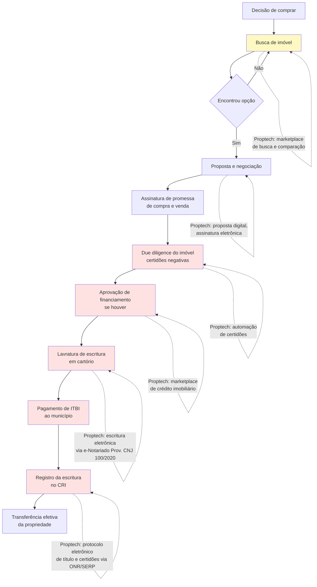

> [!note] Gargalo real
> As etapas F, G, H, I e J concentram o maior atrito operacional da transação. A tecnologia digitalizou a busca do imóvel (B) e a assinatura eletrônica da proposta (D), e o protocolo de títulos já é eletrônico via ONR/SERP e e-Notariado, mas a conferência documental, as exigências de notas devolutivas dos cartórios, a guia de ITBI municipal e os emolumentos estaduais continuam travando o prazo de liquidação. Startups que automatizam a esteira pós-proposta enfrentam barreiras burocráticas locais, mas constroem forte retenção junto a incorporadoras, bancos e imobiliárias.

---

### Funding imobiliário: os instrumentos que o fundador precisa conhecer

#### LCI: Letra de Crédito Imobiliário

Título de renda fixa emitido por instituições financeiras lastreado em crédito imobiliário. Isento de IR para pessoa física. Usado por bancos para captar recursos destinados ao crédito imobiliário.

Relevante para startups de crédito imobiliário: bancos parceiros captam via LCI para financiar operações originadas pela startup.

#### CRI: Certificado de Recebíveis Imobiliários

Título de securitização emitido por securitizadoras (não por bancos). Lastreado em recebíveis imobiliários (aluguéis futuros, parcelas de financiamento, etc.). Isento de IR para pessoa física.

Incorporadoras usam CRI para antecipar recebíveis de unidades vendidas. Proptech pode usar CRI para securitizar carteiras de aluguel gerenciadas.

#### FII: Fundo de Investimento Imobiliário

Fundo de investimento que investe em imóveis ou em títulos do setor imobiliário. Negociado em bolsa (B3). Obrigado a distribuir 95% do resultado semestral.

FIIs de "papel" (que investem em CRI e LCI) têm dinâmica distinta dos FIIs de "tijolo" (que detêm imóveis físicos para renda ou desenvolvimento). Proptechs podem estruturar FIIs em parceria com administradoras fiduciárias e gestoras de recursos credenciadas na CVM (nos termos da Resolução CVM nº 175) para dar liquidez a portfólios de imóveis ou recebíveis gerenciados, observada a exigência regulatória de registro da oferta e gestão profissional.

#### SFH: Sistema Financeiro de Habitação

Sistema com regras específicas do CMN para crédito imobiliário residencial com valor de imóvel até limite determinado (elevado em outubro de 2025 de R$ 1,5 milhão para R$ 2,25 milhões). Taxa limitada (12% a.a. + TR). Parte do funding vem da poupança (SBPE) e do FGTS, sobretudo por meio do programa Minha Casa, Minha Vida (Lei 14.620/2023).

Startups de crédito imobiliário que querem operar no segmento popular precisam entender as regras do SFH e a elegibilidade do FGTS.

---

### Tabela: segmentos proptech brasileiros

| Segmento | Modelo de receita | Regulação decisiva | Caso referência |
|---|---|---|---|
| Marketplace locação | Comissão (% aluguel) + taxa gestão | CRECI (intermediação) | QuintoAndar |
| Marketplace compra/venda | Comissão transacional (5–6%) | CRECI + Lei 6.530 | Loft, OLX Imóveis |
| Gestão de condomínios | SaaS mensal por condomínio | Lei dos Condomínios | Superlógica, Condomob, uCondo |
| Crédito imobiliário | Comissão bancária (0,5–1,5%) | BC: correspondente bancário | Credihome (hoje Loft Crédito), Bcredi |
| Construção / BIM | SaaS por projeto ou sede | Decreto 10.306/2020 e Lei 14.133/2021 (uso escalonado e preferência por BIM em obras públicas) | Sienge (Softplan), AltoQi, Construflow |
| Gestão de obra | SaaS + % economia gerada | CREA (responsável técnico) | Sienge (Softplan), Prevision, Construflow |
| Tokenização | Taxa de emissão + custódia | CVM 88, Lei 14.430/22 | Liqi, Netspaces |
| Gestão de imóveis para proprietários (*property management*) | % da receita de locação (15–25%) | CRECI (se houver intermediação locatícia) | Housi, Charlie |
| Incorporadora digital | Margem bruta de incorporação (30–35%) e líquida (12–18%) | SPE, RI (art. 32 da Lei 4.591/1964), Patrimônio de Afetação (Lei 4.591/1964) e RET (Lei 10.931/2004) | Vitacon, Benx |

---

### Quatro Modelos Brasileiros e o Que Cada Um Provou na Prática

#### QuintoAndar: remover o fiador foi o produto

O QuintoAndar vendeu risco assumido: ao absorver institucionalmente a inadimplência do inquilino e garantir o repasse mensal ao proprietário em caso de atraso ou falta de pagamento, a startup destravou a oferta de proprietários que mantinham imóveis fechados por receio de fiador ou seguro-fiança caro, usando o aplicativo, a assinatura digital e a régua de cobrança como infraestrutura viabilizadora.

#### Loft: compra e venda com iBuying adaptado

A Loft inspirou-se no modelo norte-americano de *iBuying* (comprar apartamentos, reformar e revender) e captou mais de US$ 700 milhões em rodadas de Venture Capital para escalar a operação em São Paulo e no Rio de Janeiro. Quando a Selic saltou de 2% ao ano em 2020 para 13,75% em 2022, o custo de carregar centenas de imóveis no balanço durante meses de reforma e venda tornou a operação intensiva em ativos insustentável, levando a empresa a encerrar a compra direta de imóveis e migrar para um modelo *asset-light* de marketplace, garantia locatícia, financiamento imobiliário e softwares para imobiliárias parceiras (como CredPago, Vista Software e Credihome).

#### Originação digital de crédito e *home equity*: alavancagem sobre o balanço dos bancos

Modelo de menor risco regulatório: conecta tomador a múltiplos bancos, cobra comissão do banco originador. Não precisa de licença de instituição financeira. A margem é menor, mas o capital necessário também.

#### Housi: moradia flexível como produto

Na gestão de moradia flexível (*short* e *mid-stay*), plataformas como **Housi** e **Charlie** propõem ao morador ou viajante corporativo contratar estúdios prontos por assinatura ou temporada sem burocracia de fiador, operando unidades pertencentes a investidores patrimoniais e incorporadoras parceiras. Embora a plataforma não imobilize capital comprando o prédio (modelo *asset-light* na propriedade do imóvel), a expansão rápida exige capital de giro e estrutura financeira se a operadora assumir o adiantamento de mobília/enxoval ou assinar contratos com cláusula de renda mínima garantida ao investidor proprietário, ficando exposta ao risco de vacância.

---

### A matemática das proptechs: VGV, margem de incorporação, distrato e economia de obra sobre CUB/INCC

#### Marketplace de locação

A saúde de um marketplace de locação como o QuintoAndar se mede em:

- **Tempo médio de locação:** dias entre o imóvel ser listado e o contrato ser assinado. Mercado informal tradicional: 30–60 dias. Plataforma eficiente: 10–20 dias
- **Taxa de vacância do portfólio gerenciado:** % de imóveis cadastrados que estão sem inquilino. Acima de 10% começa a preocupar proprietários
- **Taxa de inadimplência:** % de aluguéis não pagos no mês. Num modelo em que a plataforma garante o pagamento ao proprietário, esse número vai direto para o resultado
- **Custo de aquisição de imóvel (CAI):** quanto custa trazer um novo imóvel para o portfólio (marketing para proprietários, visita, fotografia, precificação)
- **LTV do imóvel sob gestão:** margem de contribuição acumulada gerada pela administração de um imóvel durante sua permanência na plataforma. Por exemplo, em um contrato residencial com aluguel mensal de R$ 3.000 e taxa de administração de 10% (R$ 300/mês) que permanece ativo por 30 meses, a receita recorrente acumulada é de R$ 9.000 (somada à comissão de entrada), descontados a provisão de inadimplência da garantia locatícia e o custo de atendimento, o LTV em margem líquida deve superar em pelo menos 3x o Custo de Aquisição do Imóvel (CAI).

A viabilidade do modelo depende de CAI << LTV. Se custa R$ 2.000 para trazer um imóvel e o LTV é R$ 48.000, a unidade é saudável. Se o churn de proprietários é alto (imóvel sai da plataforma em 12 meses), o LTV cai para R$ 9.600 e o modelo fica apertado.

#### Incorporação digital

Para uma incorporadora digital (como Benx ou modelos similares), as métricas centrais são:

- **VSO (Velocidade de Vendas sobre Oferta):** % das unidades lançadas que são vendidas no mês. VSO acima de 15% no lançamento é forte. Abaixo de 8% preocupa
- **Margem bruta e margem líquida de incorporação:** a margem bruta (receita líquida das unidades vendidas menos custo direto de terreno e construção/INCC) situa-se tipicamente entre 30% e 38% nas incorporadoras residenciais listadas na B3, enquanto a margem líquida final (após despesas comerciais de estande/corretagem, administração, impostos do RET e custo financeiro) fica entre 10% e 18%. Margem bruta abaixo de 22% indica compressão severa da rentabilidade do projeto
- **Ciclo de obra:** tempo entre lançamento comercial e entrega das chaves. Tipicamente 36–48 meses no Brasil. Cada mês adicional corrói margem pelo custo de capital
- **Distrato:** taxa de desistência de compradores após a assinatura. O Código Civil e a Lei 13.786/2018 regulamentam os direitos do comprador no distrato: para a incorporadora, cada distrato significa recolocar a unidade no mercado com desconto e renegociar com o financiador
- **Economia de obra sobre o CUB/INCC (Construtechs):** plataformas de gestão de suprimentos, cotação automatizada e *planning* 4D/5D em BIM comprovam valor reduzindo de 3% a 7% o custo direto de materiais e retrabalho frente ao Custo Unitário Básico (CUB/Sinduscon) e ao INCC, além de encurtar o cronograma físico-financeiro da obra

#### Crédito imobiliário (marketplace)

Para um marketplace de originação de crédito imobiliário (como a Credihome, adquirida pela Loft e integrada à vertical financeira do grupo):

- **Taxa de conversão do funil de crédito:** visitante → simulação → proposta enviada com documentos → crédito aprovado no comitê do banco → contrato emitido e registrado em cartório. A conversão entre simulação inicial e contrato assinado situa-se tipicamente entre 5% e 15%, dependendo da pré-qualificação de renda e da agilidade na emissão de certidões.
- **Ticket médio financiado:** o tamanho do financiamento determina a comissão absoluta. Um financiamento de R$ 500.000 com comissão de 1% gera R$ 5.000 de receita. Se cada lead qualificado custa R$ 300 em mídia paga e 10% das simulações aprovadas convertem em contrato assinado, o CAC efetivo por financiamento fechado é de R$ 3.000 contra R$ 5.000 de comissão, mostrando por que a taxa de conversão do funil decide a viabilidade do negócio
- **Tempo de fechamento:** quantos dias entre a simulação e a assinatura do contrato. O prazo de análise bancária (21–60 dias) é gargalo que a plataforma não controla, mas pode gerenciar com follow-up automatizado

---

### Armadilhas do Setor: Imobilizar Caixa no Balanço (iBuying), Ignorar o Corretor, Estourar o Orçamento de Obra (INCC) e Subestimar Prazos Cartoriais

**Estourar o orçamento da obra pela inflação do INCC/CUB no ciclo de 36 a 48 meses:** Do lançamento à entrega das chaves, o ciclo completo de uma incorporação leva de **36 a 48 meses**. Quando a construtech ou incorporadora subestima a inflação setorial de materiais e mão de obra medida pelo INCC e pelo CUB (que frequentemente descola do IPCA em picos de demanda por aço, cimento e serralheria), qualquer atraso de cronograma de seis meses corrói a margem líquida inteira da SPE.

**1. CRECI como risco subestimado**

Plataformas que alegam "apenas anunciar ou conectar partes", mas que na prática participam da negociação, vistoria, elaboração contratual e cobrança de comissão sobre venda ou locação sem manter pessoa jurídica e responsável técnico inscritos no CRECI (Lei 6.530/1978, detalhada na seção regulatória deste capítulo) sofrem autuações, interdição de operação comercial e ações judiciais de nulidade de corretagem.

**2. SPE como complexidade operacional**

Cada empreendimento em uma SPE separada parece simples no papel. Na prática, significa abrir, contabilizar e encerrar dezenas de empresas em paralelo. Isso exige equipe jurídica e contábil relevante desde cedo.

**3. Dependência de cartório**

Embora o protocolo de títulos e certidões já seja eletrônico em todo o país via ONR/SERP (Lei 14.382/2022) e a lavratura digital de escrituras opere pelo e-Notariado (Provimento CNJ nº 100/2020), a etapa registral continua sendo o principal gargalo de prazo de fechamento (*closing*): exigências técnicas formuladas em notas devolutivas pelos oficiais de registro, divergências cadastrais de matrícula e o cálculo de ITBI e emolumentos estaduais alongam a liquidação financeira da venda ou do *home equity*. Por isso, o tempo de cumprimento de exigências e o custo cartorário precisam ser modelados diretamente no fluxo de caixa da operação.

**4. Capital intensivo em iBuying**

O modelo de comprar imóveis para revender (iBuying) é altamente sensível a juros. No Brasil, com taxa Selic historicamente alta, o custo de carregar imóvel no balanço é proibitivo para a maioria dos ciclos de mercado.

**5. Regulação estadual heterogênea**

CRECI é estadual. ITBI é municipal. Legislação de parcelamento do solo é municipal. Uma startup que quer operar nacionalmente precisa navegar regulação diferente em cada estado: o que multiplica o custo de compliance.

> [!tip] Estratégia de entrada
> As proptechs brasileiras que tiveram mais sucesso começaram em São Paulo (maior mercado, regulação mais desenvolvida) e só expandiram quando o modelo estava comprovado. Expansão prematura para mercados regionais com infraestrutura cartorial e regulação distintas costuma ser armadilha de capital.


---

### Filtro de Alinhamento e Prontidão: Perguntas de Validação Prática

Antes de escalar aquisição paga de proprietários, assinar contratos de gestão de unidades ou desenvolver módulos para construtoras, aplique os três testes de validação abaixo para confirmar que a sua proptech captura margem recorrente sem ficar presa ao custo de capital ou ao atrito cartorário:

Antes de abrir uma Proptech ou Construtech no mercado brasileiro, passe sua tese por três perguntas de fogo:

1. **Transação Única vs. Fluxo de 30 Meses:** Seu modelo tenta capturar uma comissão única na compra/venda (onde corretor e cliente têm incentivo para fechar por fora), ou senta sobre um fluxo financeiro mensal recorrente (administração de locação, garantia locatícia, conta condominial ou SaaS de obra)?
2. **O Risco do Tijolo no Balanço:** Sua startup é leve em ativos (*asset-light*, operando software, seguros e FIDCs de terceiros), ou imobiliza capital próprio para comprar e reformar imóveis (*iBuying*)? Se imobiliza capital próprio em imóveis, você já tem *funding* estruturado com prazo compatível ao giro do estoque (12 a 18 meses) e custo abaixo do retorno da revenda? Sem essa linha casada, não entre no modelo.
3. **Aliado do Canteiro e da Imobiliária:** Na ponta operacional, sua ferramenta resolve a vida do mestre de obras e do corretor no celular em cinco segundos ou exige preenchimento burocrático?

**O Movimento de Segunda-Feira:** Nos próximos 15 dias, passe duas manhãs em um canteiro de obras com o engenheiro residente e duas tardes no setor de locação de uma imobiliária tradicional e saia com uma planilha listando três perdas operacionais recorrentes medidas em reais por mês e identificando quem assina o cheque para evitá-las.


---

## CAPÍTULO 26: SEGURANÇA PRIVADA, PATRIMONIAL, CONDOMINIAL (PORTARIA REMOTA/AUTÔNOMA), VISÃO COMPUTACIONAL E FACILITIES

### A Regra Invisível do Jogo: A Substituição da Folha 12x36 por Portaria Autônoma e a Blindagem de Terceirização

Nos anos 2010, dezenas de startups brasileiras tentaram digitalizar condomínios residenciais vendendo aplicativos de comunicação social (mural de avisos, reserva de salão de festas e enquetes) diretamente aos síndicos. Quase todas estagnaram antes de atingir escala: um condomínio raramente aceita pagar mais de R$ 150 a R$ 300 por mês por um software de recados, o mandato do síndico renova-se a cada dois anos (exigindo nova venda para manter o contrato) e o custo de aquisição presencial não se paga sem capturar a folha de portaria ou o fluxo financeiro do boleto condominial.

Na planilha de custos das centenas de milhares de condomínios edilícios e galpões logísticos do Brasil, o principal peso orçamentário está na guarita: manter uma portaria física presencial 24 horas por dia (quatro porteiros revezando na escala 12x36, mais folguista para férias, faltas e intervalos, somados aos encargos da CLT) custa cerca de R$ 28.000 por mês em um prédio residencial típico de 40 apartamentos (variando de R$ 24.000 a R$ 38.000 mensais conforme a convenção coletiva regional), o que absorve de 55% a 65% da arrecadação condominial ordinária.

Aqui prevalece **a conta da guarita** (o confronto direto entre o custo da escala 12x36 presencial e a assinatura de tecnologia de acesso): as empresas que constroem máquinas de caixa nesta vertical chegam ao síndico e à assembleia com uma proposta financeira direta: substituir R$ 28.000 mensais de folha e passivo trabalhista por uma mensalidade recorrente de R$ 6.000 a R$ 9.000 de portaria remota ou autônoma inteligente (eclusas, biometria facial, leitura de placa LPR, armários inteligentes e visão computacional monitorada sob o novo Estatuto da Segurança Privada: Lei nº 14.967/2024). O condomínio economiza mais de R$ 200 mil por ano, e a empresa conquista um contrato de 48 a 60 meses com *churn* mínimo.

Na operação de segurança condominial e *facilities*, a substituição de postos físicos presenciais por portaria remota ou autônoma exige protocolo de redundância energética, dupla abordagem de telecomunicações e resposta tática em minutos: sem padronização de equipamentos e financiamento estruturado do CapEx de implantação, o crescimento de contratos consome o caixa antes do retorno das mensalidades.

---

> [!note] Panorama da Vertical
> A deficiência histórica da segurança pública estatal e o custo trabalhista de manter equipes próprias de limpeza, portaria e manutenção predial sustentam um amplo mercado privado de serviços terceirizados no Brasil, que reúne segurança privada (cerca de R$ 45 bilhões a R$ 50 bilhões anuais, segundo a Fenavist), limpeza profissional e conservação (monitorada pela Abralimp) e *facilities management* corporativo. Com centenas de milhares de condomínios residenciais e comerciais no país (segundo estimativas de entidades do setor condominial como Secovi e Abadi), além de plantas industriais, centros de distribuição logísticos, hospitais, shopping centers e redes varejistas, o setor substitui gradualmente postos presenciais de vigilância e portaria por **Hardware-Enabled SaaS (portaria remota ou autônoma, controle de acesso facial e visão computacional em nuvem)**, em paralelo à consolidação societária via aquisições (*roll-up*).

---

### 1. A Demanda Inelástica da Segurança no Brasil e o Estatuto da Segurança Privada (Lei 14.967/2024)

Fundos de *Private Equity* e *Search Funds* buscam empresas de segurança eletrônica, monitoramento condominial e *facilities* no Brasil porque a demanda é contínua ao longo do ciclo econômico (como ilustra a trajetória listada do Grupo GPS, detalhada adiante): um condomínio residencial não suspende o controle de acesso em períodos de recessão, um hospital não interrompe a higienização técnica de áreas decisivas e um centro de distribuição de e-commerce mantém ativa a prevenção de perdas.

Para operar neste mercado sem sofrer interdições ou multas milionárias, o empreendedor precisa compreender a fronteira regulatória estabelecida pelo novo **Estatuto da Segurança Privada e da Segurança das Instituições Financeiras (Lei Federal nº 14.967, sancionada em 9 de setembro de 2024, sujeita ao decreto regulamentador do Poder Executivo e às portarias normativas vigentes em 2026, com capital social mínimo escalonado por modalidade de serviço)**, que substituiu a antiga Lei 7.102/1983 e modernizou a regulação sob fiscalização direta da **Polícia Federal (PF)**:

1. **Segurança Privada Armada, Desarmada, Escolta Armada e Transporte de Valores (Regulação Estrita da Polícia Federal):** Atividades que envolvem vigilantes profissionais (formados em academias credenciadas pela PF, com reciclagem obrigatória a cada 2 anos, porte de arma em serviço, colete balístico e piso salarial de categoria) só podem ser exercidas por **Empresas de Serviços de Segurança** com autorização expressa de funcionamento da Polícia Federal, capital social mínimo integralizado (que na nova lei varia conforme o escopo, chegando a milhões de reais para transporte de valores) e instalações físicas blindadas/aprovadas.
2. **Monitoramento Eletrônico, Portaria Remota, Controle de Acesso e Rastreamento Tecnológico:** A **Lei nº 14.967/2024** (Estatuto da Segurança Privada) incluiu o monitoramento de sistemas eletrônicos de segurança e rastreamento no rol de serviços sujeitos à autorização e fiscalização da Polícia Federal (arts. 5º, VI, e 20, observada a regulamentação infralegal de transição da PF quanto aos requisitos operacionais e de capital mínimo para empresas de tecnologia e portaria remota), separando a atividade tecnológica remota da vigilância armada ostensiva. A operação exige ainda conformidade estrita com a LGPD no tratamento de biometria facial de moradores e leitura automática de placas veiculares (OCR/LPR) e veda a prestação clandestina de segurança física por cooperativas ou autônomos.
3. **A Conta do Posto de Trabalho Presencial 24x7 no Brasil (Escala 12x36):** Para cobrir **um único posto de portaria ou vigilância presencial funcionando 24 horas por dia, 7 dias por semana**, a matemática da escala 12x36 exige quatro profissionais revezando nos turnos diurno e noturno, mais a cobertura de folguista para férias, faltas e intervalos intrajornada (equivalendo a cerca de 4 a 4,4 colaboradores na folha por posto ativo). Somando salários-base da convenção coletiva, adicional noturno, pagamento de 13º salário, vale-transporte, vale-refeição, uniforme, FGTS, INSS patronal e provisões rescisórias, **um único posto presencial 24h custa cerca de R$ 28.000 por mês no caso-modelo de condomínio residencial (dentro de uma faixa de mercado de R$ 24.000 a R$ 38.000 mensais, ou R$ 288 mil a R$ 456 mil por ano)**.

---

### 2. As 4 Grandes Subverticais de Segurança e Facilities

| Subvertical | Proposta de Valor Central | Modelo de Receita e Contrato | Margem Bruta / EBITDA |
|---|---|---|---|
| **1. Portaria Remota, Portaria Autônoma com IA e Controle de Acesso Condominial** | Substituir ou hibridizar a portaria presencial 24h por eclusas automatizadas, reconhecimento facial de alta precisão, QR Code para visitantes/entregas, armários inteligentes (*smart lockers*) e central remota redundante. | **MRR de R$ 7.200/mês no caso-modelo** (faixa de mercado de R$ 6.000 a R$ 11.000/mês em contratos de 36 a 60 meses com hardware em comodato ou locação). | **Margem Bruta: 58% a 72% / EBITDA: 30% a 45%** |
| **2. Videomonitoramento em Nuvem (VSaaS), Visão Computacional e Câmeras Urbanas Colaborativas** | Transformar câmeras IP comuns em sensores inteligentes na nuvem: leitura de placas (LPR/OCR), detecção de invasão de perímetro, perambulação suspeita, furto em gôndola de varejo e malhas colaborativas de vigilância de bairro. | **SaaS / Hardware-Enabled SaaS** cobrado por câmera/licença ativa (R$ 45 a R$ 250/câmera/mês) ou assinatura residencial/empresarial. | **Margem Bruta: 65% a 80% / EBITDA: 25% a 40%** |
| **3. Proteção Veicular, Rastreamento Tático, Recuperação de Ativos e Blindagem** | Telemetria e rastreamento satelital/celular + iscas de carga RF/LoRa + pronta-resposta tática de recuperação para frotas comerciais e cargas visadas. Nota regulatória: a proteção patrimonial mutualista (associações de proteção veicular) passou a ser regulada pela **Lei Complementar nº 213/2025** sob supervisão da SUSEP, exigindo separação clara entre a empresa de tecnologia/rastreamento e a administradora mutualista autorizada. | Mensalidade recorrente por veículo/ativo (**R$ 55 a R$ 220/mês**) + taxa de instalação/comodato. | **Margem Bruta: 55% a 70% / EBITDA: 28% a 42%** |
| **4. Facilities Management Tech-Enabled (Limpeza Técnica, Manutenção Predial, PMOC e Recepção)** | Terceirização integrada (*Integrated Facility Management: IFM*) de limpeza hospitalar/corporativa, manutenção elétrica/hidráulica, ar-condicionado (PMOC obrigatório por lei) e jardinagem com gestão digital de SLAs. | Contratos corporativos B2B plurianuais baseados em **SLAs por metro quadrado ou postos + margem sobre insumos/equipamentos**. | **Margem Bruta: 18% a 26% / EBITDA: 10% a 16% / Líquida: 3% a 6%** (conforme balanços de companhias abertas do setor) |

#### Subvertical 1: A Revolução da Portaria Remota e Autônoma nos Condomínios

Entre **55% e 65% da arrecadação mensal** de um edifício residencial brasileiro de porte pequeno ou médio (ex.: prédio-modelo de 40 apartamentos) é consumida pela folha de pagamento e encargos da portaria presencial 24h (cerca de R$ 28.000 mensais). Em prédios de até 40 unidades, manter uma portaria 24h presencial joga a cota mensal de cada apartamento para R$ 1.200 a R$ 1.800, inviabilizando a venda e a locação dos imóveis.
As empresas de **Portaria Remota e Portaria Autônoma** (como **Porter, Kiper, redes franqueadas e administradoras como a Lello Condomínios que implantam essas soluções e integradores regionais equipados com Segware/Seventh**) resolvem uma equação financeira clara para o síndico e para a assembleia de moradores:

- **Para o Condomínio:** O custo mensal de portaria cai de **R$ 28.000/mês para R$ 6.500 a R$ 9.500/mês**, gerando uma economia imediata de **60% a 75% na folha** para estabilizar a taxa condominial ou financiar melhorias prediais. Na segurança contra coação, o porteiro presencial pode ser rendido na guarita, enquanto o operador remoto a 15 km de distância (apoiado por biometria facial *anti-spoofing* e botão de pânico silencioso) não está exposto ao assaltante na calçada. Em contrapartida, a operação passa a depender integralmente de redundância de energia (nobreaks/gerador) e duplo link de dados, o risco decisivo detalhado na Armadilha 1 deste capítulo.
- **A Evolução da Portaria Remota 1.0 para a Portaria Autônoma com IA (2.0):** Na geração 1.0, todo visitante ou entregador tocava o interfone e acionava um operador na central de monitoramento (exigindo 1 atendente para cada 12 a 18 condomínios no horário de pico das 19h às 21h). Na geração 2.0 (**Portaria Autônoma**), as plataformas do setor estimam que cerca de 90% dos fluxos ocorrem de forma autosservida: o morador ingressa em segundos por reconhecimento facial na eclusa, o visitante recebe um convite com QR Code ou cadastro facial temporário no WhatsApp liberado pelo morador no aplicativo, e a encomenda de e-commerce é depositada pelo entregador em um **Armário Inteligente (*Smart Locker*)** na antecâmara. Como o operador da central atua apenas nas exceções de segurança (cerca de 10% dos eventos), as operadoras estimam que **1 profissional consiga supervisionar de 45 a 80 condomínios simultaneamente**, ampliando a margem bruta operacional.

#### Subvertical 2: Visão Computacional, Câmeras Colaborativas Urbanas e Prevenção de Perdas

O Brasil possui milhões de câmeras de CFTV instaladas que operam de forma **puramente reativa e forense**: sem análise em tempo real, elas servem apenas para o lojista ou síndico revisar a gravação no dia seguinte após o furto já consumado.

Duas arquiteturas de software e visão computacional alteraram essa dinâmica operacional:

1. **Malhas de Câmeras Colaborativas e Segurança Urbana Inteligente (O Modelo Gabriel e Camerite):** A startup **Gabriel** (fundada no Rio de Janeiro e expandida para São Paulo) instalou uma rede densa de totens conhecidos como "Camaleões" (totens externos com câmeras de alta definição, visão noturna e leitura automática de placas: OCR/LPR) nas fachadas de prédios residenciais e estabelecimentos comerciais. Ao conectar prédios vizinhos na mesma rua ou bairro (como Higienópolis, Jardins, Itaim, Leblon, Ipanema), cria-se uma **cerca eletrônica contínua**: quando há um incidente ou alerta de placa no perímetro monitorado, o sistema correlaciona as passagens registradas pelas câmeras vizinhas e compartilha as evidências visuais e rotas com a central de monitoramento 24/7 e, mediante convênios e requisição oficial, com as forças policiais. De forma complementar, plataformas como a **Camerite** licenciam software de videomonitoramento colaborativo em nuvem para prefeituras, forças de segurança e associações comerciais no interior e nas capitais.
2. **Prevenção de Perdas no Varejo (*Retail Loss Prevention*) e Segurança Industrial:** Supermercados, farmácias e atacarejos brasileiros perdem em média de **1,5% a 2,5% do faturamento líquido** (índice próximo à margem líquida média de 1,8% a 2,5% do varejo alimentar brasileiro, segundo as pesquisas anuais da Abrappe e da Abras) com furtos externos, fraudes no *self-checkout*, desvios internos na doca de recebimento e quebras operacionais. Startups de visão computacional conectam-se às câmeras já instaladas na loja para detectar comportamento de ocultação de produtos, passagem de mercadoria no caixa sem leitura de código de barras (*sweethearting*), invasão de docas fora de horário e contagem de fluxo de clientes (*footfall analytics*).

#### Subverticais 3 e 4: Rastreamento Tático (LC 213/2025) e Consolidação em Facilities (Grupo GPS)

Na **Subvertical 3 (Rastreamento Tático e Recuperação de Ativos)**, empresas de telemetria celular/satelital e iscas de carga RF/LoRa vendem software e pronta-resposta para transportadoras, seguradoras e gestoras de frota (ver também os capítulos de Logtech e Mobitech). Com a **Lei Complementar nº 213/2025**, as associações de proteção veicular passaram ao regime de proteção patrimonial mutualista supervisionado pela SUSEP: para o fundador de tecnologia, a regra é fornecer o hardware e o software B2B sem assumir risco atuarial sem autorização.

Para fundadores que buscam construir companhias de escala bilionária na economia real com geração recorrente de caixa, a **Subvertical 4 (Facilities Management e Segurança Patrimonial Integrada)** oferece lições estruturais de consolidação.

A principal referência listada desse modelo no Brasil é o **Grupo GPS (B3: GGPS3)**:

- Embora o mercado de limpeza corporativa e hospitalar, manutenção predial (elétrica, hidráulica e HVAC/PMOC), logística interna (*intralogística* fabril) e segurança patrimonial opere com margens brutas unitárias de 18% a 25%, ele exige **baixo CAPEX em ativos fixos**: o diferencial competitivo reside na gestão de contratos e na capacidade de recrutar, treinar, alocar e auditar dezenas de milhares de colaboradores controlando o passivo trabalhista.
- O Grupo GPS estrutrou um modelo de **controle descentralizado de margem por contrato (Centro de Resultado)** combinado com uma **estratégia contínua de aquisições (*roll-up*)**. A companhia adquiriu dezenas de empresas regionais de segurança, limpeza técnica, manutenção industrial, alimentação coletiva e *field marketing* por múltiplos privados historicamente inferiores aos de empresas listadas (tipicamente na faixa de **5x a 7x EV/EBITDA** pré-sinergias), integrando cada operação adquirida à sua plataforma central de compras, folha de pagamento, conformidade trabalhista e venda cruzada (*cross-sell*). Em paralelo, o Grupo GPS (B3: GGPS3, com receita líquida anual na casa de R$ 14 bilhões a R$ 15 bilhões e mais de 150 mil colaboradores, conforme relatórios de RI de 2025/2026) negociou historicamente em bolsa na faixa de **8x a 11x EV/EBITDA**, combinando arbitragem de múltiplo com ganho operacional de escala.

---

### 3. Unit Economics de Portaria Remota / Autônoma e VSaaS

Para escalar uma operação de Portaria Remota/Autônoma ou Videomonitoramento Inteligente sem quebrar no fluxo de caixa, o fundador deve dominar a relação entre **CAPEX de Implantação (Hardware + Obra Civil da Eclusa)** e **MRR do Contrato Plurianual**:

| Métrica Unitária (Por Condomínio Médio: 40 unid.) | Modelo Tradicional (Venda de Equipamento) | Modelo Vencedor (Hardware-Enabled SaaS / Locação 48 meses) | Benchmark de Excelência no Brasil |
|---|---|---|---|
| **Ticket Médio Mensal (MRR por Condomínio)** | R$ 2.500/mês (apenas monitoramento) | **R$ 7.200 / mês** (hardware + software + manutenção + link redundante + operação) | R$ 6.000 a R$ 11.000 / mês |
| **CAPEX de Implantação (Câmeras, Leitores Faciais, Motores Rápidos de Portão, Nobreak, Armário)** | Pago à vista pelo condomínio (cerca de R$ 45 mil, o que dificulta a aprovação em assembleia) | **R$ 32.000 a R$ 42.000** (custo direto para a operadora instalar com zero entrada ou taxa de adesão simbólica) | BOM + Instalação < 6x o MRR mensal |
| **Payback do CAPEX de Implantação** | Imediato (mas conversão de vendas é 5x menor) | **7 a 10 meses** de operação líquida | **< 11 meses** |
| **Custo Direto Mensal (COGS: Fração de Operador + Nuvem + Dois Links Fibra/4G + Manutenção Preventiva)** | R$ 1.100 / mês | **R$ 2.300 / mês** | **< 35% do MRR** (Margem Bruta > 65%) |
| **Churn Mensal de Contratos (Logo Churn)** | 0,8% a 1,2% ao mês | **0,15% a 0,35% ao mês** (cerca de 2% a 4% ao ano) | **< 0,40% ao mês** (Fidelidade de 36–60 meses com multa rescisória proporcional ao CAPEX) |
| **LTV / CAC (Com Parceria Comercial Declarada junto a Administradoras; vedada comissão oculta a síndico por conflito de interesses)** | 3,5x | **8,5x a 14,0x** | **> 7,0x** |

> [!tip] Como Financiar o CAPEX da Portaria Remota sem Queimar o Caixa da Startup
> Se você conquista 30 novos condomínios por mês e cada instalação exige R$ 35.000 em equipamentos (leitores faciais Hikvision/Control iD, motores de portão de abertura rápida, clausuras metálicas, fibra + 4G e nobreaks senoidais), precisará desembolsar **R$ 1,05 milhão por mês à vista** antes de receber a primeira mensalidade. As operadoras que cresceram sem diluição excessiva dos sócios estruturaram **FIDCs de Recebíveis Performados/Contratos de Locação de Longo Prazo** ou linhas de **Vendor Finance / CDC com fabricantes e distribuidores de segurança eletrônica (como Intelbras e WDC Networks, listada na B3 com o modelo de *Technology-as-a-Service* para integradores)**, casando a parcela do equipamento em 36 meses com o boleto mensal pago pelo condomínio. Embora o condomínio costume pagar seus fornecedores em dia porque cobra a taxa condominial dos moradores com garantia legal de dívida *propter rem*, o fornecedor de tecnologia e o FIDC não herdam essa garantia real contra o prédio: o contrato precisa prever multa rescisória proporcional ao CapEx não amortizado e cláusula de retomada dos equipamentos em comodato.

---

### 4. Casos Brasileiros de Destaque em Segurança, Portaria e Facilities

> [!example] Estudo de Caso: Porter, Kiper, Intelbras/WDC, Gabriel e Grupo GPS
> - **Porter e Kiper (Grande Florianópolis/SC):** O polo catarinense de segurança eletrônica e automação (formado na região de Florianópolis e São José, onde também atua a **Intelbras**) originou duas referências nacionais em portaria remota e controle de acesso condominial. A **Porter** estruturou uma rede nacional de franquias e bases operacionais para migrar condomínios para portarias gerenciadas por aplicativo e hardware padronizado, enquanto a **Kiper** desenvolveu ecossistema próprio de hardware de controle de acesso (QR Code, radiofrequência e biometria facial) integrado a software em nuvem para centrais de monitoramento e administradoras parceiras.
> - **Segware e Seventh (Ecossistema de Software para Monitoramento):** Empresas regionais de monitoramento de alarmes e portaria remota operam sobre plataformas especializadas como a **Segware** (sistema de gestão de eventos de alarme e segurança eletrônica com ampla base instalada na América Latina) e a **Seventh** (desenvolvedora de VMS, *Video Management System*, e soluções de portaria remota, adquirida pela **Intelbras** em 2021 para expandir sua oferta de software recorrente).
> - **Gabriel e Camerite (Monitoramento Urbano Colaborativo):** Fundada no Rio de Janeiro por Otávio Miranda e Erick Coser com atuação expandida para São Paulo, a **Gabriel** estruturou um serviço por assinatura residencial e comercial apoiado em totens externos de leitura de placas e visão computacional, captando recursos com fundos como SoftBank e Canary para integrar o monitoramento de fachadas no mesmo bairro. De forma complementar, a **Camerite** escalou um modelo de licenciamento de software de videomonitoramento em nuvem para prefeituras, forças policiais e associações comerciais em dezenas de municípios brasileiros.
> - **Grupo GPS (B3: GGPS3) e Verzani & Sandrini:** Na consolidação de *Facilities* e Segurança Patrimonial corporativa, o **Grupo GPS** (com receita líquida anual na faixa de R$ 14 bilhões a R$ 15 bilhões, mais de 150 mil colaboradores e mais de 40 aquisições desde o IPO compradas tipicamente entre 5x e 7x EV/EBITDA frente ao múltiplo histórico de 8x a 11x EV/EBITDA da companhia listada, segundo relatórios de RI de 2025/2026) e a **Verzani & Sandrini** (forte em shopping centers, hospitais e condomínios corporativos) mostram como controle rigoroso de encargos trabalhistas, ponto eletrônico geolocalizado/facial e escala de compras sustentam geração de caixa recorrente em serviços intensivos em mão de obra.

---

### 5. Armadilhas Fatais em Segurança Condominial e Facilities

> [!warning] As 5 Armadilhas que Destroem Empresas de Segurança e Facilities
>
> **Conformidade transversal obrigatória (Biometria Facial na LGPD e Homologação Anatel):** A biometria facial de moradores e visitantes constitui **dado pessoal sensível** (art. 11 da LGPD): exige base legal idônea (prevenção à fraude e segurança do titular, art. 11, II, "g"), governança estrita de retenção e criptografia contra vazamentos, relatório de impacto (RIPD) e alternativa de acesso sem biometria para quem recusar o cadastro, conforme diretrizes da **Agência Nacional de Proteção de Dados (ANPD)**. Além disso, todas as controladoras de radiofrequência, leitores e câmeras sem fio instalados devem possuir homologação válida na Anatel.
> 1. **A Falha de Redundância ("O Prédio Trancado às 19h de Sexta-Feira sob Chuva"):** A portaria remota ou autônoma elimina o risco de rendição física do porteiro na guarita, mas passa a depender integralmente de energia elétrica e conectividade. Se numa sexta-feira chuvosa às 19h cair a energia do bairro e a fibra óptica romper sem que o nobreak sustente ao menos 4 horas de autonomia e o *failover* automático para 4G ou satélite assuma em segundos, moradores ficarão trancados na calçada e o condomínio rescindirá o contrato por falha operacional. Por isso, redundância tripla de energia (baterias estacionárias com telemetria de tensão), dupla abordagem de dados (fibra e chip M2M multi-operadora) e apoio tático motorizado em até 15 minutos são requisitos obrigatórios.
> 2. **Portões Lentos e Falta de Eclusa (O Risco do "Carona"):** Instalar portaria remota ou autônoma aproveitando o motor de portão velho do prédio (que leva 18 segundos para abrir e fechar) sem construir uma **clausura/eclusa de pedestres e veículos (intertravamento de dois portões)** é pedir para acontecer uma invasão por "carona" (*tailgating*). A venda consultiva séria obriga a adequação física do perímetro (motores rápidos de 3 a 4 segundos, sensores de barreira infravermelha antiesmagamento e gaiola de intertravamento) antes de desligar o porteiro físico.
> 3. **Passivo Trabalhista Oculto em Facilities (Responsabilidade Subsidiária do Tomador):** Em *Facilities Management* e vigilância presencial, a margem EBITDA gira entre 10% e 16% e a **margem líquida fica entre 3% e 6%** (conforme balanços de companhias abertas do setor). Se a empresa errar o enquadramento de insalubridade (como na limpeza de banheiros de uso público ou coletivo de grande circulação, que a **Súmula 448, II, do TST** equipara à coleta de lixo urbano para fins de adicional de insalubridade em grau máximo de 40%), atrasar o recolhimento de FGTS e INSS ou falhar no controle de ponto de intrajornada, uma leva de condenações trabalhistas pode consumir anos de lucro líquido acumulado, levando os clientes corporativos a rescindir o contrato para evitar a **responsabilidade subsidiária** do tomador de serviços na Justiça do Trabalho (Súmula 331 do TST).
> 4. **Vender Direto ao Morador sem Conquistar as Administradoras de Condomínios e Síndicos Profissionais:** No mercado condominial brasileiro, o ciclo de decisão de uma assembleia geral de moradores com síndico orgânico pode levar até 9 meses. Já um único **Síndico Profissional** gere tipicamente de 20 a 60 condomínios simultaneamente, e uma grande **Administradora de Condomínios** (como Lello, Apsa, Auxiliadora Predial, Guarida e Cipa) administra de 500 a 3.000 prédios. Estruturar um canal de parcerias B2B2C com administradoras e síndicos profissionais dilui a despesa comercial por dezenas de prédios e encurta o ciclo de aprovação em assembleia.

---

### Filtro de Alinhamento e Prontidão: Perguntas de Validação Prática

Antes de imobilizar capital na compra de eclusas, leitores faciais e centrais de monitoramento ou de assinar contratos de terceirização intensivos em folha CLT, aplique as perguntas de corte abaixo para validar a viabilidade operacional, financeira e regulatória do negócio:

Antes de investir em tecnologia para condomínios, segurança eletrônica, visão computacional ou gestão de facilities no Brasil, responda:

1. **App Cosmético vs. Substituição de Folha:** Seu produto disputa uma migalha de R$ 200/mês no orçamento do condomínio/empresa, ou substitui e otimiza diretamente a linha de R$ 25.000/mês de mão de obra presencial e risco trabalhista?
2. **A Redundância de Vida ou Morte:** Se a fibra óptica da rua for cortada e a energia cair durante uma tempestade às 23h, sua portaria autônoma mantém eclusas, câmeras e comunicação operando via nobreak e duplo link 4G/satélite?
3. **O Financiamento do Capex de Entrada:** Como você financia os cerca de R$ 35 mil de equipamentos instalados em cada novo prédio-modelo de 40 unidades (via FIDC de locação, *leasing* operacional, linha de *vendor finance* ou taxa de adesão), considerando uma mensalidade recorrente de R$ 7,2 mil no lugar de uma folha presencial de R$ 28 mil, sem esgotar o caixa no crescimento?

**O Movimento de Segunda-Feira:** Nos próximos 15 dias, converse com cinco síndicos profissionais (que gerem 20 a 80 prédios cada) e duas administradoras para auditar os balancetes reais de condomínios residenciais.


---

## CAPÍTULO 27: TELECOMUNICAÇÕES, PROVEDORES REGIONAIS DE FIBRA (ISPS), REDES PRIVATIVAS 5G, TORRES E DATA CENTERS DE IA

### A consolidação dos provedores regionais de fibra e a corrida por energia nos data centers de IA

O mercado brasileiro de telecomunicações protagonizou uma configuração descentralizada nas últimas duas décadas: mais da metade dos acessos de banda larga fixa em fibra óptica (*FTTH*) do país não foi construída pelas três grandes operadoras nacionais de telefonia, mas por milhares de Provedores Regionais de Internet (*ISPs*) nascidos no interior e nas periferias (mais de 7 mil com acessos ativos reportados mensalmente, dentro de uma base de 19.754 prestadoras com outorga SCM na Anatel após o fim da dispensa de autorização em outubro de 2025). O empreendedor iniciante que entra hoje no setor achando que basta lançar cabo de fibra em postes já saturados e disputar preço a R$ 79,90 no varejo residencial descobre em dezoito meses que a inadimplência, o aluguel de ponto de fixação em poste e o cancelamento precoce de assinantes (*churn*) inviabilizam o fluxo de caixa.

No estágio atual de maturação do setor de Telecom e Infraestrutura Digital no Brasil, o crescimento dos provedores regionais de fibra óptica (ISPs) deslocou-se da simples expansão física de rede para a consolidação via M&A e a eficiência operacional. A rentabilidade do provedor depende agora de reduzir visitas técnicas improdutivas à casa do assinante (*truck rolls*), elevar a taxa de ocupação de portas (*take-up rate*) sobre os domicílios cobertos (*homes passed*), evitar a sobreposição predatória de cabos (*overbuild*) e agregar Serviços de Valor Adicionado (SVA) ao pacote de conectividade. Em paralelo, abriram-se três frentes de infraestrutura B2B: os *data centers* de hiperescala (*hyperscale*) contratados no modelo *take-or-pay*, as operadoras móveis virtuais (*MVNOs*) e as redes privativas 4G/5G para o agronegócio e a indústria.

Nos *data centers*, a vantagem competitiva brasileira reside na disponibilidade de energia elétrica renovável conectada ao Sistema Interligado Nacional (SIN) e na infraestrutura de cabos submarinos em Fortaleza, Rio de Janeiro e São Paulo. Enquanto polos tradicionais nos Estados Unidos e na Europa enfrentam filas prolongadas de conexão, o Brasil combina uma matriz elétrica com **cerca de 88% de fontes renováveis** (segundo o Balanço Energético Nacional da EPE de 2025) com grandes reservas de geração limpa, embora o país também enfrente gargalos na rede básica de transmissão (com **26,2 GW de solicitações de conexão de data centers** em análise na EPE e no ONS no fim de 2025, o que tornou o acesso a subestações de alta tensão e a refrigeração líquida ativos disputados na década).

Na avaliação de qualquer projeto de telecomunicações, redes privativas ou infraestrutura de *data centers*, a viabilidade financeira depende da disciplina de alocação de capital fixo (CapEx): o retorno sobre o capital investido é determinado pela velocidade de ocupação das portas instaladas, pelo controle físico dos equipamentos em comodato e pela segurança jurídica dos contratos de compartilhamento de infraestrutura.

---

> [!note] Síntese Executiva da Vertical
> Por trás de cada transação Pix, chamada de vídeo, safra agrícola conectada e modelo de Inteligência Artificial rodando no Brasil, opera uma infraestrutura física de cabos de fibra óptica, torres de transmissão, cabos submarinos e *data centers* de alta densidade energética. O setor de **Telecomunicações e Infraestrutura Digital (Data Centers, Fibra e Conectividade B2B)** gera **receita recorrente previsível e margens EBITDA típicas de 40% a 60%** nos ativos maduros de infraestrutura. Enquanto na maioria dos países da OCDE três ou quatro operadoras nacionais concentram a maior parte dos acessos fixos, o mercado brasileiro (que somava **54,4 milhões de acessos de banda larga fixa** no início de 2026, sendo **80,2% em fibra óptica**, segundo dados da Anatel) consolidou uma estrutura descentralizada: **milhares de provedores regionais e Prestadoras de Pequeno Porte (PPPs)** construíram redes capilares no interior, conquistando **cerca de 60% dos acessos de fibra óptica (FTTH)** e mais da metade da banda larga fixa nacional, originando companhias abertas na B3 (como Brisanet e Unifique) e grandes transações de consolidação estratégica (como a compra do controle da Desktop pela Claro em outubro de 2026).

---

### 1. O Fenômeno Único dos Provedores Regionais (ISPs) no Brasil e a Consolidação de Fibra (FTTH)

**Ficha Setorial dos ISPs no Brasil (Anatel e benchmarks de mercado, 2025/2026):** As Prestadoras de Pequeno Porte (PPPs) e operadoras regionais respondem por **cerca de 60% dos acessos de fibra óptica (FTTH)** e mais de 50% da banda larga fixa total do país (dados da Anatel em 2026), operando sob autorização de **SCM (Serviço de Comunicação Multimídia)**. Segundo relatórios de RI das operadoras listadas e assessores de M&A do setor, redes maduras (com taxa de ocupação de portas acima de 30%) operam com margens EBITDA típicas de **40% a 50%** e múltiplos privados de consolidação situados historicamente entre **4,5x e 6,5x EV/EBITDA**.

Como as grandes concessionárias nacionais concentraram seus investimentos iniciais nos centros metropolitanos mais densos, o interior do país ficou desassistido de banda larga de alta velocidade nos anos 2000 e 2010. Nesse espaço de mercado, milhares de técnicos, engenheiros e empreendedores locais obtiveram dispensa ou autorização de **SCM (Serviço de Comunicação Multimídia)** junto à **ANATEL** (até 2025 provedores com até 5 mil acessos podiam operar com dispensa, mas desde outubro de 2025 a agência exige outorga SCM de todo provedor, mantendo a base saneada em **19.754 prestadoras outorgadas**, das quais mais de 7 mil reportam acessos ativos mensalmente) e passaram a lançar cabos de **Fibra Óptica até a Casa do Cliente (FTTH, com tecnologia GPON e XGS-PON)** nos postes das distribuidoras de energia elétrica:

1. **Assimetria Regulatória das PPPs na Anatel (Resolução nº 694/2018):** Embora nem todo provedor regional (ISP) seja pequeno, a ANATEL classifica qualquer grupo econômico com menos de 5% de participação no mercado nacional de cada serviço como **Prestadora de Pequeno Porte (PPP)**, concedendo assimetria regulatória perante a agência (obrigações simplificadas de atendimento, metas de qualidade e envio de indicadores). Já o regime tributário da empresa (Simples Nacional, Lucro Presumido ou Lucro Real) depende do seu faturamento e estrutura societária, e não da classificação regulatória como PPP.
2. **Proximidade Local e Atendimento Imbatível:** Enquanto uma grande operadora nacional levava 7 dias para mandar um técnico terceirizado consertar um cabo rompido no interior de Minas Gerais, Santa Catarina ou Ceará, o ISP regional tinha loja física na praça central da cidade, conhecia o cliente pelo nome, atendia pelo WhatsApp em 2 minutos e mandava a moto com o técnico de fusão óptica em 2 horas.
3. **As Três Ondas dos ISPs Brasileiros:**
   - **1ª Onda (2005–2014: Rádio para Fibra):** Migração do acesso via rádio (faixas não licenciadas de 2,4 GHz e 5,8 GHz) para as primeiras redes FTTH metro-ethernet financiadas com o próprio fluxo de caixa dos assinantes.
   - **2ª Onda (2015–2021: A Corrida do "Homes Passed", Private Equity e IPOs):** Gestoras de *Private Equity* e infraestrutura como **EB Capital (Alloha Fibra)**, **Vinci Partners (Vero)**, **Warburg Pincus** e **Kinea** investiram bilhões de reais na aquisição de dezenas de provedores regionais para formar plataformas consolidadoras, movimento que culminou nos IPOs de **Brisanet (B3: BRIT3)**, **Unifique (B3: FIQE3)** e **Desktop (B3: DESK3)** em 2021 e prosseguiu na onda seguinte de consolidação com a fusão entre **Vero e Americanet** anunciada em 2023.
   - **3ª Onda (2022–2026+: Rentabilização da Planta, Redes Neutras, 5G Regional e Serviços B2B/SVA):** Com o juro (CDI) elevado e a maioria das cidades brasileiras médias e grandes já cobertas por 3 a 5 redes de fibra sobrepostas (*overbuild*, conforme dados de competição por município da Anatel), a era de queimar caixa passando cabo vazio acabou. O jogo agora é **ocupar a rede existente (aumentar o *Take-up Rate*)**, usar redes neutras (V.tal, FiBrasil, I-Systems) onde não vale a pena construir rede própria, empilhar **SVAs (Serviços de Valor Adicionado)** e atacar o mercado **B2B corporativo e 5G regional**.

---

### 2. As 4 Grandes Subverticais de Telecomunicações e Infraestrutura Digital

| Subvertical | Ativo Central e Modelo de Negócio | Margem EBITDA Típica | Múltiplo Histórico de Valuation (EV/EBITDA) |
|---|---|---|---|
| **1. Provedores Regionais de Fibra (ISPs) e Plataformas Consolidadoras** | Rede FTTH própria (backbone + última milha GPON) vendendo banda larga residencial (R$ 90–R$ 150/mês), link dedicado B2B (SLA 99,9% com IP fixo), telefonia fixa/móvel e SVAs. | **40% a 52%** | **4,5x a 6,5x EBITDA** (ISPs menores: R$ 900 a R$ 1.600 por assinante ativo *Homes Connected*) |
| **2. Data Centers Hyperscale, Colocation, Edge e Infraestrutura de IA** | Galpões de missão crítica (Tier III / Tier IV) com subestações elétricas dedicadas (50 MW a 500+ MW), refrigeração líquida/ar e conectividade neutra, alugados em contratos de 10 a 15 anos (*take-or-pay*) para Big Techs (AWS, Microsoft, Google, Meta, Oracle) e bancos. | **52% a 68%** | **14x a 22x EBITDA** (um dos múltiplos mais altos do mercado global de infraestrutura) |
| **3. Redes Privativas 5G/4G LTE (Agro/Indústria/Mineração), Torres e MVNOs** | Implantação de redes celulares privadas (bandas de 250 MHz, 700 MHz e 3,7 a 3,8 GHz para redes privativas (além de 3,5 GHz)) para usinas sucroenergéticas, fazendas, minas e portos; operação de **MVNOs** (*Mobile Virtual Network Operators*) para marcas/varejo e conectividade M2M/IoT + Starlink B2B. | **35% a 65%** | **6x a 12x EBITDA** (Torres puras chegam a 12x–16x EBITDA) |
| **4. SaaS para Telecom, NOC Automatizado e Orquestração de Rede** | ERPs especializados para ISPs (faturamento SCM + SVA, aprovisionamento automático de OLTs/ONTs Huawei/Nokia/ZTE/Datacom, mapa de rede FTTH, aplicativo de autoatendimento e cobrança Pix). | **30% a 45%** | **3x a 5x ARR / 8x a 12x EBITDA** |

#### Subvertical 1: A Física Econômica de um ISP de Fibra Óptica (HP, HC, Take-up e SVA)

Para construir, operar ou avaliar um provedor de internet no Brasil, a análise operacional e financeira apoia-se em cinco indicadores (**casas passadas** ou *homes passed*, **taxa de ocupação de portas** ou *take-up rate*, **receita média mensal por assinante** ou ARPU tipicamente entre R$ 90 e R$ 115 no varejo residencial, **cancelamento mensal** ou *churn* saudável abaixo de 1,8% ao mês e **CapEx de ativação por cliente conectado** de R$ 550 a R$ 750 incluindo ONU Wi-Fi 6 e instalação), combinados à estrutura tributária do plano mensal:

1. **HP (*Homes Passed*: Casas Passadas):** Número total de domicílios ou empresas que possuem uma caixa de terminação óptica (CTO) do provedor instalada no poste em frente ao imóvel, pronta para ativação. Construir 1 HP no Brasil custa em média **R$ 220 a R$ 380** (cabos ópticos, ferragens, CTOs, portas de OLT e mão de obra de lançamento).
2. **HC (*Homes Connected*: Casas Conectadas / Assinantes Ativos) e Take-up Rate (Taxa de Ocupação):** Percentual dos *Homes Passed* que efetivamente assinaram o serviço ($\text{Take-up Rate} = \text{HC} / \text{HP}$).
   - Se o provedor passa fibra para 10.000 casas (CAPEX de ~R$ 3 milhões) e conecta apenas **1.000 clientes (10% de *Take-up*)**, o CAPEX investido por cliente ativo é de R$ 3.000 + R$ 650 de ativação (ONU Wi-Fi 6 + cabo *drop* + mão de obra do técnico) = **R$ 3.650 por cliente**, comprometendo o ROIC (Retorno sobre o Capital Investido).
   - Se o provedor atinge **30% a 40% de *Take-up Rate*** na mesma rede (3.000 a 4.000 clientes ativos em 10.000 casas passadas), o custo de rede construída dilui-se para cerca de R$ 750 a R$ 1.000 por assinante, sustentando margens EBITDA na faixa de **40% a 45%**.
3. **A Composição Tributária de Planos SCM + SVA e a Transição para o IBS/CBS:** No Brasil, o serviço puro de telecomunicações (SCM) sofre incidência de **ICMS estadual (17% a 22% conforme o estado)**, além das contribuições ao FUST e ao FUNTTEL. Com base no art. 61 da Lei Geral de Telecomunicações (Lei nº 9.472/1997, que define que o Serviço de Valor Adicionado não constitui serviço de telecomunicações), muitos provedores compõem o plano mensal do assinante (ex.: R$ 109,90/mês) combinando a conexão (**SCM**) com **Serviços de Valor Adicionado (SVA)**, como plataformas de *streaming*, cursos, segurança digital, armazenamento em nuvem, telemedicina e periódicos ou livros digitais (ex.: Watch Brasil, Ubook, Paramount+, Max e Deezer). Enquanto os SVAs de tecnologia e conteúdo sujeitam-se ao ISS municipal (2% a 5%) e os livros e periódicos digitais contam com **imunidade constitucional de impostos** (art. 150, VI, "d", da Constituição Federal e Súmula Vinculante 57 do STF), essa composição exige cautela jurídica estrita: **a segregação entre SCM e SVA não é pacífica perante os fiscos estaduais**, que autuam desmembramentos artificiais (como em decisões do Conselho de Contribuintes de Minas Gerais em 2025 mantendo a cobrança de ICMS quando o fisco identifica prestação única de comunicação) e exigem SVA real, efetivamente contratado, utilizado pelo usuário e precificado a valor de mercado documentado. Além disso, a unificação das alíquotas no **IBS e na CBS pela Reforma Tributária (EC 132/2023 e LC 214/2025, em transição de 2027 a 2033)** eliminará gradualmente a diferença tributária entre SCM e SVA, mantendo o pacote de serviços digitais apenas como alavanca comercial de retenção.

#### Subvertical 2: A Posição do Brasil na Expansão de Data Centers de IA e Hyperscale

Com a expansão dos modelos fundacionais de Inteligência Artificial Generativa (LLMs) e da computação em nuvem, o principal gargalo global de infraestrutura digital passou a ser o acesso a **Energia Elétrica Limpa, Firme e Conectada à Rede de Alta Tensão (Megawatts, MW)**. Em polos saturados dos Estados Unidos (*Northern Virginia*, *Silicon Valley*) e da Europa (Frankfurt, Dublin e Amsterdã), a fila de espera para obter capacidade de conexão na rede de transmissão para um novo *data center* de 100 MW chega a **5 a 8 anos**, e a adição de carga firme ainda depende de geração termelétrica a gás natural para complementar as renováveis (na União Europeia, em 2025, as fontes renováveis geraram 47,7% da eletricidade e os combustíveis fósseis responderam por 29%).

O Brasil consolidou-se como um polo relevante para **Data Centers Hyperscale e Clusters de Treinamento e Inferência de IA**, impulsionado pelo **Redata** (Regime Especial de Tributação para Serviços de Data Center, instituído pela MP nº 1.318/2025 e convertido na **Lei nº 15.504/2026**, que incluiu os incentivos na Lei nº 11.196/2005 para suspender PIS/Pasep, Cofins, PIS/Cofins-Importação, IPI e Imposto de Importação na compra de equipamentos de TIC destinados ao ativo imobilizado, mediante contrapartidas de energia limpa, eficiência hídrica, oferta de capacidade no mercado doméstico e investimentos em P&D) e por quatro vantagens estruturais:

1. **Matriz Elétrica Renovável e Abundante no G20 (cerca de 88% Renovável segundo a EPE):** O Sistema Interligado Nacional (SIN) brasileiro combina usinas hidrelétricas de reservatório (energia de base firme 24/7) com a expansão da geração eólica e solar no Nordeste, permitindo que operadores globais cumpram metas de **energia livre de carbono 24/7 (*Carbon-Free Energy*)** contratando PPAs (*Power Purchase Agreements*) de autoprodução renovável a custos competitivos.
2. **Posição Geográfica de Cabos Submarinos (Fortaleza, Rio de Janeiro e Santos/Praia Grande):** Fortaleza (CE) é um dos principais pontos de amarração (*landing stations*) de cabos submarinos ópticos do Atlântico Sul, conectando o Brasil diretamente aos Estados Unidos, à Europa (cabo EllaLink ligando Fortaleza a Sines/Portugal com cerca de 60 ms de latência direta sem passar pelos EUA) e à África, enquanto o eixo **São Paulo – Barueri (Tamboré) – Campinas/Sumaré/Hortolândia** concentra a maior parte da capacidade instalada de *data centers* (em MW de TI) do Brasil, país que responde por cerca de metade da capacidade total da América Latina segundo levantamentos da Brasscom e de consultorias especializadas.
3. **Os Principais Operadores de Data Centers no Brasil:** Empresas como **Scala Data Centers** (fundada por Marcos Peigo com apoio da DigitalBridge, projetando megacampi como o *Tamboré* e o projeto *Scala AI City* no Rio Grande do Sul com capacidade planejada na escala de Gigawatts), **Ascenty** (Digital Realty + Brookfield), **Odata** (criada pela Pátria Investimentos e vendida para a americana Aligned Data Centers em uma transação bilionária), **Elea Data Centers** (Piemonte Holding, focada em *Edge Data Centers* distribuídos nas principais capitais) e **Tivit / Takoda** somam planos plurianuais de investimento anunciados que superam R$ 50 bilhões no país.
4. **O Ecossistema Empreendedor ao Redor do Data Center:** Você não precisa ter US$ 500 milhões para ganhar dinheiro na onda de Data Centers no Brasil. Há uma demanda crescente e subatendida por **engenharia especializada em missão crítica**, **fabricação e manutenção de quadros elétricos de média/baixa tensão, subestações, chillers e sistemas de *Liquid Cooling* (refrigeração líquida direta no chip para racks de GPUs acima de 50 kW–120 kW)**, **cabeamento estruturado de altíssima densidade**, **comissionamento** e **automação predial/BMS (Building Management System)** para reduzir o **PUE (*Power Usage Effectiveness*)** das plantas.

#### Subvertical 3: Redes Privativas 5G/4G no Campo e na Indústria + MVNOs

Enquanto o 5G comercial das operadoras atende os centros urbanos, **cerca de 70% a 80% da área agrícola produtiva do Brasil, além de minas a céu aberto e extensos trechos rodoviários, permanecem com cobertura móvel deficitária**. Uma colheitadeira conectada de R$ 4 milhões ou um caminhão fora-de-estrada na mineração exigem telemetria contínua de baixa latência para operar em capacidade máxima.

- **Redes Privativas Agro e Industriais (4G LTE e 5G sob Serviço Limitado Privado):** Aproveitando as faixas destinadas pela Anatel ao Serviço Limitado Privado (como 250 MHz e 700 MHz para cobertura estendida no campo e a faixa de **3,7 a 3,8 GHz** dedicada a redes privativas 5G próprias, além de projetos industriais na faixa de 3,5 GHz contratados via acordo comercial com as operadoras móveis detentoras da outorga), integradores especializados instalam torres dedicadas em usinas sucroenergéticas (como Raízen, São Martinho e BP Bunge), fazendas de grãos, plantas de celulose e portos, cobrindo raios de 20 km a 40 km por torre nas frequências sub-1 GHz para conectar colheitadeiras, pivôs de irrigação, sensores meteorológicos e câmeras de detecção de incêndio.
- **MVNOs (*Mobile Virtual Network Operators*) e Conectividade IoT/M2M:** Empresas como **Arqia (Grupo Datora)**, **Surf Telecom**, **Telecall**, **Dry Telecom** e **Nomo** operam como operadoras móveis virtuais (contratando capacidade de rede no atacado de operadoras móveis hospedeiras como Vivo, TIM ou Claro) em duas frentes complementares: (1) fornecer **chips M2M/eSIM multi-operadora** para milhões de maquininhas de cartão (POS), rastreadores veiculares, medidores inteligentes de energia e água e sensores industriais, e (2) estruturar operadoras móveis de marca própria (*Brand MVNOs*) para varejistas, bancos digitais, cooperativas e provedores regionais de fibra (que passam a ofertar o pacote convergente de fibra residencial e telefonia móvel 5G na mesma fatura, o que reduz significativamente a taxa de cancelamento segundo estimativas operacionais do setor).

---

### 3. Benchmark de Métricas Operacionais e Financeiras (ISPs e Data Centers)

| Métrica Chave | ISP de Fibra Óptica (FTTH Regional) | Data Center Colocation / Hyperscale | Zona de Alerta / Perigo |
|---|---|---|---|
| **ARPU / Receita Unitária** | **R$ 95 a R$ 115 / mês** (B2C); **R$ 600 a R$ 3.500 / mês** (Link Dedicado B2B) | **US$ 120 a US$ 190 por kW / mês** de capacidade decisiva contratada | ARPU B2C < R$ 79,90 (guerra suicida de preço com pirataria) |
| **Take-up Rate / Ocupação** | **28% a 42%** das Casas Passadas (HP) | **80% a 95%** dos MW construídos (geralmente pré-locados antes da obra) | Take-up FTTH < 18% após 24 meses do lançamento da rede |
| **CAPEX de Instalação / Ativação** | **R$ 550 a R$ 780 por cliente ativado** (ONU + Drop + Mão de Obra) | **US$ 7 milhões a US$ 10 milhões por MW** de TI construído | Custo de ativação FTTH > R$ 1.000 sem fidelidade de 12 meses |
| **Churn Mensal / Anual** | **1,3% a 2,1% ao mês** (B2C); **< 0,6% ao mês** (B2B) | **~0% ao ano** (Contratos *take-or-pay* de 10 a 15 anos em dólar) | Churn B2C > 2,8% ao mês (destrói o fluxo de caixa livre pelo CAPEX de ONU) |
| **Margem EBITDA** | **40% a 52%** | **55% a 68%** | EBITDA < 30% em ISP (excesso de folha ou aluguel de poste não regularizado) |
| **Eficiência Energética (PUE)** | N/A | **1,18 a 1,38** (Média global é ~1,55; líquida chega a < 1,15) | PUE > 1,60 (desperdício massivo de energia com refrigeração antiga) |

---

### 4. Casos Brasileiros Icônicos em Telecom e Infraestrutura Digital

> [!example] Estudo de Caso: Brisanet, Unifique, Desktop, Scala/Odata e IXC Soft
> - **Brisanet (Pereiro/CE: B3: BRIT3):** Um dos casos mais expressivos de infraestrutura regional de telecomunicações do país. Fundada por José Roberto Nogueira na região de Pereiro, no semiárido do Ceará, a empresa iniciou suas operações no final dos anos 1990 levando internet via rádio ao interior nordestino antes de verticalizar a implantação de fibra óptica, com centro de formação técnica próprio e fabricação interna de ferragens e cabos. Essa estrutura permitiu cobrir centenas de municípios no Ceará, Rio Grande do Norte, Paraíba, Pernambuco, Alagoas, Sergipe, Piauí, Maranhão e Bahia. A companhia alcançou **cerca de 1,4 milhão a 1,5 milhão de assinantes de fibra óptica (FTTH)** entre 2025 e 2026 (conforme relatórios de RI), abriu capital na B3 em 2021 e venceu lotes regionais no leilão do 5G da Anatel para implantar rede móvel própria no Nordeste e no Centro-Oeste.
> - **Unifique (Timbó/SC: B3: FIQE3) e Desktop (Sumaré/SP):** Enquanto a Brisanet cresceu majoritariamente de forma orgânica no Nordeste, a **Unifique** (fundada por Fabiano Busnardo em Santa Catarina) e a **Desktop** (fundada por Denio Lindo no interior paulista) combinaram expansão própria com dezenas de aquisições disciplinadas de provedores regionais (*M&A roll-up*). A Unifique destacou-se pela rentabilidade operacional (margem EBITDA de 48% a 50% nos balanços de 2024–2025, baixo *churn* e presença corporativa B2B no Sul), enquanto a Desktop consolidou o interior e o litoral de São Paulo, ultrapassando 1 milhão de assinantes conectados e protagonizando, em **1º de outubro de 2026**, a venda de 73% do seu capital para a **Claro** (a R$ 19,1261 por ação, seguida em 5 de outubro de 2026 do pedido de registro de OPA unificada na CVM para saída do Novo Mercado).
> - **Odata (Pátria Investimentos) e Scala Data Centers:** Demonstraram a capacidade de execução de plataformas brasileiras de infraestrutura digital em escala latino-americana. A **Odata**, criada em 2015 pelo Pátria Investimentos para construir *data centers hyperscale* no Brasil, México, Colômbia e Chile, foi vendida em 2023 para a norte-americana Aligned Data Centers por um *Enterprise Value* estimado em cerca de **R$ 10 bilhões (US$ 1,8 bilhão)**, um dos maiores retornos de *Private Equity* de infraestrutura na região. Já a **Scala Data Centers** (apoiada pela DigitalBridge) expandiu o complexo *hyperscale* de Tamboré (Barueri/SP) e estruturou o projeto de cidade de *data centers* voltada a cargas de IA em Eldorado do Sul (RS), ancorada em energia 100% renovável e conectividade óptica dedicada.
> - **IXC Soft (Chapecó/SC) e MK Solutions:** Do lado do software B2B vertical, empresas como a **IXC Soft** construíram negócios altamente lucrativos fornecendo o ERP completo (financeiro, emissão de notas modelo 21/22 e NFCom, mapa de rede óptica, integração com OLTs e aplicativo do assinante) para milhares de ISPs brasileiros.

---

### 5. Armadilhas Fatais em Telecom e Infraestrutura Digital

> [!warning] As 4 Armadilhas que Quebram Provedores de Internet e Operações de Infraestrutura
> 1. **A Bomba-Relógio dos Postes ("Ocupação Clandestina / À Revelia"):** Para lançar cabos de fibra óptica na rua, o provedor precisa aprovar um projeto de compartilhamento de infraestrutura e pagar aluguel mensal por ponto de fixação em cada poste (geralmente entre R$ 3,50 e R$ 9,00 por poste/mês) para a distribuidora de energia elétrica local (Enel, CPFL, Equatorial, Neoenergia, Cemig, Copel). Milhares de pequenos provedores cresceram lançando cabos na madrugada sem contrato ("ocupação à revelia") para economizar. Com a revisão regulatória conjunta entre **ANATEL e ANEEL** sobre o uso de postes (atualizando a Resolução Conjunta nº 4/2014 com regras de cessão de espaço, planos de ordenamento de redes e metodologia tarifária de referência fixada pela ANEEL) e os mutirões de corte de cabos irregulares pelas prefeituras e concessionárias elétricas, um ISP com metade da rede clandestina pode ter seus cabos cortados ou sofrer passivo retroativo que inviabiliza a venda em *Due Diligence* de M&A.
> 2. **A Ilusão do EBITDA Alto que Esconde Geração de Caixa Livre Negativa (CapEx de Reposição e Churn):** Em um ISP de fibra, o EBITDA contábil parece elevado (45%) porque o equipamento instalado na casa do cliente (ONU Wi-Fi 6) e a mão de obra de ativação entram no balanço como **CAPEX (Ativo Imobilizado)**, e não como despesa operacional no DRE. Porém, em um provedor com ARPU de R$ 100, margem EBITDA de 45% (R$ 45/mês por assinante) e custo de ativação de R$ 650, um *churn* de 2,5% ao mês (30% da base cancelando por ano) sem logística reversa eficaz para recolher as ONUs dos ex-clientes consome **cerca de 36% de todo o EBITDA** apenas comprando equipamentos novos para repor quem saiu ($0,025 \times \text{R\$ } 650 = \text{R\$ } 16,25$ frente a R$ 45,00 de EBITDA mensal). Quando se somam a manutenção de rede externa e os juros da dívida atrelada ao CDI, o **Fluxo de Caixa Livre (FCF) zera ou fica negativo**, mesmo com o DRE aparentando lucro operacional.
> 3. **Dívida em CDI de Curto Prazo para Financiar Rede de Maturação Lenta:** Construir um *backbone* ou iluminar uma cidade nova com FTTH leva de 18 a 30 meses para atingir 30% de *take-up rate*. Financiar esse CAPEX com empréstimos bancários de capital de giro de 24 meses a CDI + 4% a.a. levou dezenas de provedores médios à reestruturação de dívida entre 2023 e 2025. Infraestrutura de telecom exige *funding* de longo prazo (debêntures incentivadas de infraestrutura: Lei 12.431, FUST/BNDES a juros subsidiados ou *equity*).
> 4. **Ignorar o Mercado B2B Local:** Um cliente residencial paga R$ 99,90/mês, exige suporte no domingo à noite porque o Wi-Fi não pega no último quarto e cancela por R$ 10 de desconto do concorrente. Uma fábrica, hospital, supermercado ou prefeitura na mesma avenida paga **R$ 1.200 a R$ 5.000/mês por um Link Dedicado com SLA, IP Fixo, PABX em nuvem e Firewall gerenciado**, assina contrato de 24 a 36 meses e quase nunca cancela. Os ISPs regionais mais rentáveis obtêm pelo menos 25% a 35% da sua receita no segmento B2B corporativo e governamental (estimativa de mercado).

---

### Filtro de Alinhamento e Prontidão: Perguntas de Validação Prática

Antes de alocar capital na expansão de rede óptica, adquirir provedores regionais ou licenciar software e serviços digitais para operadoras de telecomunicações, aplique o roteiro de validação abaixo para auditar a geração real de caixa livre e a conformidade regulatória da operação:

Antes de investir em soluções para provedores de internet (ISPs), redes privativas corporativas ou data centers no Brasil, responda:

1. **A Alavanca de Margem do ISP e a Transição Tributária:** Se você vende software ou Serviços de Valor Adicionado (SVA) para provedores de fibra, seu produto reduz diretamente a inadimplência e o *churn* inicial ou o custo de visita técnica improdutiva (*truck roll*)? Caso apoie a composição de planos SCM + SVA, sua solução garante SVA real, efetivamente contratado, utilizado pelo assinante e precificado a valor de mercado documentado, considerando que a segregação sofre autuações de fiscos estaduais (como decisões do Conselho de Contribuintes de MG em 2025) e perderá o diferencial de alíquotas com a unificação do IBS e da CBS entre 2027 e 2033?
2. **Rede Neutra vs. Cabo Próprio:** Na sua tese de conectividade, faz sentido imobilizar Capex lançando cabo próprio ou é matematicamente superior operar sobre redes neutras existentes?
3. **O Gargalo do Megawatt (Para Data Centers/Edge):** Você já possui parecer de acesso elétrico garantido, dupla abordagem de fibra óptica e contrato *take-or-pay* pré-assinado antes de construir?

**O Movimento de Segunda-Feira:** Nos próximos 15 dias, visite o NOC e o atendimento de três provedores regionais (20 mil a 100 mil assinantes) e audite quantos chamados técnicos são apenas falhas de Wi-Fi interno.


---

## CAPÍTULO 28: AEROSPACE, SPACETECH, DRONES, SATÉLITES E TECNOLOGIA DE DEFESA (DUAL-USE)

> **Nota terminológica:** Neste capítulo, priorizamos os termos em português **aeroespacial**, **tecnologia espacial** e **uso dual**, mantendo entre parênteses as siglas e expressões internacionais consagradas na regulação aeronáutica e no mercado de capitais (*dual-use*, *NewSpace*, *BVLOS*, *SAR* e *eVTOL*).

### A sobrevivência pelo uso dual (*dual-use*): gerar caixa no agro e na energia enquanto homologa na defesa

O fundador "turista" apaixonado por aviação, espaço ou defesa sai de uma universidade de engenharia com um projeto funcional de drone, microssatélite ou radar e decide que seu único cliente será o Ministério da Defesa ou a Força Aérea Brasileira. Ele passa três anos participando de reuniões em Brasília, fazendo demonstrações em campos de instrução militar e esperando uma rubrica do orçamento federal que sofre contingenciamento no mês seguinte. Antes que o primeiro contrato governamental de produção seriada seja assinado, o caixa da startup zera e os melhores engenheiros vão trabalhar no exterior.

No polo aeroespacial de São José dos Campos, principal complexo aeronáutico do hemisfério sul (formado a partir da criação do CTA/ITA na década de 1950 e da Embraer em 1969, capaz de projetar, certificar e fabricar aeronaves comerciais, jatos executivos, radares e sistemas espaciais), prevalece uma regra prática que separa as empresas longevas das startups que ficam pelo caminho: nenhuma empresa aeroespacial emergente sobrevive no Brasil vendendo exclusivamente para o orçamento militar.

O princípio central do setor é **a defesa financia o P&D, o mercado civil paga as contas**: você usa a encomenda tecnológica estatal, a subvenção da FINEP/FAPESP e os laboratórios de ensaio do LIT/INPE e do DCTA para desenvolver e certificar a tecnologia pesada sem diluir seu *cap table*, mas desde o primeiro ano vende a mesma plataforma (drones BVLOS homologados pela ANAC/DECEA, imageamento SAR por satélite, visão computacional ou aviônica) em contratos recorrentes *Data-as-a-Service* para quem tem pressa e caixa privado: gigantes florestais, usinas sucroenergéticas, mineradoras, concessionárias de linhas de transmissão e seguradoras rurais.

No setor aeroespacial, de drones e de defesa no Brasil, a sobrevivência financeira entre o desenvolvimento de engenharia e a homologação regulatória exige que a mesma arquitetura de hardware ou software gere receita recorrente imediata no mercado corporativo civil enquanto cumpre os ciclos plurianuais de certificação na ANAC, no DECEA e nas Forças Armadas.

---

> [!note] Síntese Executiva da Vertical
> O Brasil reúne uma combinação estrutural singular no hemisfério sul: o terceiro maior complexo industrial de fabricação aeronáutica comercial do planeta, ancorado em São José dos Campos (SP), somado a uma dimensão territorial continental (8,5 milhões de km² de terra e 5,7 milhões de km² de Amazônia Azul marítima) onde conectividade terrestre e fiscalização presencial são fisicamente impossíveis ou economicamente proibitivas. Para startups do **setor aeroespacial, espacial (*SpaceTech*), de drones e de tecnologias de defesa**, a regra de sobrevivência no Brasil baseia-se na **arquitetura de uso dual (*dual-use*)**: construir tecnologias com rigor de engenharia militar e aeroespacial, mas gerar caixa recorrente imediato nos amplos mercados civis do agronegócio, energia, mineração, logística e monitoramento ambiental, sem depender exclusivamente do ciclo orçamentário das Forças Armadas.

---

### 1. O cluster aeroespacial e de defesa brasileiro: a vantagem assimétrica de São José dos Campos

Diferentemente de outras verticais de *deep tech* em que o Brasil tenta criar competências do zero, a engenharia aeroespacial brasileira possui mais de sete décadas de acumulação institucional contínua. O epicentro desse ecossistema fica no Vale do Paraíba paulista, em **São José dos Campos**, estruturado em torno do **DCTA (Departamento de Ciência e Tecnologia Aeroespacial)**, do **ITA (Instituto Tecnológico de Aeronáutica)** (cuja expansão histórica com o novo campus em Fortaleza (CE) amplia a formação de engenheiros de elite), do **INPE (Instituto Nacional de Pesquisas Espaciais)**, do **Parque Tecnológico de São José dos Campos (PqTec)** e da cadeia global de fornecedores liderada pela **Embraer**.

Complementam essa infraestrutura estratégica:

- **Centro Espacial de Alcântara (CEA/CLA), no Maranhão:** Localizado a apenas 2°18' ao sul da linha do Equador, Alcântara oferece uma das melhores geometrias orbitais do mundo para lançamentos equatoriais e suborbitais, economizando entre 15% e 30% de propelente para inserção em órbitas geoestacionárias ou equatoriais e contando com o Acordo de Salvaguardas Tecnológicas (AST) firmado entre Brasil e Estados Unidos para viabilizar lançamentos comerciais com componentes norte-americanos sob regime ITAR.
- **Agência Espacial Brasileira (AEB) e Comando da Aeronáutica (COMAER, sob a Lei Geral do Espaço, Lei nº 14.946/2024):** Órgãos responsáveis pela execução do Programa Nacional de Atividades Espaciais (PNAE) e pela operação conjunta de constelações estratégicas (Programa Estratégico de Sistemas Espaciais, PESE). Pela Lei nº 14.946/2024, marco legal das atividades espaciais no país, a **AEB** licencia e autoriza operadores espaciais civis (art. 13), enquanto o **COMAER** autoriza o voo do veículo lançador (art. 14).
- **Polos secundários de excelência:** São Carlos (SP, Escola de Engenharia da USP e cluster de óptica, sensores e VANTs liderado pela Xmobots), Santa Maria (RS), Belo Horizonte (MG), Florianópolis (SC: constelações IoT e CubeSats) e Recife/Fortaleza.

---

### 2. A tese Dual-Use no Brasil: por que vender só para Defesa quebra a startup

Nos Estados Unidos ou em Israel, uma startup de defesa pode escalar de zero a um bilhão de dólares vendendo exclusivamente para o Pentágono (DoD) ou para o Ministério da Defesa local. No Brasil, **tentar construir uma startup que dependa 100% de compras públicas das Forças Armadas (Marinha, Exército e Aeronáutica) representa um risco severo de insolvência por fluxo de caixa**. Embora o orçamento total de Defesa do Brasil seja expressivo em termos absolutos, cerca de 75% a 82% dele é consumido por folha de pagamento de pessoal ativo, inativos e pensões, restando uma fatia estreita e sujeita a contingenciamentos fiscais para investimentos (GND 4) e P&D.

Na prática operacional do modelo **Uso Dual (*Dual-Use*)**, a mesma plataforma tecnológica (drone de longa autonomia, radar de abertura sintética, câmera multiespectral, comunicação via satélite, sistema de comando e controle ou propulsão híbrida) é projetada desde o início para atender simultaneamente a dois mercados com ciclos financeiros complementares:

1. **Mercado Civil Corporativo e Concessionárias de Infraestrutura (Receita Recorrente e Escala de Manufatura):** Grupos privados do agronegócio (usinas sucroenergéticas, produtores de soja e algodão), empresas florestais de papel e celulose (Suzano, Klabin), mineradoras (Vale), concessionárias privadas de transmissão elétrica (como ISA Energia), seguradoras rurais e desenvolvedores de projetos de carbono compram com base em retorno operacional imediato (ROI) e pagam tipicamente em 30 a 90 dias conforme a política de suprimentos de cada grupo, permitindo financiar a produção em série (observando-se que empresas estatais de energia e logística, como Petrobras e Transpetro, também demandam inspeção por drones e satélites, mas contratam sob o rito licitatório próprio da Lei das Estatais, Lei nº 13.303/2016, com ciclo comercial mais longo).
2. **Mercado Governamental, Defesa e Segurança Pública (Contratos Plurianuais, Financiamento de P&D e Soberania):** Monitoramento de fronteiras terrestres (SISFRON), vigilância da Amazônia Legal (CENSIPAM, IBAMA, Polícia Federal), patrulha marítima da Amazônia Azul (SisGAAz), defesa antiaérea e guerra eletrônica. O Estado entra para financiar o desenvolvimento tecnológico de fronteira (via subvenção Finep ou Encomenda Tecnológica: ETEC) e assinar contratos estruturantes quando a empresa já tem fôlego financeiro civil.

> [!important] O estatuto de EED (Empresa Estratégica de Defesa) e a Lei 12.598/2012
> A **Lei nº 12.598/2012** instituiu o regime jurídico especial da **Base Industrial de Defesa (BID)**, pelo qual o Ministério da Defesa credencia companhias como **ED (Empresa de Defesa)** ou **EED (Empresa Estratégica de Defesa)**. Para obter o credenciamento como **EED**, a legislação exige sede e administração no Brasil, domínio local do conhecimento tecnológico e da propriedade intelectual e trava societária pela qual o conjunto de sócios ou acionistas estrangeiros não pode exercer, em cada assembleia geral, número de votos superior a 2/3 do total de votos que puderem ser exercidos pelos acionistas brasileiros presentes (art. 2º, IV, da Lei nº 12.598/2012). Uma vez credenciadas, essas empresas acessam dois instrumentos centrais: (1) o **RETID (Regime Especial Tributário para a Indústria de Defesa)**, que suspende PIS/COFINS e IPI na cadeia produtiva (observada sua adaptação ao novo regime da CBS a partir de 2027), e (2) as regras de compras públicas estratégicas (art. 3º), que preveem licitações restritas às **EEDs** para o fornecimento de **PED (Produto Estratégico de Defesa)** e margens de preferência a produtos desenvolvidos no país nas aquisições de **PRODE (Produto de Defesa)**.

---

### 3. As quatro frentes de negócio no setor aeroespacial e espacial (*SpaceTech*)

#### 3.1 Drones (RPAs / VANTs): agricultura de precisão, inspeção industrial e logística aérea

O Brasil consolidou-se entre os maiores mercados mundiais de aeronaves remotamente pilotadas (RPAs) para uso agrícola e industrial. A cadeia de valor organiza-se em três aplicações principais:

- **Pulverização agrícola e controle biológico:** Drones aplicadores de defensivos químicos e bioinsumos (como liberação de *Trichogramma* contra pragas na cana-de-açúcar e pulverização localizada em áreas onde o trator não entra ou amassa a lavoura) tornaram-se ferramenta padrão no campo brasileiro.
- **Mapeamento aerofotogramétrico, inspeção de ativos e segurança patrimonial:** VANTs de asa fixa ou VTOL híbridos de média e longa autonomia (Classes 2 e 1) equipados com câmeras termográficas, multiespectrais e sensores LiDAR monitoram milhares de hectares de florestas, linhas de alta tensão, ferrovias, barragens de rejeitos e fronteiras.
- **Entrega Aérea por Drones (*Drone Delivery* em última milha e saúde):** Transporte autônomo de amostras biológicas laboratoriais (em parcerias com redes diagnósticas como Dasa e Hermes Pardini, hoje integrado ao Grupo Fleury), medicamentos de urgência, peças industriais *offshore* e entregas comerciais em rotas aéreas pré-aprovadas, levado de forma pioneira à América Latina pela **Speedbird Aero**.

#### 3.2 Mobilidade Aérea Avançada (AAM) e eVTOLs

São Paulo concentra uma das maiores frotas urbanas de helicópteros executivos do mundo (segundo dados da ABRAPHE e da ANAC), sustentada por uma cadeia madura de manutenção e engenharia aeronáutica no estado. A **Eve Air Mobility**, *spin-off* da Embraer listada na NYSE, posicionou o país entre os principais polos globais de desenvolvimento de **eVTOLs (aeronaves elétricas de decolagem e pouso vertical)** e de softwares de gerenciamento de tráfego aéreo urbano (*Urban ATM*). Ao redor dos eVTOLs, abre-se uma cadeia de fornecimento para startups brasileiras: sistemas de simulação e treinamento de pilotos, infraestrutura de *vertiports* (heliportos eletrificados de alta potência), armazenamento de energia, manutenção preditiva de motores elétricos aeronáuticos e plataformas de comercialização de assentos por rota.

#### 3.3 NewSpace: nanossatélites (CubeSats), conectividade IoT e sensoriamento remoto orbital

A evolução do *NewSpace* reduziu o custo de construir e lançar um satélite de centenas de milhões de dólares (nos satélites geoestacionários clássicos de várias toneladas) para a faixa de **US$ 300 mil a US$ 3 milhões**, utilizando arquiteturas modulares de **CubeSats (1U a 16U)** e microssatélites lançados em voos compartilhados (*rideshare*, como o programa Transporter da SpaceX). No Brasil, os modelos de negócio em tecnologia espacial dividem-se em três elos:

- **Upstream (Hardware Espacial, Subsistemas e Integração):** Projetos e fabricação de plataformas de nanossatélites, computadores de bordo, sistemas de controle de atitude, propulsão e cargas úteis ópticas/radares (ex.: **Visiona Tecnologia Espacial**, **Pion Labs**, projetos do ecossistema ITA/INPE/UFSC).
- **Midstream (Comunicação e IoT Orbital):** Constelações de baixa órbita (LEO) para conectar sensores de telemetria agrícola, boias oceânicas, caminhões e medidores elétricos nos mais de 60% do território brasileiro onde não há cobertura celular 4G/5G.
- **Downstream (Inteligência Geoespacial e Observação da Terra: Earth Observation):** A camada mais escalável para Venture Capital tradicional. Como a Amazônia e grande parte do Brasil têm cobertura constante de nuvens durante meses do ano, imagens ópticas comuns falham. Startups que combinam imagens de **Radar de Abertura Sintética (SAR, que atravessa nuvens e opera à noite)** com sensores multiespectrais e modelos de *Computer Vision* vendem SaaS de monitoramento de safra, detecção de desmatamento e garimpo com atualização frequente (revisita diária ou semanal), validação de crédito rural (exigência do Banco Central para bloqueio de áreas embargadas no SICOR) e mensuração de biomassa para créditos de carbono (MRV).

#### 3.4 Sistemas de Defesa, Guerra Eletrônica, C4ISR e Radares

No segmento de defesa eletrônica, sensores e comando e controle, a Base Industrial de Defesa brasileira conta com fabricantes consolidadas como a **Embraer Defesa & Segurança / Bradar** (radares de vigilância terrestre e aérea SABER M60 e SENTIR M20), a **IACIT** (auxílios à navegação aérea, radares meteorológicos e oceânicos e sistemas de bloqueio de drones) e a **SIATT** (mísseis, armamentos guiados e integração de sistemas, como os programas MANSUP e MAX 1.2 AC). Para novas startups de engenharia e software de uso dual, as principais oportunidades de entrada junto às Forças Armadas, órgãos de segurança pública e operadores de infraestrutura crítica (refinarias, hidrelétricas, portos, aeroportos e complexos prisionais) concentram-se em três frentes de ciclo comercial de 12 a 36 meses: sistemas antidrone (*Counter-UAS* com detecção acústica/radar e bloqueio seletivo de radiofrequência), simuladores táticos imersivos para treinamento operacional e plataformas de Comando, Controle, Comunicações, Computação, Inteligência, Vigilância e Reconhecimento (C4ISR).

---

### 4. Arquitetura Regulatória: ANAC (Aeronavegabilidade), DECEA (Espaço Aéreo), ANATEL (Espectro e Satélites) e AEB (Licenciamento Espacial)

Nenhuma aeronave não tripulada ou sistema espacial opera legalmente no Brasil sem aprovações coordenadas nos órgãos competentes: na aviação não tripulada atuam as agências **ANAC** e **ANATEL** e o **DECEA** (órgão do Comando da Aeronáutica), somando-se a **AEB** (Agência Espacial Brasileira) e o **COMAER** no licenciamento de sistemas espaciais sob a Lei nº 14.946/2024:

1. **ANAC (Agência Nacional de Aviação Civil: RBAC nº 100, Resolução ANAC nº 805/2026):** Desde **16 de junho de 2026**, entrou em vigor o **RBAC nº 100** (aprovado pela Resolução ANAC nº 805/2026), que substituiu e revogou o antigo RBAC-E nº 94. A norma abandonou a divisão rígida por classes de peso (antigas Classes 1, 2 e 3) e alinhou o Brasil ao padrão internacional de **regulação proporcional ao risco operacional** em três categorias:
   - **Categoria Aberta (baixo risco operacional, PMD ≤ 25 kg, em linha de visada visual VLOS até 120 m / 400 pés acima do solo):** A operação comercial ou corporativa exige cadastro da aeronave na ANAC (SISANT), avaliação de risco operacional, seguro obrigatório contra danos a terceiros (RETA/seguro de responsabilidade civil para uso não recreativo), equipamento com radiofrequência homologada na Anatel, autorização de acesso ao espaço aéreo no SARPAS (DECEA) quando aplicável e, a partir de **1º de janeiro de 2027**, aprovação do piloto remoto em prova teórica oficial da ANAC.
   - **Categoria Específica (risco operacional médio, incluindo voos BVLOS além da linha de visada visual, operações acima de 120 m ou aeronaves com PMD > 25 kg fora da categoria aberta) e Categoria Certificada (alto risco operacional):** Na **Categoria Específica**, o operador precisa obter **Autorização de Operação** prévia da ANAC fundamentada em avaliação específica de risco operacional (metodologia SORA: *Specific Operations Risk Assessment*), além de cumprir os requisitos técnicos de aeronavegabilidade e de qualificação de piloto exigidos para o cenário, já na **Categoria Certificada** (operações de alto risco equiparáveis à aviação tripulada, transporte de pessoas ou cargas perigosas), exigem-se certificação completa de tipo do projeto na ANAC, registro no RAB (Registro Aeronáutico Brasileiro), manutenção certificada e licenciamento aeronáutico da tripulação.
   - **Pulverização aeroagrícola com drones (Portaria MAPA nº 298/2021) e Licenciamento Espacial Civil na AEB (Lei Geral do Espaço, Lei nº 14.946/2024):** Na aplicação aeroagrícola com drones, a Portaria MAPA nº 298/2021 exige registro do operador junto ao **MAPA**, curso de **CAAR (Coordenador/Aplicador Aeroagrícola Remoto)**, receituário agronômico e respeito às faixas de segurança ambiental. Já para empresas que lançam ou operam satélites, o **item 4 do marco regulatório** é regido pela **Lei nº 14.946/2024**: a **AEB** emite a licença de operador espacial civil e a autorização de atividade espacial (art. 13), o **COMAER** autoriza o voo de lançamento (art. 14) e a **ANATEL** licencia as estações terrenas e coordena o espectro de radiofrequência do satélite junto à União Internacional de Telecomunicações (UIT).
2. **DECEA (Departamento de Controle do Espaço Aéreo: ICA 100-40):** Órgão da Força Aérea Brasileira que controla o uso do espaço aéreo. Toda operação comercial de drone precisa ser solicitada e coordenada via sistema **SARPAS NG**, respeitando zonas de restrição ao redor de aeroportos, helipontos e áreas militares.
3. **ANATEL (Agência Nacional de Telecomunicações):** Todo transmissor de radiofrequência do drone (telecomando, telemetria e link de vídeo) ou estação terrena/satélite precisa de homologação ANATEL e alocação de espectro (evitando apreensão por uso de frequências ilegais ou potência acima do permitido).

#### Tabela comparativa das subverticais aeroespaciais, espaciais e de defesa no Brasil

| Segmento | Nível de TRL Inicial Típico | Órgãos Reguladores Decisivos | Ciclo até Receita Comercial | Fontes Primárias de Capital | Modelo de Receita Dominante | Casos Brasileiros de Referência |
|---|---|---|---|---|---|---|
| **Drones Comerciais e Agrícolas (Hardware + Serviço/SaaS)** | TRL 6–9 | ANAC (RBAC-E 94), DECEA (SARPAS), ANATEL, MAPA | 12 a 24 meses | Finep, BNDES, CVCs do Agro, Crédito Rural (Finame) | Venda do equipamento (CapEx) + pós-venda, peças e SaaS de processamento | Xmobots, SkyDrones, Arpac |
| **Logística Aérea por Drones (Drone Delivery)** | TRL 7–8 | ANAC (CAER BVLOS / aprovação de rota), DECEA | 18 a 36 meses | VC de Logística/Saúde, Contratos Corporativos B2B | Contratos mensais por rota dedicada (*Drone-as-a-Service*) + tarifa por voo | Speedbird Aero |
| **VANTs Táticos e Defesa (Classe 1 e 2 / Dual-Use)** | TRL 5–8 | Ministério da Defesa (BID/EED), ANAC, DECEA | 24 a 48 meses | Subvenção Finep, Encomenda Tecnológica (ETEC), BID | Contratos governamentais de fornecimento + suporte logístico integrado (CLS) | Stella Tecnologia, Xmobots (Nauru 1000C) |
| **eVTOLs e Mobilidade Aérea Avançada (AAM)** | TRL 4–7 | ANAC (Certificação de Tipo), FAA, EASA, DECEA | 48 a 72+ meses | Investidores corporativos estratégicos, aporte privado em companhia listada na NYSE, BNDES (Fundo Clima/Inovação) | Venda de aeronaves (backlog) + serviços de frota + software Urban ATM | Eve Air Mobility (Embraer) |
| **NewSpace Downstream (SAR / Geo-Analytics SaaS)** | TRL 7–9 | Anatel (estação terrena própria) e BCB (regras de crédito rural/SICOR) | 6 a 18 meses | Venture Capital tradicional (Seed/Série A), Climate Tech VCs | SaaS B2B por hectare monitorado ou assinatura anual de API para bancos/agro | Visiona, Agrosatélite e Geoambiente |
| **NewSpace Upstream (CubeSats e Subsistemas)** | TRL 4–7 | AEB, ANATEL, ITU (coordenação de espectro), INPE (LIT) | 24 a 48 meses | Finep Espaço, AEB, FAPESP PIPE, Contratos de Missão | Venda de plataformas/cargas úteis + *Satellite-as-a-Service* | Visiona, Pion Labs, Cenic |

---

### 5. Financiamento inteligente: usando Finep, ETEC e LIT/INPE sem diluir o Cap Table

Construir hardware aeroespacial ou sistemas orbitais apenas com cheques de fundos de Venture Capital generalistas é quase impossível no Brasil: o *burn rate* de engenharia, ensaios ambientais e certificação consome uma rodada Seed inteira antes do primeiro voo comercial. Os fundadores que vencem nesta vertical dominam a **arquitetura de capital híbrido (Blended Capital)**:

- **Subvenção Econômica Finep (Mais Inovação Brasil: Cadeias de Defesa, Aviação e Espaço):** Recursos 100% não reembolsáveis (sem dívida e sem diluição societária) que frequentemente financiam de R$ 3 milhões a R$ 30 milhões por projeto estratégico em temas como propulsão, satélites, sensores, radares, drones autônomos e combustível sustentável de aviação (SAF).
- **Encomenda Tecnológica (ETEC: Art. 20 da Lei de Inovação 10.973/2004 e Decreto 9.283/2018):** Instrumento pelo qual a Força Aérea, a Marinha, o Exército ou a AEB contratam diretamente uma startup ou consórcio para desenvolver uma solução tecnológica ainda inexistente no mercado, assumindo compartilhamento do risco tecnológico e podendo avançar para compra direta do produto resultante sem nova licitação comum.
- **Uso do LIT/INPE (Laboratório de Integração e Testes, em São José dos Campos):** Em vez de gastar dezenas de milhões de reais comprando câmaras de termo-vácuo, *shakers* de vibração mecânica e câmaras anecoicas de compatibilidade eletromagnética (EMC/EMI), startups brasileiras qualificam seus satélites e componentes aeroespaciais utilizando a infraestrutura laboratorial certificada do LIT/INPE e os túneis de vento do DCTA/ITA.
- **Credenciamento FINAME/BNDES para equipamentos nacionais:** Quando um drone agrícola ou sistema de monitoramento atinge o índice mínimo de nacionalização e credenciamento no BNDES Finame, o produtor rural ou a empresa compradora pode financiar a aquisição com linhas de crédito subsidiadas do Plano Safra, destravando as vendas comerciais da startup.

---

### 6. Casos reais brasileiros

> [!example] Caso 1: Xmobots, Da pós-graduação na USP à liderança latino-americana em drones agrícolas e de defesa
> Fundada em 2007 por Giovani Amianti a partir de pesquisas de mestrado na USP (São Carlos), a **Xmobots** sobreviveu aos primeiros anos quando o mercado de drones ainda não dispunha de regulação específica da ANAC porque concentrou esforços em engenharia de voo autônomo e resolução de dores operacionais do agronegócio e da cartografia. A empresa consolidou-se como a principal fabricante de drones do Brasil e da América Latina com uma estratégia de **uso dual (*dual-use*) consistente**: de um lado, gera receita recorrente no mercado civil vendendo aeronaves remotamente pilotadas de mapeamento e pulverização (linhas Arator e Nauru), serviços aeroagrícolas e suporte técnico para o agronegócio. De outro, desenvolveu o **Nauru 1000C** (sistema remotamente pilotado tático de 150 kg de decolagem vertical híbrida com 10 horas de autonomia), contratado pelo Exército Brasileiro e objeto de memorando e parceria estratégica com a Embraer para os mercados de defesa e segurança (conforme comunicados públicos das companhias).

> [!example] Caso 2: Speedbird Aero e Eve Air Mobility, Vencendo o gargalo da certificação na ANAC
> A **Speedbird Aero** (fundada em Franca e sediada em São José dos Campos por Manoel Coelho e Samuel Salomão) compreendeu desde o início que a principal barreira competitiva em entregas por drones (*drone delivery*) não está apenas na montagem física da aeronave, mas na conquista da **certificação aeronáutica junto à ANAC e ao DECEA para operar voos BVLOS sobre áreas urbanas e sobre lâminas d'água com carga comercial**. Trabalhando em conjunto com a engenharia da ANAC desde os projetos experimentais, a Speedbird tornou-se a primeira empresa da América Latina autorizada pela agência (com CAVE experimental em 2020 e CAER de projeto a partir de 2022 sob o então vigente RBAC-E nº 94, regime sucedido em junho de 2026 pelas categorias de risco do RBAC nº 100) para entregas comerciais regulares por drones, operando rotas logísticas com parceiros como iFood, Dasa e Hermes Pardini (hoje parte do Grupo Fleury), além de operações no exterior. Na escala corporativa, a **Eve Air Mobility** apoiou-se no histórico de engenharia da Embraer (que já certificou mais de 30 modelos de aeronaves junto à ANAC, à FAA e à EASA) para captar mais de US$ 500 milhões até 2025/2026 e acumular uma carteira próxima de 2.800 a 2.900 cartas de intenção de compra de eVTOLs, financiando o ciclo plurianual de ensaios e certificação de tipo antes do início da operação comercial.

> [!example] Caso 3: Visiona, Quasar Space e Stella Tecnologia, Sensores orbitais, SAR e soberania tecnológica
> A **Visiona** (*joint venture* entre Embraer e Telebras) projetou e lançou o **VCUB1**, o primeiro satélite de observação da Terra e coleta de dados de alta resolução desenvolvido pela indústria nacional privada (nanossatélite CubeSat 6U lançado em 2023), validando software de controle de atitude e óptica espacial no país. No segmento *downstream* de inteligência geoespacial, empresas brasileiras como **Agrosatélite** e **Geoambiente** combinam imagens de constelações de satélites ópticos e de Radar de Abertura Sintética (SAR) para monitorar safras, pastagens, desmatamento e conformidade socioambiental mesmo sob cobertura contínua de nuvens, atendendo ao agronegócio e às instituições financeiras que auditam o crédito rural. Já no Rio de Janeiro, a **Stella Tecnologia** desenvolveu o **Atobá** (VANT tático-estratégico projetado no Brasil com 11 metros de envergadura e até 28 horas de autonomia declarada pela fabricante) e munições vagantes (*loitering munitions*), demonstrando a capacidade da engenharia nacional de produzir sistemas de maior porte com fração do orçamento de programas estrangeiros.

---

### 7. Armadilhas recorrentes no setor aeroespacial e espacial

1. **Síndrome do "Projeto de Doutorado Infinito" (TRL estagnado entre 3 e 4):** Fundadores acadêmicos que passam 5 anos aperfeiçoando um algoritmo de controle ou um subsistema de satélite sem assinar um único contrato comercial de piloto no mercado civil. Sem receita de *downstream* ou aplicação industrial intermediária, o caixa seca assim que a bolsa da FAPESP ou o edital da Finep termina.
2. **Ignorar o regime ITAR/EAR norte-americano na lista de materiais (BOM):** Projetar um VANT de defesa ou um satélite brasileiro utilizando sensores inerciais, câmeras termais ou chips sujeitos às restrições de exportação militar dos EUA (*International Traffic in Arms Regulations: ITAR*) sem licença prévia significa que os EUA podem vetar a venda do seu produto para clientes terceiros ou bloquear o fornecimento de peças da noite para o dia. Projetos estratégicos brasileiros priorizam componentes *ITAR-free* ou nacionalizados.
3. **Lançar satélite antes de validar a venda do dado em terra:** Startups de *NewSpace* que gastam US$ 2 milhões construindo um CubeSat próprio para descobrir, depois do lançamento, que o cliente do agronegócio ou banco já conseguia comprar o mesmo dado bruto da Sentinel (ESA), Planet ou Capella Space por uma fração do preço. **Sempre valide e venda primeiro a plataforma de inteligência e decisão usando dados orbitais de terceiros, só lance hardware próprio se o dado que você precisa não existir no mercado.**
4. **Tratar a ANAC e o DECEA como burocracia pós-produto:** Em aviação, a certificação começa no primeiro rascunho de engenharia: a arquitetura de redundância de hardware, aviônica, paraquedas balístico e software decisivo (normas DO-178C e DO-254) precisa nascer integrada aos requisitos de risco operacional do RBAC nº 100 da ANAC e às regras de espaço aéreo do DECEA. Refazer um drone ou aeronave porque a agência reprovou a análise de falha custa anos de retrabalho.

> [!tip] Checklist de Execução para o Setor Aeroespacial, de Drones e Espacial
> - [ ] A tecnologia possui tese **Dual-Use** clara, com pelo menos **70% da receita projetada nos primeiros 36 meses** vindo do setor privado (agro, energia, mineração, logística, financeiro)?
> - [ ] O roteiro de certificação **ANAC (SISANT / CAER / Certificação de Tipo)**, **DECEA (SARPAS)** e **ANATEL** foi validado com engenheiros de assuntos regulatórios antes de congelar o *design* de hardware?
> - [ ] A lista de componentes decisivos (*Bill of Materials*) foi auditada quanto a restrições **ITAR/EAR** e gargalos de importação?
> - [ ] A empresa já estruturou sua elegibilidade para editais não diluitivos (**Finep Subvenção, FAPESP PIPE, EMBRAPII**) e avaliou o credenciamento como **ED/EED na Base Industrial de Defesa (BID)**?
> - [ ] No caso de SpaceTech: o produto final entregue ao cliente é uma **decisão acionável** (ex.: "liberar crédito rural para este CAR" ou "irrigar o talhão 4") e não apenas uma imagem de satélite bruta em formato GeoTIFF?

---

### Filtro de Alinhamento e Prontidão: Perguntas de Validação Prática

Antes de comprometer capital próprio ou recursos de investidores no desenvolvimento de aeronaves remotamente pilotadas, sensores embarcados ou sistemas espaciais, aplique o filtro de prontidão abaixo para validar a viabilidade comercial civil, o caminho de certificação aeronáutica e a blindagem da cadeia de suprimentos:

Antes de fundar ou investir em uma startup de drones, satélites, aviação avançada ou defesa no Brasil, responda com rigor:

1. **O Teste do Cliente Civil de Segunda-Feira:** Se o orçamento público de Defesa e Espaço ficar congelado por 24 meses, sua tecnologia resolve uma dor tão urgente no agronegócio, setor elétrico, óleo e gás ou mineração que empresas privadas pagarão mensalidade por ela?
2. **Venda de Avião vs. Venda do Dado (*DaaS*):** Seu cliente final quer comprar e manter um drone ou satélite complexo, ou quer apenas receber toda semana o relatório processado com falhas de plantio, volume de minério ou alerta de invasão de faixa de dutos?
3. **A Homologação ANAC / DECEA:** Você já tem o roteiro regulatório (RBAC-E nº 94 para drones ou BVLOS) desenhado com engenheiros de certificação experientes?

**O Movimento de Segunda-Feira:** Nos próximos 15 dias, converse com três gestores de operação civil (florestal, transmissão de energia ou usina sucroenergética) e saia com uma dor operacional medida em reais e o critério técnico de sucesso exigido para um piloto pago. Em seguida, mapeie os laboratórios do LIT/INPE e do DCTA em São José dos Campos capazes de realizar os ensaios ambientais e de interferência eletromagnética do seu protótipo.


---

# CLUSTER IV: SAÚDE DIGITAL E BIOTECH, SAÚDE FÍSICA PRIVADA (CLÍNICAS, ODONTO, ESTÉTICA, DIAGNÓSTICO, FARMA E OPME), EDUCAÇÃO, GOVERNO E SETOR JURÍDICO (CAPÍTULOS 29 A 33)

Cobrindo setores essenciais como saúde (cerca de 9,7% do PIB brasileiro) e educação (cerca de 5,5% a 6% do PIB), além do mercado de compras públicas e serviços jurídicos, estes 5 playbooks dissecam os mercados regulados, assistenciais e institucionais: Saúde Digital e Biotech (ANVISA/ANS), Saúde Física Privada (Redes de Clínicas Médicas e Odontológicas, Estética, Medicina Diagnóstica, Farmácias Magistrais e OPME), Edtech, Govtech (vendas públicas, licitações e CPSI) e Legaltech.

---

## CAPÍTULO 29: BIOTECH E HEALTHTECH: PLAYBOOK DE REGULAÇÃO, ENSAIOS E CAPITAL

### A Regra Invisível do Jogo: Na Saúde Brasileira, Quem Usa Não É Quem Paga, e o Prontuário É o Trono

A economia da saúde brasileira separa rigidamente o usuário final do pagador institucional: fora de nichos estéticos e medicamentos de balcão, o paciente saudável raramente mantém assinaturas avulsas de aplicativos clínicos, e o médico em plantão ou consultório rejeita ferramentas que exijam dupla digitação fora do Prontuário Eletrônico do Paciente (PEP). Na ponta compradora, hospitais e operadoras de planos de saúde avaliam qualquer tecnologia sob dois critérios financeiros diretos: a capacidade comprovada de reduzir a sinistralidade assistencial (*Medical Loss Ratio* - MLR) ou de comprimir o índice de glosas no faturamento TISS/TUSS.

Quem opera na saúde suplementar e hospitalar no Brasil convive com uma disputa financeira estrutural entre operadoras de planos de saúde e prestadores de serviços médicos. De um lado, as operadoras reguladas pela ANS reduziram a sinistralidade médico-hospitalar (*Medical Loss Ratio*) do patamar decisivo de 86% a 89% em 2022–2023 para a faixa de 81% a 83% em 2024–2025 (segundo o Painel Econômico-Financeiro da ANS), mas seguem pressionadas pelo custo assistencial e pela judicialização. De outro, hospitais e clínicas enfrentam prazos de recebimento de 60 a 90 dias e **glosas iniciais de 5% a 12% nas contas médicas** enviadas no padrão TISS (segundo levantamentos setoriais da ANAHP).

Para dominar Healthtech e Biotech no Brasil, siga uma regra central: **quem assina o cheque compra redução de glosa ou queda de sinistralidade, e o médico só usa o que entra no prontuário com zero clique a mais**: em saúde B2B, só escala rápido quem prova ao CFO do hospital que recupera milhões em contas glosadas e aumenta o giro de leito, ou quem prova ao diretor médico da operadora que desospitaliza pacientes crônicos. E, se o seu software faz diagnóstico ou triagem clínica, o registro como *Software as a Medical Device (SaMD)* na ANVISA (RDC nº 657/2022) é o fosso regulatório que protege seu contrato.

Em Belo Horizonte, quando avaliou contratar um software de inteligência artificial para triagem de radiografias panorâmicas e um módulo de faturamento automatizado TISS para suas clínicas odontológicas, a **Dra. Camila** descobriu na diligência técnica que o fornecedor do algoritmo de imagem operava sem notificação ou registro de *Software as a Medical Device* (SaMD, RDC nº 657/2022) na ANVISA e armazenava exames de pacientes sem governança de dados pessoais sensíveis exigida pelo art. 11 da LGPD. O episódio levou a fundadora a instituir um protocolo de triagem regulatória e de interoperabilidade antes de autorizar qualquer piloto tecnológico na rede.

---

### Arquitetura Econômica e Regulatória da Saúde B2B e Biotech: Ciclo de Receita Antiglosa, Desospitalização, Integração ao PEP e Ensaios Clínicos

A triagem regulatória e comercial que a **Dra. Camila** estruturou em Belo Horizonte organiza todo o restante deste capítulo em **dois eixos operacionais explícitos** dentro de um setor que movimenta cerca de **9,7% do PIB brasileiro**:

1. **Eixo 1: Healthtech B2B e Medtech Conectada (Ciclo Comercial de 6 a 18 Meses):** Para escalar vendendo a hospitais e redes de medicina diagnóstica (Rede D'Or, Einstein, Sírio-Libanês, Dasa e Grupo Fleury) e operadoras de planos de saúde (Hapvida, Bradesco Saúde, SulAmérica e sistema Unimed, além de operadoras de atenção primária digital como Alice), seu software precisa atacar diretamente uma das **três alavancas financeiras do setor**: **(a) Ciclo de Receita e Automação Antiglosa** (auditoria prévia das guias no padrão TISS da ANS para cortar os 5% a 12% de glosas iniciais e encurtar o prazo de recebimento de 90 dias), **(b) Desospitalização e Gestão de Crônicos com a Operadora** (monitoramento remoto e navegação de pacientes de alto custo para comprimir a sinistralidade médica, *MLR*), ou **(c) Integração ao Prontuário Eletrônico (PEP)** via padrão HL7 FHIR e documentação clínica por voz sem exigir cliques extras do médico.
2. **Eixo 2: Biotech, Dispositivos Médicos (*SaMD*/Hardware) e Pesquisa Clínica (Ciclo de 3 a 10 Anos):** Quando o produto envolve moléculas, terapias avançadas, kits diagnósticos ou algoritmos clínicos enquadrados como dispositivo médico, a regulação deixa de ser requisito acessório e torna-se o próprio **fosso competitivo (*moat*)** do negócio, exigindo evidência clínica publicada, conformidade com a ANVISA (RDC nº 657/2022 para *SaMD* e RDC nº 665/2022 de Boas Práticas de Fabricação) e execução disciplinada de ensaios clínicos no sistema CEP/CONEP (modernizado pela Lei nº 14.874/2024).

> [!warning] Risco ético, civil e criminal na saúde: falhas de execução em saúde
> Têm custo moral, e criminal. Não só comercial.

### Navegando ANVISA (RDC 657/2022 para SaMD), CFM (Telemedicina e IA), ANS e LGPD para Dados Sensíveis de Saúde (Art. 11)

**Healthtech (software, ou SaaS de saúde).**

Quando o software realiza apenas agendamento, recepção, faturamento administrativo ou gestão financeira da clínica, sem exercer função clínica de diagnóstico, triagem ou recomendação terapêutica, ele não é enquadrado como dispositivo médico pela ANVISA. Nessa categoria, a regulação concentra-se na proteção de dados pessoais sensíveis de saúde (art. 11 da LGPD), nas normas do CFM e do CFO aplicáveis à guarda de prontuários (caso armazene histórico clínico) e nas regras sanitárias dos estabelecimentos clientes.

Se é software como dispositivo médico (SaMD). Função clínica (diagnóstico, triagem, ou recomendação de tratamento). Regulado como dispositivo médico pela ANVISA (Brasil), FDA (EUA), ou MDR (Europa).

Telemedicina no Brasil. Lei 14.510, de 2022, regulamenta. CFM Resolução 2.314, de 2022, define padrões. Consulta válida por telemedicina.

No **prontuário eletrônico do paciente (PEP)**, a **Lei nº 13.787/2018** e a **Resolução CFM nº 1.821/2007** regem a digitalização, a integridade e a guarda de documentos médicos, exigindo certificado digital padrão ICP-Brasil e requisitos de segurança e auditoria (nível de garantia de segurança NGS2) para sistemas que eliminam o prontuário em papel, com prazo mínimo legal de guarda de 20 anos a partir do último registro.

Dados sensíveis de saúde. LGPD classifica como "dado pessoal sensível". O tratamento exige base legal específica do art. 11 da LGPD (como a tutela da saúde em procedimento realizado por profissionais de saúde ou entidades sanitárias, art. 11, II, 'f', ou consentimento destacado), sendo expressamente vedado às operadoras usar dados de saúde para seleção de risco na contratação ou exclusão de beneficiários (art. 11, § 5º, da LGPD). Desenhe o produto para reduzir custo assistencial, nunca para selecionar risco.

**Dispositivos médicos (Brasil).**

A ANVISA classifica os dispositivos médicos e os softwares médicos (SaMD) em quatro classes de risco crescente: **Classe I (baixo risco)**, **Classe II (médio risco)**, **Classe III (alto risco)** e **Classe IV (máximo risco)**. Quanto maior a classe de risco do produto, mais rigorosas são as exigências de evidência clínica, validação de software, gerenciamento de risco (ISO 14971) e auditoria fabril para aprovação.

A regularização prévia na **ANVISA** (**RDC nº 751/2022** para dispositivos médicos em geral e **RDC nº 657/2022** especificamente para *Software as a Medical Device*, SaMD) é obrigatória antes de qualquer comercialização ou uso clínico no país. Dispositivos e softwares de **Classes I e II** seguem o regime simplificado de **notificação** (art. 6º da RDC 751/2022, sem análise técnica prévia demorada, embora exijam dossiê técnico completo à disposição da fiscalização), enquanto produtos de **Classes III e IV** exigem **registro** completo (art. 7º) e **Certificado de Boas Práticas de Fabricação (CBPF, RDC nº 665/2022)**, alinhado internacionalmente à norma **ISO 13485**.

**Sistema de Gestão da Qualidade (ISO 13485 e Boas Práticas de Fabricação):** a implementação de controles de qualidade rastreáveis desde o projeto até o pós-mercado (alinhados à norma ISO 13485 e à RDC Anvisa nº 665/2022) é requisito estrutural para dispositivos e softwares médicos de maior risco.

**Avaliação e evidência clínica:** para dispositivos e softwares enquadrados nas Classes II, III e IV, a submissão regulatória exige demonstração documentada de desempenho clínico e segurança compatível com a finalidade médica declarada.

Nos mercados internacionais, a aprovação nos Estados Unidos (FDA) ocorre via **510(k)** para dispositivos com equivalência substancial a um predicato já registrado, via **De Novo** para tecnologias inéditas de risco baixo a moderado ou via **PMA (*Premarket Approval*)** para dispositivos de alto risco (Classe III), com custos diretos e regulatórios que variam de cerca de US$ 50 mil em um 510(k) padrão a vários milhões de dólares em um PMA com ensaio clínico. Na União Europeia, a obtenção da marcação CE sob o regulamento **MDR (*Medical Device Regulation*)** exige auditoria rigorosa por um Organismo Notificado (*Notified Body*). A estratégia mais comum entre startups brasileiras de dispositivos médicos consiste em combinar o registro inicial na ANVISA com a submissão ao FDA norte-americano ou ao CE Mark europeu, conforme o mercado prioritário de expansão.

**Desenvolvimento farmacêutico e terapias biológicas (*biotech*):**

Processo clássico.

1. **Fase pré-clínica:** pesquisa de descoberta, ensaios *in vitro* em laboratório e testes *in vivo* em modelos animais para avaliar toxicologia preliminar e farmacocinética, com duração típica de três a seis anos e investimento entre US$ 5 milhões e US$ 10 milhões.
2. **Fase I:** avaliação de segurança clínica, tolerabilidade e dosagem em pequenos grupos de voluntários (tipicamente de 20 a 100 participantes), com duração de um a dois anos e orçamento entre US$ 2 milhões e US$ 10 milhões.
3. **Fase II:** avaliação preliminar de eficácia terapêutica e calibração de dose em pacientes portadores da condição-alvo (tipicamente de 100 a 500 voluntários), com duração média de dois a três anos e orçamento entre US$ 10 milhões e US$ 50 milhões.
4. Fase III. Confirmação em larga escala (mil a cinco mil ou mais). Três a cinco anos. US$ 50 milhões a US$ 500 milhões ou mais.
5. **Submissão e revisão de registro sanitário:** protocolo do dossiê completo de qualidade, segurança e eficácia perante as agências reguladoras (NDA ou BLA no FDA norte-americano, dossiê de registro na ANVISA ou EMA europeia), etapa que leva de um a dois anos.
6. **Fase IV (farmacovigilância pós-mercado):** monitoramento contínuo de segurança e efeitos adversos raros em larga escala após a comercialização.

> [!warning] Taxa de sucesso acumulada
> Cerca de dez por cento de moléculas que entram em Fase I chegam ao mercado.

**Estratégias de redução de prazo e risco regulatório:** Startups de biotecnologia utilizam quatro caminhos principais para encurtar o desenvolvimento: (1) **Reposicionamento de fármacos (*drug repurposing*):** desenvolver nova indicação terapêutica para molécula já aprovada com segurança conhecida em humanos, permitindo avançar diretamente para ensaios de Fase Ib ou Fase II, (2) **Medicamentos para doenças raras (*orphan drugs*):** nos Estados Unidos, o FDA concede incentivos econômicos e regulatórios (como 7 anos de exclusividade de mercado, créditos fiscais e isenção de taxas de submissão), enquanto no Brasil a **ANVISA oferece rito prioritário de análise sob a RDC nº 205/2017** (alterada pela RDC nº 811/2023, que reduz os prazos de anuência de ensaio clínico para 30 dias e de avaliação de registro para 60 dias, mas sem conceder exclusividade de mercado nem isenção de taxas), (3) **Programas acelerados do FDA (*Fast Track*, *Breakthrough Therapy* e *Accelerated Approval*):** aplicáveis a condições graves sem alternativa terapêutica satisfatória, e (4) **Licenciamento acadêmico (*in-licensing*):** licenciar moléculas ou patentes já validadas em bancada por universidades e institutos de pesquisa.

### Pesquisa Clínica no Brasil sob a Lei 14.874/2024: Sistema Nacional de Ética, Prazos da ANVISA e CROs

O **desenho do estudo clínico** define o desfecho primário (*primary endpoint*), os critérios de inclusão e exclusão de pacientes, o tamanho da amostra (*n* amostral) e a duração do acompanhamento. Nessa etapa, o bioestatístico dimensiona a amostra necessária para assegurar poder estatístico suficiente na comprovação de eficácia e segurança perante as agências reguladoras.

- **Protocolo e aprovação ético-regulatória (Lei nº 14.874/2024):** documento mestre submetido ao Comitê de Ética em Pesquisa (CEP) integrante do Sistema Nacional de Ética em Pesquisa com Seres Humanos. A **Lei nº 14.874/2024** modernizou o marco brasileiro de pesquisa clínica ao extinguir a dupla aprovação obrigatória CEP/CONEP como regra geral, fixando prazo legal de até **30 dias úteis** para deliberação ética do CEP (art. 14, reduzido para 15 dias úteis em pesquisas estratégicas para o SUS pelo art. 15) e de até **90 dias úteis** para manifestação sanitária da ANVISA em ensaios clínicos com fins de registro (art. 58), autorizando o início do estudo caso a agência não se manifeste no prazo e já haja aprovação ética (art. 58, § 1º).

- **Centros de pesquisa (*sites*):** hospitais universitários, institutos de oncologia ou clínicas especializadas que recrutam os pacientes e conduzem o protocolo clínico em campo. A qualidade do relacionamento com os investigadores principais (*Principal Investigators*) determina a velocidade de recrutamento e a aderência ao protocolo.

**Terceirização via CRO (*Contract Research Organization*):** Para conduzir os ensaios clínicos de Fases 1 a 3 sem montar toda a estrutura hospitalar internamente, a biotech contrata uma **CRO** (como as globais IQVIA, ICON, Worldwide Clinical Trials, Fortrea/Labcorp e PPD/Thermo Fisher, ou CROs brasileiras especializadas em centros locais). O investimento financeiro é elevado, mas o domínio regulatório e de recrutamento da CRO reduz o risco operacional e acelera a submissão de dossiês à ANVISA e ao FDA.

**Recrutamento:** Geralmente o gargalo. Pacientes demoram. Protocolo é difícil. Site não performa.

**Monitoria:** CRAs (Clinical Research Associates) visitam sites, checam dados, e garantem GCP.

Banco de dados, e análise. EDC (Electronic Data Capture), Medidata, Oracle Clinical, e Veeva. Estatístico analisa no fim.

Relatório clínico (CSR). Documento mestre com resultados.

> [!info] Custos típicos de ensaio no Brasil
> Na prática de mercado no Brasil, um ensaio clínico de **Fase II** consome tipicamente entre **R$ 5 milhões e R$ 20 milhões**, enquanto um estudo multicêntrico de **Fase III** exige de **R$ 30 milhões a mais de R$ 200 milhões**, conforme o tamanho da amostra, a complexidade dos exames de acompanhamento e o número de centros participantes.

### Financiando a Travessia Regulatória e Clínica: Fomento Público (FINEP, FAPESP e BNDES), Parcerias Farmacêuticas e Venture Capital

O ciclo de financiamento de uma biotecnologia desde a bancada até o registro comercial exige combinação inteligente de recursos não reembolsáveis e capital paciente:

**Subvenções e fomento não dilutivo:** No Brasil, a **FINEP** (via programas de subvenção econômica e linhas de crédito para inovação em saúde e biotecnologia) e o **BNDES** (programas voltados ao Complexo Econômico-Industrial da Saúde) constituem as principais fontes federais para financiar P&D e ensaios clínicos. No âmbito estadual, destacam-se a **FAPESP** (com o programa **PIPE** para pesquisa inovativa em pequenas empresas no estado de São Paulo) e fundações como **FAPERJ** e **FAPEMIG**, além das bolsas de pesquisadores do **CNPq**. Internacionalmente, projetos brasileiros com parceria acadêmica ou foco em doenças negligenciadas e saúde global podem disputar recursos não dilutivos da **Gates Foundation**, dos **Institutos Nacionais de Saúde dos EUA (NIH)** e do programa **Horizonte Europa**.

**Angels especializados.** Anjos com experiência em saúde (muitos são ex-médicos bem-sucedidos, ou executivos farma). Ticket típico R$ 200 mil a R$ 2 milhões.

**Venture Capital especializado e investidores institucionais:** No Brasil, gestoras dedicadas a ciências da vida e *healthtech*, como a **Kortex Ventures**, atuam ao lado de fundos *early-stage* e *growth* generalistas que possuem histórico relevante de investimentos em saúde digital e clínicas (como **Astella, Valor Capital, Canary, DOMO, Kaszek e monashees**). Para biotecnologia intensiva em bancada (*wet lab*) e desenvolvimento de moléculas nas Fases II e III, as rodadas maiores costumam exigir co-investimento de fundos globais especializados em *biotech* (como **OrbiMed, Flagship Pioneering, RA Capital, ARCH Venture Partners e a16z Bio + Health**) ou de braços de **Corporate Venture Capital (CVC)** de grupos farmacêuticos globais (como **Novartis Venture Fund, Pfizer Ventures e Johnson & Johnson Innovation** e parcerias locais com **Eurofarma Synapsis**, **Hypera** e **Aché**).

**Parcerias estratégicas (não diluitivas).** Licenciamento de molécula para farma em troca de milestones, mais royalties. Comum em biotech. Co-desenvolvimento com hospital, ou operadora (por exemplo, Alice com Einstein, e Sírio). Contratos de pesquisa com farmas.

**Dívida e financiamento não diluitivo.** Linhas do BNDES ou da FINEP, como detalhado acima. *Venture debt*: poucos fundos no Brasil financiam negócios de saúde antes da geração de receita.

**Liquidez, M&A e mercado de capitais (IPO):** Na bolsa brasileira (B3), os IPOs históricos do setor de saúde concentraram-se em grandes grupos prestadores de serviços hospitalares, diagnósticos e operadoras já lucrativos e geradores de caixa (como **Rede D'Or, Hapvida, Dasa e Fleury**). Não há histórico na B3 de abertura de capital de startups de biotecnologia pré-receita em fase clínica (o caso regional da biofarmacêutica latino-americana **Biotoscana** envolveu listagem de BDRs em 2017 de uma companhia já comercial, posteriormente adquirida pela canadense **Knight Therapeutics** em 2019), ao contrário da **NASDAQ** nos Estados Unidos, que possui janela específica para *biotechs* com resultados clínicos de Fase II ou Fase III. Por isso, para fundadores brasileiros de *biotech* e *medtech*, a rota predominante de liquidez é o **licenciamento de patentes (*out-licensing*) ou a venda estratégica (M&A)** para farmacêuticas multinacionais, laboratórios nacionais ou grupos hospitalares.

### Os Modelos que Param de Pé: Operadoras Digitais, Clínicas, SaaS Clínico/PEP, Ciclo de Receita (Antiglosa/DRG), Diagnóstico e Benefícios

No **Ciclo de Receita Hospitalar (Antiglosa e DRG)**, plataformas B2B auditam contas médicas no padrão TISS/TUSS antes do envio e automatizam o recurso de glosas, cobrando assinatura mensal combinada a *success fee* (percentual sobre a glosa efetivamente recuperada). Já na **Gestão de Sinistralidade e Desospitalização B2B**, empresas gerenciam carteiras de pacientes crônicos e de alta complexidade para operadoras e autogestões, remuneradas por vida monitorada (*PMPM*) ou economia compartilhada.

Alguns padrões recorrentes.

**Operadora de saúde verticalizada ou digital com atenção primária própria (ex.: Hapvida no modelo verticalizado com hospitais próprios, Alice no modelo digital coordenado por atenção primária):** comercializa planos privados de assistência à saúde sob regulação da ANS, exigindo registro formal de operadora, constituição de ativos garantidores e reservas técnicas e cobertura do Rol de Procedimentos da agência. Na economia unitária, combina receita média mensal por beneficiário (ARPU) elevada e retenção plurianual com alto custo de aquisição (CAC), sendo a margem operacional determinada pelo controle da sinistralidade (*Medical Loss Ratio*, MLR).

**Clínica própria ou franquia física (ex.: dr.consulta, AmorSaúde), distinta das plataformas de telemedicina (ex.: Conexa Saúde, Docway, Teladoc):** presta atendimento ambulatorial e exames diretamente ao paciente, mediante pagamento particular (*out-of-pocket*) ou convênios. Na economia unitária, o resultado equivale ao volume de atendimentos multiplicado pelo tíquete médio, deduzidos os custos variáveis de repasse médico/insumos e os custos fixos de ocupação predial, equipamentos e equipe de recepção.

**SaaS para clínicas e hospitais (ex.: Afya iClinic, Feegow, Pixeon, TOTVS Saúde):** comercializa prontuário eletrônico, agendamento e faturamento TISS para consultórios, clínicas e hospitais. Opera com economia unitária de SaaS tradicional: tíquete mensal acessível nas clínicas menores, alto volume de contas e forte retenção após a migração dos prontuários.

**Serviço diagnóstico (ex.: Dasa, Fleury, Genera, Mendelics):** opera laboratórios próprios ou em parceria para processar amostras biológicas e laudos de imagem ou genética. Na economia unitária, a rentabilidade decorre do volume processado multiplicado pela margem de contribuição por exame, exigindo diluição da capacidade instalada dos equipamentos de análise.

**Plataforma de dados e IA em radiologia e diagnóstico (ex.: Lunit, Aidoc, Pixeon e soluções hospitalares de triagem por imagem):** licencia algoritmos de apoio ao diagnóstico e sistemas PACS/RIS para hospitais e clínicas de imagem. Opera no modelo SaaS B2B ou cobrança por laudo processado, com ciclo de venda *enterprise* longo e exigência de registro como *Software as a Medical Device* (SaMD) na ANVISA.

**Benefícios corporativos de saúde e bem-estar (ex.: Conexa Corporate, Wellhub e Alice para Empresas):** comercializa contratos corporativos diretamente ao RH e entrega atendimento clínico ou acesso a redes credenciadas para os colaboradores, operando em modelo B2B2C no qual o custo de aquisição comercial é diluído pelo número de vidas ativas de cada empresa contratante.

### Armadilhas Regulatórias, Clínicas e Comerciais em Saúde e Biotecnologia: Registro de SaMD na ANVISA, CFM e LGPD

Subestimar tempo regulatório. "Vamos lançar em seis meses" para dispositivo classe II ou III é irrealista.

Fazer software "que faz diagnóstico" sem registro. Operar como SaMD sem cumprir regulação. Risco de interdição ANVISA. Processo. Fim da empresa.

Publicidade enganosa em saúde. Afirmações sem base científica violam Código de Ética Médica (CRM), CFM, Procon, e ANVISA.

**Conflito de interesse na prescrição médica:** quando o profissional de saúde é simultaneamente sócio de plataforma ou clínica e prescritor de órteses, próteses, exames ou terapias, incidem as vedações do Código de Ética Médica do CFM contra qualquer vantagem pecuniária vinculada à prescrição.

**Proteção de dados sensíveis de saúde sob a LGPD:** como prontuários, laudos e históricos clínicos são dados pessoais sensíveis (arts. 5º, II, e 11 da Lei nº 13.709/2018), qualquer incidente de segurança acarreta sanções severas da ANPD, ações civis públicas e perda imediata de contratos hospitalares, exigindo criptografia em repouso e em trânsito, controle de acesso por função e trilha completa de auditoria.

Operar telemedicina sem observar a **Resolução CFM nº 2.314/2022** e a **Lei nº 14.510/2022**: o médico precisa manter inscrição ativa no CRM de sua jurisdição, e a empresa prestadora de serviços de telemedicina deve possuir inscrição formal e diretor técnico médico registrado no CRM do estado de sua sede.

**Subestimar a necessidade de capital para ensaios clínicos:** como um estudo de Fase II no Brasil consome de R$ 5 milhões a R$ 20 milhões, a startup de biotecnologia que capta apenas o valor mínimo sem reserva para atrasos no recrutamento de pacientes corre o risco de paralisar a pesquisa na metade.

Pulando validação clínica. Venda antes de evidência. Funciona por tempo curto. Depois quebra com resistência médica, ou incidente.

**Desequilíbrio na composição de sócios (*fundador médico sem produto* ou *fundador técnico sem vivência clínica*):** o profissional de saúde que domina a prática clínica mas desconhece engenharia de software, vendas B2B e economia unitária tende a construir ferramentas que não escalam, em sentido inverso, o engenheiro de software sem cofundador ou diretor médico experiente subestima fluxos assistenciais e travas éticas do CFM e da ANVISA. A complementaridade entre domínio clínico-regulatório e execução de produto é requisito de sobrevivência no setor.

**Fundadores puramente técnicos sem liderança clínica:** equipes que dominam engenharia de software mas desconhecem a rotina hospitalar, o faturamento TISS/TUSS e os protocolos médicos constroem ferramentas elegantes que os médicos se recusam a usar no plantão.

Subestimar a concentração de compradores e o conflito do modelo de remuneração na saúde suplementar: embora existam mais de 650 operadoras ativas na ANS, os dez maiores grupos e o sistema Unimed concentram a maior parte dos cerca de 52 milhões de beneficiários médico-hospitalares (dados da ANS de 2025/2026). Além disso, a predominância histórica da remuneração por procedimento (*fee-for-service*, em que o hospital fatura mais quanto mais exames e diárias realiza) gera atrito constante de auditoria e glosas com as operadoras, exigindo que a *healthtech* alinhe seu produto aos contratos de remuneração baseada em valor ou pacotes (*bundles* e *capitation*).

SUS é mercado gigante. Mas difícil. Compras públicas, pregões, e relacionamento político. Nem todo fundador quer esse jogo.

### Métricas de Saúde e Biotech: Redução de Sinistralidade (MLR), Taxa de Glosa Recuperada, Tempo por Consulta, Retenção Médica e Marcos Regulatórios

Para *healthtechs* B2B que vendem a hospitais e clínicas, duas métricas operacionais lideram a comprovação de retorno sobre o investimento (ROI) antes das métricas gerais de SaaS e *biotech* listadas a seguir: (1) **Taxa de Glosa Líquida e Recuperação de Glosas** (percentual do faturamento hospitalar glosado na primeira remessa TISS, tipicamente de 5% a 12% segundo a ANAHP, e percentual efetivamente recuperado após recurso documentado, com meta acima de 65%), e (2) **Minutos de Digitação Poupados por Consulta** (redução de 4 a 8 minutos de preenchimento de prontuário e guias por atendimento via escriba clínico de IA, elevando a produtividade e o NPS do corpo clínico).

- **Operadoras digitais e planos de saúde (*healthtechs* de risco):** acompanham vidas ativas, receita média por vida (ARPU), índice de sinistralidade médica (*Medical Loss Ratio*, MLR), NPS médico e de beneficiários e taxa de cancelamento (*churn*).

- **Redes de clínicas e atenção primária:** monitoram consultas e procedimentos por mês, tíquete médio, taxa de ocupação de consultórios, produtividade por profissional e taxa de retorno dos pacientes.

- **Software médico e hospitalar (SaaS de saúde):** medem receita recorrente mensal (MRR), cancelamento bruto, retenção líquida de receita (NRR) e engajamento diário do corpo clínico.

- **Dispositivos médicos e equipamentos (*MedTech*):** controlam unidades instaladas ou vendidas, preço médio de venda (ASP), duração do ciclo comercial hospitalar e cobertura de funil.

- **Biotecnologia (*Biotech*):** gerenciam marcos regulatórios e pré-clínicos atingidos, velocidade de recrutamento de pacientes por mês, queima mensal de caixa frente ao *runway* e acordos de codesenvolvimento ou licenciamento com a indústria farmacêutica.

### Estrutura do Mercado Brasileiro de Saúde: Gasto Público (SUS), Saúde Suplementar (ANS) e Consolidação Hospitalar

O setor de saúde no Brasil movimenta cerca de **9,6% a 9,7% do PIB nacional** (segundo a Conta-Satélite de Saúde do IBGE), o que corresponde a mais de **R$ 1,1 trilhão por ano** em valores correntes de 2025/2026, somando gastos públicos e privados em bens e serviços de saúde.

Na divisão do gasto total em saúde no país (conforme a série histórica da Conta-Satélite de Saúde do IBGE), cerca de **40% corresponde ao financiamento público** (via Sistema Único de Saúde, SUS, de acesso universal para toda a população) e cerca de **60% corresponde ao gasto privado** (somando os planos de saúde suplementar, que cobrem cerca de um quarto da população, e o desembolso direto das famílias em medicamentos, consultas e exames particulares). Cada esfera opera com ritos de compra, prazos de pagamento e decisores distintos.

Operadoras de saúde suplementar (ANS): o setor soma cerca de 52 milhões de beneficiários em planos de assistência médico-hospitalar (dentro da faixa de 51 a 53 milhões registrada pela ANS entre 2024 e 2026) e cerca de 33 a 35 milhões em planos exclusivamente odontológicos. A estrutura de mercado combina uma cauda longa de mais de 650 operadoras ativas (incluindo centenas de cooperativas do sistema Unimed e autogestões) com forte concentração no topo: as dez maiores operadoras (lideradas pela Hapvida NotreDame Intermédica, após a fusão concluída em fevereiro de 2022 que reuniu cerca de 8,5 a 9 milhões de beneficiários de saúde, ao lado de Bradesco Saúde, Amil e SulAmérica/Rede D'Or) concentram mais de 40% das vidas cobertas no país.

**Rede hospitalar brasileira:** o país conta com cerca de 6,5 mil a 7 mil hospitais (entre públicos, filantrópicos/Santas Casas e privados), com forte liderança nos centros privados de alta complexidade (como Rede D'Or São Luiz, Hospital Israelita Albert Einstein, Hospital Sírio-Libanês, HCor, Hospital Alemão Oswaldo Cruz e Rede São Camilo).

Corpo médico e infraestrutura assistencial: o Brasil ultrapassou a marca de **575 mil a 600 mil médicos em atividade** registrados nos Conselhos Regionais de Medicina (segundo a série Demografia Médica no Brasil da USP/CFM entre 2024 e 2026), distribuídos de forma desigual entre as capitais do Sudeste/Sul e o interior do país.

Farmas locais. EMS, Hypera, Eurofarma, Aché, e Libbs. Maioria foco em genéricos, e similares. Inovação concentra-se em multinacionais.

**Ecossistema nacional de biotecnologia e P&D farmacêutico:** reúne desde laboratórios farmacêuticos nacionais consolidados com forte investimento em inovação radical, biossimilares e síntese de insumos farmacêuticos ativos (IFAs), como o **Laboratório Cristália** e frentes de inovação da **Hypera Pharma**, **Eurofarma** e **Bionovis**, até startups de biotecnologia intensivas em pesquisa (como **Nintx** e **Recepta Biopharma**) e *spin-offs* acadêmicas oriundas da USP, Unicamp, UFMG, UFRJ e Fiocruz, embora ainda com menor densidade de capital de risco especializado que polos como Boston ou São Francisco.

**Vantagens competitivas do Brasil para pesquisa clínica e saúde digital:** O país reúne uma população diversa geneticamente e predominantemente urbana (o que acelera o recrutamento de pacientes em ensaios clínicos multicêntricos), custos operacionais por paciente recrutado inferiores aos dos Estados Unidos e da Europa Ocidental e centros médicos de excelência internacional (como Hospital Israelita Albert Einstein, Hospital Sírio-Libanês, HCFMUSP/InCor e HCor) com tradição em pesquisa clínica e validação de novas tecnologias.

Desafios estruturais no Brasil: escassez de fundos locais de Venture Capital especializados em *wet lab* e ensaios clínicos longos, mercado de capitais com poucas janelas de saída (IPO) para empresas pré-receita de biotecnologia, prazos históricos de avaliação regulatória (em processo de redução com os tetos legais de 30 dias úteis no CEP e 90 dias úteis na ANVISA instituídos pela Lei nº 14.874/2024) e compras públicas no SUS sujeitas a restrições orçamentárias e ciclos políticos.

### Filtro de Decisão: Você Deve Entrar Neste Mercado?

> **Regra de corte do autodiagnóstico:** Use este filtro antes de comprometer capital. Duas respostas negativas indicam que o modelo ainda não tem fundação para entrar. Uma resposta negativa aponta a premissa que você precisa corrigir nos próximos 30 dias. Três respostas positivas habilitam a execução do movimento prático abaixo.

Se você ainda está avaliando entrar no setor de saúde digital ou biotecnologia, responda primeiro às 3 perguntas de corte da Etapa 1. Caso já opere uma *healthtech*, *medtech* ou *biotech*, utilize diretamente a Etapa 2 como roteiro de verificação regulatória e comercial:

**Etapa 1: Perguntas de Corte para Decisão de Entrada (Antes de Escrever Código ou Comprometer Capital):**

1. **Quem Paga e em Qual Prazo de Retorno:** O comprador real da sua solução (CFO do hospital, diretoria médica da operadora, indústria farmacêutica ou RH corporativo) enxerga retorno financeiro auditável em menos de seis meses (redução de glosa TISS, giro de leito, menor sinistralidade ou recrutamento clínico ágil), em vez de depender de assinatura B2C paga pelo paciente saudável?
2. **O Teste dos Zero Cliques Extras no Prontuário:** Sua ferramenta opera integrada dentro do Prontuário Eletrônico do Paciente (PEP: Tasy, MV, Wareline, Pixeon) ou por escuta ambiente de voz, sem obrigar o médico a abrir uma segunda tela e digitar tudo duas vezes?
3. **Enquadramento Regulatório Prévio (ANVISA RDC nº 657/2022 e LGPD Art. 11):** Você já mapeou com especialista regulatório se o produto é software de gestão administrativa ou dispositivo médico (*SaMD* sujeito a notificação/registro na ANVISA) e projetou a arquitetura de segregação e criptografia de dados sensíveis de saúde?

**Etapa 2: Checklist Unificado de Auditoria Regulatória, Clínica e Comercial (Para Operação e Escala):**

- [ ] **Sistema de Gestão da Qualidade e Pesquisa Clínica:** QMS em implantação (ISO 13485 para dispositivos médicos ou Boas Práticas de Fabricação para farma/biotech) e protocolo submetido ao sistema CEP/CONEP (e regulação da Lei nº 14.874/2024 de pesquisa clínica em seres humanos) quando houver ensaio clínico.
- [ ] **Liderança Médica e Evidência Científica:** Diretor Médico (*CMO* interno ou consultor clínico de referência) designado e plano de geração de evidência clínica em parceria com centros de excelência (Einstein, Sírio-Libanês, HCFMUSP, InCor) para publicação revisada por pares.
- [ ] **Orçamento Regulatório, Fomento e Saída:** Cronograma financeiro dimensionado para os prazos reais de aprovação (ANVISA, FDA ou CE), captação articulada com instrumentos não diluitivos e de longo prazo (Finep, BNDES, FAPESP/PIPE e FAPs estaduais) e mapeamento de saídas estratégicas (M&A por farmacêutica, operadora/rede hospitalar ou mercado de capitais).

Ao aplicar as perguntas de corte e o checklist regulatório abaixo antes de contratar softwares clínicos ou integrar prontuários na rede em Belo Horizonte, a **Dra. Camila** blindou a operação contra fornecedores irregulares perante a ANVISA e concentrou o orçamento de tecnologia em ferramentas que comprovam redução auditável de glosas e ganho de tempo de cadeira:

**O Movimento de Segunda-Feira:** Na segunda-feira, agende duas conversas de 40 minutos com gestores de faturamento hospitalar para mapear as três maiores causas de glosa TISS do último trimestre e acompanhe a rotina de um médico por meio período (ou, em biotech, entreviste dois CROs e um coordenador de CEP/CONEP sobre prazos e custos reais de recrutamento clínico) para medir onde o dinheiro e o tempo vazam.


---

## CAPÍTULO 30: SAÚDE FÍSICA PRIVADA: REDES DE CLÍNICAS MÉDICAS E ODONTOLÓGICAS, ESTÉTICA AVANÇADA, MEDICINA DIAGNÓSTICA, FARMÁCIAS MAGISTRAIS E OPME

### A Regra Invisível do Jogo: A Máquina de Caixa do Procedimento Particular, da Farmácia Magistral e do OPME

Enquanto grande parte das startups digitais de saúde disputa o mercado saturado de softwares de agendamento para consultórios individuais, operadores de redes físicas construíram grupos empresariais de grande porte na **Saúde Física Privada fora dos planos de saúde tradicionais**: redes de clínicas médicas populares com cartões de assinatura familiar, redes odontológicas de implantes e alinhadores, clínicas de estética avançada, dermatologia, transplante capilar e longevidade, farmácias de manipulação de alta performance e distribuidoras/auditorias de Órteses, Próteses e Materiais Especiais (OPME).

Em clínicas médicas, odontológicas e de estética, a conta que derruba fundadores iniciantes aparece no fluxo de caixa antes de aparecer no DRE. O empreendedor que entra no setor sem experiência operacional costuma cair em um de dois erros clássicos: depender 100% de repasses de planos de saúde que pagam R$ 50 a R$ 95 por consulta básica com 60 a 90 dias de prazo e glosam de 5% a 12% do faturamento na primeira remessa, ou colocar um médico ou cirurgião-dentista tecnicamente brilhante no consultório achando que competência clínica sozinha fecha reabilitações e procedimentos de R$ 15.000 sem processo comercial estruturado.

As redes de clínicas médicas, odontológicas e de estética de alta rentabilidade operam sob a **disciplina da conversão ambulatorial e do recebimento particular**: a consulta inicial ou o programa de fidelidade serve para financiar o Custo de Aquisição de Clientes (CAC), enquanto a geração de caixa consistente (margem EBITDA de 25% a 40%) vem da realização de procedimentos cirúrgicos ambulatoriais (*Day Hospital*), reabilitações com implantes, protocolos dermatológicos e exames diagnósticos no próprio serviço, sempre respeitando a independência técnica da prescrição e a vedação ética a qualquer vínculo comercial ou comissão entre médicos e farmácias de manipulação (arts. 68 e 69 do Código de Ética Médica).

Na expansão de uma clínica única para uma rede multiunidade ou franquia de saúde física, a sobrevivência financeira depende de separar a gestão administrativa e o financiamento ao paciente da execução clínica na ponta: sem padronização de protocolos, conciliação rigorosa de cartões e boletos, conformidade com a Lei de Franquias (Lei nº 13.966/2019) e governança sanitária por unidade, o crescimento do faturamento esconde inadimplência e passivo tributário.

---

> [!note] Síntese Executiva da Vertical
> O setor de **prestação física de serviços de saúde privada, odontologia, estética médica, medicina diagnóstica, farmácias magistrais e distribuição de materiais especiais (OPME)** forma um dos mercados mais capilares de capitais e cidades médias brasileiras. A demografia e a estrutura institucional do país explicam essa demanda: de um lado, **cerca de 52 milhões de brasileiros possuem planos de saúde médico-hospitalares** (dados da ANS de 2025/2026), mas enfrentam restrições de rede credenciada e buscam atendimento especializado ágil. De outro, **cerca de 160 milhões de brasileiros dependem exclusivamente do SUS**, que cobre da atenção primária à alta complexidade e transplantes, mas apresenta filas de espera prolongadas para consultas eletivas com especialistas, exames de imagem e cirurgias ambulatoriais (como catarata), sustentando um amplo mercado de desembolso direto das famílias (*out-of-pocket*). Quando o operador combina **padronização clínica de rede, funil ético de conversão em procedimentos, ciclo de recebimento sem glosas e enquadramento regular na Equiparação Hospitalar no Lucro Presumido (que reduz a base presumida de IRPJ de 32% para 8% nos serviços hospitalares elegíveis)**, a clínica supera a escala artesanal de consultório isolado e habilita-se à expansão multiunidade.

---

### 1. Redes de Clínicas Populares, Cartões de Benefícios e Centros Médicos Especializados (*Day Hospital*)

#### A) Plano de Saúde (ANS) vs. Cartões de Desconto e Clínicas Acessíveis (*Out-of-Pocket*)

Para empreender na saúde acessível para as classes C e D sem ser destruído pelo risco atuarial, é vital distinguir dois mundos jurídicos completamente diferentes no Brasil:

1. **Operadora de Plano de Saúde (Regulada pela ANS: Lei Federal nº 9.656/1998):** Quando você cobra uma mensalidade fixa prometendo cobrir gratuitamente consultas, exames, internações de UTI e quimioterapias do **Rol da ANS**, você assume **risco atuarial ilimitado (sinistralidade)**. Isso exige autorização de funcionamento da ANS, dezenas de milhões de reais bloqueados em **Ativos Garantidores / Provisões Técnicas** e capital regulatório pesado.
2. **Cartão de Benefícios / Clube de Descontos + Rede de Clínicas Populares (*Out-of-Pocket*: O Modelo Cartão de Todos / AmorSaúde e Dr. Consulta):**
   - O **Cartão de Desconto** **NÃO é plano de saúde** (e não se submete à ANS desde que jamais prometa cobertura gratuita de procedimentos nem assuma risco financeiro de sinistro!).
   - Como funciona a engrenagem que levou o **Cartão de Todos** (fundado por Altair Vilar em Ipatinga/MG) a superar **5 milhões de famílias assinantes (cerca de 16 milhões de pessoas) e mais de 400 unidades da rede parceira AmorSaúde**: a família paga uma assinatura recorrente acessível (**R$ 29,00 a R$ 35,00/mês** debitados na conta de energia elétrica ou cartão) que dá direito a agendar consultas médicas presenciais na clínica parceira por **R$ 35,00 a R$ 70,00 à vista**, exames laboratoriais e de imagem com 50% de desconto, tratamento odontológico acessível e cashback em farmácias e educação.
   - **A Estrutura do Unit Economics:** A assinatura mensal de R$ 30,00 paga todo o CAC, a estrutura de vendas porta-a-porta/digital e gera lucro recorrente puro, enquanto a clínica médica recebe **100% à vista no Pix ou cartão na recepção antes de o paciente entrar no consultório, sem glosa, sem prazo de 60 a 90 dias de operadora e com recebimento imediato no caixa**.

#### B) Clínicas de Alta Complexidade Ambulatorial (*Day Hospital*) e Terapias Especiais

Na outra ponta da pirâmide (atendendo planos de saúde premium e pacientes particulares de alta renda), o grande movimento de Private Equity no Brasil é tirar procedimentos complexos de dentro dos hospitais gerais caríssimos (onde a diária de centro cirúrgico é inflada e há risco de infecção hospitalar) e levá-los para **Clínicas Especializadas e *Day Hospitals* (internação inferior a 24 horas)**:

1. **Oncologia Ambulatorial e Infusão de Imunobiológicos (Modelo Oncoclínicas: B3: ONCO3):** Tratamento quimioterápico, imunoterapia e infusões para doenças autoimunes (reumatologia, gastroenterologia, neurologia/esclerose múltipla). A margem bruta vem tanto do serviço médico quanto da gestão e dispensação técnica de medicamentos especiais de alto custo.
2. **Oftalmologia Cirúrgica (Catarata, Refrativa a Laser e Injeções Intravítreas de Retina: ex. Grupo H.Olhos/Vision One, CBV, Opty):** Uma cirurgia de catarata por facoemulsificação com implante de lente intraocular (LIO multifocal/tórica importada) leva **15 a 20 minutos** em regime de *Day Hospital*, sem internação noturna, gerando tíquetes de **R$ 4.500 a R$ 14.000 por olho**.
3. **Reprodução Humana Assistida (Fertilização In Vitro, FIV Humana, congelamento de óvulos e genética embrionária PGT-A, ex. Grupo Huntington):** Com o adiamento da maternidade nas capitais brasileiras, clínicas de reprodução assistida cobram **R$ 22.000 a R$ 38.000 por ciclo de FIV** (100% particular *out-of-pocket*) mais anuidades recorrentes de criopreservação de óvulos e embriões em nitrogênio líquido.
4. **Clínicas de Terapias Multidisciplinares e Neurodesenvolvimento (TEA / Autismo, Método ABA, Fonoaudiologia e Terapia Ocupacional, ex.: Genial Care):** A Lei nº 14.454/2022, as Resoluções Normativas ANS nº 539/2022 e nº 541/2022 (que eliminaram o limite regulamentar de sessões para transtornos globais do desenvolvimento) e os parâmetros fixados pelo STJ e pelo STF em 2025 sobre a cobertura do rol da ANS impulsionaram a demanda por atendimento estruturado para o Transtorno do Espectro Autista (TEA). Redes com supervisão clínica padronizada e prontuário digital auditável cresceram rapidamente, embora precisem gerenciar disputas constantes de auditoria técnica, credenciamento e prazos de reembolso com as operadoras de planos de saúde.

#### C) Regime Tributário de Clínicas Médicas e Requisitos Estritos da Equiparação Hospitalar (Tema 217 do STJ)

> [!tip] Como Reduzir Legalmente a Base Presumida do IRPJ da Clínica de 32% para 8% no Lucro Presumido (Equiparação Hospitalar)
> A maioria dos médicos e dentistas brasileiros paga imposto demais por erro de estruturação societária e contábil.
> Na regra geral do **Lucro Presumido**, empresas prestadoras de serviços (inclusive consultórios médicos de consultas simples) sofrem presunção de lucro de **32% sobre a receita bruta**. Na parcela de lucro presumido que supera R$ 20 mil por mês (sujeita à alíquota regular de 15% de IRPJ mais 10% de adicional de IRPJ, além de 9% de CSLL, nos termos do art. 3º da Lei nº 9.249/1995), isso representa até $32\% \times 25\% = 8\%$ de IRPJ e $32\% \times 9\% = 2,88\%$ de CSLL (**até 10,88% de IRPJ/CSLL sobre a receita bruta** para faturamentos anuais até R$ 5 milhões. Para a parcela de receita bruta anual que exceder R$ 5 milhões, a **Lei Complementar nº 224/2025** elevou em 10% os percentuais de presunção a partir de 2026, passando a base de 32% para 35,2%). Somando 3,65% de PIS/COFINS cumulativo (até sua substituição pela CBS em 2027) e 2% a 5% de ISS municipal, a carga tributária total atinge **cerca de 16,5% a 19,5% do faturamento bruto**.
> Porém, a **Lei Federal nº 9.249/1995 (art. 15, § 1º, III, "a" e art. 20)** e o julgamento vinculante do **STJ no Tema Repetitivo nº 217 (REsp 1.116.399)** estabeleceram que os **serviços médicos voltados à promoção da saúde (como exames diagnósticos, cirurgias ambulatoriais e internação-dia, excluídas as consultas médicas simples)** têm direito à **EQUIPARAÇÃO HOSPITALAR**. **Onde a Receita Federal contesta e autua (IN RFB nº 1.700/2017 e Solução de Consulta Cosit nº 195/2019):** o fisco exige cumulativamente que a clínica opere de fato como **sociedade empresária** registrada na Junta Comercial e mantenha estrutura física própria compatível com a **RDC nº 50/2002 da ANVISA**, negando ou autuando com frequência o benefício para procedimentos puramente estéticos, clínicas odontológicas sem estrutura cirúrgica hospitalar e serviços médicos prestados em dependências de terceiros (o que exige validação prévia com advogado tributarista e comparação matemática com o Simples Nacional no Anexo III via Fator R):
> - A base de cálculo presumida do **IRPJ cai de 32% para 8%** (para a receita bruta anual até R$ 5 milhões, passando a 8,8% sobre a parcela que exceder esse teto anual pela LC nº 224/2025).
> - A base de cálculo presumida da **CSLL cai de 32% para 12%** (para a receita bruta anual até R$ 5 milhões, passando a 13,2% sobre a parcela excedente anual pela LC nº 224/2025).
> - **Impacto direto na margem líquida:** Na faixa sujeita ao adicional de IRPJ (e respeitado o teto anual de R$ 5 milhões da LC nº 224/2025), a carga combinada de IRPJ e CSLL sobre os procedimentos hospitalares e diagnósticos elegíveis cai de **até 10,88% para cerca de 3,08% do faturamento bruto** ($8\% \times 25\% = 2,00\%$ de IRPJ + $12\% \times 9\% = 1,08\%$ de CSLL), gerando um ganho de até **7,8 pontos percentuais na margem líquida** da clínica (já que IRPJ e CSLL incidem abaixo do EBITDA, conforme a Resolução CVM nº 156/2022).
> - **Os 3 Requisitos Obrigatórios na Receita Federal:** (1) A clínica **NÃO pode ser Sociedade Simples** registrada em Cartório Civil nem atuar sob regime de sociedade uniprofissional sem caráter empresarial, ela **DEVE ser constituída como Sociedade Empresária (LTDA ou S/A) com contrato social registrado na Junta Comercial**, (2) Deve possuir **Alvará Sanitário da Vigilância Sanitária** e cumprir as normas técnicas de infraestrutura da **RDC nº 50/2002 da ANVISA**, e (3) Segregar contabilmente nas Notas Fiscais o faturamento de "Consultas Simples" (tributadas na base de 32%) do faturamento de "Procedimentos Cirúrgicos, Terapêuticos e Diagnósticos" (tributados na base reduzida de 8%/12%).

---

### 2. Redes de Clínicas Odontológicas, Implantes, Alinhadores e Odontologia Digital

O Brasil possui mais de **400.000 cirurgiões-dentistas inscritos no Conselho Federal de Odontologia (CFO, dados de 2025/2026)**, uma das maiores concentrações de profissionais odontológicos do mundo.
Durante décadas, o dentista trabalhava sozinho em uma sala alugada com 1 cadeira odontológica (*equipo*), atendendo um paciente por hora, fazendo limpeza, obturação, orçamento, compras e cobrança: um modelo artesanal incapaz de escalar porque a cadeira ficava ociosa 60% do tempo.

A profissionalização empresarial da odontologia brasileira (impulsionada por redes de franquias como **OdontoCompany**, **Sorridents**, **Oral Sin**, **OrthoDontic** e **Odonto Excellence**, cujas trajetórias societárias são detalhadas na seção de casos deste capítulo) separou com clareza a **Gestão Comercial e Financeira** da **Execução Clínica Especializada**:

1. **A Arquitetura da Clínica Multi-Cadeiras (4 a 10 Consultórios na Mesma Unidade):**
   - **Cadeira 1 (Avaliação e Diagnóstico):** Um cirurgião-dentista avaliador (com treinamento em comunicação clínica, câmera intraoral de alta definição que projeta a imagem ampliada em tela para o paciente e acesso a radiografia panorâmica ou *scanner* intraoral 3D no local) realiza o diagnóstico odontológico integral e apresenta o **Plano de Tratamento Integrado**, observados os limites do Código de Ética Odontológica (Resolução CFO nº 118/2012) quanto à vedação de mercantilização e de procedimentos desnecessários.
   - **Cadeiras 2 a 8 (Execução por Especialidade em Linha):** Clínico geral/endodontista, ortodontista, implantodontista/cirurgião bucomaxilofacial e protesista/reabilitação estética (facetas em resina/lentes de contato dental em cerâmica *disilicato de lítio*).
2. **A Engenharia Financeira dos Tratamentos de Alto Ticket (Implantes Protocolo e Reabilitação Oral):**
   - Enquanto uma profilaxia ou restauração simples custa de R$ 150 a R$ 300, uma **Reabilitação Oral sobre Implantes (Prótese Protocolo de Brånemark com carga imediata)** ou um tratamento completo com **Alinhadores Ortodônticos e Reabilitação Cerâmica** apresenta tíquete de **R$ 6.000 a R$ 35.000 por paciente**, conforme a complexidade cirúrgica e protética (situando-se a média das redes especializadas na faixa de R$ 6.000 a R$ 25.000 reportada na tabela de economia unitária da seção 5).
   - Como o brasileiro de classe B/C não tem R$ 15.000 à vista nem limite livre no cartão de crédito para pagar um implante, as grandes redes acoplaram **Motores de Crédito ao Paciente (*Embedded Patient Financing* / FIDCs Odontológicos e Bancos Parceiros)**: o paciente aprova o crédito na recepção via biometria facial em 3 minutos, parcela o tratamento em 24x no boleto/carnê com análise de score, o FIDC antecipa o valor à vista para a clínica comprar os implantes (**Neodent/Straumann, SIN, Titaniumfix**) e pagar o laboratório de prótese, e a clínica executa a cirurgia na mesma semana!
3. **Odontologia Digital (CAD/CAM) e Laboratórios de Prótese 4.0:** O antigo molde com "massinha" (alginato/silicone que dava ânsia de vômito no paciente e demorava 10 dias no motoboy até o protético) foi substituído pelo **Scanner Intraoral 3D** (3Shape Trios, iTero, Medit, Primescan). O dentista escaneia a boca em 2 minutos, envia o arquivo **.STL** pela nuvem para uma **Fresadora CNC de 5 eixos ou Impressora 3D de Resina Biocompatível**, e a coroa de zircônia, o guia cirúrgico de implante guiado sem corte (*flapless*) ou o conjunto de **Alinhadores Ortodônticos Transparentes** fica pronto com precisão micrométrica!

---

### 3. Estética Médica Avançada, Dermatologia, Transplante Capilar e Longevidade/Metabolismo

O Brasil é o **2º maior mercado de procedimentos estéticos médicos e cirúrgicos do mundo** (atrás apenas dos Estados Unidos). Para o empreendedor e para o médico empresário, a vertical de **Estética Médica Avançada, Cosmiatria, Transplante Capilar e Medicina do Estilo de Vida/Metabólica** possui uma característica financeira única na saúde: toda a receita é particular (*out-of-pocket*), com margem bruta entre 65% e 82%, sem dependência de convênios médicos e com recompra periódica.

As 4 locomotivas de geração de caixa nesta subvertical são:

1. **Injetáveis e Harmonização Facial/Corporal Recorrente:**
   - **Toxina Botulínica (*Botox, Dysport, Xeomin*):** O efeito biológico dura de **4 a 6 meses**, o que cria um **efeito de assinatura natural (*natural subscription*)** onde o paciente retorna de 2 a 3 vezes por ano pelo resto da vida.
   - **Bioestimuladores de Colágeno (Ácido Poli-L-Lático: *Sculptra*, Hidroxiapatita de Cálcio: *Radiesse*) e Preenchedores de Ácido Hialurônico (*Juvederm, Restylane, Rennova*):** Procedimentos de consultório realizados em 45 minutos com tickets de **R$ 3.500 a R$ 18.000 por sessão** (protocolos *Full Face* ou glúteo/corporal) e margem de contribuição superior a 65%.
2. **Tecnologias Baseadas em Energia (Lasers, Ultrassom Micro e Macrofocado, Radiofrequência Microagulhada):** Equipamentos como **Ultraformer MPT/III, Fotona 4D, Lavieen, Morpheus8, PicoSure e CoolSculpting** possuem um custo de consumível (ponteira/disparo) conhecido e previsível por sessão, permitindo criar **Planos Anuais de Gerenciamento do Envelhecimento (*Beauty Clubs / Memberships*)** onde o paciente paga R$ 400 a R$ 1.200/mês no cartão recorrente para fazer seu calendário anual de estímulo de colágeno.
3. **Transplante Capilar FUE (*Follicular Unit Extraction*) e Tricologia Médica:** A calvície androgenética atinge mais de 40 milhões de brasileiros. Com a técnica **FUE** (extração folículo a folículo da área doadora da nuca com *micropunches* motorizados e implantação de 3.000 a 5.000 unidades foliculares em um único dia com anestesia local e sedação leve), clínicas especializadas realizam 1 a 3 cirurgias por sala/dia com tickets de **R$ 18.000 a R$ 45.000**, vendendo no pós-operatório protocolos recorrentes de **mesoterapia capilar (MMP), LEDterapia e formulações magistrais tópicas/orais**.
4. **Clínicas de Emagrecimento Médico, Nutrologia, Endocrinologia e Acompanhamento Metabólico (A Era dos Análogos de GLP-1/GIP):** A consolidação das canetas injetáveis de agonistas de **GLP-1 e GIP (Semaglutida, *Ozempic/Wegovy*, e Tirzepatida, *Mounjaro*)** transformou o mercado privado de medicina metabólica e controle de peso. Como o uso isolado do medicamento sem acompanhamento médico, ajuste proteico e treinamento de força provoca perda de **massa muscular magra (sarcopenia)**, flacidez cutânea e reganho de peso após a suspensão, clínicas multidisciplinares de **Medicina Metabólica e Longevidade** estruturaram programas trimestrais e semestrais de **R$ 4.000 a R$ 15.000** combinando consulta endocrinológica, bioimpedância tetrapolar ou densitometria por DEXA, acompanhamento nutricional e protocolos dermatológicos de bioestimuladores de colágeno. **Atenção ao marco regulatório da ANVISA em 2025/2026:** desde abril de 2025 (decisão da ANVISA de 16/4/2025), a dispensação de agonistas de GLP-1 exige **retenção obrigatória de receita médica** nas farmácias, desde **25 de agosto de 2025**, a ANVISA **proibiu a manipulação magistral de semaglutida** no país (mantendo regras estritas para outros insumos sintéticos como a tirzepatida), e, após a expiração da patente da semaglutida no Brasil em **março de 2026**, a agência aprovou em meados de 2026 as primeiras canetas genéricas nacionais (como as registradas por EMS e Germed), sendo expressamente vedado às clínicas comercializar diretamente medicamentos injetáveis sem licença farmacêutica ou fazer propaganda de marcas de prescrição restrita.

---

### 4. Medicina Diagnóstica, Farmácias de Manipulação (Magistrais) e Cadeia de OPME / Glosas

#### A) Medicina Diagnóstica: O Modelo *Hub-and-Spoke* e o *Lab-to-Lab* (Apoio Laboratorial)

Como grandes grupos de medicina diagnóstica brasileiros (**Fleury / Instituto Hermes Pardini: B3: FLRY3**, **Dasa, B3: DASA3**, **Grupo Sabin** e **Alliança**) conseguem processar centenas de milhões de exames de sangue, genética e patologia por ano com altíssima precisão?
Através da arquitetura operacional **Hub-and-Spoke (Raios e Cubo Central)**:

- **Spokes (Postos de Coleta Descentralizados e Coleta Domiciliar/Móvel):** Unidades leves de rua ou shopping (ou frotas de atendimento móvel e coleta domiciliar, modalidade que já representa cerca de 8% a 10% da receita bruta de grupos como o Fleury, conforme relatórios de resultados da companhia) que não possuem máquinas pesadas de análise: elas apenas acolhem o paciente com hospitalidade, coletam os tubos de sangue com código de barras/RFID (e realizam exames de imagem básicos como ultrassom/raio-X) e despacham as amostras refrigeradas de hora em hora.
- **Hub (NTO: Núcleo Técnico Operacional Automatizado):** Uma verdadeira fábrica robotizada com esteiras magnéticas contínuas (Roche, Abbott, Siemens Healthineers, Sysmex) onde braços robóticos centrifugam, destampam, pipetam e processam **dezenas de milhares de tubos e centenas de milhares de testes por dia nos megacentros diagnósticos**, reduzindo drasticamente o custo marginal de reagentes e mão de obra por exame de bioquímica e imunoensaio, ao mesmo tempo em que viabilizam exames genéticos e moleculares especializados de maior valor agregado.
- **O Mercado de Apoio Laboratorial (*Lab-to-Lab*: O Modelo Hermes Pardini / DB Diagnósticos / Álvaro):** Existem mais de **12.000 laboratórios pequenos e médios no interior do Brasil**. Quando um médico em uma cidade de 50 mil habitantes no interior do Piauí pede um exame genético raro ou uma dosagem hormonal complexa, o laboratório local não tem escala para comprar o reagente caro daquele exame. No caso de hormônios especiais ou sorologias específicas, a unidade colhe a amostra por R$ 150 a R$ 250 e envia o tubo pela malha aérea diária para um **Laboratório de Apoio B2B (como o Hermes Pardini/Grupo Fleury)**, que processa a análise em escala por dezenas de reais (já painéis genéticos e oncológicos complexos custam de centenas a milhares de reais) e devolve o laudo em PDF com a logomarca do laboratório local (*White-Label*)!

#### B) O Império Brasileiro das Farmácias de Manipulação (Setor Magistral: RDC ANVISA nº 67/2007)

O Brasil conta com um dos maiores setores de **Farmácias de Manipulação (Farmácias Magistrais)** do mundo, somando cerca de **8.500 estabelecimentos regulamentados pela RDC nº 67/2007 da ANVISA** e faturamento anual superior a R$ 12 bilhões (segundo dados do Panorama Setorial da Anfarmag).
Por que uma farmácia de manipulação bem gerida (ou grandes operações magistrais e redes especializadas como o **Essentia Group**, fundado em Florianópolis por Marcelo Urban e liderado pelo CEO Paulo Urban, reunindo a farmácia magistral *Essentia Pharma* e a marca de nutracêuticos *Essential Nutrition*, além de **Pharmapele**, **OficialFarma** e **DrogaVET** na manipulação veterinária) alcança **Margem Bruta de 68% a 82%**, contra 26% a 30% de uma drogaria comum que revende medicamentos industrializados?

1. **Personalização de Dose, Forma Farmacêutica e Combinação de Ativos (observados os limites da RDC nº 67/2007):** O médico dermatologista, nutrólogo, endocrinologista, pediatra ou psiquiatra (ou o médico-veterinário) prescreve uma fórmula individualizada na miligramagem e no veículo adequados ao paciente (cápsula vegetal, goma sem açúcar, solução sublingual, sérum dermatológico *airless*, base transdérmica ou biscoito palatável na **manipulação veterinária**), respeitadas as vedações sanitárias da ANVISA quanto a associações medicamentosas proibidas (como anorexígenos combinados a ansiolíticos, diuréticos ou hormônios sob a RDC nº 58/2007 e a Portaria SVS/MS nº 344/1998) e a proibição de manipular insumos biológicos ou peptídeos vedados pela agência (como a semaglutida desde agosto de 2025).
2. **Relacionamento Técnico de Visitação Médica e Renovação Legal de Prescrição:** A farmácia magistral que mantém equipe técnica de **Visitadores Médicos e Nutricionistas** apresentando literatura científica de insumos farmacêuticos ativos (IFAs) padronizados (fornecidos por distribuidoras especializadas como **Fagron, Galena, Infinity Pharma, Biovital e Via Farma**) gera recorrência de pedidos a cada 30 ou 60 dias pelos canais digitais de atendimento, desde que cumpra rigorosamente três travas legais: (a) retenção obrigatória de nova receita médica a cada dispensação de medicamentos sujeitos a controle especial (Portaria SVS/MS nº 344/1998) ou de agonistas de GLP-1, (b) vedação à captação de receitas em consultórios e clínicas (RDC nº 67/2007), e (c) proibição de pagamento de comissões, brindes ou vantagens financeiras a médicos prescritores (arts. 68 e 69 do Código de Ética Médica).

#### C) Distribuição de OPME e Gestão do Ciclo de Receita Hospitalar (Glosas TISS/TUSS)

Nos bastidores dos hospitais e clínicas cirúrgicas (ortopedia, coluna, neurocirurgia, cardiologia intervencionista, bucomaxilofacial), dois gargalos financeiros movimentam dezenas de bilhões de reais:

1. **A Cadeia de OPME (Órteses, Próteses e Materiais Especiais: Registro pela RDC ANVISA nº 751/2022, Boas Práticas de Fabricação, Distribuição e Armazenagem pela RDC nº 665/2022, Identificação Única UDI pela RDC nº 591/2021 e Manual de Boas Práticas de Gestão de OPME do Ministério da Saúde):** Parafusos pediculares de titânio para coluna, próteses de quadril e joelho, *stents* farmacológicos cardíacos, válvulas, grampeadores cirúrgicos laparoscópicos e telas cirúrgicas. Como o cirurgião só confirma a medida exata da prótese ou do parafuso durante o ato operatório, o **Distribuidor de OPME** opera no modelo de **Consignação Cirúrgica com Rastreabilidade Unitária**: envia ao Centro de Material e Esterilização (CME, regido pela RDC ANVISA nº 15/2012) uma caixa cirúrgica com dezenas de tamanhos de implantes e instrumentais antes da cirurgia, audita o consumo em sala por meio das etiquetas obrigatórias de rastreabilidade afixadas no prontuário do paciente, na nota fiscal e no documento entregue ao paciente, fatura apenas os itens efetivamente implantados e recolhe o restante em logística reversa. Plataformas B2B (como **Bionexo, Opmenexo e Síntese**) digitalizaram a cotação, a homologação regulatória e a auditoria técnica de OPME entre hospitais, operadoras e distribuidores.
2. **Prevenção e Recurso de Glosas Médicas e Hospitalares (Padrão TISS / TUSS da ANS):**
   - No Brasil, quando um hospital ou clínica atende um paciente pelo plano de saúde, ele não recebe na hora: ele precisa montar uma conta médica complexa no padrão XML **TISS (Troca de Informações na Saúde Suplementar)** usando a codificação **TUSS**, anexar guias autorizadas, assinaturas, relatórios cirúrgicos e etiquetas de OPME/medicamentos (tabelas **Brasíndice e Simpro**) e enviar para a operadora, cujo prazo contratual de pagamento gira entre 30 e 60 dias, mas que frequentemente se estende para 60 a 90 dias no fluxo real de caixa (com glosa inicial média de 5% a 12% do faturamento bruto antes do recurso).
   - Se faltar um carimbo médico, um código de autorização prévia ou houver divergência de porte anestésico, a operadora aplica uma **GLOSA (recusa parcial ou total do pagamento da conta médica)**. Levantamentos setoriais (como o Observatório ANAHP) indicam que clínicas e hospitais brasileiros sofrem **de 5% a 12% de glosas iniciais sobre o faturamento enviado às operadoras**, e que parcela relevante dessas recusas deixa de ser recuperada quando o prestador não mantém auditoria prévia de guias no padrão TISS.
   - **Fintechs e HealthTechs de Ciclo de Receita (*Revenue Cycle Management: RCM*):** Softwares com IA que auditam 100% das guias TISS **antes** do envio para a operadora (zerando glosas administrativas), automatizam a conciliação financeira e redigem automaticamente o **Recurso de Glosa técnico** cobrando *success fee* de 15% a 25% sobre os milhões recuperados!

---

### 5. Unit Economics e Benchmarks: Clínicas, Odonto, Estética, Diagnóstico e Magistral

| Subvertical | Ticket Médio por Atendimento / Ciclo | Margem Bruta | Margem EBITDA Típica (Madura) | KPI Operacional Sagrado |
|---|---|---|---|---|
| **1. Clínica Médica Popular + Cartão de Benefícios (*Out-of-Pocket*)** | **R$ 30–R$ 35/mês** (Assinatura) + **R$ 50–R$ 95** (Consulta) + **R$ 120–R$ 350** (Exames) | **55% a 68%** (após repasse médico de ~40%–50% na consulta) | **22% a 35%** (Com conversão de exames no mesmo local) | **Taxa de Conversão Consulta → Exames na Clínica (> 65%)** e Churn mensal do Cartão (< 3,5%). |
| **2. Clínica Especializada / *Day Hospital* (Oftalmo, Onco, FIV, Orto)** | **R$ 4.500 a R$ 35.000** por procedimento cirúrgico / ciclo | **45% a 62%** | **25% a 40%** (com ganho adicional na margem líquida via Equiparação Hospitalar) | **Taxa de Ocupação da Sala Cirúrgica / Poltrona de Infusão (> 75%)** e Glosa Líquida (< 1,5%). |
| **3. Rede de Clínicas Odontológicas (Implantes e Ortodontia)** | **R$ 150/mês** (manutenção ortodôntica) e **R$ 6.000 a R$ 25.000** (implantes e reabilitação); **Ticket médio conjugado: R$ 3.500 a R$ 8.000** | **60% a 72%** (Insumo odonto + protético = ~12%–18%; dentista = ~20%–25%) | **24% a 38%** | **Taxa de Fechamento de Orçamentos na Cadeira de Avaliação (> 35%–45%)** e Inadimplência de Boleto (< 6%). |
| **4. Clínica de Estética Médica, Cosmiatria e Transplante Capilar** | **R$ 2.500 a R$ 12.000** (Injetáveis/Laser) / **R$ 20.000 a R$ 40.000** (Capilar FUE) | **68% a 82%** | **30% a 48%** (100% Particular / Zero Glosa) | **LTV / Recompra em 6 meses (> 60% dos pacientes retornando)** e Ocupação de Equipamentos de Energia. |
| **5. Farmácia de Manipulação (Setor Magistral / Nutracêuticos)** | **R$ 180 a R$ 650** por receituário manipulado | **68% a 80%** (Custo de matéria-prima IFA + embalagem = 20%–32%) | **20% a 34%** | **Produtividade da Equipe de Visitação Médica (Receitas/Médico/Mês)** e Taxa de Recompra de Uso Contínuo. |

---

### 6. Casos Brasileiros de Destaque em Clínicas, Odonto, Diagnóstico, Magistral e OPME

> [!example] Estudo de Caso: Cartão de Todos / AmorSaúde, Grupo Fleury / Hermes Pardini, Grupo Sabin, Oncoclínicas, OdontoCompany e Essentia Group
> - **Cartão de Todos e Rede AmorSaúde (Ipatinga/MG: Separação Jurídica e Operacional entre Fidelidade e Clínica):** Fundado em 2001 por Altair Vilar em Ipatinga (MG) antes de escalar para **mais de 400 clínicas parceiras da rede AmorSaúde e milhões de famílias cadastradas**, o grupo estruturou sua expansão sobre a combinação de **força de vendas presencial porta a porta** no interior com **cobrança recorrente automatizada** (débito em fatura de concessionárias de energia elétrica ou cartão) e, sobretudo, sobre a **segregação societária e contratual** entre a administradora do programa de descontos e as clínicas médicas e odontológicas franqueadas (cuja economia unitária de assinatura versus pagamento à vista no balcão foi detalhada na seção 1A deste capítulo).
> - **Grupo Fleury + Instituto Hermes Pardini (São Paulo/SP e Belo Horizonte/MG) e Grupo Sabin (Brasília/DF):** A fusão concluída em **2023 entre Fleury e Hermes Pardini** (criando um grupo com mais de **R$ 7 bilhões de receita bruta anual** e mais de **200 milhões de exames processados por ano**) provou a força de combinar atendimento *premium* (marca Fleury) com uma máquina industrial de **apoio laboratorial B2B (*Lab-to-Lab*)** que coleta amostras em milhares de pequenos laboratórios do interior. Em paralelo, o **Grupo Sabin** (fundado por Janete Vaz e Sandra Costa em Brasília) executou uma expansão disciplinada por aquisições regionais para superar **350 unidades de atendimento em mais de 75 cidades de 15 estados e do DF**.
> - **Oncoclínicas (B3: ONCO3) e Redes de Franquias Odontológicas (OdontoCompany e Oral Sin):** A **Oncoclínicas** expandiu-se para **mais de 140 unidades no país** (dados de 2024–2026) ao migrar a infusão oncológica e a radioterapia do leito hospitalar geral para centros ambulatoriais especializados (*cancer centers*) em parceria com operadoras, enquanto sua fase recente no mercado de capitais (2024–2026) evidenciou para todo o setor o risco de alavancagem financeira combinada ao alongamento de prazos de recebimento e glosas de planos de saúde. Na odontologia, a **OdontoCompany** (fundada por Paulo Zahr, que se associou em 2010 à holding **SMZTO** de José Carlos Semenzato, recebeu investimento do fundo **L Catterton** em 2019 e ultrapassou **2.100 unidades franqueadas** a partir de 2024) e a **Oral Sin** (focada em reabilitação oral com implantes) mostram que a rentabilidade da franquia odontológica depende de avaliação clínica estruturada, provisão rigorosa contra inadimplência nos parcelamentos via boleto e retenção dos dentistas especialistas.
> - **Essentia Group / Essentia Pharma (São José/SC: Ecossistema de Farmácia Magistral de Alta Complexidade, Nutracêuticos e Injetáveis Estéreis):** Ao investir em laboratórios industriais de manipulação estéril (sala limpa certificada), liofilização e marcas próprias de suplementação clínica (*Essential Nutrition* e *Noorskin*), somados à educação médica continuada para **dezenas de milhares de médicos e nutricionistas prescritores**, o grupo transformou a farmácia magistral em uma operação nacional de saúde integrativa e longevidade com margens superiores às do varejo farmacêutico comoditizado.
> - **Bionexo (São Paulo/SP):** Criada nos anos 2000 por Maurício Barbosa, tornou-se a infraestrutura digital padrão de compras hospitalares da América Latina, transacionando dezenas de bilhões de reais por ano em medicamentos, materiais médico-hospitalares e **OPME** entre milhares de hospitais, operadoras de saúde e fornecedores.

---

### 7. Armadilhas Fatais em Clínicas Médicas, Odontológicas, Estética, Magistral e OPME

> [!warning] Os 5 Erros Mortais que Quebram Clínicas, Franquias de Saúde e Operações de OPME
> 1. **Operar um "Cartão de Desconto" como se fosse "Plano de Saúde Disfarçado" (Autuação e Interdição pela ANS):** Se você criar um clube de assinatura de saúde e prometer na propaganda *"Pague R$ 59/mês e tenha consultas e exames gratuitos ilimitados"*, a **Agência Nacional de Saúde Suplementar (ANS)** enquadrará a operação como **comercialização ilegal de plano privado de assistência à saúde sem autorização de funcionamento (infração aos arts. 1º e 8º da Lei nº 9.656/1998)**, aplicando as penalidades do **art. 25** e multa administrativa de R$ 5 mil a R$ 1 milhão prevista no **art. 27** da mesma lei (processadas pelo rito do art. 29, tendo o STJ confirmado a competência fiscalizatória da ANS sobre cartões de desconto que assumem risco ou prometem cobertura assistencial e a agência aberto consulta regulatória específica em abril de 2026), além de acionar o Ministério Público e os Procons para suspender as vendas. Em um programa legal de descontos, o assinante paga a mensalidade pelo clube de benefícios e **paga um preço de tabela com desconto diretamente à clínica a cada consulta ou exame realizado**, constando em destaque no contrato e no material publicitário: *"ESTE PRODUTO NÃO É PLANO DE SAÚDE E NÃO GARANTE COBERTURA FINANCEIRA DE INTERNAÇÕES OU PROCEDIMENTOS"*.
> 2. **A Armadilha do "Boleto Próprio Sem Motor de Crédito" nas Clínicas de Implantes e Ortodontia:** O franqueado iniciante de clínica odontológica comemora que "vendeu R$ 300.000 em implantes no primeiro mês" parcelando tudo em 24x no "boleto da própria clínica" para qualquer paciente sem consulta de score e sem entrada mínima. A clínica desembolsa à vista no mês 1 os **35% de custo direto (R$ 105.000 em pinos de titânio, protético, impostos, comissão do avaliador e pagamento do cirurgião)**, coloca os dentes na boca do paciente em 7 dias e, a partir da 3ª parcela, **35% dos pacientes param de pagar o boleto (porque o implante já está parafusado na boca e ninguém pode "retomar um dente em busca e apreensão"!)**. A clínica quebra no 6º mês com lucro contábil no papel e caixa negativo! **Regra de ouro:** Exija que a **entrada à vista (Pix/Cartão) cubra pelo menos 100% do custo direto da cirurgia + laboratório + comissão (~30% a 35% do contrato)**, use financiamento bancário/FIDC sem recurso sempre que possível, e amarre a comissão do dentista avaliador ao recebimento efetivo.
> 3. **Perda da Equiparação Hospitalar e Autuação Retroativa de 5 Anos da Receita Federal por Erro Societário ou Sanitário:** Muitas clínicas médicas recolhem IRPJ e CSLL sobre a **base presumida reduzida da equiparação hospitalar (8% e 12%)** por conta própria, mas esquecem de converter seu contrato social de **Sociedade Simples (registrada em Cartório Civil)** para **Sociedade Empresária (registrada na Junta Comercial)** ou não mantêm Alvará Sanitário vigente compatível com a RDC nº 50/2002 da ANVISA. Quando a fiscalização da Receita Federal cruza o CNPJ, glosa retroativamente os últimos 5 anos de benefício fiscal, cobrando a diferença sobre a base presumida de 32% acrescida de **multa de ofício de 75% e juros Selic**, o que compromete a solvência da clínica.
> 4. **Violações de Ética Publicitária Médica e Odontológica (CFM / CFO) e Infrações Sanitárias e Penais (ANVISA e Art. 273 do CP):** Embora a **Resolução CFM nº 2.336/2023** tenha atualizado a publicidade médica no Brasil (permitindo divulgar preços de consultas, equipamentos instalados e imagens educativas de "antes e depois" sob critérios técnicos estritos e alertas de risco), tanto na medicina quanto na odontologia (**Código de Ética Odontológica / CFO**) continuam expressamente proibidos a promessa de *"Resultado 100% Garantido"*, o sensacionalismo, a realização de sorteios ou rifas de procedimentos e a venda casada. Infrações éticas sujeitam o diretor técnico e o profissional a processo ético-disciplinar no CRM ou no CRO com penas graduadas que vão da advertência confidencial e suspensão até a cassação do registro profissional. Já no âmbito sanitário e criminal, a aplicação de produtos injetáveis sem registro na ANVISA (contrabando de toxina botulínica, preenchedores ou canetas injetáveis irregulares) ou a manipulação clandestina de substâncias estéreis sem licença gera **interdição cautelar imediata do estabelecimento pela Vigilância Sanitária e responsabilidade criminal pelo art. 273 do Código Penal** (cuja pena de 10 a 15 anos de reclusão aplica-se à falsificação ou adulteração de produto destinado a fins terapêuticos ou medicinais, tendo o STF, no julgamento do **Tema 1.003: RE 979.962**, declarado inconstitucional a pena de 10 a 15 anos especificamente para a conduta de importar medicamento sem registro sanitário prevista no § 1º-B, I, restabelecendo para essa hipótese a pena de 1 a 3 anos de detenção e multa).
> 5. **Descasamento de Capital de Giro em OPME e Clínicas por Glosas e Ciclo de Recebimento de 90 a 120 Dias:** Na cadeia hospitalar e de Órteses, Próteses e Materiais Especiais (OPME), é essencial separar quatro indicadores: o **prazo contratual de faturamento** (30 a 60 dias após o fechamento da conta), o **prazo real de recebimento em caixa** (que atinge **90 a 120 dias** após a cirurgia devido à auditoria e trâmite de cobrança), a **glosa inicial** (que varia de **5% a 15%** no faturamento hospitalar geral, segundo a ANAHP, mas chega a **15% a 20%** em OPME quando faltam etiquetas ou há divergência de código TUSS) e a **glosa líquida final pós-recurso** (2% a 5%). Um distribuidor que paga o fabricante importado em 30 dias e recebe em 90 a 120 dias quebra por falta de liquidez se não mantiver **Auditoria Concorrente dentro do centro cirúrgico** (conferindo autorização prévia e rastreabilidade ANVISA no ato do procedimento) e capital de giro dimensionado para quatro meses de ciclo de caixa.

---

### Filtro de Alinhamento e Prontidão: Perguntas de Validação Prática

Antes de assinar o contrato de locação de ponto comercial, adquirir equipamentos médicos de alto valor ou formatar a Circular de Oferta de Franquia (COF, regida pela Lei nº 13.966/2019) de uma rede de clínicas ou farmácias magistrais, aplique o filtro de prontidão abaixo para validar o ponto de equilíbrio operacional, a governança sanitária e a blindagem tributária do negócio:

Antes de investir na abertura, consolidação ou tecnologia para clínicas médicas, odontológicas, estética, laboratórios, farmácias magistrais ou OPME, responda:

1. **A Matemática da Hora-Cadeira / Hora-Sala:** Você sabe exatamente quanto custa cada hora em que uma cadeira odontológica, laser ou sala de exames fica vazia na unidade, e qual é a sua taxa de *no-show* e de conversão de avaliações em procedimentos fechados?
2. **Particular Recorrente vs. Refém de Convênio:** Mais de 70% da sua receita vem de pagamentos particulares diretos, clubes de assinatura ou pacotes pré-pagos, ou seu capital de giro está refém de 90 dias de prazo e glosas de planos?
3. **A Blindagem no Parcelamento:** Quando o paciente parcela um tratamento de R$ 12.000, o risco de crédito é transferido para uma financeira/FIDC parceiro ou fica no seu balanço?

**O Movimento de Segunda-Feira:** Nos próximos 15 dias, faça cliente oculto em três clínicas médicas, odontológicas ou farmácias magistrais concorrentes: peça orçamento pelo WhatsApp e registre o tempo de primeira resposta, o número de interações até a proposta, o preço, as condições de parcelamento oferecidas e o ponto exato em que a conversa morre, do primeiro contato no WhatsApp ao envio do orçamento.


---

## CAPÍTULO 31: EDTECH: PLAYBOOK PARA TECNOLOGIA DE EDUCAÇÃO NO BRASIL

### A Regra Invisível do Jogo: A Morte do Curso Avulso de 3% a 5% de Conclusão e a Vitória do Sistema de Ensino e da Empregabilidade

Quando olha para os problemas da educação brasileira, o empreendedor iniciante tem quase sempre a mesma ideia: gravar centenas de videoaulas e vender assinaturas mensais de R$ 49,90 diretamente para estudantes ou adultos na internet (*B2C*). Nos primeiros meses, enquanto gasta dinheiro em anúncios nas redes sociais, entram milhares de alunos. No quarto mês, a matemática da Edtech B2C desmonta a planilha: a taxa de conclusão dos cursos gravados cai para a faixa de 3% a 5%, o aluno que não assiste às aulas cancela a assinatura já no segundo mês (*churn* mensal de 12%) e o custo de aquisição no leilão de mídia supera todo o valor que ele deixa na empresa (*LTV < CAC*).

Quem constrói negócios duráveis no setor sabe que a educação no Brasil abrange quatro mercados distintos (educação básica K-12, ensino superior e pós-graduação regulados pelo MEC, ensino técnico e profissionalizante e educação corporativa voltada à empregabilidade), e em todos eles a geração consistente de caixa está nos contratos institucionais ou em credenciais de carreira, e não no curso avulso vendido no varejo.

Na educação brasileira, impera **a lógica do contrato anual B2B2C escolar e do retorno de empregabilidade**: no K-12 (educação básica), os maiores grupos do setor foram construídos vendendo **Sistemas de Ensino e plataformas bilíngues/STEM em contratos plurianuais para escolas privadas** (modelo que sustentou grupos como a **Arco Educação**, dona das marcas SAS, SAE Digital e Positivo, que alcançou R$ 1,5 bilhão de ACV antes de fechar o capital na Nasdaq em 2023 em operação com General Atlantic e Dragoneer, e a **Vasta/Somos**, controlada pela Cogna, com tickets estimados no mercado entre R$ 800 e R$ 3.500 por aluno/ano conforme a faixa de ensino e os módulos contratados e retenção anual historicamente próxima de 90% entre anos letivos), em que a escola incorpora a solução para centenas de famílias de uma só vez com *churn* quase nulo durante o ano letivo. Já no público adulto, só retém e sustenta ticket elevado quem entrega **diploma regulado pelo MEC** com impacto salarial ou **treinamento corporativo B2B** custeado pelo orçamento de RH.

Compreender a diferença entre a venda avulsa ao consumidor (sujeita ao leilão diário de mídia paga e à desistência precoce) e a contratação institucional recorrente (ancorada no calendário letivo das mantenedoras escolares ou nos orçamentos corporativos de capacitação) é o ponto de partida para estruturar uma edtech viável no país.

---

> [!note] Posição no livro
> Este capítulo é referência para fundadores de startups de educação e tecnologia no Brasil. Conecta-se ao [[#CAPÍTULO 4: REGULATÓRIO SETORIAL BRASILEIRO|Capítulo 4: Regulatório]], ao [[IGNICAO-Vol-4-Tracao-e-PMF#CAPÍTULO 6: PRICING STRATEGY E ECONOMIA DA RECORRÊNCIA (SUBSCRIPTION ECONOMY)|Capítulo 6: Subscription Economy (Vol. 4)]] e ao [[#CAPÍTULO 32: GOVTECH: STARTUP VENDENDO PARA GOVERNO|Capítulo 32: Govtech e B2G]].

---

### Onde Estão os Bilhões da Educação Brasileira: Da Escola Básica Privada e PNLD ao Ensino Superior EAD e Treinamento B2B

O Brasil tem um dos maiores mercados de educação do mundo. Só o dispêndio público direto supera 5% do PIB (acima de R$ 550 bilhões por ano, segundo o INEP), somado a um ensino privado que fatura mais de R$ 150 bilhões por ano entre escolas, faculdades e cursos livres. Para contexto, segundo o Censo Escolar e o Censo da Educação Superior do INEP: são cerca de 47 milhões de matrículas na educação básica (das quais ~9 milhões na rede privada), cerca de 9,9 milhões de alunos no ensino superior total (sendo ~7,9 milhões na rede privada, entre cursos presenciais e EAD), mais de 2,4 milhões de matrículas na educação profissional e tecnológica e um mercado corporativo de treinamento que movimenta R$ 15 a 20 bilhões anuais nas médias e grandes empresas.

O mercado educacional privado brasileiro combina consolidação no topo com ampla fragmentação na base. No ensino superior privado (que soma mais de 2 mil instituições de ensino superior segundo o Censo da Educação Superior do INEP), os grandes grupos listados (**Cogna/Kroton, Yduqs/Estácio, Cruzeiro do Sul, Ânima e Vitru**, ao lado da **Ser Educacional**) concentram parcela relevante das matrículas, mas centenas de faculdades e centros universitários regionais seguem operando de forma independente com menos de 5 mil alunos. Na educação básica, a pulverização é ainda maior: dentro de um universo de **178,8 mil escolas públicas e privadas** no país (segundo o Censo Escolar do INEP de 2025, com dezenas de milhares de estabelecimentos privados, sendo 25,2 mil apenas no ensino fundamental), a grande maioria das escolas particulares é formada por empresas familiares de pequeno e médio porte.

Para a edtech (startup de tecnologia para educação), essa fragmentação cria tanto oportunidade (mercado grande sem consolidador tecnológico claro) quanto dificuldade (ciclo de venda longo, tickets pequenos, maturidade tecnológica desigual entre clientes).

**Quatro segmentos de ensino formal e corporativo:**

- **Educação básica (K-12, da educação infantil ao ensino médio):** mínimo de 200 dias letivos e 800 horas anuais obrigatórias no ensino fundamental (art. 24, I, da LDB, Lei nº 9.394/1996), enquanto o ensino médio opera com carga mínima de 1.000 horas anuais e **3.000 horas no ciclo trienal** (conforme a reforma da Lei nº 14.945/2024), currículo referenciado na BNCC e regulação pelos Conselhos Estaduais e Municipais de Educação, o tomador de decisão é a secretaria de educação (na rede pública) ou o mantenedor e a direção pedagógica (na rede privada).

- **Ensino superior:** o MEC regula o credenciamento de instituições e a autorização e o reconhecimento de cursos. Segundo o **Censo da Educação Superior de 2024 do INEP** (divulgado em setembro de 2025), o ensino a distância (EAD) evoluiu de cerca de 28% das matrículas de graduação em 2019 para **50,7% do estoque total de matrículas em 2024** (superando pela primeira vez o ensino presencial) e respondeu por **mais de 60% dos novos ingressantes (66,4%)**. Os grandes grupos educacionais operam como compradores institucionais com processos formais de *procurement* (compras corporativas).

- **Profissionalizante e técnico:** As entidades de aprendizagem do Sistema S (**SENAI, SENAC, SENAR, SENAT e SESCOOP**, ao lado de SESI, SESC, SEBRAE e SEST) operam com receita compulsória própria e capilaridade nacional. Na esfera pública, como o antigo **PRONATEC / Bolsa-Formação** perdeu dotação relevante após 2016, a expansão pública de matrículas técnicas em 2025/2026 concentra-se nos **itinerários de formação técnica e profissional das secretarias estaduais de educação (Ensino Médio Técnico, impulsionado pela Lei nº 14.945/2024)** e nas cotas de **Jovem Aprendiz** custeadas por empresas.

- **Treinamento e desenvolvimento corporativo (T&D / *L&D*):** Comprado pelo RH ou pela área de negócio. Decisão baseada em resultado mensurável (certificação, NPS de treinamento, redução da rotatividade de pessoal). Ciclo de venda de 3–12 meses em empresas médias a grandes.

---

### Comparativo Estratégico de Sobrevivência: Por Que o B2B Escolar/Corporativo Vence a Armadilha do Churn no B2C Livre

#### Modelo B2C: Direto ao consumidor

Vende para o aluno final. Assinatura mensal, curso avulso ou pacote de preparação para prova.

**Perfil:** Vestibular, certificações (OAB, concursos, CFA), idiomas, habilidades digitais, conteúdo complementar escolar.

**Unit economics típico:**

- CAC: R$ 80 a R$ 350 (Google Ads e Meta para cursos livres populares, R$ 500 a R$ 1.200 para EAD de nicho técnico)
- Ticket médio: R$ 39–199/mês (assinatura) ou R$ 197–2.990 (curso avulso)
- Churn mensal: 8–15% para assinaturas. Alto porque há sazonalidade forte
- LTV: Frequentemente menor do que o CAC em modelos puramente transacionais
- Margem bruta: 60–80% (conteúdo digital tem custo marginal baixo)

**O impacto da sazonalidade no fluxo de caixa B2C:**

- Janeiro e fevereiro: divulgação das notas do ENEM, abertura do Sisu/Prouni/FIES e pico de matrículas B2C para cursos preparatórios (com início das aulas do ano letivo em fevereiro e março)
- Julho: segunda janela de matrícula, cursinho semestral
- Setembro e outubro: reta final de revisão intensiva para o ENEM (cujas provas ocorrem em novembro, seguidas pela divulgação das notas e abertura do Sisu/Prouni/FIES em janeiro e fevereiro)
- Novembro/dezembro (após o segundo domingo do ENEM): vale pós-provas e queda brusca na procura por cursinhos tradicionais

Um negócio B2C de preparação para o ENEM e vestibulares que não planejar o capital de giro e ofertas de transição para o vale pós-provas (de meados de novembro, logo após o segundo domingo do ENEM, até o final de dezembro, antes da retomada de matrículas em janeiro e do início do ano letivo em fevereiro e março) sofre queda abrupta de receita nova.

> [!warning] Churn sazonal esconde retenção real
> Uma edtech B2C com *churn* médio de 12% ao mês esconde uma dinâmica severa de coorte: até 60% dos alunos que entram em janeiro cancelam antes de abril, seja por desistência precoce do estudo, seja porque o concurso ou exame específico que buscavam já ocorreu. O cancelamento sazonal (aluno que atingiu o objetivo ao concluir uma certificação ou etapa) exige diagnóstico e mecânica de retenção distintos do cancelamento por insatisfação com o produto.

#### Modelo B2B: Venda para instituições

Vende para escolas, faculdades, empresas. A instituição paga e distribui para seus alunos ou funcionários.

**Perfil:** Plataforma LMS, sistema de gestão escolar, conteúdo licenciado, assessment, analytics de aprendizagem, ERP educacional.

**Unit economics típico:**

- Ciclo de venda: 3–12 meses para escola privada pequena, 6–24 meses para grupo de ensino
- Ticket médio anual por categoria: R$ 800 a R$ 3.500 por aluno/ano em sistemas de ensino estruturados e plataformas bilíngues (com renovação anual histórica próxima de 90%), R$ 15 a R$ 120 por aluno/ano em conteúdo complementar licenciado ou LMS (com *churn* anual de 10% a 25%), ou R$ 50 mil a R$ 500 mil/ano em plataformas *enterprise* de educação corporativa
- Churn anual: 10–25% (alta em escola pequena, baixa em contrato enterprise com integração profunda)
- LTV: Alto quando há integração no sistema da escola. Custo de troca é real
- Margem bruta: 55–70% para software puro, 40–55% se inclui serviço de implementação

**O ciclo de venda B2B tem sazonalidade própria:**

- Fevereiro/março: início do ano letivo, a equipe pedagógica e o gestor escolar estão absorvidos pela recepção de alunos e operação diária, sem janela para trocar de sistema
- Maio/junho: janela de budget para o próximo ano. Aqui se planta a semente
- Julho a setembro: decisão pedagógica e orçamentária nas escolas privadas para o ano letivo seguinte, com assinatura contratual até outubro para implantação em janeiro
- Outubro/novembro: fechamento de contratos com implementação para janeiro

#### Modelo B2G: Venda para governo

Vende para órgãos públicos (prefeituras, estados, União e autarquias como o FNDE, regidos pela Lei 14.133/2021) e para entidades do Sistema S (SENAI, SENAC, SEBRAE, que são serviços sociais autônomos privados e contratam por regulamentos próprios de licitação).

**Perfil:** Material didático digital (PNLD), plataforma de EAD para servidores públicos, sistema de avaliação escolar, conteúdo para escolas municipais.

**Unit economics típico:**

- Ciclo de venda: 12–36 meses. Licitação, homologação, empenho, liquidação
- Ticket total: R$ 500 mil a R$ 200 milhões por contrato (enquanto o orçamento anual global do PNLD movimenta bilhões de reais por ciclo, divididos entre dezenas de editoras habilitadas)
- Churn: Quase zero se o contrato for executado. O risco é não renovação por mudança de governo ou corte orçamentário
- Margem bruta: 40–65% (alta em conteúdo digital, mais comprimida em contratos com entrega física)
- Previsibilidade: Alta quando o contrato existe. Baixíssima antes de ganhar a licitação

> [!important] B2G: receita garantida, burocracia máxima
> Empresas que ganham contratos com o FNDE ou estados podem ter receita previsível por 3–5 anos. Mas o caminho até chegar lá exige capital de giro para suportar 12–36 meses de ciclo de venda sem receita, equipe de relações governamentais, experiência em licitação (Lei 14.133/2021: nova lei de licitações) e capacidade de emitir nota fiscal conforme as exigências específicas de cada ente federativo. Não é jogo para empresa sem caixa ou sem sócio que entenda o setor público.

---

### Diagrama: comparativo de funil B2C vs. B2B vs. B2G

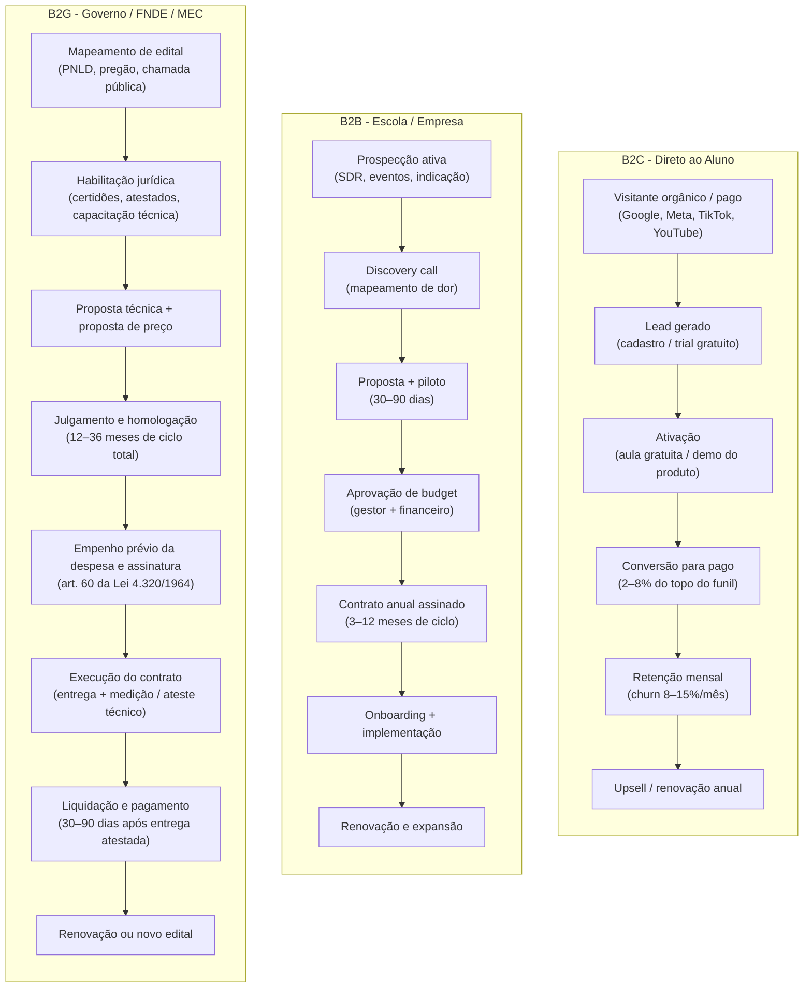

---

### Tabela: comparativo por modelo de negócio

| Dimensão | B2C (assinatura) | B2C (curso avulso) | B2B escola/empresa | B2G governo |
|---|---|---|---|---|
| **Ticket médio mensal** | R$ 39–199 | R$ 197–2.990 (único) | R$ 3K–50K/mês | R$ 50K–5M/mês (contrato) |
| **Ciclo de venda** | Dias (self-service) | Dias | 3–12 meses | 12–36 meses |
| **Churn esperado** | 8–15%/mês | N/A (transação única) | 10–25%/ano | Baixo durante o mandato; perda de 20–30% na troca de gestão eleitoral |
| **Margem bruta** | 60–80% | 65–85% | 55–70% | 40–65% |
| **CAC típico** | R$ 80–1.200 | R$ 50–800 | R$ 3K–30K | R$ 50K–500K+ |
| **LTV/CAC** | 1,5–4x (frágil) | 1–3x | 4–15x | 5–20x (quando ganha) |
| **Previsibilidade de receita** | Média (churn sazonal) | Baixa | Alta após contrato | Alta durante contrato |
| **Complexidade regulatória** | Baixa (conteúdo livre) | Baixa | Média (EAD, MEC) | Altíssima |

---

### MEC, CNE, BNCC e LDB: Quando o Ensino É Regulado e Quando É Livre

#### Ensino livre vs. ensino regulado

A primeira decisão de qualquer edtech é: o produto precisa de autorização do MEC?

**Ensino livre** (não sujeito a credenciamento pelo MEC): abrange cursos de extensão, preparatórios para vestibular e exames, habilidades digitais (programação, dados, design), **cursos de idiomas** (que no Brasil são 100% cursos livres e não dependem de autorização de conselho ou ministério, segmento em que atuam desde redes presenciais até aplicativos globais como o **Duolingo**, analisado na seção de casos) e treinamentos corporativos.

**Ensino regulado** (sujeito a credenciamento e supervisão do poder público): graduação e credenciamento de IES (autorizados pelo MEC e avaliados pelo INEP), pós-graduação *lato sensu* (MBA e especialização ofertados por IES credenciada conforme a Resolução CNE/CES nº 1/2018, dispensada autorização prévia de cada curso mediante registro no sistema e-MEC), cursos técnicos de nível médio e educação básica credenciada (autorizados pelos Conselhos Estaduais e Municipais de Educação sob a LDB, Lei nº 9.394/1996). Na educação básica (K-12), qualquer plataforma tecnológica também precisa cumprir três obrigações legais específicas em vigor em 2026: (1) o consentimento específico e em destaque de ao menos um dos pais ou responsável legal para o tratamento de dados pessoais de crianças (**art. 14, § 1º, da LGPD**), (2) as travas de proteção, privacidade por padrão e vedação a perfilamento comercial de menores do **ECA Digital (Lei nº 15.211/2025, em vigor desde março de 2026)**, e (3) a **Lei nº 15.100, de 13 de janeiro de 2025**, que proíbe o uso de aparelhos eletrônicos portáteis pessoais por estudantes durante as aulas, o recreio e os intervalos em todas as etapas da educação básica pública e privada, salvo para uso estritamente pedagógico sob orientação do professor, acessibilidade, condições de saúde ou segurança.

> [!warning] Produto que parece livre mas é regulado
> Oferecer pós-graduação *lato sensu* (especialização ou MBA) sem ser Instituição de Ensino Superior (IES) credenciada pelo MEC, ou sem parceria formal com uma IES credenciada responsável pela governança acadêmica e pelo registro no e-MEC (Resolução CNE/CES nº 1/2018, arts. 2º e 6º), é irregular: o certificado emitido não tem validade de especialização acadêmica (a qual tampouco equivale a título de especialista de conselho profissional, art. 8º, § 4º) e a oferta pode configurar publicidade enganosa (art. 37 do CDC), sujeitando a empresa a autuação pelos Procons e atuação do Ministério Público. Fundadores de edtech devem definir desde o início se o produto opera como curso livre ou ensino regulado e, neste segundo caso, estruturar o caminho formal de credenciamento ou parceria com IES.

#### EAD regulamentado: Novo Marco do EAD (Decreto nº 12.456/2025)

Para cursos de graduação nas modalidades a distância e semipresencial, a referência regulatória central passou a ser o **Novo Marco do EAD (Decreto nº 12.456, de 19 de maio de 2025)**, que revogou o Decreto nº 9.057/2017 e substituiu a flexibilidade do regime anterior (como a Portaria MEC nº 2.117/2019, que permitia até 40% de carga horária a distância em cursos presenciais). O Decreto nº 12.456/2025 estruturou três formatos (presencial, semipresencial e a distância), reduziu o limite de carga a distância em cursos presenciais para no máximo 30% e determinou oferta exclusivamente presencial para Direito, Medicina, Enfermagem, Odontologia e Psicologia. Os grandes grupos de ensino superior (Cogna/Kroton, Yduqs/Estácio, Cruzeiro do Sul e Ânima) haviam expandido fortemente suas matrículas digitais no regime anterior a partir de 2020 e passaram a readequar polos e matrizes curriculares às novas regras do MEC.

Para uma edtech que quer criar seu próprio curso de graduação EAD do zero, o caminho é: credenciamento como IES (3–5 anos, alto custo), ou parceria com IES já credenciada (modelo de marca branca ou joint venture educacional).

#### PRONATEC e formação profissional

Na educação profissional e tecnológica pública, a expansão de matrículas técnicas articulada ao ensino médio é impulsionada pela **reforma do ensino médio (Lei nº 14.945/2024)**, que ampliou os itinerários de formação técnica e profissional em parceria com as redes estaduais e o **Sistema S (SENAI, SENAC, SENAR, SENAT e SESCOOP)**, contando ainda com o programa **Pé-de-Meia (Lei nº 14.818/2024)** como poupança de incentivo financeiro à permanência e conclusão escolar dos estudantes da rede pública. Para uma edtech fornecer tecnologia ou conteúdo nesse segmento, o caminho mais viável raramente é o credenciamento direto isolado, mas sim a venda B2B para os departamentos regionais do Sistema S e secretarias estaduais de educação.

#### PNLD: Programa Nacional do Livro e do Material Didático

O PNLD (Programa Nacional do Livro e do Material Didático, regido pelo Decreto nº 9.099/2017) abastece as redes públicas de educação básica em ciclos plurianuais por etapa de ensino. Para participar, a editora ou edtech submete suas obras à inscrição e à avaliação pedagógica conduzida pelo MEC (art. 8º), que verifica a conformidade com a BNCC e a qualidade editorial. O processo é longo e exigente: a aprovação pedagógica não garante faturamento automático, mas habilita a obra no guia oficial para a etapa de escolha pelas escolas e redes de ensino, cabendo ao FNDE negociar e adquirir os volumes efetivamente selecionados pelas redes (arts. 18 e 19 do Decreto nº 9.099/2017).

---

### Lições da Trincheira Educacional Brasileira: Sistemas de Ensino K-12, Plataformas B2B e Modelos B2C

**Descomplica:** Começou como plataforma B2C de preparação para o ENEM e vestibulares (combinando aquisição orgânica no YouTube com assinatura mensal acessível de R$ 39 a R$ 59/mês). A partir de 2019 e 2020, estruturou sua entrada no ensino superior regulado (Faculdade Descomplica / aquisição da UniAmérica) para ofertar cursos de graduação e pós-graduação EAD credenciados no MEC. Em fevereiro de 2021, captou cerca de R$ 450 milhões (US$ 84 milhões) em rodada Série D coliderada por SoftBank e Invus Opportunities. O caso ilustra a transição do curso livre B2C (de ciclo curto) para o ensino superior regulado, no qual o aluno permanece de 2 a 4 anos (em cursos tecnólogos, licenciaturas ou bacharelados), multiplicando o LTV da base adquirida no funil de vestibular.

**Alura:** Plataforma de cursos de tecnologia que começou no modelo B2C, atendendo desenvolvedores individuais que buscavam capacitação contínua em programação e dados. Com a expansão da demanda corporativa por equipes técnicas no Brasil a partir de 2018–2022 (consolidada também pela união com a FIAP e a PM3 no ecossistema Alura), a frente corporativa **Alura Para Empresas (B2B *enterprise*)** tornou-se motor central de receita, operando com contratos anuais por licença, gestão de trilhas e relatórios de evolução. O caso mostra como a base B2C funciona como validação de marca e evidência prática de engajamento para destravar vendas anuais junto ao RH e aos diretores de tecnologia (CTOs).

**Hotmart:** Não é edtech no sentido estrito, é plataforma de marketplace para criadores de conteúdo digital. Produtores (infoprodutores) criam cursos e vendem via Hotmart, que fica com 9,9% + taxa de processamento de cada transação. A plataforma opera em larga escala: mais de 300 mil criadores ativos, mais de 40 países. O modelo é B2B2C (a empresa vende para o criador, que vende para o aluno). Não há regulação MEC porque os produtos são ensino livre. O risco do Hotmart é reputacional: a plataforma hospeda produtos de qualidade muito variável, incluindo o mercado de "guru de autoajuda".

**Duolingo no Brasil:** O Brasil figura consistentemente entre os três maiores mercados do Duolingo em usuários ativos diários no mundo (ao lado dos Estados Unidos e da Índia, segundo comunicados oficiais da empresa e edições do *Duolingo Language Report*). O produto opera no modelo B2C *freemium* sustentado por anúncios, com assinatura paga (*Super Duolingo* e *Duolingo Max* com IA generativa). Seu custo de aquisição (CAC) orgânico é reduzido porque o próprio mecanismo de retenção (ofensivas diárias / *streaks*, ligas semanais e notificações sociais) funciona como motor de crescimento viral: embora a conversão para assinantes pagantes gire em torno de **8% a 9% dos usuários ativos mensais (MAUs)** globalmente (conforme os relatórios anuais *Form 10-K* da Duolingo, Inc. na NASDAQ), a base de dezenas de milhões de usuários torna a operação geradora de caixa livre. Como cursos de idiomas no Brasil são **cursos livres**, o Duolingo disputa tempo diário de tela com jogos móveis e redes sociais mais do que matrículas formais com escolas presenciais de inglês.

**Sistemas de Ensino K-12 (Arco Educação e Vasta/Somos) e Grupos de Ensino Superior (Cogna, Yduqs e Ânima):** Na educação básica privada, a **Arco Educação** (SAS, SAE Digital, Positivo, Geekie) e a **Vasta/Somos** (controlada pela Cogna) provaram a tese do contrato B2B2C escolar: em vez de vender avulso para cada família, fecham contratos plurianuais com o mantenedor da escola (a Arco atingiu R$ 1,5 bilhão em volume anual contratado antes do fechamento de capital na Nasdaq em 2023 por General Atlantic e Dragoneer). Já no ensino superior, grupos como **Cogna (Kroton), Yduqs (Estácio), Ânima e Cruzeiro do Sul** exercem triplo papel no ecossistema: são grandes compradores institucionais de tecnologia (LMS, ERPs acadêmicos, retenção e *analytics*), concorrentes diretos no EAD regulado e compradores estratégicos (M&A) de edtechs que já atingiram escala.

---

### O Relógio de Outubro no K-12 e o Calendário Anual da Educação: Por Que Perder a Janela Escolar Adia a Receita em um Ano

Na educação básica privada (K-12), o relógio comercial segue quatro marcos rígidos ao longo do ano: **prospecção e testes pedagógicos em maio e junho. Decisão pedagógica e orçamentária da mantenedora entre julho e setembro. Assinatura contratual até outubro** (antes do envio das circulares de rematrícula e listas de material às famílias), e **implantação em janeiro**. A edtech escolar que só aborda a escola em novembro encontra o orçamento fechado e a lista de material impressa: a venda perdida em outubro só poderá ser retomada no ciclo seguinte para implantação em janeiro do outro ano, criando um hiato de 14 a 15 meses sem receita naquela escola.

```text
Jan  ★★★★★  Notas do ENEM e Sisu/Prouni. Pico de matrículas B2C e onboarding de escolas B2B para o início das aulas em fevereiro.
Fev  ★★★★☆  Início do ano letivo. Corpo docente absorvido na operação. Venda B2B difícil.
Mar  ★★★☆☆  Rotina estabelecida. Oportunidade de venda para datas de avaliação.
Abr  ★★★☆☆  Provas bimestrais. Engajamento cai em plataformas B2C.
Mai  ★★★★☆  Planejamento orçamentário e prospecção nas escolas privadas (maio e junho). Semear pipeline B2B.
Jun  ★★★☆☆  Meio do semestre. Preparação para ENEM começa.
Jul  ★★★★★  Matrículas 2º semestre. Segunda janela B2C. Decisões de compra B2B para janeiro.
Ago  ★★★★☆  Retomada do 2º semestre. Intensificação de simulados para o ENEM e prospecção B2B escolar.
Set  ★★★★★  Reta final de revisão intensiva para o ENEM (provas em novembro) e conclusão da decisão pedagógica B2B (julho a setembro).
Out  ★★★★★  Pico de revisão pré-ENEM (B2C) e data-limite de assinatura dos contratos escolares B2B antes das circulares de rematrícula.
Nov  ★★★☆☆  Corporativo: fim de orçamento. Budget de L&D precisa ser gasto antes de 31 de dezembro.
Dez  ★★☆☆☆  Recesso. Quase nada fecha. Planejamento do ano seguinte.
```

> [!tip] Novembro é o Q4 do mercado corporativo
> Empresas com budget de treinamento não utilizado precisam gastá-lo antes do fechamento do exercício. Uma edtech B2B que faz pipeline corporativo entre agosto e outubro e fecha em novembro captura essa janela de orçamento de fim de ano. Segue a mesma dinâmica do quarto trimestre (*Q4*) em vendas de software corporativo, aplicada ao orçamento de T&D.

---

### A Matemática que Fecha a Conta: LTV/CAC, Churn Sazonal, Custo de Conteúdo com IA e Financiamento Estudantil (EdFin)

A comparação direta de economia unitária explica a migração do setor para contratos institucionais: enquanto uma assinatura B2C avulsa de R$ 49,90/mês com *churn* mensal de 12% e margem bruta de 75% gera cerca de R$ 312 de margem bruta acumulada no ciclo de vida (*LTV*) para um CAC de R$ 150 a R$ 300 (deixando a relação LTV/CAC comprimida entre 1x e 2x), um contrato escolar B2B de R$ 4.000/mês com retenção de 5 anos gera R$ 240 mil de receita contratada para um CAC comercial de R$ 15 mil a R$ 25 mil. Dois vetores financeiros completam essa equação. No **custo de produção de conteúdo e tutoria com IA**, estimativas operacionais do setor indicam que o uso de modelos generativos combinados com recuperação de contexto (*RAG*) sobre matrizes alinhadas à BNCC e ao ENEM reduz em 60% a 80% o custo marginal de elaborar questões comentadas, planos de aula e correção assistida de redação, exigindo roteamento entre modelos leves e pesados e *caching* semântico para manter o custo de inferência estimado entre R$ 2 e R$ 5 por aluno/mês e preservar a margem bruta acima de 75%. Já no **financiamento estudantil (EdFin)**, diante do encolhimento do FIES público, faculdades e escolas técnicas passaram a recorrer a crédito estudantil privado estruturado via FIDC (como o modelo do Pravaler) ou parcelamento bancário: a regra de sobrevivência financeira é nunca carregar risco de crédito longo no próprio balanço da edtech sem FIDC ou seguro de crédito, restringindo contratos de compartilhamento de renda futura (*ISA*) a nichos técnicos de alta empregabilidade e ticket elevado.

#### B2C: o problema do CAC sazonal

O CAC de uma edtech B2C flutua radicalmente ao longo do ano. Em agosto (pré-ENEM), todos os competidores estão no leilão do Google Ads. O CPC para palavras-chave de "cursinho online", "preparatório ENEM" e "vestibular" dobra ou triplica. O fundador que calcula CAC médio anual está escondendo que adquiriu metade dos clientes a custo três vezes maior no pico sazonal.

Métricas que importam no B2C de edtech:

- **CAC por cohort de aquisição** (não apenas CAC médio anual)
- **LTV por objetivo** (aluno de vestibular tem LTV limitado a 12–24 meses, aluno de certificação profissional pode renovar por anos)
- **Margem de contribuição após sazonalidade** (capacidade de cobrir custos fixos nos meses de vale de matrículas, acompanhada do NPS medido por resultado de aprendizagem e empregabilidade)
- **NPS por outcome** (aluno que passou no vestibular tem NPS altíssimo e vira referência, aluno que não passou tem NPS baixo independentemente da qualidade do produto)

#### B2B: o valor do custo de troca

O B2B de edtech constrói uma defesa competitiva sólida quando o produto está integrado à operação diária da instituição: o custo de troca (*switching cost*). Uma escola que utiliza a plataforma para controlar frequência, notas, comunicação com os pais e relatórios pedagógicos não substitui o fornecedor sem atrito operacional relevante. Essa retenção estrutural justifica ciclos de venda de 6 a 12 meses (que se pagam quando a escola permanece por 5 a 10 anos) e permite expandir o ticket médio anual com novos módulos.

O risco inverso é que o lock-in dificulta a venda inicial. A escola sabe que está comprando por muitos anos e quer certeza antes de assinar. Isso explica por que pilotos gratuitos de 30–90 dias são padrão no mercado B2B de edtech.

---

### As armadilhas do setor: perder a janela de adoção escolar, quebrar com inadimplência em ISA e ignorar o professor

**1. Regulação trava o produto digital no ensino formal**

Uma edtech que desenvolve conteúdo inovador para sala de aula descobre que a escola pública utiliza currículo aprovado pela secretaria de educação, que só incorpora material após processo formal de avaliação que dura de 1 a 2 anos. O produto pode ser tecnicamente superior e ter eficácia pedagógica comprovada, mas a rede pública não pode adotá-lo sem enquadramento normativo e licitatório. Isso não significa que o B2G educacional seja inviável: significa que o ciclo comercial e o capital de giro exigidos são substancialmente maiores do que o fundador projeta ao entrar no mercado.

**2. Confundir engajamento com aprendizagem**

Gamificação gera engajamento. Engajamento não garante aprendizagem. Uma edtech que mede sucesso por "minutos gastos na plataforma" ou "número de aulas completadas" pode estar criando uma métrica de vaidade. O que o mercado corporativo e o governo cada vez mais pedem é evidência de resultado: nota melhorou, empregabilidade aumentou, certificação conquistada. Startups que não desenvolvem métricas de outcome vão perder contratos para quem tem.

**3. Comparar unit economics de B2C com B2B como se fossem o mesmo negócio**

Um CAC de R$ 500 no B2C (para um aluno que paga R$ 59/mês e cancela no quarto mês) destrói o caixa. Já um CAC comercial de R$ 20.000 no B2B (para conquistar uma escola que paga R$ 5.000/mês durante 5 anos, somando R$ 300.000 de receita contratada) é altamente rentável. Fundadores que migram do B2C para o B2B frequentemente mantêm a referência de aquisição barata de mídia digital e hesitam em estruturar uma equipe de vendas consultivas, deixando de capturar o valor do contrato plurianual.

**3A. Adotar ISA (*Income Share Agreement*) sem blindagem jurídica e cobrança integrada:** Importar o modelo de *Income Share Agreement* (em que o aluno estuda sem pagar na frente e compromete uma fração da renda futura após obter emprego acima de um piso salarial) sem estrutura de FIDC, seguro de crédito ou convênio de desconto em folha pressionou severamente o fluxo de caixa de escolas de programação no Brasil entre 2022 e 2025. O capital de giro fica imobilizado por 24 a 48 meses enquanto a escola paga professores e aquisição de alunos à vista. Além disso, ocorre seleção adversa (os candidatos com maior reserva financeira preferem o parcelamento fixo mais barato) e a atuação posterior de graduados como pessoas jurídicas (PJ) no Brasil ou no exterior dificulta o acompanhamento automático da renda.

**3B. Vender para o mantenedor da escola e ignorar a rotina do professor e o calendário de adoção:** Muitos fundadores fecham o contrato B2B com a direção da escola até outubro, mas entregam em janeiro uma plataforma que exige do professor duas horas extras de digitação manual de notas e diários no fim de semana. Como o professor brasileiro frequentemente leciona em dois ou três turnos, qualquer software que aumente seu trabalho braçal sofre rejeição silenciosa em sala de aula: os alunos não utilizam, as famílias não percebem valor e a mantenedora cancela o contrato na janela de decisão pedagógica seguinte (entre julho e setembro).

**4. Não separar receita de conteúdo de receita de tecnologia**

Empresas que vendem tanto conteúdo quanto plataforma têm dois P&Ls distintos: o conteúdo tem margem bruta alta na largada, mas perde valor e desatualiza rápido. Tecnologia tem CAC alto mas gera receita recorrente e LTV longo. Misturar os dois no mesmo modelo financeiro produz métricas enganosas.

**5. Ignorar inadimplência no B2B pequeno**

Escolas particulares de pequeno porte apresentam historicamente taxas relevantes de atraso e inadimplência em períodos de pressão econômica. Uma edtech que vende para 500 escolas pequenas sem régua automatizada de cobrança, trava contratual e análise prévia de crédito pode sofrer 20% a 30% de inadimplência na carteira, corroendo na prática a margem que parecia saudável na planilha.

---

### Auditoria de Trincheira antes de Lançar um Produto Educacional no Brasil

- [ ] O produto opera como ensino livre ou ensino regulado (com caminho formal de credenciamento ou parceria com IES credenciada)? Se atender educação básica (K-12), cumpre o consentimento parental específico para dados de crianças (art. 14, § 1º, da LGPD), as regras de proteção de menores do ECA Digital (Lei nº 15.211/2025) e a restrição ao uso de celulares pessoais em sala e intervalos salvo finalidade pedagógica orientada (Lei nº 15.100/2025)?
- [ ] Qual modelo de negócio principal: B2C, B2B, B2G ou híbrido?
- [ ] O unit economics foi calculado por cohort sazonal, não apenas pela média anual?
- [ ] Há estratégia comercial e de caixa para os meses de baixa entrada após o pico de matrículas (abril a junho e novembro/dezembro no ciclo de vestibular e ENEM, cujas provas ocorrem em novembro e as matrículas em janeiro e fevereiro)?
- [ ] Para B2B: o produto tem custo de troca real que justifique o ciclo de venda longo?
- [ ] Para B2G: há capital de giro para sustentar 12–36 meses de ciclo sem receita?
- [ ] As métricas de sucesso incluem outcome de aprendizagem, não apenas engajamento?
- [ ] A sazonalidade do mercado corporativo (novembro) está mapeada no pipeline?
- [ ] Para ensino superior regulado (presencial, semipresencial e EAD): os limites do **Decreto nº 12.456, de 19 de maio de 2025** (que revogou o Decreto nº 9.057/2017, limitou a 30% a carga a distância em cursos presenciais, vedou o EAD em Direito, Medicina, Enfermagem, Odontologia e Psicologia e redefiniu os requisitos de polos junto ao MEC) e os dados do Censo da Educação Superior do INEP (que em 2024 registrou 50,7% do estoque total de matrículas de graduação em EAD e 66,4% entre os novos ingressantes) foram incorporados ao modelo?

---

**Capítulos relacionados na coleção (incluindo Gestão de Caixa e Capital de Giro no Capítulo 5 do Vol. 5, Captação nos Capítulos 9 e 11 a 14 do Vol. 5 e Precificação no Capítulo 6 do Vol. 4):** [[#CAPÍTULO 4: REGULATÓRIO SETORIAL BRASILEIRO|Capítulo 4: Regulatório Geral]], [[IGNICAO-Vol-4-Tracao-e-PMF#CAPÍTULO 6: PRICING STRATEGY E ECONOMIA DA RECORRÊNCIA (SUBSCRIPTION ECONOMY)|Capítulo 6: Subscription Economy (Vol. 4)]], [[#CAPÍTULO 32: GOVTECH: STARTUP VENDENDO PARA GOVERNO|Capítulo 32: Govtech e B2G]]

---

### Filtro de Alinhamento e Prontidão: Perguntas de Validação Prática

Para não repetir o erro do fundador que queima caixa tentando sustentar assinaturas avulsas de R$ 49,90/mês com 3% a 5% de conclusão e *churn* mensal de 12%, submeta o modelo de negócios às três travas de validação abaixo e direcione a operação para contratos anuais com mantenedoras escolares ou programas corporativos de empregabilidade:

Antes de gravar uma aula ou escrever código para uma Edtech no Brasil, passe sua tese por três perguntas de fogo:

1. **Curso Livre vs. Obrigação Institucional:** Seu produto depende de convencer pessoas no Instagram a pagarem R$ 59/mês por um curso que abandonam na terceira semana, ou vende contratos anuais para escolas (K-12 B2B2C), empresas (B2B) ou cursos que destravam diploma/emprego?
2. **A Sincronia com o Relógio Escolar (Maio a Outubro no K-12):** Se você vende para escolas privadas, seu time comercial inicia a prospecção e os pilotos em maio e junho e conduz a decisão pedagógica e orçamentária entre julho e setembro, garantindo a assinatura do contrato até outubro (antes que o mantenedor feche a lista de material e as circulares de rematrícula para janeiro)?
3. **Aliado do Professor:** Sua tecnologia economiza cinco horas semanais de trabalho braçal do professor (corrigindo redações e montando aulas BNCC), ou cria mais uma tarefa para um docente exausto?

**O Movimento de Segunda-Feira:** Nos próximos 15 dias, converse com cinco mantenedores de escolas privadas ou cinco diretores de RH/T&D e audite quais fornecedores educacionais eles renovaram ou cancelaram nos últimos três anos.


---

## CAPÍTULO 32: GOVTECH: STARTUP VENDENDO PARA GOVERNO

### A armadilha do piloto sem dotação orçamentária e a alavancagem do CPSI

Existe um ritual de passagem doloroso que já levou dezenas de startups brasileiras à falência no setor público (*GovTech*): o fundador consegue uma reunião no gabinete de um prefeito ou secretário estadual, faz uma apresentação brilhante, o político tira foto para as redes sociais dizendo que a cidade será "a mais inteligente do Brasil" e pede um piloto gratuito de seis meses. O fundador inexperiente comemora e financia o projeto-piloto com caixa próprio. Seis meses depois, o piloto é um sucesso, mas o secretário descobre que não existe rubrica na Lei Orçamentária Anual (LOA), a Procuradoria trava a contratação por medo do Tribunal de Contas (TCE/TCU), a TI municipal boicota o sistema e o ano eleitoral congela os empenhos.

Em um mercado no qual as compras públicas de bens e serviços movimentam cerca de 12% do PIB brasileiro (segundo estudos do Ipea), quem opera com consistência no setor público sabe que o entusiasmo do agente político vale zero se não vier acompanhado de três pilares técnicos: **enquadramento jurídico blindado, rubrica orçamentária carimbada com fonte de recurso garantida e adesão da burocracia de carreira**.

Para escalar em GovTech sem comprometer o caixa, a operação deve apoiar-se na engenharia jurídica do **Contrato Público para Solução Inovadora (CPSI, instituído pelos arts. 12 a 15 da LC nº 182/2021)** e do **Sistema de Registro de Preços (SRP, regido pela Lei nº 14.133/2021)**. Em vez de realizar testes gratuitos informais que inviabilizam a contratação posterior, a startup formaliza um CPSI (licitação em modalidade especial que remunera o teste em até R$ 1,6 milhão e permite contrato de fornecimento subsequente de até R$ 8 milhões sem novo certame, valores atualizáveis anualmente pelo IPCA nos termos do art. 12, § 3º, da LC nº 182/2021) ou participa de licitação para registro em ata, viabilizando a adesão posterior por outros entes federativos (observados os limites do art. 86 da Lei nº 14.133/2021 e da Lei nº 14.770/2023).

Na prática operacional do B2G brasileiro, mobilizar equipe de engenharia para implantar um piloto municipal sem rubrica prevista na LOA e sem instrumento jurídico formal (como um edital de CPSI ou um acordo formal de teste operacional com prazo e escopo delimitados) expõe a startup ao bloqueio imediato pela Procuradoria Jurídica e pelo Controle Interno na hora de converter o teste em contrato remunerado.

---

> [!note] Nota de validade
> Valores de dispensa de licitação e limites de contratação são reajustados periodicamente por decreto federal. Os valores citados refletem o cenário de outubro de 2026, com base nos reajustes da Lei nº 14.133/2021 (Decreto nº 12.807/2025) e regulamentações vigentes. Verifique sempre o decreto anual vigente antes de qualquer processo de contratação. O Marco Legal das Startups (LC nº 182/2021) é a âncora legal para compras de inovação: ver [[IGNICAO-Vol-8-Juridico-LGPD-e-Seguranca#CAPÍTULO 1: MARCO LEGAL DAS STARTUPS: LC 182/2021|Capítulo 1 (Marco Legal das Startups: LC 182/2021) (Vol. 8)]] para o instrumento em detalhe.

O Estado é o maior comprador institucional do país: as compras governamentais de bens, serviços e obras das três esferas federativas (União, 26 estados e Distrito Federal, e 5.570 municípios) equivalem a cerca de 12% do PIB nacional segundo levantamentos do Ipea. Saúde, educação, segurança, mobilidade, assistência social e administração tributária ainda operam, em grande parte dos entes, sobre sistemas legados, fluxos em papel e baixa interoperabilidade. A distância entre o que o serviço público precisa entregar ao cidadão e o que consegue contratar pelas vias tradicionais de TI é o espaço de mercado onde a govtech atua.

O comprador público, contudo, obedece a regras estruturalmente distintas das do mercado privado: o ciclo comercial é plurianual, o rito de contratação é vinculado à lei, o prazo entre o ateste da entrega e o depósito bancário exige capital de giro dedicado e a transição de mandato executivo pode paralisar projetos que não estejam ancorados nos servidores efetivos de carreira.

Para construir, vender e escalar soluções tecnológicas no setor público brasileiro sem queimar caixa em projetos sem orçamento, o fundador precisa dominar a diferença entre a discricionariedade comercial privada e a legalidade administrativa.

### Por que o Estado Compra por Lei, e Não por Vontade do Gestor

Quatro características distinguem o governo de qualquer cliente privado.

**Ciclo de compra anual e orçamento pré-definido.** O governo federal, estadual e municipal opera com lei orçamentária anual (LOA). O dinheiro disponível para contratar uma startup está ou não está na LOA. Secretaria sem dotação orçamentária não contrata, mesmo que queira. O ciclo real começa no primeiro semestre: de março a julho a secretaria elabora o Plano de Contratações Anual (PCA) e a proposta setorial que entrará no projeto da LOA (enviado ao Legislativo até agosto/setembro), de setembro a dezembro, a janela que resta é a de emendas parlamentares. Janeiro a abril é o momento de fazer o processo de contratação. Maio a agosto é quando o contrato começa a rodar. Essa sazonalidade rígida muda o modelo de go-to-market inteiro.

**Compliance intenso por obrigação constitucional.** A administração pública opera sob o princípio da legalidade: só pode fazer o que a lei expressamente autoriza. Isso significa que toda contratação tem trâmites formais: parecer jurídico, aprovação de comitê, publicação no Diário Oficial. Não existe "assinar agora e regularizar depois" no setor público.

**Stakeholders múltiplos e decisão não linear.** No privado, o CEO decide. No governo, a decisão passa por técnico, gestor intermediário, jurídico, controle interno, secretário ou prefeito, e às vezes câmara de vereadores. Cada um tem poder de veto. Nenhum tem poder de dizer "sim" sozinho.

**Empenho não é pagamento.** Este é o ponto que mais surpreende fundadores iniciantes em GovTech. A nota de empenho é o ato prévio obrigatório que reserva a dotação orçamentária antes da realização da despesa (art. 60 da Lei nº 4.320/1964), enquanto o contrato ganha eficácia com sua divulgação no Portal Nacional de Contratações Públicas (PNCP, art. 94 da Lei nº 14.133/2021). O pagamento efetivo só ocorre após a entrega do serviço, a emissão da nota fiscal, a liquidação com ateste técnico pelo fiscal do contrato e o processamento financeiro na tesouraria: na prática, o prazo entre a entrega e o recebimento varia de **45 a 90 dias em municípios e de 60 a 120 dias em estados**. Startups com caixa curto quebram esperando a liquidação governamental.

> [!warning] Empenho não é dinheiro em conta
> Fundadores de govtech não devem projetar a receita contratada no fluxo de caixa antes da liquidação efetiva. Enquanto o ciclo comercial de fechamento no B2G leva de **6 a 18 meses em prefeituras médias e de 12 a 24+ meses em estados e na União** (frente a **3 a 9 meses** no B2B privado), o intervalo entre o ateste da entrega e o depósito bancário varia por ente federativo: planeje de **45 a 90 dias em municípios** e de **60 a 120 dias em estados**, mantendo reserva de capital de giro para financiar a operação durante esse hiato.

### Como o CPSI (LC 182/2021, arts. 12 a 15) permite contratar testes remunerados (até R$ 1,6 milhão) e fornecimento direto (até R$ 8 milhões)

A **Lei Complementar nº 182/2021** (em vigor ao lado da via distinta da **Encomenda Tecnológica, ou ETEC**, prevista no art. 20 da Lei de Inovação nº 10.973/2004 e no art. 75, V, da Lei nº 14.133/2021 para P&D sob risco tecnológico) destravou a compra pública de inovação ao instituir a licitação em modalidade especial e o **CPSI (Contrato Público para Solução Inovadora)**, dando respaldo jurídico expresso ao gestor público perante o TCU e os TCEs.

Os arts. 12 a 15 da LC nº 182/2021 estruturaram um rito licitatório próprio, focado na definição do problema público e em metas de desempenho (em vez de exigir especificação prévia de código-fonte já existente), o que reduziu o receio de responsabilização pessoal dos gestores e procuradores ao testar tecnologias emergentes.

Além do CPSI para compras públicas, a LC nº 182/2021 positivou nos arts. 5º a 8º instrumentos privados de investimento em inovação (como o mútuo conversível, a opção de subscrição e a opção de compra de participação societária previstos no art. 5º, § 1º, I e II, detalhados no Volume 8, Capítulo 1), protegendo investidores privados contra desconsideração da personalidade jurídica sem confundir fomento estatal com participação acionária direta do ente público.

A licitação em modalidade especial do art. 13 da LC 182/2021 é aberta a qualquer pessoa física ou jurídica (isolada ou em consórcio) que apresente proposta para o desafio público do edital, enquanto o enquadramento formal como **startup pelo art. 4º da LC 182/2021** observa três requisitos objetivos:
Para fins de enquadramento societário geral como startup no Marco Legal (art. 4º da LC nº 182/2021, que regula instrumentos de investimento e ambiente experimental, distinto da ampla elegibilidade para licitações do CPSI prevista no art. 13), a lei estabelece:
- Até dez anos de inscrição no CNPJ.
- Receita bruta anual de até R$ 16 milhões no ano-calendário anterior (ou R$ 1.333.334,00 multiplicado pelo número de meses de atividade no ano-calendário anterior, quando inferior a 12 meses, nos termos do art. 4º, § 1º, I, da LC nº 182/2021), critério que define o enquadramento societário como startup para fins gerais da lei, mas não restringe a participação nas licitações de CPSI (abertas a qualquer pessoa física ou jurídica pelo art. 13).
- Declaração em ato constitutivo ou alterador de utilização de modelos de negócios inovadores, ou enquadramento no regime especial Inova Simples.

> [!important] O gestor precisa de coragem institucional
> A lei existe, mas muitos gestores ainda têm medo de usar. TCU e TCEs fiscalizam com rigor. Governos mais inovadores (Minas Gerais, São Paulo, Rio Grande do Sul, Ceará, prefeituras como BH, SP, Porto Alegre) têm mais familiaridade com o mecanismo. Prefeituras pequenas raramente usam. Mapear o perfil de inovação do órgão antes de investir no pipeline.

### As Cinco Portas de Entrada Jurídica: CPSI (LC 182/2021), Pregão/Concorrência e Diálogo Competitivo, Inexigibilidade, Dispensa e Adesão a Ata (SRP)

Para navegar nas compras públicas com rigor técnico, o fundador deve distinguir as **modalidades de licitação** (pregão, concorrência, concurso, leilão e diálogo competitivo no art. 28 da Lei nº 14.133/2021, além da modalidade especial do CPSI no art. 13 da LC nº 182/2021), as hipóteses de **contratação direta** (inexigibilidade no art. 74 e dispensa no art. 75 da Lei nº 14.133/2021) e os **procedimentos auxiliares** (como o Sistema de Registro de Preços e a adesão a ata no art. 86).

O Poder Público não compra tecnologia por um único formato. Existem cinco portas de entrada jurídicas principais para startups (além do **Diálogo Competitivo** do art. 32 da Lei nº 14.133/2021, modalidade voltada a contratações complexas em que a Administração dialoga previamente com licitantes qualificados para desenvolver alternativas capazes de atender às suas necessidades), cada uma com limites de valor, prazos e exigências distintos:

| Modalidade | Limite de valor | Complexidade | Prazo típico | Melhor para |
|---|---|---|---|---|
| **1. CPSI: Modalidade especial (LC 182/2021, arts. 12–15)** | Até R$ 1,6M no CPSI + até R$ 8M no Contrato de Fornecimento | Média | 60–120 dias | Teste remunerado de solução inovadora e escala posterior sem nova licitação |
| **2. Dispensa de licitação (Lei 14.133, art. 75, II / Encomenda Tecnológica, art. 75, V)** | R$ 65.492,11 (serviços comuns e compras em 2026, Decreto 12.807/2025; R$ 130.984,20 para obras e serviços de engenharia, art. 75, I) ou conforme projeto de P&D (ETEC, art. 20 da Lei 10.973) | Baixa a Média | 30–90 dias | Contratação rápida de pequeno valor ou P&D com risco tecnológico |
| **3. Inexigibilidade (Lei 14.133, art. 74)** | Sem teto fixo (exige justificativa de preço) | Média | 45–120 dias | Fornecedor exclusivo comprovado ou solução técnica singular |
| **4. Pregão eletrônico / Concorrência (Lei 14.133)** | Sem limite | Alta | 90–180 dias | Software padronizado e escalável com especificação já madura |
| **5. Adesão a Ata de Registro de Preços - SRP (Lei 14.133, art. 86)** | Até 50% por órgão aderente e até o dobro do total da ata | Baixa a Média | 30–60 dias | Escalar vendas para novas prefeituras/estados a partir de ata vigente |

> [!tip] Quando usar CPSI (LC 182/2021), Encomenda Tecnológica (ETEC) ou Diálogo Competitivo (Lei 14.133/2021)
> Não confunda os três instrumentos de inovação: o **CPSI (arts. 12 a 15 da LC nº 182/2021)** é uma modalidade especial de licitação para testar em ambiente real soluções inovadoras já em estágio de protótipo ou produto inicial dentro dos tetos legais. A **Encomenda Tecnológica (ETEC, art. 20 da Lei nº 10.973/2004 e dispensa do art. 75, V, da Lei nº 14.133/2021)** destina-se a contratar P&D com risco tecnológico relevante quando a solução ainda não existe no mercado. Já o **Diálogo Competitivo (art. 32 da Lei nº 14.133/2021)** aplica-se a contratações de grande vulto ou alta complexidade técnica nas quais o órgão conhece a necessidade pública, mas não consegue definir de antemão a especificação técnica ou a estrutura jurídica e financeira ideal sem antes conduzir rodadas formais de diálogo com o mercado.

**CPSI (Licitação em modalidade especial da LC nº 182/2021).** No procedimento dos arts. 12 a 15 do Marco Legal das Startups, o órgão publica edital (com antecedência mínima de 30 dias) descrevendo o desafio público a ser superado e os indicadores de resultado esperados, dispensando especificação técnica prévia fechada. Uma comissão especial integrada por, no mínimo, três pessoas de reputação ilibada e reconhecido conhecimento no assunto, das quais uma deve ser servidor público do órgão contratante e outra deve ser professor de instituição pública de educação superior (art. 13, § 3º), avalia as propostas (podendo selecionar mais de uma empresa para validação paralela) e acompanha a execução pelo prazo de até 12 meses, prorrogável por mais 12 meses.

**Inexigibilidade.** Quando a startup tem solução sem concorrente equivalente no mercado. Exige justificativa técnica robusta. Risco: qualquer concorrente pode questionar. Funciona bem para startups com patente ou tecnologia genuinamente proprietária.

**Pregão eletrônico e Concorrência (Lei nº 14.133/2021).** O pregão eletrônico é a modalidade obrigatória para aquisição de bens e serviços comuns (inclusive serviços comuns de TIC padronizados, cujo padrão de desempenho e qualidade pode ser objetivamente definido no edital), operando por disputa de lances sem limite de valor. É o caminho de escala para a govtech que já possui produto maduro, atestados de capacidade técnica e estrutura de custos capaz de competir em certame aberto.

**Dispensa de licitação por valor (Lei nº 14.133/2021, art. 75, I e II).** Contratações diretas até o limite legal atualizado anualmente por decreto federal, que em 2026, pelo **Decreto nº 12.807/2025**, é de **R$ 65.492,11** para serviços comuns e compras (art. 75, II) e de **R$ 130.984,20** para obras e serviços de engenharia (art. 75, I), valores duplicados quando contratados por consórcios públicos ou agências executivas (art. 75, § 2º), ocorrem de forma célere via dispensa eletrônica no PNCP, servindo como porta de entrada remunerada para validação em secretarias municipais, ao lado de **concursos públicos de inovação** (art. 30 da Lei nº 14.133/2021).

**Adesão a Ata de Registro de Preços (SRP / "carona", art. 86 da Lei nº 14.133/2021 e Lei nº 14.770/2023) e Encomenda Tecnológica (ETEC, art. 20 da Lei nº 10.973/2004 e art. 75, V, da Lei nº 14.133/2021).** Uma vez vencedora de um pregão para registro de preços em um órgão gerenciador ou consórcio público intermunicipal, a startup pode escalar comercialmente permitindo que outras prefeituras e órgãos adiram à ata vigente (respeitado o teto de 50% por órgão aderente e o dobro do quantitativo registrado na soma das adesões). Já a **Encomenda Tecnológica (ETEC)** permite contratação direta de ICTs ou empresas para atividades de P&D que envolvam risco tecnológico para solução de problema técnico específico, com pagamento estruturado por etapas ou bônus de desempenho. Por fim, para startups que atuam em setores regulados (como finanças, seguros, telecomunicações e energia), o **Sandbox Regulatório (Ambiente Regulatório Experimental, art. 11 da LC nº 182/2021)** autoriza testes temporários perante a agência reguladora, mas não constitui modalidade de compra pública: ver [[IGNICAO-Vol-8-Juridico-LGPD-e-Seguranca#CAPÍTULO 1: MARCO LEGAL DAS STARTUPS: LC 182/2021|Capítulo 1 (Marco Legal das Startups: LC 182/2021) (Vol. 8)]] e [[#CAPÍTULO 4: REGULATÓRIO SETORIAL BRASILEIRO|Capítulo 4 (Regulatório Setorial Brasileiro)]].

### Fluxo de contratação pública para startup

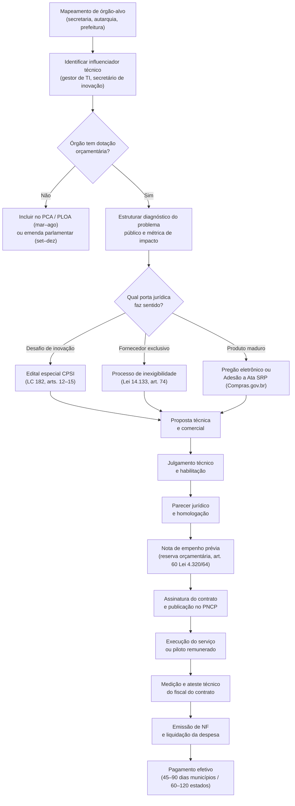

### Pipeline de vendas para governo

Na administração pública, a decisão de contratação nasce da urgência institucional: o gestor público compra uma solução auditável para resolver um problema político visível (cumprimento de meta de governo, resposta a órgãos de controle, contenção de despesas) ou um gargalo operacional concreto (fila de espera na saúde, evasão escolar, erro cadastral ou perda de arrecadação).

**Etapa 1: Mapeamento de influenciadores.** Toda contratação pública tem um influenciador técnico antes de chegar ao decisor formal: gerente de TI, superintendente de inovação, coordenador pedagógico ou assessor técnico da secretaria. Essa área técnica levanta as dores no Estudo Técnico Preliminar (ETP) e participa da avaliação. Apresente capacidades pelos canais formais da Lei nº 14.133/2021 (consultas e audiências públicas do art. 21, Procedimento de Manifestação de Interesse, PMI do art. 81 e cotações oficiais de mercado), registrando toda reunião institucional em ata e jamais redigindo o termo de referência ou projeto básico para o órgão, sob pena de impedimento para licitar (art. 14 da Lei nº 14.133/2021).

**Etapa 2: Mapeamento de dotação orçamentária.** Antes de investir tempo comercial em um órgão, verifique se há dotação orçamentária disponível na Lei Orçamentária Anual (LOA) publicada ou em planejamento. O Portal da Transparência do próprio ente, o **Siconfi/Tesouro Nacional** (onde estados e municípios declaram o RREO e o Finbra) e os diários oficiais são públicos e permitem auditar a capacidade real de pagamento antes da primeira reunião. Órgão sem dotação não contrata.

**Etapa 3: Construção de caso de uso documentado.** O decisor público não pode correr risco reputacional. Ele precisa de evidência de que a solução funciona antes de assinar. Quando o teste inicial for não remunerado, formalize-o obrigatoriamente por Acordo de Cooperação Técnica ou termo de teste com prazo curto (60 a 90 dias), escopo fechado e indicadores de aceite (ou utilize o CPSI da LC 182/2021 para testes remunerados que já habilitam o fornecimento subsequente), documentando os resultados com atestado técnico do órgão. Esse caso de uso é a principal ferramenta de vendas para o próximo órgão.

**Etapa 4: Adequação ao processo licitatório.** Cada modalidade tem exigências documentais diferentes. Regularidade fiscal federal, estadual e municipal é obrigatória. Certidões negativas de débito (CND) precisam estar em dia. Microempresas (ME) e Empresas de Pequeno Porte (EPP), optantes ou não pelo Simples Nacional, contam com prerrogativas da LC 123/2006 (arts. 42 a 49): comprovação de regularidade fiscal apenas para assinatura do contrato (com 5 dias úteis prorrogáveis para sanar pendências), preferência em empate ficto e licitações exclusivas em itens de até R$ 80 mil. Criar checklist documental e manter sempre atualizado.

**Etapa 5: Gestão pós-contrato.** Contrato assinado não é trabalho concluído. O gestor público tem medo de errar. Precisa de suporte frequente, relatórios documentados, e evidência contínua de que a solução está funcionando. Essa relação de suporte estreito é o que garante renovação e expansão para outros órgãos.

> [!tip] A prefeitura é a porta de entrada
> Municípios têm processos decisórios mais curtos e gestores mais acessíveis do que estados e a União. Uma startup govtech típica valida sua cunha inicial em duas ou três prefeituras de médio porte (**50 mil a 200 mil habitantes**) e, uma vez comprovado o retorno operacional, expande para cidades de **200 mil a 500 mil habitantes**, secretarias estaduais e ministérios. Nunca comece pelo governo federal sem antes acumular atestados técnicos municipais.

### Auditoria Orçamentária (PPA, LDO, LOA e TCE), Restrições de Fim de Mandato (LRF, art. 42) e as 13 Variáveis do Problema Público

Antes de alocar horas de engenharia comercial em uma prefeitura ou secretaria estadual, execute uma auditoria rápida em quatro fontes públicas: (1) confirme se o programa temático consta no **Plano Plurianual (PPA)** e nas metas da **Lei de Diretrizes Orçamentárias (LDO)**, (2) abra a **Lei Orçamentária Anual (LOA)** vigente e localize a rubrica específica de tecnologia ou modernização e sua **fonte de recurso** (verificando se a verba é livre do Tesouro ou carimbada por fundo federal da saúde ou educação), (3) consulte no portal do **Tribunal de Contas (TCE/TCU)** se o órgão sofre alertas de limite prudencial de gasto ou suspensão de certames semelhantes, e (4) confira o relógio de fim de mandato. No calendário eleitoral (eleições federais e estaduais em outubro de 2026, eleições municipais em 2028), o **art. 42 da Lei de Responsabilidade Fiscal (LC nº 101/2000)** proíbe o titular de Poder ou órgão, nos últimos dois quadrimestres (oito meses) do mandato, de contrair obrigação de despesa que não possa ser cumprida integralmente dentro dele ou que tenha parcelas a serem pagas no exercício seguinte sem suficiente disponibilidade de caixa líquida, somando-se nos três meses que antecedem o pleito as condutas vedadas do **art. 73 da Lei Eleitoral (Lei nº 9.504/1997)** (que restringem transferências voluntárias de convênios, publicidade institucional e atos de pessoal, mas não suspendem licitações nem a execução de contratos regulares com dotação própria).

O erro mais frequente que elimina fornecedores em programas de inovação aberta, laboratórios governamentais e polos tecnológicos (como o MobiLab+ em São Paulo, o GNova da Enap, programas estaduais de inovação aberta, desafios do parque tecnológico Porto Digital em Recife ou chamadas públicas de CPSI) e trava vendas para prefeituras não é falha de código: é a **simplificação ingênua do problema público**.

Fundadores vindos do mercado privado costumam formular problemas públicos como se fossem dores lineares de uma PME privada (*"a prefeitura demora para responder protocolos porque o atendimento é manual. Nosso sistema com IA automatiza isso"*). Quando um avaliador experiente ou um secretário municipal ouve essa formulação, ele percebe imediatamente que a startup ainda não conhece a anatomia interna de um órgão público.

No setor público brasileiro, um problema raramente depende de uma única variável: ele resulta de um sistema acoplado de fatores institucionais, operacionais e tecnológicos (mapeado nas 13 variáveis estruturais abaixo). Para usar os instrumentos desta seção na prática comercial sem dispersão, aplique o **Método de Qualificação B2G em 4 Peças**: (1) faça o diagnóstico preliminar com as 8 perguntas de qualificação e recorte a cunha inicial em 6 dimensões, (2) valide o terreno entrevistando os 7 atores do órgão, (3) evolua nos níveis de evidência até a Jornada Operacional de 8 Etapas, e (4) entregue o dossiê técnico de arquitetura e segurança à TI pública. As 13 variáveis estruturais do problema público são:

| # | Variável Institucional | Como ela trava a adoção na prática em uma Prefeitura ou Secretaria |
|---|---|---|
| **1** | **Processos administrativos formais** | O fluxo atual não existe por acaso: ele obedece a decretos municipais, portarias, regimentos internos e ritos de tramitação que não podem ser alterados apenas trocando a tela de um software. |
| **2** | **Sistemas legados e incumbentes** | Nenhuma prefeitura é uma folha em branco. Ela já roda ERPs públicos e sistemas estruturantes (como **e-Cidade**, **SEI**, **Betha**, **IPM**, **Fiorilli**, **Elotech**, **Governançabrasil**, ou companhias públicas de TI como **Celepar**, **Prodam**, **Prodabel**, **Procergs**, **Serpro** e **Dataprev**). |
| **3** | **Regras e normativos legais** | Leis orgânicas municipais, normas do Tribunal de Contas (TCE/TCU), exigências do Ministério Público e regras setoriais (SUS/RNDS na saúde, MEC/Censo na educação, STN/Siconfi nas finanças). |
| **4** | **Múltiplas áreas corresponsáveis** | Um único processo (ex: alvará, compra, atendimento ao cidadão, prontuário) atravessa 3 a 5 secretarias diferentes (Fazenda, Administração, Procuradoria, TI e a pasta finalística), sem que uma mande na outra. |
| **5** | **Limitações orçamentárias (PPA/LDO/LOA)** | Mesmo que o benefício econômico seja óbvio, a despesa precisa caber em uma rubrica orçamentária existente e respeitar a Lei de Responsabilidade Fiscal (LRF). |
| **6** | **Infraestrutura tecnológica local** | Computadores com 8 anos de uso, links de internet instáveis em postos de saúde ou escolas rurais, ausência de rede Wi-Fi corporativa ou bloqueios severos de firewall. |
| **7** | **Disponibilidade e qualidade dos dados** | Bases cadastrais duplicadas, CPFs ausentes, dados presos em PDFs escaneados sem OCR ou tabelas proprietárias cujo dicionário de dados pertence ao fornecedor atual. |
| **8** | **Segurança da informação e LGPD pública** | Medo legítimo de vazamento de dados pessoais/sensíveis do cidadão, sequestro por *ransomware* e responsabilização sob os arts. 23 a 32 da LGPD (Capítulo IV, exclusivo do Poder Público, com sanções e medidas nos arts. 31 e 32). |
| **9** | **Resistência organizacional e carreira** | O servidor efetivo (concursado) viu dezenas de "projetos de inovação de prefeito" nascerem e morrerem a cada 4 anos, deixando passivo e retrabalho manual para quem fica. |
| **10** | **Competências digitais das equipes** | Alta rotatividade de cargos comissionados combinada com servidores próximos da aposentadoria que rejeitam interfaces complexas ou que exijam treinamento longo. |
| **11** | **Fornecedores existentes e contratos vigentes** | A empresa que fornece o sistema atual da prefeitura muitas vezes cobra caro (ou cria barreiras técnicas) para liberar APIs de leitura e escrita para uma startup terceira. |
| **12** | **Integrações e interoperabilidade** | Se a sua solução exigir que o servidor digite a mesma informação duas vezes (uma no seu sistema e outra no sistema legado oficial), a ferramenta será abandonada em 30 dias. |
| **13** | **Maturidade institucional heterogênea** | Um município de 15 mil habitantes não tem equipe de TI própria nem procuradoria especializada; uma capital tem 400 analistas na empresa municipal de informática e comitê rígido de governança. |

> [!important] Problema Institucional Antes da Tecnologia em GovTech: O Diagnóstico de Oito Perguntas
> Um dos erros mais custosos ao empreender para o setor público é **partir da tecnologia antes de compreender o contexto institucional** (*"construímos uma plataforma de agentes de IA / blockchain / IoT e agora vamos vender para prefeituras"*). No governo, a solução tecnicamente mais sofisticada quase nunca é a mais viável institucionalmente.
>
> Trabalhe sempre na direção inversa:
> **Problema Institucional Concreto → Processo Administrativo Existente → Atores Envolvidos → Restrições Legais e Técnicas → Oportunidade Delimitada de Melhoria → Solução Necessária → Tecnologia Adequada.**

Antes de escrever uma única linha de código ou subir no palco de uma banca, sua equipe precisa saber responder com precisão às **8 Perguntas de Diagnóstico do Problema Público**:

1. **Qual problema específico** (e não genérico) está sendo resolvido?
2. **Onde exatamente ele acontece** (qual secretaria, departamento, equipamento público e porte de município)?
3. **Quem é diretamente afetado** (qual perfil de servidor interno e qual grupo de cidadãos)?
4. **Quais áreas e órgãos participam** do início ao fim desse fluxo administrativo?
5. **Como o problema é tratado atualmente** (passo a passo do processo *AS-IS*, incluindo planilhas paralelas, carimbos, WhatsApp pessoal e sistemas legados)?
6. **Por que as soluções atuais são insuficientes** (qual é a falha estrutural do sistema legado ou do rito manual)?
7. **Quais restrições institucionais existem** (normas, leis, contratos vigentes, limitações de TI e segurança)?
8. **Qual consequência concreta e mensurável** é produzida hoje pela situação atual (horas de servidor desperdiçadas, fila em dias, perda de arrecadação em R$, judicialização ou glosa de repasses)?

#### Como delimitar um Caso de Uso Municipal Específico (A Cunha B2G)

Diante da complexidade administrativa, **nunca tente resolver "a gestão das prefeituras brasileiras" de uma só vez**. Escolha inicialmente um recorte (*beachhead* / cunha) extremamente fechado de 6 dimensões:

- **1 faixa de porte municipal** (ex.: municípios de 50 mil a 200 mil habitantes do Sul/Sudeste para validar a cunha inicial, escalando depois para cidades de 200 mil a 500 mil habitantes que já utilizam protocolo eletrônico).
- **1 secretaria ou área específica** (ex: Secretaria Municipal de Saúde, Atenção Primária, ou Secretaria de Fazenda, Dívida Ativa/ISS).
- **1 processo administrativo específico** (ex: triagem e regulação de exames de média complexidade, ou análise documental de licenciamento ambiental simplificado).
- **1 usuário operador definido** (ex: o servidor administrativo regulador na ponta).
- **1 dor quantificável** (ex: 40% dos pedidos voltam por erro de preenchimento documental, gerando 18 dias de atraso).
- **1 resultado esperado verificável** (ex: redução de 70% no tempo de triagem sem alterar a portaria municipal vigente).

---

### Mapeando os Sete Atores do Poder Público: Do Prefeito e Secretário ao Fiscal do Contrato, Procurador e TI

Conversar com um prefeito ou secretário em um evento e ouvir *"achei sua ideia excelente, precisamos muito disso aqui"* **não é validação**. No setor público, o entusiasmo político desacompanhado de pesquisa operacional com os servidores de carreira vale zero.

Para transformar hipóteses internas em conhecimento sustentado pelo contexto público, o *Customer Discovery* de uma GovTech precisa entrevistar diretamente **os 7 papéis institucionais** que tocam o processo:

| Ator Institucional | Qual é a agenda real dele | O que você precisa descobrir na entrevista (Mom Test Público) |
|---|---|---|
| **1. Secretário / Gestor da Pasta** | Entregar resultado visível dentro do mandato sem gerar crise na imprensa ou no legislativo | Qual indicador tira o sono dele hoje? Existe prioridade política e dotação na LOA para atacar esse gargalo este ano? |
| **2. Servidor Responsável pelo Processo (Ponta)** | Reduzir retrabalho manual, não ser culpado por erros e não ter que alimentar dois sistemas ao mesmo tempo | Como ele executa a tarefa hoje, tela por tela? Quais gambiarras (*workarounds* em Excel/papel) ele usa? O que já tentaram implantar lá que fracassou e por quê? |
| **3. Equipe de TI da Prefeitura / Órgão** | Manter sistemas no ar, evitar passivos de manutenção sem equipe e impedir vazamentos de dados | Quais sistemas legados rodam hoje? O banco de dados é local ou nuvem? Existem APIs ou rotinas de importação/exportação? Quais são os padrões exigidos pela TI? |
| **4. Segurança da Informação e DPO (LGPD)** | Garantir conformidade com a LGPD (arts. 23–30), controle de acesso e rastreabilidade contra auditorias | Quais dados pessoais ou sensíveis transitam no processo? Quais são as exigências de guarda, anonimização, logs de auditoria e isolamento? |
| **5. Área Administrativa e Compras** | Seguir estritamente a Lei 14.133/2021 ou LC 182/2021 sem risco de impugnação ou representação no TCE | Como o órgão costuma contratar software? Já usaram dispensa por inovação, CPSI, adesão a ata de registro de preços ou inexigibilidade? |
| **6. Gestor / Fiscal de Contrato** | Ter métricas claras e relatórios auditáveis para assinar o ateste mensal da nota fiscal com segurança no CPF | Como ele mede se um fornecedor atual entregou o serviço? Que relatório mensal ele precisa anexar ao processo de liquidação de despesa? |
| **7. Controle Interno / Procuradoria** | Blindar a legalidade do ato administrativo e a titularidade pública sobre os dados e decisões | Quais normas ou pareceres jurídicos restringem a automação desse processo? Qual ato exige assinatura/decisão exclusiva de servidor concursado? |

#### A Escada de Evidências de Validação em GovTech: Da Entrevista ao Contrato Público Pagante (Pesos Reais de Banca e Mercado)

Tanto em bancas de seleção (incubadoras, Finep, FAPs) quanto diante de investidores e novos prefeitos, é fundamental separar o peso de cada evidência construída. Construa sua validação subindo degrau por degrau nesta escada de **6 níveis**:

1. **Nível 1: Opinião Informal (*Peso Mínimo*):** conversa casual em que um gestor diz que o problema "parece interessante". Não valida processo, orçamento nem viabilidade técnica.
2. **Nível 2: Diagnóstico Estruturado de Campo (*Peso Básico*):** 10 a 20 entrevistas estruturadas documentadas com servidores, gestores e TI de municípios reais, acompanhadas do mapeamento do fluxo atual (*AS-IS*) e de dados quantitativos sobre a frequência e o impacto financeiro/operacional do problema.
3. **Nível 3: Validação de Fluxo e Teste de Protótipo (*Peso Intermediário*):** demonstração e teste de protótipo navegável diretamente nas mãos dos servidores que operam o processo, validando que o fluxo proposto é compreendido, resolve o gargalo real e respeita o rito administrativo.
4. **Nível 4: Validação de Arquitetura junto à TI Pública (*Peso Técnico*):** apresentação do dossiê de arquitetura, segurança e integração para equipes municipais de TI, obtendo validação técnica de que a solução é aceitável e implantável no ambiente da prefeitura.
5. **Nível 5: Ambiente Institucional Real / Piloto Formalizado (*Peso Alto*):** formalização de carta de intenção, acordo de cooperação ou termo de teste operacional sem repasse financeiro em 1 município ou órgão parceiro, com utilização real pelos servidores e coleta de indicadores antes e depois.
6. **Nível 6: Contratação Pública e Utilização Recorrente (*Peso Máximo*):** contrato assinado (via LC 182/CPSI, dispensa, inexigibilidade ou pregão), nota de empenho emitida, implantação em produção e renovação comprovada.

> [!tip] Como validar dentro de uma prefeitura sem esperar 12 meses por uma licitação
> Para validar um piloto não remunerado em ambiente público sem violar a **isonomia e a impessoalidade**, o teste não pode ser um favor informal de gabinete: deve apoiar-se em **acordo de cooperação ou termo de teste operacional sem transferência de recursos financeiros**, fundamentado no **art. 184 da Lei nº 14.133/2021** e nas normas próprias de inovação aberta de cada estado ou município (observando-se que, na esfera federal, o Decreto nº 11.531/2023 restringe no art. 25 os Acordos de Cooperação Técnica federais a órgãos e entidades públicas, serviços sociais autônomos e consórcios públicos, razão pela qual empresas privadas validam soluções na União e nos estados por meio de **edital de chamamento público de laboratório de inovação**, como o MobiLab+ SP e o GNova/Enap, ou diretamente pela licitação especial remunerada do **CPSI, Contrato Público para Solução Inovadora**, do art. 13 da LC nº 182/2021, lembre-se ainda de que a Lei nº 13.243/2016 rege parcerias com Instituições Científicas, Tecnológicas e de Inovação, ICTs, e uma secretaria comum não é ICT). **Quatro travas jurídicas obrigatórias de qualquer teste sem repasse:** (1) seleção por edital de chamamento público ou justificativa formal de interesse público aprovada pela Procuradoria Jurídica do ente, (2) escopo e prazo estritamente determinados (60 a 90 dias), (3) cláusula expressa de encerramento e retirada sem ônus ou obrigação futura para o erário, e (4) **proibição absoluta de a startup redigir ou direcionar o Termo de Referência (TR)** de licitação subsequente, sob pena de impedimento de licitar pelo art. 14, I, da Lei nº 14.133/2021.

---

### Estruturação da solução: a Jornada Operacional (*Service Blueprint* Institucional)

Um erro clássico de startups técnicas ao apresentar para o governo é descrever a solução pela pilha tecnológica (*"usamos LLMs com RAG, visão computacional e mensageria assíncrona"*), deixando uma lacuna cognitiva enorme sobre **como o trabalho administrativo acontece na prática dentro da repartição**.

Para que gestores de negócio, servidores e auditores compreendam e confiem na proposta, decomponha sempre sua solução em uma **Jornada Operacional de 8 Etapas**, deixando explícito o que o software faz, com qual sistema legado ele conversa e **qual responsabilidade permanece humana (*Human-in-the-Loop*)**, porque no Direito Administrativo brasileiro atos decisórios que afetam direitos do cidadão ou o erário exigem chancela de agente público competente:

```mermaid
flowchart LR
    S1["1. Situação Atual
(Gatilho do Processo)"] --> S2["2. Entrada de Dados
(Cidadão, Servidor ou Legado)"]
    S2 --> S3["3. Processamento
(Regras, Validação ou IA)"]
    S3 --> S4["4. Ação da Solução
(Triagem, Cálculo ou Minuta)"]
    S4 --> S5["5. Informação Gerada
(Painel, Alerta ou Parecer)"]
    S5 --> S6["6. Servidor Responsável
(Revisão Human-in-the-Loop)"]
    S6 --> S7["7. Decisão ou Ato
(Despacho e Integração)"]
    S7 --> S8["8. Resultado Esperado
(KPI Público Mensurável)"]
```

Para cada etapa dessa jornada operacional, documente a matriz de execução da sua solução:

| Dimensão da Etapa | Pergunta Obrigatória que o Produto Precisa Responder | Exemplo Prático em um Caso de Uso Municipal |
|---|---|---|
| **1. Quem participa** | Qual ator inicia ou opera esta etapa? | Cidadão no portal / Servidor analista de tributos ou regulação |
| **2. Informação necessária** | Quais documentos ou campos estruturados entram? | Requerimento + CPF/CNPJ + comprovantes via formulário ou API |
| **3. Tecnologia utilizada** | O que é regra determinística vs. OCR/IA? | Validação cadastral via API + extração documental assistida por IA |
| **4. Dado gerado** | Qual artefato auditável o sistema produz? | Pré-análise estruturada com checklist de conformidade e score de risco |
| **5. Sistema legado integrado** | Onde esse dado precisa ser lido ou gravado? | Consulta ao cadastro imobiliário/tributário e envio de minuta ao **SEI / e-Cidade** |
| **6. Responsabilidade humana** | O que **não** é automatizado e exige decisão do servidor? | O fiscal ou analista concursado revisa a evidência e assina o deferimento/indeferimento |
| **7. Resultado produzido** | Qual métrica comprova o ganho público? | Tempo de análise cai de 15 dias para 20 minutos; 0% de perda de rastro de auditoria |

Essa decomposição cumpre um duplo papel estratégico: mostra ao órgão público que você respeita a governança administrativa e permite à sua própria engenharia separar **o que realmente precisa ser construído do zero** do que pode ser resolvido integrando sistemas existentes.

---

### Superando a resistência técnica da TI pública: interoperabilidade (e-PING/gov.br), LGPD e governança

Na maior parte dos projetos GovTech que morrem após o entusiasmo inicial do secretário da pasta, o óbito acontece na mesa do **Departamento de Tecnologia da Informação (TI)** da prefeitura ou da empresa pública de informática.

A resistência da área de TI **não deve ser tratada como má vontade comercial ou sabotagem burocrática**. Ela é uma **resposta racional à assimetria de risco funcional**: quando uma startup implanta um sistema novo na Saúde, Educação ou Fazenda municipal, o secretário ganha os aplausos políticos se der certo, mas se o sistema ficar fora do ar, corromper a base legada, vazar dados de prontuários/contribuintes ou se a startup falir daqui a 12 meses sem dar manutenção, **quem responde ao Processo Administrativo Disciplinar (PAD) e reconstrói a operação no fim de semana é a equipe de TI da prefeitura**.

Por isso, toda GovTech precisa construir, desde o primeiro dia, **dois materiais distintos**:

1. **A Apresentação Principal (Institucional e de Impacto Público):** focada no indicador oficial que será melhorado (IDEB, fila do SUS, arrecadação ou economia orçamentária), no enquadramento legal da contratação e nos casos validados em outros entes públicos para o Secretário e os gestores da pasta.
2. **A Proposta Técnica e de Segurança da Informação (O "Deck da TI"):** um dossiê objetivo desenhado especificamente para conquistar a confiança e a aprovação dos arquitetos, analistas de suporte e gestores de segurança da informação do município.

#### Os 10 blocos essenciais da proposta técnica para a TI pública

| Bloco Técnico | As Perguntas Exatas que a TI da Prefeitura Fará | Como a GovTech Deve Estruturar a Resposta |
|---|---|---|
| **1. Arquitetura** | Como a solução está estruturada? É monolito, microsserviços, SaaS multi-tenant ou instalação local? | Diagrama limpo de arquitetura em camadas (front-end web responsivo, API gateway, banco de dados com isolamento lógico estrito por *tenant*/município). |
| **2. Infraestrutura e Hospedagem** | Onde o sistema será executado? Quem paga a nuvem? Os dados saem do Brasil? | Hospedagem em nuvem pública certificada (AWS, GCP, Azure) preferencialmente em **região brasileira (AWS sa-east-1, Google Cloud southamerica-east1 ou Azure Brazil South)**, atendendo às exigências de residência e soberania de dados frequentes em editais e normas de segurança dos órgãos públicos. |
| **3. Integração e Interoperabilidade** | Com quais sistemas da prefeitura precisa conversar e como? | Suporte nativo a **APIs REST/JSON**, Webhooks, importação/exportação assíncrona segura (SFTP/CSV padronizado quando o legado não tem API) e integração com **Login Único Gov.br**, **SEI** e ERPs municipais. |
| **4. Dados e LGPD Pública** | Quais dados coleta, processa e produz? Quem é o dono do banco de dados? | **Titularidade 100% do Município (Controlador, regido pelos arts. 23 a 32 da LGPD)**; a startup atua estritamente como **Operadora** (art. 5º, VII, e arts. 37 a 40 da LGPD). Garantia contratual de exportação integral da base em formato aberto ao fim do contrato (zero *vendor lock-in* de dados). |
| **5. Segurança da Informação** | Como dados, acessos e modelos de IA são protegidos? | Criptografia em trânsito (**TLS 1.3**) e em repouso (**AES-256**); segregação de ambientes; se usar IA/LLMs, garantia contratual de **zero treinamento de modelos públicos com dados municipais** e anonimização de PII. |
| **6. Autenticação, Autorização e Logs** | Quem acessa o quê e como auditamos desvios? | Controle de acesso baseado em papéis (**RBAC** por perfil de servidor/secretaria), suporte a **SSO / MFA**, e **Logs de Auditoria Imutáveis** registrando *quem*, *quando*, *IP*, *ação* e *valor anterior/novo* de toda operação. |
| **7. Disponibilidade, Backup e Contingência** | O que acontece se o servidor cair? Como funciona a recuperação? | SLA de disponibilidade (ex: 99,5%+), rotinas de backup automatizadas diárias com retenção geográfica redundante, **RPO** (perda máxima de dados) e **RTO** (tempo máximo de restauração) explícitos. |
| **8. Implantação (*Zero-Footprint*)** | O que o município precisa disponibilizar? Vai dar trabalho para a TI local? | Demonstrar que a implantação é 100% web/SaaS, exigindo **zero alocação de desenvolvedores da prefeitura** e zero compra de servidores locais (apenas liberação de domínio/credenciais de integração). |
| **9. Manutenção e Atualizações** | Como correções de bugs e novas versões são aplicadas? | Atualizações contínuas transparentes em janelas fora do expediente municipal, sem custo adicional de versão e com ambiente de homologação (*staging*) separado de produção. |
| **10. Suporte e Matriz de Responsabilidades** | Quem atende incidentes quando o servidor da ponta tiver dúvida? | Central de suporte própria da startup (N1 para dúvidas de usuários, N2/N3 para engenharia), tirando o fardo do *helpdesk* das costas da TI municipal, e matriz **RACI** clara entre Empresa e Órgão. |

#### Mapa das 9 Resistências Racionais da TI Pública e Como Neutralizá-las

Antes de qualquer reunião técnica com a prefeitura ou banca avaliadora, antecipe estas 9 objeções:

1. *"Mais um sistema isolado (silo) que não conversa com nosso ERP."* → **Resposta:** Mostrar o conector de API/arquivo já previsto para o sistema legado deles e garantir que o sistema oficial continua sendo a fonte da verdade (*System of Record*).
2. *"Nossa equipe de TI está sobrecarregada e não tem braço para implantar nem dar suporte aos servidores."* → **Resposta:** Assumir contratualmente o onboarding, o treinamento dos servidores da ponta e o suporte N1/N2 direto no sistema.
3. *"Se vocês usam IA generativa, os dados sigilosos dos munícipes vão vazar para a OpenAI/Google?"* → **Resposta:** Demonstrar uso de endpoints corporativos sem retenção de dados pelo provedor (*Zero Data Retention*), mascaramento de dados pessoais (CPF/nome) antes da inferência, trilha de auditoria (*audit log*) e hospedagem em nuvem com residência de dados no Brasil.
4. *"Se um servidor mal-intencionado alterar um registro ou vazar informação, como descobrimos?"* → **Resposta:** Mostrar a tela de trilha de auditoria (*audit log*) completa por CPF do servidor, exportável para sindicância e Controle Interno.
5. *"E se a startup quebrar ou o contrato acabar? Ficamos reféns sem nossos dados?"* → **Resposta:** Cláusula expressa de reversibilidade e entrega periódica do *dump* estruturado e documentado de todos os dados e documentos ao município.
6. *"A internet das nossas unidades de ponta cai toda semana."* → **Resposta:** Interface leve, tolerância a falhas de conexão, salvamento automático de rascunho local ou operação assíncrona.
7. *"Como ficam os perfis quando um servidor muda de secretaria ou é exonerado?"* → **Resposta:** Painel simples de gestão de identidades e revogação instantânea de acesso pelo gestor ou integração com o Active Directory / LDAP municipal.
8. *"Isso vai exigir comprar servidor ou licença de banco de dados pela prefeitura?"* → **Resposta:** Modelo 100% SaaS em nuvem já precificado na assinatura, sem custo oculto de infraestrutura ou licenças de terceiros para o município.
9. *"Quem garante que esse sistema aguenta o pico de acessos no último dia do prazo fiscal/matrícula?"* → **Resposta:** Arquitetura elástica com *auto-scaling* comprovado por teste de carga documentado.

### Operações B2G em Escala no Brasil: Licenciamento Digital, Zeladoria Urbana e Inteligência Fiscal

**Aprova Digital, Colab e Gove: escala a partir de dores municipais específicas.** Startups brasileiras de gestão pública escalaram começando por municípios de médio porte e resolvendo gargalos operacionais ou fiscais mensuráveis: a **Aprova Digital** (fundada em Cascavel/PR em 2017) digitalizou a emissão de alvarás e licenciamentos urbanos, ultrapassando 60 municípios atendidos, a **Gove** estruturou plataforma de inteligência fiscal para secretarias municipais de finanças acompanharem receitas e despesas, atuando em centenas de prefeituras, e o **Colab** consolidou o atendimento digital ao cidadão, zeladoria urbana e consultas públicas em prefeituras e órgãos de controle, incluindo a assinatura do primeiro **CPSI (Contrato Público para Solução Inovadora)** do Tribunal de Contas da União (Edital TCU nº 001/2024).

**Healthtech e telessaúde municipal pós-pandemia.** A emergência sanitária de 2020 abriu espaço para a adoção de telemedicina e triagem digital na rede pública municipal (amparada à época pelo regime emergencial da Lei nº 13.979/2020 e, depois, pela regulamentação definitiva da telessaúde na Lei nº 14.510/2022). Secretarias municipais e consórcios intermunicipais de saúde que antes resistiam ao atendimento remoto passaram a licitar plataformas de teleconsulta, regulação de filas e prontuário eletrônico integrado ao SUS. A lição prática: crises sanitárias abrem janelas de contratação emergencial para validação rápida, mas a retenção após o fim da emergência exige migrar para licitações ordinárias (pregão eletrônico ou adesão a ata de consórcio público) ancoradas na redução comprovada da fila de especialistas.

**Edtech e compras públicas na educação (FNDE/MEC e redes de ensino).** Além do **PNLD** para obras didáticas (detalhado no Capítulo 31, no qual a aprovação pedagógica no MEC habilita a obra à escolha das escolas para posterior aquisição por inexigibilidade junto ao titular de direitos autorais sob o Decreto nº 9.099/2017), as compras públicas de plataformas de software, conectividade e equipamentos educacionais para estados e municípios ocorrem no âmbito do **PAR (Plano de Ações Articuladas do FNDE)** e de consórcios intermunicipais mediante **pregão eletrônico ou adesão a atas de registro de preços**, movimentando contratos plurianuais de grande porte.

**Govtech de inteligência e fiscalização tributária municipal.** Prefeituras enfrentam perda crônica de arrecadação própria em IPTU, ITBI, ISS e cobrança de dívida ativa. Startups especializadas em recadastramento imobiliário por aerofotogrametria/satélite, saneamento de cadastros fiscais e automação de cobrança administrativa vendem para secretarias municipais de fazenda. Duas cautelas regulatórias são decisivas nesse nicho: (1) os **Tribunais de Contas (TCEs)** fiscalizam com rigor tentativas de contratar softwares de cruzamento de dados por inexigibilidade de licitação (art. 74 da Lei nº 14.133/2021, que exige prova estrita de inviabilidade de competição) e vedam contratos de risco com taxa de êxito desproporcional sobre tributos já lançados, e (2) com a **Reforma Tributária (EC nº 132/2023 e LC nº 214/2025)**, o ISS municipal será gradualmente substituído pelo **IBS** entre 2029 e 2033 sob gestão do Comitê Gestor do IBS, exigindo que govtechs fiscais adaptem seus sistemas para a integração à NFS-e nacional e à apuração assistida do IBS e ampliem seu foco para IPTU, ITBI, taxas e dívida ativa, que permanecem na competência municipal.

### Prazo entre Homologação, Nota de Empenho e Pagamento (DSO Público), Taxa de Renovação Plurianual e Receita via Adesão de Atas

Governança de govtech exige métricas diferentes de B2B privado.

| Métrica | Definição | Benchmark govtech |
|---|---|---|
| CAC público vs. privado | Custo de aquisição de cliente público (ciclo longo) | CAC público é 3–5x maior em tempo, mas potencialmente menor em $ se processo de chamada pública é orgânico |
| Ciclo médio de venda | Da primeira reunião ao empenho | 6 a 18 meses em prefeituras médias e 12 a 24+ meses em estados e na União (vs. 3 a 9 meses no B2B privado) |
| Tempo médio de pagamento | Da entrega ao recebimento | 45 a 90 dias em municípios, 60 a 120 dias em estados |
| Concentração de receita pública | % do total da receita oriunda do setor público | Alarme acima de 40% em contrato único; saudável até 60% distribuído |
| Taxa de renovação de contrato | Contratos renovados (churn < 5% no meio do mandato, mas perda típica de 20% a 30% na troca de governo a cada ciclo eleitoral) | Renovação abaixo de 60% na transição indica dependência de gestor político específico |
| Número de órgãos ativos | Diversificação de base pública | Mínimo 3 órgãos independentes antes de levantar capital |

> [!warning] CAC público subestimado
> Fundadores govtech calculam o CAC contando só tempo comercial. O custo real inclui: customização de proposta técnica, adequação documental, espera de processo, reuniões com múltiplos stakeholders. Para contratos abaixo de R$ 200K, o CAC público frequentemente torna a unidade econômica negativa no primeiro ano. O modelo funciona em renovação e expansão, não em primeiro contrato.

### Quatro Armadilhas em GovTech: Executar Sem Nota de Empenho, Depender do Político de Turno, Subestimar o Caixa e Ignorar o Gestor e o Fiscal de Carreira

> [!warning] Armadilhas de govtech
> **Dependência de um único contrato público.** Governo troca de gestor a cada eleição. Contratos podem não ser renovados por razões políticas, não técnicas. Startup com 70% da receita em um contrato municipal está a um mandato de fechar.
>
> **Confundir aprovação verbal com contratação formalizada.** Proposta apresentada, elogiada e "aprovada" em reunião com o prefeito ou secretário não tem validade jurídica para início de prestação de serviço. Pela Lei nº 4.320/1964 (art. 60) e pela Lei nº 14.133/2021 (art. 94), é vedada a realização de despesa sem **prévio empenho** orçamentário, seguido da **assinatura do instrumento contratual** (ou emissão da nota de empenho substitutiva nos casos legais), da **divulgação obrigatória no Portal Nacional de Contratações Públicas (PNCP)** (condição indispensável de eficácia do contrato) e da emissão da **Ordem de Serviço**. Nunca contrate equipe dedicada nem inicie implantação antes da nota de empenho emitida e do contrato publicado no PNCP.
>
> **Atraso de pagamento como problema de sobrevivência.** Startup com burn rate de R$ 150K/mês e contrato público de R$ 400K/trimestre que paga com 90 dias de atraso tem problema de caixa real. Calcular o capital de giro necessário para sobreviver ao gap de pagamento antes de assinar.
>
> **Mudança de governo cancela contrato.** Especialmente em nível municipal e estadual. Contratos de tecnologia são frequentemente revisados ou cancelados no primeiro ano de novo governo. Incluir no modelo financeiro um cenário de não renovação de 30% dos contratos públicos a cada ciclo eleitoral.
>
> **Customização que vira armadilha.** Governo frequentemente pede customizações específicas que tornam o produto difícil de replicar para outros órgãos. Aceitar customização tem custo de divergência de produto. Definir política clara: customizações que se tornam features do produto (aceitar) vs. customizações exclusivas (cobrar ou recusar).
>
> **Não entender o motivador real do gestor.** Gestor público não tem bônus de desempenho. Tem risco de carreira. O que o motiva é evitar problema, não maximizar resultado. Proposta que apresenta risco tem menos tração que proposta que apresenta segurança com evidência de funcionamento.

### Fontes setoriais e bases de dados para GovTech

- **LC nº 182/2021 (Marco Legal das Startups, Capítulo VI, arts. 12 a 15)**: leitura obrigatória no Portal do Planalto antes de estruturar um **CPSI (Contrato Público para Solução Inovadora)**. Atenção técnica: a LC nº 182/2021 possui apenas 19 artigos e o CPSI (arts. 13 a 15) **não é dispensa de licitação**, mas sim uma **licitação em modalidade especial** para teste de solução inovadora, com edital de chamada pública publicado com no mínimo 30 dias de antecedência e comissão julgadora de ao menos 3 membros, incluindo um servidor do órgão contratante e um professor de instituição pública de educação superior (art. 13, § 3º, distinta da dispensa por encomenda tecnológica prevista no art. 75, V, da Lei nº 14.133/2021).
- **Lei 14.133/2021 (Nova Lei de Licitações)**: substituiu a Lei 8.666/1993. Govtech precisa entender a nova arquitetura de contratação pública.
- **PNCP (Portal Nacional de Contratações Públicas: gov.br/pncp) e Compras.gov.br (antigo ComprasNet)**: instituído pelo art. 174 da Lei nº 14.133/2021, o **PNCP** é o portal oficial e obrigatório de centralização dos **planos de contratações anuais (PCA), editais, atas de registro de preços e contratos de todos os entes da Federação (União, Estados, DF e Municípios)**, enquanto o **Compras.gov.br** opera como sistema eletrônico de pregões e dispensas, já para consultar a **Lei Orçamentária Anual (LOA)** e a execução de empenho de uma prefeitura ou estado, acesse diretamente o **Portal da Transparência do respectivo município/estado** ou o **Siconfi (Tesouro Nacional)**.
- **GovTech Brasil (ABStartups)**: grupo de trabalho com mapeamento de oportunidades e casos de sucesso nacionais.
- **BrazilLAB (hub de inovação GovTech pioneiro no Brasil)**, **GNova (Laboratório de Inovação em Governo da Enap)**, **Cubo Itaú (vertical de soluções públicas/ESG)**, **Rede InovaGov** e o **Guia Prático de Contratações de Soluções de Inovação (TCU / CPInova)**.
- **Publicações e jurisprudência do TCU sobre compras públicas de TI e inovação**: em especial o *Guia de Boas Práticas em Contratação de Soluções de Tecnologia da Informação* do TCU e os referenciais de controle sobre encomendas tecnológicas (ETEC) e Contratos Públicos para Solução Inovadora (CPSI, LC nº 182/2021).

---

### Filtro de Alinhamento e Prontidão: Perguntas de Validação Prática

Antes de alocar caixa e horas de engenharia em uma oportunidade comercial no setor público, submeta o órgão-alvo às três travas de validação orçamentária, jurídica e financeira abaixo:

Antes de dedicar seu time comercial a vender para prefeituras, estados ou União no Brasil, responda:

1. **O Teste da Rubrica Vinculada:** O problema que você resolve está amarrado a uma fonte de recurso carimbada e obrigatória (25% da Educação/FUNDEB, 15% da Saúde/SUS ou aumento de arrecadação de ISS/IPTU financiado pelo PMAT/BNDES), ou depende de caixa livre que o prefeito corta na crise?
2. **A Regra de Ouro contra o Calote (Separando Empenho de Liquidação e Pagamento):** Você cumpre o art. 60 da Lei nº 4.320/1964 (que veda a realização de despesa sem prévio empenho) e separa na sua operação a etapa de **Empenho** (emitido antes ou no ato da assinatura do contrato, condição inegociável para iniciar qualquer entrega) da etapa de **Liquidação e Pagamento** (que ocorre de 45 a 90 dias em municípios e de 60 a 120 dias em estados após o ateste de cada entrega pelo fiscal do contrato)?
3. **O Aliado Concursado:** O servidor efetivo (que continuará lá após a eleição) e o procurador enxergam seu sistema como um escudo que protege o CPF deles perante o Tribunal de Contas?

**O Movimento de Segunda-Feira:** Nos próximos 15 dias, acesse o **PNCP (Portal Nacional de Contratações Públicas)** (portal centralizado da Lei nº 14.133/2021 para editais, atas, contratos e, quando elaborados pelo ente, **Planos de Contratações Anuais, PCA**, observando-se que o PCA tem caráter facultativo no art. 12, VII, da lei e que municípios de até 20 mil habitantes contam com prazo de transição até 1º de abril de 2027 pelo art. 176 para integração plena) de três municípios-alvo de médio porte e baixe a respectiva **Lei Orçamentária Anual (LOA)** diretamente no **Portal da Transparência** ou no diário oficial de cada prefeitura para identificar a rubrica orçamentária exata onde sua solução se encaixa.


---

## CAPÍTULO 33: LEGALTECH: TECNOLOGIA JURÍDICA NO BRASIL

### A OAB pune quem capta clientes e deixa em paz quem vende eficiência e liquidez

O Brasil possui um dos mercados jurídicos mais litigiosos do mundo: são mais de 80 milhões de processos judiciais pendentes (Relatório *Justiça em Números* do CNJ, 2025/2026), mais de 1,5 milhão de advogados regulares inscritos no quadro da OAB (1,51 milhão em outubro de 2026, segundo o Conselho Federal da OAB) e dezenas de bilhões de reais travados em provisões trabalhistas, tributárias, cíveis e precatórios. Atraído pelo tamanho desse estoque, o fundador estreante tenta criar o "Uber dos advogados" ou uma plataforma que capta consumidores lesados na internet e cobra 30% do processo dividido com escritórios parceiros. Em menos de doze meses, os advogados parceiros respondem a processos disciplinares nos Tribunais de Ética e Disciplina (TED) e a startup torna-se alvo de notificações e ações civis públicas da OAB por mercantilização da profissão e captação ilícita de clientela (Lei nº 8.906/1994, art. 34, III e IV, e Provimento CFOAB nº 205/2021).

Quem estrutura negócios escaláveis no setor jurídico brasileiro conhece a linha vermelha regulatória da OAB e posiciona o produto onde a Ordem não tem poder de veto e onde há orçamento corporativo recorrente: **nos departamentos jurídicos corporativos (*LegalOps*), na automação de contencioso de massa com IA e na compra e securitização de ativos judiciais e precatórios**.

Essa é a lógica econômica da **Eficiência no Contencioso de Massa e na Liquidez de Créditos Judiciais**: quando você vende software de gestão jurídica (CLM/ELM), jurimetria preditiva e IA generativa integrada aos mais de 90 tribunais brasileiros (PJe, e-SAJ, eproc, via DataJud e PDPJ-Br) para um banco, seguradora, varejista ou companhia aérea que responde a dezenas de milhares de processos, antecipar acordos ou liberar 10% dos depósitos recursais economiza milhões de reais para o CFO, sustentando contratos corporativos de **R$ 5 mil a R$ 50 mil mensais** (R$ 60 mil a R$ 600 mil anuais, podendo superar sete dígitos anuais em grandes conglomerados).

A viabilidade de uma legaltech no Brasil depende de separar desde o primeiro dia a automação de infraestrutura tecnológica e informacional (permitida e demandada por escritórios e departamentos jurídicos) da prática de atos privativos da advocacia e da intermediação remunerada de clientela (vedadas pelo Estatuto da OAB).

---

> [!note] Conexões na coleção
> Relevante para [[IGNICAO-Vol-8-Juridico-LGPD-e-Seguranca#CAPÍTULO 5: ARQUITETURA CONTRATUAL PARA STARTUPS: OPERAÇÃO E CONTRATOS EM PROFUNDIDADE POR TIPO|Capítulo 5: Contratos e Aspectos Legais (Vol. 8)]], [[IGNICAO-Vol-8-Juridico-LGPD-e-Seguranca#CAPÍTULO 3: PROPRIEDADE INTELECTUAL E INPI|Capítulo 3: Propriedade Intelectual (Vol. 8)]], [[IGNICAO-Vol-8-Juridico-LGPD-e-Seguranca#CAPÍTULO 9: LGPD, COMPLIANCE E GOVERNANÇA DE DADOS|Capítulo 9: LGPD e Privacidade (Vol. 8)]] e para fundadores que desenvolvem ferramentas para escritórios de advocacia, departamentos jurídicos ou acesso à Justiça.

---

### A escala do contencioso brasileiro: 80 milhões de processos e mais de 90 tribunais

O custo total de um litígio cível ou trabalhista de médio porte no Brasil, somando honorários, custas, depósitos recursais e anos de imobilização financeira, supera facilmente R$ 50 mil por processo, o que explica por que os grandes litigantes corporativos são os maiores compradores de tecnologia jurídica do país. O Brasil conta com mais de 1,5 milhão de advogados regulares inscritos na OAB (1,51 milhão em outubro de 2026, segundo o Quadro da Advocacia do CFOAB), uma das maiores advocacias do mundo em números absolutos (acima dos cerca de 1,3 milhão a 1,37 milhão dos Estados Unidos segundo a *American Bar Association* e atrás apenas da Índia), e o Poder Judiciário carrega um estoque superior a 80 milhões de processos em tramitação.

Esse cenário estrutura três frentes principais de mercado para legaltechs (que agrupam os seis segmentos operacionais detalhados adiante, distinguindo a venda B2B para escritórios e departamentos jurídicos da zona de restrição regulatória no atendimento direto ao consumidor):

1. **Ferramentas para advogados:** software que aumenta produtividade de escritórios e departamentos jurídicos
2. **Acesso à Justiça:** plataformas que reduzem a distância entre o cidadão comum e serviços jurídicos
3. **Compliance e risco:** tecnologia que ajuda empresas a identificar e mitigar riscos jurídicos e regulatórios

Cada mercado tem dinâmicas e riscos regulatórios distintos.

---

### Os limites éticos da OAB (Lei nº 8.906/1994 e Provimento 205/2021)

A Ordem dos Advogados do Brasil é simultaneamente:

- Entidade de classe (defesa dos interesses dos advogados)
- Regulador da profissão (poder disciplinar, ética, publicidade)
- Poder de veto informal sobre inovação que afeta a advocacia

O Estatuto da OAB (Lei 8.906/94) e o Código de Ética e Disciplina estabelecem regras que impactam diretamente como startups podem operar:

#### Art. 16 do EOAB: vedação de participação de não advogados

Sociedades de advocacia não podem ter sócios que não sejam advogados. Isso significa que uma startup de tecnologia **não pode ser sócia de um escritório de advocacia**. Modelos como as *Alternative Business Structures (ABS)* do Reino Unido e do estado norte-americano do Arizona (nos quais fundos de *private equity* e sócios não advogados podem deter participação societária em escritórios de advocacia, exceção à Regra 5.4 da ABA vigente na maioria dos estados dos EUA) são proibidos no Brasil.

Isso limita os modelos possíveis:

- Startup vende software **para** escritório (permitido)
- Startup cria plataforma que **conecta** clientes a advogados (permitido com restrições)
- Startup mercantil **presta** serviço jurídico diretamente a terceiros usando advogados contratados (vedado pela Lei 8.906/1994, arts. 1º, 15 e 16: apenas sociedades de advogados registradas na OAB podem prestar advocacia, o caminho legal para a startup é fornecer software e licenciar tecnologia a escritórios independentes)

#### Provimento 205/2021: publicidade de advogados

O Código de Ética proíbe captação de clientes "mercantilizada". O Provimento 205/2021 atualizou as regras para o ambiente digital e permite:

- Site institucional com informações do escritório
- Redes sociais com conteúdo informativo e educacional
- Impulsionamento patrocinado de conteúdo jurídico meramente informativo (arts. 3º e 4º do Provimento CFOAB nº 205/2021), sendo vedada a oferta direta de serviços ou promessa de resultado para captação de clientela

O que continua proibido:

- Promessa de resultado ("garantimos que você vai ganhar")
- Comparação com outros escritórios
- Captação via telemarketing ativo
- Participação em plataformas que façam leilão de clientes para o menor honorário

> [!warning] Plataformas de marketplace de advogados
> Modelos que conectam clientes a advogados competindo por preço ou cobrando percentual de êxito são enquadrados pela OAB como captação ilícita de clientela e agenciamento de causas (art. 34, III e IV, da Lei nº 8.906/1994). Diversas startups que tentaram esse formato sofreram notificações e medidas judiciais do Conselho Federal e das seccionais da OAB. O modelo de menor risco ético-disciplinar é o diretório técnico por especialidade remunerado exclusivamente por assinatura fixa mensal de software/publicidade informativa paga pelo advogado (jamais por comissão sobre honorários ou taxa por causa fechada), recomendando-se consulta prévia ao Tribunal de Ética e Disciplina (TED) da seccional.

---

### Onde construir sem conflito regulatório: infraestrutura B2B vs. zona de risco disciplinar

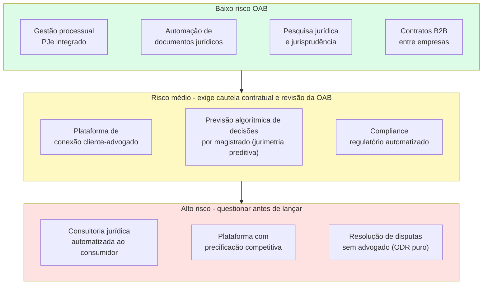

> [!note] A linha tênue do advisory automatizado
> Sistemas que respondem a dúvidas jurídicas personalizadas de consumidores leigos sobre seus casos concretos operam em zona de alto risco regulatório no Brasil, pois a OAB os enquadra como consultoria jurídica privativa e exercício ilegal da profissão (arts. 1º e 3º da Lei nº 8.906/1994). O caminho seguro para produtos B2C restringe-se a apresentar conteúdo jurídico geral de caráter estritamente informativo ou educacional e recomendar a consulta a um advogado habilitado, o que reduz o valor percebido no varejo e explica por que as maiores legaltechs brasileiras vendem ferramentas de produtividade para os próprios advogados e departamentos jurídicos.

---

### Os Seis Segmentos Operacionais em Detalhe

#### 1. Automação de documentos

O segmento mais maduro e menos controverso. Ferramentas que permitem gerar contratos, petições e pareceres a partir de templates com variáveis dinâmicas.

O modelo de receita predominante é SaaS, com mensalidades de **R$ 200 a R$ 3.000/mês** para escritórios de advocacia e empresas médias em automação de documentos e gestão processual (chegando a contratos *enterprise* de **R$ 5.000 a R$ 50.000/mês** em plataformas completas de *LegalOps*/ELM para grandes departamentos jurídicos, conforme tabelas públicas e cotações de mercado sintetizadas na tabela de modelos de negócio adiante). O comprador é o escritório ou o departamento jurídico corporativo, e não o advogado individual.

Plataformas brasileiras como a **Contraktor** (analisada na seção de casos adiante) operam nesse segmento de ciclo de vida contratual B2B: qualquer empresa pode gerar a partir de minutas padronizadas, enviar e assinar contratos digitalmente com validade jurídica (MP nº 2.200-2/2001 e Lei nº 14.063/2020) sem que o software preste consultoria jurídica.

#### 2. Gestão de processos e integração com PJe

O PJe (Processo Judicial Eletrônico), o **eproc** (adotado pelos TRFs da 2ª e 4ª Regiões e em migração por grandes tribunais estaduais como o TJSP a partir de 2024–2026) e o e-SAJ dividem a tramitação processual no país. Embora os sistemas legados de cada tribunal apresentem APIs heterogêneas e padrões de integração variáveis por corte, o CNJ estruturou a API pública do **DataJud** (Resolução CNJ nº 331/2020) e a **PDPJ-Br (Plataforma Digital do Poder Judiciário Brasileiro, Resolução CNJ nº 335/2020)** como vias oficiais de consulta padronizada em substituição ao *scraping* frágil.

Startups como a Projuris (Softplan), o Astrea (Aurum) e a Digesto/Jusbrasil constroem integrações e camadas de gestão sobre o PJe, o eproc, o e-SAJ e o Projudi (conectando-se progressivamente ao barramento de APIs da Plataforma Digital do Poder Judiciário - PDPJ-Br do CNJ) para dar aos escritórios e departamentos jurídicos uma visão unificada dos processos, com captura automatizada de intimações, controle de prazos e fluxo de tarefas.

O risco técnico é a instabilidade e fragmentação dos sistemas dos tribunais: cada TJ (Tribunal de Justiça estadual) tem sua própria implementação, com diferenças relevantes de formato e protocolo.

> [!warning] Scraping de dados processuais
> Extrair dados processuais de forma massiva via *web scraping* dos portais dos tribunais viola os termos de uso de grande parte das cortes brasileiras. Diversos tribunais estaduais, trabalhistas e federais (TRFs) restringem em suas normas de segurança o acesso automatizado abusivo por robôs de captura, aplicando bloqueios de IP, desafios de *CAPTCHA* e limites de requisição. Além do risco jurídico, depender exclusivamente de *scraping* cria fragilidade técnica: qualquer atualização de tela derruba o produto. Priorize a integração oficial via DataJud, PDPJ-Br e diários eletrônicos (DJEN).

#### 3. Pesquisa jurídica e legal analytics

No Brasil, o **Jusbrasil** (detalhado na seção de casos adiante) construiu a maior base de jurisprudência e consulta processual do país, combinando aquisição orgânica via mecanismos de busca com assinaturas SaaS para advogados, escritórios e departamentos jurídicos.

A **jurimetria e o *legal analytics***, estatística aplicada ao Direito para estimar tempo médio de tramitação, valor médio de condenação e probabilidade de êxito por câmara, turma ou comarca a partir do histórico de julgados, formam uma camada analítica de maior valor agregado, atendida no Brasil por plataformas especializadas (como a **DataLawyer** na Justiça do Trabalho e módulos de jurimetria de grupos como Thomson Reuters, Projuris e Jusbrasil) voltadas à provisão contábil e à política de acordos de grandes litigantes.

Risco: dados processuais com partes identificadas podem conter informações pessoais sensíveis. A LGPD se aplica ao tratamento dessas informações: mesmo que sejam públicas nos autos, seu reuso em base de dados estruturada exige base legal.

#### 4. Contratos inteligentes e blockchain

Contratos autoexecutáveis em blockchain têm uso limitado no direito civil brasileiro. O Código Civil exige para muitos atos jurídicos forma específica (escritura pública, testemunhas, registro). Um smart contract não substitui escritura pública de compra de imóvel.

O uso prático no Brasil está em contratos B2B de execução simples (pagamento automático ao atingir milestone mensurável on-chain) e em instrumentos financeiros tokenizados (ver [[IGNICAO-Vol-5-Financas-e-Captacao#CAPÍTULO 14: CAPTAÇÃO ALTERNATIVA DIGITAL: EQUITY CROWDFUNDING (CVM 88) E TOKENIZAÇÃO DE ATIVOS|Capítulo 14 do Vol. 5]]).

#### 5. Compliance regulatório automatizado

Ferramentas que monitoram publicações do Diário Oficial, CVM, Banco Central, ANATEL, ANVISA e demais reguladores e alertam a empresa sobre mudanças relevantes.

Segmento B2B com ticket médio alto (R$ 2.000–20.000/mês). Comprador é o jurídico ou o compliance de empresas médias e grandes. Ciclo de vendas longo mas churn baixo.

Startups de *RegTech* e inteligência regulatória (como a **Nerit** e plataformas de acompanhamento legislativo e normativo para instituições financeiras, seguradoras e empresas de energia) operam nesse espaço automatizando a triagem diária de portarias, resoluções de agências reguladoras e diários oficiais.

#### 6. Acesso à Justiça e ODR

Online Dispute Resolution: resolução de disputas de forma digital, sem necessidade de processo judicial. Aplicável a disputas de consumo, contratos comerciais simples e cobranças.

No Brasil, câmaras privadas de resolução de disputas (arbitragem empresarial e mediação extrajudicial) atuam de forma complementar ao Judiciário: o instituto jurídico da arbitragem conta com marco consolidado (Lei nº 9.307/1996, alterada pela Lei nº 13.129/2015) e a mediação extrajudicial é regida pela Lei nº 13.140/2015.

Na mediação extrajudicial, inclusive quando realizada pela internet (*Online Dispute Resolution, ODR*, como ocorre na plataforma pública *consumidor.gov.br* e em câmaras privadas de negociação), a assistência por advogado é legalmente facultativa (arts. 10 e 46 da Lei de Mediação, Lei nº 13.140/2015, ressalvado que, se uma das partes comparecer acompanhada de advogado, o mediador deve suspender o procedimento até que todas estejam assistidas, nos termos do art. 10, parágrafo único. Já na mediação judicial do art. 26 a assistência é obrigatória, salvo nos Juizados Especiais da Lei nº 9.099/1995). Assim, o cuidado central no ODR extrajudicial sem advogado não decorre de proibição legal, mas do risco reputacional e de anulação judicial posterior caso consumidores vulneráveis assinem acordos manifestamente desproporcionais, razão pela qual muitas plataformas B2B focam em acordos de dívidas bancárias claras ou incluem fluxo de homologação com advogados.

---

### Tabela: modelos de negócio legaltech

| Modelo | Quem compra | Risco OAB | Ticket médio mensal |
|---|---|---|---|
| SaaS gestão processual | Escritório / Depto. jurídico | Baixo | R$ 500–5.000 |
| Automação de documentos (CLM) | Empresa B2B / Escritório | Baixo | R$ 200–3.000 (PME/Escritório) |
| Pesquisa jurídica e jurimetria | Advogado / Escritório / Jurídico | Baixo (pesquisa) a Médio (previsão por juiz) | R$ 100–2.000 |
| Compliance regulatório | Empresa regulada (médio/grande) | Baixo na OAB (Médio na LGPD quando trata dados pessoais de terceiros) | R$ 2.000–20.000 |
| Diretório e conexão cliente-advogado | Advogado (assinatura de software/diretório) | Médio-alto (vedada comissão sobre honorários, art. 34, III e IV, da Lei 8.906/1994) | R$ 50–300 por advogado/mês (assinatura fixa) |
| Advisory jurídico automatizado | Consumidor final / PME | Alto | R$ 50–500 |
| ODR sem advogado | Consumidor / Empresa | Alto | % do acordo |
| LegalOps e CLM corporativo | Departamento jurídico *mid-market* e *enterprise* | Baixo (no risco OAB; exige governança LGPD) | R$ 5.000–50.000/mês (faixa estimada de contratos B2B no Brasil conforme porte da carteira de processos) |

---

### Casos de legaltechs no Brasil, ativos judiciais e posicionamento perante a OAB

No segmento de **compra, originação e securitização de ativos judiciais e precatórios** (onde atuam plataformas e gestoras como **Hurst Capital**, **Precato**, **BTG Pactual** e mesas especializadas de FIDCs de *special situations*), a operação apoia-se na **cessão civil de direitos creditórios** (arts. 286 a 298 do Código Civil e art. 100, §§ 13 e 14, da Constituição Federal): a empresa adquire o crédito judicial com deságio diretamente do titular que busca liquidez imediata, atuando em nome próprio ou via fundo sem praticar ato privativo de advocacia. A precificação técnica do deságio depende de quatro variáveis: (1) o **risco e o regime de pagamento do ente devedor** (precatórios federais inscritos até 2 de abril contam com pagamento previsível no orçamento anual da União, enquanto precatórios estaduais e municipais com estoques atrasados seguem cronogramas mais longos sob o regime constitucional das ECs nº 113/2021 e nº 114/2021 e das decisões do STF nas ADIs 7047 e 7064, e créditos cíveis ou trabalhistas privados exigem análise de solvência da empresa executada), (2) a **auditoria processual (*due diligence*)**, que verifica o trânsito em julgado, a inexistência de penhoras no rosto dos autos ou cessões em duplicidade e a separação dos honorários contratuais e sucumbenciais do advogado patrono (art. 22, § 4º, da Lei nº 8.906/1994), (3) o **veículo de *funding***, estruturado tipicamente via **FIDC Não Padronizado (FIDC-NP, Anexo II da Resolução CVM nº 175/2022)** ou ofertas tokenizadas sob a Resolução CVM nº 88/2022, e (4) o **tratamento tributário da cessão** (apuração de imposto de renda sobre eventual ganho de capital pelo cedente conforme a natureza do crédito original e tributação da carteira no nível do fundo/investidor).

#### Jusbrasil: a maior base jurídica do Brasil

Começou como agregador de jurisprudência gratuito e construiu a maior audiência jurídica do país (dezenas de milhões de visitas mensais e centenas de milhões de peças e decisões indexadas, segundo dados institucionais da plataforma em 2025/2026). Monetiza via planos premium para advogados com funcionalidades de pesquisa avançada e alertas de processos.

O modelo freemium com audiência massiva cria barreira de dados: quanto mais decisões, mais relevante a base. Quanto mais relevante a base, mais usuários.

#### Projuris: gestão processual para escritórios médios

SaaS de gestão de processos com integração a múltiplos tribunais. Posicionado para escritórios de 10–200 advogados que precisam de controle de prazos e dashboards de carteira.

O desafio é a fragmentação dos tribunais: o produto precisa manter integração com dezenas de sistemas com padrões distintos, o que cria custo de engenharia contínuo.

#### Contraktor: contratos sem dor de cabeça

Foco em PMEs que precisam criar, enviar e assinar contratos sem envolver advogado para cada operação. O produto é B2B e circunscreve sua entrega à eficiência operacional do fluxo documental, mantendo-se fora da atividade privativa de assessoria jurídica.

Essa delimitação estrita como ferramenta de gestão documental mantém o modelo em conformidade regulatória perante a OAB.

#### DataLawyer e plataformas de jurimetria corporativa: analytics jurídico

Plataformas especializadas em jurimetria e *legal analytics* (como o **DataLawyer Insights**, focado na Justiça do Trabalho e cível, além dos módulos corporativos da **Projuris**, **Digesto/Jusbrasil** e **Looplex**) atendem empresas com grande volume de litígios (bancos, seguradoras, varejistas e telecomunicações). Permitem identificar padrões de procedência, valor médio de condenação e tempo de tramitação por comarca, vara, magistrado e tese jurídica, orientando acordos preventivos e provisionamento contábil em departamentos jurídicos e bancas de contencioso de massa.

#### Jurídico Certo: acesso à Justiça com advogados reais

Plataforma que conecta consumidores a advogados para consultas e contratos simples. O modelo evita o "leilão de preços" proibido pela OAB ao focar em matching por especialidade e deixar o advogado definir seus honorários de forma autônoma.

---

### Referências internacionais e o que se adapta ao Brasil

#### LegalZoom (EUA)

Plataforma norte-americana de documentos jurídicos padronizados e conformidade societária para pessoas físicas e pequenas empresas (abertura de empresas, registro de marcas, testamentos e contratos comerciais). Opera nos 50 estados norte-americanos estruturada como serviço de tecnologia e preparação de documentos preenchidos pelo próprio usuário, complementado por planos de assinatura que conectam o cliente a advogados independentes licenciados em cada estado quando há necessidade de aconselhamento jurídico.

**O que não se adapta ao Brasil:** a OAB proibiria o serviço de elaboração de documentos jurídicos sem advogado responsável. O modelo de LegalZoom no Brasil precisaria ter advogados como responsáveis técnicos pelos documentos gerados.

**O que se adapta:** a ideia de produtos jurídicos padronizados a preço acessível para demandas repetitivas tem mercado. Com advogados no backend (como prestadores de revisão), é possível criar algo análogo.

#### DoNotPay (EUA)

Ficou conhecida pelo slogan "o primeiro advogado robô": um sistema automatizado voltado a consumidores em disputas de baixo valor (multas de trânsito, cancelamentos de assinaturas e contestações de cobranças). Cresceu pelo apelo midiático, mas enfrentou processos por exercício ilegal da advocacia e, entre setembro de 2024 e fevereiro de 2025, foi autuada nos Estados Unidos pela **FTC (*Federal Trade Commission*)** na ***Operation AI Comply***, pagando multa de US$ 193 mil e ficando proibida de anunciar seu sistema de IA como substituto de advogado humano sem comprovação empírica.

**O que não se adapta ao Brasil:** advisory jurídico automatizado ao consumidor final enfrenta oposição direta da OAB e enquadramento como exercício ilegal da profissão.

**O que se adapta:** a ideia de guiar o usuário no processo (não praticar o ato jurídico por ele) tem aplicação. Ferramentas de orientação para Juizado Especial Cível (JEC: pequenas causas) que informam sobre direitos e documentação necessária operam nessa linha com menor risco.

> [!tip] A regra prática (e o precedente da FTC contra a DoNotPay em 2024/2025)
> No Brasil, a fronteira ética e legal (Lei nº 8.906/1994, arts. 1º, 3º e 34, III e IV) exige disciplina estrita na arquitetura de produto: **a tecnologia pode organizar jurisprudência, calcular prazos, auditar carteiras de processos e gerar minutas estruturadas para revisão de advogados ou departamentos jurídicos, porém, quando o software passa a aconselhar juridicamente um cidadão leigo sobre o caso concreto dele ou a intermediar a captação de causas mediante comissão sobre honorários, configura exercício ilegal da advocacia e infração ético-disciplinar**.

---

### LegalOps e a gestão financeira do departamento jurídico corporativo

LegalOps (Legal Operations) é a gestão profissional do departamento jurídico de uma empresa como unidade de negócio: com métricas, orçamento controlado, processos documentados e tecnologia.

Nos EUA, a função de CLO (Chief Legal Officer) evoluiu para incluir um COO jurídico ou um LegalOps Manager dedicado. No Brasil, o movimento chegou com atraso mas está acelerando em empresas de médio porte que cresceram rápido e precisam profissionalizar o jurídico.

O que um departamento jurídico compra em LegalOps:

- **Contratos:** criação, aprovação, assinatura, arquivo e renovação automatizados. Ferramentas como Ironclad (EUA) e Contraktor (Brasil) atacam esse segmento
- **Gestão de advogados externos:** painéis de controle de horas faturadas, aprovação de notas, comparativo de custo por tipo de demanda e por escritório. Empresas com R$ 1M+/ano em honorários externos têm ROI direto nesse controle
- **Compliance normativo:** monitoramento de mudanças regulatórias e alertas automáticos. Decisivo para setores regulados (saúde, financeiro, telecomunicações, alimentos)
- **Matter management:** gestão centralizada de todos os assuntos jurídicos ativos, com status, responsável, prazo e custo acumulado
- **eBilling:** faturamento eletrônico padronizado de escritórios externos, com validação automática de UTBMS (códigos de atividade jurídica), padrão ainda em fase inicial de adoção no Brasil, mas em expansão nos grandes departamentos jurídicos

O ticket médio para soluções de LegalOps corporativo varia de **R$ 5.000 a R$ 50.000/mês** conforme o porte do departamento jurídico, o volume de processos e os módulos contratados (alcançando contratos de seis a sete dígitos anuais em grandes bancos, seguradoras e varejistas), enquanto módulos de automação de documentos e gestão para escritórios e empresas médias situam-se na faixa de **R$ 200 a R$ 3.000/mês** (ver a tabela de modelos de negócio deste capítulo). O ciclo comercial corporativo leva de 6 a 12 meses, mas o *churn* é reduzido: departamentos jurídicos raramente trocam de plataforma depois que fluxos de aprovação, procurações e históricos de auditoria estão integrados.

> [!note] Oportunidade de expansão
> O mercado de LegalOps ainda é pouco desenvolvido no Brasil comparado aos EUA e Europa. As grandes empresas brasileiras (especialmente as de capital aberto, que têm CVM para responder) são o alvo natural. Fintechs, healthtechs e empresas de e-commerce que cresceram rápido e agora precisam de governança jurídica são o mercado emergente.

---

### IA jurídica sem alucinação: jurisprudência vinculada e Resolução CNJ nº 615/2025

A chegada dos **modelos de linguagem de grande porte (LLMs)** abriu uma nova camada de produtividade para escritórios de advocacia e departamentos jurídicos, mas trouxe o risco decisivo das alucinações (como ocorreu em diversos tribunais brasileiros entre 2023 e 2026, com advogados multados por litigância de má-fé após protocolarem petições contendo ementas e acórdãos inexistentes gerados por IA genérica). Por isso, duas salvaguardas de engenharia separam uma ferramenta jurídica profissional de um gerador genérico: (1) **Jurisprudência estritamente vinculada (*strict grounding* via RAG)**, na qual cada argumento ou precedente citado exibe o link verificável para o inteiro teor real do acórdão na base oficial do tribunal ou do DataJud, e (2) **Auditoria automatizada de citações e vigência**, que confere a existência e a redação vigente de cada artigo de lei, súmula e julgado antes de liberar a minuta para revisão humana, alinhando o produto à **Recomendação do Conselho Federal da OAB (novembro de 2024)** sobre uso ético e supervisionado de IA generativa na advocacia (observando-se que, para legaltechs que fornecem sistemas aos próprios tribunais, aplica-se também a **Resolução CNJ nº 615, de 11 de março de 2025**, que revogou e substituiu a Resolução CNJ nº 332/2020 nas diretrizes de governança, transparência e auditoria de IA no Poder Judiciário).

Com essas duas travas de verificação documental e supervisão humana obrigatória, o uso de LLMs no setor jurídico divide-se claramente entre tarefas de alta confiabilidade (como triagem estruturada de citações e síntese de autos) e tarefas onde o modelo não deve operar sozinho:

**O que os LLMs fazem bem em contexto jurídico:**

- Sumarização de contratos longos e extração de cláusulas relevantes
- Geração de minutas a partir de parâmetros fornecidos
- Pesquisa de jurisprudência com síntese dos fundamentos recorrentes
- Revisão de documentos para identificar inconsistências e cláusulas ausentes
- Tradução jurídica (contratos internacionais, due diligence cross-border)

**O que os LLMs fazem mal e que o produto não pode prometer:**

- Precisão factual em jurisprudência recente (alucinações são frequentes em referências específicas de acórdãos)
- Raciocínio estratégico sobre o caso concreto (o LLM não conhece o histórico processual completo nem o perfil do juiz)
- Garantia de que o resultado da ação será aquele previsto (o que a OAB já proibia antes dos LLMs)

A forma responsável de integrar IA a produtos jurídicos no Brasil é como ferramenta de **aumento de produtividade do advogado**, não como substituto. O advogado revisa, valida e assina. A IA gera o rascunho, pesquisa os precedentes e alerta sobre inconsistências.

Startups que vendem "IA que substitui advogado" como proposição de valor enfrentam oposição institucional da OAB e, sobretudo, responsabilidade civil quando o output do sistema estiver errado.

---

### Armadilhas do setor: infração ética na OAB, bloqueio de crawlers e alucinação de jurisprudência

**1. Subestimar a OAB como regulador ativo**

A OAB tem Conselho Federal e 27 seccionais estaduais. Quando um modelo de negócio avança sobre atividades privativas da advocacia, a entidade exerce fiscalização ativa com poder de representação judicial e interdição.

**2. Tentar substituir o advogado em vez de equipá-lo**

As legaltechs que cresceram no Brasil equipam advogados e departamentos jurídicos. As que tentaram substituí-los esbarraram em resistência regulatória e cultural. O advogado é simultaneamente o regulador (via OAB), o canal de distribuição e, em muitos casos, o usuário final. Competir com ele raramente termina bem.

**3. Dependência de scraping de tribunais**

Construir uma legaltech de acompanhamento processual baseada apenas em *web scraping* de portais judiciais expõe a operação a bloqueios constantes de IP/*CAPTCHA* e a quebras de código sempre que um tribunal atualiza seu sistema (como na migração do TJSP do legado e-SAJ para o **eproc**). Conforme detalhado na seção de automação processual acima, a arquitetura sustentável prioriza a ingestão oficial via **API Pública do DataJud (Resolução CNJ nº 331/2020)**, **PDPJ-Br (Resolução CNJ nº 335/2020)** e leitura estruturada dos diários eletrônicos (DJEN).

**4. LGPD e dados processuais**

Processos judiciais são públicos, mas os dados das partes têm proteção da LGPD. Construir base de dados com CPF, endereço, situação processual de pessoas físicas sem base legal adequada é risco real de autuação pela ANPD.

**5. Ciclo de vendas para escritórios**

Escritórios de advocacia tradicionais têm ciclo de vendas longo, decisão por sócio-sênior e resistência cultural a mudanças de processo. Startups que projetam crescimento rápido em escritórios tradicionais frequentemente se frustram. O crescimento mais rápido está em departamentos jurídicos corporativos e em escritórios jovens.


---

### Filtro de Alinhamento e Prontidão: Perguntas de Validação Prática

Antes de escrever código ou ir a mercado com uma legaltech no Brasil, valide o posicionamento regulatório, a integração de dados e a unidade de cobrança do negócio com as três perguntas de corte abaixo:

Antes de lançar uma legaltech ou operação de ativos judiciais no mercado brasileiro, responda sem rodeios:

1. **O Teste de Blindagem da OAB:** Sua empresa vende tecnologia, dados e automação de contencioso de massa, ou adquire direitos creditórios legítimos (via cessão de crédito formalizada nos termos do Código Civil e das regras constitucionais de precatórios, avaliando deságio, prazo de pagamento e risco de contraparte), ou cobra comissão sobre honorários advocatícios prometendo "causa ganha" no varejo?
2. **Advogado Autônomo vs. CFO/LegalOps:** Seu modelo depende de cobrar R$ 99/mês de pequenos escritórios (alto *churn*), ou vende para departamentos jurídicos corporativos e grandes bancas onde sua ferramenta economiza milhões em provisões e revelias?
3. **Zero Alucinação Jurisprudencial:** Se seu produto usa IA generativa para redigir peças, toda citação de lei ou acórdão possui link verificável na base oficial do tribunal para evitar multas por litigância de má-fé?

**O Movimento de Segunda-Feira:** Nos próximos 15 dias, entreviste cinco gerentes de *LegalOps* de médias e grandes empresas e dois sócios coordenadores de contencioso de massa para mapear em quais fluxos processuais e contratuais eles perdem mais horas de equipe e orçamento.


---

# CLUSTER V: VAREJO, ALIMENTAÇÃO, BENS DE CONSUMO (D2C), TURISMO, PET, LONGEVIDADE E SETOR FUNERÁRIO/ASSISTENCIAL (CAPÍTULOS 34 A 38)

Estes 5 playbooks dissecam o comércio, a alimentação, as marcas nativas e os serviços recorrentes às famílias brasileiras: Retailtech e E-Commerce Omnichannel, Foodtech e Food Service, Marcas D2C, Beleza, Moda e Wellness, Traveltech, Eventos, PetTech e Economia da Longevidade (*Silver Economy*), e a máquina anticíclica do Setor Funerário, Cemitérios, Planos de Assistência Familiar e *DeathTech*.

---

## CAPÍTULO 34: RETAILTECH, E-COMMERCE, OMNICHANNEL, SOCIAL COMMERCE E DIGITALIZAÇÃO DO VAREJO FÍSICO

### Quem subsidia GMV quebra: o valor está no balcão, no estoque e no retail media

Quando olha para o comércio varejista brasileiro, o fundador iniciante confunde movimentação bruta de mercadoria (*GMV*) com receita real. Ele cria um marketplace B2B para pequenos mercados de bairro, compra mercadoria da indústria, revende pelo mesmo preço para ganhar volume, subsidia o frete com capital de investidores e oferece trinta dias no boleto sem avaliar o risco daquele CNPJ. Nesse desenho, cada pedido já nasce com margem de contribuição negativa: roubo de carga, devoluções, ruptura e inadimplência apenas aprofundam o déficit operacional e, quanto mais a operação escala o volume bruto, mais rápido esgota o caixa.

Quem conhece a operação do varejo brasileiro parte de um dado estrutural: cerca de 85% a 88% das vendas do varejo de bens ainda são concluídas nas lojas físicas (enquanto o comércio eletrônico de bens responde por 12% a 15% do faturamento varejista, segundo séries da ABComm, Neotrust e IBGE), e o supermercadista trabalha com margens líquidas estreitas (de 2% a 5%). Por isso, o lojista compra o software ou serviço que reduz diretamente perda de estoque, fila de caixa ou custo de frete.

No varejo brasileiro, as retailtechs mais rentáveis evitam carregar estoque próprio de mercadorias comoditizadas e atuam em três frentes de software B2B. No segmento *enterprise* (grandes redes supermercadistas e farmacêuticas), destacam-se os sistemas de previsão de demanda e prevenção de perdas que evitam a ruptura de gôndola no fim de semana, ao lado das plataformas de *Retail Media* que monetizam a audiência física e digital do varejista com margens brutas próximas de 80% pagas pela indústria. Já nas operações voltadas a PMEs e lojas físicas de shopping e rua, a tração concentra-se nas ferramentas de *clienteling* e conversão via WhatsApp que transformam o vendedor de salão em um consultor omnichannel.

A construção de uma operação sustentável de tecnologia para o varejo exige substituir o crescimento subsidiado de GMV por indicadores auditáveis por pedido: margem de contribuição líquida após frete e perdas, giro de estoque por loja e monetização da atenção no ponto de venda digital e físico.

---

> [!note] Síntese Executiva da Vertical
> O comércio varejista brasileiro movimenta cerca de R$ 2,8 trilhões por ano em receita nominal (segundo a **Pesquisa Anual de Comércio, PAC/IBGE**, atualizada pelas séries conjunturais de volume e receita nominal da PMC/IBGE). Dentro do varejo de bens ao consumidor, o e-commerce responde por **12% a 15% das vendas** (cerca de R$ 200 bilhões a R$ 230 bilhões em bens físicos B2C, ou até R$ 350 bilhões quando os levantamentos da ABComm e da Neotrust de 2025/2026 somam serviços, viagens e *marketplaces* B2B). Isso significa que **quase nove em cada dez vendas ainda são concluídas na loja física, embora sejam cada vez mais influenciadas ou iniciadas no celular, sobretudo pelo WhatsApp e pelas redes sociais**. Empreender em RetailTech no Brasil consiste em construir a infraestrutura de software, pagamentos, logística, dados e automação conversacional que conecta o estoque da loja de rua, o centro de distribuição, o *marketplace* e o WhatsApp do vendedor em uma operação integrada.

---

### 1. A transformação estrutural do varejo brasileiro: do canal isolado ao comércio unificado

Durante a década de 2010, o varejo brasileiro operou partido em dois canais desconectados: o e-commerce da marca era tratado como uma filial isolada em um galpão em Extrema (MG) ou Cajamar (SP), competindo contra as lojas físicas da própria rede, com estoques separados, sistemas fiscais incompatíveis e conflito de comissão entre o vendedor da loja de shopping e o site.

Na década de 2020, três forças colapsaram essa separação e redesenharam o mapa de oportunidades para startups de RetailTech no Brasil:

1. **Unificação de Estoque e OMS (*Order Management System*):** A loja física deixou de ser apenas ponto de exposição e passou a funcionar como **mini-hub logístico urbano (*Ship-from-Store* e *Pick-up in Store / Clique e Retire*)**. Um sistema OMS moderno roteiriza o pedido feito no aplicativo para a loja física situada a 2 km do cliente, reduzindo o frete pela metade, entregando em 2 horas e evitando a perda da venda por ruptura de tamanho ou cor no CD central.
2. **Conversational Commerce no WhatsApp e a Chegada do TikTok Shop:** Com o WhatsApp presente na quase totalidade dos smartphones brasileiros, o comércio conversacional deixou de ser o vendedor enviando foto avulsa pelo celular pessoal para tornar-se um canal estruturado com catálogos integrados ao ERP, carrinhos dentro do chat, links de pagamento via Pix e cartão com divisão automática de comissão (*split*) e agentes de IA que recuperam carrinhos abandonados com taxas de conversão várias vezes superiores às do e-mail marketing tradicional. Em paralelo, o *social commerce* brasileiro ganhou nova dinâmica com a estreia oficial do **TikTok Shop no Brasil em 2025**, integrando vídeos curtos, transmissões ao vivo (*live commerce*), vitrines de criadores com comissão afiliada e *checkout* nativo no aplicativo, o que elevou a competição por atenção e forçou marcas e varejistas a profissionalizarem a produção diária de vídeo curto e a logística de envio rápido.
3. **Concentração nos Grandes Marketplaces, Plataformas Asiáticas e a Reação do D2C + B2B:** Mercado Livre, Shopee, Amazon e Magalu, ao lado das plataformas internacionais de *cross-border* como **Shein**, **Temu** (que entrou com força no mercado brasileiro em 2024) e **AliExpress**, concentram a maior parte do tráfego de busca de produtos no país. No comércio transfronteiriço, o cenário regulatório mudou em etapas: em **agosto de 2023** entrou em vigor o programa **Remessa Conforme** com cobrança de ICMS estadual de 17%, a partir de **agosto de 2024**, a **Lei nº 14.902/2024** instituiu a alíquota federal de **20% de Imposto de Importação** sobre compras internacionais de até US$ 50, e, desde **abril de 2025**, dez estados brasileiros elevaram a alíquota de ICMS dessas remessas para **20%**. A partir de 2026 e 2027, soma-se a transição da **Reforma Tributária do Consumo (LC nº 214/2025)**, que introduz o IVA Dual (IBS e CBS), o recolhimento automático na liquidação financeira (*split payment*) e a responsabilidade tributária dos *marketplaces* sobre vendedores irregulares (ver Volume 5, Capítulo 2). Diante dessa concentração, dezenas de milhares de marcas próprias, indústrias e varejistas médios contratam plataformas de e-commerce (como **VTEX**, **Nuvemshop** e **Wake**) para construir canais diretos rentáveis e utilizam integradores (*hubs* como **Olist**, **Bling** e **ANYMARKET**) para conectar seus estoques simultaneamente a múltiplos *marketplaces* com conciliação automatizada de comissões e fretes.

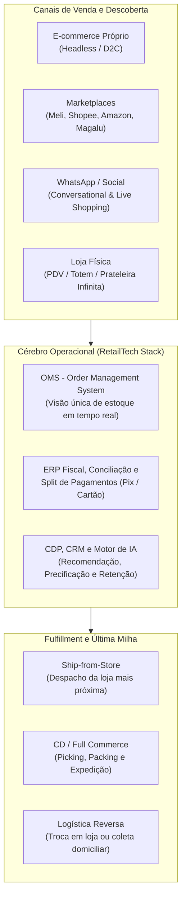

---

### 2. Os quatro blocos de oportunidade para startups de RetailTech

#### 2.1 Plataformas de E-commerce, Headless Commerce, PDV na Nuvem e OMS

O coração transacional do varejo moderno divide-se em três camadas por porte e canal. No segmento *Enterprise* e *Upper Mid-Market*, predomina o **Composable / Headless Commerce**, que desacopla via APIs a interface de compra do motor de catálogo, promoções e gestão de pedidos (OMS), arquitetura que levou a brasileira **VTEX** ao IPO na NYSE e impulsionou plataformas como a **Wake**.

No segmento de PMEs e marcas nativas digitais, vence a rapidez de implantação combinada a aplicativos plugáveis e meios de pagamento e frete integrados, modelo consagrado pela **Nuvemshop** junto a mais de 120 mil lojistas na América Latina.

Já na loja física, os antigos sistemas de frente de caixa (PDV) presos a servidores locais deram lugar a **PDVs em nuvem e *mobile POS*** em tablets e maquininhas *smart POS* com emissão fiscal integrada. Com eles, o vendedor consulta o estoque da rede inteira, vende itens de outras filiais (*prateleira infinita*) e conclui o pagamento sem fila no caixa, espaço disputado pela **Linx** (adquirida pela Stone em 2020 e vendida à TOTVS em operação concluída em fevereiro de 2026) e por ERPs setoriais como **IzzyWay**, **CIGAM** e **Millennium**.

#### 2.2 Infraestrutura de Habilitação do E-commerce (Conversion, Checkout, IA, Pós-Venda e Full Commerce)

Ao redor da plataforma central de e-commerce gravita um ecossistema rico de ferramentas SaaS B2B que vendem sob a promessa direta de **aumentar a receita ou reduzir o custo operacional do lojista**:

- **Checkout Transparente de 1 Clique, Prevenção a Fraude e Orquestração de Pagamentos:** No comércio eletrônico brasileiro, a maioria dos carrinhos abertos é abandonada antes do pagamento (taxas tipicamente entre 70% e 80% segundo relatórios setoriais de *checkout* como Baymard e E-Commerce Brasil), e regras rígidas de antifraude em cartão de crédito chegam a recusar de 5% a 12% de tentativas legítimas (falso-positivo). Soluções que otimizam o checkout, oferecem Pix com confirmação em 2 segundos, recuperam transações negadas via retentativa multi-adquirente e embarcam serviços financeiros (*Embedded Finance*, como a **Zoop**, do grupo iFood) capturam *take rate* sobre o TPV.
- **Busca Inteligente, Recomendação por IA e *Retail Media* (ver aprofundamento no Capítulo 46 sobre MarTech e comércio conversacional no WhatsApp):** Motores de busca com processamento de linguagem natural (capazes de interpretar erros de digitação e sinônimos regionais do consumidor brasileiro), vitrines personalizadas em tempo real e plataformas de **Retail Media Ads** elevam a conversão da loja virtual e permitem que grandes varejistas e redes de farmácias vendam espaços patrocinados de busca em seus próprios sites e aplicativos para a indústria de bens de consumo, gerando receitas publicitárias com margens brutas superiores a 80%.
- **Logística Reversa, Trocas e Pós-Venda Automatizado:** No varejo de moda e calçados online, a taxa de devolução e troca varia de 12% a 28%. Startups que transformam o processo traumático de devolução nos Correios em um fluxo self-service que incentiva o cliente a usar o crédito na compra de um produto de valor maior (ou trocar na loja física mais próxima, gerando tráfego qualificado de *upsell*) protegem a margem líquida do varejista.
- **Full Commerce B2B:** Empresas de *Full Commerce* (como a **Infracommerce**, cujo endividamento e reestruturação societária entre 2023 e 2025 ilustram o risco de capital de giro e margem apertada desse modelo, ao lado de operadores verticais como a Fisia/Grupo SBF na operação da Nike no Brasil) operam a pilha completa (plataforma, SAC, armazém, *fulfillment* e pagamento) para indústrias de bens de consumo que querem vender direto ao consumidor (B2C) ou direto ao pequeno varejo (B2B) sem montar operação logística de varejo dentro de casa.

#### 2.3 Digitalização do Varejo Físico: Gôndola, Ruptura, Precificação Dinâmica e Visão Computacional

O maior vazamento operacional de margem no varejo físico brasileiro (supermercados, atacarejos, farmácias e *home centers*) decorre da combinação de dois indicadores monitorados pelo setor. O primeiro é a **ruptura operacional de gôndola**, que mede a proporção de itens do sortimento em falta na prateleira em um dia típico (situada historicamente na faixa de 8% a 11% dos SKUs no autosserviço brasileiro, segundo os levantamentos de disponibilidade de gôndola da **Neogrid**). Quando o consumidor não encontra o item na prateleira, muitas vezes porque a mercadoria está parada no depósito dos fundos da própria loja (*ruptura virtual*), e desiste da compra, o varejista perde receita imediata com margem já contratada. O segundo indicador é a **quebra operacional e o vencimento de perecíveis**, que consomem cerca de 1,8% a 2,5% do faturamento bruto dos supermercados segundo as edições anuais da **Avaliação de Perdas no Varejo Brasileiro da ABRAS**. Startups brasileiras atacam essas duas frentes com:

- **Sensores, Visão Computacional e Auditoria de Ponto de Venda (*Crowdsourcing* ou Câmeras):** Monitoramento de execução de ponto de venda (*planograma*, *share of shelf*, falta de etiqueta de preço) para a indústria de bens de consumo e redes varejistas (ex.: **Involves** e soluções de visão computacional de gôndola como **lett/Neogrid**).
- **Precificação Dinâmica (*Dynamic Pricing*) e Inteligência Competitiva:** Motores algorítmicos que monitoram preços de concorrentes regionais, elasticidade-preço por SKU e data de validade do lote para ajustar automaticamente os preços no e-commerce e nas etiquetas eletrônicas de prateleira (*Electronic Shelf Labels*, ESL), evitando que o supermercado descarte laticínios e carnes próximos ao vencimento.
- **CRM de Varejo Físico, *Cashback* e *Clienteling*:** Ferramentas que identificam o cliente pelo CPF no caixa (programas de fidelidade e clubes de benefícios hoje onipresentes no atacarejo e no varejo farmacêutico) e abastecem os vendedores de lojas de moda/shopping com listas diárias de clientes no WhatsApp prontos para recompra (*clienteling*: ex. **Oto**, **Dito** e **CRMBonus**).

#### 2.4 Marketplaces B2B e Digitalização do Varejo de Vizinhança

O Brasil possui mais de 600 mil pequenos mercados de bairro, mercearias, padarias, lojas de cosméticos, depósitos de construção e *pet shops* independentes, que historicamente dependiam da visita semanal presencial do vendedor de cada distribuidora. Quando a primeira geração de *marketplaces* B2B tentou conquistar esse varejo comprando estoque no próprio balanço, vendendo sem margem e dando prazo no boleto sem motor de crédito (exatamente o erro descrito na abertura deste capítulo, que levou diversas operações de *e-B2B* a fechar galpões ou reestruturar operações entre 2022 e 2024), o modelo mostrou seu limite. As plataformas de abastecimento B2B que se provaram viáveis operam sobre três pilares distintos: (1) **modelo *asset-light* ou *dropshipping* industrial** (como os portais B2B da própria indústria, **Bees**, da Ambev, e **Juntos Somos Mais**, na construção civil, que usam a malha logística já existente dos distribuidores e bonificam o varejista com verbas de *trade marketing*), (2) **densidade de rota por CEP**, exigindo pedido mínimo que dilua o frete, e (3) **concessão de crédito (*Buy Now, Pay Later* B2B) escorada no histórico real de notas fiscais eletrônicas (NF-e)** emitidas e recebidas pelo CNPJ do lojista.

---

### 3. Unit economics de RetailTech: onde o dinheiro é ganho e onde ele evapora

Em RetailTech, decida desde o primeiro dia se a sua startup vende tecnologia ao varejo (**SaaS, infraestrutura ou *take rate* transacional**) ou se opera varejo carregando estoque e logística no próprio balanço (**e-commerce próprio, *marketplace* 1P ou *full commerce***).

As métricas que todo fundador e investidor de RetailTech audita semanalmente são:

1. **GMV (*Gross Merchandise Volume*) vs. Receita Líquida (*Net Revenue*):** GMV é o volume total transacionado, **GMV não paga salário**. Se você é plataforma ou marketplace, sua receita bruta é **GMV × Take Rate** (tipicamente 0,8% a 2,5% em plataformas de e-commerce SaaS+TPV, e 10% a 22% em marketplaces B2C com logística inclusa).
2. **AOV (*Average Order Value* / Ticket Médio) e Custo de *Fulfillment* por Pedido:** No Brasil, um pedido de e-commerce com ticket médio abaixo de R$ 90 enviado por transportadora individual quase nunca fecha a conta sem cobrança de frete ou subsídio cruzado, porque o custo de *picking/packing* (R$ 4 a R$ 9) + embalagem (R$ 2 a R$ 4) + frete de última milha (R$ 14 a R$ 28) consome toda a margem bruta do produto.
3. **ROAS (*Return on Ad Spend*), CAC e Taxa de Conversão de Sessão:** A taxa média de conversão do e-commerce brasileiro gira em torno de **1,2% a 2,2%** (subindo para 3,5%–5,0% em nichos recorrentes ou via WhatsApp assistido). Com o encarecimento estrutural do leilão de mídia na Meta e no Google, o CAC do primeiro pedido frequentemente empata ou supera a margem de contribuição da primeira compra, exigindo que a conta feche via **recompra orgânica (LTV de 12 meses)** ou **aumento de cesta (*cross-sell* / kits)**.
4. **Net Revenue Retention (NRR) em SaaS de Varejo:** Plataformas de e-commerce que combinam assinatura mensal fixa (MRR) com percentual variável (*take rate*) sobre o GMV processado pelo lojista (como **VTEX** e **Wake**) crescem junto com o volume nominal de vendas da sua base instalada. Embora a retenção líquida de receita (NRR) acompanhe o ciclo macroeconômico do consumo (nos relatórios anuais *Form 20-F* da VTEX na NYSE, a NRR em moeda constante superou 115% nos anos de expansão acelerada e oscilou na faixa de 100% a 110% nos anos de consolidação do e-commerce entre 2022 e 2025), esse componente variável indexado ao GMV protege a receita da plataforma contra a inflação e captura automaticamente os picos sazonais de Black Friday e Natal sem novo custo comercial.

#### Tabela de Benchmarks e Unit Economics de RetailTech no Brasil

| Subvertical de RetailTech | Modelo de Monetização | Take Rate / Ticket Médio | Margem Bruta da Startup | NRR / Retenção Típica | Métrica de Eficiência Principal | Casos Brasileiros de Referência |
|---|---|---|---|---|---|---|
| **Plataforma de E-commerce Enterprise / Mid-Market** | Mensalidade fixa (SaaS) + % sobre o GMV excedente | R$ 5k a R$ 80k/mês + 0,5% a 2,0% do GMV | 70% a 80% | NRR de 100% a 115% ao ano; Churn anual < 8% | *CAC Payback* (12–18 meses) e GMV por cliente | VTEX, Wake, Linx Commerce *(faixas estimadas pelo autor a partir de relatórios públicos 20-F/RI e benchmarks setoriais, 2024–2026)* |
| **Plataforma de E-commerce PME / Social Sellers** | Assinatura mensal acessível + *take rate* em pagamentos e frete | R$ 60 a R$ 400/mês + 1% a 3% em TPV/Envios | 68% a 78% | GRR de 75%–85% (compensado por expansão de TPV) | *Attach rate* de pagamentos e logística (Nuvem Pago / Envios) | Nuvemshop, Loja Integrada, Bagy |
| **Habilitadores de Marketplace / Store-in-Store** | Assinatura SaaS + comissão sobre vendas nos canais | R$ 200 a R$ 1.500/mês + 2% a 8% de comissão | 60% a 75% | NRR de 100% a 115% | GMV por *seller* ativo e SLA de postagem (< 24h) | Olist, ANYMARKET, Plugg.to |
| **SaaS de PDV / ERP / Fidelidade para Loja Física** | SaaS mensal por loja/CNPJ ou por terminal PDV ativo | R$ 350 a R$ 3.500 / loja / mês + *spread* de TPV | 72% a 85% | Churn mensal < 1,2%; NRR > 108% | TPV capturado por loja e ROI de recompra via CRM | Linx, IzzyWay, CRMBonus, Dito, Oto |
| **Embedded Payments / Orquestração para Varejo** | *Spread* líquido (*Net MDR*) + antecipação de recebíveis (RAV) | 0,40% a 1,80% líquido sobre o TPV processado | 45% a 65% (sobre receita líquida) | NRR de 115% a 135% | TPV processado, perda por *chargeback* e custo de funding | Zoop, Pagar.me, Tuna, Asaas |
| **Full Commerce B2B2C (Operação Completa)** | Taxa de gestão mensal + % do GMV faturado + *fulfillment* | 12% a 22% do GMV (incluindo operação logística) | 25% a 40% | Contratos de 24 a 36 meses | Custo de *fulfillment* por pedido e giro de estoque | Infracommerce, Synapcom |

---

### 4. Casos reais brasileiros: da garagem à bolsa e ao domínio continental

> [!example] Caso 1: VTEX - A arquitetura de comércio unificado que escalou da América Latina para a NYSE
> Fundada no Rio de Janeiro por Geraldo Thomaz e Mariano Gomide, a **VTEX** não tentou competir fazendo sites baratos para microempresas. Ela atacou a dor mais complexa das grandes redes varejistas e indústrias brasileiras (como Carrefour, C&A, Sony, Whirlpool e Motorola, conforme casos públicos divulgados nos relatórios anuais 20-F da companhia): operar múltiplos estoques, franquias, lojas físicas e *marketplaces* sob a complexidade tributária brasileira (ICMS interestadual, substituição tributária) com uma arquitetura multi-tenant em nuvem e *checkout* sem senha (*SmartCheckout*). Ao transformar cada cliente grande em um operador de *marketplace* próprio (*VTEX Collaborative Commerce*) e cobrar uma parcela percentual do GMV transacionado, a VTEX cresceu junto com a digitalização do varejo latino-americano, expandiu para mais de 40 países e realizou seu IPO na Bolsa de Nova York (NYSE: VTEX).

> [!example] Caso 2: Nuvemshop e Olist, A inclusão digital e logística da PME brasileira
> Na outra ponta da pirâmide, a **Nuvemshop** compreendeu que o empreendedor brasileiro de moda, acessórios e nichos queria independência das taxas de 16% a 20% dos grandes *marketplaces*, mas precisava de uma plataforma onde pudesse criar sua loja em uma tarde, integrar com o Instagram/WhatsApp e já ter meio de pagamento (**Nuvem Pago**) e contrato de frete mais barato que o balcão dos Correios (**Nuvem Envios**) nativos no painel. Já o **Olist** (fundado por Tiago Dalvi em Curitiba) resolveu o problema inverso: pequenos lojistas e pequenas indústrias tinham bom produto e estoque, mas não tinham reputação digital nem tráfego para aparecer na primeira página do Mercado Livre ou da Amazon. Ao criar uma "megaloja oficial" de alta reputação dentro dos *marketplaces* e agregar milhares de pequenos lojistas sob essa operação compartilhada (evoluindo em 2021–2024 para uma plataforma integrada de comércio, sistema de gestão ERP com a aquisição da Tiny, loja virtual com a Vnda e logística com a PAX), o Olist consolidou-se como um dos principais ecossistemas de RetailTech do país.

> [!example] Caso 3: Linx, Zoop e IzzyWay, O poder do software colado na transação física
> A trajetória da **Linx** (que construiu liderança em software de gestão e frente de caixa/PDV para o varejo físico brasileiro em dezenas de verticais) entrega duas lições complementares para fundadores de RetailTech. A primeira é o valor estratégico do ponto de controle: **quem opera a tela do caixa (PDV) e o ERP da loja enxerga em primeira mão o fluxo transacional do varejista**. A segunda é a complexidade real da integração pós-M&A: em 2020, após uma disputa societária com a própria TOTVS decidida na assembleia de acionistas da Linx, a **StoneCo** adquiriu a companhia por R$ 6,7 bilhões apostando na venda cruzada entre software de gestão e adquirência de pagamentos. Nos anos seguintes, diante do desafio operacional de unificar dezenas de sistemas legados heterogêneos, a Stone colocou o ativo de software à venda (justificando a decisão estratégica pelo foco em serviços financeiros e alocação de capital, enquanto analistas de mercado apontaram que a sinergia comercial esperada entre PDV e pagamentos revelou-se mais lenta e custosa do que o previsto na aquisição): a venda da Linx para a **TOTVS** por **R$ 3,41 bilhões** foi anunciada em 2025 e concluída em **27 de fevereiro de 2026**. Na frente de pagamentos embarcados e ERPs nativos em nuvem, destacam-se a **Zoop** (infraestrutura de *embedded payments* do grupo iFood) e especialistas regionais como a cearense **IzzyWay**.

---

### 5. Armadilhas fatais em RetailTech

1. **Tentar criar um "Marketplace B2C Generalista do Zero" contra Mercado Livre e Shopee:** Nenhum fundo de venture capital sensato financiará hoje uma startup cujo plano seja comprar tráfego pago no Google para vender eletrônicos, utilidades domésticas ou roupas genéricas competindo de frente com plataformas que operam malha aérea dedicada, milhares de vans, *fulfillment* no mesmo dia e bilhões em caixa para subsidiar frete. Novos *marketplaces* no Brasil só sobrevivem se forem **hiperverticais com assimetria técnica** (ex.: autopeças pesadas, insumos químicos e industriais, maquinário usado ou moda circular de luxo com autenticação técnica) ou **B2B com crédito e logística integrados**.
2. **Construir uma ferramenta "vitamina" (Nice-to-Have) desconectada de GMV ou Margem:** Em épocas de juros altos e varejo pressionado, o diretor de e-commerce corta na primeira segunda-feira do trimestre todos os softwares periféricos (widgets visuais, pop-ups cosméticos, relatórios que ninguém abre). Sua solução precisa ser **missão crítica** (PDV, ERP, OMS, Checkout, Conciliação) ou provar **ROI incremental direto e mensurável por teste A/B** (ex.: "nosso motor de recuperação via WhatsApp gerou R$ 85.000 em vendas pagas líquidas neste mês e custou R$ 4.500").
3. **Subestimar o inferno das integrações legadas no varejo físico brasileiro:** O fundador cria uma solução brilhante de IA ou omnichannel, fecha contrato com uma rede de 80 lojas e descobre que as lojas rodam um ERP legado em Delphi/Cobol ou banco de dados local sem API documentada, mantido por uma software house regional que cobra caro e leva 4 meses para liberar um arquivo CSV. Sem uma camada própria de conectores prontos (*middlewares*, agentes sincronizadores de banco local ou leitura via notas fiscais XML da SEFAZ), o *onboarding* trava e o *churn* explode antes do *go-live*.
4. **Crescimento de GMV com Margem de Contribuição Negativa (A Armadilha do *Full Commerce* Intensivo em Capital):** Assumir operações físicas pesadas de armazenagem, separação, frete e capital de giro para marcas clientes, além de crescer por aquisições alavancadas em ciclo de Selic elevada, sem precificar devoluções, avarias e ociosidade fora dos picos sazonais (como evidenciou no mercado brasileiro a severa crise financeira e reestruturação de dívida da **Infracommerce** entre 2023 e 2025).

> [!tip] Checklist de Validação para Fundadores de RetailTech
> - [ ] O produto resolve uma dor ligada diretamente a **aumento de conversão/receita** ou **redução de ruptura/custo operacional/fraude**, comprovável em até 30 dias de teste?
> - [ ] A solução já possui conectores nativos (*plug-and-play*) com as principais plataformas de e-commerce (**VTEX, Nuvemshop, Shopify, Wake**) e ERPs brasileiros (**Bling, Tiny, Omie, TOTVS, Linx, Sankhya**)?
> - [ ] O modelo de precificação combina uma base recorrente fixa (SaaS) com uma variável atrelada ao sucesso do lojista (% de GMV, TPV ou volume de pedidos/mensagens), garantindo **NRR > 110%**?
> - [ ] Para soluções de loja física/PDV: o sistema funciona *offline-first* (contingência fiscal de NFC-e/SAT quando a internet da loja cai em pleno sábado de movimento)?
> - [ ] O canal de WhatsApp da solução utiliza a **API Oficial da Meta (WhatsApp Business Platform)** com gestão de *templates* e conformidade LGPD para evitar banimento do número do lojista?

---

### Filtro de Alinhamento e Prontidão: Perguntas de Validação Prática

Antes de alocar capital de giro em estoque próprio ou escrever conectores para redes varejistas, valide a viabilidade operacional e financeira da sua RetailTech com as três perguntas abaixo:

Antes de construir uma Retailtech para o comércio físico ou digital brasileiro, passe sua ideia por três perguntas de fogo:

1. **Software de Margem vs. Atacadista Disfarçado:** Sua empresa vende software, dados, pagamentos ou mídia de alta margem bruta (> 70%), ou compra e estoca mercadoria física no balanço para revender com margem bruta de 8% que não paga o frete?
2. **O Teste da Integração com PDV, ERP e E-commerce:** Sua solução já possui conectores homologados com os principais sistemas de frente de caixa e ERPs do varejo brasileiro (TOTVS, Linx, Sankhya, Omie e Bling) e com as plataformas de e-commerce (VTEX, Nuvemshop, Wake e Shopify), ou cada novo cliente exige três meses de integração manual sob medida?
3. **Verba da Indústria (Trade/Retail Media):** Você consegue fazer a indústria fabricante (CPG) financiar parte da conta via verba de *Trade Marketing* e *Retail Media*?

**O Movimento de Segunda-Feira:** Nos próximos 15 dias, consiga acesso a duas lojas de uma rede varejista (por meio de uma indústria fornecedora ou consultor de *trade marketing*) e, durante um sábado de pico, conte de hora em hora quantos itens têm saldo positivo no depósito dos fundos e faltam na prateleira da loja (a ruptura virtual).


---

## CAPÍTULO 35: FOODTECH, FOOD SERVICE, DARK KITCHENS, SUPPLY CHAIN ALIMENTAR E NOVOS INGREDIENTES

### A guerra pelo Prime Cost de 60%, pela comissão do app e pela densidade da cadeia fria

Um erro recorrente no setor de alimentação no Brasil consiste em abrir uma operação de cozinhas exclusivas para entrega (*dark kitchens*) 100% dependente de aplicativos de terceiros ou lançar um substituto vegetal (*plant-based*) três vezes mais caro que a carne bovina sem diferencial funcional. Na *dark kitchen* sem canal próprio de recompra, mesmo quando o restaurante mantém o *Prime Cost* sob controle (ex.: 30% de CMV dos ingredientes mais 25% de mão de obra operacional e embalagens, somando 55%), pagar 23% a 27% de comissão no plano com entrega parceira do aplicativo mais 8% a 10% em anúncios e promoções para aparecer no topo da busca comprime a margem de contribuição para menos de 10% a 12% da venda, patamar insuficiente para pagar aluguel, energia, sistemas e impostos fixos do mês. Já no *plant-based* caro, após a primeira compra por curiosidade, a maioria dos consumidores retorna para o frango e a carne bovina por diferença de preço e hábito alimentar (conforme pesquisas de consumo do GFI Brasil, 2023–2025).

Quem opera no setor de alimentação (*Food Service* e *Foodtech*) no Brasil sabe que a viabilidade do negócio depende de uma disciplina financeira estrita: **manter o Prime Cost (CMV + mão de obra direta) até 60% da receita líquida e construir canais próprios de recompra direta**.

Quem ganha dinheiro de verdade em Foodtech no Brasil atua em três frentes: (1) **o software vertical que devolve margem ao restaurante** (cardápio digital e CRM no WhatsApp que migram o cliente fiel do marketplace de 27% para o pedido direto de 2%, combinado com ficha técnica que trava o desperdício na cozinha), (2) **o abastecimento B2B e cadeia fria com densidade de rota**, e (3) **ingredientes funcionais B2B e fermentação tropical** que reduzem o custo de formulação para a indústria de alimentos.

A viabilidade econômica em Foodtech exige atacar diretamente um dos três gargalos financeiros da cadeia: a compressão da margem de contribuição do restaurante pelas taxas de intermediação, o desperdício físico e energético na distribuição refrigerada de alimentos frescos ou o custo industrial por quilo na formulação de novos ingredientes.

---

> [!note] Síntese Executiva da Vertical
> A cadeia de alimentação fora do lar (*Food Service*), varejo alimentar e ciência de alimentos no Brasil movimenta mais de R$ 1 trilhão por ano e envolve mais de 1,5 milhão de estabelecimentos (restaurantes, bares, padarias, lanchonetes, pizzarias, *dark kitchens* e supermercados). O setor opera sob quatro pressões diárias: **perecibilidade do estoque, alta rotatividade de mão de obra, custo de mercadoria vendida (CMV) volátil e concentração do canal digital de demanda**. Empreender em Foodtech no Brasil exige escolher qual dos quatro elos da cadeia atacar e compreender por que modelos que ignoram a margem de contribuição do restaurante ou a densidade da cadeia fria exaurem o caixa rapidamente.

---

### 1. Os quatro elos da cadeia de Foodtech no Brasil

Para evitar o erro comum de colocar um software de cardápio digital e uma indústria de biotecnologia de proteínas na mesma planilha, dividimos o ecossistema brasileiro de Foodtech em quatro elos com dinâmicas próprias:

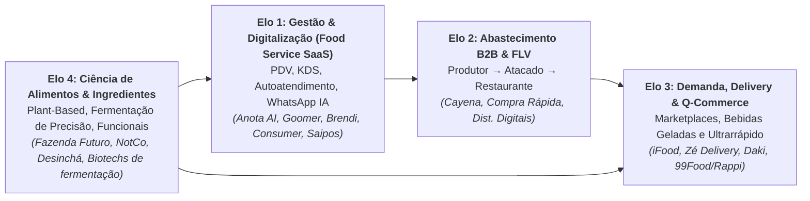

---

### 2. Digitalização do Food Service e o "Desarmamento" da Taxa dos Marketplaces (Elo de Gestão e Venda Direta)

O restaurante médio brasileiro vive um dilema estrutural com os grandes *marketplaces* de entrega, liderados pelo **iFood** (com mais de 80% de participação estimada no *food delivery* nacional segundo análises setoriais e processos públicos no CADE, onde firmou o Termo de Cessação de Conduta de 2023 limitando cláusulas de exclusividade), seguido por **Rappi**, **aiqfome** (adquirido pelo Magalu em 2020) e pela disputa acirrada a partir de 2025 com o retorno da **99Food** e a entrada no Brasil da **Keeta** (braço internacional da gigante chinesa Meituan). De um lado, o *marketplace* funciona como vitrine de aquisição de novos clientes. De outro, as comissões de **12% no plano básico (com entrega própria do restaurante) a 23% no plano entrega (com logística parceira do app)**, acrescidas da **taxa de processamento de pagamento online (cerca de 3,2% a 3,5%)** e de cupons promocionais cofinanciados, comprimem a rentabilidade de um estabelecimento cujo lucro operacional histórico antes do delivery situava-se entre 8% e 15%.

Essa dor estrutural criou uma das maiores oportunidades de **Vertical SaaS e Automação com IA** do Brasil: ajudar os restaurantes, pizzarias, hamburguerias e redes de franquias a **operar com eficiência industrial na cozinha e converter o cliente adquirido no marketplace para um canal direto próprio (WhatsApp, cardápio digital e salão) com comissão quase zero**. As frentes vencedoras incluem:

- **Agentes de IA para atendimento, vendas no WhatsApp e cardápio digital:** No horário de pico de sexta-feira à noite, restaurantes tradicionais perdiam pedidos porque o atendente demorava 20 minutos para responder no WhatsApp ou registrava itens com erro. Startups como **Anota AI**, **Brendi** e **Goomer** automatizaram essa jornada de ponta a ponta. O agente conversacional recebe o pedido em texto ou áudio, envia o cardápio digital interativo, sugere bebida e sobremesa (*upsell*) e calcula a taxa de entrega por raio ou polígono. Na sequência, gera o código *Pix Copia e Cola* com conciliação automática, envia o pedido diretamente para a impressora da cozinha ou tela do KDS (*Kitchen Display System*) e aciona campanhas de CRM para reativar clientes inativos.
- **Autoatendimento em Salão (Totens, QR Code na Mesa e Tablets):** Com a escassez de mão de obra de salão e o peso dos encargos trabalhistas no *food service*, soluções de cardápio digital e autoatendimento (difundidas por empresas como **Goomer**, ** Abrahão** e ERPs como **Linx Degust**, **TOTVS Food Service / Chef**, **Saipos** e **Consumer**) reduzem o tempo de giro da mesa no horário de pico do almoço e elevam o ticket médio dos pedidos (tipicamente em 10% a 20% segundo estudos de caso divulgados pelas plataformas de autoatendimento, pois o cliente visualiza fotos dos itens e adiciona bebidas, acompanhamentos e sobremesas diretamente na tela).
- **ERP de Restaurante, Ficha Técnica, Conciliação do PAT e Roteirização de Entregas:** O restaurante moderno recebe pedidos de múltiplos canais digitais, cartões de diversas bandeiras e vales de refeição e alimentação (Alelo, Ticket, VR, Pluxee, Caju e Flash). No segmento de benefícios corporativos (PAT, Lei nº 14.442/2022), a regulamentação atualizada pelo **Decreto nº 12.712/2025** (que fixou teto de 3,6% para a taxa de desconto/MDR cobrada dos restaurantes, limite de 2% para a tarifa de intercâmbio, redução do prazo máximo de liquidação para até 15 dias corridos e cronograma de interoperabilidade plena entre bandeiras) tornou obrigatória na prática a auditoria automatizada de recebíveis. Plataformas que integram a **ficha técnica de insumos** (baixa automática de gramas de queijo e proteína a cada prato vendido), realizam a **conciliação centavo a centavo** das taxas de aplicativos e benefícios (como **Conciliadora e F360**) e oferecem **roteirização e despacho em nuvem de entregadores (*cloud dispatch*, como Box Delivery, Pick n Go e Sode)** formam o núcleo de controle financeiro do estabelecimento.

---

### 3. Elo 2 (Supply Chain Alimentar B2B): Abastecimento de Restaurantes e Redução de Desperdício em FLV

Por trás de cada prato servido há uma cadeia caótica de compras. O dono de um restaurante independente ou padaria em São Paulo, Belo Horizonte ou Recife gasta de 10 a 15 horas por semana cotando preços no WhatsApp com 20 fornecedores diferentes (açougue, distribuidor de bebidas, laticínios, embalagens e CEASA para hortifrúti), lidando com entregas atrasadas, falta de padrão e prazos de pagamento curtos.

Startups como a **Cayena** transformaram esse processo em um **Marketplace B2B de insumos alimentares**: o restaurante faz um único pedido consolidado pelo celular até a meia-noite, escolhendo entre centenas de fornecedores homologados de proteínas, secos, laticínios e descartáveis, recebe tudo no dia seguinte com nível de serviço garantido e paga em boleto unificado com análise de crédito proprietária (*embedded lending*).

Já no segmento de **FLV (Frutas, Legumes e Verduras)**, estimativas da Embrapa e da FAO apontam que cerca de 30% do volume produzido se perde entre a colheita, os entrepostos (CEASAs) e o varejo por falhas de classificação, embalagem inadequada, falta de refrigeração e excesso de manuseio. As startups que tentaram alugar galpões refrigerados caros do zero na América Latina para fracionar e entregar pequenos pedidos de 5 kg de tomate em cada bar de bairro quebraram pelo peso logístico do fracionamento. As foodtechs de cadeia de suprimentos de frescos que operam com margem positiva adotam três formatos: (1) ***cross-docking* de giro diário sem estoque parado**, consolidando a carga na origem e despachando no mesmo dia, (2) **contratos de demanda agregada e recorrente** com redes de supermercados e cozinhas industriais, ou (3) **comercialização direta de hortifrúti fora do padrão estético de gôndola** (frutas e legumes com formato irregular, porém íntegros para processamento em restaurantes e assinaturas domésticas).

---

### 4. Elo 3: Q-Commerce, Bebidas Geladas e a Realidade das Dark Kitchens

O terceiro elo passou por uma forte seleção de mercado entre 2021 e 2025, consolidando aprendizados práticos sobre a física econômica da entrega rápida no Brasil:

- **O Caso Zé Delivery (Inovação de Rede sobre Infraestrutura Existente):** Criado dentro da Ambev, o **Zé Delivery** tornou-se um dos maiores casos mundiais de *Direct-to-Consumer (D2C)* de bebidas ao resolver um hábito cultural brasileiro: receber cerveja gelada em casa em poucos minutos por faixa de preço competitiva com o supermercado. A vantagem estrutural do Zé Delivery é que a Ambev **não precisou alugar milhares de galpões nem comprar milhares de câmaras frias próprias**: ela conectou a rede de milhares de bares, depósitos de bebidas e distribuidores parceiros independentes que já operavam capilarizados nos bairros das cidades brasileiras como *dark stores* descentralizadas, roteirizando cada pedido no aplicativo para o parceiro mais próximo do consumidor.
- **Q-Commerce (*Quick Commerce* de Mercado em 15 minutos: Daki):** O modelo de *dark stores* próprias dedicadas a entregas de supermercado em 15 minutos (onde a **Daki**, nascida no grupo JOKR, concentrou sua operação brasileira em bairros densos de São Paulo e Rio de Janeiro após a retração global do setor entre 2022 e 2025) provou que a conta só fecha em bairros de **altíssima densidade demográfica e renda alta** (como Pinheiros, Itaim Bibi, Jardins, Vila Mariana, Leblon, Savassi), combinada com três alavancas obrigatórias: (1) ticket médio elevado (acima de R$ 130–R$ 160 por cesta), (2) produtos de **marca própria (*private label*)** e parceria de **Retail Media** com a indústria para elevar a margem bruta acima de 32%–38%, e (3) controle rigoroso de quebra de perecíveis (< 1,5%).
- **A Lição das *Dark Kitchens* (Cozinhas Fantasmas):** Durante a pandemia, o modelo imobiliário de alugar grandes galpões, dividi-los em 25 cubículos de 15 m² e sublocar para restaurantes operarem apenas *delivery* explodiu e depois encolheu drasticamente. A realidade pós-pandemia mostrou que **cozinha sem fluxo de rua e sem marca própria forte vira refém de pagar tráfego patrocinado dentro do aplicativo de delivery** (mesmo após o Termo de Compromisso de Cessação firmado pelo iFood com o CADE em 2023 limitando cláusulas de exclusividade). Além disso, operar cozinhas comerciais exige conformidade estrita com a **RDC ANVISA nº 216/2004** (Boas Práticas para Serviços de Alimentação), alvará sanitário municipal e respeito às leis municipais de zoneamento, exaustão industrial e ruído de motoboys (como a legislação paulistana de *dark kitchens* aprovada após conflitos de vizinhança). Os modelos vencedores migraram para **redes próprias multimarcas enxutas** (uma única equipe operacional e os mesmos insumos-base produzindo 3 ou 4 marcas próprias complementares no mesmo fogão para diluir o custo fixo ao longo do almoço, tarde e jantar) ou **franquias virtuais acopladas a restaurantes físicos já existentes com capacidade ociosa na cozinha**.

---

### 5. Elo 4: Ciência de Alimentos, Ingredientes Funcionais, Plant-Based e Fermentação de Precisão

Na fronteira científica (*Deep Foodtech*), o Brasil reúne vantagens competitivas estruturais: abundância de biomassa agrícola, biodiversidade amazônica e do Cerrado, liderança mundial em açúcar de cana e bioenergia (insumo de carbono para fermentação industrial) e centros de excelência em engenharia de alimentos e agronomia (UNICAMP/FEA, USP/ESALQ, UFV e Embrapa). As três frentes principais de oportunidade tecnológica são:

1. **Proteínas Alternativas (*Plant-Based*) de 2ª Geração:** Após a primeira onda de hambúrgueres vegetais (liderada no Brasil pela **Fazenda Futuro** e pela chilena **NotCo**, que utiliza inteligência artificial, *Giuseppe*, para formular substitutos vegetais a partir de propriedades físico-químicas e sensoriais), o mercado selecionou os modelos sustentáveis. Como o consumidor rejeita pagar o dobro da carne bovina por produtos com lista extensa de aditivos e sabor inferior, a segunda geração concentra-se em **paridade de custo, textura fibrosa por extrusão de alta umidade, uso de proteínas de cultivo nacional (ervilha adaptada ao clima tropical, feijão e soja não transgênica) combinadas a ingredientes nativos brasileiros (castanha-do-brasil, caju e babaçu) e fornecimento B2B de ingredientes funcionais** para a indústria de alimentos e redes de *food service*.
2. **Fermentação de Precisão e Biomassa (*Precision Fermentation*):** Empresas de biotecnologia alimentar programam microrganismos (leveduras, fungos filamentosos e bactérias) alimentados com dextrose/açúcar de cana brasileiro para expressar proteínas funcionalmente idênticas às de origem animal (como proteínas do soro do leite, colágeno e lactoferrina), além de corantes naturais, enzimas e gorduras estruturadas. O desafio central da categoria no mundo ainda é atingir paridade de custo industrial em escala comercial (biorreatores de dezenas de milhares de litros e purificação *downstream*), corrida na qual a disponibilidade de açúcar competitivo e energia renovável no Brasil representa vantagem relevante.
3. **Alimentos Funcionais, *Clean Label*, Suplementação e Longevidade:** Bebidas funcionais, chás prontos, barras proteicas limpas, pastas, *snacks* sem açúcar adicionado (com alulose, eritritol, taumatina ou estévia fermentada) e nutrição esportiva/cognitiva: segmento que cresce a dois dígitos ao ano nas farmácias, supermercados e canais D2C brasileiros.
4. **Regulação ANVISA e MAPA para Novos Alimentos:** Enquanto suplementos alimentares e alimentos com alegação de propriedade funcional seguem listas positivas e limites próprios (**RDC nº 243/2018** e **IN nº 28/2018**, atualizada periodicamente até a **IN nº 450/2026**), qualquer novo ingrediente ou produto obtido por fermentação de precisão ou cultivo celular exige aprovação prévia de segurança na **ANVISA** (**RDC nº 839/2023**, que modernizou o marco de Novos Alimentos e Novos Ingredientes no Brasil permitindo aproveitar análises de autoridades estrangeiras equivalentes como EFSA e FDA). Além disso, o produto deve cumprir as normas de rotulagem nutricional e de alerta frontal (lupa de "Alto em Açúcar Adicionado, Gordura Saturada ou Sódio", regida pela **RDC nº 429/2020** e pela **IN nº 75/2020**), bem como o registro no **MAPA** quando aplicável a bebidas, produtos de origem animal e estabelecimentos sob Inspeção Federal (SIF).

---

### 6. Unit economics de Foodtech: a regra do Prime Cost e da densidade

Em negócios de alimentação, a matemática não perdoa amadorismo. A regra clássica do *Food Service* e de operações de *Foodtech* baseia-se no **Prime Cost (CMV + Mão de Obra Direta)** e na **Margem de Contribuição por Pedido Entregue**:

- **A Equação do Restaurante / Dark Kitchen Saudável:**
  **Caso-modelo de restaurante saudável: Receita Líquida (100%) − CMV de Insumos e Embalagem (31%, faixa de 28% a 34%) − Comissão/Entrega/Meio de Pagamento Ponderados (15%, faixa de 8% a 22%) − Mão de Obra Operacional (21%, faixa de 18% a 24%) − Ocupação, Energia e Marketing (18%, faixa de 14% a 20%) = EBITDA Operacional (15%, dentro da faixa histórica de 8% a 18%)**
  Se o CMV sobe para 38% e a comissão mais entrega do aplicativo consomem outros 25% a 27%, a margem de contribuição unitária cai para cerca de 35% e só consegue cobrir a folha fixa, o aluguel, a energia elétrica e os impostos em um volume mensal de pedidos superior à capacidade física de produção da cozinha: **o restaurante fecha o mês no prejuízo**.

#### Tabela de Benchmarks e Unit Economics por Elo de Foodtech no Brasil

| Elo da Cadeia de Foodtech | Modelo de Receita | Margem Bruta | Ticket Médio / ARPU | Métrica Operacional Vital | Gargalo Principal no Brasil | Exemplos no Elo |
|---|---|---|---|---|---|---|
| **SaaS de Gestão, WhatsApp IA e Cardápio Digital** | Assinatura mensal (SaaS) + *spread* de Pix/Cartão ou pacotes de IA | 75% a 85% | R$ 180 a R$ 650 / mês por restaurante | Churn mensal (< 2,0%) e % de vendas migradas para o canal direto | Mortalidade natural de pequenos restaurantes (exige foco em restaurantes estabelecidos) | Anota AI, Goomer, Brendi, Saipos, Consumer |
| **Marketplace B2B de Abastecimento (Food Service)** | *Take rate* (8%–15%) ou margem de distribuição + spread financeiro (BNPL) | 14% a 24% (sobre GMV) | R$ 1.800 a R$ 6.000 / pedido B2B | Frequência semanal de compra, *Drop Size* (R$ por parada do caminhão) e Inadimplência | Custo logístico de entrega fracionada e gestão de risco de crédito de pequenos bares | Cayena |
| **Marketplace B2C de Delivery e Bebidas** | Comissão do restaurante/parceiro + taxa de entrega + **Retail Media Ads** | 30% a 55% (sobre receita líquida) | R$ 55 a R$ 95 / pedido B2C | Pedidos por usuário/mês (> 4,5x), *Densidade de Rota* (entregas/hora/entregador) | Aquisição e retenção de entregadores e pressão regulatória/trabalhista | iFood, Zé Delivery, Aiqfome, Rappi |
| **Q-Commerce (Dark Stores de Ultrarrápido)** | Margem comercial de varejo + *Private Label* + verbas de *Trade/Ads* da indústria | 32% a 40% | R$ 130 a R$ 180 / pedido | Pedidos por *dark store*/dia (> 400), Quebra de perecíveis (< 1,5%) e Custo por entrega | Aluguel urbano e diluição do custo fixo da *dark store* fora dos horários de pico | Daki (modelo enxuto pós-consolidação de 2022–2025) |
| **CPG Alimentar Inovador / Plant-Based / Ingredientes** | Venda para varejo alimentar (supermercados), *Food Service* e D2C | 42% a 60% (CPG); 55%+ (Ingredientes B2B) | R$ 18 a R$ 45 no PDV (ou contratos B2B industriais) | *Velocidade de Giro por Ponto de Venda* (unidades/loja/semana) e Recompra | Taxas de introdução/enxoval em grandes redes de supermercados e logística refrigerada | Fazenda Futuro, NotCo, Desinchá, Verde Campo |

---

### 7. Casos reais brasileiros

> [!example] Caso 1: iFood e Anota AI, Da hegemonia do marketplace à automação do canal próprio
> O **iFood** construiu uma das maiores plataformas digitais da América Latina ao combinar densidade logística, tecnologia proprietária de roteirização, serviços financeiros embarcados para restaurantes (**iFood Pago**, com conta digital, maquininhas e crédito de giro baseado no histórico de vendas, além do **iFood Benefícios** no PAT) e uma frente de mídia patrocinada (**iFood Ads / Retail Media**). Em paralelo, startups como a **Anota AI** (na qual o iFood adquiriu participação majoritária em 2022 para expandir sua presença na automação de pedidos via WhatsApp), **Brendi** e **Goomer** mostraram que o canal próprio de pedidos (*direct ordering*) via WhatsApp e salão é complementar ao *marketplace*: por meio de atendentes virtuais e cardápios digitais integrados ao PDV, essas plataformas permitem que pizzarias, hamburguerias e açaiterias atendam centenas de pedidos simultâneos no pico de domingo à noite, retendo o cadastro do cliente para recompra direta.

> [!example] Caso 2: Cayena, Resolvendo o abastecimento B2B sem carregar o peso do estoque próprio
> Enquanto dezenas de startups de abastecimento de restaurantes tentaram comprar galpões, caminhões refrigerados e estoques próprios de carnes e hortifrúti (queimando milhões de reais em perda de estoque e frete), a **Cayena** escolheu o modelo *asset-light* de *marketplace* puro com inteligência logística e financeira. Os grandes distribuidores e frigoríficos entram com o estoque e os caminhões. A Cayena entra com a demanda agregada de dezenas de milhares de restaurantes, a experiência digital de compra em 3 minutos, a garantia de nível de serviço (substituindo imediatamente o fornecedor se ele falhar na entrega) e a linha de crédito B2B, alcançando centenas de milhões de reais em GMV com alta eficiência de capital.

> [!example] Caso 3: Fazenda Futuro e NotCo, A transição da euforia do Plant-Based para a eficiência industrial e B2B
> A **Fazenda Futuro** (fundada em 2019 por Marcos Leta, criador dos sucos Do Bem, e Alfredo Strechinsky, que captou rodadas com fundos como Monashees, Go4it e BTG Pactual para levar hambúrgueres e cortes vegetais às gôndolas de redes como Pão de Açúcar e Carrefour a preços inicialmente próximos de R$ 20 a R$ 25 por bandeja de 230 g) e a chilena **NotCo** (que formou *joint venture* global com a Kraft Heinz em 2022 e licenciou sua plataforma de IA *Giuseppe* em projetos B2B para multinacionais de alimentos e ingredientes) sintetizam as duas fases do *plant-based* na região. Após o pico de euforia de 2020–2021 e a desaceleração global da categoria de substitutos de carne refrigerada entre 2022 e 2025 (que levou a Fazenda Futuro a reestruturar operações internacionais e enxugar portfólio para focar em rentabilidade), a lição estratégica consolidada no setor foi clara: escalar além do nicho vegano exige **paridade de preço por quilo com a proteína animal, migração para itens de consumo diário recorrente (como bebidas proteicas, leites vegetais de performance para cafeterias e cremes culinários) ou fornecimento B2B de ingredientes e formulações para a grande indústria alimentícia**.

---

### 8. Armadilhas fatais em Foodtech

1. **Crescer em pontos de venda (PDVs) de supermercado sem giro de prateleira (*Sell-in* sem *Sell-out*):** Em alimentos e bebidas embalados, colocar o produto em 3.000 supermercados pagando taxa de introdução (*slotting fee*) e concedendo 60 dias de prazo no boleto é relativamente simples. Difícil é fazer o consumidor retirar o produto da gôndola toda semana (*sell-out*). Se o item não gira, vence na prateleira, o comprador da rede varejista desconta 100% da perda na fatura seguinte (por cláusula comercial de devolução/troca) e descadastra a marca. Comece em 50 lojas densas no seu público-alvo, execute degustação semanal no ponto de venda e só expanda a distribuição quando o giro semanal por loja estiver comprovado.
2. **Ignorar o custo e a complexidade da Cadeia Fria (*Cold Chain*) no Brasil:** Um produto alimentar que exige transporte e armazenagem congelada (−18 °C) ou resfriada (2 °C a 8 °C) enfrenta frete frigorificado 2x a 3x mais caro que a carga seca em temperatura ambiente (*shelf-stable*) e sofre perdas recorrentes por oscilação térmica no pequeno varejo. Quando a engenharia de alimentos permite formular uma versão estável em temperatura ambiente (via processo UHT, liofilização, versão em pó ou embalagem retortável esterilizada em autoclave), a marca elimina a barreira do frete refrigerado e alcança capilaridade nacional com menor capital de giro.
3. **Vender SaaS barato para restaurantes de altíssima mortalidade sem travar no meio de pagamento ou ERP:** Segundo levantamentos históricos do Sebrae e da Abrasel sobre sobrevivência de empresas, cerca de 30% a 50% dos pequenos bares e restaurantes fecham nos primeiros dois a três anos de operação. Se o seu SaaS cobra apenas R$ 99/mês de estabelecimentos informais sem filtro de maturidade, seu *logo churn* será de 5% ao mês. Foque em restaurantes que faturam acima de R$ 50 mil a R$ 100 mil/mês, redes de franquias e operações multi-unidades, acoplando seu software ao fluxo transacional (Pix, TPV ou conciliação).

> [!tip] Checklist de Validação para Fundadores de Foodtech
> - [ ] Para **SaaS de Food Service**: o produto se paga em menos de 30 dias aumentando vendas diretas (WhatsApp/Salão) ou reduzindo o CMV/desperdício em pelo menos 2 pontos percentuais?
> - [ ] Para **Supply Chain / B2B Food**: o *Drop Size* (valor médio entregue por parada logística) é suficiente para que o frete represente menos de **5% a 7% do valor do pedido**?
> - [ ] Para **Novos Alimentos / Ingredientes**: a formulação já está em conformidade com a **RDC 839/2023 (Novos Alimentos)** e **RDC 429/2020 (Rotulagem Frontal)** da ANVISA, e possui margem bruta de fábrica ≥ 50% para suportar o *markup* de distribuidores e varejistas?
> - [ ] A operação monitora semanalmente a **quebra física (perecibilidade/validade)** e o **giro de recompra por coorte de estabelecimentos ou consumidores**?

---

### Filtro de Alinhamento e Prontidão: Perguntas de Validação Prática

Antes de assinar contratos de locação de cozinhas, comprar biorreatores ou cadastrar novos SKUs no varejo alimentar, aplique as três perguntas de validação abaixo à economia unitária do seu negócio:

Antes de investir em Foodtech, operação gastronômica, distribuição B2B de alimentos ou novos ingredientes no Brasil, responda:

1. **A Matemática do Segundo Pedido (Para Food Service):** Quanto sobra de margem de contribuição no bolso do restaurante após ingredientes, embalagem, entregador e taxas do aplicativo, e qual mecanismo concreto faz o cliente pedir diretamente pelo WhatsApp ou canal próprio do restaurante a partir da segunda compra?
2. **O Imposto do Perecível Estragado (Para Supply B2B):** Se sua operação movimenta hortifrúti, carnes ou laticínios, sua perda física (*shrinkage*) está travada abaixo de 2%, e cada caminhão entrega pelo menos R$ 15 mil por rota no mesmo bairro?
3. **Paridade de Preço e Sabor (Para Ciência de Alimentos):** Seu ingrediente funcional entrega custo igual ou menor que o insumo tradicional para a indústria compradora?

**O Movimento de Segunda-Feira:** Nos próximos 15 dias, audite as notas fiscais de insumos, o desperdício da cozinha e o extrato de repasses de aplicativos de cinco restaurantes reais durante uma semana.


---

## CAPÍTULO 36: MARCAS NATIVAS DIGITAIS (D2C), BELEZA, MODA, BENS DE CONSUMO (CPG) E WELLNESS/FITNESS

### Margem bruta mínima de 75% (markup de 4x), regulação da ANVISA e risco do e-commerce de compra única

A barreira para lançar uma marca nativa digital (*D2C / DNVB*) de cosméticos, suplementos, cafés especiais ou moda no Brasil nunca foi tão baixa: qualquer empreendedor com R$ 50 mil contrata um fabricante terceirizado (*private label*), abre uma loja virtual e patrocina influenciadores no Instagram e no TikTok. O fundador iniciante lança então um produto com 45% de margem bruta (vendendo por R$ 100 o que custa R$ 55 na fábrica), gasta R$ 60 em mídia paga para conquistar o primeiro pedido, desembolsa mais R$ 18 entre frete subsidiado e impostos e amarga prejuízo já na primeira venda, como o item não possui diferencial de recompra mensal, o cliente não retorna. Por essa conta elementar de aquisição, centenas de marcas D2C amadoras esgotam o caixa nos primeiros meses, mesmo operando em um dos quatro maiores mercados globais de higiene pessoal, perfumaria e cosméticos (segundo a ABIHPEC e a Euromonitor) e no segundo maior mercado mundial em número de academias (segundo a IHRSA/Fitness Brasil).

Quem opera marcas nativas digitais sabe que, com o leilão de mídia paga cada vez mais caro, uma operação D2C apoiada apenas em compra única transfere sua margem de contribuição diretamente para a Meta e o Google. A rentabilidade depende de recompra previsível, assinatura e expansão para canais físicos.

As DNVBs brasileiras de maior geração de caixa em Beleza, Suplementos, Nutrição Funcional, Moda Funcional e Pet apoiam-se no princípio do **piso de margem bruta por categoria combinado à recompra recorrente**: primeiro, opera-se com **margem bruta mínima de 75% a 80% em *skincare* e dermocosméticos (markup de 4x a 5x sobre o custo fabril) e de 65% a 75% em suplementos, nutrição funcional, moda tecnológica e produtos pet com recompra provada**, garantindo que a reposição periódica ou a expansão de cesta sustente *LTV/CAC > 4x*, segundo, assim que a marca valida a tração e a retenção no canal digital próprio, expande-se para redes de farmácias, empórios, prescritores de saúde e lojas físicas para diluir o CAC consolidado.

A sobrevivência e a escala de uma marca nativa digital no Brasil dependem de tratar o e-commerce próprio como laboratório de margem bruta elevada e retenção por coorte, preparando a transição para a distribuição omnichannel antes que o leilão de mídia paga comprima o retorno sobre o gasto publicitário (ROAS).

---

> [!note] Síntese Executiva da Vertical
> O Brasil ocupa simultaneamente a 3ª ou 4ª posição mundial em consumo de produtos de Higiene Pessoal, Perfumaria e Cosméticos (HPPC, superando R$ 150 bilhões/ano), o 2º maior mercado do planeta em número de academias de ginástica e um dos mercados mais engajados do mundo em criadores de conteúdo, suplementação e bem-estar. Essa combinação de fatores impulsionou o crescimento de uma geração de **DNVBs (*Digitally Native Vertical Brands*)** e plataformas de **Wellness/Fitness** brasileiras que atingiram centenas de milhões, e, em alguns casos, bilhões, de reais de receita sem pedir permissão às redes de televisão ou aos grandes distribuidores tradicionais.

---

### 1. A anatomia de uma DNVB lucrativa no Brasil: da validação D2C à expansão omnichannel

Uma **Marca Nativa Digital (DNVB / D2C)** nasce na internet, falando diretamente com o consumidor final via redes sociais, criadores de conteúdo, comunidades e e-commerce próprio, eliminando os intermediários iniciais para capturar dados primários (*first-party data*) e validar formulações ou peças em semanas. No Brasil, esse movimento consolidou marcas nativas digitais em *skincare*, dermocosméticos e beleza em barra sem plástico (**Sallve**, **Creamy**, **Principia**, **Simple Organic** e **B.O.B**), moda funcional e tecnológica (**Insider Store**, **Pantys**, **Linus**, **Yuool**), nutrição funcional e suplementos (**Desinchá**, **Caffeine Army / SuperCoffee**, **Puravida**, **True Source**, **Essential Nutrition**) e estilo de vida pet (**Zee.Dog**).

Todavia, a lição central da última década para qualquer fundador de D2C no Brasil resume-se a uma restrição econômica: **vender exclusivamente pelo próprio site pagando leilão de anúncios na Meta (Instagram/Facebook), Google e TikTok tem um teto matemático de escala**. Quando uma marca passa de R$ 2 milhões para R$ 15 milhões por mês comprando tráfego pago para o próprio site, o algoritmo é forçado a buscar públicos cada vez mais frios, fazendo o CAC disparar e o ROAS cair.

Por isso, todas as DNVBs brasileiras que superaram R$ 100 milhões a R$ 500 milhões de faturamento anual com geração de caixa seguiram quatro estágios práticos de expansão multicanal (conforme demonstram os casos analisados neste capítulo):

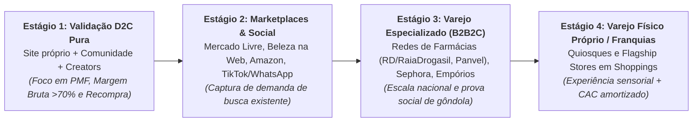

Quando uma marca como **Sallve**, **Creamy**, **Principia** ou **Desinchá** entra nas mais de 3.000 farmácias da RaiaDrogasil (RD Saúde), na Venancio ou na Panvel, ocorre um efeito de alavancagem comercial nos canais da marca: o anúncio digital que no e-commerce próprio converte tipicamente de 1,5% a 3% dos visitantes passa a impulsionar também a venda de conveniência de quem assiste ao vídeo no celular pela manhã e adquire o sérum ou o suplemento na farmácia física à tarde (*halo effect*), reduzindo o CAC consolidado da marca e multiplicando o giro de caixa.

---

### 2. Fabricação Terceirizada (Private Label / Terceiristas) vs. Indústria Própria e Regulação ANVISA

Um erro clássico de fundadores inexperientes em bens de consumo (CPG), cosméticos, suplementos ou vestuário tecnológico é imobilizar R$ 3 milhões em máquinas industriais, reatores químicos, envasadoras ou teares antes de vender as primeiras 50.000 unidades.

No Brasil, existe um parque industrial maduro de **terceiristas homologados (*contract manufacturers* / *full service*)** em São Paulo, interior paulista, Santa Catarina, Paraná, Goiás e Minas Gerais capazes de produzir cosméticos, suplementos e peças têxteis com qualidade de exportação. A estratégia correta segue três regras práticas:

1. **Comece 100% terceirizado, mas seja dono da fórmula (P&D) e do registro/marca:** Nunca venda um produto genérico "de catálogo" do terceirista que qualquer concorrente possa copiar amanhã trocando o rótulo (*white label* raso). Contrate um engenheiro químico, farmacêutico bioquímico ou engenheiro têxtil próprio desde o início para desenvolver uma **formulação proprietária com ativos em concentrações eficazes**, assine contrato de confidencialidade e propriedade intelectual da fórmula com o laboratório terceirizado e homologue pelo menos **dois fabricantes independentes** assim que atingir escala para não ficar refém de greve, incêndio ou aumento unilateral de preço.
2. **Navegue corretamente a classificação da ANVISA em Cosméticos e Suplementos:**
   - **Cosméticos Grau 1 (Risco Mínimo: RDC nº 752/2022):** Sabonetes comuns, shampoos básicos, hidratantes corporais e maquiagens sem ação fotoprotetora. Exigem apenas **notificação eletrônica simplificada** na ANVISA (realizada pela indústria fabricante terceirizada detentora de Autorização de Funcionamento de Empresa, AFE, e Boas Práticas de Fabricação, ou pela própria marca caso possua AFE própria como detentora da regularização, conforme o checklist regulatório ao final deste capítulo), permitindo lançar um SKU em semanas.
   - **Cosméticos Grau 2 (Risco Potencial / Específico):** Protetores solares (exigem testes caros de FPS *in vivo* e UVA), produtos infantis, antissépticos, clareadores de pele, produtos antiacne ou antiqueda com alegações específicas. Exigem **registro formal ou dossiê técnico robusto de segurança e eficácia** (testes de irritabilidade dérmica/ocular, hipoalergenicidade e estabilidade acelerada de 90 a 180 dias).
   - **Suplementos Alimentares (RDC 243/2018 e IN 28/2018):** A ANVISA criou a categoria unificada de "Suplemento Alimentar", definindo a lista positiva exata de constituintes autorizados (vitaminas, minerais, proteínas, creatina, cafeína, ômega-3, probióticos, compostos bioativos), limites mínimos e máximos diários e as alegações (*claims*) permitidas no rótulo. Prometer "cura de doenças", "emagrecimento garantido" ou "substituição de medicamentos" em anúncios de suplementos gera interdição sumária pela ANVISA e bloqueio imediato das contas de anúncio na Meta e no Google.
3. **Quando verticalizar a fábrica (ou o laboratório de P&D):** Só faz sentido investir em planta fabril própria ou centro de distribuição próprio quando: (a) o volume recorrente garante ocupação acima de 75% da planta desde o primeiro mês, (b) o processo produtivo é o seu segredo competitivo inimitável, ou (c) a margem capturada do terceirista (tipicamente 15% a 25% do custo industrial) paga o CapEx da fábrica em menos de 24 a 30 meses.

---

### 3. A Economia de Wellness, Fitness e Benefícios Corporativos no Brasil

Paralelamente às marcas de produtos físicos, o Brasil consolidou-se como polo global de plataformas de **Wellness, Fitness e Longevidade**. O caso mais emblemático é o **Wellhub (antigo Gympass, analisado também no Capítulo 45 sobre HRTech e benefícios corporativos e conectado às plataformas esportivas do Capítulo 37)**, fundado no Brasil por Cesar Carvalho, João Thayro e Vinicius Ferriani: a empresa comprovou que vender assinaturas avulsas diretamente ao consumidor final (B2C) sofria com cancelamento elevado, mas que vender ao RH de médias e grandes empresas um benefício corporativo de bem-estar subsidiado pelo empregador (que assim reduz o absenteísmo e contém o reajuste anual de sinistralidade do plano de saúde) criava uma plataforma global de múltiplos bilhões de dólares, acompanhada no mercado brasileiro pela expansão da **TotalPass** (do grupo Smart Fit).

As três ondas atuais de oportunidade em WellnessTech e Longevity no Brasil são:

- **Plataformas B2B2C de Bem-Estar Integral:** Além de academias físicas, a expansão do benefício corporativo para saúde mental (psicoterapia online), nutrição personalizada, qualidade do sono, saúde financeira e medicina preventiva do estilo de vida.
- **Ecossistemas de Nutrição Preventiva e Suplementação Personalizada (em interface com os serviços de longevidade do Capítulo 37):** Protocolos de assinatura recorrente de suplementos industrializados (regidos pela RDC nº 243/2018 da ANVISA) orientados por questionários clínicos, painéis de exames laboratoriais e leitura de dispositivos vestíveis (*wearables*). *(Atenção regulatória estrita: caso a operação envolva **fórmulas magistrais manipuladas**, a **RDC nº 67/2007 da ANVISA** e os códigos de ética médica e nutricional exigem prescrição individual emitida por profissional legalmente habilitado e aviamento exclusivo em farmácia com licença sanitária e AFE para manipulação, sendo vedados a exposição de produtos manipulados prontos em estoque, o anúncio ao público sem prescrição e o pagamento de comissões a prescritores.)*
- **Vertical SaaS e Fintech para o Ecossistema Fitness:** Gestão de academias de bairro, estúdios de *crossfit*, pilates, *beach tennis*, corrida e assessorias esportivas (mercado liderado por plataformas como **Tecnofit**, **Pacto** e **EVO/W12**), processando cobrança recorrente no cartão sem comprometer o limite do aluno e controlando catracas biométricas.

---

### 4. Unit economics de D2C e CPG: a meta de 75% de margem bruta mínima e o ciclo de caixa

A maior parte das marcas nativas digitais que encerram as atividades no Brasil sucumbe a dois desequilíbrios financeiros: **operar com margem bruta baixa demais para absorver o custo de mídia e os impostos brasileiros** ou **crescer rápido demais com ciclo de conversão de caixa (CCC) longo e positivo (dinheiro preso por 120 a 150 dias entre o adiantamento ao fabricante e o recebimento das parcelas do cliente), ficando sem caixa para financiar o próximo lote de estoque**.

Para que uma DNVB de beleza, suplementos ou moda funcional seja estruturalmente lucrativa no Brasil, sua demonstração de resultado unitária deve respeitar quatro regras operacionais:

1. **Markup de 4x a 6,5x sobre o CMV Industrial (Margem Bruta ≥ 75% a 80% em *skincare*/cosméticos e ≥ 65% a 75% em suplementos e moda funcional no D2C):** Se um sérum facial ou pote de suplemento custa R$ 18,00 posto no centro de distribuição (incluindo fórmula, frasco, cartucho e impostos de industrialização), precisa ser vendido no D2C na faixa de **R$ 72,00 a R$ 119,00** (markup de 4x a 6,5x). Entre o preço cheio de vitrine e o lucro líquido saem seis camadas de custos: impostos sobre a venda (ICMS, DIFAL, PIS/COFINS ou Simples, de 10% a 18%), descontos e comissões de influenciadores (8% a 12%), taxa do meio de pagamento e antifraude (2,5% a 4%), separação e embalagem (*picking/packing*, 4% a 6%), subsídio de frete (8% a 14%) e investimento em aquisição de clientes (CAC de 20% a 30%). Com margem bruta de produto de apenas 40%, a venda digital direta fecha negativa.
2. **Lucratividade na 1ª Compra (*First-Order Profitability*) ou Payback em 90 dias:** No cenário de capital caro no Brasil, você não pode perder R$ 60 na primeira compra do cliente esperando que ele recompre seis vezes nos próximos três anos. Marcas saudáveis aumentam o **Ticket Médio (AOV)** do primeiro pedido usando **kits, rotinas completas e *bundles* progressivos** ("Compre o Kit Completo de 3 Passos com 15% OFF e Frete Grátis"), elevando o AOV de R$ 85 para R$ 210+ para que a primeira compra já pague 100% do CAC e do produto.
3. **Retenção, Recompra por Coorte em 90/180 dias e Assinatura via Pix Automático:** Cosméticos e suplementos contam com uma vantagem física de reposição sobre bens duráveis: **o frasco de 30 g ou 60 cápsulas termina em 30 a 45 dias**. Marcas maduras convertem de **30% a 45% dos clientes do primeiro pedido em uma segunda compra dentro de 90 a 180 dias**, combinando réguas automatizadas de WhatsApp disparadas no dia 28 após a entrega com clubes de assinatura amparados pelo **Pix Automático** (modalidade do Banco Central lançada em 2025 para débitos recorrentes mediante autorização prévia do consumidor no aplicativo do seu banco, que reduz o custo de transação em relação ao cartão de crédito e diminui o *churn* involuntário por vencimento ou falta de limite do cartão).
4. **Ciclo de Conversão de Caixa (CCC) vs. Retorno da Margem Bruta sobre o Estoque (GMROI):** Enquanto o varejo digital saudável busca encurtar o ciclo financeiro, o que asfixia uma DNVB em crescimento rápido é a combinação de prazo de produção terceirizada pago à vista com estoque lento de cauda longa. Por isso, a gestão de compras deve guiar-se pelo **GMROI (*Gross Margin Return on Inventory Investment*, calculado dividindo a margem bruta anual em reais pelo custo médio do estoque imobilizado)**: um item que gera R$ 300 mil de margem bruta anual mantendo apenas R$ 60 mil de estoque médio a custo entrega GMROI de 5,0x (R$ 5,00 de margem bruta gerada por ano para cada R$ 1,00 empatado em estoque), financiando o próprio crescimento. Concentre o capital de giro nos 20% de SKUs de alto giro ("produtos-herói") que sustentam 80% da receita e negocie prazos de 60 a 90 dias com os fabricantes terceirizados.

#### Tabela de Benchmarks e Unit Economics de DNVBs, CPG e Wellness no Brasil

| Subvertical | Margem Bruta D2C (Faixa Ref. Arredondada) | Margem Bruta B2B (Atacado/Farmácia) | Ticket Médio (AOV) D2C Estimado | Taxa de Recompra Ref. (180 dias) | ROAS Alvo (Mídia Paga) | Exemplos no Segmento (Não Atestam as Faixas) |
|---|---|---|---|---|---|---|
| **Skincare e Dermocosméticos (Grau 1 e 2)** | 72% a 82% | 48% a 58% | R$ 160 a R$ 260 (via kits/rotinas) | 32% a 48% | 2,8x a 4,5x | Sallve, Creamy, Principia, Simple Organic, B.O.B |
| **Suplementos, Vitaminas e Alimentos Funcionais** | 65% a 76% | 42% a 52% | R$ 180 a R$ 320 (potes/combos) | 38% a 55% (alta recorrência mensal) | 2,5x a 4,0x | Desinchá, Caffeine Army, Puravida, Essential Nutrition |
| **Moda Funcional, Tech Apparel e Calçados D2C** | 65% a 74% | 45% a 55% | R$ 280 a R$ 480 | 25% a 38% | 3,0x a 5,0x | Insider Store, Pantys, Linus, Yuool |
| **Pet Lifestyle e Produtos Premium D2C/Omnichannel** | 62% a 72% | 40% a 50% | R$ 220 a R$ 350 | 30% a 45% | 3,0x a 4,5x | Zee.Dog |
| **Social Commerce, Live Shopping e Marcas de Criadores (Beauty / Lifestyle)** | 65% a 78% | 45% a 55% | R$ 160 a R$ 350 | Recompra de 25% a 40% em 180 dias | ROAS consolidado (comunidade + mídia) > 4,5x | Boca Rosa Beauty, Franciny Ehlke (Fran), Mari Maria Makeup |

---

### 5. Casos reais brasileiros: como as campeãs construíram seus fossos

> [!example] Caso 1: Sallve, Creamy e Principia, Três caminhos distintos para dominar o Skincare nacional
> O mercado brasileiro de *skincare* era historicamente concentrado entre marcas dermocosméticas europeias de preço elevado (vendidas de R$ 180 a R$ 300 por unidade nas farmácias) e linhas populares de catálogo com baixa concentração de ativos. Três DNVBs brasileiras ganharam participação relevante nesse espaço com posicionamentos complementares:
> - A **Sallve** (fundada por Julia Petit e Daniel Wjuniski) nasceu da maior comunidade digital de conteúdo de beleza do país, co-criando cada fórmula em salas de escuta com milhares de consumidoras para a pele brasileira (mista/oleosa e solar) antes de escalar para as grandes redes de farmácias.
> - A **Creamy** (marca nativa digital de *skincare* cofundada pelo médico dermatologista Dr. Luiz Romancini em parceria societária e operacional com o grupo paranaense de beleza de Gabriel Beleze/Skelt) escalou rapidamente no mercado brasileiro combinando autoridade científica em ácidos de tratamento dermatológico acessível, embalagens coloridas de forte identificação visual nas redes sociais e rápida expansão do e-commerce próprio para quiosques e grandes redes de farmácias.
> - A **Principia** apostou na transparência de formulação e eficiência de custos: embalagens minimalistas padronizadas, foco absoluto na concentração percentual dos princípios ativos (Niacinamida 10%, Vitamina C, Ácido Mandélico), preços competitivos (R$ 40 a R$ 65) e produção contínua de vídeos educativos curtos nas redes sociais e *marketplaces*, vendendo milhões de unidades por ano.

> [!example] Caso 2: Insider Store, Ciência têxtil, Creators como canal de mídia contínua e foco no produto-herói
> Fundada por Yuri Gricheno e Carolina Matsuse, a **Insider Store** fugiu da armadilha da moda tradicional (que lança 4 coleções de 300 peças por ano e morre com 40% de estoque encalhado em liquidação). A Insider começou resolvendo um único problema funcional com engenharia têxtil (*Tech T-Shirt* e *Undershirt* antissuor, antiodor, que não desbota e não precisa passar, feita com fibras tecnológicas como modal austríaco e poliamida biodegradável). Em vez de depender apenas de anúncios de leilão, construiu a maior máquina de marketing de influência e *creators* de longo prazo do Brasil (presente em centenas de podcasts, canais de ciência, tecnologia, negócios e estilo de vida do YouTube), transformando itens básicos perenes (que nunca saem de moda e não sofrem liquidação sazonal) em uma operação de centenas de milhões de reais.

> [!example] Caso 3: Desinchá e Puravida, A construção de marcas de Wellness para o Exit estratégico
> O **Desinchá** (fundado em 2017 por Lohran Soares e Rodrigo Caetano) transformou uma categoria tradicional de baixo valor unitário, o chá de supermercado, em uma marca de hábito diário e estilo de vida ao lançar uma caixa planejada para 60 dias de consumo (60 sachês com *blend* de oito ingredientes, elevando o ticket médio unitário para sustentar o frete e o CAC digital) e acoplar o marketing de influenciadores à recomendação por milhares de nutricionistas e à distribuição imediata em redes de farmácias. De forma complementar na vertical de nutrição limpa (*clean label*) e suplementos premium, a **Puravida** (fundada em 2015 por Flávio Passos e acelerada com a entrada do fundo Aqua Capital em 2020) construiu um portfólio de proteínas, colágenos e micronutrientes de alta biodisponibilidade distribuído no D2C e em empórios especializados, protagonizando uma das maiores saídas estratégicas do setor no país ao ser adquirida pela **Nestlé Health Science em 2022**.

---

### 6. Armadilhas fatais em D2C, Beleza, Moda e Wellness

1. **Faturamento Bruto Comprado sem Margem de Contribuição (*Paid Media Trap*):** Uma marca que fatura R$ 2 milhões no mês gastando R$ 1,1 milhão em tráfego pago, concedendo 20% de desconto com frete grátis e operando com 30% de CMV queima R$ 200 mil de caixa por mês. Em bens de consumo, o crescimento só se sustenta quando a margem de contribuição após mídia paga (*MER* e *ROAS* de primeira compra somados à retenção) permanece positiva.
2. **Explosão Prematura de SKUs (A Morte pelo Estoque Parado):** Lançar 40 produtos, 8 cores e 5 tamanhos antes de ter um único **Produto-Herói (*Hero SKU*)** que represente pelo menos 40% a 50% do faturamento com recompra provada. Cada novo SKU multiplica o pedido mínimo na fábrica (MOQ), fragmenta a verba de marketing e trava o capital de giro em itens de curva C que nunca giram.
3. **Subestimar o Impacto Tributário Interestadual Atual (ICMS, ICMS-ST e DIFAL) e a Transição da Reforma Tributária (LC nº 214/2025, de 2026 a 2033):** No regime vigente até o fim da transição, o enquadramento fiscal (NCM/CEST), o DIFAL nas vendas interestaduais a consumidor final e a Substituição Tributária (ICMS-ST) nas vendas B2B para farmácias e varejistas alteram a carga tributária de cosméticos (HPPC) e suplementos em mais de 12 pontos percentuais. Ao mesmo tempo, toda marca D2C precisa modelar sua tabela de preços para o **cronograma da Reforma Tributária do Consumo (EC nº 132/2023 e Lei Complementar nº 214/2025)**: em **2026** inicia-se o ano-teste (CBS de 0,9% e IBS de 0,1% compensáveis), em **2027**, o PIS e a Cofins são extintos e substituídos integralmente pela **CBS federal** sob regime de não cumulatividade ampla, e, entre **2029 e 2032**, o ICMS e o ISS (junto com a complexa figura da **Substituição Tributária do ICMS-ST**) são gradualmente reduzidos até sua extinção total em **2033**, dando lugar ao **IBS no destino** com recolhimento automatizado na liquidação financeira (*split payment*). Revise seu motor de precificação e créditos tributários na cadeia de terceiristas (*co-packers*) em conjunto com o **Volume 5, Capítulo 2 (Contabilidade, Regimes Fiscais e Tributário Estratégico)**.

> [!tip] Checklist de Validação para Fundadores de D2C e Wellness
> - [ ] O **Produto-Herói (*Hero SKU*)** resolve uma dor funcional clara e possui **Margem Bruta ≥ 75% no canal direto** (markup mínimo de 4x sobre o custo fabril, descontando produto, embalagem e impostos)?
> - [ ] A arquitetura de oferta no site força um **Ticket Médio (AOV) pelo menos 3x maior que o custo de frete médio** por meio de kits, *bundles* de rotina ou assinatura com desconto?
> - [ ] A marca monitora o **MER (*Marketing Efficiency Ratio* = Receita Líquida Total / Gasto Total em Marketing e Influenciadores)**, mantendo o gasto total de aquisição abaixo de **22% a 28% da receita líquida** à medida que a base de clientes recorrentes cresce?
> - [ ] A titularidade da marca no **INPI** e a propriedade intelectual das fórmulas pertencem ao CNPJ da sua startup? Quanto à regularização na **ANVISA (Grau 1, Grau 2 ou Suplemento Alimentar sob a RDC nº 752/2022 e a RDC nº 243/2018)**, você já obteve Autorização de Funcionamento de Empresa (**AFE**) própria para deter as notificações e registros diretamente no CNPJ da startup ou, enquanto a notificação estiver em nome da indústria terceirizada (*co-packer*), possui cláusula contratual expressa de propriedade exclusiva da fórmula, entrega de dossiê técnico e obrigação irretratável de transferência/cancelamento para migração de titularidade ao fim da relação?

---

### Filtro de Alinhamento e Prontidão: Perguntas de Validação Prática

Enquanto o checklist acima audita a governança sanitária, tributária e de propriedade intelectual já instalada na empresa, as três perguntas abaixo funcionam como filtro prévio de viabilidade econômica antes do lançamento de qualquer nova linha ou marca D2C:

Antes de encomendar o primeiro lote em uma fábrica terceirista para lançar uma marca D2C de beleza, suplementos, alimentos funcionais ou wellness, responda:

1. **Multiplicador de 4x a 6,5x sobre o custo de fábrica (piso de margem bruta de 75% em cosméticos e de 65% a 75% em suplementos e moda funcional):** Seu preço de venda final comporta impostos, frete, comissões de criadores, CAC digital e o desconto de 35% a 50% exigido pelos distribuidores e redes de farmácias na expansão para o varejo físico?
2. **O Motor de Recompra Orgânica (Reposição em 30–45 dias ou Produto-Herói de Cesta Recorrente):** Seu produto esgota-se fisicamente todo mês na casa do cliente (como séruns, proteínas e vitaminas, permitindo assinatura via Pix Automático) ou, no caso de itens duráveis de vestuário e calçados, possui um "produto-herói" de uso diário que leva o cliente a recomprar novas cores, modelos e peças complementares sem novo gasto de mídia paga?
3. **A Blindagem na ANVISA e na Fórmula:** Sua fórmula pertence contratualmente à sua empresa e seus rótulos e vídeos respeitam 100% a RDC nº 243/2018 (sem promessas ilegais de cura)?

**O Movimento de Segunda-Feira:** Nos próximos 15 dias, cote o lote mínimo (*MOQ*) com três fabricantes terceiristas certificados (BPF/ANVISA), monte a DRE do primeiro pedido com tributos (ICMS-ST/IPI e transição CBS/IBS) e valide a intenção de compra com página de lista de espera e pesquisa de disposição a pagar, sem faturar nem entregar unidades físicas antes da conclusão da notificação ou registro na ANVISA (pois expor à venda ou comercializar produto sujeito à vigilância sanitária sem prévia regularização configura infração sanitária tipificada no art. 10, IV, da **Lei nº 6.437/1977**, à luz da **Lei nº 6.360/1976** para cosméticos e produtos de higiene e do **Decreto-Lei nº 986/1969** para alimentos e suplementos).


---

## CAPÍTULO 37: TRAVELTECH, HOSPITALIDADE, EVENTOS, SPORTSTECH, PETTECH E ECONOMIA DA LONGEVIDADE (SILVER ECONOMY)

### A Regra Invisível do Jogo: Fugir do Leilão B2C de Viagens e Capturar o Float de Eventos, a Recorrência Pet e o Pagador Familiar 60+

Ao olhar para turismo, eventos, animais de estimação e economia da longevidade no Brasil, o fundador iniciante costuma cometer erros parecidos de superfície: tenta criar mais uma agência de viagens online (OTA) B2C para disputar passagens aéreas no leilão de cliques, lança um aplicativo avulso de passeadores de cães ou batiza um produto de "App do Idoso" esperando que aposentados façam o download por conta própria. Em pouco tempo, esses modelos batem na parede econômica do setor: nas viagens aéreas B2C, o Google e as OTAs globais absorvem a margem de aquisição. Nos pacotes promocionais vendidos sem cobertura contratual de tarifa (como demonstraram as crises e recuperações judiciais da Hurb e da 123milhas em 2023), a variação do preço das passagens leva à insolvência. No aplicativo de serviços locais sem trava recorrente, o prestador e o cliente migram para o WhatsApp na segunda semana, e no aplicativo estigmatizado para a terceira idade, o idoso autônomo rejeita o rótulo e o filho adulto cuidador não enxerga utilidade prática para assinar.

Quem já opera nesses quatro mercados sabe onde estão os motores reais de geração de caixa e retenção:
1. Em **Traveltech**, o lucro e a retenção estão nas **viagens corporativas B2B (*T&E*) com cartão corporativo embarcado** e no software de gestão e reservas diretas (*PMS + Channel Manager*) para hotéis.
2. Em **Eventos**, a rentabilidade combina a **taxa de serviço da bilheteria, a antecipação de recebíveis e a operação *cashless* de alimentos e bebidas**, exigindo reembolso integral e descomplicado dos saldos residuais ao consumidor (conforme o CDC) e estruturação regulatória da guarda de recursos pré-pagos (operando por meio de Instituição de Pagamento parceira autorizada pelo Banco Central ou observando os limites e regras de autorização da **Resolução BCB nº 80/2021, atualizada pela Resolução BCB nº 494/2025**).
3. Em **PetTech** (3º maior mercado pet do mundo), o fosso está em **planos de saúde pet B2B2C no RH, software para clínicas/petshops e assinatura recorrente de ração/antipulgas**.
4. Na **Silver Economy (Longevidade)**, a arquitetura de produto e canal separa dois perfis distintos: **no segmento de saúde assistida, prevenção de quedas e *home care* (75+ ou idosos dependentes), quem usa é o idoso, mas quem decide e paga a assinatura é o filho adulto de 35 a 55 anos (*Caregiver Economy*), já em turismo sênior, educação continuada, estética e serviços financeiros (60 a 75 anos ativos), o próprio consumidor sênior decide e paga, desde que o produto ofereça usabilidade clara sem rótulo estigmatizante**.

A construção de negócios duráveis nessas quatro verticais brasileiras passa por substituir a disputa de mídia paga B2C pela captura do fluxo B2B e B2B2C: o software de gestão do pequeno prestador (hotel independente, produtor de evento, clínica veterinária ou empresa de cuidado domiciliar) combinado a meios de pagamento, crédito e recorrência.

---

> [!note] Síntese Executiva da Vertical
> Este capítulo examina quatro mercados brasileiros de serviços ao consumidor e B2B2C organizados em dois blocos: o bloco de **mobilidade, lazer e experiências ao vivo** (Traveltech/Hospitalidade e Eventos/Ticketing/SportsTech) e o bloco de **cuidado recorrente da família** (PetTech e Economia Prateada/Longevidade, conectada aos capítulos de saúde 29 e 30). Embora operem com dinâmicas financeiras distintas (gestão de *float* e ocupação perecível nos dois primeiros, assinatura mensal e retenção familiar nos dois últimos), os quatro setores compartilham uma característica estrutural no Brasil: **escala continental combinada à fragmentação extrema de pequenos prestadores independentes** (pousadas, produtores de eventos, clínicas veterinárias e serviços de cuidado domiciliar), o que abre espaço para startups que unem software de gestão, intermediação transacional e serviços financeiros embarcados.

---

### 1. Subvertical 1: Traveltech, Viagens Corporativas (T&E) e Hospitalidade

O setor de viagens e turismo no Brasil responde por cerca de 7,7% a 8% do PIB nacional quando somados os efeitos diretos, indiretos e induzidos da cadeia (ultrapassando R$ 750 bilhões a R$ 900 bilhões anuais nas séries de 2023 a 2025 dos relatórios de impacto econômico do **WTTC, *World Travel & Tourism Council***, e do Ministério do Turismo). A oportunidade tecnológica decorre de uma assimetria estrutural do país: enquanto a aviação comercial doméstica é concentrada em três grandes companhias (LATAM, Gol e Azul), **a hotelaria e as pousadas (mais de 80% independentes fora das grandes redes internacionais), o transporte rodoviário interestadual e intermunicipal (mais de 200 viações regulares) e a gestão de viagens e despesas corporativas (*Travel & Expense*, T&E) permanecem pulverizados**.

#### 1.1 A grande lição das OTAs de milhas e pacotes promocionais sem lastro

Os anos de 2023 e 2024 deixaram a cicatriz mais importante da história do setor de turismo digital no Brasil com o pedido de recuperação judicial do grupo **123milhas (e MaxMilhas, em agosto de 2023)** e a crise operacional e bloqueios judiciais da **Hurb (antigo Hotel Urbano)**. Dois modelos mostraram sua fragilidade estrutural:

- **Venda de pacotes futuros a preço fixo sem *hedge* (cobertura) da passagem aérea:** Vender hoje um pacote de viagem para daqui a 12 meses cobrando R$ 999 sem ter comprado o bilhete aéreo equivale a operar vendido a descoberto em uma *commodity* dolarizada (querosene de aviação + câmbio). Quando a tarifa aérea subiu no pós-pandemia, o modelo passou a depender do fluxo de caixa de novas vendas para honrar o custo das passagens de embarques antigos, colapsando quando o volume de vendas desacelerou e motivando CPI e ações coletivas de defesa do consumidor.
- **Dependência de arbitragem em programas de fidelidade de terceiros:** Construir um negócio bilionário inteiro sobre uma brecha tolerada nos regulamentos das companhias aéreas (compra e emissão de passagens usando CPFs de terceiros nos programas Latam Pass, Smiles e TudoAzul) significa que, no dia em que as companhias aéreas restringem o número de CPFs emitidos por conta ou mudam a regra de tarifação em milhas, o seu suprimento seca da noite para o dia.

#### 1.2 Onde estão os negócios sólidos e escaláveis em Traveltech no Brasil

Enquanto as OTAs aéreas especulativas colapsaram, três modelos de infraestrutura B2B, B2B2C e agregação rodoviária escalaram com *unit economics* saudáveis:

- **Gestão de Viagens Corporativas e Despesas (Corporate T&E + Cartão Corporativo):** Substituir as antigas agências de viagens corporativas analógicas (que cobravam taxas por transação manual no telefone e trocavam dezenas de e-mails para aprovar um voo) por plataformas SaaS *self-service* integradas a cartões corporativos inteligentes, adiantamentos via Pix, leitura de notas fiscais por IA e políticas automáticas de alçada por centro de custo. O grande destaque brasileiro é a **Onfly** (nascida em Belo Horizonte), ao lado de soluções de gestão de reembolsos como **VExpenses**, **Paytrack** e **Voll**.
- **Passagens Rodoviárias e Mobilidade Interurbana Digital:** Como mais de 95% dos 5.570 municípios brasileiros não contam com aeroporto atendido por voos comerciais regulares (dados de aviação regional da ANAC), as OTAs e plataformas que digitalizam a venda de passagens das mais de 200 empresas de ônibus rodoviários (como **ClickBus**, **Quero Passagem** e **DeÔnibus**) escapam do leilão predatório do aéreo: a oferta de viações é fragmentada, o hotel/rodoviária local precisa de distribuição digital e o custo de aquisição por bilhete é reduzido. (Já o modelo de intermediação de fretamento colaborativo por aplicativo, protagonizado pela **Buser**, enfrentou intensas disputas regulatórias e judiciais com a ANTT, órgãos estaduais e viações regulares em torno da exigência do "circuito fechado" de ida e volta com o mesmo grupo de passageiros.) *(Nota regulatória de hospitalidade e turismo: para startups que atuam em meios de hospedagem, agenciamento e eventos, o marco setorial compreende o cadastro obrigatório no **Cadastur** sob a **Lei Geral do Turismo, Lei nº 11.771/2008, atualizada pela Lei nº 14.978/2024**, a jurisprudência do STJ que reconhece a validade de restrições em convenções condominiais à locação de curtíssima temporada via plataformas digitais e os regimes específicos para hotelaria, parques temáticos e eventos na **LC nº 214/2025**.)*
- **Hospitalidade Tech (PMS, Channel Manager, Motor de Reservas e Revenue Management):** Software de gestão hoteleira (*Property Management System*, como **Omnibees**, **Hospedin**, **Sistemas TOTVS Hospitalidade**), precificação dinâmica de diárias por IA e gestão profissional de *short-term rentals* (locação de temporada estilo Airbnb, operada por gestoras tecnológicas como **Seazone** e **Anfitrião Prime**).

---

### 2. Subvertical 2: Eventos, Ticketing, Cashless e SportsTech

O brasileiro é um dos povos que mais consome eventos presenciais no mundo: festivais de música, shows regionais (sertanejo, funk, forró, samba), festas universitárias, congressos corporativos, corridas de rua (segmento em forte expansão desde 2022) e futebol. A tecnologia nesse setor resolve três dores financeiras graves do organizador: **antecipação de fluxo de caixa, combate ao cambismo/fraude de meia-entrada e aumento do gasto por pessoa dentro do evento (A&B: Alimentos e Bebidas)**.

1. **Plataformas de Ticketing Self-Service e Enterprise (Sympla, Ingresse, Bilheteria Digital, Total Acesso, Eventim):** A **Sympla** (fundada em Belo Horizonte e integrada ao ecossistema Movile) democratizou a criação de eventos para dezenas de milhares de produtores independentes (cursos, festas, teatros, congressos), cobrando um *take rate* de **8% a 12%** sobre o valor do ingresso pago. Já para megafestivais e eventos *premium* (como Carnaval no Rio/Salvador, Réveillon no Nordeste e grandes shows), plataformas como a **Ingresse** implementaram **ingressos dinâmicos criptografados (QR Code mutante vinculado à biometria facial ou carteira digital com transferência rastreada)** para erradicar a fraude de ingressos falsos no portão e capturar comissão também no mercado secundário oficial de revenda (*resale*).
2. **Sistemas Cashless, Gestão de Bares e Inteligência de Consumo (Zig, Meep):** Em um festival de 20 mil pessoas, filas para comprar fichas físicas e perdas operacionais de estoque no bar podiam consumir de 20% a 30% da receita de alimentos e bebidas do produtor. A **Zig** (formada pela união da ZigPay com a NetPDV) consolidou-se na infraestrutura transacional para entretenimento ao vivo, casas noturnas, bares e estádios: por meio de cartões/pulseiras NFC, totens de autoatendimento e maquininhas integradas, reduz filas de bar, elimina o manuseio de espécie e monetiza via *take rate* sobre o volume transacionado (TPV) e antecipação de recebíveis. Na operação jurídica e financeira de eventos e sistemas *cashless*, duas regras são inegociáveis: (a) o **Código de Defesa do Consumidor (CDC)** exige reembolso integral e facilitado do saldo residual não consumido pelo público, sendo vedada a cobrança de taxas abusivas ou prazos restritivos para devolução, e (b) toda plataforma que custodia saldos pré-pagos ou o *float* de ingressos deve operar por meio de **Instituição de Pagamento autorizada pelo Banco Central** (ou enquadrar-se rigorosamente nos limites e regras da Resolução BCB nº 80/2021 e da Resolução BCB nº 494/2025) e manter reserva segregada de liquidez para estornos imediatos em caso de cancelamento ou adiamento de eventos.
3. **SportsTech, Corridas de Rua e Gestão de Atletas/Clubes:** O *boom* das corridas de rua, *triathlon*, ciclismo e *beach tennis* no Brasil impulsionou plataformas de inscrição e venda de fotos por reconhecimento facial (como **Ticket Sports** e **Foco Radical**), softwares de prescrição de treino para assessorias esportivas (como **SisRun** e **Treinus**), aplicativos de reserva de quadras (como **Playtomic / LetzPlay**) e tecnologias de biometria facial obrigatória em estádios de futebol com mais de 20 mil lugares (exigência da **Lei Geral do Esporte: Lei 14.597/2023**, que criou um mercado imediato de centenas de milhões de reais para empresas de controle de acesso facial como **Imply**, **Bepass** e **FacialTech**).

---

### 3. Subvertical 3: PetTech: O 3º Maior Mercado Pet do Planeta

Com cerca de **160 milhões de animais de estimação** (incluindo aproximadamente 68 milhões de cães e 34 milhões de gatos) e um faturamento da cadeia que supera **R$ 70 bilhões por ano** (segundo os levantamentos de 2024/2025 do **Instituto Pet Brasil, IPB, e da Abinpet**), o Brasil detém a **3ª maior população de animais de estimação do mundo** e figura entre os principais mercados globais em receita do setor. A mudança demográfica brasileira (famílias menores, adiamento da maternidade e integração dos animais como membros da família) deslocou o gasto mensal do tutor da simples ração básica para **saúde veterinária especializada, nutrição super-premium, farmácia veterinária, estética e serviços de hospedagem e creche**.

As três frentes mais valiosas de PetTech no Brasil são:

- **Ecossistemas Integrados de Recorrência, E-commerce e Planos de Saúde Pet (O Caso Petlove e a Fusão Petz-Cobasi):** No varejo pet, a ração e o antipulgas são compras previsíveis a cada 30 ou 45 dias. A **Petlove** (fundada pelo médico veterinário Marcio Waldman) construiu o maior ecossistema nativo digital pet do país (competindo no varejo omnichannel com a gigante resultante da fusão entre **Petz e Cobasi**, anunciada em 2024 e aprovada pelo Tribunal do CADE no fim de 2025 mediante acordo em controle de concentrações com desinvestimento de lojas no estado de São Paulo) ao combinar três motores complementares: (1) **Assinatura recorrente de ração, higiene e medicamentos** (com desconto programado e cobrança automática que elevam a retenção anual), (2) **Plano de Saúde Pet (Petlove Saúde, ampliado pela incorporação da operação Porto.Pet em parceria estratégica com a Porto Seguro)**, que fideliza o tutor ao longo da vida do animal (10 a 15 anos) e direciona o fluxo de consultas e exames para milhares de clínicas veterinárias credenciadas, e (3) **Serviços e Softwares B2B** (reunindo a **DogHero** para hospedagem domiciliar e o sistema **Vetus** como ERP e prontuário eletrônico para clínicas e *pet shops*).
- **Vertical SaaS, Prontuário Eletrônico e Distribuição B2B para Clínicas Veterinárias e Pet Shops:** O Brasil possui mais de **200 mil médicos veterinários em atividade** (um dos maiores contingentes do mundo, regulados pelo **CFMV/CRMVs**) e mais de 40 mil pet shops e clínicas de bairro independentes. Softwares que gerenciam o prontuário clínico do animal, a carteira automática de vacinação (disparando lembretes anuais de reforço de V10 e antirrábica no WhatsApp do tutor), o agendamento de banho e tosa com pacotes mensais e o abastecimento B2B de medicamentos veterinários (controlados pelo **MAPA**) possuem baixíssimo *churn*.
- **Diagnóstico Veterinário, Telemedicina Veterinária (Resolução CFMV nº 1.465/2022) e Manipulação Pet:** Em 2022, o Conselho Federal de Medicina Veterinária regulamentou a **Telemedicina Veterinária** no Brasil (definindo as modalidades de teleconsulta mediante relação prévia ou atendimento de triagem/orientação, telediagnóstico e telemonitoramento). Isso abriu espaço para centrais de teletriagem para planos de saúde pet, telerradiologia/laudos remotos para clínicas do interior e farmácias digitais de manipulação veterinária (transformando comprimidos difíceis de dar a gatos e cães em biscoitos palatáveis, pastas transdérmicas auriculares ou molhos sob prescrição digital).

---

### 4. Subvertical 4: Silver Economy (Economia da Longevidade / AgeTech)

O Brasil está vivendo uma das transições demográficas mais rápidas da história humana. O que a França levou 115 anos para fazer (dobrar a proporção de idosos de 7% para 14% da população), o Brasil está fazendo em cerca de duas décadas. Segundo o Censo e as projeções atualizadas do IBGE, o país já supera **33 milhões de pessoas com 60 anos ou mais** (mais de 15,8% da população) e caminha para ultrapassar **50 milhões de idosos até 2040**, com o grupo de **80+ anos** sendo a faixa etária que cresce em ritmo mais acelerado.

Segundo levantamentos demográficos da Data8/Tsunami60+ e estudos da FGV, a "Economia Prateada" (*Silver Economy*) no Brasil movimenta quase **R$ 2 trilhões por ano em renda e consumo** (somando aposentadorias, pensões, rendimentos patrimoniais e salários de profissionais seniores ativos), mas ainda é abordada por grande parte do mercado de tecnologia com duas falhas opostas: ignorar completamente o consumidor 60+ ou criar produtos com estética hospitalar estigmatizante que o público sênior rejeita.

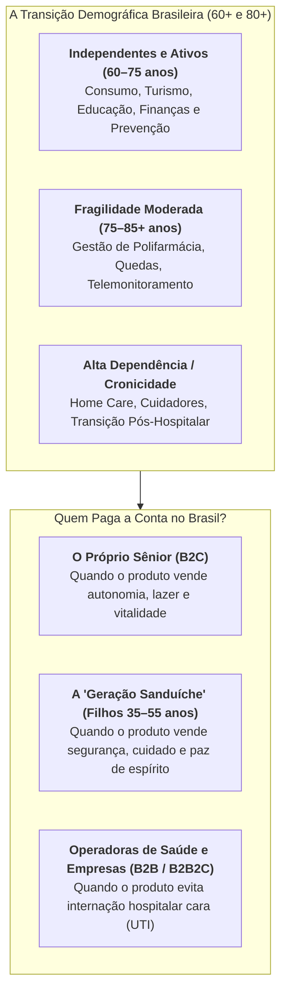

As quatro teses de maior tração em *AgeTech / Longevity Tech* no Brasil são:

1. **Desospitalização, Home Care Tech e Plataformas de Cuidadores Domiciliares:** Para uma operadora de plano de saúde (cujo beneficiário acima de 59 anos concentra alta sinistralidade), manter um paciente idoso internado em leito hospitalar custa de R$ 2.500 a R$ 8.000 por dia, enquanto a assistência domiciliar (*Home Care*) reduz o custo diário em 40% a 70% e diminui o risco de infecção hospitalar. Startups que fornecem software de gestão e prontuário com checagem por geolocalização para empresas de *home care*, ou plataformas que apoiam a "Geração Sanduíche" (filhos adultos de 35 a 55 anos que trabalham em período integral e precisam coordenar simultaneamente o cuidado dos filhos pequenos e dos pais idosos), atacam uma dor familiar aguda. *(Cautela trabalhista obrigatória: o cuidador pessoa física que presta serviços de forma contínua, subordinada, onerosa e pessoal por mais de dois dias por semana no âmbito residencial da família enquadra-se como empregado doméstico sob a **Lei Complementar nº 150/2015**, exigindo registro no eSocial, plataformas que escalam plantões, fixam preços e dirigem o trabalho de cuidadores assumem alto risco de reconhecimento de vínculo empregatício direto ou responsabilidade subsidiária, conforme detalhado no Volume 8, Capítulo 6.)*
2. **Telemonitoramento, Prevenção de Quedas e Organização Segura de Medicamentos (Polifarmácia):** Uma fratura de fêmur por queda doméstica é uma das principais causas de perda de autonomia e mortalidade em idosos acima de 75 anos (com a literatura geriátrica e ortopédica registrando mortalidade de 20% a 30% no primeiro ano após a fratura). Soluções de botão de emergência inteligente e sensores passivos de queda (por radar ou acelerômetro, sem câmeras invasivas no banheiro), coordenação de cuidado crônico e serviços farmacêuticos de organização de medicamentos para pacientes polimedicados (que tomam de 6 a 10 comprimidos diários) contam com forte demanda de famílias e operadoras, **desde que qualquer serviço de fracionamento ou dispensação personalizada de medicamentos seja executado exclusivamente por farmácia licenciada em estrita conformidade com as normas sanitárias da ANVISA (RDC nº 80/2006 para fracionamento a partir de embalagens especificamente registradas como fracionáveis, RDC nº 44/2009 sobre Boas Práticas Farmacêuticas e RDC nº 67/2007 quando envolver manipulação magistral)**.
3. **Fintech Sênior, Prevenção a Golpes Digitais e Crédito Consignado Transparente:** Aposentados e pensionistas do INSS e servidores públicos são alvo frequente de fraudes bancárias, engenharia social no WhatsApp, descontos associativos não autorizados no benefício (objeto de operações da Polícia Federal e da CGU e de bloqueio administrativo pelo INSS em 2024–2025) e empréstimos consignados predatórios. O enquadramento regulatório depende do produto ofertado: para originar **crédito consignado**, a startup precisa operar como instituição financeira/SCD autorizada pelo Banco Central ou como correspondente bancário sob a **Resolução CMN nº 4.935/2021**, cumprindo o teto de juros fixado pelo Conselho Nacional de Previdência Social (CNPS) e a validação biométrica junto à Dataprev, já para ofertar **seguro contra golpes de Pix ou transações sob coação**, deve atuar em parceria com seguradora autorizada pela **SUSEP** (como corretora ou representante de seguros), enquanto ferramentas puras de monitoramento antifraude e organização documental sucessória operam como software.
4. **Educação Continuada, Recolocação 50+ (Maturi), Turismo Sênior e Moradias Assistidas (*Senior Living*):** Plataformas voltadas à inclusão produtiva e recolocação de profissionais 50+ no mercado corporativo (como a brasileira **Maturi**), comunidades de aprendizagem digital, operadoras de viagens em grupo para o público 60+ (que aproveitam tarifas promocionais de hotéis e companhias aéreas fora da alta temporada e nos dias úteis de menor demanda turística, de terça a quinta-feira) e novos empreendimentos imobiliários de moradia assistida e convivência (*Senior Living* e *Coliving Sênior*) compõem a frente voltada ao idoso ativo e independente.

---

### 5. Tabela Comparativa de Unit Economics: Travel, Eventos, Pet e Silver Economy

| Subvertical | Modelo de Monetização Principal | Take Rate / ARPU (Faixa Ref. 2024–2026) | Margem Bruta Estimada (Ref. Autor) | Métrica Estrela (North Star) | Risco Operacional / Regulatório Decisivo | Exemplos no Segmento (Não Atestam as Faixas) |
|---|---|---|---|---|---|---|
| **Traveltech B2B (Corporate T&E + Despesas)** | Assinatura SaaS por empresa/usuário + *interchange* do cartão corporativo + comissão de hotel/aéreo | R$ 500 a R$ 10k/mês (SaaS) + 1,5% a 4,5% de *take rate* sobre GMV de viagens | 65% a 80% | GMV de viagens gerenciado sob política e NRR (> 120%) | Ciclo de reembolso/faturamento corporativo e integração com ERPs | Onfly, Paytrack, Voll, VExpenses |
| **OTAs Rodoviárias e Hospitalidade SaaS** | Comissão (*take rate*) por passagem emitida ou SaaS mensal por hotel | 8% a 14% no rodoviário; R$ 250 a R$ 2.500/mês por hotel | 60% a 78% | Taxa de conversão de busca e *Attach Rate* de seguros/assentos | Integração com sistemas legados de viações e sazonalidade de férias | ClickBus, Quero Passagem, Omnibees, Seazone |
| **Ticketing, Eventos e Cashless (A&B)** | Taxa de serviço sobre ingresso (8%–12%) + *MDR/Take rate* sobre consumo no bar (2%–5%) | R$ 12 a R$ 45 de receita por participante de grande evento | 55% a 72% | TPV total processado (Ingresso + Consumo *Cashless*) por evento | Chargeback de cartão, Lei da Meia-Entrada (Lei 12.933/13) e conectividade *offline* no evento | Sympla, Zig (ZigPay), Ingresse, Ticket Sports |
| **PetTech (Assinatura, Saúde Pet e SaaS Vet)** | Recorrência mensal de produtos, mensalidade de plano de saúde pet e SaaS veterinário | R$ 60 a R$ 220/mês (Plano Pet); R$ 200 a R$ 350/pedido recorrente | 35% a 45% (Varejo/Saúde); 75%+ (SaaS Vet) | LTV/CAC (> 4x via plano + ração) e *Loss Ratio* (sinistralidade veterinária < 60%) | Fraude de carência em planos de saúde pet, custo logístico de sacos de ração de 15 kg e regras do CFMV | Petlove, DogHero, Vetus, Petz/Cobasi |
| **Silver Economy / Longevity Tech** | Mensalidade B2C (paga pela família) ou *PMPM (Per Member Per Month)* pago pela operadora de saúde | R$ 150 a R$ 600/mês (monitoramento/coordenação) a R$ 4k–12k/mês (*home care*) | 45% a 75% (conforme peso de equipe clínica própria) | Redução de internações hospitalares evitáveis e retenção familiar (> 24 meses) | Risco trabalhista na intermediação de cuidadores domiciliares e responsabilidade clínica (ANS/CRM/COREN) | EuVô, Conecta Sênior, Cuidar.me (cuidado e logística sênior) e Maturi (recolocação 50+) |

---

### 6. Armadilhas fatais nessas quatro subverticais

1. **Em Traveltech: Assumir risco de variação tarifária aérea ou risco de crédito de agências sem garantias:** Nunca venda passagem ou hospedagem futura a preço travado sem emissão simultânea do bilhete (*back-to-back*) no fornecedor, e nunca conceda limite de faturamento pós-pago (boleto 30 dias) para clientes corporativos sem seguro de crédito ou depósito caução/cartão pré-pago, pois uma única empresa inadimplente em R$ 200 mil de passagens aéreas apaga o lucro líquido de R$ 5 milhões em GMV (dado que o *take rate* aéreo líquido é estreito).
2. **Em Eventos e Cashless: Depender de internet 4G/Wi-Fi durante o show para validar ingresso ou cobrar cerveja:** Quando 40 mil pessoas entram no mesmo estádio ou arena às 21h, todas as torres de celular da região colapsam. Se o seu validador de ingresso ou maquininha *cashless* exigir consulta *online* em nuvem a cada transação, o bar para de vender por duas horas, o público se revolta e o produtor nunca mais contrata sua empresa. **Toda tecnologia de eventos precisa operar com arquitetura local/offline redundante (cartão NFC com saldo gravado criptograficamente no chip ou rede local de alta disponibilidade).**
3. **Em PetTech: Vender ração pesada avulsa comprando clique no Google sem recorrência nem produtos de alta margem:** Um saco de ração super-premium de 15 kg tem margem bruta estreita e frete elevado pelo peso bruto da carga. Se o cliente compra uma única vez pelo menor preço no Google Shopping e no mês seguinte migra para outro varejista, a operação perde dinheiro em cada pedido. A conta de PetTech só fecha quando a ração funciona como **âncora de frequência** que traz o tutor para a assinatura recorrente (via cartão ou Pix Automático) e permite agregar na mesma cesta antipulgas, medicamentos veterinários, petiscos de marca própria e o plano de saúde pet (itens de margem bruta e retenção substancialmente maiores).
4. **Em Silver Economy: vender produtos estigmatizantes ao idoso ou ignorar quem toma a decisão de compra:** Há uma divisão comportamental clara na Economia Prateada. Produtos de **vitalidade, viagem, beleza, finanças e aprendizado** são comprados pelo próprio público sênior (60 a 75 anos), que valoriza autonomia e rejeita o estigma de "terceira idade". Já os serviços de **cuidado assistido, monitoramento de quedas, gestão de medicamentos e *home care*** para idosos octogenários ou com fragilidade clínica são pesquisados, escolhidos e pagos pelos filhos adultos (sobretudo na faixa de 40 a 55 anos), exigindo uma interface discreta e respeitosa que preserve a dignidade do usuário sem sensação de vigilância invasiva.

> [!tip] Checklist de Execução para Travel, Eventos, Pet e Silver Economy
> - [ ] **Traveltech:** O modelo opera 100% livre de descasamento de preço de inventário (*back-to-back booking*) e monetiza serviços de maior margem (hotéis, rodoviário, seguro viagem, câmbio ou SaaS/cartão corporativo) além do bilhete aéreo?
> - [ ] **Eventos / SportsTech:** A operação suporta contingência *offline* total no local do evento, possui antifraude específico para cartões clonados em compra de última hora e cumpre a **Lei 12.933/2013 (Meia-Entrada)** e a **LGPD para dados biométricos faciais**?
> - [ ] **PetTech:** O funil de produto converte o comprador avulso em **assinante recorrente ou titular de plano de saúde pet** nos primeiros 60 dias, com controle rigoroso de carência e auditoria veterinária para evitar seleção adversa?
> - [ ] **Silver Economy:** A proposta de valor separa claramente a comunicação voltada ao **decisor familiar/pagador (filhos ou operadora de saúde)** da experiência de dignidade e simplicidade entregue ao **usuário idoso**?

---

### Filtro de Alinhamento e Prontidão: Perguntas de Validação Prática

Antes de investir em aquisição de usuários ou assinar contratos com estabelecimentos parceiros em TravelTech, Eventos, PetTech ou Economia da Longevidade, submeta o modelo de negócios às quatro travas de validação abaixo:

Antes de alocar capital em Traveltech, Eventos, PetTech ou Economia da Longevidade (60+) no Brasil, passe sua tese por três perguntas de fogo:

1. **O Teste da Desintermediação e do Leilão (Para Travel e Pet):** Por que o cliente ou empresa continuará usando sua plataforma no décimo mês sem pular para o WhatsApp do prestador local e sem precisar que você recompre o cliente no Google Ads?
2. **Bilheteria e Consumo *Cashless* Regulado (Para Eventos e Hospitalidade):** Sua plataforma opera além da taxa do ingresso para processar o consumo interno de alimentos e bebidas (*cashless*), mantendo o *float* em instituição de pagamento autorizada pelo Banco Central com reserva para cancelamentos e devolução automática de saldo não utilizado?
3. **Quem É o Verdadeiro Comprador (Para Silver Economy):** Seu go-to-market conversa diretamente com o filho adulto pagador ou com operadoras de saúde que precisam evitar reinternações de idosos?

**O Movimento de Segunda-Feira:** Nos próximos 15 dias, entreviste cinco decisores reais da sua subvertical (gestores de viagens corporativas, produtores de eventos, proprietários de clínicas veterinárias ou famílias cuidadoras da geração sanduíche) e peça que descrevam o último gasto contratado na categoria (valor pago em viagens, taxa de bilheteria/*cashless*, farmácia/plano pet ou mensalidade de cuidador/*home care*, fornecedor escolhido, quem aprovou o pagamento e qual atrito operacional quase levou ao cancelamento).


---

## CAPÍTULO 38: SETOR FUNERÁRIO, CEMITÉRIOS, CREMATÓRIOS, PLANOS DE ASSISTÊNCIA FAMILIAR, DEATHTECH E SUCESSÃO

### O funeral pago em vida e a verticalização cemiterial

Poucos fundadores do circuito tradicional de Venture Capital avaliam o setor funerário, cemiterial, de cremação e de inventários (*DeathCare / DeathTech*), afastados pelo tabu cultural que cerca o tema. Quando um empreendedor sem vivência operacional tenta entrar nesse mercado lançando um "marketplace para cotar caixão no dia do óbito", o modelo fracassa rapidamente: uma família enlutada às três da manhã não abre cinco abas no navegador para comparar preços de remoção. Na direção oposta, grupos consolidadores e operadores de planos de assistência familiar construíram no Brasil operações de receita recorrente altamente resilientes.

O veterano de trincheira olha para a demografia brasileira (envelhecimento acelerado e concessão dos cemitérios públicos nas capitais) e compreende que o dinheiro deste setor jamais é ganho apenas no dia do óbito (*at-need*). O grande motor financeiro do setor no Brasil são os **Planos de Assistência Familiar e Funerária pré-pagos em vida (*pre-need*, regulados pela Lei Federal nº 13.261/2016)**.

Essa é a engrenagem do **funeral pago em vida acoplado ao clube de benefícios e ao ativo físico**: milhões de famílias brasileiras pagam de R$ 39,90 a R$ 89,90 por mês para proteger o grupo familiar. Enquanto um plano puramente funerário cobrado por boleto avulso sofre *churn* mensal de 1,5% a 2,5% (perdendo de 17% a 26% da carteira ao ano porque a família não vê uso imediato), a operadora que combina duas travas, **cobrança automatizada na fatura de energia elétrica ou no Pix Automático (que reduz o cancelamento mensal para menos de 0,8% a 1%)** e **benefícios usados toda semana em vida (telemedicina, descontos em consultas, exames, farmácia e odontologia)**, e ainda verticaliza a própria funerária, crematório e cemitério-parque sustenta margens EBITDA de 28% a 42% ao longo de décadas, já que a mortalidade anual das vidas cobertas gira em torno de 0,5% ao ano (cerca de 1,8% a 2,4% dos contratos familiares acionando um óbito por ano, considerando média de 4 a 4,5 vidas por contrato).

Estruturar ou investir em uma operação no setor funerário, cemiterial e de sucessão patrimonial exige separar a receita recorrente de assistência familiar (governada pela disciplina atuarial e de solvência da Lei nº 13.261/2016) da gestão imobiliária e ambiental dos ativos físicos (cemitérios-parque e crematórios).

---

> [!note] Síntese Executiva da Vertical
> Poucos setores apresentam demanda demográfica tão previsível e resiliente ao ciclo econômico no serviço essencial de sepultamento e cremação quanto o **Setor Funerário, Cemiterial, de Planos de Assistência Familiar e Sucessão Patrimonial (DeathCare / DeathTech)**. No Brasil, estimativas de entidades representativas do setor (como o Sindicato dos Cemitérios e Crematórios Particulares do Brasil, SINCEP, e a ABREDIF) apontam que a cadeia de serviços funerários, cemitérios, crematórios e planos assistenciais movimenta entre **R$ 13 bilhões e R$ 15 bilhões por ano**, impulsionada pelo envelhecimento estrutural da população brasileira (que registra cerca de 1,45 milhão a 1,55 milhão de óbitos anuais no SIM/DataSUS, com projeção demográfica de crescimento contínuo nas próximas três décadas segundo o IBGE). O que antes era um mercado pulverizado de pequenas funerárias familiares de bairro converteu-se em uma tese institucional baseada em quatro pilares: **receita recorrente por assinatura (Clubes de Benefícios em Vida + Assistência Funeral)**, **concessões municipais de longo prazo**, **cemitérios-parque (EBITDA de 35% a 55%) e crematórios humanos e pet (EBITDA de 50% a 60% em operações maduras)** e **plataformas jurídicas e financeiras de inventário e sucessão**.

---

### 1. A Demografia Inevitável e a Regulação dos Planos Funerários (Lei 13.261/2016)

Durante décadas, a maioria das famílias brasileiras das classes B, C e D viveu sob um temor financeiro concreto: o custo inesperado de um funeral e sepultamento particular digno (que varia de **R$ 4.500 a R$ 18.000** à vista, dependendo da cidade, urna, traslado, tanatopraxia, coroa de flores e jazigo) no exato momento de maior fragilidade emocional da família.

Para resolver essa dor sem depender da burocracia das grandes seguradoras tradicionais, nasceram no Brasil centenas de administradoras regionais de **Planos de Assistência Funerária**, regulamentadas especificamente pela **Lei Federal nº 13.261/2016** (distinta da regulação de seguros da SUSEP, embora muitas operadoras hoje combinem o plano assistencial da Lei 13.261 com apólices de microsseguro e títulos de capitalização regulados pela SUSEP):

1. **O Que Exige a Lei Federal nº 13.261/2016:** A norma regulamenta as empresas comercializadoras de planos de assistência funerária (prestação de serviços funerários mediante cobrança de parcelas periódicas por contrato escrito). Para operar legalmente e impedir a atuação de grupos descapitalizados, a Lei nº 13.261/2016 exige quatro requisitos contábeis e patrimoniais objetivos: (a) **patrimônio líquido mínimo equivalente a 12%** da receita líquida anual obtida com a venda de planos no exercício anterior (art. 3º, I), (b) **capital social mínimo equivalente a 5%** do total da receita anual (art. 3º, II), (c) manutenção de **reserva de solvência equivalente a 10%** do faturamento total obtido nos últimos 12 meses, investida em ativos de liquidez (art. 4º, I), e (d) **contabilização específica auditada anualmente por auditor contábil independente** registrado na CVM/CFC (art. 4º, II e parágrafo único, embora a lei não exija assinatura de atuário nem registro prévio específico nos Procons, a modelagem atuarial da carteira por faixa etária é prática indispensável de gestão financeira).
2. **A Evolução de Produto: Do "Plano de Óbito" para o "Clube de Benefícios em Vida" (*Living Benefits*):** O desafio histórico do plano puramente funerário sempre foi o cancelamento (*churn*) após 12 a 18 meses: como a frequência anual de acionamento por óbito em uma carteira familiar saudável gira em torno de **1,8% a 2,4% dos contratos ao ano**, quase 98% das famílias pagavam a mensalidade o ano inteiro sem utilizar nenhum serviço. As maiores operadoras brasileiras de assistência familiar e grupos cemiteriais (como **Grupo Zelo, Grupo Vila / Morada da Paz, Grupo Cortel e Sinaf**) reduziram esse atrito redesenhando a proposta de valor cotidiana do contrato:
   - Por **R$ 39,90 a R$ 89,90 por mês** (cobrindo o titular, cônjuge, filhos, pais e muitas vezes sogros, alcançando de 7 a 10 vidas no mesmo contrato), a família não contrata apenas a cobertura futura do funeral: passa a utilizar um **Clube de Benefícios de Uso Semanal em Vida**.
   - O pacote agrega **Telemedicina 24h**, **descontos de 30% a 70% em consultas médicas e exames laboratoriais** em redes de clínicas parceiras, **descontos em grandes redes de farmácias**, **empréstimo de equipamentos de convalescença** (cadeira de rodas, muletas, cama hospitalar articulada e andador), **assistência residencial** (chaveiro, encanador e eletricista), **cesta básica temporária para a família em caso de óbito do titular**, **sorteios mensais via Título de Capitalização** (estruturados com sociedades de capitalização autorizadas pela SUSEP) e **assistência funeral para o animal de estimação da família (cão e gato)**.
   - **Resultado Econômico:** A família usa o desconto na farmácia ou na consulta médica todo mês, percebe valor tangível imediato que supera o valor da mensalidade, paga em dia para não perder o número da sorte do sorteio e **o cancelamento cai para a faixa de 1,5% a 2,5% ao mês (e para menos de 1,0% ao mês quando a cobrança é acoplada à fatura de energia elétrica ou ao Pix Automático)**!

---

### 2. As 4 Grandes Subverticais de DeathCare e DeathTech no Brasil

| Subvertical | Modelo de Negócio e Receitas | Margem EBITDA Típica | Dinâmica Competitiva e Moat |
|---|---|---|---|
| **1. Planos de Assistência Familiar e Funerária (Recorrência B2C / B2B2C, Lei nº 13.261/2016)** | Assinatura mensal familiar padronizada (**R$ 39,90 a R$ 89,90/mês**) combinando assistência funeral completa + telemedicina/clube de descontos em vida. | **28% a 42%** na operação integrada | Escala de carteira ativa (50 mil a 1,5 milhão+ de contratos), capilaridade funerária própria para controlar o custo do atendimento e cobrança recorrente automatizada. |
| **2. Cemitérios-Parque, Crematórios (Humanos e Pet) e Concessões Públicas** | Cessão de jazigos ou locação temporária (3 a 5 anos) + **Taxa de Manutenção Anual (Condomínio Cemiterial)** + velório e cremação + serviços de apoio. | **35% a 55%** nos cemitérios-parque (**50% a 60%** em crematórios maduros) | **Licenciamento Ambiental (Resolução CONAMA nº 335/2003)** de altíssima barreira de entrada no perímetro urbano + concessões municipais de 25 a 35 anos. |
| **3. Microsseguros Funerários e Vida Simplificado (Embedded Insurance)** | Apólices de auxílio-funeral e pecúlio (**R$ 9,90 a R$ 29,90/mês**) distribuídas embutidas na conta de energia elétrica (*Enel, Equatorial, Cemig*), fatura de varejista, cartão ou banco digital. | **25% a 38%** (Seguradora / MGA) | Canal de distribuição massivo com cobrança atrelada a *utility*, Pix Automático ou folha consignada (inadimplência mínima). |
| **4. DeathTech, Inventário Extrajudicial, Planejamento Sucessório e Probate Lending** | Plataformas jurídicas e financeiras para processamento de **inventários extrajudiciais em cartório**, busca automatizada de ativos esquecidos, testamentos digitais e **adiantamento/financiamento de ITCMD e custas de inventário**. | **35% a 65%** | Especialização jurídica + tecnologia de automação documental + *funding* (FIDC) para financiar herdeiros sem liquidez imediata. |

#### Subverticais 2 e 3: Microsseguros na Conta de Luz (Bancassurance) e Cemitérios-Parque, Concessões e Crematórios

Na **Subvertical 3 (Microsseguros Funerários e de Vida Global em Contas de Consumo e Bancos Digitais)**, seguradoras autorizadas pela SUSEP e *insurtechs* distribuem apólices populares de R$ 9,90 a R$ 29,90 mensais embutidas na fatura das distribuidoras de energia elétrica (Enel, Equatorial, Neoenergia, Cemig), na conta de água ou nos aplicativos de bancos digitais e varejistas, reduzindo o custo de aquisição e a inadimplência para menos de 1% ao mês.
Unidades físicas de **Cemitérios Parques** (gramados horizontais arborizados e edifícios de columbários/ossários verticais) e **Crematórios** possuem uma das melhores equações imobiliárias e operacionais da economia real:

1. **A Dupla Receita do Cemitério Parque:** Diferentemente de um loteamento residencial comum (onde a loteadora vende o terreno uma vez e nunca mais recebe nada), um Cemitério Parque ganha dinheiro **duas vezes sobre cada metro quadrado**:
   - **Na Venda do Direito de Uso (Pre-Need / At-Need):** Vende a concessão de uso perpétuo ou temporário do jazigo (com 3 a 4 gavetas subterrâneas) por valores que variam de **R$ 8.000 a R$ 45.000+** (parcelados em 36 a 60 vezes para famílias que compram preventivamente, *Pre-Need*, ou à vista na hora do óbito: *At-Need*).
   - **Na Taxa de Manutenção Anual ou Semestral ("Condomínio Cemiterial"):** Todo titular de jazigo paga uma taxa contratual periódica de conservação e manutenção (tipicamente de R$ 450 a R$ 1.200 por ano). Quando um cemitério-parque atinge a maturidade com **30 mil jazigos vendidos** e taxa média entre R$ 600 e R$ 1.000 anuais, apenas essa cobrança de conservação gera de **R$ 18 milhões a R$ 30 milhões por ano de receita recorrente**, com custo operacional concentrado em jardinagem, segurança patrimonial e administração.
2. **A Expansão da Cremação (Humana e Pet) no Brasil:** Embora a cremação no Brasil ainda represente cerca de **12% a 15% dos óbitos** nas capitais e regiões metropolitanas (frente a mais de 60% nos Estados Unidos segundo a NFDA, cerca de 80% no Reino Unido e na Dinamarca segundo a *Cremation Society* e 99,9% no Japão), sua participação avança continuamente por mudança cultural, escassez de espaço nos cemitérios municipais e menor desembolso imediato (uma cremação custa de 30% a 50% menos que a aquisição de um jazigo perpétuo novo). Para o operador do crematório, o custo variável direto da operação (gás natural ou GLP do forno crematório, urna cinerária básica e duas horas de equipe técnica) situa-se entre **R$ 380 e R$ 550**, enquanto o pacote de cerimônia de despedida e cremação é comercializado por **R$ 3.500 a R$ 9.000**, gerando **margens brutas superiores a 80%** e EBITDA de 50% a 60% nas unidades maduras. Em paralelo, o segmento de **Crematórios Pet** (como **Pet Memorial** em São Paulo e **Morada da Paz Pet** no Nordeste, ao lado de crematórios veterinários regionais licenciados) cresceu entre famílias urbanas que contratam planos preventivos ou cremações individuais por R$ 800 a R$ 2.800.
3. **Concessões e PPPs de Cemitérios Públicos Municipais:** Em 2023, a Prefeitura de São Paulo concluiu a concessão dos seus 22 cemitérios públicos pelo prazo de 25 anos, divididos em quatro blocos assumidos pelos consórcios **Cortel, Consolare, Maya e Velar** mediante pagamento de outorgas e compromissos de investimento na modernização das necrópoles e crematórios. Na esteira do modelo paulistano, diversas capitais e municípios de médio porte passaram a estruturar projetos de concessão e Parcerias Público-Privadas (PPPs) de 25 a 35 anos para seus serviços funerários e cemiteriais, abrindo espaço para grupos operadores capitalizados.

#### Subvertical 4: DeathTech, Inventários Extrajudiciais e Financiamento Sucessório (*Probate Lending*)

O que acontece no dia seguinte ao sepultamento? Começa o pesadelo burocrático, tributário e financeiro da **sucessão e do inventário no Brasil**.
No Brasil, um volume expressivo de imóveis, contas bancárias, cotas societárias, veículos e precatórios permanece imobilizado por anos em inventários porque os herdeiros não dispõem de liquidez imediata para quitar os custos de transmissão patrimonial. Pela **Emenda Constitucional nº 132/2023 (Reforma Tributária)**, o imposto estadual sobre heranças e doações (**ITCMD**) passou a ser obrigatoriamente progressivo em razão do valor do quinhão, do legado ou da doação, respeitado o teto de 8% fixado pela Resolução do Senado nº 9/1992. Quando se somam o ITCMD, os emolumentos de cartório ou custas judiciais, as certidões e os honorários advocatícios, o desembolso à vista exigido da família gira tipicamente entre **10% e 16% do patrimônio inventariado** antes que os herdeiros possam alienar livremente os bens.
Isso abriu três teses tecnológicas de altíssimo valor (*DeathTech / LegalTech Sucessória*):

1. **Automação de Inventários Extrajudiciais em Cartório (Lei nº 11.441/2007 e Resolução CNJ nº 571/2024):** A Lei nº 11.441/2007 permitiu que inventários e partilhas consensuais entre herdeiros maiores e capazes fossem concluídos em semanas por escritura pública em Cartório de Notas (em contraste com a duração média de vários anos dos processos judiciais de execução e inventário apontada nas edições do relatório *Justiça em Números* do CNJ). Em agosto de 2024, o CNJ editou a **Resolução CNJ nº 571/2024** (alterando a Resolução nº 35/2007), que ampliou o inventário extrajudicial em cartório mesmo quando há **testamento válido** (mediante expressa autorização do juízo sucessório competente) ou **herdeiros menores ou incapazes** (desde que haja consenso entre todos os herdeiros, garantia da quota-parte ideal de cada menor em cada bem e manifestação favorável do Ministério Público), além de permitir que o inventariante nomeado pratique atos bancários preliminares para levantamento de saldos e pagamento do ITCMD. Plataformas jurídicas especializadas digitalizam a coleta de certidões, a avaliação de bens, a apuração do ITCMD e a minuta da escritura para advogados e famílias.
2. **Financiamento de Custas de Inventário e Compra de Quinhão Hereditário (*Probate Lending*):** Se uma família herda um apartamento de R$ 1,5 milhão livre de dívidas, mas não tem R$ 150.000 em conta corrente para pagar o ITCMD e o cartório, o imóvel permanece em nome do espólio sem matrícula individualizada nos herdeiros, ficando impedido de ser vendido regularmente ou financiado por bancos comerciais (ou sofrendo deságio severo em cessões informais). Fintechs e FIDCs especializados em ativos judiciais/sucessórios adiantam os R$ 150.000 para pagar o imposto e destravar o inventário em troca de uma cessão parcial de direitos hereditários ou alienação fiduciária/hipoteca sobre o imóvel liberado, capturando retornos de **CDI + 8% a 15% a.a.** com garantia real imobiliária!
3. **Planejamento Sucessório Digital, Testamentos e Holdings Familiares Automatizadas:** Ferramentas B2C e B2B2C (para assessores de investimentos, planejadores financeiros e contadores) que estruturam testamentos patrimoniais, diretivas antecipadas de vontade (testamento vital sobre cuidados médicos), seguros de vida para liquidez sucessória e constituição padronizada de holdings patrimoniais familiares.

---

### 3. Unit Economics de uma Operadora de Planos de Assistência Funerária + Cemitério/Crematório Integrado

> [!tip] O Segredo da Verticalização no Setor Funerário
> Se a operadora vende apenas o plano funerário mensal e precisa **contratar no varejo** urna, remoção, tanatopraxia (preparação e conservação do corpo), sala de velório e sepultamento ou cremação de terceiros a cada óbito, o custo por sinistro fica entre **R$ 3.500 e R$ 5.000**. Quando a operação é **verticalizada** (compra atacadista ou fabricação de urnas, frota própria, laboratório de tanatopraxia, centro velatorial e crematório ou cemitério próprios), o **custo marginal de caixa por atendimento completo recua para a faixa de R$ 950 a R$ 1.600**.

Veja as métricas de referência de uma operação consolidada de **100.000 contratos familiares ativos** (~450.000 vidas cobertas):

| Métrica Operacional e Atuarial | Benchmark de Mercado no Brasil | Impacto na Geração de Caixa (Carteira de 100k Contratos) |
|---|---|---|
| **Ticket Médio Mensal por Contrato Familiar (ARPU)** | **R$ 58,00 / mês** (cobrindo titular + dependentes) | **R$ 5,8 milhões / mês** (**R$ 69,6 milhões / ano** de Receita Bruta) |
| **Taxa de Sinistralidade Atuarial (Frequência de Óbito por Contrato/Ano)** | **1,8% a 2,4% dos contratos acionam 1 óbito por ano** | ~150 a 200 atendimentos funerários por mês (1.800 a 2.400 óbitos acionados por ano na base de 100 mil contratos) |
| **Custo Direto do Sinistro Funerário (Verticalizado) + Benefícios em Vida** | R$ 1.350 por funeral realizado + R$ 4,50/mês por contrato em telemedicina/sorteio/rede | **~R$ 720 mil / mês** (**Sinistralidade Caixa total < 13% da Receita**) |
| **Custo de Aquisição de Cliente (CAC)** | **R$ 140 a R$ 220 por contrato** (3 a 4 mensalidades de comissão para o vendedor porta-a-porta ou televendas/digital) | Payback do CAC em **3,5 a 5 meses** |
| **Inadimplência Líquida e Churn Mensal** | **1,5% a 2,5% ao mês** (cai para **< 1,0%** quando cobrado na conta de luz, cartão recorrente ou Pix Automático) | Vida média do contrato (*Lifetime*) de **3,3 a 5,5 anos** no boleto ou cartão (superando **8 anos** quando o cancelamento mensal fica abaixo de 1,0% nos canais de débito vinculado) |
| **Receita Adicional de *Upsell* no Atendimento (*At-Need*) e Particulares** | Famílias fora do plano ou upgrades de urna/flores/cremação/jazigo | **+25% a 40% sobre a receita de planos** |
| **Margem EBITDA Consolidada da Operação Integrada** | **28% a 42% de Margem EBITDA** (integrando recorrência assistencial com estrutura própria de atendimento, necrópole e forno crematório) | **R$ 20 milhões a R$ 30 milhões / ano de EBITDA** sobre a receita base (chegando a R$ 25 milhões a R$ 38 milhões com o *upsell* cemiterial/cremação) |

---

### 4. Casos Brasileiros de Destaque: Os Consolidadores de DeathCare

> [!example] Estudo de Caso: Grupo Zelo, Grupo Cortel, Grupo Vila (Morada da Paz) e Sinaf
> - **Grupo Zelo (Belo Horizonte/MG: cerca de 4 milhões de vidas cobertas):** Formado em 2017 a partir da união de quatro funerárias tradicionais da Região Metropolitana de Belo Horizonte, o Grupo Zelo conduziu um amplo movimento de consolidação (*roll-up*) do setor funerário e de assistência familiar no país. Com investimentos da gestora de *Private Equity* **Crescera Capital** (que aportou R$ 150 milhões inicialmente e mais R$ 200 milhões em 2021, conforme comunicados públicos e reportagens de negócios), o grupo somava até 2024 mais de **55 aquisições de funerárias, cemitérios e carteiras regionais de planos assistenciais em 14 estados brasileiros**, alcançando cerca de 4 milhões de vidas cobertas. A operação unificou a governança contábil e atuarial sob a Lei nº 13.261/2016, migrou a cobrança de carnês físicos para meios digitais recorrentes e acoplou benefícios de saúde e telemedicina em vida para reduzir o *churn*.
> - **Grupo Cortel (Porto Alegre e São Paulo):** Fundado no Rio Grande do Sul na década de 1960 e liderado pela família Flores (José Eli Flores), consolidou-se entre os principais operadores privados de cemitérios-parque e crematórios do país, com unidades no Rio Grande do Sul, Rio de Janeiro, Amazonas e São Paulo. Na capital paulista, lidera o **Consórcio Cortel São Paulo**, que em 2023 assumiu a concessão de 25 anos do bloco formado por cinco necrópoles municipais (Consolação, Quarta Parada, Santana, Tremembé e Vila Formosa). O grupo destaca-se pela verticalização de jazigos e columbários para otimizar a área útil cemiterial, pela expansão da cremação e pela digitalização do atendimento às famílias.
> - **Grupo Vila / Morada da Paz (Natal/RN, João Pessoa/PB e Recife/PE):** Grupo tradicional do Nordeste na operação integrada de cemitérios-parque, crematórios humanos, cremação veterinária (**Morada da Paz Pet**) e planos de assistência familiar. A empresa estruturou a migração da cobrança mensal da sua carteira para débito recorrente em fatura de energia elétrica e meios digitais (reduzindo a inadimplência histórica do cobrador domiciliar), implantou programas estruturados de acolhimento psicológico ao luto e desenvolveu ferramentas digitais de planejamento prévio e memoriais online.
> - **Sinaf Seguros e Assistência (Rio de Janeiro/RJ):** Exemplo de verticalização regulada pela **SUSEP** voltada às classes C e D na Região Metropolitana do Rio de Janeiro. Em vez de operar apenas como contrato civil de prestação de serviço funerário, estruturou seguradora própria de microsseguros de vida e auxílio-funeral combinada a rede física própria de agências de bairro e assistência funerária 24h, substituindo a cobrança manual em espécie por débito recorrente e mantendo o controle direto do custo do sinistro.

---

### 5. Armadilhas Fatais no Setor Funerário, Cemiterial e Sucessório

> [!warning] As 4 Armadilhas que Destroem Operações de DeathCare
> 1. **A Armadilha do Cobrador de Rua em Dinheiro Vivo (Custo de Cobrança e Desvio):** Centenas de funerárias tradicionais do interior ainda cobram a mensalidade do plano mandando um motoqueiro ("cobrador") bater de porta em porta para receber R$ 50 em dinheiro vivo. Além de o custo do cobrador consumir **18% a 25% da receita bruta**, o risco de assalto, fraude interna ("caixa dois de recibo") e perda de controle da carteira em caso de saída do cobrador é altíssimo. A primeira ação de qualquer *turnaround* ou M&A no setor é **migrar 80%+ da carteira para cobrança automática (débito na fatura da concessionária de energia elétrica/água, cartão de crédito recorrente sem ocupar limite, Pix Automático ou BolePix com régua automática de WhatsApp)**.
> 2. **Licenciamento Ambiental e Passivo de Necrochorume (Resolução CONAMA nº 335/2003 e 368/2006):** Cemitérios horizontais mal projetados em terrenos com lençol freático raso ou solo permeável geram **necrochorume** (líquido viscoso rico em cadaverina, putrescina, bactérias patogênicas e vírus decorrente da decomposição de corpos), cuja contaminação de águas subterrâneas pode gerar responsabilização criminal e administrativa da empresa e de seus dirigentes pela Lei de Crimes Ambientais (Lei nº 9.605/1998), ação civil pública do Ministério Público e interdição pelo órgão ambiental competente. Da mesma forma, **fornos crematórios** exigem câmara secundária de pós-combustão a mais de 850 °C–1.000 °C com tempo de residência mínimo dos gases e monitoramento contínuo de emissões atmosféricas para evitar fumaça visível ou odor. Nunca adquira um cemitério sem auditoria hidrogeológica profunda de poços de monitoramento piezométrico.
> 3. **Falha Operacional ou Frieza no Momento do Luto (Risco Reputacional Irreversível):** No e-commerce de bens comuns, um atraso de entrega resolve-se com pedido de desculpas e cupom de desconto. No serviço funerário, atrasar em quatro horas a remoção de um ente querido, falhar na identificação no laboratório de tanatopraxia ou abordar uma família em choque com rispidez comercial destrói a reputação da marca de forma irreversível. Por isso, o protocolo de dupla checagem de identificação por pulseira e QR Code desde a remoção até o sepultamento ou cremação e o treinamento humanizado da equipe de atendimento ("agentes de acolhimento") são requisitos operacionais inegociáveis.
> 4. **Vender Plano sem Carência ou com Seleção Adversa Descontrolada:** Se um vendedor comissionado cadastrar como "titular ou dependente saudável" um paciente de 88 anos que já está internado na UTI em estado terminal apenas para ganhar a comissão de adesão, a empresa receberá R$ 50 de primeira parcela e terá um desembolso imediato de R$ 3.500 na semana seguinte (*seleção adversa*). Contratos sustentáveis exigem **período de carência contratual clara (geralmente 90 a 180 dias para morte natural, com cobertura imediata apenas para morte acidental)**, limite etário nas faixas padrão ou tabela específica sênior e auditoria de vendas nos primeiros 90 dias da safra.

---

### Filtro de Alinhamento e Prontidão: Perguntas de Validação Prática

Antes de adquirir carteiras funerárias regionais, disputar concessões municipais ou lançar uma plataforma de planejamento sucessório e inventário, valide o seu modelo de negócios nas três frentes abaixo:

Antes de investir no setor funerário, cemiterial, de cremação (humana ou pet) ou em uma DeathTech sucessória no Brasil, responda:

1. **Emergência (*At-Need*) vs. Recorrência em Vida (*Pre-Need*):** Seu modelo depende de capturar o cliente no momento do luto (onde o clique no Google Ads é caríssimo e o evento é único), ou constrói receita recorrente mensal em vida via assistência familiar, seguros B2B2C ou SaaS de gestão, cobrança recorrente e atendimento para as cerca de 5.500 a 6.000 empresas funerárias e administradoras de planos do país (estimativa do SINCEP/ABREDIF)?
2. **O Antídoto contra o Cancelamento (Uso em Vida):** O titular do plano utiliza benefícios toda semana em vida (clínica popular, telemedicina, desconto em farmácia) para nunca cancelar a assinatura?
3. **Conformidade com a Lei nº 13.261/2016 e a Resolução CONAMA nº 335/2003:** Se você pretende operar ativos físicos e comercializar planos próprios de assistência funerária, dispõe de capital paciente para financiar de 3 a 4 anos de formação de carteira cumprindo os requisitos legais de patrimônio líquido mínimo (12%), capital social (5%), reserva de solvência (10%), auditoria contábil independente e licenciamento ambiental cemiterial, ou entrará no modelo leve em ativos (*asset-light*) fornecendo software, cobrança recorrente e benefícios em vida para funerárias e seguradoras já habilitadas?

**O Movimento de Segunda-Feira:** Nos próximos 15 dias, visite duas operadoras regionais de planos de assistência familiar e um cemitério-parque ou crematório privado como cliente interessado e monte uma ficha comparativa de uma página combinando dados comerciais públicos e entrevistas de mercado: (1) nas operadoras visitadas, levante a tabela pública de mensalidades, as vidas cobertas, o prazo de carência contratual, os benefícios em vida inclusos e os canais de cobrança aceitos (conta de luz, Pix Automático, cartão ou boleto), (2) junto a gestores de RH, sindicatos ou corretoras de microsseguros da região, levante a faixa típica de cancelamento/inadimplência por meio de cobrança e a sinistralidade anual por mil vidas, e (3) no cemitério ou crematório, cote o preço à vista de um serviço funerário ou cremação imediata versus o plano preventivo.


---

# CLUSTER VI: SOFTWARE CORPORATIVO (SAAS), SERVIÇOS B2B TECH-ENABLED, IA, CIBERSEGURANÇA, DEVTOOLS, RH, MARKETING, CREATOR ECONOMY E GAMES (CAPÍTULOS 39 A 48)

Fechando os 42 playbooks setoriais, este agrupamento reúne as 10 verticais de software, serviços B2B de alta margem, inteligência artificial, cibersegurança, recursos humanos e mídia digital: SaaS B2B Horizontal e ERPs, SaaS Vertical com Serviços Financeiros Embarcados (*Embedded Finance*), Serviços Profissionais B2B, Consultorias, Fábricas de Software e Exportação de Engenharia (*Nearshoring*), Empresas Nativas em IA (*AI-Native*), Cibersegurança e Identidade Digital, Ferramentas para Desenvolvedores (*DevTools*) e Infraestrutura em Nuvem, HRTech e Benefícios, Martech/SalesTech (*WhatsApp-First*), Economia dos Criadores (*Creator Economy*) e Jogos Digitais / Apostas Reguladas (*Gaming / iGaming*).

---

## CAPÍTULO 39: HORIZONTAL B2B SAAS, ERPS, PRODUTIVIDADE, AUTOMAÇÃO DE BACKOFFICE E PMES

### A complexidade fiscal brasileira como barreira de entrada e o canal contábil como motor de distribuição

Quando um fundador brasileiro iniciante decide criar um software B2B horizontal nas cinco categorias que compõem o núcleo operacional da PME (ERP e faturamento fiscal, contabilidade digital e automação fiscal, assinatura eletrônica e gestão de contratos, CRM e atendimento no WhatsApp, e compras e contas a pagar, detalhadas nas seções 2.1 a 2.5), ele muitas vezes tenta copiar um aplicativo minimalista do Vale do Silício: uma agenda bonita de tarefas ou um painel isolado que não emite nota fiscal, não calcula tributos e não exporta dados para o contador. Em dezoito meses, ele descobre que a pequena e média empresa brasileira (PME) cancela qualquer software "acessório" na primeira semana de aperto financeiro, mas **jamais cancela o sistema que emite a Nota Fiscal Eletrônica (NF-e/NFS-e), concilia o Pix e o boleto bancário e fecha a obrigação fiscal que impede a Receita Federal de bloquear o CNPJ**.

Na análise de estruturas de mercado de Peter Thiel em *De Zero a Um*, negócios defensáveis sustentam-se em tecnologia proprietária, efeitos de rede, economias de escala ou marca. No software B2B brasileiro, o que parece apenas fricção burocrática para o competidor estrangeiro funciona como barreira de entrada a favor do fundador local: plataformas globais de gestão financeira para pequenas empresas (como o QuickBooks, cuja operação local foi descontinuada pela Intuit no Brasil em 2023) esbarraram na complexidade de adaptar produtos padronizados à miríade de regras tributárias municipais, estaduais e federais do país.

Com a **Reforma Tributária do Consumo (EC 132/2023 e LC 214/2025)**, que substitui PIS e COFINS pela CBS em 2027, extingue ICMS e ISS na transição para o IBS até 2033 e implanta progressivamente o *Split Payment* na liquidação financeira, o país atravessa o maior ciclo de substituição forçada de ERPs e motores fiscais da sua história. Quem domina **A Alavancagem do Contador Parceiro e do Motor de Split Payment** conquista dezenas de milhares de PMEs com CAC reduzido e *churn* estruturalmente baixo.

Em São Paulo e Florianópolis, **Lucas e Marina** viveram essa diferença na prática: enquanto ofereciam apenas um painel analítico isolado, os diretores financeiros cortavam a assinatura no primeiro aperto de orçamento. Quando conectaram sua plataforma diretamente à conciliação bancária, aos XMLs fiscais e ao fluxo diário do escritório contábil, o software passou a operar no centro nervoso do caixa dos clientes.

---

> [!note] Síntese Executiva da Vertical
> O Brasil possui mais de 21 milhões de CNPJs ativos, dos quais cerca de 6,5 milhões são micro, pequenas e médias empresas fora os MEIs, segundo o Mapa de Empresas do Governo Federal (2024/2025). O país compõe o maior mercado de tecnologia da informação da América Latina e figura entre os dez maiores do mundo, movimentando mais de US$ 50 bilhões anuais em software, serviços e TI segundo os relatórios *Mercado Brasileiro de Software e Serviços* da ABES/IDC (2024/2025). A complexidade fiscal, trabalhista, contábil e bancária protege quem a domina: gigantes como SAP e Oracle consolidaram o segmento *enterprise* porque investiram décadas em localização pesada, enquanto ferramentas leves estrangeiras não sobrevivem no *backoffice* da PME brasileira sem integrar NF-e, NFS-e de 5.570 municípios, SPED, eSocial, boletos registrados, Pix e a transição para o IBS e a CBS da Reforma Tributária.

---

### 1. O mapa do Horizontal B2B SaaS no Brasil: onde os gigantes globais não conseguem entrar

Software Horizontal B2B é aquele que resolve uma função de negócio comum a múltiplos setores da economia: finanças/ERP, contabilidade, recursos humanos, vendas/CRM, marketing, compras (*procurement*), jurídico/contratos, atendimento ao cliente ou gestão de processos.

Para entender onde estão as oportunidades de construir uma empresa de R$ 100 milhões a R$ 1 bilhão+ de ARR no Brasil, é preciso separar o mercado em duas zonas de competição:

1. **Zona Globalmente Commoditizada (Front-office Criativo, Colaboração e DevTools):** Em categorias onde a regra de negócio é idêntica em São Paulo, Berlim ou São Francisco (edição de vídeo, repositórios de código, gerenciamento básico de tarefas, *cloud infrastructure*), competir de frente com Microsoft, Google, Atlassian, Notion ou Salesforce vendendo apenas em reais para PMEs brasileiras é ingrato, a menos que sua startup nasça **Global-First desde o Dia 1** (como fez o **Pipefy**, fundado em Curitiba por Alessio Alionço, que escalou seu software de automação de *workflows* e processos para clientes corporativos fora do Brasil) ou adote um diferencial claro de **atendimento em português + canal WhatsApp nativo + preço em reais sem IOF** (como fez a **RD Station** em automação de marketing para PMEs brasileiras, adquirida pela TOTVS por cerca de R$ 2 bilhões em 2021).
2. **Zona Blindada pela Complexidade Brasileira (Backoffice, ERP, Fiscal, Contábil, Folha, Pagamentos e Jurídico):** Aqui as startups brasileiras reinam absolutas. Um software de gestão empresarial (ERP) ou *backoffice* no Brasil precisa conversar em tempo real com:
   - **SEFAZ Estaduais e Receita Federal:** Emissão, cancelamento, carta de correção e manifestação de destinatário de **NF-e (Modelo 55)**, **NFC-e (Modelo 65)**, **CT-e** e **MDF-e**, além das obrigações acessórias do **SPED Fiscal, EFD-Contribuições, ECD e ECF**.
   - **5.570 Prefeituras Municipais (NFS-e):** Apesar do avanço do padrão nacional da Nota Fiscal de Serviços Eletrônica, tornado obrigatório a partir de janeiro de 2026 pela LC 214/2025 (via emissão direta ou compartilhamento com o Ambiente de Dados Nacional, ADN), a transição prática ainda exige lidar com centenas de *webservices* municipais legados com regras díspares de retenção de ISS, INSS, IRRF, CSLL, PIS e COFINS na fonte.
   - **Transição da Reforma Tributária (EC 132/2023 e LC 214/2025, de 2026 a 2033):** Após o ano de teste em 2026 (0,9% de CBS e 0,1% de IBS), a **CBS passa a ser cobrada em 2027, extinguindo PIS e COFINS** e reduzindo o IPI a zero fora da proteção à Zona Franca de Manaus, enquanto **ICMS e ISS convivem com o IBS em redução gradual de 2029 a 2032** até sua extinção em 2033. Durante toda essa janela, as empresas brasileiras operam com regimes tributários em transição e com a implantação progressiva do **Split Payment** tributário automático na liquidação financeira (arts. 31 a 35 da LC 214/2025), o que obriga milhões de negócios a substituírem sistemas legados por ERPs e motores fiscais em nuvem atualizados em tempo real.
   - **Trabalhista e eSocial / FGTS Digital:** Folha de pagamento brasileira exige cálculo de 13º salário, férias + 1/3 constitucional, banco de horas, rescisão complexa, SST (Saúde e Segurança do Trabalho) e envio de eventos ao **eSocial**.
   - **Meios de Pagamento e Cobrança Bancária:** Integração nativa com **Pix Dinâmico (QR Code com conciliação instantânea via Webhook)**, **Boletos Bancários Registrados (CNAB 240/400 ou APIs bancárias)**, **Pix Automático** e **Open Finance**.

---

### 2. As cinco grandes categorias de Horizontal SaaS no Brasil

#### 2.1 ERPs Cloud para Micro, Pequenas e Médias Empresas (PMEs e Mid-Market)

O mercado de ERP no Brasil estratificou-se em quatro camadas claras:

- **Microempresas e Sellers de E-commerce (Ticket R$ 80 a R$ 350/mês):** Liderado por **Bling** (adquirido pela Locaweb/LWSA) e **Tiny ERP** (adquirido pelo Olist), cujo superpoder é emitir nota fiscal em segundos e integrar nativamente com dezenas de *marketplaces* e transportadoras.
- **Pequenas e Médias Empresas de Serviços, Comércio e Indústria Leve (Ticket R$ 450 a R$ 2.500/mês):** Dominado por **Omie** e **ContaAzul**, que transformaram o ERP em uma plataforma integrada conectada diretamente ao escritório de contabilidade da PME e recheada de serviços financeiros (*Conta Digital PJ, emissão de boletos/Pix, antecipação de recebíveis e pagamento automático de contas*).
- **Mid-Market (Empresas com faturamento de R$ 20 milhões a R$ 300 milhões/ano: Ticket R$ 3.500 a R$ 20.000/mês):** Território de alto valor onde atuam **Sankhya**, **Senior Sistemas**, **Cigam** e divisões da **TOTVS**, substituindo planilhas paralelas por governança de centros de custo, MRP industrial, WMS logístico e BI embarcado.
- **Enterprise (Grandes Corporações):** Liderado no Brasil pela **TOTVS (Protheus/Datasul/RM)**, maior empresa de software da América Latina (com cerca de metade do mercado brasileiro de ERP no recorte acompanhado pela FGVcia em 2024/2025 e pelas divulgações institucionais da companhia), ao lado de SAP e Oracle.

#### 2.2 Contabilidade Digital, BPO Financeiro e TaxTech (Automação Fiscal)

Todo CNPJ brasileiro (exceto o MEI) é legalmente obrigado pelo Código Civil (art. 1.179) a manter escrituração contábil regular assinada por contador registrado no CRC. A **Contabilizei** transformou esse mercado ao criar o maior escritório de contabilidade digital do Brasil (atendendo mais de 50 mil profissionais liberais e microempresas segundo dados divulgados pela empresa, com software próprio que automatiza abertura de CNPJ, apuração do Simples Nacional e do Lucro Presumido e folha, integrado ao **Contabilizei Bank**). Já para médias e grandes empresas, plataformas especializadas de **TaxTech** (como **Arquivei/Qive**, **Dootax** e **Systax**, ao lado de sistemas contábeis consolidados como **Thomson Reuters Domínio**) automatizam a captura de 100% dos XMLs de notas fiscais emitidas contra o CNPJ na SEFAZ, o pagamento de guias (GNRE, DARF, DAE) e o motor de cálculo de alíquotas interestaduais.

#### 2.3 Assinatura Eletrônica, CLM (Contract Lifecycle Management) e Identidade Digital

A Medida Provisória 2.200-2/2001 e a **Lei 14.063/2020** reconheceram no Brasil a validade jurídica das assinaturas eletrônicas em três níveis de força probatória: simples, avançadas (com validação via Pix, biometria facial, token SMS/WhatsApp ou base Gov.br) e qualificadas (certificado digital ICP-Brasil, exigido por lei para atos específicos como transferência de imóveis e determinados atos societários e fiscais). Plataformas nacionais como **Clicksign**, **ZapSign** e **D4Sign** tomaram fatia expressiva de mercado da americana DocuSign porque adaptaram o produto à realidade brasileira: assinatura do contrato diretamente dentro do WhatsApp em 30 segundos, precificação acessível em reais sem variação cambial e integração com validação de CPF/CNPJ na Receita Federal, evoluindo para plataformas completas de **CLM (*Contract Lifecycle Management*)** com geração, revisão por IA e controle de vencimento de contratos.

#### 2.4 CRM, Automação de Marketing e Atendimento Omnichannel (WhatsApp-First)

Enquanto CRMs estrangeiros nasceram em torno do e-mail e do telefone, no Brasil **o WhatsApp está instalado em 99% dos smartphones ativos (pesquisa Panorama Mobile Time/Opinion Box, 2024–2026) e concentra a jornada comercial de PMEs**. Isso impulsionou plataformas brasileiras de atendimento multi-agente, automação conversacional e CRM de vendas B2B integradas ao aplicativo (como **Blip**, **Zenvia**, **Octadesk**, **RD Station Conversas**, **Helena**, **Agendor**, **Ploomes** e **Clint**, cuja arquitetura conversacional e regras de tarifação da Meta são detalhadas no Capítulo 46).

#### 2.5 Procurement B2B, Gestão de Despesas e Automação de Contas a Pagar (AP Automation)

As plataformas de gestão de compras corporativas (*Source-to-Pay*, como as brasileiras **Mercado Eletrônico**, **Nimbi** e **Linkana**) digitalizam a cotação eletrônica com fornecedores, a homologação automática de *compliance* (checagem de certidões negativas, listas de trabalho análogo ao escravo, protestos e titularidade bancária para evitar pagamentos a contas fraudadas) e a conciliação de faturas de energia, telecomunicações e fretes contra os contratos assinados, atacando diretamente o vazamento de caixa nas diretorias financeiras (CFOs) de médias e grandes empresas.

---

### 3. Estratégias de Go-to-Market (GTM) que funcionam para SaaS B2B no Brasil

A escolha da máquina de distribuição em B2B SaaS deve obedecer estritamente ao **ARPU (Receita Média Mensal por Cliente)**, pois o salário de vendedores, pré-vendas (SDRs) e gerentes de *Customer Success* impõe um piso matemático ao CAC:

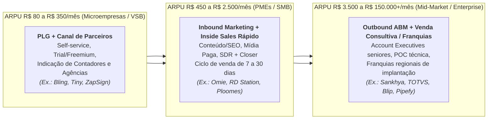

> [!important] O Canal de Contadores e Franquias: A Lição da Omie e da RD Station
> Como vender software para 6 milhões de PMEs brasileiras cujo dono não sabe o que é "ERP" ou "Inbound Marketing" e não procura isso no Google?
> - A **RD Station** treinou e certificou milhares de **agências de marketing digital** em todo o Brasil: cada agência vendia seus serviços de gestão de tráfego/conteúdo levando o software da RD Station embaixo do braço para os clientes.
> - A **Omie** e a **Conta Azul** atacaram o interlocutor de maior confiança do pequeno empresário brasileiro: **o seu contador**. Ao fornecer gratuitamente ao escritório contábil um painel que importa automaticamente as notas fiscais e a movimentação bancária da PME (eliminando grande parte da digitação manual de extratos e conciliação no fechamento mensal), transformaram o contador no principal canal prescritor do ERP junto à sua carteira de dezenas de empresas clientes (modelo que a Omie combinou a uma rede nacional de franquias regionais de venda e implantação). Na sua operação, meça diretamente esse efeito na base: compare a taxa de cancelamento dos clientes que emitiram a primeira nota fiscal e conectaram o contador nos primeiros 14 dias com a dos clientes que não completaram essa ativação.

---

### 4. Unit economics de Horizontal B2B SaaS no Brasil

No Brasil, a variável que mais determina a sobrevivência de startups de SaaS focadas em pequenas empresas (SMB) é o **Churn Mensal**. Um churn de receita aparentemente "pequeno" de **3,5% ao mês** significa perder **35% da sua base de clientes todo ano**: exigindo que a empresa corra desesperadamente na esteira comercial apenas para ficar do mesmo tamanho.

Por isso, todo negócio de Horizontal SaaS brasileiro precisa ser gerido por quatro métricas operacionais e de coorte:

1. **GRR (*Gross Revenue Retention*) vs. NRR (*Net Revenue Retention*):**
   - **GRR** mede quanto da receita do início do ano permanece viva 12 meses depois (sem contar *upsells*). Em SMB no Brasil, um GRR saudável fica entre **80% e 88% ao ano**, em Mid-Market/Enterprise, deve ficar **entre 90% e 95% ao ano**.
   - **NRR** soma ao GRR a expansão da base atual (venda de novos módulos, aumento de assentos/volume de notas fiscais e **receita de Fintech/Pagamentos embarcados**). Os melhores SaaS para PMEs no Brasil compensam a mortalidade natural de pequenos negócios (churn de 1,5% a 2,0% a.m.) gerando **2,5% a 3,5% a.m. de expansão financeira (boletos, Pix, antecipação de recebíveis)** nos clientes sobreviventes, atingindo **NRR na faixa de 105% a 120% ao ano**.
2. **CAC Payback Period (em meses de Margem Bruta):** Número de meses necessários para recuperar o custo de aquisição de um cliente: calcula-se o custo total de vendas e marketing (CAC) dividido pela margem bruta mensal gerada por ele (ARPU × Margem Bruta). No Brasil, com juros altos, o *CAC Payback* em PMEs deve ficar na faixa de **6 a 10 meses**. Em Mid-Market e Enterprise, a meta situa-se entre **10 e 18 meses**.
3. **LTV / CAC Ratio:** Deve situar-se consistentemente **acima de 3,5x** (índices muito acima de 5,0x podem sinalizar subinvestimento em aquisição comercial), sempre calculado com margem bruta real após descontar custos de nuvem AWS/GCP, mensageria de WhatsApp da Meta, certificados e equipe de *Customer Success* e suporte.
4. **SaaS Magic Number e Burn Multiple:**
   **Magic Number = (ARR do Trimestre Atual − ARR do Trimestre Anterior) / Gasto de Vendas e Marketing do Trimestre Anterior**
   Acima de **0,75x a 1,0x**, a máquina comercial mostra eficiência para receber mais capital. Abaixo de 0,5x, injetar dinheiro em vendas queima caixa sem retorno. Em conjunto com o *Magic Number*, monitore o **Burn Multiple** (queima líquida de caixa dividida pelo ARR líquido novo adicionado no período), mantendo-o abaixo de **1,5x**.

#### Tabela de Benchmarks de Horizontal B2B SaaS no Brasil por Segmento de Cliente

| Segmento Alvo | ARPU Mensal Típico (R$) | Ciclo Médio de Venda | Logo Churn Mensal Aceitável | NRR Anual Alvo | CAC Payback Alvo | Modelo de GTM Dominante | Casos Brasileiros de Referência |
|---|---|---|---|---|---|---|---|
| **Microempresas / E-commerce Sellers (VSB)** | R$ 80 a R$ 350 / mês | 1 a 7 dias (Self-Service) | 2,0% a 3,2% a.m. | 95% a 108% (via upgrade de plano e fintech) | 2 a 5 meses | PLG, SEO, YouTube, Contadores, Afiliados | Bling, Tiny, ZapSign, Contabilizei |
| **Pequenas e Médias Empresas (SMB)** | R$ 450 a R$ 2.500 / mês | 10 a 30 dias | 1,0% a 1,8% a.m. | 105% a 120% (fortemente impulsionado por Embedded Finance) | 6 a 10 meses | Inbound + Inside Sales + Canal de Contadores/Franquias | Omie, ContaAzul, RD Station, Clicksign, Qive (Arquivei) |
| **Mid-Market Brasileiro** | R$ 3.500 a R$ 20.000 / mês | 30 a 90 dias | 0,5% a 0,9% a.m. | 110% a 125% | 10 a 15 meses | Outbound SDR + Field/Inside AE + Parceiros de Implantação | Sankhya, Ploomes, Senior, Dootax |
| **Enterprise Nacional e Global** | R$ 25.000 a R$ 150.000+ / mês | 90 a 240 dias | < 0,3% a 0,5% a.m. | 115% a 135% | 12 a 18 meses | ABM, Executivos de Contas Seniores, RFP/POC, Integradores | TOTVS, Pipefy, Blip, Sensedia |

---

### 5. Casos reais brasileiros

> [!example] Caso 1: Omie e ContaAzul, Transformando o ERP e o Contador na porta bancária da PME
> Tanto a **Omie** (fundada por Marcelo Lombardo e Rafael Olmos) quanto a **ContaAzul** (fundada em Joinville por Vinicius Roveda e sócios) entenderam cedo que o pequeno empresário brasileiro evita planilhas financeiras complexas, mas precisa emitir notas fiscais, enviar boletos e Pix para seus clientes e entregar os documentos fiscais do mês ao contador sem pagar multa. Ao conectarem a conta bancária da PME e o sistema do escritório contábil em tempo real, essas plataformas eliminaram a redigitação manual e deram o passo estratégico seguinte: **acoplar conta digital, cobrança e originação de crédito dentro do próprio ERP (operando por meio de veículo autorizado pelo Banco Central, como a Omie.Cash IP, ou em parceria com infraestruturas de *Banking-as-a-Service*, correspondentes bancários e FIDCs)**. Quando o empresário emite uma nota fiscal dentro do ERP, o boleto registrado ou QR Code Pix já sai gerado pela plataforma, o contas a pagar liquida os fornecedores no mesmo painel e a antecipação de recebíveis ocorre no fluxo de trabalho, multiplicando o ARPU muito além da mensalidade de software.

> [!example] Caso 2: Qive (ex-Arquivei) e Clicksign, Dominando um gargalo burocrático brasileiro específico
> Em vez de tentar construir um ERP inteiro do zero contra a TOTVS ou a SAP, a **Qive (fundada em São Carlos como Arquivei)** atacou uma única dor aguda que tirava o sono de qualquer diretor financeiro e fiscal no Brasil: saber exatamente todas as Notas Fiscais Eletrônicas (NF-e e CT-e) emitidas contra o CNPJ da empresa na SEFAZ antes mesmo de o caminhão chegar à portaria, evitando multas pesadas por falta de escrituração e fraudes de notas frias. Com uma entrada rápida e *time-to-value* de minutos, conquistou mais de 100 mil empresas e depois expandiu horizontalmente para automação de contas a pagar e conciliação fiscal. De modo análogo, a **Clicksign** focou em resolver a burocracia brasileira de reconhecimento de firma e coleta de assinaturas em contratos, integrando validadores locais, WhatsApp e APIs bancárias que a tornaram a infraestrutura padrão de assinatura eletrônica de fintechs, imobiliárias e seguradoras no país.

---

### 6. Armadilhas fatais em Horizontal B2B SaaS no Brasil

1. **Vender software com ticket de PME (R$ 199/mês) usando força de vendas cara de Enterprise:** Um SDR (R$ 8.000 de custo total) e um executivo de contas (R$ 12.000) custam juntos R$ 20.000 por mês. Se essa dupla fizer três reuniões de vídeo de uma hora por prospecto e fechar cinco contratos mensais de R$ 250, o CAC será de R$ 4.000 por cliente e o *Payback* levará quase dois anos, prazo em que metade dessas microempresas já terá cancelado. **Ticket abaixo de R$ 400/mês exige venda self-service (PLG), dentro do WhatsApp ou em lotes via canal de contadores e parceiros.**
2. **Negligenciar o Onboarding nos primeiros 14 dias (A Perda Precoce por Falta de Ativação):** Em software de gestão (ERP, CRM, Financeiro), o cliente que cadastra o cartão de crédito hoje, mas não configura seu certificado digital A1, não importa seus produtos e não emite a primeira nota fiscal ou cobrança nos primeiros **7 a 14 dias**, apresenta probabilidade de cancelar até o 3º mês muito superior à de quem conclui essas etapas na semana inicial. Implantação guiada por IA, importadores automáticos de planilhas e XMLs da SEFAZ e ativação assistida no primeiro dia reduzem de forma consistente o cancelamento nos primeiros 90 dias.
3. **Subestimar o Custo de Mensageria da API Oficial do WhatsApp e de Inferência de LLMs na Margem Bruta:** Muitos SaaS brasileiros de atendimento e CRM cobram uma mensalidade fixa de R$ 299 "com mensagens e IA ilimitadas", esquecendo que desde julho de 2025 a Meta passou a cobrar por mensagem de *template* entregue (nas categorias de marketing, utilidade e autenticação, conforme tabela por país da *WhatsApp Business Platform*) e os provedores de LLM cobram por milhão de *tokens*. Sem cobrança variável por consumo (*usage-based pricing* ou pacotes de créditos de mensagens/IA), os clientes mais pesados destroem a margem bruta da startup.

> [!tip] Checklist de Validação para Fundadores de Horizontal B2B SaaS
> - [ ] O produto possui um **fosso de localização brasileira** difícil de ser copiado por ferramentas globais genéricas (integração fiscal SEFAZ/Prefeituras, Reforma Tributária IBS/CBS, Pix/Boletos, Open Finance, WhatsApp ou legislação local)?
> - [ ] A máquina de Go-to-Market é matematicamente compatível com o ARPU (**CAC Payback de 6 a 10 meses para PMEs** e **de 10 a 18 meses para Mid-Market/Enterprise**)?
> - [ ] O usuário atinge o **"Momento Aha!" (Primeiro Valor Entregue)** em menos de 24 horas após o cadastro, sem depender de 60 dias de consultoria manual?
> - [ ] A precificação possui eixos claros de expansão automática (**assentos, volume de notas/transações, pacotes de IA ou serviços financeiros embarcados**) que sustentam **NRR > 108% ao ano**?

---

### Filtro de Alinhamento e Prontidão: Perguntas de Validação Prática

Na plataforma de automação financeira de **Lucas e Marina**, aplicar o Teste do Bloqueio de Faturamento e estruturar o canal de escritórios contábeis parceiros reduziu o CAC de aquisição em PMEs e ancorou a retenção líquida da base.

Antes de construir um SaaS B2B horizontal para PMEs ou empresas de médio porte no Brasil, responda com franqueza direta:

1. **O Teste do Bloqueio de Faturamento:** Se o seu software parar amanhã às 9h, seu cliente fica impedido de emitir nota fiscal, receber Pix/boleto, assinar contratos ou fechar a contabilidade, ou a empresa dele continua operando normalmente sem você?
2. **A Matemática do Ticket vs. Canal:** Se sua mensalidade (*ARPU*) é de R$ 150 a R$ 400/mês, você tem um motor *PLG* e parceria com contadores (onde um único escritório contábil parceiro pode indicar de 15 a 50 PMEs da sua carteira ao longo do tempo), ou paga vendedores outbound caros para caçar microempresas uma a uma?
3. **Preparação Arquitetural para o IVA Dual e para o Split Payment (LC 214/2025):** Seu motor fiscal já destaca as alíquotas de teste de CBS (0,9%) e IBS (0,1%) nas notas fiscais de 2026 e possui arquitetura modular pronta para a entrada plena da CBS em 2027 e para a retenção tributária automática na liquidação financeira (*split payment*, previsto nos arts. 31 a 35 da LC 214/2025)?

**O Movimento de Segunda-Feira:** Nos próximos 15 dias, visite dez escritórios de contabilidade (100 a 500 PMEs cada) e descubra qual dor no fechamento mensal faria o contador indicar seu sistema para toda a carteira.


---

## CAPÍTULO 40: VERTICAL SAAS: SISTEMAS OPERACIONAIS SETORIAIS COM PAGAMENTOS, CRÉDITO E IA EMBARCADOS

### A ilusão do mercado pequeno e a multiplicação da receita por cliente via serviços financeiros e IA setorial

Durante anos, investidores generalistas subestimaram o software dedicado a um único setor específico (*Vertical SaaS*) no Brasil olhando apenas a conta de multiplicação de licenças: 15 mil estabelecimentos pagando R$ 300 de mensalidade dariam um mercado endereçável aparentemente limitado, levando muitos fundadores a construir sistemas horizontais rasos que não resolvem a rotina decisiva de nenhuma vertical.

O fundador experiente, aplicando a lição de Toast, Procore e ServiceTitan à realidade brasileira, compreendeu a alavanca que multiplica o tamanho real desses mercados: **no software específico por setor (*Vertical SaaS*), a mensalidade é a porta de entrada para se tornar o sistema de registro central da operação. A maior fatia da receita vem de capturar uma fração das transações financeiras, compras de insumos, seguros e automações de IA que passam diariamente por aquele balcão**.

Essa é **A Arquitetura das Quatro Camadas de Monetização do Vertical SaaS (1. Assinatura do Sistema de Registro + 2. Agentes de IA Setoriais + 3. Pagamentos/Fintech + 4. Crédito e Insumos B2B)**: quando você constrói o sistema específico para clínicas odontológicas, oficinas mecânicas, imobiliárias, transportadoras, salões, academias ou postos de combustível, o cliente passa oito horas por dia na sua tela. O *churn* cai para menos de 1% ao mês, o boca a boca derruba o CAC pela metade e você multiplica a receita por cliente (*ARPU*) em 4x a 9x (saltando, por exemplo, de R$ 200/mês apenas no software para R$ 900 a R$ 1.800/mês) ao embutir Pix/maquininha conciliada, antecipação de recebíveis, compra B2B e recepcionistas de IA no WhatsApp.

Enquanto o software horizontal disputa categorias amplas de escritório, o **Vertical SaaS** aprofunda-se nas regras operacionais, regulatórias e financeiras de um único setor para capturar múltiplas camadas de receita na mesma conta.

---

> [!note] Síntese Executiva da Vertical
> Se o Horizontal SaaS constrói ferramentas genéricas que servem para qualquer empresa, o **Vertical SaaS** constrói o **Sistema Operacional Completo (*Control Point*)** de um único setor da economia: clínicas odontológicas, salões de beleza, oficinas mecânicas, academias, escritórios de advocacia, construtoras, transportadoras, escolas privadas ou restaurantes. Durante anos, fundos evitaram nichos verticais no Brasil por considerar pequeno o mercado endereçável (TAM) de mensalidades puras de software. Essa leitura mudou quando ficou provado que **o sistema de registro (*System of Record*) é a porta de entrada para capturar o fluxo financeiro do balcão**: ao acoplar **Agentes de IA no WhatsApp, Pagamentos Embarcados (*Embedded Payments*), Crédito de Giro e Compra de Insumos B2B**, uma Vertical SaaS brasileira multiplica seu ARPU por **4x a 9x**.

---

### 1. A tese do Vertical SaaS no Brasil: por que o "TAM pequeno" era uma ilusão óptica

Considere o setor de **oficinas mecânicas independentes e centros automotivos** no Brasil (estimado em cerca de 120 mil estabelecimentos formais por entidades setoriais como o Sindirepa/Sebrae), o de **salões de beleza, barbearias e clínicas de estética** (mais de 500 mil pequenos negócios ativos segundo levantamentos do Sebrae e da ABIHPEC) ou o de **clínicas médicas e odontológicas** (cerca de 220 mil estabelecimentos ambulatoriais médicos no CNES/Ministério da Saúde e cerca de 180 mil consultórios e clínicas odontológicas registrados no CFO em 2024/2025, somando aproximadamente 400 mil unidades de atendimento).

Se você analisar qualquer um desses setores apenas pela ótica do software tradicional:

- **50.000 estabelecimentos conquistáveis × R$ 200/mês de assinatura de software = R$ 120 milhões/ano de ARR máximo**. Para um fundo de VC tradicional, parecia um teto baixo.

Agora aplique a **Equação Moderna de Vertical SaaS + Embedded Fintech + IA**:
- Nos segmentos de clínicas médicas, odontológicas e centros automotivos estruturados, uma parcela de 50.000 estabelecimentos de porte médio fatura em torno de **R$ 50.000 por mês** (R$ 600.000/ano), movimentando **R$ 30 bilhões por ano de faturamento bruto**, dos quais uma plataforma de SaaS vertical bem integrada captura de 30% a 60% em TPV processado diretamente nas suas soluções de pagamento embarcadas. (Barbearias e salões individuais enquadrados como MEI, cujo teto anual é de R$ 81.000 pela LC 123/2006, observados os projetos de atualização em tramitação no Congresso, ficam fora desse recorte de médio porte.)
- Quando a sua Vertical SaaS passa a processar os pagamentos (maquininha Smart POS integrada ao sistema, link de pagamento Pix/cartão e cobrança recorrente), antecipar os recebíveis de cartão parcelado em 6x, originar capital de giro para reforma do espaço, vender insumos no *marketplace* B2B embutido e cobrar por um agente de IA que agenda horários 24/7 no WhatsApp do estabelecimento, o seu **ARPU mensal salta de R$ 200 (só software) para R$ 900 a R$ 1.800 por estabelecimento**.
- Aquele nicho de R$ 120 milhões/ano em software puro passa a somar entre R$ 420 milhões e R$ 960 milhões adicionais em serviços financeiros, atingindo um mercado endereçável total de **R$ 540 milhões a R$ 1,08 bilhão por ano em receita bruta de plataforma (50.000 × R$ 900 a R$ 1.800 × 12, antes dos custos de captura e liquidação)**, com forte barreira contra concorrentes estrangeiros generalistas.


---

### 2. Anatomia do "Sistema de Registro" (*System of Record*): como dominar um setor

Um Vertical SaaS só conquista o direito de monetizar transações financeiras se ele for o **Sistema de Registro e Operação Primário (*System of Record*)** onde os funcionários do cliente passam 8 horas por dia trabalhando. Uma ferramenta horizontal como Trello, Notion ou Excel nunca terá esse poder em uma clínica odontológica ou oficina mecânica porque não conhece a semântica específica da profissão.

Para dominar uma vertical no Brasil, seu produto precisa entregar **quatro pilares hiper-específicos do setor desde o primeiro dia**:

1. **O Fluxo de Trabalho Único do Ofício (*Domain-Specific Workflow*):**
   - Em **odontologia** (ex.: **Dental Office**, **Simples Dental / Henry Schein**): o dentista precisa do **odontograma visual interativo dente a dente e face a face**, plano de tratamento orçado com aprovação pelo paciente, integração com radiografia digital e faturamento no padrão **TISS da ANS** para convênios odontológicos.
   - Em **salões de beleza, barbearias e clínicas de estética** (ex.: **Trinks**, **Avec**, **Gendo**, **Belle Software**): a principal dor fiscal e operacional do proprietário é o cálculo da **Lei do Salão-Parceiro (Lei nº 13.352/2016)**. Quando uma cliente paga R$ 300 no cartão pela mecha de cabelo, o sistema desconta automaticamente a taxa da maquininha, baixa os 15g de pó descolorante do estoque e executa o **split fiscal e financeiro automático na fonte**: 50% caem direto na conta do cabeleireiro parceiro e 50% caem na conta do salão. Esse *split* exige contrato escrito de parceria homologado pelo sindicato ou órgão trabalhista nos termos da Lei nº 13.352/2016 e observância às regras de emissão de nota fiscal da cota-parte na transição para CBS e IBS, hipótese em que a cota do profissional-parceiro não compõe a receita bruta do salão.
   - Em **academias, boxes de CrossFit, estúdios de Pilates e escolas de esportes** (ex.: **Tecnofit**, **EVO / W12**, **Pacto**, **Next Fit**): o sistema precisa destravar fisicamente a **catraca biométrica facial** na entrada apenas se o aluno estiver adimplente e com exame/PAR-Q em dia, processar **cobrança recorrente inteligente no cartão de crédito** (cobrando mês a mês sem consumir o limite total anual do cartão do aluno) e entregar o aplicativo de treino na mão do professor e do aluno.
   - Em **construção civil e incorporadoras** (ex.: **Sienge / Grupo Softplan**, **Construct IN**, **Obra Prima**): orçamento por composição **SINAPI**, medição físico-financeira de empreiteiros no canteiro de obras, gestão de múltiplas SPEs e repasse bancário Caixa.
2. **A Recepcionista e Vendedora de IA no WhatsApp como Diferencial Competitivo:** Na maioria dos pequenos negócios de serviços no Brasil (clínicas médicas, consultórios odontológicos, estéticas, salões, oficinas, pet shops e escolas de idiomas), o proprietário perde agendamentos porque a recepcionista está ocupada no balcão ou porque o cliente envia mensagem no WhatsApp às 21h30 querendo marcar horário para o dia seguinte e fica sem resposta (exatamente a dor vivida pela clínica odontológica da **Dra. Camila** em Belo Horizonte no Volume 1, Capítulo 7). Em 2026, vence o Vertical SaaS que embute um **Agente de IA conectado diretamente à grade real de horários vagos do sistema**. Ele conversa com naturalidade no WhatsApp do estabelecimento, consulta a agenda em tempo real, reserva a terça-feira às 14h, cobra R$ 50 de sinal via Pix para reduzir o *no-show* (faltas) e já cria a ficha do cliente no sistema, superando concorrentes legados que oferecem apenas uma agenda passiva na tela do computador.
3. **Pagamentos Integrados (*Integrated POS & Split*) que Eliminam o Erro de Caixa:** O funcionário da recepção não pode digitar o valor na maquininha de cartão separada do computador (onde ocorrem erros de digitação, fraudes de troca de maquininha e horas perdidas batendo tirinhas de papel no fim do dia). Na Vertical SaaS madura, o comando sai do software direto para o terminal Smart POS na bancada: o pagamento só é confirmado pelo valor exato da comanda, a nota fiscal (NFS-e/NFC-e) é emitida sozinha e a conciliação bancária nasce 100% pronta.
4. **Originação de Crédito com Assimetria de Dados (*Proprietary Underwriting*):** Um banco tradicional nega crédito para uma clínica de estética ou oficina mecânica de bairro porque enxerga apenas o balancete contábil defasado. A sua Vertical SaaS, porém, enxerga em tempo real que aquela clínica tem R$ 180 mil de procedimentos agendados para as próximas 4 semanas, taxa de cancelamento de 3% e crescimento de 18% ao ano. A agenda futura informa o modelo de risco, enquanto a garantia jurídica da operação é constituída pela cessão fiduciária ou ônus sobre a agenda de recebíveis de cartão e Pix registrada em registradora autorizada pelo Banco Central (CERC, Núclea ou B3, sob a Resolução CMN nº 4.734/2019 e normas do BCB). Sendo o crédito emitido por SCD, banco parceiro ou FIDC (em parceria com infraestruturas como **Asaas**, **Celcoin**, **Zoop**, **Dock**, **Stark Bank** ou FIDCs estruturados), essa visibilidade operacional permite conceder capital de giro ou financiar equipamentos com inadimplência inferior à de carteiras sem visibilidade de balcão.

---

### 3. Mapa das Principais Verticais de SaaS Setorial no Brasil

#### Tabela de Oportunidades, Monetização e Casos de Referência em Vertical SaaS

| Setor Vertical no Brasil | Nº Estimado de Estabelecimentos | Dor Operacional Central (O Wedge) | Camada de Fintech / Transação Embarcada | Ticket SaaS + ARPU Total (Com Fintech) | Casos Brasileiros e Globais de Referência |
|---|---|---|---|---|---|
| **Clínicas Médicas e Consultórios** | ~220.000 estabelecimentos ambulatoriais e >575 mil médicos em atividade (CNES/DataSUS e *Demografia Médica* CFM 2024/2025; ~400 mil estabelecimentos somando saúde médica e odontológica) | Prontuário eletrônico (CFM), prescrição digital (Memed), faturamento TISS/TUSS para convênios e redução de faltas | Cobrança de consultas particulares, antecipação de repasses de planos de saúde e crédito médico | R$ 200–600 (SaaS) → R$ 900–2.500 (Total) | **Brasil:** Afya (iClinic, Medicinae, Shosp), Feegow, Amplimed<br/>**Global:** Athenahealth, eClinicalWorks |
| **Clínicas e Consultórios Odontológicos** | ~180.000 clínicas e consultórios e >400 mil cirurgiões-dentistas (estatísticas do CFO e Sebrae) | Odontograma digital, orçamento parcelado de implantes/ortodontia e confirmação via WhatsApp | Parcelamento recorrente no cartão/boleto para tratamentos longos e compra B2B de insumos dentais | R$ 150–450 (SaaS) → R$ 800–2.200 (Total) | **Brasil:** Simples Dental (Henry Schein), Dental Office, Clinicorp |
| **Salões de Beleza, Barbearias e Estética** | ~500.000+ formais | Agenda multiprofissional, estoque de insumos por ml/g e **Split da Lei do Salão-Parceiro** | Maquininha com *split* automático salão/profissional, sinal via Pix no agendamento e conta digital | R$ 120–350 (SaaS) → R$ 650–1.800 (Total) | **Brasil:** Trinks (Stone), Avec, Gendo, Belle Software<br/>**Global:** Boulevard, Vagaro, Fresha |
| **Academias, CrossFit, Pilates e Assessorias** | ~45.000 academias e estúdios | Controle de acesso por catraca facial, treinos no app e inadimplência de mensalidades | Cobrança recorrente no cartão sem tomar limite, Pix recorrente e venda de suplementos/planos anuais | R$ 250–700 (SaaS) → R$ 1.100–3.000 (Total) | **Brasil:** Tecnofit, EVO (W12), Pacto, Next Fit<br/>**Global:** Mindbody, Glofox |
| **Restaurantes, Bares e Padarias** | ~1.200.000 ativos | PDV ágil, KDS na cozinha, ficha técnica de CMV, integração delivery e autoatendimento | Smart POS na mesa, *split* de gorjeta (10%), conciliação de vales-refeição e antecipação de recebíveis | R$ 180–550 (SaaS) → R$ 950–2.800 (Total) | **Brasil:** Linx Degust, Saipos, Goomer, Anota AI, Consumer<br/>**Global:** Toast (NYSE: TOST) |
| **Construção Civil, Engenharia e Incorporação** | ~150.000 construtoras e escritórios | Orçamento SINAPI, diário de obra, medição de empreiteiros, compras de cimento/aço e SPEs | Cotação e compra B2B financiada de materiais de construção, antecipação para fornecedores e seguro garantia | R$ 800–5.000 (SaaS) → R$ 2.500–12.000 (Total) | **Brasil:** Sienge (Softplan), Obra Prima, Construct IN<br/>**Global:** Procore |
| **Oficinas Mecânicas e Centros Automotivos** | ~120.000 oficinas | Ordem de serviço com fotos/vídeo pelo WhatsApp, placa/chassi e cotação de autopeças | Catálogo integrado de compra de autopeças B2B + parcelamento do conserto no cartão em até 12x | R$ 150–400 (SaaS) → R$ 700–2.000 (Total) | **Brasil:** Ultracar, Oficina Inteligente, Cilia (orçamentação)<br/>**Global:** ShopMonkey, ServiceTitan |
| **Escolas Privadas, Cursos e Idiomas** | ~42.000 escolas privadas + cursos | Secretaria acadêmica, diário do professor, comunicação com os pais e inadimplência escolar (8%–15%) | **Garantia de receita escolar** (a plataforma adianta 100% das mensalidades no dia 5 e assume a cobrança dos pais) | R$ 500–3.000 (SaaS) → R$ 3.000–15.000 (Total) | **Brasil:** Arco/isaac, Sponte, ClassApp, Agenda Edu, WPensar |

---

### 4. Unit economics de Vertical SaaS: por que o Churn é baixo e o CAC é menor que no Horizontal

Quando bem executada, uma empresa de Vertical SaaS apresenta métricas financeiras superiores às de um SaaS horizontal de mesmo porte por três razões estruturais:

1. **CAC Mais Baixo por Concentração de Canal e Efeito Boca a Boca de Guilda:** Médicos dermatologistas vão aos mesmos 3 congressos anuais da SBD, pertencem aos mesmos grupos de WhatsApp de residência médica e compram dos mesmos fornecedores, donos de oficinas mecânicas ou de academias de *crossfit* se conhecem todos na mesma cidade. Em vez de disputar palavras-chave genéricas caríssimas no Google ("software de gestão financeira" a R$ 35 o clique), o Vertical SaaS domina os eventos, associações e influenciadores técnicos daquela única profissão, derrubando o CAC.
2. **Logo Churn Estruturalmente Baixo (entre 0,8% e 1,2% ao mês após a ativação):** Trocar uma ferramenta de *e-mail marketing* leva uma tarde. Trocar o sistema onde estão guardados 15.000 prontuários médicos, todas as fichas técnicas de receitas, a catraca biométrica dos alunos, as maquininhas de cartão e o histórico fiscal do negócio leva meses e paralisa o balcão. Uma vez implantado o sistema operacional setorial com pagamentos acoplados, o cliente raramente sai.
3. **Expansão em Camadas e NRR acima de 120%:** Você conquista o cliente no Mês 1 cobrando R$ 249/mês pela agenda e prontuário. No Mês 3, ativa a confirmação e o agendamento por IA no WhatsApp (+R$ 150/mês). No Mês 4, pluga a maquininha e o Pix integrado, capturando 1,2% de *take rate* líquido sobre R$ 60.000 de faturamento mensal da clínica (+R$ 720/mês). No Mês 9, oferece uma linha de capital de giro ou parcelamento garantido para os clientes finais (+R$ 300/mês). A mesma clínica que entrou pagando R$ 249/mês passa a gerar **R$ 1.419/mês de receita líquida** para a sua startup: uma **expansão de receita de cerca de 5,7x naquela conta individual**, impulsionando o NRR consolidado da coorte acima de 120% ao ano sem custo adicional de aquisição comercial.

---

### 5. Casos reais brasileiros e globais que definiram o playbook

> [!example] Caso 1: Toast e ServiceTitan (Referências Globais), Como um SaaS de nicho vale dezenas de bilhões de dólares
> Dois casos norte-americanos criaram a cartilha mundial que hoje guia os melhores fundadores brasileiros:
> - A **Toast** (NYSE: TOST) começou vendendo software de ponto de venda e gestão exclusivamente para restaurantes nos EUA. Hoje, **mais de 80% da receita total da Toast não vem da assinatura do software, e sim de Fintech (processamento de pagamentos das mesas e do delivery e empréstimos de capital de giro Toast Capital)**, usando o software e o hardware da cozinha como barreira competitiva difícil de replicar.
> - A **ServiceTitan** construiu um império atendendo um setor aparentemente "sem glamour": prestadores de serviços residenciais de ar-condicionado (HVAC), encanadores, eletricistas e dedetizadores, digitalizando desde o atendimento telefônico e despacho da van do técnico até o financiamento do equipamento na casa do cliente.

> [!example] Caso 2: Afya (iClinic, Medicinae, Além da Medicina, Shosp e PEBMED), Clinicorp e Simples Dental, Consolidação e Fintech na Saúde e Odontologia Brasileira
> No Brasil, o grupo **Afya** (listado na Nasdaq) compreendeu que acompanhar o médico desde o primeiro ano da faculdade de medicina até o consultório particular exigia adquirir e integrar os principais *Vertical SaaS* clínicos do país (como **iClinic**, **Prontmed**, **gooru**, **Medicinae** e **Memed**), combinando prontuário eletrônico, suporte à decisão clínica e serviços financeiros médicos. Na odontologia e estética avançada, empresas como a **Clinicorp** (nascida em Santa Catarina) e o **Simples Dental** demonstraram o poder de combinar gestão clínica, CRM de vendas de tratamentos de alto valor (implantes, alinhadores invisíveis, harmonização facial) e meios de pagamento/recorrência integrados, escalando para dezenas de milhares de clínicas com crescimento lucrativo.

> [!example] Caso 3: Isaac (Arco Educação), Tecnofit e Trinks, Quando o produto financeiro resolve a maior dor do setor
> - Nas **escolas privadas brasileiras**, a maior dor do mantenedor nunca foi apenas lançar notas no boletim, e sim a **inadimplência de cerca de 10% das famílias que atrasavam o boleto da mensalidade**, deixando a escola apertada para pagar os professores no quinto dia útil. O **isaac** (adquirido pela Arco Educação em 2022) redesenhou a categoria ao unir gestão financeira escolar com **Garantia de Receita** para mais de mil escolas parceiras: o colégio recebe 100% do valor contratado das mensalidades na data combinada todos os meses, enquanto a plataforma assume a régua de cobrança, os meios de pagamento e o risco de crédito.
> - Em **academias e estúdios**, a **Tecnofit** (Curitiba) e a **EVO (W12)** transformaram a cobrança recorrente no cartão e a gestão de retenção de alunos no motor central do negócio.
> - Em **salões de beleza**, o **Trinks** (investido/integrado pela **Stone**) e a **Avec** usaram a automação do *split* de pagamentos da Lei do Salão-Parceiro para capturar tanto a assinatura de software quanto o volume transacional das maquininhas de milhares de salões e barbearias.

---

### 6. Armadilhas fatais em Vertical SaaS

1. **Tentar construir a infraestrutura regulatória de banco e adquirência do zero no Dia 1:** Um erro clássico de fundadores de Vertical SaaS é gastar 18 meses e R$ 5 milhões tentando obter autorização própria de Sociedade de Crédito Direto (SCD) ou de Instituição de Pagamento (IP) no Banco Central ou certificações PCI-DSS antes mesmo de ter 500 clientes usando o software todo dia. **Nos primeiros anos, concentre-se em construir o melhor software operacional do setor e integre o *Embedded Finance* via APIs *White-Label* de instituições devidamente autorizadas pelo Banco Central (como Asaas, Zoop, Celcoin, Pagar.me, Dock ou Efí), observando a disciplina de *Banking-as-a-Service* da Resolução Conjunta nº 16/2025.** Lembre-se de que a Resolução BCB nº 494/2025 extinguiu a antiga dispensa por volume da Resolução BCB nº 80/2021 (exigindo autorização prévia do BCB para atuar como IP própria) e de que, mesmo operando via parceiro *White-Label* autorizado, a plataforma de SaaS mantém deveres contratuais rigorosos de validação cadastral (KYC), prevenção à lavagem de dinheiro e a fraudes (PLD/FT) e proteção de dados (LGPD).
2. **Cair na armadilha da "Fábrica de Software sob Encomenda" para clientes grandes do setor:** Quando sua Vertical SaaS começa a vender para redes maiores (uma rede com 30 clínicas ou uma construtora grande), o cliente dirá: *"Eu fecho o contrato se vocês desenvolverem essas 14 telas exclusivas para o meu processo"*. Se você aceitar, sua equipe de engenharia vira uma consultoria terceirizada barata, seu código-fonte se fragmenta em dezenas de versões incompatíveis e sua margem bruta despenca. **Toda funcionalidade construída em um Vertical SaaS deve servir para pelo menos 30% a 50% de todos os clientes daquele setor, configurável por parâmetros, nunca por *forks* de código.**
3. **Ignorar a migração de dados legados no Onboarding:** O dono de uma clínica médica com 12 anos de vida tem 25.000 fichas de pacientes salvas em um software antigo em servidor local ou no concorrente. Se você disser a ele *"Assine nosso sistema e comece do zero amanhã"*, ele jamais mudará. **As melhores empresas de Vertical SaaS constroem importadores dedicados (*migrators*) para os 5 maiores sistemas legados do seu setor, executando a migração mediante autorização formal do controlador (clínica), contrato de operador de dados pessoais (arts. 37 a 40 da LGPD, observadas as bases legais para dados sensíveis de saúde do art. 11) e respeito às normas de guarda e integridade de prontuário do CFM e do CFO**, migrando o histórico de clientes, agendamentos futuros e financeiro em 24 horas.
4. **Ir para uma Segunda Vertical antes de consolidar a liderança e empilhar as quatro camadas de receita na Primeira ("Horizontalização Prematura"):** Fundadores ansiosos conquistam 300 salões de beleza (menos de 0,1% do mercado) e já querem adaptar o sistema para atender oficinas mecânicas, pet shops e escritórios de contabilidade. Ao fazer isso, o produto perde a profundidade específica que o tornava imbatível, o marketing perde o foco e um concorrente especializado engole seu mercado original. **Afunde um quilômetro de profundidade na sua primeira vertical (Software → IA → Pagamentos → Crédito e Insumos B2B) antes de abrir um segundo setor adjacente.**

> [!tip] Checklist de Execução para Fundadores de Vertical SaaS
> - [ ] O nicho escolhido no Brasil possui pelo menos **15.000 a 50.000 estabelecimentos ativos no mercado endereçável qualificado** (ou base equivalente de empresas médias) com **TPV anual agregado superior a R$ 15 bilhões**, permitindo liderar o segmento com as camadas de pagamentos e crédito ativas antes de expandir para setores adjacentes?
> - [ ] O software atua como o **Sistema de Registro Diário (*System of Record*)** insubstituível do estabelecimento (agenda, prontuário, ordem de serviço, PDV ou ERP setorial), e não como um acessório periférico?
> - [ ] A plataforma já possui **importadores automatizados de dados** dos 3 a 5 sistemas legados mais comuns daquele setor para eliminar a fricção de troca?
> - [ ] O produto incorpora nativamente um **Agente de IA no WhatsApp** conectado ao banco de dados operacional do cliente (agendamento, orçamento, cobrança ou atendimento técnico)?
> - [ ] O *roadmap* de monetização acopla **Embedded Payments (Pix, Boleto, Smart POS com Split)** e **antecipação/crédito via parceiro BaaS**, visando elevar a receita de Fintech para **≥ 40% a 60% da receita total da companhia** em até 36 meses?

---

### Filtro de Alinhamento e Prontidão: Perguntas de Validação Prática

Antes de escrever código ou estruturar parcerias financeiras em um nicho vertical, valide se a economia do balcão comporta a arquitetura de quatro camadas.

Antes de escolher um nicho para construir um Vertical SaaS no Brasil, passe o setor escolhido por estas três perguntas de fogo:

1. **O Teste do Volume Total de Pagamentos (*TPV*, com *take rate* líquido de 0,8% a 2,2%):** As empresas desse nicho movimentam pelo menos R$ 50 mil por mês em recebimentos, pagamentos ou compra de insumos que seu software pode intermediar e conciliar capturando de 0,8% a 2,2% de *take rate* líquido?
2. **Dor Específica vs. Planilha Genérica:** O setor possui regras operacionais tão específicas (odontograma na odonto, placa/orçamento na oficina, TISS na clínica, medição na obra) que um ERP genérico jamais o atende bem?
3. **Efeito de Rede de Guilda:** Os donos de empresas desse setor frequentam as mesmas feiras, grupos de WhatsApp e sindicatos, permitindo dominar o boca a boca da categoria?

**O Movimento de Segunda-Feira:** Nos próximos 15 dias, sente-se ao lado do balcão de dez empresas do nicho escolhido e liste todas as abas, cadernos, maquininhas e planilhas que elas abrem das 8h às 18h.


---

## CAPÍTULO 41: SERVIÇOS PROFISSIONAIS B2B DE ALTA MARGEM, CONSULTORIAS, SOFTWARE HOUSES, EXPORTAÇÃO DE ENGENHARIA (NEARSHORING) E BPO

### Geração de caixa sem diluição, arbitragem cambial no nearshoring e disciplina na taxa de utilização

Um projeto de engenharia de dados vendido por preço fechado de R$ 180 mil sem controle de escopo nem gestão de capacidade de folha pode facilmente consumir 4.000 horas técnicas e deixar R$ 240 mil de prejuízo no caixa. Ainda assim, empreendedores focados exclusivamente em rodadas de *Venture Capital* costumam olhar com desdém para consultorias especializadas de engenharia, dados, nuvem e IA, *software houses* de alta senioridade, exportadoras de *nearshoring* e operações de *BPO tech-enabled*, repetindo o clichê de que *"serviços não escalam"*. Enquanto startups sem ajuste ao mercado queimam capital em produtos sem demanda, fundadores disciplinados de serviços B2B constroem operações de R$ 50 milhões a R$ 300 milhões de receita anual sem diluição societária, gerando lucro recorrente e vendendo o negócio para consultorias globais (como Accenture e Globant), consolidadores nacionais (como Stefanini e TOTVS) ou fundos de *Private Equity* mantendo 80% a 100% do *cap table*. Na distribuição desses lucros aos sócios no Brasil, é indispensável calibrar pró-labore, reinvestimento e dividendos: desde janeiro de 2026 (Lei nº 15.270/2025), a distribuição de dividendos por uma mesma pessoa jurídica a uma mesma pessoa física acima de R$ 50 mil em um mesmo mês sofre retenção de 10% de IRRF na fonte, somada ao ajuste anual da tributação mínima da alta renda.

Onde o operador amador de serviços quebra? Quando vende horas baratas de programação genérica sem especialização, mantém 35% da folha ociosa no "banco de reservas" (*bench*), aceita escopo fechado mal precificado e depende de um único cliente para 60% da receita.

O operador experiente apoia-se em três fundamentos operacionais: **manter de 75% a 82% de utilização faturável da equipe técnica, firmar contratos recorrentes de alocação de *squads* e explorar a sobreposição de 4 a 7 horas úteis por dia entre o fuso de Brasília (UTC-3) e a jornada comercial dos Estados Unidos (costas Leste e Oeste)**. Exportar engenharia brasileira sênior de IA, dados e computação em nuvem faturada em dólar ou reinvestir o lucro líquido dos serviços para financiar um produto próprio (*Service-to-Product*) consolidou-se como uma das trajetórias mais consistentes de geração de caixa sem diluição societária precoce no país.

A diferença entre uma consultoria artesanal sufocada por escopos abertos e uma máquina de serviços tecnológicos de alta margem reside no rigor com que os sócios gerenciam utilização faturável, precificação em moeda forte e propriedade intelectual reutilizável.

---

> [!note] Síntese Executiva da Vertical
> Se você perguntar no Vale do Silício qual é o único caminho para construir uma empresa de tecnologia, a resposta padrão será *"levantar Venture Capital para construir um SaaS puro e queimar caixa por 5 anos"*. Mas quando você analisa as transações de fusões e aquisições (*M&A*) de negócios digitais fechadas no Brasil na última década, encontra um fato contraintuitivo: **o setor de Serviços Profissionais B2B de Tecnologia, Engenharia de Software, Consultoria Especializada, Implementação Enterprise e BPO Tech-Enabled é um dos principais formadores de fundadores capitalizados sem aporte externo (*bootstrapped*) no ecossistema brasileiro de tecnologia**. Ao vender inteligência aplicada, execução decisiva e transformação digital com **fluxo de caixa positivo desde o primeiro contrato (Dia 1)**, grandes fundadores brasileiros construíram impérios de centenas de milhões, e até bilhões, de reais sem diluir seu *equity* na largada.

---

### 1. Por que Serviços B2B Tech-Enabled são a Maior Escola de Geração de Caixa do Brasil

Construir um produto SaaS do zero exige de 12 a 24 meses de engenharia antes de atingir o *Product-Market Fit*, período em que a startup tem receita próxima de zero e queima capital. Em contrapartida, uma **Consultoria de Engenharia de Dados/IA, Implementadora de ERP/CRM, Software House Especializada ou Operação de BPO Financeiro Automatizado** já nasce resolvendo uma dor urgente pela qual médios e grandes clientes corporativos pagam **R$ 30.000 a R$ 500.000+ por mês** a partir da assinatura do contrato.

Três forças estruturais tornam o Brasil um dos melhores lugares do mundo para construir empresas de serviços tecnológicos e profissionais B2B na década de 2020:

1. **O Déficit Crônico de Execução Técnica nas Médias e Grandes Empresas:** Bancos, seguradoras, indústrias, redes varejistas e grupos do agronegócio sabem que precisam migrar sistemas legados para a nuvem, limpar seus *Data Lakes*, implementar agentes de Inteligência Artificial Generativa, integrar seus ERPs (SAP, TOTVS, Oracle) e automatizar o atendimento no WhatsApp. Porém, eles não conseguem recrutar, reter e gerir internamente dezenas de engenheiros de IA, arquitetos de dados e especialistas em cibersegurança. Eles preferem pagar um prêmio de 40% a 80% sobre a folha para contratar uma **consultoria especializada que entrega a squad pronta, gerenciada e com SLA**.
2. **A Vantagem Geopolítica e de Fuso Horário do *Nearshoring* Brasileiro (Exportação de Engenharia para os EUA):** Desde 2022, a Seção 174 do código tributário norte-americano exige amortizar em 15 anos as despesas de P&D realizadas fora dos Estados Unidos, tratamento mantido para o P&D externo mesmo após a lei fiscal norte-americana de julho de 2025 restaurar a dedução imediata para o P&D doméstico. Ainda assim, a arbitragem salarial e o fuso horário falaram mais alto: empresas norte-americanas de tecnologia e *Fortune 500* expandiram a contratação de engenheiros seniores na América Latina para substituir posições locais de US$ 180.000 a US$ 250.000 por ano por equipes remotas no mesmo fuso (*Nearshore*). Enquanto a Índia e o Leste Europeu operam com diferenças de **8 a 12 horas de fuso horário** (dificultando reuniões à tarde com Nova York, São Francisco ou Austin), **o Brasil (UTC-3) fica a 1 ou 2 horas da Costa Leste (Nova York) e a 4 ou 5 horas da Costa Oeste (São Francisco), garantindo de 4 a 7 horas diárias de expediente comercial simultâneo com os Estados Unidos**, afinidade cultural ocidental e uma das maiores bases de desenvolvedores seniores do mundo.
3. **A Revolução da IA Interna Multiplicando a Margem do BPO e da Consultoria (*Service-as-a-Software*):** Historicamente, empresas de serviços tinham margem bruta limitada a 30%–40% porque cada novo cliente exigia contratar mais analistas humanos na mesma proporção. Hoje, uma empresa de **BPO Financeiro/Contábil, Consultoria Tributária ou Fábrica de Software** que cobra **preço fechado mensal por escopo/resultado (*Fixed-Fee / Outcome-Based*)** e utiliza internamente copilotos de código (Cursor, Claude Code, GitHub Copilot) e agentes autônomos de IA para concluir em **4 horas** as rotinas de código, testes ou conciliação que antes consumiam **10 horas de um analista júnior** (redução de 60% do esforço operacional, equivalente a executar em 40 horas um escopo antes estimado em 100 horas) captura todo o ganho de produtividade diretamente como **expansão substancial de margem EBITDA (elevando-a de ~15% para a faixa de 30% a 40%)**.

---

### 2. As 5 Grandes Subverticais de Serviços B2B e seus Múltiplos de M&A

| Subvertical | Modelo de Receita Predominante | Margem Bruta / EBITDA Meta | Múltiplo de M&A Típico (EV / EBITDA) |
|---|---|---|---|
| **1. Consultorias de Engenharia de Software, IA, Dados e *Nearshoring* (Exportação USD)** | Contratos anuais de *Squads Gerenciados* (*Managed Pods*), projetos de *Data & AI Engineering* e *Staff Augmentation* sênior faturados em BRL ou USD. | **Margem Bruta: 40% a 55% / EBITDA: 18% a 30%** | **6x a 12x EBITDA** (chegando a 10x–14x em operações de porte com alta fatia de receita recorrente em dólar e especialização em Dados/IA/Cloud, conforme relatórios de M&A de assessores financeiros do setor; valores indicativos sujeitos ao ciclo de juros) |
| **2. Implementadoras e Parceiros de Ecossistemas Enterprise (SAP, Salesforce, ServiceNow, TOTVS, AWS/GCP/Azure, VTEX, HubSpot)** | Projetos de implantação/migração + licenciamento (*revenda com rebate*) + **AMS (*Application Management Services*: sustentação recorrente 24/7)**. | **Margem Bruta: 38% a 50% / EBITDA: 16% a 26%** | **8x a 14x EBITDA** (Gigantes globais como Accenture, Globant, NTT Data e IBM compram parceiros certificados a múltiplos premium) |
| **3. Consultorias Estratégicas, Financeiras (M&A, Turnaround, FP&A), Tributárias e de Gestão** | *Retainer* mensal fixo + **Success Fee** (1,5% a 5% sobre a transação de M&A, economia gerada no *turnaround* ou crédito tributário recuperado e homologado). | **Margem Bruta: 50% a 70% / EBITDA: 25% a 45%** | **5x a 9x EBITDA** (ou modelo de *Partnership* distribuindo milhões em dividendos anuais aos sócios) |
| **4. BPO (*Business Process Outsourcing*) Tech-Enabled (Financeiro, Contábil, Folha, Jurídico de Massa, CX)** | Assinatura mensal recorrente (**MRR de R$ 1.500 a R$ 25.000/mês**) para assumir o departamento financeiro, contábil, fiscal ou atendimento da empresa cliente. | **Margem Bruta: 45% a 65% / EBITDA: 20% a 35%** | **6x a 10x EBITDA** (Altíssima previsibilidade e retenção pela dor de troca do backoffice) |
| **5. Agências de Performance, Growth, Martech, CRM e *Venture Studios* B2B** | *Fee* mensal fixo de operação de mídia/CRM/SEO + variável sobre performance (*ROAS / Revenue Share*) ou *equity* em projetos co-criados. | **Margem Bruta: 35% a 55% / EBITDA: 15% a 28%** | **4x a 7x EBITDA** (Sobe para 8x+ quando focada em Martech Enterprise / Dados / CRM) |

#### Aprofundamento Operacional: A Matemática da Exportação de Engenharia (*Nearshoring*) e do BPO Tech-Enabled

Considere a arbitragem econômica real de uma consultoria brasileira de engenharia de software e IA que vende para clientes operando em polos como Nova York, Texas e Califórnia (estruturada via exportação direta de serviços a partir do Brasil, com isenção de ISS e PIS/COFINS no ingresso de divisas, ou via subsidiária *LLC/C-Corp* norte-americana, observadas as regras de preços de transferência da Lei nº 14.596/2023, o IOF cambial e a ausência de tratado contra bitributação entre os dois países):
- Um **Engenheiro de Software Sênior ou Engenheiro de Dados/IA** excelente no Brasil custa para a consultoria entre **R$ 18.000 e R$ 28.000/mês** (cerca de **US$ 3.500 a US$ 5.400/mês** totalmente carregado com encargos ou contrato PJ sênior + benefícios).
- Esse mesmo engenheiro alocado em uma *squad* gerenciada para um cliente norte-americano é faturado a uma taxa horária (*Bill Rate*) de **US$ 65 a US$ 110 por hora** (ou **US$ 10.400 a US$ 17.600 por mês** considerando 160 horas úteis). Nas operações de **BPO Tech-Enabled** (terceirização de processos financeiros, fiscais, jurídicos ou de atendimento com uso intensivo de IA e automação), a mesma lógica se aplica trocando a cobrança por hora pela cobrança por volume de processos resolvidos com margem bruta de 45% a 65%.
- Para o CTO norte-americano em Nova York ou São Francisco, pagar **US$ 12.000/mês** por um engenheiro sênior fluente em inglês no Brasil, trabalhando no mesmo expediente diário das equipes dos EUA, representa uma **economia de 40% a 50%** frente ao custo total de um engenheiro local norte-americano (US$ 20.000 a US$ 25.000/mês somando salário-base, *equity*, seguro-saúde e encargos).
- Para a consultoria brasileira, faturar US$ 12.000/mês com custo direto de US$ 4.800/mês gera **Margem Bruta de 60% em moeda forte**, além de desoneração tributária indireta na exportação de serviços: não incidência de ISS quando o resultado do serviço se verifica no exterior (art. 2º, I, da LC 116/2003), não incidência de PIS (art. 5º, II, da Lei 10.637/2002) e de COFINS (art. 6º, II, da Lei 10.833/2003) nos serviços prestados a residente no exterior com ingresso de divisas, e imunidade permanente de IBS e CBS sobre exportações (EC 132/2023, CF art. 156-A, § 1º, III, e art. 195, § 16, e LC 214/2025), permanecendo devidos o IRPJ e a CSLL sobre o lucro (recomenda-se parecer tributário formal antes de precificar).

#### Consultorias de ecossistema: implementação e integração sobre plataformas líderes (SAP, Salesforce, ServiceNow, TOTVS e nuvens)

Um dos caminhos mais seguros e menos glamourizados para construir uma empresa de R$ 100 milhões a R$ 1 bilhão de valuation é tornar-se o **parceiro número 1 de implementação e sustentação de uma plataforma Enterprise que está crescendo rápido**.
Quando a **Salesforce, ServiceNow, SAP (S/4HANA), TOTVS, AWS, Google Cloud, Databricks, Snowflake, HubSpot ou VTEX** vendem uma licença anual de R$ 2 milhões para um grande grupo empresarial brasileiro, **o fabricante do software não quer fazer a implementação braçal, a migração de dados legados e a customização de regras de negócio**. Ele indica e entrega o cliente na mão de uma **Consultoria Parceira Certificada (*Gold / Platinum / Premier Partner*)**:
- Para cada **R$ 1,00 que uma grande empresa investe em licença de SAP, Salesforce ou ServiceNow**, o dispêndio em **projetos corporativos complexos costuma igualar ou superar o valor da própria assinatura, chegando a múltiplos de R$ 1,50 a R$ 3,00 em serviços de consultoria de implementação, integração e sustentação contínua (AMS: *Application Management Services*)**.
- O próprio time comercial da gigante global (**Account Executives da AWS, Salesforce, SAP ou Databricks**) passa a atuar como **canal de originação de negócios para a sua consultoria**, trazendo clientes corporativos qualificados porque o executivo da fabricante sabe que, se o projeto for bem implementado, o consumo de nuvem e licenças crescerá no ano seguinte.
- Quando a sua consultoria acumula 150 a 400 profissionais certificados naquela tecnologia específica, as gigantes globais de consultoria (**Accenture, Globant, Capgemini, NTT Data, Deloitte, IBM**) batem na sua porta para **comprar a sua empresa por múltiplos de 8x a 14x EBITDA**: porque para elas é muito mais rápido e barato comprar uma operação pronta com 300 especialistas certificados em ServiceNow, Databricks ou SAP do que tentar contratar e treinar 300 especialistas do zero.

---

### 3. A economia unitária das empresas de serviços: 6 métricas essenciais

> [!tip] A Equação Fundamental da Lucratividade em Serviços Profissionais
> Uma empresa de serviços profissionais quebra quando erra a gestão de capacidade da sua folha de pagamento. Toda segunda-feira às 8h da manhã, o CEO e o COO de uma consultoria ou *software house* precisam auditar as seis métricas da tabela a seguir, conectadas por esta equação de receita:
> $$\text{Receita Líquida} = \text{Headcount Técnico} \times \text{Horas Disponíveis} \times \text{Taxa de Utilização Billable (\%)} \times \text{Tarifa Média Efetiva (Blended Rate)}$$

| Métrica Operacional e Financeira | Fórmula e Significado Prático | Benchmark de Excelência (Top Quartile) | Zona Decisiva de Risco |
|---|---|---|---|
| **1. Taxa de Utilização Faturável (*Utilization Rate*)** | $\frac{\text{Horas Faturadas em Clientes}}{\text{Total de Horas Disponíveis da Equipe Técnica}}$ (descontando férias e feriados) | **78% a 86%** (Consultores Plenos/Seniores), **60% a 70%** (Gerentes/Arquitetos), **30% a 40%** (Sócios/Diretores) | **< 65% na média da equipe** (significa que mais de um terço das horas pagas da equipe técnica não gera faturamento, somando ociosidade em bancada/*bench*, retrabalho, pré-venda e reuniões internas) |
| **2. Custo de Bancada (*Bench Cost Rate*)** | % da folha técnica que está temporariamente sem projeto alocado aguardando o fechamento comercial de novas demandas | **3% a 7% da folha técnica** (pulmão saudável para iniciar projetos rápidos) | **> 12% da folha técnica** por mais de 45 dias seguidos |
| **3. Margem Bruta por Projeto (*Project Gross Margin / Delivery Margin*)** | $\frac{\text{Receita Líquida do Projeto} - \text{Custo Direto das Horas Alocadas}}{\text{Receita Líquida do Projeto}}$ | **45% a 60%** (Regra do 1,8x a 2,5x: o preço cobrado do cliente deve equivaler a 1,8x a 2,5x o custo direto total da hora alocada, chegando a 3,0x ou 67% de margem bruta em *nearshoring* em dólar) | **< 32%** (incapaz de pagar despesas comerciais, G&A, impostos e gerar EBITDA de 20%) |
| **4. Receita Anual por Colaborador (*Revenue per Employee / FTE*)** | Receita Líquida Anual Total dividida pelo número total de pessoas da empresa (incluindo administrativo e vendas) | **R$ 320.000 a R$ 550.000 / ano** (Mercado Nacional); **R$ 600.000 a R$ 1,1M / ano** (*Nearshoring* / IA / Estratégia) | **< R$ 180.000 / ano por colaborador** (operação inchada de juniores ou precificação subvalorizada) |
| **5. Índice de Recorrência da Receita (*Contracted Recurring Revenue %*)** | % do faturamento que vem de contratos contínuos (> 12 meses: *Squads*, AMS, *Retainers*, BPO) vs. projetos pontuais de tiro curto | **> 70% da receita em contratos contínuos de 12–36 meses** com reajuste anual | **< 30% recorrente** ("Montanha-russa": todo dia 1º do mês você começa devendo a folha sem saber o que vai vender) |
| **6. Concentração de Receita no Maior Cliente (*Top-1 / Top-3 Client Concentration*)** | % da receita total dependente do maior cliente individual e dos 3 maiores clientes somados | **Maior cliente < 15% da receita**; Top-3 somados < 35% | **Um único cliente > 35% a 50% da receita** (dependência decisiva de um único contrato, com risco severo de ruptura de caixa em caso de rescisão) |

#### A Escada de Evolução da Precificação em Serviços B2B

Para sair da guerra de preços por hora-homem e multiplicar a margem e o múltiplo de valuation da sua empresa, suba deliberadamente os quatro degraus do modelo de contratação:

1. **Degrau 1: Alocação Técnica (*Staff Augmentation*):** Você aloca um desenvolvedor para reforçar a capacidade técnica de um projeto do cliente. No Brasil, nos termos da Lei nº 6.019/1974 (art. 4º-A, § 1º), é a empresa prestadora que contrata, remunera e dirige o trabalho dos seus profissionais: o cliente define prioridades de negócio, mas submeter o trabalhador a subordinação direta e controle de jornada pelo tomador gera risco de vínculo empregatício com o cliente (ver Volume 8, Capítulo 6). **Vantagem:** Venda rápida e risco de escopo fechado próximo de zero. **Desvantagem:** *Commodity* pura, em que o cliente pressiona o *markup* para 25% a 30% e tenta contratar o profissional diretamente.
2. **Degrau 2: *Squads Gerenciadas / Pods Dedicados (Time & Materials com Governança)*:** Você não vende CPFs avulsos, você vende uma **célula multidisciplinar completa** (1 Tech Lead + 3 Engenheiros + 1 QA + fração de Product Manager/Agile Master) com metodologia própria, métricas de vazão (*throughput*, qualidade de código, DORA metrics) e substituição transparente sem dor de cabeça para o cliente. **Margem Bruta sobe para 42%–50%**.
3. **Degrau 3: *Escopo Fechado Produtizado / Aceleradores Proprietários (Productized Services)*:** Você resolve um problema altamente repetitivo (ex. *"Migração de SAP ECC para S/4HANA em 16 semanas"*, *"Implementação de Data Lakehouse em Databricks + Painel Executivo de CFO em 60 dias"* ou *"Auditoria de Cibersegurança e Adequação ISO 27001"*). Como a sua equipe já fez isso 40 vezes e possui **bibliotecas de código prontas, *templates*, conectores proprietários e agentes de IA internos**, um projeto que levaria 1.000 horas para ser feito do zero é entregue pela sua equipe em **300 horas**, mas você cobra pelo **valor do pacote fechado (R$ 250.000)**: atingindo **65% a 75% de Margem Bruta**!
4. **Degrau 4: Sustentação Recorrente (*Managed Services / AMS*) + Propriedade Intelectual e SaaS Híbrido:** Após entregar o projeto de implantação, os clientes migram para contratos plurianuais de **Sustentação Contínua, Monitoramento e Evolução (contratos de 24 a 36 meses)** combinados ao licenciamento recorrente de conectores e aceleradores proprietários. É nesse estágio que a empresa captura as faixas superiores de múltiplo indicadas na tabela do capítulo (**8x a 12x EBITDA** para consultorias de engenharia digital e sustentação recorrente, podendo alcançar **10x a 14x EBITDA** quando aceleradores proprietários e receita recorrente de software passam a representar parcela relevante do faturamento).

---

### 4. Casos Brasileiros Icônicos: De Garagens de Serviços a Bilhões na Bolsa

> [!example] Estudo de Caso: CI&T, Compass UOL (AI/R), Stefanini, Indicium e Visagio/Falconi
> - **CI&T (Campinas/SP: NYSE: CINT):** Fundada em 1995 por Cesar Gon, Bruno Guiçardi e Fernando Matt, três recém-formados em Engenharia de Computação pela Unicamp sem um centavo de Venture Capital no início. Começaram como uma pequena fábrica de software em Campinas, criaram uma metodologia própria de *Lean Digital* e escalaram atendendo gigantes como Itaú, Coca-Cola, Johnson & Johnson e Google. Na década de 2010, expandiram a exportação de engenharia digital (*Nearshoring*) para os Estados Unidos, Europa e Ásia, e entre 2021 e 2022 adquiriram concorrentes como a Dextra (no interior paulista) e a Somo (no Reino Unido), abriram capital diretamente na **Bolsa de Nova York (NYSE)** em 2021 com avaliação multibilionária e hoje contam com mais de 6.000 profissionais globalmente liderando a transição para engenharia de software aumentada por IA (*CI&T FLOW*).
> - **Compass UOL / Grupo AI/R (Passo Fundo/RS e São Paulo/SP):** Fundada nos anos 1990 em Passo Fundo (RS) por Alexis Rockenbach e adquirida pelo Grupo UOL em 2013 (quando contava com cerca de 170 funcionários), a companhia expandiu-se e deu origem ao grupo global AI/R em 2023. Cresceu formando talentos em polos universitários fora dos grandes centros saturados, adquiriu empresas especializadas em dados, nuvem AWS e inteligência artificial no Brasil (como Invillia e Everymind) e nos Estados Unidos (como Avenue Code e Edgy) e reuniu cerca de 5.000 profissionais no início de 2025 com foco em transformação digital e IA para clientes corporativos.
> - **Stefanini (São Paulo/SP):** Fundada por Marco Stefanini em 1987 em São Paulo a partir de cursos de treinamento em informática e consultoria de sistemas (conforme trajetória institucional publicada pela companhia), tornou-se a multinacional brasileira de tecnologia mais internacionalizada do país, presente em mais de 40 países, com mais de 30.000 colaboradores e bilhões de reais em receita anual, combinando serviços gerenciados de TI, cibersegurança, BPO e dezenas de *ventures* adquiridas ou incubadas no ecossistema do grupo.
> - **Indicium (Florianópolis/SC):** Consultoria especializada em **Engenharia de Dados, Analytics e IA (*Modern Data Stack*: dbt, Snowflake, Databricks)**. Fundada em Florianópolis com crescimento inicial financiado pelo próprio caixa (*bootstrapped*), estruturou operação bilíngue para atender grandes corporações no Brasil e nos Estados Unidos e, em 2024, recebeu um aporte de crescimento de **US$ 40 milhões da gestora norte-americana Columbia Capital** para acelerar sua expansão internacional.
> - **Falconi e Visagio (Consultoria de Gestão, Operações e Engenharia de Negócios):** Na esfera da consultoria de gestão e transformação operacional, a **Falconi** (fundada pelo Professor Vicente Falconi em Minas Gerais, aplicando o método PDCA e Gestão por Diretrizes nas maiores empresas privadas e governos do Brasil) e a **Visagio** (nascida no Rio de Janeiro com forte DNA de engenharia de produção da UFRJ, analytics, automação de processos e *people platform*) provaram que consultorias brasileiras podem vencer McKinsey, BCG e Bain dentro de casa quando entregam **implementação mão na massa e resultado financeiro medido no caixa**.

---

### 5. Armadilhas Fatais em Empresas de Serviços Profissionais e Software Houses

> [!warning] As 5 Armadilhas Clássicas que Quebram Consultorias, Agências e Software Houses
> 1. **A Armadilha do "Escopo Fechado com Requisitos Abertos" (*Scope Creep* Mortal):** O erro que mais faliu software houses na história. O fundador vende o desenvolvimento de um "aplicativo + painel web" por um preço fixo de **R$ 180.000 em 4 meses** baseado em um briefing de 3 páginas. No 2º mês, o cliente muda de ideia sobre as telas, pede mais 15 integrações com ERPs legados mal documentados e diz que *"isso estava implícito no escopo"*. O projeto que deveria levar 4 meses leva **11 meses**, consome **R$ 420.000 em salários de desenvolvedores**, gera um **prejuízo líquido de R$ 240.000** e ainda termina em briga judicial! **Regra de sobrevivência:** Nunca precifique escopo fechado de desenvolvimento sob medida sem antes vender **uma etapa inicial paga de descoberta, *Especificação Técnica e Prototipação* (de 2 a 4 semanas por R$ 20k–R$ 40k)**, ou trabalhe no modelo de **Orçamento por Capacidade/Sprints (*Time & Materials* com teto mensal e backlog priorizado pelo cliente)**.
> 2. **Contratar na Frente da Demanda ("Otimismo de Pipeline Comercial"):** Um diretor comercial diz que está *"90% certo"* de fechar um contrato de 25 engenheiros com um grande banco no mês seguinte. Com receio de atrasar a entrega, o CEO contrata os 25 engenheiros de imediato (adicionando R$ 500.000/mês de folha fixa). O jurídico e a área de compras do banco levam **5 meses** para assinar o contrato. Nesse período de *bench* ocioso, a consultoria consome **R$ 2,5 milhões de caixa acumulado** e compromete seu capital de giro. **Contrate apenas com contrato assinado** e mantenha um **Banco de Talentos Pré-Aprovados (*Talent Pool / Warm Bench*)** de profissionais mapeados ou parceiros homologados com cláusula de início em 10 a 15 dias após a ordem de serviço.
> 3. **Armadilha Trabalhista da "Pejotização Subordinada Malfeita":** No Brasil, muitas empresas de tecnologia contratam profissionais seniores como Pessoa Jurídica (tipicamente Sociedade Limitada Unipessoal no Simples Nacional ou Lucro Presumido, visto que atividades intelectuais de desenvolvimento de software e engenharia são vedadas ao regime de MEI pela LC 123/2006). Se a empresa tratar o prestador PJ exatamente como um empregado CLT subordinado (exigindo batida de ponto rígida, aplicando advertência disciplinar por escrito, exigindo atestado médico para descontar horas, proibindo substituição e mantendo pessoalidade e subordinação direta sem autonomia contratual), **qualquer rescisão vira uma Reclamação Trabalhista pedindo reconhecimento de vínculo empregatício dos últimos 5 anos** (férias + 1/3, 13º salário, FGTS + 40% e INSS, multiplicando o passivo retroativo). Estruture modelos jurídicos consistentes, lembrando que nenhum arranjo é imune a questionamento, que o uso de cooperativas para intermediar mão de obra subordinada é vedado pela Lei nº 12.690/2012 (arts. 5º e 17) sob pena de multa e vínculo, e que a licitude da contratação civil/PJ segue sob julgamento de repercussão geral no STF no Tema 1.389 (com mérito ainda pendente em outubro de 2026, ver Volume 8, Capítulo 6): combine **CLT competitiva** (utilizando benefícios flexíveis e PLR, Participação nos Lucros e Resultados desvinculada da remuneração nos termos da Lei nº 10.101/2000) ou **contratos B2B reais de prestação de serviços técnicos** para perfis autônomos de alta senioridade, sempre revisados por advogado trabalhista especializado.
> 4. **O Mito de "Construir um SaaS nas Horas Vagas com o Time Ocioso da Software House":** Todo dono de *software house* tem o sonho de usar os desenvolvedores que estão no *bench* entre um projeto e outro para "criar um produto SaaS próprio". A maioria dessas tentativas fracassa porque, sem separação de caixa e de equipe, assim que entra um cliente pagando R$ 50.000 à vista por um projeto de consultoria, os sócios arrancam os desenvolvedores do "SaaS interno" para atender o cliente pagante. O produto fica pela metade, sem *Product Manager* dedicado e sem equipe de vendas de SaaS (cujo ciclo e ticket diferem da venda de projetos), virando um cemitério de código. Quando a transição de serviço para produto (*Service-to-Product*) funciona de verdade, como fizeram **Lucas e Marina** nos Volumes 1 a 4 (que primeiro entregaram conciliação manual como serviço e depois transformaram o código repetido em plataforma SaaS), os sócios separam um CNPJ ou unidade de negócio independente, alocam uma equipe pequena 100% dedicada ao produto (que jamais é puxada para projetos de consultoria) e financiam a operação com metas claras de validação.
> 5. **Dependência Absoluta do Fundador como Único Vendedor e Arquiteto Principal:** Enquanto o fundador for a única pessoa capaz de fazer a reunião comercial, desenhar a proposta técnica e apagar os incêndios de entrega nos clientes, a empresa baterá num teto intransponível de **R$ 5 milhões a R$ 8 milhões de faturamento anual** e não terá valor de venda em um M&A (pois se o fundador sair, o negócio evapora). Para romper a barreira dos **R$ 20 milhões a R$ 100 milhões/ano**, documente playbooks de entrega, separe a máquina de prospecção/vendas (*Outbound ABM + Parcerias de Ecossistema*) da operação e crie um modelo de **Partnership (Sociedade Meritocrática / Vesting de Quotas ou Phantom Shares)** que transforme seus melhores líderes de entrega e contas em sócios de longo prazo.

---

### Filtro de Alinhamento e Prontidão: Perguntas de Validação Prática

Na revisão semanal de segunda-feira às 8h, aplique os quatro critérios a seguir para proteger a margem e a liquidez da operação.

Antes de abrir ou escalar uma consultoria de tecnologia, *software house*, operação de *nearshoring* ou BPO *tech-enabled*, valide três critérios de entrada:

1. **A Auditoria da Sexta-Feira (Utilização e Margem):** Você sabe toda sexta-feira às 17h qual foi a taxa de utilização faturável (*billable utilization*) de cada profissional da folha e a margem bruta individual de cada contrato ativo?
2. **Horas Comoditizadas vs. Especialização/Retainer:** Mais de 70% da sua receita vem de contratos recorrentes de *squads*, *managed services* ou implementação especializada (IA, cibersegurança, dados, SAP/Cloud), ou você caça projetos pequenos todo mês?
3. **Alavancagem de IA, Moeda Forte e Cliente-Âncora:** Você já usa agentes de IA internamente para entregar com 40% do esforço o escopo que antes consumia 100% das horas, já fatura parte da operação em dólar ou euro (com não incidência de ISS, PIS e COFINS e imunidade de IBS e CBS na exportação) e conta com um cliente-âncora disposto a financiar os primeiros 6 a 12 meses de *squad* em uma especialidade técnica clara que generalistas não entregam?

**O Movimento de Segunda-Feira:** Nos próximos 15 dias, audite a margem real hora a hora dos seus contratos ativos, reprecifique os 10% piores e crie uma oferta padronizada (*Productized Service*) de diagnóstico de 15 dias.


---

## CAPÍTULO 42: AI-NATIVE, MODELOS FUNDACIONAIS, AGENTES AUTÔNOMOS, INFRAESTRUTURA DE DADOS E MLOPS

### A Morte da Casca Fina (*Thin Wrapper*) e a Engenharia de Margem na Economia de Inferência

Toda grande onda tecnológica atrai projetos superficiais que confundem interface com produto. Na Inteligência Artificial Generativa, esse erro ocorre quando um fundador conecta a API comercial (paga por *token*) de um modelo fundacional norte-americano na sexta-feira, monta uma tela de chat em torno de um *prompt* no fim de semana e passa a vender uma assinatura de R$ 99 mensais com uso ilimitado na segunda-feira. Em poucos meses, o negócio enfrenta dois gargalos simultâneos. Na atualização seguinte da OpenAI, da Anthropic ou do Google, o próprio laboratório incorpora aquela função nativamente em sua plataforma. E os 10% de usuários mais intensivos (*power users*) consomem milhões de *tokens*, gerando uma fatura de inferência em dólar superior à receita mensal arrecadada em reais.

Como mostra Peter Thiel em *De Zero a Um*, a concorrência em tecnologia comoditizada leva a margem a zero, e apenas tecnologia proprietária, efeitos de rede, economias de escala ou marca sustentam um negócio defensável: aplicado à IA, modelo alugado por API sem dados próprios, fluxo de trabalho integrado ou canal de distribuição vira arbitragem passageira. **A IA altera a física econômica do software**: a margem bruta passa a exigir engenharia de inferência, e a cobrança tradicional por assento (*per-seat*) encolhe quando um único agente executa o trabalho de dez operadores.

As empresas **AI-Native** vencedoras no Brasil combinam três pilares operacionais: **agem dentro do sistema de registro do cliente (SEFAZ, PJe, TISS, BCB, ERP), roteiam chamadas entre modelos leves e pesados para proteger a margem bruta e cobram por trabalho resolvido (*outcome-based pricing*)**.

Em São Paulo e Florianópolis, **Lucas e Marina** viveram esse choque quando lançaram o primeiro agente explicador de crédito e conciliação da sua plataforma de tesouraria: ao enviarem todas as chamadas diretamente para o modelo fundacional mais pesado em dólar, a fatura de inferência corroeu a margem bruta dos clientes mais ativos em três semanas, forçando a dupla a redesenhar a arquitetura com roteamento em cascata e suíte própria de avaliação (*evals*).

---

### Além do Chatbot na Lateral da Tela: O Que Separa um Sistema de Ação AI-Native de um SaaS Tradicional Maquiado

Existe uma diferença estrutural entre uma empresa de software tradicional que adicionou um botão de geração de texto ("SaaS com IA acoplada") e uma empresa genuinamente **AI-Native**. No software clássico, humanos operam interfaces gráficas (telas, filtros, formulários e botões) para processar informações e registrar decisões em bancos de dados relacionais, com lógica de negócio 100% determinística codificada em regras fixas (*if/then/else*). Em uma empresa AI-Native, modelos fundacionais, modelos especializados de menor porte e fluxos de agentes autônomos executam diretamente o trabalho operacional, enquanto a interface gráfica serve para supervisionar agentes, aprovar exceções e auditar o que a máquina realizou.

Para o fundador brasileiro, compreender onde posicionar a empresa dentro da pilha tecnológica de Inteligência Artificial é uma questão de sobrevivência financeira. Disputar infraestrutura bruta com gigantes globais que investem dezenas de bilhões de dólares por trimestre em *data centers* e chips é inviável para uma startup. Em compensação, construir na camada de aplicação e orquestração vertical, resolvendo dores profundamente enraizadas na burocracia tributária, jurídica, clínica, financeira, agrícola e comercial do Brasil, representa a maior janela de criação de valor desde a transição para a nuvem e o smartphone.

---

### Onde Competir e Onde Não Competir nas 4 Camadas da Pilha de IA (Silício, Modelos Fundacionais, Infra/MLOps e Aplicações Agênticas)

Para navegar o setor com clareza analítica, é fundamental dissecar a cadeia de valor da Inteligência Artificial em quatro camadas interdependentes, cada qual com suas leis de retorno de escala, exigência de capital e fossos competitivos:

#### Camada 1: Silício, Cloud/GPUs e Energia

É a fundação física da era da IA: aceleradores gráficos e tensores (GPUs de data center da NVIDIA, Google TPUs, AWS Trainium/Inferentia, AMD Instinct), redes de interconexão de altíssima largura de banda (InfiniBand), *hyperscalers* globais (AWS, Azure, Google Cloud), *neoclouds* especializadas em computação de alta densidade (CoreWeave, Lambda) e infraestrutura crítica de geração e transmissão elétrica com refrigeração líquida.

No Brasil, o custo de importação de GPUs de ponta sem enquadramento em regime de *Ex-Tarifário*, incentivos de P&D ou no regime especial de tributação para centros de processamento de dados (**Redata**, instituído pela MP nº 1.318/2025 e convertido na Lei nº 15.504/2026, que suspende PIS, COFINS, IPI e Imposto de Importação para equipamentos de TIC de *data centers*, conforme detalhado no Capítulo 27) é proibitivo para startups em estágio inicial, tornando o aluguel de capacidade em nuvem ou *serverless GPU* o caminho padrão. Em contrapartida, o país possui uma assimetria estrutural estratégica no nível de infraestrutura pesada: uma matriz elétrica acima de 82% a 85% renovável (segundo o Balanço Energético Nacional da EPE), somada à conectividade de cabos submarinos em polos como Fortaleza e o eixo São Paulo–Campinas, posicionando o território nacional como hub de *data centers* sustentáveis para inferência regional e cargas de treinamento globais.

#### Camada 2: Modelos Fundacionais (Proprietários e Abertos) e Small Language Models (SLMs)

Compreende os grandes modelos de linguagem e multimodais de fronteira, tanto proprietários acessados via API (famílias GPT e modelos de raciocínio da OpenAI, Claude da Anthropic, Gemini do Google) quanto modelos de pesos abertos (*open-weights*, como Llama da Meta, Qwen, Mistral e DeepSeek), além dos **Small Language Models (SLMs)** especializados (modelos de 1B a 14B de parâmetros ajustados para domínios restritos).

A lição econômica central para o ecossistema brasileiro é direta: **não levante capital de risco local para tentar treinar um modelo fundacional generalista do zero para competir com laboratórios de fronteira**. O valor na Camada 2 no Brasil reside na adaptação, pós-treinamento (*post-training*), ajuste fino supervisionado (*Supervised Fine-Tuning: SFT*), alinhamento por preferência (*DPO / RLHF*) e destilação de modelos abertos para dominar com perfeição o português brasileiro, a legislação nacional e tarefas específicas de baixa latência e baixo custo de inferência. O caso pioneiro da **Maritaca AI** (criadora da família de modelos Sabiá, otimizada para língua portuguesa e exames, direito e contexto nacional) ilustra como a especialização linguística e cultural cria eficiência superior por token em tarefas locais.

#### Camada 3: Orquestração, Dados, Bancos Vetoriais, RAG, Evals, Guardrails e Observabilidade (LLMOps)

É o *middleware* de engenharia que transforma modelos probabilísticos brutos em sistemas corporativos confiáveis. Inclui:

- **Pipelines de ingestão e preparação de dados não estruturados:** motores de OCR avançado e *parsing* capazes de extrair tabelas complexas de PDFs escaneados de cartórios, notas fiscais de serviço municipais (NFS-e, cujo padrão nacional instituído em 2022 teve adesão tornada obrigatória a partir de 2026 pela LC nº 214/2025, mas deixou um passivo histórico de anos de documentos emitidos em centenas de leiautes municipais legados), laudos médicos e contratos sociais.
- **Bancos de dados vetoriais e busca híbrida:** armazenamento de *embeddings* combinando busca semântica densa com busca lexical exata (BM25: indispensável para encontrar números de processos do CNJ, códigos TUSS/CID, NCMs fiscais ou cláusulas específicas) e *rerankers* de precisão.
- **Frameworks de orquestração multi-agentes e memória:** gerenciamento de estado, chamadas de ferramentas (*tool calling / function calling*), protocolos padronizados de contexto (como MCP: *Model Context Protocol*) e memória de curto e longo prazo.
- **Plataformas de Avaliação (*Evals*), *Guardrails* e Observabilidade:** suítes de testes automatizados para medir alucinação, precisão factual e regressão de comportamento a cada troca de prompt ou versão de modelo, barreiras de segurança em tempo real contra *prompt injection* e vazamento de dados pessoais (CPF, CNPJ, dados clínicos) e monitoramento de custo por requisição, latência (TTFT: *Time to First Token*) e qualidade em produção.

#### Camada 4: Aplicações AI-Native e Agentes Autônomos Verticais

É a camada de maior concentração de oportunidades para fundadores no Brasil. Diferente dos copilotos horizontais de primeira geração (que apenas auxiliavam na redação de e-mails ou resumos genéricos), as **Aplicações AI-Native Verticais** e os **Agentes Autônomos de Domínio** assumem fluxos operacionais inteiros: conciliação contábil e fiscal, auditoria de contas médicas e glosas hospitalares, defesa contenciosa de massa e gestão de prazos judiciais, subscrição de crédito para PMEs e agronegócio, atendimento resolutivo e cobrança negociada via WhatsApp, e compras corporativas (*procurement*).

---

### Anatomia da defensabilidade: como sobreviver quando a próxima geração de modelos fundacionais ficar cinco vezes mais capaz

O maior risco estratégico na Camada 4 é construir um **"thin wrapper"** (uma casca fina): uma interface web que apenas repassa chamadas diretas à API de um modelo fundacional com um *system prompt* estático, sem dados proprietários nem integração ao sistema de registro do cliente. Startups construídas assim sofrem comoditização imediata e perdem relevância quando o provedor do modelo incorpora aquela função nativamente.

Uma empresa AI-Native verdadeiramente defensável constrói quatro fossos competitivos (*moats*) cumulativos:

1. **Dados proprietários de domínio e contexto não público:** Modelos fundacionais já leram toda a internet pública, mas não têm acesso aos dados privados, transacionais e históricos de uma indústria. Uma legaltech que processa milhões de petições reais, acordos de conciliação e tempos de despacho por vara judicial no Brasil, ou uma healthtech que estrutura desfechos clínicos e motivos reais de glosa entre hospitais e operadoras da ANS, acumula um ativo de contexto que nenhum laboratório global consegue sintetizar artificialmente.
2. **Integração profunda no Sistema de Registro e no Sistema de Ação (*System of Action*):** Na empresa AI-Native, o valor corporativo reside em **executar a operação ponta a ponta diretamente nos sistemas legados do cliente**, com supervisão e auditoria humanas para exceções. No Brasil, isso exige manter conectores bidirecionais estáveis com ERPs locais (TOTVS Protheus, Datasul, RM, Sankhya, Omie, Bling, SAP Business One), sistemas judiciais (PJe, e-SAJ, Projudi), prontuários eletrônicos (Tasy, MV) e trilhos bancários (Pix, CNAB, Open Finance), criando alta barreira de troca.
3. **Arquitetura cognitiva composta e determinismo híbrido:** Processos empresariais decisivos (como calcular impostos da Reforma Tributária, liberar uma linha de crédito ou emitir uma apólice) não toleram criatividade estatística. Empresas AI-Native maduras combinam LLMs (para interpretar documentos não estruturados, intenções humanas e exceções complexas) com motores determinísticos de cálculo, grafos de conhecimento (*GraphRAG*), validação estrita de esquemas JSON (*structured outputs*) e fluxos multi-agentes onde um agente planeja, outro executa usando ferramentas autorizadas e um terceiro agente auditor verifica a conformidade antes de persistir a transação.
4. **Loops de feedback humano implícito e explícito (*Data Flywheel*):** A interface do produto deve ser desenhada para capturar o trabalho do especialista humano como sinal de treinamento contínuo. Sempre que um contador corrige uma classificação fiscal sugerida pela IA, um médico altera uma conduta ou um advogado edita um parágrafo, o sistema registra o par *(sugestão original da IA vs. versão final aprovada pelo humano)*. Esse fluxo alimenta bancos de exemplos dinâmicos (*few-shot* por similaridade) e ciclos periódicos de ajuste fino (*fine-tuning*), fazendo com que o produto fique mais preciso a cada cliente adicionado.

> [!warning] O teste do modelo melhor contra o "Thin Wrapper"
> Faça a seguinte pergunta sobre a sua startup: *"Se na próxima geração um modelo fundacional ficar cinco vezes mais capaz e mais barato por token, o meu produto fica cinco vezes mais valioso para os meus clientes ou perde a razão de existir?"* Se um modelo melhor torna o seu trabalho obsoleto (porque você só fazia engenharia de *prompt* para contornar limitações temporárias do modelo), você tem uma casca fina. Se um modelo melhor permite que seus agentes integrados ao ERP do cliente resolvam 85% dos casos em vez de 40%, elevando sua receita por resultado e sua margem bruta, você construiu uma arquitetura AI-Native defensável.

---

### Da Licença por Assento à Venda de Trabalho Executado: Modelos Híbridos, por Resolução (Outcome) e por Volume Processado

Durante vinte anos, o SaaS B2B operou sob o predomínio da precificação por usuário ou assento (*per-seat pricing*: R$ 150 por usuário/mês). Na era dos agentes autônomos, cobrar exclusivamente por assento gera uma **contradição econômica direta**: se o agente de IA permite ao cliente reduzir uma equipe de triagem ou *backoffice* de 40 analistas para 8 supervisores, a cobrança por licença faz com que **o ganho de produtividade do cliente reduza a receita recorrente (ARR) do fornecedor**.

Por isso, as empresas AI-Native estão migrando para três arquiteturas de monetização que alinham captura de valor ao trabalho efetivamente executado pela máquina:

- **Modelo Híbrido (Assinatura de Plataforma + Franquia de Consumo):** O cliente paga uma taxa base mensal ou anual pelo acesso à plataforma, integrações, governança e assentos de supervisão (garantindo previsibilidade de piso de receita para a startup) somada a pacotes de consumo medidos em unidades compreensíveis pelo negócio (ex: quantidade de documentos processados, minutos de voz transcritos e analisados, ou créditos de execução de agentes).
- **Precificação por Unidade de Trabalho (*Work-Unit Pricing*) ou FTE Digital:** O agente é precificado como um "funcionário digital" ou por tarefa operacional completa: por exemplo, R$ 3,50 por dossiê de fornecedor auditado (KYB), R$ 1,20 por nota fiscal complexa classificada e conciliada, ou uma assinatura mensal de R$ 2.500 por "Agente SDR Autônomo", o que representa 25% a 35% do custo total de um funcionário CLT equivalente (considerando salário, 13º, férias, FGTS, INSS patronal, benefícios e rotatividade), entregando disponibilidade 24x7 sem passivo trabalhista.
- **Precificação Baseada em Resultado (*Outcome-Based Pricing*):** A forma mais agressiva e de menor fricção comercial quando o resultado é auditável e livre de ambiguidade. O cliente paga apenas quando o agente conclui o objetivo com sucesso: um valor fixo por chamado de suporte integralmente resolvido pela IA sem transbordo para atendente humano (modelo popularizado globalmente por plataformas de suporte AI-Native), ou uma porcentagem sobre faturas vencidas efetivamente recuperadas pelo agente de negociação.

> [!tip] Nunca exponha "tokens" na proposta comercial para compradores de negócio
> Compradores corporativos (diretores financeiros, jurídicos, médicos ou de operações) não sabem o que são "milhões de tokens de entrada e saída" e odeiam faturas imprevisíveis. Traduza sempre o seu custo interno de tokens para a **unidade econômica do domínio do cliente**: processos monitorados, pacientes acompanhados, apólices subscritas, contratos revisados ou conversas concluídas.

---

### Engenharia de Margem Bruta em IA: Model Routing, Caching Semântico, SLMs Ajustados e Proteção Cambial de Tokens em Dólar

No SaaS tradicional, o Custo dos Serviços Prestados (CSP, equivalente ao COGS norte-americano) resumia-se a banco de dados, servidores web e suporte técnico, resultando em margens brutas de 80% a 90%. Em startups AI-Native, cada ação do usuário ou ciclo de raciocínio de um agente consome inferência de GPU, chamadas a APIs de terceiros, bancos vetoriais e transcrição de áudio. Sem disciplina arquitetural, uma startup AI-Native pode facilmente operar com **margem bruta de 30% a 45%** (ou até margem negativa em clientes *heavy users*), destruindo seus múltiplos de *valuation*.

Para construir uma máquina AI-Native saudável (com **margem bruta entre 65% e 78%** em escala), os times de engenharia e MLOps utilizam cinco alavancas técnicas obrigatórias:

1. **Roteamento em Cascata de Modelos (*Model Routing / Cascading*):** Jamais acione o modelo de fronteira mais caro e lento do mercado para 100% das chamadas. Um classificador leve ou um modelo pequeno e rápido (ex.: modelos leves de baixa latência dos grandes laboratórios ou modelos abertos de 7B a 14B parâmetros ajustados internamente) deve processar 80% a 90% das etapas simples (extração de campos, triagem de intenção, formatação, roteamento), escalando apenas os 10% a 20% de casos de alta ambiguidade ou raciocínio multietapas complexo para modelos de fronteira (*reasoning models*). Em fluxos dominados por tarefas estruturadas, esse roteamento reduz o custo médio de inferência em mais da metade, desde que a suíte de avaliações (*evals*) confirme que a precisão se manteve.
2. **Prompt Caching e Caching Semântico:** Em aplicações verticais, grandes blocos de contexto (manual de políticas da empresa, legislação aplicável, esquema do banco de dados, instruções do sistema) repetem-se a cada chamada. O uso de *Prompt Caching* nativo dos provedores reduz o custo e a latência desses tokens prefixados repetidos em algo entre 75% e 90%, conforme a tabela vigente de cada fornecedor. Adicionalmente, um *cache semântico* em Redis/vetor intercepta perguntas semanticamente idênticas já respondidas recentemente, servindo a resposta validada a custo próximo de zero.
3. **Destilação de Conhecimento (*Model Distillation*) e Fine-Tuning LoRA:** Use o modelo maior e mais caro durante os primeiros meses para gerar exemplos validados por humanos em produção. Em seguida, respeitando os termos de serviço de cada provedor quanto ao treinamento de terceiros e separando o conjunto de treino da suíte de avaliação (*evals*), utilize uma base proprietária revisada por especialistas para fazer o ajuste fino (*fine-tuning* via LoRA/QLoRA) de um modelo aberto menor (7B ou 14B parâmetros). Com volume suficiente de dados e avaliação independente, o modelo menor especializado pode igualar ou superar o modelo generalista naquela tarefa específica por uma fração do custo por execução (meça na sua suíte de *evals* antes de migrar o tráfego).
4. **Processamento Assíncrono em Lote (*Batch Inference*):** Nem toda tarefa de IA precisa responder em 800 milissegundos. Rotinas de auditoria noturna de contratos, análise de sentimento de milhares de avaliações, enriquecimento de base de CNPJs ou pré-processamento de prontuários podem rodar pelas *Batch APIs* dos provedores (OpenAI, Anthropic e Google), que processam lotes de forma assíncrona em janelas de até 24 horas com descontos que chegam a 50% no preço por *token* (conferir sempre a tabela vigente de cada provedor).
5. **Higiene de Contexto e RAG com Recorte Estrutural:** Enviar um documento inteiro de 150 páginas no prompt a cada pergunta do usuário é preguiça de engenharia que queima caixa e degrada a atenção do modelo (*lost in the middle*). Um pipeline de RAG maduro aplica *chunking* estrutural respeitando a hierarquia do documento, filtragem por metadados antes da busca vetorial e compressão de trechos irrelevantes.

| Camada / Modelo AI-Native | Exemplos no Brasil e Globais | Modelo de Monetização Dominante | Margem Bruta Típica | Métricas Decisivas de Saúde (Benchmarks) |
| :--- | :--- | :--- | :--- | :--- |
| **Camada 2: Modelos Especializados / SLMs Locais** | Maritaca AI (Sabiá), modelos abertos ajustados PT-BR | Consumo por milhão de tokens (API) ou licença VPC/On-Premise Enterprise | 55% – 70% | Custo por 1M tokens, TTFT (< 400ms), acurácia em benchmarks locais (OAB, ENEM, Revalida, Finanças BR) |
| **Camada 3: Infraestrutura de Dados, LLMOps e Orquestração** | Plataformas de RAG, Evals, Guardrails, Vetores, Abstra | Usage-Based Pricing (eventos, documentos ingeridos, traces) + Tiers Enterprise | 70% – 82% | Net Dollar Retention (NDR > 120%), latência de busca (< 50ms), uptime (99,99%) |
| **Camada 4A: Copilotos Verticais Especializados** | Jusbrasil (Jus IA), copilotos médicos de anamnese, copilotos fiscais/contábeis | Híbrido: Assinatura por profissional (PEPM/Seat) + franquia de uso | 65% – 80% | DAU/MAU (> 50%), Taxa de Aceitação da sugestão da IA sem edição (> 65%), Churn mensal (< 1,5%) *(faixas referenciais de mercado)* |
| **Camada 4B: Agentes Autônomos Transacionais (B2B)** | Blip (agentes conversacionais), agentes de cobrança, conciliação, compras e RH | Por tarefa resolvida (Work-Unit), FTE Digital ou Outcome-Based (% de sucesso) | 55% – 75% | Taxa de Resolução Autônoma (> 60%–80%), Custo de Inferência por Tarefa (< 15% do preço cobrado), ROI em < 60 dias |

---

### O Fosso Tropical da IA: Áudio no WhatsApp, PL 2338/2023 e Privacidade de Dados

Construir IA para o mercado brasileiro exige resolver particularidades que produtos estrangeiros ignoram:

- **O fator áudio e coloquialismo no WhatsApp:** O usuário brasileiro (seja consumidor final, caminhoneiro, produtor rural, representante comercial ou médico) comunica-se massivamente por **áudios de WhatsApp** com ruído de fundo, sotaques regionais, abreviações, gírias e mudanças de assunto na mesma mensagem, além de fotos de baixa nitidez de comprovantes e documentos. Um agente AI-Native no Brasil precisa de um pipeline multimodal de *Speech-to-Text* calibrado para sotaques, ruído de ambiente e vocabulário local (como modelos Whisper ajustados para termos e nomes brasileiros), combinado a visão computacional tolerante a imagens comprimidas.
- **Regulação Brasileira de IA (PL 2338/2023) e ANPD:** O Marco Legal da Inteligência Artificial no Brasil (PL 2338/2023, aprovado pelo Senado em dezembro de 2024 e aguardando parecer na comissão especial da Câmara dos Deputados em outubro de 2026) adota uma arquitetura inspirada no *EU AI Act*, classificando sistemas por grau de risco. Aplicações de IA utilizadas em **recrutamento e seleção de trabalhadores, triagem e diagnóstico em saúde, avaliação educacional, segurança pública e apoio à administração judiciária** são enquadradas como de **Alto Risco** (observado que a escoragem de crédito financeiro saiu desse rol mais gravoso no substitutivo do Senado, permanecendo regulada pela LGPD e pelas normas do Banco Central). Para os sistemas de alto risco, o projeto impõe documentação técnica, avaliação de impacto algorítmico (AIA), mitigação de vieses e supervisão humana, complementando o art. 20 da LGPD (que garante ao titular o direito à explicação e à revisão de decisões automatizadas, embora a exigência de revisão por pessoa natural na LGPD tenha sido vetada em 2019).
- **Privacidade e Zero-Data-Retention:** Ao vender para bancos, hospitais, seguradoras e grandes corporações no Brasil, o encarregado pelo tratamento de dados (DPO) e o CISO bloquearão qualquer startup que utilize dados de clientes para treinar modelos compartilhados ou que trafegue dados pessoais identificáveis (PII) sem proteção. Embora a LGPD exija medidas técnicas de segurança (art. 46) e eliminação dos dados após o fim do tratamento (art. 16) sem usar a expressão retenção zero em lei, na prática comercial bancos e hospitais exigem endpoints corporativos com cláusula contratual de *Zero Data Retention* (onde os provedores de LLM não armazenam nem treinam sobre os *prompts*), pseudonimização de CPFs e nomes antes da chamada externa quando aplicável, e opção de processamento em regiões de nuvem homologadas.

> [!example] Caso prático no Brasil: Da busca de jurisprudência ao copiloto e agente jurídico
> O caso do **Jusbrasil**, plataforma que recebe mais de 30 milhões de visitas mensais e lançou em março de 2025 o assistente jurídico **Jus IA** em um país com 1,51 milhão de advogados inscritos na OAB em 2026, ilustra a transição de um SaaS de conteúdo para uma plataforma AI-Native defensável. Um modelo de linguagem genérico estrangeiro solicitado a redigir uma petição inicial trabalhista ou tributária no Brasil frequentemente "alucina" súmulas inexistentes, cita artigos revogados do Código de Processo Civil de 1973 ou inventa números de acórdãos do STJ: um erro que pode gerar multa por litigância de má-fé e sanção disciplinar na OAB para o advogado. A defensabilidade real só surge quando o modelo é estritamente ancorado (*grounded*) em uma base proprietária atualizada diariamente com centenas de milhões de peças e acórdãos reais, citações verificadas linha a linha e integração com o fluxo de redação e protocolo eletrônico do escritório.

---

### As Quatro Armadilhas Mortais: Plano Ilimitado sem Teto de Tokens, Demo sem Suíte de Evals, Latência Acima do Limite Humano e Fadiga do Chat em Branco

1. **Vender planos "Ilimitados" sem proteção cambial sobre custos variáveis em dólar:** Cobrar R$ 99/mês fixos com "uso ilimitado de IA", como no exemplo da abertura, expõe a operação a margem bruta negativa quando os 10% de usuários mais intensivos consomem centenas de dólares mensais em chamadas de API ou quando o real se desvaloriza. Além de limites de uso justo (*fair use limits*) e roteamento de modelos, a operação exige mecanismos explícitos de *hedge* comercial e técnico: franquia mensal de *tokens* ou créditos pré-pagos, cláusula contratual de repasse cambial em contratos B2B, compra de créditos de inferência com desconto anual (*committed use*) e execução de modelos abertos em infraestrutura própria ou alugada.
2. **Construir para a demonstração (*Demo-Driven Development*) sem conjunto de Evals:** É fácil criar um protótipo de agente em um fim de semana que funciona em 80% das demonstrações ao vivo. Entre os 80% de acerto da demonstração ao vivo e o patamar de confiabilidade auditável exigido em produção corporativa abre-se um abismo operacional no qual a maioria dos projetos de IA trava antes de escalar. Sem uma suíte automatizada de *Evals* (com pelo menos 200 a 500 casos reais de borda, incluindo tentativas de erro e documentos mal formatados) rodando a cada *commit*, qualquer ajuste no prompt para consertar um cliente quebra silenciosamente outros dez.
3. **Subestimar a latência em fluxos síncronos de voz e atendimento:** Um agente que leva 18 segundos pensando antes de responder ao cliente no telefone ou no checkout derruba a conversão. Fluxos em tempo real exigem *streaming* de tokens, execução paralela de chamadas de ferramentas e modelos de baixa latência.
4. **Ignorar a mudança de comportamento e a fadiga de chat:** Nem todo problema deve ser resolvido com uma janela de chat em branco. Na maioria dos fluxos B2B, o usuário não quer "conversar com um robô": ele quer que a IA já tenha lido os 50 documentos que chegaram à noite, preenchido a tabela no sistema e deixado apenas três botões na tela: *Aprovar*, *Editar exceção* ou *Rejeitar*.

---

### Triagem de Viabilidade Operacional: Sua Arquitetura Resiste à Escala?

*(Nota de leitura: utilize a **Etapa 1** se você ainda está decidindo entrar no mercado de IA aplicada. Utilize a **Etapa 2** quando já estiver em operação e preparando a escala comercial ou captação.)*

**Etapa 1: Filtro de Decisão de Entrada.** Regra de corte: com dois "nãos", pare e reestruture a tese. Com um "não", corrija a falha antes de ir a mercado. Com três "sins", avance para a construção:

1. **O Teste da Atualização da Big Tech:** Aplicando o diagnóstico da seção de defensabilidade, se daqui a seis meses o próximo modelo fundacional da OpenAI, do Google ou da Anthropic ficar cinco vezes mais capaz, seu produto perde utilidade por ser apenas uma casca fina de interface, ou fica **cinco vezes mais valioso** porque você detém o fluxo de trabalho proprietário, as integrações locais e a base histórica de avaliação (*evals*) do setor?
2. **Tokens em Dólar vs. Receita em Real (Margem Bruta > 65%):** Sua arquitetura foi desenhada com roteamento de modelos (combinando modelos leves e rápidos em 80% das tarefas com modelos de raciocínio apenas nas etapas complexas) e *prompt caching* para sustentar margem bruta acima de 65% mesmo sob câmbio volátil?
3. **Orçamento de Folha/BPO e Proteção contra *Heavy Users*:** Sua precificação captura uma fração auditável do trabalho humano economizado por resolução concluída (com limites claros de uso justo), em vez de cobrar assinatura fixa ilimitada em reais sobre custo variável em dólar?

**Etapa 2: Auditoria Técnica e Regulatória de Produção (Para Quem Já Opera e Vai Escalar):**

- [ ] **Suíte Automatizada de *Evals* de Domínio:** Existe uma base mínima de 200 a 500 casos reais do domínio brasileiro (incluindo documentos mal formatados e casos de borda) rodando automaticamente a cada atualização para bloquear alucinação e regressão antes do *deploy*?
- [ ] **Sistema de Ação Integrado ao Legado:** O produto opera além da janela de chat, executando ações transacionais diretamente nos ERPs, CRMs e sistemas de registro (TOTVS, SAP, Sankhya, PJe, Tasy) utilizados pelo cliente?
- [ ] **Ciclo de Dados Proprietários (*Data Flywheel*):** A interface captura cada edição, aprovação ou correção do especialista humano para retroalimentar o ajuste fino e os exemplos de contexto da plataforma?
- [ ] **Governança de IA de Alto Risco e LGPD:** Se a solução atua em recrutamento, saúde, educação ou apoio à administração judiciária (enquadrados como alto risco no PL 2338/2023), ou em escoragem de crédito financeiro (regulada pela LGPD e pelas normas do Banco Central), há trilha de auditoria imutável, explicabilidade, supervisão humana e contratos corporativos de *Zero Data Retention* com os provedores de modelos?

Ao implantarem o roteamento em cascata (processando 85% das classificações rotineiras em modelos leves e reservando os modelos de raciocínio para exceções complexas) e uma suíte de 500 casos de avaliação (*evals*) na operação em São Paulo e Florianópolis, **Lucas e Marina** elevaram a margem bruta da plataforma de tesouraria para mais de 70% com previsibilidade de custo por cliente.

**O Movimento de Segunda-Feira:** Na segunda-feira de manhã, separe os 20 casos reais mais decisivos em que o modelo falhou ou hesitou na operação, até o fim do mês, estruture uma base de **200 casos reais de avaliação (*Golden Dataset de Evals*)** do seu setor e meça o custo exato em centavos por tarefa concluída.


---

## CAPÍTULO 43: CYBERSECURITY, IDENTIDADE DIGITAL, BIOMETRIA, PREVENÇÃO A FRAUDES E PRIVACIDADE

> **Nota terminológica:** Neste capítulo, utilizamos **cibersegurança** como equivalente em português de *cybersecurity*, ao lado de identidade digital, biometria, prevenção a fraudes e privacidade.

### A Regra Invisível do Jogo: No Laboratório Mundial da Fraude Financeira, o Comprador Não Quer Alerta, Quer Perda Evitada Sem Atrito

No Brasil, a liquidação instantânea 24/7 do Pix eliminou a janela de compensação bancária que antes permitia bloquear transferências suspeitas no dia seguinte, enquanto vazamentos sucessivos de bases cadastrais tornaram insuficientes as checagens estáticas de CPF, nome da mãe e data de nascimento.

Quando um fundador inexperiente entra em cibersegurança ou antifraude no Brasil, costuma cair em duas armadilhas opostas. A primeira é a validação ingênua: acreditar que basta checar a situação cadastral do CPF na Receita Federal ou pedir foto estática de documento e *selfie* simples, controles que quadrilhas especializadas burlam em segundos com documentos adulterados e ataques de injeção virtual de vídeo (*deepfakes* em emuladores).

A segunda armadilha é a reação descalibrada: para estancar a fraude, a startup aperta as regras de bloqueio até barrar 15% dos compradores legítimos (*falso positivo*) no *checkout* ou na abertura de conta. Quando a perda de vendas supera o custo da própria fraude, o diretor comercial do cliente cancela o contrato em sessenta dias.

O veterano de trincheira sabe que existem **três compradores com psicologias e orçamentos completamente distintos** dentro das empresas brasileiras: o **Head de Fraude/Risco** (que compra ROI matemático imediato medido em milhões de reais de perdas evitadas no Pix/cartão/crédito *versus* aprovação de bons clientes), o **CISO** (que compra visibilidade de ataque, inteligência de ameaças locais e redução de tempo de resposta em SOC/MDR) e o **DPO/Jurídico** (que compra conformidade auditável com LGPD, BCB, ISO 27001 e SOC 2 para destravar contratos Enterprise).

Quando **Lucas e Marina** acoplaram iniciação de pagamentos via Pix e antecipação de recebíveis à sua plataforma B2B em São Paulo e Florianópolis, descobriram que uma única conta comprometida por engenharia social ou injeção de vídeo poderia drenar dezenas de milhares de reais em segundos se a decisão de risco não operasse abaixo de 100 milissegundos.

---

### A Tempestade Perfeita Tropical: Como o Pix 24/7, a Engenharia Social e o CPF Exposto Criaram uma Demanda Inelástica por Defesa

Poucos setores tecnológicos oferecem ao empreendedor brasileiro uma vantagem comparativa natural tão nítida quanto cibersegurança, identidade digital e prevenção a fraudes. A razão está na convergência entre liquidação financeira instantânea em escala populacional (Pix, Open Finance e crédito digital 24/7) e quadrilhas especializadas em engenharia social e fraude eletrônica, o que converteu o mercado brasileiro em um laboratório rigoroso para tecnologias de defesa cibernética, biometria e antifraude.

Três vetores estruturais explicam por que tecnologias de segurança e antifraude forjadas no Brasil frequentemente superam concorrentes americanos e europeus:

1. **A liquidação instantânea e irrevogável do Pix:** Com mais de 160 milhões de usuários e dezenas de bilhões de transações anuais liquidando 24 horas por dia em poucos segundos (segundo estatísticas do Banco Central em 2025/2026), o Pix mudou a física da fraude financeira. No cartão de crédito tradicional, a liquidação leva dias e existe a figura do *chargeback*. No Pix, mesmo com a evolução do Mecanismo Especial de Devolução (MED 2.0, com contestação direta no aplicativo e rastreamento automatizado em múltiplas camadas implantados pelo BCB entre 2025 e 2026), quando um fraudador assume o controle de uma conta (*Account Takeover: ATO*), aplica um golpe de engenharia social ou força uma transferência sob coação física, o dinheiro pulveriza-se em segundos por três ou quatro camadas de **contas laranjas** (*mule accounts*) antes de ser sacado ou convertido em criptoativos. Isso obrigou bancos, instituições de pagamento e fintechs brasileiras a operarem motores de decisão de risco em tempo real (abaixo de 100 milissegundos).
2. **A falência dos dados cadastrais estáticos como prova de identidade:** Após décadas de vazamentos massivos de bases públicas e privadas no Brasil, dados como número de CPF, nome completo, filiação (nome da mãe), data de nascimento, endereço, score de crédito, placa de veículo e telefone deixaram de ser segredos: são *commodities* consultadas em segundos por quadrilhas em robôs automatizados no Telegram. Qualquer processo de *onboarding* ou recuperação de senha que confie apenas em perguntas cadastrais ("Qual o nome da sua mãe e sua data de nascimento?") é instantaneamente violado no Brasil.
3. **A industrialização da engenharia social e do roubo de dispositivos:** O Brasil enfrenta modalidades de ataque raras em mercados desenvolvidos, como o furto/roubo de celulares com a tela desbloqueada em via pública (onde o criminoso tem o aparelho legítimo, o chip SIM ativo e a sessão logada do usuário), quadrilhas especializadas em *deepfakes* e injeção de câmera virtual para burlar reconhecimento facial, centrais telefônicas clandestinas aplicando o golpe da falsa central de segurança bancária e *trojans* bancários desenvolvidos especificamente para o sistema financeiro nacional.

Essa pressão evolutiva transformou o mercado brasileiro em um campo de provas exigente: uma tecnologia de biometria, inteligência de dispositivo ou detecção de anomalia transacional que resiste à escala e à hostilidade do varejo e do sistema financeiro nacional reúne forte vantagem técnica para expansão internacional, desde que adapte a coleta biométrica e de telemetria às normas de privacidade e IA de cada jurisdição (como GDPR e *EU AI Act* na Europa e leis estaduais como o BIPA nos Estados Unidos).

---

### Onde Está o Dinheiro: Identidade/Biometria (KYC), Antifraude Transacional (Pix/MED), SecOps/MDR, AppSec e GRC/Privacidade

O ecossistema divide-se em cinco subverticais com compradores, arquiteturas técnicas e dinâmicas comerciais distintas:

#### 1. Identidade Digital, Biometria Facial, Prova de Vida (Liveness) e KYC/KYB

Substitui a verificação documental manual por validação biométrica e orquestração de identidade no *onboarding* (abertura de conta, contratação de cartão, check-in, assinatura de contrato ou cadastro em plataformas reguladas) e na autenticação de transações decisivas (*step-up authentication*).

Os pilares tecnológicos desta subvertical são:

- **Prova de Vida (*Liveness Detection* ativo e passivo), PAD (*Presentation Attack Detection*) e Detecção de Injeção (*Injection Attack Detection*):** redes neurais capazes de distinguir um ser humano real diante da câmera tanto de ataques físicos de apresentação (fotos impressas, vídeos reproduzidos em telas, máscaras de silicone, avaliados pela norma ISO/IEC 30107-3) quanto de ataques digitais de **injeção de vídeo (*deepfake injection*, avaliados por referenciais como a CEN/TS 18099)**, nos quais o fraudador intercepta o driver da câmera do navegador ou de um celular com *root/jailbreak* para injetar um vídeo sintético sem passar pela lente física.
- **Grafos Privados de Identidade (*Identity Networks*) e Bases Oficiais:** Não basta saber se a pessoa na selfie está viva (*liveness*) e se parece com a foto da CNH enviada, pois um fraudador profissional pode colocar a própria foto verdadeira em uma CNH falsificada com o CPF de uma vítima de bom crédito. A combinação da consulta a bases oficiais (como o Datavalid do Serpro) com uma **rede compartilhada de biometria** (na qual o rosto do indivíduo já está indexado ao seu CPF verdadeiro em centenas de instituições participantes, sempre amparada em base legal específica para dados biométricos sensíveis nos termos do art. 11 da LGPD, como prevenção à fraude na identificação do titular) detecta em milissegundos que aquele rosto pertence a outro CPF, bloqueando o roubo de identidade na origem.
- **Automação de KYC (*Know Your Customer*) e KYB (*Know Your Business*):** OCR e validação criptográfica de documentos brasileiros (CIN, CNH Digital com QR Code do SERPRO, RG estadual), cruzamento em bases governamentais, listas restritivas (PEP: Pessoas Expostas Politicamente, listas de sanções OFAC/ONU, trabalho análogo à escravidão, embargos do IBAMA) e análise automatizada de quadros societários (QSA) e procurações para contas PJ.

#### 2. Prevenção a Fraudes Transacionais, Inteligência de Dispositivo e Comportamento

Atua continuamente após o cadastro, monitorando cada login, alteração de limite, cadastro de chave Pix, pagamento de boleto ou compra com cartão no e-commerce:

- **Device Fingerprinting e Integridade do Ambiente:** coleta de atributos de hardware, rede e sistema operacional combinada a APIs oficiais de integridade (como *Play Integrity API* no Android e *DeviceCheck / App Attest* no iOS) para gerar um identificador probabilístico do aparelho que auxilia a reconhecer dispositivos reincidentes após limpeza de cookies ou reinstalação do aplicativo (respeitadas as restrições técnicas dos sistemas operacionais, as regras das lojas de aplicativos e a LGPD), além de detectar emuladores, VPNs, proxies residenciais, ferramentas de acesso remoto (AnyDesk/TeamViewer usados em golpes de engenharia social) e chamadas telefônicas ativas durante a realização de um Pix.
- **Identidade por Localização Comportamental e Biometria Comportamental:** uso de sinais de sensores de alta precisão (redes Wi-Fi visíveis, Bluetooth, GPS, acelerômetro, giroscópio, cadência de digitação e pressão do toque na tela) para avaliar se a transação está ocorrendo em um local de confiança habitual do usuário (casa, trabalho) e com seu padrão motor normal, ou em uma zona de risco/coação.
- **Grafos de Risco Transacional e Conformidade com a Resolução Conjunta nº 6 do BCB:** desde 2023, o Banco Central obriga instituições financeiras e de pagamento a compartilharem eletronicamente dados sobre fraudes e tentativas de fraude em um sistema interoperável, além de operarem o **MED (Mecanismo Especial de Devolução)** do Pix. Startups que constroem motores de detecção de **contas laranjas (*mule accounts*)** na recepção de recursos têm demanda regulatória direta.

#### 3. Segurança Ofensiva, Pentest Contínuo, Gestão de Superfície de Ataque (ASM) e DRP

Focada em encontrar vulnerabilidades e ameaças externas antes dos criminosos:

- **Pentest as a Service (PTaaS) e Bug Bounty:** plataformas que substituem o relatório de teste de intrusão anual em PDF (que fica obsoleto no dia seguinte ao deploy) por testes contínuos combinando scanners automatizados e pesquisadores de segurança (*ethical hackers*) integrados ao Jira/GitHub dos desenvolvedores.
- **Gestão de Superfície de Ataque Externa (EASM) e Digital Risk Protection (DRP):** varredura contínua da internet aberta, *deep web*, fóruns de *ransomware* e grupos de Telegram/WhatsApp para identificar credenciais corporativas vazadas por *infostealers*, cartões clonados, páginas falsas de *phishing* imitando a marca da empresa, aplicativos falsos em lojas e perfis fraudulentos de atendimento no WhatsApp e Instagram, executando o **takedown (derrubada jurídica e técnica)** automatizado em horas.

#### 4. AppSec, Cloud Security (CNAPP), IAM/PAM e SOC/MDR Gerenciado

A camada de defesa de infraestrutura e engenharia interna:

- **PAM (*Privileged Access Management*) e IAM:** cofres de credenciais, controle de acesso *just-in-time* e gravação auditável de todas as sessões de administradores de sistemas, desenvolvedores e terceiros em servidores decisivos e bancos de dados de produção.
- **AppSec / ASPM (*Application Security Posture Management*):** orquestração de SAST, DAST, SCA (segurança de dependências open source) e detecção de segredos (*API keys* esquecidas no código) diretamente na esteira de CI/CD.
- **SOC/MDR (*Managed Detection and Response*) para o Mid-Market:** no Brasil, estudos setoriais da ISC2 e da Brasscom apontam um déficit estrutural de dezenas a centenas de milhares de profissionais de cibersegurança. Empresas de médio porte (faturamento de R$ 50 milhões a R$ 1 bilhão) precisam cumprir exigências de segurança de seus clientes e reguladores, mas não conseguem custear uma equipe interna de 12 analistas de SOC 24x7. Provedores de MDR que combinam orquestração automatizada por *playbooks* (*SOAR*) e triagem assistida por IA com operação enxuta de resposta a incidentes capturam contratos plurianuais de alta retenção.

#### 5. Governança de Privacidade (LGPD) e Segurança de IA (AI Security)

Com a atuação sancionadora da ANPD e a exigência contratual de conformidade com a LGPD em cadeias de fornecedores B2B, consolidou-se o mercado de softwares de gestão de consentimento (*cookie banners* e termos), mapeamento automatizado de dados pessoais em bancos de dados, gestão de incidentes e portal do titular. A nova onda de crescimento nesta subvertical é a **Segurança de IA (*AI Security / LLM Firewall*)**: ferramentas que impedem funcionários de vazar código-fonte e dados estratégicos em IAs públicas (*Shadow AI DLP*) e protegem agentes corporativos contra ataques de *Prompt Injection*, envenenamento de RAG e exfiltração de dados.

---

### Decifrando os Três Cofres: Como Vender ROI Imediato para Fraudes, Redução de Risco para o CISO e Conformidade para o DPO

Um erro clássico de posicionamento em cibersegurança é usar o mesmo discurso comercial para compradores com incentivos completamente diferentes dentro da organização:

| Subvertical | Comprador Principal (Champion) | Gatilho de Compra e Orçamento | Modelo de Precificação Dominante | Métricas de Sucesso e Benchmarks |
| :--- | :--- | :--- | :--- | :--- |
| **1. Identidade, Biometria e KYC/KYB** | Head de Prevenção a Fraudes, Diretor de Onboarding / Produto, COO | Perda financeira em abertura de contas falsas, exigência do BCB/SPA-MF ou queda de conversão no cadastro | Por verificação / chamada de API (escalonado por volume mensal com commit mínimo) | FAR (Falso Aceite < 0,01%), FRR (Falsa Rejeição < 2%), Tempo de resposta (< 1,5s), Taxa de aprovação automática (> 90%) |
| **2. Antifraude Transacional (Pix, Cartão, ATO)** | Diretor de Risco / Fraude, CFO, Head de Pagamentos / E-commerce | Explosão de perdas no Pix/ATO, multas de chargeback (> 1% nas bandeiras) ou baixa aprovação de vendas legítimas | Por transação analisada (R$ 0,05 a R$ 0,80), % do TPV aprovado ou taxa de sucesso sobre fraude evitada | Latência de API P99 (< 100ms no Pix/login e < 250ms no checkout), Fraud Loss Rate (bps do TPV), False Positive Ratio (3:1 a 5:1) |
| **3. Segurança Ofensiva, ASM e DRP (Takedown)** | CISO, Gerente de Segurança da Informação, Jurídico/Marca | Ataques de phishing contra clientes, vazamento de credenciais de funcionários, auditoria anual exigida por clientes | Assinatura anual (ARR) por escopo de ativos monitorados, domínios ou créditos de pentest/takedown | MTTD (Tempo Médio de Detecção), Tempo médio de Takedown de phishing (< 4h–12h), Vulnerabilidades decisivas remediadas |
| **4. AppSec, Cloud, PAM e SOC/MDR** | CISO, CTO, VP de Engenharia / Infraestrutura | Incidente de ransomware, exigência de relatório SOC 2, certificação ISO 27001 ou conformidade com a Resolução CMN 4.893/2021 para fechar contratos Enterprise | Assinatura anual por usuário privilegiado (PAM), por desenvolvedor ativo (AppSec) ou por endpoint/volume de logs (MDR) | MTTR (Tempo Médio de Resposta/Contenção < 30 min), NRR (> 115%), Churn bruto anual (< 5%) |
| **5. Privacidade (LGPD), GRC e AI Security** | DPO (Encarregado de Dados), Diretor Jurídico / Compliance, CISO | Notificação da ANPD, questionários de due diligence de segurança de grandes clientes B2B, adoção de IA interna | SaaS anual por porte da empresa, número de sistemas mapeados ou volume de titulares/chamadas de IA | Tempo de resposta a questionários de segurança de clientes, cobertura de ROPA/RIPD, bloqueio de vazamento de PII |

> [!tip] A estratégia de entrada via "Retro-Análise" (Backtesting Cego) em Antifraude
> Ao vender para um Diretor de Fraudes de banco, fintech ou grande varejista, apresentações em PowerPoint são pouco efetivas: todos os fornecedores prometem "99% de precisão com IA". A forma mais rápida de fechar contratos de 6 ou 7 dígitos é propor um **Backtest Cego (Retro-Análise)** ou piloto de **2 a 4 semanas**: o cliente envia uma base histórica pseudonimizada de 100.000 eventos dos últimos 90 dias (contendo tanto clientes bons quanto fraudes já confirmadas, sem revelar o rótulo para você) sob um contrato de processamento e proteção de dados (DPA). Para motores baseados em dados transacionais já registrados pelo cliente, você roda o modelo sobre os sinais históricos preservados. Já para soluções que dependem de SDK de dispositivo ou telemetria comportamental inédita, executa o teste em modo sombra (*shadow mode*) ao vivo por 2 a 4 semanas e devolve a matriz de confusão provando matematicamente: *"Teria bloqueado R$ 4,2 milhões das fraudes que passaram pelo seu sistema atual, adicionando apenas 0,4% de fricção em clientes bons"*. Diante de ROI auditável na própria base do cliente, o ciclo de compra cai pela metade.

---

### Casos Brasileiros de Escala em Defesa Digital: Bureaus Biométricos, Redes de Dispositivos e MSSPs

> [!example] Casos Brasileiros de Referência em Cibersegurança, Identidade Digital e Antifraude
> - **Unico (Unico Check / Unico IDTech):** Um dos casos mais representativos de efeito de rede de dados (*Data Network Effect*) no Brasil. Ao autenticar centenas de milhões de transações biométricas por ano para grandes bancos, varejistas e fintechs do país (segundo dados institucionais da companhia), a Unico construiu uma rede privada de verificação de identidade cuja acurácia antifraude cresce a cada nova empresa participante, expandindo a tese para admissão digital de RH (Unico People) e assinatura eletrônica.
> - **Incognia:** Nascida da tecnologia de localização indoor desenvolvida em Recife (originalmente na InLoco), pivotou estrategicamente para identidade digital e prevenção a fraudes baseada em **localização comportamental de altíssima precisão** e inteligência de dispositivo. Tornou-se referência não apenas nos maiores bancos e apps brasileiros, mas também nos Estados Unidos em aplicativos de *food delivery*, *ride-hailing* e fintechs para combater *account takeover* e fraude de múltiplas contas.
> - **Senhasegura (Segura):** Exemplo de software B2B de cibersegurança profunda construído no Brasil com atuação internacional. Especializada em PAM (*Privileged Access Management*), conquistou presença em dezenas de países e reconhecimento nos relatórios globais de PAM do Gartner e da KuppingerCole (segundo divulgações da empresa), atendendo clientes em setores decisivos como bancos, governos, telecomunicações e energia.
> - **Axur:** Plataforma brasileira líder em monitoramento de riscos digitais (*Digital Risk Protection* e *Threat Intelligence*), utilizando IA para detectar e derrubar em escala industrial sites falsos de *phishing*, perfis falsos de marcas em redes sociais, vazamento de credenciais na *deep/dark web* e fraudes no Pix para grandes instituições financeiras e varejistas.
> - **Caf, Conviso, Tempest e Clavis:** Fundada em Venâncio Aires (RS) em 2019 como Combate à Fraude, a **Caf** combinou biometria facial com validação documental automatizada para bancos e fintechs, escalando na orquestração de KYC, KYB e prova de vida. A **Conviso** (criada em 2008) estruturou uma plataforma SaaS recorrente de *Application Security* contínua (*DevSecOps*). Já a **Tempest** (adquirida pela Embraer em 2020) e a **Clavis** consolidaram operações de consultoria especializada, SOC/MDR e inteligência de ameaças no país.

---

### As Quatro Armadilhas Mortais: Excesso de Falso Positivo, Latência Acima do SLA (100ms a 250ms), Consultoria Disfarçada de SaaS e Vazamento na Própria Startup

> [!warning] As 4 Armadilhas Fatais em Cibersegurança e Prevenção a Fraudes
> 1. **Destruir a conversão do cliente por excesso de Falso Positivo (*Insult Rate*):** Como vimos na abertura do capítulo, um sistema antifraude que barra 15% dos compradores legítimos para conter tentativas de ataque inviabiliza o faturamento da loja e acaba desligado pela diretoria comercial em sessenta dias. Em segurança transacional, o objetivo central do produto é **maximizar a aprovação de clientes legítimos mantendo a perda financeira e a fricção dentro do limite contratado**.
> 2. **Vender serviço artesanal de consultoria disfarçado de SaaS:** Muitas startups de pentest, GRC/LGPD ou resposta a incidentes vendem assinaturas anuais, mas entregam o trabalho com dezenas de analistas preenchendo planilhas e relatórios manualmente no bastidor. Sem automação de coleta de evidências, agentes de triagem e produto escalável, a margem bruta trava em 35% e a empresa cresce apenas na velocidade da contratação de consultores.
> 3. **Sofrer um incidente de segurança na própria infraestrutura:** Para uma startup de cibersegurança ou biometria, um único vazamento de dados biométricos (dados pessoais sensíveis sob o Art. 11 da LGPD, impossíveis de serem "trocados" como se troca uma senha) ou uma queda de disponibilidade em plena sexta-feira de pagamento salarial representa risco de extinção imediata do negócio.
> 4. **Ignorar a latência e o plano de contingência (*Fallback*) em APIs decisivas:** Se a sua API fica no caminho crítico do login, da abertura de conta ou do checkout Pix do cliente, uma indisponibilidade de 15 minutos paralisa a receita do banco ou varejista. Arquitetura multi-região, degradação graciosa (*graceful degradation*) e SLAs rigorosos são pré-requisitos desde o primeiro contrato Enterprise.

---

### Checklist de validação antes de vender segurança ou antifraude para bancos e empresas no Brasil

- [ ] Está claro se o seu comprador econômico é o **Diretor de Fraudes/Risco** (compra ROI imediato em R$ economizados vs. conversão) ou o **CISO/DPO** (compra redução de superfície de risco e conformidade regulatória)?
- [ ] O produto acumula um **efeito de rede de dados** defensável (grafo compartilhado de dispositivos, identidades ou inteligência de ameaças) onde o cliente N+1 torna a proteção mais forte para os N clientes anteriores?
- [ ] As taxas de **Falsa Rejeição (FRR, bons clientes barrados)** e de **Falso Aceite (FAR, fraudes aprovadas)** são monitoradas por coorte e calibráveis pelo apetite de risco de cada cliente?
- [ ] A própria startup já possui relatórios e certificações compatíveis com o que vende (**SOC 2 Type II**, **ISO 27001**, além de certificações **iBeta PAD Nível 1 e 2** sob a ISO/IEC 30107-3 e testes de detecção de injeção de vídeo sob a CEN/TS 18099 no caso de biometria facial e *liveness*)?
- [ ] O tratamento de dados biométricos e de dispositivos para prevenção à fraude está juridicamente amparado no **Art. 11, II, 'g' da LGPD** (garantia da prevenção à fraude e à segurança do titular), com avaliação de impacto documentada?
- [ ] Existe um protocolo estruturado de **POC / Retro-Análise de 2 a 4 semanas** com critérios matemáticos de sucesso acordados antes do início do teste?

---

### Filtro de Alinhamento e Prontidão: Perguntas de Entrada e Escala Comercial

Utilize as três perguntas a seguir para validar o posicionamento de entrada e a prontidão comercial da sua solução complementarmente ao checklist técnico acima.

Antes de escalar comercialmente uma startup de cibersegurança, biometria ou prevenção a fraudes no Brasil, passe sua tese por três perguntas práticas:

1. **O Desafio do Teste em Modo Sombra (*Shadow Mode* ao Vivo) ou da Retro-Análise Histórica:** Se um banco, fintech ou varejista rodar sua API em paralelo (*shadow mode*) por 30 dias sobre um milhão de transações, seu motor prova que barra mais fraudes (*deepfakes*, laranjas, *ATO*) **sem aumentar o falso positivo e respondendo em menos de 250ms**?
2. **Efeito de Rede de Consórcio:** Cada fraude detectada no Cliente A alimenta instantaneamente o grafo de dispositivos e contas que protege os Clientes B a Z da sua rede?
3. **A Casa do Ferreiro:** Sua própria infraestrutura já opera com arquitetura *Zero Trust* e certificação ISO 27001 / SOC 2?

**O Movimento de Segunda-Feira:** Nos próximos 15 dias, proponha uma retro-análise histórica ou piloto em modo sombra de 2 a 4 semanas com critério binário de sucesso assinado previamente (ex.: barrar 30% mais fraude mantendo a falsa rejeição abaixo de 0,5%, com conversão contratual automática se a meta for atingida, conforme o protocolo de piloto pago do Volume 6, Capítulo 4) para três líderes de prevenção a fraudes de fintechs ou e-commerces.


---

## CAPÍTULO 44: DEVTOOLS, CLOUD INFRASTRUCTURE, APIS, OBSERVABILIDADE E OPEN SOURCE COMERCIAL (COSS)

### A Regra Invisível do Jogo: Desenvolvedor Odeia Vendedor, Ama Código Aberto e Compra com o Cartão do Chefe Antes do Contrato Enterprise

Quando tenta vender ferramentas para desenvolvedores (*DevTools*), infraestrutura de nuvem, APIs, bancos de dados ou observabilidade usando o manual clássico de vendas B2B, o fundador iniciante bate em um muro cultural: ele esconde o produto atrás de um botão *"Agende uma Demonstração"*, não publica o preço no site e coloca SDRs para ligar no celular de engenheiros de software. O desenvolvedor bloqueia o número, critica a empresa nas comunidades e adota uma ferramenta *open source* ou global que ele testa em cinco minutos no terminal sem falar com ninguém.

A dinâmica comercial desta vertical parte de um comportamento recorrente: o desenvolvedor rejeita abordagens promocionais tradicionais, mas atua como principal patrocinador interno dentro da corporação quando adota uma ferramenta que resolve seu gargalo técnico no dia a dia. Como a linguagem do código, do Kubernetes e das APIs é universal, **uma startup de DevTools criada no Brasil que publica sua documentação em inglês desde o primeiro dia já opera para o mercado global**.

Domine a **Máquina de Três Estágios (Do Terminal ao Contrato Enterprise, combinando PLG e PLS)**: você conquista o terminal do desenvolvedor individual de graça (via *Open Source Comercial: COSS* ou *free tier* em que o *Time-to-First-Hello-World* é menor que cinco minutos), deixa o uso espalhar por cinco equipes e, quando o consumo atinge escala decisiva, aciona a venda Enterprise para o CTO e o CISO cobrando pelas travas corporativas: SSO/SAML, RBAC, auditoria, SLA de 99,99% e nuvem dedicada ou implantação na conta de nuvem do próprio cliente (*BYOC*).

Antes de fundar sua startup com **Marina**, quando ainda atuava como engenheiro sênior de sistemas decisivos em São Paulo, **Lucas** bloqueava chamadas frias de vendedores de software e só levava para o comitê de arquitetura ferramentas cuja documentação, CLI e *sandbox* ele próprio conseguia colocar para rodar no terminal em menos de cinco minutos.

---

### Por que o marketing corporativo tradicional afasta engenheiros e como a documentação técnica clara converte no autoatendimento

Construir ferramentas para desenvolvedores (*DevTools*), infraestrutura de nuvem, plataformas de APIs, bancos de dados e sistemas de observabilidade exige inverter quase todas as regras do marketing B2B tradicional. Desenvolvedores, engenheiros de plataforma (*Platform Engineers*), SREs e arquitetos de software possuem alergia aguda a jargões corporativos vazios, *cold calls* de SDRs que não sabem programar, páginas de preços escondidas atrás de formulários "Fale com um Especialista" e promessas que não podem ser verificadas em código.

Uma documentação técnica bem construída (com guia de início rápido copiável no terminal, referência interativa de endpoints, exemplos em múltiplas linguagens, mensagens de erro autoexplicativas e *sandbox* imediato sem exigir cartão de crédito) é o que converte o desenvolvedor visitante em usuário recorrente. Essa adoção iniciada pela base técnica reduz o custo de aquisição comercial e permite que equipes de engenharia sediadas no Brasil combinem folha de P&D em reais com receita recorrente em dólares e euros, atendendo desde pequenas equipes até contratos *enterprise* internacionais.

---

### As Cinco Frentes de Infraestrutura Técnica: De APIs/SDKs e Observabilidade a Edge Computing, Bancos de Dados e Plataformas Internas

O mercado organiza-se em torno do ciclo de vida do desenvolvimento e operação de software (*Software Development Lifecycle: SDLC*):

1. **Produtividade de Engenharia, DevEx, Codificação Assistida por IA e Esteiras de CI/CD:** Ambientes de desenvolvimento em nuvem, automação de *build/deploy* contínuo (*CI/CD*) com verificação de segurança na esteira, agentes de revisão de *Pull Requests*, geração de testes unitários e de integração, portais internos de engenharia (*Internal Developer Portals: IDPs*, como o padrão aberto **Backstage**), plataformas de ferramentas internas e automação de processos em Python (como o modelo da brasileira **Abstra**) e migração assistida de sistemas legados.
2. **Infraestrutura de APIs, Integração (iPaaS) e Mensageria Assíncrona:** *API Gateways*, portais de desenvolvedores, controle de tráfego, *rate limiting*, autenticação e autorização (OAuth2, chaves de API), infraestrutura de entrega confiável de *webhooks* com retentativas exponenciais e orquestração de microsserviços (segmento em que o Brasil formou operadoras de alcance internacional como a **Sensedia**).
3. **Edge Computing, Serverless, PaaS e Bancos de Dados Gerenciados:** Plataformas que abstraem a configuração da AWS, GCP e Azure permitindo *deploy* imediato a partir do `git push`, execução de código e inferência na borda da rede (*Edge Computing*, reduzindo a latência física para poucos milissegundos do usuário final, como a brasileira **Azion**) e bancos de dados gerenciados (*Postgres serverless*, vetoriais, *time-series* e *caching*).
4. **Observabilidade, Confiabilidade (SRE) e Infraestrutura de LLMOps:** Monitoramento de performance de aplicações (APM), agregação de logs, *distributed tracing* (OpenTelemetry), resposta a incidentes, *feature flags* com *rollout* progressivo, testes de carga e ferramentas de *LLMOps* para avaliação, roteamento e telemetria de modelos em produção (em complemento à arquitetura detalhada no Capítulo 42).
5. **Comunicação Técnica, Documentação Viva e Colaboração Open Source:** Plataformas de comunicação corporativa segura, auditável e extensível (como a trajetória global da brasileira **Rocket.Chat**), sistemas de documentação técnica integrada ao código e motores de busca internos para equipes de engenharia.

---

### A Máquina de Três Estágios (Do Terminal ao Contrato Enterprise): Adoção Individual (PLG), Expansão em Time e Fechamento pelo CTO/CISO

Enquanto uma startup de HRTech ou FiscalTech está intrinsecamente presa às leis brasileiras, um protocolo HTTP, um banco de dados Postgres, um pipeline Kubernetes ou uma biblioteca em TypeScript/Python/Go/Rust funcionam exatamente da mesma forma em São Paulo, São Francisco, Berlim ou Tóquio.

Para capturar o mercado global a partir do Brasil (ou por meio de uma estrutura internacional desde a fundação com centro de P&D no Brasil, sopesando previamente os custos jurídicos e tributários de preço de transferência, regras da Lei nº 14.754/2023 e retenções fiscais no faturamento a clientes brasileiros), a arquitetura de *Go-to-Market* da Máquina de Três Estágios combina **adoção *Bottom-Up* (Product-Led Growth: PLG)** na base com **expansão *Top-Down* (Product-Led Sales: PLS)** no topo:

#### Estágio 1 de 3: Adoção individual no terminal sem fricção (o teste dos 5 minutos)

- **Idioma alinhado ao mercado-alvo desde a primeira linha:** Para DevTools voltadas ao mercado global, documentação, README no GitHub, mensagens de erro da CLI, interface do painel, blog técnico e comunidade no Discord devem nascer em inglês técnico claro e padronizado. Já para APIs de infraestrutura tipicamente brasileira (como Pix, Open Finance, NF-e ou eSocial), a documentação deve nascer impecável em português, adicionando versão em inglês para equipes multinacionais.
- **Time-to-First-Hello-World (TTFHW) abaixo de 5 minutos:** O desenvolvedor que chega ao seu site às 23h de uma terça-feira deve conseguir rodar um comando no terminal, testar um *sandbox* no navegador ou subir um container local e ver o produto funcionando em menos de 5 minutos: sem falar com ninguém e sem digitar cartão de crédito.
- **Documentação como principal canal de marketing:** Em DevTools, a documentação técnica (*Docs*), tutoriais práticos de arquitetura, *benchmarks* reproduzíveis e projetos de exemplo no GitHub convertem muito mais do que anúncios pagos.

#### Estágio 2 de 3: Do desenvolvedor ao time (Team Tier e expansão self-serve)

Quando o desenvolvedor resolve seu problema individual e leva a ferramenta para o projeto do seu *squad*, surgem as necessidades colaborativas: múltiplos ambientes (*staging* e *production*), compartilhamento de configurações com colegas, integração com GitHub Actions/GitLab CI e limites maiores de requisições. Nesse ponto, o líder técnico contrata o plano *Team / Pro* (tipicamente entre US$ 29 e US$ 499 por mês no mercado global, devendo contar no Brasil com opção de faturamento local em reais, emissão de NFS-e e pagamento via Pix ou boleto para evitar perdas de conversão por IOF e travas de compliance contábil).

#### Estágio 3 de 3: Do time ao contrato enterprise (CTO, VP de Engenharia e CISO)

Quando o sistema de telemetria de produto (*Product-Qualified Accounts: PQAs*) detecta que 4 ou 5 desenvolvedores com o mesmo domínio de e-mail corporativo (`@grandeempresa.com`) estão usando o produto ativamente ou atingindo os limites do plano Pro, entra em ação o executivo de contas técnico (*Account Executive* apoiado por um *Solutions Engineer*).

Nesse estágio, a venda deixa o escopo individual e **entrega governança, segurança, escala e conformidade diretamente para o CTO e o CISO**, viabilizando contratos anuais de US$ 25.000 a US$ 250.000+:

- **Autenticação e Controle de Acesso:** SSO corporativo (SAML/OIDC com Okta, Microsoft Entra ID), RBAC (*Role-Based Access Control*) granular e provisionamento automático SCIM.
- **Segurança e Conformidade:** Relatório **SOC 2 Type II**, certificação ISO 27001, logs de auditoria imutáveis (*Audit Logs*), retenção estendida de dados e acordos de processamento de dados (DPA).
- **Topologia de Implantação:** Isolamento em nuvem dedicada (*Single-Tenant VPC* gerenciada pelo fornecedor), conectividade privada (*AWS PrivateLink* / *GCP Private Service Connect*) ou implantação na conta de nuvem do próprio cliente (**BYOC, *Bring Your Own Cloud***, em que o plano de controle pode ser orquestrado pela startup, mas o plano de dados e o processamento rodam integralmente dentro da conta AWS, Azure ou GCP do banco ou corporação cliente, sem saída de dados sensíveis).
- **Comercial e Suporte:** Faturamento anual via *Invoice*, revisão jurídica de MSA e SLA contratual de 99,99% com canal dedicado no Slack com engenheiros de suporte.

---

### Onde Traçar a Linha entre o Gratuito e o Pago: Precificação por Consumo (UBP) e a Regra do Comprador (Dev Grátis vs. Empresa Paga)

As empresas de infraestrutura e DevTools operam sob dois motores de monetização que frequentemente se combinam:

#### 1. Usage-Based Pricing (Precificação por Consumo)

Em vez de cobrar apenas por assento, a cobrança acompanha uma métrica de consumo técnico diretamente correlacionada ao sucesso do cliente: número de requisições de API, gigabytes de dados ou logs ingeridos, minutos de computação executados, ou usuários ativos mensais autenticados (MAUs).

A vantagem estrutural do *Usage-Based Pricing* é a **Retenção Líquida de Dólares (NDR / NRR)**: conforme o aplicativo do seu cliente cresce em tráfego, a fatura cresce organicamente sem exigir nova reunião de vendas, o que levou empresas públicas da categoria (como Snowflake e Datadog) a registrarem NDR acima de 120% a 130% nos picos de expansão de 2021 e 2022. Em contrapartida, o fundador deve planejar reservas para o efeito inverso: em ciclos de corte de gastos e otimização de nuvem (*cloud cost optimization*, como em 2023 e 2024, quando o NDR da Twilio recuou para perto de 100%), o consumo contrai na mesma velocidade se o produto não tiver travas contratuais mínimas (*annual commits*).

> [!warning] O perigo do "Bill Shock" (Choque de Fatura) em Usage-Based Pricing
> Se um desenvolvedor comete um erro de *loop* infinito na sexta-feira e na segunda-feira recebe uma fatura surpresa de US$ 15.000, ele nunca mais usará sua plataforma e alertará toda a comunidade no Hacker News e no Reddit. Produtos de infraestrutura maduros implementam **alertas de anomalia de consumo em tempo real**, tetos de gastos configuráveis (*hard/soft spend caps*), proteção contra picos acidentais (perdoando o primeiro acidente de boa-fé) e contratos Enterprise com compromissos anuais pré-pagos (*Annual Commits*) com descontos progressivos por volume.

#### 2. Open Source Comercial (COSS) e a arquitetura Open Core

Disponibilizar o núcleo do produto como código aberto no GitHub reduz o CAC inicial e conquista a confiança de arquitetos de software que evitam caixas-pretas proprietárias. Na prática, o **código aberto opera como canal de distribuição e desenvolvimento colaborativo, enquanto a monetização ocorre na camada gerenciada em nuvem e nos recursos corporativos (*Open Core*)**.

Para monetizar sem ser canibalizado pelo próprio projeto gratuito, as empresas COSS combinam duas camadas centrais de produto (frequentemente apoiadas por contratos corporativos de suporte com SLA e licenciamento dual):

- **Open Core (Núcleo Aberto + Recursos Enterprise Proprietários):** O motor de execução para um único desenvolvedor ou pequena equipe é aberto (sob licença permissiva aprovada pela OSI, como MIT ou Apache 2.0) ou distribuído sob licença de código disponível (*source-available*, como BSL / *Business Source License* e ELv2, que permite inspecionar e rodar o código, mas veda sua revenda como serviço gerenciado por terceiros, exigindo cautela estratégica pelo risco de *forks* comunitários como ocorreu nos casos de OpenTofu e Valkey), enquanto funcionalidades de governança corporativa (SSO, RBAC, auditoria, gerenciamento multi-cluster, conformidade e backup automatizado) exigem licença comercial.
- **Managed Cloud (Hospedagem Gerenciada Serverless):** O desenvolvedor *pode* baixar o código aberto e passar semanas configurando servidores, atualizações de segurança, alta disponibilidade e réplicas de banco de dados por conta própria, ou pode clicar em um botão e pagar US$ 50 a US$ 5.000/mês para usar a nuvem gerenciada pelos próprios criadores do projeto (o modelo do **Supabase**, **MongoDB Atlas** e **Confluent**).

| Modelo / Subvertical de DevTools & Cloud | Métrica Principal de Valor (Value Metric) | Margem Bruta Típica | NDR (Retenção Líquida) Benchmark | Exemplos Brasileiros e Globais |
| :--- | :--- | :--- | :--- | :--- |
| **Edge Computing, CDN e Serverless Compute** | Requisições (milhões), GB transferidos e tempo de CPU/GPU na borda | 65% – 78% | 115% – 130% | **Azion** (BR), Cloudflare, Vercel, Fastly |
| **API Management, Gateways e Integração** | Chamadas de API por mês, número de gateways/clusters e ambientes | 75% – 85% | 110% – 125% | **Sensedia** (BR), Kong, Apigee, Gravitee |
| **Open Source Comercial (COSS) / Colaboração e BaaS** | Assentos ativos (com SSO/Auditoria) ou instância gerenciada na nuvem | 70% – 85% | 110% – 125% | **Rocket.Chat** (BR), Supabase, GitLab, PostHog |
| **Observabilidade, APM e Monitoramento** | Hosts monitorados, GB de logs/traces ingeridos, eventos customizados | 75% – 83% | 120% – 135% | Datadog, Grafana Labs, New Relic, Sentry |
| **Produtividade de Engenharia e Internal Tools** | Desenvolvedores ativos / editores + execuções de workflows/agentes | 75% – 88% | 108% – 120% | **Abstra** (BR), Retool, Linear *(para ferramentas de código baseadas em IA, ver a margem de inferência no Capítulo 42)* |

---

### Da Engenharia Brasileira para o Mundo: Lições de Azion, Sensedia, Rocket.Chat e Abstra

- **Azion:** Fundada em Porto Alegre, construiu uma plataforma global de *Edge Computing* e *Serverless* capaz de competir diretamente com gigantes americanos em performance, segurança (WAF/DDoS) e orquestração de aplicações e IA na borda da rede, atendendo grandes bancos, varejistas e empresas de tecnologia na América Latina e nos EUA.
- **Sensedia:** Nascida em Campinas, surfou a onda de abertura de arquitetura corporativa, microsserviços e *Open Finance*, tornando-se uma referência global reconhecida por Gartner e Forrester em *API Management* e governança de integrações, com operação no Brasil, EUA, Europa e América Latina.
- **Rocket.Chat:** Um dos casos mais conhecidos de *Open Source Comercial (COSS)* nascidos no Brasil (também em Porto Alegre). Com mais de 40 mil estrelas em seu repositório oficial no GitHub, posicionou-se na interseção entre comunicação colaborativa e soberania de dados (*self-hosted* e nuvem privada), divulgando contratos públicos e corporativos com organizações de defesa nos EUA, órgãos governamentais europeus, instituições financeiras e hospitais que exigem controle estrito sobre o armazenamento de mensagens.
- **Abstra:** Exemplo da geração moderna de DevTools brasileiras com mentalidade global, permitindo que equipes técnicas construam ferramentas internas e automatizem processos empresariais usando código Python puro em vez de *low-code* engessado.

> [!example] O critério de separação no modelo Open Core (Camada Individual vs. Camada Organizacional)
> Como decidir o que entra no repositório aberto do GitHub e o que fica no plano Enterprise pago? A melhor heurística da indústria é: **tudo o que um desenvolvedor individual precisa para construir, testar e ter sucesso técnico sozinho deve ser aberto ou gratuito. Tudo o que um diretor de engenharia, CISO ou equipe de compras precisa quando a empresa tem 50 desenvolvedores (SSO/SAML, controle de permissões por cargo, relatórios de auditoria, políticas de segurança centralizadas e suporte com SLA) deve ser pago**.

---

### As Quatro Armadilhas Mortais: Repositório de 20 Mil Estrelas com Receita Zero, Consultoria Disfarçada, Abuso do Plano Gratuito e DevRel Ausente

1. **A armadilha da vaidade no GitHub (Milhares de estrelas, zero de ARR):** Colocar todas as funcionalidades de escala, multi-usuário e segurança gratuitamente no projeto open source por medo de "desagradar a comunidade". O resultado são grandes bancos e corporações bilionárias rodando seu software em produção de graça sem jamais falar com seu time comercial.
2. **Construir uma consultoria de DevOps disfarçada de produto de plataforma:** No Brasil, é muito tentador para fundadores técnicos aceitarem contratos de alocação de engenheiros e projetos customizados de migração de nuvem para fazer caixa rápido. Se mais de 20% da sua receita vem de horas de engenharia customizada, você perde o foco no produto auto-serviço (*self-serve*).
3. **Abuso do plano gratuito (*Free Tier Abuse*):** Qualquer plataforma que ofereça computação, banco de dados ou banda gratuita sem verificação antifraude (ex: validação de conta GitHub com histórico real ou cartão para limites maiores) será atacada em poucas horas por redes globais de bots para mineração de criptomoedas, hospedagem de *phishing* e *scraping*.
4. **Negligenciar a distribuição e o Developer Relations (DevRel) autêntico:** Achar que "basta escrever um código excelente que os desenvolvedores virão sozinhos". Sem presença técnica constante em comunidades, artigos de engenharia profundos explicando *trade-offs* reais, integrações com os *frameworks* mais usados do momento e *benchmarks* transparentes, o produto permanece invisível.

---

### Auditoria de Trincheira antes de Lançar uma Ferramenta para Desenvolvedores ou Infraestrutura de Nuvem

> [!tip] Checklist de Validação para Fundadores de DevTools e Cloud Infrastructure
> - [ ] Um desenvolvedor externo consegue ir da página inicial ao primeiro código rodando (*Time-to-First-Hello-World*) em **menos de 5 minutos** sem precisar agendar reunião?
> - [ ] A documentação, a CLI, as SDKs e o site nasceram no **idioma exato do seu comprador técnico** (100% em inglês desde o primeiro dia para produtos globais, ou português técnico impecável para APIs de infraestrutura brasileira)?
> - [ ] Existe uma separação clara e intencional entre as funcionalidades de **adoção individual/squad (PLG)** e os gatilhos de **governança, segurança e escala (Enterprise)**?
> - [ ] A página de preços é pública e transparente para os planos iniciais, com calculadoras ou tetos de consumo que evitam o *bill shock*?
> - [ ] O produto instrumenta sinais de **Product-Qualified Accounts (PQAs)** para alertar o time comercial quando vários desenvolvedores da mesma empresa começam a usar a ferramenta?
> - [ ] Se o modelo é Open Source Comercial (COSS), você tem clareza sobre o escopo da licença escolhida? Licenças permissivas (MIT ou Apache 2.0) liberam o núcleo aberto e protegem apenas a camada proprietária (*Open Core*), enquanto licenças *source-available* (BSL ou ELv2) vedam a revenda do software como serviço gerenciado por terceiros, exigindo governança clara com a comunidade.

---

### Filtro de Alinhamento e Prontidão: Perguntas de Validação Econômica

Em complemento à auditoria operacional acima, valide a sustentabilidade financeira da sua DevTool antes de escalar o investimento em engenharia e comunidade.

Antes de escalar uma DevTool, API ou plataforma de infraestrutura de nuvem, responda com franqueza a três perguntas estratégicas:

1. **O Teste do Cronômetro de 5 Minutos (*Time-to-Hello-World*):** Um desenvolvedor cético consegue entrar no seu site domingo à noite, ler a documentação, rodar um comando no terminal e ver a primeira chamada funcionando em menos de cinco minutos sem falar com vendedor?
2. **A Linha Divisória do Cofre Corporativo (COSS / Freemium):** Está claro na arquitetura que o dev individual tem sucesso grátis, mas quando a empresa precisa de governança (SSO/SAML, RBAC, SOC 2, SLA ou *BYOC*), o plano Enterprise se torna obrigatório?
3. **Ambição Global desde o Dia 1:** Sua documentação, SDK e comunidade no GitHub/Discord já nascem em inglês para faturar em dólar via Stripe e Cloud Marketplaces?

**O Movimento de Segunda-Feira:** Nos próximos 15 dias, coloque dez engenheiros seniores que nunca viram seu produto para instalá-lo compartilhando a tela, cronometre cada atrito na documentação e corte metade dos passos.


---

## CAPÍTULO 45: HRTECH, FOLHA DE PAGAMENTO, BENEFÍCIOS FLEXÍVEIS, RECRUTAMENTO E FUTURE OF WORK

### A Regra Invisível do Jogo: A CLT e o eSocial como Fosso de Retenção e o Cartão de Benefícios como Motor de Margem

Quando olha para o setor de Recursos Humanos (*HRTech*) no Brasil, o empreendedor "turista" costuma ter ideias simpáticas: um aplicativo de "pesquisa de clima e elogios entre colegas" ou mais uma plataforma de vagas que cobra comissão única por candidato contratado. Em dezoito meses de aperto macroeconômico, quando as empresas congelam contratações (*hiring freeze*), a startup de recrutamento puro vê sua receita cair 70% e o aplicativo de elogios é o primeiro cortado pelo diretor financeiro.

O veterano de trincheira enxerga o RH brasileiro por outro prisma: o Brasil tem uma das legislações trabalhistas mais complexas e punitivas do planeta (mais de 900 artigos na CLT, milhares de Convenções Coletivas sindicais por cidade e categoria, eSocial com prazos legais estritos por evento, FGTS Digital, controle de ponto da Portaria MTP nº 671/2021 e normas de saúde como a NR-1 psicossocial).

Nessa vertical, a trajetória clássica de escala começa por uma cunha operacional de rápida adoção: admissão digital no WhatsApp, controle de ponto eletrônico ou cartão de benefícios flexíveis, sem exigir que a empresa cliente substitua seu motor de folha legado no primeiro dia. A partir dessa entrada, a plataforma evolui para **o controle do sistema de registro trabalhista (*Core HR*, ponto e folha) integrado às receitas financeiras de benefícios e serviços ao trabalhador**, operando os saldos de alimentação e refeição sob as regras do PAT (Lei nº 14.442/2022, Decreto nº 10.854/2021 e Decreto nº 12.712/2025) e mantendo auxílios livres e de saúde em carteiras segregadas. Com essa arquitetura, a startup deixa de depender apenas de uma assinatura de R$ 15 por vida (*PEPM*) e passa a capturar receita financeira recorrente todos os meses sobre o consumo e o saldo de centenas de milhares de trabalhadores.

Quando **Rafael e Bia** abriram suas primeiras lojas físicas em Recife e ampliaram o centro de distribuição em Goiânia, sentiram na pele a dor do comprador de RH no Brasil: o controle de jornada em planilha, a coleta manual de documentos de admissão e a rotatividade da equipe operacional geravam horas extras mal apuradas e risco de passivo trabalhista, até o casal contratar uma plataforma integrada de admissão via WhatsApp, ponto eletrônico homologado na Portaria MTE nº 671/2021 e cartão de benefícios em bandeira aberta.

---

### Por Que 900 Artigos da CLT, o eSocial e Milhares de Convenções Sindicais São o Maior Protetor Contra Concorrentes Globais

O mercado de trabalho formal brasileiro reúne mais de 47 milhões de vínculos celetistas ativos (CAGED/MTE), dezenas de milhares de convenções e acordos coletivos sindicais com regras próprias de piso, horas extras, banco de horas e adicionais, além das obrigações acessórias unificadas no **eSocial** e na **DCTFWeb**. Essa densidade regulatória cria uma barreira natural à entrada direta de plataformas globais de RH que não possuem motor de cálculo trabalhista localizado.

Quando plataformas estrangeiras de RH (como Deel, Rippling ou módulos globais de suítes norte-americanas) tentam operar o ciclo completo de Departamento Pessoal (DP) e Folha de Pagamento CLT no Brasil, esbarram em uma exigência regulatória singular:

- **A CLT e a matemática de verbas trabalhistas:** Cálculo de férias fracionadas em até três períodos com abono pecuniário e terço constitucional, 13º salário em duas parcelas com incidências distintas de INSS e IRRF, horas extras com reflexos em Descanso Semanal Remunerado (DSR), adicional noturno (com a hora noturna reduzida de 52 minutos e 30 segundos), insalubridade, periculosidade e o labirinto do Termo de Rescisão do Contrato de Trabalho (TRCT).
- **O ecossistema digital do governo (eSocial, DCTFWeb e FGTS Digital):** Toda movimentação na vida do trabalhador (admissão prévia, alteração salarial, afastamento por atestado médico, comunicação de acidente de trabalho/CAT, monitoramento de saúde ocupacional/SST e desligamento) precisa ser transmitida em leiautes XML estritos e dentro dos prazos legais ao **eSocial**, alimentando automaticamente a confissão de dívida previdenciária na **DCTFWeb** e o recolhimento via Pix no **FGTS Digital**.
- **Controle de Jornada e a Portaria MTP nº 671/2021:** O registro eletrônico de ponto no Brasil é estritamente regulamentado em três modalidades: **REP-C** (relógio físico tradicional), **REP-A** (sistema alternativo mediante autorização em convenção ou acordo coletivo) e **REP-P** (Registrador Eletrônico de Ponto via Programa, que exige certificado digital, emissão de Comprovante de Registro de Ponto do Trabalhador assinado eletronicamente a cada marcação, Arquivo Fonte de Dados auditável pela fiscalização do trabalho e registro de programa no INPI).
- **A fragmentação sindical (Mais de 16.000 sindicatos):** Cada categoria profissional em cada município ou estado possui sua própria Convenção Coletiva de Trabalho (CCT) ou Acordo Coletivo (ACT), definindo pisos salariais específicos, datas-base com dissídio retroativo, percentuais próprios de hora extra (60%, 75%, 100%) e obrigatoriedade de benefícios (cesta básica, seguro de vida, auxílio-creche).

Uma startup que codifica essa complexidade com confiabilidade transforma seu software no sistema nervoso central do cliente, alcançando taxas de retenção altíssimas.

---

### Onde Estão a Retenção e a Margem: Admissão/Ponto/Folha, Benefícios Flexíveis/Saúde, Recrutamento (ATS), Performance e Educação/EOR

O mercado brasileiro de tecnologia para Recursos Humanos e Gestão de Pessoas divide-se em cinco grandes subverticais, com modelos de receita que vão do SaaS puro ao *Embedded Finance*:

#### 1. Core HR, Departamento Pessoal (DP) Digital, Admissão, Ponto Eletrônico e Folha

É o sistema de registro (*System of Record*) do colaborador. Enquanto o mercado Enterprise histórico foi dominado por ERPs pesados (TOTVS RM/Protheus, Senior Sistemas, ADP, LG Lugar de Gente), as HRTechs modernas atacaram duas frentes:

- **Admissão Digital e Gestão de DP para PMEs e Mid-Market:** Substituir a entrega física de pilhas de documentos em papel na recepção por um fluxo 100% mobile via WhatsApp/Web, com OCR e validação automática de RG, CPF, título de eleitor, carteira de trabalho digital, certidão de nascimento de dependentes e agendamento de exame admissional (ASO), enviando o evento S-2200 diretamente ao eSocial ou ao sistema contábil.
- **Gestão de Ponto Eletrônico (REP-P) e Escalas:** Aplicativos e totens com reconhecimento facial antifraude, cerca geográfica (*geofencing*) para trabalhadores externos ou em *home office*, cálculo automático de banco de horas e alertas preditivos para gestores evitarem infrações trabalhistas (como interjornada inferior a 11 horas ou mais de 2 horas extras diárias).

#### 2. Cartões de Benefícios Flexíveis, PAT, Antecipação Salarial (EWA) e Consignado Privado

A subvertical de crescimento mais explosivo do setor no Brasil na última década, situada na fronteira exata entre **HRTech e Fintech**:

- **Benefícios Flexíveis e Regulação do PAT:** Substituição dos antigos cartões de vale-refeição e vale-alimentação de rede fechada (que cobravam taxas de 6% a 12% dos restaurantes e exigiam maquininhas específicas) por cartões pré-pagos de **arranjo aberto (bandeira Visa ou Mastercard)** aceitos em milhões de estabelecimentos. O sistema segrega, no mesmo cartão e aplicativo, o saldo carimbado sob as regras do **PAT (Programa de Alimentação do Trabalhador: Lei nº 14.442/2022, Decreto nº 10.854/2021 e Decreto nº 12.712/2025, que limitou a taxa de desconto cobrada dos estabelecimentos, MDR, a 3,6%, a tarifa de intercâmbio a 2,0% e o prazo de repasse a até 15 dias corridos)**, aceito exclusivamente em MCCs (*Merchant Category Codes*) de restaurantes e supermercados, mantendo em carteiras separadas os saldos flexíveis de auxílio-home office, mobilidade, saúde, educação e cultura (observados os arts. 457 e 458 da CLT e a exigência da Receita Federal, como na SC Cosit nº 63/2022 sobre teletrabalho, de comprovação documental da despesa efetiva para afastar incidência de encargos sobre verbas indenizatórias).
- **Mudança regulatória decisiva no PAT:** A legislação do programa (Lei nº 14.442/2022 e Decreto nº 12.712/2025) proibiu a prática histórica de *rebate* (descontos ou taxas negativas concedidos pelos emissores às empresas contratantes à custa de taxas elevadas sobre os restaurantes), fixou tetos tarifários e estabeleceu regras de arranjo aberto, interoperabilidade e portabilidade, transferindo a competição para a experiência do usuário, a gestão para o RH e os serviços financeiros acoplados.
- **Serviços Financeiros para o Trabalhador (EWA e Consignado Privado):** Uma vez que a HRTech detém os dados de ponto, salário e vínculo empregatício, ela reúne visibilidade para oferecer **Earned Wage Access (EWA / Antecipação Salarial sob demanda)** (permitindo ao trabalhador sacar no dia 15 os dias já trabalhados, observado que a cobrança de taxas ou juros pode caracterizar operação de crédito sujeita a instituição autorizada pelo Banco Central e que todo desconto em folha exige autorização expressa nos termos do art. 462 da CLT) e **Crédito Consignado Privado** integrado ao eSocial e ao FGTS no âmbito do programa Crédito do Trabalhador (MP nº 1.292/2025, convertida na Lei nº 15.179/2025, operando a HRTech em parceria ou como correspondente de instituição financeira autorizada e precificando o risco de rotatividade trabalhista).

#### 3. Recrutamento, Seleção (ATS) e Triagem Assistida por IA

Com a rotatividade (*turnover*) estruturalmente alta no Brasil, sobretudo em setores intensivos em mão de obra operacional como varejo, supermercados, logística, restaurantes, *call centers* e hospitais, uma grande empresa brasileira analisa centenas de milhares de currículos por ano. As plataformas de **ATS (*Applicant Tracking System*)** centralizam a requisição de vagas, a publicação em múltiplos canais, a triagem assistida por IA, os testes comportamentais e técnicos e a comunicação via WhatsApp com candidatos, reduzindo o tempo médio de fechamento de vaga (*Time-to-Hire*) de várias semanas para poucos dias.

#### 4. Gestão de Desempenho, Clima, Riscos Psicossociais (NR-1) e Educação Corporativa

Cobre o desenvolvimento e a retenção de talentos: ciclos de avaliação de desempenho (90º, 180º, 360º), matriz 9-Box, PDI (Plano de Desenvolvimento Individual), metas/OKRs, pesquisas contínuas de clima e pulso (eNPS) e plataformas de aprendizagem corporativa (*LMS/LXP*).

> [!tip] O novo gatilho regulatório da NR-1 (Riscos Psicossociais no Trabalho)
> Historicamente, softwares de clima organizacional e saúde mental sofriam para vender em momentos de corte de orçamento porque eram vistos como *nice-to-have* ("vitamina"). Com a atualização da **Norma Regulamentadora nº 1 (NR-1)** pelo Ministério do Trabalho e Emprego, que tornou obrigatória a identificação, a avaliação e a gestão de **fatores de risco psicossociais** (assédio, sobrecarga extrema, *burnout*, metas abusivas) dentro do Programa de Gerenciamento de Riscos (PGR) das empresas, ferramentas que documentam diagnósticos auditáveis de clima, canal de denúncias (exigido também pela Lei nº 14.457/2022 para empresas com CIPA) e planos de ação preventiva viraram suporte técnico para cumprir essa exigência trabalhista (atualizada pela Portaria MTE nº 1.419/2024, com fase orientativa em 2025 e fiscalização autuadora em vigor desde maio de 2026, observadas as dispensas específicas da NR-1 para ME e EPP de graus de risco 1 e 2), desde que estruturem inventário formal de perigos e medidas de controle auditáveis, e não apenas pesquisas avulsas.

#### 5. Contratação Global (EOR: Employer of Record) e Gestão de PJs / Contractors

Na frente de **Future of Work e Contratação Global**, destacam-se as plataformas que permitem a empresas brasileiras ou estrangeiras contratarem profissionais remotos em qualquer país sem abrir filial local (via modelo **EOR, *Employer of Record***, em que a plataforma contrata o talento em conformidade com a lei local e fatura a empresa cliente), os agentes de IA integrados ao autoatendimento de Departamento Pessoal e os sistemas de gestão de prestadores PJ (*Contractor Management*). Estes últimos automatizam contratos, emissão de notas fiscais (NFS-e), pagamentos em lote ou multimoeda e governança documental para mitigar riscos de reconhecimento de vínculo empregatício (*pejotização*, matéria com repercussão geral reconhecida no STF sob o Tema 1.389, que determinou a suspensão nacional dos processos sobre contratos civis/PJ e aguardava julgamento de mérito em outubro de 2026, exigindo comprovação de autonomia real e ausência de subordinação).

---

### A Matemática Real por Colaborador Ativo: Como Somar Assinatura PEPM + Interchange de Cartão + Float de Saldo para Triplicar o ARPU

A viabilidade financeira de uma HRTech depende de entender qual das duas engrenagens econômicas move o negócio:

1. **A Engrenagem SaaS (PEPM: *Per Employee Per Month*):** O cliente paga uma assinatura mensal calculada pelo número de colaboradores ativos cadastrados na plataforma (ex: R$ 12,00 por vida/mês no módulo de Ponto + R$ 10,00 no módulo de DP + R$ 15,00 no módulo de Desempenho). O segredo das melhores HRTechs SaaS é a arquitetura **Multi-Produto (*Compound Startup*)**: o Custo de Aquisição de Cliente (CAC) para conquistar o departamento de RH é pago no primeiro módulo (a cunha, geralmente Ponto Eletrônico, Recrutamento ou Admissão), e o LTV multiplica-se por 3x a 5x quando a empresa ativa módulos adicionais para a mesma base de CPFs já cadastrada.
2. **A Engrenagem Transacional / Fintech (Interchange + Float + Crédito):** Nos cartões de benefícios flexíveis, a cobrança de taxa SaaS do RH costuma ser zero ou simbólica. A receita real vem de três fontes:
   - **Interchange Fee (Tarifa de Intercâmbio):** toda vez que o trabalhador passa o cartão na maquininha na função pré-paga em bandeira aberta, o emissor recebe tarifa de intercâmbio sujeita a dois tetos regulatórios distintos no Brasil: nas carteiras vinculadas ao **PAT**, o Decreto nº 12.712/2025 fixou teto de intercâmbio de até **2,0%** (e MDR máximo de 3,6% ao lojista, com liquidação em até 15 dias), já nos saldos livres de **conta de pagamento pré-paga comum**, a Resolução BCB nº 246/2022 fixou teto de **0,7%** por transação desde abril de 2023.
   - **Float Financeiro (Receita Financeira sobre Saldo de Contas de Pagamento Pré-Pagas):** A empresa empregadora deposita R$ 1.200 de benefícios por colaborador no dia 1º do mês, e o trabalhador consome esse saldo gradualmente ao longo de 30 dias. Pela regulamentação prudencial do Banco Central para Instituições de Pagamento emissoras de moeda eletrônica (Resolução BCB nº 80/2021 e atualizações), os saldos mantidos em contas de pagamento devem ser **segregados do patrimônio da instituição e alocados exclusivamente em espécie no Banco Central ou em Títulos Públicos Federais (remunerados pela taxa Selic / LFT)**. Por isso, essa receita financeira acompanha diretamente os ciclos de alta e de queda da **taxa Selic** (e não títulos privados atrelados ao CDI), funcionando como um forte motor de margem quando os juros estão em dois dígitos, mas exigindo que o negócio se sustente pelas receitas operacionais de *interchange* e SaaS quando a Selic recua.
   - **Receita de Crédito e Serviços ao Colaborador:** Spread em antecipação salarial, consignado ou marketplace de descontos no superapp do trabalhador.

| Subvertical de HRTech | Modelo de Receita Principal | Ticket Médio / Take Rate no Brasil | Ciclo de Venda Típico | Retenção (NRR) e Margem Bruta |
| :--- | :--- | :--- | :--- | :--- |
| **1. Core HR, DP Digital e Ponto (REP-P)** | SaaS PEPM (por colaborador ativo/mês) + taxa de setup | R$ 8 a R$ 35 por vida/mês (piso mínimo de R$ 300–R$ 800/mês por CNPJ) | 15 a 45 dias (PME) / 60 a 120 dias (Mid-Market) | NRR: 105%–118% · Margem Bruta: 78%–85% |
| **2. Benefícios Flexíveis (PAT) e Finanças no RH** | Interchange de cartão pré-pago em bandeira aberta + Float financeiro (Selic) + Crédito/Saúde | Até 2,0% de Interchange na carteira PAT (Decreto 12.712/2025) e até 0,7% no pré-pago livre (Res. BCB 246/2022) + rendimento Selic (LFT) sobre saldo médio | 15 a 60 dias (decisão conjunta RH + Financeiro) | NRR: 115%–130% (expansão de vidas e saldo) · Margem Bruta: 60%–75% |
| **3. Recrutamento e Seleção (ATS)** | SaaS anual por faixa de funcionários ou volume de vagas abertas | R$ 800 a R$ 5.000/mês (Mid-Market) a R$ 20k+/mês (Enterprise) | 30 a 90 dias | NRR: 105%–115% · Margem Bruta: 75%–82% |
| **4. Desempenho, Clima (NR-1) e Educação (LXP)** | SaaS PEPM com contrato anual | R$ 10 a R$ 30 por colaborador/mês | 45 a 120 dias (venda consultiva para CHRO/DHO) | NRR: 100%–112% · Margem Bruta: 80%–88% |
| **5. Contratação Global (EOR) e Gestão de PJs** | Taxa fixa mensal por profissional contratado + spread cambial | US$ 40 a US$ 99/mês (Contractor PJ) / US$ 400 a US$ 600/mês (EOR CLT) | 7 a 30 dias (Self-serve / Outbound internacional) | NRR: 115%–125% · Margem Bruta: 70%–85% |

---

### Casos Brasileiros de HRTech: Bem-Estar Corporativo (Wellhub), Benefícios Flexíveis, Admissão e Gestão de Pessoas

> [!example] Casos Brasileiros de Referência em HRTech e Benefícios
> - **Wellhub (ex-Gympass), Flash, Caju e Swile Brasil:** Fundada no Brasil em 2012, a **Wellhub** (antiga Gympass) construiu um marketplace global B2B2C de bem-estar corporativo (avaliado em US$ 4,7 bilhões em sua rodada Série G em 2024), conectando empresas, colaboradores e dezenas de milhares de academias e aplicativos de saúde física e mental. Já no segmento de benefícios corporativos, **Flash**, **Caju** e **Swile Brasil** (que adquiriu a brasileira Vee) desafiaram um mercado estimado em mais de R$ 150 bilhões anuais historicamente concentrado em quatro grandes emissores tradicionais de vouchers (Alelo, Ticket, Pluxee/Sodexo e VR): utilizando o arranjo aberto de pagamento (Visa/Mastercard) e aplicativos centrados no colaborador, expandiram de cartões de benefícios para plataformas multiproduto com gestão de despesas, ponto, admissão e desempenho.
> - **Gupy:** Consolidou-se entre as principais plataformas de recrutamento e seleção (ATS), admissão digital e educação corporativa do país (após aquisições como Kenoby e Niduu). Construiu um efeito de rede de dois lados relevante em B2B: como dezenas de milhões de trabalhadores brasileiros já possuem currículo cadastrado na base da plataforma (segundo divulgações da própria empresa), o candidato consegue se inscrever em vagas de outras empresas clientes em poucos cliques, elevando a velocidade de preenchimento para o RH contratante.
> - **Sólides:** Construiu um império focado nas pequenas e médias empresas brasileiras (PMEs): historicamente subatendidas por softwares complexos. Combinou mapeamento comportamental (Profiler), recrutamento, gestão de desempenho e, após a aquisição estratégica da **Tangerino** (ponto eletrônico) e integração com contabilidades, tornou-se o sistema operacional de RH e DP da PME brasileira.
> - **Convenia, Pontomais, Qulture.Rocks, Pulses, Deel e Ontop:** A **Convenia** consolidou a categoria de DP na nuvem integrado a contadores e benefícios. A **Pontomais** popularizou o controle de jornada digital em nuvem no país; **Qulture.Rocks** e **Pulses** tornaram-se referências em gestão de performance e clima, enquanto plataformas globais estrangeiras, como a americana **Deel** e a **Ontop** (fundada por empreendedores colombianos e sediada em Miami), escalaram no país a contratação internacional (EOR e PJs) de talentos brasileiros.

---

### As Quatro Armadilhas Mortais: Tentar Construir Motor Próprio de Folha no Ano 1, Ignorar a UX do Colaborador, Ser Vetado pelo Contador e Negligenciar Viés Algorítmico no Recrutamento

> [!warning] As 4 Armadilhas Fatais em HRTech e Folha no Brasil
> 1. **Tentar construir um motor próprio de cálculo de Folha de Pagamento no ano 1:** Fundadores de primeira viagem subestimam a profundidade do buraco negro que é calcular folha de pagamento no Brasil para múltiplos regimes tributários, centenas de rubricas do eSocial e milhares de convenções coletivas. Um erro de cálculo de INSS ou rescisão gera multa fiscal imediata para o cliente e demissão do software. Por isso, embora dominar o sistema de registro trabalhista completo seja o horizonte de longo prazo, o caminho inteligente para startups em estágio inicial é entrar pela camada de **pré-folha** (admissão, ponto, variáveis, benefícios, férias) e integrar via API com os motores de folha já usados pelos escritórios de contabilidade e ERPs.
> 2. **Desenhar a experiência apenas para o analista de RH e esquecer o colaborador na ponta:** Em ponto eletrônico, benefícios, avaliação de desempenho ou educação corporativa, se o trabalhador na ponta (muitas vezes com celular Android de entrada, pacote de dados limitado e pouca familiaridade digital) não conseguir usar o aplicativo em 10 segundos ou pelo WhatsApp, a adesão despenca e o RH cancela o contrato na renovação.
> 3. **Ignorar o contador como influenciador e poder de veto na PME:** Em empresas de 10 a 150 funcionários no Brasil, o dono da empresa quase nunca toma uma decisão de software de DP ou ponto sem perguntar ao seu **escritório de contabilidade**. Se o seu software dá mais trabalho manual para o contador importar a folha no sistema contábil dele (Domínio, Alterdata, Contmatic, Fortes, Omie), o contador vetará sua ferramenta. Se o seu software economiza 4 horas de fechamento de folha para o contador, ele se torna seu melhor canal de distribuição B2B2B.
> 4. **Risco jurídico de discriminação algorítmica, PL 2338/2023 e LGPD em RH:** Currículos, avaliações psicológicas, atestados médicos (CID), dados sindicais e biometria de ponto contêm **dados pessoais sensíveis (art. 5º, II, e art. 11 da LGPD)**. Além disso, no Marco Legal da IA (PL 2338/2023), sistemas de Inteligência Artificial aplicados a recrutamento, seleção e avaliação de trabalhadores são classificados como de **Alto Risco**, exigindo avaliação de impacto algorítmico, documentação técnica e supervisão humana efetiva (ver Capítulo 42). Treinar modelos de triagem que penalizem candidatos por idade, gênero, CEP de moradia ou maternidade expõe a startup e a empresa cliente a ações civis públicas do Ministério Público do Trabalho (MPT).

---

### Auditoria Trabalhista, Regulatória (PAT/LGPD) e Comercial antes de Escalar uma HRTech no Brasil

- [ ] Seu produto é uma **"vitamina"** (cultura, engajamento isolado) ou um **"analgésico obrigatório"** (conformidade com Portaria 671, eSocial, NR-1, redução de tempo de vaga aberta ou economia tributária no PAT)?
- [ ] A arquitetura foi desenhada como **Multi-Produto** sobre o mesmo cadastro único de colaborador, permitindo expandir o PEPM ao longo do tempo sem novo CAC?
- [ ] Existe integração nativa e exportação limpa de rubricas para os principais sistemas de folha contábil e ERPs usados no Brasil (Domínio, TOTVS, Senior, Sankhya, Alterdata)?
- [ ] Para soluções de ponto eletrônico: o software cumpre integralmente os requisitos técnicos e jurídicos do **REP-P na Portaria MTP 671/2021** (incluindo registro no INPI e assinatura eletrônica dos comprovantes)?
- [ ] Para soluções de benefícios: a estrutura respeita a separação de carteiras do **PAT (Lei 14.442/2022)**, vedação de *rebates* e regras do Banco Central para instituições de pagamento?
- [ ] A jornada do colaborador final funciona perfeitamente em celulares de entrada e possui fluxos integrados ao **WhatsApp** (envio de documentos de admissão, holerites, lembretes de ponto e pesquisas de pulso)?

---

### Filtro de Alinhamento e Prontidão: Perguntas de Entrada e Canal

Em complemento ao checklist de auditoria acima, valide a estratégia de entrada e distribuição da sua HRTech antes de escalar a força comercial.

Antes de construir ou escalar uma HRTech no mercado brasileiro, responda a três perguntas estratégicas:

1. **A Cunha de Entrada e o Canal Multiplicador:** Qual é a cunha de adoção rápida que permite entrar no cliente em menos de 15 dias sem exigir a substituição imediata do motor de folha legado (ex.: admissão via WhatsApp, ponto eletrônico na Portaria 671, adequação à NR-1 ou cartão de benefícios), e qual canal parceiro (escritórios contábeis, BPOs de folha ou corretoras de benefícios) pode distribuir seu produto em lotes?
2. **A Multiplicação do PEPM (Por Empregado Por Mês):** Você tem um caminho claro para sair de uma mensalidade isolada de R$ 10 por vida para um *ARPU* de R$ 40 a R$ 90 por colaborador acoplando múltiplos módulos ou benefícios financeiros?
3. **Blindagem nas Regras do PAT (Lei 14.442/2022):** Se você opera benefícios, sua arquitetura trava o saldo de alimentação/refeição em redes de alimentação e proíbe *rebates* ilegais?

**O Movimento de Segunda-Feira:** Neste mês, agende o acompanhamento da janela de fechamento da folha e do ponto (dias 20 a 30, sendo ao menos dois presenciais e três por chamada de vídeo com tela compartilhada) junto a cinco gerentes de Departamento Pessoal de empresas de 200 a 2.000 funcionários.


---

## CAPÍTULO 46: MARTECH, ADTECH, SALESTECH, CRM, ATENDIMENTO CONVERSACIONAL (WHATSAPP-FIRST) E RETAIL MEDIA

### O WhatsApp É o Balcão Universal, mas a Meta É o Senhorio

O fundador iniciante que copia sem adaptação um software norte-americano de *MarTech* ou *SalesTech* baseado apenas em e-mail frio e formulários web descobre em noventa dias que a taxa de resposta no Brasil é uma fração da norte-americana. Quando percebe que o WhatsApp está instalado em 99% dos smartphones ativos do país (pesquisa Panorama Mobile Time/Opinion Box) e que da clínica da esquina ao grande banco todos fecham negócios pelo aplicativo, o iniciante comete o erro oposto: constrói um disparador pirata usando conexões não oficiais para vender assinaturas de R$ 99/mês. Dezoito meses depois, uma atualização da Meta bane os números de milhares de seus clientes na mesma tarde e inviabiliza a startup.

A operação comercial brasileira concentra sua execução em trocas rápidas de texto e áudio no WhatsApp: **sistemas de CRM que dependem exclusivamente de apontamento manual pós-venda sofrem com baixa adesão da equipe comercial**, exigindo captura direta no fluxo de mensagens.

Para construir um negócio durável em MarTech e SalesTech no Brasil, as empresas vencedoras apoiam-se na **inteligência de conversão sobre a API Oficial da Meta com base de dados independente**: em vez de revender pacotes de mensagens, elas estruturam o registro de relacionamento fora do WhatsApp, qualificam leads em segundos via *Click-to-WhatsApp*, concluem o pagamento por Pix no próprio chat e atribuem cada venda ao anúncio de origem.

Nas operações de **Rafael e Bia** (em Recife e Goiânia) e de **Lucas e Marina** (em São Paulo e Florianópolis), esse choque apareceu nos dois lados do balcão: enquanto a marca D2C de Rafael e Bia multiplicou a conversão ao substituir formulários passivos por anúncios *Click-to-WhatsApp* (CTWA) integrados ao checkout via Pix na API oficial da Meta, Marina só conseguiu auditar o funil B2B de vendas para distribuidores quando acoplou inteligência conversacional para capturar automaticamente no CRM o que os vendedores negociavam pelo WhatsApp Corporativo.

---

### Por Que o Funil de Vendas Brasileiro Acontece no WhatsApp e Como Isso Muda a Arquitetura de CRM e Automação de Marketing

O WhatsApp está instalado em 99% dos smartphones ativos no Brasil (Panorama Mobile Time/Opinion Box, 2024–2026) e concentra a descoberta, a negociação por texto e áudio e o pagamento instantâneo via Pix no comércio brasileiro. Diante dessa presença móvel, *playbooks* norte-americanos apoiados apenas em sequências de *cold e-mail*, SMS e formulários web passivos apresentam baixa conversão quando não operam integrados à jornada conversacional do WhatsApp.

Essa onipresença móvel alterou a arquitetura de distribuição de software corporativo no país. Enquanto nos Estados Unidos e na Europa a jornada digital B2C e B2B nasceu ancorada em e-mail, busca web e aplicativos nativos, no Brasil o navegador e a caixa de entrada perderam espaço para a conversa contínua: o consumidor descobre a marca no Instagram ou TikTok, clica em um anúncio *Click-to-WhatsApp (CTWA)*, tira dúvidas por áudio, agenda o serviço, recebe o catálogo interativo e conclui o pagamento via *Pix Copia e Cola* dentro da mesma janela de mensagens.

Essa concentração conversacional cria um problema operacional para as empresas brasileiras e abre três frentes de mercado para fundadores de MarTech e SalesTech no país:

1. **O "Buraco Negro" do WhatsApp descentralizado:** Em milhares de empresas brasileiras de médio e grande porte, dezenas ou centenas de vendedores, corretores, representantes e consultores negociam diretamente em aparelhos celulares sem supervisão centralizada. A diretoria comercial não sabe quanto tempo o vendedor demora para responder a um lead quente, quais descontos estão sendo prometidos, por que a maioria das conversas morre sem fechamento e, quando o vendedor se desliga, ele frequentemente leva a carteira de clientes e o histórico de negociação no próprio chip.
2. **A quebra da atribuição de marketing (*Dark Funnel*):** O CMO investe R$ 200 mil por mês em anúncios no Instagram, Google e TikTok que levam o usuário para uma conversa no WhatsApp (*Click-to-WhatsApp Ads: CTWA*). Se a venda acontece três dias depois por um link de pagamento ou Pix enviado pelo vendedor dentro da conversa, e essa confirmação de compra não é devolvida via API para o algoritmo de mídia, o marketing fica cego, otimizando campanhas para "cliques curiosos" em vez de compradores reais.
3. **A fadiga e o custo do atendimento humano repetitivo:** Responder manualmente a milhares de mensagens diárias de rastreio de pedido, segunda via de boleto, cotação de preço e qualificação básica de leads destrói a margem operacional do varejo e de serviços.

---

### As Quatro Minas de Receita: Comércio Conversacional, Automação e CRM, Inteligência e Engajamento B2B, e Retail Media / DOOH

O ecossistema brasileiro organiza-se em quatro subverticais de alto impacto:

#### 1. Conversational Commerce, Atendimento e Agentes de Vendas via WhatsApp Business API

Constitui a infraestrutura que conecta marcas e equipes de vendas aos canais de mensageria (WhatsApp Business Platform oficial, Instagram Direct, RCS, Apple Messages for Business e Webchat):

- **BSPs (*Business Solution Providers* da Meta) e Plataformas de Orquestração:** Fornecem acesso oficial à Cloud API do WhatsApp (já que a antiga API On-Premises foi descontinuada pela Meta em outubro de 2025), gestão de múltiplos atendentes no mesmo número oficial verificado, roteamento inteligente por fila/carteira de cliente, disparo de mensagens ativas (*templates* aprovados de marketing e utilidade) e construção de **WhatsApp Flows** (formulários nativos dentro do chat para agendamento, cotação e escolha de produtos).
- **Agentes de IA de Vendas e Atendimento (SDRs e Closers Autônomos):** A evolução dos antigos *chatbots* de árvore de decisão rígida ("Digite 1 para Financeiro, 2 para Comercial", rejeitados pelo consumidor brasileiro) para **Agentes Conversacionais AI-Native**. Esses agentes compreendem áudios no WhatsApp, consultam estoque e preço em tempo real no ERP ou plataforma de e-commerce (VTEX, Shopify, Wake, Nuvemshop, TOTVS), negociam dentro de margens pré-aprovadas, recuperam carrinhos abandonados e geram o QR Code do Pix ou link de cartão diretamente na conversa, transferindo para o vendedor humano apenas os casos complexos ou de alto ticket. Observe que, desde janeiro de 2026, a política da Meta proíbe assistentes de IA de propósito geral na API do WhatsApp Business, mantendo permitidos os agentes dedicados ao atendimento e às transações comerciais da própria empresa cliente.
- **Governança de Carteirização e *Social Selling* para Varejo Físico:** Ferramentas que permitem aos vendedores de lojas físicas (moda, cosméticos, calçados, concessionárias, materiais de construção) acionarem sua carteira de clientes no WhatsApp com sugestões personalizadas de recompra, mantendo 100% da conversa auditada no CRM da rede varejista.

#### 2. Automação de Marketing, Inbound, CDP (Customer Data Platform) e CRM

É a espinha dorsal de aquisição e retenção de clientes:

- **Automação de Marketing e CRM para PMEs e Mid-Market:** Geração de *leads*, *landing pages*, nutrição multicanal e gestão de *pipeline* comercial (funil Kanban de oportunidades) desenhada especificamente para a realidade brasileira: com integração nativa ao WhatsApp Web/API, discador VoIP, emissão de propostas comerciais com assinatura eletrônica e consulta automática de dados cadastrais na Receita Federal ao digitar os 14 caracteres do CNPJ (já preparado para o padrão de CNPJ alfanumérico implementado pela IN RFB nº 2.229/2024 a partir de julho de 2026).
- **CDP (*Customer Data Platform*) e CRM de Varejo / Fidelidade:** No varejo brasileiro, o hábito cultural de informar o **"CPF na nota"** no caixa da loja física permite unificar a identidade do consumidor entre o mundo físico (PDV) e o mundo digital (e-commerce e app). Plataformas de CDP e CRM para varejo limpam e unificam esses dados transacionais, segmentam clientes por matriz **RFM (Recência, Frequência e Valor Monetário)** e disparam réguas automatizadas de *cashback*, aniversário e reativação de clientes inativos.

#### 3. Sales Engagement, Inteligência Comercial B2B e Conversation Intelligence

Focada em elevar a produtividade de equipes de venda consultiva B2B (pré-vendedores, SDRs e BDRs, e executivos de contas):

- **Big Data B2B, Enriquecimento de CNPJ e Intenção de Compra:** Plataformas que estruturam os dados públicos da Receita Federal (mais de 60 milhões de CNPJs, CNAEs principais e secundários, capital social, quadro societário QSA, filiais, regime tributário Simples/Lucro Presumido/Real), combinando-os com sinais digitais (tecnologias instaladas no domínio da empresa, vagas abertas, crescimento de funcionários, processos judiciais e licitações) para definir o **ICP (*Ideal Customer Profile*)** e gerar listas hipersegmentadas de prospecção dentro das balizas de legítimo interesse B2B da LGPD.
- **Sales Engagement e Cadências Multicanal:** Softwares que guiam a rotina diária do pré-vendedor (SDR), orquestrando cadências que misturam ligação telefônica (VoIP em conformidade com as regras da Anatel para chamadas ativas, incluindo uso do prefixo 0303 quando aplicável e identificação autêntica da linha de origem), mensagem no WhatsApp, conexão no LinkedIn e e-mail, medindo taxas de conexão, agendamento de reuniões e passagem de bastão (*handoff*) para o executivo de contas.
- **Conversation Intelligence por IA:** Ferramentas que acompanham reuniões remotas (Google Meet, Zoom, Microsoft Teams) e ligações telefônicas (categoria consolidada globalmente pela Gong e explorada no Brasil por plataformas de inteligência comercial), transcrevem o diálogo em português, extraem os critérios de qualificação (**BANT, MEDDIC, SPIN, GPCT**) e preenchem automaticamente os campos do CRM. Segundo a pesquisa *State of Sales* da Salesforce (6ª edição, 2024), representantes comerciais passam cerca de 70% da semana em tarefas administrativas e operacionais que não são venda direta, o que torna a transcrição e o preenchimento automatizados decisivos para a produtividade do gestor comercial.

#### 4. Retail Media Networks (RMN) e Mídia Programática / DOOH (Digital Out-of-Home)

As duas frentes de crescimento mais acelerado em **AdTech** no Brasil:

- **Retail Media Networks (RMN):** Grandes varejistas, marketplaces, redes de farmácias e aplicativos de entrega (como Mercado Livre Ads, iFood Ads, Magalu Ads, Raia Drogasil / RD Ads, Amazon Brasil e redes supermercadistas) descobriram que a sua audiência de milhões de consumidores com intenção imediata de compra tem alto valor publicitário para a indústria de bens de consumo (Unilever, Nestlé, L'Oréal, Ambev, Samsung). Para o varejista, a operação de *Retail Media* gera margens brutas de 70% a 85% sobre a receita de mídia, para as startups que fornecem a **infraestrutura tecnológica de Retail Media** (motores de leilão de *Sponsored Products* na busca do site/app e atribuição *closed-loop* que cruza o anúncio visto no celular com a compra feita no caixa físico da farmácia ou supermercado), o modelo combina *revenue share* sobre o gasto de mídia com licença SaaS de alta margem.
- **DOOH Programático (*Digital Out-of-Home*):** A digitalização de telas em elevadores residenciais e comerciais, vagões de metrô, aeroportos, shoppings e mobiliário urbano, permitindo comprar mídia física no mundo real com a mesma segmentação geográfica, horária e programática da mídia digital (liderada no Brasil pela **Eletromidia**).

---

### Sobrevivendo ao Senhorio: Como Proteger sua Margem Bruta das Tarifas por Mensagem da Meta e Evitar o Risco de Banimento

Quem constrói sobre o ecossistema do WhatsApp precisa conhecer linha por linha a tabela de preços da Meta. Na API Oficial (*WhatsApp Business Platform*), a cobrança é feita por mensagem de *template* entregue (modelo adotado pela Meta desde julho de 2025 em substituição à cobrança por janela de conversa), com tarifas variáveis por categoria da mensagem e país de destino:

- **Marketing** (promoções, ofertas, abandono de carrinho, reativação): a tarifa mais cara por mensagem entregue.
- **Utilidade (*Utility*)** (confirmação de pedido, atualização de entrega, lembrete de fatura/boleto): tarifa intermediária ou gratuita dentro da janela de atendimento.
- **Autenticação** (códigos OTP de login e verificação): tarifa específica.
- **Serviço e Janela de Anúncios Click-to-WhatsApp (CTWA):** respostas a conversas iniciadas organicamente pelo usuário dentro da janela aberta de 24 horas são isentas de cobrança por mensagem da Meta, além disso, conversas abertas a partir de clique em anúncio *Click-to-WhatsApp* (CTWA) no Instagram ou Facebook contam com uma janela gratuita de até **72 horas** sem tarifação de mensagens pela Meta (conferir sempre as regras vigentes do programa).

| Subvertical de MarTech / SalesTech / AdTech | Comprador Econômico | Modelo de Monetização Dominante | Margem Bruta Típica | Métricas Decisivas e Benchmarks no Brasil |
| :--- | :--- | :--- | :--- | :--- |
| **1. Plataforma Conversacional / Agentes WhatsApp** | Diretor de E-commerce, CX, Atendimento ou Comercial | Assinatura de plataforma + franquia por conversa/agente + repasse (*pass-through* + markup) de mensageria Meta | 50% – 72% (mista: SaaS 80% / Mensageria 20–30%) | ROAS das campanhas de WhatsApp (8x–25x em recuperação), Taxa de leitura (> 80%), Conversão no chat (5%–18%) *(referências de mercado, variáveis por setor)* |
| **2. Automação de Marketing, CDP e CRM** | CMO, Diretor de Vendas, Dono de PME, Head de CRM | SaaS por assento (CRM: R$ 90–R$ 350/usuário/mês) ou por volume de contatos ativos na base (Marketing/CDP) | 75% – 85% | Churn mensal (< 1,5% Mid-Market / < 3% PME), NRR (105%–118%), Receita influenciada pelo CRM |
| **3. Sales Engagement, Dados B2B e Conversation AI** | VP de Vendas, Head de Pré-Vendas (SDR), RevOps | SaaS por assento de SDR/Closer + créditos de enriquecimento de CNPJ/contatos (com base legal LGPD) | 75% – 85% | Aumento de reuniões qualificadas por SDR (+30%–50%), Tempo de rampa de novo vendedor, Adesão diária (DAU/MAU > 75%) *(referências de mercado)* |
| **4. Tecnologia de Retail Media (RMN) e AdTech** | Diretor de Retail Media / Trade Marketing (Varejista) e Marcas CPG | Revenue Share (15% a 30% do gasto de mídia gerenciado: *Ad Spend*) + taxa de licença SaaS | 70% – 85% (sobre a receita líquida da fornecedora de tecnologia) | ROAS Closed-Loop (3x–8x), Fill Rate de inventário patrocinado, CTR de produto patrocinado (1,5%–4%) *(referências de mercado)* |

> [!warning] O risco operacional e contratual das conexões não oficiais de WhatsApp (QR Code e Web Scraping)
> Dezenas de micro-SaaS no Brasil tentam economizar o custo da API Oficial da Meta construindo ferramentas que conectam o celular do cliente lendo um QR Code em bibliotecas não oficiais que emulam o WhatsApp Web. Além de violar os Termos de Serviço da Meta, uma única atualização de protocolo derruba todos os clientes no mesmo dia. Os números de telefone das empresas clientes podem ser banidos pelo sistema antispam do WhatsApp, e o lojista que perde seu principal canal de vendas tem base para processar a startup por perdas e danos. Para escalar no Mid-Market e no segmento Enterprise, opere exclusivamente sobre a **API Oficial (Cloud API / BSP)** ou integrações homologadas.

---

### Lições da Trincheira Comercial Brasileira: Como Automação de Marketing, Atendimento Conversacional e CRM Escalaram no País

> [!example] A construção de ecossistemas em MarTech, SalesTech e Mensageria no Brasil
> - **RD Station:** O caso seminal de MarTech e construção de categoria no Brasil. Fundada em Florianópolis, educou o mercado brasileiro de PMEs e milhares de agências digitais sobre *Inbound Marketing* (RD Station Marketing) e posteriormente expandiu para vendas (RD Station CRM) e conversação, culminando em sua aquisição histórica pela **TOTVS** por cerca de R$ 1,86 bilhão para formar a unidade de *Business Performance*.
> - **Blip (Take Blip) e Zenvia:** Citadas também no Capítulo 39, nasceram na era do SMS corporativo e se reinventaram como plataformas de mensageria conversacional, figurando entre os maiores parceiros do *WhatsApp Business Platform* na América Latina e atendendo grandes bancos, operadoras, montadoras e varejistas do Brasil na orquestração de jornadas de atendimento e vendas com IA.
> - **Exact Sales e Meetime:** Pioneiras em estruturar a categoria de pré-vendas (*Pre-Sales / Sales Engagement*) no Brasil, ambas adquiridas pela RD Station (Grupo TOTVS) em 2023, validando o valor da qualificação estruturada de leads B2B antes da agenda do executivo de contas.
> - **NectarCRM, Agendor, Moskit e Ploomes:** Exemplos de CRMs brasileiros que conquistaram espaço relevante contra concorrentes estrangeiros ao resolverem especificidades locais: vendas complexas B2B com propostas técnicas e CPQ (*Configure, Price, Quote*, destaque da Ploomes, que se uniu à Sankhya em 2024), usabilidade móvel para equipes externas e integração nativa com ERPs e WhatsApp.
> - **Newtail, Wake (LWSA) e Eletromidia:** A **Wake**, unidade B2B do grupo LWSA estruturada em 2023, unificou plataformas de e-commerce, dados de audiência e marketing de influência. A **Newtail** consolidou-se como plataforma tecnológica que habilita redes de *Retail Media* para grandes varejistas e farmácias brasileiras. Já a **Eletromidia** transformou a mídia exterior (*DOOH*) com telas digitais em elevadores, transportes e mobiliário urbano, passando ao controle do Grupo Globo em novembro de 2024.

---

### Três Armadilhas: Métrica de Vaidade sem Receita, Churn em Micro-Clientes e Uso Ilegal de Dados Pessoais

1. **Vender métrica de vaidade em vez de atribuição de receita no caixa:** Em períodos de juros altos, o CFO corta qualquer ferramenta de marketing que só entrega relatórios de "alcance, impressões, cliques ou abertura de e-mail". Sobrevive e expande a plataforma que fecha o ciclo até o ERP ou gateway de pagamento e prova: *"Você investiu R$ 4.000 na nossa plataforma este mês e nós recuperamos R$ 68.000 em pedidos pagos via Pix que estavam abandonados"*.
2. **Churn estrutural de microempresas sem processo nem tráfego:** Vender CRM ou automação de marketing para uma microempresa que recebe 5 leads por mês e não tem processo comercial resulta em cancelamento inevitável em 60 dias ("o software não funcionou"). Se você atende PMEs, precisa filtrar clientes com volume mínimo ou entregar *playbooks* prontos de ativação rápida (*Time-to-First-Value* em menos de 48 horas).
3. **Violação da LGPD na comercialização de dados de Pessoas Físicas e no enriquecimento B2B sem base legal:** Dados cadastrais públicos de **Pessoas Jurídicas (CNPJs)** não são dados pessoais, mas o nome do sócio no QSA, o e-mail nominal e o celular direto do decisor **são dados pessoais protegidos pela LGPD**. Vender listas raspadas de CPFs, telefones privados e renda de consumidores sem consentimento é ilegal e alvo de fiscalização da ANPD e do Ministério Público. Mesmo na prospecção B2B, o uso de contatos profissionais exige documentar o legítimo interesse (teste de balanceamento/LIA), informar a origem do dado no primeiro contato e oferecer descadastro (*opt-out*) em um clique.

> [!tip] O segredo da retenção em CRM B2B: eliminar a digitação manual com preenchimento automático
> Um CRM perde adesão por falta de preenchimento: nenhum vendedor digita 25 campos com precisão depois de cada reunião comercial. Ao transferir essa carga para a extração automatizada a partir da chamada de vídeo e do WhatsApp Corporativo (conforme detalhado na seção de *Conversation Intelligence*), deixando os campos preenchidos e a mensagem de *follow-up* pronta para aprovação em um clique, a plataforma elimina o principal ponto de abandono das equipes de vendas.

---

### Auditoria de Risco de Plataforma, LGPD e Unit Economics antes de Escalar uma MarTech ou SalesTech

- [ ] A arquitetura do produto opera de forma nativa no **WhatsApp** sobre a API Oficial da Meta (ou parceiros BSP homologados, conforme os requisitos de governança detalhados na seção de riscos), monitorando a reputação dos números (*Quality Rating*)?
- [ ] O produto fecha o ciclo de **atribuição de receita (*Closed-Loop Attribution*)**, conectando a conversa ou campanha ao pagamento real no gateway/ERP e devolvendo o sinal de conversão (CAPI) para as plataformas de mídia?
- [ ] O modelo de precificação separa claramente a **assinatura de software (alta margem)** do **consumo variável de mensageria/telefonia/IA**, evitando que picos de disparos na Black Friday corroam a margem bruta?
- [ ] Para ferramentas de CRM e SalesTech: o produto integra a camada de *Conversation Intelligence* descrita na seção de subverticais para alimentar o histórico do funil diretamente a partir das interações comerciais?
- [ ] Existe integração nativa com o ecossistema brasileiro de e-commerce (VTEX, Shopify, Nuvemshop, Wake) ou ERPs (Omie, Bling, Conta Azul, TOTVS, Sankhya)?

---

### Filtro de Alinhamento e Prontidão: Perguntas de Qualificação Comercial

Quando **Marina** auditou o processo comercial da plataforma de tesouraria em São Paulo e Florianópolis, percebeu que metade das objeções técnicas negociadas pelo WhatsApp nunca chegava ao CRM: automatizar a captura passiva das conversas devolveu visibilidade real do pipeline para a diretoria.

Antes de construir ou escalar uma MarTech ou SalesTech no mercado brasileiro, passe sua tese por três perguntas de fogo:

1. **O Teste do Painel de Receita Gerada:** No dia da renovação mensal, seu software mostra na tela exatamente **quantos reais em vendas pagas** ele gerou ou recuperou para o cliente naquele mês (rastreando do anúncio ao Pix/cartão pago), ou mostra apenas cliques e mensagens enviadas?
2. **Independência de Dados e Conformidade na API:** Sua arquitetura separa a assinatura de software (margem bruta acima de 75%) do repasse de mensageria da Meta e mantém o sistema de registro (CRM) fora do WhatsApp, observando os parâmetros de homologação já descritos neste capítulo?
3. **Taxa de Preenchimento Autônomo no Fluxo Comercial:** Que fração dos campos obrigatórios do CRM sua ferramenta preenche sozinha a partir de chamadas e conversas no WhatsApp, e quantos minutos por dia ela devolve ao vendedor? (Abaixo de metade dos campos preenchidos automaticamente, a adesão da equipe comercial tende a cair.)

**O Movimento de Segunda-Feira:** Nos próximos 15 dias, faça cliente oculto clicando em anúncios de 30 empresas do seu setor-alvo, cronometre quantos minutos demoram para responder no WhatsApp e mostre o diagnóstico a cinco diretores comerciais.


---

## CAPÍTULO 47: CREATOR ECONOMY, MÍDIA DIGITAL, STREAMING, ÁUDIO, INFOPRODUTOS E PLATAFORMAS DE COMUNIDADE

### Quem Ganha na Creator Economy: O Parcelamento, a Mídia de Nicho e a Comunidade Paga

Olhando para os palcos do marketing digital no Brasil, o empreendedor iniciante costuma entrar na *Creator Economy* por dois caminhos que destroem capital: lança um curso genérico de "como ganhar dinheiro na internet" queimando R$ 500 mil em tráfego frio sem marca (descobrindo que o custo por clique triplicou, os pedidos de reembolso em sete dias pelo artigo 49 do CDC dispararam e o lucro ficou negativo), ou tenta abrir "mais um checkout de infoprodutos" sem capital de giro nem antifraude para suportar *chargebacks*.

Por trás da vitrine das redes sociais, as maiores plataformas brasileiras da *Creator Economy* operam como **infraestruturas financeiras de parcelamento e antecipação de recebíveis**, enquanto os negócios mais rentáveis de **mídia digital, áudio e newsletters B2B monetizam o acesso qualificado aos tomadores de decisão de cada setor**.

Dois princípios econômicos sustentam esses modelos: nas plataformas transacionais, a receita combina a taxa de intermediação com o *spread* de antecipação das vendas parceladas em até 12x (financiadas com caixa próprio, adquirentes parceiras ou FIDCs). Nos veículos de mídia e comunidade, prevalece a **audiência proprietária de nicho**, em que uma newsletter, podcast ou comunidade paga para 15 mil médicos, agrônomos, engenheiros de software ou CFOs gera mais receita por leitor em patrocínio B2B e eventos do que canais de entretenimento genérico com milhões de seguidores.

Em São Paulo e Florianópolis, **Marina** comprovou essa matemática ao lançar uma newsletter técnica semanal voltada a CFOs e gerentes financeiros de distribuidoras: com apenas 8.500 assinantes qualificados, o canal próprio passou a gerar dezenas de demonstrações mensais para a plataforma de tesouraria que ela e **Lucas** construíram, sem depender do leilão de anúncios das redes sociais.

---

### Por Que o Engajamento Digital Brasileiro, a Busca por Ascensão Profissional e a Confiança Parassocial Criaram Gigantes Nascidos no País

Segundo os levantamentos anuais *Digital Brazil* (DataReportal / GWI, 2025/2026), o brasileiro passa mais de 9 horas por dia conectado à internet e mais de 3 horas e meia diárias em redes sociais, colocando o país entre os três maiores mercados do mundo em engajamento em vídeo curto (Instagram Reels, TikTok, YouTube Shorts), transmissões ao vivo (*lives*), consumo de *videocasts* e podcasts de longa duração e compra de cursos livres e comunidades digitais.

Dois fatores socioeconômicos explicam a intensidade desse mercado no país:

1. **A busca por ascensão profissional e educação prática fora do sistema formal:** Diante do descompasso entre o currículo universitário tradicional e as demandas imediatas do mercado (programação, vendas, tráfego pago, finanças, inglês, estética, gastronomia, preparação para concursos públicos, vestibular de medicina e provas de residência médica), milhões de brasileiros recorrem diretamente a especialistas e criadores para aprender habilidades aplicáveis.
2. **A relação parassocial e de confiança pessoal do consumidor brasileiro:** Pelos padrões de comportamento do consumidor digital no país, o brasileiro confia muito mais na recomendação direta de uma pessoa que ele acompanha diariamente em vídeo e áudio no celular do que em anúncios institucionais de marcas impessoais.

Para o empreendedor de tecnologia, a grande tese na *Creator Economy* raramente está em depender da sorte de ser um influenciador individual, mas em **fornecer a infraestrutura tecnológica, os trilhos financeiros, ferramentas de produção por IA e infraestrutura de monetização** para centenas de milhares de criadores, especialistas, veículos de mídia nichados e marcas anunciantes.

---

### Os Quatro Motores de Lucro: Plataformas de Checkout/Finanças, Creator Marketing B2B, Mídia Nichada (Newsletters/Áudio) e Ferramentas de Produção com IA

A cadeia de valor divide-se em quatro modelos de negócio com dinâmicas próprias:

#### 1. Infraestrutura Transacional de Infoprodutos, Educação Livre e Comunidades Pagas

É a camada de *Fintech + EdTech + MarTech* que processa bilhões de reais por ano em cursos digitais, mentorias, e-books, eventos presenciais e híbridos e assinaturas de comunidades. Diferente de um gateway de e-commerce comum, uma plataforma de Creator Economy no Brasil resolve quatro problemas operacionais:

- **Checkout de Alta Conversão e Recuperação Ativa:** Páginas de pagamento rápidas otimizadas para tráfego móvel vindo do Instagram e do YouTube, com *Order Bump* (oferta complementar com 1 clique no próprio checkout), *Upsell* pós-compra sem redigitar o cartão, recuperação automática de Pix e boleto não pagos via WhatsApp em 15 minutos, e **parcelamento inteligente no cartão em até 12x** (incluindo modalidades que comprometem apenas o valor da parcela mensal no limite do cartão do aluno).
- **Split de Pagamentos Tributariamente Eficiente (Produtor, Coprodutor e Afiliados):** No Brasil, a maioria dos grandes lançamentos digitais opera no modelo de **Coprodução** (um especialista de conteúdo faz sociedade em um produto com uma agência ou estrategista de marketing digital na proporção 50/50 ou 60/40) ou com redes de **Afiliados**. Se 100% do dinheiro caísse na conta do especialista para depois ele transferir metade à agência, haveria **incidência tributária em cascata** (cobrança cumulativa de ISS, PIS, COFINS e IRPJ/CSLL sobre o valor bruto nas duas pontas, efeito que a transição para a não cumulatividade plena do IBS e da CBS e o mecanismo de *split payment* fiscal da Reforma Tributária, analisados no Capítulo 39 e no Volume 5, Capítulo 2, redesenham progressivamente). O motor de *split* na liquidação da plataforma divide os centavos automaticamente na origem, enviando a fração exata para a conta bancária de cada CNPJ e disparando a emissão de notas fiscais (NFS-e) proporcionais.
- **Área de Membros, Streaming de Vídeo Seguro (DRM) e Apps White-Label:** Hospedagem de vídeo com proteção contra pirataria e download ilegal, trilhas gamificadas de aprendizagem com aparência de serviço de streaming e comunidades integradas.
- **Monetização de Grupos Fechados (WhatsApp, Telegram e Discord):** Ferramentas especializadas (como a brasileira **Lastlink**) que automatizam a cobrança recorrente via Pix e cartão para incluir o assinante adimplente em grupos VIP de WhatsApp, Telegram ou servidores do Discord e removê-lo automaticamente quando a assinatura vence, sem trabalho manual do criador.

#### 2. Creator Marketing B2B, Plataformas de Influenciadores e UGC

Conecta o orçamento de marketing de grandes marcas (varejo, bens de consumo, bancos, beleza, moda) a milhares de influenciadores e criadores de **UGC (*User-Generated Content*)**:

- **Descoberta, Auditoria de Audiência e Antifraude de Engajamento:** Algoritmos conectados às APIs das redes sociais que auditam a demografia real dos seguidores, detectam compra de seguidores falsos (*bots* e fazendas de cliques) e calculam a taxa de engajamento orgânico verdadeiro antes da marca contratar o criador.
- **Orquestração de Campanhas em Escala (Micro e Nanoinfluenciadores):** Contratar 300 microinfluenciadores manualmente exige 300 negociações no WhatsApp, 300 contratos jurídicos, 300 envios de produtos pelos Correios (*seeding*), 300 aprovações de vídeo e 300 notas fiscais para o financeiro pagar. Plataformas B2B automatizam todo esse fluxo operacional e fiscal em um único painel, medindo o **ROAS, CPV (Custo por Visualização) e CPA** real de cada criador.

#### 3. Negócios de Mídia B2B/B2C Nichados, Newsletters e Estúdios de Videocast

A nova geração de empresas de mídia nativa digital no Brasil aprendeu a lição mais dura da última década: **construir um negócio de mídia dependendo de cliques programáticos de centavos (Google AdSense) e do alcance orgânico do algoritmo do Facebook ou Instagram é construir em terreno alugado**.

Os modelos vencedores operam sobre **audiência proprietária e monetização de alto valor**:

- **Ecossistemas de Newsletters Diárias, Áudio/Videocasts e Mídia B2B (Modelo *Morning Brew / Axios* no Brasil):** Enquanto o *cold e-mail* não solicitado tem resposta baixa (como vimos no Capítulo 46), a newsletter matinal assinada voluntariamente pelo leitor, escrita em linguagem direta para entregar em 5 minutos um resumo de negócios, tecnologia, finanças ou de uma vertical específica (agro, saúde, varejo, direito), constrói hábito diário em um canal próprio, menos exposto às mudanças bruscas de alcance orgânico das redes sociais. Como o *Mail Privacy Protection* da Apple (desde 2021) infla taxas brutas de abertura e o Gmail aplica filtros de abas, a saúde real dessas operações é medida por **taxa de cliques únicos (CTR), resposta direta e receita anual por assinante ativo**, monetizando via patrocínios B2B nativos, estúdios de *videocasts* e podcasts setoriais, eventos executivos presenciais e assinaturas *premium*.
- **Hubs de Videocasts e Redes de Estúdios (Modelo *Podpah / Flow*):** Evoluíram de um único programa de entrevistas para verdadeiras emissoras digitais multi-estúdio com grades de programação variadas (esportes, cultura pop, finanças, gastronomia, música), monetizando via cotas de patrocínio master de grandes marcas, cortes multiplataforma no YouTube/TikTok e produtos licenciados.

#### 4. Ferramentas de Produção com IA: Vídeo, Áudio, Cortes Automatizados e Dublagem Multilíngue

Softwares SaaS voltados para acelerar a esteira de produção de criadores, agências e produtoras: edição automática de vídeo baseada na transcrição do texto, identificação automática dos momentos de maior retenção de um vídeo longo de 2 horas para gerar 15 cortes verticais (9:16) com reenquadramento automático do rosto de quem está falando e legendas dinâmicas, geração de *thumbnails*, clonagem de voz autorizada e **dublagem com sincronia labial (*lip-sync*) por IA**: permitindo que um criador ou professor brasileiro publique seu curso ou canal simultaneamente em português, espanhol e inglês.

---

### Por Dentro do Cofre das Plataformas: Como Somar Take Rate Base + Antecipação de Cartão (FIDC) + Order Bump/Upsell em 1 Clique

Para analisar ou construir uma empresa na Creator Economy, é preciso dominar as alavancas que separam o volume bruto transacionado (**GMV / TPV**) da receita líquida real (**Net Revenue**):

| Subvertical / Modelo | Fonte Principal de Receita | Take Rate / Margem Bruta Típica | Métricas de Saúde Operacional (Benchmarks BR) |
| :--- | :--- | :--- | :--- |
| **1. Plataformas de Infoprodutos e Comunidades** | Taxa por transação aprovada + Spread financeiro de parcelamento/antecipação + Assinatura de player/ferramentas | **Take Rate Bruto:** 6,9% a 9,9% + taxa fixa (ou 2,5%–4,5% para grandes contas) + **Spread de parcelamento (2,49%–2,99% a.m.)** · **Margem Bruta sobre Receita Líquida:** 60%–75% | GMV/TPV mensal, Taxa de aprovação de cartão (> 88%), Índice de Chargeback (meta interna < 0,5%, distante dos limites do VAMP/bandeiras), Retenção de produtores *whales* (Top 2% a 5% do GMV) |
| **2. Creator Marketing B2B e UGC Platforms** | SaaS mensal/anual para marcas + Take Rate (15%–25%) sobre o cachê/mídia transacionado na plataforma | Margem Bruta: 65% – 80% | GMV de campanhas, NRR de marcas anunciantes (> 110%), CPV/CPE médio entregue vs. mídia paga tradicional |
| **3. Newsletters e Mídia Digital B2B/B2C** | Patrocínio nativo (CPM / Cota fixa), Geração de Leads B2B (CPL/CPA), Assinaturas Premium e Eventos | Margem Bruta: 75% – 90% | Faixas de referência em mídia segmentada (benchmarks Beehiiv/operações B2B): CAC por assinante ativo (R$ 2,50 a R$ 8,00), Abertura única (> 40%), CTR (> 3,5%), Receita anual/leitor (R$ 30–R$ 150+) |
| **4. SaaS AI-Native para Criadores (Vídeo/Áudio)** | Assinatura mensal/anual com franquia de minutos de vídeo/áudio processados | Margem Bruta: 65% – 78% | Conversão Trial-to-Paid (> 12%), Churn mensal (tipicamente mais alto em B2C/Prosumer: 4%–7%, exigindo planos anuais) |

> [!tip] O motor financeiro oculto: por que plataformas de infoprodutos são, no fundo, Fintechs de Crédito
> No Brasil, segundo dados operacionais recorrentes das plataformas de checkout e adquirentes do setor, a maior parte das compras de cursos e mentorias de ticket médio e alto (R$ 497 a R$ 5.000) é feita no **cartão de crédito parcelado em 10x ou 12x**. O comprador escolhe pagar em 12x (arcando com a taxa de parcelamento embutida de ~2,5% a 2,99% ao mês), mas o criador de conteúdo quer receber o dinheiro à vista (em D+2 ou D+14) para pagar o tráfego pago do lançamento na Meta e no Google. As grandes plataformas de produtos digitais e educação online do país operam com adquirentes parceiras, capital próprio ou **FIDCs (Fundos de Investimento em Direitos Creditórios)** estruturados sob regulação da CVM para antecipar esses recebíveis de cartão. O *spread* entre a taxa de parcelamento e antecipação cobrada na ponta e o custo de capital do FIDC (CDI + prêmio de risco) representa uma segunda fonte estrutural de receita líquida que supera ou complementa a taxa básica de intermediação (*take rate*) da plataforma.

---

### Casos Brasileiros de Creator Economy, Newsletters, Videocasts e Ecossistemas de Educação e Comunidade

> [!example] De Belo Horizonte para o mundo: os campeões brasileiros da Creator Economy e Mídia Digital
> - **Hotmart:** Fundada em Belo Horizonte em 2011 por João Pedro Resende e Mateus Bicalho, é um dos maiores casos de sucesso global do ecossistema brasileiro de tecnologia. Criou praticamente do zero a infraestrutura profissional de distribuição de produtos digitais e afiliados no Brasil e na América Latina, expandiu para dezenas de países, adquiriu empresas estratégicas nos EUA e no Brasil (como a americana **Teachable**, além de Klickpages e eNotas) e consolidou um dos maiores eventos presenciais do setor no mundo, o *Fire Festival*.
> - **Kiwify, Eduzz e Greenn:** Representam a geração competitiva que expandiu o mercado brasileiro de infoprodutos, apostando em experiência de checkout simplificada, aprovação de pagamento agressiva, programas de reconhecimento para produtores (as famosas placas de faturamento que funcionam como motor viral orgânico no Instagram dos criadores) e ferramentas acopladas de área de membros e recuperação de vendas.
> - **Lastlink:** Identificou a oportunidade de monetização direta de comunidades em canais de mensagens (WhatsApp, Telegram, Instagram Close Friends e Discord), automatizando a gestão de acesso e cobrança recorrente para milhares de criadores de conteúdo de finanças, fitness, entretenimento e educação.
> - **The News / Grupo Waffle e Estúdios de Videocasts (Flow, Podpah):** O **The News (Grupo Waffle)** demonstrou no Brasil a força do modelo de mídia via newsletters matinais (superando a marca de 1 milhão de inscritos ativos segundo divulgações da empresa), expandindo para novas verticais temáticas, estúdio de criação de conteúdo para marcas (*branded content*) e aquisições no setor de mídia financeira e de negócios. Em paralelo, no segmento de áudio e vídeo longo (*streaming*), estúdios brasileiros como **Grupo Flow** e **Podpah** transformaram canais de *videocast* em redes multi-programa com estúdios próprios, patrocínios corporativos e transmissões esportivas e culturais ao vivo.

---

### As Quatro Armadilhas do Setor: Chargeback nas Bandeiras, Concentração em Grandes Criadores, Tributação de Cursos vs. E-Books e Churn de Aspirantes

> [!warning] 1. O risco de interrupção operacional por Chargeback, ofertas fraudulentas ("Produtos Black") e bloqueio nas bandeiras (Visa/Mastercard)
> Esta é a armadilha número 1 que já inviabilizou subadquirentes e plataformas de infoprodutos no Brasil. Se para expandir o GMV rapidamente a plataforma aceita sem triagem vendedores de promessas financeiras enganosas, falsas terapias de saúde ou produtos sem entrega efetiva, os compradores solicitam contestação na bandeira do cartão (**chargeback**) e acionam Procon e Reclame Aqui. Por segurança, a **meta operacional interna deve manter o *chargeback* abaixo de 0,5% das transações**: quando o índice consolidado ultrapassa os **limites contratuais dos programas de monitoramento das bandeiras** (como o *Visa Acquirer Monitoring Program*, **VAMP**, em vigor desde abril de 2025, que unificou fraude e disputas num índice único com limite excessivo de 1,5% para lojistas a partir de abril de 2026 e limites de 0,5% a 0,7% para adquirentes desde janeiro de 2026, além do programa equivalente da Mastercard), a operação sofre multas progressivas em dólar por disputa e risco de bloqueio de liquidação pelas adquirentes. **Como mitigar:** KYC rigoroso no cadastro do produtor, verificação automatizada de páginas de vendas, retenção preventiva de **Reserva de Segurança (*Rolling Reserve*) de 10% a 25% por 30 dias** e reembolso simplificado em até 7 dias (direito de arrependimento do art. 49 do Código de Defesa do Consumidor) antes que a reclamação se converta em *chargeback* bancário.

2. **Risco de concentração nas "Baleias" (*Whale Risk*) e separação tributária entre e-book e curso:** Em muitas plataformas de criadores, os 2% a 5% maiores produtores respondem por metade do GMV. À medida que esses criadores crescem (faturando R$ 10 milhões a R$ 50 milhões por ano), passam a exigir taxas comprimidas (2,5% a 4,5%, conforme a tabela da seção anterior) ou constroem checkout próprio direto com gateways como Pagar.me, Asaas, Iugu ou Stripe, exigindo que a plataforma retenha a conta pelo valor do ecossistema (coprodução, afiliados, área de membros, recuperação de vendas, gestão fiscal e crédito). Na frente tributária, jamais confunda **livro digital** com **curso em vídeo**: a imunidade constitucional reconhecida na Súmula Vinculante 57 do STF aplica-se estritamente a livros eletrônicos (*e-books*), não alcançando videoaulas, mentorias ou assinaturas de comunidade, que sofrem incidência regular de ISS e de CBS e IBS nos termos da LC nº 214/2025.
3. **Churn crônico em ferramentas B2C para aspirantes a criadores:** Vender uma ferramenta de R$ 49/mês para "quem sonha em começar a gravar vídeos" sofre com um churn mensal de 8% a 12%, pois a maioria das pessoas desiste de criar conteúdo após três semanas. Foque o produto e a precificação nos **criadores profissionais, agências de lançamento e equipes de mídia corporativa** que já faturam e têm dor diária de produtividade.

---

### Checklist financeiro, tributário e de retenção antes de escalar na Creator Economy

- [ ] Se a startup processa pagamentos de terceiros (subadquirente ou plataforma): existem travas rígidas de **KYC, moderação de ofertas, reembolso fácil em 1 clique (CDC, art. 49) e *Rolling Reserve*** para manter o *chargeback* na meta interna de segurança (abaixo de 0,5% das transações, preservando folga em relação aos limites do VAMP da Visa e da Mastercard descritos na seção anterior)?
- [ ] O motor de **Split de Pagamentos** e emissão automatizada de notas fiscais (NFS-e) divide a receita entre produtor, coprodutor e afiliados na origem, sem incidência tributária em cascata? E a contabilidade separa estritamente a receita de livros digitais (imunes pela Súmula Vinculante 57 do STF) da receita de videoaulas, mentorias e comunidades (tributadas por ISS e por CBS e IBS na LC nº 214/2025)?
- [ ] Para negócios de mídia e audiência: a empresa constrói uma **base própria e portável de audiência (*First-Party Data*, como lista de e-mails e telefones com consentimento)** em vez de depender exclusivamente do alcance orgânico de redes sociais ou de um único número de WhatsApp sujeito a bloqueio?
- [ ] A taxa de aprovação de cartões de crédito utiliza **roteamento multi-adquirente com retentativa transparente** e oferta imediata de Pix / cartão com limite recorrente quando o cartão tradicional falha por falta de limite?
- [ ] Existe estratégia clara de retenção e serviços de valor agregado (capital de giro, antecipação via FIDC, automação fiscal, comunidade) para reter os maiores criadores (*top performers*) conforme eles escalam?

---

### Filtro de Alinhamento e Prontidão: Perguntas de Monetização e Audiência

Ao tratarem a newsletter para CFOs como um ativo de mídia B2B auditado por cliques únicos e reuniões agendadas por edição (e não por curtidas em redes sociais), **Lucas e Marina** transformaram conteúdo técnico proprietário em canal previsível de aquisição.

Antes de investir em uma plataforma para a Creator Economy, negócio de mídia nichada ou comunidade no Brasil, responda:

1. **Terra Alugada vs. Base Própria Portável:** Se o algoritmo do Instagram, do TikTok ou do YouTube cortar seu alcance orgânico em 80% amanhã (lembrando que o WhatsApp também é terreno alugado sob regras da Meta, conforme o Capítulo 46), você continua falando com seus clientes porque detém a lista de e-mails e os telefones com consentimento para levar a conversa a outro canal, ou seu negócio evapora?
2. **A Conta do Reembolso e do Chargeback:** Seu produto entrega utilidade prática já nos primeiros sete dias para manter a taxa de reembolso (art. 49 do CDC) abaixo de 5% e o *chargeback* na meta interna inferior a 0,5% (distante dos limites dos programas de monitoramento das bandeiras detalhados na seção de armadilhas)?
3. **Monetização Multicamada:** Você monetiza a mesma audiência qualificada em múltiplas camadas (assinatura, patrocínio B2B, eventos presenciais e certificação), ou depende da montanha-russa de lançamentos?

**O Movimento de Segunda-Feira:** Nos próximos 15 dias, valide sua comunidade ou mídia B2B nichada vendendo antecipadamente três cotas de patrocínio corporativo ou 50 assinaturas anuais de membros fundadores.


---

## CAPÍTULO 48: GAMING, ESTÚDIOS DE JOGOS, E-SPORTS, APOSTAS REGULADAS (IGAMING/BETS) E ECONOMIA VIRTUAL

### Retenção D30 nos Estúdios de Jogos vs. Infraestrutura B2B da Lei 14.790/2023 nas Bets Licenciadas

Um estúdio independente passa três anos desenvolvendo um jogo autoral e descobre na semana de lançamento que 95% dos jogadores abandonam a partida até o terceiro dia. Do outro lado do mercado digital, uma operadora de apostas desembolsa R$ 30 milhões apenas pela outorga federal para funcionar sob o domínio **.bet.br**. Embora pareçam vizinhos, a **Indústria de Video Games e Entretenimento Digital** (amparada pelo Marco Legal dos Jogos Eletrônicos, Lei nº 14.852/2024) e o **Ecossistema Regulado de Apostas de Quota Fixa (*iGaming / Bets*, regido pela Lei nº 14.790/2023 e pelas portarias da Secretaria de Prêmios e Apostas do Ministério da Fazenda, SPA/MF)** não têm nada em comum em sua natureza jurídica, nas suas métricas ou na sua cadeia de valor.

Por que o fundador "turista" quebra em ambos? Nos **Video Games**, o turista passa três anos trancado construindo um jogo autoral sem testar métricas de retenção na primeira semana, quando lança na Steam ou no mobile, descobre que 95% dos jogadores abandonam no terceiro dia (*D3 < 5%*) e que as lojas cobram 30% da receita. Já nas **Bets**, com a exigência de outorga federal de R$ 30 milhões, domínio `.bet.br`, proibição de cartão de crédito e biometria facial obrigatória, operadores amadores foram varridos do mercado.

A disciplina operacional muda radicalmente de um mercado para o outro. Nos **estúdios autorais e *mobile***, a equipe testa dezenas de protótipos com métricas rigorosas de custo por instalação (CPI) e retenção no primeiro e no sétimo dia (D1 e D7), encerrando rapidamente os títulos que não atingem os *benchmarks* antes de escalar a produção para o mercado externo (segundo a Pesquisa da Indústria Brasileira de Games da Abragames/ApexBrasil, mais de 70% dos estúdios nacionais exportam jogos ou serviços de co-desenvolvimento em moeda forte). Já no **ecossistema de apostas de quota fixa reguladas**, em vez de assumir o custo de outorga de R$ 30 milhões e o risco B2C da operadora, a oportunidade para startups tecnológicas está em fornecer os **módulos B2B exigidos pelas portarias da SPA/MF**, como biometria facial com prova de vida, pagamentos Pix exclusivos de conta titular, prevenção a fraudes e sistemas de monitoramento de Jogo Responsável e PLD/FT.

Em Recife, polo que abriga grandes estúdios de co-desenvolvimento como a **Kokku**, **Rafael e Bia** experimentaram o ecossistema gamer como anunciantes D2C: ao patrocinarem ligas amadoras na Gamers Club com cupons rastreáveis em vez de comprarem mídia genérica, mediram o CAC exato de cada comprador conquistado na comunidade.

---

### Separando o Jogo de Entretenimento (Marco Legal dos Games: Lei 14.852/2024) da Aposta de Quota Fixa Regulada pelo Ministério da Fazenda

Com mais de 100 milhões de jogadores digitais no país (segundo levantamentos anuais da Pesquisa Game Brasil) e a vigência plena do mercado regulado de apostas de quota fixa desde 2025, a legislação brasileira traça uma fronteira nítida entre os dois setores:

Compreenda as regras jurídicas e operacionais que regem cada um deles:

1. **Indústria de Video Games, Estúdios e E-Sports (Lei nº 14.852/2024: Marco Legal dos Jogos Eletrônicos):** Compreende o entretenimento interativo, o desenvolvimento de software de jogos para dispositivos móveis, PC e consoles, os serviços de *co-development* e arte 3D, as ferramentas para desenvolvedores e as competições de habilidade. O Marco Legal trata o desenvolvimento de jogos como atividade de pesquisa, desenvolvimento, inovação e cultura. Na prática, isso habilita o acesso a editais da FINEP e do BNDES, ao incentivo fiscal de P&D da Lei do Bem (restrito a empresas tributadas pelo Lucro Real) e a mecanismos culturais como a Lei Rouanet e a Lei do Audiovisual (mediante aprovação de projetos específicos). A lei **exclui expressamente de seu escopo** máquinas caça-níqueis, jogos de azar e apostas de quota fixa.
2. **Mercado Regulado de Apostas de Quota Fixa / iGaming (Lei nº 13.756/2018, Lei nº 14.790/2023 e Portarias da SPA/MF):** Trata-se de **modalidade lotérica de serviço público** (nos termos do art. 29 da Lei nº 13.756/2018), explorada mediante autorização estatal em eventos esportivos reais ou jogos online de quota fixa nos quais o apostador arrisca dinheiro real com expectativa de prêmio financeiro, sob regulação e fiscalização da **Secretaria de Prêmios e Apostas do Ministério da Fazenda (SPA/MF)** desde 1º de janeiro de 2025.

As quatro arenas de negócio a seguir detalham onde estão as margens e as barreiras de entrada em cada um desses mercados.

---

### As Quatro Arenas: Estúdios de Jogos, Pagamentos Gamer, E-Sports/UGC e Infraestrutura B2B para Bets (.bet.br)

#### 1. Estúdios de Desenvolvimento de Jogos (Mobile F2P, PC/Console e Co-Development B2B)

Os estúdios brasileiros operam sob três modelos de negócios com perfis de risco distintos, todos sujeitos a uma trava regulatória transversal de proteção a menores na economia virtual:

- **Mobile Free-to-Play (F2P) para o Mercado Global:** Jogos gratuitos para baixar na Apple App Store e Google Play Store, monetizados via compras dentro do aplicativo (**IAP (*In-App Purchases*)**: moedas virtuais, itens cosméticos, passes de temporada e aceleradores de progresso) e anúncios (**IAA (*In-App Advertising*)**: vídeos recompensados / *rewarded videos*). É uma operação de **ciência de dados, engenharia de retenção e aquisição paga de usuários (*User Acquisition: UA*)**. A brasileira **Wildlife Studios** (primeiro unicórnio do setor no país, criadora de *Sniper 3D*, *Tennis Clash* e *Zooba*, com bilhões de downloads acumulados) demonstrou como construir em São Paulo uma operação algorítmica de aquisição e *LiveOps* competitiva nas lojas globais.
- **Trava Regulatória Transversal na Economia Virtual (ECA Digital, Lei nº 15.211/2025, e Marco Legal dos Games, Lei nº 14.852/2024):** Qualquer estúdio que opere economias virtuais no Brasil precisa cumprir duas leis complementares. O **Estatuto Digital da Criança e do Adolescente (Lei nº 15.211/2025, o "ECA Digital"**, em vigor desde 17 de março de 2026 nos termos da Lei nº 15.352/2026) **proíbe expressamente em seu art. 20 as caixas de recompensa (*loot boxes*) pagas com mecânica aleatória em jogos direcionados a crianças e adolescentes ou de acesso provável por menores de 18 anos**, exigindo verificação etária e configuração padrão de máxima privacidade (*privacy by default*). Já o **Marco Legal dos Jogos Eletrônicos (Lei nº 14.852/2024)** exige ferramentas de supervisão parental em jogos com interação entre usuários (art. 16, VI), bloqueio por padrão de compras *in-app* por crianças salvo consentimento dos responsáveis (art. 17) e avaliação das mecânicas de microtransações na classificação indicativa etária (art. 3º, § 2º).
- **Jogos Independentes (Indie) e AA para PC e Consoles (Steam, PlayStation, Xbox, Switch):** Jogos pagos (*Premium*, US$ 15 a US$ 40 por cópia digital) distribuídos globalmente via **Steam** e lojas de consoles. Como o desenvolvimento de um título de PC/Console leva de 18 a 48 meses de caixa antes do lançamento, os estúdios brasileiros mais bem-sucedidos combinam três fontes de financiamento sem depender exclusivamente de VC: (a) acordos com *Publishers* internacionais que pagam um adiantamento de desenvolvimento (**MG: *Minimum Guarantee***) recuperável sobre as primeiras vendas, (b) campanhas de financiamento coletivo (*crowdfunding* no Catarse ou Kickstarter), com destaque para projetos impulsionados por comunidades de grandes criadores (como o recorde de arrecadação de **Enigma do Medo**, desenvolvido pela **Dumativa** em parceria com o criador Cellbit, que superou R$ 4 milhões no Catarse) e títulos autorais que ganharam distribuição internacional (como **FOBIA: St. Dinfna Hotel**, da **Pulsatrix Studios**, apoiado via Catarse e publicado globalmente pela Maximum Entertainment), e (c) editais públicos (Ancine, Lei Paulo Gustavo/Aldir Blanc, Spcine, FINEP).
- **Co-Development (*External Development*) e Serviços B2B em Dólar:** O modelo de fluxo de caixa mais previsível e lucrativo para estúdios no Brasil. Grandes *publishers* globais de jogos AAA (cujos orçamentos de produção superam US$ 100 milhões a US$ 300 milhões por jogo) enfrentam escassez e custo elevado de engenheiros Unreal/Unity e artistas técnicos nos EUA e na Europa. Estúdios brasileiros de ponta, como a **Kokku** em Recife (que atuou no co-desenvolvimento de franquias globais como *Horizon* da Guerrilla/Sony e *Call of Duty*), vendem esquadrões completos de engenharia, portabilidade (*porting*) entre plataformas e arte 3D em dólar, gerando margens que financiam a criação de propriedade intelectual (IP) própria. Em Porto Alegre, a **Aquiris** (criadora de *Horizon Chase* e *Wonderbox*) trilhou esse caminho de excelência em Unreal Engine até ser adquirida pela **Epic Games** em 2023 para se tornar a **Epic Games Brasil**.

#### 2. Infraestrutura de Games, Pagamentos Cross-Border, Anti-Cheat e Economia Virtual

Para fundadores de perfil SaaS/Fintech, a infraestrutura ao redor dos games costuma ter retorno ajustado ao risco muito mais previsível do que apostar se um jogo específico será um *hit*:

- **Pagamentos Locais e Cross-Border para Publishers Globais:** Gigantes asiáticos, norte-americanos e europeus (Riot Games, Valve/Steam, Epic Games, Sony, Roblox, Garena, Krafton, HoYoverse) têm dezenas de milhões de jogadores no Brasil, mas grande parte dos jovens brasileiros não possui cartão de crédito internacional habilitado para compras em dólar. Empresas nascidas no Brasil como **BoaCompra** (adquirida pelo grupo UOL e integrada ao PagSeguro/PagBank) e **EBANX** construíram operações de grande escala permitindo que o jogador brasileiro pague por suas *skins* e jogos em segundos via **Pix** em reais, enquanto a plataforma cuida da conciliação, da prevenção à fraude, do recolhimento tributário na remessa e da liquidação em dólar na conta internacional da *publisher*.
- **Web Shops Diretas ao Consumidor (*Direct-to-Consumer Web Stores*):** Com o escrutínio antitruste global e nacional sobre a comissão de 30% cobrada pela Apple e pelo Google nas compras dentro do aplicativo (incluindo medidas preventivas e investigação do **CADE** no Brasil entre 2024 e 2026 contra travas que impediam informar links externos e meios alternativos de pagamento no iOS), grandes estúdios *mobile* estão operando lojas web próprias onde o jogador compra pacotes de moedas com 10% a 20% de bônus via Pix ou cartão, capturando um ganho expressivo de margem bruta para o estúdio.
- **Servidores Bare-Metal de Baixa Latência, Anti-Cheat e Moderação por IA:** Infraestrutura de hospedagem em São Paulo e Fortaleza para garantir *ping* abaixo de 20ms em jogos competitivos, sistemas de detecção de trapaças (*anti-cheat*) e moderação de voz/chat em tempo real.

#### 3. E-Sports, Organizações Competitivas e Plataformas de Comunidade

O Brasil possui algumas das torcidas mais engajadas do planeta em modalidades como *Counter-Strike (CS2)*, *Valorant*, *League of Legends*, *Free Fire* e *Rainbow Six*:

- **Plataformas Competitivas B2C/B2B (Modelo *Gamers Club*):** Muito mais escalável do que gerir um time profissional é ser a "quadra e o juiz" onde milhões de jogadores amadores e semiprofissionais treinam, jogam partidas ranqueadas com *anti-cheat* proprietário, assinam planos premium de evolução técnica e disputam campeonatos patrocinados por marcas (como o caso da brasileira **Gamers Club**, adquirida em 2019 pela **Immortals Gaming Club, IGC**).
- **Organizações de E-Sports, Mídia e Lifestyle (LOUD, FURIA, paiN Gaming, Fluxo, MIBR):** Os clubes que sobreviveram ao "inverno dos e-sports" entenderam que depender apenas de premiações de campeonatos é financeiramente inviável. Organizações como **LOUD** e **FURIA** operam como potências híbridas de mídia, agenciamento de criadores, vestuário (*streetwear*), experiências físicas e patrocínio para grandes marcas jovens (bancos digitais, energéticos, telecomunicações, periféricos).

#### 4. O Mercado Regulado de Apostas de Quota Fixa (iGaming / Bets) e o Ecossistema B2B

Com a **Lei nº 14.790/2023** e o arcabouço normativo da **Secretaria de Prêmios e Apostas do Ministério da Fazenda (SPA/MF)** em vigor pleno desde janeiro de 2025, o Brasil instituiu um regime estrito de licenciamento federal para trazer as operadores ao perímetro regulado, embora o combate ao mercado clandestino (que tenta seguir operando em domínios *.com* fora das travas legais) continue exigindo bloqueios permanentes da Anatel e do Banco Central:

- **As barreiras de entrada para Operadores (B2C):** Para operar legalmente no âmbito federal sob o domínio obrigatório **.bet.br**, a empresa precisa constituir sede e administração no país (com sócio brasileiro detendo ao menos 20% do capital social), pagar uma **outorga fixa de R$ 30 milhões à União** (válida por 5 anos para até 3 marcas), manter patrimônio líquido mínimo e reserva financeira de garantia (R$ 5 milhões) e submeter seus sistemas a laboratórios certificadores reconhecidos pela SPA/MF. Na frente fiscal, a operadora recolhe a **destinação legal sobre o GGR (*Gross Gaming Revenue*), elevada pelo art. 9º da LC nº 224/2025 de 12% para 13% a partir de abril de 2026, 14% em 2027 e 15% em 2028**, somada aos tributos sobre a receita e o lucro (PIS, COFINS, ISS, IRPJ e CSLL, além da transição para CBS, IBS e a inclusão das apostas no **Imposto Seletivo** pela LC nº 214/2025 a partir de 2027).
- **As travas financeiras e de proteção ao consumidor:** A regulação brasileira **proibiu expressamente o uso de cartões de crédito**, boletos bancários, criptoativos, dinheiro em espécie e recursos vindos de programas sociais (como Bolsa Família e BPC). Todas as transações de aporte e pagamento de prêmios devem ocorrer exclusivamente por transferência eletrônica (**Pix** ou TED) ou cartões de débito e pré-pagos admitidos pelas portarias da SPA/MF, sempre entre contas mantidas em instituições autorizadas pelo Banco Central e **obrigatoriamente de mesma titularidade (mesmo CPF) do apostador verificado**.

> [!tip] Onde está a verdadeira oportunidade para startups B2B no mercado regulado (.bet.br)
> Lançar uma nova marca de apostas B2C do zero exige dezenas de milhões de reais em outorga, reserva patrimonial e compra de mídia sob severas restrições publicitárias (Anexo X do CONAR e Portaria SPA/MF nº 1.231/2024). Em contrapartida, as centenas de marcas licenciadas no Brasil são **obrigadas por lei a manter sistemas rigorosos de conformidade** (KYC, biometria, jogo responsável e PLD/FT). Como construir toda essa infraestrutura internamente é complexo, a maioria contrata módulos B2B especializados nos quais startups brasileiras estão crescendo:
> 1. **KYC Obrigatório com Reconhecimento Facial e Prova de Vida:** Nenhum apostador pode depositar ou jogar sem validação de CPF na Receita Federal, verificação de impedidos legais (menores de 18 anos, atletas, árbitros, dirigentes e pessoas autoexcluídas) e **biometria facial com *liveness*** no cadastro e na reautenticação periódica (mercado atendido por empresas como **Unico**, **Caf** e **Legitimuz**).
> 2. **Instituições de Pagamento Autorizadas pelo BCB com Trava de Titularidade:** Motores de Pix de alta vazão (milhares de transações por segundo no intervalo de um jogo de futebol na quarta-feira à noite) que conferem, no depósito, se o CPF do pagador recebido na mensagem do Pix é idêntico ao CPF do apostador cadastrado e, no saque, consultam a chave no DICT/BCB antes de liquidar o prêmio (como **Pay4Fun**, **Paag** e **OKTO**).
> 3. **Algoritmos de Jogo Responsável, Detecção Precoce de Ludopatia e PLD/FT:** Sistemas de IA e motores de regras que monitoram o comportamento do usuário em tempo real para identificar sinais de jogo patológico ou compulsivo (aumento súbito de frequência, tentativa de recuperar perdas na madrugada, pedidos seguidos de aumento de limite), aplicando travas obrigatórias de pausa e autoexclusão, além de monitorar indícios de lavagem de dinheiro para comunicação ao **COAF**.
> 4. **Geolocalização e Bloqueio de Fronteira/Proxy:** Garantia técnica de que a aposta está partindo de território permitido sem uso de VPNs para burlar jurisdições estaduais ou federais.

---

### Coortes e Unit Economics: Retenção D1/D7/D30 nos Games vs. GGR e NGR nas Bets Licenciadas

Nos mercados de jogos e apostas reguladas, a contabilidade operacional utiliza três conceitos distintos de receita. No mercado regulado de apostas (**.bet.br**), o **Handle (ou Turnover)** é o volume total apostado pelos usuários, enquanto o **GGR (*Gross Gaming Revenue*)** corresponde ao total apostado menos os prêmios pagos aos vencedores. Já o **NGR (*Net Gaming Revenue*)** é o GGR líquido após deduzir a destinação legal sobre o GGR (escalonada de 13% em abril de 2026 até 15% em 2028 pela LC nº 224/2025, conforme a seção anterior), os tributos incidentes sobre a receita (PIS, COFINS e ISS, em transição para CBS, IBS e Imposto Seletivo) e os incentivos de fidelidade permitidos (observado que o art. 29 da Lei nº 14.790/2023 e as portarias da SPA/MF vedam bônus de entrada ou vantagem prévia para apostar). A partir do NGR, a operadora deduz os custos operacionais de provedores de jogos e dados esportivos, processamento de Pix, validação de KYC e aquisição de clientes para apurar sua margem líquida:

| Subvertical | Modelo de Receita | Estrutura de Custos / Take Rate de Plataforma | Métricas Decisivas e Benchmarks de Sucesso |
| :--- | :--- | :--- | :--- |
| **1A. Estúdio Mobile Free-to-Play (F2P)** | IAP (Compras no app) + IAA (Anúncios recompensados) + Web Shop D2C | Taxa de 15% a 30% (App Store / Google Play) ou ~3%–5% (Web Shop D2C) + Orçamento pesado de UA (40%–60% da receita) | **Retenção (variável por gênero):** D1 > 35%–45%, D7 > 15%–20%, D30 > 5%–8% · **CPI:** US$ 0,30–US$ 4,00+ · **ROAS D90/D180 > 100%** · **ARPDAU:** US$ 0,08–US$ 0,50+ |
| **1B. Estúdio PC / Console (Steam / Consoles)** | Venda unitária digital (US$ 15–US$ 40) + DLCs + Contratos de Co-Dev B2B | 30% de corte da Steam/Console + Engine (5% Unreal acima de US$ 1M) + Recoup de Publisher (se houver) | Faixas de referência (GameDiscoverCo / indústria indie): **Wishlists no lançamento:** > 10.000–15.000 (Indie) a > 100.000 (Hit) · **Conversão no Mês 1:** 15%–25% · **Margem Co-Dev B2B:** 25%–40% |
| **2. Infraestrutura Gamer, Pagamentos e Plataforma E-Sports** | Take Rate sobre pagamentos cross-border (1,5%–4,5% + spread FX) ou SaaS/Assinatura B2C (R$ 25–R$ 60/mês) | Custos de liquidação Pix, hedge cambial, servidores bare-metal de baixa latência | Uptime em horários de pico (99,99%), Latência de servidor (< 20ms), Churn de assinantes competitivos (< 4% a.m.) |
| **3. Ecossistema B2B para Apostas Reguladas (.bet.br)** | Por verificação de KYC/Biometria, % sobre TPV de Pix (bps) ou SaaS mensal de PAM/PLD/Jogo Responsável | Custo de biometria/bases públicas, infraestrutura de alta concorrência e compliance BCB | Tempo de verificação KYC (< 5s com aprovação > 92%), Latência de validação de titularidade Pix (< 200ms), Zero falha em pico de jogos (Quarta 21h30 / Domingo 16h) |

> [!example] A disciplina de corte rápido de protótipos nos grandes estúdios mobile globais
> Em *Mobile Gaming*, passar 18 meses programando um título sem testar a demanda de mercado concentra risco financeiro elevado. Estúdios globais e brasileiros de referência (como a finlandesa **Supercell**, que divulga publicamente o corte de dezenas de jogos em fase de teste, e a brasileira **Wildlife Studios**) operam com triagem empírica no primeiro mês: antes de produzir o jogo completo, a equipe valida vídeos de conceito na primeira semana para medir o **CPI (Custo por Instalação) e o CTR dos anúncios** e, em seguida, lança um protótipo jogável em mercados de teste (*soft launch*) para aferir a **Retenção D1 e D7**. Embora os patamares variem conforme o gênero, projetos casuais e *midcore* que ficam abaixo da régua de **35% a 45% de retenção no Dia 1 ou de 15% a 20% no Dia 7** são **encerrados ou reformulados em até 30 dias**, preservando caixa e equipe para os títulos em que o LTV supera o CPI com margem.

---

### Quatro Armadilhas: O Jogo sem Wishlist, o Contrato de Publishing, o Pico de Lançamento e a Bet sem Licença

1. **A "Síndrome do Jogo dos Sonhos" sem validação comercial (3 anos de burn, zero wishlists):** No mercado de PC e Console, o algoritmo da Steam destaca jogos que já chegam à semana de estreia com velocidade alta de *Wishlists* (listas de desejos), demonstrações gratuitas jogadas em eventos como o *Steam Next Fest* e comunidades ativas no Discord. Segundo levantamentos empíricos da consultoria GameDiscoverCo (2024/2025), lançar um jogo na Steam em silêncio após anos de desenvolvimento com menos de 10.000 a 15.000 *wishlists* costuma resultar em apenas algumas centenas de cópias vendidas no primeiro mês.
2. **Assinar contratos predatórios de Publishing Internacional:** Estúdios brasileiros descapitalizados frequentemente assinam contratos com *publishers* estrangeiras de segunda linha com duas armadilhas cumulativas: cedem **100% da Propriedade Intelectual (IP)** perpétua da franquia e aceitam cláusulas de *Recoup* nas quais a distribuidora recupera primeiro 100% do adiantamento e de despesas infladas de marketing interno antes de pagar qualquer *royalty*, ficando ainda com 60% a 70% da divisão de receita (*revenue share*) após o *recoup*. Mantenha a titularidade da sua IP (licenciando apenas os direitos de distribuição do título específico por prazo determinado), exija teto e auditoria aberta sobre despesas recuperáveis e negocie uma divisão equilibrada pós-recuperação.
3. **Ignorar a escala de pico extremo (*Thundering Herd Problem*) em eventos ao vivo:** Diferente de um SaaS B2B cujo tráfego é distribuído das 9h às 18h, uma plataforma de games em dia de lançamento de temporada ou uma infraestrutura de Pix/KYC no apito final de uma final de campeonato recebe **50 vezes o tráfego normal no mesmo segundo**. Arquiteturas que não usam filas assíncronas, *auto-scaling* pré-aquecido e testes de estresse colapsam exatamente na hora em que o cliente mais precisa.

> [!warning] Risco criminal e bloqueio imediato do BCB: nunca preste serviços para apostas fora da lista da SPA/MF (.bet.br)
> Após 1º de janeiro de 2025, processar pagamentos, fornecer tecnologia ou veicular publicidade para sites de apostas não autorizados (que operam em domínios *.com* clandestinos para burlar o KYC, a vedação ao cartão de crédito, o bloqueio do Bolsa Família e a tributação no Brasil) expõe a startup de tecnologia, a instituição de pagamento e seus sócios ao **encerramento imediato de contas pelas instituições financeiras e de pagamento (por ordem da SPA/MF e das normas de conformidade do Banco Central), a sanções administrativas milionárias da SPA/MF e à responsabilização penal por exploração ilegal de modalidade lotérica e, quando configurada a ocultação de valores, por lavagem de dinheiro**. Todo fornecedor B2B deve exigir a portaria de autorização e o domínio regular no *onboarding* de qualquer cliente do setor.

---

### Auditoria de Retenção, Propriedade Intelectual e Conformidade Regulatória (SPA/MF e Lei dos Games) antes de Escalar

- [ ] **Para Estúdios de Jogos:** A equipe valida o apelo comercial logo no primeiro mês (testando *CTR / CPI* na primeira semana em Mobile ou *conversão de página para Wishlist* na Steam, seguidos de retenção D1 e D7 no *soft launch* em até 30 dias), encerrando rapidamente os protótipos abaixo da meta do gênero?
- [ ] **Para Estúdios de Jogos:** A empresa combina receitas previsíveis (como *Co-Development* B2B em dólar, incentivos do **Marco Legal dos Jogos Eletrônicos: Lei 14.852/2024** ou editais) para proteger o caixa durante o ciclo de criação de IP própria?
- [ ] **Para Estúdios Mobile:** Já existe estratégia de **Web Shop Direta ao Consumidor (D2C)** integrada a Pix para capturar margens de 95% nas compras recorrentes da comunidade fiel, reduzindo a dependência da taxa de 30% das lojas mobile?
- [ ] **Para Startups B2B no mercado de Apostas Reguladas (.bet.br e Loterias Estaduais):** O processo de *KYB* da startup exige a portaria de autorização federal da **SPA/MF** e o domínio **.bet.br** (ou, no caso de operadores credenciados por loterias estaduais sob a jurisprudência do STF nas ADPFs 492 e 493, confere a licença estadual vigente e a trava obrigatória de geolocalização restrita ao território daquele estado), recusando qualquer operação clandestina *offshore*?
- [ ] **Para Soluções de Pagamento e Identidade em iGaming:** O sistema valida em tempo real a **mesma titularidade de CPF** nas contas bancárias de origem e destino do Pix, bloqueia meios vedados (cartão de crédito, benefícios sociais, menores e impedidos) e inclui ferramentas auditáveis de **Jogo Responsável** e prevenção à ludopatia?

---

### Filtro de Alinhamento e Prontidão: Validação para Estúdios de Games e B2B de iGaming

Antes de alocar anos de engenharia em um novo título ou em infraestrutura para apostas reguladas, aplique as três perguntas de corte a seguir.

Antes de alocar capital em um estúdio de jogos, infraestrutura gamer ou tecnologia B2B para apostas reguladas no Brasil, responda:

1. **O Teste da Retenção antes da Arte (Para Estúdios de Games):** Você tem a disciplina de testar o protótipo em até 30 dias de *soft launch* e **encerrar ou reformular o projeto** se a retenção ficar abaixo da régua mínima do gênero (tipicamente D1 menor que 35% a 45% e D7 menor que 15% a 20% em jogos casuais, conforme a tabela do capítulo), em vez de queimar dois anos no escuro?
2. **Co-Dev em Dólar + IP Própria (Para Estúdios):** Enquanto constrói sua IP própria, seu estúdio gera caixa previsível em dólar prestando co-desenvolvimento para *publishers* globais ou criando em ecossistemas UGC (Fortnite UEFN / Roblox)?
3. **Conformidade Estrita `.bet.br` (Para Fornecedores B2B):** Sua solução de biometria, antifraude, Pix ou Jogo Responsável atende exclusivamente operadoras licenciadas pela SPA/MF?

**O Movimento de Segunda-Feira:** Nos próximos 15 dias, se você lidera um estúdio de Games, rode um teste de *marketability* (medindo CTR, CPI e custo por *wishlist*) com um vídeo de 15 segundos da mecânica central antes de escalar a produção artística. Se você constrói tecnologia B2B para iGaming, entreviste três diretores de conformidade ou operações de operadoras licenciadas (`.bet.br`) e identifique qual exigência técnica das portarias da SPA/MF mais consome orçamento e engenharia delas hoje.


---

# GLOSSÁRIO DE TERMOS TÉCNICOS, BIBLIOGRAFIA E ÍNDICES UNIFICADOS DA COLEÇÃO

*Referência transversal dos dez volumes: Data de Compilação e Nota sobre Envelhecimento, Glossário de Termos Técnicos, Lista de Abreviações, Bibliografia Geral (Leituras Essenciais por Fase, Livros, Artigos, Relatórios e Legislação), Índice Geral de Ferramentas da Coleção (163 Frameworks, 20 Canvases e 41 Templates, totalizando 224 ferramentas) e Índice Remissivo.*

---

## DATA DE COMPILAÇÃO E NOTA SOBRE ENVELHECIMENTO

**IGNIÇÃO v5.2 (Edição Narrativa Enxuta, outubro de 2026): Dados verificados até outubro de 2026.**

Esta edição foi consolidada e verificada até outubro de 2026, refletindo o estado do ecossistema empreendedor brasileiro, o quadro legal e tributário vigente e a arquitetura de 10 volumes da coleção naquele momento. Partes da obra envelhecem em velocidades diferentes:

**Envelhece devagar (meia-vida de décadas):** frameworks clássicos de estratégia, produto e decisão (Porter, Osterwalder, Christensen, Grove, Moore, Ries), padrões psicológicos do fundador, dinâmicas societárias entre cofundadores, princípios de descoberta de cliente, estrutura lógica de *unit economics* e governança corporativa.

- **Tributação e Reforma Tributária (EC 132/2023, LC 214/2025, LC 224/2025 e LC 227/2026)**: O cronograma de transição tributária (2026 a 2032, com vigência integral do IVA dual, composto pela CBS federal e pelo IBS subnacional, em 2033 e extinção definitiva do ICMS e do ISS) está sujeito a regulamentações complementares do Comitê Gestor do IBS (instituído pela LC 227/2026) e da Receita Federal. Além disso, a LC 224/2025 (regulamentada pela IN RFB 2.305/2025) instituiu a redução linear de 10% em benefícios fiscais federais e o acréscimo de 10% nos percentuais de presunção do Lucro Presumido (de 32% para 35,2% em serviços) sobre a parcela da receita bruta anual que exceder R$ 5 milhões (ou R$ 1,25 milhão por trimestre), com vigência desde 1º de janeiro de 2026 para o IRPJ e 1º de abril de 2026 para a CSLL. Confirme as alíquotas efetivas e regras de crédito tributário com contador especializado antes de estruturar operações.

- **Regulação Setorial (BCB, CVM, ANPD, ANVISA, ANS, SPA/MF, MAPA, ANEEL)**: As normas infralegais de reguladores e órgãos federais (resoluções do Banco Central e do CMN, resoluções da CVM, regulamentos da Agência Nacional de Proteção de Dados, RDCs da ANVISA, RNs da ANS e portarias da SPA/MF e do MAPA) sofrem atualizações contínuas. Os números de resoluções, limites de capital regulatório (como a Resolução BCB nº 494/2025 para Instituições de Pagamento e as Resoluções BCB nº 519, 520 e 521/2025 para PSAVs/VASPs) e prazos citados nos capítulos setoriais servem como mapa de navegação, mas não substituem a consulta ao texto normativo vigente no momento da decisão.

Ao consultar esta coleção após 2027, utilize este filtro temporal: os princípios de engenharia de negócios permanecem válidos, mas alíquotas, limites legais e parâmetros de mercado devem ser conferidos na legislação e nas fontes primárias vigentes na data da sua decisão.

---

## GLOSSÁRIO DE TERMOS TÉCNICOS

> [!note] Como consultar este glossário
> Glossário unificado dos termos técnicos, financeiros, jurídicos e setoriais utilizados nos dez volumes da coleção, ordenados alfabeticamente de A a Z. Cada verbete traz a definição direta em português, o contexto de aplicação e a remissão para a fase ou capítulo onde o tema é aprofundado.
>
> Este glossário é a referência canônica de vocabulário do livro. Se um termo aparece em uma fase ou capítulo com tradução inline entre parênteses, a definição de referência está aqui.

---

**Aceleradora.** Organização que seleciona coortes de startups em estágio inicial (*pre-seed* ou *seed*) para programas intensivos de duração fixa (tipicamente de 3 a 6 meses), combinando mentoria estruturada, rede de clientes e investidores, preparação para captação (*Demo Day*) e, na maioria dos modelos, aporte financeiro padronizado em troca de participação societária (usualmente de 5% a 10%) ou via programas corporativos e institucionais *equity-free*. Exemplos globais e brasileiros: Y Combinator, Techstars, Antler, Endeavor Scale-Up, Cubo Itaú, InovaBra e Darwin Startups. Ver [[IGNICAO-Vol-1-Ideacao#CAPÍTULO 11: ACELERADORAS, PROGRAMAS E PARCEIROS INSTITUCIONAIS PARA STARTUP BRASILEIRA|Capítulo 11 (Vol. 1)]].

### A

**Acordo de sócios (Acordo de Quotistas / Acordo de Acionistas).** Contrato parassocial entre os sócios que regula direitos, obrigações e governança não detalhados no Contrato Social ou Estatuto: *vesting*, *cliff*, *lock-up*, *tag-along*, *drag-along*, direito de preferência, *good leaver* / *bad leaver*, não concorrência, resolução de impasses (*shotgun* / *buy-or-sell*) e hipóteses de saída. Regido pelo art. 118 da Lei das S.A. (Lei 6.404/1976) e aplicável supletivamente às sociedades limitadas. Ver [[IGNICAO-Vol-1-Ideacao#FASE 0: PREPARAÇÃO DO EMPREENDEDOR|Fase 0 (Vol. 1)]], [[IGNICAO-Vol-8-Juridico-LGPD-e-Seguranca#FASE 18: ESTRUTURAÇÃO JURÍDICA, SOCIETÁRIA E BLINDAGEM OPERACIONAL|Fase 18 (Vol. 8)]], [[IGNICAO-Vol-8-Juridico-LGPD-e-Seguranca#CAPÍTULO 1: MARCO LEGAL DAS STARTUPS: LC 182/2021|Capítulo 1 (Vol. 8)]] e [[IGNICAO-Vol-9-Maturidade-e-Exit#CAPÍTULO 3: DISPUTA SOCIETÁRIA E SAÍDA DE SÓCIO|Capítulo 3 (Vol. 9)]].

**Acqui-hire.** Aquisição de empresa cujo objetivo principal é contratar o time, não o produto ou receita. O produto é frequentemente descontinuado. Pagamento típico: R$ 500 mil a R$ 3 milhões por engenheiro sênior em pacote de retenção. Ver [[IGNICAO-Vol-9-Maturidade-e-Exit#FASE 20: ESTRATÉGIA DE SAÍDA (EXIT STRATEGY)|Fase 20 (Vol. 9)]].

**ACT (Acordo de Cooperação Técnica).** Instrumento jurídico público (Lei 14.133/2021, art. 184 e Marco Legal de CT&I) firmado entre órgãos públicos e startups ou instituições privadas sem transferência de recursos financeiros, utilizado para viabilizar descoberta de cliente, mapeamento de processos e testes de validação em ambiente municipal ou estadual real antes da licitação. Ver [[#CAPÍTULO 32: GOVTECH: STARTUP VENDENDO PARA GOVERNO|Capítulo 32 (Vol. 10)]].

**ACV (Annual Contract Value).** Valor anual de um contrato com cliente. Usado em vendas B2B para dimensionar deals e calcular receita por cliente. Ver [[IGNICAO-Vol-4-Tracao-e-PMF#FASE 12: VALIDAÇÃO DO MODELO DE NEGÓCIO|Fase 12 (Vol. 4)]].

**ADR (Architecture Decision Record).** Documento que registra decisões arquiteturais de software, incluindo o contexto, a decisão tomada e as alternativas consideradas. Ferramenta de gestão do conhecimento em times de engenharia. Ver [[IGNICAO-Vol-7-Produto-Engenharia-e-Operacoes#CAPÍTULO 4: ENGINEERING MANAGEMENT, DEVELOPER EXPERIENCE E GESTÃO DE DÍVIDA TÉCNICA|Capítulo 4 (Vol. 7)]] e [[IGNICAO-Vol-7-Produto-Engenharia-e-Operacoes#CAPÍTULO 8: GESTÃO DO CONHECIMENTO|Capítulo 8 (Vol. 7)]].

**Advisor (conselheiro consultivo).** Profissional experiente que aconselha o fundador ou a diretoria em tema específico (tecnologia, regulação, *go-to-market*, captação), sem poder de voto societário nem dever fiduciário de administrador, remunerado tipicamente com 0,1% a 0,5% de participação em *vesting* de 24 meses (ou honorários mensais em estágios mais maduros) sob contrato formal (*Advisor Agreement*). Distingue-se do mentor (relação informal e não remunerada) e do conselheiro de administração (membro de órgão estatutário deliberativo com responsabilidade fiduciária). Ver [[IGNICAO-Vol-1-Ideacao#CAPÍTULO 12: REDE, MENTORES E ADVISORS: COMO CONSTRUIR O CAPITAL HUMANO DO EMPREENDEDOR|Capítulo 12 (Vol. 1)]] e [[IGNICAO-Vol-9-Maturidade-e-Exit#CAPÍTULO 1: BOARD E GOVERNANCE|Capítulo 1 (Vol. 9)]].

**Aha moment (momento de iluminação).** Instante em que o novo usuário experimenta na prática, pela primeira vez, o valor central prometido pelo produto, elevando drasticamente sua probabilidade de retenção de longo prazo. É o marco principal da etapa de ativação (*Activation*) no funil AARRR e o objetivo imediato do *onboarding*. Ver [[IGNICAO-Vol-4-Tracao-e-PMF#FASE 11: MVP E EXPERIMENTOS DE MERCADO|Fase 11 (Vol. 4)]] e [[IGNICAO-Vol-4-Tracao-e-PMF#CAPÍTULO 8: CUSTOMER SUCCESS (CS) E CUSTOMER EXPERIENCE (CX): DA JORNADA À RETENÇÃO SUSTENTÁVEL E NRR ACIMA DE 100%|Capítulo 8 (Vol. 4)]].

**Ambidestria organizacional.** Capacidade de uma empresa de executar e otimizar seu negócio principal (*Exploit*, Horizonte 1) enquanto explora e constrói simultaneamente novos motores de crescimento e inovações disruptivas (*Explore*, Horizontes 2 e 3), conceito formulado por Charles O'Reilly e Michael Tushman (1996, 2004). Ver [[IGNICAO-Vol-9-Maturidade-e-Exit#Framework: Ambidextrous Organization (Charles O'Reilly & Michael Tushman, 2004)|Framework: Ambidexterity / Explore vs Exploit (Fase 19, Vol. 9)]] e [[IGNICAO-Vol-9-Maturidade-e-Exit#FASE 19: REINVENÇÃO E SEGUNDA CURVA|Fase 19 (Vol. 9)]].

**ANPD.** **Agência Nacional de Proteção de Dados**, autarquia federal de regime especial vinculada ao Ministério da Justiça e Segurança Pública (transformada em agência reguladora pela Lei nº 15.352/2026, conversão da MP 1.317/2025), responsável por regulamentar, fiscalizar e aplicar sanções da LGPD (Lei 13.709/2018) e por exercer a função de autoridade administrativa autônoma de proteção de crianças e adolescentes em ambientes digitais sob o ECA Digital (Lei 15.211/2025 e Decreto 12.622/2025). Ver [[IGNICAO-Vol-8-Juridico-LGPD-e-Seguranca#CAPÍTULO 9: LGPD, COMPLIANCE E GOVERNANÇA DE DADOS|Capítulo 9 (Vol. 8)]] e [[#CAPÍTULO 4: REGULATÓRIO SETORIAL BRASILEIRO|Capítulo 4 (Vol. 10)]].

**Anti-dilution.** Cláusula societária que protege investidores de diluição em rodadas futuras a valuation menor. Variantes: full ratchet (ajuste integral) e weighted average (mais comum, ajuste ponderado). Ver [[IGNICAO-Vol-8-Juridico-LGPD-e-Seguranca#FASE 18: ESTRUTURAÇÃO JURÍDICA, SOCIETÁRIA E BLINDAGEM OPERACIONAL|Fase 18 (Vol. 8)]] e [[IGNICAO-Vol-5-Financas-e-Captacao#CAPÍTULO 9: CAPTAÇÃO DE EQUITY: PLANEJAMENTO DE RODADA, PITCH E RELACIONAMENTO COM INVESTIDORES|Capítulo 9 (Captação de Equity: Planejamento de Rodada, Pitch e Relacionamento com Investidores) (Vol. 5)]] (cláusulas de term sheet incluindo full ratchet e weighted average).

**Arco Norte.** Complexo logístico-portuário brasileiro localizado acima do paralelo 16°S (portos de Itaqui/MA, Barcarena/PA, Santarém/PA, Santana/AP e estações de transbordo hidroviário de Miritituba/Rio Tapajós e Porto Velho/Rio Madeira), responsável por cerca de um terço das exportações brasileiras de soja e milho (dados ANTAQ/CONAB, safra 2024/2025). Ver [[#CAPÍTULO 13: TRADING DE COMMODITIES, ORIGINAÇÃO, BARTER, ARMAZENAGEM (SILOS), HEDGE (CBOT/B3) E ESCOAMENTO (ARCO NORTE)|Capítulo 13 (Vol. 10)]].

**ARR (Annual Recurring Revenue, receita recorrente anual).** Soma anualizada de todos os contratos recorrentes ativos (ARR = MRR × 12). Principal métrica de escala em empresas SaaS e de assinatura. Ver [[IGNICAO-Vol-4-Tracao-e-PMF#FASE 12: VALIDAÇÃO DO MODELO DE NEGÓCIO|Fase 12 (Vol. 4)]] e [[IGNICAO-Vol-5-Financas-e-Captacao#FASE 14: CAPITAL PARA ESCALA, RODADAS E EFICIÊNCIA FINANCEIRA|Fase 14 (Vol. 5)]].

**ASP (Average Selling Price).** Preço médio de venda. Receita total dividida pela quantidade vendida. Diferenças relevantes entre ASP por segmento ou canal indicam oportunidade de pricing diferenciado. Ver [[IGNICAO-Vol-4-Tracao-e-PMF#CAPÍTULO 5: SALES: MOTION COMPLETA, DO OUTBOUND AO RENEWAL|Capítulo 5 (Vol. 4)]] e [[IGNICAO-Vol-4-Tracao-e-PMF#CAPÍTULO 6: PRICING STRATEGY E ECONOMIA DA RECORRÊNCIA (SUBSCRIPTION ECONOMY)|Capítulo 6 (Vol. 4)]].

**Assumption Mapping (mapeamento de premissas).** Técnica de mapeamento e priorização de hipóteses de negócio em dois eixos (importância para a viabilidade da ideia versus nível de evidência existente), permitindo focar os experimentos nas premissas mais críticas e desconhecidas (*leap-of-faith assumptions*). Desenvolvida por David J. Bland e Alexander Osterwalder em *Testing Business Ideas* (2019). Ver [[IGNICAO-Vol-3-Experimentos-e-Prototipagem#Framework: *Assumption Mapping* (David J. Bland & Alexander Osterwalder, 2019)|Framework: Assumption Mapping (Fase 7, Vol. 3)]] e [[IGNICAO-Vol-3-Experimentos-e-Prototipagem#FASE 7: FORMULAÇÃO RIGOROSA DE HIPÓTESES|Fase 7 (Vol. 3)]].

---

### B

**BaaS (Banking as a Service).** Serviço regulado em que uma instituição autorizada pelo BCB (banco, Instituição de Pagamento ou SCD) cede infraestrutura tecnológica e licença regulatória via API para que empresas não financeiras (varejistas, ERPs, plataformas) ofereçam conta digital, Pix, cartões e crédito embutidos em seus produtos (Embedded Finance). Ver [[#CAPÍTULO 7: FINTECH: PAGAMENTOS, BANKING-AS-A-SERVICE (BAAS), PIX, OPEN FINANCE E INFRAESTRUTURA FINANCEIRA|Capítulo 7 (Vol. 10)]].

**Barter.** Operação triangular típica do agronegócio brasileiro em que o produtor rural adquire insumos (sementes, fertilizantes, defensivos) e paga com a entrega futura de parte física da sua produção (sacas de soja, milho, café ou algodão), formalizada via CPR e travada contra oscilação de preço na bolsa. Ver [[#CAPÍTULO 13: TRADING DE COMMODITIES, ORIGINAÇÃO, BARTER, ARMAZENAGEM (SILOS), HEDGE (CBOT/B3) E ESCOAMENTO (ARCO NORTE)|Capítulo 13 (Vol. 10)]].

**Basis (base).** Diferença entre o preço físico de uma commodity em determinada praça (no interior ou no litoral) e a cotação do contrato futuro de referência na bolsa internacional (CBOT ou ICE). Quando medida no porto de exportação (como Paranaguá, Santos ou Barcarena), chama-se prêmio de porto. Ver [[#CAPÍTULO 13: TRADING DE COMMODITIES, ORIGINAÇÃO, BARTER, ARMAZENAGEM (SILOS), HEDGE (CBOT/B3) E ESCOAMENTO (ARCO NORTE)|Capítulo 13 (Vol. 10)]].

**BATNA (Best Alternative to a Negotiated Agreement).** Melhor alternativa caso a negociação não resulte em acordo. Quanto melhor o BATNA, mais poder o negociador tem. Conceito central de Fisher e Ury (Getting to Yes, 1981). Ver [[IGNICAO-Vol-4-Tracao-e-PMF#CAPÍTULO 7: NEGOCIAÇÃO COMO DISCIPLINA|Capítulo 7 (Negociação como Disciplina) (Vol. 4)]] (BATNA, ZOPA e o método Harvard de negociação).

**BCB (Banco Central do Brasil, também grafado Bacen).** Autoridade monetária e autarquia reguladora do Sistema Financeiro Nacional e do Sistema de Pagamentos Brasileiro. Regula bancos, cooperativas, Instituições de Pagamento (IPs), SCDs, SEPs, administradoras de consórcio, o Pix e o Open Finance. Ver [[#CAPÍTULO 4: REGULATÓRIO SETORIAL BRASILEIRO|Capítulo 4 (Vol. 10)]] e [[#CAPÍTULO 7: FINTECH: PAGAMENTOS, BANKING-AS-A-SERVICE (BAAS), PIX, OPEN FINANCE E INFRAESTRUTURA FINANCEIRA|Capítulo 7 (Vol. 10)]].

**Beachhead.** Segmento inicial de mercado onde a empresa concentra esforços antes de expandir. Derivado da estratégia militar (cabeça de praia). O beachhead deve ser pequeno o suficiente para ser dominado, mas grande o suficiente para financiar a expansão. Ver [[IGNICAO-Vol-2-Descoberta-e-Mercado#FASE 6: MAPEAMENTO DE MERCADO E CONCORRÊNCIA|Fase 6 (Vol. 2)]].

**BECCS (Bioenergy with Carbon Capture and Storage, bioenergia com captura e armazenamento de carbono).** Captura e estocagem geológica de carbono associada à bioenergia. Como o CO2 liberado na fermentação do etanol de cana ou milho sai com pureza próxima a 99%, capturá-lo custa menos que em outras fontes industriais. Ver [[#CAPÍTULO 14: BIOCOMBUSTÍVEIS (ETANOL DE MILHO, SAF, CBIOS), BIOINSUMOS, AGROMINERAIS, IRRIGAÇÃO E BIOECONOMIA EXTRATIVISTA|Capítulo 14 (Vol. 10)]].

**BESS (Battery Energy Storage System).** Sistemas de armazenamento de energia em baterias em escala comercial ou industrial, utilizados para arbitragem de tarifa no horário de ponta, backup crítico e estabilização de redes elétricas com alta penetração solar e eólica. Ver [[#CAPÍTULO 16: ENERGYTECH: GERAÇÃO DISTRIBUÍDA, MERCADO LIVRE DE ENERGIA, SMART GRIDS E ARMAZENAMENTO|Capítulo 16 (Vol. 10)]].

**Bet-the-company (aposta central).** Hipótese cuja refutação invalida o modelo de negócio inteiro. Diferente de hipóteses secundárias, que podem ser refutadas sem comprometer a empresa. Todo negócio tem duas a cinco apostas-centrais. Ver [[IGNICAO-Vol-1-Ideacao#FASE 3: CONSTRUÇÃO DA TEORIA DO NEGÓCIO|Fase 3 (Vol. 1)]].

**Bioinsumos.** Produtos de origem biológica (inoculantes fixadores de nitrogênio, bionematicidas, biofungicidas, bioinseticidas e extratos vegetais) utilizados na nutrição e no controle de pragas agrícolas, regulamentados pela Lei 15.070/2024. Ver [[#CAPÍTULO 14: BIOCOMBUSTÍVEIS (ETANOL DE MILHO, SAF, CBIOS), BIOINSUMOS, AGROMINERAIS, IRRIGAÇÃO E BIOECONOMIA EXTRATIVISTA|Capítulo 14 (Vol. 10)]].

**Blitzscaling.** Estratégia de crescimento ofensivo em velocidade extrema que prioriza velocidade sobre eficiência de capital em mercados *winner-takes-most* com fortes efeitos de rede, conceito sistematizado por Reid Hoffman e Chris Yeh (2018). Exige Product-Market Fit comprovado e ampla disponibilidade de capital, sendo destrutiva se acionada prematuramente. Ver [[IGNICAO-Vol-6-Receita-e-Pessoas#Framework: Blitzscaling (Reid Hoffman & Chris Yeh, 2018)|Framework: Blitzscaling (Fase 15, Vol. 6)]] e [[IGNICAO-Vol-6-Receita-e-Pessoas#FASE 15: MÁQUINA DE CRESCIMENTO E EXPANSÃO EM ESCALA|Fase 15 (Vol. 6)]].

**Bootstrap / Bootstrapped.** Empresa financiada exclusivamente pelo capital dos fundadores e pela própria receita, sem capital externo de risco. Ver [[IGNICAO-Vol-1-Ideacao#CAPÍTULO 4: BOOTSTRAP vs VENTURE CAPITAL: A ESCOLHA FUNDACIONAL|Capítulo 4 (Vol. 1)]] e [[IGNICAO-Vol-3-Experimentos-e-Prototipagem#CAPÍTULO 7: BOOTSTRAPPING, SERVIÇOS PRODUTIZADOS (PRODUCTIZED SERVICES) E A TRANSIÇÃO SERVICE-TO-PRODUCT|Capítulo 7 (Vol. 3)]].

**Break-even (ponto de equilíbrio operacional).** Momento em que a receita líquida da empresa iguala a soma de todos os seus custos variáveis e despesas fixas, zerando a queima líquida de caixa (*net burn* igual a zero) e tornando a operação autossustentável sem depender de novas rodadas externas de capital. A fórmula em unidades é $\text{Break-even} = \frac{\text{Custos e Despesas Fixas}}{\text{Margem de Contribuição Unitária}}$. Ver [[IGNICAO-Vol-5-Financas-e-Captacao#CAPÍTULO 1: DEMONSTRATIVOS FINANCEIROS PARA O FUNDADOR|Capítulo 1 (Vol. 5)]] e [[IGNICAO-Vol-5-Financas-e-Captacao#FASE 14: CAPITAL PARA ESCALA, RODADAS E EFICIÊNCIA FINANCEIRA|Fase 14 (Vol. 5)]].

**Burn Multiple.** Queima líquida de caixa (net burn) dividida pelo novo ARR líquido (net new ARR) adicionado no mesmo período (conceito de David Sacks). Mede quantos reais a empresa queima para gerar R$ 1 de nova receita anual recorrente. Referência: abaixo de 1x excelente, de 1x a 2x bom, de 2x a 3x atenção, acima de 3x ineficiente. Ver [[IGNICAO-Vol-5-Financas-e-Captacao#FASE 14: CAPITAL PARA ESCALA, RODADAS E EFICIÊNCIA FINANCEIRA|Fase 14 (Vol. 5)]].

**Burn rate (taxa de queima de caixa).** Velocidade mensal de consumo de caixa (burn bruto corresponde ao total de saídas operacionais do mês, enquanto burn líquido equivale às saídas menos as entradas operacionais do mês). O caixa disponível dividido pelo burn líquido mensal define o *runway* da empresa. Ver [[IGNICAO-Vol-5-Financas-e-Captacao#FASE 14: CAPITAL PARA ESCALA, RODADAS E EFICIÊNCIA FINANCEIRA|Fase 14 (Vol. 5)]].

---

### C

**CAC (Customer Acquisition Cost, custo de aquisição de cliente).** Soma total dos gastos de marketing e vendas (incluindo mídia, ferramentas e salários/comissões comerciais) dividida pelo número de novos clientes conquistados no período. Deve ser apurado por canal (CAC pago vs. CAC misto ou total) para evitar que o tráfego orgânico mascare canais pagos deficitários. Ver [[IGNICAO-Vol-4-Tracao-e-PMF#FASE 12: VALIDAÇÃO DO MODELO DE NEGÓCIO|Fase 12 (Vol. 4)]] e [[IGNICAO-Vol-5-Financas-e-Captacao#FASE 14: CAPITAL PARA ESCALA, RODADAS E EFICIÊNCIA FINANCEIRA|Fase 14 (Vol. 5)]].

**CAC Payback (período de retorno do CAC).** Número de meses necessários para recuperar o Custo de Aquisição de Cliente (CAC) por meio da margem bruta gerada por esse cliente: $\text{CAC Payback} = \frac{\text{CAC}}{\text{ARPU mensal} \times \text{Margem Bruta (\%)}}$. Referências de mercado: até 6 meses em B2C, de 6 a 12 meses saudável em B2B PME e Mid-Market, e até 18 meses aceitável em B2B Enterprise de ticket alto e baixo *churn*. Ver [[IGNICAO-Vol-4-Tracao-e-PMF#FASE 12: VALIDAÇÃO DO MODELO DE NEGÓCIO|Fase 12 (Vol. 4)]] e [[IGNICAO-Vol-5-Financas-e-Captacao#FASE 14: CAPITAL PARA ESCALA, RODADAS E EFICIÊNCIA FINANCEIRA|Fase 14 (Vol. 5)]].

**Cap table (Tabela de capitalização).** Documento que registra a estrutura de propriedade de uma empresa: quem tem quantas ações, de qual classe, com qual vesting e a que preço foram emitidas. Ver [[IGNICAO-Vol-5-Financas-e-Captacao#FASE 14: CAPITAL PARA ESCALA, RODADAS E EFICIÊNCIA FINANCEIRA|Fase 14 (Vol. 5)]] e [[IGNICAO-Vol-5-Financas-e-Captacao#CAPÍTULO 9: CAPTAÇÃO DE EQUITY: PLANEJAMENTO DE RODADA, PITCH E RELACIONAMENTO COM INVESTIDORES|Capítulo 9 (Vol. 5)]].

**Capital de giro (*working capital*).** Recursos financeiros necessários para sustentar o ciclo operacional e o descompasso temporal entre os pagamentos a fornecedores/folha e o recebimento efetivo das vendas aos clientes. O Ciclo de Conversão de Caixa ($\text{CCC} = \text{PME} + \text{PMR} - \text{PMP}$, somando Prazo Médio de Estocagem e Prazo Médio de Recebimento menos Prazo Médio de Pagamento) determina se o crescimento da empresa consome caixa (exigindo financiamento de capital de giro, antecipação de recebíveis ou FIDC) ou gera caixa operacional (quando o PMP supera a soma de PME e PMR). Ver [[IGNICAO-Vol-5-Financas-e-Captacao#CAPÍTULO 5: CAPITAL DE GIRO, RECEBÍVEIS E GESTÃO DE CAIXA EM PROFUNDIDADE|Capítulo 5 (Vol. 5)]].

**Carta de intenção (LOI, Letter of Intent).** Documento preliminar em regra não vinculante (exceto nas cláusulas de confidencialidade e exclusividade) que formaliza a intenção e as bases econômicas de uma transação comercial, rodada ou aquisição (M&A) antes da due diligence completa. Ver [[IGNICAO-Vol-9-Maturidade-e-Exit#FASE 20: ESTRATÉGIA DE SAÍDA (EXIT STRATEGY)|Fase 20 (Vol. 9)]].

**Carve-out (equity carve-out).** Operação societária em que uma empresa-mãe destaca uma unidade de negócio ou plataforma tecnológica para um novo CNPJ subsidiário e vende participação minoritária ou majoritária a investidores externos (ou em bolsa), destravando avaliação independente. Não confundir com spin-off, em que a nova empresa nasce distribuída aos próprios sócios da controladora. Ver [[IGNICAO-Vol-9-Maturidade-e-Exit#CAPÍTULO 14: SPIN-OFFS, CARVE-OUTS E VENTURE BUILDING CORPORATIVO: CRIANDO NOVAS EMPRESAS A PARTIR DE ATIVOS INTERNOS|Capítulo 14 (Vol. 9)]].

**Cash Cow (empresa pagadora de dividendos).** Companhia madura com posição competitiva defensável, baixa necessidade de reinvestimento em CapEx, alta geração de fluxo de caixa livre (FCF) e ROIC elevado, operada para distribuir dividendos recorrentes aos sócios em vez de buscar venda (exit). Ver [[IGNICAO-Vol-9-Maturidade-e-Exit#CAPÍTULO 21: A EMPRESA CASH COW (DIVIDENDOS PERPÉTUOS), HOLDINGS PATRIMONIAIS, FAMILY OFFICE E GESTÃO DE FORTUNA PÓS-EXIT|Capítulo 21 (Vol. 9)]].

**Category design (design de categoria).** Estratégia de criar, nomear e liderar uma nova categoria de mercado em vez de competir por participação em uma categoria existente, educando o mercado a enxergar o problema antigo sob um novo enquadramento no qual a empresa criadora (*category king*) captura a maior parte do valor econômico. Conceito sistematizado por Al Ramadan, Dave Peterson, Christopher Lochhead e Kevin Maney em *Play Bigger* (2016). Ver [[IGNICAO-Vol-2-Descoberta-e-Mercado#Framework: *Category Design* (*Play Bigger*, Al Ramadan, Dave Peterson, Christopher Lochhead & Kevin Maney, 2016)|Framework: Category Design (Fase 6, Vol. 2)]] e [[IGNICAO-Vol-2-Descoberta-e-Mercado#CAPÍTULO 2: INTELIGÊNCIA COMPETITIVA, POSICIONAMENTO E CATEGORY DESIGN|Capítulo 2 (Vol. 2)]].

**CBIO (Crédito de Descarbonização).** Ativo ambiental financeiro emitido por produtores e importadores de biocombustíveis certificados no programa RenovaBio (Lei 13.576/2017) e negociado na B3, equivalente a 1 tonelada de CO2 evitada em comparação ao combustível fóssil. Ver [[#CAPÍTULO 14: BIOCOMBUSTÍVEIS (ETANOL DE MILHO, SAF, CBIOS), BIOINSUMOS, AGROMINERAIS, IRRIGAÇÃO E BIOECONOMIA EXTRATIVISTA|Capítulo 14 (Vol. 10)]].

**Churn.** Taxa de cancelamento ou perda de clientes ou receita em um período. Churn de clientes: percentual de clientes que cancelaram. Churn de receita (MRR churn): percentual da receita mensal perdida por cancelamentos e downgrades. Ver [[IGNICAO-Vol-4-Tracao-e-PMF#FASE 13: PRODUCT-MARKET FIT|Fase 13 (Vol. 4)]] e [[IGNICAO-Vol-4-Tracao-e-PMF#CAPÍTULO 8: CUSTOMER SUCCESS (CS) E CUSTOMER EXPERIENCE (CX): DA JORNADA À RETENÇÃO SUSTENTÁVEL E NRR ACIMA DE 100%|Capítulo 8 (Vol. 4)]].

**CIM (Confidential Information Memorandum).** Documento confidencial preparado pelo banco de investimento ou advisor que descreve a empresa para potenciais compradores em processo de M&A. Ver [[IGNICAO-Vol-9-Maturidade-e-Exit#FASE 20: ESTRATÉGIA DE SAÍDA (EXIT STRATEGY)|Fase 20 (Vol. 9)]].

**Cliff (de vesting).** Período inicial de carência do vesting durante o qual nenhuma fração da participação societária é adquirida. Tipicamente de 12 meses para cofundadores e executivos: quem se desliga antes de completar um ano sai sem adquirir participação. Ver [[IGNICAO-Vol-8-Juridico-LGPD-e-Seguranca#FASE 18: ESTRUTURAÇÃO JURÍDICA, SOCIETÁRIA E BLINDAGEM OPERACIONAL|Fase 18 (Vol. 8)]].

**Closing.** Momento de assinatura e execução de uma transação (rodada de investimento, M&A). Marca a transferência efetiva de capital e participação. Tipicamente precedido por due diligence, term sheet e SPA. Ver [[IGNICAO-Vol-5-Financas-e-Captacao#CAPÍTULO 9: CAPTAÇÃO DE EQUITY: PLANEJAMENTO DE RODADA, PITCH E RELACIONAMENTO COM INVESTIDORES|Capítulo 9 (Vol. 5)]] e [[IGNICAO-Vol-9-Maturidade-e-Exit#FASE 20: ESTRATÉGIA DE SAÍDA (EXIT STRATEGY)|Fase 20 (Vol. 9)]].

**CNPJ (Cadastro Nacional da Pessoa Jurídica).** Registro fiscal obrigatório das pessoas jurídicas perante a Receita Federal do Brasil, cuja inscrição formaliza a existência fiscal e operacional da empresa após o arquivamento do ato constitutivo (Contrato Social ou Estatuto) na Junta Comercial. No padrão alfanumérico implementado pela Receita Federal a partir de julho de 2026 (IN RFB 2.229/2024), os novos registros combinam letras e números nas 12 primeiras posições mantendo os dois dígitos verificadores numéricos. Ver [[IGNICAO-Vol-8-Juridico-LGPD-e-Seguranca#FASE 18: ESTRUTURAÇÃO JURÍDICA, SOCIETÁRIA E BLINDAGEM OPERACIONAL|Fase 18 (Vol. 8)]].

**COCP (Contrato de Opção de Compra de Participação).** Instrumento contratual utilizado em investimentos-anjo e rodadas *pre-seed* no Brasil como alternativa ao mútuo conversível, conferindo ao investidor o direito (opção) de subscrever quotas ou ações futuras por preço ou critério predeterminado, mitigando o risco de caracterização de dívida no passivo da startup antes da conversão. Ver [[IGNICAO-Vol-5-Financas-e-Captacao#CAPÍTULO 11: INSTRUMENTOS DE CAPTAÇÃO: SAFE, NOTA CONVERSÍVEL E MÚTUO CONVERSÍVEL|Capítulo 11 (Vol. 5)]].

**COF (Circular de Oferta de Franquia).** Documento obrigatório regulado pela Lei de Franquias (Lei nº 13.966/2019) que o franqueador deve entregar ao candidato a franqueado com no mínimo 10 dias de antecedência da assinatura de qualquer contrato ou pagamento de taxa, sob pena de anulabilidade ou nulidade do negócio e devolução integral de valores corrigidos. Deve conter histórico da rede, balanços dos dois últimos exercícios, perfil do franqueado, investimento inicial, taxas periódicas, território, lista de todos os franqueados ativos e dos que se desligaram nos últimos 24 meses, e situação da marca no INPI. Ver [[IGNICAO-Vol-6-Receita-e-Pessoas#CAPÍTULO 6: FRANCHISING, LICENCIAMENTO E EXPANSÃO DE REDES MULTI-UNIDADES (LEI 13.966/2019)|Capítulo 6 (Vol. 6)]].

**Cofundador (cofundador).** Pessoa que funda a empresa em conjunto com um ou mais sócios desde o estágio inicial, assumindo risco empreendedor compartilhado e complementaridade de competências. Esta coleção adota a grafia em português *cofundador* (ou o termo em inglês cofundador quando consagrado em expressões técnicas). Ver [[IGNICAO-Vol-1-Ideacao#FASE 0: PREPARAÇÃO DO EMPREENDEDOR|Fase 0 (Vol. 1)]] e [[IGNICAO-Vol-1-Ideacao#CAPÍTULO 2: SAÚDE MENTAL, DINÂMICA DE COFUNDADORES E HUMANIDADE DO FUNDADOR|Capítulo 2 (Vol. 1)]].

**COGS (Cost of Goods Sold).** Custo dos produtos ou serviços vendidos. Em SaaS: custos de infraestrutura, suporte e serviços diretamente vinculados à entrega. Determina a margem bruta. Ver [[IGNICAO-Vol-5-Financas-e-Captacao#CAPÍTULO 1: DEMONSTRATIVOS FINANCEIROS PARA O FUNDADOR|Capítulo 1 (Vol. 5)]] e [[IGNICAO-Vol-5-Financas-e-Captacao#FASE 14: CAPITAL PARA ESCALA, RODADAS E EFICIÊNCIA FINANCEIRA|Fase 14 (Vol. 5)]].

**Compliance (conformidade regulatória e integridade).** Conjunto de disciplinas, controles internos, políticas e procedimentos destinados a garantir que a empresa e seus colaboradores cumpram as normas legais e regulatórias aplicáveis (LGPD, Lei Anticorrupção nº 12.846/2013, normas trabalhistas, fiscais e setoriais) e previnam desvios éticos e fraudes. Ver [[IGNICAO-Vol-8-Juridico-LGPD-e-Seguranca#CAPÍTULO 11: COMPLIANCE E ANTICORRUPÇÃO PARA STARTUPS|Capítulo 11 (Vol. 8)]] e [[IGNICAO-Vol-8-Juridico-LGPD-e-Seguranca#CAPÍTULO 12: FRAUDE INTERNA E CONTROLES INTERNOS|Capítulo 12 (Vol. 8)]].

**Conselho (board).** Órgão colegiado de governança. Na prática das startups, divide-se entre conselho consultivo (advisory board, informal e sem poder de veto societário, comum no estágio inicial) e conselho de administração (órgão deliberativo formal das S.A., tipicamente com 3 a 5 membros representando fundadores, investidores e conselheiros independentes a partir da Série A). Ver [[IGNICAO-Vol-9-Maturidade-e-Exit#CAPÍTULO 1: BOARD E GOVERNANCE|Capítulo 1 (Vol. 9)]].

**Consórcio.** Grupo de compra programada (Lei 11.795/2008) fiscalizado pelo BCB. A administradora cobra taxa de administração sobre o valor do crédito ao longo do plano sem risco de funding bancário, contemplando os consorciados por sorteio ou lance. Ver [[#CAPÍTULO 24: CONSÓRCIOS ADMINISTRADOS (BACEN), RENTAL DE MÁQUINAS/FROTAS PESADAS E AFTERMARKET AUTOMOTIVO (AUTOPEÇAS, SEMINOVOS E LEILÕES)|Capítulo 24 (Vol. 10)]].

**Continuous discovery (descoberta contínua).** Prática de pesquisa contínua com usuários integrada à rotina semanal da tríade de produto (Product Manager, Designer e Tech Lead), mapeando oportunidades e testando suposições por meio de uma Árvore de Oportunidades e Soluções (*Opportunity Solution Tree*) antes de escrever código. Conceito formulado por Teresa Torres (2021). Ver [[IGNICAO-Vol-7-Produto-Engenharia-e-Operacoes#Framework: Hábitos de Descoberta Contínua (Continuous Discovery Habits, Teresa Torres, 2021)|Framework: Hábitos de Descoberta Contínua (Fase 17, Vol. 7)]] e [[IGNICAO-Vol-7-Produto-Engenharia-e-Operacoes#CAPÍTULO 1: PRODUTO EM ESCALA E DESCOBERTA CONTÍNUA|Capítulo 1 (Vol. 7)]].

**CPR (Cédula de Produto Rural).** Título de crédito líquido e certo (Lei 8.929/1994, atualizada pela Lei 13.986/2020) emitido por produtor rural, associação ou cooperativa, representativo de promessa de entrega física de produtos rurais (CPR Física) ou liquidação financeira (CPR Financeira), base das operações de Barter e de securitização em CRAs e FIAGROs. Ver [[#CAPÍTULO 11: AGRITECH: PLAYBOOK PARA O CAMPO BRASILEIRO|Capítulo 11 (Vol. 10)]] e [[#CAPÍTULO 13: TRADING DE COMMODITIES, ORIGINAÇÃO, BARTER, ARMAZENAGEM (SILOS), HEDGE (CBOT/B3) E ESCOAMENTO (ARCO NORTE)|Capítulo 13 (Vol. 10)]].

**CPSI (Contrato Público para Solução Inovadora).** Modalidade especial de contratação pública instituída pelo Marco Legal das Startups (LC 182/2021, arts. 12 a 15) que permite à administração pública contratar testes de soluções inovadoras em ambiente real por até R$ 1,6 milhão por contrato (com vigência de até 12 meses, prorrogável por mais 12 meses), podendo ser sucedida por Contrato de Fornecimento de até R$ 8 milhões sem nova licitação (valores originais sujeitos a atualização anual pelo IPCA). Ver [[IGNICAO-Vol-8-Juridico-LGPD-e-Seguranca#CAPÍTULO 1: MARCO LEGAL DAS STARTUPS: LC 182/2021|Capítulo 1 (Vol. 8)]] e [[#CAPÍTULO 32: GOVTECH: STARTUP VENDENDO PARA GOVERNO|Capítulo 32 (Vol. 10)]].

**CRM (Customer Relationship Management).** Sistema de gestão de relacionamento com clientes. Registra interações, pipeline de vendas e histórico do cliente. Exemplos: Salesforce, HubSpot, Pipedrive. Ver [[IGNICAO-Vol-4-Tracao-e-PMF#CAPÍTULO 5: SALES: MOTION COMPLETA, DO OUTBOUND AO RENEWAL|Capítulo 5 (Vol. 4)]] e [[IGNICAO-Vol-6-Receita-e-Pessoas#CAPÍTULO 3: REVENUE OPERATIONS: INFRAESTRUTURA, DADOS E PROCESSO PARA CRESCER COM PREVISIBILIDADE|Capítulo 3 (Vol. 6)]].

**CRL (Customer Readiness Level, nível de maturidade comercial e de cliente).** Escala de 1 a 9 (adaptada por Steve Blank e pelo programa NSF I-Corps como par complementar ao TRL tecnológico) que mede o grau de validação empírica da demanda, do modelo de negócio e do canal de distribuição junto a clientes reais: de **CRL 1 a 3** (hipóteses iniciais de problema e primeiras entrevistas de descoberta), **CRL 4 a 6** (validação do problema, testes de disposição a pagar com *early adopters* e validação do MVP comercial) até **CRL 7 a 9** (vendas repetíveis, *unit economics* comprovados e escala previsível de *Go-to-Market*). Ver [[IGNICAO-Vol-3-Experimentos-e-Prototipagem#Framework: Red Team e Blue Team (ataque e defesa aplicados às hipóteses)|Framework: TRL e CRL (Cap. 2, Vol. 3)]] e [[IGNICAO-Vol-3-Experimentos-e-Prototipagem#CAPÍTULO 2: MATURIDADE (TRL/CRL), OS DEZ PORTÕES (TEN GATES) E PRÓXIMO PASSO COMPROMETIDO|Capítulo 2 (Vol. 3)]].

**CSD (Certezas, Suposições, Dúvidas).** Framework de mapeamento de hipóteses que separa o que se sabe com certeza, o que se supõe e o que é genuinamente desconhecido. Ver [[IGNICAO-Vol-3-Experimentos-e-Prototipagem#FASE 7: FORMULAÇÃO RIGOROSA DE HIPÓTESES|Fase 7 (Vol. 3)]].

---

### D

**D2C (Direct-to-Consumer, venda direta ao consumidor).** Modelo de negócio em que uma marca de bens de consumo (beleza, vestuário, suplementos, alimentos, bem-estar) fabrica ou terceiriza a produção sob marca própria e vende diretamente ao consumidor final via e-commerce e lojas físicas próprias, capturando a margem do distribuidor e os dados primários do cliente. Ver [[#CAPÍTULO 36: MARCAS NATIVAS DIGITAIS (D2C), BELEZA, MODA, BENS DE CONSUMO (CPG) E WELLNESS/FITNESS|Capítulo 36 (Vol. 10)]].

**DAG (Directed Acyclic Graph).** Grafo causal direcionado sem ciclos. Usado em construção de teoria do negócio para mapear relações causais entre variáveis. Ver [[IGNICAO-Vol-1-Ideacao#FASE 3: CONSTRUÇÃO DA TEORIA DO NEGÓCIO|Fase 3 (Vol. 1)]].

**Data room (sala de dados virtual).** Repositório digital estruturado e com controle de acesso onde a startup organiza todos os seus documentos societários, contábeis, financeiros, fiscais, trabalhistas, contratuais, regulatórios, de propriedade intelectual e de tecnologia para auditoria (*due diligence*) por investidores em rodadas de Venture Capital ou por compradores em processos de *M&A*. Manter o *data room* permanentemente atualizado (*always-on data room*) reduz o tempo de fechamento (*closing*) de meses para semanas. Ver [[IGNICAO-Vol-5-Financas-e-Captacao#CAPÍTULO 9: CAPTAÇÃO DE EQUITY: PLANEJAMENTO DE RODADA, PITCH E RELACIONAMENTO COM INVESTIDORES|Capítulo 9 (Vol. 5)]], [[IGNICAO-Vol-8-Juridico-LGPD-e-Seguranca#FASE 18: ESTRUTURAÇÃO JURÍDICA, SOCIETÁRIA E BLINDAGEM OPERACIONAL|Fase 18 (Vol. 8)]] e [[IGNICAO-Vol-9-Maturidade-e-Exit#FASE 20: ESTRATÉGIA DE SAÍDA (EXIT STRATEGY)|Fase 20 (Vol. 9)]].

**DAU/MAU.** Proporção de usuários ativos diários sobre usuários ativos mensais. Indica frequência de uso do produto. ≥ 20% é referência para produto de uso frequente. Ver [[IGNICAO-Vol-4-Tracao-e-PMF#FASE 13: PRODUCT-MARKET FIT|Fase 13 (Vol. 4)]] e [[IGNICAO-Vol-4-Tracao-e-PMF#CAPÍTULO 9: DADOS, ANALYTICS E EXPERIMENTAÇÃO|Capítulo 9 (Vol. 4)]].

**DCF (Discounted Cash Flow).** Método de valuation que desconta fluxos de caixa futuros pelo custo de capital (WACC). Teoricamente rigoroso, altamente sensível a premissas em startups. Ver [[IGNICAO-Vol-5-Financas-e-Captacao#CAPÍTULO 10: VALUATION METHODS: COMO INVESTIDORES CALCULAM E COMO VOCÊ CALCULA PARA NEGOCIAR|Capítulo 10 (Vol. 5)]].

**DDGS (Dried Distillers Grains with Solubles).** Coproduto proteico de alto valor nutricional resultante da produção de etanol de milho, amplamente utilizado na nutrição de bovinos de corte e leite, aves, suínos e piscicultura. Ver [[#CAPÍTULO 14: BIOCOMBUSTÍVEIS (ETANOL DE MILHO, SAF, CBIOS), BIOINSUMOS, AGROMINERAIS, IRRIGAÇÃO E BIOECONOMIA EXTRATIVISTA|Capítulo 14 (Vol. 10)]].

**Deal flow.** Fluxo de oportunidades de investimento ou aquisição que chega a um investidor ou a uma empresa compradora. Ver [[IGNICAO-Vol-5-Financas-e-Captacao#CAPÍTULO 9: CAPTAÇÃO DE EQUITY: PLANEJAMENTO DE RODADA, PITCH E RELACIONAMENTO COM INVESTIDORES|Capítulo 9 (Vol. 5)]] e [[IGNICAO-Vol-9-Maturidade-e-Exit#CAPÍTULO 12: M&A ATIVO E ROLL-UPS: FUNDADOR COMO COMPRADOR|Capítulo 12 (Vol. 9)]].

**Delaware Flip (inversão societária offshore).** Reestruturação societária na qual os sócios de uma startup brasileira conferem suas quotas ou ações a uma holding estrangeira, tipicamente constituída como *Delaware C-Corp* nos Estados Unidos (frequentemente combinada com holding intermediária em Cayman em estruturas *Cayman Sandwich*), tornando a empresa brasileira subsidiária integral da entidade estrangeira para viabilizar captação com fundos de Venture Capital globais. Exige atenção rigorosa às regras de preços de transferência, ganho de capital e tributação de controladas no exterior (Lei 14.754/2023). Ver [[IGNICAO-Vol-5-Financas-e-Captacao#CAPÍTULO 9: CAPTAÇÃO DE EQUITY: PLANEJAMENTO DE RODADA, PITCH E RELACIONAMENTO COM INVESTIDORES|Capítulo 9 (Vol. 5)]], [[IGNICAO-Vol-9-Maturidade-e-Exit#CAPÍTULO 5: INTERNACIONALIZAÇÃO: ESTRUTURA E PRODUTO PARA MÚLTIPLOS MERCADOS|Capítulo 5 (Vol. 9)]] e [[IGNICAO-Vol-9-Maturidade-e-Exit#CAPÍTULO 17: TRIBUTAÇÃO DO EXIT PARA FUNDADORES BRASILEIROS|Capítulo 17 (Vol. 9)]].

**Diluição (dilution).** Redução da participação percentual de um sócio ou acionista em decorrência da emissão de novas quotas ou ações em rodadas de captação ou na criação do pool de opções (ESOP). Ver [[IGNICAO-Vol-5-Financas-e-Captacao#FASE 14: CAPITAL PARA ESCALA, RODADAS E EFICIÊNCIA FINANCEIRA|Fase 14 (Vol. 5)]].

**Dívida técnica (technical debt).** Custo futuro de retrabalho decorrente de decisões técnicas tomadas no curto prazo para ganhar velocidade de lançamento. Assim como a dívida financeira, acumula juros na forma de lentidão progressiva da engenharia e instabilidade em produção se não for amortizada com disciplina. Ver [[IGNICAO-Vol-7-Produto-Engenharia-e-Operacoes#CAPÍTULO 4: ENGINEERING MANAGEMENT, DEVELOPER EXPERIENCE E GESTÃO DE DÍVIDA TÉCNICA|Capítulo 4 (Vol. 7)]].

**Down round.** Rodada de captação a valuation menor que o da rodada anterior. Penaliza fundadores e investidores anteriores. Ver [[IGNICAO-Vol-5-Financas-e-Captacao#CAPÍTULO 9: CAPTAÇÃO DE EQUITY: PLANEJAMENTO DE RODADA, PITCH E RELACIONAMENTO COM INVESTIDORES|Capítulo 9 (Vol. 5)]] e [[IGNICAO-Vol-5-Financas-e-Captacao#CAPÍTULO 10: VALUATION METHODS: COMO INVESTIDORES CALCULAM E COMO VOCÊ CALCULA PARA NEGOCIAR|Capítulo 10 (Vol. 5)]].

**DPA (Data Processing Agreement, adendo de tratamento de dados).** Contrato ou anexo entre controlador e operador de dados pessoais que fixa instruções de tratamento, medidas técnicas de segurança, regras de suboperadores e responsabilidades. A LGPD não exige formalmente um documento com esse título, mas o DPA comprova que o operador segue as instruções do controlador (art. 39 da LGPD), enquanto no GDPR europeu (art. 28) o contrato escrito é obrigatório. Ver [[IGNICAO-Vol-8-Juridico-LGPD-e-Seguranca#CAPÍTULO 9: LGPD, COMPLIANCE E GOVERNANÇA DE DADOS|Capítulo 9 (Vol. 8)]].

**DPO (Data Protection Officer, encarregado de proteção de dados).** Pessoa indicada pelo controlador para atuar como canal de comunicação entre o controlador, os titulares dos dados e a ANPD. Pela LGPD (art. 41), todo controlador deve indicar encarregado, mas a Resolução CD/ANPD nº 2/2022 dispensa agentes de pequeno porte (startups, MEs e EPPs) que não realizem tratamento de alto risco, desde que disponibilizem canal de atendimento aos titulares. Ver [[IGNICAO-Vol-8-Juridico-LGPD-e-Seguranca#CAPÍTULO 9: LGPD, COMPLIANCE E GOVERNANÇA DE DADOS|Capítulo 9 (Vol. 8)]].

**Drag-along (obrigação de venda conjunta).** Cláusula do acordo de sócios que permite aos sócios majoritários (ou a um quórum qualificado de investidores) exigir que os sócios minoritários vendam a totalidade de suas quotas ou ações a um comprador terceiro nas mesmas condições de preço e pagamento caso a empresa receba proposta de aquisição integral (*M&A*), impedindo que minoritários bloqueiem o *exit*. É a contraparte simétrica do *tag-along* (que protege o minoritário garantindo-lhe o direito de aderir à venda). Ver [[IGNICAO-Vol-8-Juridico-LGPD-e-Seguranca#FASE 18: ESTRUTURAÇÃO JURÍDICA, SOCIETÁRIA E BLINDAGEM OPERACIONAL|Fase 18 (Vol. 8)]], [[IGNICAO-Vol-9-Maturidade-e-Exit#CAPÍTULO 3: DISPUTA SOCIETÁRIA E SAÍDA DE SÓCIO|Capítulo 3 (Vol. 9)]] e [[IGNICAO-Vol-9-Maturidade-e-Exit#FASE 20: ESTRATÉGIA DE SAÍDA (EXIT STRATEGY)|Fase 20 (Vol. 9)]].

**Drex (Real Digital).** Infraestrutura de moeda digital de banco central de atacado (*wholesale CBDC*) e liquidação de ativos tokenizados em desenvolvimento pelo Banco Central do Brasil para operações interbancárias e contratos financeiros programáveis. A Fase 2 do Piloto Drex (iniciada em 2024 e estendida ao longo de 2025 e 2026) testa casos de uso de crédito colateralizado, títulos públicos, comércio exterior e ativos reais tokenizados (*RWA*), com gargalos técnicos de privacidade em redes distribuídas (como *Zero-Knowledge Proofs*) em superação antes da liberação comercial ampla ao varejo. Ver [[#CAPÍTULO 7: FINTECH: PAGAMENTOS, BANKING-AS-A-SERVICE (BAAS), PIX, OPEN FINANCE E INFRAESTRUTURA FINANCEIRA|Capítulo 7 (Vol. 10)]] e [[#CAPÍTULO 10: WEALTHTECH, MERCADO DE CAPITAIS, GESTÃO PATRIMONIAL, CRIPTO E TOKENIZAÇÃO DE ATIVOS (DREX E RWA)|Capítulo 10 (Vol. 10)]].

**Dual-Track Agile.** Modelo descrito por Desirée Sy (2007) e popularizado por Marty Cagan e Jeff Patton, em que descoberta contínua (discovery) e entrega de engenharia (delivery) correm em trilhos paralelos e sincronizados. Ver [[IGNICAO-Vol-7-Produto-Engenharia-e-Operacoes#CAPÍTULO 1: PRODUTO EM ESCALA E DESCOBERTA CONTÍNUA|Capítulo 1 (Vol. 7)]].

**Due diligence (DD).** Processo de investigação e verificação de informações sobre empresa-alvo antes de investimento ou aquisição. Cobre dimensões financeiras, jurídicas, operacionais, tecnológicas e tributárias. Ver [[IGNICAO-Vol-5-Financas-e-Captacao#CAPÍTULO 9: CAPTAÇÃO DE EQUITY: PLANEJAMENTO DE RODADA, PITCH E RELACIONAMENTO COM INVESTIDORES|Capítulo 9 (Vol. 5)]], [[IGNICAO-Vol-8-Juridico-LGPD-e-Seguranca#FASE 18: ESTRUTURAÇÃO JURÍDICA, SOCIETÁRIA E BLINDAGEM OPERACIONAL|Fase 18 (Vol. 8)]] e [[IGNICAO-Vol-9-Maturidade-e-Exit#FASE 20: ESTRATÉGIA DE SAÍDA (EXIT STRATEGY)|Fase 20 (Vol. 9)]].

---

### E

**Earnout.** Parte do preço de aquisição condicionada ao atingimento de metas pós-closing. Tipicamente 20-40% do deal value, pago ao longo de 12 a 36 meses. Ver [[IGNICAO-Vol-9-Maturidade-e-Exit#FASE 20: ESTRATÉGIA DE SAÍDA (EXIT STRATEGY)|Fase 20 (Vol. 9)]] e [[IGNICAO-Vol-9-Maturidade-e-Exit#CAPÍTULO 18: SUCESSÃO NO EXIT, TRANSIÇÃO PÓS-AQUISIÇÃO (M&A) E RETENÇÃO DE TALENTOS|Capítulo 18 (Sucessão no Exit, Transição Pós-Aquisição (M&A) e Retenção de Talentos) (Vol. 9)]] (estrutura, riscos e transição pós-closing).

**EBITDA.** Lucro antes de juros, impostos, depreciação e amortização. Métrica de geração operacional de caixa, usada em valuation por múltiplos (EV/EBITDA) e em covenants bancários. Ver [[IGNICAO-Vol-5-Financas-e-Captacao#CAPÍTULO 1: DEMONSTRATIVOS FINANCEIROS PARA O FUNDADOR|Capítulo 1 (Vol. 5)]] e [[IGNICAO-Vol-5-Financas-e-Captacao#CAPÍTULO 10: VALUATION METHODS: COMO INVESTIDORES CALCULAM E COMO VOCÊ CALCULA PARA NEGOCIAR|Capítulo 10 (Vol. 5)]].

**Efeitos de rede (*network effects*).** Fenômeno econômico no qual cada novo usuário ou participante que adere a um produto, plataforma ou *marketplace* aumenta o valor do serviço para os demais usuários existentes, criando uma barreira competitiva defensável (*moat*). Podem ser **diretos** (*same-side*, como no WhatsApp ou Pix, onde mais usuários aumentam o valor para outros usuários do mesmo lado) ou **indiretos / cruzados** (*cross-side*, como em *marketplaces* de dois lados como iFood e Mercado Livre, onde mais compradores atraem mais vendedores e vice-versa). Ver [[IGNICAO-Vol-3-Experimentos-e-Prototipagem#CAPÍTULO 4: MARKETPLACES, PLATAFORMAS E EFEITOS DE REDE: LIQUIDEZ, OVO-E-GALINHA E RISCO DE PLATAFORMA|Framework: Network Effects Taxonomy (Cap. 4, Vol. 3)]], [[IGNICAO-Vol-3-Experimentos-e-Prototipagem#CAPÍTULO 4: MARKETPLACES, PLATAFORMAS E EFEITOS DE REDE: LIQUIDEZ, OVO-E-GALINHA E RISCO DE PLATAFORMA|Capítulo 4 (Vol. 3)]] e [[IGNICAO-Vol-4-Tracao-e-PMF#FASE 12: VALIDAÇÃO DO MODELO DE NEGÓCIO|Fase 12 (Vol. 4)]].

**Embedded Finance (finanças embarcadas).** Integração nativa de produtos financeiros (pagamentos, conta digital, antecipação de recebíveis, capital de giro, seguros) dentro da jornada de um software não financeiro (como um Vertical SaaS ou marketplace), utilizando infraestrutura de BaaS ou FIDC próprio. Ver [[#CAPÍTULO 7: FINTECH: PAGAMENTOS, BANKING-AS-A-SERVICE (BAAS), PIX, OPEN FINANCE E INFRAESTRUTURA FINANCEIRA|Capítulo 7 (Vol. 10)]] e [[#CAPÍTULO 40: VERTICAL SAAS: SISTEMAS OPERACIONAIS SETORIAIS COM PAGAMENTOS, CRÉDITO E IA EMBARCADOS|Capítulo 40 (Vol. 10)]].

**eNPS (Employee Net Promoter Score).** Adaptação do NPS para medir engajamento e satisfação de funcionários. Pergunta: "Em escala de 0 a 10, o quanto você recomendaria trabalhar aqui a um amigo?" Referência saudável: ≥ 30. Ver [[IGNICAO-Vol-6-Receita-e-Pessoas#FASE 16: TIME, LIDERANÇA EXECUTIVA E CULTURA EM ESCALA|Fase 16 (Vol. 6)]] e [[IGNICAO-Vol-6-Receita-e-Pessoas#CAPÍTULO 13: CULTURA COMO DISCIPLINA E EM SITUAÇÕES CRÍTICAS (HIPERCRESCIMENTO, M&A E REMOTO)|Capítulo 13 (Vol. 6)]].

**EOR (Employer of Record).** Empresa especializada que atua como empregadora legal e folha de pagamento local de profissionais residentes em outros países, permitindo que uma startup contrate talentos globalmente (ou que uma empresa estrangeira contrate residentes no Brasil) sem constituir subsidiária jurídica naquele país. No Brasil, exige atenção aos riscos trabalhistas de vínculo direto quando há subordinação jurídica direta a outra entidade local. Exemplos globais: Deel, Remote e Oyster. Ver [[IGNICAO-Vol-6-Receita-e-Pessoas#CAPÍTULO 15: TRABALHO REMOTO, HÍBRIDO E DISTRIBUÍDO COMO DISCIPLINA|Capítulo 15 (Vol. 6)]], [[IGNICAO-Vol-8-Juridico-LGPD-e-Seguranca#CAPÍTULO 6: DIREITO DO TRABALHO PARA STARTUPS|Capítulo 6 (Vol. 8)]] e [[IGNICAO-Vol-9-Maturidade-e-Exit#CAPÍTULO 5: INTERNACIONALIZAÇÃO: ESTRUTURA E PRODUTO PARA MÚLTIPLOS MERCADOS|Capítulo 5 (Vol. 9)]].

**Equiparação Hospitalar.** Regime tributário previsto no art. 15, § 1º, III, "a", da Lei nº 9.249/1995 e consolidado pelo STJ (Tema Repetitivo 217) que reduz a base de cálculo presumida do IRPJ de 32% para 8% e da CSLL de 32% para 12% sobre a receita bruta de serviços médicos, cirúrgicos, laboratoriais e de diagnóstico por imagem (exceto simples consultas médicas), desde que a clínica seja constituída como sociedade empresária registrada na Junta Comercial e cumpra as normas sanitárias da ANVISA (RDC 50/2002). Com a LC 224/2025, a parcela de receita bruta anual que exceder R$ 5 milhões sofre acréscimo de 10% sobre esses percentuais de presunção (passando a 8,8% no IRPJ e 13,2% na CSLL na faixa excedente). Ver [[IGNICAO-Vol-5-Financas-e-Captacao#CAPÍTULO 2: CONTABILIDADE, REGIMES FISCAIS E TRIBUTÁRIO ESTRATÉGICO (REFORMA IBS/CBS E INCENTIVOS)|Capítulo 2 (Vol. 5)]] e [[#CAPÍTULO 30: SAÚDE FÍSICA PRIVADA: REDES DE CLÍNICAS MÉDICAS E ODONTOLÓGICAS, ESTÉTICA AVANÇADA, MEDICINA DIAGNÓSTICA, FARMÁCIAS MAGISTRAIS E OPME|Capítulo 30 (Vol. 10)]].

**Equity crowdfunding (investimento participativo via plataforma eletrônica).** Modalidade de captação pública de recursos dispensada de registro ordinário na CVM e regulada pela **Resolução CVM nº 88/2022**, pela qual sociedades empresárias de pequeno porte (com receita bruta anual de até R$ 40 milhões individuais ou R$ 80 milhões no grupo econômico) captam até **R$ 15 milhões por ano** junto a investidores de varejo e qualificados por meio de plataformas eletrônicas autorizadas pela CVM, com possibilidade de negociação subsequente entre investidores na própria plataforma. Ver [[IGNICAO-Vol-5-Financas-e-Captacao#CAPÍTULO 14: CAPTAÇÃO ALTERNATIVA DIGITAL: EQUITY CROWDFUNDING (CVM 88) E TOKENIZAÇÃO DE ATIVOS|Capítulo 14 (Vol. 5)]].

**Equity (participação societária).** Fração do capital social de uma empresa representada por quotas (na LTDA) ou ações (na S.A.). É o ativo de longo prazo usado pelos fundadores para dividir a sociedade, atrair executivos via ESOP e captar recursos de investidores-anjo e fundos de Venture Capital. Ver [[IGNICAO-Vol-1-Ideacao#FASE 0: PREPARAÇÃO DO EMPREENDEDOR|Fase 0 (Vol. 1)]] e [[IGNICAO-Vol-5-Financas-e-Captacao#CAPÍTULO 9: CAPTAÇÃO DE EQUITY: PLANEJAMENTO DE RODADA, PITCH E RELACIONAMENTO COM INVESTIDORES|Capítulo 9 (Vol. 5)]].

**ERP (Enterprise Resource Planning).** Sistema de gestão integrada que centraliza processos operacionais como financeiro, estoque, RH e produção. Exemplos: SAP, Totvs, Oracle. Ver [[IGNICAO-Vol-7-Produto-Engenharia-e-Operacoes#CAPÍTULO 10: OPERAÇÕES EM ESCALA|Capítulo 10 (Vol. 7)]] e [[#CAPÍTULO 39: HORIZONTAL B2B SAAS, ERPS, PRODUTIVIDADE, AUTOMAÇÃO DE BACKOFFICE E PMES|Capítulo 39 (Vol. 10)]].

**ESOP (Employee Stock Ownership Plan, plano de opção de compra de ações).** Programa pelo qual a empresa reserva uma fatia do seu *cap table* (tipicamente de 5% a 15%) para outorgar opções de compra de participação (*stock options*) a colaboradores e executivos-chave, alinhando incentivos de longo prazo com o evento de liquidez. No Brasil, o Superior Tribunal de Justiça consolidou em setembro de 2024 (Tema Repetitivo 1.226, REsp 2.069.644/SP e REsp 2.074.564/SP) e ratificou em 2026 (Tema Repetitivo 1.379) que os planos de *stock options* com onerosidade e risco de mercado possuem natureza estritamente mercantil (e não remuneratória), afastando a incidência de contribuição previdenciária (INSS) e de IRPF na outorga ou no exercício da opção, tributando-se apenas o eventual ganho de capital (15% a 22,5%) no momento da venda efetiva das ações. Ver [[IGNICAO-Vol-6-Receita-e-Pessoas#CAPÍTULO 12: STOCK OPTIONS E ESOP NO BRASIL|Capítulo 12 (Vol. 6)]].

**EUDR (European Union Deforestation Regulation).** Regulamento (UE) 2023/1115 da União Europeia que proíbe a importação e comercialização no bloco europeu de sete *commodities* (soja, carne bovina e couro, café, cacau, óleo de palma, madeira/celulose e borracha) provenientes de áreas desmatadas após 31 de dezembro de 2020 ou em desacordo com a legislação ambiental e fundiária do país de origem, exigindo geolocalização por polígonos de todas as fazendas de origem e declaração de *due diligence*. Após adiamento aprovado pelo Parlamento Europeu, sua aplicação obrigatória inicia-se em 30 de dezembro de 2025 para grandes e médias empresas (com período de transição operacional ao longo de 2026) e em 30 de junho de 2026 para micro e pequenas empresas. Ver [[#CAPÍTULO 11: AGRITECH: PLAYBOOK PARA O CAMPO BRASILEIRO|Capítulo 11 (Vol. 10)]], [[#CAPÍTULO 12: PECUÁRIA DE PRECISÃO (PECTECH), PROTEÍNA ANIMAL, GENÉTICA BOVINA (FIV), RASTREABILIDADE E AQUICULTURA (AQUATECH)|Capítulo 12 (Vol. 10)]] e [[#CAPÍTULO 17: CLEANTECH E ESG: STARTUPS DE IMPACTO AMBIENTAL NO BRASIL|Capítulo 17 (Vol. 10)]].

**EV (Enterprise Value).** Valor total da empresa: capitalização de mercado mais dívida líquida. Usado como numerador nos múltiplos de valuation (EV/ARR, EV/EBITDA). Ver [[IGNICAO-Vol-5-Financas-e-Captacao#CAPÍTULO 10: VALUATION METHODS: COMO INVESTIDORES CALCULAM E COMO VOCÊ CALCULA PARA NEGOCIAR|Capítulo 10 (Vol. 5)]] e [[IGNICAO-Vol-9-Maturidade-e-Exit#FASE 20: ESTRATÉGIA DE SAÍDA (EXIT STRATEGY)|Fase 20 (Vol. 9)]].

**Exit.** Saída do fundador ou investidor da empresa, geralmente via M&A, IPO ou secondary. Ver [[IGNICAO-Vol-9-Maturidade-e-Exit#FASE 20: ESTRATÉGIA DE SAÍDA (EXIT STRATEGY)|Fase 20 (Vol. 9)]].

---

### F

**Family Office (SFO / MFO).** Estrutura dedicada à governança, alocação patrimonial, planejamento tributário e sucessão da fortuna de uma única família (Single Family Office, SFO) ou de múltiplas famílias (Multi-Family Office, MFO) após eventos de liquidez (exit) ou acúmulo de dividendos. Ver [[IGNICAO-Vol-9-Maturidade-e-Exit#CAPÍTULO 21: A EMPRESA CASH COW (DIVIDENDOS PERPÉTUOS), HOLDINGS PATRIMONIAIS, FAMILY OFFICE E GESTÃO DE FORTUNA PÓS-EXIT|Capítulo 21 (Vol. 9)]].

**FAR e FRR (False Acceptance Rate e False Rejection Rate).** Métricas de desempenho de sistemas biométricos, autenticação e prevenção a fraudes: **FAR** (*Taxa de Falsa Aceitação*) mede a proporção de tentativas ilegítimas ou fraudulentas incorretamente aprovadas pelo sistema (risco de segurança e *chargeback*), enquanto **FRR** (*Taxa de Falsa Rejeição* ou *falso positivo*) mede a proporção de usuários ou transações legítimas incorretamente bloqueadas pelo sistema (atrito comercial e perda de conversão). A calibragem ótima equilibra o custo da fraude contra a margem perdida na rejeição de bons clientes. Ver [[#CAPÍTULO 7: FINTECH: PAGAMENTOS, BANKING-AS-A-SERVICE (BAAS), PIX, OPEN FINANCE E INFRAESTRUTURA FINANCEIRA|Capítulo 7 (Vol. 10)]], [[#CAPÍTULO 8: CRÉDITO DIGITAL, LENDING, SECURITIZAÇÃO (FIDCS), ANTECIPAÇÃO DE RECEBÍVEIS E COBRANÇA|Capítulo 8 (Vol. 10)]] e [[#CAPÍTULO 43: CYBERSECURITY, IDENTIDADE DIGITAL, BIOMETRIA, PREVENÇÃO A FRAUDES E PRIVACIDADE|Capítulo 43 (Vol. 10)]].

**Fator R.** Regra tributária do Simples Nacional (LC 123/2006) que permite a empresas de serviços intelectuais, de tecnologia e de saúde tributarem pelo Anexo III (alíquota inicial de 6%) em vez do Anexo V (inicial de 15,5%) quando a folha de salários, pró-labore e encargos dos últimos 12 meses representa 28% ou mais da receita bruta do mesmo período. Ver [[IGNICAO-Vol-5-Financas-e-Captacao#CAPÍTULO 2: CONTABILIDADE, REGIMES FISCAIS E TRIBUTÁRIO ESTRATÉGICO (REFORMA IBS/CBS E INCENTIVOS)|Capítulo 2 (Vol. 5)]].

**FIDC (Fundo de Investimento em Direitos Creditórios).** Veículo de securitização regulado pela CVM (Resolução CVM 175/2022, Anexo Normativo II) que adquire recebíveis comerciais, duplicatas, parcelas de cartão ou CCBs de crédito, dividindo o risco entre cotas sênior (renda fixa institucional), mezanino e subordinada (primeira perda retida pelo originador). Ver [[IGNICAO-Vol-5-Financas-e-Captacao#CAPÍTULO 5: CAPITAL DE GIRO, RECEBÍVEIS E GESTÃO DE CAIXA EM PROFUNDIDADE|Capítulo 5 (Vol. 5)]] e [[#CAPÍTULO 8: CRÉDITO DIGITAL, LENDING, SECURITIZAÇÃO (FIDCS), ANTECIPAÇÃO DE RECEBÍVEIS E COBRANÇA|Capítulo 8 (Vol. 10)]].

**First Principles Thinking (pensamento por primeiros princípios).** Método de raciocinar a partir das verdades fundamentais e restrições físicas ou econômicas de um problema, decompondo premissas herdadas por analogia e reconstruindo a solução do zero (atribuído a Aristóteles, c. 350 a.C., e popularizado por Elon Musk nos anos 2010). Ver [[IGNICAO-Vol-1-Ideacao#FASE 0: PREPARAÇÃO DO EMPREENDEDOR|Fase 0 (Vol. 1)]].

**Financiamento não diluitivo (*non-dilutive funding*).** Modalidade de captação de recursos para pesquisa, desenvolvimento, inovação ou expansão que não exige cessão de participação societária (*equity*) nem diluição dos fundadores no *cap table*. Compreende subvenção econômica a fundo perdido (FINEP, editais setoriais), fomento à pesquisa aplicada em startups (FAPESP PIPE, RHAE/CNPq), cofinanciamento industrial de P&D (EMBRAPII), incentivos fiscais automáticos de inovação (Lei do Bem nº 11.196/2005 no Lucro Real), linhas de crédito subsidiado de longo prazo (FINEP Inovacred, BNDES) e programas *equity-free* de aceleradoras e grandes empresas de nuvem. Ver [[IGNICAO-Vol-5-Financas-e-Captacao#CAPÍTULO 12: FINANCIAMENTO NÃO DILUITIVO|Capítulo 12 (Vol. 5)]] e [[#CAPÍTULO 6: POLÍTICA PÚBLICA COMO ESTRATÉGIA|Capítulo 6 (Vol. 10)]].

**FIV (Fertilização In Vitro).** Produção de embriões em laboratório, aplicada tanto na pecuária (aspiração folicular OPU-FIV) quanto na reprodução humana assistida. O Brasil figura ao lado dos Estados Unidos entre os maiores produtores mundiais de embriões bovinos in vitro (relatórios anuais IETS/SBTE). Ver [[#CAPÍTULO 12: PECUÁRIA DE PRECISÃO (PECTECH), PROTEÍNA ANIMAL, GENÉTICA BOVINA (FIV), RASTREABILIDADE E AQUICULTURA (AQUATECH)|Capítulo 12 (Vol. 10)]].

**FMF (Founder-Market Fit).** Alinhamento entre o perfil, experiência e motivação do fundador e as características do problema e mercado que a empresa ataca. Primeiro filtro de avaliação de ideia. Ver [[IGNICAO-Vol-1-Ideacao#FASE 1: ENCONTRAR A IDEIA|Fase 1 (Vol. 1)]].

**Founder Mode (Modo Fundador).** Filosofia de gestão cunhada por Paul Graham (setembro de 2024) a partir de palestra de Brian Chesky (Airbnb), contrapondo-se ao *Manager Mode* convencional (que preconiza contratar executivos e delegar sem intervir nos detalhes). No *Founder Mode*, o fundador de empresa em escala mantém contato direto com múltiplos níveis da organização (*skip-level meetings*), participa de revisões profundas de produto e preserva a coerência arquitetural e cultural sem cair em microgerenciamento paralisante. Ver [[IGNICAO-Vol-6-Receita-e-Pessoas#CAPÍTULO 8: FOUNDER MODE, DELEGAÇÃO, GESTÃO DE TEMPO E CADÊNCIA OPERACIONAL DO CEO|Capítulo 8 (Vol. 6)]].

**FP&A (Financial Planning & Analysis, planejamento e análise financeira).** Área e disciplina de gestão financeira responsável por orçamento anual (*budget*), projeções revisadas (*rolling forecast*), modelagem de cenários, acompanhamento de desvios (*Budget vs. Actuals*) e análise de *unit economics* para suportar a alocação estratégica de capital pela diretoria e pelo conselho. Ver [[IGNICAO-Vol-5-Financas-e-Captacao#CAPÍTULO 3: MODELAGEM FINANCEIRA OPERACIONAL BOTTOM-UP E PROJEÇÕES POR COORTES (COHORTS)|Capítulo 3 (Vol. 5)]] e [[IGNICAO-Vol-5-Financas-e-Captacao#CAPÍTULO 4: PLANEJAMENTO FINANCEIRO (FP&A), ORÇAMENTO E REVENUE FORECASTING|Capítulo 4 (Vol. 5)]].

**Franquia (franchising).** Sistema contratual regido pela Lei 13.966/2019 pelo qual o franqueador cede ao franqueado o direito de uso de marca, know-how operacional e suporte contínuo em troca de taxa inicial de franquia e royalties periódicos, sem caracterizar vínculo empregatício nem grupo econômico quando respeitada a autonomia do franqueado. Ver [[IGNICAO-Vol-6-Receita-e-Pessoas#CAPÍTULO 6: FRANCHISING, LICENCIAMENTO E EXPANSÃO DE REDES MULTI-UNIDADES (LEI 13.966/2019)|Capítulo 6 (Vol. 6)]].

**Freemium.** Modelo de negócio com camada gratuita permanente e camada paga com funcionalidades avançadas. Taxa de conversão típica: 2 a 5% dos usuários gratuitos. Ver [[IGNICAO-Vol-4-Tracao-e-PMF#CAPÍTULO 1: GTM PLAYBOOK E ARQUITETURA DE CANAIS: DA PRIMEIRA VENDA AO PRIMEIRO MILHÃO DE ARR|Capítulo 1 (Vol. 4)]] e [[IGNICAO-Vol-4-Tracao-e-PMF#CAPÍTULO 6: PRICING STRATEGY E ECONOMIA DA RECORRÊNCIA (SUBSCRIPTION ECONOMY)|Capítulo 6 (Vol. 4)]].

---

### G

**GMV (Gross Merchandise Value).** Volume bruto de transações processadas em uma plataforma. A receita da plataforma é o take rate aplicado sobre o GMV. Ver [[IGNICAO-Vol-3-Experimentos-e-Prototipagem#CAPÍTULO 4: MARKETPLACES, PLATAFORMAS E EFEITOS DE REDE: LIQUIDEZ, OVO-E-GALINHA E RISCO DE PLATAFORMA|Capítulo 4 (Vol. 3)]] e [[IGNICAO-Vol-5-Financas-e-Captacao#FASE 14: CAPITAL PARA ESCALA, RODADAS E EFICIÊNCIA FINANCEIRA|Fase 14 (Vol. 5)]].

**Good leaver e Bad leaver.** Cláusulas do acordo de sócios e dos contratos de *stock options* que definem o tratamento das quotas, ações ou opções de um fundador ou executivo quando ele se desliga da empresa antes do fim do *vesting* ou de um evento de liquidez. Configura-se **Good leaver** na saída sem falta grave (morte, invalidez, aposentadoria, demissão sem justa causa ou acordo mútuo), hipótese em que o profissional retém a parcela já adquirida (*vested*) ou a vende pelo valor justo de mercado. Configura-se **Bad leaver** na saída por falta grave, fraude, violação de não concorrência, quebra de dever fiduciário ou abandono injustificado antes do prazo de *lock-up*, hipótese em que perde as opções não exercidas e fica obrigado a revender suas quotas à empresa ou aos demais sócios pelo valor nominal de custo contábil ou com forte deságio punitivo. Ver [[IGNICAO-Vol-6-Receita-e-Pessoas#CAPÍTULO 12: STOCK OPTIONS E ESOP NO BRASIL|Capítulo 12 (Vol. 6)]], [[IGNICAO-Vol-8-Juridico-LGPD-e-Seguranca#FASE 18: ESTRUTURAÇÃO JURÍDICA, SOCIETÁRIA E BLINDAGEM OPERACIONAL|Fase 18 (Vol. 8)]] e [[IGNICAO-Vol-9-Maturidade-e-Exit#CAPÍTULO 3: DISPUTA SOCIETÁRIA E SAÍDA DE SÓCIO|Capítulo 3 (Vol. 9)]].

**Go-to-market (GTM).** Estratégia de como a empresa leva o produto ao mercado: quais segmentos atacar, por quais canais, com qual modelo de vendas (*sales motion*) e posicionamento. Ver [[IGNICAO-Vol-4-Tracao-e-PMF#CAPÍTULO 1: GTM PLAYBOOK E ARQUITETURA DE CANAIS: DA PRIMEIRA VENDA AO PRIMEIRO MILHÃO DE ARR|Capítulo 1 (GTM Playbook e Arquitetura de Canais: Da Primeira Venda ao Primeiro Milhão de ARR) (Vol. 4)]] (playbook completo de GTM da ideia ao primeiro milhão de ARR).

**GRR (Gross Revenue Retention).** Percentual da receita mantida de um período para o outro, excluindo expansão. Mede churn puro. GRR ideal: acima de 90% em B2B. Ver [[IGNICAO-Vol-4-Tracao-e-PMF#FASE 13: PRODUCT-MARKET FIT|Fase 13 (Vol. 4)]] e [[IGNICAO-Vol-4-Tracao-e-PMF#CAPÍTULO 8: CUSTOMER SUCCESS (CS) E CUSTOMER EXPERIENCE (CX): DA JORNADA À RETENÇÃO SUSTENTÁVEL E NRR ACIMA DE 100%|Capítulo 8 (Vol. 4)]].

---

### H

**Headcount.** Número total de funcionários de uma empresa. Ver [[IGNICAO-Vol-5-Financas-e-Captacao#CAPÍTULO 3: MODELAGEM FINANCEIRA OPERACIONAL BOTTOM-UP E PROJEÇÕES POR COORTES (COHORTS)|Capítulo 3 (Vol. 5)]] e [[IGNICAO-Vol-6-Receita-e-Pessoas#FASE 16: TIME, LIDERANÇA EXECUTIVA E CULTURA EM ESCALA|Fase 16 (Vol. 6)]].

**Hipótese falsificável.** Hipótese formulada com critério numérico e temporal claro que pode ser refutada por evidência empírica observável. Hipóteses não falsificáveis são crenças, não hipóteses científicas. Central na metodologia do livro. Ver [[IGNICAO-Vol-3-Experimentos-e-Prototipagem#FASE 7: FORMULAÇÃO RIGOROSA DE HIPÓTESES|Fase 7 (Vol. 3)]].

**Holding (holding familiar e patrimonial).** Sociedade constituída para deter participações societárias em empresas operacionais (holding pura ou mista) ou bens imóveis e ativos financeiros da família, utilizada para governança sucessória, proteção patrimonial lícita e eficiência no recebimento de dividendos. Ver [[IGNICAO-Vol-9-Maturidade-e-Exit#CAPÍTULO 21: A EMPRESA CASH COW (DIVIDENDOS PERPÉTUOS), HOLDINGS PATRIMONIAIS, FAMILY OFFICE E GESTÃO DE FORTUNA PÓS-EXIT|Capítulo 21 (Vol. 9)]].

---

### I

**IA generativa e LLM (Large Language Model).** Modelos fundacionais de inteligência artificial treinados em grandes volumes de dados para gerar texto, código, imagem, áudio e ações estruturadas (agentes), frequentemente combinados a bases proprietárias via RAG (Retrieval-Augmented Generation). Em startups, atuam tanto como acelerador de produtividade interna quanto como componente central de produtos AI-native (cujo custo de inferência impacta diretamente o COGS e a margem bruta). Ver [[IGNICAO-Vol-1-Ideacao#CAPÍTULO 10: IA GENERATIVA E AGENTES COMO COPILOTO E ACELERADOR DO FUNDADOR (2026)|Capítulo 10 (Vol. 1)]], [[IGNICAO-Vol-4-Tracao-e-PMF#CAPÍTULO 10: AI COMO PARTE DO PRODUTO (AI-NATIVE PRODUCT)|Capítulo 10 (Vol. 4)]] e [[#CAPÍTULO 42: AI-NATIVE, MODELOS FUNDACIONAIS, AGENTES AUTÔNOMOS, INFRAESTRUTURA DE DADOS E MLOPS|Capítulo 42 (Vol. 10)]].

**ICP (Ideal Customer Profile, perfil de cliente ideal).** Descrição precisa do tipo de empresa (no B2B) ou consumidor (no B2C) para quem o produto foi desenhado e que extrai o maior valor com o menor custo de aquisição e churn. Segmento, ICP e persona vão do geral ao específico: o segmento é o recorte de mercado, o ICP é a conta ideal dentro dele e a persona é a pessoa concreta que decide ou usa dentro da conta. Ver [[IGNICAO-Vol-2-Descoberta-e-Mercado#FASE 5: PESQUISA COM USUÁRIOS (CUSTOMER DISCOVERY)|Fase 5 (Vol. 2)]] e [[IGNICAO-Vol-4-Tracao-e-PMF#CAPÍTULO 1: GTM PLAYBOOK E ARQUITETURA DE CANAIS: DA PRIMEIRA VENDA AO PRIMEIRO MILHÃO DE ARR|Capítulo 1 (Vol. 4)]].

**IBS e CBS (Imposto sobre Bens e Serviços e Contribuição sobre Bens e Serviços).** Tributos que compõem o **IVA Dual** brasileiro instituído pela Emenda Constitucional nº 132/2023 e regulamentado pelas Leis Complementares nº 214/2025 e nº 227/2026: a **CBS** (de competência federal, unificando PIS, COFINS e parte do IPI) e o **IBS** (de competência compartilhada entre estados e municípios via Comitê Gestor do IBS, unificando ICMS e ISS). Ambos incidem por fora sobre o valor adicionado no destino, com não cumulatividade plena (direito a crédito financeiro amplo sobre aquisições operacionais B2B), mecanismo de **Split Payment** (retenção e recolhimento automático do tributo na liquidação financeira da transação) e cronograma de transição de 2026 (alíquota-teste de 0,9% de CBS e 0,1% de IBS compensável) até a vigência integral em 2033. Ver [[IGNICAO-Vol-5-Financas-e-Captacao#CAPÍTULO 2: CONTABILIDADE, REGIMES FISCAIS E TRIBUTÁRIO ESTRATÉGICO (REFORMA IBS/CBS E INCENTIVOS)|Capítulo 2 (Vol. 5)]].

**Imposto Seletivo (IS).** Tributo federal extrafiscal (conhecido como *imposto do pecado*) instituído pela EC 132/2023 e regulamentado pela LC 214/2025 com início de cobrança previsto para 2027, incidente sobre a produção, extração, comercialização ou importação de bens e serviços prejudiciais à saúde ou ao meio ambiente, abrangendo veículos poluentes, embarcações e aeronaves, produtos fumígenos, bebidas alcoólicas, bebidas açucaradas, bens minerais extraídos (minério de ferro, petróleo e gás natural) e concursos de prognósticos e apostas de quota fixa (*bets* físicas e online). Ver [[IGNICAO-Vol-5-Financas-e-Captacao#CAPÍTULO 2: CONTABILIDADE, REGIMES FISCAIS E TRIBUTÁRIO ESTRATÉGICO (REFORMA IBS/CBS E INCENTIVOS)|Capítulo 2 (Vol. 5)]], [[#CAPÍTULO 19: MININGTECH, OIL & GAS TECH, GEOLOGIA DIGITAL E RECURSOS NATURAIS PESADOS|Capítulo 19 (Vol. 10)]], [[#CAPÍTULO 35: FOODTECH, FOOD SERVICE, DARK KITCHENS, SUPPLY CHAIN ALIMENTAR E NOVOS INGREDIENTES|Capítulo 35 (Vol. 10)]] e [[#CAPÍTULO 48: GAMING, ESTÚDIOS DE JOGOS, E-SPORTS, APOSTAS REGULADAS (IGAMING/BETS) E ECONOMIA VIRTUAL|Capítulo 48 (Vol. 10)]].

**Innovator's Dilemma (Dilema do Inovador).** Fenômeno documentado por Clayton Christensen (1997) no qual empresas líderes e bem geridas perdem a liderança de mercado porque a alocação racional de recursos prioriza as demandas de maior margem de seus clientes atuais (inovações de sustentação), negligenciando inovações disruptivas que nascem com desempenho inferior ou em nichos de baixa margem até melhorarem rapidamente e capturarem o mercado principal. Ver [[IGNICAO-Vol-9-Maturidade-e-Exit#Framework: Innovator's Dilemma / Disruptive Innovation (Clayton Christensen, 1997)|Framework: Innovator's Dilemma / Disruptive Innovation (Fase 19, Vol. 9)]] e [[IGNICAO-Vol-9-Maturidade-e-Exit#FASE 19: REINVENÇÃO E SEGUNDA CURVA|Fase 19 (Vol. 9)]].

**Investidor-anjo.** Pessoa física (ou grupo organizado em rede ou sindicato de anjos) que investe capital próprio em startups em estágio inicial (*pre-seed* e *seed*), frequentemente agregando mentoria e rede de relacionamentos (*smart money*). No Brasil, é protegido pelo Marco Legal das Startups (LC 182/2021) e pelo art. 61-A da LC 123/2006 contra responsabilidade por dívidas empresariais, trabalhistas ou tributárias (inclusive desconsideração da personalidade jurídica), desde que não exerça gerência ou voto na administração. Ver [[IGNICAO-Vol-5-Financas-e-Captacao#CAPÍTULO 9: CAPTAÇÃO DE EQUITY: PLANEJAMENTO DE RODADA, PITCH E RELACIONAMENTO COM INVESTIDORES|Capítulo 9 (Vol. 5)]], [[IGNICAO-Vol-5-Financas-e-Captacao#CAPÍTULO 11: INSTRUMENTOS DE CAPTAÇÃO: SAFE, NOTA CONVERSÍVEL E MÚTUO CONVERSÍVEL|Capítulo 11 (Vol. 5)]] e [[IGNICAO-Vol-8-Juridico-LGPD-e-Seguranca#CAPÍTULO 1: MARCO LEGAL DAS STARTUPS: LC 182/2021|Capítulo 1 (Vol. 8)]].

**IP (Intellectual Property / Propriedade Intelectual).** Conjunto de ativos intangíveis protegidos juridicamente: direitos autorais sobre programas de computador (Lei do Software nº 9.609/1998, proteção de 50 anos independente de registro), marcas, patentes de invenção (20 anos), modelos de utilidade (15 anos), desenhos industriais e segredos de negócio (Lei da Propriedade Industrial nº 9.279/1996). Nos termos do art. 4º da Lei 9.609/1998, os direitos sobre o software pertencem exclusivamente ao empregador ou contratante apenas quando desenvolvidos durante a vigência de contrato ou vínculo estatutário expressamente destinado à pesquisa e desenvolvimento ou em que essa atividade esteja prevista, não cobrindo automaticamente o código escrito pelos fundadores antes da constituição do CNPJ nem criações de terceiros fora do escopo contratado, o que exige contrato escrito de cessão definitiva de propriedade intelectual (*IP Assignment*). Ver [[IGNICAO-Vol-8-Juridico-LGPD-e-Seguranca#CAPÍTULO 3: PROPRIEDADE INTELECTUAL E INPI|Capítulo 3 (Vol. 8)]].

**IPO (Initial Public Offering, oferta pública inicial).** Abertura de capital com listagem e primeira venda pública de ações em bolsa de valores (no Brasil, na B3, e nos Estados Unidos, na Nasdaq ou NYSE). No mercado brasileiro, costuma exigir receita líquida anual na faixa de R$ 500 milhões a R$ 1 bilhão, crescimento sustentável com governança auditada (padrão Novo Mercado da B3 e registro CVM Categoria A) e preparação de 24 a 36 meses. Para empresas brasileiras de tecnologia listadas diretamente nos EUA (via holding *Delaware C-Corp* ou *Cayman*), a listagem na Nasdaq costuma ocorrer a partir de US$ 150 milhões a US$ 250 milhões de ARR. Ver [[IGNICAO-Vol-9-Maturidade-e-Exit#CAPÍTULO 16: IPO NO BRASIL: QUANDO, COMO E O QUE MUDA|Capítulo 16 (Vol. 9)]].

**ISP (Internet Service Provider, provedor de acesso à internet).** Operadora que fornece conectividade à internet. Neste livro, designa sobretudo os provedores regionais de fibra óptica (FTTH) do interior e das periferias brasileiras, que operam mediante outorga de SCM (Serviço de Comunicação Multimídia) da ANATEL ou dispensa de autorização para pequeno porte. Ver [[#CAPÍTULO 27: TELECOMUNICAÇÕES, PROVEDORES REGIONAIS DE FIBRA (ISPS), REDES PRIVATIVAS 5G, TORRES E DATA CENTERS DE IA|Capítulo 27 (Vol. 10)]].

---

### J

**JTBD (Jobs to Be Done, trabalhos a serem feitos).** Teoria e método de pesquisa segundo os quais os clientes não compram produtos pelo perfil demográfico a que pertencem, mas "contratam" soluções para realizar um progresso específico (funcional, emocional e social) em determinada circunstância. Estruturada por Anthony Ulwick (*Outcome-Driven Innovation*, 1991), popularizada por Clayton Christensen (*The Innovator's Solution*, 2003, e *Competing Against Luck*, 2016) e operacionalizada em entrevistas de troca (*Switch Interviews*) por Bob Moesta e Chris Spiek. Ver [[IGNICAO-Vol-2-Descoberta-e-Mercado#Framework: The Mom Test (Rob Fitzpatrick, 2013)|Framework: Jobs to Be Done (Fase 5, Vol. 2)]], [[IGNICAO-Vol-2-Descoberta-e-Mercado#Framework: Jobs to Be Done Switch Interviews (Bob Moesta e Chris Spiek)|Framework: Jobs to Be Done Switch Interviews (Fase 5, Vol. 2)]] e [[IGNICAO-Vol-2-Descoberta-e-Mercado#FASE 5: PESQUISA COM USUÁRIOS (CUSTOMER DISCOVERY)|Fase 5 (Vol. 2)]].

---

### L

**Landed Cost (custo internado).** Custo total final de uma mercadoria importada posta no armazém do importador no Brasil. Na composição de 2026, soma preço FOB, frete e seguro internacional, AFRMM (no modal marítimo), taxa Siscomex, Imposto de Importação (II), IPI, PIS/COFINS-Importação, ICMS "por dentro" e despesas aduaneiras. Com a Reforma Tributária (LC 214/2025), PIS/COFINS-Importação dão lugar à CBS em 2027, o IPI é zerado para a maioria dos produtos e o ICMS é gradualmente substituído pelo IBS entre 2029 e 2033. Ver [[IGNICAO-Vol-5-Financas-e-Captacao#CAPÍTULO 7: COMÉRCIO EXTERIOR, IMPORTAÇÃO (ÁSIA-BRASIL), DESEMBARAÇO ADUANEIRO, TRIBUTAÇÃO EM CASCATA E BENEFÍCIOS FISCAIS ESTADUAIS|Capítulo 7 (Vol. 5)]].

**Lead.** Potencial cliente que demonstrou interesse inicial. Pode ser MQL (Marketing Qualified Lead) ou SQL (Sales Qualified Lead) dependendo do nível de qualificação. Ver [[IGNICAO-Vol-4-Tracao-e-PMF#CAPÍTULO 1: GTM PLAYBOOK E ARQUITETURA DE CANAIS: DA PRIMEIRA VENDA AO PRIMEIRO MILHÃO DE ARR|Capítulo 1 (Vol. 4)]] e [[IGNICAO-Vol-4-Tracao-e-PMF#CAPÍTULO 5: SALES: MOTION COMPLETA, DO OUTBOUND AO RENEWAL|Capítulo 5 (Vol. 4)]].

**Lean Canvas.** Adaptação de uma página do *Business Model Canvas* criada por Ash Maurya em *Running Lean* (2012) especificamente para startups em estágio inicial sob alta incerteza, substituindo blocos operacionais maduros (como Parcerias-Chave, Atividades-Chave e Relacionamento com Clientes) por blocos de validação fundacional: **Problema** (e alternativas existentes), **Solução**, **Métricas-Chave** e **Vantagem Injusta** (*Unfair Advantage*). Ver [[IGNICAO-Vol-1-Ideacao#Canvas: Lean Canvas (Ash Maurya, 2012)|Canvas: Lean Canvas (Fase 1, Vol. 1)]] e [[IGNICAO-Vol-1-Ideacao#FASE 1: ENCONTRAR A IDEIA|Fase 1 (Vol. 1)]].

**Lei do Software (Lei nº 9.609/1998).** Diploma legal que regula a proteção da propriedade intelectual de programas de computador e sua comercialização no Brasil, equiparando o software ao regime de direitos autorais (Lei nº 9.610/1998) com prazo de proteção de 50 anos a partir de 1º de janeiro do ano subsequente à sua publicação ou criação, independentemente de registro no INPI. Seu art. 4º estabelece que os direitos patrimoniais sobre o programa pertencem ao empregador, contratante de serviços ou órgão público apenas quando desenvolvido na vigência de contrato ou vínculo expressamente destinado à pesquisa e desenvolvimento ou em que a atividade do desenvolvedor seja prevista, exigindo-se cláusula escrita de cessão definitiva de PI para códigos preexistentes dos fundadores ou encomendas a terceiros. Ver [[IGNICAO-Vol-8-Juridico-LGPD-e-Seguranca#CAPÍTULO 3: PROPRIEDADE INTELECTUAL E INPI|Capítulo 3 (Vol. 8)]].

**LGPD (Lei Geral de Proteção de Dados).** Lei 13.709/2018 que regula o tratamento de dados pessoais no Brasil. Multa máxima: 2% do faturamento, limite R$ 50 milhões por infração. Fiscalizada pela ANPD. Ver [[IGNICAO-Vol-8-Juridico-LGPD-e-Seguranca#CAPÍTULO 9: LGPD, COMPLIANCE E GOVERNANÇA DE DADOS|Capítulo 9 (LGPD, Compliance e Governança de Dados) (Vol. 8)]] (LGPD na prática, ANPD e governança de dados).

**Lock-up (período de restrição à venda de participação).** Cláusula contratual que proíbe fundadores, executivos ou acionistas de venderem ou transferirem suas quotas ou ações durante um prazo determinado. Opera em três contextos principais: (1) em acordos de sócios desde a fundação, impedindo que cofundadores alienem sua participação a terceiros antes de determinado marco temporal, (2) após aquisições (*M&A*), retendo os fundadores por 12 a 36 meses vinculados a metas de transição e *earn-out*, e (3) após a abertura de capital (*IPO*), restringindo a venda de ações pelos *insiders* tipicamente por 180 dias. Ver [[IGNICAO-Vol-8-Juridico-LGPD-e-Seguranca#FASE 18: ESTRUTURAÇÃO JURÍDICA, SOCIETÁRIA E BLINDAGEM OPERACIONAL|Fase 18 (Vol. 8)]], [[IGNICAO-Vol-9-Maturidade-e-Exit#CAPÍTULO 16: IPO NO BRASIL: QUANDO, COMO E O QUE MUDA|Capítulo 16 (Vol. 9)]] e [[IGNICAO-Vol-9-Maturidade-e-Exit#CAPÍTULO 18: SUCESSÃO NO EXIT, TRANSIÇÃO PÓS-AQUISIÇÃO (M&A) E RETENÇÃO DE TALENTOS|Capítulo 18 (Vol. 9)]].

**LTV (Lifetime Value, valor do tempo de vida do cliente).** Valor presente do lucro bruto total que um cliente médio gera para a empresa ao longo de todo o período de retenção: em modelos recorrentes, $\text{LTV} = \frac{\text{ARPU mensal} \times \text{Margem Bruta (\%)}}{\text{Churn mensal de receita (\%)}}$ (sempre calculado sobre a margem bruta, e nunca sobre a receita bruta). A razão **LTV/CAC** mede o retorno econômico da aquisição de clientes: abaixo de 1x destrói valor a cada venda, o intervalo saudável de referência em startups é **LTV/CAC $\ge 3\text{x}$**, e valores muito acima de 5x a 6x costumam indicar subinvestimento em canais de aquisição ou oportunidade de acelerar *Go-to-Market*. Ver [[IGNICAO-Vol-4-Tracao-e-PMF#FASE 12: VALIDAÇÃO DO MODELO DE NEGÓCIO|Fase 12 (Vol. 4)]] e [[IGNICAO-Vol-5-Financas-e-Captacao#FASE 14: CAPITAL PARA ESCALA, RODADAS E EFICIÊNCIA FINANCEIRA|Fase 14 (Vol. 5)]].

**Lucro Presumido.** Regime tributário federal e municipal/estadual disponível para empresas com faturamento bruto anual de até R$ 78 milhões, no qual a base de cálculo do IRPJ (15% + adicional de 10% sobre o lucro presumido que exceder R$ 20 mil/mês) e da CSLL (9%) é determinada por percentuais fixos de presunção aplicados sobre a receita bruta (8% para IRPJ e 12% para CSLL no comércio e indústria, e 32% para ambos em serviços em geral e licenciamento/SaaS), combinados com PIS (0,65%) e COFINS (3,0%) cumulativos (sem direito a créditos). Pela **Lei Complementar nº 224/2025** (regulamentada pela IN RFB 2.305/2025), a parcela da receita bruta anual que ultrapassar R$ 5 milhões (ou R$ 1,25 milhão por trimestre) sofre acréscimo de 10% nos percentuais de presunção (elevando serviços de 32% para 35,2% na faixa excedente), em vigor desde 1º de janeiro de 2026 para o IRPJ e 1º de abril de 2026 para a CSLL. Na transição da Reforma Tributária (LC 214/2025), a empresa no Lucro Presumido passará a recolher CBS e IBS pelo regime regular com geração integral de créditos para clientes B2B, podendo optar pelo recolhimento consolidado com o Simples apenas se faturar até R$ 4,8 milhões. Ver [[IGNICAO-Vol-5-Financas-e-Captacao#CAPÍTULO 2: CONTABILIDADE, REGIMES FISCAIS E TRIBUTÁRIO ESTRATÉGICO (REFORMA IBS/CBS E INCENTIVOS)|Capítulo 2 (Vol. 5)]].

**Lucro Real.** Regime tributário em que o IRPJ (15% + adicional de 10% sobre o lucro que exceder R$ 20 mil/mês) e a CSLL (9% para empresas em geral) incidem sobre o lucro líquido contábil efetivamente apurado na DRE, ajustado pelas adições, exclusões e compensações no LALUR. É obrigatório para empresas com faturamento anual superior a R$ 78 milhões, instituições financeiras e empresas com lucros do exterior, mas frequentemente vantajoso de forma voluntária para startups em fase de investimento intensivo ou prejuízo operacional (pois não há IRPJ/CSLL sobre o prejuízo, acumulando-se prejuízo fiscal para compensar até 30% do lucro real de exercícios futuros, a chamada "trava de 30%"), para operações com margens reduzidas ou alto volume de créditos de PIS/COFINS não cumulativos (9,25%) e para empresas que utilizam os incentivos fiscais de P&D da **Lei do Bem (Lei 11.196/2005)**, exclusivos do Lucro Real. Ver [[IGNICAO-Vol-5-Financas-e-Captacao#CAPÍTULO 2: CONTABILIDADE, REGIMES FISCAIS E TRIBUTÁRIO ESTRATÉGICO (REFORMA IBS/CBS E INCENTIVOS)|Capítulo 2 (Vol. 5)]] e [[IGNICAO-Vol-5-Financas-e-Captacao#CAPÍTULO 12: FINANCIAMENTO NÃO DILUITIVO|Capítulo 12 (Vol. 5)]].

---

### M

**M&A (Mergers and Acquisitions).** Fusões e aquisições. Caminho mais comum de exit para startups brasileiras. Ver [[IGNICAO-Vol-9-Maturidade-e-Exit#FASE 20: ESTRATÉGIA DE SAÍDA (EXIT STRATEGY)|Fase 20 (Vol. 9)]].

**Magic Number.** Variação líquida de ARR no período (ou aumento da receita recorrente trimestral multiplicado por 4) dividida pelo gasto total em Vendas e Marketing do trimestre anterior. Mede a eficiência comercial de crescimento em SaaS: acima de 0,75 indica que vale acelerar o investimento em Go-to-Market, e acima de 1,0 indica máquina comercial de alta eficiência. Ver [[IGNICAO-Vol-5-Financas-e-Captacao#FASE 14: CAPITAL PARA ESCALA, RODADAS E EFICIÊNCIA FINANCEIRA|Fase 14 (Vol. 5)]].

**Marco Legal das Startups (Lei Complementar nº 182/2021).** Legislação federal que institui o enquadramento jurídico das startups no Brasil (receita bruta anual de até R$ 16 milhões e até 10 anos de inscrição no CNPJ, com declaração de uso de modelos inovadores ou ingresso no Inova Simples), regula os instrumentos de investimento em inovação sem ingresso imediato no capital social, protege o investidor-anjo e o investidor de risco contra responsabilização por dívidas da empresa (inclusive trabalhistas e por desconsideração da personalidade jurídica, salvo dolo, fraude ou simulação), autoriza a S.A. simplificada com diretoria a partir de um único diretor, cria o *sandbox* regulatório experimental e institui a modalidade de contratação pública CPSI. Ver [[IGNICAO-Vol-8-Juridico-LGPD-e-Seguranca#CAPÍTULO 1: MARCO LEGAL DAS STARTUPS: LC 182/2021|Capítulo 1 (Vol. 8)]] e [[#CAPÍTULO 32: GOVTECH: STARTUP VENDENDO PARA GOVERNO|Capítulo 32 (Vol. 10)]].

**Margem bruta (*Gross Margin*).** Receita líquida menos o custo dos produtos ou serviços vendidos (COGS/CMV), dividida pela receita líquida, expressa em percentual: $\text{Margem Bruta} = \frac{\text{Receita Líquida} - \text{COGS}}{\text{Receita Líquida}}$. Em SaaS tradicional, a referência saudável é de 70% a 85% (computando infraestrutura de nuvem, licenças de terceiros embarcadas e suporte/implantação dedicados no COGS), em produtos com IA generativa (*AI-native*) o custo computacional de inferência e APIs de modelos fundacionais pode comprimir a margem para 50% a 70%, em marketplaces medidos sobre a receita líquida (*take rate*) varia de 60% a 80%, e em hardware e indústria situa-se entre 30% e 55%. Ver [[IGNICAO-Vol-5-Financas-e-Captacao#CAPÍTULO 1: DEMONSTRATIVOS FINANCEIROS PARA O FUNDADOR|Capítulo 1 (Vol. 5)]] e [[IGNICAO-Vol-5-Financas-e-Captacao#FASE 14: CAPITAL PARA ESCALA, RODADAS E EFICIÊNCIA FINANCEIRA|Fase 14 (Vol. 5)]].

**Margem de contribuição (*Contribution Margin*).** Receita líquida menos todos os custos diretos (COGS/CMV) e todas as despesas variáveis diretamente proporcionais à venda e à entrega de cada unidade (como taxas de meios de pagamento, comissões de vendas, frete de entrega e impostos variáveis sobre faturamento, além de custos variáveis de nuvem/IA por transação). Indica quanto sobra de cada real vendido para pagar os custos e despesas fixas da empresa e gerar lucro operacional. Em análises escalonadas de *unit economics* (CM1, CM2, CM3), permite isolar se uma operação perde dinheiro na própria transação unitária (margem de contribuição negativa, o que torna a escala destrutiva) ou apenas por falta de diluição de estrutura fixa. Ver [[IGNICAO-Vol-5-Financas-e-Captacao#CAPÍTULO 1: DEMONSTRATIVOS FINANCEIROS PARA O FUNDADOR|Capítulo 1 (Vol. 5)]] e [[IGNICAO-Vol-5-Financas-e-Captacao#FASE 14: CAPITAL PARA ESCALA, RODADAS E EFICIÊNCIA FINANCEIRA|Fase 14 (Vol. 5)]].

**Marketplace.** Plataforma digital que conecta múltiplos ofertantes (vendedores, prestadores de serviço, motoristas, restaurantes ou fornecedores B2B) a múltiplos demandantes (compradores ou empresas), orquestrando descoberta, confiança, pagamento (*split* e *escrow*), logística ou *fulfillment* e retendo uma comissão percentual sobre o volume transacionado (*take rate* sobre o GMV), frequentemente combinada com receitas de serviços financeiros embarcados (*embedded finance*) e publicidade (*retail media*). Enfrenta no início o dilema do ovo e da galinha (*cold start problem*) e o risco de desintermediação (*leakage*). Ver [[IGNICAO-Vol-3-Experimentos-e-Prototipagem#CAPÍTULO 4: MARKETPLACES, PLATAFORMAS E EFEITOS DE REDE: LIQUIDEZ, OVO-E-GALINHA E RISCO DE PLATAFORMA|Capítulo 4 (Vol. 3)]] e [[#CAPÍTULO 34: RETAILTECH, E-COMMERCE, OMNICHANNEL, SOCIAL COMMERCE E DIGITALIZAÇÃO DO VAREJO FÍSICO|Capítulo 34 (Vol. 10)]].

**Markup.** Índice multiplicador ou percentual aplicado sobre o custo direto de aquisição ou produção de uma mercadoria ou serviço para formar o preço de venda (por exemplo, um produto com custo de R$ 50 vendido por R$ 100 possui *markup* de 100% ou multiplicador 2,0x sobre o custo, mas sua **margem bruta** sobre o preço de venda é de 50%). Confundir *markup* com margem bruta é uma das causas mais frequentes de subprecificação e erosão de caixa em varejo, indústria e serviços. Ver [[IGNICAO-Vol-4-Tracao-e-PMF#CAPÍTULO 6: PRICING STRATEGY E ECONOMIA DA RECORRÊNCIA (SUBSCRIPTION ECONOMY)|Capítulo 6 (Vol. 4)]] e [[IGNICAO-Vol-5-Financas-e-Captacao#CAPÍTULO 1: DEMONSTRATIVOS FINANCEIROS PARA O FUNDADOR|Capítulo 1 (Vol. 5)]].

**MECE (Mutually Exclusive, Collectively Exhaustive).** Princípio de estruturação analítica de problemas criado por Barbara Minto na McKinsey & Company nos anos 1960, segundo o qual um problema complexo deve ser decomposto em categorias **mutuamente exclusivas** (sem sobreposição nem duplicidade entre os ramos) e **coletivamente exaustivas** (cobrindo 100% das possibilidades relevantes sem lacunas). Ver [[IGNICAO-Vol-1-Ideacao#Framework: MECE (Mutually Exclusive, Collectively Exhaustive), McKinsey|Framework: MECE (Fase 3, Vol. 1)]] e [[IGNICAO-Vol-1-Ideacao#FASE 3: CONSTRUÇÃO DA TEORIA DO NEGÓCIO|Fase 3 (Vol. 1)]].

**MEDDPICC.** Framework de qualificação de oportunidades em vendas enterprise: Metrics, Economic buyer, Decision criteria, Decision process, Paper process, Identify pain, Champion, Competition. Ver [[IGNICAO-Vol-6-Receita-e-Pessoas#CAPÍTULO 2: VENDAS COMPLEXAS ENTERPRISE: CICLO LONGO, ALTO VALOR, MÚLTIPLOS DECISORES|Capítulo 2 (Vendas Complexas Enterprise: Ciclo Longo, Alto Valor, Múltiplos Decisores) (Vol. 6)]] (qualificação MEDDPICC em vendas enterprise) e Framework: MEDDIC / MEDDPICC (Jack Napoli / Dick Dunkel, PTC, 1996) (Fase 15, Vol. 6).

**Moat (fosso competitivo).** Barreira estrutural difícil de copiar que protege as margens e a participação de mercado da empresa no longo prazo (efeitos de rede, custos de troca, economias de escala, recurso cativo, marca, propriedade intelectual ou posicionamento contrariante). Ver a taxonomia das 7 Forças (7 Powers, de Hamilton Helmer, 2016) na [[IGNICAO-Vol-2-Descoberta-e-Mercado#FASE 6: MAPEAMENTO DE MERCADO E CONCORRÊNCIA|Fase 6 (Vol. 2)]].

**MoM (Month over Month).** Crescimento mês a mês. Em early-stage, crescimento saudável é ≥ 10% MoM sustentado. Ver [[IGNICAO-Vol-4-Tracao-e-PMF#FASE 13: PRODUCT-MARKET FIT|Fase 13 (Vol. 4)]] e [[IGNICAO-Vol-5-Financas-e-Captacao#FASE 14: CAPITAL PARA ESCALA, RODADAS E EFICIÊNCIA FINANCEIRA|Fase 14 (Vol. 5)]].

**Mom Test (The Mom Test).** Método de entrevista de descoberta de clientes formulado por Rob Fitzpatrick (2013) que evita respostas educadas ou elogios vazios ao perguntar exclusivamente sobre fatos concretos, rotinas e gastos passados do entrevistado, nunca sobre opiniões ou intenções de compra futura. Ver [[IGNICAO-Vol-2-Descoberta-e-Mercado#FASE 4: DESCOBERTA DO PROBLEMA|Fase 4 (Vol. 2)]].

**MQL (Marketing Qualified Lead).** Lead qualificado pelo marketing com base em critérios de engajamento, mas ainda não abordado pelo time de vendas. Ver [[IGNICAO-Vol-4-Tracao-e-PMF#CAPÍTULO 1: GTM PLAYBOOK E ARQUITETURA DE CANAIS: DA PRIMEIRA VENDA AO PRIMEIRO MILHÃO DE ARR|Capítulo 1 (Vol. 4)]] e [[IGNICAO-Vol-4-Tracao-e-PMF#CAPÍTULO 5: SALES: MOTION COMPLETA, DO OUTBOUND AO RENEWAL|Capítulo 5 (Vol. 4)]].

**MRR (Monthly Recurring Revenue).** Receita recorrente mensal. Soma de todos os contratos ativos, normalizada para mensal. Ver [[IGNICAO-Vol-4-Tracao-e-PMF#FASE 12: VALIDAÇÃO DO MODELO DE NEGÓCIO|Fase 12 (Vol. 4)]] e [[IGNICAO-Vol-5-Financas-e-Captacao#FASE 14: CAPITAL PARA ESCALA, RODADAS E EFICIÊNCIA FINANCEIRA|Fase 14 (Vol. 5)]].

**Mútuo conversível.** Contrato de empréstimo em dinheiro firmado entre o investidor e a startup (regido pelo Código Civil e reconhecido na LC 182/2021) cujo saldo devedor é convertido em participação societária em evento futuro (rodada qualificada, exit ou vencimento). Por ter natureza jurídica de dívida até a conversão, exige atenção contábil e contratual para afastar risco de cobrança em dinheiro se a startup não prosperar. Ver [[IGNICAO-Vol-5-Financas-e-Captacao#CAPÍTULO 11: INSTRUMENTOS DE CAPTAÇÃO: SAFE, NOTA CONVERSÍVEL E MÚTUO CONVERSÍVEL|Capítulo 11 (Vol. 5)]].

**MVP (Minimum Viable Product, produto mínimo viável).** Versão de um novo produto ou serviço que permite percorrer o ciclo completo *Construir-Medir-Aprender* (*Build-Measure-Learn*) com o menor esforço e o menor tempo de desenvolvimento possíveis para testar hipóteses fundamentais de valor e crescimento junto a usuários reais. Cunhado por Frank Robinson (2001) e popularizado por Steve Blank e Eric Ries (*The Lean Startup*, 2011). Inclui variantes não codificadas ou semiautomatizadas como *MVP Concierge* (serviço entregue manualmente de forma transparente ao cliente) e *MVP Mágico de Oz* (*Wizard of Oz*, interface aparentemente automatizada operada manualmente nos bastidores). Ver [[IGNICAO-Vol-3-Experimentos-e-Prototipagem#FASE 8: EXPERIMENTOS DE VALIDAÇÃO DO PROBLEMA E DA SOLUÇÃO|Fase 8 (Vol. 3)]] e [[IGNICAO-Vol-4-Tracao-e-PMF#FASE 11: MVP E EXPERIMENTOS DE MERCADO|Fase 11 (Vol. 4)]].

---

### N

**Não concorrência (*non-compete*) e não solicitação (*non-solicit*).** Cláusulas restritivas presentes em contratos de trabalho de executivos-chave, acordos de sócios e contratos de *M&A*. A cláusula de **não concorrência** veda que o sócio retirante ou ex-executivo atue em negócio diretamente concorrente após seu desligamento, exigindo, segundo a jurisprudência trabalhista e cível brasileira para sua validade, quatro requisitos cumulativos: limitação temporal (usualmente até 24 meses na esfera trabalhista e até 5 anos em *M&A*/societário conforme art. 1.147 do Código Civil e parâmetros do CADE), limitação geográfica, limitação material ao segmento específico de atuação e, nas relações de trabalho, compensação financeira mensal proporcional durante o período de restrição (*garden leave*). A cláusula de **não solicitação** (*non-solicit* / *non-poaching*) proíbe o aliciamento ativo de colaboradores ou clientes da empresa por período determinado. Ver [[IGNICAO-Vol-8-Juridico-LGPD-e-Seguranca#CAPÍTULO 4: NÃO CONCORRÊNCIA E NÃO SOLICITAÇÃO NO BRASIL|Capítulo 4 (Vol. 8)]].

**NDA (Non-Disclosure Agreement).** Acordo de confidencialidade. Documento legal que restringe o compartilhamento de informações confidenciais entre as partes. Ver [[IGNICAO-Vol-8-Juridico-LGPD-e-Seguranca#CAPÍTULO 3: PROPRIEDADE INTELECTUAL E INPI|Capítulo 3 (Vol. 8)]] e [[IGNICAO-Vol-8-Juridico-LGPD-e-Seguranca#CAPÍTULO 5: ARQUITETURA CONTRATUAL PARA STARTUPS: OPERAÇÃO E CONTRATOS EM PROFUNDIDADE POR TIPO|Capítulo 5 (Vol. 8)]].

**Nearshoring (exportação de engenharia).** Modelo de negócios em que consultorias e software houses brasileiras exportam squads de engenharia de software, dados e IA para clientes nos Estados Unidos e Europa, combinando alinhamento de fuso horário (UTC-3) com arbitragem cambial (receita em dólar e folha em reais) e isenção de tributos indiretos na exportação de serviços. Ver [[#CAPÍTULO 41: SERVIÇOS PROFISSIONAIS B2B DE ALTA MARGEM, CONSULTORIAS, SOFTWARE HOUSES, EXPORTAÇÃO DE ENGENHARIA (NEARSHORING) E BPO|Capítulo 41 (Vol. 10)]].

**Net Revenue Retention (NRR, retenção líquida de receita).** Percentual da receita recorrente mantida e expandida dentro de uma mesma coorte de clientes ao longo de 12 meses: soma a receita inicial mais expansões (upsell, cross-sell e novas licenças) menos cancelamentos (churn) e reduções de plano (downgrades), dividida pela receita inicial. NRR acima de 100% (idealmente ≥ 110% em B2B e ≥ 120% em enterprise) significa que a base atual cresce mesmo sem novos clientes. Ver [[IGNICAO-Vol-4-Tracao-e-PMF#FASE 13: PRODUCT-MARKET FIT|Fase 13 (Vol. 4)]] e [[IGNICAO-Vol-5-Financas-e-Captacao#FASE 14: CAPITAL PARA ESCALA, RODADAS E EFICIÊNCIA FINANCEIRA|Fase 14 (Vol. 5)]].

**North Star Metric (métrica estrela-guia).** Métrica única que captura com maior fidelidade o valor central que o produto entrega aos clientes e cuja evolução atua como indicador antecedente (*leading indicator*) da receita sustentável de longo prazo (por exemplo, "noites reservadas" no Airbnb, "mensagens enviadas por equipe" no Slack ou "tempo de escuta" no Spotify). Evita que times otimizem métricas de vaidade ou subotimizem silos locais em prejuízo da retenção do usuário. Ver [[IGNICAO-Vol-4-Tracao-e-PMF#Framework: *North Star Metric* e Árvore de Inputs (Sean Ellis / Amplitude)|Framework: North Star Framework (Fase 13, Vol. 4)]] e [[IGNICAO-Vol-4-Tracao-e-PMF#FASE 13: PRODUCT-MARKET FIT|Fase 13 (Vol. 4)]].

**NPS (Net Promoter Score).** Métrica de lealdade e satisfação do cliente criada por Fred Reichheld (Bain & Company, 2003) a partir da pergunta *"Em uma escala de 0 a 10, o quanto você recomendaria nossa empresa/produto a um amigo ou colega?"*. Subtrai-se o percentual de Detratores (notas 0 a 6) do percentual de Promotores (notas 9 e 10), ignorando os Neutros (notas 7 e 8), em escala que varia de **-100 a +100**. Referências de mercado: em SaaS B2B, a média de mercado situa-se entre 35 e 45 e considera-se excelente **NPS $\ge 50$**, em aplicativos B2C a referência de excelência é **NPS $\ge 45$**, e em e-commerce **NPS $\ge 40$** (acima de 70 é classe mundial em qualquer setor). Ver [[IGNICAO-Vol-4-Tracao-e-PMF#Framework: Lean Product Playbook (Dan Olsen, 2015)|Framework: Net Promoter Score (Fase 12, Vol. 4)]], [[IGNICAO-Vol-4-Tracao-e-PMF#FASE 12: VALIDAÇÃO DO MODELO DE NEGÓCIO|Fase 12 (Vol. 4)]] e [[IGNICAO-Vol-4-Tracao-e-PMF#CAPÍTULO 8: CUSTOMER SUCCESS (CS) E CUSTOMER EXPERIENCE (CX): DA JORNADA À RETENÇÃO SUSTENTÁVEL E NRR ACIMA DE 100%|Capítulo 8 (Vol. 4)]].

---

### O

**OKR (Objectives and Key Results, objetivos e resultados-chave).** Sistema de desdobramento de metas que combina um objetivo qualitativo inspirador com 3 a 5 resultados-chave mensuráveis em cadência trimestral. Criado na Intel por Andy Grove e popularizado no Google por John Doerr (1999). Ver [[IGNICAO-Vol-7-Produto-Engenharia-e-Operacoes#FASE 17: OPERAÇÕES, PROCESSOS E GESTÃO EM ESCALA|Fase 17 (Vol. 7)]].

**Onboarding.** Processo de entrada e ativação de um novo usuário ou colaborador. Onboarding de cliente: caminho do cadastro até o "aha moment". Onboarding de funcionário: integração nas primeiras 4-12 semanas. Ver [[IGNICAO-Vol-4-Tracao-e-PMF#CAPÍTULO 8: CUSTOMER SUCCESS (CS) E CUSTOMER EXPERIENCE (CX): DA JORNADA À RETENÇÃO SUSTENTÁVEL E NRR ACIMA DE 100%|Capítulo 8 (Vol. 4)]] e [[IGNICAO-Vol-6-Receita-e-Pessoas#FASE 16: TIME, LIDERANÇA EXECUTIVA E CULTURA EM ESCALA|Fase 16 (Vol. 6)]].

**OPME (Órteses, Próteses e Materiais Especiais).** Categoria de dispositivos médicos implantáveis ou de uso cirúrgico e assistencial (como *stents*, marca-passos, próteses ortopédicas, implantes dentários e materiais de síntese) submetida a regulação sanitária rigorosa de rastreabilidade e registro na ANVISA (RDC 751/2022 e UDI) e a auditoria técnica de autorização prévia, cotação e glosas pelas operadoras de planos de saúde sob as normas da ANS. Ver [[#CAPÍTULO 29: BIOTECH E HEALTHTECH: PLAYBOOK DE REGULAÇÃO, ENSAIOS E CAPITAL|Capítulo 29 (Vol. 10)]] e [[#CAPÍTULO 30: SAÚDE FÍSICA PRIVADA: REDES DE CLÍNICAS MÉDICAS E ODONTOLÓGICAS, ESTÉTICA AVANÇADA, MEDICINA DIAGNÓSTICA, FARMÁCIAS MAGISTRAIS E OPME|Capítulo 30 (Vol. 10)]].

**Outbound (prospecção ativa).** Modelo comercial em que a empresa vai ativamente atrás do potencial cliente (via mensagens frias, ligações, pré-vendedores SDRs e eventos dirigidos), em vez de aguardar que o cliente chegue sozinho por busca ou conteúdo (inbound). Ver [[IGNICAO-Vol-4-Tracao-e-PMF#CAPÍTULO 5: SALES: MOTION COMPLETA, DO OUTBOUND AO RENEWAL|Capítulo 5 (Vol. 4)]].

---

### P

**P&L (Profit and Loss).** Demonstração de resultados. Mostra receita, custos, despesas e lucro/prejuízo no período. Ver [[IGNICAO-Vol-5-Financas-e-Captacao#CAPÍTULO 1: DEMONSTRATIVOS FINANCEIROS PARA O FUNDADOR|Capítulo 1 (Demonstrativos Financeiros para o Fundador) (Vol. 5)]] (P&L, balanço, fluxo de caixa e leitura para o fundador).

**Phantom shares (ações fantasmas).** Instrumento contratual de incentivo de longo prazo em que o colaborador recebe o direito a um bônus financeiro atrelado à valorização das quotas ou ações da empresa (tipicamente pago em evento de liquidez como M&A ou IPO), sem se tornar sócio no contrato social. Muito usado em sociedades limitadas (LTDAs) antes da transformação em S.A. Ver [[IGNICAO-Vol-6-Receita-e-Pessoas#CAPÍTULO 12: STOCK OPTIONS E ESOP NO BRASIL|Capítulo 12 (Vol. 6)]].

**Pipeline (funil de vendas).** Conjunto estruturado de oportunidades comerciais em andamento, organizadas por etapas desde a prospecção (MQL/SQL) até o fechamento do contrato (closing). A cobertura de pipeline (pipeline coverage, tipicamente de 3x a 4x a meta do trimestre) é o principal indicador antecedente da receita futura. Ver [[IGNICAO-Vol-4-Tracao-e-PMF#CAPÍTULO 5: SALES: MOTION COMPLETA, DO OUTBOUND AO RENEWAL|Capítulo 5 (Vol. 4)]] e [[IGNICAO-Vol-6-Receita-e-Pessoas#CAPÍTULO 3: REVENUE OPERATIONS: INFRAESTRUTURA, DADOS E PROCESSO PARA CRESCER COM PREVISIBILIDADE|Capítulo 3 (Vol. 6)]].

**Pitch e Pitch Deck.** Apresentação concisa (verbal e visual, tipicamente em 10 a 15 slides estruturados na lógica SCQA) pela qual o fundador comunica o problema, a solução, a tração, o mercado, o modelo de negócio, o time e o uso dos recursos para investidores, clientes corporativos ou bancas de fomento. Ver [[IGNICAO-Vol-1-Ideacao#CAPÍTULO 9: APRESENTAÇÃO E FALA EM PÚBLICO|Capítulo 9 (Vol. 1)]] e [[IGNICAO-Vol-5-Financas-e-Captacao#FASE 14: CAPITAL PARA ESCALA, RODADAS E EFICIÊNCIA FINANCEIRA|Fase 14 (Vol. 5)]].

**Pivô (pivot).** Mudança estrutural deliberada em uma ou mais dimensões do modelo de negócio (segmento de cliente, problema atacado, arquitetura da solução, canal de distribuição ou modelo de receita), preservando os aprendizados empíricos acumulados. Distingue-se do ajuste cosmético e do encerramento (wind-down). Ver [[IGNICAO-Vol-4-Tracao-e-PMF#CAPÍTULO 11: PIVOT: TIPOLOGIA, DECISÃO E EXECUÇÃO|Capítulo 11 (Vol. 4)]].

**Pix.** Sistema de pagamentos instantâneos criado e operado pelo Banco Central do Brasil (lançado em novembro de 2020), com liquidação em tempo real 24/7 via Sistema de Pagamentos Instantâneos (SPI). Sua agenda evolutiva inclui o **Pix por Aproximação** (NFC via iniciadores de transação de pagamento no Open Finance), o **Pix Automático** (em operação desde junho de 2025 para cobranças recorrentes e assinaturas sem necessidade de cartão de crédito, substituindo o débito automático tradicional) e o **Pix Parcelado** (que opera no mercado por meio de linhas privadas de crédito das instituições financeiras e iniciadores de pagamento, enquanto a padronização regulatória do arranjo pelo BCB segue em andamento, ao passo que o antigo projeto de *Pix Garantido* foi descontinuado da agenda da autarquia). Ver [[#CAPÍTULO 7: FINTECH: PAGAMENTOS, BANKING-AS-A-SERVICE (BAAS), PIX, OPEN FINANCE E INFRAESTRUTURA FINANCEIRA|Capítulo 7 (Vol. 10)]].

**PLG (Product-Led Growth, crescimento liderado pelo produto).** Modelo comercial em que o próprio uso do produto (via versão gratuita freemium ou teste self-service) é o principal motor de aquisição, ativação, conversão paga e expansão viral, em contraste com o modelo liderado pela força de vendas (SLG). Ver [[IGNICAO-Vol-4-Tracao-e-PMF#CAPÍTULO 1: GTM PLAYBOOK E ARQUITETURA DE CANAIS: DA PRIMEIRA VENDA AO PRIMEIRO MILHÃO DE ARR|Capítulo 1 (Vol. 4)]].

**PMF (Product-Market Fit, encaixe produto-mercado).** Estágio em que o produto resolve uma dor prioritária de um mercado bem dimensionado com retenção estabilizada em coorte, recomendação orgânica (teste de Sean Ellis ≥ 40%) e economia unitária saudável. O encaixe depende também do momento de mercado (timing tecnológico e regulatório). Diagnóstico central da [[IGNICAO-Vol-4-Tracao-e-PMF#FASE 13: PRODUCT-MARKET FIT|Fase 13 (Vol. 4)]].

**Posicionamento (positioning).** Escolha estratégica de como a empresa e seu produto ocupam um espaço distinto e defensável na mente do cliente-alvo em relação às alternativas existentes (conceito de Al Ries e Jack Trout, 1981, e operacionalizado para tecnologia por April Dunford, 2019). Ver [[IGNICAO-Vol-4-Tracao-e-PMF#FASE 13: PRODUCT-MARKET FIT|Fase 13 (Vol. 4)]] e [[IGNICAO-Vol-4-Tracao-e-PMF#CAPÍTULO 4: BRANDING, POSICIONAMENTO DE MARCA E PRODUCT MARKETING (PMM)|Capítulo 4 (Vol. 4)]].

**Post-mortem.** Análise retrospectiva de falha ou incidente, com foco em aprendizado sistêmico em vez de atribuição de culpa. Blameless post-mortem é variante que explicitamente remove julgamento pessoal. Ver [[IGNICAO-Vol-7-Produto-Engenharia-e-Operacoes#CAPÍTULO 4: ENGINEERING MANAGEMENT, DEVELOPER EXPERIENCE E GESTÃO DE DÍVIDA TÉCNICA|Capítulo 4 (Vol. 7)]] e [[IGNICAO-Vol-9-Maturidade-e-Exit#CAPÍTULO 19: POST-MORTEMS BRASILEIROS: CATÁLOGO DE CASOS EM PROFUNDIDADE|Capítulo 19 (Vol. 9)]].

**Pre-seed (pré-semente).** Primeira rodada institucional ou semi-institucional de captação de uma startup, situada no estágio de validação do problema, construção do MVP ou primeiros sinais de tração inicial. No Brasil, as rodadas *pre-seed* movimentam tipicamente entre **R$ 500 mil e R$ 3 milhões** (com *valuations post-money* usuais entre R$ 5 milhões e R$ 15 milhões), captadas junto a investidores-anjo, sindicatos de anjos, aceleradoras e fundos *micro-VC* por meio de mútuo conversível, COCP ou SAFE. Ver [[IGNICAO-Vol-5-Financas-e-Captacao#FASE 14: CAPITAL PARA ESCALA, RODADAS E EFICIÊNCIA FINANCEIRA|Fase 14 (Vol. 5)]] e [[IGNICAO-Vol-5-Financas-e-Captacao#CAPÍTULO 9: CAPTAÇÃO DE EQUITY: PLANEJAMENTO DE RODADA, PITCH E RELACIONAMENTO COM INVESTIDORES|Capítulo 9 (Vol. 5)]].

**Pre-money e Post-money valuation.** O **Pre-money valuation** é a avaliação financeira atribuída à empresa imediatamente **antes** do ingresso dos recursos de uma nova rodada de investimento, enquanto o **Post-money valuation** é o valor da empresa imediatamente **após** a injeção do capital aportado: $\text{Post-Money} = \text{Pre-Money} + \text{Valor do Aporte}$. A participação societária final do novo investidor (antes de novas diluições) é dada por $\frac{\text{Valor do Aporte}}{\text{Post-Money}}$. Em instrumentos conversíveis como o *Post-Money SAFE* (padrão Y Combinator desde 2018), o *cap* é fixado em base *post-money*, garantindo ao investidor exatamente o percentual contratado e concentrando nos fundadores a diluição de eventuais SAFEs adicionais emitidos antes da rodada precificada. Ver [[IGNICAO-Vol-5-Financas-e-Captacao#CAPÍTULO 10: VALUATION METHODS: COMO INVESTIDORES CALCULAM E COMO VOCÊ CALCULA PARA NEGOCIAR|Capítulo 10 (Vol. 5)]] e [[IGNICAO-Vol-5-Financas-e-Captacao#CAPÍTULO 11: INSTRUMENTOS DE CAPTAÇÃO: SAFE, NOTA CONVERSÍVEL E MÚTUO CONVERSÍVEL|Capítulo 11 (Vol. 5)]].

**Pricing (precificação estratégica).** Disciplina de definição tanto do nível de preço quanto da arquitetura de cobrança (*packaging* e métrica de valor: por assento/usuário, por volume de uso/consumo, por transação, *tiered* ou híbrida) de um produto ou serviço. A precificação baseada no valor econômico entregue ao cliente (*value-based pricing*) e validada por pesquisas de disposição a pagar (como o método Van Westendorp) é a alavanca de maior impacto imediato sobre o LTV, o CAC Payback e a margem bruta em comparação com a precificação por custo (*cost-plus*) ou por simples cópia de concorrentes. Ver [[IGNICAO-Vol-4-Tracao-e-PMF#CAPÍTULO 6: PRICING STRATEGY E ECONOMIA DA RECORRÊNCIA (SUBSCRIPTION ECONOMY)|Capítulo 6 (Vol. 4)]].

**Preferência de liquidação (liquidation preference).** Direito contratual dos investidores detentores de participação preferencial de receber de volta o capital investido (1x, 2x ou mais, por vezes acrescido de dividendos acumulados) antes dos sócios ordinários (fundadores) em evento de venda ou liquidação. Pode ser não participativa (padrão de mercado saudável: 1x non-participating) ou participativa (double dip, em que o investidor recebe a preferência e ainda divide o saldo pro rata). Ver [[IGNICAO-Vol-5-Financas-e-Captacao#CAPÍTULO 9: CAPTAÇÃO DE EQUITY: PLANEJAMENTO DE RODADA, PITCH E RELACIONAMENTO COM INVESTIDORES|Capítulo 9 (Vol. 5)]].

**Productized Service (serviço produtizado).** Serviço B2B ou B2C empacotado como se fosse um produto: escopo fechado, entregável padronizado, preço fixo mensal recorrente, SLA definido e procedimentos operacionais padrão (SOPs), servindo como ponte de bootstrapping para financiar a criação de um SaaS próprio sem diluição precoce. Ver [[IGNICAO-Vol-3-Experimentos-e-Prototipagem#CAPÍTULO 7: BOOTSTRAPPING, SERVIÇOS PRODUTIZADOS (PRODUCTIZED SERVICES) E A TRANSIÇÃO SERVICE-TO-PRODUCT|Capítulo 7 (Vol. 3)]].

---

### R

**Radical Candor (Empatia Assertiva).** Modelo de liderança e feedback formulado por Kim Scott (2017) que combina importar-se pessoalmente (care personally) com desafiar diretamente (challenge directly), servindo de antídoto à agressividade ofensiva, à insinceridade manipuladora e à empatia ruinosa. Ver [[IGNICAO-Vol-6-Receita-e-Pessoas#FASE 16: TIME, LIDERANÇA EXECUTIVA E CULTURA EM ESCALA|Fase 16 (Vol. 6)]].

**Ratchet.** Cláusula contratual de ajuste de participação que protege o investidor em dois cenários distintos: (1) quando a empresa capta uma rodada futura a *valuation* menor (*down round*), repricando todas as ações do investidor pelo novo preço mais baixo (*full ratchet* de antidiluição), ou (2) quando a empresa não atinge metas operacionais combinadas no acordo de investimento (*ratchet* de desempenho). Ver [[IGNICAO-Vol-5-Financas-e-Captacao#CAPÍTULO 9: CAPTAÇÃO DE EQUITY: PLANEJAMENTO DE RODADA, PITCH E RELACIONAMENTO COM INVESTIDORES|Capítulo 9 (Vol. 5)]].

**RBF (Revenue-Based Financing, financiamento baseado na receita).** Modalidade de crédito não diluitivo em que a empresa antecipa capital e amortiza a dívida pagando um percentual mensal variável da sua receita bruta até quitar um múltiplo pré-acordado do principal (cap). Ver [[IGNICAO-Vol-5-Financas-e-Captacao#CAPÍTULO 13: VENTURE DEBT E REVENUE-BASED FINANCING (RBF)|Capítulo 13 (Vol. 5)]].

**Recuperação judicial e encerramento ordenado (*wind-down*).** Instrumentos jurídicos e gerenciais acionados quando a startup enfrenta insolvência iminente e esgota suas alternativas de captação ou *turnaround*. A **Recuperação Judicial** (e a Recuperação Extrajudicial), regulada pela Lei nº 11.101/2005 (reformada pela Lei 14.112/2020), suspende execuções por 180 dias (*stay period*, prorrogável uma vez) para permitir a renegociação coletiva do passivo e a preservação da atividade viável. Quando o modelo de negócio é estruturalmente inviável, o **encerramento ordenado** (*wind-down* ou dissolução regular antes do esgotamento total do caixa) prioriza a quitação integral de verbas trabalhistas e tributos retidos, a transição ética de clientes e dados (LGPD) e a baixa regular do CNPJ, evitando que um encerramento desordenado contamine o patrimônio pessoal dos sócios por redirecionamento fiscal (Súmula 435 do STJ) ou desconsideração da personalidade jurídica. Ver [[IGNICAO-Vol-8-Juridico-LGPD-e-Seguranca#CAPÍTULO 2: RESPONSABILIDADE DO SÓCIO E DO ADMINISTRADOR|Capítulo 2 (Vol. 8)]] e [[IGNICAO-Vol-9-Maturidade-e-Exit#CAPÍTULO 11: RECUPERAÇÃO JUDICIAL E WIND-DOWN: QUANDO A STARTUP NÃO CONSEGUE CONTINUAR|Capítulo 11 (Vol. 9)]].

**Rental (locação pesada de ativos).** Modelo de negócios intensivo em capital baseado na compra de frotas de caminhões, máquinas de linha amarela, equipamentos agrícolas ou industriais com desconto de montadora (OEM), locação de longo prazo (36 a 60 meses) dedutível como OpEx no Lucro Real do cliente e posterior revenda do ativo seminovo. Ver [[#CAPÍTULO 24: CONSÓRCIOS ADMINISTRADOS (BACEN), RENTAL DE MÁQUINAS/FROTAS PESADAS E AFTERMARKET AUTOMOTIVO (AUTOPEÇAS, SEMINOVOS E LEILÕES)|Capítulo 24 (Vol. 10)]].

**Retenção por coorte.** Análise de quanto um grupo de usuários adquiridos no mesmo período continua ativo ao longo do tempo. Curva que estabiliza (não vai a zero) é o sinal central de PMF. Ver [[IGNICAO-Vol-4-Tracao-e-PMF#FASE 13: PRODUCT-MARKET FIT|Fase 13 (Vol. 4)]] e [[IGNICAO-Vol-5-Financas-e-Captacao#FASE 14: CAPITAL PARA ESCALA, RODADAS E EFICIÊNCIA FINANCEIRA|Fase 14 (Vol. 5)]].

**Revenue Operations (RevOps, operações de receita).** Função organizacional que unifica os processos, a arquitetura de dados, o *stack* tecnológico (CRM, automação de marketing, faturamento e *customer success*), as métricas de funil e o planejamento de comissionamento e territórios das equipes de Marketing, Vendas (*Sales*) e Sucesso do Cliente (*Customer Success*), eliminando silos operacionais e garantindo previsibilidade de receita ao longo de toda a jornada do cliente (*bowtie funnel*). Ver [[IGNICAO-Vol-6-Receita-e-Pessoas#CAPÍTULO 3: REVENUE OPERATIONS: INFRAESTRUTURA, DADOS E PROCESSO PARA CRESCER COM PREVISIBILIDADE|Capítulo 3 (Vol. 6)]].

**RFC (Request for Comments, solicitação de comentários).** Documento técnico estruturado que propõe uma decisão de engenharia, arquitetura de sistemas ou mudança de processo antes de sua implementação, circulando de forma assíncrona entre os membros do time técnico para revisão crítica, identificação de riscos e registro histórico de alternativas descartadas. Complementa os ADRs (*Architecture Decision Records*) na governança técnica em escala. Ver [[IGNICAO-Vol-7-Produto-Engenharia-e-Operacoes#CAPÍTULO 4: ENGINEERING MANAGEMENT, DEVELOPER EXPERIENCE E GESTÃO DE DÍVIDA TÉCNICA|Capítulo 4 (Vol. 7)]], [[IGNICAO-Vol-7-Produto-Engenharia-e-Operacoes#CAPÍTULO 8: GESTÃO DO CONHECIMENTO|Capítulo 8 (Vol. 7)]] e [[IGNICAO-Vol-7-Produto-Engenharia-e-Operacoes#CAPÍTULO 9: COMUNICAÇÃO INTERNA|Capítulo 9 (Vol. 7)]].

**Rockefeller Habits (Hábitos de Rockefeller).** Disciplina de execução empresarial sistematizada por Verne Harnish em *Mastering the Rockefeller Habits* (2002) e ampliada em *Scaling Up* (2014), baseada em prioridades trimestrais (Rocks), painel semanal de métricas e cadência estruturada de reuniões diárias, semanais, mensais e trimestrais. Ver [[IGNICAO-Vol-7-Produto-Engenharia-e-Operacoes#FASE 17: OPERAÇÕES, PROCESSOS E GESTÃO EM ESCALA|Fase 17 (Vol. 7)]].

**ROFR (Right of First Refusal, direito de primeira recusa).** Cláusula do acordo de sócios que dá aos sócios ou investidores atuais a preferência para comprar participações existentes que outro sócio deseje vender a um terceiro, igualando o preço e as condições da proposta. Não confundir com o direito de preferência na subscrição de novas quotas ou ações (pro rata, art. 171 da Lei 6.404/1976), que protege contra diluição em novas rodadas. Ver [[IGNICAO-Vol-5-Financas-e-Captacao#CAPÍTULO 9: CAPTAÇÃO DE EQUITY: PLANEJAMENTO DE RODADA, PITCH E RELACIONAMENTO COM INVESTIDORES|Capítulo 9 (Vol. 5)]].

**ROI (Return on Investment).** Retorno sobre investimento. (Ganho - Custo) / Custo. Métrica genérica de eficiência de capital aplicado. Ver [[IGNICAO-Vol-5-Financas-e-Captacao#FASE 14: CAPITAL PARA ESCALA, RODADAS E EFICIÊNCIA FINANCEIRA|Fase 14 (Vol. 5)]].

**RPO (Recovery Point Objective).** Janela máxima de dados (medida em minutos ou horas) que a empresa tolera perder em caso de incidente grave ou queda de infraestrutura, determinando a frequência de backups e replicação dentro do Plano de Continuidade de Negócios (BCP). Ver [[IGNICAO-Vol-9-Maturidade-e-Exit#CAPÍTULO 9: GESTÃO DE CRISE, CONTINUIDADE OPERACIONAL E COMUNICAÇÃO CRÍTICA|Capítulo 9 (Vol. 9)]].

**RTO (Recovery Time Objective).** Tempo máximo tolerável de interrupção de um processo crítico antes que cause dano irreparável. Define prioridade de recuperação. Ver [[IGNICAO-Vol-8-Juridico-LGPD-e-Seguranca#CAPÍTULO 13: SEGURANÇA DA INFORMAÇÃO: DA CERTIFICAÇÃO À ENGENHARIA DEFENSIVA|Capítulo 13 (Vol. 8)]] e [[IGNICAO-Vol-9-Maturidade-e-Exit#CAPÍTULO 9: GESTÃO DE CRISE, CONTINUIDADE OPERACIONAL E COMUNICAÇÃO CRÍTICA|Capítulo 9 (Vol. 9)]].

**Rule of 40.** Crescimento percentual de ARR somado com margem EBITDA percentual. Startups saudáveis em escala devem ter Rule of 40 ≥ 40. Criada para avaliar trade-off entre crescimento e lucratividade. Ver [[IGNICAO-Vol-5-Financas-e-Captacao#FASE 14: CAPITAL PARA ESCALA, RODADAS E EFICIÊNCIA FINANCEIRA|Fase 14 (Vol. 5)]].

**Runway (pista de caixa).** Número de meses que a empresa consegue operar antes de o caixa zerar, calculado dividindo o saldo de caixa disponível pela queima líquida mensal (net burn). Referência saudável: mínimo de 12 meses de caixa em operação contínua e de 18 a 24 meses imediatamente após fechar uma rodada. Ver [[IGNICAO-Vol-5-Financas-e-Captacao#FASE 14: CAPITAL PARA ESCALA, RODADAS E EFICIÊNCIA FINANCEIRA|Fase 14 (Vol. 5)]].

**RWA (Real World Assets, ativos reais tokenizados).** Representação digital em infraestrutura de registro distribuído (DLT ou blockchain) de ativos do mundo real, como recebíveis comerciais, cotas de FIDC, créditos de carbono, imóveis, títulos do agronegócio (CPR/CRA) e títulos públicos. Ver [[IGNICAO-Vol-5-Financas-e-Captacao#CAPÍTULO 14: CAPTAÇÃO ALTERNATIVA DIGITAL: EQUITY CROWDFUNDING (CVM 88) E TOKENIZAÇÃO DE ATIVOS|Capítulo 14 (Vol. 5)]] e [[#CAPÍTULO 10: WEALTHTECH, MERCADO DE CAPITAIS, GESTÃO PATRIMONIAL, CRIPTO E TOKENIZAÇÃO DE ATIVOS (DREX E RWA)|Capítulo 10 (Vol. 10)]].

---

### S

**SAF (Sustainable Aviation Fuel, combustível sustentável de aviação).** Biocombustível sintético ou derivado de matérias-primas renováveis (etanol via rota Alcohol-to-Jet, óleo de soja, macaúba ou sebo bovino via rota HEFA) certificado para misturar ao querosene de aviação fóssil e reduzir as emissões do ciclo de vida. No Brasil, a Lei do Combustível do Futuro (Lei 14.993/2024) fixa metas crescentes de descarbonização para companhias aéreas a partir de 2027. Ver [[#CAPÍTULO 14: BIOCOMBUSTÍVEIS (ETANOL DE MILHO, SAF, CBIOS), BIOINSUMOS, AGROMINERAIS, IRRIGAÇÃO E BIOECONOMIA EXTRATIVISTA|Capítulo 14 (Vol. 10)]].

**SaaS (Software as a Service, software como serviço).** Modelo de distribuição e comercialização de software no qual a aplicação é hospedada em nuvem pelo fornecedor e disponibilizada aos clientes via internet mediante assinatura recorrente (mensal ou anual) ou cobrança por consumo, com atualizações contínuas e manutenção centralizada. Divide-se em **Horizontal SaaS** (soluções funcionais transversais a múltiplos setores, como CRM, ERP, RH e automação financeira) e **Vertical SaaS** (sistemas operacionais desenhados especificamente para a rotina regulatória e operacional de um único setor, como clínicas, agronegócio, construção ou logística, frequentemente expandindo o ARPU via pagamentos, crédito e IA embarcados). Ver [[IGNICAO-Vol-4-Tracao-e-PMF#FASE 12: VALIDAÇÃO DO MODELO DE NEGÓCIO|Fase 12 (Vol. 4)]], [[IGNICAO-Vol-4-Tracao-e-PMF#CAPÍTULO 6: PRICING STRATEGY E ECONOMIA DA RECORRÊNCIA (SUBSCRIPTION ECONOMY)|Capítulo 6 (Vol. 4)]], [[#CAPÍTULO 39: HORIZONTAL B2B SAAS, ERPS, PRODUTIVIDADE, AUTOMAÇÃO DE BACKOFFICE E PMES|Capítulo 39 (Vol. 10)]] e [[#CAPÍTULO 40: VERTICAL SAAS: SISTEMAS OPERACIONAIS SETORIAIS COM PAGAMENTOS, CRÉDITO E IA EMBARCADOS|Capítulo 40 (Vol. 10)]].

**SAFE (Simple Agreement for Future Equity).** Instrumento contratual criado pela Y Combinator (2013) para captação rápida: o investidor aporta recursos agora em troca do direito de converter em ações numa rodada futura (com teto de valuation cap e/ou desconto), sem juros e sem data de vencimento. No Brasil, o equivalente de natureza não creditícia é o COCP (LC 182/2021, art. 5º), enquanto o mútuo conversível tem natureza de dívida. Ver [[IGNICAO-Vol-5-Financas-e-Captacao#CAPÍTULO 11: INSTRUMENTOS DE CAPTAÇÃO: SAFE, NOTA CONVERSÍVEL E MÚTUO CONVERSÍVEL|Capítulo 11 (Vol. 5)]].

**SAM (Serviceable Addressable Market).** Porção do TAM que sua empresa pode realisticamente alcançar com seu modelo de negócio e GTM atual. Ver [[IGNICAO-Vol-2-Descoberta-e-Mercado#FASE 6: MAPEAMENTO DE MERCADO E CONCORRÊNCIA|Fase 6 (Vol. 2)]].

**Scenario Planning (planejamento por cenários).** Metodologia estratégica desenvolvida por Pierre Wack na Royal Dutch Shell nos anos 1970 e sistematizada por Peter Schwartz (*The Art of the Long View*, 1991) para preparar organizações para futuros múltiplos e plausíveis a partir do cruzamento das incertezas críticas macroeconômicas, tecnológicas e regulatórias, definindo gatilhos antecedentes (*leading indicators*) e planos de ação contingentes para cada cenário. Ver [[IGNICAO-Vol-9-Maturidade-e-Exit#Framework: Scenario Planning (Pierre Wack na Royal Dutch Shell, anos 1970)|Framework: Scenario Planning (Fase 19, Vol. 9)]] e [[IGNICAO-Vol-9-Maturidade-e-Exit#FASE 19: REINVENÇÃO E SEGUNDA CURVA|Fase 19 (Vol. 9)]].

**Scope Instability (instabilidade de escopo / *scope creep*).** Patologia de gestão de produto e de vendas B2B em que o escopo de um projeto, *sprint* ou roadmap sofre adições contínuas e não planejadas de funcionalidades (frequentemente puxadas por exigências sob medida de um único cliente grande em negociação comercial), atrasando entregas, inflando a dívida técnica e desviando a engenharia da visão de plataforma escalável. É prevenida por limites fixos de tempo com escopo variável (*Shape Up*), critérios estritos de priorização (RICE/ICE) e separação clara entre produto padrão e serviços profissionais de implantação. Ver [[IGNICAO-Vol-4-Tracao-e-PMF#CAPÍTULO 5: SALES: MOTION COMPLETA, DO OUTBOUND AO RENEWAL|Capítulo 5 (Vol. 4)]] e [[IGNICAO-Vol-7-Produto-Engenharia-e-Operacoes#CAPÍTULO 1: PRODUTO EM ESCALA E DESCOBERTA CONTÍNUA|Capítulo 1 (Vol. 7)]].

**SDK (Software Development Kit).** Conjunto de ferramentas, bibliotecas e documentação que facilita o desenvolvimento de aplicações em uma plataforma específica. Ver [[#CAPÍTULO 44: DEVTOOLS, CLOUD INFRASTRUCTURE, APIS, OBSERVABILIDADE E OPEN SOURCE COMERCIAL (COSS)|Capítulo 44 (Vol. 10)]].

**Search Fund (ETA, Entrepreneurship Through Acquisition).** Veículo de investimento em que um ou dois empreendedores (searchers) captam capital de investidores em duas etapas para buscar, adquirir, assumir como CEO e escalar uma única empresa madura, lucrativa e com geração recorrente de caixa. Ver [[IGNICAO-Vol-9-Maturidade-e-Exit#CAPÍTULO 13: SEARCH FUNDS E ETA (ENTREPRENEURSHIP THROUGH ACQUISITION)|Capítulo 13 (Vol. 9)]].

**Second-Order Thinking (pensamento de segunda ordem).** Método de avaliar não apenas o efeito imediato de uma decisão (primeira ordem), mas as consequências das consequências ao longo do tempo e a reação dos demais agentes (conceito central em Howard Marks, 2011). Ver [[IGNICAO-Vol-1-Ideacao#FASE 3: CONSTRUÇÃO DA TEORIA DO NEGÓCIO|Fase 3 (Vol. 1)]].

**Segunda curva (*second curve*).** Conceito formulado por Charles Handy (*The Second Curve*, 2015) que descreve a necessidade de uma organização iniciar a construção de um novo motor de crescimento (novo produto, novo modelo de negócio ou nova plataforma tecnológica) **enquanto a primeira curva (o negócio principal) ainda está em fase ascendente e gerando caixa e credibilidade**, pois aguardar a estagnação ou o declínio da primeira curva priva a empresa dos recursos financeiros, do tempo e do talento necessários para financiar a transição. Ver [[IGNICAO-Vol-9-Maturidade-e-Exit#FASE 19: REINVENÇÃO E SEGUNDA CURVA|Framework: The Second Curve (Fase 19, Vol. 9)]] e [[IGNICAO-Vol-9-Maturidade-e-Exit#FASE 19: REINVENÇÃO E SEGUNDA CURVA|Fase 19 (Vol. 9)]].

**Secondaries (liquidez secundária).** Compra e venda de ações ou quotas já existentes de uma startup (detidas por fundadores, executivos com opções exercidas ou investidores de rodadas iniciais) para novos investidores ou fundos especializados antes de um exit total (M&A ou IPO), sem emissão de novas ações pela companhia. Ver [[IGNICAO-Vol-9-Maturidade-e-Exit#CAPÍTULO 15: LIQUIDEZ SECUNDÁRIA (SECONDARIES): REALIZAÇÃO PARCIAL DE CAPITAL PARA FUNDADORES, EXECUTIVOS E INVESTIDORES ANTES DO EXIT|Capítulo 15 (Vol. 9)]].

**Seed (rodada semente).** Rodada institucional inicial destinada a comprovar o Product-Market Fit e validar a repetibilidade dos canais de aquisição. No Brasil, situa-se tipicamente na faixa de R$ 2 milhões a R$ 12 milhões, liderada por fundos Seed ou micro-VCs. Ver [[IGNICAO-Vol-5-Financas-e-Captacao#CAPÍTULO 9: CAPTAÇÃO DE EQUITY: PLANEJAMENTO DE RODADA, PITCH E RELACIONAMENTO COM INVESTIDORES|Capítulo 9 (Vol. 5)]].

**Série A.** Primeira grande rodada institucional de Venture Capital voltada à escala comercial e operacional após a comprovação de Product-Market Fit e de *unit economics* replicáveis. No Brasil, as rodadas Série A concentram-se na faixa típica de **R$ 15 milhões a R$ 60 milhões** (cerca de US$ 3 milhões a US$ 12 milhões, com séries estatísticas mais amplas de mercado reportadas por ABVCAP/Distrito registrando operações desde R$ 8 milhões até R$ 45 milhões conforme o ciclo de liquidez), exigindo governança auditada, conselho formal e crescimento eficiente de ARR. Ver [[IGNICAO-Vol-5-Financas-e-Captacao#FASE 14: CAPITAL PARA ESCALA, RODADAS E EFICIÊNCIA FINANCEIRA|Fase 14 (Vol. 5)]] e [[IGNICAO-Vol-5-Financas-e-Captacao#CAPÍTULO 9: CAPTAÇÃO DE EQUITY: PLANEJAMENTO DE RODADA, PITCH E RELACIONAMENTO COM INVESTIDORES|Capítulo 9 (Vol. 5)]].

**Shape Up.** Metodologia de desenvolvimento de produto criada por Ryan Singer na Basecamp (2019) que substitui *sprints* curtos e *backlogs* infinitos por ciclos fixos de seis semanas (*betting cycles*) precedidos de definição de apetite de tempo (*time fixed, scope variable*), seguidos de duas semanas de resfriamento (*cool-down*), concedendo alta autonomia a times pequenos e integrados. Ver [[IGNICAO-Vol-7-Produto-Engenharia-e-Operacoes#Framework: Shape Up (Ryan Singer / Basecamp, 2019)|Framework: Shape Up (Fase 17, Vol. 7)]] e [[IGNICAO-Vol-7-Produto-Engenharia-e-Operacoes#CAPÍTULO 1: PRODUTO EM ESCALA E DESCOBERTA CONTÍNUA|Capítulo 1 (Vol. 7)]].

**Simples Nacional.** Regime tributário simplificado (LC 123/2006) para Microempresas (ME, receita bruta anual até R$ 360 mil) e Empresas de Pequeno Porte (EPP, até R$ 4,8 milhões), que recolhe tributos federais, ICMS e ISS em guia única (DAS). Na Reforma Tributária (LC 214/2025), o optante pelo Simples pode permanecer no regime unificado ou optar por apurar IBS e CBS pelo regime regular para transferir créditos integrais a clientes B2B. Ver [[IGNICAO-Vol-5-Financas-e-Captacao#CAPÍTULO 2: CONTABILIDADE, REGIMES FISCAIS E TRIBUTÁRIO ESTRATÉGICO (REFORMA IBS/CBS E INCENTIVOS)|Capítulo 2 (Vol. 5)]].

**SISBOV (Serviço de Rastreabilidade da Cadeia Produtiva de Bovinos e Bubalinos).** Sistema oficial do MAPA para certificação e rastreabilidade individual de bovinos e bubalinos do nascimento ao abate, complementado pelo Plano Nacional de Identificação Individual de Bovinos e Búfalos (PNIB) para atender mercados exportadores e exigências como a EUDR. Ver [[#CAPÍTULO 12: PECUÁRIA DE PRECISÃO (PECTECH), PROTEÍNA ANIMAL, GENÉTICA BOVINA (FIV), RASTREABILIDADE E AQUICULTURA (AQUATECH)|Capítulo 12 (Vol. 10)]].

**SisGen (Sistema Nacional de Gestão do Patrimônio Genético).** Sistema eletrônico do Ministério do Meio Ambiente (Lei 13.123/2015) onde empresas de biotecnologia, cosméticos, fármacos e alimentos devem cadastrar obrigatoriamente o acesso ao patrimônio genético ou ao conhecimento tradicional associado da biodiversidade brasileira antes da comercialização ou do pedido de patente. Ver [[#CAPÍTULO 14: BIOCOMBUSTÍVEIS (ETANOL DE MILHO, SAF, CBIOS), BIOINSUMOS, AGROMINERAIS, IRRIGAÇÃO E BIOECONOMIA EXTRATIVISTA|Capítulo 14 (Vol. 10)]].

**SLA (Service Level Agreement).** Acordo de nível de serviço. Define métricas de disponibilidade, performance e tempo de resposta que a empresa se compromete a manter. Violações geram créditos ou penalidades. Ver [[IGNICAO-Vol-4-Tracao-e-PMF#CAPÍTULO 8: CUSTOMER SUCCESS (CS) E CUSTOMER EXPERIENCE (CX): DA JORNADA À RETENÇÃO SUSTENTÁVEL E NRR ACIMA DE 100%|Capítulo 8 (Vol. 4)]] e [[IGNICAO-Vol-8-Juridico-LGPD-e-Seguranca#CAPÍTULO 5: ARQUITETURA CONTRATUAL PARA STARTUPS: OPERAÇÃO E CONTRATOS EM PROFUNDIDADE POR TIPO|Capítulo 5 (Vol. 8)]].

**SLG (Sales-Led Growth, crescimento puxado por vendas).** Arquitetura de *Go-to-Market* na qual a aquisição, qualificação, demonstração de valor, negociação contratual e expansão dependem primariamente da atuação humana de equipes comerciais (SDRs, *Account Executives* e *Sales Engineers*). É o modelo dominante em vendas B2B de ticket médio e alto (*Mid-Market* e *Enterprise*) com múltiplos decisores, frequentemente combinado com camadas de produto (*Product-Assisted Sales* / *PLG + SLG*). Ver [[IGNICAO-Vol-4-Tracao-e-PMF#CAPÍTULO 1: GTM PLAYBOOK E ARQUITETURA DE CANAIS: DA PRIMEIRA VENDA AO PRIMEIRO MILHÃO DE ARR|Capítulo 1 (Vol. 4)]], [[IGNICAO-Vol-4-Tracao-e-PMF#CAPÍTULO 5: SALES: MOTION COMPLETA, DO OUTBOUND AO RENEWAL|Capítulo 5 (Vol. 4)]] e [[IGNICAO-Vol-6-Receita-e-Pessoas#CAPÍTULO 2: VENDAS COMPLEXAS ENTERPRISE: CICLO LONGO, ALTO VALOR, MÚLTIPLOS DECISORES|Capítulo 2 (Vol. 6)]].

**Sociedade Anônima (S.A.).** Tipo societário regido pela Lei nº 6.404/1976 (Lei das S.A.), cujo capital social é dividido em ações (ordinárias e preferenciais) e cuja responsabilidade dos acionistas é estritamente limitada ao preço de emissão das ações subscritas ou adquiridas. É a estrutura jurídica padrão no Brasil para startups a partir da Série A ou B, emissões de *stock options* com ações em tesouraria, captações estruturadas com fundos de Venture Capital e Private Equity (FIPs, que exigem governança de S.A.) e preparação para abertura de capital (*IPO*). Pelo Marco Legal das Startups (LC 182/2021, alterando o art. 294 da Lei 6.404/1976), a S.A. fechada com receita bruta anual de até R$ 78 milhões beneficia-se do regime de **S.A. Simplificada**, podendo ter diretoria composta por 1 (um) único diretor, realizar publicações obrigatórias de forma gratuita e eletrônica na Central de Balanços do SPED e substituir livros societários físicos por registros mecanizados ou eletrônicos. Ver [[IGNICAO-Vol-8-Juridico-LGPD-e-Seguranca#FASE 18: ESTRUTURAÇÃO JURÍDICA, SOCIETÁRIA E BLINDAGEM OPERACIONAL|Fase 18 (Vol. 8)]], [[IGNICAO-Vol-8-Juridico-LGPD-e-Seguranca#CAPÍTULO 1: MARCO LEGAL DAS STARTUPS: LC 182/2021|Capítulo 1 (Vol. 8)]] e [[IGNICAO-Vol-9-Maturidade-e-Exit#CAPÍTULO 16: IPO NO BRASIL: QUANDO, COMO E O QUE MUDA|Capítulo 16 (Vol. 9)]].

**Sociedade Limitada (Ltda.) e Sociedade Limitada Unipessoal (SLU).** Tipos societários regidos pelos arts. 1.052 a 1.087 do Código Civil (Lei nº 10.406/2002), nos quais o capital social é dividido em quotas e a responsabilidade de cada sócio é restrita ao valor de suas quotas (com solidariedade entre todos pela integralização do capital social apenas enquanto houver capital subscrito e não integralizado). É a estrutura societária de menor custo e maior simplicidade operacional para a constituição de startups em estágio inicial (*bootstrap*, *pre-seed* e *seed*). Desde a Lei da Liberdade Econômica (Lei nº 13.874/2019) e a extinção da antiga EIRELI (Lei nº 14.195/2021), pode ser constituída por um único sócio sob a forma de **Sociedade Limitada Unipessoal (SLU)**, garantindo separação patrimonial sem exigência de capital mínimo, e desde a Lei nº 14.451/2022 as alterações do Contrato Social são aprovadas por maioria simples do capital social (mais de 50%), substituindo o antigo quórum de 75%. Ver [[IGNICAO-Vol-8-Juridico-LGPD-e-Seguranca#FASE 18: ESTRUTURAÇÃO JURÍDICA, SOCIETÁRIA E BLINDAGEM OPERACIONAL|Fase 18 (Vol. 8)]] e [[IGNICAO-Vol-8-Juridico-LGPD-e-Seguranca#CAPÍTULO 2: RESPONSABILIDADE DO SÓCIO E DO ADMINISTRADOR|Capítulo 2 (Vol. 8)]].

**SOM (Serviceable Obtainable Market).** Parcela do SAM que a empresa pode realisticamente capturar nos próximos 3 anos. Base para projeções de crescimento defensáveis. Ver [[IGNICAO-Vol-2-Descoberta-e-Mercado#FASE 6: MAPEAMENTO DE MERCADO E CONCORRÊNCIA|Fase 6 (Vol. 2)]].

**SPA (Share Purchase Agreement, contrato de compra e venda de ações ou quotas).** Contrato definitivo que rege a compra de participação societária existente, sendo o documento central de fechamento em aquisições (M&A) e operações secundárias (secondaries), contendo declarações e garantias (reps & warranties), indenizações e conta-garantia (escrow). Em rodadas primárias de Venture Capital, utiliza-se o Contrato de Investimento ou de Subscrição combinado ao Acordo de Sócios. Ver [[IGNICAO-Vol-9-Maturidade-e-Exit#FASE 20: ESTRATÉGIA DE SAÍDA (EXIT STRATEGY)|Fase 20 (Vol. 9)]].

**SPADE.** Modelo de tomada de decisão para escolhas difíceis e de alta consequência sob incerteza criado por Gokul Rajaram na Square (2015), estruturado em cinco etapas: **S**etting (contexto, objetivo e restrições), **P**eople (papéis explícitos, com um único *Responsible* que decide, *Approver* e *Consulted*), **A**lternatives (alternativas viáveis e quantificadas), **D**ecide (decisão documentada de forma privada pelos consultados seguida de escolha final pelo responsável) e **E**xplain (comunicação clara da decisão e compromisso coletivo de execução). Ver [[IGNICAO-Vol-6-Receita-e-Pessoas#Framework: Growth Loops (Balfour, Winters, Kwok, A. Chen / Reforge, 2019)|Framework: SPADE Decision Framework (Fase 16, Vol. 6)]] e [[IGNICAO-Vol-1-Ideacao#CAPÍTULO 6: TOMADA DE DECISÃO COMO DISCIPLINA|Capítulo 6 (Vol. 1)]].

**SPIN Selling.** Metodologia de vendas consultivas complexas criada por Neil Rackham (1988) a partir da pesquisa empírica de 35.000 chamadas comerciais pela Huthwaite, estruturada em quatro categorias sequenciais de perguntas: **S**ituation (contexto atual do comprador), **P**roblem (dificuldades e gargalos enfrentados), **I**mplication (consequências financeiras e operacionais de não resolver o problema, ampliando a urgência) e **N**eed-payoff (valor e retorno percebidos pelo próprio cliente ao solucionar o problema). Ver [[IGNICAO-Vol-6-Receita-e-Pessoas#Framework: SPIN Selling (Neil Rackham, 1988)|Framework: SPIN Selling (Fase 15, Vol. 6)]] e [[IGNICAO-Vol-6-Receita-e-Pessoas#CAPÍTULO 2: VENDAS COMPLEXAS ENTERPRISE: CICLO LONGO, ALTO VALOR, MÚLTIPLOS DECISORES|Capítulo 2 (Vol. 6)]].

**Spin-off.** Operação societária em que uma nova empresa independente nasce a partir de uma unidade de negócio, tecnologia ou laboratório (spin-off corporativo ou acadêmico), mantendo inicialmente os mesmos sócios da controladora (no Brasil, em geral executada por cisão parcial). Não confundir com carve-out, em que parte do capital da unidade destacada é vendida a investidores externos. Ver [[IGNICAO-Vol-9-Maturidade-e-Exit#CAPÍTULO 14: SPIN-OFFS, CARVE-OUTS E VENTURE BUILDING CORPORATIVO: CRIANDO NOVAS EMPRESAS A PARTIR DE ATIVOS INTERNOS|Capítulo 14 (Vol. 9)]].

**SQL (Sales Qualified Lead).** Lead qualificado pelo time de vendas como oportunidade real. Critérios BANT: Budget, Authority, Need, Timeline. Ver [[IGNICAO-Vol-4-Tracao-e-PMF#CAPÍTULO 5: SALES: MOTION COMPLETA, DO OUTBOUND AO RENEWAL|Capítulo 5 (Vol. 4)]] e [[IGNICAO-Vol-6-Receita-e-Pessoas#FASE 15: MÁQUINA DE CRESCIMENTO E EXPANSÃO EM ESCALA|Fase 15 (Vol. 6)]].

---

### T

**Tag-along.** Cláusula que garante ao acionista minoritário o direito de vender suas ações nas mesmas condições que o majoritário em caso de venda. Proteção do minoritário. Ver [[IGNICAO-Vol-8-Juridico-LGPD-e-Seguranca#FASE 18: ESTRUTURAÇÃO JURÍDICA, SOCIETÁRIA E BLINDAGEM OPERACIONAL|Fase 18 (Vol. 8)]].

**Take rate.** Percentual do GMV que a plataforma retém como receita. Varia por setor: delivery 15-30%, ride-sharing 20-30%, marketplace 10-20%. Ver [[IGNICAO-Vol-3-Experimentos-e-Prototipagem#CAPÍTULO 4: MARKETPLACES, PLATAFORMAS E EFEITOS DE REDE: LIQUIDEZ, OVO-E-GALINHA E RISCO DE PLATAFORMA|Capítulo 4 (Vol. 3)]] e [[IGNICAO-Vol-4-Tracao-e-PMF#FASE 12: VALIDAÇÃO DO MODELO DE NEGÓCIO|Fase 12 (Vol. 4)]].

**TAM (Total Addressable Market).** Mercado total endereçável: receita máxima possível se a empresa capturasse 100% do mercado. Calculado preferencialmente bottom-up. Ver [[IGNICAO-Vol-2-Descoberta-e-Mercado#FASE 6: MAPEAMENTO DE MERCADO E CONCORRÊNCIA|Fase 6 (Vol. 2)]].

**Term sheet.** Documento que resume os termos comerciais de uma rodada de investimento ou M&A antes do contrato definitivo. Não vinculante na maior parte das cláusulas, mas vinculante em exclusividade e confidencialidade. Ver [[IGNICAO-Vol-5-Financas-e-Captacao#CAPÍTULO 9: CAPTAÇÃO DE EQUITY: PLANEJAMENTO DE RODADA, PITCH E RELACIONAMENTO COM INVESTIDORES|Capítulo 9 (Captação de Equity: Planejamento de Rodada, Pitch e Relacionamento com Investidores) (Vol. 5)]] (term sheet por inteiro, cláusulas e negociação).

**TRL (Technology Readiness Level, nível de maturidade tecnológica).** Escala de 1 a 9 criada pela NASA nos anos 1970 (e adotada globalmente por agências de fomento como FINEP, EMBRAPII e FAPESP) para medir o grau de maturação de uma tecnologia: de **TRL 1 a 3** (princípios básicos observados e prova de conceito analítica/experimental em bancada), **TRL 4 a 6** (validação em laboratório e demonstração de protótipo em ambiente relevante, a chamada travessia do "vale da morte" tecnológico) até **TRL 7 a 9** (demonstração em ambiente operacional real, sistema completo qualificado e operação comercial comprovada). Em startups, deve ser avaliado em conjunto com o **CRL** (*Customer Readiness Level*, escala de 1 a 9 de maturidade comercial e de mercado). Ver [[IGNICAO-Vol-3-Experimentos-e-Prototipagem#Framework: Red Team e Blue Team (ataque e defesa aplicados às hipóteses)|Framework: TRL e CRL (Cap. 2, Vol. 3)]], [[IGNICAO-Vol-3-Experimentos-e-Prototipagem#CAPÍTULO 2: MATURIDADE (TRL/CRL), OS DEZ PORTÕES (TEN GATES) E PRÓXIMO PASSO COMPROMETIDO|Capítulo 2 (Vol. 3)]] e [[#CAPÍTULO 21: HARDWARE E DEEP TECH: CONSTRUIR NEGÓCIO COM FABRICAÇÃO, IP E HORIZONTES LONGOS|Capítulo 21 (Vol. 10)]].

**TTD 409/410 (Tratamento Tributário Diferenciado, SC).** Benefício fiscal estadual de Santa Catarina (consolidado no RICMS/SC) que difere o ICMS na importação portuária ou aeroportuária e reduz a carga efetiva nas saídas interestaduais (sujeitas à alíquota interestadual de 4% da Resolução do Senado 13/2012). Pela EC 132/2023 e LC 214/2025, os incentivos de ICMS têm prazo de extinção: começam a ser reduzidos na transição de 2029 a 2032 (compensados pelo Fundo de Compensação de Benefícios Fiscais) e se encerram em 2033 com a vigência plena do IBS. Ver [[IGNICAO-Vol-5-Financas-e-Captacao#CAPÍTULO 7: COMÉRCIO EXTERIOR, IMPORTAÇÃO (ÁSIA-BRASIL), DESEMBARAÇO ADUANEIRO, TRIBUTAÇÃO EM CASCATA E BENEFÍCIOS FISCAIS ESTADUAIS|Capítulo 7 (Vol. 5)]].

---

### U

**Unit economics.** Métricas de rentabilidade no nível da unidade básica do negócio (um cliente, uma transação, um produto). CAC, LTV, margem por transação, payback period. Ver [[IGNICAO-Vol-4-Tracao-e-PMF#FASE 12: VALIDAÇÃO DO MODELO DE NEGÓCIO|Fase 12 (Vol. 4)]] e [[IGNICAO-Vol-5-Financas-e-Captacao#FASE 14: CAPITAL PARA ESCALA, RODADAS E EFICIÊNCIA FINANCEIRA|Fase 14 (Vol. 5)]].

---

### V

**Valuation (avaliação da empresa).** Valor econômico estimado de uma empresa. Em rodadas de captação, divide-se entre *pré-money valuation* (valor da empresa antes da entrada do novo cheque) e *post-money valuation* (valor imediatamente após a rodada, igual ao pré-money somado ao aporte recebido). Pode ser calculado por múltiplos (EV/ARR, EV/EBITDA), fluxo de caixa descontado (DCF) ou transações comparáveis. Ver [[IGNICAO-Vol-5-Financas-e-Captacao#CAPÍTULO 10: VALUATION METHODS: COMO INVESTIDORES CALCULAM E COMO VOCÊ CALCULA PARA NEGOCIAR|Capítulo 10 (Vol. 5)]].

**Venture Debt.** Financiamento por dívida estruturada voltado a startups que já captaram rodadas institucionais de equity, concedido por fundos especializados ou bancos de tecnologia. Não dilui diretamente os sócios como uma rodada de ações (embora costume incluir uma pequena parcela de warrants), mas exige garantias e covenants financeiros. Ver [[IGNICAO-Vol-5-Financas-e-Captacao#CAPÍTULO 13: VENTURE DEBT E REVENUE-BASED FINANCING (RBF)|Capítulo 13 (Vol. 5)]].

**Vertical SaaS.** Software em nuvem construído especificamente para ser o sistema operacional de missão crítica de um único setor (como clínicas odontológicas, oficinas mecânicas, transportadoras, fazendas, salões ou escolas), multiplicando sua receita por cliente ao embutir pagamentos, crédito, seguros (Embedded Finance) e agentes de IA no fluxo de trabalho diário. Ver [[#CAPÍTULO 40: VERTICAL SAAS: SISTEMAS OPERACIONAIS SETORIAIS COM PAGAMENTOS, CRÉDITO E IA EMBARCADOS|Capítulo 40 (Vol. 10)]].

**Vesting.** Mecanismo pelo qual a participação em uma empresa é ganha gradualmente ao longo do tempo. Vesting padrão: 4 anos com 1 ano de cliff. Protege a empresa se fundador ou funcionário sai cedo. Ver [[IGNICAO-Vol-1-Ideacao#FASE 0: PREPARAÇÃO DO EMPREENDEDOR|Fase 0 (Vol. 1)]], [[IGNICAO-Vol-6-Receita-e-Pessoas#CAPÍTULO 12: STOCK OPTIONS E ESOP NO BRASIL|Capítulo 12 (Vol. 6)]] e [[IGNICAO-Vol-8-Juridico-LGPD-e-Seguranca#FASE 18: ESTRUTURAÇÃO JURÍDICA, SOCIETÁRIA E BLINDAGEM OPERACIONAL|Fase 18 (Vol. 8)]].

---

### W

**WACC (Weighted Average Cost of Capital).** Custo médio ponderado de capital. Taxa de desconto usada em DCF para refletir o custo de capital próprio e de dívida da empresa. Ver [[IGNICAO-Vol-5-Financas-e-Captacao#CAPÍTULO 10: VALUATION METHODS: COMO INVESTIDORES CALCULAM E COMO VOCÊ CALCULA PARA NEGOCIAR|Capítulo 10 (Vol. 5)]].

**Wedge (cunha de entrada no mercado).** Caso de uso inicial deliberadamente estreito, agudo e de adoção rápida pelo qual uma startup penetra em um mercado ou cliente sem enfrentar frontalmente os incumbentes, utilizando essa posição inicial como ponto de apoio para expandir horizontalmente o produto e capturar a plataforma completa. Parte central da progressão *Idea -> Wedge -> Scale* (Antler) e da estratégia de *Bowling Pin* (Geoffrey Moore). Ver [[IGNICAO-Vol-3-Experimentos-e-Prototipagem#CAPÍTULO 3: IDEA → WEDGE → SCALE: O FRAMEWORK ANTLER COMO LENTE TRANSVERSAL|Capítulo 3 (Vol. 3)]] e [[IGNICAO-Vol-4-Tracao-e-PMF#CAPÍTULO 1: GTM PLAYBOOK E ARQUITETURA DE CANAIS: DA PRIMEIRA VENDA AO PRIMEIRO MILHÃO DE ARR|Capítulo 1 (Vol. 4)]].

---

### Y

**YoY (Year over Year, ano contra ano).** Comparação percentual de uma métrica com o mesmo período do ano anterior, eliminando distorções sazonais. Triplicar o ARR ao ano (padrão T2D3) é referência nos primeiros anos pós-PMF, e em escala avançada e pré-IPO crescimentos de 30% a 50% YoY com geração de caixa livre são a referência. Ver [[IGNICAO-Vol-5-Financas-e-Captacao#FASE 14: CAPITAL PARA ESCALA, RODADAS E EFICIÊNCIA FINANCEIRA|Fase 14 (Vol. 5)]].

---

### Z

**ZOPA (Zone of Possible Agreement, zona de possível acordo).** Intervalo de negociação existente quando o preço máximo de reserva do comprador (BATNA do comprador) é superior ao preço mínimo de reserva do vendedor (BATNA do vendedor), permitindo que ambas as partes fechem um acordo superior às suas alternativas externas. Se o mínimo do vendedor supera o máximo do comprador, a ZOPA é negativa e não há acordo racional possível sem alterar a estrutura da transação (como via *earn-out* ou termos não financeiros). Ver [[IGNICAO-Vol-4-Tracao-e-PMF#CAPÍTULO 7: NEGOCIAÇÃO COMO DISCIPLINA|Capítulo 7 (Vol. 4)]] e [[IGNICAO-Vol-9-Maturidade-e-Exit#FASE 20: ESTRATÉGIA DE SAÍDA (EXIT STRATEGY)|Fase 20 (Vol. 9)]].


---

## LISTA DE ABREVIAÇÕES

O manual utiliza siglas e acrônimos do vocabulário de negócios, produto, tecnologia, finanças, tributos, direito societário e regulação setorial. Esta lista reúne as abreviações mais frequentes em ordem alfabética única, com a expansão em português (e em inglês quando aplicável), a área de aplicação e a indicação de consulta ao Glossário de Termos Técnicos quando há verbete completo.

**AARRR**: Acquisition, Activation, Retention, Referral, Revenue (funil de métricas piratas de growth, Dave McClure). *Growth.*

**AB / A/B**: Teste A/B (experimento controlado comparando duas variantes). *Experimentação.*

**ACL**: Ambiente de Contratação Livre (Mercado Livre de Energia Elétrica, regulado pela ANEEL e operado na CCEE). *Energytech / Regulação.*

**ACT**: No setor público e em *govtechs*, Acordo de Cooperação Técnica (instrumento de validação e piloto público sem repasse financeiro). No direito do trabalho, Acordo Coletivo de Trabalho (celebrado entre sindicato laboral e empresa). Na psicologia e saúde mental do fundador, *Acceptance and Commitment Therapy* (Terapia de Aceitação e Compromisso). *Govtech / Trabalhista / Saúde mental. Ver Glossário.*

**ACV**: Annual Contract Value (valor anual de contrato). *Vendas B2B / Métricas. Ver Glossário.*

**ADR**: Architecture Decision Record (registro de decisão de arquitetura de software). *Engenharia. Ver Glossário.*

**AE**: Account Executive (executivo de contas responsável pelo fechamento de vendas). *Vendas B2B.*

**ANA**: Agência Nacional de Águas e Saneamento Básico. *Regulação / Irrigação e Saneamento.*

**ANAC**: Agência Nacional de Aviação Civil. *Regulação / Aerospace e Drones.*

**ANATEL**: Agência Nacional de Telecomunicações. *Regulação / Telecom e ISPs.*

**ANEEL**: Agência Nacional de Energia Elétrica. *Regulação / Energia.*

**ANP**: Agência Nacional do Petróleo, Gás Natural e Biocombustíveis. *Regulação / Óleo, Gás e Biocombustíveis.*

**ANPD**: Agência Nacional de Proteção de Dados (transformada em agência reguladora autárquica pela Lei nº 15.352/2026, conversão da MP 1.317/2025, e autoridade administrativa do ECA Digital pelo Decreto nº 12.622/2025). *Regulação / LGPD. Ver Glossário.*

**ANS**: Agência Nacional de Saúde Suplementar. *Regulação / Planos de Saúde e Healthtech.*

**ANVISA**: Agência Nacional de Vigilância Sanitária. *Regulação / Saúde, Alimentos, Cosméticos e Agro.*

**API**: Application Programming Interface (interface de programação de aplicações). *Tecnologia.*

**ARPU**: Average Revenue Per User (receita média por usuário ou conta). *Unit economics / SaaS.*

**ARR**: Annual Recurring Revenue (receita recorrente anual). *SaaS / Métricas. Ver Glossário.*

**ASP**: Average Selling Price (preço médio de venda). *Vendas / Pricing. Ver Glossário.*

**B2B**: Business-to-Business (empresa vendendo para empresa). *Modelo de negócio.*

**B2B2C**: Business-to-Business-to-Consumer (empresa vendendo por meio de outra empresa até o consumidor final). *Modelo de negócio.*

**B2C**: Business-to-Consumer (empresa vendendo direto ao consumidor final). *Modelo de negócio.*

**B2G**: Business-to-Government (empresa vendendo para órgãos públicos). *Govtech / Setor Público.*

**B3**: Brasil, Bolsa, Balcão (bolsa de valores e infraestrutura de mercado financeiro brasileira). *Mercado de capitais.*

**BaaS**: Banking as a Service (infraestrutura bancária como serviço via API). *Fintech. Ver Glossário.*

**BATNA**: Best Alternative to a Negotiated Agreement (melhor alternativa caso não haja acordo). *Negociação. Ver Glossário.*

**BCB**: Banco Central do Brasil (também grafado Bacen). *Regulação / Sistema Financeiro. Ver Glossário.*

**BD**: Business Development (desenvolvimento de negócios e parcerias estratégicas corporativas). *Comercial / Parcerias.*

**BCP**: Business Continuity Plan (plano de continuidade de negócios). *Gestão de crise / Operações.*

**BECCS**: Bioenergy with Carbon Capture and Storage (bioenergia com captura e armazenamento de carbono). *Biocombustíveis / Clima. Ver Glossário.*

**BESS**: Battery Energy Storage System (sistema de armazenamento de energia em baterias). *Energytech. Ver Glossário.*

**BMC**: Business Model Canvas (quadro de modelo de negócios em nove blocos). *Estratégia / Modelagem.*

**BNDES**: Banco Nacional de Desenvolvimento Econômico e Social. *Financiamento / Fomento.*

**BPO**: Business Process Outsourcing (terceirização de processos de negócios, como financeiro e folha). *Serviços B2B.*

**CAC**: Customer Acquisition Cost (custo de aquisição de cliente). *Unit economics. Ver Glossário.*

**CADE**: Conselho Administrativo de Defesa Econômica. *Antitruste / M&A.*

**CAPEX**: Capital Expenditure (despesas de capital ou investimentos em bens de capital e ativos imobilizados/intangíveis). *Finanças e contabilidade.*

**CARF**: Conselho Administrativo de Recursos Fiscais (órgão colegiado do Ministério da Fazenda que julga recursos tributários federais em segunda instância administrativa). *Tributário / Contencioso.*

**CBS**: Contribuição sobre Bens e Serviços (tributo federal do IVA Dual da Reforma Tributária, EC 132/2023 e LC 214/2025). Ver **IBS / CBS** e *Glossário*.

**CAR**: Cadastro Ambiental Rural. *Agronegócio / Compliance ambiental.*

**CBIO**: Crédito de Descarbonização (RenovaBio). *Biocombustíveis / Mercado de carbono. Ver Glossário.*

**CBOT**: Chicago Board of Trade (Bolsa de Mercadorias de Chicago). *Trading de commodities.*

**CCEE**: Câmara de Comercialização de Energia Elétrica. *Energytech.*

**CDC**: Código de Defesa do Consumidor (Lei 8.078/1990). *Jurídico / Consumo.*

**CDI**: Certificado de Depósito Interbancário (taxa de referência de renda fixa e custo de oportunidade no Brasil). *Finanças.*

**CEO**: Chief Executive Officer (diretor-presidente). *Gestão.*

**CFO**: Chief Financial Officer (diretor financeiro). Em saúde, Conselho Federal de Odontologia. *Gestão / Saúde.*

**CIM**: Confidential Information Memorandum (memorando confidencial de informações em M&A). *M&A / Exit. Ver Glossário.*

**CLT**: Consolidação das Leis do Trabalho (regime trabalhista formal com vínculo empregatício). *Trabalho.*

**CMO**: Chief Marketing Officer (diretor de marketing). *Gestão.*

**CMV**: Custo da Mercadoria Vendida (contabilidade comercial e industrial). *Finanças.*

**CNPJ**: Cadastro Nacional da Pessoa Jurídica (registro fiscal de empresas na Receita Federal, com formato alfanumérico para novas inscrições a partir de julho de 2026). *Societário / Fiscal. Ver Glossário.*

**COCP**: Contrato de Opção de Subscrição ou Compra de Participação (LC 182/2021, art. 5º). *Captação / Jurídico. Ver Glossário.*

**COF**: Circular de Oferta de Franquia (Lei 13.966/2019). *Franchising. Ver Glossário.*

**COFINS**: Contribuição para o Financiamento da Seguridade Social (em transição para a CBS em 2027). *Tributos.*

**COGS**: Cost of Goods Sold (custo dos produtos ou serviços vendidos, equivalente ao CMV/CSP). *Finanças. Ver Glossário.*

**COO**: Chief Operating Officer (diretor de operações). *Gestão.*

**COSS**: Commercial Open Source Software (software de código aberto comercial). *Modelos de negócio / DevTools.*

**CPO**: Chief Product Officer (diretor de produto). *Gestão.*

**CPF**: Cadastro de Pessoas Físicas (registro fiscal individual perante a Receita Federal). *Fiscal / Cadastro.*

**CRL**: Customer Readiness Level (nível de maturidade comercial e de validação junto a clientes, escala de 1 a 9). Ver **TRL / CRL** e *Glossário*.

**CPR**: Cédula de Produto Rural (Lei 8.929/1994). *Crédito rural / Barter / Agronegócio. Ver Glossário.*

**CPSI**: Contrato Público para Solução Inovadora (LC 182/2021). *Govtech. Ver Glossário.*

**CRA / CRI**: Certificado de Recebíveis do Agronegócio / Imobiliários. *Mercado de capitais / Securitização.*

**CRM**: Customer Relationship Management (sistema de gestão de relacionamento com clientes). Em saúde, Conselho Regional de Medicina. *Vendas / Saúde. Ver Glossário.*

**CRO**: Chief Revenue Officer (diretor executivo de receita). Em saúde, Conselho Regional de Odontologia, em marketing digital, Conversion Rate Optimization (otimização de taxa de conversão), e em biotecnologia e pesquisa clínica, Contract Research Organization (organização contratada de pesquisa clínica). *Gestão / Saúde / Growth / Biotech.*

**CS**: Customer Success (sucesso do cliente). *Retenção / Expansão.*

**CSD**: Em produto e descoberta, Matriz de Certezas, Suposições e Dúvidas (*Certainties, Suppositions, Doubts*). No planejamento fiscal internacional de pessoa física, Comunicação de Saída Definitiva do País perante a Receita Federal. *Validação / Fiscal internacional.*

**CSLL**: Contribuição Social sobre o Lucro Líquido. *Tributos.*

**CTO**: Chief Technology Officer (diretor de tecnologia). *Gestão.*

**CVC**: Corporate Venture Capital (braço de investimento de capital de risco de uma corporação). *Economia da inovação / Investimentos.*

**CVM**: Comissão de Valores Mobiliários. *Regulação / Mercado de capitais.*

**CVV**: Centro de Valorização da Vida (apoio emocional gratuito pelo telefone 188). *Saúde mental.*

**D2C**: Direct-to-Consumer (venda direta da marca ao consumidor final). *Varejo / Marcas nativas. Ver Glossário.*

**DAG**: Directed Acyclic Graph (grafo causal direcionado sem ciclos). *Teoria do negócio / Dados. Ver Glossário.*

**DAS**: Documento de Arrecadação do Simples Nacional. *Tributos.*

**DAU / MAU**: Daily Active Users / Monthly Active Users (usuários ativos diários sobre mensais). *Produto / Engajamento. Ver Glossário.*

**DCF**: Discounted Cash Flow (avaliação por fluxo de caixa descontado). *Finanças / Valuation. Ver Glossário.*

**DD**: Due Diligence (auditoria e investigação prévia a investimento ou M&A). *Captação / Jurídico. Ver Glossário.*

**DDGS**: Dried Distillers Grains with Solubles (farelo proteico do etanol de milho). *Biocombustíveis / Nutrição animal. Ver Glossário.*

**DPA**: Data Processing Agreement (adendo contratual de tratamento de dados pessoais). *LGPD. Ver Glossário.*

**DPO**: Em privacidade e proteção de dados, Data Protection Officer (encarregado pelo tratamento de dados pessoais sob a LGPD). Em finanças e capital de giro, Days Payable Outstanding (prazo médio de pagamento a fornecedores, equivalente ao PMP). *LGPD / Finanças. Ver Glossário.*

**DRE**: Demonstração do Resultado do Exercício. Ver **P&L / DRE** e *Glossário*.

**EBITDA**: Earnings Before Interest, Taxes, Depreciation and Amortization (lucro antes de juros, impostos, depreciação e amortização, LAJIDA). *Finanças. Ver Glossário.*

**EMBRAPII**: Empresa Brasileira de Pesquisa e Inovação Industrial (organização social federal que cofinancia projetos de P&D entre empresas e ICTs credenciadas com recursos não reembolsáveis). *Fomento não diluitivo / Deep Tech. Ver Glossário.*

**eNPS**: Employee Net Promoter Score (métrica de recomendação interna por colaboradores). *Pessoas / Cultura. Ver Glossário.*

**EOR**: Employer of Record (empresa empregadora formal para contratação internacional). *Expansão / RH. Ver Glossário.*

**EPP**: Empresa de Pequeno Porte (faturamento anual entre R$ 360 mil e R$ 4,8 milhões). *Enquadramento societário e fiscal.*

**ERP**: Enterprise Resource Planning (sistema integrado de gestão empresarial). *Software B2B. Ver Glossário.*

**ESG**: Environmental, Social and Governance (práticas ambientais, sociais e de governança). *Governança / Sustentabilidade.*

**ESOP**: Employee Stock Option Plan (plano de outorga de opções de compra de ações para colaboradores e executivos, regido no Brasil como contrato mercantil conforme os Temas Repetitivos 1.226 e 1.379 do STJ). *Pessoas / Societário. Ver Glossário.*

**ETA**: Entrepreneurship Through Acquisition (empreendedorismo por meio de aquisição de empresa madura, modelo central dos *Search Funds*). *M&A / Search Funds.*

**EUDR**: European Union Deforestation Regulation (Regulamento Europeu Antidesmatamento, UE 2023/1115). *Exportação / Rastreabilidade. Ver Glossário.*

**EV**: Em finanças e avaliação de empresas, Enterprise Value (valor total da firma: valor de mercado do patrimônio líquido somado à dívida líquida). Em análise de decisão sob incerteza, Expected Value (valor esperado ponderado pelas probabilidades). *Valuation / Tomada de decisão. Ver Glossário.*

**EVP**: Executive Vice President (vice-presidente executivo). No ecossistema Pix, Endereço Virtual de Pagamento (chave aleatória). *Gestão / Pagamentos.*

**FAR / FRR**: False Acceptance Rate / False Rejection Rate (taxas de falsa aceitação e falsa rejeição em biometria). *Segurança / Antifraude. Ver Glossário.*

**FGTS**: Fundo de Garantia do Tempo de Serviço. *Trabalhista / Encargos.*

**FIDC**: Fundo de Investimento em Direitos Creditórios. *Crédito / Securitização. Ver Glossário.*

**FINEP**: Financiadora de Estudos e Projetos. *Fomento não diluitivo / Inovação.*

**FIV**: Fertilização In Vitro (humana e bovina). *Biotecnologia / Pecuária e Saúde. Ver Glossário.*

**FMEA**: Failure Mode and Effects Analysis (análise dos modos de falha e seus efeitos). *Qualidade / Risco.*

**FMF**: Founder-Market Fit (encaixe entre o fundador e o mercado). *Ideação. Ver Glossário.*

**FP&A**: Financial Planning and Analysis (planejamento e análise financeira). *Finanças. Ver Glossário.*

**FTTH**: Fiber-to-the-Home (fibra óptica até a residência). *Telecomunicações / ISPs.*

**GGR**: Gross Gaming Revenue (receita bruta de jogos: total apostado menos prêmios pagos). *Gaming / iGaming regulado.*

**GMV**: Gross Merchandise Value (volume bruto de mercadorias e transações). *Marketplaces / Varejo. Ver Glossário.*

**GRR**: Gross Revenue Retention (retenção bruta de receita, sem contar expansão). *SaaS / Métricas. Ver Glossário.*

**GTA**: Guia de Trânsito Animal. *Pecuária / Rastreabilidade.*

**GTM**: Go-to-Market (estratégia de entrada e distribuição no mercado). *Comercial / Produto. Ver Glossário.*

**HR / RH**: Human Resources / Recursos Humanos. *Gestão de pessoas.*

**H1 / H2 / H3**: Horizontes 1, 2 e 3 de crescimento (McKinsey Three Horizons: negócio principal atual, adjacências em expansão e apostas disruptivas de longo prazo). *Estratégia e portfólio.*

**IA**: Inteligência Artificial. *Tecnologia / Produto. Ver Glossário.*

**IBS / CBS**: Imposto sobre Bens e Serviços (estadual/municipal) e Contribuição sobre Bens e Serviços (federal), que formam o IVA Dual da Reforma Tributária (EC 132/2023, LC 214/2025 e LC 227/2026). *Tributos. Ver Glossário.*

**ICE**: Em priorização de produto, Impact, Confidence, Ease (impacto, confiança e facilidade). Em commodities, Intercontinental Exchange (Bolsa de Nova York). *Produto / Commodities.*

**ICMS**: Imposto sobre Circulação de Mercadorias e Serviços (estadual, em transição para o IBS entre 2029 e 2033). *Tributos.*

**ICP**: Ideal Customer Profile (perfil de cliente ideal). *Vendas e marketing. Ver Glossário.*

**ICT**: Instituição Científica, Tecnológica e de Inovação. *Economia da inovação / Deep Tech.*

**IFRS**: International Financial Reporting Standards (normas internacionais de contabilidade). *Contabilidade.*

**INPI**: Instituto Nacional da Propriedade Industrial. *Propriedade intelectual / Patentes e marcas.*

**INSS**: Instituto Nacional do Seguro Social. *Previdência / Encargos trabalhistas.*

**IOF**: Imposto sobre Operações Financeiras. *Tributos / Crédito e câmbio.*

**IP**: Intellectual Property (propriedade intelectual). Em fintechs, Instituição de Pagamento autorizada pelo BCB. *Jurídico / Fintech. Ver Glossário.*

**IPCA**: Índice Nacional de Preços ao Consumidor Amplo (indicador oficial de inflação do Brasil, IBGE). *Macroeconomia.*

**IPI**: Imposto sobre Produtos Industrializados. *Tributos / Indústria e importação.*

**IPO**: Initial Public Offering (oferta pública inicial de ações). *Exit / Mercado de capitais. Ver Glossário.*

**IRPJ**: Imposto de Renda da Pessoa Jurídica. *Tributos.*

**IRPF**: Imposto sobre a Renda das Pessoas Físicas. *Tributos / Fundadores.*

**IRRF**: Imposto de Renda Retido na Fonte. *Tributos / Folha, serviços e JCP.*

**IS**: Imposto Seletivo (tributo federal extrafiscal sobre bens e serviços prejudiciais à saúde ou ao meio ambiente, EC 132/2023 e LC 214/2025). *Tributos. Ver Glossário.*

**ISP**: Internet Service Provider (provedor de acesso à internet). *Telecomunicações. Ver Glossário.*

**ISS**: Imposto Sobre Serviços de Qualquer Natureza (municipal, em transição para o IBS entre 2029 e 2033). *Tributos.*

**ITCMD**: Imposto sobre Transmissão Causa Mortis e Doação (estadual). *Sucessão / Family Office.*

**JCP**: Juros sobre o Capital Próprio (remuneração distribuída aos sócios/acionistas dedutível no Lucro Real, art. 9º da Lei 9.249/1995, com base restringida pela Lei 14.789/2023 e IRRF de 17,5% pela LC 224/2025). *Tributos / Societário.*

**JTBD**: Jobs to Be Done (trabalhos a serem feitos pelo cliente). *Pesquisa e produto. Ver Glossário.*

**KPI / KR**: Key Performance Indicator (indicador-chave de desempenho) / Key Result (resultado-chave no OKR). *Planejamento e métricas.*

**KYC / KYB**: Know Your Customer / Know Your Business (validação de identidade de pessoa física ou jurídica e prevenção à lavagem de dinheiro). *Fintech / Segurança.*

**LC**: Lei Complementar (espécie normativa que exige maioria absoluta no Congresso Nacional, como a LC 123/2006 do Simples Nacional, a LC 182/2021 do Marco Legal das Startups e a LC 214/2025 da Reforma Tributária). *Legislação.*

**LGPD**: Lei Geral de Proteção de Dados Pessoais (Lei 13.709/2018). *Regulação / Privacidade. Ver Glossário.*

**LLM**: Large Language Model (grande modelo de linguagem de IA generativa). *Inteligência Artificial. Ver Glossário.*

**LOI**: Letter of Intent (carta de intenções em M&A, investimento ou contrato enterprise). *M&A / Vendas. Ver Glossário.*

**Ltda.**: Sociedade Limitada (tipo societário contratual dividido em quotas, regido pelo Código Civil). *Societário. Ver Glossário.*

**LTV**: Lifetime Value (margem bruta vitalícia gerada pelo cliente). *Unit economics. Ver Glossário.*

**LTV:CAC**: Razão entre o valor vitalício do cliente (na margem bruta) e o custo de aquisição. *Unit economics.*

**M&A**: Mergers and Acquisitions (fusões e aquisições). *Exit / Consolidação. Ver Glossário.*

**MAPA**: Ministério da Agricultura e Pecuária. *Regulação / Agronegócio e bioinsumos.*

**ME**: Microempresa (faturamento anual até R$ 360 mil). *Enquadramento societário e fiscal.*

**MECE**: Mutually Exclusive, Collectively Exhaustive (mutuamente exclusivo e coletivamente exaustivo). *Resolução de problemas. Ver Glossário.*

**MEDDIC / MEDDPICC**: Metrics, Economic Buyer, Decision Criteria, Decision Process, Paper Process, Identify Pain, Champion, Competition. *Vendas Enterprise. Ver Glossário.*

**MEI**: Microempreendedor Individual. *Enquadramento fiscal.*

**MFO / SFO**: Multi-Family Office / Single Family Office (gestora patrimonial familiar). *Gestão de fortuna / Pós-exit. Ver Glossário.*

**MoM**: Month over Month (taxa de crescimento mês contra mês). *Métricas de tração. Ver Glossário.*

**MP**: Medida Provisória (ato normativo com força de lei editado pelo Poder Executivo em caso de relevância e urgência, sujeito a conversão em lei pelo Congresso em até 120 dias). *Legislação.*

**MQL**: Marketing Qualified Lead (potencial cliente qualificado pelo marketing). *Marketing e vendas. Ver Glossário.*

**MRR**: Monthly Recurring Revenue (receita recorrente mensal). *SaaS / Métricas. Ver Glossário.*

**MVP**: Minimum Viable Product (produto mínimo viável). *Produto / Validação. Ver Glossário.*

**NCM**: Nomenclatura Comum do Mercosul (código fiscal de classificação de mercadorias). *Comércio exterior / Tributário.*

**NDA**: Non-Disclosure Agreement (acordo de confidencialidade). *Jurídico. Ver Glossário.*

**NDF**: Non-Deliverable Forward (contrato a termo de moeda sem entrega física). *Hedge cambial / Tesouraria.*

**NPS**: Net Promoter Score (métrica de lealdade e recomendação de clientes). *Satisfação. Ver Glossário.*

**NRR**: Net Revenue Retention (retenção líquida de receita). *SaaS / Métricas. Ver Glossário.*

**OEE**: Overall Equipment Effectiveness (eficiência global do equipamento). *Indústria 4.0 / Manufatura.*

**OEM**: Original Equipment Manufacturer (fabricante original de equipamento ou modalidade em que componentes e softwares são embarcados em produtos de terceiros). *Indústria / Hardware / B2B.*

**OKR**: Objectives and Key Results (objetivos e resultados-chave). *Planejamento e execução. Ver Glossário.*

**OPME**: Órteses, Próteses e Materiais Especiais. *Saúde física / Hospitais e odontologia. Ver Glossário.*

**OPEX**: Operational Expenditure (despesas operacionais contínuas de manutenção do negócio, como folha, marketing, nuvem e administrativo). *Finanças e contabilidade.*

**P&D**: Pesquisa e Desenvolvimento (Research and Development, R&D). *Inovação / Lei do Bem.*

**P&L / DRE**: Profit and Loss Statement / Demonstração do Resultado do Exercício (demonstrativo contábil de receitas, custos, despesas e lucro ou prejuízo por competência). *Contabilidade e finanças. Ver Glossário.*

**PIS**: Programa de Integração Social (contribuição federal em transição para a CBS em 2027). *Tributos.*

**PJ**: Pessoa Jurídica (empresa ou regime de contratação de prestadores de serviços). *Societário / Trabalho.*

**PLG**: Product-Led Growth (crescimento liderado pelo produto). *Growth. Ver Glossário.*

**PLR**: Participação nos Lucros ou Resultados (Lei 10.101/2000). *Remuneração / Trabalhista.*

**PM**: Product Manager (gerente de produto). *Produto.*

**PME**: Pequena e Média Empresa (equivalente ao inglês SMB). *Segmento de mercado.*

**PMF**: Product-Market Fit (encaixe produto-mercado). *Produto e tração. Ver Glossário.*

**PNRS**: Política Nacional de Resíduos Sólidos (Lei 12.305/2010). *Gestão de resíduos / Economia circular.*

**POC**: Proof of Concept (prova de conceito ou piloto técnico-comercial). *Vendas B2B / Engenharia.*

**PSF**: Problem-Solution Fit (encaixe problema-solução, etapa anterior ao PMF). *Validação.*

**QBR**: Quarterly Business Review (revisão executiva trimestral de resultados, interna ou com clientes enterprise). *Gestão / Customer Success.*

**RACI**: Responsible, Accountable, Consulted, Informed (matriz de responsabilidades: responsável, aprovador, consultado e informado). *Gestão e processos.*

**RAG**: Retrieval-Augmented Generation (geração aumentada por recuperação de dados proprietários em modelos de IA). *Inteligência Artificial.*

**RAPID**: Recommend, Agree, Perform, Input, Decide (protocolo de papéis para decisões de alto impacto, desenvolvido pela Bain & Company). *Gestão e tomada de decisão.*

**RBF**: Revenue-Based Financing (financiamento baseado em percentual da receita futura). *Captação não diluitiva. Ver Glossário.*

**RFC**: Request for Comments (documento de proposta técnica aberta a revisão do time). *Engenharia. Ver Glossário.*

**RFP**: Request for Proposal (solicitação formal de proposta comercial em compras corporativas). *Vendas Enterprise.*

**RIPD**: Relatório de Impacto à Proteção de Dados Pessoais. *LGPD / Privacidade.*

**ROFR**: Right of First Refusal (direito de primeira recusa na venda de ações de sócios). *Societário. Ver Glossário.*

**ROI**: Return on Investment (retorno sobre o investimento). *Finanças. Ver Glossário.*

**RPO / RTO**: Recovery Point Objective / Recovery Time Objective (metas de perda máxima de dados e tempo máximo de recuperação). *Continuidade / Segurança. Ver Glossário.*

**RWA**: Real World Assets (ativos reais tokenizados). *Wealthtech / Mercado de capitais. Ver Glossário.*

**S.A.**: Sociedade Anônima (companhia regida pela Lei 6.404/1976, com capital dividido em ações). *Societário. Ver Glossário.*

**SaaS**: Software as a Service (software como serviço distribuído em nuvem mediante assinatura). *Modelo de negócio. Ver Glossário.*

**SAF**: Sustainable Aviation Fuel (combustível sustentável de aviação). *Biocombustíveis / Aviação. Ver Glossário.*

**SAFE**: Simple Agreement for Future Equity (acordo simples para participação futura). *Captação. Ver Glossário.*

**SAM / SOM**: Serviceable Addressable Market (mercado endereçável) e Serviceable Obtainable Market (mercado alcançável). Ver **TAM / SAM / SOM** e *Glossário*.

**SCD / SEP**: Sociedade de Crédito Direto / Sociedade de Empréstimo entre Pessoas. *Fintech / Regulação BCB.*

**SCQA**: Situation, Complication, Question, Answer (estrutura narrativa de Situação, Complicação, Pergunta e Resposta, Barbara Minto). *Comunicação / Pitch.*

**SDK**: Software Development Kit (kit de desenvolvimento de software). *Tecnologia. Ver Glossário.*

**SDR**: Sales Development Representative (pré-vendedor focado em prospecção e qualificação). *Vendas.*

**Selic**: Sistema Especial de Liquidação e de Custódia (taxa básica de juros da economia brasileira, definida pelo Copom/BCB). *Macroeconomia e finanças.*

**SEO**: Search Engine Optimization (otimização para mecanismos de busca e motores de resposta). *Marketing orgânico.*

**SFO**: Single Family Office (estrutura dedicada à gestão patrimonial de uma única família). Ver **MFO / SFO** e *Glossário.*

**SIPOC**: Suppliers, Inputs, Process, Outputs, Customers (fornecedores, entradas, processo, saídas e clientes). *Operações.*

**SISBOV**: Serviço de Rastreabilidade da Cadeia Produtiva de Bovinos e Bubalinos (MAPA). *Pecuária / Rastreabilidade. Ver Glossário.*

**SisGen**: Sistema Nacional de Gestão do Patrimônio Genético (Lei 13.123/2015). *Bioeconomia / Biodiversidade. Ver Glossário.*

**SLA**: Service Level Agreement (acordo de nível de serviço). *Operações / Contratos B2B. Ver Glossário.*

**SLG**: Sales-Led Growth (crescimento liderado pela equipe comercial). *Vendas. Ver Glossário.*

**SLU**: Sociedade Limitada Unipessoal (sociedade limitada constituída por um único sócio, Lei 13.874/2019). *Societário. Ver Glossário.*

**SMB**: Small and Medium Business (pequena e média empresa, PME). *Segmento de mercado.*

**SPA**: Em M&A e societário, Share Purchase Agreement (contrato de compra e venda de ações). Em jogos e apostas reguladas, Secretaria de Prêmios e Apostas do Ministério da Fazenda. *M&A / Regulação iGaming. Ver Glossário.*

**SPE**: Sociedade de Propósito Específico (pessoa jurídica constituída para executar um empreendimento ou concessão determinada, isolando riscos patrimoniais). *Societário / Infratech / Real Estate.*

**SQL**: Em vendas, Sales Qualified Lead (oportunidade qualificada pelo comercial). Em tecnologia, Structured Query Language (linguagem de consulta a bancos de dados). *Vendas / Dados. Ver Glossário.*

**SUSEP**: Superintendência de Seguros Privados. *Regulação / Insurtech.*

**STF**: Supremo Tribunal Federal (corte suprema constitucional brasileira). *Judiciário / Constitucional.*

**STJ**: Superior Tribunal de Justiça (corte superior responsável pela uniformização da interpretação da lei federal no Brasil). *Judiciário / Jurisprudência.*

**SWOT**: Strengths, Weaknesses, Opportunities, Threats (matriz FOFA: forças, fraquezas, oportunidades e ameaças). *Estratégia.*

**TAM / SAM / SOM**: Total Addressable Market (mercado total), Serviceable Addressable Market (mercado endereçável) e Serviceable Obtainable Market (mercado alcançável). *Dimensionamento de mercado. Ver Glossário.*

**TISS / TUSS**: Padrão de Troca de Informações na Saúde Suplementar (RN ANS nº 501/2022) / Terminologia Unificada da Saúde Suplementar. *Saúde suplementar / Faturamento hospitalar e clínico.*

**TRL / CRL**: Technology Readiness Level (nível de maturidade tecnológica, NASA) e Customer Readiness Level (nível de maturidade comercial e de validação com clientes, Steve Blank / NSF I-Corps), ambos em escala de 1 a 9. *Deep Tech / Validação. Ver Glossário.*

**TTD**: Tratamento Tributário Diferenciado (regime especial de importação, como o TTD 409 em SC). *Comércio exterior / Tributário. Ver Glossário.*

**VC**: Venture Capital (capital de risco institucional). *Captação e investimentos.*

**VP**: Vice President (vice-presidente). *Gestão executiva.*

**VPC**: Value Proposition Canvas (quadro de proposta de valor, Osterwalder). *Produto e descoberta.*

**WACC**: Weighted Average Cost of Capital (custo médio ponderado de capital). *Finanças / Valuation. Ver Glossário.*

**YoY**: Year over Year (comparação ano contra ano). *Métricas. Ver Glossário.*

**ZOPA**: Zone of Possible Agreement (zona de acordo possível em negociação). *Negociação. Ver Glossário.*

---

## BIBLIOGRAFIA GERAL

> Obras citadas e utilizadas como base conceitual ao longo da coleção, organizadas alfabeticamente por sobrenome do autor (com título, editora e ano de publicação). Para ensaios digitais, relatórios setoriais e bases institucionais, indicam-se o domínio de referência e a data de verificação. Para obras estrangeiras, registra-se o título original em inglês acompanhado da edição brasileira quando a obra possui tradução consagrada citada no texto.

> [!note] Como ler a bibliografia
> Esta seção começa com o **Currículo curado de leituras essenciais para as 21 Fases da jornada** e, em seguida, consolida os livros, artigos científicos, ensaios seminais, relatórios de ecossistema e diplomas legais brasileiros citados nos Volumes 1 a 10.

### Leituras essenciais por fase (Currículo curado das 21 fases)

Para o leitor que deseja aprofundar a bagagem conceitual em paralelo à execução prática de cada etapa, a sequência abaixo indica a leitura essencial para cada uma das **21 Fases (Fases 0 a 20)** da coleção, incluindo as **10 obras canônicas** que inspiraram a arquitetura narrativa de *IGNIÇÃO*:

- **[[IGNICAO-Vol-1-Ideacao#FASE 0: PREPARAÇÃO DO EMPREENDEDOR|Fase 0 (Vol. 1)]]: Preparação do Empreendedor:** *The E-Myth Revisited* (*O Mito do Empreendedor*, Michael E. Gerber, 1995) e *The Fundador's Dilemmas* (Noam Wasserman, 2012). O diagnóstico entre técnico, gerente e empreendedor e as decisões societárias iniciais antes do primeiro código.
- **[[IGNICAO-Vol-1-Ideacao#FASE 1: ENCONTRAR A IDEIA|Fase 1 (Vol. 1)]]: Encontrar a Ideia:** *Zero to One* (*De Zero a Um*, Peter Thiel & Blake Masters, 2014). Como identificar segredos de mercado, fugir da competição comoditizada e pensar em monopólios criativos.
- **[[IGNICAO-Vol-1-Ideacao#FASE 2: ARTICULAÇÃO E CAPTURA DA IDEIA|Fase 2 (Vol. 1)]]: Articulação e Captura da Ideia:** *Business Model Generation* (Alexander Osterwalder & Yves Pigneur, 2010) e *Running Lean* (Ash Maurya, 2012). Como tirar a ideia da cabeça e colocá-la em uma página auditável.
- **[[IGNICAO-Vol-1-Ideacao#FASE 3: CONSTRUÇÃO DA TEORIA DO NEGÓCIO|Fase 3 (Vol. 1)]]: Construção da Teoria do Negócio:** *Thinking, Fast and Slow* (*Rápido e Devagar: Duas Formas de Pensar*, Daniel Kahneman, 2011) e os estudos do método científico aplicado ao empreendedorismo (Arnaldo Camuffo, Alfonso Gambardella & Chiara Spina, 2020–2024).
- **[[IGNICAO-Vol-2-Descoberta-e-Mercado#FASE 4: DESCOBERTA DO PROBLEMA|Fase 4 (Vol. 2)]]: Descoberta do Problema:** *The Mom Test* (Rob Fitzpatrick, 2013). O livro mais curto e de maior retorno imediato sobre como entrevistar clientes sem ouvir elogios falsos.
- **[[IGNICAO-Vol-2-Descoberta-e-Mercado#FASE 5: PESQUISA COM USUÁRIOS (CUSTOMER DISCOVERY)|Fase 5 (Vol. 2)]]: Pesquisa com Usuários (Customer Discovery):** *Competing Against Luck* (Clayton M. Christensen et al., 2016) e *Demand-Side Sales 101* (Bob Moesta, 2020). A anatomia do *Jobs to Be Done* (JTBD) e das forças que fazem o cliente mudar de solução.
- **[[IGNICAO-Vol-2-Descoberta-e-Mercado#FASE 6: MAPEAMENTO DE MERCADO E CONCORRÊNCIA|Fase 6 (Vol. 2)]]: Mapeamento de Mercado e Concorrência:** *Competitive Strategy* (Michael E. Porter, 1980), *7 Powers* (Hamilton Helmer, 2016) e *Obviously Awesome* (April Dunford, 2019). Estrutura competitiva, fossos defensáveis e posicionamento.
- **[[IGNICAO-Vol-3-Experimentos-e-Prototipagem#FASE 7: FORMULAÇÃO RIGOROSA DE HIPÓTESES|Fase 7 (Vol. 3)]]: Formulação Rigorosa de Hipóteses:** *The Four Steps to the Epiphany* (Steve Blank, 2005) e *Thinking in Bets* (Annie Duke, 2018). Como transformar suposições em apostas explícitas e falsificáveis, com critério numérico de refutação definido antes do teste.
- **[[IGNICAO-Vol-3-Experimentos-e-Prototipagem#FASE 8: EXPERIMENTOS DE VALIDAÇÃO DO PROBLEMA E DA SOLUÇÃO|Fase 8 (Vol. 3)]]: Experimentos de Validação do Problema e da Solução:** *The Lean Startup* (*A Startup Enxuta*, Eric Ries, 2011) e *The Right It* (Alberto Savoia, 2019). Ciclos construir-medir-aprender, *pretotyping* e dados com pele em jogo.
- **[[IGNICAO-Vol-3-Experimentos-e-Prototipagem#FASE 9: IDEAÇÃO E PROTOTIPAGEM DE SOLUÇÕES|Fase 9 (Vol. 3)]]: Ideação e Prototipagem de Soluções:** *Sprint* (Jake Knapp, John Zeratsky & Braden Kowitz, 2016) e *Inspired* (Marty Cagan, 2017). Prototipagem rápida em cinco dias e descoberta de produto.
- **[[IGNICAO-Vol-3-Experimentos-e-Prototipagem#FASE 10: TESTES DE SOLUÇÃO E USABILIDADE|Fase 10 (Vol. 3)]]: Testes de Solução e Usabilidade:** *Don't Make Me Think* (*Não Me Faça Pensar*, Steve Krug, 2000, 3ª ed. 2014). Validação de usabilidade e corte de escopo antes da engenharia pesada.
- **[[IGNICAO-Vol-4-Tracao-e-PMF#FASE 11: MVP E EXPERIMENTOS DE MERCADO|Fase 11 (Vol. 4)]]: MVP e Experimentos de Mercado:** *Rework* (*Rework: Reinvente a Sua Empresa*, Jason Fried & David Heinemeier Hansson, 2010) e *Shape Up* (Ryan Singer, 2019). Como colocar o produto mínimo na rua sem inchaço e com apetite de tempo fixo.
- **[[IGNICAO-Vol-4-Tracao-e-PMF#FASE 12: VALIDAÇÃO DO MODELO DE NEGÓCIO|Fase 12 (Vol. 4)]]: Validação do Modelo de Negócio:** *Lean Analytics* (Alistair Croll & Benjamin Yoskovitz, 2013) e *Subscribed* (Tien Tzuo, 2018). As métricas financeiras e de coorte que provam se a equação unitária fecha.
- **[[IGNICAO-Vol-4-Tracao-e-PMF#FASE 13: PRODUCT-MARKET FIT|Fase 13 (Vol. 4)]]: Product-Market Fit:** *Crossing the Chasm* (*Atravessando o Abismo*, Geoffrey Moore, 1991, 3ª ed. 2014) e *Obviously Awesome* (April Dunford, 2019). Transição de *early adopters* para a maioria pragmática e posicionamento de produto.
- **[[IGNICAO-Vol-5-Financas-e-Captacao#FASE 14: CAPITAL PARA ESCALA, RODADAS E EFICIÊNCIA FINANCEIRA|Fase 14 (Vol. 5)]]: Capital para Escala, Rodadas e Eficiência Financeira:** *Venture Deals* (Brad Feld & Jason Mendelson, 2019) e *The Most Important Thing* (Howard Marks, 2011). Mecânica de *term sheets*, *cap table*, risco e alocação de capital.
- **[[IGNICAO-Vol-6-Receita-e-Pessoas#FASE 15: MÁQUINA DE CRESCIMENTO E EXPANSÃO EM ESCALA|Fase 15 (Vol. 6)]]: Escala Comercial e Máquina de Receita (Máquina de Crescimento e Expansão em Escala):** *Predictable Revenue* (*Receita Previsível*, Aaron Ross & Marylou Tyler, 2011) e *The Challenger Sale* (Matthew Dixon & Brent Adamson, 2011). Especialização de funil B2B e vendas consultivas complexas.
- **[[IGNICAO-Vol-6-Receita-e-Pessoas#FASE 16: TIME, LIDERANÇA EXECUTIVA E CULTURA EM ESCALA|Fase 16 (Vol. 6)]]: Time, Liderança Executiva e Cultura em Escala:** *High Output Management* (*Administração de Alta Performance*, Andrew S. Grove, 1983), *The Hard Thing About Hard Things* (*O Lado Difícil das Situações Difíceis*, Ben Horowitz, 2014) e *Scaling People* (Claire Hughes Johnson, 2023). Alavancagem gerencial, liderança em tempos de guerra e arquitetura humana.
- **[[IGNICAO-Vol-7-Produto-Engenharia-e-Operacoes#FASE 17: OPERAÇÕES, PROCESSOS E GESTÃO EM ESCALA|Fase 17 (Vol. 7)]]: Operações, Processos e Gestão em Escala:** *High Output Management* (Andy Grove, 1983) e *Inspired* (Marty Cagan, 2008, 2ª ed. 2018). Alavancagem gerencial, OKRs e organização de produto em escala.
- **[[IGNICAO-Vol-8-Juridico-LGPD-e-Seguranca#FASE 18: ESTRUTURAÇÃO JURÍDICA, SOCIETÁRIA E BLINDAGEM OPERACIONAL|Fase 18 (Vol. 8)]]: Estruturação Jurídica, Societária e Blindagem Operacional:** *Getting to Yes* (*Como Chegar ao Sim*, Roger Fisher & William Ury, 1981) e *Never Split the Difference* (*Negocie como se Sua Vida Dependesse Disso*, Chris Voss, 2016), aliados ao estudo direto da LC 182/2021, Lei 6.404/1976 e Lei 13.709/2018 (LGPD).
- **[[IGNICAO-Vol-9-Maturidade-e-Exit#FASE 19: REINVENÇÃO E SEGUNDA CURVA|Fase 19 (Vol. 9)]]: Reinvenção e Segunda Curva:** *The Innovator's Dilemma* (*O Dilema da Inovação*, Clayton M. Christensen, 1997) e *Lead and Disrupt* (Charles A. O'Reilly & Michael L. Tushman, 2016). Ambidestria organizacional e construção da segunda curva antes que a primeira esgote.
- **[[IGNICAO-Vol-9-Maturidade-e-Exit#FASE 20: ESTRATÉGIA DE SAÍDA (EXIT STRATEGY)|Fase 20 (Vol. 9)]]: Estratégia de Saída (Exit Strategy):** *Good to Great* (*Empresas Feitas para Vencer*, Jim Collins, 2001) e *Built to Last* (*Feitas para Durar*, Jim Collins & Jerry I. Porras, 1994). A preparação para M&A, IPO, *secondaries* ou perenidade geradora de dividendos.

---

### Livros

- Baghai, Mehrdad, Stephen Coley, e David White. *The Alchemy of Growth: Practical Insights for Building the Enduring Enterprise.* Perseus Publishing, 1999 (obra de origem do modelo dos Três Horizontes de Crescimento da McKinsey).
- Beyer, Hugh, e Karen Holtzblatt. *Contextual Design: Defining Customer-Centered Systems.* Morgan Kaufmann, 1998 (2ª ed. 2016, obra de origem da Pesquisa Contextual / *Contextual Inquiry*).

- Blank, Steve. *The Four Steps to the Epiphany: Successful Strategies for Products that Win.* K&S Ranch, 2005 (2ª ed. revista K&S Ranch, 2013, reedição Wiley, 2020. Obra fundacional de *Customer Development*).

Blank, Steve, e Bob Dorf. *The Startup Owner's Manual: The Step-By-Step Guide for Building a Great Company.* K&S Ranch, 2012.

Bland, David J., e Alexander Osterwalder. *Testing Business Ideas: A Field Guide for Rapid Experimentation.* Wiley, 2019.

Bosworth, Mike. *Solution Selling: Creating Buyers in Difficult Selling Markets.* McGraw-Hill, 1994.

Bryar, Colin, e Bill Carr. *Working Backwards: Insights, Stories, and Secrets from Inside Amazon.* St. Martin's Press, 2021.

Buckingham, Marcus, e Curt Coffman. *First, Break All the Rules: What the World's Greatest Managers Do Differently.* Simon & Schuster, 1999.

Cagan, Marty. *Inspired: How to Create Tech Products Customers Love.* 2ª ed. Wiley, 2017.

Chen, Andrew. *The Cold Start Problem: How to Start and Scale Network Effects.* Harper Business, 2021.

Chesbrough, Henry W. *Open Innovation: The New Imperative for Creating and Profiting from Technology.* Harvard Business Review Press, 2003.

Christensen, Clayton M. *The Innovator's Dilemma: When New Technologies Cause Great Firms to Fail.* Harvard Business Review Press, 1997. (Edição brasileira: *O Dilema da Inovação.* M.Books / Alta Books.)

- Christensen, Clayton M., Taddy Hall, Karen Dillon, e David S. Duncan. *Competing Against Luck: The Story of Innovation and Customer Choice.* HarperBusiness, 2016 (síntese da teoria de *Jobs to Be Done*).

Christensen, Clayton M., e Michael E. Raynor. *The Innovator's Solution: Creating and Sustaining Successful Growth.* Harvard Business Review Press, 2003.

- Cialdini, Robert B. *Influence: The Psychology of Persuasion.* William Morrow, 1984 (edições revistas e ampliadas Harper Business, 2006 e 2021. Edição brasileira: *As Armas da Persuasão.* Sextante, 2012).

Cialdini, Robert B. *Pre-Suasion: A Revolutionary Way to Influence and Persuade.* Simon & Schuster, 2016.

Collins, Jim. *Good to Great: Why Some Companies Make the Leap and Others Don't.* Harper Business, 2001. (Edição brasileira: *Empresas Feitas para Vencer.* Alta Books.)

- Conn, Charles, e Robert McLean. *Bulletproof Problem Solving: The One Skill That Changes Everything.* Wiley, 2018 (estruturação de problemas em sete etapas, árvores lógicas e princípio MECE).
- Cooper, Alan. *The Inmates Are Running the Asylum: Why High Tech Products Drive Us Crazy and How to Restore the Sanity.* Sams Publishing, 1999 (obra que introduziu o método de *Personas* em design de software, detalhado em *About Face*, Wiley, 4ª ed. 2014).

Collins, Jim, e Jerry I. Porras. *Built to Last: Successful Habits of Visionary Companies.* Harper Business, 1994. (Edição brasileira: *Feitas para Durar.* Rocco / Alta Books.)

Coyle, Daniel. *The Culture Code: The Secrets of Highly Successful Groups.* Bantam, 2018.

Croll, Alistair, e Benjamin Yoskovitz. *Lean Analytics: Use Data to Build a Better Startup Faster.* O'Reilly, 2013.

Dixon, Matthew, e Brent Adamson. *The Challenger Sale: Taking Control of the Customer Conversation.* Portfolio, 2011.

Doerr, John. *Measure What Matters: How Google, Bono, and the Gates Foundation Rock the World with OKRs.* Portfolio, 2018. (Edição brasileira: *Avalie o Que Importa.* Alta Books, 2019.)

Drucker, Peter F. *The Effective Executive.* Harper Business, 1967. (Edição brasileira: *O Gestor Eficaz.* LTC.)

Drucker, Peter F. *Management: Tasks, Responsibilities, Practices.* Harper Business, 1973.

Drucker, Peter F. *Innovation and Entrepreneurship: Practice and Principles.* Harper Business, 1985.

Duke, Annie. *Thinking in Bets: Making Smarter Decisions When You Don't Have All the Facts.* Portfolio, 2018.

Dunford, April. *Obviously Awesome: How to Nail Product Positioning so Customers Get It, Buy It, Love It.* Ambient Press, 2019.

Eyal, Nir. *Hooked: How to Build Habit-Forming Products.* Portfolio, 2014.

Feld, Brad, e Jason Mendelson. *Venture Deals: Be Smarter Than Your Lawyer and Venture Capitalist.* 4ª ed. Wiley, 2019.

- Fisher, Roger, e William Ury (com Bruce Patton a partir da 2ª ed.). *Getting to Yes: Negotiating Agreement Without Giving In.* Houghton Mifflin, 1981 (edições posteriores Penguin. Edição brasileira: *Como Chegar ao Sim.* Sextante, 2018. Obra de origem da negociação baseada em princípios e do conceito de BATNA).
- Raiffa, Howard. *The Art and Science of Negotiation.* Harvard University Press, 1982 (obra seminal de análise de decisão e negociação que formalizou a Zona de Possível Acordo, ZOPA).

Fitzpatrick, Rob. *The Mom Test: How to Talk to Customers and Learn if Your Business is a Good Idea When Everyone is Lying to You.* Fundador Centric, 2013.

Forsgren, Nicole, Jez Humble, e Gene Kim. *Accelerate: The Science of Lean Software and DevOps.* IT Revolution Press, 2018.

- Fried, Jason, e David Heinemeier Hansson. *Rework.* Crown Business, 2010 (Edição brasileira: *Rework: Reinvente a Sua Empresa.* Sextante, 2012).

- Gerber, Michael E. *The E-Myth Revisited: Why Most Small Businesses Don't Work and What to Do About It.* Harper Business, 1995 (edição revista e atualizada, 2001. Edição brasileira: *O Mito do Empreendedor: Como Fazer Seu Negócio Dar Certo em um Mundo Cheio de Desafios.* Fundamento, 2004 / 2011).

Gompers, Paul A., e Josh Lerner. *The Money of Invention: How Venture Capital Creates New Wealth.* Harvard Business Review Press, 2001.

- Goldratt, Eliyahu M., e Jeff Cox. *The Goal: A Process of Ongoing Improvement.* North River Press, 1984 (Edição brasileira: *A Meta: Um Processo de Melhoria Contínua.* Nobel, 2002. Obra de origem da Teoria das Restrições, *Theory of Constraints*).
- Gray, Dave, Sunni Brown, e James Macanufo. *Gamestorming: A Playbook for Innovators, Rulebreakers, and Changemakers.* O'Reilly Media, 2010 (obra de difusão do *Empathy Map* desenvolvido por Dave Gray na XPLANE).

- Grove, Andrew S. *High Output Management.* Random House, 1983 (reedição Vintage, 1995. Edição brasileira: *Gestão de Alta Performance.* Benvirá, 2020).

Hamel, Gary, e C. K. Prahalad. *Competing for the Future.* Harvard Business Review Press, 1994.

Harnish, Verne. *Scaling Up: How a Few Companies Make It and Why the Rest Don't.* Gazelles, 2014.

Hastings, Reed, e Erin Meyer. *No Rules Rules: Netflix and the Culture of Reinvention.* Penguin Press, 2020. (Edição brasileira: *A Regra É Não Ter Regras.* Intrínseca, 2020.)

Helmer, Hamilton. *7 Powers: The Foundations of Business Strategy.* Deep Strategy LLC, 2016.

Hoffman, Reid, e Chris Yeh. *Blitzscaling: The Lightning-Fast Path to Building Massively Valuable Companies.* Currency, 2018.

Horowitz, Ben. *The Hard Thing About Hard Things: Building a Business When There Are No Easy Answers.* Harper Business, 2014. (Edição brasileira: *O Lado Difícil das Situações Difíceis.* Martins Fontes, 2015.)

Johnson, Claire Hughes. *Scaling People: Tactics for Management and Company Building.* Stripe Press, 2023.

Kahneman, Daniel. *Thinking, Fast and Slow.* Farrar, Straus and Giroux, 2011. (Edição brasileira: *Rápido e Devagar: Duas Formas de Pensar.* Objetiva, 2012.)

- Kaplan, Robert S., e David P. Norton. *The Balanced Scorecard: Translating Strategy into Action.* Harvard Business School Press, 1996 (Edição brasileira: *A Estratégia em Ação: Balanced Scorecard.* Campus/Alta Books, 1997).

Kawasaki, Guy. *The Art of the Start 2.0: The Time-Tested, Battle-Hardened Guide for Anyone Starting Anything.* Portfolio, 2015.

Kim, W. Chan, e Renée Mauborgne. *Blue Ocean Strategy: How to Create Uncontested Market Space and Make the Competition Irrelevant.* Harvard Business Review Press, 2005. (Edição brasileira: *A Estratégia do Oceano Azul.* Sextante.)

Klein, Gary. *Sources of Power: How People Make Decisions.* MIT Press, 1998.

Knapp, Jake, John Zeratsky, e Braden Kowitz. *Sprint: How to Solve Big Problems and Test New Ideas in Just Five Days.* Simon & Schuster, 2016.

Kohavi, Ron, Diane Tang, e Ya Xu. *Trustworthy Online Controlled Experiments: A Practical Guide to A/B Testing.* Cambridge University Press, 2020.

Lafley, A. G., e Roger L. Martin. *Playing to Win: How Strategy Really Works.* Harvard Business Review Press, 2013.

Lencioni, Patrick. *The Five Dysfunctions of a Team: A Leadership Fable.* Jossey-Bass, 2002. (Edição brasileira: *Os 5 Desafios das Equipes.* Sextante.)

Marks, Howard. *The Most Important Thing: Uncommon Sense for the Thoughtful Investor.* Columbia Business School Publishing, 2011 (edição *Illuminated*, 2013).

- Marquet, L. David. *Turn the Ship Around! A True Story of Turning Followers into Leaders.* Portfolio / Penguin, 2013 (obra de origem da liderança baseada em intenção, *Intent-Based Leadership*).
- Minto, Barbara. *The Pyramid Principle: Logic in Writing and Thinking.* Minto International / Financial Times Prentice Hall, 1987 (3ª ed. 2009. Obra de origem do Princípio da Pirâmide, da estrutura narrativa SCQA e do princípio MECE).

Maurya, Ash. *Running Lean: Iterate from Plan A to a Plan That Works.* O'Reilly, 2012 (3ª ed. 2022).

- Moesta, Bob, e Greg Engle. *Demand-Side Sales 101: Stop Selling and Help Your Customers Make Progress.* Lioncrest Publishing, 2020 (aplicação prática de *Jobs to Be Done* e *Switch Interviews* ao processo comercial).

- Moore, Geoffrey A. *Crossing the Chasm: Marketing and Selling High-Tech Products to Mainstream Customers.* HarperBusiness, 1991 (3ª ed. revista e atualizada, 2014. Edição brasileira: *Atravessando o Abismo.* Alta Books, 2015).

Munger, Charles T. *Poor Charlie's Almanack: The Wit and Wisdom of Charles T. Munger.* Editado por Peter D. Kaufman. Donning Company, 2005 (edição expandida Stripe Press, 2023).

O'Reilly, Charles A., e Michael L. Tushman. *Lead and Disrupt: How to Solve the Innovator's Dilemma.* Stanford Business Books, 2016.

Osterwalder, Alexander, e Yves Pigneur. *Business Model Generation: A Handbook for Visionaries, Game Changers, and Challengers.* Wiley, 2010.

Osterwalder, Alexander, Yves Pigneur, Greg Bernarda, e Alan Smith. *Value Proposition Design: How to Create Products and Services Customers Want.* Wiley, 2014.

Patton, Jeff. *User Story Mapping: Discover the Whole Story, Build the Right Product.* O'Reilly, 2014.

Pink, Daniel H. *Drive: The Surprising Truth About What Motivates Us.* Riverhead Books, 2009.

Porter, Michael E. *Competitive Strategy: Techniques for Analyzing Industries and Competitors.* Free Press, 1980.

Porter, Michael E. *Competitive Advantage: Creating and Sustaining Superior Performance.* Free Press, 1985.

Rackham, Neil. *SPIN Selling.* McGraw-Hill, 1988. (Edição brasileira: *Alcançando Excelência em Vendas, SPIN Selling.* M.Books.)

- Ramadan, Al, Dave Peterson, Christopher Lochhead, e Kevin Maney. *Play Bigger: How Pirates, Dreamers, and Innovators Create and Dominate Markets.* HarperBusiness, 2016 (obra de referência de *Category Design*).

- Reichheld, Fred, e Rob Markey. *The Ultimate Question 2.0: How Net Promoter Companies Thrive in a Customer-Driven World.* Harvard Business Review Press, 2011 (edição revista e ampliada da obra de 2006 que sistematizou o *Net Promoter System*).

Ries, Al, e Jack Trout. *Positioning: The Battle for Your Mind.* McGraw-Hill, 1981 (edição de 20º aniversário, 2001).

Ries, Eric. *The Lean Startup: How Today's Entrepreneurs Use Continuous Innovation to Create Radically Successful Businesses.* Crown Business, 2011. (Edição brasileira: *A Startup Enxuta.* Lua de Papel / Sextante, 2012.)

Ross, Aaron, e Marylou Tyler. *Predictable Revenue: Turn Your Business Into a Sales Machine with the \$100 Million Best Practices of Salesforce.com.* PebbleStorm, 2011. (Edição brasileira: *Receita Previsível.* Autêntica Business, 2017.)

Rumelt, Richard P. *Good Strategy / Bad Strategy: The Difference and Why It Matters.* Crown Business, 2011.

- Rother, Mike. *Toyota Kata: Managing People for Improvement, Adaptiveness, and Superior Results.* McGraw-Hill, 2009 (Edição brasileira: *Toyota Kata: Gerenciando Pessoas para Melhoria, Adaptabilidade e Resultados Excepcionais.* Bookman, 2010).

Sarasvathy, Saras D. *Effectuation: Elements of Entrepreneurial Expertise.* Edward Elgar, 2008.

Savoia, Alberto. *The Right It: Why So Many Ideas Fail and How to Make Sure Yours Succeed.* HarperOne, 2019.

- Scott, Kim. *Radical Candor: Be a Kick-Ass Boss Without Losing Your Humanity.* St. Martin's Press, 2017 (Edição brasileira: *Empatia Assertiva: Como Ser um Líder Incisivo sem Perder a Humanidade.* Alta Books, 2019).

Singer, Ryan. *Shape Up: Stop Running in Circles and Ship Work that Matters.* Basecamp, 2019.

Smart, Bradford D. *Topgrading: How Leading Companies Win by Hiring, Coaching, and Keeping the Best People.* Portfolio, 1999 (3ª ed. 2012).

Smart, Geoff, e Randy Street. *Who: The A Method for Hiring.* Ballantine, 2008.

Thaler, Richard H., e Cass R. Sunstein. *Nudge: Improving Decisions About Health, Wealth, and Happiness.* Yale University Press, 2008.

Thiel, Peter, e Blake Masters. *Zero to One: Notes on Startups, or How to Build the Future.* Crown Business, 2014. (Edição brasileira: *De Zero a Um: O Que Aprender sobre Empreendedorismo com o Vale do Silício.* Objetiva, 2014.)

Torres, Teresa. *Continuous Discovery Habits: Discover Products that Create Customer Value and Business Value.* Product Talk, 2021.

- Tetlock, Philip E., e Dan Gardner. *Superforecasting: The Art and Science of Prediction.* Crown, 2015 (Edição brasileira: *Superprevisões: A Arte e a Ciência de Antecipar o Futuro.* Objetiva, 2016. Obra de referência sobre calibração probabilística e atualização bayesiana).
- Treacy, Michael, e Fred Wiersema. *The Discipline of Market Leaders: Choose Your Customers, Narrow Your Focus, Dominate Your Market.* Addison-Wesley, 1995 (obra de origem das Três Disciplinas de Valor: Excelência Operacional, Liderança de Produto e Intimidade com o Cliente).

Tzuo, Tien, e Gabe Weisert. *Subscribed: Why the Subscription Model Will Be Your Company's Future and What to Do About It.* Portfolio, 2018.

Ulwick, Anthony W. *What Customers Want: Using Outcome-Driven Innovation to Create Breakthrough Products and Services.* McGraw-Hill, 2005.

Ulwick, Anthony W. *Jobs to Be Done: Theory to Practice.* Idea Bite Press, 2016.

Voss, Chris, e Tahl Raz. *Never Split the Difference: Negotiating As If Your Life Depended On It.* Harper Business, 2016. (Edição brasileira: *Negocie como se Sua Vida Dependesse Disso.* Sextante, 2017.)

Wasserman, Noam. *The Fundador's Dilemmas: Anticipating and Avoiding the Pitfalls That Can Sink a Startup.* Princeton University Press, 2012.

- Wasserman, Noam. *The Fundador's Dilemmas: Anticipating and Avoiding the Pitfalls That Can Sink a Startup.* Princeton University Press, 2012 (pesquisa empírica em Harvard com mais de 10.000 fundadores sobre a escolha fundamental entre controle e riqueza, *Rich vs. King*).

Wickman, Gino. *Traction: Get a Grip on Your Business.* BenBella Books, 2007 (edição expandida, 2011).

- Willink, Jocko, e Leif Babin. *Extreme Ownership: How U.S. Navy SEALs Lead and Win.* St. Martin's Press, 2015 (Edição brasileira: *Responsabilidade Extrema.* Alta Books, 2018).

### Artigos acadêmicos e papers

Ansoff, H. Igor. "Strategies for Diversification." *Harvard Business Review* 35(5), 1957, pp. 113-124.

Blank, Steve. "Why the Lean Start-Up Changes Everything." *Harvard Business Review* 91(5), 2013, pp. 63-72.

Camuffo, Arnaldo, Alessandro Cordova, Alfonso Gambardella, e Chiara Spina. "A Scientific Approach to Entrepreneurial Decision Making: Evidence from a Randomized Control Trial." *Management Science* 66(2), 2020, pp. 564-586.

- Camuffo, Arnaldo, Alfonso Gambardella, Danilo Messinese, Elena Novelli, Emilio Paolucci, e Chiara Spina. "A Scientific Approach to Entrepreneurial Decision-Making: Large-Scale Replication and Extension." *Strategic Management Journal* 45, nº 6 (2024): 1209–1237 (divulgado editorialmente na *Harvard Business Review*, "Why Entrepreneurs Should Think Like Scientists", v. 102, nº 4, jul.–ago. 2024, p. 23).

- Camuffo, Arnaldo, Alessandro Cordova, Alfonso Gambardella, e Chiara Spina. "A Scientific Approach to Entrepreneurial Decision Making: Evidence from a Randomized Control Trial." *Management Science* 66, nº 2 (2020): 564–586.

- Novelli, Elena, e Chiara Spina. "When Do Entrepreneurs Benefit from Acting Like Scientists? A Field Experiment in the UK." *Strategic Management Journal* 45, nº 9 (2024): 1789–1822 (circulado inicialmente como *working paper* Bocconi University / SSRN, 2021).

Danziger, Shai, Jonathan Levav, e Liora Avnaim-Pesso. "Extraneous Factors in Judicial Decisions." *Proceedings of the National Academy of Sciences (PNAS)* 108(17), 2011, pp. 6889-6892 (acompanhado das análises metodológicas posteriores sobre efeitos de ordem de agendamento).

- Felin, Teppo, Alfonso Gambardella, Scott Stern, e Todd Zenger. "Lean Startup and the Business Model: Experimentation Revisited." *Long Range Planning* 53, nº 4 (2020): 101889 (base conceitual da Teoria do Negócio e do *Theory Map* / *Story Tree*).

Hagel, John, e Marc Singer. "Unbundling the Corporation." *Harvard Business Review* 77(2), 1999, pp. 133-141.

Kahneman, Daniel, e Amos Tversky. "Intuitive Prediction: Biases and Corrective Procedures." *TIMS Studies in Management Science* 12, 1979, pp. 313-327. (Origem do conceito de *planning fallacy*.)

Kozyrkov, Cassie. "The First Thing Great Decision Makers Do." *Harvard Business Review* (online), junho de 2019.

Lovallo, Dan, e Daniel Kahneman. "Delusions of Success: How Optimism Undermines Executives' Decisions." *Harvard Business Review* 81(7), 2003, pp. 56-63.

Norton, Michael I., Daniel Mochon, e Dan Ariely. "The IKEA Effect: When Labor Leads to Love." *Journal of Consumer Psychology* 22(3), 2012, pp. 453-460.

Novelli, Elena, e Chiara Spina. "Making Business Model Decisions Like Scientists: Strategic Commitment, Uncertainty, and Economic Performance." *Strategic Management Journal* 45(12), 2024.

Ott, Timothy E., e Kathleen M. Eisenhardt. "Decision Weaving: Forming Novel, Complex Strategy in Entrepreneurial Settings." *Strategic Management Journal* 41(12), 2020, pp. 2275-2314.

Porter, Michael E. "How Competitive Forces Shape Strategy." *Harvard Business Review* 57(2), 1979, pp. 137-145.

Porter, Michael E. "The Five Competitive Forces That Shape Strategy." *Harvard Business Review* 86(1), 2008, pp. 78-93.

- Reichheld, Frederick F. "The One Number You Need to Grow." *Harvard Business Review* 81, nº 12 (dezembro de 2003): 46–54 (artigo original de criação do *Net Promoter Score*, NPS).

Prahalad, C. K., e Gary Hamel. "The Core Competence of the Corporation." *Harvard Business Review* 68(3), 1990, pp. 79-91.

Sarasvathy, Saras D. "Causation and Effectuation: Toward a Theoretical Shift from Economic Inevitability to Entrepreneurial Contingency." *Academy of Management Review* 26(2), 2001, pp. 243-263.

- Snowden, David J., e Mary E. Boone. "A Leader's Framework for Decision Making." *Harvard Business Review* 85, nº 11 (novembro de 2007): 68–76 (artigo que difundiu ao público executivo o framework *Cynefin*, concebido originalmente por Dave Snowden na IBM em 1999).

### Ensaios, palestras e publicações digitais

Andreessen, Marc. "The Pmarca Guide to Startups" (série de ensaios sobre Product/Market Fit, equipe e mercado, 2007) e coletânea de ensaios a16z.com (2009 em diante). Acesso em outubro de 2026.

Bezos, Jeff. "Cartas anuais aos acionistas da Amazon (1997 a 2020)." Disponíveis em aboutamazon.com e arquivos públicos da SEC. Acesso em outubro de 2026.

- Contigiani, Andrea, e Daniel A. Levinthal. "Situating the Construct of Lean Start-Up." *Industrial and Corporate Change* 28, nº 3 (2019): 551–564.

- French, Adam (Antler). "The Ten Gates: How We Evaluate Early-Stage Startups" e documentação metodológica Antler (*Idea -> Wedge -> Scale* e *Committed Next Move*). `antler.co`, outubro de 2025.

- Graham, Paul. "Startups in 13 Sentences." `paulgraham.com/13sentences.html`, fevereiro de 2009.
- Graham, Paul. "Ramen Profitable." `paulgraham.com/ramenprofitable.html`, julho de 2009.
- Graham, Paul. "Schlep Blindness." `paulgraham.com/schlep.html`, janeiro de 2012.
- Graham, Paul. "How to Get Startup Ideas." `paulgraham.com/startupideas.html`, novembro de 2012.
- Graham, Paul. "Do Things That Don't Scale." `paulgraham.com/ds.html`, julho de 2013.
- Graham, Paul. "How to Raise Money." `paulgraham.com/fr.html`, setembro de 2013.

Graham, Paul. "The 18 Mistakes That Kill Startups." paulgraham.com/startupmistakes.html, outubro de 2006. Acesso em outubro de 2026.

Graham, Paul. "Keep Your Identity Small." paulgraham.com/identity.html, fevereiro de 2009. Acesso em outubro de 2026.

Graham, Paul. "Maker's Schedule, Manager's Schedule." paulgraham.com/makersschedule.html, julho de 2009. Acesso em outubro de 2026.

Graham, Paul. "Mean People Fail." paulgraham.com/mean.html, novembro de 2014. Acesso em outubro de 2026.

Graham, Paul. "Default Alive or Default Dead?" paulgraham.com/aord.html, outubro de 2015. Acesso em outubro de 2026.

Graham, Paul. "Earnestness." paulgraham.com/earnest.html, dezembro de 2020. Acesso em outubro de 2026.

- Graham, Paul. "Founder Mode." `paulgraham.com/foundermode.html`, setembro de 2024 (ensaio escrito a partir da palestra proferida por Brian Chesky, cofundador do Airbnb, em evento da Y Combinator).

McClure, Dave. "Startup Metrics for Pirates: AARRR!" 500hats.com, 2007. Acesso em outubro de 2026.

- Rachleff, Andy. Ensaios sobre *Product-Market Fit* e a "Lei do Sucesso de Startups" (segundo a qual o mercado puxa o produto independentemente da competência inicial do time) publicados no blog da Wealthfront (`blog.wealthfront.com`) e nas notas de aula da Stanford Graduate School of Business (GSB), 2013–2015.

Rajaram, Gokul. "SPADE: A Toolkit for Making Better Decisions." Square / Medium e gokulrajaram.com, 2015 (expandido em 2019). Acesso em outubro de 2026.

Ressi, Adeo. "FAST Agreement (Fundador/Advisor Standard Template)." Founder Institute, 2011 (e revisões posteriores em fi.co/fast). Acesso em outubro de 2026.

Sacks, David. "The Burn Multiple" e "The SaaS Metrics That Matter." Craft Ventures / Substack, 2020–2023. Acesso em outubro de 2026.

Thompson, Ben. "Stratechery: Aggregation Theory and Tech Strategy." stratechery.com, 2013 em diante. Acesso em outubro de 2026.

- **ABStartups (Associação Brasileira de Startups)**: *Mapeamento do Ecossistema Brasileiro de Startups* (edições anuais 2021–2025). `abstartups.com.br` (verificado em outubro de 2026).

ABStartups (Associação Brasileira de Startups). *Mapeamento do Ecossistema Brasileiro de Startups e Relatórios Anuais.* abstartups.com.br. Acesso em outubro de 2026.

ABVCAP (Associação Brasileira de Private Equity e Venture Capital) e TTR Data. *Consolidação de Dados da Indústria de Private Equity, Venture Capital e Corporate Venture no Brasil.* abvcap.com.br. Acesso em outubro de 2026.

ANBIMA (Associação Brasileira das Entidades dos Mercados Financeiro e de Capitais). *Boletins de Mercado de Capitais, FIDCs e Fundos de Investimento (Resolução CVM 175).* anbima.com.br. Acesso em outubro de 2026.

Banco Central do Brasil (BCB). *Relatório de Economia Bancária, Estatísticas do Pix, Open Finance e Piloto Drex.* bcb.gov.br. Acesso em outubro de 2026.

Brasscom (Associação das Empresas de Tecnologia da Informação e Comunicação e de Tecnologias Digitais). *Relatório Setorial de Macrossetor de TIC no Brasil.* brasscom.org.br. Acesso em outubro de 2026.

Distrito. *Panorama Tech Brasil e Inside Reports Setoriais (Fintech, Agtech, Healthtech, Retailtech, Edtech e B2B SaaS).* distrito.me. Acesso em outubro de 2026.

Endeavor Brasil. *Estudos sobre Scale-ups, Gargalos Regulatórios e Empreendedorismo de Alto Impacto no Brasil.* endeavor.org.br. Acesso em outubro de 2026.

IBGE (Instituto Brasileiro de Geografia e Estatística). *Demografia das Empresas e Estatísticas do Cadastro Central de Empresas (CEMPRE) / Censo Demográfico 2022 e Projeções Populacionais.* ibge.gov.br. Acesso em outubro de 2026.

Imprensa especializada de negócios, tecnologia e mercado de capitais no Brasil (acervos de reportagens sobre rodadas, M&A, IPOs e reestruturações citadas nos estudos de caso): *Valor Econômico* (valor.globo.com), *Pipeline Valor* (pipelinevalor.globo.com), *Brazil Journal* (braziljournal.com) e *NeoFeed* (neofeed.com.br). Acesso em outubro de 2026.

- **Imprensa econômica e cobertura especializada brasileira (casos e *post-mortems*)**: *Valor Econômico* (`valor.globo.com`), *NeoFeed* (`neofeed.com.br`), *Brazil Journal* (`braziljournal.com`), *Startups.com.br* (`startups.com.br`), *Pipeline Valor* e *Exame* (`exame.com`), reportagens e dossiês de apuração de rodadas, *M&A* e encerramentos operacionais (2018–2026).

#### Relatórios e Benchmarks Internacionais de Venture Capital e SaaS

- **LAVCA (Association for Private Capital Investment in Latin America)**: *LAVCA Industry Data & Venture Capital Reports* (séries históricas de investimentos em VC, *Private Equity* e *exits* na América Latina, 2019–2026). `lavca.org` (verificado em outubro de 2026).
- **Bessemer Venture Partners (BVP)**: *State of the Cloud Reports* e *BVP Nasdaq Emerging Cloud Index* (métricas de eficiência de nuvem, *Burn Multiple*, ARR e *valuation* em SaaS e *AI-native*, 2020–2026). `bvp.com/atlas` (verificado em outubro de 2026).
- **OpenView Venture Partners**: *SaaS Benchmarks Reports* e guias de *Product-Led Growth (PLG)* e precificação por uso (*Usage-Based Pricing*). `openviewpartners.com` (verificado em outubro de 2026).
- **PitchBook & NVCA**: *PitchBook-NVCA Venture Monitor* e *Global M&A Reports* (benchmarks de diluição por rodada, *valuations*, *secondary markets* e liquidez global, 2020–2026). `pitchbook.com` (verificado em outubro de 2026).
- **Startup Genome**: *Global Startup Ecosystem Report (GSER)* (ranking global e regional de hubs de inovação, incluindo São Paulo e América Latina, 2022–2026). `startupgenome.com` (verificado em outubro de 2026).
- **CB Insights**: *State of Venture Reports* e *Startup Failure Post-Mortems* (análise empírica das principais causas de mortalidade de startups). `cbinsights.com` (verificado em outubro de 2026).
- **KeyBanc Capital Markets (KBCM) & Sapphire Ventures**: *SaaS Survey* (benchmarks operacionais de CAC Payback, NRR, GRR, *Magic Number* e *Rule of 40* por faixa de ARR). `key.com` (verificado em outubro de 2026).

Sebrae (Serviço Brasileiro de Apoio às Micro e Pequenas Empresas). *Sobrevivência das Empresas no Brasil e Pesquisas sobre MEI, Microempresas e Pequenos Negócios.* sebrae.com.br. Acesso em outubro de 2026.

### Legislação, marcos regulatórios e normas estruturais brasileiras

Constituição da República Federativa do Brasil de 1988, com as alterações da **Emenda Constitucional 132/2023** (Reforma Tributária do Consumo: institui o IBS, a CBS e o Imposto Seletivo, e estabelece o cronograma de transição de 2026 a 2033).

Lei 4.595/1964. Dispõe sobre a Política e as Instituições Monetárias, Bancárias e Creditícias e cria o Conselho Monetário Nacional (Sistema Financeiro Nacional).

Lei 6.404/1976. Lei das Sociedades por Ações (S.A.), incluindo regras sobre conselho de administração, acordo de acionistas (art. 118), opções de compra de ações (art. 168, § 3º) e cisão/incorporação (arts. 227 a 233).

Lei 8.078/1990. Código de Defesa do Consumidor (CDC).

Lei 8.248/1991. Lei de Informática (incentivos fiscais para capacitação e competitividade do setor de TIC e hardware, atualizada pela Lei 13.969/2019).

- **Lei nº 9.249/1995**: Altera a legislação do Imposto de Renda das Pessoas Jurídicas e da CSLL (institui a isenção de IR sobre dividendos no art. 10, os percentuais de presunção do Lucro Presumido e a Equiparação Hospitalar no art. 15, § 1º, III, "a", e os Juros sobre o Capital Próprio no art. 9º, cuja base de cálculo foi restringida pela Lei nº 14.789/2023 e cuja alíquota de IRRF foi elevada de 15% para 17,5% pela LC nº 224/2025 a partir de 1º/01/2026).

Lei 9.279/1996. Lei da Propriedade Industrial (marcas, patentes, desenhos industriais e repressão à concorrência desleal perante o INPI).

Lei 9.456/1997. Lei de Proteção de Cultivares (SNPC/MAPA).

Lei 9.609/1998. Lei do Software (proteção da propriedade intelectual de programa de computador e regras de titularidade de código desenvolvido sob vínculo ou encomenda).

Lei 10.101/2000. Dispõe sobre a Participação dos Trabalhadores nos Lucros ou Resultados da empresa (PLR).

Lei 10.406/2002. Código Civil Brasileiro, em especial o Livro II: Do Direito de Empresa e o regime das Sociedades Limitadas (arts. 1.052 a 1.087).

Lei 10.973/2004. Lei de Inovação Tecnológica (atualizada pelo Novo Marco Legal de Ciência, Tecnologia e Inovação: Lei 13.243/2016 e Decreto 9.283/2018).

Lei 11.101/2005. Regula a Recuperação Judicial, a Extrajudicial e a Falência do empresário e da sociedade empresária (atualizada pela Lei 14.112/2020).

Lei 11.196/2005. Lei do Bem (incentivos fiscais à inovação tecnológica e P&D no regime de Lucro Real, arts. 17 a 26).

- **Lei Complementar nº 123/2006**: Estatuto Nacional da Microempresa e da Empresa de Pequeno Porte (institui o Simples Nacional, o MEI e, nos arts. 61-A a 61-D, o contrato de participação de investidor-anjo, com redação aperfeiçoada pelo art. 17 da LC nº 182/2021, além das alterações da LC nº 155/2016 e da LC nº 188/2021).

Lei 11.788/2008. Lei do Estágio.

Lei 12.305/2010. Política Nacional de Resíduos Sólidos (PNRS).

- **Lei nº 11.795/2008**: Dispõe sobre o Sistema de Consórcio e atribui ao Banco Central do Brasil a competência para normatizar, autorizar e fiscalizar as administradoras de consórcios.

Lei 12.529/2011. Estrutura o Sistema Brasileiro de Defesa da Concorrência (CADE) e dispõe sobre a prevenção e repressão às infrações contra a ordem econômica.

Lei 12.846/2013. Lei Anticorrupção Empresarial (responsabilização objetiva administrativa e civil de pessoas jurídicas pela prática de atos contra a administração pública).

Lei 12.865/2013. Marco Legal dos Arranjos e das Instituições de Pagamento integrantes do Sistema de Pagamentos Brasileiro (SPB).

Lei 13.123/2015. Marco Legal da Biodiversidade (acesso ao patrimônio genético, conhecimento tradicional associado, repartição de benefícios e cadastro no SisGen).

Lei 13.261/2016. Dispõe sobre a normatização, a fiscalização e a comercialização de planos de assistência funerária.

Lei 13.467/2017. Reforma Trabalhista (alterações na CLT: Decreto-Lei 5.452/1943, incluindo teletrabalho, negociação coletiva e empregado hipersuficiente).

Lei 13.483/2017. Institui a Taxa de Longo Prazo (TLP) e disciplina o uso da TJLP para cálculo de JCP.

Lei 13.576/2017. Institui a Política Nacional de Biocombustíveis (RenovaBio) e os Créditos de Descarbonização (CBIOs).

Lei 13.640/2018. Regulamenta o transporte remunerado privado individual de passageiros por aplicativos.

Lei 13.709/2018. Lei Geral de Proteção de Dados Pessoais (LGPD).

Lei 13.787/2018. Dispõe sobre a digitalização e a utilização de sistemas informatizados para a guarda, o armazenamento e o manuseio de prontuário de paciente.

- **Lei nº 13.709/2018 (LGPD)**: Lei Geral de Proteção de Dados Pessoais (alterada pela Lei nº 13.853/2019, pela Lei nº 14.460/2022 e pela Lei nº 15.352/2026. Disciplina princípios, bases legais, direitos dos titulares, responsabilidade civil e sanções administrativas de até 2% do faturamento no Brasil, limitadas a R$ 50 milhões por infração).

- **Lei nº 13.874/2019 (Lei da Liberdade Econômica)**: Institui a Declaração de Direitos de Liberdade Econômica, cria a Sociedade Limitada Unipessoal (SLU, art. 1.052, §§ 1º e 2º do Código Civil), eleva os requisitos para a desconsideração da personalidade jurídica (art. 50 do Código Civil, exigindo desvio de finalidade ou confusão patrimonial comprovada) e dispensa alvarás para atividades de baixo risco.

Lei 14.026/2020. Novo Marco Legal do Saneamento Básico.

- **Lei nº 14.112/2020**: Reforma da Lei de Recuperação Judicial, Extrajudicial e Falências (atualiza a Lei nº 11.101/2005, disciplinando financiamento *DIP*, *cram down*, plano alternativo dos credores, parcelamento fiscal e encerramento célere da falência com *fresh start* do empresário).

- **Lei Complementar nº 182/2021 (Marco Legal das Startups e do Empreendedorismo Inovador)**: Define o enquadramento legal de startups, lista os instrumentos de investimento em inovação sem ingresso imediato no capital social (art. 5º, § 1º: opções de subscrição e de compra de participação, conhecidas no mercado como COCP, mútuos e debêntures conversíveis, SCP e contrato de anjo), blinda o investidor-anjo contra dívidas empresariais e desconsideração da personalidade jurídica (art. 8º), amplia o regime da S.A. Simplificada (art. 294 da Lei 6.404/1976), institui o *sandbox* regulatório e cria a modalidade de licitação CPSI (arts. 12 a 15).

Lei 14.300/2022. Marco Legal da Microgeração e Minigeração Distribuída de Energia Elétrica.

- **Lei nº 14.195/2021 (Lei do Ambiente de Negócios)**: Simplifica a abertura de empresas, extingue a antiga EIRELI convertendo-a automaticamente em Sociedade Limitada Unipessoal (SLU) e introduz o voto plural nas Sociedades Anônimas (art. 110-A da Lei 6.404/1976).
- **Lei nº 14.286/2021 (Novo Marco Legal do Câmbio)**: Moderniza a legislação cambial brasileira, operações em moeda estrangeira, contas em moeda estrangeira e capitais internacionais (regulamentada pela Resolução BCB nº 277/2022).

Lei 14.442/2022. Dispõe sobre o auxílio-alimentação (PAT) e regras de teletrabalho.

- **Lei nº 14.460/2022 e Lei nº 15.352/2026 (conversão da MP nº 1.317/2025)**: Transformam a ANPD em autarquia de natureza especial (2022) e, em fevereiro de 2026, em **Agência Nacional de Proteção de Dados**, integrando-a ao rol das agências reguladoras federais (Lei nº 13.848/2019) e instituindo o quadro efetivo da carreira de regulação e fiscalização de dados.

- **Lei nº 14.611/2023 (Lei da Igualdade Salarial)**: Dispõe sobre a igualdade salarial e de critérios remuneratórios entre mulheres e homens para a realização de trabalho de igual valor ou no exercício da mesma função (alterando o art. 461 da CLT) e exige a publicação semestral de Relatórios de Transparência Salarial por empresas com 100 ou mais empregados.

Lei 14.478/2022 e **Decreto 11.563/2023**. Marco Legal dos Criptoativos e designação do Banco Central do Brasil como regulador das Prestadoras de Serviços de Ativos Virtuais (PSAV / VASPs).

Lei 14.510/2022. Autoriza e disciplina a prática da telessaúde e telemedicina em todo o território nacional em caráter permanente.

- **Lei nº 14.789/2023**: Disciplina o regime fiscal das subvenções para investimento (instituindo crédito fiscal de subvenção mediante habilitação prévia na Receita Federal) e restringe as contas do patrimônio líquido elegíveis para a base de cálculo dos Juros sobre o Capital Próprio (JCP, art. 9º, § 8º da Lei 9.249/1995).
- **Lei nº 14.902/2024**: Institui o Programa Mobilidade Verde e Inovação (**Programa MOVER**), estabelecendo incentivos fiscais para P&D, descarbonização de frotas e eficiência energética na cadeia automotiva e de mobilidade.

Lei 14.754/2023. Tributação de aplicações em fundos de investimento no país (fundos exclusivos) e de rendimentos e controladas no exterior (*offshores* e *trusts*).

- **Lei nº 15.042/2024**: Institui o Sistema Brasileiro de Comércio de Emissões de Gases de Efeito Estufa (**SBCE**), criando o mercado regulado de carbono no Brasil (com teto de emissões para fontes que emitem acima de 10.000 $\text{tCO}_2\text{e}$/ano e obrigações de conciliação acima de 25.000 $\text{tCO}_2\text{e}$/ano) e integrando créditos do mercado voluntário e jurisdicional.

Lei 14.785/2023. Nova Lei de Defensivos Agrícolas / Agrotóxicos (revogou a antiga Lei 7.802/1989) e **Lei 15.070/2024** (Marco Legal dos Bioinsumos).

Lei 14.790/2023. Regulamenta as apostas de quota fixa (*iGaming / Bets*) sob supervisão da Secretaria de Prêmios e Apostas do Ministério da Fazenda (SPA/MF).

Lei 14.852/2024. Marco Legal dos Jogos Eletrônicos no Brasil.

- **Lei nº 15.211/2025 (ECA Digital)** e **Decreto nº 12.622/2025**: Estatuto Digital da Criança e do Adolescente, que estabelece deveres de proteção prioritária, verificação etária, privacidade por padrão (*privacy by design*), vedação de perfilamento comercial de menores e transparência algorítmica em aplicações de internet e jogos eletrônicos, designando a ANPD como autoridade administrativa autônoma de fiscalização.

Lei 14.967/2024. Estatuto da Segurança Privada e da Segurança das Instituições Financeiras.

Lei 14.993/2024. Lei do Combustível do Futuro (programas nacionais de SAF, Diesel Verde, Biometano e captura e estocagem geológica de carbono: CCS/BECCS).

Lei Complementar 214/2025. Regulamenta a Reforma Tributária do Consumo (institui o IBS, a CBS, o Imposto Seletivo, o *Split Payment* inteligente e os regimes diferenciados e específicos).

- **Lei Complementar nº 224/2025 (de 26/12/2025)**: Eleva a alíquota de CSLL de instituições financeiras, sociedades de capitalização e *fintechs* (Instituições de Pagamento e SCDs/SEPs), ajusta a tributação sobre apostas de quota fixa (*bets*), eleva de 15% para 17,5% a alíquota de IRRF sobre Juros sobre o Capital Próprio (JCP) a partir de 1º/01/2026, estabelece redução linear de 10% nos benefícios e incentivos fiscais federais e institui o acréscimo de 10% nos percentuais de presunção do **Lucro Presumido** (elevando serviços de 32% para 35,2%) exclusivamente sobre a parcela da receita bruta anual que exceder R$ 5 milhões (aplicado proporcionalmente ao limite de R$ 1,25 milhão por trimestre), vigente desde 1º de janeiro de 2026 para o IRPJ e desde 1º de abril de 2026 para a CSLL.

- **Lei Complementar nº 227/2026 (Segundo Projeto da Reforma Tributária, PLP 108/2024)**: Institui e regulamenta o **Comitê Gestor do IBS (CG-IBS)**, disciplina o processo administrativo tributário unificado do IBS, a distribuição de receitas entre estados e municípios e normas gerais sobre o ITCMD (incluindo progressividade obrigatória de alíquotas e incidência em transmissões patrimoniais e *trusts*).
- **Emenda Constitucional nº 141/2026**: Altera o art. 7º, XIII, da Constituição Federal para estabelecer a redução gradual da jornada máxima de trabalho sem redução salarial, passando de 44 horas para **42 horas semanais em dezembro de 2026** e para **40 horas semanais em dezembro de 2027**, sob o regime de até cinco dias de trabalho por dois de descanso (escala 5x2).
- **Lei nº 15.371/2026**: Regulamenta a licença-paternidade remunerada constitucional e o salário-paternidade previdenciário, estabelecendo sua ampliação escalonada além dos cinco dias originais do ADCT e garantias de estabilidade provisória.

Lei 15.270/2025. Institui a retenção de IRRF de 10% sobre dividendos pagos a uma mesma pessoa física acima de R$ 50 mil por mês por uma mesma empresa e o Imposto de Renda Pessoa Física Mínimo (IRPFM) progressivo até 10% para rendas anuais superiores a R$ 600 mil a partir de 2026.

- **Projeto de Lei nº 2.338/2023 (Marco Legal da Inteligência Artificial no Brasil)**: Aprovado pelo Plenário do Senado Federal em dezembro de 2024 e em tramitação na comissão especial da Câmara dos Deputados em outubro de 2026, estrutura a regulação de sistemas de IA por níveis de risco (risco excessivo/vedado e alto risco), governança algorítmica, direitos autorais em treinamento de modelos fundacionais e o Sistema Nacional de Regulação e Governança de IA (SIA) coordenado pela ANPD.

- **Decreto nº 11.129/2022**: Regulamenta a Lei Anticorrupção Empresarial (Lei nº 12.846/2013), estabelecendo os parâmetros de avaliação de programas de integridade (*compliance*), cálculo de multas e acordos de leniência.
- **Decreto nº 12.456/2025 (Novo Marco Regulatório da Educação a Distância, EAD)**: Revogou o antigo Decreto nº 9.057/2017 e reestruturou a oferta de ensino superior no Brasil em três formatos (presencial, semipresencial e a distância), vedando a modalidade EAD em cursos como Medicina, Direito, Odontologia, Enfermagem e Psicologia e estabelecendo novos requisitos de corpo docente, mediação pedagógica e polos presenciais.
- **Decreto nº 13.135/2026 (Novo Decreto do SAC)**: Atualiza a regulamentação do Serviço de Atendimento ao Consumidor sob o CDC (substituindo o Decreto nº 11.034/2022), disciplinando o atendimento omnichannel, transparência no uso de *chatbots* e agentes de IA, direito de transbordo imediato para atendente humano, cancelamento imediato pelo mesmo canal da contratação e metas de resolutividade.

Decreto 11.856/2023. Institui a Política Nacional de Cibersegurança (PNCiber).

Resolução CVM 88/2022. Disciplina as ofertas públicas de distribuição de valores mobiliários de emissão de sociedades empresárias de pequeno porte realizadas com dispensa de registro por meio de plataforma eletrônica de investimento participativo (*equity crowdfunding*, substituindo a antiga ICVM 588/2017).

Resolução CVM 175/2022 (e Anexo Normativo II). Marco regulatório dos Fundos de Investimento no Brasil, incluindo os Fundos de Investimento em Direitos Creditórios (FIDCs: revogando integralmente a antiga Instrução CVM 356/2001) e os Fundos de Investimento em Participações (FIPs, Anexo Normativo IV).

- **Instrução Normativa RFB nº 2.305/2025**: Regulamenta a aplicação da Lei Complementar nº 224/2025 no âmbito da Receita Federal do Brasil, detalhando a apuração do acréscimo de 10% nos percentuais de presunção do Lucro Presumido acima do limite trimestral de R$ 1,25 milhão (R$ 5 milhões/ano) e as exceções constitucionais e legais ao corte linear de 10% em benefícios fiscais federais.
- **Resolução BCB nº 494/2025**: Atualiza os requisitos de autorização de funcionamento, governança e limites de capital social integralizado e patrimônio líquido mínimo para Instituições de Pagamento (IPs) conforme as modalidades operadas (emissor de moeda eletrônica, emissor de instrumento pós-pago, credenciador e iniciador de transação de pagamento).
- **Resoluções BCB nº 519, nº 520 e nº 521/2025**: Regulamentam o Marco Legal dos Criptoativos (Lei nº 14.478/2022), instituindo o regime de autorização, governança, segregação patrimonial obrigatória, prevenção à lavagem de dinheiro (PLD/FTP), segurança cibernética e atuação no mercado de câmbio das Prestadoras de Serviços de Ativos Virtuais (**PSAVs / VASPs**).

Legislação Estadual de Santa Catarina (RICMS/SC, Anexo 2, arts. 246 e seguintes: **TTD 409 e TTD 410**). Tratamentos Tributários Diferenciados para operações de comércio exterior e importação portuária/aeroportuária, sujeitos ao cronograma constitucional de transição e extinção gradual de benefícios de ICMS entre 2029 e 2032 (EC 132/2023).

- **Temas Repetitivos nº 1.226 (2024) e nº 1.379 (2026) do Superior Tribunal de Justiça (STJ)**: Fixam a tese vinculante de que, no regime de *Stock Option Plan* (art. 168, § 3º, da Lei 6.404/1976), quando presentes a voluntariedade, a onerosidade (pagamento de preço de exercício) e o risco de mercado, o contrato possui natureza estritamente mercantil (e não salarial/remuneratória), não incidindo contribuição previdenciária (INSS) nem Imposto de Renda da Pessoa Física (IRPF) na outorga ou no exercício da opção, mas apenas imposto sobre o ganho de capital na alienação ulterior das ações com lucro.

---

## ÍNDICE GERAL DE FERRAMENTAS DA COLEÇÃO (FRAMEWORKS, CANVASES E TEMPLATES)

> [!note] Onde encontrar cada framework, canvas e template
> Na arquitetura autocontida da coleção IGNIÇÃO, as **224 ferramentas com seção dedicada de oficina** (**163 Frameworks**, **20 Canvases** e **41 Templates**) estão distribuídas diretamente dentro das Fases e Capítulos dos **Volumes 1 a 7 e 9** (enquanto o Volume 8 apresenta quadros jurídicos, cláusulas e matrizes regulatórias integrados ao texto). A primeira parte deste índice reúne uma seleção temática rápida de modelos e conceitos fundamentais por disciplina, com o local em que são aplicados. Na sequência, o **Catálogo Completo das 221 Ferramentas da Coleção (163 Frameworks, 20 Canvases e 41 Templates)** lista integralmente todas as 224 ferramentas com link direto para o cabeçalho correspondente e indicação exata de Volume e Fase ou Capítulo.

### 1. Seleção Temática por Disciplina

#### Empreendedorismo científico

| Framework | Autor (Origem) | Ano | Quando usar | Aparece em |
|---|---|---|---|---|
| Lean Startup | Eric Ries | 2011 | Validar produto via ciclo construir-medir-aprender em ciclos curtos sob alta incerteza | [[IGNICAO-Vol-3-Experimentos-e-Prototipagem#FASE 8: EXPERIMENTOS DE VALIDAÇÃO DO PROBLEMA E DA SOLUÇÃO|Fase 8 (Vol. 3)]], [[IGNICAO-Vol-3-Experimentos-e-Prototipagem#CAPÍTULO 1: ABORDAGEM CIENTÍFICA vs LEAN STARTUP: QUANDO USAR CADA UMA|Capítulo 1 (Vol. 3)]] |
| Customer Development | Steve Blank | 2005 | Sair do prédio, entrevistar clientes e validar o problema antes de escalar a solução | [[IGNICAO-Vol-2-Descoberta-e-Mercado#FASE 4: DESCOBERTA DO PROBLEMA|Fase 4 (Vol. 2)]], [[IGNICAO-Vol-3-Experimentos-e-Prototipagem#FASE 8: EXPERIMENTOS DE VALIDAÇÃO DO PROBLEMA E DA SOLUÇÃO|Fase 8 (Vol. 3)]] |
| Abordagem Científica | Arnaldo Camuffo, Alfonso Gambardella e Chiara Spina (RCTs) | 2020 e 2024 | Tratar a startup como geradora de teorias causais testáveis, com hipóteses e limiares de refutação explícitos | [[IGNICAO-Vol-1-Ideacao#FASE 3: CONSTRUÇÃO DA TEORIA DO NEGÓCIO|Fase 3 (Vol. 1)]], [[IGNICAO-Vol-3-Experimentos-e-Prototipagem#CAPÍTULO 1: ABORDAGEM CIENTÍFICA vs LEAN STARTUP: QUANDO USAR CADA UMA|Capítulo 1 (Vol. 3)]] |
| The Mom Test | Rob Fitzpatrick | 2013 | Conduzir entrevistas de descoberta focadas em fatos passados sem viés de confirmação | [[IGNICAO-Vol-2-Descoberta-e-Mercado#FASE 4: DESCOBERTA DO PROBLEMA|Fase 4 (Vol. 2)]] |
| Jobs to Be Done (JTBD) | Anthony Ulwick, Clayton Christensen e Bob Moesta | 1990 a 2016 | Entender o "progresso" funcional, emocional e social que o cliente contrata um produto para realizar | [[IGNICAO-Vol-2-Descoberta-e-Mercado#FASE 5: PESQUISA COM USUÁRIOS (CUSTOMER DISCOVERY)|Fase 5 (Vol. 2)]] |
| Idea-Wedge-Scale | Síntese autoral inspirada na metodologia Antler (Adam French, *The Ten Gates*) | 2025 | Decidir por qual cunha estreita (*wedge*) entrar no mercado e como expandir | [[IGNICAO-Vol-3-Experimentos-e-Prototipagem#CAPÍTULO 3: IDEA → WEDGE → SCALE: O FRAMEWORK ANTLER COMO LENTE TRANSVERSAL|Capítulo 3 (Vol. 3)]] |
| Default Alive vs Default Dead | Paul Graham | 2015 | Diagnosticar se a empresa atinge o *breakeven* antes de o caixa acabar mantendo a trajetória atual | [[IGNICAO-Vol-4-Tracao-e-PMF#FASE 12: VALIDAÇÃO DO MODELO DE NEGÓCIO|Fase 12 (Vol. 4)]], [[IGNICAO-Vol-5-Financas-e-Captacao#FASE 14: CAPITAL PARA ESCALA, RODADAS E EFICIÊNCIA FINANCEIRA|Fase 14 (Vol. 5)]] |
| Committed Next Move | Síntese autoral inspirada na metodologia Antler (*The Ten Gates*) | 2025 | Fechar cada fase da jornada com decisão observável e evidência documentada | [[IGNICAO-Vol-3-Experimentos-e-Prototipagem#CAPÍTULO 2: MATURIDADE (TRL/CRL), OS DEZ PORTÕES (TEN GATES) E PRÓXIMO PASSO COMPROMETIDO|Capítulo 2: Maturidade (TRL/CRL), Decisão por Gates e Fechamento de Fase (Vol. 3)]] |

### Estratégia

| Framework | Autor (Origem) | Ano | Quando usar | Aparece em |
|---|---|---|---|---|
| Porter Five Forces | Michael E. Porter | 1979 e 2008 | Mapear as cinco forças competitivas estruturais que determinam a rentabilidade de uma indústria | [[IGNICAO-Vol-2-Descoberta-e-Mercado#FASE 6: MAPEAMENTO DE MERCADO E CONCORRÊNCIA|Fase 6 (Vol. 2)]] |
| Blue Ocean Strategy | W. Chan Kim e Renée Mauborgne | 2005 | Criar espaço de mercado incontestado em vez de disputar margem em oceano vermelho | [[IGNICAO-Vol-1-Ideacao#FASE 1: ENCONTRAR A IDEIA|Fase 1 (Vol. 1)]], [[IGNICAO-Vol-2-Descoberta-e-Mercado#Canvas: Strategy Canvas (W. Chan Kim & Renée Mauborgne, 2005)|Canvas: Strategy Canvas (Fase 6, Vol. 2)]] |
| Strategy Canvas e ERRC Grid | W. Chan Kim e Renée Mauborgne | 2005 | Visualizar fatores de competição e definir o que eliminar, reduzir, elevar e criar | [[IGNICAO-Vol-2-Descoberta-e-Mercado#Canvas: Strategy Canvas (W. Chan Kim & Renée Mauborgne, 2005)|Canvas: Strategy Canvas (Fase 6, Vol. 2)]] |
| 7 Powers | Hamilton Helmer | 2016 | Diagnosticar fontes duráveis de vantagem competitiva (*moat*) e poder de precificação | [[IGNICAO-Vol-2-Descoberta-e-Mercado#Framework: 7 Powers (Hamilton Helmer, 2016)|Framework: 7 Powers (Fase 6, Vol. 2)]], [[IGNICAO-Vol-2-Descoberta-e-Mercado#FASE 6: MAPEAMENTO DE MERCADO E CONCORRÊNCIA|Fase 6 (Vol. 2)]] |
| Wardley Mapping | Simon Wardley | 2005 | Posicionar componentes da cadeia de valor em estágios de evolução (Gênese a Commodity) | [[IGNICAO-Vol-1-Ideacao#FASE 1: ENCONTRAR A IDEIA|Fase 1 (Vol. 1)]] |
| Crossing the Chasm | Geoffrey A. Moore | 1991 | Atravessar o abismo entre visionários (*early adopters*) e o mercado pragmático (*early majority*) | [[IGNICAO-Vol-2-Descoberta-e-Mercado#Framework: Crossing the Chasm (Geoffrey Moore, 1991)|Framework: Crossing the Chasm (Fase 6, Vol. 2)]], [[IGNICAO-Vol-2-Descoberta-e-Mercado#FASE 6: MAPEAMENTO DE MERCADO E CONCORRÊNCIA|Fase 6 (Vol. 2)]], [[IGNICAO-Vol-4-Tracao-e-PMF#FASE 13: PRODUCT-MARKET FIT|declaração de posicionamento na Fase 13 (Vol. 4)]] |
| Innovator's Dilemma | Clayton M. Christensen | 1997 | Compreender por que incumbentes racionais falham diante de disrupções inicialmente inferiores | [[IGNICAO-Vol-9-Maturidade-e-Exit#FASE 19: REINVENÇÃO E SEGUNDA CURVA|Fase 19 (Vol. 9)]] |
| Ambidestria Organizacional e 70/20/10 | O'Reilly e Tushman / Nagji e Tuff | 2004 e 2012 | Equilibrar a operação principal (*exploit / core*) com apostas adjacentes e transformacionais (*explore*) | [[IGNICAO-Vol-9-Maturidade-e-Exit#FASE 19: REINVENÇÃO E SEGUNDA CURVA|Fase 19 (Vol. 9)]] |
| Category Design | Al Ramadan, Dave Peterson, Christopher Lochhead e Kevin Maney (*Play Bigger*) | 2016 | Projetar e liderar uma nova categoria de mercado em vez de disputar participação na categoria antiga | [[IGNICAO-Vol-2-Descoberta-e-Mercado#Framework: *Category Design* (*Play Bigger*, Al Ramadan, Dave Peterson, Christopher Lochhead & Kevin Maney, 2016)|Framework: Category Design (Fase 6, Vol. 2)]], [[IGNICAO-Vol-2-Descoberta-e-Mercado#FASE 6: MAPEAMENTO DE MERCADO E CONCORRÊNCIA|Fase 6 (Vol. 2)]], [[IGNICAO-Vol-2-Descoberta-e-Mercado#CAPÍTULO 2: INTELIGÊNCIA COMPETITIVA, POSICIONAMENTO E CATEGORY DESIGN|Capítulo 2 (Vol. 2)]] |

### Modelagem do negócio (canvases)

| Framework | Autor (Origem) | Ano | Quando usar | Aparece em |
|---|---|---|---|---|
| Business Model Canvas (BMC) | Alexander Osterwalder e Yves Pigneur | 2010 | Articular o modelo de negócio completo em nove blocos interdependentes numa página | [[IGNICAO-Vol-1-Ideacao#Canvas: *Business Model Canvas* (Alexander Osterwalder, 2010)|Canvas: Business Model Canvas (Fase 2, Vol. 1)]] |
| Lean Canvas | Ash Maurya | 2012 | Adaptar o BMC para estágio zero, destacando problema, alternativas, solução, métricas e vantagem injusta | [[IGNICAO-Vol-1-Ideacao#Canvas: Lean Canvas (Ash Maurya, 2012)|Canvas: Lean Canvas (Fase 1, Vol. 1)]] |
| Value Proposition Canvas (VPC) | Alexander Osterwalder, Yves Pigneur, Greg Bernarda e Alan Smith | 2014 | Detalhar o encaixe entre dores/ganhos/tarefas do cliente e analgésicos/criadores de ganho do produto | [[IGNICAO-Vol-2-Descoberta-e-Mercado#Canvas: Value Proposition Canvas (Alexander Osterwalder, 2014)|Canvas: Value Proposition Canvas (Fase 5, Vol. 2)]] |
| Opportunity Solution Tree (OST) | Teresa Torres | 2016 e 2021 | Conectar a métrica de resultado (*outcome*) às oportunidades de dor, soluções candidatas e experimentos | [[IGNICAO-Vol-3-Experimentos-e-Prototipagem#FASE 9: IDEAÇÃO E PROTOTIPAGEM DE SOLUÇÕES|Fase 9 (Vol. 3)]], [[IGNICAO-Vol-7-Produto-Engenharia-e-Operacoes#CAPÍTULO 1: PRODUTO EM ESCALA E DESCOBERTA CONTÍNUA|Capítulo 1 (Vol. 7)]] |

### Decisão e cognição

| Framework | Autor (Origem) | Ano | Quando usar | Aparece em |
|---|---|---|---|---|
| Pre-mortem | Gary Klein (popularizado por Daniel Kahneman) | 1998 e 2007 | Simular que o projeto fracassou daqui a um ano para identificar causas ocultas antes de lançar | [[IGNICAO-Vol-1-Ideacao#Framework: Conceito do Porco-Espinho / Hedgehog Concept (Jim Collins, 2001)|Framework: Pre-Mortem (Fase 0, Vol. 1)]], [[IGNICAO-Vol-1-Ideacao#FASE 0: PREPARAÇÃO DO EMPREENDEDOR|Fase 0 (Vol. 1)]], [[IGNICAO-Vol-1-Ideacao#CAPÍTULO 6: TOMADA DE DECISÃO COMO DISCIPLINA|Capítulo 6 (Vol. 1)]] |
| Inversion | Carl Jacobi / Charlie Munger | Século XIX e 2005 | Resolver problemas complexos de trás para frente, listando primeiro o que garante o fracasso | [[IGNICAO-Vol-1-Ideacao#Framework: Conceito do Porco-Espinho / Hedgehog Concept (Jim Collins, 2001)|Framework: Inversion (Fase 1, Vol. 1)]], [[IGNICAO-Vol-1-Ideacao#FASE 1: ENCONTRAR A IDEIA|Fase 1 (Vol. 1)]], [[IGNICAO-Vol-1-Ideacao#CAPÍTULO 3: ARMADILHAS MENTAIS E VIESES|Capítulo 3 (Vol. 1)]] |
| First Principles Thinking | Aristóteles (popularizado por Elon Musk) | ~350 a.C. e anos 2010 | Decompor custos e restrições até verdades físicas ou econômicas elementares e reconstruir do zero | [[IGNICAO-Vol-1-Ideacao#FASE 0: PREPARAÇÃO DO EMPREENDEDOR|Fase 0 (Vol. 1)]] |
| SPADE | Gokul Rajaram | 2015 e 2019 | Estruturar decisões difíceis com *Setting, People, Alternatives, Decide, Explain* | [[IGNICAO-Vol-1-Ideacao#CAPÍTULO 6: TOMADA DE DECISÃO COMO DISCIPLINA|Capítulo 6 (Vol. 1)]] |
| Type 1 vs Type 2 Decisions | Jeff Bezos | 2015 | Distinguir portas de mão única (irreversíveis) de portas de mão dupla (reversíveis) | [[IGNICAO-Vol-1-Ideacao#FASE 0: PREPARAÇÃO DO EMPREENDEDOR|Fase 0 (Vol. 1)]], [[IGNICAO-Vol-1-Ideacao#CAPÍTULO 6: TOMADA DE DECISÃO COMO DISCIPLINA|Capítulo 6 (Vol. 1)]] |
| Thinking in Bets | Annie Duke | 2018 | Separar a qualidade do processo decisório da sorte do resultado (*resulting*) | [[IGNICAO-Vol-1-Ideacao#CAPÍTULO 6: TOMADA DE DECISÃO COMO DISCIPLINA|Capítulo 6 (Vol. 1)]], [[IGNICAO-Vol-3-Experimentos-e-Prototipagem#FASE 7: FORMULAÇÃO RIGOROSA DE HIPÓTESES|Fase 7 (Vol. 3)]], [[IGNICAO-Vol-9-Maturidade-e-Exit#CAPÍTULO 9: GESTÃO DE CRISE, CONTINUIDADE OPERACIONAL E COMUNICAÇÃO CRÍTICA|Capítulo 9 (Vol. 9)]] |
| Cynefin Framework | David J. Snowden e Mary E. Boone | 1999 e 2007 | Classificar o contexto operacional nos cinco domínios (Claro, Complicado, Complexo, Caótico ou Confuso) antes de agir | [[IGNICAO-Vol-1-Ideacao#Framework: Conceito do Porco-Espinho / Hedgehog Concept (Jim Collins, 2001)|Framework: Cynefin Framework (Fase 0, Vol. 1)]], [[IGNICAO-Vol-1-Ideacao#FASE 0: PREPARAÇÃO DO EMPREENDEDOR|Fase 0 (Vol. 1)]] |
| Princípios de Influência (6+1) | Robert B. Cialdini | 1984 e 2016 | Aplicar reciprocidade, escassez, autoridade, consistência, simpatia, prova social e unidade | [[IGNICAO-Vol-1-Ideacao#CAPÍTULO 7: INFLUÊNCIA E PERSUASÃO SEM AUTORIDADE FORMAL|Capítulo 7 (Vol. 1)]] |
| Working Backwards (PR-FAQ) | Colin Bryar e Bill Carr (Amazon) | 2004 e 2021 | Redigir o comunicado de imprensa e o FAQ do cliente antes de escrever a primeira linha de código | [[IGNICAO-Vol-7-Produto-Engenharia-e-Operacoes#Framework: Working Backwards / PR-FAQ (Amazon, internal method)|Framework: Working Backwards / PR-FAQ (Fase 17, Vol. 7)]], [[IGNICAO-Vol-7-Produto-Engenharia-e-Operacoes#FASE 17: OPERAÇÕES, PROCESSOS E GESTÃO EM ESCALA|Fase 17 (Vol. 7)]] |

### Validação e pesquisa

| Framework | Autor (Origem) | Ano | Quando usar | Aparece em |
|---|---|---|---|---|
| Matriz CSD | Prática brasileira de design e produto | Anos 2010 | Separar Certezas, Suposições e Dúvidas antes de ir a campo | [[IGNICAO-Vol-3-Experimentos-e-Prototipagem#FASE 7: FORMULAÇÃO RIGOROSA DE HIPÓTESES|Framework: Matriz CSD (Fase 7, Vol. 3)]], [[IGNICAO-Vol-3-Experimentos-e-Prototipagem#FASE 7: FORMULAÇÃO RIGOROSA DE HIPÓTESES|Fase 7 (Vol. 3)]] |
| Theory Map / Story Tree e Mapa Causal (DAG) | Autoral IGNIÇÃO, a partir de Felin, Gambardella, Stern e Zenger | 2020 | Diagramar a teoria do negócio como cadeia causal com hipóteses ponderadas | [[IGNICAO-Vol-1-Ideacao#Canvas: Theory Map / Story Tree (autoral IGNIÇÃO)|Template: Theory Map / Story Tree (Fase 3, Vol. 1)]], [[IGNICAO-Vol-1-Ideacao#FASE 3: CONSTRUÇÃO DA TEORIA DO NEGÓCIO|Fase 3 (Vol. 1)]] |
| Desejabilidade, Viabilidade, Exequibilidade (DVF: Desirability, Viability, Feasibility) | IDEO (Tim Brown) | 2009 | Filtrar soluções pelo equilíbrio entre desejo do cliente, viabilidade econômica e exequibilidade técnica | [[IGNICAO-Vol-3-Experimentos-e-Prototipagem#FASE 9: IDEAÇÃO E PROTOTIPAGEM DE SOLUÇÕES|Fase 9 (Vol. 3)]], [[IGNICAO-Vol-4-Tracao-e-PMF#FASE 13: PRODUCT-MARKET FIT|Fase 13 (Vol. 4)]] |
| Van Westendorp Price Sensitivity Meter | Peter van Westendorp | 1976 | Descobrir a faixa de preço aceitável via quatro perguntas de sensibilidade | [[IGNICAO-Vol-3-Experimentos-e-Prototipagem#FASE 10: TESTES DE SOLUÇÃO E USABILIDADE|Framework: Van Westendorp Price Sensitivity Meter (Fase 10, Vol. 3)]], [[IGNICAO-Vol-3-Experimentos-e-Prototipagem#FASE 10: TESTES DE SOLUÇÃO E USABILIDADE|Fase 10 (Vol. 3)]], [[IGNICAO-Vol-4-Tracao-e-PMF#CAPÍTULO 6: PRICING STRATEGY E ECONOMIA DA RECORRÊNCIA (SUBSCRIPTION ECONOMY)|Capítulo 6 (Vol. 4)]] |
| Sean Ellis 40% Test | Sean Ellis | 2009 | Medir Product-Market Fit verificando se ao menos 40% dos usuários ficariam "muito desapontados" sem o produto | [[IGNICAO-Vol-4-Tracao-e-PMF#FASE 13: PRODUCT-MARKET FIT|Fase 13 (Vol. 4)]] |

### Ideação e prototipagem

| Framework | Autor (Origem) | Ano | Quando usar | Aparece em |
|---|---|---|---|---|
| Double Diamond | British Design Council | 2005 | Estruturar a descoberta e a solução em dois ciclos de divergência e convergência | [[IGNICAO-Vol-3-Experimentos-e-Prototipagem#FASE 9: IDEAÇÃO E PROTOTIPAGEM DE SOLUÇÕES|Fase 9 (Vol. 3)]] |
| Crazy 8s | Jake Knapp (Google Ventures Design Sprint) | 2016 | Esboçar oito alternativas de solução em oito minutos para evitar apego à primeira ideia | [[IGNICAO-Vol-3-Experimentos-e-Prototipagem#FASE 9: IDEAÇÃO E PROTOTIPAGEM DE SOLUÇÕES|Fase 9 (Vol. 3)]] |
| How Might We (HMW) | Procter & Gamble e IDEO | Anos 1970 e 2000 | Converter dores observadas em perguntas abertas geradoras de soluções | [[IGNICAO-Vol-3-Experimentos-e-Prototipagem#FASE 9: IDEAÇÃO E PROTOTIPAGEM DE SOLUÇÕES|Fase 9 (Vol. 3)]] |

### Vieses e armadilhas mentais

| Framework | Autor (Origem) | Ano | Quando usar | Aparece em |
|---|---|---|---|---|
| IKEA Effect | Michael I. Norton, Daniel Mochon e Dan Ariely | 2012 | Reconhecer que supervalorizamos soluções construídas por nós mesmos | [[IGNICAO-Vol-1-Ideacao#CAPÍTULO 3: ARMADILHAS MENTAIS E VIESES|Capítulo 3 (Vol. 1)]] |
| Sunk Cost Fallacy e Escalation of Commitment | Barry M. Staw / Hal R. Arkes e Catherine Blumer | 1976 e 1985 | Interromper projetos inviáveis sem tentar "recuperar" o tempo e o dinheiro já perdidos | [[IGNICAO-Vol-1-Ideacao#CAPÍTULO 3: ARMADILHAS MENTAIS E VIESES|Capítulo 3 (Vol. 1)]] |
| Planning Fallacy | Daniel Kahneman e Amos Tversky | 1979 | Corrigir a tendência sistemática de subestimar prazos, custos e atritos de implementação | [[IGNICAO-Vol-1-Ideacao#FASE 0: PREPARAÇÃO DO EMPREENDEDOR|Fase 0 (Vol. 1)]], [[IGNICAO-Vol-1-Ideacao#CAPÍTULO 6: TOMADA DE DECISÃO COMO DISCIPLINA|Capítulo 6 (Vol. 1)]] |

### Priorização

| Framework | Autor (Origem) | Ano | Quando usar | Aparece em |
|---|---|---|---|---|
| MoSCoW | Dai Clegg (Oracle) | 1994 | Classificar escopo do MVP em *Must have, Should have, Could have, Won't have* | [[IGNICAO-Vol-3-Experimentos-e-Prototipagem#FASE 10: TESTES DE SOLUÇÃO E USABILIDADE|Fase 10 (Vol. 3)]], [[IGNICAO-Vol-7-Produto-Engenharia-e-Operacoes#CAPÍTULO 1: PRODUTO EM ESCALA E DESCOBERTA CONTÍNUA|Capítulo 1 (Vol. 7)]] |
| Kano Model | Noriaki Kano | 1984 | Distinguir atributos obrigatórios (básicos), lineares (performance) e encantadores | [[IGNICAO-Vol-3-Experimentos-e-Prototipagem#FASE 9: IDEAÇÃO E PROTOTIPAGEM DE SOLUÇÕES|Fase 9 (Vol. 3)]] |
| RICE Scoring | Intercom (Sean McBride) | Circa 2016 | Priorizar iniciativas de produto ponderando *Reach, Impact, Confidence* e *Effort* | [[IGNICAO-Vol-4-Tracao-e-PMF#FASE 13: PRODUCT-MARKET FIT|Fase 13 (Vol. 4)]] |
| ICE Scoring | Sean Ellis | Anos 2010 | Priorizar experimentos rápidos de growth por *Impact, Confidence* e *Ease* | [[IGNICAO-Vol-4-Tracao-e-PMF#FASE 13: PRODUCT-MARKET FIT|Fase 13 (Vol. 4)]] |
| WSJF (Weighted Shortest Job First) | Don Reinertsen / SAFe | 2009 | Priorizar fila de engenharia dividindo o Custo do Atraso (*Cost of Delay*) pela duração do trabalho | [[IGNICAO-Vol-7-Produto-Engenharia-e-Operacoes#CAPÍTULO 1: PRODUTO EM ESCALA E DESCOBERTA CONTÍNUA|Capítulo 1 (Vol. 7)]] |

### PMF e crescimento

| Framework | Autor (Origem) | Ano | Quando usar | Aparece em |
|---|---|---|---|---|
| AARRR Pirate Metrics | Dave McClure | 2007 | Diagnosticar o funil completo em *Acquisition, Activation, Retention, Referral, Revenue* | [[IGNICAO-Vol-4-Tracao-e-PMF#Framework: Lean Product Playbook (Dan Olsen, 2015)|Framework: AARRR Pirate Metrics (Fase 11, Vol. 4)]], [[IGNICAO-Vol-4-Tracao-e-PMF#FASE 11: MVP E EXPERIMENTOS DE MERCADO|Fase 11 (Vol. 4)]], [[IGNICAO-Vol-4-Tracao-e-PMF#FASE 12: VALIDAÇÃO DO MODELO DE NEGÓCIO|Fase 12 (Vol. 4)]], [[IGNICAO-Vol-6-Receita-e-Pessoas#FASE 15: MÁQUINA DE CRESCIMENTO E EXPANSÃO EM ESCALA|Fase 15 (Vol. 6)]] |
| North Star Metric | Sean Ellis e Amplitude | Anos 2010 | Alinhar produto e crescimento em torno de uma métrica central de valor entregue ao cliente | [[IGNICAO-Vol-4-Tracao-e-PMF#FASE 13: PRODUCT-MARKET FIT|Fase 13 (Vol. 4)]] |
| One Metric That Matters (OMTM) | Alistair Croll e Benjamin Yoskovitz | 2013 | Concentrar o foco tático da equipe na métrica mais crítica do estágio atual | [[IGNICAO-Vol-4-Tracao-e-PMF#FASE 11: MVP E EXPERIMENTOS DE MERCADO|Fase 11 (Vol. 4)]] |
| Hooked Model | Nir Eyal | 2014 | Construir hábito recorrente via ciclo de gatilho, ação, recompensa variável e investimento | [[IGNICAO-Vol-4-Tracao-e-PMF#FASE 11: MVP E EXPERIMENTOS DE MERCADO|Fase 11 (Vol. 4)]] |
| Bullseye Framework | Gabriel Weinberg e Justin Mares (*Traction*) | 2014 e 2015 | Testar e selecionar canais de aquisição em três anéis concêntricos | [[IGNICAO-Vol-4-Tracao-e-PMF#Framework: Lean Product Playbook (Dan Olsen, 2015)|Framework: Bullseye Framework (Fase 12, Vol. 4)]], [[IGNICAO-Vol-4-Tracao-e-PMF#FASE 12: VALIDAÇÃO DO MODELO DE NEGÓCIO|Fase 12 (Vol. 4)]], [[IGNICAO-Vol-4-Tracao-e-PMF#CAPÍTULO 1: GTM PLAYBOOK E ARQUITETURA DE CANAIS: DA PRIMEIRA VENDA AO PRIMEIRO MILHÃO DE ARR|Capítulo 1 (Vol. 4)]] |

### Vendas

| Framework | Autor (Origem) | Ano | Quando usar | Aparece em |
|---|---|---|---|---|
| BANT | IBM | Anos 1960 | Triagem rápida de oportunidades por *Budget, Authority, Need, Timeline* | [[IGNICAO-Vol-6-Receita-e-Pessoas#Framework: BANT (IBM, anos 1960)|Framework: BANT (Fase 15, Vol. 6)]], [[IGNICAO-Vol-6-Receita-e-Pessoas#FASE 15: MÁQUINA DE CRESCIMENTO E EXPANSÃO EM ESCALA|Fase 15 (Vol. 6)]], [[IGNICAO-Vol-4-Tracao-e-PMF#CAPÍTULO 5: SALES: MOTION COMPLETA, DO OUTBOUND AO RENEWAL|Capítulo 5 (Vol. 4)]] |
| MEDDIC / MEDDPICC | Dick Dunkel e Jack Napoli (PTC) | 1996 | Qualificar vendas complexas B2B/Enterprise mapeando métricas, comprador econômico, critérios, processo e campeão | [[IGNICAO-Vol-6-Receita-e-Pessoas#Framework: MEDDIC / MEDDPICC (Dick Dunkel e Jack Napoli, PTC, 1996 para o MEDDIC. Extensões posteriores MEDDPICC)|Framework: MEDDIC / MEDDPICC (Fase 15, Vol. 6)]], [[IGNICAO-Vol-6-Receita-e-Pessoas#FASE 15: MÁQUINA DE CRESCIMENTO E EXPANSÃO EM ESCALA|Fase 15 (Vol. 6)]], [[IGNICAO-Vol-6-Receita-e-Pessoas#CAPÍTULO 2: VENDAS COMPLEXAS ENTERPRISE: CICLO LONGO, ALTO VALOR, MÚLTIPLOS DECISORES|Capítulo 2 (Vol. 6)]] |
| SPIN Selling | Neil Rackham | 1988 | Conduzir descoberta comercial consultiva com perguntas de Situação, Problema, Implicação e Necessidade de Solução | [[IGNICAO-Vol-6-Receita-e-Pessoas#Framework: SPIN Selling (Neil Rackham, 1988)|Framework: SPIN Selling (Fase 15, Vol. 6)]], [[IGNICAO-Vol-6-Receita-e-Pessoas#FASE 15: MÁQUINA DE CRESCIMENTO E EXPANSÃO EM ESCALA|Fase 15 (Vol. 6)]], [[IGNICAO-Vol-4-Tracao-e-PMF#CAPÍTULO 5: SALES: MOTION COMPLETA, DO OUTBOUND AO RENEWAL|Capítulo 5 (Vol. 4)]], [[IGNICAO-Vol-6-Receita-e-Pessoas#CAPÍTULO 2: VENDAS COMPLEXAS ENTERPRISE: CICLO LONGO, ALTO VALOR, MÚLTIPLOS DECISORES|Capítulo 2 (Vol. 6)]] |
| Solution Selling | Mike Bosworth | 1994 | Estruturar a venda a partir da dor diagnosticada e da visão compartilhada de solução | [[IGNICAO-Vol-6-Receita-e-Pessoas#Framework: Growth Loops (Balfour, Winters, Kwok, A. Chen / Reforge, 2019)|Framework: Solution Selling (Fase 15, Vol. 6)]], [[IGNICAO-Vol-6-Receita-e-Pessoas#FASE 15: MÁQUINA DE CRESCIMENTO E EXPANSÃO EM ESCALA|Fase 15 (Vol. 6)]] |
| The Challenger Sale | Matthew Dixon e Brent Adamson | 2011 | Ensinar algo novo sobre o negócio do cliente, personalizar a tese e conduzir a decisão | [[IGNICAO-Vol-6-Receita-e-Pessoas#Framework: Challenger Sale (Matthew Dixon & Brent Adamson, 2011)|Framework: Challenger Sale (Fase 15, Vol. 6)]], [[IGNICAO-Vol-6-Receita-e-Pessoas#FASE 15: MÁQUINA DE CRESCIMENTO E EXPANSÃO EM ESCALA|Fase 15 (Vol. 6)]], [[IGNICAO-Vol-4-Tracao-e-PMF#CAPÍTULO 5: SALES: MOTION COMPLETA, DO OUTBOUND AO RENEWAL|leitura indicada no Capítulo 5 (Vol. 4)]] |
| Sandler Selling System | David Sandler | 1967 | Qualificar dor real, orçamento e processo decisório antes de investir em demonstrações e propostas | [[IGNICAO-Vol-6-Receita-e-Pessoas#Framework: Growth Loops (Balfour, Winters, Kwok, A. Chen / Reforge, 2019)|Framework: Sandler Selling System (Fase 15, Vol. 6)]], [[IGNICAO-Vol-6-Receita-e-Pessoas#FASE 15: MÁQUINA DE CRESCIMENTO E EXPANSÃO EM ESCALA|Fase 15 (Vol. 6)]] |

### Liderança e organização

| Framework | Autor (Origem) | Ano | Quando usar | Aparece em |
|---|---|---|---|---|
| OKRs (Objectives and Key Results) | Andrew S. Grove (Intel) e John Doerr | Anos 1970 e 1999 | Alinhar objetivos qualitativos com resultados-chave mensuráveis em cadência trimestral | [[IGNICAO-Vol-7-Produto-Engenharia-e-Operacoes#FASE 17: OPERAÇÕES, PROCESSOS E GESTÃO EM ESCALA|Fase 17 (Vol. 7)]] |
| Founder Mode | Brian Chesky e Paul Graham | 2024 | Manter o fundador em contato direto com os detalhes de produto e operação sem cair em microgestão cega | [[IGNICAO-Vol-6-Receita-e-Pessoas#TEMPLATES OPERACIONAIS E CASOS PREENCHIDOS (FASE 15)|Framework: Founder Mode (Fase 16, Vol. 6)]], [[IGNICAO-Vol-6-Receita-e-Pessoas#FASE 16: TIME, LIDERANÇA EXECUTIVA E CULTURA EM ESCALA|Fase 16 (Vol. 6)]], [[IGNICAO-Vol-6-Receita-e-Pessoas#CAPÍTULO 8: FOUNDER MODE, DELEGAÇÃO, GESTÃO DE TEMPO E CADÊNCIA OPERACIONAL DO CEO|Capítulo 8 (Vol. 6)]] |
| Radical Candor | Kim Scott | 2017 | Construir cultura de feedback combinando cuidado pessoal genuíno com desafio direto | [[IGNICAO-Vol-6-Receita-e-Pessoas#FASE 16: TIME, LIDERANÇA EXECUTIVA E CULTURA EM ESCALA|Fase 16 (Vol. 6)]] |
| Five Dysfunctions of a Team | Patrick Lencioni | 2002 | Diagnosticar falta de confiança, medo de conflito, falta de compromisso, evasão de responsabilidade e desatenção a resultados | [[IGNICAO-Vol-6-Receita-e-Pessoas#FASE 16: TIME, LIDERANÇA EXECUTIVA E CULTURA EM ESCALA|Fase 16 (Vol. 6)]] |
| Situational Leadership | Paul Hersey e Ken Blanchard | 1969 | Adaptar o estilo de liderança (direção vs. apoio) à maturidade específica do liderado na tarefa | [[IGNICAO-Vol-6-Receita-e-Pessoas#FASE 16: TIME, LIDERANÇA EXECUTIVA E CULTURA EM ESCALA|Fase 16 (Vol. 6)]] |
| Topgrading e Who (A-Method) | Bradford D. Smart / Geoff Smart e Randy Street | 1999 e 2008 | Elevar a barra de contratação com *scorecard*, entrevista cronológica estruturada e checagem de referências | [[IGNICAO-Vol-6-Receita-e-Pessoas#Framework: Growth Loops (Balfour, Winters, Kwok, A. Chen / Reforge, 2019)|Framework: Topgrading / Who (Fase 16, Vol. 6)]], [[IGNICAO-Vol-6-Receita-e-Pessoas#FASE 16: TIME, LIDERANÇA EXECUTIVA E CULTURA EM ESCALA|Fase 16 (Vol. 6)]], [[IGNICAO-Vol-6-Receita-e-Pessoas#CAPÍTULO 9: EXECUTIVE HIRING: CONTRATAR LÍDERES SÊNIOR E C-LEVEL|Capítulo 9 (Vol. 6)]] |
| High Output Management | Andrew S. Grove | 1983 | Medir a produção do gestor pelo resultado das equipes que ele lidera e influencia | [[IGNICAO-Vol-6-Receita-e-Pessoas#FASE 16: TIME, LIDERANÇA EXECUTIVA E CULTURA EM ESCALA|Fase 16 (Vol. 6)]] |

### Captação e finanças

| Framework | Autor (Origem) | Ano | Quando usar | Aparece em |
|---|---|---|---|---|
| Pre-money e Post-money Valuation | Prática de Venture Capital | Anos 1980 | Calcular *valuation* antes e depois do aporte para determinar a diluição exata da rodada | [[IGNICAO-Vol-5-Financas-e-Captacao#FASE 14: CAPITAL PARA ESCALA, RODADAS E EFICIÊNCIA FINANCEIRA|Fase 14 (Vol. 5)]], [[IGNICAO-Vol-5-Financas-e-Captacao#CAPÍTULO 10: VALUATION METHODS: COMO INVESTIDORES CALCULAM E COMO VOCÊ CALCULA PARA NEGOCIAR|Capítulo 10 (Vol. 5)]] |
| Anti-dilution (Full Ratchet e Weighted Average) | Prática societária de VC | Anos 1990 | Compreender e negociar cláusulas de proteção contra *down round* em *term sheets* | [[IGNICAO-Vol-5-Financas-e-Captacao#CAPÍTULO 9: CAPTAÇÃO DE EQUITY: PLANEJAMENTO DE RODADA, PITCH E RELACIONAMENTO COM INVESTIDORES|Capítulo 9 (Vol. 5)]] |
| Modelagem de Cap Table e Waterfall | Prática societária de VC | Anos 1990 | Simular diluição acumulada, *pool* de opções (ESOP), conversões de mútuo/SAFE e cascata de liquidação no *exit* | [[IGNICAO-Vol-5-Financas-e-Captacao#CAPÍTULO 9: CAPTAÇÃO DE EQUITY: PLANEJAMENTO DE RODADA, PITCH E RELACIONAMENTO COM INVESTIDORES|Capítulo 9 (Vol. 5)]] |
| Fluxo de Caixa Direto de 13 Semanas (*13-Week Cash Flow*) | Prática de tesouraria e *turnaround* | Anos 1980 | Projetar entradas e saídas de caixa em granularidade semanal para blindar a liquidez | [[IGNICAO-Vol-5-Financas-e-Captacao#CAPÍTULO 5: CAPITAL DE GIRO, RECEBÍVEIS E GESTÃO DE CAIXA EM PROFUNDIDADE|Capítulo 5 (Vol. 5)]] |

### Maturidade tecnológica e de mercado

| Framework | Autor (Origem) | Ano | Quando usar | Aparece em |
|---|---|---|---|---|
| TRL (Technology Readiness Level) | NASA (padronizado pela ISO 16290) | 1974 e 2013 | Medir a maturidade tecnológica em 9 níveis, do princípio científico básico (TRL 1) à operação real (TRL 9) | [[IGNICAO-Vol-3-Experimentos-e-Prototipagem#CAPÍTULO 2: MATURIDADE (TRL/CRL), OS DEZ PORTÕES (TEN GATES) E PRÓXIMO PASSO COMPROMETIDO|Capítulo 2: Maturidade (TRL/CRL), Decisão por Gates e Fechamento de Fase (Vol. 3)]] |
| CRL (Customer Readiness Level) | Steve Blank / NSF I-Corps / KTH Innovation | Anos 2010 | Avaliar a maturidade comercial e de validação com clientes em paralelo ao TRL para evitar engenharia sem cliente | [[IGNICAO-Vol-3-Experimentos-e-Prototipagem#Framework: Red Team e Blue Team (ataque e defesa aplicados às hipóteses)|Framework: TRL e CRL (Cap. 2, Vol. 3)]], [[IGNICAO-Vol-3-Experimentos-e-Prototipagem#CAPÍTULO 2: MATURIDADE (TRL/CRL), OS DEZ PORTÕES (TEN GATES) E PRÓXIMO PASSO COMPROMETIDO|Capítulo 2 (Vol. 3)]] |

### Operacional e controles

| Framework | Autor (Origem) | Ano | Quando usar | Aparece em |
|---|---|---|---|---|
| COSO Internal Control | Committee of Sponsoring Organizations | 1992 e 2013 | Estruturar controles internos, segregação de funções e prevenção a fraudes em cinco componentes | [[IGNICAO-Vol-8-Juridico-LGPD-e-Seguranca#CAPÍTULO 12: FRAUDE INTERNA E CONTROLES INTERNOS|Capítulo 12 (Vol. 8)]] |
| Framework de Decisão por Gates | Antler, *The Ten Gates* (Adam French, 2025), adaptado para a coleção | 2025 e 2026 | Governar a passagem entre etapas (*Problem Core, Scale Levers, Exploratory*) por critérios explícitos de avanço | [[IGNICAO-Vol-3-Experimentos-e-Prototipagem#CAPÍTULO 2: MATURIDADE (TRL/CRL), OS DEZ PORTÕES (TEN GATES) E PRÓXIMO PASSO COMPROMETIDO|Framework: Decisão por Gates (Cap. 2, Vol. 3)]], [[IGNICAO-Vol-3-Experimentos-e-Prototipagem#CAPÍTULO 2: MATURIDADE (TRL/CRL), OS DEZ PORTÕES (TEN GATES) E PRÓXIMO PASSO COMPROMETIDO|Capítulo 2 (Vol. 3)]] |

---

### 2. Catálogo Completo das 221 Ferramentas da Coleção (163 Frameworks, 20 Canvases e 41 Templates)

As três tabelas a seguir listam integralmente todas as **224 seções de ferramentas** (`#### Framework:`, `#### Canvas:` e `#### Template:`) distribuídas nos Volumes 1 a 7 e 9, organizadas por ordem de Volume e Fase ou Capítulo.

#### 2.1. Catálogo Completo dos 163 Frameworks da Coleção

| # | Framework (link direto para a Oficina) | Volume | Fase ou Capítulo |
|---|---|---|---|
| 1 | [[IGNICAO-Vol-1-Ideacao#Framework: Conceito do Porco-Espinho / Hedgehog Concept (Jim Collins, 2001)|Framework: Hedgehog Concept (Jim Collins, 2001)]] | Vol. 1 | [[IGNICAO-Vol-1-Ideacao#FASE 0: PREPARAÇÃO DO EMPREENDEDOR|FASE 0 : PREPARAÇÃO DO EMPREENDEDOR (Vol. 1)]] |
| 2 | [[IGNICAO-Vol-1-Ideacao#Framework: Effectuation (Saras Sarasvathy, 2001)|Framework: Effectuation (Saras Sarasvathy, 2001)]] | Vol. 1 | [[IGNICAO-Vol-1-Ideacao#FASE 0: PREPARAÇÃO DO EMPREENDEDOR|FASE 0 : PREPARAÇÃO DO EMPREENDEDOR (Vol. 1)]] |
| 3 | [[IGNICAO-Vol-1-Ideacao#Framework: Conceito do Porco-Espinho / Hedgehog Concept (Jim Collins, 2001)|Framework: Cynefin Framework (Dave Snowden, 1999)]] | Vol. 1 | [[IGNICAO-Vol-1-Ideacao#FASE 0: PREPARAÇÃO DO EMPREENDEDOR|FASE 0 : PREPARAÇÃO DO EMPREENDEDOR (Vol. 1)]] |
| 4 | [[IGNICAO-Vol-1-Ideacao#Framework: Vieses Cognitivos Críticos para Fundadores (Kahneman, Thaler e outros)|Framework: Vieses Cognitivos Críticos para Fundadores (Kahneman, Thaler e outros)]] | Vol. 1 | [[IGNICAO-Vol-1-Ideacao#FASE 0: PREPARAÇÃO DO EMPREENDEDOR|FASE 0 : PREPARAÇÃO DO EMPREENDEDOR (Vol. 1)]] |
| 5 | [[IGNICAO-Vol-1-Ideacao#Framework: Conceito do Porco-Espinho / Hedgehog Concept (Jim Collins, 2001)|Framework: Pre-mortem (Gary Klein, 2007)]] | Vol. 1 | [[IGNICAO-Vol-1-Ideacao#FASE 0: PREPARAÇÃO DO EMPREENDEDOR|FASE 0 : PREPARAÇÃO DO EMPREENDEDOR (Vol. 1)]] |
| 6 | [[IGNICAO-Vol-1-Ideacao#Framework: Blue Ocean Strategy (W. Chan Kim & Renée Mauborgne, 2005)|Framework: Blue Ocean Strategy (W. Chan Kim & Renée Mauborgne, 2005)]] | Vol. 1 | [[IGNICAO-Vol-1-Ideacao#FASE 1: ENCONTRAR A IDEIA|FASE 1 : ENCONTRAR A IDEIA (Vol. 1)]] |
| 7 | [[IGNICAO-Vol-1-Ideacao#Framework: Conceito do Porco-Espinho / Hedgehog Concept (Jim Collins, 2001)|Framework: Three Horizons Framework (McKinsey, 1999)]] | Vol. 1 | [[IGNICAO-Vol-1-Ideacao#FASE 1: ENCONTRAR A IDEIA|FASE 1 : ENCONTRAR A IDEIA (Vol. 1)]] |
| 8 | [[IGNICAO-Vol-1-Ideacao#Framework: Conceito do Porco-Espinho / Hedgehog Concept (Jim Collins, 2001)|Framework: Wardley Mapping (Simon Wardley, 2005)]] | Vol. 1 | [[IGNICAO-Vol-1-Ideacao#FASE 1: ENCONTRAR A IDEIA|FASE 1 : ENCONTRAR A IDEIA (Vol. 1)]] |
| 9 | [[IGNICAO-Vol-1-Ideacao#Framework: Conceito do Porco-Espinho / Hedgehog Concept (Jim Collins, 2001)|Framework: Inversion (Carl Jacobi, popularizado por Charlie Munger, aplicado na Fase 1)]] | Vol. 1 | [[IGNICAO-Vol-1-Ideacao#FASE 1: ENCONTRAR A IDEIA|FASE 1 : ENCONTRAR A IDEIA (Vol. 1)]] |
| 10 | [[IGNICAO-Vol-1-Ideacao#Framework: Conceito do Porco-Espinho / Hedgehog Concept (Jim Collins, 2001)|Framework: Playing to Win (Roger Martin & A.G. Lafley, 2013)]] | Vol. 1 | [[IGNICAO-Vol-1-Ideacao#FASE 2: ARTICULAÇÃO E CAPTURA DA IDEIA|FASE 2 : ARTICULAÇÃO E CAPTURA DA IDEIA (Vol. 1)]] |
| 11 | [[IGNICAO-Vol-1-Ideacao#Framework: Good Strategy / Bad Strategy (Richard Rumelt, 2011)|Framework: Good Strategy / Bad Strategy (Richard Rumelt, 2011)]] | Vol. 1 | [[IGNICAO-Vol-1-Ideacao#FASE 2: ARTICULAÇÃO E CAPTURA DA IDEIA|FASE 2 : ARTICULAÇÃO E CAPTURA DA IDEIA (Vol. 1)]] |
| 12 | [[IGNICAO-Vol-1-Ideacao#Framework: Conceito do Porco-Espinho / Hedgehog Concept (Jim Collins, 2001)|Framework: Core Competencies (C.K. Prahalad & Gary Hamel, 1990)]] | Vol. 1 | [[IGNICAO-Vol-1-Ideacao#FASE 2: ARTICULAÇÃO E CAPTURA DA IDEIA|FASE 2 : ARTICULAÇÃO E CAPTURA DA IDEIA (Vol. 1)]] |
| 13 | [[IGNICAO-Vol-1-Ideacao#Framework: Conceito do Porco-Espinho / Hedgehog Concept (Jim Collins, 2001)|Framework: Value Disciplines (Michael Treacy & Fred Wiersema, 1993)]] | Vol. 1 | [[IGNICAO-Vol-1-Ideacao#FASE 2: ARTICULAÇÃO E CAPTURA DA IDEIA|FASE 2 : ARTICULAÇÃO E CAPTURA DA IDEIA (Vol. 1)]] |
| 14 | [[IGNICAO-Vol-1-Ideacao#Framework: Pyramid Principle (Barbara Minto, 1987)|Framework: Pyramid Principle (Barbara Minto, 1987)]] | Vol. 1 | [[IGNICAO-Vol-1-Ideacao#FASE 2: ARTICULAÇÃO E CAPTURA DA IDEIA|FASE 2 : ARTICULAÇÃO E CAPTURA DA IDEIA (Vol. 1)]] |
| 15 | [[IGNICAO-Vol-1-Ideacao#Framework: Second-Order Thinking (Howard Marks, 2011, aplicado na Fase 3)|Framework: Second-Order Thinking (Howard Marks, 2011, aplicado na Fase 3)]] | Vol. 1 | [[IGNICAO-Vol-1-Ideacao#FASE 3: CONSTRUÇÃO DA TEORIA DO NEGÓCIO|FASE 3 : CONSTRUÇÃO DA TEORIA DO NEGÓCIO (Vol. 1)]] |
| 16 | [[IGNICAO-Vol-1-Ideacao#Framework: MECE (Mutually Exclusive, Collectively Exhaustive), McKinsey|Framework: MECE (Mutually Exclusive, Collectively Exhaustive), McKinsey]] | Vol. 1 | [[IGNICAO-Vol-1-Ideacao#FASE 3: CONSTRUÇÃO DA TEORIA DO NEGÓCIO|FASE 3 : CONSTRUÇÃO DA TEORIA DO NEGÓCIO (Vol. 1)]] |
| 17 | [[IGNICAO-Vol-1-Ideacao#Framework: OODA Loop (John Boyd, anos 1970)|Framework: OODA Loop (John Boyd, anos 1970)]] | Vol. 1 | [[IGNICAO-Vol-1-Ideacao#FASE 3: CONSTRUÇÃO DA TEORIA DO NEGÓCIO|FASE 3 : CONSTRUÇÃO DA TEORIA DO NEGÓCIO (Vol. 1)]] |
| 18 | [[IGNICAO-Vol-1-Ideacao#Framework: McKinsey 7-Step Problem Solving (aplicado na Fase 3)|Framework: McKinsey 7-Step Problem Solving (aplicado na Fase 3)]] | Vol. 1 | [[IGNICAO-Vol-1-Ideacao#FASE 3: CONSTRUÇÃO DA TEORIA DO NEGÓCIO|FASE 3 : CONSTRUÇÃO DA TEORIA DO NEGÓCIO (Vol. 1)]] |
| 19 | [[IGNICAO-Vol-1-Ideacao#Framework: 5 Porquês (atribuído a Sakichi Toyoda e sistematizado por Taiichi Ohno no Sistema Toyota de Produção)|Framework: 5 Porquês (atribuído a Sakichi Toyoda e sistematizado por Taiichi Ohno no Sistema Toyota de Produção)]] | Vol. 1 | [[IGNICAO-Vol-1-Ideacao#FASE 3: CONSTRUÇÃO DA TEORIA DO NEGÓCIO|FASE 3 : CONSTRUÇÃO DA TEORIA DO NEGÓCIO (Vol. 1)]] |
| 20 | [[IGNICAO-Vol-1-Ideacao#Framework: Conceito do Porco-Espinho / Hedgehog Concept (Jim Collins, 2001)|Framework: Ishikawa / Fishbone Diagram (Kaoru Ishikawa, 1968)]] | Vol. 1 | [[IGNICAO-Vol-1-Ideacao#FASE 3: CONSTRUÇÃO DA TEORIA DO NEGÓCIO|FASE 3 : CONSTRUÇÃO DA TEORIA DO NEGÓCIO (Vol. 1)]] |
| 21 | [[IGNICAO-Vol-1-Ideacao#Framework: Conceito do Porco-Espinho / Hedgehog Concept (Jim Collins, 2001)|Framework: Pareto Analysis (Joseph Juran, 1940s, Vilfredo Pareto, 1896)]] | Vol. 1 | [[IGNICAO-Vol-1-Ideacao#FASE 3: CONSTRUÇÃO DA TEORIA DO NEGÓCIO|FASE 3 : CONSTRUÇÃO DA TEORIA DO NEGÓCIO (Vol. 1)]] |
| 22 | [[IGNICAO-Vol-2-Descoberta-e-Mercado#Framework: The Mom Test (Rob Fitzpatrick, 2013)|Framework: The Mom Test (Rob Fitzpatrick, 2013)]] | Vol. 2 | [[IGNICAO-Vol-2-Descoberta-e-Mercado#FASE 4: DESCOBERTA DO PROBLEMA|FASE 4 : DESCOBERTA DO PROBLEMA (Vol. 2)]] |
| 23 | [[IGNICAO-Vol-2-Descoberta-e-Mercado#Framework: In-Depth Interviews (IDIs), padrão acadêmico/comercial|Framework: In-Depth Interviews (IDIs), padrão acadêmico/comercial]] | Vol. 2 | [[IGNICAO-Vol-2-Descoberta-e-Mercado#FASE 4: DESCOBERTA DO PROBLEMA|FASE 4 : DESCOBERTA DO PROBLEMA (Vol. 2)]] |
| 24 | [[IGNICAO-Vol-2-Descoberta-e-Mercado#Framework: The Mom Test (Rob Fitzpatrick, 2013)|Framework: Laddering Technique / Means-End Chain (Gutman, 1982, Reynolds & Gutman, 1988, aplicado na Fase 4 e aprofundado na Fase 5)]] | Vol. 2 | [[IGNICAO-Vol-2-Descoberta-e-Mercado#FASE 4: DESCOBERTA DO PROBLEMA|FASE 4 : DESCOBERTA DO PROBLEMA (Vol. 2)]] |
| 25 | [[IGNICAO-Vol-2-Descoberta-e-Mercado#Framework: Grounded Theory (Barney Glaser & Anselm Strauss, 1967)|Framework: Grounded Theory (Barney Glaser & Anselm Strauss, 1967)]] | Vol. 2 | [[IGNICAO-Vol-2-Descoberta-e-Mercado#FASE 4: DESCOBERTA DO PROBLEMA|FASE 4 : DESCOBERTA DO PROBLEMA (Vol. 2)]] |
| 26 | [[IGNICAO-Vol-2-Descoberta-e-Mercado#Framework: The Mom Test (Rob Fitzpatrick, 2013)|Framework: Thematic Analysis (Virginia Braun & Victoria Clarke, 2006)]] | Vol. 2 | [[IGNICAO-Vol-2-Descoberta-e-Mercado#FASE 4: DESCOBERTA DO PROBLEMA|FASE 4 : DESCOBERTA DO PROBLEMA (Vol. 2)]] |
| 27 | [[IGNICAO-Vol-2-Descoberta-e-Mercado#Framework: The Mom Test (Rob Fitzpatrick, 2013)|Framework: Affinity Diagramming / KJ Method (Jiro Kawakita, 1960s)]] | Vol. 2 | [[IGNICAO-Vol-2-Descoberta-e-Mercado#FASE 4: DESCOBERTA DO PROBLEMA|FASE 4 : DESCOBERTA DO PROBLEMA (Vol. 2)]] |
| 28 | [[IGNICAO-Vol-2-Descoberta-e-Mercado#Framework: Jobs to Be Done Switch Interviews (Bob Moesta e Chris Spiek)|Framework: Jobs to Be Done Switch Interviews (Bob Moesta e Chris Spiek)]] | Vol. 2 | [[IGNICAO-Vol-2-Descoberta-e-Mercado#FASE 5: PESQUISA COM USUÁRIOS (CUSTOMER DISCOVERY)|FASE 5 : PESQUISA COM USUÁRIOS (CUSTOMER DISCOVERY) (Vol. 2)]] |
| 29 | [[IGNICAO-Vol-2-Descoberta-e-Mercado#Framework: The Mom Test (Rob Fitzpatrick, 2013)|Framework: Contextual Inquiry (Hugh Beyer & Karen Holtzblatt, 1997, aplicado em campo nesta Fase 5)]] | Vol. 2 | [[IGNICAO-Vol-2-Descoberta-e-Mercado#FASE 5: PESQUISA COM USUÁRIOS (CUSTOMER DISCOVERY)|FASE 5 : PESQUISA COM USUÁRIOS (CUSTOMER DISCOVERY) (Vol. 2)]] |
| 30 | [[IGNICAO-Vol-2-Descoberta-e-Mercado#Framework: Day in the Life / Ethnographic Research|Framework: Day in the Life / Ethnographic Research]] | Vol. 2 | [[IGNICAO-Vol-2-Descoberta-e-Mercado#FASE 5: PESQUISA COM USUÁRIOS (CUSTOMER DISCOVERY)|FASE 5 : PESQUISA COM USUÁRIOS (CUSTOMER DISCOVERY) (Vol. 2)]] |
| 31 | [[IGNICAO-Vol-2-Descoberta-e-Mercado#Framework: Focus Groups (Robert Merton, anos 1940. Refinado por Richard Krueger)|Framework: Focus Groups (Robert Merton, anos 1940, refinado por Richard Krueger)]] | Vol. 2 | [[IGNICAO-Vol-2-Descoberta-e-Mercado#FASE 5: PESQUISA COM USUÁRIOS (CUSTOMER DISCOVERY)|FASE 5 : PESQUISA COM USUÁRIOS (CUSTOMER DISCOVERY) (Vol. 2)]] |
| 32 | [[IGNICAO-Vol-2-Descoberta-e-Mercado#Framework: Diary Studies (vários, anos 1970-presente)|Framework: Diary Studies (vários, anos 1970-presente)]] | Vol. 2 | [[IGNICAO-Vol-2-Descoberta-e-Mercado#FASE 5: PESQUISA COM USUÁRIOS (CUSTOMER DISCOVERY)|FASE 5 : PESQUISA COM USUÁRIOS (CUSTOMER DISCOVERY) (Vol. 2)]] |
| 33 | [[IGNICAO-Vol-2-Descoberta-e-Mercado#Framework: The Mom Test (Rob Fitzpatrick, 2013)|Framework: Personas (Alan Cooper, 1998)]] | Vol. 2 | [[IGNICAO-Vol-2-Descoberta-e-Mercado#FASE 5: PESQUISA COM USUÁRIOS (CUSTOMER DISCOVERY)|FASE 5 : PESQUISA COM USUÁRIOS (CUSTOMER DISCOVERY) (Vol. 2)]] |
| 34 | [[IGNICAO-Vol-2-Descoberta-e-Mercado#Framework: The Mom Test (Rob Fitzpatrick, 2013)|Framework: Empathy Map na Pesquisa de Contexto (Dave Gray / XPLANE, 2009)]] | Vol. 2 | [[IGNICAO-Vol-2-Descoberta-e-Mercado#FASE 5: PESQUISA COM USUÁRIOS (CUSTOMER DISCOVERY)|FASE 5 : PESQUISA COM USUÁRIOS (CUSTOMER DISCOVERY) (Vol. 2)]] |
| 35 | [[IGNICAO-Vol-2-Descoberta-e-Mercado#Framework: The Mom Test (Rob Fitzpatrick, 2013)|Framework: Customer Journey Mapping (Ron Zemke e Chip Bell, Carbone e Haeckel, 1994, consolidado no design de serviços nos anos 2000)]] | Vol. 2 | [[IGNICAO-Vol-2-Descoberta-e-Mercado#FASE 5: PESQUISA COM USUÁRIOS (CUSTOMER DISCOVERY)|FASE 5 : PESQUISA COM USUÁRIOS (CUSTOMER DISCOVERY) (Vol. 2)]] |
| 36 | [[IGNICAO-Vol-2-Descoberta-e-Mercado#Framework: Service Blueprinting (G. Lynn Shostack, 1984)|Framework: Service Blueprinting (G. Lynn Shostack, 1984)]] | Vol. 2 | [[IGNICAO-Vol-2-Descoberta-e-Mercado#FASE 5: PESQUISA COM USUÁRIOS (CUSTOMER DISCOVERY)|FASE 5 : PESQUISA COM USUÁRIOS (CUSTOMER DISCOVERY) (Vol. 2)]] |
| 37 | [[IGNICAO-Vol-2-Descoberta-e-Mercado#Framework: The Mom Test (Rob Fitzpatrick, 2013)|Framework: Jobs to Be Done (Clayton Christensen, Anthony Ulwick e Bob Moesta: síntese completa nesta Fase 5)]] | Vol. 2 | [[IGNICAO-Vol-2-Descoberta-e-Mercado#FASE 5: PESQUISA COM USUÁRIOS (CUSTOMER DISCOVERY)|FASE 5 : PESQUISA COM USUÁRIOS (CUSTOMER DISCOVERY) (Vol. 2)]] |
| 38 | [[IGNICAO-Vol-2-Descoberta-e-Mercado#Framework: Outcome-Driven Innovation (Anthony Ulwick, 1991. Livro 2005)|Framework: Outcome-Driven Innovation (Anthony Ulwick, 1991, livro 2005)]] | Vol. 2 | [[IGNICAO-Vol-2-Descoberta-e-Mercado#FASE 5: PESQUISA COM USUÁRIOS (CUSTOMER DISCOVERY)|FASE 5 : PESQUISA COM USUÁRIOS (CUSTOMER DISCOVERY) (Vol. 2)]] |
| 39 | [[IGNICAO-Vol-2-Descoberta-e-Mercado#Framework: As Cinco Forças Competitivas (*Porter's Five Forces*, Michael Porter, 1979)|Framework: As Cinco Forças Competitivas (*Porter's Five Forces*, Michael Porter, 1979)]] | Vol. 2 | [[IGNICAO-Vol-2-Descoberta-e-Mercado#FASE 6: MAPEAMENTO DE MERCADO E CONCORRÊNCIA|FASE 6 : MAPEAMENTO DE MERCADO E CONCORRÊNCIA (Vol. 2)]] |
| 40 | [[IGNICAO-Vol-2-Descoberta-e-Mercado#Framework: Matriz SWOT / TOWS (Albert Humphrey, anos 1960; Heinz Weihrich, 1982)|Framework: Matriz SWOT / TOWS (Albert Humphrey, anos 1960, Heinz Weihrich, 1982)]] | Vol. 2 | [[IGNICAO-Vol-2-Descoberta-e-Mercado#FASE 6: MAPEAMENTO DE MERCADO E CONCORRÊNCIA|FASE 6 : MAPEAMENTO DE MERCADO E CONCORRÊNCIA (Vol. 2)]] |
| 41 | [[IGNICAO-Vol-2-Descoberta-e-Mercado#Framework: BCG Growth-Share Matrix (Bruce Henderson, 1970)|Framework: BCG Growth-Share Matrix (Bruce Henderson, 1970)]] | Vol. 2 | [[IGNICAO-Vol-2-Descoberta-e-Mercado#FASE 6: MAPEAMENTO DE MERCADO E CONCORRÊNCIA|FASE 6 : MAPEAMENTO DE MERCADO E CONCORRÊNCIA (Vol. 2)]] |
| 42 | [[IGNICAO-Vol-2-Descoberta-e-Mercado#Framework: GE/McKinsey 9-Box Matrix (1970s)|Framework: GE/McKinsey 9-Box Matrix (1970s)]] | Vol. 2 | [[IGNICAO-Vol-2-Descoberta-e-Mercado#FASE 6: MAPEAMENTO DE MERCADO E CONCORRÊNCIA|FASE 6 : MAPEAMENTO DE MERCADO E CONCORRÊNCIA (Vol. 2)]] |
| 43 | [[IGNICAO-Vol-2-Descoberta-e-Mercado#Framework: Ansoff Matrix (Igor Ansoff, 1957)|Framework: Ansoff Matrix (Igor Ansoff, 1957)]] | Vol. 2 | [[IGNICAO-Vol-2-Descoberta-e-Mercado#FASE 6: MAPEAMENTO DE MERCADO E CONCORRÊNCIA|FASE 6 : MAPEAMENTO DE MERCADO E CONCORRÊNCIA (Vol. 2)]] |
| 44 | [[IGNICAO-Vol-2-Descoberta-e-Mercado#Framework: PESTEL Analysis (Francis Aguilar, 1967, originalmente ETPS)|Framework: PESTEL Analysis (Francis Aguilar, 1967, originalmente ETPS)]] | Vol. 2 | [[IGNICAO-Vol-2-Descoberta-e-Mercado#FASE 6: MAPEAMENTO DE MERCADO E CONCORRÊNCIA|FASE 6 : MAPEAMENTO DE MERCADO E CONCORRÊNCIA (Vol. 2)]] |
| 45 | [[IGNICAO-Vol-2-Descoberta-e-Mercado#Framework: Value Chain Analysis (Michael Porter, 1985)|Framework: Value Chain Analysis (Michael Porter, 1985)]] | Vol. 2 | [[IGNICAO-Vol-2-Descoberta-e-Mercado#FASE 6: MAPEAMENTO DE MERCADO E CONCORRÊNCIA|FASE 6 : MAPEAMENTO DE MERCADO E CONCORRÊNCIA (Vol. 2)]] |
| 46 | [[IGNICAO-Vol-2-Descoberta-e-Mercado#Framework: VRIO Framework (Jay Barney, 1995. Evolução do modelo VRIN, 1991)|Framework: VRIO Framework (Jay Barney, 1995, evolução do modelo VRIN, 1991)]] | Vol. 2 | [[IGNICAO-Vol-2-Descoberta-e-Mercado#FASE 6: MAPEAMENTO DE MERCADO E CONCORRÊNCIA|FASE 6 : MAPEAMENTO DE MERCADO E CONCORRÊNCIA (Vol. 2)]] |
| 47 | [[IGNICAO-Vol-2-Descoberta-e-Mercado#Framework: 7 Powers (Hamilton Helmer, 2016)|Framework: 7 Powers (Hamilton Helmer, 2016)]] | Vol. 2 | [[IGNICAO-Vol-2-Descoberta-e-Mercado#FASE 6: MAPEAMENTO DE MERCADO E CONCORRÊNCIA|FASE 6 : MAPEAMENTO DE MERCADO E CONCORRÊNCIA (Vol. 2)]] |
| 48 | [[IGNICAO-Vol-2-Descoberta-e-Mercado#Framework: Crossing the Chasm (Geoffrey Moore, 1991)|Framework: Crossing the Chasm (Geoffrey Moore, 1991)]] | Vol. 2 | [[IGNICAO-Vol-2-Descoberta-e-Mercado#FASE 6: MAPEAMENTO DE MERCADO E CONCORRÊNCIA|FASE 6 : MAPEAMENTO DE MERCADO E CONCORRÊNCIA (Vol. 2)]] |
| 49 | [[IGNICAO-Vol-2-Descoberta-e-Mercado#Framework: *Category Design* (*Play Bigger*, Al Ramadan, Dave Peterson, Christopher Lochhead & Kevin Maney, 2016)|Framework: *Category Design* (*Play Bigger*, Al Ramadan, Dave Peterson, Christopher Lochhead & Kevin Maney, 2016)]] | Vol. 2 | [[IGNICAO-Vol-2-Descoberta-e-Mercado#FASE 6: MAPEAMENTO DE MERCADO E CONCORRÊNCIA|FASE 6 : MAPEAMENTO DE MERCADO E CONCORRÊNCIA (Vol. 2)]] |
| 50 | [[IGNICAO-Vol-2-Descoberta-e-Mercado#Framework: NFX Taxonomy (James Currier / NFX, 2018)|Framework: NFX Taxonomy (James Currier / NFX, 2018)]] | Vol. 2 | [[IGNICAO-Vol-2-Descoberta-e-Mercado#FASE 6: MAPEAMENTO DE MERCADO E CONCORRÊNCIA|FASE 6 : MAPEAMENTO DE MERCADO E CONCORRÊNCIA (Vol. 2)]] |
| 51 | [[IGNICAO-Vol-3-Experimentos-e-Prototipagem#Framework: Red Team e Blue Team (ataque e defesa aplicados às hipóteses)|Framework: Red Team e Blue Team (ataque e defesa aplicados às hipóteses)]] | Vol. 3 | [[IGNICAO-Vol-3-Experimentos-e-Prototipagem#FASE 7: FORMULAÇÃO RIGOROSA DE HIPÓTESES|FASE 7 : FORMULAÇÃO RIGOROSA DE HIPÓTESES (Vol. 3)]] |
| 52 | [[IGNICAO-Vol-3-Experimentos-e-Prototipagem#Framework: Cost-Benefit Analysis (Jules Dupuit, 1844. Refinado no séc. XX)|Framework: Cost-Benefit Analysis (Jules Dupuit, 1844, refinado no séc. XX)]] | Vol. 3 | [[IGNICAO-Vol-3-Experimentos-e-Prototipagem#FASE 7: FORMULAÇÃO RIGOROSA DE HIPÓTESES|FASE 7 : FORMULAÇÃO RIGOROSA DE HIPÓTESES (Vol. 3)]] |
| 53 | [[IGNICAO-Vol-3-Experimentos-e-Prototipagem#Framework: Expected Value / Bayesian Thinking|Framework: Expected Value / Bayesian Thinking]] | Vol. 3 | [[IGNICAO-Vol-3-Experimentos-e-Prototipagem#FASE 7: FORMULAÇÃO RIGOROSA DE HIPÓTESES|FASE 7 : FORMULAÇÃO RIGOROSA DE HIPÓTESES (Vol. 3)]] |
| 54 | [[IGNICAO-Vol-3-Experimentos-e-Prototipagem#Framework: FMEA, Failure Mode and Effects Analysis (US Military, 1949)|Framework: FMEA, Failure Mode and Effects Analysis (US Military, 1949)]] | Vol. 3 | [[IGNICAO-Vol-3-Experimentos-e-Prototipagem#FASE 7: FORMULAÇÃO RIGOROSA DE HIPÓTESES|FASE 7 : FORMULAÇÃO RIGOROSA DE HIPÓTESES (Vol. 3)]] |
| 55 | [[IGNICAO-Vol-3-Experimentos-e-Prototipagem#Framework: *Assumption Mapping* (David J. Bland & Alexander Osterwalder, 2019)|Framework: *Assumption Mapping* (David J. Bland & Alexander Osterwalder, 2019)]] | Vol. 3 | [[IGNICAO-Vol-3-Experimentos-e-Prototipagem#FASE 7: FORMULAÇÃO RIGOROSA DE HIPÓTESES|FASE 7 : FORMULAÇÃO RIGOROSA DE HIPÓTESES (Vol. 3)]] |
| 56 | [[IGNICAO-Vol-3-Experimentos-e-Prototipagem#Framework: Pretotyping (Alberto Savoia, 2011)|Framework: Pretotyping (Alberto Savoia, 2011)]] | Vol. 3 | [[IGNICAO-Vol-3-Experimentos-e-Prototipagem#FASE 8: EXPERIMENTOS DE VALIDAÇÃO DO PROBLEMA E DA SOLUÇÃO|FASE 8 : EXPERIMENTOS DE VALIDAÇÃO DO PROBLEMA E DA SOLUÇÃO (Vol. 3)]] |
| 57 | [[IGNICAO-Vol-3-Experimentos-e-Prototipagem#Framework: Red Team e Blue Team (ataque e defesa aplicados às hipóteses)|Framework: *Customer Development* (Steve Blank, *The Four Steps to the Epiphany*, 2005, ed. rev. 2013)]] | Vol. 3 | [[IGNICAO-Vol-3-Experimentos-e-Prototipagem#FASE 8: EXPERIMENTOS DE VALIDAÇÃO DO PROBLEMA E DA SOLUÇÃO|FASE 8 : EXPERIMENTOS DE VALIDAÇÃO DO PROBLEMA E DA SOLUÇÃO (Vol. 3)]] |
| 58 | [[IGNICAO-Vol-3-Experimentos-e-Prototipagem#Framework: Build-Measure-Learn Loop (Eric Ries, 2011)|Framework: Build-Measure-Learn Loop (Eric Ries, 2011)]] | Vol. 3 | [[IGNICAO-Vol-3-Experimentos-e-Prototipagem#FASE 8: EXPERIMENTOS DE VALIDAÇÃO DO PROBLEMA E DA SOLUÇÃO|FASE 8 : EXPERIMENTOS DE VALIDAÇÃO DO PROBLEMA E DA SOLUÇÃO (Vol. 3)]] |
| 59 | [[IGNICAO-Vol-3-Experimentos-e-Prototipagem#Framework: Survey Design (Don Dillman & Jon Krosnick, padrão moderno)|Framework: Survey Design (Don Dillman & Jon Krosnick, padrão moderno)]] | Vol. 3 | [[IGNICAO-Vol-3-Experimentos-e-Prototipagem#FASE 8: EXPERIMENTOS DE VALIDAÇÃO DO PROBLEMA E DA SOLUÇÃO|FASE 8 : EXPERIMENTOS DE VALIDAÇÃO DO PROBLEMA E DA SOLUÇÃO (Vol. 3)]] |
| 60 | [[IGNICAO-Vol-3-Experimentos-e-Prototipagem#Framework: Conjoint Analysis (Paul Green, 1971)|Framework: Conjoint Analysis (Paul Green, 1971)]] | Vol. 3 | [[IGNICAO-Vol-3-Experimentos-e-Prototipagem#FASE 8: EXPERIMENTOS DE VALIDAÇÃO DO PROBLEMA E DA SOLUÇÃO|FASE 8 : EXPERIMENTOS DE VALIDAÇÃO DO PROBLEMA E DA SOLUÇÃO (Vol. 3)]] |
| 61 | [[IGNICAO-Vol-3-Experimentos-e-Prototipagem#Framework: MaxDiff Analysis (Louviere & Woodworth, 1990. Popularizado por Sawtooth)|Framework: MaxDiff Analysis (Louviere & Woodworth, 1990, popularizado por Sawtooth)]] | Vol. 3 | [[IGNICAO-Vol-3-Experimentos-e-Prototipagem#FASE 8: EXPERIMENTOS DE VALIDAÇÃO DO PROBLEMA E DA SOLUÇÃO|FASE 8 : EXPERIMENTOS DE VALIDAÇÃO DO PROBLEMA E DA SOLUÇÃO (Vol. 3)]] |
| 62 | [[IGNICAO-Vol-3-Experimentos-e-Prototipagem#Framework: Árvore de Oportunidades e Soluções (Opportunity Solution Tree, Teresa Torres, 2021)|Framework: Árvore de Oportunidades e Soluções (Opportunity Solution Tree, Teresa Torres, 2021)]] | Vol. 3 | [[IGNICAO-Vol-3-Experimentos-e-Prototipagem#FASE 9: IDEAÇÃO E PROTOTIPAGEM DE SOLUÇÕES|FASE 9 : IDEAÇÃO E PROTOTIPAGEM DE SOLUÇÕES (Vol. 3)]] |
| 63 | [[IGNICAO-Vol-3-Experimentos-e-Prototipagem#Framework: Google Design Sprint (Jake Knapp, 2016)|Framework: Google Design Sprint (Jake Knapp, 2016)]] | Vol. 3 | [[IGNICAO-Vol-3-Experimentos-e-Prototipagem#FASE 9: IDEAÇÃO E PROTOTIPAGEM DE SOLUÇÕES|FASE 9 : IDEAÇÃO E PROTOTIPAGEM DE SOLUÇÕES (Vol. 3)]] |
| 64 | [[IGNICAO-Vol-3-Experimentos-e-Prototipagem#Framework: Double Diamond (Design Council, Reino Unido, 2005)|Framework: Double Diamond (Design Council, Reino Unido, 2005)]] | Vol. 3 | [[IGNICAO-Vol-3-Experimentos-e-Prototipagem#FASE 9: IDEAÇÃO E PROTOTIPAGEM DE SOLUÇÕES|FASE 9 : IDEAÇÃO E PROTOTIPAGEM DE SOLUÇÕES (Vol. 3)]] |
| 65 | [[IGNICAO-Vol-3-Experimentos-e-Prototipagem#Framework: Impact Mapping (Gojko Adzic, 2012)|Framework: Impact Mapping (Gojko Adzic, 2012)]] | Vol. 3 | [[IGNICAO-Vol-3-Experimentos-e-Prototipagem#FASE 9: IDEAÇÃO E PROTOTIPAGEM DE SOLUÇÕES|FASE 9 : IDEAÇÃO E PROTOTIPAGEM DE SOLUÇÕES (Vol. 3)]] |
| 66 | [[IGNICAO-Vol-3-Experimentos-e-Prototipagem#Framework: Red Team e Blue Team (ataque e defesa aplicados às hipóteses)|Framework: Kano Model (Noriaki Kano, 1984)]] | Vol. 3 | [[IGNICAO-Vol-3-Experimentos-e-Prototipagem#FASE 9: IDEAÇÃO E PROTOTIPAGEM DE SOLUÇÕES|FASE 9 : IDEAÇÃO E PROTOTIPAGEM DE SOLUÇÕES (Vol. 3)]] |
| 67 | [[IGNICAO-Vol-3-Experimentos-e-Prototipagem#Framework: Story Mapping (Jeff Patton, 2014)|Framework: Story Mapping (Jeff Patton, 2014)]] | Vol. 3 | [[IGNICAO-Vol-3-Experimentos-e-Prototipagem#FASE 9: IDEAÇÃO E PROTOTIPAGEM DE SOLUÇÕES|FASE 9 : IDEAÇÃO E PROTOTIPAGEM DE SOLUÇÕES (Vol. 3)]] |
| 68 | [[IGNICAO-Vol-3-Experimentos-e-Prototipagem#Framework: Usability Testing (Jakob Nielsen & Don Norman, anos 1990)|Framework: Usability Testing (Jakob Nielsen & Don Norman, anos 1990)]] | Vol. 3 | [[IGNICAO-Vol-3-Experimentos-e-Prototipagem#FASE 10: TESTES DE SOLUÇÃO E USABILIDADE|FASE 10 : TESTES DE SOLUÇÃO E USABILIDADE (Vol. 3)]] |
| 69 | [[IGNICAO-Vol-3-Experimentos-e-Prototipagem#Framework: Heuristic Evaluation (Jakob Nielsen e Rolf Molich, 1990; 10 heurísticas refinadas em 1994)|Framework: Heuristic Evaluation (Jakob Nielsen e Rolf Molich, 1990, 10 heurísticas refinadas em 1994)]] | Vol. 3 | [[IGNICAO-Vol-3-Experimentos-e-Prototipagem#FASE 10: TESTES DE SOLUÇÃO E USABILIDADE|FASE 10 : TESTES DE SOLUÇÃO E USABILIDADE (Vol. 3)]] |
| 70 | [[IGNICAO-Vol-3-Experimentos-e-Prototipagem#Framework: Cognitive Walkthrough (Polson, Lewis, Rieman, Wharton, 1992)|Framework: Cognitive Walkthrough (Polson, Lewis, Rieman, Wharton, 1992)]] | Vol. 3 | [[IGNICAO-Vol-3-Experimentos-e-Prototipagem#FASE 10: TESTES DE SOLUÇÃO E USABILIDADE|FASE 10 : TESTES DE SOLUÇÃO E USABILIDADE (Vol. 3)]] |
| 71 | [[IGNICAO-Vol-3-Experimentos-e-Prototipagem#Framework: Card Sorting (vários, anos 1980-presente)|Framework: Card Sorting (vários, anos 1980-presente)]] | Vol. 3 | [[IGNICAO-Vol-3-Experimentos-e-Prototipagem#FASE 10: TESTES DE SOLUÇÃO E USABILIDADE|FASE 10 : TESTES DE SOLUÇÃO E USABILIDADE (Vol. 3)]] |
| 72 | [[IGNICAO-Vol-3-Experimentos-e-Prototipagem#Framework: Tree Testing (Donna Spencer; Dave O'Brien e Optimal Workshop, 2011)|Framework: Tree Testing (Donna Spencer, Dave O'Brien e Optimal Workshop, 2011)]] | Vol. 3 | [[IGNICAO-Vol-3-Experimentos-e-Prototipagem#FASE 10: TESTES DE SOLUÇÃO E USABILIDADE|FASE 10 : TESTES DE SOLUÇÃO E USABILIDADE (Vol. 3)]] |
| 73 | [[IGNICAO-Vol-3-Experimentos-e-Prototipagem#Framework: Think-Aloud Protocol (K. Anders Ericsson & Herbert Simon, 1984)|Framework: Think-Aloud Protocol (K. Anders Ericsson & Herbert Simon, 1984)]] | Vol. 3 | [[IGNICAO-Vol-3-Experimentos-e-Prototipagem#FASE 10: TESTES DE SOLUÇÃO E USABILIDADE|FASE 10 : TESTES DE SOLUÇÃO E USABILIDADE (Vol. 3)]] |
| 74 | [[IGNICAO-Vol-3-Experimentos-e-Prototipagem#Framework: System Usability Scale (John Brooke, 1986. Publicado 1996)|Framework: System Usability Scale (John Brooke, 1986, publicado 1996)]] | Vol. 3 | [[IGNICAO-Vol-3-Experimentos-e-Prototipagem#FASE 10: TESTES DE SOLUÇÃO E USABILIDADE|FASE 10 : TESTES DE SOLUÇÃO E USABILIDADE (Vol. 3)]] |
| 75 | [[IGNICAO-Vol-3-Experimentos-e-Prototipagem#Framework: Cold Start Problem (Andrew Chen, 2021)|Framework: Cold Start Problem (Andrew Chen, 2021)]] | Vol. 3 | [[IGNICAO-Vol-3-Experimentos-e-Prototipagem#CAPÍTULO 4: MARKETPLACES, PLATAFORMAS E EFEITOS DE REDE: LIQUIDEZ, OVO-E-GALINHA E RISCO DE PLATAFORMA|CAPÍTULO 4 : MARKETPLACES, PLATAFORMAS E EFEITOS DE REDE: LIQUIDEZ, OVO-E-GALINHA E RISCO DE PLATAFORMA (Vol. 3)]] |
| 76 | [[IGNICAO-Vol-3-Experimentos-e-Prototipagem#Framework: Red Team e Blue Team (ataque e defesa aplicados às hipóteses)|Framework: API Strategy & Developer Relations (Jeff Lawson / Twilio, 2008–2016)]] | Vol. 3 | [[IGNICAO-Vol-3-Experimentos-e-Prototipagem#CAPÍTULO 6: OPEN SOURCE COMO ESTRATÉGIA|CAPÍTULO 6 : OPEN SOURCE COMO ESTRATÉGIA (Vol. 3)]] |
| 77 | [[IGNICAO-Vol-4-Tracao-e-PMF#Framework: Lean Product Playbook (Dan Olsen, 2015)|Framework: Lean Product Playbook (Dan Olsen, 2015)]] | Vol. 4 | [[IGNICAO-Vol-4-Tracao-e-PMF#FASE 11: MVP E EXPERIMENTOS DE MERCADO|FASE 11 : MVP E EXPERIMENTOS DE MERCADO (Vol. 4)]] |
| 78 | [[IGNICAO-Vol-4-Tracao-e-PMF#Framework: Experimentação Controlada e Testes A/B (Ron Kohavi, Microsoft e Airbnb)|Framework: Experimentação Controlada e Testes A/B (Ron Kohavi, Microsoft e Airbnb)]] | Vol. 4 | [[IGNICAO-Vol-4-Tracao-e-PMF#FASE 11: MVP E EXPERIMENTOS DE MERCADO|FASE 11 : MVP E EXPERIMENTOS DE MERCADO (Vol. 4)]] |
| 79 | [[IGNICAO-Vol-4-Tracao-e-PMF#Framework: Lean Product Playbook (Dan Olsen, 2015)|Framework: AARRR Pirate Metrics (Dave McClure, 2007)]] | Vol. 4 | [[IGNICAO-Vol-4-Tracao-e-PMF#FASE 11: MVP E EXPERIMENTOS DE MERCADO|FASE 11 : MVP E EXPERIMENTOS DE MERCADO (Vol. 4)]] |
| 80 | [[IGNICAO-Vol-4-Tracao-e-PMF#Framework: Lean Analytics (Alistair Croll & Benjamin Yoskovitz, 2013)|Framework: Lean Analytics (Alistair Croll & Benjamin Yoskovitz, 2013)]] | Vol. 4 | [[IGNICAO-Vol-4-Tracao-e-PMF#FASE 11: MVP E EXPERIMENTOS DE MERCADO|FASE 11 : MVP E EXPERIMENTOS DE MERCADO (Vol. 4)]] |
| 81 | [[IGNICAO-Vol-4-Tracao-e-PMF#Framework: Hook Model (Nir Eyal, 2014)|Framework: Hook Model (Nir Eyal, 2014)]] | Vol. 4 | [[IGNICAO-Vol-4-Tracao-e-PMF#FASE 11: MVP E EXPERIMENTOS DE MERCADO|FASE 11 : MVP E EXPERIMENTOS DE MERCADO (Vol. 4)]] |
| 82 | [[IGNICAO-Vol-4-Tracao-e-PMF#Framework: Lean Product Playbook (Dan Olsen, 2015)|Framework: Net Promoter Score (Fred Reichheld, 2003)]] | Vol. 4 | [[IGNICAO-Vol-4-Tracao-e-PMF#FASE 12: VALIDAÇÃO DO MODELO DE NEGÓCIO|FASE 12 : VALIDAÇÃO DO MODELO DE NEGÓCIO (Vol. 4)]] |
| 83 | [[IGNICAO-Vol-4-Tracao-e-PMF#Framework: Customer Effort Score (Matthew Dixon, Karen Freeman & Nicholas Toman, 2010)|Framework: Customer Effort Score (Matthew Dixon, Karen Freeman & Nicholas Toman, 2010)]] | Vol. 4 | [[IGNICAO-Vol-4-Tracao-e-PMF#FASE 12: VALIDAÇÃO DO MODELO DE NEGÓCIO|FASE 12 : VALIDAÇÃO DO MODELO DE NEGÓCIO (Vol. 4)]] |
| 84 | [[IGNICAO-Vol-4-Tracao-e-PMF#Framework: Lean Product Playbook (Dan Olsen, 2015)|Framework: Causal Inference: DiD, RDD, Propensity Score (Judea Pearl, Donald Rubin, décadas)]] | Vol. 4 | [[IGNICAO-Vol-4-Tracao-e-PMF#FASE 12: VALIDAÇÃO DO MODELO DE NEGÓCIO|FASE 12 : VALIDAÇÃO DO MODELO DE NEGÓCIO (Vol. 4)]] |
| 85 | [[IGNICAO-Vol-4-Tracao-e-PMF#Framework: Lean Product Playbook (Dan Olsen, 2015)|Framework: Bullseye Framework (Gabriel Weinberg & Justin Mares, 2014)]] | Vol. 4 | [[IGNICAO-Vol-4-Tracao-e-PMF#FASE 12: VALIDAÇÃO DO MODELO DE NEGÓCIO|FASE 12 : VALIDAÇÃO DO MODELO DE NEGÓCIO (Vol. 4)]] |
| 86 | [[IGNICAO-Vol-4-Tracao-e-PMF#Framework: Growth Hacking (Sean Ellis, 2010)|Framework: Growth Hacking (Sean Ellis, 2010)]] | Vol. 4 | [[IGNICAO-Vol-4-Tracao-e-PMF#FASE 12: VALIDAÇÃO DO MODELO DE NEGÓCIO|FASE 12 : VALIDAÇÃO DO MODELO DE NEGÓCIO (Vol. 4)]] |
| 87 | [[IGNICAO-Vol-4-Tracao-e-PMF#Framework: RICE Scoring (Intercom, circa 2016)|Framework: RICE Scoring (Intercom, circa 2016)]] | Vol. 4 | [[IGNICAO-Vol-4-Tracao-e-PMF#FASE 13: PRODUCT-MARKET FIT|FASE 13 : PRODUCT-MARKET FIT (Vol. 4)]] |
| 88 | [[IGNICAO-Vol-4-Tracao-e-PMF#Framework: ICE Scoring (Sean Ellis)|Framework: ICE Scoring (Sean Ellis)]] | Vol. 4 | [[IGNICAO-Vol-4-Tracao-e-PMF#FASE 13: PRODUCT-MARKET FIT|FASE 13 : PRODUCT-MARKET FIT (Vol. 4)]] |
| 89 | [[IGNICAO-Vol-4-Tracao-e-PMF#Framework: *North Star Metric* e Árvore de Inputs (Sean Ellis / Amplitude)|Framework: *North Star Metric* e Árvore de Inputs (Sean Ellis / Amplitude)]] | Vol. 4 | [[IGNICAO-Vol-4-Tracao-e-PMF#FASE 13: PRODUCT-MARKET FIT|FASE 13 : PRODUCT-MARKET FIT (Vol. 4)]] |
| 90 | [[IGNICAO-Vol-4-Tracao-e-PMF#Framework: HEART Framework (Google, Kerry Rodden et al., 2010)|Framework: HEART Framework (Google, Kerry Rodden et al., 2010)]] | Vol. 4 | [[IGNICAO-Vol-4-Tracao-e-PMF#FASE 13: PRODUCT-MARKET FIT|FASE 13 : PRODUCT-MARKET FIT (Vol. 4)]] |
| 91 | [[IGNICAO-Vol-4-Tracao-e-PMF#Framework: Lean Product Playbook (Dan Olsen, 2015)|Framework: Positioning (Al Ries & Jack Trout, 1981)]] | Vol. 4 | [[IGNICAO-Vol-4-Tracao-e-PMF#FASE 13: PRODUCT-MARKET FIT|FASE 13 : PRODUCT-MARKET FIT (Vol. 4)]] |
| 92 | [[IGNICAO-Vol-4-Tracao-e-PMF#Framework: Posicionamento de April Dunford (*Obviously Awesome*, 2019: 5 componentes e 10 passos)|Framework: Posicionamento de April Dunford (*Obviously Awesome*, 2019: 5 componentes e 10 passos)]] | Vol. 4 | [[IGNICAO-Vol-4-Tracao-e-PMF#FASE 13: PRODUCT-MARKET FIT|FASE 13 : PRODUCT-MARKET FIT (Vol. 4)]] |
| 93 | [[IGNICAO-Vol-4-Tracao-e-PMF#Framework: StoryBrand Framework (Donald Miller, 2017)|Framework: StoryBrand Framework (Donald Miller, 2017)]] | Vol. 4 | [[IGNICAO-Vol-4-Tracao-e-PMF#FASE 13: PRODUCT-MARKET FIT|FASE 13 : PRODUCT-MARKET FIT (Vol. 4)]] |
| 94 | [[IGNICAO-Vol-4-Tracao-e-PMF#Framework: Brand Archetypes (Margaret Mark e Carol Pearson, 2001. Sobre Carl Jung)|Framework: Brand Archetypes (Margaret Mark e Carol Pearson, 2001, sobre Carl Jung)]] | Vol. 4 | [[IGNICAO-Vol-4-Tracao-e-PMF#FASE 13: PRODUCT-MARKET FIT|FASE 13 : PRODUCT-MARKET FIT (Vol. 4)]] |
| 95 | [[IGNICAO-Vol-4-Tracao-e-PMF#Framework: Content Marketing Flywheel (HubSpot, Brian Halligan, 2018. Inbound marketing cunhado em 2005 e lançado com a HubSpot em 2006)|Framework: Content Marketing Flywheel (HubSpot, Brian Halligan, 2018, inbound marketing cunhado em 2005 e lançado com a HubSpot em 2006)]] | Vol. 4 | [[IGNICAO-Vol-4-Tracao-e-PMF#FASE 13: PRODUCT-MARKET FIT|FASE 13 : PRODUCT-MARKET FIT (Vol. 4)]] |
| 96 | [[IGNICAO-Vol-4-Tracao-e-PMF#Framework: Lean Product Playbook (Dan Olsen, 2015)|Framework: Harvard Negotiation / BATNA & ZOPA (Roger Fisher & William Ury, 1981, referência central para este capítulo e para a Fase 18 do Vol. 8)]] | Vol. 4 | [[IGNICAO-Vol-4-Tracao-e-PMF#CAPÍTULO 7: NEGOCIAÇÃO COMO DISCIPLINA|CAPÍTULO 7 : NEGOCIAÇÃO COMO DISCIPLINA (Vol. 4)]] |
| 97 | [[IGNICAO-Vol-4-Tracao-e-PMF#Framework: Never Split the Difference (Chris Voss, 2016)|Framework: Never Split the Difference (Chris Voss, 2016)]] | Vol. 4 | [[IGNICAO-Vol-4-Tracao-e-PMF#CAPÍTULO 7: NEGOCIAÇÃO COMO DISCIPLINA|CAPÍTULO 7 : NEGOCIAÇÃO COMO DISCIPLINA (Vol. 4)]] |
| 98 | [[IGNICAO-Vol-4-Tracao-e-PMF#Framework: Lean Product Playbook (Dan Olsen, 2015)|Framework: Ackerman Method (FBI hostage negotiation)]] | Vol. 4 | [[IGNICAO-Vol-4-Tracao-e-PMF#CAPÍTULO 7: NEGOCIAÇÃO COMO DISCIPLINA|CAPÍTULO 7 : NEGOCIAÇÃO COMO DISCIPLINA (Vol. 4)]] |
| 99 | [[IGNICAO-Vol-4-Tracao-e-PMF#Framework: Lean Product Playbook (Dan Olsen, 2015)|Framework: Superando o Não (*Getting Past No*, William Ury, 1991)]] | Vol. 4 | [[IGNICAO-Vol-4-Tracao-e-PMF#CAPÍTULO 7: NEGOCIAÇÃO COMO DISCIPLINA|CAPÍTULO 7 : NEGOCIAÇÃO COMO DISCIPLINA (Vol. 4)]] |
| 100 | [[IGNICAO-Vol-5-Financas-e-Captacao#Framework: Unit Economics|Framework: Unit Economics]] | Vol. 5 | [[IGNICAO-Vol-5-Financas-e-Captacao#FASE 14: CAPITAL PARA ESCALA, RODADAS E EFICIÊNCIA FINANCEIRA|FASE 14 : CAPITAL PARA ESCALA, RODADAS E EFICIÊNCIA FINANCEIRA (Vol. 5)]] |
| 101 | [[IGNICAO-Vol-5-Financas-e-Captacao#Framework: Cohort Analysis|Framework: Cohort Analysis]] | Vol. 5 | [[IGNICAO-Vol-5-Financas-e-Captacao#FASE 14: CAPITAL PARA ESCALA, RODADAS E EFICIÊNCIA FINANCEIRA|FASE 14 : CAPITAL PARA ESCALA, RODADAS E EFICIÊNCIA FINANCEIRA (Vol. 5)]] |
| 102 | [[IGNICAO-Vol-5-Financas-e-Captacao#Framework: LTV:CAC Ratio|Framework: LTV:CAC Ratio]] | Vol. 5 | [[IGNICAO-Vol-5-Financas-e-Captacao#FASE 14: CAPITAL PARA ESCALA, RODADAS E EFICIÊNCIA FINANCEIRA|FASE 14 : CAPITAL PARA ESCALA, RODADAS E EFICIÊNCIA FINANCEIRA (Vol. 5)]] |
| 103 | [[IGNICAO-Vol-5-Financas-e-Captacao#Framework: Burn Multiple (David Sacks, 2020)|Framework: Burn Multiple (David Sacks, 2020)]] | Vol. 5 | [[IGNICAO-Vol-5-Financas-e-Captacao#FASE 14: CAPITAL PARA ESCALA, RODADAS E EFICIÊNCIA FINANCEIRA|FASE 14 : CAPITAL PARA ESCALA, RODADAS E EFICIÊNCIA FINANCEIRA (Vol. 5)]] |
| 104 | [[IGNICAO-Vol-5-Financas-e-Captacao#Framework: Rule of 40 (Brad Feld / SaaS community)|Framework: Rule of 40 (Brad Feld / SaaS community)]] | Vol. 5 | [[IGNICAO-Vol-5-Financas-e-Captacao#FASE 14: CAPITAL PARA ESCALA, RODADAS E EFICIÊNCIA FINANCEIRA|FASE 14 : CAPITAL PARA ESCALA, RODADAS E EFICIÊNCIA FINANCEIRA (Vol. 5)]] |
| 105 | [[IGNICAO-Vol-5-Financas-e-Captacao#Framework: Magic Number (Scale Venture Partners. Popularizado por Lars Leckie / Hummer Winblad, 2008)|Framework: Magic Number (Scale Venture Partners, popularizado por Lars Leckie / Hummer Winblad, 2008)]] | Vol. 5 | [[IGNICAO-Vol-5-Financas-e-Captacao#FASE 14: CAPITAL PARA ESCALA, RODADAS E EFICIÊNCIA FINANCEIRA|FASE 14 : CAPITAL PARA ESCALA, RODADAS E EFICIÊNCIA FINANCEIRA (Vol. 5)]] |
| 106 | [[IGNICAO-Vol-5-Financas-e-Captacao#Framework: SaaS Quick Ratio (Mamoon Hamid, 2015)|Framework: SaaS Quick Ratio (Mamoon Hamid, 2015)]] | Vol. 5 | [[IGNICAO-Vol-5-Financas-e-Captacao#FASE 14: CAPITAL PARA ESCALA, RODADAS E EFICIÊNCIA FINANCEIRA|FASE 14 : CAPITAL PARA ESCALA, RODADAS E EFICIÊNCIA FINANCEIRA (Vol. 5)]] |
| 107 | [[IGNICAO-Vol-5-Financas-e-Captacao#Framework: Cash Conversion Cycle (CCC)|Framework: Cash Conversion Cycle (CCC)]] | Vol. 5 | [[IGNICAO-Vol-5-Financas-e-Captacao#FASE 14: CAPITAL PARA ESCALA, RODADAS E EFICIÊNCIA FINANCEIRA|FASE 14 : CAPITAL PARA ESCALA, RODADAS E EFICIÊNCIA FINANCEIRA (Vol. 5)]] |
| 108 | [[IGNICAO-Vol-5-Financas-e-Captacao#Framework: Discounted Cash Flow (DCF)|Framework: Discounted Cash Flow (DCF)]] | Vol. 5 | [[IGNICAO-Vol-5-Financas-e-Captacao#FASE 14: CAPITAL PARA ESCALA, RODADAS E EFICIÊNCIA FINANCEIRA|FASE 14 : CAPITAL PARA ESCALA, RODADAS E EFICIÊNCIA FINANCEIRA (Vol. 5)]] |
| 109 | [[IGNICAO-Vol-5-Financas-e-Captacao#Framework: Comparable Company Analysis / Precedent Transactions|Framework: Comparable Company Analysis / Precedent Transactions]] | Vol. 5 | [[IGNICAO-Vol-5-Financas-e-Captacao#FASE 14: CAPITAL PARA ESCALA, RODADAS E EFICIÊNCIA FINANCEIRA|FASE 14 : CAPITAL PARA ESCALA, RODADAS E EFICIÊNCIA FINANCEIRA (Vol. 5)]] |
| 110 | [[IGNICAO-Vol-5-Financas-e-Captacao#Framework: Unit Economics|Framework: Identidade DuPont (Donaldson Brown / DuPont, 1914): referência para estágio maduro (ver Capítulo 15)]] | Vol. 5 | [[IGNICAO-Vol-5-Financas-e-Captacao#FASE 14: CAPITAL PARA ESCALA, RODADAS E EFICIÊNCIA FINANCEIRA|FASE 14 : CAPITAL PARA ESCALA, RODADAS E EFICIÊNCIA FINANCEIRA (Vol. 5)]] |
| 111 | [[IGNICAO-Vol-6-Receita-e-Pessoas#Framework: Growth Loops (Balfour, Winters, Kwok, A. Chen / Reforge, 2019)|Framework: Growth Loops (Balfour, Winters, Kwok, A. Chen / Reforge, 2019)]] | Vol. 6 | [[IGNICAO-Vol-6-Receita-e-Pessoas#FASE 15: MÁQUINA DE CRESCIMENTO E EXPANSÃO EM ESCALA|FASE 15 : MÁQUINA DE CRESCIMENTO E EXPANSÃO EM ESCALA (Vol. 6)]] |
| 112 | [[IGNICAO-Vol-6-Receita-e-Pessoas#Framework: T2D3 (Neeraj Agrawal, 2015)|Framework: T2D3 (Neeraj Agrawal, 2015)]] | Vol. 6 | [[IGNICAO-Vol-6-Receita-e-Pessoas#FASE 15: MÁQUINA DE CRESCIMENTO E EXPANSÃO EM ESCALA|FASE 15 : MÁQUINA DE CRESCIMENTO E EXPANSÃO EM ESCALA (Vol. 6)]] |
| 113 | [[IGNICAO-Vol-6-Receita-e-Pessoas#Framework: Blitzscaling (Reid Hoffman & Chris Yeh, 2018)|Framework: Blitzscaling (Reid Hoffman & Chris Yeh, 2018)]] | Vol. 6 | [[IGNICAO-Vol-6-Receita-e-Pessoas#FASE 15: MÁQUINA DE CRESCIMENTO E EXPANSÃO EM ESCALA|FASE 15 : MÁQUINA DE CRESCIMENTO E EXPANSÃO EM ESCALA (Vol. 6)]] |
| 114 | [[IGNICAO-Vol-6-Receita-e-Pessoas#Framework: BANT (IBM, anos 1960)|Framework: BANT (IBM, anos 1960)]] | Vol. 6 | [[IGNICAO-Vol-6-Receita-e-Pessoas#FASE 15: MÁQUINA DE CRESCIMENTO E EXPANSÃO EM ESCALA|FASE 15 : MÁQUINA DE CRESCIMENTO E EXPANSÃO EM ESCALA (Vol. 6)]] |
| 115 | [[IGNICAO-Vol-6-Receita-e-Pessoas#Framework: SPIN Selling (Neil Rackham, 1988)|Framework: SPIN Selling (Neil Rackham, 1988)]] | Vol. 6 | [[IGNICAO-Vol-6-Receita-e-Pessoas#FASE 15: MÁQUINA DE CRESCIMENTO E EXPANSÃO EM ESCALA|FASE 15 : MÁQUINA DE CRESCIMENTO E EXPANSÃO EM ESCALA (Vol. 6)]] |
| 116 | [[IGNICAO-Vol-6-Receita-e-Pessoas#Framework: Growth Loops (Balfour, Winters, Kwok, A. Chen / Reforge, 2019)|Framework: Solution Selling (Mike Bosworth, 1983, livro 1994)]] | Vol. 6 | [[IGNICAO-Vol-6-Receita-e-Pessoas#FASE 15: MÁQUINA DE CRESCIMENTO E EXPANSÃO EM ESCALA|FASE 15 : MÁQUINA DE CRESCIMENTO E EXPANSÃO EM ESCALA (Vol. 6)]] |
| 117 | [[IGNICAO-Vol-6-Receita-e-Pessoas#Framework: Challenger Sale (Matthew Dixon & Brent Adamson, 2011)|Framework: Challenger Sale (Matthew Dixon & Brent Adamson, 2011)]] | Vol. 6 | [[IGNICAO-Vol-6-Receita-e-Pessoas#FASE 15: MÁQUINA DE CRESCIMENTO E EXPANSÃO EM ESCALA|FASE 15 : MÁQUINA DE CRESCIMENTO E EXPANSÃO EM ESCALA (Vol. 6)]] |
| 118 | [[IGNICAO-Vol-6-Receita-e-Pessoas#Framework: MEDDIC / MEDDPICC (Dick Dunkel e Jack Napoli, PTC, 1996 para o MEDDIC. Extensões posteriores MEDDPICC)|Framework: MEDDIC / MEDDPICC (Dick Dunkel e Jack Napoli, PTC, 1996 para o MEDDIC, extensões posteriores MEDDPICC)]] | Vol. 6 | [[IGNICAO-Vol-6-Receita-e-Pessoas#FASE 15: MÁQUINA DE CRESCIMENTO E EXPANSÃO EM ESCALA|FASE 15 : MÁQUINA DE CRESCIMENTO E EXPANSÃO EM ESCALA (Vol. 6)]] |
| 119 | [[IGNICAO-Vol-6-Receita-e-Pessoas#Framework: Growth Loops (Balfour, Winters, Kwok, A. Chen / Reforge, 2019)|Framework: Sandler Selling System (David Sandler, 1967)]] | Vol. 6 | [[IGNICAO-Vol-6-Receita-e-Pessoas#FASE 15: MÁQUINA DE CRESCIMENTO E EXPANSÃO EM ESCALA|FASE 15 : MÁQUINA DE CRESCIMENTO E EXPANSÃO EM ESCALA (Vol. 6)]] |
| 120 | [[IGNICAO-Vol-6-Receita-e-Pessoas#Framework: Command of the Message / Force Management|Framework: Command of the Message / Force Management]] | Vol. 6 | [[IGNICAO-Vol-6-Receita-e-Pessoas#FASE 15: MÁQUINA DE CRESCIMENTO E EXPANSÃO EM ESCALA|FASE 15 : MÁQUINA DE CRESCIMENTO E EXPANSÃO EM ESCALA (Vol. 6)]] |
| 121 | [[IGNICAO-Vol-6-Receita-e-Pessoas#Framework: DACI / RACI / RAPID (RAPID é da Bain. Demais têm origens distintas)|Framework: DACI / RACI / RAPID (RAPID é da Bain, demais têm origens distintas)]] | Vol. 6 | [[IGNICAO-Vol-6-Receita-e-Pessoas#FASE 16: TIME, LIDERANÇA EXECUTIVA E CULTURA EM ESCALA|FASE 16 : TIME, LIDERANÇA EXECUTIVA E CULTURA EM ESCALA (Vol. 6)]] |
| 122 | [[IGNICAO-Vol-6-Receita-e-Pessoas#Framework: Radical Candor (Kim Scott, 2017)|Framework: Radical Candor (Kim Scott, 2017)]] | Vol. 6 | [[IGNICAO-Vol-6-Receita-e-Pessoas#FASE 16: TIME, LIDERANÇA EXECUTIVA E CULTURA EM ESCALA|FASE 16 : TIME, LIDERANÇA EXECUTIVA E CULTURA EM ESCALA (Vol. 6)]] |
| 123 | [[IGNICAO-Vol-6-Receita-e-Pessoas#Framework: Situational Leadership (Paul Hersey & Ken Blanchard, 1969)|Framework: Situational Leadership (Paul Hersey & Ken Blanchard, 1969)]] | Vol. 6 | [[IGNICAO-Vol-6-Receita-e-Pessoas#FASE 16: TIME, LIDERANÇA EXECUTIVA E CULTURA EM ESCALA|FASE 16 : TIME, LIDERANÇA EXECUTIVA E CULTURA EM ESCALA (Vol. 6)]] |
| 124 | [[IGNICAO-Vol-6-Receita-e-Pessoas#Framework: 5 Dysfunctions of a Team (Patrick Lencioni, 2002)|Framework: 5 Dysfunctions of a Team (Patrick Lencioni, 2002)]] | Vol. 6 | [[IGNICAO-Vol-6-Receita-e-Pessoas#FASE 16: TIME, LIDERANÇA EXECUTIVA E CULTURA EM ESCALA|FASE 16 : TIME, LIDERANÇA EXECUTIVA E CULTURA EM ESCALA (Vol. 6)]] |
| 125 | [[IGNICAO-Vol-6-Receita-e-Pessoas#Framework: Growth Loops (Balfour, Winters, Kwok, A. Chen / Reforge, 2019)|Framework: Topgrading (Brad Smart, 1999) e Método Who (Geoff Smart e Randy Street, 2008)]] | Vol. 6 | [[IGNICAO-Vol-6-Receita-e-Pessoas#FASE 16: TIME, LIDERANÇA EXECUTIVA E CULTURA EM ESCALA|FASE 16 : TIME, LIDERANÇA EXECUTIVA E CULTURA EM ESCALA (Vol. 6)]] |
| 126 | [[IGNICAO-Vol-6-Receita-e-Pessoas#Framework: Growth Loops (Balfour, Winters, Kwok, A. Chen / Reforge, 2019)|Framework: Who / A Method for Hiring (Geoff Smart & Randy Street, 2008, base da entrevista cronológica e do método TORC aplicados no Capítulo 9)]] | Vol. 6 | [[IGNICAO-Vol-6-Receita-e-Pessoas#FASE 16: TIME, LIDERANÇA EXECUTIVA E CULTURA EM ESCALA|FASE 16 : TIME, LIDERANÇA EXECUTIVA E CULTURA EM ESCALA (Vol. 6)]] |
| 127 | [[IGNICAO-Vol-6-Receita-e-Pessoas#Framework: Crucial Conversations (Patterson, Grenny, McMillan, Switzler, 2002)|Framework: Crucial Conversations (Patterson, Grenny, McMillan, Switzler, 2002)]] | Vol. 6 | [[IGNICAO-Vol-6-Receita-e-Pessoas#FASE 16: TIME, LIDERANÇA EXECUTIVA E CULTURA EM ESCALA|FASE 16 : TIME, LIDERANÇA EXECUTIVA E CULTURA EM ESCALA (Vol. 6)]] |
| 128 | [[IGNICAO-Vol-6-Receita-e-Pessoas#Framework: Extreme Ownership (Jocko Willink & Leif Babin, 2015)|Framework: Extreme Ownership (Jocko Willink & Leif Babin, 2015)]] | Vol. 6 | [[IGNICAO-Vol-6-Receita-e-Pessoas#FASE 16: TIME, LIDERANÇA EXECUTIVA E CULTURA EM ESCALA|FASE 16 : TIME, LIDERANÇA EXECUTIVA E CULTURA EM ESCALA (Vol. 6)]] |
| 129 | [[IGNICAO-Vol-6-Receita-e-Pessoas#Framework: Growth Loops (Balfour, Winters, Kwok, A. Chen / Reforge, 2019)|Framework: The Hard Thing About Hard Things (Ben Horowitz, 2014, ed. br. O Lado Difícil das Situações Difíceis)]] | Vol. 6 | [[IGNICAO-Vol-6-Receita-e-Pessoas#FASE 16: TIME, LIDERANÇA EXECUTIVA E CULTURA EM ESCALA|FASE 16 : TIME, LIDERANÇA EXECUTIVA E CULTURA EM ESCALA (Vol. 6)]] |
| 130 | [[IGNICAO-Vol-6-Receita-e-Pessoas#Framework: The Culture Code (Daniel Coyle, 2018)|Framework: The Culture Code (Daniel Coyle, 2018)]] | Vol. 6 | [[IGNICAO-Vol-6-Receita-e-Pessoas#FASE 16: TIME, LIDERANÇA EXECUTIVA E CULTURA EM ESCALA|FASE 16 : TIME, LIDERANÇA EXECUTIVA E CULTURA EM ESCALA (Vol. 6)]] |
| 131 | [[IGNICAO-Vol-6-Receita-e-Pessoas#Framework: No Rules Rules / Freedom and Responsibility (Reed Hastings e Erin Meyer, 2020)|Framework: No Rules Rules / Freedom and Responsibility (Reed Hastings e Erin Meyer, 2020)]] | Vol. 6 | [[IGNICAO-Vol-6-Receita-e-Pessoas#FASE 16: TIME, LIDERANÇA EXECUTIVA E CULTURA EM ESCALA|FASE 16 : TIME, LIDERANÇA EXECUTIVA E CULTURA EM ESCALA (Vol. 6)]] |
| 132 | [[IGNICAO-Vol-6-Receita-e-Pessoas#Framework: Servant Leadership (Robert Greenleaf, 1970)|Framework: Servant Leadership (Robert Greenleaf, 1970)]] | Vol. 6 | [[IGNICAO-Vol-6-Receita-e-Pessoas#FASE 16: TIME, LIDERANÇA EXECUTIVA E CULTURA EM ESCALA|FASE 16 : TIME, LIDERANÇA EXECUTIVA E CULTURA EM ESCALA (Vol. 6)]] |
| 133 | [[IGNICAO-Vol-6-Receita-e-Pessoas#Framework: Intent-Based Leadership / Turn the Ship Around (L. David Marquet, 2012)|Framework: Intent-Based Leadership / Turn the Ship Around (L. David Marquet, 2012)]] | Vol. 6 | [[IGNICAO-Vol-6-Receita-e-Pessoas#FASE 16: TIME, LIDERANÇA EXECUTIVA E CULTURA EM ESCALA|FASE 16 : TIME, LIDERANÇA EXECUTIVA E CULTURA EM ESCALA (Vol. 6)]] |
| 134 | [[IGNICAO-Vol-6-Receita-e-Pessoas#Framework: Growth Loops (Balfour, Winters, Kwok, A. Chen / Reforge, 2019)|Framework: SPADE Decision Framework (Gokul Rajaram, Square, divulgado em 2015)]] | Vol. 6 | [[IGNICAO-Vol-6-Receita-e-Pessoas#FASE 16: TIME, LIDERANÇA EXECUTIVA E CULTURA EM ESCALA|FASE 16 : TIME, LIDERANÇA EXECUTIVA E CULTURA EM ESCALA (Vol. 6)]] |
| 135 | [[IGNICAO-Vol-6-Receita-e-Pessoas#Framework: 7S McKinsey (Peters, Waterman, Pascale e Athos, 1980)|Framework: 7S McKinsey (Peters, Waterman, Pascale e Athos, 1980)]] | Vol. 6 | [[IGNICAO-Vol-6-Receita-e-Pessoas#FASE 16: TIME, LIDERANÇA EXECUTIVA E CULTURA EM ESCALA|FASE 16 : TIME, LIDERANÇA EXECUTIVA E CULTURA EM ESCALA (Vol. 6)]] |
| 136 | [[IGNICAO-Vol-7-Produto-Engenharia-e-Operacoes#Framework: Hábitos de Descoberta Contínua (Continuous Discovery Habits, Teresa Torres, 2021)|Framework: Hábitos de Descoberta Contínua (Continuous Discovery Habits, Teresa Torres, 2021)]] | Vol. 7 | [[IGNICAO-Vol-7-Produto-Engenharia-e-Operacoes#FASE 17: OPERAÇÕES, PROCESSOS E GESTÃO EM ESCALA|FASE 17 : OPERAÇÕES, PROCESSOS E GESTÃO EM ESCALA (Vol. 7)]] |
| 137 | [[IGNICAO-Vol-7-Produto-Engenharia-e-Operacoes#Framework: Shape Up (Ryan Singer / Basecamp, 2019)|Framework: Shape Up (Ryan Singer / Basecamp, 2019)]] | Vol. 7 | [[IGNICAO-Vol-7-Produto-Engenharia-e-Operacoes#FASE 17: OPERAÇÕES, PROCESSOS E GESTÃO EM ESCALA|FASE 17 : OPERAÇÕES, PROCESSOS E GESTÃO EM ESCALA (Vol. 7)]] |
| 138 | [[IGNICAO-Vol-7-Produto-Engenharia-e-Operacoes#Framework: Working Backwards / PR-FAQ (Amazon, internal method)|Framework: Working Backwards / PR-FAQ (Amazon, internal method)]] | Vol. 7 | [[IGNICAO-Vol-7-Produto-Engenharia-e-Operacoes#FASE 17: OPERAÇÕES, PROCESSOS E GESTÃO EM ESCALA|FASE 17 : OPERAÇÕES, PROCESSOS E GESTÃO EM ESCALA (Vol. 7)]] |
| 139 | [[IGNICAO-Vol-7-Produto-Engenharia-e-Operacoes#Framework: Stage-Gate Process (Robert Cooper, 1986)|Framework: Stage-Gate Process (Robert Cooper, 1986)]] | Vol. 7 | [[IGNICAO-Vol-7-Produto-Engenharia-e-Operacoes#FASE 17: OPERAÇÕES, PROCESSOS E GESTÃO EM ESCALA|FASE 17 : OPERAÇÕES, PROCESSOS E GESTÃO EM ESCALA (Vol. 7)]] |
| 140 | [[IGNICAO-Vol-7-Produto-Engenharia-e-Operacoes#Framework: Dual-Track Agile (Desiree Sy, 2007; Marty Cagan e Jeff Patton, 2012: Trilha de Descoberta Contínua + Trilha de Entrega)|Framework: Dual-Track Agile (Desiree Sy, 2007, Marty Cagan e Jeff Patton, 2012: Trilha de Descoberta Contínua + Trilha de Entrega)]] | Vol. 7 | [[IGNICAO-Vol-7-Produto-Engenharia-e-Operacoes#FASE 17: OPERAÇÕES, PROCESSOS E GESTÃO EM ESCALA|FASE 17 : OPERAÇÕES, PROCESSOS E GESTÃO EM ESCALA (Vol. 7)]] |
| 141 | [[IGNICAO-Vol-7-Produto-Engenharia-e-Operacoes#Framework: OKRs (Objectives and Key Results: Andy Grove, anos 1970; John Doerr, difusão no Google, 1999)|Framework: OKRs (Objectives and Key Results: Andy Grove, anos 1970, John Doerr, difusão no Google, 1999)]] | Vol. 7 | [[IGNICAO-Vol-7-Produto-Engenharia-e-Operacoes#FASE 17: OPERAÇÕES, PROCESSOS E GESTÃO EM ESCALA|FASE 17 : OPERAÇÕES, PROCESSOS E GESTÃO EM ESCALA (Vol. 7)]] |
| 142 | [[IGNICAO-Vol-7-Produto-Engenharia-e-Operacoes#Framework: V2MOM (Marc Benioff / Salesforce, 1999)|Framework: V2MOM (Marc Benioff / Salesforce, 1999)]] | Vol. 7 | [[IGNICAO-Vol-7-Produto-Engenharia-e-Operacoes#FASE 17: OPERAÇÕES, PROCESSOS E GESTÃO EM ESCALA|FASE 17 : OPERAÇÕES, PROCESSOS E GESTÃO EM ESCALA (Vol. 7)]] |
| 143 | [[IGNICAO-Vol-7-Produto-Engenharia-e-Operacoes#Framework: EOS / Traction (Gino Wickman, 2007)|Framework: EOS / Traction (Gino Wickman, 2007)]] | Vol. 7 | [[IGNICAO-Vol-7-Produto-Engenharia-e-Operacoes#FASE 17: OPERAÇÕES, PROCESSOS E GESTÃO EM ESCALA|FASE 17 : OPERAÇÕES, PROCESSOS E GESTÃO EM ESCALA (Vol. 7)]] |
| 144 | [[IGNICAO-Vol-7-Produto-Engenharia-e-Operacoes#Framework: Scaling Up / Rockefeller Habits (Verne Harnish, 2014)|Framework: Scaling Up / Rockefeller Habits (Verne Harnish, 2014)]] | Vol. 7 | [[IGNICAO-Vol-7-Produto-Engenharia-e-Operacoes#FASE 17: OPERAÇÕES, PROCESSOS E GESTÃO EM ESCALA|FASE 17 : OPERAÇÕES, PROCESSOS E GESTÃO EM ESCALA (Vol. 7)]] |
| 145 | [[IGNICAO-Vol-7-Produto-Engenharia-e-Operacoes#Framework: Management by Objectives (Peter Drucker, 1954)|Framework: Management by Objectives (Peter Drucker, 1954)]] | Vol. 7 | [[IGNICAO-Vol-7-Produto-Engenharia-e-Operacoes#FASE 17: OPERAÇÕES, PROCESSOS E GESTÃO EM ESCALA|FASE 17 : OPERAÇÕES, PROCESSOS E GESTÃO EM ESCALA (Vol. 7)]] |
| 146 | [[IGNICAO-Vol-7-Produto-Engenharia-e-Operacoes#Framework: Scrum (Jeff Sutherland & Ken Schwaber, 1995)|Framework: Scrum (Jeff Sutherland & Ken Schwaber, 1995)]] | Vol. 7 | [[IGNICAO-Vol-7-Produto-Engenharia-e-Operacoes#FASE 17: OPERAÇÕES, PROCESSOS E GESTÃO EM ESCALA|FASE 17 : OPERAÇÕES, PROCESSOS E GESTÃO EM ESCALA (Vol. 7)]] |
| 147 | [[IGNICAO-Vol-7-Produto-Engenharia-e-Operacoes#Framework: Kanban (Taiichi Ohno, 1940s; David Anderson, 2010 para software)|Framework: Kanban (Taiichi Ohno, 1940s, David Anderson, 2010 para software)]] | Vol. 7 | [[IGNICAO-Vol-7-Produto-Engenharia-e-Operacoes#FASE 17: OPERAÇÕES, PROCESSOS E GESTÃO EM ESCALA|FASE 17 : OPERAÇÕES, PROCESSOS E GESTÃO EM ESCALA (Vol. 7)]] |
| 148 | [[IGNICAO-Vol-7-Produto-Engenharia-e-Operacoes#Framework: Métricas DORA (Forsgren, Humble e Kim, *Accelerate*, 2018) e Framework SPACE (Forsgren, Storey e coautores, 2021)|Framework: Métricas DORA (Forsgren, Humble e Kim, *Accelerate*, 2018) e Framework SPACE (Forsgren, Storey e coautores, 2021)]] | Vol. 7 | [[IGNICAO-Vol-7-Produto-Engenharia-e-Operacoes#FASE 17: OPERAÇÕES, PROCESSOS E GESTÃO EM ESCALA|FASE 17 : OPERAÇÕES, PROCESSOS E GESTÃO EM ESCALA (Vol. 7)]] |
| 149 | [[IGNICAO-Vol-7-Produto-Engenharia-e-Operacoes#Framework: Hábitos de Descoberta Contínua (Continuous Discovery Habits, Teresa Torres, 2021)|Framework: Memorando Narrativo de 6 Páginas (Amazon 6-Pager, Jeff Bezos, ver também Capítulo 10)]] | Vol. 7 | [[IGNICAO-Vol-7-Produto-Engenharia-e-Operacoes#FASE 17: OPERAÇÕES, PROCESSOS E GESTÃO EM ESCALA|FASE 17 : OPERAÇÕES, PROCESSOS E GESTÃO EM ESCALA (Vol. 7)]] |
| 150 | [[IGNICAO-Vol-7-Produto-Engenharia-e-Operacoes#Framework: Hábitos de Descoberta Contínua (Continuous Discovery Habits, Teresa Torres, 2021)|Framework: Weekly Business Review (WBR, Bezos/Amazon: substitui a reunião semanal de liderança do Passo 1 em escala)]] | Vol. 7 | [[IGNICAO-Vol-7-Produto-Engenharia-e-Operacoes#FASE 17: OPERAÇÕES, PROCESSOS E GESTÃO EM ESCALA|FASE 17 : OPERAÇÕES, PROCESSOS E GESTÃO EM ESCALA (Vol. 7)]] |
| 151 | [[IGNICAO-Vol-7-Produto-Engenharia-e-Operacoes#Framework: 4 Disciplines of Execution / 4DX (Chris McChesney, Sean Covey, Jim Huling, 2012)|Framework: 4 Disciplines of Execution / 4DX (Chris McChesney, Sean Covey, Jim Huling, 2012)]] | Vol. 7 | [[IGNICAO-Vol-7-Produto-Engenharia-e-Operacoes#FASE 17: OPERAÇÕES, PROCESSOS E GESTÃO EM ESCALA|FASE 17 : OPERAÇÕES, PROCESSOS E GESTÃO EM ESCALA (Vol. 7)]] |
| 152 | [[IGNICAO-Vol-7-Produto-Engenharia-e-Operacoes#Framework: SIPOC (Motorola, anos 1980)|Framework: SIPOC (Motorola, anos 1980)]] | Vol. 7 | [[IGNICAO-Vol-7-Produto-Engenharia-e-Operacoes#FASE 17: OPERAÇÕES, PROCESSOS E GESTÃO EM ESCALA|FASE 17 : OPERAÇÕES, PROCESSOS E GESTÃO EM ESCALA (Vol. 7)]] |
| 153 | [[IGNICAO-Vol-7-Produto-Engenharia-e-Operacoes#Framework: Hábitos de Descoberta Contínua (Continuous Discovery Habits, Teresa Torres, 2021)|Framework: Mapeamento de Fluxo de Valor (Value Stream Mapping, Ohno / Rother & Shook, 1998, ver Capítulo 11)]] | Vol. 7 | [[IGNICAO-Vol-7-Produto-Engenharia-e-Operacoes#FASE 17: OPERAÇÕES, PROCESSOS E GESTÃO EM ESCALA|FASE 17 : OPERAÇÕES, PROCESSOS E GESTÃO EM ESCALA (Vol. 7)]] |
| 154 | [[IGNICAO-Vol-7-Produto-Engenharia-e-Operacoes#Framework: Toyota Kata (Mike Rother, 2010)|Framework: Toyota Kata (Mike Rother, 2010)]] | Vol. 7 | [[IGNICAO-Vol-7-Produto-Engenharia-e-Operacoes#FASE 17: OPERAÇÕES, PROCESSOS E GESTÃO EM ESCALA|FASE 17 : OPERAÇÕES, PROCESSOS E GESTÃO EM ESCALA (Vol. 7)]] |
| 155 | [[IGNICAO-Vol-7-Produto-Engenharia-e-Operacoes#Framework: Modelo de Squads, Tribes, Chapters e Guilds ("Spotify Model", Henrik Kniberg e Anders Ivarsson, 2012)|Framework: Modelo de Squads, Tribes, Chapters e Guilds ("Spotify Model", Henrik Kniberg e Anders Ivarsson, 2012)]] | Vol. 7 | [[IGNICAO-Vol-7-Produto-Engenharia-e-Operacoes#FASE 17: OPERAÇÕES, PROCESSOS E GESTÃO EM ESCALA|FASE 17 : OPERAÇÕES, PROCESSOS E GESTÃO EM ESCALA (Vol. 7)]] |
| 156 | [[IGNICAO-Vol-9-Maturidade-e-Exit#Framework: Scenario Planning (Pierre Wack na Royal Dutch Shell, anos 1970)|Framework: Scenario Planning (Pierre Wack na Royal Dutch Shell, anos 1970)]] | Vol. 9 | [[IGNICAO-Vol-9-Maturidade-e-Exit#FASE 19: REINVENÇÃO E SEGUNDA CURVA|FASE 19 : REINVENÇÃO E SEGUNDA CURVA (Vol. 9)]] |
| 157 | [[IGNICAO-Vol-9-Maturidade-e-Exit#Framework: Hoshin Kanri / Matriz X de Desdobramento Estratégico (Japão, anos 1950–1970)|Framework: Hoshin Kanri / Matriz X de Desdobramento Estratégico (Japão, anos 1950–1970)]] | Vol. 9 | [[IGNICAO-Vol-9-Maturidade-e-Exit#FASE 19: REINVENÇÃO E SEGUNDA CURVA|FASE 19 : REINVENÇÃO E SEGUNDA CURVA (Vol. 9)]] |
| 158 | [[IGNICAO-Vol-9-Maturidade-e-Exit#Framework: Scenario Planning (Pierre Wack na Royal Dutch Shell, anos 1970)|Framework: OGSM (Japão anos 1950, modernizado por P&G nos anos 1990)]] | Vol. 9 | [[IGNICAO-Vol-9-Maturidade-e-Exit#FASE 19: REINVENÇÃO E SEGUNDA CURVA|FASE 19 : REINVENÇÃO E SEGUNDA CURVA (Vol. 9)]] |
| 159 | [[IGNICAO-Vol-9-Maturidade-e-Exit#Framework: Balanced Scorecard (Robert Kaplan & David Norton, 1992)|Framework: Balanced Scorecard (Robert Kaplan & David Norton, 1992)]] | Vol. 9 | [[IGNICAO-Vol-9-Maturidade-e-Exit#FASE 19: REINVENÇÃO E SEGUNDA CURVA|FASE 19 : REINVENÇÃO E SEGUNDA CURVA (Vol. 9)]] |
| 160 | [[IGNICAO-Vol-9-Maturidade-e-Exit#Framework: Innovator's Dilemma / Disruptive Innovation (Clayton Christensen, 1997)|Framework: Innovator's Dilemma / Disruptive Innovation (Clayton Christensen, 1997)]] | Vol. 9 | [[IGNICAO-Vol-9-Maturidade-e-Exit#FASE 19: REINVENÇÃO E SEGUNDA CURVA|FASE 19 : REINVENÇÃO E SEGUNDA CURVA (Vol. 9)]] |
| 161 | [[IGNICAO-Vol-9-Maturidade-e-Exit#Framework: Ambidextrous Organization (Charles O'Reilly & Michael Tushman, 2004)|Framework: Ambidextrous Organization (Charles O'Reilly & Michael Tushman, 2004)]] | Vol. 9 | [[IGNICAO-Vol-9-Maturidade-e-Exit#FASE 19: REINVENÇÃO E SEGUNDA CURVA|FASE 19 : REINVENÇÃO E SEGUNDA CURVA (Vol. 9)]] |
| 162 | [[IGNICAO-Vol-9-Maturidade-e-Exit#Framework: Open Innovation (Henry Chesbrough, 2003)|Framework: Open Innovation (Henry Chesbrough, 2003)]] | Vol. 9 | [[IGNICAO-Vol-9-Maturidade-e-Exit#FASE 19: REINVENÇÃO E SEGUNDA CURVA|FASE 19 : REINVENÇÃO E SEGUNDA CURVA (Vol. 9)]] |
| 163 | [[IGNICAO-Vol-9-Maturidade-e-Exit#Framework: S-Curves of Innovation (Richard Foster, 1986)|Framework: S-Curves of Innovation (Richard Foster, 1986)]] | Vol. 9 | [[IGNICAO-Vol-9-Maturidade-e-Exit#FASE 19: REINVENÇÃO E SEGUNDA CURVA|FASE 19 : REINVENÇÃO E SEGUNDA CURVA (Vol. 9)]] |

#### 2.2. Catálogo Completo dos 20 Canvases da Coleção

| # | Canvas (link direto para a Oficina) | Volume | Fase ou Capítulo |
|---|---|---|---|
| 1 | [[IGNICAO-Vol-1-Ideacao#Canvas: *Team Canvas* (Alex Ivanov, 2015)|Canvas: *Team Canvas* (Alex Ivanov, 2015)]] | Vol. 1 | [[IGNICAO-Vol-1-Ideacao#FASE 0: PREPARAÇÃO DO EMPREENDEDOR|FASE 0 : PREPARAÇÃO DO EMPREENDEDOR (Vol. 1)]] |
| 2 | [[IGNICAO-Vol-1-Ideacao#Canvas: Lean Canvas (Ash Maurya, 2012)|Canvas: Lean Canvas (Ash Maurya, 2012)]] | Vol. 1 | [[IGNICAO-Vol-1-Ideacao#FASE 1: ENCONTRAR A IDEIA|FASE 1 : ENCONTRAR A IDEIA (Vol. 1)]] |
| 3 | [[IGNICAO-Vol-1-Ideacao#Canvas: *Business Model Canvas* (Alexander Osterwalder, 2010)|Canvas: *Business Model Canvas* (Alexander Osterwalder, 2010)]] | Vol. 1 | [[IGNICAO-Vol-1-Ideacao#FASE 2: ARTICULAÇÃO E CAPTURA DA IDEIA|FASE 2 : ARTICULAÇÃO E CAPTURA DA IDEIA (Vol. 1)]] |
| 4 | [[IGNICAO-Vol-1-Ideacao#Canvas: Theory Map / Story Tree (autoral IGNIÇÃO)|Canvas: Theory Map / Story Tree (autoral IGNIÇÃO)]] | Vol. 1 | [[IGNICAO-Vol-1-Ideacao#FASE 3: CONSTRUÇÃO DA TEORIA DO NEGÓCIO|FASE 3 : CONSTRUÇÃO DA TEORIA DO NEGÓCIO (Vol. 1)]] |
| 5 | [[IGNICAO-Vol-2-Descoberta-e-Mercado#Canvas: Empathy Map (Dave Gray / XPLANE, 2009)|Canvas: Empathy Map (Dave Gray / XPLANE, 2009)]] | Vol. 2 | [[IGNICAO-Vol-2-Descoberta-e-Mercado#FASE 4: DESCOBERTA DO PROBLEMA|FASE 4 : DESCOBERTA DO PROBLEMA (Vol. 2)]] |
| 6 | [[IGNICAO-Vol-2-Descoberta-e-Mercado#Canvas: Value Proposition Canvas (Alexander Osterwalder, 2014)|Canvas: Value Proposition Canvas (Alexander Osterwalder, 2014)]] | Vol. 2 | [[IGNICAO-Vol-2-Descoberta-e-Mercado#FASE 5: PESQUISA COM USUÁRIOS (CUSTOMER DISCOVERY)|FASE 5 : PESQUISA COM USUÁRIOS (CUSTOMER DISCOVERY) (Vol. 2)]] |
| 7 | [[IGNICAO-Vol-2-Descoberta-e-Mercado#Canvas: Customer Journey Canvas|Canvas: Customer Journey Canvas]] | Vol. 2 | [[IGNICAO-Vol-2-Descoberta-e-Mercado#FASE 5: PESQUISA COM USUÁRIOS (CUSTOMER DISCOVERY)|FASE 5 : PESQUISA COM USUÁRIOS (CUSTOMER DISCOVERY) (Vol. 2)]] |
| 8 | [[IGNICAO-Vol-2-Descoberta-e-Mercado#Canvas: Strategy Canvas (W. Chan Kim & Renée Mauborgne, 2005)|Canvas: Strategy Canvas (W. Chan Kim & Renée Mauborgne, 2005)]] | Vol. 2 | [[IGNICAO-Vol-2-Descoberta-e-Mercado#FASE 6: MAPEAMENTO DE MERCADO E CONCORRÊNCIA|FASE 6 : MAPEAMENTO DE MERCADO E CONCORRÊNCIA (Vol. 2)]] |
| 9 | [[IGNICAO-Vol-2-Descoberta-e-Mercado#Canvas: Canvas da Cunha (autoral IGNIÇÃO)|Canvas: Canvas da Cunha (autoral IGNIÇÃO)]] | Vol. 2 | [[IGNICAO-Vol-2-Descoberta-e-Mercado#FASE 6: MAPEAMENTO DE MERCADO E CONCORRÊNCIA|FASE 6 : MAPEAMENTO DE MERCADO E CONCORRÊNCIA (Vol. 2)]] |
| 10 | [[IGNICAO-Vol-2-Descoberta-e-Mercado#Canvas: Network Effects Map|Canvas: Network Effects Map]] | Vol. 2 | [[IGNICAO-Vol-2-Descoberta-e-Mercado#FASE 6: MAPEAMENTO DE MERCADO E CONCORRÊNCIA|FASE 6 : MAPEAMENTO DE MERCADO E CONCORRÊNCIA (Vol. 2)]] |
| 11 | [[IGNICAO-Vol-3-Experimentos-e-Prototipagem#Canvas: Hypothesis Canvas (autoral IGNIÇÃO)|Canvas: *Hypothesis Canvas* (autoral IGNIÇÃO)]] | Vol. 3 | [[IGNICAO-Vol-3-Experimentos-e-Prototipagem#FASE 7: FORMULAÇÃO RIGOROSA DE HIPÓTESES|FASE 7 : FORMULAÇÃO RIGOROSA DE HIPÓTESES (Vol. 3)]] |
| 12 | [[IGNICAO-Vol-3-Experimentos-e-Prototipagem#Canvas: Test Card (David Bland & Alexander Osterwalder, 2019)|Canvas: Test Card (David Bland & Alexander Osterwalder, 2019)]] | Vol. 3 | [[IGNICAO-Vol-3-Experimentos-e-Prototipagem#FASE 8: EXPERIMENTOS DE VALIDAÇÃO DO PROBLEMA E DA SOLUÇÃO|FASE 8 : EXPERIMENTOS DE VALIDAÇÃO DO PROBLEMA E DA SOLUÇÃO (Vol. 3)]] |
| 13 | [[IGNICAO-Vol-3-Experimentos-e-Prototipagem#Canvas: Opportunity Canvas (Jeff Patton, 2014)|Canvas: Opportunity Canvas (Jeff Patton, 2014)]] | Vol. 3 | [[IGNICAO-Vol-3-Experimentos-e-Prototipagem#FASE 9: IDEAÇÃO E PROTOTIPAGEM DE SOLUÇÕES|FASE 9 : IDEAÇÃO E PROTOTIPAGEM DE SOLUÇÕES (Vol. 3)]] |
| 14 | [[IGNICAO-Vol-3-Experimentos-e-Prototipagem#IGNIÇÃO: Volume 3: Hipóteses, Experimentos, Prototipagem e Modelos de Negócio|Canvas: MVP Canvas (Tristan Kromer)]] | Vol. 3 | [[IGNICAO-Vol-3-Experimentos-e-Prototipagem#FASE 9: IDEAÇÃO E PROTOTIPAGEM DE SOLUÇÕES|FASE 9 : IDEAÇÃO E PROTOTIPAGEM DE SOLUÇÕES (Vol. 3)]] |
| 15 | [[IGNICAO-Vol-4-Tracao-e-PMF#Canvas: Pirate Canvas / AARRR (Dave McClure, 2007)|Canvas: Pirate Canvas / AARRR (Dave McClure, 2007)]] | Vol. 4 | [[IGNICAO-Vol-4-Tracao-e-PMF#FASE 11: MVP E EXPERIMENTOS DE MERCADO|FASE 11 : MVP E EXPERIMENTOS DE MERCADO (Vol. 4)]] |
| 16 | [[IGNICAO-Vol-4-Tracao-e-PMF#Canvas: Risk Canvas|Canvas: Risk Canvas]] | Vol. 4 | [[IGNICAO-Vol-4-Tracao-e-PMF#FASE 12: VALIDAÇÃO DO MODELO DE NEGÓCIO|FASE 12 : VALIDAÇÃO DO MODELO DE NEGÓCIO (Vol. 4)]] |
| 17 | [[IGNICAO-Vol-5-Financas-e-Captacao#Canvas: Storytelling Canvas|Canvas: Storytelling Canvas]] | Vol. 5 | [[IGNICAO-Vol-5-Financas-e-Captacao#FASE 14: CAPITAL PARA ESCALA, RODADAS E EFICIÊNCIA FINANCEIRA|FASE 14 : CAPITAL PARA ESCALA, RODADAS E EFICIÊNCIA FINANCEIRA (Vol. 5)]] |
| 18 | [[IGNICAO-Vol-5-Financas-e-Captacao#Canvas: Capital Stack / Waterfall Canvas|Canvas: Capital Stack / Waterfall Canvas]] | Vol. 5 | [[IGNICAO-Vol-5-Financas-e-Captacao#FASE 14: CAPITAL PARA ESCALA, RODADAS E EFICIÊNCIA FINANCEIRA|FASE 14 : CAPITAL PARA ESCALA, RODADAS E EFICIÊNCIA FINANCEIRA (Vol. 5)]] |
| 19 | [[IGNICAO-Vol-6-Receita-e-Pessoas#Canvas: Org Chart Evolution (Arquitetura Organizacional de 20 a 250 Pessoas)|Canvas: Org Chart Evolution (Arquitetura Organizacional de 20 a 250 Pessoas)]] | Vol. 6 | [[IGNICAO-Vol-6-Receita-e-Pessoas#FASE 16: TIME, LIDERANÇA EXECUTIVA E CULTURA EM ESCALA|FASE 16 : TIME, LIDERANÇA EXECUTIVA E CULTURA EM ESCALA (Vol. 6)]] |
| 20 | [[IGNICAO-Vol-9-Maturidade-e-Exit#Canvas: Wardley Map|Canvas: Wardley Map]] | Vol. 9 | [[IGNICAO-Vol-9-Maturidade-e-Exit#FASE 19: REINVENÇÃO E SEGUNDA CURVA|FASE 19 : REINVENÇÃO E SEGUNDA CURVA (Vol. 9)]] |

#### 2.3. Catálogo Completo dos 41 Templates da Coleção

| # | Template (link direto para a Oficina) | Volume | Fase ou Capítulo |
|---|---|---|---|
| 1 | [[IGNICAO-Vol-1-Ideacao#Template: Entrevista com Advisor (decisão específica · tradeoffs)|Template: Entrevista com Advisor (decisão específica · tradeoffs)]] | Vol. 1 | [[IGNICAO-Vol-1-Ideacao#FASE 0: PREPARAÇÃO DO EMPREENDEDOR|FASE 0 : PREPARAÇÃO DO EMPREENDEDOR (Vol. 1)]] |
| 2 | [[IGNICAO-Vol-1-Ideacao#Template: Declaração Inicial da Ideia|Template: Declaração Inicial da Ideia]] | Vol. 1 | [[IGNICAO-Vol-1-Ideacao#FASE 2: ARTICULAÇÃO E CAPTURA DA IDEIA|FASE 2 : ARTICULAÇÃO E CAPTURA DA IDEIA (Vol. 1)]] |
| 3 | [[IGNICAO-Vol-1-Ideacao#Template: Árvore de Teoria, Story Tree|Template: Árvore de Teoria, Story Tree]] | Vol. 1 | [[IGNICAO-Vol-1-Ideacao#FASE 3: CONSTRUÇÃO DA TEORIA DO NEGÓCIO|FASE 3 : CONSTRUÇÃO DA TEORIA DO NEGÓCIO (Vol. 1)]] |
| 4 | [[IGNICAO-Vol-1-Ideacao#Template: Mapa Causal, DAG Simplificado|Template: Mapa Causal, DAG Simplificado]] | Vol. 1 | [[IGNICAO-Vol-1-Ideacao#FASE 3: CONSTRUÇÃO DA TEORIA DO NEGÓCIO|FASE 3 : CONSTRUÇÃO DA TEORIA DO NEGÓCIO (Vol. 1)]] |
| 5 | [[IGNICAO-Vol-1-Ideacao#Template: Theory Map: Conexão com Business Model Canvas|Template: Theory Map: Conexão com Business Model Canvas]] | Vol. 1 | [[IGNICAO-Vol-1-Ideacao#FASE 3: CONSTRUÇÃO DA TEORIA DO NEGÓCIO|FASE 3 : CONSTRUÇÃO DA TEORIA DO NEGÓCIO (Vol. 1)]] |
| 6 | [[IGNICAO-Vol-2-Descoberta-e-Mercado#Template: Entrevista de Problema|Template: Entrevista de Problema]] | Vol. 2 | [[IGNICAO-Vol-2-Descoberta-e-Mercado#FASE 4: DESCOBERTA DO PROBLEMA|FASE 4 : DESCOBERTA DO PROBLEMA (Vol. 2)]] |
| 7 | [[IGNICAO-Vol-2-Descoberta-e-Mercado#Template: Entrevista com Especialista de Mercado (mapa de setor)|Template: Entrevista com Especialista de Mercado (mapa de setor)]] | Vol. 2 | [[IGNICAO-Vol-2-Descoberta-e-Mercado#FASE 4: DESCOBERTA DO PROBLEMA|FASE 4 : DESCOBERTA DO PROBLEMA (Vol. 2)]] |
| 8 | [[IGNICAO-Vol-2-Descoberta-e-Mercado#Template: Síntese de Rodada de Entrevistas (decisão de avanço)|Template: Síntese de Rodada de Entrevistas (decisão de avanço)]] | Vol. 2 | [[IGNICAO-Vol-2-Descoberta-e-Mercado#FASE 4: DESCOBERTA DO PROBLEMA|FASE 4 : DESCOBERTA DO PROBLEMA (Vol. 2)]] |
| 9 | [[IGNICAO-Vol-2-Descoberta-e-Mercado#Template: Persona com dados|Template: Persona com dados]] | Vol. 2 | [[IGNICAO-Vol-2-Descoberta-e-Mercado#FASE 5: PESQUISA COM USUÁRIOS (CUSTOMER DISCOVERY)|FASE 5 : PESQUISA COM USUÁRIOS (CUSTOMER DISCOVERY) (Vol. 2)]] |
| 10 | [[IGNICAO-Vol-2-Descoberta-e-Mercado#TEMPLATES OPERACIONAIS E CASOS PREENCHIDOS (FASE 4)|Template: Customer Journey Map, compra em e-commerce brasileiro]] | Vol. 2 | [[IGNICAO-Vol-2-Descoberta-e-Mercado#FASE 5: PESQUISA COM USUÁRIOS (CUSTOMER DISCOVERY)|FASE 5 : PESQUISA COM USUÁRIOS (CUSTOMER DISCOVERY) (Vol. 2)]] |
| 11 | [[IGNICAO-Vol-2-Descoberta-e-Mercado#Template: Entrevista com Switcher (JTBD: entrevista de troca)|Template: Entrevista com Switcher (JTBD: entrevista de troca)]] | Vol. 2 | [[IGNICAO-Vol-2-Descoberta-e-Mercado#FASE 5: PESQUISA COM USUÁRIOS (CUSTOMER DISCOVERY)|FASE 5 : PESQUISA COM USUÁRIOS (CUSTOMER DISCOVERY) (Vol. 2)]] |
| 12 | [[IGNICAO-Vol-2-Descoberta-e-Mercado#Template: Teste de Precisão do Comprador (3 critérios obrigatórios)|Template: Teste de Precisão do Comprador (3 critérios obrigatórios)]] | Vol. 2 | [[IGNICAO-Vol-2-Descoberta-e-Mercado#FASE 6: MAPEAMENTO DE MERCADO E CONCORRÊNCIA|FASE 6 : MAPEAMENTO DE MERCADO E CONCORRÊNCIA (Vol. 2)]] |
| 13 | [[IGNICAO-Vol-2-Descoberta-e-Mercado#Template: Canvas da Cunha|Template: Canvas da Cunha]] | Vol. 2 | [[IGNICAO-Vol-2-Descoberta-e-Mercado#FASE 6: MAPEAMENTO DE MERCADO E CONCORRÊNCIA|FASE 6 : MAPEAMENTO DE MERCADO E CONCORRÊNCIA (Vol. 2)]] |
| 14 | [[IGNICAO-Vol-3-Experimentos-e-Prototipagem#Template: Banco de Hipóteses, modelo de planilha|Template: Banco de Hipóteses, modelo de planilha]] | Vol. 3 | [[IGNICAO-Vol-3-Experimentos-e-Prototipagem#FASE 7: FORMULAÇÃO RIGOROSA DE HIPÓTESES|FASE 7 : FORMULAÇÃO RIGOROSA DE HIPÓTESES (Vol. 3)]] |
| 15 | [[IGNICAO-Vol-3-Experimentos-e-Prototipagem#Template: Hypothesis Canvas|Template: Hypothesis Canvas]] | Vol. 3 | [[IGNICAO-Vol-3-Experimentos-e-Prototipagem#FASE 7: FORMULAÇÃO RIGOROSA DE HIPÓTESES|FASE 7 : FORMULAÇÃO RIGOROSA DE HIPÓTESES (Vol. 3)]] |
| 16 | [[IGNICAO-Vol-3-Experimentos-e-Prototipagem#Template: Cartão de Experimento|Template: Cartão de Experimento]] | Vol. 3 | [[IGNICAO-Vol-3-Experimentos-e-Prototipagem#FASE 8: EXPERIMENTOS DE VALIDAÇÃO DO PROBLEMA E DA SOLUÇÃO|FASE 8 : EXPERIMENTOS DE VALIDAÇÃO DO PROBLEMA E DA SOLUÇÃO (Vol. 3)]] |
| 17 | [[IGNICAO-Vol-3-Experimentos-e-Prototipagem#Template: Tabela de técnicas de validação por tipo de hipótese|Template: Tabela de técnicas de validação por tipo de hipótese]] | Vol. 3 | [[IGNICAO-Vol-3-Experimentos-e-Prototipagem#FASE 8: EXPERIMENTOS DE VALIDAÇÃO DO PROBLEMA E DA SOLUÇÃO|FASE 8 : EXPERIMENTOS DE VALIDAÇÃO DO PROBLEMA E DA SOLUÇÃO (Vol. 3)]] |
| 18 | [[IGNICAO-Vol-3-Experimentos-e-Prototipagem#Template: Diagrama de Opportunity Solution Tree (Teresa Torres) aplicado ao caso PadariaPro|Template: Diagrama de Opportunity Solution Tree (Teresa Torres) aplicado ao caso PadariaPro]] | Vol. 3 | [[IGNICAO-Vol-3-Experimentos-e-Prototipagem#FASE 9: IDEAÇÃO E PROTOTIPAGEM DE SOLUÇÕES|FASE 9 : IDEAÇÃO E PROTOTIPAGEM DE SOLUÇÕES (Vol. 3)]] |
| 19 | [[IGNICAO-Vol-3-Experimentos-e-Prototipagem#Template: Story Map exemplo, MVP de app de entrega regional|Template: Story Map exemplo, MVP de app de entrega regional]] | Vol. 3 | [[IGNICAO-Vol-3-Experimentos-e-Prototipagem#FASE 9: IDEAÇÃO E PROTOTIPAGEM DE SOLUÇÕES|FASE 9 : IDEAÇÃO E PROTOTIPAGEM DE SOLUÇÕES (Vol. 3)]] |
| 20 | [[IGNICAO-Vol-3-Experimentos-e-Prototipagem#Templates operacionais desta fase (Banco de Hipóteses e Hypothesis Canvas)|Template: Concept Card de Solução (Passo 3)]] | Vol. 3 | [[IGNICAO-Vol-3-Experimentos-e-Prototipagem#FASE 9: IDEAÇÃO E PROTOTIPAGEM DE SOLUÇÕES|FASE 9 : IDEAÇÃO E PROTOTIPAGEM DE SOLUÇÕES (Vol. 3)]] |
| 21 | [[IGNICAO-Vol-3-Experimentos-e-Prototipagem#Templates operacionais desta fase (Banco de Hipóteses e Hypothesis Canvas)|Template: Roteiro de Teste de Solução de 30 Minutos (Passo 5)]] | Vol. 3 | [[IGNICAO-Vol-3-Experimentos-e-Prototipagem#FASE 9: IDEAÇÃO E PROTOTIPAGEM DE SOLUÇÕES|FASE 9 : IDEAÇÃO E PROTOTIPAGEM DE SOLUÇÕES (Vol. 3)]] |
| 22 | [[IGNICAO-Vol-3-Experimentos-e-Prototipagem#Template: Dossiê de Solução Preenchido (Caso PadariaPro, Passo 7)|Template: Dossiê de Solução Preenchido (Caso PadariaPro, Passo 7)]] | Vol. 3 | [[IGNICAO-Vol-3-Experimentos-e-Prototipagem#FASE 9: IDEAÇÃO E PROTOTIPAGEM DE SOLUÇÕES|FASE 9 : IDEAÇÃO E PROTOTIPAGEM DE SOLUÇÕES (Vol. 3)]] |
| 23 | [[IGNICAO-Vol-3-Experimentos-e-Prototipagem#Template: Especificação de MVP|Template: Especificação de MVP]] | Vol. 3 | [[IGNICAO-Vol-3-Experimentos-e-Prototipagem#FASE 10: TESTES DE SOLUÇÃO E USABILIDADE|FASE 10 : TESTES DE SOLUÇÃO E USABILIDADE (Vol. 3)]] |
| 24 | [[IGNICAO-Vol-3-Experimentos-e-Prototipagem#Template: Roteiro de Teste de Usabilidade|Template: Roteiro de Teste de Usabilidade]] | Vol. 3 | [[IGNICAO-Vol-3-Experimentos-e-Prototipagem#FASE 10: TESTES DE SOLUÇÃO E USABILIDADE|FASE 10 : TESTES DE SOLUÇÃO E USABILIDADE (Vol. 3)]] |
| 25 | [[IGNICAO-Vol-4-Tracao-e-PMF#Template: Checklist de Pré-Lançamento (do Beta Fechado ao Lançamento Público)|Template: Checklist de Pré-Lançamento (do Beta Fechado ao Lançamento Público)]] | Vol. 4 | [[IGNICAO-Vol-4-Tracao-e-PMF#FASE 11: MVP E EXPERIMENTOS DE MERCADO|FASE 11 : MVP E EXPERIMENTOS DE MERCADO (Vol. 4)]] |
| 26 | [[IGNICAO-Vol-4-Tracao-e-PMF#Template: Scorecard de PMF|Template: Scorecard de PMF]] | Vol. 4 | [[IGNICAO-Vol-4-Tracao-e-PMF#FASE 13: PRODUCT-MARKET FIT|FASE 13 : PRODUCT-MARKET FIT (Vol. 4)]] |
| 27 | [[IGNICAO-Vol-5-Financas-e-Captacao#Template: Plano Integrado de Financiamento Não Diluitivo (Subvenção, Crédito e Fomento)|Template: Plano Integrado de Financiamento Não Diluitivo (Subvenção, Crédito e Fomento)]] | Vol. 5 | [[IGNICAO-Vol-5-Financas-e-Captacao#FASE 14: CAPITAL PARA ESCALA, RODADAS E EFICIÊNCIA FINANCEIRA|FASE 14 : CAPITAL PARA ESCALA, RODADAS E EFICIÊNCIA FINANCEIRA (Vol. 5)]] |
| 28 | [[IGNICAO-Vol-5-Financas-e-Captacao#Templates operacionais (e casos preenchidos) desta fase|Template: Pitch Deck SCQA, Esqueleto Canônico (10 a 15 slides)]] | Vol. 5 | [[IGNICAO-Vol-5-Financas-e-Captacao#FASE 14: CAPITAL PARA ESCALA, RODADAS E EFICIÊNCIA FINANCEIRA|FASE 14 : CAPITAL PARA ESCALA, RODADAS E EFICIÊNCIA FINANCEIRA (Vol. 5)]] |
| 29 | [[IGNICAO-Vol-5-Financas-e-Captacao#Templates operacionais (e casos preenchidos) desta fase|Template: Investor Update Mensal, Template]] | Vol. 5 | [[IGNICAO-Vol-5-Financas-e-Captacao#FASE 14: CAPITAL PARA ESCALA, RODADAS E EFICIÊNCIA FINANCEIRA|FASE 14 : CAPITAL PARA ESCALA, RODADAS E EFICIÊNCIA FINANCEIRA (Vol. 5)]] |
| 30 | [[IGNICAO-Vol-5-Financas-e-Captacao#Template: Data Room de Captação, Checklist de Diligência Prévia (Due Diligence)|Template: Data Room de Captação: Checklist de Diligência Prévia (Due Diligence)]] | Vol. 5 | [[IGNICAO-Vol-5-Financas-e-Captacao#FASE 14: CAPITAL PARA ESCALA, RODADAS E EFICIÊNCIA FINANCEIRA|FASE 14 : CAPITAL PARA ESCALA, RODADAS E EFICIÊNCIA FINANCEIRA (Vol. 5)]] |
| 31 | [[IGNICAO-Vol-5-Financas-e-Captacao#Template: Term Sheet Anotado, Guia de Leitura|Template: Term Sheet Anotado, Guia de Leitura]] | Vol. 5 | [[IGNICAO-Vol-5-Financas-e-Captacao#FASE 14: CAPITAL PARA ESCALA, RODADAS E EFICIÊNCIA FINANCEIRA|FASE 14 : CAPITAL PARA ESCALA, RODADAS E EFICIÊNCIA FINANCEIRA (Vol. 5)]] |
| 32 | [[IGNICAO-Vol-5-Financas-e-Captacao#Template: Plano de Rodada (Fundraising Project Plan)|Template: Plano de Rodada (Fundraising Project Plan)]] | Vol. 5 | [[IGNICAO-Vol-5-Financas-e-Captacao#FASE 14: CAPITAL PARA ESCALA, RODADAS E EFICIÊNCIA FINANCEIRA|FASE 14 : CAPITAL PARA ESCALA, RODADAS E EFICIÊNCIA FINANCEIRA (Vol. 5)]] |
| 33 | [[IGNICAO-Vol-6-Receita-e-Pessoas#Template: Matriz de Parcerias (Pipeline dos 5 Tipos de Canal)|Template: Matriz de Parcerias (Pipeline dos 5 Tipos de Canal)]] | Vol. 6 | [[IGNICAO-Vol-6-Receita-e-Pessoas#FASE 15: MÁQUINA DE CRESCIMENTO E EXPANSÃO EM ESCALA|FASE 15 : MÁQUINA DE CRESCIMENTO E EXPANSÃO EM ESCALA (Vol. 6)]] |
| 34 | [[IGNICAO-Vol-6-Receita-e-Pessoas#Template: Plano de Marca e PR|Template: Plano de Marca e PR]] | Vol. 6 | [[IGNICAO-Vol-6-Receita-e-Pessoas#FASE 15: MÁQUINA DE CRESCIMENTO E EXPANSÃO EM ESCALA|FASE 15 : MÁQUINA DE CRESCIMENTO E EXPANSÃO EM ESCALA (Vol. 6)]] |
| 35 | [[IGNICAO-Vol-6-Receita-e-Pessoas#TEMPLATES OPERACIONAIS E CASOS PREENCHIDOS (FASE 15)|Template: Mapa de Modos, Founder Mode vs Manager Mode]] | Vol. 6 | [[IGNICAO-Vol-6-Receita-e-Pessoas#FASE 16: TIME, LIDERANÇA EXECUTIVA E CULTURA EM ESCALA|FASE 16 : TIME, LIDERANÇA EXECUTIVA E CULTURA EM ESCALA (Vol. 6)]] |
| 36 | [[IGNICAO-Vol-6-Receita-e-Pessoas#Template: Job Descriptions, Contratações-chave|Template: Job Descriptions, Contratações-chave]] | Vol. 6 | [[IGNICAO-Vol-6-Receita-e-Pessoas#FASE 16: TIME, LIDERANÇA EXECUTIVA E CULTURA EM ESCALA|FASE 16 : TIME, LIDERANÇA EXECUTIVA E CULTURA EM ESCALA (Vol. 6)]] |
| 37 | [[IGNICAO-Vol-6-Receita-e-Pessoas#Template: 1:1, Template de Reunião Individual|Template: 1:1, Template de Reunião Individual]] | Vol. 6 | [[IGNICAO-Vol-6-Receita-e-Pessoas#FASE 16: TIME, LIDERANÇA EXECUTIVA E CULTURA EM ESCALA|FASE 16 : TIME, LIDERANÇA EXECUTIVA E CULTURA EM ESCALA (Vol. 6)]] |
| 38 | [[IGNICAO-Vol-6-Receita-e-Pessoas#Template: Cronograma Minuto a Minuto da Semana do Fundador|Template: Cronograma Minuto a Minuto da Semana do Fundador]] | Vol. 6 | [[IGNICAO-Vol-6-Receita-e-Pessoas#FASE 16: TIME, LIDERANÇA EXECUTIVA E CULTURA EM ESCALA|FASE 16 : TIME, LIDERANÇA EXECUTIVA E CULTURA EM ESCALA (Vol. 6)]] |
| 39 | [[IGNICAO-Vol-7-Produto-Engenharia-e-Operacoes#TEMPLATES OPERACIONAIS E CASOS PREENCHIDOS (FASE 17)|Template: OKRs trimestral preenchido, scaleup brasileira em PMF]] | Vol. 7 | [[IGNICAO-Vol-7-Produto-Engenharia-e-Operacoes#FASE 17: OPERAÇÕES, PROCESSOS E GESTÃO EM ESCALA|FASE 17 : OPERAÇÕES, PROCESSOS E GESTÃO EM ESCALA (Vol. 7)]] |
| 40 | [[IGNICAO-Vol-7-Produto-Engenharia-e-Operacoes#Template: OKR Cascade Anual|Template: OKR Cascade Anual]] | Vol. 7 | [[IGNICAO-Vol-7-Produto-Engenharia-e-Operacoes#FASE 17: OPERAÇÕES, PROCESSOS E GESTÃO EM ESCALA|FASE 17 : OPERAÇÕES, PROCESSOS E GESTÃO EM ESCALA (Vol. 7)]] |
| 41 | [[IGNICAO-Vol-9-Maturidade-e-Exit#TEMPLATES OPERACIONAIS E SIMULAÇÃO DE M&A DESTA FASE (FASE 20)|Template: Board Deck e Prontidão para M&A (Apresentação para o Conselho)]] | Vol. 9 | [[IGNICAO-Vol-9-Maturidade-e-Exit#FASE 20: ESTRATÉGIA DE SAÍDA (EXIT STRATEGY)|FASE 20 : ESTRATÉGIA DE SAÍDA (EXIT STRATEGY) (Vol. 9)]] |

### Catálogo Completo das Ferramentas da Coleção (Volumes 1 a 9: 221 Ferramentas)

| # | Ferramenta (Framework, Canvas ou Template) | Volume | Fase ou Capítulo |
| :--- | :--- | :--- | :--- |
| 1 | [[IGNICAO-Vol-1-Ideacao#Framework: Conceito do Porco-Espinho / Hedgehog Concept (Jim Collins, 2001)|Framework: Conceito do Porco-Espinho / Hedgehog Concept (Jim Collins, 2001)]] | Vol. 1 | [[IGNICAO-Vol-1-Ideacao#FASE 0: PREPARAÇÃO DO EMPREENDEDOR|FASE 0 (Vol. 1)]] |
| 2 | [[IGNICAO-Vol-1-Ideacao#Framework: Effectuation (Saras Sarasvathy, 2001)|Framework: Effectuation (Saras Sarasvathy, 2001)]] | Vol. 1 | [[IGNICAO-Vol-1-Ideacao#FASE 0: PREPARAÇÃO DO EMPREENDEDOR|FASE 0 (Vol. 1)]] |
| 3 | [[IGNICAO-Vol-1-Ideacao#Framework: Primeiros Princípios no cálculo do piso pessoal e da decisão de largada|Framework: Primeiros Princípios no cálculo do piso pessoal e da decisão de largada]] | Vol. 1 | [[IGNICAO-Vol-1-Ideacao#FASE 0: PREPARAÇÃO DO EMPREENDEDOR|FASE 0 (Vol. 1)]] |
| 4 | [[IGNICAO-Vol-1-Ideacao#Framework: Modelo Cynefin (Dave Snowden, 1999)|Framework: Modelo Cynefin (Dave Snowden, 1999)]] | Vol. 1 | [[IGNICAO-Vol-1-Ideacao#FASE 0: PREPARAÇÃO DO EMPREENDEDOR|FASE 0 (Vol. 1)]] |
| 5 | [[IGNICAO-Vol-1-Ideacao#Framework: Vieses Cognitivos Críticos para Fundadores (Kahneman, Thaler e outros)|Framework: Vieses Cognitivos Críticos para Fundadores (Kahneman, Thaler e outros)]] | Vol. 1 | [[IGNICAO-Vol-1-Ideacao#FASE 0: PREPARAÇÃO DO EMPREENDEDOR|FASE 0 (Vol. 1)]] |
| 6 | [[IGNICAO-Vol-1-Ideacao#Framework: Pré-mortem (Gary Klein, Harvard Business Review, 2007)|Framework: Pré-mortem (Gary Klein, Harvard Business Review, 2007)]] | Vol. 1 | [[IGNICAO-Vol-1-Ideacao#FASE 0: PREPARAÇÃO DO EMPREENDEDOR|FASE 0 (Vol. 1)]] |
| 7 | [[IGNICAO-Vol-1-Ideacao#Canvas: *Team Canvas* (Alex Ivanov, 2015)|Canvas: *Team Canvas* (Alex Ivanov, 2015)]] | Vol. 1 | [[IGNICAO-Vol-1-Ideacao#FASE 0: PREPARAÇÃO DO EMPREENDEDOR|FASE 0 (Vol. 1)]] |
| 8 | [[IGNICAO-Vol-1-Ideacao#Template: Entrevista com Advisor (decisão específica · tradeoffs)|Template: Entrevista com Advisor (decisão específica · tradeoffs)]] | Vol. 1 | [[IGNICAO-Vol-1-Ideacao#FASE 0: PREPARAÇÃO DO EMPREENDEDOR|FASE 0 (Vol. 1)]] |
| 9 | [[IGNICAO-Vol-1-Ideacao#Framework: Blue Ocean Strategy (W. Chan Kim & Renée Mauborgne, 2005)|Framework: Blue Ocean Strategy (W. Chan Kim & Renée Mauborgne, 2005)]] | Vol. 1 | [[IGNICAO-Vol-1-Ideacao#FASE 1: ENCONTRAR A IDEIA|FASE 1 (Vol. 1)]] |
| 10 | [[IGNICAO-Vol-1-Ideacao#Framework: Três Horizontes / Three Horizons aplicado ao recorte da cunha inicial (McKinsey, 1999)|Framework: Três Horizontes / Three Horizons aplicado ao recorte da cunha inicial (McKinsey, 1999)]] | Vol. 1 | [[IGNICAO-Vol-1-Ideacao#FASE 1: ENCONTRAR A IDEIA|FASE 1 (Vol. 1)]] |
| 11 | [[IGNICAO-Vol-1-Ideacao#Framework: Mapa de Wardley / Wardley Mapping aplicado ao timing da Fase 1 (Simon Wardley, 2005)|Framework: Mapa de Wardley / Wardley Mapping aplicado ao timing da Fase 1 (Simon Wardley, 2005)]] | Vol. 1 | [[IGNICAO-Vol-1-Ideacao#FASE 1: ENCONTRAR A IDEIA|FASE 1 (Vol. 1)]] |
| 12 | [[IGNICAO-Vol-1-Ideacao#Framework: Inversão / Inversion aplicada à filtragem de ideias (Carl Jacobi; Charlie Munger, aplicado na Fase 1)|Framework: Inversão / Inversion aplicada à filtragem de ideias (Carl Jacobi; Charlie Munger, aplicado na Fase 1)]] | Vol. 1 | [[IGNICAO-Vol-1-Ideacao#FASE 1: ENCONTRAR A IDEIA|FASE 1 (Vol. 1)]] |
| 13 | [[IGNICAO-Vol-1-Ideacao#Canvas: Lean Canvas (Ash Maurya, 2012)|Canvas: Lean Canvas (Ash Maurya, 2012)]] | Vol. 1 | [[IGNICAO-Vol-1-Ideacao#FASE 1: ENCONTRAR A IDEIA|FASE 1 (Vol. 1)]] |
| 14 | [[IGNICAO-Vol-1-Ideacao#Framework: Playing to Win (Roger Martin & A.G. Lafley, 2013, aplicado ao recorte da DII na Fase 2)|Framework: Playing to Win (Roger Martin & A.G. Lafley, 2013, aplicado ao recorte da DII na Fase 2)]] | Vol. 1 | [[IGNICAO-Vol-1-Ideacao#FASE 2: ARTICULAÇÃO E CAPTURA DA IDEIA|FASE 2 (Vol. 1)]] |
| 15 | [[IGNICAO-Vol-1-Ideacao#Framework: Good Strategy / Bad Strategy (Richard Rumelt, 2011)|Framework: Good Strategy / Bad Strategy (Richard Rumelt, 2011)]] | Vol. 1 | [[IGNICAO-Vol-1-Ideacao#FASE 2: ARTICULAÇÃO E CAPTURA DA IDEIA|FASE 2 (Vol. 1)]] |
| 16 | [[IGNICAO-Vol-1-Ideacao#Framework: Core Competencies (C.K. Prahalad & Gary Hamel, 1990, aplicado ao Bloco 7 da DII)|Framework: Core Competencies (C.K. Prahalad & Gary Hamel, 1990, aplicado ao Bloco 7 da DII)]] | Vol. 1 | [[IGNICAO-Vol-1-Ideacao#FASE 2: ARTICULAÇÃO E CAPTURA DA IDEIA|FASE 2 (Vol. 1)]] |
| 17 | [[IGNICAO-Vol-1-Ideacao#Framework: Value Disciplines (Michael Treacy & Fred Wiersema, 1993, aplicado aos Blocos 2, 4 e 5 da DII)|Framework: Value Disciplines (Michael Treacy & Fred Wiersema, 1993, aplicado aos Blocos 2, 4 e 5 da DII)]] | Vol. 1 | [[IGNICAO-Vol-1-Ideacao#FASE 2: ARTICULAÇÃO E CAPTURA DA IDEIA|FASE 2 (Vol. 1)]] |
| 18 | [[IGNICAO-Vol-1-Ideacao#Framework: Pyramid Principle (Barbara Minto, 1987)|Framework: Pyramid Principle (Barbara Minto, 1987)]] | Vol. 1 | [[IGNICAO-Vol-1-Ideacao#FASE 2: ARTICULAÇÃO E CAPTURA DA IDEIA|FASE 2 (Vol. 1)]] |
| 19 | [[IGNICAO-Vol-1-Ideacao#Canvas: *Business Model Canvas* (Alexander Osterwalder, 2010)|Canvas: *Business Model Canvas* (Alexander Osterwalder, 2010)]] | Vol. 1 | [[IGNICAO-Vol-1-Ideacao#FASE 2: ARTICULAÇÃO E CAPTURA DA IDEIA|FASE 2 (Vol. 1)]] |
| 20 | [[IGNICAO-Vol-1-Ideacao#Template: Declaração Inicial da Ideia|Template: Declaração Inicial da Ideia]] | Vol. 1 | [[IGNICAO-Vol-1-Ideacao#FASE 2: ARTICULAÇÃO E CAPTURA DA IDEIA|FASE 2 (Vol. 1)]] |
| 21 | [[IGNICAO-Vol-1-Ideacao#Framework: Second-Order Thinking (Howard Marks, 2011, aplicado na Fase 3)|Framework: Second-Order Thinking (Howard Marks, 2011, aplicado na Fase 3)]] | Vol. 1 | [[IGNICAO-Vol-1-Ideacao#FASE 3: CONSTRUÇÃO DA TEORIA DO NEGÓCIO|FASE 3 (Vol. 1)]] |
| 22 | [[IGNICAO-Vol-1-Ideacao#Framework: MECE (Mutually Exclusive, Collectively Exhaustive), McKinsey|Framework: MECE (Mutually Exclusive, Collectively Exhaustive), McKinsey]] | Vol. 1 | [[IGNICAO-Vol-1-Ideacao#FASE 3: CONSTRUÇÃO DA TEORIA DO NEGÓCIO|FASE 3 (Vol. 1)]] |
| 23 | [[IGNICAO-Vol-1-Ideacao#Framework: OODA Loop (John Boyd, anos 1970)|Framework: OODA Loop (John Boyd, anos 1970)]] | Vol. 1 | [[IGNICAO-Vol-1-Ideacao#FASE 3: CONSTRUÇÃO DA TEORIA DO NEGÓCIO|FASE 3 (Vol. 1)]] |
| 24 | [[IGNICAO-Vol-1-Ideacao#Framework: McKinsey 7-Step Problem Solving (aplicado na Fase 3)|Framework: McKinsey 7-Step Problem Solving (aplicado na Fase 3)]] | Vol. 1 | [[IGNICAO-Vol-1-Ideacao#FASE 3: CONSTRUÇÃO DA TEORIA DO NEGÓCIO|FASE 3 (Vol. 1)]] |
| 25 | [[IGNICAO-Vol-1-Ideacao#Framework: 5 Porquês (atribuído a Sakichi Toyoda e sistematizado por Taiichi Ohno no Sistema Toyota de Produção)|Framework: 5 Porquês (atribuído a Sakichi Toyoda e sistematizado por Taiichi Ohno no Sistema Toyota de Produção)]] | Vol. 1 | [[IGNICAO-Vol-1-Ideacao#FASE 3: CONSTRUÇÃO DA TEORIA DO NEGÓCIO|FASE 3 (Vol. 1)]] |
| 26 | [[IGNICAO-Vol-1-Ideacao#Framework: Diagrama de Ishikawa / Espinha de Peixe (Kaoru Ishikawa, 1968, aplicado na Fase 3)|Framework: Diagrama de Ishikawa / Espinha de Peixe (Kaoru Ishikawa, 1968, aplicado na Fase 3)]] | Vol. 1 | [[IGNICAO-Vol-1-Ideacao#FASE 3: CONSTRUÇÃO DA TEORIA DO NEGÓCIO|FASE 3 (Vol. 1)]] |
| 27 | [[IGNICAO-Vol-1-Ideacao#Framework: Análise de Pareto / Regra 80/20 (Joseph Juran, anos 1940; Vilfredo Pareto, 1896, aplicado na Fase 3)|Framework: Análise de Pareto / Regra 80/20 (Joseph Juran, anos 1940; Vilfredo Pareto, 1896, aplicado na Fase 3)]] | Vol. 1 | [[IGNICAO-Vol-1-Ideacao#FASE 3: CONSTRUÇÃO DA TEORIA DO NEGÓCIO|FASE 3 (Vol. 1)]] |
| 28 | [[IGNICAO-Vol-1-Ideacao#Canvas: Theory Map / Story Tree (autoral IGNIÇÃO)|Canvas: Theory Map / Story Tree (autoral IGNIÇÃO)]] | Vol. 1 | [[IGNICAO-Vol-1-Ideacao#FASE 3: CONSTRUÇÃO DA TEORIA DO NEGÓCIO|FASE 3 (Vol. 1)]] |
| 29 | [[IGNICAO-Vol-1-Ideacao#Template: Árvore de Teoria, Story Tree|Template: Árvore de Teoria, Story Tree]] | Vol. 1 | [[IGNICAO-Vol-1-Ideacao#FASE 3: CONSTRUÇÃO DA TEORIA DO NEGÓCIO|FASE 3 (Vol. 1)]] |
| 30 | [[IGNICAO-Vol-1-Ideacao#Template: Mapa Causal, DAG Simplificado|Template: Mapa Causal, DAG Simplificado]] | Vol. 1 | [[IGNICAO-Vol-1-Ideacao#FASE 3: CONSTRUÇÃO DA TEORIA DO NEGÓCIO|FASE 3 (Vol. 1)]] |
| 31 | [[IGNICAO-Vol-1-Ideacao#Template: Theory Map: Conexão com Business Model Canvas|Template: Theory Map: Conexão com Business Model Canvas]] | Vol. 1 | [[IGNICAO-Vol-1-Ideacao#FASE 3: CONSTRUÇÃO DA TEORIA DO NEGÓCIO|FASE 3 (Vol. 1)]] |
| 32 | [[IGNICAO-Vol-2-Descoberta-e-Mercado#Framework: The Mom Test (Rob Fitzpatrick, 2013)|Framework: The Mom Test (Rob Fitzpatrick, 2013)]] | Vol. 2 | [[IGNICAO-Vol-2-Descoberta-e-Mercado#FASE 4: DESCOBERTA DO PROBLEMA|FASE 4 (Vol. 2)]] |
| 33 | [[IGNICAO-Vol-2-Descoberta-e-Mercado#Framework: In-Depth Interviews (IDIs), padrão acadêmico/comercial|Framework: In-Depth Interviews (IDIs), padrão acadêmico/comercial]] | Vol. 2 | [[IGNICAO-Vol-2-Descoberta-e-Mercado#FASE 4: DESCOBERTA DO PROBLEMA|FASE 4 (Vol. 2)]] |
| 34 | [[IGNICAO-Vol-2-Descoberta-e-Mercado#Framework: Laddering Technique / Means-End Chain (Gutman, 1982; Reynolds e Gutman, 1988)|Framework: Laddering Technique / Means-End Chain (Gutman, 1982; Reynolds e Gutman, 1988)]] | Vol. 2 | [[IGNICAO-Vol-2-Descoberta-e-Mercado#FASE 4: DESCOBERTA DO PROBLEMA|FASE 4 (Vol. 2)]] |
| 35 | [[IGNICAO-Vol-2-Descoberta-e-Mercado#Framework: Grounded Theory (Barney Glaser & Anselm Strauss, 1967)|Framework: Grounded Theory (Barney Glaser & Anselm Strauss, 1967)]] | Vol. 2 | [[IGNICAO-Vol-2-Descoberta-e-Mercado#FASE 4: DESCOBERTA DO PROBLEMA|FASE 4 (Vol. 2)]] |
| 36 | [[IGNICAO-Vol-2-Descoberta-e-Mercado#Framework: Thematic Analysis (Virginia Braun e Victoria Clarke, 2006)|Framework: Thematic Analysis (Virginia Braun e Victoria Clarke, 2006)]] | Vol. 2 | [[IGNICAO-Vol-2-Descoberta-e-Mercado#FASE 4: DESCOBERTA DO PROBLEMA|FASE 4 (Vol. 2)]] |
| 37 | [[IGNICAO-Vol-2-Descoberta-e-Mercado#Framework: Affinity Diagramming / Método KJ (Jiro Kawakita, anos 1960)|Framework: Affinity Diagramming / Método KJ (Jiro Kawakita, anos 1960)]] | Vol. 2 | [[IGNICAO-Vol-2-Descoberta-e-Mercado#FASE 4: DESCOBERTA DO PROBLEMA|FASE 4 (Vol. 2)]] |
| 38 | [[IGNICAO-Vol-2-Descoberta-e-Mercado#Canvas: Empathy Map (Dave Gray / XPLANE, 2009)|Canvas: Empathy Map (Dave Gray / XPLANE, 2009)]] | Vol. 2 | [[IGNICAO-Vol-2-Descoberta-e-Mercado#FASE 4: DESCOBERTA DO PROBLEMA|FASE 4 (Vol. 2)]] |
| 39 | [[IGNICAO-Vol-2-Descoberta-e-Mercado#Template: Entrevista de Problema|Template: Entrevista de Problema]] | Vol. 2 | [[IGNICAO-Vol-2-Descoberta-e-Mercado#FASE 4: DESCOBERTA DO PROBLEMA|FASE 4 (Vol. 2)]] |
| 40 | [[IGNICAO-Vol-2-Descoberta-e-Mercado#Template: Entrevista com Especialista de Mercado (mapa de setor)|Template: Entrevista com Especialista de Mercado (mapa de setor)]] | Vol. 2 | [[IGNICAO-Vol-2-Descoberta-e-Mercado#FASE 4: DESCOBERTA DO PROBLEMA|FASE 4 (Vol. 2)]] |
| 41 | [[IGNICAO-Vol-2-Descoberta-e-Mercado#Template: Síntese de Rodada de Entrevistas (decisão de avanço)|Template: Síntese de Rodada de Entrevistas (decisão de avanço)]] | Vol. 2 | [[IGNICAO-Vol-2-Descoberta-e-Mercado#FASE 4: DESCOBERTA DO PROBLEMA|FASE 4 (Vol. 2)]] |
| 42 | [[IGNICAO-Vol-2-Descoberta-e-Mercado#Framework: Jobs to Be Done Switch Interviews (Bob Moesta e Chris Spiek)|Framework: Jobs to Be Done Switch Interviews (Bob Moesta e Chris Spiek)]] | Vol. 2 | [[IGNICAO-Vol-2-Descoberta-e-Mercado#FASE 5: PESQUISA COM USUÁRIOS (CUSTOMER DISCOVERY)|FASE 5 (Vol. 2)]] |
| 43 | [[IGNICAO-Vol-2-Descoberta-e-Mercado#Framework: Contextual Inquiry (Hugh Beyer e Karen Holtzblatt, 1998)|Framework: Contextual Inquiry (Hugh Beyer e Karen Holtzblatt, 1998)]] | Vol. 2 | [[IGNICAO-Vol-2-Descoberta-e-Mercado#FASE 5: PESQUISA COM USUÁRIOS (CUSTOMER DISCOVERY)|FASE 5 (Vol. 2)]] |
| 44 | [[IGNICAO-Vol-2-Descoberta-e-Mercado#Framework: Day in the Life / Ethnographic Research|Framework: Day in the Life / Ethnographic Research]] | Vol. 2 | [[IGNICAO-Vol-2-Descoberta-e-Mercado#FASE 5: PESQUISA COM USUÁRIOS (CUSTOMER DISCOVERY)|FASE 5 (Vol. 2)]] |
| 45 | [[IGNICAO-Vol-2-Descoberta-e-Mercado#Framework: Focus Groups (Robert Merton, anos 1940. Refinado por Richard Krueger)|Framework: Focus Groups (Robert Merton, anos 1940. Refinado por Richard Krueger)]] | Vol. 2 | [[IGNICAO-Vol-2-Descoberta-e-Mercado#FASE 5: PESQUISA COM USUÁRIOS (CUSTOMER DISCOVERY)|FASE 5 (Vol. 2)]] |
| 46 | [[IGNICAO-Vol-2-Descoberta-e-Mercado#Framework: Diary Studies (vários, anos 1970-presente)|Framework: Diary Studies (vários, anos 1970-presente)]] | Vol. 2 | [[IGNICAO-Vol-2-Descoberta-e-Mercado#FASE 5: PESQUISA COM USUÁRIOS (CUSTOMER DISCOVERY)|FASE 5 (Vol. 2)]] |
| 47 | [[IGNICAO-Vol-2-Descoberta-e-Mercado#Framework: Personas baseadas em dados (Alan Cooper, 1999)|Framework: Personas baseadas em dados (Alan Cooper, 1999)]] | Vol. 2 | [[IGNICAO-Vol-2-Descoberta-e-Mercado#FASE 5: PESQUISA COM USUÁRIOS (CUSTOMER DISCOVERY)|FASE 5 (Vol. 2)]] |
| 48 | [[IGNICAO-Vol-2-Descoberta-e-Mercado#Framework: Customer Journey Mapping (Carbone e Haeckel, 1994)|Framework: Customer Journey Mapping (Carbone e Haeckel, 1994)]] | Vol. 2 | [[IGNICAO-Vol-2-Descoberta-e-Mercado#FASE 5: PESQUISA COM USUÁRIOS (CUSTOMER DISCOVERY)|FASE 5 (Vol. 2)]] |
| 49 | [[IGNICAO-Vol-2-Descoberta-e-Mercado#Framework: Service Blueprinting (G. Lynn Shostack, 1984)|Framework: Service Blueprinting (G. Lynn Shostack, 1984)]] | Vol. 2 | [[IGNICAO-Vol-2-Descoberta-e-Mercado#FASE 5: PESQUISA COM USUÁRIOS (CUSTOMER DISCOVERY)|FASE 5 (Vol. 2)]] |
| 50 | [[IGNICAO-Vol-2-Descoberta-e-Mercado#Framework: Jobs to Be Done (Christensen, Ulwick e Moesta)|Framework: Jobs to Be Done (Christensen, Ulwick e Moesta)]] | Vol. 2 | [[IGNICAO-Vol-2-Descoberta-e-Mercado#FASE 5: PESQUISA COM USUÁRIOS (CUSTOMER DISCOVERY)|FASE 5 (Vol. 2)]] |
| 51 | [[IGNICAO-Vol-2-Descoberta-e-Mercado#Framework: Outcome-Driven Innovation (Anthony Ulwick, 1991. Livro 2005)|Framework: Outcome-Driven Innovation (Anthony Ulwick, 1991. Livro 2005)]] | Vol. 2 | [[IGNICAO-Vol-2-Descoberta-e-Mercado#FASE 5: PESQUISA COM USUÁRIOS (CUSTOMER DISCOVERY)|FASE 5 (Vol. 2)]] |
| 52 | [[IGNICAO-Vol-2-Descoberta-e-Mercado#Canvas: Value Proposition Canvas (Alexander Osterwalder, 2014)|Canvas: Value Proposition Canvas (Alexander Osterwalder, 2014)]] | Vol. 2 | [[IGNICAO-Vol-2-Descoberta-e-Mercado#FASE 5: PESQUISA COM USUÁRIOS (CUSTOMER DISCOVERY)|FASE 5 (Vol. 2)]] |
| 53 | [[IGNICAO-Vol-2-Descoberta-e-Mercado#Canvas: Customer Journey Canvas|Canvas: Customer Journey Canvas]] | Vol. 2 | [[IGNICAO-Vol-2-Descoberta-e-Mercado#FASE 5: PESQUISA COM USUÁRIOS (CUSTOMER DISCOVERY)|FASE 5 (Vol. 2)]] |
| 54 | [[IGNICAO-Vol-2-Descoberta-e-Mercado#Template: Persona com dados|Template: Persona com dados]] | Vol. 2 | [[IGNICAO-Vol-2-Descoberta-e-Mercado#FASE 5: PESQUISA COM USUÁRIOS (CUSTOMER DISCOVERY)|FASE 5 (Vol. 2)]] |
| 55 | [[IGNICAO-Vol-2-Descoberta-e-Mercado#Template: Entrevista com Switcher (JTBD: entrevista de troca)|Template: Entrevista com Switcher (JTBD: entrevista de troca)]] | Vol. 2 | [[IGNICAO-Vol-2-Descoberta-e-Mercado#FASE 5: PESQUISA COM USUÁRIOS (CUSTOMER DISCOVERY)|FASE 5 (Vol. 2)]] |
| 56 | [[IGNICAO-Vol-2-Descoberta-e-Mercado#Framework: As Cinco Forças Competitivas (*Porter's Five Forces*, Michael Porter, 1979)|Framework: As Cinco Forças Competitivas (*Porter's Five Forces*, Michael Porter, 1979)]] | Vol. 2 | [[IGNICAO-Vol-2-Descoberta-e-Mercado#FASE 6: MAPEAMENTO DE MERCADO E CONCORRÊNCIA|FASE 6 (Vol. 2)]] |
| 57 | [[IGNICAO-Vol-2-Descoberta-e-Mercado#Framework: Matriz SWOT / TOWS (Albert Humphrey, anos 1960; Heinz Weihrich, 1982)|Framework: Matriz SWOT / TOWS (Albert Humphrey, anos 1960; Heinz Weihrich, 1982)]] | Vol. 2 | [[IGNICAO-Vol-2-Descoberta-e-Mercado#FASE 6: MAPEAMENTO DE MERCADO E CONCORRÊNCIA|FASE 6 (Vol. 2)]] |
| 58 | [[IGNICAO-Vol-2-Descoberta-e-Mercado#Framework: BCG Growth-Share Matrix (Bruce Henderson, 1970)|Framework: BCG Growth-Share Matrix (Bruce Henderson, 1970)]] | Vol. 2 | [[IGNICAO-Vol-2-Descoberta-e-Mercado#FASE 6: MAPEAMENTO DE MERCADO E CONCORRÊNCIA|FASE 6 (Vol. 2)]] |
| 59 | [[IGNICAO-Vol-2-Descoberta-e-Mercado#Framework: GE/McKinsey 9-Box Matrix (1970s)|Framework: GE/McKinsey 9-Box Matrix (1970s)]] | Vol. 2 | [[IGNICAO-Vol-2-Descoberta-e-Mercado#FASE 6: MAPEAMENTO DE MERCADO E CONCORRÊNCIA|FASE 6 (Vol. 2)]] |
| 60 | [[IGNICAO-Vol-2-Descoberta-e-Mercado#Framework: Ansoff Matrix (Igor Ansoff, 1957)|Framework: Ansoff Matrix (Igor Ansoff, 1957)]] | Vol. 2 | [[IGNICAO-Vol-2-Descoberta-e-Mercado#FASE 6: MAPEAMENTO DE MERCADO E CONCORRÊNCIA|FASE 6 (Vol. 2)]] |
| 61 | [[IGNICAO-Vol-2-Descoberta-e-Mercado#Framework: PESTEL Analysis (Francis Aguilar, 1967, originalmente ETPS)|Framework: PESTEL Analysis (Francis Aguilar, 1967, originalmente ETPS)]] | Vol. 2 | [[IGNICAO-Vol-2-Descoberta-e-Mercado#FASE 6: MAPEAMENTO DE MERCADO E CONCORRÊNCIA|FASE 6 (Vol. 2)]] |
| 62 | [[IGNICAO-Vol-2-Descoberta-e-Mercado#Framework: Value Chain Analysis (Michael Porter, 1985)|Framework: Value Chain Analysis (Michael Porter, 1985)]] | Vol. 2 | [[IGNICAO-Vol-2-Descoberta-e-Mercado#FASE 6: MAPEAMENTO DE MERCADO E CONCORRÊNCIA|FASE 6 (Vol. 2)]] |
| 63 | [[IGNICAO-Vol-2-Descoberta-e-Mercado#Framework: VRIO Framework (Jay Barney, 1995. Evolução do modelo VRIN, 1991)|Framework: VRIO Framework (Jay Barney, 1995. Evolução do modelo VRIN, 1991)]] | Vol. 2 | [[IGNICAO-Vol-2-Descoberta-e-Mercado#FASE 6: MAPEAMENTO DE MERCADO E CONCORRÊNCIA|FASE 6 (Vol. 2)]] |
| 64 | [[IGNICAO-Vol-2-Descoberta-e-Mercado#Framework: 7 Powers (Hamilton Helmer, 2016)|Framework: 7 Powers (Hamilton Helmer, 2016)]] | Vol. 2 | [[IGNICAO-Vol-2-Descoberta-e-Mercado#FASE 6: MAPEAMENTO DE MERCADO E CONCORRÊNCIA|FASE 6 (Vol. 2)]] |
| 65 | [[IGNICAO-Vol-2-Descoberta-e-Mercado#Framework: Crossing the Chasm (Geoffrey Moore, 1991)|Framework: Crossing the Chasm (Geoffrey Moore, 1991)]] | Vol. 2 | [[IGNICAO-Vol-2-Descoberta-e-Mercado#FASE 6: MAPEAMENTO DE MERCADO E CONCORRÊNCIA|FASE 6 (Vol. 2)]] |
| 66 | [[IGNICAO-Vol-2-Descoberta-e-Mercado#Framework: *Category Design* (*Play Bigger*, Al Ramadan, Dave Peterson, Christopher Lochhead & Kevin Maney, 2016)|Framework: *Category Design* (*Play Bigger*, Al Ramadan, Dave Peterson, Christopher Lochhead & Kevin Maney, 2016)]] | Vol. 2 | [[IGNICAO-Vol-2-Descoberta-e-Mercado#FASE 6: MAPEAMENTO DE MERCADO E CONCORRÊNCIA|FASE 6 (Vol. 2)]] |
| 67 | [[IGNICAO-Vol-2-Descoberta-e-Mercado#Framework: NFX Taxonomy (James Currier / NFX, 2018)|Framework: NFX Taxonomy (James Currier / NFX, 2018)]] | Vol. 2 | [[IGNICAO-Vol-2-Descoberta-e-Mercado#FASE 6: MAPEAMENTO DE MERCADO E CONCORRÊNCIA|FASE 6 (Vol. 2)]] |
| 68 | [[IGNICAO-Vol-2-Descoberta-e-Mercado#Canvas: Strategy Canvas (W. Chan Kim & Renée Mauborgne, 2005)|Canvas: Strategy Canvas (W. Chan Kim & Renée Mauborgne, 2005)]] | Vol. 2 | [[IGNICAO-Vol-2-Descoberta-e-Mercado#FASE 6: MAPEAMENTO DE MERCADO E CONCORRÊNCIA|FASE 6 (Vol. 2)]] |
| 69 | [[IGNICAO-Vol-2-Descoberta-e-Mercado#Canvas: Canvas da Cunha (autoral IGNIÇÃO)|Canvas: Canvas da Cunha (autoral IGNIÇÃO)]] | Vol. 2 | [[IGNICAO-Vol-2-Descoberta-e-Mercado#FASE 6: MAPEAMENTO DE MERCADO E CONCORRÊNCIA|FASE 6 (Vol. 2)]] |
| 70 | [[IGNICAO-Vol-2-Descoberta-e-Mercado#Canvas: Network Effects Map|Canvas: Network Effects Map]] | Vol. 2 | [[IGNICAO-Vol-2-Descoberta-e-Mercado#FASE 6: MAPEAMENTO DE MERCADO E CONCORRÊNCIA|FASE 6 (Vol. 2)]] |
| 71 | [[IGNICAO-Vol-2-Descoberta-e-Mercado#Template: Teste de Precisão do Comprador (3 critérios obrigatórios)|Template: Teste de Precisão do Comprador (3 critérios obrigatórios)]] | Vol. 2 | [[IGNICAO-Vol-2-Descoberta-e-Mercado#FASE 6: MAPEAMENTO DE MERCADO E CONCORRÊNCIA|FASE 6 (Vol. 2)]] |
| 72 | [[IGNICAO-Vol-2-Descoberta-e-Mercado#Template: Canvas da Cunha|Template: Canvas da Cunha]] | Vol. 2 | [[IGNICAO-Vol-2-Descoberta-e-Mercado#FASE 6: MAPEAMENTO DE MERCADO E CONCORRÊNCIA|FASE 6 (Vol. 2)]] |
| 73 | [[IGNICAO-Vol-3-Experimentos-e-Prototipagem#Framework: Red Team e Blue Team (ataque e defesa aplicados às hipóteses)|Framework: Red Team e Blue Team (ataque e defesa aplicados às hipóteses)]] | Vol. 3 | [[IGNICAO-Vol-3-Experimentos-e-Prototipagem#FASE 7: FORMULAÇÃO RIGOROSA DE HIPÓTESES|FASE 7 (Vol. 3)]] |
| 74 | [[IGNICAO-Vol-3-Experimentos-e-Prototipagem#Framework: Cost-Benefit Analysis (Jules Dupuit, 1844. Refinado no séc. XX)|Framework: Cost-Benefit Analysis (Jules Dupuit, 1844. Refinado no séc. XX)]] | Vol. 3 | [[IGNICAO-Vol-3-Experimentos-e-Prototipagem#FASE 7: FORMULAÇÃO RIGOROSA DE HIPÓTESES|FASE 7 (Vol. 3)]] |
| 75 | [[IGNICAO-Vol-3-Experimentos-e-Prototipagem#Framework: Expected Value / Bayesian Thinking|Framework: Expected Value / Bayesian Thinking]] | Vol. 3 | [[IGNICAO-Vol-3-Experimentos-e-Prototipagem#FASE 7: FORMULAÇÃO RIGOROSA DE HIPÓTESES|FASE 7 (Vol. 3)]] |
| 76 | [[IGNICAO-Vol-3-Experimentos-e-Prototipagem#Framework: FMEA, Failure Mode and Effects Analysis (US Military, 1949)|Framework: FMEA, Failure Mode and Effects Analysis (US Military, 1949)]] | Vol. 3 | [[IGNICAO-Vol-3-Experimentos-e-Prototipagem#FASE 7: FORMULAÇÃO RIGOROSA DE HIPÓTESES|FASE 7 (Vol. 3)]] |
| 77 | [[IGNICAO-Vol-3-Experimentos-e-Prototipagem#Framework: *Assumption Mapping* (David J. Bland & Alexander Osterwalder, 2019)|Framework: *Assumption Mapping* (David J. Bland & Alexander Osterwalder, 2019)]] | Vol. 3 | [[IGNICAO-Vol-3-Experimentos-e-Prototipagem#FASE 7: FORMULAÇÃO RIGOROSA DE HIPÓTESES|FASE 7 (Vol. 3)]] |
| 78 | [[IGNICAO-Vol-3-Experimentos-e-Prototipagem#Canvas: Hypothesis Canvas (autoral IGNIÇÃO)|Canvas: Hypothesis Canvas (autoral IGNIÇÃO)]] | Vol. 3 | [[IGNICAO-Vol-3-Experimentos-e-Prototipagem#FASE 7: FORMULAÇÃO RIGOROSA DE HIPÓTESES|FASE 7 (Vol. 3)]] |
| 79 | [[IGNICAO-Vol-3-Experimentos-e-Prototipagem#Template: Banco de Hipóteses, modelo de planilha|Template: Banco de Hipóteses, modelo de planilha]] | Vol. 3 | [[IGNICAO-Vol-3-Experimentos-e-Prototipagem#FASE 7: FORMULAÇÃO RIGOROSA DE HIPÓTESES|FASE 7 (Vol. 3)]] |
| 80 | [[IGNICAO-Vol-3-Experimentos-e-Prototipagem#Template: Hypothesis Canvas|Template: Hypothesis Canvas]] | Vol. 3 | [[IGNICAO-Vol-3-Experimentos-e-Prototipagem#FASE 7: FORMULAÇÃO RIGOROSA DE HIPÓTESES|FASE 7 (Vol. 3)]] |
| 81 | [[IGNICAO-Vol-3-Experimentos-e-Prototipagem#Framework: Pretotyping (Alberto Savoia, 2011)|Framework: Pretotyping (Alberto Savoia, 2011)]] | Vol. 3 | [[IGNICAO-Vol-3-Experimentos-e-Prototipagem#FASE 8: EXPERIMENTOS DE VALIDAÇÃO DO PROBLEMA E DA SOLUÇÃO|FASE 8 (Vol. 3)]] |
| 82 | [[IGNICAO-Vol-3-Experimentos-e-Prototipagem#Framework: *Customer Development* (Steve Blank, *The Four Steps to the Epiphany*, 2005; 2ª ed. K&S Ranch, 2013. Ed. Wiley, 2020)|Framework: *Customer Development* (Steve Blank, *The Four Steps to the Epiphany*, 2005; 2ª ed. K&S Ranch, 2013. Ed. Wiley, 2020)]] | Vol. 3 | [[IGNICAO-Vol-3-Experimentos-e-Prototipagem#FASE 8: EXPERIMENTOS DE VALIDAÇÃO DO PROBLEMA E DA SOLUÇÃO|FASE 8 (Vol. 3)]] |
| 83 | [[IGNICAO-Vol-3-Experimentos-e-Prototipagem#Framework: Build-Measure-Learn Loop (Eric Ries, 2011)|Framework: Build-Measure-Learn Loop (Eric Ries, 2011)]] | Vol. 3 | [[IGNICAO-Vol-3-Experimentos-e-Prototipagem#FASE 8: EXPERIMENTOS DE VALIDAÇÃO DO PROBLEMA E DA SOLUÇÃO|FASE 8 (Vol. 3)]] |
| 84 | [[IGNICAO-Vol-3-Experimentos-e-Prototipagem#Framework: Survey Design (Don Dillman & Jon Krosnick, padrão moderno)|Framework: Survey Design (Don Dillman & Jon Krosnick, padrão moderno)]] | Vol. 3 | [[IGNICAO-Vol-3-Experimentos-e-Prototipagem#FASE 8: EXPERIMENTOS DE VALIDAÇÃO DO PROBLEMA E DA SOLUÇÃO|FASE 8 (Vol. 3)]] |
| 85 | [[IGNICAO-Vol-3-Experimentos-e-Prototipagem#Framework: Conjoint Analysis (Paul Green, 1971)|Framework: Conjoint Analysis (Paul Green, 1971)]] | Vol. 3 | [[IGNICAO-Vol-3-Experimentos-e-Prototipagem#FASE 8: EXPERIMENTOS DE VALIDAÇÃO DO PROBLEMA E DA SOLUÇÃO|FASE 8 (Vol. 3)]] |
| 86 | [[IGNICAO-Vol-3-Experimentos-e-Prototipagem#Framework: MaxDiff Analysis (Louviere & Woodworth, 1990. Popularizado por Sawtooth)|Framework: MaxDiff Analysis (Louviere & Woodworth, 1990. Popularizado por Sawtooth)]] | Vol. 3 | [[IGNICAO-Vol-3-Experimentos-e-Prototipagem#FASE 8: EXPERIMENTOS DE VALIDAÇÃO DO PROBLEMA E DA SOLUÇÃO|FASE 8 (Vol. 3)]] |
| 87 | [[IGNICAO-Vol-3-Experimentos-e-Prototipagem#Canvas: Test Card (David Bland & Alexander Osterwalder, 2019)|Canvas: Test Card (David Bland & Alexander Osterwalder, 2019)]] | Vol. 3 | [[IGNICAO-Vol-3-Experimentos-e-Prototipagem#FASE 8: EXPERIMENTOS DE VALIDAÇÃO DO PROBLEMA E DA SOLUÇÃO|FASE 8 (Vol. 3)]] |
| 88 | [[IGNICAO-Vol-3-Experimentos-e-Prototipagem#Template: Cartão de Experimento|Template: Cartão de Experimento]] | Vol. 3 | [[IGNICAO-Vol-3-Experimentos-e-Prototipagem#FASE 8: EXPERIMENTOS DE VALIDAÇÃO DO PROBLEMA E DA SOLUÇÃO|FASE 8 (Vol. 3)]] |
| 89 | [[IGNICAO-Vol-3-Experimentos-e-Prototipagem#Template: Tabela de técnicas de validação por tipo de hipótese|Template: Tabela de técnicas de validação por tipo de hipótese]] | Vol. 3 | [[IGNICAO-Vol-3-Experimentos-e-Prototipagem#FASE 8: EXPERIMENTOS DE VALIDAÇÃO DO PROBLEMA E DA SOLUÇÃO|FASE 8 (Vol. 3)]] |
| 90 | [[IGNICAO-Vol-3-Experimentos-e-Prototipagem#Framework: Árvore de Oportunidades e Soluções (Opportunity Solution Tree, Teresa Torres, 2021)|Framework: Árvore de Oportunidades e Soluções (Opportunity Solution Tree, Teresa Torres, 2021)]] | Vol. 3 | [[IGNICAO-Vol-3-Experimentos-e-Prototipagem#FASE 9: IDEAÇÃO E PROTOTIPAGEM DE SOLUÇÕES|FASE 9 (Vol. 3)]] |
| 91 | [[IGNICAO-Vol-3-Experimentos-e-Prototipagem#Framework: Google Design Sprint (Jake Knapp, 2016)|Framework: Google Design Sprint (Jake Knapp, 2016)]] | Vol. 3 | [[IGNICAO-Vol-3-Experimentos-e-Prototipagem#FASE 9: IDEAÇÃO E PROTOTIPAGEM DE SOLUÇÕES|FASE 9 (Vol. 3)]] |
| 92 | [[IGNICAO-Vol-3-Experimentos-e-Prototipagem#Framework: Double Diamond (Design Council, Reino Unido, 2005)|Framework: Double Diamond (Design Council, Reino Unido, 2005)]] | Vol. 3 | [[IGNICAO-Vol-3-Experimentos-e-Prototipagem#FASE 9: IDEAÇÃO E PROTOTIPAGEM DE SOLUÇÕES|FASE 9 (Vol. 3)]] |
| 93 | [[IGNICAO-Vol-3-Experimentos-e-Prototipagem#Framework: Impact Mapping (Gojko Adzic, 2012)|Framework: Impact Mapping (Gojko Adzic, 2012)]] | Vol. 3 | [[IGNICAO-Vol-3-Experimentos-e-Prototipagem#FASE 9: IDEAÇÃO E PROTOTIPAGEM DE SOLUÇÕES|FASE 9 (Vol. 3)]] |
| 94 | [[IGNICAO-Vol-3-Experimentos-e-Prototipagem#Framework: Modelo Kano (Noriaki Kano, 1984)|Framework: Modelo Kano (Noriaki Kano, 1984)]] | Vol. 3 | [[IGNICAO-Vol-3-Experimentos-e-Prototipagem#FASE 9: IDEAÇÃO E PROTOTIPAGEM DE SOLUÇÕES|FASE 9 (Vol. 3)]] |
| 95 | [[IGNICAO-Vol-3-Experimentos-e-Prototipagem#Framework: Story Mapping (Jeff Patton, 2014)|Framework: Story Mapping (Jeff Patton, 2014)]] | Vol. 3 | [[IGNICAO-Vol-3-Experimentos-e-Prototipagem#FASE 9: IDEAÇÃO E PROTOTIPAGEM DE SOLUÇÕES|FASE 9 (Vol. 3)]] |
| 96 | [[IGNICAO-Vol-3-Experimentos-e-Prototipagem#Canvas: Opportunity Canvas (Jeff Patton, 2014)|Canvas: Opportunity Canvas (Jeff Patton, 2014)]] | Vol. 3 | [[IGNICAO-Vol-3-Experimentos-e-Prototipagem#FASE 9: IDEAÇÃO E PROTOTIPAGEM DE SOLUÇÕES|FASE 9 (Vol. 3)]] |
| 97 | [[IGNICAO-Vol-3-Experimentos-e-Prototipagem#Canvas: MVP Canvas (Tristan Kromer e Paulo Caroli)|Canvas: MVP Canvas (Tristan Kromer e Paulo Caroli)]] | Vol. 3 | [[IGNICAO-Vol-3-Experimentos-e-Prototipagem#FASE 9: IDEAÇÃO E PROTOTIPAGEM DE SOLUÇÕES|FASE 9 (Vol. 3)]] |
| 98 | [[IGNICAO-Vol-3-Experimentos-e-Prototipagem#Template: Diagrama de Opportunity Solution Tree (Teresa Torres) aplicado ao caso PadariaPro|Template: Diagrama de Opportunity Solution Tree (Teresa Torres) aplicado ao caso PadariaPro]] | Vol. 3 | [[IGNICAO-Vol-3-Experimentos-e-Prototipagem#FASE 9: IDEAÇÃO E PROTOTIPAGEM DE SOLUÇÕES|FASE 9 (Vol. 3)]] |
| 99 | [[IGNICAO-Vol-3-Experimentos-e-Prototipagem#Template: Story Map exemplo, MVP de app de entrega regional|Template: Story Map exemplo, MVP de app de entrega regional]] | Vol. 3 | [[IGNICAO-Vol-3-Experimentos-e-Prototipagem#FASE 9: IDEAÇÃO E PROTOTIPAGEM DE SOLUÇÕES|FASE 9 (Vol. 3)]] |
| 100 | [[IGNICAO-Vol-3-Experimentos-e-Prototipagem#Template: Dossiê de Solução Preenchido (Caso PadariaPro, Passo 7)|Template: Dossiê de Solução Preenchido (Caso PadariaPro, Passo 7)]] | Vol. 3 | [[IGNICAO-Vol-3-Experimentos-e-Prototipagem#FASE 9: IDEAÇÃO E PROTOTIPAGEM DE SOLUÇÕES|FASE 9 (Vol. 3)]] |
| 101 | [[IGNICAO-Vol-3-Experimentos-e-Prototipagem#Framework: Usability Testing (Jakob Nielsen & Don Norman, anos 1990)|Framework: Usability Testing (Jakob Nielsen & Don Norman, anos 1990)]] | Vol. 3 | [[IGNICAO-Vol-3-Experimentos-e-Prototipagem#FASE 10: TESTES DE SOLUÇÃO E USABILIDADE|FASE 10 (Vol. 3)]] |
| 102 | [[IGNICAO-Vol-3-Experimentos-e-Prototipagem#Framework: Heuristic Evaluation (Jakob Nielsen e Rolf Molich, 1990; 10 heurísticas refinadas em 1994)|Framework: Heuristic Evaluation (Jakob Nielsen e Rolf Molich, 1990; 10 heurísticas refinadas em 1994)]] | Vol. 3 | [[IGNICAO-Vol-3-Experimentos-e-Prototipagem#FASE 10: TESTES DE SOLUÇÃO E USABILIDADE|FASE 10 (Vol. 3)]] |
| 103 | [[IGNICAO-Vol-3-Experimentos-e-Prototipagem#Framework: Cognitive Walkthrough (Polson, Lewis, Rieman, Wharton, 1992)|Framework: Cognitive Walkthrough (Polson, Lewis, Rieman, Wharton, 1992)]] | Vol. 3 | [[IGNICAO-Vol-3-Experimentos-e-Prototipagem#FASE 10: TESTES DE SOLUÇÃO E USABILIDADE|FASE 10 (Vol. 3)]] |
| 104 | [[IGNICAO-Vol-3-Experimentos-e-Prototipagem#Framework: Card Sorting (vários, anos 1980-presente)|Framework: Card Sorting (vários, anos 1980-presente)]] | Vol. 3 | [[IGNICAO-Vol-3-Experimentos-e-Prototipagem#FASE 10: TESTES DE SOLUÇÃO E USABILIDADE|FASE 10 (Vol. 3)]] |
| 105 | [[IGNICAO-Vol-3-Experimentos-e-Prototipagem#Framework: Tree Testing (Donna Spencer; Dave O'Brien e Optimal Workshop, 2011)|Framework: Tree Testing (Donna Spencer; Dave O'Brien e Optimal Workshop, 2011)]] | Vol. 3 | [[IGNICAO-Vol-3-Experimentos-e-Prototipagem#FASE 10: TESTES DE SOLUÇÃO E USABILIDADE|FASE 10 (Vol. 3)]] |
| 106 | [[IGNICAO-Vol-3-Experimentos-e-Prototipagem#Framework: Think-Aloud Protocol (K. Anders Ericsson & Herbert Simon, 1984)|Framework: Think-Aloud Protocol (K. Anders Ericsson & Herbert Simon, 1984)]] | Vol. 3 | [[IGNICAO-Vol-3-Experimentos-e-Prototipagem#FASE 10: TESTES DE SOLUÇÃO E USABILIDADE|FASE 10 (Vol. 3)]] |
| 107 | [[IGNICAO-Vol-3-Experimentos-e-Prototipagem#Framework: System Usability Scale (John Brooke, 1986. Publicado 1996)|Framework: System Usability Scale (John Brooke, 1986. Publicado 1996)]] | Vol. 3 | [[IGNICAO-Vol-3-Experimentos-e-Prototipagem#FASE 10: TESTES DE SOLUÇÃO E USABILIDADE|FASE 10 (Vol. 3)]] |
| 108 | [[IGNICAO-Vol-3-Experimentos-e-Prototipagem#Template: Especificação de MVP|Template: Especificação de MVP]] | Vol. 3 | [[IGNICAO-Vol-3-Experimentos-e-Prototipagem#FASE 10: TESTES DE SOLUÇÃO E USABILIDADE|FASE 10 (Vol. 3)]] |
| 109 | [[IGNICAO-Vol-3-Experimentos-e-Prototipagem#Template: Roteiro de Teste de Usabilidade|Template: Roteiro de Teste de Usabilidade]] | Vol. 3 | [[IGNICAO-Vol-3-Experimentos-e-Prototipagem#FASE 10: TESTES DE SOLUÇÃO E USABILIDADE|FASE 10 (Vol. 3)]] |
| 110 | [[IGNICAO-Vol-3-Experimentos-e-Prototipagem#Framework: Cold Start Problem (Andrew Chen, 2021)|Framework: Cold Start Problem (Andrew Chen, 2021)]] | Vol. 3 | [[IGNICAO-Vol-3-Experimentos-e-Prototipagem#CAPÍTULO 4: MARKETPLACES, PLATAFORMAS E EFEITOS DE REDE: LIQUIDEZ, OVO-E-GALINHA E RISCO DE PLATAFORMA|CAPÍTULO 4 (Vol. 3)]] |
| 111 | [[IGNICAO-Vol-4-Tracao-e-PMF#Framework: Lean Product Playbook (Dan Olsen, 2015)|Framework: Lean Product Playbook (Dan Olsen, 2015)]] | Vol. 4 | [[IGNICAO-Vol-4-Tracao-e-PMF#FASE 11: MVP E EXPERIMENTOS DE MERCADO|FASE 11 (Vol. 4)]] |
| 112 | [[IGNICAO-Vol-4-Tracao-e-PMF#Framework: Experimentação Controlada e Testes A/B (Ron Kohavi, Microsoft e Airbnb)|Framework: Experimentação Controlada e Testes A/B (Ron Kohavi, Microsoft e Airbnb)]] | Vol. 4 | [[IGNICAO-Vol-4-Tracao-e-PMF#FASE 11: MVP E EXPERIMENTOS DE MERCADO|FASE 11 (Vol. 4)]] |
| 113 | [[IGNICAO-Vol-4-Tracao-e-PMF#Framework: Lean Analytics (Alistair Croll & Benjamin Yoskovitz, 2013)|Framework: Lean Analytics (Alistair Croll & Benjamin Yoskovitz, 2013)]] | Vol. 4 | [[IGNICAO-Vol-4-Tracao-e-PMF#FASE 11: MVP E EXPERIMENTOS DE MERCADO|FASE 11 (Vol. 4)]] |
| 114 | [[IGNICAO-Vol-4-Tracao-e-PMF#Framework: Hook Model (Nir Eyal, 2014)|Framework: Hook Model (Nir Eyal, 2014)]] | Vol. 4 | [[IGNICAO-Vol-4-Tracao-e-PMF#FASE 11: MVP E EXPERIMENTOS DE MERCADO|FASE 11 (Vol. 4)]] |
| 115 | [[IGNICAO-Vol-4-Tracao-e-PMF#Canvas: Pirate Canvas / AARRR (Dave McClure, 2007)|Canvas: Pirate Canvas / AARRR (Dave McClure, 2007)]] | Vol. 4 | [[IGNICAO-Vol-4-Tracao-e-PMF#FASE 11: MVP E EXPERIMENTOS DE MERCADO|FASE 11 (Vol. 4)]] |
| 116 | [[IGNICAO-Vol-4-Tracao-e-PMF#Template: Checklist de Pré-Lançamento (do Beta Fechado ao Lançamento Público)|Template: Checklist de Pré-Lançamento (do Beta Fechado ao Lançamento Público)]] | Vol. 4 | [[IGNICAO-Vol-4-Tracao-e-PMF#FASE 11: MVP E EXPERIMENTOS DE MERCADO|FASE 11 (Vol. 4)]] |
| 117 | [[IGNICAO-Vol-4-Tracao-e-PMF#Framework: Net Promoter Score (Fred Reichheld, 2003) como Termômetro Antecipado de LTV|Framework: Net Promoter Score (Fred Reichheld, 2003) como Termômetro Antecipado de LTV]] | Vol. 4 | [[IGNICAO-Vol-4-Tracao-e-PMF#FASE 12: VALIDAÇÃO DO MODELO DE NEGÓCIO|FASE 12 (Vol. 4)]] |
| 118 | [[IGNICAO-Vol-4-Tracao-e-PMF#Framework: Customer Effort Score (Matthew Dixon, Karen Freeman & Nicholas Toman, 2010)|Framework: Customer Effort Score (Matthew Dixon, Karen Freeman & Nicholas Toman, 2010)]] | Vol. 4 | [[IGNICAO-Vol-4-Tracao-e-PMF#FASE 12: VALIDAÇÃO DO MODELO DE NEGÓCIO|FASE 12 (Vol. 4)]] |
| 119 | [[IGNICAO-Vol-4-Tracao-e-PMF#Framework: Inferência Causal em Dados Observacionais: DiD, RDD e Pareamento (Donald Rubin, Judea Pearl e Econometria Aplicada)|Framework: Inferência Causal em Dados Observacionais: DiD, RDD e Pareamento (Donald Rubin, Judea Pearl e Econometria Aplicada)]] | Vol. 4 | [[IGNICAO-Vol-4-Tracao-e-PMF#FASE 12: VALIDAÇÃO DO MODELO DE NEGÓCIO|FASE 12 (Vol. 4)]] |
| 120 | [[IGNICAO-Vol-4-Tracao-e-PMF#Framework: Seleção de Canais pelo Método Bullseye (Gabriel Weinberg e Justin Mares, 2014) Aplicado ao CAC da Fase 12|Framework: Seleção de Canais pelo Método Bullseye (Gabriel Weinberg e Justin Mares, 2014) Aplicado ao CAC da Fase 12]] | Vol. 4 | [[IGNICAO-Vol-4-Tracao-e-PMF#FASE 12: VALIDAÇÃO DO MODELO DE NEGÓCIO|FASE 12 (Vol. 4)]] |
| 121 | [[IGNICAO-Vol-4-Tracao-e-PMF#Framework: Growth Hacking (Sean Ellis, 2010)|Framework: Growth Hacking (Sean Ellis, 2010)]] | Vol. 4 | [[IGNICAO-Vol-4-Tracao-e-PMF#FASE 12: VALIDAÇÃO DO MODELO DE NEGÓCIO|FASE 12 (Vol. 4)]] |
| 122 | [[IGNICAO-Vol-4-Tracao-e-PMF#Canvas: Risk Canvas|Canvas: Risk Canvas]] | Vol. 4 | [[IGNICAO-Vol-4-Tracao-e-PMF#FASE 12: VALIDAÇÃO DO MODELO DE NEGÓCIO|FASE 12 (Vol. 4)]] |
| 123 | [[IGNICAO-Vol-4-Tracao-e-PMF#Canvas: Quadro Financeiro de Economia Unitária (Canvas Financeiro da Fase 12)|Canvas: Quadro Financeiro de Economia Unitária (Canvas Financeiro da Fase 12)]] | Vol. 4 | [[IGNICAO-Vol-4-Tracao-e-PMF#FASE 12: VALIDAÇÃO DO MODELO DE NEGÓCIO|FASE 12 (Vol. 4)]] |
| 124 | [[IGNICAO-Vol-4-Tracao-e-PMF#Framework: RICE Scoring (Intercom, circa 2016)|Framework: RICE Scoring (Intercom, circa 2016)]] | Vol. 4 | [[IGNICAO-Vol-4-Tracao-e-PMF#FASE 13: PRODUCT-MARKET FIT|FASE 13 (Vol. 4)]] |
| 125 | [[IGNICAO-Vol-4-Tracao-e-PMF#Framework: ICE Scoring (Sean Ellis)|Framework: ICE Scoring (Sean Ellis)]] | Vol. 4 | [[IGNICAO-Vol-4-Tracao-e-PMF#FASE 13: PRODUCT-MARKET FIT|FASE 13 (Vol. 4)]] |
| 126 | [[IGNICAO-Vol-4-Tracao-e-PMF#Framework: *North Star Metric* e Árvore de Inputs (Sean Ellis / Amplitude)|Framework: *North Star Metric* e Árvore de Inputs (Sean Ellis / Amplitude)]] | Vol. 4 | [[IGNICAO-Vol-4-Tracao-e-PMF#FASE 13: PRODUCT-MARKET FIT|FASE 13 (Vol. 4)]] |
| 127 | [[IGNICAO-Vol-4-Tracao-e-PMF#Framework: HEART Framework (Google, Kerry Rodden et al., 2010)|Framework: HEART Framework (Google, Kerry Rodden et al., 2010)]] | Vol. 4 | [[IGNICAO-Vol-4-Tracao-e-PMF#FASE 13: PRODUCT-MARKET FIT|FASE 13 (Vol. 4)]] |
| 128 | [[IGNICAO-Vol-4-Tracao-e-PMF#Framework: Posicionamento Competitivo (Al Ries & Jack Trout, 1981) aplicado ao ajuste de mercado|Framework: Posicionamento Competitivo (Al Ries & Jack Trout, 1981) aplicado ao ajuste de mercado]] | Vol. 4 | [[IGNICAO-Vol-4-Tracao-e-PMF#FASE 13: PRODUCT-MARKET FIT|FASE 13 (Vol. 4)]] |
| 129 | [[IGNICAO-Vol-4-Tracao-e-PMF#Framework: Posicionamento de April Dunford (*Obviously Awesome*, 2019: 5 componentes e 10 passos)|Framework: Posicionamento de April Dunford (*Obviously Awesome*, 2019: 5 componentes e 10 passos)]] | Vol. 4 | [[IGNICAO-Vol-4-Tracao-e-PMF#FASE 13: PRODUCT-MARKET FIT|FASE 13 (Vol. 4)]] |
| 130 | [[IGNICAO-Vol-4-Tracao-e-PMF#Framework: StoryBrand Framework (Donald Miller, 2017)|Framework: StoryBrand Framework (Donald Miller, 2017)]] | Vol. 4 | [[IGNICAO-Vol-4-Tracao-e-PMF#FASE 13: PRODUCT-MARKET FIT|FASE 13 (Vol. 4)]] |
| 131 | [[IGNICAO-Vol-4-Tracao-e-PMF#Framework: Brand Archetypes (Margaret Mark e Carol Pearson, 2001. Sobre Carl Jung)|Framework: Brand Archetypes (Margaret Mark e Carol Pearson, 2001. Sobre Carl Jung)]] | Vol. 4 | [[IGNICAO-Vol-4-Tracao-e-PMF#FASE 13: PRODUCT-MARKET FIT|FASE 13 (Vol. 4)]] |
| 132 | [[IGNICAO-Vol-4-Tracao-e-PMF#Framework: Content Marketing Flywheel (HubSpot, Brian Halligan, 2018. Inbound marketing cunhado em 2005 e lançado com a HubSpot em 2006)|Framework: Content Marketing Flywheel (HubSpot, Brian Halligan, 2018. Inbound marketing cunhado em 2005 e lançado com a HubSpot em 2006)]] | Vol. 4 | [[IGNICAO-Vol-4-Tracao-e-PMF#FASE 13: PRODUCT-MARKET FIT|FASE 13 (Vol. 4)]] |
| 133 | [[IGNICAO-Vol-4-Tracao-e-PMF#Template: Scorecard de PMF|Template: Scorecard de PMF]] | Vol. 4 | [[IGNICAO-Vol-4-Tracao-e-PMF#FASE 13: PRODUCT-MARKET FIT|FASE 13 (Vol. 4)]] |
| 134 | [[IGNICAO-Vol-4-Tracao-e-PMF#Framework: Negociação de Harvard e Análise de Acordo: BATNA (Fisher e Ury, 1981) e ZOPA (Howard Raiffa, 1982)|Framework: Negociação de Harvard e Análise de Acordo: BATNA (Fisher e Ury, 1981) e ZOPA (Howard Raiffa, 1982)]] | Vol. 4 | [[IGNICAO-Vol-4-Tracao-e-PMF#CAPÍTULO 7: NEGOCIAÇÃO COMO DISCIPLINA|CAPÍTULO 7 (Vol. 4)]] |
| 135 | [[IGNICAO-Vol-4-Tracao-e-PMF#Framework: Never Split the Difference (Chris Voss, 2016)|Framework: Never Split the Difference (Chris Voss, 2016)]] | Vol. 4 | [[IGNICAO-Vol-4-Tracao-e-PMF#CAPÍTULO 7: NEGOCIAÇÃO COMO DISCIPLINA|CAPÍTULO 7 (Vol. 4)]] |
| 136 | [[IGNICAO-Vol-4-Tracao-e-PMF#Framework: Método Ackerman (protocolo de contrapropostas calibradas)|Framework: Método Ackerman (protocolo de contrapropostas calibradas)]] | Vol. 4 | [[IGNICAO-Vol-4-Tracao-e-PMF#CAPÍTULO 7: NEGOCIAÇÃO COMO DISCIPLINA|CAPÍTULO 7 (Vol. 4)]] |
| 137 | [[IGNICAO-Vol-4-Tracao-e-PMF#Framework: Superando o Não (*Getting Past No*, de William Ury, 1991)|Framework: Superando o Não (*Getting Past No*, de William Ury, 1991)]] | Vol. 4 | [[IGNICAO-Vol-4-Tracao-e-PMF#CAPÍTULO 7: NEGOCIAÇÃO COMO DISCIPLINA|CAPÍTULO 7 (Vol. 4)]] |
| 138 | [[IGNICAO-Vol-5-Financas-e-Captacao#Framework: Unit Economics|Framework: Unit Economics]] | Vol. 5 | [[IGNICAO-Vol-5-Financas-e-Captacao#FASE 14: CAPITAL PARA ESCALA, RODADAS E EFICIÊNCIA FINANCEIRA|FASE 14 (Vol. 5)]] |
| 139 | [[IGNICAO-Vol-5-Financas-e-Captacao#Framework: Cohort Analysis|Framework: Cohort Analysis]] | Vol. 5 | [[IGNICAO-Vol-5-Financas-e-Captacao#FASE 14: CAPITAL PARA ESCALA, RODADAS E EFICIÊNCIA FINANCEIRA|FASE 14 (Vol. 5)]] |
| 140 | [[IGNICAO-Vol-5-Financas-e-Captacao#Framework: LTV:CAC Ratio|Framework: LTV:CAC Ratio]] | Vol. 5 | [[IGNICAO-Vol-5-Financas-e-Captacao#FASE 14: CAPITAL PARA ESCALA, RODADAS E EFICIÊNCIA FINANCEIRA|FASE 14 (Vol. 5)]] |
| 141 | [[IGNICAO-Vol-5-Financas-e-Captacao#Framework: Burn Multiple (David Sacks, 2020)|Framework: Burn Multiple (David Sacks, 2020)]] | Vol. 5 | [[IGNICAO-Vol-5-Financas-e-Captacao#FASE 14: CAPITAL PARA ESCALA, RODADAS E EFICIÊNCIA FINANCEIRA|FASE 14 (Vol. 5)]] |
| 142 | [[IGNICAO-Vol-5-Financas-e-Captacao#Framework: Rule of 40 (Brad Feld / SaaS community)|Framework: Rule of 40 (Brad Feld / SaaS community)]] | Vol. 5 | [[IGNICAO-Vol-5-Financas-e-Captacao#FASE 14: CAPITAL PARA ESCALA, RODADAS E EFICIÊNCIA FINANCEIRA|FASE 14 (Vol. 5)]] |
| 143 | [[IGNICAO-Vol-5-Financas-e-Captacao#Framework: Magic Number (Scale Venture Partners. Popularizado por Lars Leckie / Hummer Winblad, 2008)|Framework: Magic Number (Scale Venture Partners. Popularizado por Lars Leckie / Hummer Winblad, 2008)]] | Vol. 5 | [[IGNICAO-Vol-5-Financas-e-Captacao#FASE 14: CAPITAL PARA ESCALA, RODADAS E EFICIÊNCIA FINANCEIRA|FASE 14 (Vol. 5)]] |
| 144 | [[IGNICAO-Vol-5-Financas-e-Captacao#Framework: SaaS Quick Ratio (Mamoon Hamid, 2015)|Framework: SaaS Quick Ratio (Mamoon Hamid, 2015)]] | Vol. 5 | [[IGNICAO-Vol-5-Financas-e-Captacao#FASE 14: CAPITAL PARA ESCALA, RODADAS E EFICIÊNCIA FINANCEIRA|FASE 14 (Vol. 5)]] |
| 145 | [[IGNICAO-Vol-5-Financas-e-Captacao#Framework: Cash Conversion Cycle (CCC)|Framework: Cash Conversion Cycle (CCC)]] | Vol. 5 | [[IGNICAO-Vol-5-Financas-e-Captacao#FASE 14: CAPITAL PARA ESCALA, RODADAS E EFICIÊNCIA FINANCEIRA|FASE 14 (Vol. 5)]] |
| 146 | [[IGNICAO-Vol-5-Financas-e-Captacao#Framework: Discounted Cash Flow (DCF)|Framework: Discounted Cash Flow (DCF)]] | Vol. 5 | [[IGNICAO-Vol-5-Financas-e-Captacao#FASE 14: CAPITAL PARA ESCALA, RODADAS E EFICIÊNCIA FINANCEIRA|FASE 14 (Vol. 5)]] |
| 147 | [[IGNICAO-Vol-5-Financas-e-Captacao#Framework: Comparable Company Analysis / Precedent Transactions|Framework: Comparable Company Analysis / Precedent Transactions]] | Vol. 5 | [[IGNICAO-Vol-5-Financas-e-Captacao#FASE 14: CAPITAL PARA ESCALA, RODADAS E EFICIÊNCIA FINANCEIRA|FASE 14 (Vol. 5)]] |
| 148 | [[IGNICAO-Vol-5-Financas-e-Captacao#Framework: Identidade DuPont (Donaldson Brown, 1914)|Framework: Identidade DuPont (Donaldson Brown, 1914)]] | Vol. 5 | [[IGNICAO-Vol-5-Financas-e-Captacao#FASE 14: CAPITAL PARA ESCALA, RODADAS E EFICIÊNCIA FINANCEIRA|FASE 14 (Vol. 5)]] |
| 149 | [[IGNICAO-Vol-5-Financas-e-Captacao#Canvas: Storytelling Canvas|Canvas: Storytelling Canvas]] | Vol. 5 | [[IGNICAO-Vol-5-Financas-e-Captacao#FASE 14: CAPITAL PARA ESCALA, RODADAS E EFICIÊNCIA FINANCEIRA|FASE 14 (Vol. 5)]] |
| 150 | [[IGNICAO-Vol-5-Financas-e-Captacao#Canvas: Capital Stack / Waterfall Canvas|Canvas: Capital Stack / Waterfall Canvas]] | Vol. 5 | [[IGNICAO-Vol-5-Financas-e-Captacao#FASE 14: CAPITAL PARA ESCALA, RODADAS E EFICIÊNCIA FINANCEIRA|FASE 14 (Vol. 5)]] |
| 151 | [[IGNICAO-Vol-5-Financas-e-Captacao#Template: Plano Integrado de Financiamento Não Diluitivo (Subvenção, Crédito e Fomento)|Template: Plano Integrado de Financiamento Não Diluitivo (Subvenção, Crédito e Fomento)]] | Vol. 5 | [[IGNICAO-Vol-5-Financas-e-Captacao#FASE 14: CAPITAL PARA ESCALA, RODADAS E EFICIÊNCIA FINANCEIRA|FASE 14 (Vol. 5)]] |
| 152 | [[IGNICAO-Vol-5-Financas-e-Captacao#Template: Pitch Deck SCQA, Esqueleto Canônico (12 a 15 slides, com apêndice opcional)|Template: Pitch Deck SCQA, Esqueleto Canônico (12 a 15 slides, com apêndice opcional)]] | Vol. 5 | [[IGNICAO-Vol-5-Financas-e-Captacao#FASE 14: CAPITAL PARA ESCALA, RODADAS E EFICIÊNCIA FINANCEIRA|FASE 14 (Vol. 5)]] |
| 153 | [[IGNICAO-Vol-5-Financas-e-Captacao#Template: Investor Update Mensal|Template: Investor Update Mensal]] | Vol. 5 | [[IGNICAO-Vol-5-Financas-e-Captacao#FASE 14: CAPITAL PARA ESCALA, RODADAS E EFICIÊNCIA FINANCEIRA|FASE 14 (Vol. 5)]] |
| 154 | [[IGNICAO-Vol-5-Financas-e-Captacao#Template: Data Room de Captação, Checklist de Diligência Prévia (Due Diligence)|Template: Data Room de Captação, Checklist de Diligência Prévia (Due Diligence)]] | Vol. 5 | [[IGNICAO-Vol-5-Financas-e-Captacao#FASE 14: CAPITAL PARA ESCALA, RODADAS E EFICIÊNCIA FINANCEIRA|FASE 14 (Vol. 5)]] |
| 155 | [[IGNICAO-Vol-5-Financas-e-Captacao#Template: Term Sheet Anotado, Guia de Leitura|Template: Term Sheet Anotado, Guia de Leitura]] | Vol. 5 | [[IGNICAO-Vol-5-Financas-e-Captacao#FASE 14: CAPITAL PARA ESCALA, RODADAS E EFICIÊNCIA FINANCEIRA|FASE 14 (Vol. 5)]] |
| 156 | [[IGNICAO-Vol-5-Financas-e-Captacao#Template: Plano de Rodada (Fundraising Project Plan)|Template: Plano de Rodada (Fundraising Project Plan)]] | Vol. 5 | [[IGNICAO-Vol-5-Financas-e-Captacao#FASE 14: CAPITAL PARA ESCALA, RODADAS E EFICIÊNCIA FINANCEIRA|FASE 14 (Vol. 5)]] |
| 157 | [[IGNICAO-Vol-6-Receita-e-Pessoas#Framework: Growth Loops (Balfour, Winters, Kwok, A. Chen / Reforge, 2019)|Framework: Growth Loops (Balfour, Winters, Kwok, A. Chen / Reforge, 2019)]] | Vol. 6 | [[IGNICAO-Vol-6-Receita-e-Pessoas#FASE 15: MÁQUINA DE CRESCIMENTO E EXPANSÃO EM ESCALA|FASE 15 (Vol. 6)]] |
| 158 | [[IGNICAO-Vol-6-Receita-e-Pessoas#Framework: T2D3 (Neeraj Agrawal, 2015)|Framework: T2D3 (Neeraj Agrawal, 2015)]] | Vol. 6 | [[IGNICAO-Vol-6-Receita-e-Pessoas#FASE 15: MÁQUINA DE CRESCIMENTO E EXPANSÃO EM ESCALA|FASE 15 (Vol. 6)]] |
| 159 | [[IGNICAO-Vol-6-Receita-e-Pessoas#Framework: Blitzscaling (Reid Hoffman & Chris Yeh, 2018)|Framework: Blitzscaling (Reid Hoffman & Chris Yeh, 2018)]] | Vol. 6 | [[IGNICAO-Vol-6-Receita-e-Pessoas#FASE 15: MÁQUINA DE CRESCIMENTO E EXPANSÃO EM ESCALA|FASE 15 (Vol. 6)]] |
| 160 | [[IGNICAO-Vol-6-Receita-e-Pessoas#Framework: BANT (IBM, anos 1960)|Framework: BANT (IBM, anos 1960)]] | Vol. 6 | [[IGNICAO-Vol-6-Receita-e-Pessoas#FASE 15: MÁQUINA DE CRESCIMENTO E EXPANSÃO EM ESCALA|FASE 15 (Vol. 6)]] |
| 161 | [[IGNICAO-Vol-6-Receita-e-Pessoas#Framework: SPIN Selling (Neil Rackham, 1988)|Framework: SPIN Selling (Neil Rackham, 1988)]] | Vol. 6 | [[IGNICAO-Vol-6-Receita-e-Pessoas#FASE 15: MÁQUINA DE CRESCIMENTO E EXPANSÃO EM ESCALA|FASE 15 (Vol. 6)]] |
| 162 | [[IGNICAO-Vol-6-Receita-e-Pessoas#Framework: Solution Selling (Mike Bosworth, 1983. Livro de 1994)|Framework: Solution Selling (Mike Bosworth, 1983. Livro de 1994)]] | Vol. 6 | [[IGNICAO-Vol-6-Receita-e-Pessoas#FASE 15: MÁQUINA DE CRESCIMENTO E EXPANSÃO EM ESCALA|FASE 15 (Vol. 6)]] |
| 163 | [[IGNICAO-Vol-6-Receita-e-Pessoas#Framework: Challenger Sale (Matthew Dixon & Brent Adamson, 2011)|Framework: Challenger Sale (Matthew Dixon & Brent Adamson, 2011)]] | Vol. 6 | [[IGNICAO-Vol-6-Receita-e-Pessoas#FASE 15: MÁQUINA DE CRESCIMENTO E EXPANSÃO EM ESCALA|FASE 15 (Vol. 6)]] |
| 164 | [[IGNICAO-Vol-6-Receita-e-Pessoas#Framework: MEDDIC / MEDDPICC (Dick Dunkel e Jack Napoli, PTC, 1996 para o MEDDIC. Extensões posteriores MEDDPICC)|Framework: MEDDIC / MEDDPICC (Dick Dunkel e Jack Napoli, PTC, 1996 para o MEDDIC. Extensões posteriores MEDDPICC)]] | Vol. 6 | [[IGNICAO-Vol-6-Receita-e-Pessoas#FASE 15: MÁQUINA DE CRESCIMENTO E EXPANSÃO EM ESCALA|FASE 15 (Vol. 6)]] |
| 165 | [[IGNICAO-Vol-6-Receita-e-Pessoas#Framework: Sistema de Vendas Sandler (David Sandler, 1967)|Framework: Sistema de Vendas Sandler (David Sandler, 1967)]] | Vol. 6 | [[IGNICAO-Vol-6-Receita-e-Pessoas#FASE 15: MÁQUINA DE CRESCIMENTO E EXPANSÃO EM ESCALA|FASE 15 (Vol. 6)]] |
| 166 | [[IGNICAO-Vol-6-Receita-e-Pessoas#Framework: Command of the Message / Force Management|Framework: Command of the Message / Force Management]] | Vol. 6 | [[IGNICAO-Vol-6-Receita-e-Pessoas#FASE 15: MÁQUINA DE CRESCIMENTO E EXPANSÃO EM ESCALA|FASE 15 (Vol. 6)]] |
| 167 | [[IGNICAO-Vol-6-Receita-e-Pessoas#Template: Matriz de Parcerias (Pipeline dos 5 Tipos de Canal)|Template: Matriz de Parcerias (Pipeline dos 5 Tipos de Canal)]] | Vol. 6 | [[IGNICAO-Vol-6-Receita-e-Pessoas#FASE 15: MÁQUINA DE CRESCIMENTO E EXPANSÃO EM ESCALA|FASE 15 (Vol. 6)]] |
| 168 | [[IGNICAO-Vol-6-Receita-e-Pessoas#Template: Plano de Marca e PR|Template: Plano de Marca e PR]] | Vol. 6 | [[IGNICAO-Vol-6-Receita-e-Pessoas#FASE 15: MÁQUINA DE CRESCIMENTO E EXPANSÃO EM ESCALA|FASE 15 (Vol. 6)]] |
| 169 | [[IGNICAO-Vol-6-Receita-e-Pessoas#Framework: DACI / RACI / RAPID (RAPID é da Bain. Demais têm origens distintas)|Framework: DACI / RACI / RAPID (RAPID é da Bain. Demais têm origens distintas)]] | Vol. 6 | [[IGNICAO-Vol-6-Receita-e-Pessoas#FASE 16: TIME, LIDERANÇA EXECUTIVA E CULTURA EM ESCALA|FASE 16 (Vol. 6)]] |
| 170 | [[IGNICAO-Vol-6-Receita-e-Pessoas#Framework: Radical Candor (Kim Scott, 2017)|Framework: Radical Candor (Kim Scott, 2017)]] | Vol. 6 | [[IGNICAO-Vol-6-Receita-e-Pessoas#FASE 16: TIME, LIDERANÇA EXECUTIVA E CULTURA EM ESCALA|FASE 16 (Vol. 6)]] |
| 171 | [[IGNICAO-Vol-6-Receita-e-Pessoas#Framework: Situational Leadership (Paul Hersey & Ken Blanchard, 1969)|Framework: Situational Leadership (Paul Hersey & Ken Blanchard, 1969)]] | Vol. 6 | [[IGNICAO-Vol-6-Receita-e-Pessoas#FASE 16: TIME, LIDERANÇA EXECUTIVA E CULTURA EM ESCALA|FASE 16 (Vol. 6)]] |
| 172 | [[IGNICAO-Vol-6-Receita-e-Pessoas#Framework: 5 Dysfunctions of a Team (Patrick Lencioni, 2002)|Framework: 5 Dysfunctions of a Team (Patrick Lencioni, 2002)]] | Vol. 6 | [[IGNICAO-Vol-6-Receita-e-Pessoas#FASE 16: TIME, LIDERANÇA EXECUTIVA E CULTURA EM ESCALA|FASE 16 (Vol. 6)]] |
| 173 | [[IGNICAO-Vol-6-Receita-e-Pessoas#Framework: Topgrading (Brad Smart, 1999)|Framework: Topgrading (Brad Smart, 1999)]] | Vol. 6 | [[IGNICAO-Vol-6-Receita-e-Pessoas#FASE 16: TIME, LIDERANÇA EXECUTIVA E CULTURA EM ESCALA|FASE 16 (Vol. 6)]] |
| 174 | [[IGNICAO-Vol-6-Receita-e-Pessoas#Framework: Roteiro Prático das 4 Entrevistas do Método Who (Geoff Smart e Randy Street, 2008)|Framework: Roteiro Prático das 4 Entrevistas do Método Who (Geoff Smart e Randy Street, 2008)]] | Vol. 6 | [[IGNICAO-Vol-6-Receita-e-Pessoas#FASE 16: TIME, LIDERANÇA EXECUTIVA E CULTURA EM ESCALA|FASE 16 (Vol. 6)]] |
| 175 | [[IGNICAO-Vol-6-Receita-e-Pessoas#Framework: Crucial Conversations (Patterson, Grenny, McMillan, Switzler, 2002)|Framework: Crucial Conversations (Patterson, Grenny, McMillan, Switzler, 2002)]] | Vol. 6 | [[IGNICAO-Vol-6-Receita-e-Pessoas#FASE 16: TIME, LIDERANÇA EXECUTIVA E CULTURA EM ESCALA|FASE 16 (Vol. 6)]] |
| 176 | [[IGNICAO-Vol-6-Receita-e-Pessoas#Framework: Extreme Ownership (Jocko Willink & Leif Babin, 2015)|Framework: Extreme Ownership (Jocko Willink & Leif Babin, 2015)]] | Vol. 6 | [[IGNICAO-Vol-6-Receita-e-Pessoas#FASE 16: TIME, LIDERANÇA EXECUTIVA E CULTURA EM ESCALA|FASE 16 (Vol. 6)]] |
| 177 | [[IGNICAO-Vol-6-Receita-e-Pessoas#Framework: Liderança em Tempo de Paz vs. Tempo de Guerra (Ben Horowitz, *The Hard Thing About Hard Things*, 2014)|Framework: Liderança em Tempo de Paz vs. Tempo de Guerra (Ben Horowitz, *The Hard Thing About Hard Things*, 2014)]] | Vol. 6 | [[IGNICAO-Vol-6-Receita-e-Pessoas#FASE 16: TIME, LIDERANÇA EXECUTIVA E CULTURA EM ESCALA|FASE 16 (Vol. 6)]] |
| 178 | [[IGNICAO-Vol-6-Receita-e-Pessoas#Framework: The Culture Code (Daniel Coyle, 2018)|Framework: The Culture Code (Daniel Coyle, 2018)]] | Vol. 6 | [[IGNICAO-Vol-6-Receita-e-Pessoas#FASE 16: TIME, LIDERANÇA EXECUTIVA E CULTURA EM ESCALA|FASE 16 (Vol. 6)]] |
| 179 | [[IGNICAO-Vol-6-Receita-e-Pessoas#Framework: No Rules Rules / Freedom and Responsibility (Reed Hastings e Erin Meyer, 2020)|Framework: No Rules Rules / Freedom and Responsibility (Reed Hastings e Erin Meyer, 2020)]] | Vol. 6 | [[IGNICAO-Vol-6-Receita-e-Pessoas#FASE 16: TIME, LIDERANÇA EXECUTIVA E CULTURA EM ESCALA|FASE 16 (Vol. 6)]] |
| 180 | [[IGNICAO-Vol-6-Receita-e-Pessoas#Framework: Servant Leadership (Robert Greenleaf, 1970)|Framework: Servant Leadership (Robert Greenleaf, 1970)]] | Vol. 6 | [[IGNICAO-Vol-6-Receita-e-Pessoas#FASE 16: TIME, LIDERANÇA EXECUTIVA E CULTURA EM ESCALA|FASE 16 (Vol. 6)]] |
| 181 | [[IGNICAO-Vol-6-Receita-e-Pessoas#Framework: Intent-Based Leadership / Turn the Ship Around (L. David Marquet, 2012)|Framework: Intent-Based Leadership / Turn the Ship Around (L. David Marquet, 2012)]] | Vol. 6 | [[IGNICAO-Vol-6-Receita-e-Pessoas#FASE 16: TIME, LIDERANÇA EXECUTIVA E CULTURA EM ESCALA|FASE 16 (Vol. 6)]] |
| 182 | [[IGNICAO-Vol-6-Receita-e-Pessoas#Framework: Matriz de Decisão SPADE (Gokul Rajaram, Square, divulgada em 2015)|Framework: Matriz de Decisão SPADE (Gokul Rajaram, Square, divulgada em 2015)]] | Vol. 6 | [[IGNICAO-Vol-6-Receita-e-Pessoas#FASE 16: TIME, LIDERANÇA EXECUTIVA E CULTURA EM ESCALA|FASE 16 (Vol. 6)]] |
| 183 | [[IGNICAO-Vol-6-Receita-e-Pessoas#Framework: 7S McKinsey (Peters, Waterman, Pascale e Athos, 1980)|Framework: 7S McKinsey (Peters, Waterman, Pascale e Athos, 1980)]] | Vol. 6 | [[IGNICAO-Vol-6-Receita-e-Pessoas#FASE 16: TIME, LIDERANÇA EXECUTIVA E CULTURA EM ESCALA|FASE 16 (Vol. 6)]] |
| 184 | [[IGNICAO-Vol-6-Receita-e-Pessoas#Canvas: Org Chart Evolution (Arquitetura Organizacional de 20 a 250 Pessoas)|Canvas: Org Chart Evolution (Arquitetura Organizacional de 20 a 250 Pessoas)]] | Vol. 6 | [[IGNICAO-Vol-6-Receita-e-Pessoas#FASE 16: TIME, LIDERANÇA EXECUTIVA E CULTURA EM ESCALA|FASE 16 (Vol. 6)]] |
| 185 | [[IGNICAO-Vol-6-Receita-e-Pessoas#Template: Mapa de Alocação do CEO (Modo Fundador Seletivo vs. Delegação Executiva)|Template: Mapa de Alocação do CEO (Modo Fundador Seletivo vs. Delegação Executiva)]] | Vol. 6 | [[IGNICAO-Vol-6-Receita-e-Pessoas#FASE 16: TIME, LIDERANÇA EXECUTIVA E CULTURA EM ESCALA|FASE 16 (Vol. 6)]] |
| 186 | [[IGNICAO-Vol-6-Receita-e-Pessoas#Template: Job Descriptions, Contratações-chave|Template: Job Descriptions, Contratações-chave]] | Vol. 6 | [[IGNICAO-Vol-6-Receita-e-Pessoas#FASE 16: TIME, LIDERANÇA EXECUTIVA E CULTURA EM ESCALA|FASE 16 (Vol. 6)]] |
| 187 | [[IGNICAO-Vol-6-Receita-e-Pessoas#Template: 1:1, Template de Reunião Individual|Template: 1:1, Template de Reunião Individual]] | Vol. 6 | [[IGNICAO-Vol-6-Receita-e-Pessoas#FASE 16: TIME, LIDERANÇA EXECUTIVA E CULTURA EM ESCALA|FASE 16 (Vol. 6)]] |
| 188 | [[IGNICAO-Vol-6-Receita-e-Pessoas#Template: Cronograma Minuto a Minuto da Semana do Fundador|Template: Cronograma Minuto a Minuto da Semana do Fundador]] | Vol. 6 | [[IGNICAO-Vol-6-Receita-e-Pessoas#FASE 16: TIME, LIDERANÇA EXECUTIVA E CULTURA EM ESCALA|FASE 16 (Vol. 6)]] |
| 189 | [[IGNICAO-Vol-7-Produto-Engenharia-e-Operacoes#Framework: Hábitos de Descoberta Contínua (Continuous Discovery Habits, Teresa Torres, 2021)|Framework: Hábitos de Descoberta Contínua (Continuous Discovery Habits, Teresa Torres, 2021)]] | Vol. 7 | [[IGNICAO-Vol-7-Produto-Engenharia-e-Operacoes#FASE 17: OPERAÇÕES, PROCESSOS E GESTÃO EM ESCALA|FASE 17 (Vol. 7)]] |
| 190 | [[IGNICAO-Vol-7-Produto-Engenharia-e-Operacoes#Framework: Shape Up (Ryan Singer / Basecamp, 2019)|Framework: Shape Up (Ryan Singer / Basecamp, 2019)]] | Vol. 7 | [[IGNICAO-Vol-7-Produto-Engenharia-e-Operacoes#FASE 17: OPERAÇÕES, PROCESSOS E GESTÃO EM ESCALA|FASE 17 (Vol. 7)]] |
| 191 | [[IGNICAO-Vol-7-Produto-Engenharia-e-Operacoes#Framework: Working Backwards / PR-FAQ (Amazon, internal method)|Framework: Working Backwards / PR-FAQ (Amazon, internal method)]] | Vol. 7 | [[IGNICAO-Vol-7-Produto-Engenharia-e-Operacoes#FASE 17: OPERAÇÕES, PROCESSOS E GESTÃO EM ESCALA|FASE 17 (Vol. 7)]] |
| 192 | [[IGNICAO-Vol-7-Produto-Engenharia-e-Operacoes#Framework: Stage-Gate Process (Robert Cooper, 1986)|Framework: Stage-Gate Process (Robert Cooper, 1986)]] | Vol. 7 | [[IGNICAO-Vol-7-Produto-Engenharia-e-Operacoes#FASE 17: OPERAÇÕES, PROCESSOS E GESTÃO EM ESCALA|FASE 17 (Vol. 7)]] |
| 193 | [[IGNICAO-Vol-7-Produto-Engenharia-e-Operacoes#Framework: Dual-Track Agile (Desiree Sy, 2007; Marty Cagan e Jeff Patton, 2012: Trilha de Descoberta Contínua + Trilha de Entrega)|Framework: Dual-Track Agile (Desiree Sy, 2007; Marty Cagan e Jeff Patton, 2012: Trilha de Descoberta Contínua + Trilha de Entrega)]] | Vol. 7 | [[IGNICAO-Vol-7-Produto-Engenharia-e-Operacoes#FASE 17: OPERAÇÕES, PROCESSOS E GESTÃO EM ESCALA|FASE 17 (Vol. 7)]] |
| 194 | [[IGNICAO-Vol-7-Produto-Engenharia-e-Operacoes#Framework: OKRs (Objectives and Key Results: Andy Grove, anos 1970; John Doerr, difusão no Google, 1999)|Framework: OKRs (Objectives and Key Results: Andy Grove, anos 1970; John Doerr, difusão no Google, 1999)]] | Vol. 7 | [[IGNICAO-Vol-7-Produto-Engenharia-e-Operacoes#FASE 17: OPERAÇÕES, PROCESSOS E GESTÃO EM ESCALA|FASE 17 (Vol. 7)]] |
| 195 | [[IGNICAO-Vol-7-Produto-Engenharia-e-Operacoes#Framework: V2MOM (Marc Benioff / Salesforce, 1999)|Framework: V2MOM (Marc Benioff / Salesforce, 1999)]] | Vol. 7 | [[IGNICAO-Vol-7-Produto-Engenharia-e-Operacoes#FASE 17: OPERAÇÕES, PROCESSOS E GESTÃO EM ESCALA|FASE 17 (Vol. 7)]] |
| 196 | [[IGNICAO-Vol-7-Produto-Engenharia-e-Operacoes#Framework: EOS / Traction (Gino Wickman, 2007)|Framework: EOS / Traction (Gino Wickman, 2007)]] | Vol. 7 | [[IGNICAO-Vol-7-Produto-Engenharia-e-Operacoes#FASE 17: OPERAÇÕES, PROCESSOS E GESTÃO EM ESCALA|FASE 17 (Vol. 7)]] |
| 197 | [[IGNICAO-Vol-7-Produto-Engenharia-e-Operacoes#Framework: Scaling Up / Rockefeller Habits (Verne Harnish, 2014)|Framework: Scaling Up / Rockefeller Habits (Verne Harnish, 2014)]] | Vol. 7 | [[IGNICAO-Vol-7-Produto-Engenharia-e-Operacoes#FASE 17: OPERAÇÕES, PROCESSOS E GESTÃO EM ESCALA|FASE 17 (Vol. 7)]] |
| 198 | [[IGNICAO-Vol-7-Produto-Engenharia-e-Operacoes#Framework: Management by Objectives (Peter Drucker, 1954)|Framework: Management by Objectives (Peter Drucker, 1954)]] | Vol. 7 | [[IGNICAO-Vol-7-Produto-Engenharia-e-Operacoes#FASE 17: OPERAÇÕES, PROCESSOS E GESTÃO EM ESCALA|FASE 17 (Vol. 7)]] |
| 199 | [[IGNICAO-Vol-7-Produto-Engenharia-e-Operacoes#Framework: Scrum (Jeff Sutherland & Ken Schwaber, 1995)|Framework: Scrum (Jeff Sutherland & Ken Schwaber, 1995)]] | Vol. 7 | [[IGNICAO-Vol-7-Produto-Engenharia-e-Operacoes#FASE 17: OPERAÇÕES, PROCESSOS E GESTÃO EM ESCALA|FASE 17 (Vol. 7)]] |
| 200 | [[IGNICAO-Vol-7-Produto-Engenharia-e-Operacoes#Framework: Kanban (Taiichi Ohno, 1940s; David Anderson, 2010 para software)|Framework: Kanban (Taiichi Ohno, 1940s; David Anderson, 2010 para software)]] | Vol. 7 | [[IGNICAO-Vol-7-Produto-Engenharia-e-Operacoes#FASE 17: OPERAÇÕES, PROCESSOS E GESTÃO EM ESCALA|FASE 17 (Vol. 7)]] |
| 201 | [[IGNICAO-Vol-7-Produto-Engenharia-e-Operacoes#Framework: Métricas DORA (Forsgren, Humble e Kim, *Accelerate*, 2018) e Framework SPACE (Forsgren, Storey e coautores, 2021)|Framework: Métricas DORA (Forsgren, Humble e Kim, *Accelerate*, 2018) e Framework SPACE (Forsgren, Storey e coautores, 2021)]] | Vol. 7 | [[IGNICAO-Vol-7-Produto-Engenharia-e-Operacoes#FASE 17: OPERAÇÕES, PROCESSOS E GESTÃO EM ESCALA|FASE 17 (Vol. 7)]] |
| 202 | [[IGNICAO-Vol-7-Produto-Engenharia-e-Operacoes#Framework: Hábitos de Descoberta Contínua (Continuous Discovery Habits, Teresa Torres, 2021)|Capítulo 9]])|Framework: Memorando Narrativo de 6 Páginas (Amazon 6-Pager, Jeff Bezos. Ver também [[#CAPÍTULO 9: INSURTECH: SEGUROS DIGITAIS, SEGUROS EMBARCADOS (EMBEDDED INSURANCE), SINISTROS E PREVIDÊNCIA]])]] | Vol. 7 | [[IGNICAO-Vol-7-Produto-Engenharia-e-Operacoes#FASE 17: OPERAÇÕES, PROCESSOS E GESTÃO EM ESCALA|FASE 17 (Vol. 7)]] |
| 203 | [[IGNICAO-Vol-7-Produto-Engenharia-e-Operacoes#Framework: Weekly Business Review (WBR, Amazon)|Framework: Weekly Business Review (WBR, Amazon)]] | Vol. 7 | [[IGNICAO-Vol-7-Produto-Engenharia-e-Operacoes#FASE 17: OPERAÇÕES, PROCESSOS E GESTÃO EM ESCALA|FASE 17 (Vol. 7)]] |
| 204 | [[IGNICAO-Vol-7-Produto-Engenharia-e-Operacoes#Framework: 4 Disciplines of Execution / 4DX (Chris McChesney, Sean Covey, Jim Huling, 2012)|Framework: 4 Disciplines of Execution / 4DX (Chris McChesney, Sean Covey, Jim Huling, 2012)]] | Vol. 7 | [[IGNICAO-Vol-7-Produto-Engenharia-e-Operacoes#FASE 17: OPERAÇÕES, PROCESSOS E GESTÃO EM ESCALA|FASE 17 (Vol. 7)]] |
| 205 | [[IGNICAO-Vol-7-Produto-Engenharia-e-Operacoes#Framework: SIPOC (Motorola, anos 1980)|Framework: SIPOC (Motorola, anos 1980)]] | Vol. 7 | [[IGNICAO-Vol-7-Produto-Engenharia-e-Operacoes#FASE 17: OPERAÇÕES, PROCESSOS E GESTÃO EM ESCALA|FASE 17 (Vol. 7)]] |
| 206 | [[IGNICAO-Vol-7-Produto-Engenharia-e-Operacoes#Framework: Hábitos de Descoberta Contínua (Continuous Discovery Habits, Teresa Torres, 2021)|Capítulo 10]])|Framework: Mapeamento de Fluxo de Valor (Value Stream Mapping, Ohno / Rother & Shook, 1998. Ver [[#CAPÍTULO 10: WEALTHTECH, MERCADO DE CAPITAIS, GESTÃO PATRIMONIAL, CRIPTO E TOKENIZAÇÃO DE ATIVOS (DREX E RWA)]])]] | Vol. 7 | [[IGNICAO-Vol-7-Produto-Engenharia-e-Operacoes#FASE 17: OPERAÇÕES, PROCESSOS E GESTÃO EM ESCALA|FASE 17 (Vol. 7)]] |
| 207 | [[IGNICAO-Vol-7-Produto-Engenharia-e-Operacoes#Framework: Toyota Kata (Mike Rother, 2010)|Framework: Toyota Kata (Mike Rother, 2010)]] | Vol. 7 | [[IGNICAO-Vol-7-Produto-Engenharia-e-Operacoes#FASE 17: OPERAÇÕES, PROCESSOS E GESTÃO EM ESCALA|FASE 17 (Vol. 7)]] |
| 208 | [[IGNICAO-Vol-7-Produto-Engenharia-e-Operacoes#Framework: Modelo de Squads, Tribes, Chapters e Guilds ("Spotify Model", Henrik Kniberg e Anders Ivarsson, 2012)|Framework: Modelo de Squads, Tribes, Chapters e Guilds ("Spotify Model", Henrik Kniberg e Anders Ivarsson, 2012)]] | Vol. 7 | [[IGNICAO-Vol-7-Produto-Engenharia-e-Operacoes#FASE 17: OPERAÇÕES, PROCESSOS E GESTÃO EM ESCALA|FASE 17 (Vol. 7)]] |
| 209 | [[IGNICAO-Vol-7-Produto-Engenharia-e-Operacoes#Template: OKRs trimestrais preenchidos, scaleup brasileira em PMF|Template: OKRs trimestrais preenchidos, scaleup brasileira em PMF]] | Vol. 7 | [[IGNICAO-Vol-7-Produto-Engenharia-e-Operacoes#FASE 17: OPERAÇÕES, PROCESSOS E GESTÃO EM ESCALA|FASE 17 (Vol. 7)]] |
| 210 | [[IGNICAO-Vol-7-Produto-Engenharia-e-Operacoes#TEMPLATES OPERACIONAIS E CASOS PREENCHIDOS (FASE 17)|Capítulos 8]] e [[#CAPÍTULO 10: WEALTHTECH, MERCADO DE CAPITAIS, GESTÃO PATRIMONIAL, CRIPTO E TOKENIZAÇÃO DE ATIVOS (DREX E RWA)|10]])|Template: Pós-Mortem Sem Culpa de Incidente Técnico (Referência para os [[#CAPÍTULO 8: CRÉDITO DIGITAL, LENDING, SECURITIZAÇÃO (FIDCS), ANTECIPAÇÃO DE RECEBÍVEIS E COBRANÇA]] e [[#CAPÍTULO 10: WEALTHTECH, MERCADO DE CAPITAIS, GESTÃO PATRIMONIAL, CRIPTO E TOKENIZAÇÃO DE ATIVOS (DREX E RWA)]])]] | Vol. 7 | [[IGNICAO-Vol-7-Produto-Engenharia-e-Operacoes#FASE 17: OPERAÇÕES, PROCESSOS E GESTÃO EM ESCALA|FASE 17 (Vol. 7)]] |
| 211 | [[IGNICAO-Vol-7-Produto-Engenharia-e-Operacoes#Template: OKR Cascade Anual|Template: OKR Cascade Anual]] | Vol. 7 | [[IGNICAO-Vol-7-Produto-Engenharia-e-Operacoes#FASE 17: OPERAÇÕES, PROCESSOS E GESTÃO EM ESCALA|FASE 17 (Vol. 7)]] |
| 212 | [[IGNICAO-Vol-9-Maturidade-e-Exit#Framework: Scenario Planning (Pierre Wack na Royal Dutch Shell, anos 1970)|Framework: Scenario Planning (Pierre Wack na Royal Dutch Shell, anos 1970)]] | Vol. 9 | [[IGNICAO-Vol-9-Maturidade-e-Exit#FASE 19: REINVENÇÃO E SEGUNDA CURVA|FASE 19 (Vol. 9)]] |
| 213 | [[IGNICAO-Vol-9-Maturidade-e-Exit#Framework: Hoshin Kanri / Matriz X de Desdobramento Estratégico (Japão, anos 1950–1970)|Framework: Hoshin Kanri / Matriz X de Desdobramento Estratégico (Japão, anos 1950–1970)]] | Vol. 9 | [[IGNICAO-Vol-9-Maturidade-e-Exit#FASE 19: REINVENÇÃO E SEGUNDA CURVA|FASE 19 (Vol. 9)]] |
| 214 | [[IGNICAO-Vol-9-Maturidade-e-Exit#Framework: OGSM (difundido globalmente pela Procter & Gamble a partir dos anos 2000)|Framework: OGSM (difundido globalmente pela Procter & Gamble a partir dos anos 2000)]] | Vol. 9 | [[IGNICAO-Vol-9-Maturidade-e-Exit#FASE 19: REINVENÇÃO E SEGUNDA CURVA|FASE 19 (Vol. 9)]] |
| 215 | [[IGNICAO-Vol-9-Maturidade-e-Exit#Framework: Balanced Scorecard (Robert Kaplan & David Norton, 1992)|Framework: Balanced Scorecard (Robert Kaplan & David Norton, 1992)]] | Vol. 9 | [[IGNICAO-Vol-9-Maturidade-e-Exit#FASE 19: REINVENÇÃO E SEGUNDA CURVA|FASE 19 (Vol. 9)]] |
| 216 | [[IGNICAO-Vol-9-Maturidade-e-Exit#Framework: Innovator's Dilemma / Disruptive Innovation (Clayton Christensen, 1997)|Framework: Innovator's Dilemma / Disruptive Innovation (Clayton Christensen, 1997)]] | Vol. 9 | [[IGNICAO-Vol-9-Maturidade-e-Exit#FASE 19: REINVENÇÃO E SEGUNDA CURVA|FASE 19 (Vol. 9)]] |
| 217 | [[IGNICAO-Vol-9-Maturidade-e-Exit#Framework: Ambidextrous Organization (Charles O'Reilly & Michael Tushman, 2004)|Framework: Ambidextrous Organization (Charles O'Reilly & Michael Tushman, 2004)]] | Vol. 9 | [[IGNICAO-Vol-9-Maturidade-e-Exit#FASE 19: REINVENÇÃO E SEGUNDA CURVA|FASE 19 (Vol. 9)]] |
| 218 | [[IGNICAO-Vol-9-Maturidade-e-Exit#Framework: Open Innovation (Henry Chesbrough, 2003)|Framework: Open Innovation (Henry Chesbrough, 2003)]] | Vol. 9 | [[IGNICAO-Vol-9-Maturidade-e-Exit#FASE 19: REINVENÇÃO E SEGUNDA CURVA|FASE 19 (Vol. 9)]] |
| 219 | [[IGNICAO-Vol-9-Maturidade-e-Exit#Framework: S-Curves of Innovation (Richard Foster, 1986)|Framework: S-Curves of Innovation (Richard Foster, 1986)]] | Vol. 9 | [[IGNICAO-Vol-9-Maturidade-e-Exit#FASE 19: REINVENÇÃO E SEGUNDA CURVA|FASE 19 (Vol. 9)]] |
| 220 | [[IGNICAO-Vol-9-Maturidade-e-Exit#Canvas: Wardley Map|Canvas: Wardley Map]] | Vol. 9 | [[IGNICAO-Vol-9-Maturidade-e-Exit#FASE 19: REINVENÇÃO E SEGUNDA CURVA|FASE 19 (Vol. 9)]] |
| 221 | [[IGNICAO-Vol-9-Maturidade-e-Exit#Template: Pacote de Conselho (Board Deck) com Adendo de Prontidão para M&A e Simulação de Waterfall|Template: Pacote de Conselho (Board Deck) com Adendo de Prontidão para M&A e Simulação de Waterfall]] | Vol. 9 | [[IGNICAO-Vol-9-Maturidade-e-Exit#FASE 20: ESTRATÉGIA DE SAÍDA (EXIT STRATEGY)|FASE 20 (Vol. 9)]] |

Se você está começando, utilize primeiro apenas as ferramentas da Fase em que sua startup se encontra no momento. Este catálogo geral serve para consulta rápida quando uma decisão específica de produto, finanças, vendas, pessoas ou governança exigir uma ferramenta adicional.

---

## ÍNDICE REMISSIVO

Índice alfabético geral de navegação da coleção IGNIÇÃO, organizado em duas partes complementares: **(1) Índice Alfabético Geral de Conceitos, Regulação, Casos e Capítulos (A–Z)** e **(2) Índice de Ecossistemas, Ciclo de Vida e dos 48 Capítulos do Volume 10**. Utilize-o em conjunto com o Sumário de cada volume e com o Glossário de Termos Técnicos.

### A


- **A/B Testing rigoroso**: [[IGNICAO-Vol-4-Tracao-e-PMF#Framework: Experimentação Controlada e Testes A/B (Ron Kohavi, Microsoft e Airbnb)|Framework: A/B Testing Rigoroso (Ron Kohavi) (Fase 11, Vol. 4)]], [[IGNICAO-Vol-4-Tracao-e-PMF#CAPÍTULO 9: DADOS, ANALYTICS E EXPERIMENTAÇÃO|Capítulo 9 (Vol. 4)]]
- **AARRR (Pirate Metrics)**: [[IGNICAO-Vol-4-Tracao-e-PMF#Framework: Lean Product Playbook (Dan Olsen, 2015)|Framework: AARRR Pirate Metrics (Dave McClure, 2007) (Fase 11, Vol. 4)]], aplicação em [[IGNICAO-Vol-4-Tracao-e-PMF#FASE 11: MVP E EXPERIMENTOS DE MERCADO|Fase 11 (Vol. 4)]], [[IGNICAO-Vol-4-Tracao-e-PMF#FASE 12: VALIDAÇÃO DO MODELO DE NEGÓCIO|Fase 12 (Vol. 4)]], [[IGNICAO-Vol-4-Tracao-e-PMF#FASE 13: PRODUCT-MARKET FIT|Fase 13 (Vol. 4)]] e [[IGNICAO-Vol-6-Receita-e-Pessoas#FASE 15: MÁQUINA DE CRESCIMENTO E EXPANSÃO EM ESCALA|Fase 15 (Vol. 6)]]
- **Acordo de sócios**: [[IGNICAO-Vol-1-Ideacao#FASE 0: PREPARAÇÃO DO EMPREENDEDOR|Fase 0 (Vol. 1)]], [[IGNICAO-Vol-8-Juridico-LGPD-e-Seguranca#FASE 18: ESTRUTURAÇÃO JURÍDICA, SOCIETÁRIA E BLINDAGEM OPERACIONAL|Fase 18 (Vol. 8)]], [[IGNICAO-Vol-9-Maturidade-e-Exit#CAPÍTULO 3: DISPUTA SOCIETÁRIA E SAÍDA DE SÓCIO|Capítulo 3 (Vol. 9)]]
- **Análise de retenção (retention analysis) e coortes**: [[IGNICAO-Vol-4-Tracao-e-PMF#FASE 13: PRODUCT-MARKET FIT|Fase 13 (Vol. 4)]], [[IGNICAO-Vol-5-Financas-e-Captacao#FASE 14: CAPITAL PARA ESCALA, RODADAS E EFICIÊNCIA FINANCEIRA|Framework: Cohort Analysis (Fase 14, Vol. 5)]]
- **ANPD (Agência Nacional de Proteção de Dados, Lei 15.352/2026 e Decreto 12.622/2025)**: [[IGNICAO-Vol-8-Juridico-LGPD-e-Seguranca#CAPÍTULO 9: LGPD, COMPLIANCE E GOVERNANÇA DE DADOS|Capítulo 9 (Vol. 8)]], [[IGNICAO-Vol-8-Juridico-LGPD-e-Seguranca#CAPÍTULO 10: REGULATÓRIO DE IA NO BRASIL|Capítulo 10 (Vol. 8)]], [[#CAPÍTULO 4: REGULATÓRIO SETORIAL BRASILEIRO|Capítulo 4 (Vol. 10)]]
- **ANVISA e ANS (regulação em saúde, estética e alimentos)**: [[#CAPÍTULO 4: REGULATÓRIO SETORIAL BRASILEIRO|Capítulo 4 (Vol. 10)]], [[#CAPÍTULO 29: BIOTECH E HEALTHTECH: PLAYBOOK DE REGULAÇÃO, ENSAIOS E CAPITAL|Capítulo 29 (Vol. 10)]], [[#CAPÍTULO 30: SAÚDE FÍSICA PRIVADA: REDES DE CLÍNICAS MÉDICAS E ODONTOLÓGICAS, ESTÉTICA AVANÇADA, MEDICINA DIAGNÓSTICA, FARMÁCIAS MAGISTRAIS E OPME|Capítulo 30 (Vol. 10)]]
- **Aquisição estratégica (M&A como comprador e consolidação)**: [[IGNICAO-Vol-9-Maturidade-e-Exit#CAPÍTULO 12: M&A ATIVO E ROLL-UPS: FUNDADOR COMO COMPRADOR|Capítulo 12 (Vol. 9)]], [[IGNICAO-Vol-9-Maturidade-e-Exit#FASE 20: ESTRATÉGIA DE SAÍDA (EXIT STRATEGY)|Fase 20 (Vol. 9)]]
- **ARR / MRR**: [[IGNICAO-Vol-4-Tracao-e-PMF#FASE 12: VALIDAÇÃO DO MODELO DE NEGÓCIO|Fase 12 (Vol. 4)]], [[IGNICAO-Vol-4-Tracao-e-PMF#FASE 13: PRODUCT-MARKET FIT|Fase 13 (Vol. 4)]], [[IGNICAO-Vol-5-Financas-e-Captacao#FASE 14: CAPITAL PARA ESCALA, RODADAS E EFICIÊNCIA FINANCEIRA|Framework: Unit Economics (Fase 14, Vol. 5)]]
- **Assumption Mapping**: [[IGNICAO-Vol-3-Experimentos-e-Prototipagem#FASE 7: FORMULAÇÃO RIGOROSA DE HIPÓTESES|Framework: Assumption Mapping (David J. Bland, 2019) (Fase 7, Vol. 3)]]
- **Autoestima e saúde mental do fundador**: [[IGNICAO-Vol-1-Ideacao#FASE 0: PREPARAÇÃO DO EMPREENDEDOR|Fase 0 (Vol. 1)]], [[IGNICAO-Vol-1-Ideacao#CAPÍTULO 2: SAÚDE MENTAL, DINÂMICA DE COFUNDADORES E HUMANIDADE DO FUNDADOR|Capítulo 2 (Vol. 1)]]


### B


- **B2B2C (venda por meio de parceiros e canais)**: [[IGNICAO-Vol-3-Experimentos-e-Prototipagem#CAPÍTULO 5: B2B2C: QUANDO SUA EMPRESA VENDE PARA OUTRA EMPRESA QUE VENDE PARA CONSUMIDOR|Capítulo 5 (Vol. 3)]]
- **Banco Central do Brasil (BCB), Pix, Open Finance e Drex**: [[#CAPÍTULO 4: REGULATÓRIO SETORIAL BRASILEIRO|Capítulo 4 (Vol. 10)]], [[#CAPÍTULO 7: FINTECH: PAGAMENTOS, BANKING-AS-A-SERVICE (BAAS), PIX, OPEN FINANCE E INFRAESTRUTURA FINANCEIRA|Capítulo 7 (Vol. 10)]], [[#CAPÍTULO 10: WEALTHTECH, MERCADO DE CAPITAIS, GESTÃO PATRIMONIAL, CRIPTO E TOKENIZAÇÃO DE ATIVOS (DREX E RWA)|Capítulo 10 (Vol. 10)]]
- **BANT (Budget-Authority-Need-Timeline)**: [[IGNICAO-Vol-6-Receita-e-Pessoas#Framework: BANT (IBM, anos 1960)|Framework: BANT (IBM, anos 1960) (Fase 15, Vol. 6)]], [[IGNICAO-Vol-4-Tracao-e-PMF#CAPÍTULO 5: SALES: MOTION COMPLETA, DO OUTBOUND AO RENEWAL|Capítulo 5 (Vol. 4)]]
- **Blitzscaling**: [[IGNICAO-Vol-6-Receita-e-Pessoas#Framework: Blitzscaling (Reid Hoffman & Chris Yeh, 2018)|Framework: Blitzscaling (Reid Hoffman & Chris Yeh, 2018) (Fase 15, Vol. 6)]]
- **Blue Ocean Strategy**: [[IGNICAO-Vol-1-Ideacao#FASE 1: ENCONTRAR A IDEIA|Framework: Blue Ocean Strategy (W. Chan Kim & Renée Mauborgne, 2005) (Fase 1, Vol. 1)]]
- **BNDES, FINEP, FAPESP PIPE, EMBRAPII e Lei do Bem**: [[IGNICAO-Vol-5-Financas-e-Captacao#CAPÍTULO 12: FINANCIAMENTO NÃO DILUITIVO|Capítulo 12 (Vol. 5)]], [[#CAPÍTULO 1: A ECONOMIA DA INOVAÇÃO E SEUS ATORES: UNIVERSIDADE, ESTADO, CORPORAÇÕES, VENTURE STUDIOS E CAPITAL DE RISCO|Capítulo 1 (Vol. 10)]], [[#CAPÍTULO 6: POLÍTICA PÚBLICA COMO ESTRATÉGIA|Capítulo 6 (Vol. 10)]]
- **Board (composição, atas e governança do conselho)**: [[IGNICAO-Vol-9-Maturidade-e-Exit#CAPÍTULO 1: BOARD E GOVERNANCE|Capítulo 1 (Vol. 9)]], [[IGNICAO-Vol-5-Financas-e-Captacao#CAPÍTULO 15: INVESTOR RELATIONS PÓS-RODADA|Capítulo 15 (Vol. 5)]]
- **Bootstrap vs Venture Capital**: [[IGNICAO-Vol-1-Ideacao#CAPÍTULO 4: BOOTSTRAP vs VENTURE CAPITAL: A ESCOLHA FUNDACIONAL|Capítulo 4 (Vol. 1)]], [[IGNICAO-Vol-3-Experimentos-e-Prototipagem#CAPÍTULO 7: BOOTSTRAPPING, SERVIÇOS PRODUTIZADOS (PRODUCTIZED SERVICES) E A TRANSIÇÃO SERVICE-TO-PRODUCT|Capítulo 7 (Vol. 3)]]
- **Branding, Posicionamento e Product Marketing (PMM)**: [[IGNICAO-Vol-4-Tracao-e-PMF#CAPÍTULO 4: BRANDING, POSICIONAMENTO DE MARCA E PRODUCT MARKETING (PMM)|Capítulo 4 (Vol. 4)]]
- **Burn Multiple**: [[IGNICAO-Vol-5-Financas-e-Captacao#FASE 14: CAPITAL PARA ESCALA, RODADAS E EFICIÊNCIA FINANCEIRA|Framework: Burn Multiple (David Sacks, 2020) (Fase 14, Vol. 5)]]
- **Business Model Canvas (BMC)**: [[IGNICAO-Vol-1-Ideacao#Canvas: *Business Model Canvas* (Alexander Osterwalder, 2010)|Canvas: Business Model Canvas (Fase 2, Vol. 1)]]


### C


- **CAC (Customer Acquisition Cost) e LTV/CAC**: [[IGNICAO-Vol-4-Tracao-e-PMF#FASE 12: VALIDAÇÃO DO MODELO DE NEGÓCIO|Fase 12 (Vol. 4)]], [[IGNICAO-Vol-5-Financas-e-Captacao#FASE 14: CAPITAL PARA ESCALA, RODADAS E EFICIÊNCIA FINANCEIRA|Fase 14 (Vol. 5)]], [[IGNICAO-Vol-5-Financas-e-Captacao#CAPÍTULO 3: MODELAGEM FINANCEIRA OPERACIONAL BOTTOM-UP E PROJEÇÕES POR COORTES (COHORTS)|Capítulo 3 (Vol. 5)]]
- **CADE e Defesa da Concorrência (Antitruste)**: [[#CAPÍTULO 5: CADE E ANTITRUSTE: QUANDO O CRESCIMENTO ATRAI O REGULADOR|Capítulo 5 (Vol. 10)]]
- **Canvases Visuais (20 ferramentas distribuídas pelas Fases e Capítulos)**: [[IGNICAO-Vol-1-Ideacao#Canvas: *Team Canvas* (Alex Ivanov, 2015)|*Team Canvas* (Alex Ivanov, 2015) (Fase 0, Vol. 1)]], [[IGNICAO-Vol-1-Ideacao#Canvas: Lean Canvas (Ash Maurya, 2012)|Lean Canvas (Ash Maurya, 2012) (Fase 1, Vol. 1)]], [[IGNICAO-Vol-1-Ideacao#Canvas: *Business Model Canvas* (Alexander Osterwalder, 2010)|*Business Model Canvas* (Alexander Osterwalder, 2010) (Fase 2, Vol. 1)]], [[IGNICAO-Vol-1-Ideacao#Canvas: Theory Map / Story Tree (autoral IGNIÇÃO)|Theory Map / Story Tree (autoral IGNIÇÃO) (Fase 3, Vol. 1)]], [[IGNICAO-Vol-2-Descoberta-e-Mercado#Canvas: Empathy Map (Dave Gray / XPLANE, 2009)|Empathy Map (Dave Gray / XPLANE, 2009) (Fase 4, Vol. 2)]], [[IGNICAO-Vol-2-Descoberta-e-Mercado#Canvas: Value Proposition Canvas (Alexander Osterwalder, 2014)|Value Proposition Canvas (Alexander Osterwalder, 2014) (Fase 5, Vol. 2)]], [[IGNICAO-Vol-2-Descoberta-e-Mercado#Canvas: Customer Journey Canvas|Customer Journey Canvas (Fase 5, Vol. 2)]], [[IGNICAO-Vol-2-Descoberta-e-Mercado#Canvas: Strategy Canvas (W. Chan Kim & Renée Mauborgne, 2005)|Strategy Canvas (W. Chan Kim & Renée Mauborgne, 2005) (Fase 6, Vol. 2)]], [[IGNICAO-Vol-2-Descoberta-e-Mercado#Canvas: Canvas da Cunha (autoral IGNIÇÃO)|Canvas da Cunha (autoral IGNIÇÃO) (Fase 6, Vol. 2)]], [[IGNICAO-Vol-2-Descoberta-e-Mercado#Canvas: Network Effects Map|Network Effects Map (Fase 6, Vol. 2)]], [[IGNICAO-Vol-3-Experimentos-e-Prototipagem#Canvas: Hypothesis Canvas (autoral IGNIÇÃO)|*Hypothesis Canvas* (autoral IGNIÇÃO) (Fase 7, Vol. 3)]], [[IGNICAO-Vol-3-Experimentos-e-Prototipagem#Canvas: Test Card (David Bland & Alexander Osterwalder, 2019)|Test Card (David Bland & Alexander Osterwalder, 2019) (Fase 8, Vol. 3)]], [[IGNICAO-Vol-3-Experimentos-e-Prototipagem#Canvas: Opportunity Canvas (Jeff Patton, 2014)|Opportunity Canvas (Jeff Patton, 2014) (Fase 9, Vol. 3)]], [[IGNICAO-Vol-3-Experimentos-e-Prototipagem#IGNIÇÃO: Volume 3: Hipóteses, Experimentos, Prototipagem e Modelos de Negócio|MVP Canvas (Tristan Kromer) (Fase 9, Vol. 3)]], [[IGNICAO-Vol-4-Tracao-e-PMF#Canvas: Pirate Canvas / AARRR (Dave McClure, 2007)|Pirate Canvas / AARRR (Dave McClure, 2007) (Fase 11, Vol. 4)]], [[IGNICAO-Vol-4-Tracao-e-PMF#Canvas: Risk Canvas|Risk Canvas (Fase 12, Vol. 4)]], [[IGNICAO-Vol-5-Financas-e-Captacao#Canvas: Storytelling Canvas|Storytelling Canvas (Fase 14, Vol. 5)]], [[IGNICAO-Vol-5-Financas-e-Captacao#Canvas: Capital Stack / Waterfall Canvas|Capital Stack / Waterfall Canvas (Fase 14, Vol. 5)]], [[IGNICAO-Vol-6-Receita-e-Pessoas#Canvas: Org Chart Evolution (Arquitetura Organizacional de 20 a 250 Pessoas)|Org Chart Evolution (Arquitetura Organizacional de 20 a 250 Pessoas) (Fase 16, Vol. 6)]], [[IGNICAO-Vol-9-Maturidade-e-Exit#Canvas: Wardley Map|Wardley Map (Fase 19, Vol. 9)]] e catálogo completo no [[#ÍNDICE GERAL DE FERRAMENTAS DA COLEÇÃO (FRAMEWORKS, CANVASES E TEMPLATES)|Índice Geral de Ferramentas da Coleção]]
- **Cap Table e diluição**: [[IGNICAO-Vol-8-Juridico-LGPD-e-Seguranca#FASE 18: ESTRUTURAÇÃO JURÍDICA, SOCIETÁRIA E BLINDAGEM OPERACIONAL|Fase 18 (Vol. 8)]], [[IGNICAO-Vol-5-Financas-e-Captacao#CAPÍTULO 9: CAPTAÇÃO DE EQUITY: PLANEJAMENTO DE RODADA, PITCH E RELACIONAMENTO COM INVESTIDORES|Capítulo 9 (Vol. 5)]]
- **Captação de recursos (processo completo, pitch, valuation e instrumentos)**: [[IGNICAO-Vol-5-Financas-e-Captacao#FASE 14: CAPITAL PARA ESCALA, RODADAS E EFICIÊNCIA FINANCEIRA|Fase 14 (Vol. 5)]], [[IGNICAO-Vol-5-Financas-e-Captacao#CAPÍTULO 9: CAPTAÇÃO DE EQUITY: PLANEJAMENTO DE RODADA, PITCH E RELACIONAMENTO COM INVESTIDORES|Capítulo 9 (Vol. 5)]], [[IGNICAO-Vol-5-Financas-e-Captacao#CAPÍTULO 10: VALUATION METHODS: COMO INVESTIDORES CALCULAM E COMO VOCÊ CALCULA PARA NEGOCIAR|Capítulo 10 (Vol. 5)]], [[IGNICAO-Vol-5-Financas-e-Captacao#CAPÍTULO 11: INSTRUMENTOS DE CAPTAÇÃO: SAFE, NOTA CONVERSÍVEL E MÚTUO CONVERSÍVEL|Capítulo 11 (Vol. 5)]], [[IGNICAO-Vol-5-Financas-e-Captacao#CAPÍTULO 12: FINANCIAMENTO NÃO DILUITIVO|Capítulo 12 (Vol. 5)]], [[IGNICAO-Vol-5-Financas-e-Captacao#CAPÍTULO 13: VENTURE DEBT E REVENUE-BASED FINANCING (RBF)|Capítulo 13 (Vol. 5)]], [[IGNICAO-Vol-5-Financas-e-Captacao#CAPÍTULO 14: CAPTAÇÃO ALTERNATIVA DIGITAL: EQUITY CROWDFUNDING (CVM 88) E TOKENIZAÇÃO DE ATIVOS|Capítulo 14 (Vol. 5)]]
- **Casos brasileiros de fracasso e lições de trincheira**: [[IGNICAO-Vol-2-Descoberta-e-Mercado#CAPÍTULO 3: CASOS DE FRACASSO BRASILEIROS E LIÇÕES|Capítulo 3 (Vol. 2)]], [[IGNICAO-Vol-9-Maturidade-e-Exit#CAPÍTULO 19: POST-MORTEMS BRASILEIROS: CATÁLOGO DE CASOS EM PROFUNDIDADE|Capítulo 19 (Vol. 9)]]
- **Casos emblemáticos analisados na coleção (Nubank, iFood, TOTVS, WEG, Embraer, RD Station, Creditas, QuintoAndar, Wellhub e latino-americanos como Mercado Livre)**: [[IGNICAO-Vol-1-Ideacao#CAPÍTULO 4: BOOTSTRAP vs VENTURE CAPITAL: A ESCOLHA FUNDACIONAL|Capítulo 4 (Vol. 1)]], [[IGNICAO-Vol-1-Ideacao#CAPÍTULO 5: DIVERSIDADE DE JORNADAS: CASOS ALÉM DO CÂNONE|Capítulo 5 (Vol. 1)]], [[IGNICAO-Vol-2-Descoberta-e-Mercado#CAPÍTULO 2: INTELIGÊNCIA COMPETITIVA, POSICIONAMENTO E CATEGORY DESIGN|Capítulo 2 (Vol. 2)]], [[IGNICAO-Vol-2-Descoberta-e-Mercado#CAPÍTULO 3: CASOS DE FRACASSO BRASILEIROS E LIÇÕES|Capítulo 3 (Vol. 2)]], [[IGNICAO-Vol-3-Experimentos-e-Prototipagem#CAPÍTULO 4: MARKETPLACES, PLATAFORMAS E EFEITOS DE REDE: LIQUIDEZ, OVO-E-GALINHA E RISCO DE PLATAFORMA|Capítulo 4 (Vol. 3)]], [[IGNICAO-Vol-4-Tracao-e-PMF#FASE 13: PRODUCT-MARKET FIT|Fase 13 (Vol. 4)]], [[IGNICAO-Vol-9-Maturidade-e-Exit#CAPÍTULO 16: IPO NO BRASIL: QUANDO, COMO E O QUE MUDA|Capítulo 16 (Vol. 9)]], [[IGNICAO-Vol-9-Maturidade-e-Exit#CAPÍTULO 19: POST-MORTEMS BRASILEIROS: CATÁLOGO DE CASOS EM PROFUNDIDADE|Capítulo 19 (Vol. 9)]], [[#CAPÍTULO 1: A ECONOMIA DA INOVAÇÃO E SEUS ATORES: UNIVERSIDADE, ESTADO, CORPORAÇÕES, VENTURE STUDIOS E CAPITAL DE RISCO|Capítulo 1 (Vol. 10)]], [[#CAPÍTULO 2: GEOGRAFIA MUNDIAL DA INOVAÇÃO: CONTINENTES, ESPECIALIZAÇÃO, VANTAGENS COMPETITIVAS E HUBS GLOBAIS E BRASILEIROS|Capítulo 2 (Vol. 10)]], [[#CAPÍTULO 7: FINTECH: PAGAMENTOS, BANKING-AS-A-SERVICE (BAAS), PIX, OPEN FINANCE E INFRAESTRUTURA FINANCEIRA|Capítulo 7 (Vol. 10)]], [[#CAPÍTULO 8: CRÉDITO DIGITAL, LENDING, SECURITIZAÇÃO (FIDCS), ANTECIPAÇÃO DE RECEBÍVEIS E COBRANÇA|Capítulo 8 (Vol. 10)]], [[#CAPÍTULO 20: INDÚSTRIA 4.0, MANUFATURA AVANÇADA, MANUTENÇÃO PREDITIVA, IIOT E AUTOMAÇÃO FABRIL|Capítulo 20 (Vol. 10)]], [[#CAPÍTULO 25: PROPTECH: TECNOLOGIA NO MERCADO IMOBILIÁRIO BRASILEIRO|Capítulo 25 (Vol. 10)]], [[#CAPÍTULO 28: AEROSPACE, SPACETECH, DRONES, SATÉLITES E TECNOLOGIA DE DEFESA (DUAL-USE)|Capítulo 28 (Vol. 10)]], [[#CAPÍTULO 34: RETAILTECH, E-COMMERCE, OMNICHANNEL, SOCIAL COMMERCE E DIGITALIZAÇÃO DO VAREJO FÍSICO|Capítulo 34 (Vol. 10)]], [[#CAPÍTULO 39: HORIZONTAL B2B SAAS, ERPS, PRODUTIVIDADE, AUTOMAÇÃO DE BACKOFFICE E PMES|Capítulo 39 (Vol. 10)]]
- **Churn, retenção e NRR**: [[IGNICAO-Vol-4-Tracao-e-PMF#FASE 13: PRODUCT-MARKET FIT|Fase 13 (Vol. 4)]], [[IGNICAO-Vol-4-Tracao-e-PMF#CAPÍTULO 8: CUSTOMER SUCCESS (CS) E CUSTOMER EXPERIENCE (CX): DA JORNADA À RETENÇÃO SUSTENTÁVEL E NRR ACIMA DE 100%|Capítulo 8 (Vol. 4)]]
- **Cláusulas de antidiluição (anti-dilution clauses)**: [[IGNICAO-Vol-5-Financas-e-Captacao#FASE 14: CAPITAL PARA ESCALA, RODADAS E EFICIÊNCIA FINANCEIRA|Fase 14 (Vol. 5)]], [[IGNICAO-Vol-5-Financas-e-Captacao#CAPÍTULO 9: CAPTAÇÃO DE EQUITY: PLANEJAMENTO DE RODADA, PITCH E RELACIONAMENTO COM INVESTIDORES|Capítulo 9 (Vol. 5)]], [[IGNICAO-Vol-5-Financas-e-Captacao#CAPÍTULO 10: VALUATION METHODS: COMO INVESTIDORES CALCULAM E COMO VOCÊ CALCULA PARA NEGOCIAR|Capítulo 10 (Vol. 5)]]
- **Cofundador (escolha, alinhamento e acordo)**: [[IGNICAO-Vol-1-Ideacao#FASE 0: PREPARAÇÃO DO EMPREENDEDOR|Fase 0 (Vol. 1)]], [[IGNICAO-Vol-1-Ideacao#CAPÍTULO 2: SAÚDE MENTAL, DINÂMICA DE COFUNDADORES E HUMANIDADE DO FUNDADOR|Capítulo 2 (Vol. 1)]]
- **Cold Start Problem**: [[IGNICAO-Vol-3-Experimentos-e-Prototipagem#Framework: Cold Start Problem (Andrew Chen, 2021)|Framework: Cold Start Problem (Andrew Chen, 2021) (Cap. 4, Vol. 3)]], [[IGNICAO-Vol-3-Experimentos-e-Prototipagem#CAPÍTULO 4: MARKETPLACES, PLATAFORMAS E EFEITOS DE REDE: LIQUIDEZ, OVO-E-GALINHA E RISCO DE PLATAFORMA|Capítulo 4 (Vol. 3)]]
- **Compras, Fornecedores e Terceirização (Procurement, prazos e BPO)**: [[IGNICAO-Vol-5-Financas-e-Captacao#CAPÍTULO 5: CAPITAL DE GIRO, RECEBÍVEIS E GESTÃO DE CAIXA EM PROFUNDIDADE|Capítulo 5 (Vol. 5)]], [[IGNICAO-Vol-6-Receita-e-Pessoas#CAPÍTULO 2: VENDAS COMPLEXAS ENTERPRISE: CICLO LONGO, ALTO VALOR, MÚLTIPLOS DECISORES|Capítulo 2 (Vol. 6)]], [[#CAPÍTULO 41: SERVIÇOS PROFISSIONAIS B2B DE ALTA MARGEM, CONSULTORIAS, SOFTWARE HOUSES, EXPORTAÇÃO DE ENGENHARIA (NEARSHORING) E BPO|Capítulo 41 (Vol. 10)]]
- **Comunicação pública, PR e marca pessoal do fundador**: [[IGNICAO-Vol-6-Receita-e-Pessoas#CAPÍTULO 7: MARCA CORPORATIVA, PR, COMUNICAÇÃO PÚBLICA E MARCA PESSOAL DO FUNDADOR|Capítulo 7 (Vol. 6)]]
- **Comunidade e Marketing de Conteúdo / SEO**: [[IGNICAO-Vol-4-Tracao-e-PMF#CAPÍTULO 2: CRESCIMENTO ORGÂNICO COMPOSTO: CONTENT MARKETING, SEO E COMMUNITY BUILDING|Capítulo 2 (Vol. 4)]]
- **Conformidade, Anticorrupção (Lei 12.846/2013) e Controles Internos**: [[IGNICAO-Vol-8-Juridico-LGPD-e-Seguranca#CAPÍTULO 11: COMPLIANCE E ANTICORRUPÇÃO PARA STARTUPS|Capítulo 11 (Vol. 8)]], [[IGNICAO-Vol-8-Juridico-LGPD-e-Seguranca#CAPÍTULO 12: FRAUDE INTERNA E CONTROLES INTERNOS|Capítulo 12 (Vol. 8)]]
- **Consultoria, Serviços Produtizados e Software Houses**: [[IGNICAO-Vol-3-Experimentos-e-Prototipagem#CAPÍTULO 7: BOOTSTRAPPING, SERVIÇOS PRODUTIZADOS (PRODUCTIZED SERVICES) E A TRANSIÇÃO SERVICE-TO-PRODUCT|Capítulo 7 (Vol. 3)]], [[#CAPÍTULO 41: SERVIÇOS PROFISSIONAIS B2B DE ALTA MARGEM, CONSULTORIAS, SOFTWARE HOUSES, EXPORTAÇÃO DE ENGENHARIA (NEARSHORING) E BPO|Capítulo 41 (Vol. 10)]]
- **Contabilidade, Demonstrativos Financeiros e Regimes Tributários**: [[IGNICAO-Vol-5-Financas-e-Captacao#CAPÍTULO 1: DEMONSTRATIVOS FINANCEIROS PARA O FUNDADOR|Capítulo 1 (Vol. 5)]], [[IGNICAO-Vol-5-Financas-e-Captacao#CAPÍTULO 2: CONTABILIDADE, REGIMES FISCAIS E TRIBUTÁRIO ESTRATÉGICO (REFORMA IBS/CBS E INCENTIVOS)|Capítulo 2 (Vol. 5)]]

- **Contencioso cível, trabalhista, tributário e arbitragem para startups**: [[IGNICAO-Vol-8-Juridico-LGPD-e-Seguranca#CAPÍTULO 8: CONTENCIOSO E LITÍGIO PARA STARTUPS|Capítulo 8 (Vol. 8)]]
- **Creditas (caso de crédito colateralizado e fintech)**: [[#CAPÍTULO 8: CRÉDITO DIGITAL, LENDING, SECURITIZAÇÃO (FIDCS), ANTECIPAÇÃO DE RECEBÍVEIS E COBRANÇA|Capítulo 8 (Vol. 10)]], [[IGNICAO-Vol-5-Financas-e-Captacao#CAPÍTULO 13: VENTURE DEBT E REVENUE-BASED FINANCING (RBF)|Capítulo 13 (Vol. 5)]]
- **Contratação executiva e de equipe (hiring)**: [[IGNICAO-Vol-6-Receita-e-Pessoas#FASE 16: TIME, LIDERANÇA EXECUTIVA E CULTURA EM ESCALA|Fase 16 (Vol. 6)]], [[IGNICAO-Vol-6-Receita-e-Pessoas#CAPÍTULO 9: EXECUTIVE HIRING: CONTRATAR LÍDERES SÊNIOR E C-LEVEL|Capítulo 9 (Vol. 6)]], [[IGNICAO-Vol-6-Receita-e-Pessoas#CAPÍTULO 11: COMPENSAÇÃO E BENEFÍCIOS NO BRASIL|Capítulo 11 (Vol. 6)]]
- **Contratos operacionais e societários**: [[IGNICAO-Vol-8-Juridico-LGPD-e-Seguranca#CAPÍTULO 5: ARQUITETURA CONTRATUAL PARA STARTUPS: OPERAÇÃO E CONTRATOS EM PROFUNDIDADE POR TIPO|Capítulo 5 (Vol. 8)]]
- **Corporate Venture Capital (CVC) e Inovação Aberta**: [[#CAPÍTULO 1: A ECONOMIA DA INOVAÇÃO E SEUS ATORES: UNIVERSIDADE, ESTADO, CORPORAÇÕES, VENTURE STUDIOS E CAPITAL DE RISCO|Capítulo 1 (Vol. 10)]], [[IGNICAO-Vol-9-Maturidade-e-Exit#FASE 19: REINVENÇÃO E SEGUNDA CURVA|Fase 19 (Vol. 9)]], [[IGNICAO-Vol-6-Receita-e-Pessoas#CAPÍTULO 4: BUSINESS DEVELOPMENT E PARCERIAS COM GRANDES CORPORAÇÕES BRASILEIRAS|Capítulo 4 (Vol. 6)]]
- **Crise (gestão de crise, continuidade e turnaround)**: [[IGNICAO-Vol-9-Maturidade-e-Exit#CAPÍTULO 9: GESTÃO DE CRISE, CONTINUIDADE OPERACIONAL E COMUNICAÇÃO CRÍTICA|Capítulo 9 (Vol. 9)]], [[IGNICAO-Vol-9-Maturidade-e-Exit#CAPÍTULO 11: RECUPERAÇÃO JUDICIAL E WIND-DOWN: QUANDO A STARTUP NÃO CONSEGUE CONTINUAR|Capítulo 11 (Vol. 9)]]
- **Cultura organizacional e trabalho remoto/híbrido**: [[IGNICAO-Vol-6-Receita-e-Pessoas#CAPÍTULO 13: CULTURA COMO DISCIPLINA E EM SITUAÇÕES CRÍTICAS (HIPERCRESCIMENTO, M&A E REMOTO)|Capítulo 13 (Vol. 6)]], [[IGNICAO-Vol-6-Receita-e-Pessoas#CAPÍTULO 15: TRABALHO REMOTO, HÍBRIDO E DISTRIBUÍDO COMO DISCIPLINA|Capítulo 15 (Vol. 6)]]
- **Customer Development**: [[IGNICAO-Vol-3-Experimentos-e-Prototipagem#FASE 8: EXPERIMENTOS DE VALIDAÇÃO DO PROBLEMA E DA SOLUÇÃO|Framework: Customer Development (Steve Blank, 2005) (Fase 8, Vol. 3)]]
- **Customer Discovery**: [[IGNICAO-Vol-2-Descoberta-e-Mercado#FASE 5: PESQUISA COM USUÁRIOS (CUSTOMER DISCOVERY)|Fase 5 (Vol. 2)]]
- **Customer Journey Map**: [[IGNICAO-Vol-2-Descoberta-e-Mercado#FASE 5: PESQUISA COM USUÁRIOS (CUSTOMER DISCOVERY)|Framework: Customer Journey Mapping (Ron Zemke e Chip Bell, anos 1990, popularizado nos anos 2000) (Fase 5, Vol. 2)]], [[IGNICAO-Vol-2-Descoberta-e-Mercado#FASE 5: PESQUISA COM USUÁRIOS (CUSTOMER DISCOVERY)|Template: Customer Journey Map (Fase 5, Vol. 2)]]
- **CVM (Comissão de Valores Mobiliários), Crowdfunding (Res. 88) e FIDCs (Res. 175)**: [[IGNICAO-Vol-5-Financas-e-Captacao#CAPÍTULO 5: CAPITAL DE GIRO, RECEBÍVEIS E GESTÃO DE CAIXA EM PROFUNDIDADE|Capítulo 5 (Vol. 5)]], [[IGNICAO-Vol-5-Financas-e-Captacao#CAPÍTULO 14: CAPTAÇÃO ALTERNATIVA DIGITAL: EQUITY CROWDFUNDING (CVM 88) E TOKENIZAÇÃO DE ATIVOS|Capítulo 14 (Vol. 5)]], [[#CAPÍTULO 4: REGULATÓRIO SETORIAL BRASILEIRO|Capítulo 4 (Vol. 10)]], [[#CAPÍTULO 8: CRÉDITO DIGITAL, LENDING, SECURITIZAÇÃO (FIDCS), ANTECIPAÇÃO DE RECEBÍVEIS E COBRANÇA|Capítulo 8 (Vol. 10)]], [[#CAPÍTULO 10: WEALTHTECH, MERCADO DE CAPITAIS, GESTÃO PATRIMONIAL, CRIPTO E TOKENIZAÇÃO DE ATIVOS (DREX E RWA)|Capítulo 10 (Vol. 10)]]


### D


- **Dados, Analytics e Engenharia de IA/ML**: [[IGNICAO-Vol-4-Tracao-e-PMF#CAPÍTULO 9: DADOS, ANALYTICS E EXPERIMENTAÇÃO|Capítulo 9 (Vol. 4)]], [[IGNICAO-Vol-7-Produto-Engenharia-e-Operacoes#CAPÍTULO 6: AI OPS E AUTOMAÇÃO INTELIGENTE|Capítulo 6 (Vol. 7)]]
- **Data (compilação e atualização do livro)**: [[#DATA DE COMPILAÇÃO E NOTA SOBRE ENVELHECIMENTO|Data de Compilação e Nota sobre Envelhecimento (outubro de 2026)]]
- **DCF (Discounted Cash Flow)**: [[IGNICAO-Vol-5-Financas-e-Captacao#Framework: Discounted Cash Flow (DCF)|Framework: Discounted Cash Flow (DCF) (Fase 14, Vol. 5)]], [[IGNICAO-Vol-5-Financas-e-Captacao#CAPÍTULO 10: VALUATION METHODS: COMO INVESTIDORES CALCULAM E COMO VOCÊ CALCULA PARA NEGOCIAR|Capítulo 10 (Vol. 5)]]
- **Decisão (tomada de decisão como disciplina)**: [[IGNICAO-Vol-1-Ideacao#CAPÍTULO 6: TOMADA DE DECISÃO COMO DISCIPLINA|Capítulo 6 (Vol. 1)]], [[IGNICAO-Vol-1-Ideacao#FASE 0: PREPARAÇÃO DO EMPREENDEDOR|Frameworks da Fase 0 (Vol. 1)]] e [[IGNICAO-Vol-1-Ideacao#FASE 3: CONSTRUÇÃO DA TEORIA DO NEGÓCIO|Fase 3 (Vol. 1)]]
- **Demissão e Layoffs**: [[IGNICAO-Vol-6-Receita-e-Pessoas#FASE 16: TIME, LIDERANÇA EXECUTIVA E CULTURA EM ESCALA|Fase 16 (Vol. 6)]], [[IGNICAO-Vol-9-Maturidade-e-Exit#CAPÍTULO 10: LAYOFFS E DOWNSIZING: COMO DEMITIR EM ESCALA SEM DESTRUIR A EMPRESA|Capítulo 10 (Vol. 9)]]
- **Descoberta contínua (Continuous Discovery)**: [[IGNICAO-Vol-7-Produto-Engenharia-e-Operacoes#FASE 17: OPERAÇÕES, PROCESSOS E GESTÃO EM ESCALA|Framework: Continuous Discovery Habits (Teresa Torres, 2021) (Fase 17, Vol. 7)]], [[IGNICAO-Vol-7-Produto-Engenharia-e-Operacoes#CAPÍTULO 1: PRODUTO EM ESCALA E DESCOBERTA CONTÍNUA|Capítulo 1 (Vol. 7)]]
- **Design Organizacional e Gestão em Escala**: [[IGNICAO-Vol-7-Produto-Engenharia-e-Operacoes#CAPÍTULO 7: DESIGN ORGANIZACIONAL|Capítulo 7 (Vol. 7)]]
- **Design Sprint**: [[IGNICAO-Vol-3-Experimentos-e-Prototipagem#FASE 9: IDEAÇÃO E PROTOTIPAGEM DE SOLUÇÕES|Framework: Google Design Sprint (Jake Knapp, 2016) (Fase 9, Vol. 3)]]
- **Design Thinking**: [[IGNICAO-Vol-3-Experimentos-e-Prototipagem#FASE 9: IDEAÇÃO E PROTOTIPAGEM DE SOLUÇÕES|Framework: Design Thinking Double Diamond (British Design Council, 2005) (Fase 9, Vol. 3)]]

- **Dinheiro pessoal do fundador, pró-labore, separação patrimonial e runway pessoal**: [[IGNICAO-Vol-1-Ideacao#CAPÍTULO 1: DINHEIRO PESSOAL DO FUNDADOR|Capítulo 1 (Vol. 1)]], [[IGNICAO-Vol-1-Ideacao#FASE 0: PREPARAÇÃO DO EMPREENDEDOR|Fase 0 (Vol. 1)]]
- **Direito do Consumidor e CDC para Startups (oferta, arrependimento, responsabilidade e Decreto do SAC 13.135/2026)**: [[IGNICAO-Vol-8-Juridico-LGPD-e-Seguranca#CAPÍTULO 7: DIREITO DO CONSUMIDOR E CDC PARA STARTUPS|Capítulo 7 (Vol. 8)]]
- **Disciplinas éticas, ESG, Compliance e Impacto**: [[IGNICAO-Vol-8-Juridico-LGPD-e-Seguranca#CAPÍTULO 11: COMPLIANCE E ANTICORRUPÇÃO PARA STARTUPS|Capítulo 11 (Vol. 8)]], [[IGNICAO-Vol-9-Maturidade-e-Exit#CAPÍTULO 4: ESG, IMPACT E GOVERNANÇA PARA STARTUP|Capítulo 4 (Vol. 9)]], [[IGNICAO-Vol-1-Ideacao#CAPÍTULO 2: SAÚDE MENTAL, DINÂMICA DE COFUNDADORES E HUMANIDADE DO FUNDADOR|Capítulo 2 (Vol. 1)]]
- **DORA Metrics**: [[IGNICAO-Vol-7-Produto-Engenharia-e-Operacoes#FASE 17: OPERAÇÕES, PROCESSOS E GESTÃO EM ESCALA|Framework: DORA Metrics e SPACE Framework (Fase 17, Vol. 7)]]
- **Due diligence (em captação e M&A)**: [[IGNICAO-Vol-5-Financas-e-Captacao#CAPÍTULO 9: CAPTAÇÃO DE EQUITY: PLANEJAMENTO DE RODADA, PITCH E RELACIONAMENTO COM INVESTIDORES|Capítulo 9 (Vol. 5)]], [[IGNICAO-Vol-8-Juridico-LGPD-e-Seguranca#FASE 18: ESTRUTURAÇÃO JURÍDICA, SOCIETÁRIA E BLINDAGEM OPERACIONAL|Fase 18 (Vol. 8)]], [[IGNICAO-Vol-9-Maturidade-e-Exit#FASE 20: ESTRATÉGIA DE SAÍDA (EXIT STRATEGY)|Fase 20 (Vol. 9)]]


### E


- **Effectuation**: [[IGNICAO-Vol-1-Ideacao#FASE 0: PREPARAÇÃO DO EMPREENDEDOR|Framework: Effectuation (Saras Sarasvathy, 2001) (Fase 0, Vol. 1)]]
- **Empathy Map**: [[IGNICAO-Vol-2-Descoberta-e-Mercado#Canvas: Empathy Map (Dave Gray / XPLANE, 2009)|Canvas: Empathy Map (Dave Gray / XPLANE, 2009) (Fase 4, Vol. 2)]], aplicação na [[IGNICAO-Vol-2-Descoberta-e-Mercado#FASE 5: PESQUISA COM USUÁRIOS (CUSTOMER DISCOVERY)|Fase 5 (Vol. 2)]]
- **Embraer (caso de deep tech, spin-offs e inovação aeroespacial)**: [[#CAPÍTULO 1: A ECONOMIA DA INOVAÇÃO E SEUS ATORES: UNIVERSIDADE, ESTADO, CORPORAÇÕES, VENTURE STUDIOS E CAPITAL DE RISCO|Capítulo 1 (Vol. 10)]], [[#CAPÍTULO 2: GEOGRAFIA MUNDIAL DA INOVAÇÃO: CONTINENTES, ESPECIALIZAÇÃO, VANTAGENS COMPETITIVAS E HUBS GLOBAIS E BRASILEIROS|Capítulo 2 (Vol. 10)]], [[#CAPÍTULO 28: AEROSPACE, SPACETECH, DRONES, SATÉLITES E TECNOLOGIA DE DEFESA (DUAL-USE)|Capítulo 28 (Vol. 10)]]
- **Encerramento voluntário (shutdown e insolvência)**: [[IGNICAO-Vol-9-Maturidade-e-Exit#FASE 20: ESTRATÉGIA DE SAÍDA (EXIT STRATEGY)|Fase 20 (Vol. 9)]], [[IGNICAO-Vol-9-Maturidade-e-Exit#CAPÍTULO 11: RECUPERAÇÃO JUDICIAL E WIND-DOWN: QUANDO A STARTUP NÃO CONSEGUE CONTINUAR|Capítulo 11 (Vol. 9)]]
- **Engenharia de Software, Liderança Técnica e Dívida Técnica**: [[IGNICAO-Vol-7-Produto-Engenharia-e-Operacoes#CAPÍTULO 2: MANAGEMENT PARA O FUNDADOR TÉCNICO|Capítulo 2 (Vol. 7)]], [[IGNICAO-Vol-7-Produto-Engenharia-e-Operacoes#CAPÍTULO 4: ENGINEERING MANAGEMENT, DEVELOPER EXPERIENCE E GESTÃO DE DÍVIDA TÉCNICA|Capítulo 4 (Vol. 7)]]
- **Entrevista de usuário (Mom Test)**: [[IGNICAO-Vol-2-Descoberta-e-Mercado#FASE 4: DESCOBERTA DO PROBLEMA|Framework: The Mom Test (Rob Fitzpatrick, 2013) (Fase 4, Vol. 2)]], [[IGNICAO-Vol-2-Descoberta-e-Mercado#FASE 5: PESQUISA COM USUÁRIOS (CUSTOMER DISCOVERY)|Fase 5 (Vol. 2)]]
- **EOR (Employer of Record) e Internacionalização**: [[IGNICAO-Vol-9-Maturidade-e-Exit#CAPÍTULO 5: INTERNACIONALIZAÇÃO: ESTRUTURA E PRODUTO PARA MÚLTIPLOS MERCADOS|Capítulo 5 (Vol. 9)]]
- **Equity (divisão inicial, vesting e ESOP/Stock Options)**: [[IGNICAO-Vol-1-Ideacao#FASE 0: PREPARAÇÃO DO EMPREENDEDOR|Fase 0 (Vol. 1)]], [[IGNICAO-Vol-6-Receita-e-Pessoas#CAPÍTULO 12: STOCK OPTIONS E ESOP NO BRASIL|Capítulo 12 (Vol. 6)]], [[IGNICAO-Vol-8-Juridico-LGPD-e-Seguranca#FASE 18: ESTRUTURAÇÃO JURÍDICA, SOCIETÁRIA E BLINDAGEM OPERACIONAL|Fase 18 (Vol. 8)]]
- **Escala (time, receita, operações e capital)**: [[IGNICAO-Vol-5-Financas-e-Captacao#FASE 14: CAPITAL PARA ESCALA, RODADAS E EFICIÊNCIA FINANCEIRA|Fase 14 (Vol. 5)]], [[IGNICAO-Vol-6-Receita-e-Pessoas#FASE 15: MÁQUINA DE CRESCIMENTO E EXPANSÃO EM ESCALA|Fase 15 (Vol. 6)]], [[IGNICAO-Vol-6-Receita-e-Pessoas#FASE 16: TIME, LIDERANÇA EXECUTIVA E CULTURA EM ESCALA|Fase 16 (Vol. 6)]], [[IGNICAO-Vol-7-Produto-Engenharia-e-Operacoes#FASE 17: OPERAÇÕES, PROCESSOS E GESTÃO EM ESCALA|Fase 17 (Vol. 7)]]
- **Escolha de investidor**: [[IGNICAO-Vol-5-Financas-e-Captacao#CAPÍTULO 9: CAPTAÇÃO DE EQUITY: PLANEJAMENTO DE RODADA, PITCH E RELACIONAMENTO COM INVESTIDORES|Capítulo 9 (Vol. 5)]]
- **Ética empreendedora**: ver *Disciplinas éticas, ESG, Compliance e Impacto*
- **Exit (estratégias, M&A, IPO, Secondaries, Tributação, Sucessão e Pós-Exit)**: [[IGNICAO-Vol-9-Maturidade-e-Exit#FASE 20: ESTRATÉGIA DE SAÍDA (EXIT STRATEGY)|Fase 20 (Vol. 9)]], [[IGNICAO-Vol-9-Maturidade-e-Exit#CAPÍTULO 15: LIQUIDEZ SECUNDÁRIA (SECONDARIES): REALIZAÇÃO PARCIAL DE CAPITAL PARA FUNDADORES, EXECUTIVOS E INVESTIDORES ANTES DO EXIT|Capítulo 15 (Vol. 9)]], [[IGNICAO-Vol-9-Maturidade-e-Exit#CAPÍTULO 16: IPO NO BRASIL: QUANDO, COMO E O QUE MUDA|Capítulo 16 (Vol. 9)]], [[IGNICAO-Vol-9-Maturidade-e-Exit#CAPÍTULO 17: TRIBUTAÇÃO DO EXIT PARA FUNDADORES BRASILEIROS|Capítulo 17 (Vol. 9)]], [[IGNICAO-Vol-9-Maturidade-e-Exit#CAPÍTULO 18: SUCESSÃO NO EXIT, TRANSIÇÃO PÓS-AQUISIÇÃO (M&A) E RETENÇÃO DE TALENTOS|Capítulo 18 (Vol. 9)]], [[IGNICAO-Vol-9-Maturidade-e-Exit#CAPÍTULO 21: A EMPRESA CASH COW (DIVIDENDOS PERPÉTUOS), HOLDINGS PATRIMONIAIS, FAMILY OFFICE E GESTÃO DE FORTUNA PÓS-EXIT|Capítulo 21 (Vol. 9)]]
- **Experimentos controlados**: [[IGNICAO-Vol-3-Experimentos-e-Prototipagem#FASE 8: EXPERIMENTOS DE VALIDAÇÃO DO PROBLEMA E DA SOLUÇÃO|Fase 8 (Vol. 3)]], [[IGNICAO-Vol-4-Tracao-e-PMF#FASE 11: MVP E EXPERIMENTOS DE MERCADO|Framework: A/B Testing Rigoroso (Fase 11, Vol. 4)]]


### F


- **Fail-fast / pivotar / matar**: [[IGNICAO-Vol-4-Tracao-e-PMF#CAPÍTULO 11: PIVOT: TIPOLOGIA, DECISÃO E EXECUÇÃO|Capítulo 11 (Vol. 4)]]
- **Financeiro (modelagem operacional, coortes, FP&A e forecasting)**: [[IGNICAO-Vol-5-Financas-e-Captacao#CAPÍTULO 3: MODELAGEM FINANCEIRA OPERACIONAL BOTTOM-UP E PROJEÇÕES POR COORTES (COHORTS)|Capítulo 3 (Vol. 5)]], [[IGNICAO-Vol-5-Financas-e-Captacao#CAPÍTULO 4: PLANEJAMENTO FINANCEIRO (FP&A), ORÇAMENTO E REVENUE FORECASTING|Capítulo 4 (Vol. 5)]]
- **First Principles Thinking**: [[IGNICAO-Vol-1-Ideacao#FASE 0: PREPARAÇÃO DO EMPREENDEDOR|Fase 0 (Vol. 1)]]
- **Fiscal e Reforma Tributária Brasileira (IBS, CBS, Split Payment, Simples, Presumido e Real)**: [[IGNICAO-Vol-5-Financas-e-Captacao#CAPÍTULO 2: CONTABILIDADE, REGIMES FISCAIS E TRIBUTÁRIO ESTRATÉGICO (REFORMA IBS/CBS E INCENTIVOS)|Capítulo 2 (Vol. 5)]]
- **FMEA (análise de risco)**: [[IGNICAO-Vol-3-Experimentos-e-Prototipagem#FASE 7: FORMULAÇÃO RIGOROSA DE HIPÓTESES|Framework: FMEA: Failure Mode and Effects Analysis (Fase 7, Vol. 3)]]
- **Framework de decisão (DACI / RACI / RAPID e SPADE)**: [[IGNICAO-Vol-6-Receita-e-Pessoas#Framework: DACI / RACI / RAPID (RAPID é da Bain. Demais têm origens distintas)|Framework: DACI / RACI / RAPID (Fase 16, Vol. 6)]], [[IGNICAO-Vol-6-Receita-e-Pessoas#Framework: Growth Loops (Balfour, Winters, Kwok, A. Chen / Reforge, 2019)|Framework: SPADE (Fase 16, Vol. 6)]], [[IGNICAO-Vol-1-Ideacao#CAPÍTULO 6: TOMADA DE DECISÃO COMO DISCIPLINA|Capítulo 6 (Vol. 1)]]
- **Fundraising (captação de recursos)**: ver *Captação de recursos (processo completo, pitch, valuation e instrumentos)*


### G


- **Gestão de tempo do fundador e Founder Mode**: [[IGNICAO-Vol-1-Ideacao#FASE 0: PREPARAÇÃO DO EMPREENDEDOR|Fase 0 (Vol. 1)]], [[IGNICAO-Vol-6-Receita-e-Pessoas#CAPÍTULO 8: FOUNDER MODE, DELEGAÇÃO, GESTÃO DE TEMPO E CADÊNCIA OPERACIONAL DO CEO|Capítulo 8 (Vol. 6)]]
- **Gestão do Conhecimento e Comunicação Interna**: [[IGNICAO-Vol-7-Produto-Engenharia-e-Operacoes#CAPÍTULO 8: GESTÃO DO CONHECIMENTO|Capítulo 8 (Vol. 7)]], [[IGNICAO-Vol-7-Produto-Engenharia-e-Operacoes#CAPÍTULO 9: COMUNICAÇÃO INTERNA|Capítulo 9 (Vol. 7)]]
- **Governança (board, acionistas e empresa familiar)**: [[IGNICAO-Vol-8-Juridico-LGPD-e-Seguranca#FASE 18: ESTRUTURAÇÃO JURÍDICA, SOCIETÁRIA E BLINDAGEM OPERACIONAL|Fase 18 (Vol. 8)]], [[IGNICAO-Vol-9-Maturidade-e-Exit#CAPÍTULO 1: BOARD E GOVERNANCE|Capítulo 1 (Vol. 9)]], [[IGNICAO-Vol-9-Maturidade-e-Exit#CAPÍTULO 2: EMPRESA FAMILIAR E SUCESSÃO: GOVERNANÇA, DINÂMICA E PSICOLOGIA|Capítulo 2 (Vol. 9)]]
- **Growth (função organizacional e loops)**: [[IGNICAO-Vol-6-Receita-e-Pessoas#CAPÍTULO 1: GROWTH COMO FUNÇÃO ORGANIZACIONAL: TIME DE GROWTH, BUILD VS HIRE, RELAÇÃO COM PRODUTO|Capítulo 1 (Vol. 6)]], [[IGNICAO-Vol-6-Receita-e-Pessoas#FASE 15: MÁQUINA DE CRESCIMENTO E EXPANSÃO EM ESCALA|Framework: Growth Loops (Fase 15, Vol. 6)]]


### H


- **Hipóteses (formulação rigorosa)**: [[IGNICAO-Vol-3-Experimentos-e-Prototipagem#FASE 7: FORMULAÇÃO RIGOROSA DE HIPÓTESES|Fase 7 (Vol. 3)]]
- **Hoshin Kanri**: [[IGNICAO-Vol-9-Maturidade-e-Exit#FASE 19: REINVENÇÃO E SEGUNDA CURVA|Framework: Hoshin Kanri (Japão, anos 1950-1970) (Fase 19, Vol. 9)]]


### I


- **IA Generativa e Agentes (como copiloto do fundador, engenharia e produto AI-Native)**: [[IGNICAO-Vol-1-Ideacao#CAPÍTULO 10: IA GENERATIVA E AGENTES COMO COPILOTO E ACELERADOR DO FUNDADOR (2026)|Capítulo 10 (Vol. 1)]], [[IGNICAO-Vol-4-Tracao-e-PMF#CAPÍTULO 10: AI COMO PARTE DO PRODUTO (AI-NATIVE PRODUCT)|Capítulo 10 (Vol. 4)]], [[IGNICAO-Vol-7-Produto-Engenharia-e-Operacoes#CAPÍTULO 5: IA NA ENGENHARIA INTERNA: COPILOT, AGENTES E PRODUTIVIDADE DE DEV|Capítulo 5 (Vol. 7)]], [[#CAPÍTULO 42: AI-NATIVE, MODELOS FUNDACIONAIS, AGENTES AUTÔNOMOS, INFRAESTRUTURA DE DADOS E MLOPS|Capítulo 42 (Vol. 10)]]
- **Ideias (como encontrar e filtrar)**: [[IGNICAO-Vol-1-Ideacao#FASE 1: ENCONTRAR A IDEIA|Fase 1 (Vol. 1)]]

- **iFood (caso de marketplace, logística, IA e efeitos de rede)**: [[IGNICAO-Vol-3-Experimentos-e-Prototipagem#CAPÍTULO 4: MARKETPLACES, PLATAFORMAS E EFEITOS DE REDE: LIQUIDEZ, OVO-E-GALINHA E RISCO DE PLATAFORMA|Capítulo 4 (Vol. 3)]], [[#CAPÍTULO 22: LOGTECH: TECNOLOGIA EM LOGÍSTICA E SUPPLY CHAIN NO BRASIL|Capítulo 22 (Vol. 10)]], [[#CAPÍTULO 35: FOODTECH, FOOD SERVICE, DARK KITCHENS, SUPPLY CHAIN ALIMENTAR E NOVOS INGREDIENTES|Capítulo 35 (Vol. 10)]], [[#CAPÍTULO 42: AI-NATIVE, MODELOS FUNDACIONAIS, AGENTES AUTÔNOMOS, INFRAESTRUTURA DE DADOS E MLOPS|Capítulo 42 (Vol. 10)]]
- **Impacto (negócio de impacto socioambiental e ESG)**: [[IGNICAO-Vol-9-Maturidade-e-Exit#CAPÍTULO 4: ESG, IMPACT E GOVERNANÇA PARA STARTUP|Capítulo 4 (Vol. 9)]]
- **INPI e Propriedade Intelectual (marcas, patentes e software)**: [[IGNICAO-Vol-8-Juridico-LGPD-e-Seguranca#CAPÍTULO 3: PROPRIEDADE INTELECTUAL E INPI|Capítulo 3 (Vol. 8)]]
- **Internacionalização, Imigração e Gestão Cambial**: [[IGNICAO-Vol-9-Maturidade-e-Exit#CAPÍTULO 5: INTERNACIONALIZAÇÃO: ESTRUTURA E PRODUTO PARA MÚLTIPLOS MERCADOS|Capítulo 5 (Vol. 9)]], [[IGNICAO-Vol-9-Maturidade-e-Exit#CAPÍTULO 6: VISTO E IMIGRAÇÃO PARA FUNDADOR BRASILEIRO|Capítulo 6 (Vol. 9)]], [[IGNICAO-Vol-9-Maturidade-e-Exit#CAPÍTULO 7: HEDGING CAMBIAL E GESTÃO DE MOEDA MULTICOUNTRY|Capítulo 7 (Vol. 9)]]
- **Intraempreendedorismo corporativo, Spin-offs e Venture Building**: [[IGNICAO-Vol-9-Maturidade-e-Exit#FASE 19: REINVENÇÃO E SEGUNDA CURVA|Fase 19 (Vol. 9)]], [[IGNICAO-Vol-9-Maturidade-e-Exit#CAPÍTULO 14: SPIN-OFFS, CARVE-OUTS E VENTURE BUILDING CORPORATIVO: CRIANDO NOVAS EMPRESAS A PARTIR DE ATIVOS INTERNOS|Capítulo 14 (Vol. 9)]]
- **Investidores (tipos, critérios e relação pós-aporte)**: [[IGNICAO-Vol-5-Financas-e-Captacao#CAPÍTULO 9: CAPTAÇÃO DE EQUITY: PLANEJAMENTO DE RODADA, PITCH E RELACIONAMENTO COM INVESTIDORES|Capítulo 9 (Vol. 5)]], [[IGNICAO-Vol-5-Financas-e-Captacao#CAPÍTULO 15: INVESTOR RELATIONS PÓS-RODADA|Capítulo 15 (Vol. 5)]]

- **IPO no Brasil e no exterior (B3, Nasdaq/NYSE, requisitos, preparação e governança)**: [[IGNICAO-Vol-9-Maturidade-e-Exit#CAPÍTULO 16: IPO NO BRASIL: QUANDO, COMO E O QUE MUDA|Capítulo 16 (Vol. 9)]], [[IGNICAO-Vol-9-Maturidade-e-Exit#FASE 20: ESTRATÉGIA DE SAÍDA (EXIT STRATEGY)|Fase 20 (Vol. 9)]]
- **Ishikawa (Diagrama Espinha de Peixe)**: [[IGNICAO-Vol-1-Ideacao#FASE 3: CONSTRUÇÃO DA TEORIA DO NEGÓCIO|Framework: Ishikawa / Fishbone Diagram (Kaoru Ishikawa, 1968) (Fase 3, Vol. 1)]]


### J


- **Jobs to Be Done (JTBD)**: [[IGNICAO-Vol-2-Descoberta-e-Mercado#FASE 5: PESQUISA COM USUÁRIOS (CUSTOMER DISCOVERY)|Framework: Jobs to Be Done e Switch Interviews (Fase 5, Vol. 2)]]
- **Jurídico (estruturação societária, contratos, PI, trabalhista, consumidor, contencioso, LGPD, IA, compliance e segurança)**: [[IGNICAO-Vol-8-Juridico-LGPD-e-Seguranca#FASE 18: ESTRUTURAÇÃO JURÍDICA, SOCIETÁRIA E BLINDAGEM OPERACIONAL|Fase 18 (Vol. 8)]], [[IGNICAO-Vol-8-Juridico-LGPD-e-Seguranca#CAPÍTULO 1: MARCO LEGAL DAS STARTUPS: LC 182/2021|Capítulo 1 (Vol. 8)]], [[IGNICAO-Vol-8-Juridico-LGPD-e-Seguranca#CAPÍTULO 2: RESPONSABILIDADE DO SÓCIO E DO ADMINISTRADOR|Capítulo 2 (Vol. 8)]], [[IGNICAO-Vol-8-Juridico-LGPD-e-Seguranca#CAPÍTULO 3: PROPRIEDADE INTELECTUAL E INPI|Capítulo 3 (Vol. 8)]], [[IGNICAO-Vol-8-Juridico-LGPD-e-Seguranca#CAPÍTULO 4: NÃO CONCORRÊNCIA E NÃO SOLICITAÇÃO NO BRASIL|Capítulo 4 (Vol. 8)]], [[IGNICAO-Vol-8-Juridico-LGPD-e-Seguranca#CAPÍTULO 5: ARQUITETURA CONTRATUAL PARA STARTUPS: OPERAÇÃO E CONTRATOS EM PROFUNDIDADE POR TIPO|Capítulo 5 (Vol. 8)]], [[IGNICAO-Vol-8-Juridico-LGPD-e-Seguranca#CAPÍTULO 6: DIREITO DO TRABALHO PARA STARTUPS|Capítulo 6 (Vol. 8)]], [[IGNICAO-Vol-8-Juridico-LGPD-e-Seguranca#CAPÍTULO 7: DIREITO DO CONSUMIDOR E CDC PARA STARTUPS|Capítulo 7 (Vol. 8)]], [[IGNICAO-Vol-8-Juridico-LGPD-e-Seguranca#CAPÍTULO 8: CONTENCIOSO E LITÍGIO PARA STARTUPS|Capítulo 8 (Vol. 8)]], [[IGNICAO-Vol-8-Juridico-LGPD-e-Seguranca#CAPÍTULO 9: LGPD, COMPLIANCE E GOVERNANÇA DE DADOS|Capítulo 9 (Vol. 8)]], [[IGNICAO-Vol-8-Juridico-LGPD-e-Seguranca#CAPÍTULO 10: REGULATÓRIO DE IA NO BRASIL|Capítulo 10 (Vol. 8)]], [[IGNICAO-Vol-8-Juridico-LGPD-e-Seguranca#CAPÍTULO 11: COMPLIANCE E ANTICORRUPÇÃO PARA STARTUPS|Capítulo 11 (Vol. 8)]], [[IGNICAO-Vol-8-Juridico-LGPD-e-Seguranca#CAPÍTULO 12: FRAUDE INTERNA E CONTROLES INTERNOS|Capítulo 12 (Vol. 8)]], [[IGNICAO-Vol-8-Juridico-LGPD-e-Seguranca#CAPÍTULO 13: SEGURANÇA DA INFORMAÇÃO: DA CERTIFICAÇÃO À ENGENHARIA DEFENSIVA|Capítulo 13 (Vol. 8)]]


### K


- **Kano Model**: [[IGNICAO-Vol-3-Experimentos-e-Prototipagem#FASE 9: IDEAÇÃO E PROTOTIPAGEM DE SOLUÇÕES|Framework: Kano Model (Noriaki Kano, 1984) (Fase 9, Vol. 3)]]


### L


- **Lançamento de produto (launch e Product Marketing)**: [[IGNICAO-Vol-4-Tracao-e-PMF#FASE 11: MVP E EXPERIMENTOS DE MERCADO|Fase 11 (Vol. 4)]], [[IGNICAO-Vol-4-Tracao-e-PMF#CAPÍTULO 4: BRANDING, POSICIONAMENTO DE MARCA E PRODUCT MARKETING (PMM)|Capítulo 4 (Vol. 4)]]
- **Lean Canvas**: [[IGNICAO-Vol-1-Ideacao#Canvas: Lean Canvas (Ash Maurya, 2012)|Canvas: Lean Canvas (Fase 1, Vol. 1)]]
- **Lean Startup (Build-Measure-Learn Loop)**: [[IGNICAO-Vol-3-Experimentos-e-Prototipagem#FASE 8: EXPERIMENTOS DE VALIDAÇÃO DO PROBLEMA E DA SOLUÇÃO|Framework: Build-Measure-Learn Loop (Eric Ries, 2011) (Fase 8, Vol. 3)]]
- **LGPD (Lei Geral de Proteção de Dados e governança)**: [[IGNICAO-Vol-8-Juridico-LGPD-e-Seguranca#CAPÍTULO 9: LGPD, COMPLIANCE E GOVERNANÇA DE DADOS|Capítulo 9 (Vol. 8)]], [[IGNICAO-Vol-8-Juridico-LGPD-e-Seguranca#CAPÍTULO 13: SEGURANÇA DA INFORMAÇÃO: DA CERTIFICAÇÃO À ENGENHARIA DEFENSIVA|Capítulo 13 (Vol. 8)]]
- **Liderança e gestão de pessoas**: [[IGNICAO-Vol-6-Receita-e-Pessoas#FASE 16: TIME, LIDERANÇA EXECUTIVA E CULTURA EM ESCALA|Fase 16 (Vol. 6)]], [[IGNICAO-Vol-6-Receita-e-Pessoas#CAPÍTULO 8: FOUNDER MODE, DELEGAÇÃO, GESTÃO DE TEMPO E CADÊNCIA OPERACIONAL DO CEO|Capítulo 8 (Vol. 6)]], [[IGNICAO-Vol-6-Receita-e-Pessoas#CAPÍTULO 9: EXECUTIVE HIRING: CONTRATAR LÍDERES SÊNIOR E C-LEVEL|Capítulo 9 (Vol. 6)]], [[IGNICAO-Vol-6-Receita-e-Pessoas#CAPÍTULO 10: PERFORMANCE REVIEWS ESTRUTURADOS: CICLO, CALIBRAÇÃO E CONEXÃO COM COMPENSAÇÃO|Capítulo 10 (Vol. 6)]], [[IGNICAO-Vol-6-Receita-e-Pessoas#CAPÍTULO 11: COMPENSAÇÃO E BENEFÍCIOS NO BRASIL|Capítulo 11 (Vol. 6)]], [[IGNICAO-Vol-6-Receita-e-Pessoas#CAPÍTULO 12: STOCK OPTIONS E ESOP NO BRASIL|Capítulo 12 (Vol. 6)]], [[IGNICAO-Vol-6-Receita-e-Pessoas#CAPÍTULO 13: CULTURA COMO DISCIPLINA E EM SITUAÇÕES CRÍTICAS (HIPERCRESCIMENTO, M&A E REMOTO)|Capítulo 13 (Vol. 6)]], [[IGNICAO-Vol-6-Receita-e-Pessoas#CAPÍTULO 14: DIVERSIDADE, EQUIDADE E INCLUSÃO (DEI) EM STARTUP BRASILEIRA|Capítulo 14 (Vol. 6)]], [[IGNICAO-Vol-6-Receita-e-Pessoas#CAPÍTULO 15: TRABALHO REMOTO, HÍBRIDO E DISTRIBUÍDO COMO DISCIPLINA|Capítulo 15 (Vol. 6)]]


### M


- **Marca pessoal do fundador e comunicação executiva**: ver *Comunicação pública, PR e marca pessoal do fundador* ([[IGNICAO-Vol-6-Receita-e-Pessoas#CAPÍTULO 7: MARCA CORPORATIVA, PR, COMUNICAÇÃO PÚBLICA E MARCA PESSOAL DO FUNDADOR|Capítulo 7 (Vol. 6)]])
- **Marco Legal das Startups (LC 182/2021: COCP, Anjo e CPSI)**: [[IGNICAO-Vol-5-Financas-e-Captacao#CAPÍTULO 11: INSTRUMENTOS DE CAPTAÇÃO: SAFE, NOTA CONVERSÍVEL E MÚTUO CONVERSÍVEL|Capítulo 11 (Vol. 5)]], [[IGNICAO-Vol-8-Juridico-LGPD-e-Seguranca#CAPÍTULO 1: MARCO LEGAL DAS STARTUPS: LC 182/2021|Capítulo 1 (Vol. 8)]], [[#CAPÍTULO 32: GOVTECH: STARTUP VENDENDO PARA GOVERNO|Capítulo 32 (Vol. 10)]]
- **Marketing de Performance e Mídia Paga (ROAS e CAC)**: [[IGNICAO-Vol-4-Tracao-e-PMF#CAPÍTULO 3: MARKETING DE PERFORMANCE EM PROFUNDIDADE|Capítulo 3 (Vol. 4)]]
- **Marketplace e efeitos de rede**: [[IGNICAO-Vol-3-Experimentos-e-Prototipagem#CAPÍTULO 4: MARKETPLACES, PLATAFORMAS E EFEITOS DE REDE: LIQUIDEZ, OVO-E-GALINHA E RISCO DE PLATAFORMA|Capítulo 4 (Vol. 3)]]
- **MEDDIC / MEDDPICC**: [[IGNICAO-Vol-6-Receita-e-Pessoas#Framework: MEDDIC / MEDDPICC (Dick Dunkel e Jack Napoli, PTC, 1996 para o MEDDIC. Extensões posteriores MEDDPICC)|Framework: MEDDIC / MEDDPICC (Jack Napoli / Dick Dunkel, PTC, 1996) (Fase 15, Vol. 6)]], [[IGNICAO-Vol-6-Receita-e-Pessoas#CAPÍTULO 2: VENDAS COMPLEXAS ENTERPRISE: CICLO LONGO, ALTO VALOR, MÚLTIPLOS DECISORES|Capítulo 2 (Vol. 6)]]
- **Mercado (mapeamento, TAM/SAM/SOM e inteligência competitiva)**: [[IGNICAO-Vol-2-Descoberta-e-Mercado#FASE 6: MAPEAMENTO DE MERCADO E CONCORRÊNCIA|Fase 6 (Vol. 2)]], [[IGNICAO-Vol-2-Descoberta-e-Mercado#CAPÍTULO 2: INTELIGÊNCIA COMPETITIVA, POSICIONAMENTO E CATEGORY DESIGN|Capítulo 2 (Vol. 2)]]

- **Mercado Livre (caso latino-americano de e-commerce, logística e fintech)**: [[IGNICAO-Vol-3-Experimentos-e-Prototipagem#CAPÍTULO 4: MARKETPLACES, PLATAFORMAS E EFEITOS DE REDE: LIQUIDEZ, OVO-E-GALINHA E RISCO DE PLATAFORMA|Capítulo 4 (Vol. 3)]], [[#CAPÍTULO 2: GEOGRAFIA MUNDIAL DA INOVAÇÃO: CONTINENTES, ESPECIALIZAÇÃO, VANTAGENS COMPETITIVAS E HUBS GLOBAIS E BRASILEIROS|Capítulo 2 (Vol. 10)]], [[#CAPÍTULO 7: FINTECH: PAGAMENTOS, BANKING-AS-A-SERVICE (BAAS), PIX, OPEN FINANCE E INFRAESTRUTURA FINANCEIRA|Capítulo 7 (Vol. 10)]], [[#CAPÍTULO 22: LOGTECH: TECNOLOGIA EM LOGÍSTICA E SUPPLY CHAIN NO BRASIL|Capítulo 22 (Vol. 10)]], [[#CAPÍTULO 34: RETAILTECH, E-COMMERCE, OMNICHANNEL, SOCIAL COMMERCE E DIGITALIZAÇÃO DO VAREJO FÍSICO|Capítulo 34 (Vol. 10)]]
- **Mom Test**: [[IGNICAO-Vol-2-Descoberta-e-Mercado#FASE 4: DESCOBERTA DO PROBLEMA|Framework: The Mom Test (Rob Fitzpatrick, 2013) (Fase 4, Vol. 2)]]
- **Mulheres fundadoras e Diversidade, Equidade e Inclusão (DEI)**: [[IGNICAO-Vol-1-Ideacao#CAPÍTULO 5: DIVERSIDADE DE JORNADAS: CASOS ALÉM DO CÂNONE|Capítulo 5 (Vol. 1)]], [[IGNICAO-Vol-6-Receita-e-Pessoas#CAPÍTULO 14: DIVERSIDADE, EQUIDADE E INCLUSÃO (DEI) EM STARTUP BRASILEIRA|Capítulo 14 (Vol. 6)]]
- **Mútuo conversível**: [[IGNICAO-Vol-5-Financas-e-Captacao#CAPÍTULO 11: INSTRUMENTOS DE CAPTAÇÃO: SAFE, NOTA CONVERSÍVEL E MÚTUO CONVERSÍVEL|Capítulo 11 (Vol. 5)]]
- **MVP (Produto Mínimo Viável)**: [[IGNICAO-Vol-4-Tracao-e-PMF#FASE 11: MVP E EXPERIMENTOS DE MERCADO|Fase 11 (Vol. 4)]]


### N


- **Negociação empresarial (BATNA, ZOPA, Harvard e Chris Voss)**: [[IGNICAO-Vol-4-Tracao-e-PMF#CAPÍTULO 7: NEGOCIAÇÃO COMO DISCIPLINA|Capítulo 7 (Vol. 4)]]
- **Never Split the Difference**: [[IGNICAO-Vol-4-Tracao-e-PMF#Framework: Never Split the Difference (Chris Voss, 2016)|Framework: Never Split the Difference (Chris Voss, 2016) (Cap. 7, Vol. 4)]], [[IGNICAO-Vol-4-Tracao-e-PMF#CAPÍTULO 7: NEGOCIAÇÃO COMO DISCIPLINA|Capítulo 7 (Vol. 4)]]
- **North Star Framework**: [[IGNICAO-Vol-4-Tracao-e-PMF#FASE 13: PRODUCT-MARKET FIT|Framework: North Star Framework (Amplitude / Sean Ellis) (Fase 13, Vol. 4)]]
- **Nota conversível**: [[IGNICAO-Vol-5-Financas-e-Captacao#CAPÍTULO 11: INSTRUMENTOS DE CAPTAÇÃO: SAFE, NOTA CONVERSÍVEL E MÚTUO CONVERSÍVEL|Capítulo 11 (Vol. 5)]]
- **NPS (Net Promoter Score)**: [[IGNICAO-Vol-4-Tracao-e-PMF#Framework: Lean Product Playbook (Dan Olsen, 2015)|Framework: Net Promoter Score (Fred Reichheld, 2003) (Fase 12, Vol. 4)]], [[IGNICAO-Vol-4-Tracao-e-PMF#CAPÍTULO 8: CUSTOMER SUCCESS (CS) E CUSTOMER EXPERIENCE (CX): DA JORNADA À RETENÇÃO SUSTENTÁVEL E NRR ACIMA DE 100%|Capítulo 8 (Vol. 4)]]
- **Nubank (caso de fintech, produto, cultura e escala)**: [[IGNICAO-Vol-2-Descoberta-e-Mercado#CAPÍTULO 2: INTELIGÊNCIA COMPETITIVA, POSICIONAMENTO E CATEGORY DESIGN|Capítulo 2 (Vol. 2)]], [[IGNICAO-Vol-4-Tracao-e-PMF#FASE 13: PRODUCT-MARKET FIT|Fase 13 (Vol. 4)]], [[IGNICAO-Vol-9-Maturidade-e-Exit#CAPÍTULO 16: IPO NO BRASIL: QUANDO, COMO E O QUE MUDA|Capítulo 16 (Vol. 9)]], [[#CAPÍTULO 7: FINTECH: PAGAMENTOS, BANKING-AS-A-SERVICE (BAAS), PIX, OPEN FINANCE E INFRAESTRUTURA FINANCEIRA|Capítulo 7 (Vol. 10)]], [[#CAPÍTULO 8: CRÉDITO DIGITAL, LENDING, SECURITIZAÇÃO (FIDCS), ANTECIPAÇÃO DE RECEBÍVEIS E COBRANÇA|Capítulo 8 (Vol. 10)]]


### O


- **OKRs**: [[IGNICAO-Vol-7-Produto-Engenharia-e-Operacoes#FASE 17: OPERAÇÕES, PROCESSOS E GESTÃO EM ESCALA|Framework e Template: OKRs (Andy Grove / John Doerr) (Fase 17, Vol. 7)]]
- **Open Innovation**: [[IGNICAO-Vol-9-Maturidade-e-Exit#FASE 19: REINVENÇÃO E SEGUNDA CURVA|Framework: Open Innovation (Henry Chesbrough, 2003) (Fase 19, Vol. 9)]], [[IGNICAO-Vol-6-Receita-e-Pessoas#CAPÍTULO 4: BUSINESS DEVELOPMENT E PARCERIAS COM GRANDES CORPORAÇÕES BRASILEIRAS|Capítulo 4 (Vol. 6)]]
- **Operação, processos, qualidade (Lean/Six Sigma) e suporte**: [[IGNICAO-Vol-7-Produto-Engenharia-e-Operacoes#FASE 17: OPERAÇÕES, PROCESSOS E GESTÃO EM ESCALA|Fase 17 (Vol. 7)]], [[IGNICAO-Vol-7-Produto-Engenharia-e-Operacoes#CAPÍTULO 10: OPERAÇÕES EM ESCALA|Capítulo 10 (Vol. 7)]]
- **Opportunity Solution Tree**: [[IGNICAO-Vol-3-Experimentos-e-Prototipagem#FASE 9: IDEAÇÃO E PROTOTIPAGEM DE SOLUÇÕES|Framework e Template: Opportunity Solution Tree (Teresa Torres) (Fase 9, Vol. 3)]]
- **Outcome-Driven Innovation (ODI)**: [[IGNICAO-Vol-2-Descoberta-e-Mercado#FASE 5: PESQUISA COM USUÁRIOS (CUSTOMER DISCOVERY)|Framework: Outcome-Driven Innovation (Anthony Ulwick) (Fase 5, Vol. 2)]]


### P


- **Parcerias estratégicas, Canais Indiretos e Franquias**: [[IGNICAO-Vol-6-Receita-e-Pessoas#CAPÍTULO 5: CANAIS INDIRETOS E PARCERIAS: PARCERIAS, FRANQUIAS, CHANNEL|Capítulo 5 (Vol. 6)]], [[IGNICAO-Vol-6-Receita-e-Pessoas#CAPÍTULO 6: FRANCHISING, LICENCIAMENTO E EXPANSÃO DE REDES MULTI-UNIDADES (LEI 13.966/2019)|Capítulo 6 (Vol. 6)]]
- **Pareto Analysis**: [[IGNICAO-Vol-1-Ideacao#FASE 3: CONSTRUÇÃO DA TEORIA DO NEGÓCIO|Framework: Pareto Analysis (Joseph Juran / Vilfredo Pareto) (Fase 3, Vol. 1)]]
- **Personas**: [[IGNICAO-Vol-2-Descoberta-e-Mercado#FASE 5: PESQUISA COM USUÁRIOS (CUSTOMER DISCOVERY)|Framework: Personas (Alan Cooper, 1998) (Fase 5, Vol. 2)]]
- **Pesquisa, Escrita Executiva e Apresentação em Público**: [[IGNICAO-Vol-1-Ideacao#CAPÍTULO 8: COMUNICAÇÃO ESCRITA PARA NEGÓCIOS|Capítulo 8 (Vol. 1)]], [[IGNICAO-Vol-1-Ideacao#CAPÍTULO 9: APRESENTAÇÃO E FALA EM PÚBLICO|Capítulo 9 (Vol. 1)]]
- **Pivot (pivô estratégico)**: [[IGNICAO-Vol-4-Tracao-e-PMF#CAPÍTULO 11: PIVOT: TIPOLOGIA, DECISÃO E EXECUÇÃO|Capítulo 11 (Vol. 4)]]
- **PMF (Product-Market Fit)**: [[IGNICAO-Vol-4-Tracao-e-PMF#FASE 13: PRODUCT-MARKET FIT|Fase 13 (Vol. 4)]]
- **Posicionamento (Positioning)**: [[IGNICAO-Vol-4-Tracao-e-PMF#FASE 13: PRODUCT-MARKET FIT|Framework: Positioning (Ries & Trout / April Dunford) (Fase 13, Vol. 4)]], [[IGNICAO-Vol-2-Descoberta-e-Mercado#CAPÍTULO 2: INTELIGÊNCIA COMPETITIVA, POSICIONAMENTO E CATEGORY DESIGN|Capítulo 2 (Vol. 2)]]
- **Pré-PMF (navegação de testes ao modelo de negócio)**: [[IGNICAO-Vol-3-Experimentos-e-Prototipagem#FASE 10: TESTES DE SOLUÇÃO E USABILIDADE|Fase 10 (Vol. 3)]] a [[IGNICAO-Vol-4-Tracao-e-PMF#FASE 12: VALIDAÇÃO DO MODELO DE NEGÓCIO|Fase 12 (Vol. 4)]]
- **Preferência de liquidação (liquidation preference)**: [[IGNICAO-Vol-5-Financas-e-Captacao#FASE 14: CAPITAL PARA ESCALA, RODADAS E EFICIÊNCIA FINANCEIRA|Fase 14 (Vol. 5)]], [[IGNICAO-Vol-5-Financas-e-Captacao#CAPÍTULO 9: CAPTAÇÃO DE EQUITY: PLANEJAMENTO DE RODADA, PITCH E RELACIONAMENTO COM INVESTIDORES|Capítulo 9 (Vol. 5)]], [[IGNICAO-Vol-9-Maturidade-e-Exit#FASE 20: ESTRATÉGIA DE SAÍDA (EXIT STRATEGY)|Fase 20 (Vol. 9)]]
- **Prestação de contas ao conselho e investidores**: [[IGNICAO-Vol-5-Financas-e-Captacao#CAPÍTULO 15: INVESTOR RELATIONS PÓS-RODADA|Capítulo 15 (Vol. 5)]], [[IGNICAO-Vol-9-Maturidade-e-Exit#CAPÍTULO 1: BOARD E GOVERNANCE|Capítulo 1 (Vol. 9)]]
- **Pretotyping**: [[IGNICAO-Vol-3-Experimentos-e-Prototipagem#FASE 8: EXPERIMENTOS DE VALIDAÇÃO DO PROBLEMA E DA SOLUÇÃO|Framework: Pretotyping (Alberto Savoia, 2011) (Fase 8, Vol. 3)]]
- **Pricing e Economia da Assinatura**: [[IGNICAO-Vol-4-Tracao-e-PMF#FASE 12: VALIDAÇÃO DO MODELO DE NEGÓCIO|Fase 12 (Vol. 4)]], [[IGNICAO-Vol-4-Tracao-e-PMF#CAPÍTULO 6: PRICING STRATEGY E ECONOMIA DA RECORRÊNCIA (SUBSCRIPTION ECONOMY)|Capítulo 6 (Vol. 4)]]
- **Priorização (RICE, ICE, MoSCoW, WSJF)**: [[IGNICAO-Vol-4-Tracao-e-PMF#FASE 13: PRODUCT-MARKET FIT|Fase 13 (Vol. 4)]] (RICE e ICE), [[IGNICAO-Vol-3-Experimentos-e-Prototipagem#FASE 10: TESTES DE SOLUÇÃO E USABILIDADE|Fase 10 (Vol. 3)]] (MoSCoW) e [[IGNICAO-Vol-7-Produto-Engenharia-e-Operacoes#CAPÍTULO 1: PRODUTO EM ESCALA E DESCOBERTA CONTÍNUA|Capítulo 1 (Vol. 7)]] (MoSCoW e WSJF)
- **Processo de produto em escala**: [[IGNICAO-Vol-7-Produto-Engenharia-e-Operacoes#FASE 17: OPERAÇÕES, PROCESSOS E GESTÃO EM ESCALA|Fase 17 (Vol. 7)]], [[IGNICAO-Vol-7-Produto-Engenharia-e-Operacoes#CAPÍTULO 1: PRODUTO EM ESCALA E DESCOBERTA CONTÍNUA|Capítulo 1 (Vol. 7)]]
- **Proposta de valor**: [[IGNICAO-Vol-2-Descoberta-e-Mercado#Canvas: Value Proposition Canvas (Alexander Osterwalder, 2014)|Canvas: Value Proposition Canvas (Fase 5, Vol. 2)]], [[IGNICAO-Vol-1-Ideacao#FASE 2: ARTICULAÇÃO E CAPTURA DA IDEIA|Fase 2 (Vol. 1)]], [[IGNICAO-Vol-3-Experimentos-e-Prototipagem#FASE 8: EXPERIMENTOS DE VALIDAÇÃO DO PROBLEMA E DA SOLUÇÃO|Fase 8 (Vol. 3)]]
- **Psicologia do consumidor brasileiro**: [[IGNICAO-Vol-2-Descoberta-e-Mercado#CAPÍTULO 1: PSICOLOGIA DO CONSUMIDOR BRASILEIRO: COMPORTAMENTO, DECISÃO E CONVERSÃO|Capítulo 1 (Vol. 2)]]


### Q


- **Qualidade, Lean e Six Sigma**: [[IGNICAO-Vol-7-Produto-Engenharia-e-Operacoes#FASE 17: OPERAÇÕES, PROCESSOS E GESTÃO EM ESCALA|Fase 17 (Vol. 7)]], [[IGNICAO-Vol-1-Ideacao#Framework: Conceito do Porco-Espinho / Hedgehog Concept (Jim Collins, 2001)|Framework: Ishikawa (Fase 3, Vol. 1)]], [[IGNICAO-Vol-1-Ideacao#Framework: Conceito do Porco-Espinho / Hedgehog Concept (Jim Collins, 2001)|Framework: Pareto (Fase 3, Vol. 1)]] e [[IGNICAO-Vol-3-Experimentos-e-Prototipagem#Framework: FMEA, Failure Mode and Effects Analysis (US Military, 1949)|Framework: FMEA (Fase 7, Vol. 3)]]
- **QuintoAndar (caso de proptech e marketplace transacional)**: [[IGNICAO-Vol-3-Experimentos-e-Prototipagem#CAPÍTULO 4: MARKETPLACES, PLATAFORMAS E EFEITOS DE REDE: LIQUIDEZ, OVO-E-GALINHA E RISCO DE PLATAFORMA|Capítulo 4 (Vol. 3)]], [[#CAPÍTULO 25: PROPTECH: TECNOLOGIA NO MERCADO IMOBILIÁRIO BRASILEIRO|Capítulo 25 (Vol. 10)]]


### R


- **RACI / DACI / RAPID**: ver *Framework de decisão (DACI / RACI / RAPID e SPADE)*
- **RD Station (caso de SaaS B2B PME, inbound marketing e exit para TOTVS)**: [[IGNICAO-Vol-4-Tracao-e-PMF#CAPÍTULO 2: CRESCIMENTO ORGÂNICO COMPOSTO: CONTENT MARKETING, SEO E COMMUNITY BUILDING|Capítulo 2 (Vol. 4)]], [[IGNICAO-Vol-9-Maturidade-e-Exit#FASE 20: ESTRATÉGIA DE SAÍDA (EXIT STRATEGY)|Fase 20 (Vol. 9)]], [[#CAPÍTULO 2: GEOGRAFIA MUNDIAL DA INOVAÇÃO: CONTINENTES, ESPECIALIZAÇÃO, VANTAGENS COMPETITIVAS E HUBS GLOBAIS E BRASILEIROS|Capítulo 2 (Vol. 10)]], [[#CAPÍTULO 39: HORIZONTAL B2B SAAS, ERPS, PRODUTIVIDADE, AUTOMAÇÃO DE BACKOFFICE E PMES|Capítulo 39 (Vol. 10)]], [[#CAPÍTULO 46: MARTECH, ADTECH, SALESTECH, CRM, ATENDIMENTO CONVERSACIONAL (WHATSAPP-FIRST) E RETAIL MEDIA|Capítulo 46 (Vol. 10)]]
- **Radical Candor**: [[IGNICAO-Vol-6-Receita-e-Pessoas#FASE 16: TIME, LIDERANÇA EXECUTIVA E CULTURA EM ESCALA|Framework: Radical Candor (Kim Scott, 2017) (Fase 16, Vol. 6)]]
- **Recrutamento e seleção (comercial, executivo e técnico)**: [[IGNICAO-Vol-6-Receita-e-Pessoas#FASE 16: TIME, LIDERANÇA EXECUTIVA E CULTURA EM ESCALA|Fase 16 (Vol. 6)]], [[IGNICAO-Vol-6-Receita-e-Pessoas#CAPÍTULO 9: EXECUTIVE HIRING: CONTRATAR LÍDERES SÊNIOR E C-LEVEL|Capítulo 9 (Vol. 6)]], [[IGNICAO-Vol-7-Produto-Engenharia-e-Operacoes#CAPÍTULO 3: RECRUTAMENTO TÉCNICO EM PROFUNDIDADE|Capítulo 3 (Vol. 7)]]
- **Rede, Mentores, Aceleradoras e Advisors (Contrato FAST)**: [[IGNICAO-Vol-1-Ideacao#CAPÍTULO 11: ACELERADORAS, PROGRAMAS E PARCEIROS INSTITUCIONAIS PARA STARTUP BRASILEIRA|Capítulo 11 (Vol. 1)]], [[IGNICAO-Vol-1-Ideacao#CAPÍTULO 12: REDE, MENTORES E ADVISORS: COMO CONSTRUIR O CAPITAL HUMANO DO EMPREENDEDOR|Capítulo 12 (Vol. 1)]]
- **Referências (checagem de candidatos e investidores)**: [[IGNICAO-Vol-6-Receita-e-Pessoas#FASE 16: TIME, LIDERANÇA EXECUTIVA E CULTURA EM ESCALA|Fase 16 (Vol. 6)]], [[IGNICAO-Vol-5-Financas-e-Captacao#CAPÍTULO 9: CAPTAÇÃO DE EQUITY: PLANEJAMENTO DE RODADA, PITCH E RELACIONAMENTO COM INVESTIDORES|Capítulo 9 (Vol. 5)]]

- **Regulatório de Inteligência Artificial no Brasil (PL 2.338/2023, SIA/ANPD, direitos autorais e governança algorítmica)**: [[IGNICAO-Vol-8-Juridico-LGPD-e-Seguranca#CAPÍTULO 10: REGULATÓRIO DE IA NO BRASIL|Capítulo 10 (Vol. 8)]]
- **Relatórios financeiros (DRE, Balanço e Fluxo de Caixa)**: [[IGNICAO-Vol-5-Financas-e-Captacao#CAPÍTULO 1: DEMONSTRATIVOS FINANCEIROS PARA O FUNDADOR|Capítulo 1 (Vol. 5)]], [[IGNICAO-Vol-5-Financas-e-Captacao#CAPÍTULO 3: MODELAGEM FINANCEIRA OPERACIONAL BOTTOM-UP E PROJEÇÕES POR COORTES (COHORTS)|Capítulo 3 (Vol. 5)]]
- **Retenção (análise de retenção e coortes)**: ver *Análise de retenção (retention analysis) e coortes*
- **Revenue Operations (RevOps)**: [[IGNICAO-Vol-6-Receita-e-Pessoas#CAPÍTULO 3: REVENUE OPERATIONS: INFRAESTRUTURA, DADOS E PROCESSO PARA CRESCER COM PREVISIBILIDADE|Capítulo 3 (Vol. 6)]]
- **RICE Scoring**: [[IGNICAO-Vol-4-Tracao-e-PMF#FASE 13: PRODUCT-MARKET FIT|Framework: RICE Scoring (Intercom, circa 2016) (Fase 13, Vol. 4)]]
- **Riscos Corporativos e Seguros (D&O, E&O, Cyber)**: [[IGNICAO-Vol-5-Financas-e-Captacao#CAPÍTULO 8: GESTÃO DE RISCO E SEGUROS PARA STARTUPS|Capítulo 8 (Vol. 5)]]
- **Runway (pessoal e corporativo)**: [[IGNICAO-Vol-1-Ideacao#FASE 0: PREPARAÇÃO DO EMPREENDEDOR|Fase 0 (Vol. 1)]], [[IGNICAO-Vol-4-Tracao-e-PMF#FASE 12: VALIDAÇÃO DO MODELO DE NEGÓCIO|Fase 12 (Vol. 4)]], [[IGNICAO-Vol-5-Financas-e-Captacao#CAPÍTULO 5: CAPITAL DE GIRO, RECEBÍVEIS E GESTÃO DE CAIXA EM PROFUNDIDADE|Capítulo 5 (Vol. 5)]]


### S


- **SaaS (métricas, benchmarks e modelos Horizontais e Verticais)**: [[IGNICAO-Vol-5-Financas-e-Captacao#FASE 14: CAPITAL PARA ESCALA, RODADAS E EFICIÊNCIA FINANCEIRA|Fase 14 (Vol. 5)]], [[#CAPÍTULO 39: HORIZONTAL B2B SAAS, ERPS, PRODUTIVIDADE, AUTOMAÇÃO DE BACKOFFICE E PMES|Capítulo 39 (Vol. 10)]], [[#CAPÍTULO 40: VERTICAL SAAS: SISTEMAS OPERACIONAIS SETORIAIS COM PAGAMENTOS, CRÉDITO E IA EMBARCADOS|Capítulo 40 (Vol. 10)]]
- **SAFE (adaptado ao Brasil) e opções de compra e subscrição do Marco Legal (LC 182/2021, chamadas no mercado de COCP)**: [[IGNICAO-Vol-5-Financas-e-Captacao#CAPÍTULO 11: INSTRUMENTOS DE CAPTAÇÃO: SAFE, NOTA CONVERSÍVEL E MÚTUO CONVERSÍVEL|Capítulo 11 (Vol. 5)]], [[IGNICAO-Vol-8-Juridico-LGPD-e-Seguranca#CAPÍTULO 1: MARCO LEGAL DAS STARTUPS: LC 182/2021|Capítulo 1 (Vol. 8)]]
- **Saúde mental do fundador**: ver *Autoestima e saúde mental do fundador*
- **Scaling Up (Rockefeller Habits)**: [[IGNICAO-Vol-7-Produto-Engenharia-e-Operacoes#FASE 17: OPERAÇÕES, PROCESSOS E GESTÃO EM ESCALA|Framework: Scaling Up / Rockefeller Habits (Verne Harnish, 2014) (Fase 17, Vol. 7)]]

- **Search Funds e ETA (Entrepreneurship Through Acquisition)**: [[IGNICAO-Vol-9-Maturidade-e-Exit#CAPÍTULO 13: SEARCH FUNDS E ETA (ENTREPRENEURSHIP THROUGH ACQUISITION)|Capítulo 13 (Vol. 9)]]
- **Second-Time Fundador (empreendedor de segunda viagem)**: [[IGNICAO-Vol-9-Maturidade-e-Exit#CAPÍTULO 20: O FUNDADOR DE SEGUNDA VIAGEM (SECOND-TIME FOUNDER)|Capítulo 20 (Vol. 9)]]
- **Segunda curva (reinvenção e portfólio)**: [[IGNICAO-Vol-9-Maturidade-e-Exit#FASE 19: REINVENÇÃO E SEGUNDA CURVA|Fase 19 (Vol. 9)]]
- **Segurança da Informação (ISO 27001, SOC 2 e engenharia)**: [[IGNICAO-Vol-8-Juridico-LGPD-e-Seguranca#CAPÍTULO 13: SEGURANÇA DA INFORMAÇÃO: DA CERTIFICAÇÃO À ENGENHARIA DEFENSIVA|Capítulo 13 (Vol. 8)]]
- **Série A, B e C (captações institucionais)**: [[IGNICAO-Vol-5-Financas-e-Captacao#FASE 14: CAPITAL PARA ESCALA, RODADAS E EFICIÊNCIA FINANCEIRA|Fase 14 (Vol. 5)]], [[IGNICAO-Vol-5-Financas-e-Captacao#CAPÍTULO 9: CAPTAÇÃO DE EQUITY: PLANEJAMENTO DE RODADA, PITCH E RELACIONAMENTO COM INVESTIDORES|Capítulo 9 (Vol. 5)]]
- **Shutdown voluntário e insolvência**: ver *Encerramento voluntário (shutdown e insolvência)*
- **SIPOC**: [[IGNICAO-Vol-7-Produto-Engenharia-e-Operacoes#FASE 17: OPERAÇÕES, PROCESSOS E GESTÃO EM ESCALA|Framework: SIPOC (Motorola, anos 1980) (Fase 17, Vol. 7)]]
- **Sócios (escolha, responsabilidade, conflitos e saída)**: [[IGNICAO-Vol-1-Ideacao#FASE 0: PREPARAÇÃO DO EMPREENDEDOR|Fase 0 (Vol. 1)]], [[IGNICAO-Vol-8-Juridico-LGPD-e-Seguranca#CAPÍTULO 2: RESPONSABILIDADE DO SÓCIO E DO ADMINISTRADOR|Capítulo 2 (Vol. 8)]], [[IGNICAO-Vol-9-Maturidade-e-Exit#CAPÍTULO 3: DISPUTA SOCIETÁRIA E SAÍDA DE SÓCIO|Capítulo 3 (Vol. 9)]]
- **Spotify Model**: [[IGNICAO-Vol-7-Produto-Engenharia-e-Operacoes#FASE 17: OPERAÇÕES, PROCESSOS E GESTÃO EM ESCALA|Framework: Spotify Model (Henrik Kniberg & Anders Ivarsson, 2012) (Fase 17, Vol. 7)]]
- **Story Mapping**: [[IGNICAO-Vol-3-Experimentos-e-Prototipagem#FASE 9: IDEAÇÃO E PROTOTIPAGEM DE SOLUÇÕES|Framework e Template: Story Mapping (Jeff Patton, 2014) (Fase 9, Vol. 3)]]

- **Sucessão no Exit, transição pós-aquisição (M&A), earn-out e retenção de talentos**: [[IGNICAO-Vol-9-Maturidade-e-Exit#CAPÍTULO 18: SUCESSÃO NO EXIT, TRANSIÇÃO PÓS-AQUISIÇÃO (M&A) E RETENÇÃO DE TALENTOS|Capítulo 18 (Vol. 9)]]
- **SWOT / TOWS**: [[IGNICAO-Vol-2-Descoberta-e-Mercado#FASE 6: MAPEAMENTO DE MERCADO E CONCORRÊNCIA|Framework: SWOT / TOWS Matrix (Albert Humphrey, anos 1960) (Fase 6, Vol. 2)]]


### T


- **TAM / SAM / SOM**: [[IGNICAO-Vol-2-Descoberta-e-Mercado#FASE 6: MAPEAMENTO DE MERCADO E CONCORRÊNCIA|Fase 6 (Vol. 2)]]

- **Tesouraria em escala (gestão de caixa multi-moeda, multi-país e multi-conta)**: [[IGNICAO-Vol-9-Maturidade-e-Exit#CAPÍTULO 8: TESOURARIA EM ESCALA: GESTÃO DE CAIXA MULTI-MOEDA, MULTI-PAÍS E MULTI-CONTA|Capítulo 8 (Vol. 9)]]
- **Time (primeiros líderes, avaliação de desempenho e remuneração)**: [[IGNICAO-Vol-6-Receita-e-Pessoas#FASE 16: TIME, LIDERANÇA EXECUTIVA E CULTURA EM ESCALA|Fase 16 (Vol. 6)]], [[IGNICAO-Vol-6-Receita-e-Pessoas#CAPÍTULO 9: EXECUTIVE HIRING: CONTRATAR LÍDERES SÊNIOR E C-LEVEL|Capítulo 9 (Vol. 6)]], [[IGNICAO-Vol-6-Receita-e-Pessoas#CAPÍTULO 10: PERFORMANCE REVIEWS ESTRUTURADOS: CICLO, CALIBRAÇÃO E CONEXÃO COM COMPENSAÇÃO|Capítulo 10 (Vol. 6)]], [[IGNICAO-Vol-6-Receita-e-Pessoas#CAPÍTULO 11: COMPENSAÇÃO E BENEFÍCIOS NO BRASIL|Capítulo 11 (Vol. 6)]]
- **Tipos societários (LTDA, SLU, S.A.) e enquadramento fiscal (MEI, ME, EPP)**: [[IGNICAO-Vol-8-Juridico-LGPD-e-Seguranca#FASE 18: ESTRUTURAÇÃO JURÍDICA, SOCIETÁRIA E BLINDAGEM OPERACIONAL|Fase 18 (Vol. 8)]], [[IGNICAO-Vol-5-Financas-e-Captacao#CAPÍTULO 2: CONTABILIDADE, REGIMES FISCAIS E TRIBUTÁRIO ESTRATÉGICO (REFORMA IBS/CBS E INCENTIVOS)|Capítulo 2 (Vol. 5)]]
- **Trabalhista (CLT vs PJ, não concorrência, teletrabalho, sindicatos e EC 141/2026)**: [[IGNICAO-Vol-8-Juridico-LGPD-e-Seguranca#CAPÍTULO 4: NÃO CONCORRÊNCIA E NÃO SOLICITAÇÃO NO BRASIL|Capítulo 4 (Vol. 8)]], [[IGNICAO-Vol-8-Juridico-LGPD-e-Seguranca#CAPÍTULO 6: DIREITO DO TRABALHO PARA STARTUPS|Capítulo 6: Direito do Trabalho para Startups (Vol. 8)]]
- **TOTVS (caso de consolidação, M&A de software B2B e ERP)**: [[IGNICAO-Vol-9-Maturidade-e-Exit#FASE 20: ESTRATÉGIA DE SAÍDA (EXIT STRATEGY)|Fase 20 (Vol. 9)]], [[IGNICAO-Vol-9-Maturidade-e-Exit#CAPÍTULO 12: M&A ATIVO E ROLL-UPS: FUNDADOR COMO COMPRADOR|Capítulo 12 (Vol. 9)]], [[#CAPÍTULO 39: HORIZONTAL B2B SAAS, ERPS, PRODUTIVIDADE, AUTOMAÇÃO DE BACKOFFICE E PMES|Capítulo 39 (Vol. 10)]]
- **Tributação do Exit para fundadores brasileiros (ganho de capital, holdings, offshore e planejamento pré-M&A)**: [[IGNICAO-Vol-9-Maturidade-e-Exit#CAPÍTULO 17: TRIBUTAÇÃO DO EXIT PARA FUNDADORES BRASILEIROS|Capítulo 17 (Vol. 9)]]
- **Tributos no Brasil (Simples, Lucro Presumido, Lucro Real e Reforma IBS/CBS)**: ver também *Fiscal e Reforma Tributária Brasileira*, [[IGNICAO-Vol-5-Financas-e-Captacao#CAPÍTULO 2: CONTABILIDADE, REGIMES FISCAIS E TRIBUTÁRIO ESTRATÉGICO (REFORMA IBS/CBS E INCENTIVOS)|Capítulo 2 (Vol. 5)]]


### U


- **Unit economics**: [[IGNICAO-Vol-5-Financas-e-Captacao#FASE 14: CAPITAL PARA ESCALA, RODADAS E EFICIÊNCIA FINANCEIRA|Framework: Unit Economics (Fase 14, Vol. 5)]], [[IGNICAO-Vol-4-Tracao-e-PMF#FASE 12: VALIDAÇÃO DO MODELO DE NEGÓCIO|Fase 12 (Vol. 4)]]
- **Usabilidade (testes)**: [[IGNICAO-Vol-3-Experimentos-e-Prototipagem#FASE 10: TESTES DE SOLUÇÃO E USABILIDADE|Framework: Usability Testing (Jakob Nielsen & Don Norman, anos 1990) e Fase 10 (Vol. 3)]]
- **UX Research**: [[IGNICAO-Vol-3-Experimentos-e-Prototipagem#FASE 10: TESTES DE SOLUÇÃO E USABILIDADE|Fase 10 (Vol. 3)]]


### V


- **V2MOM**: [[IGNICAO-Vol-7-Produto-Engenharia-e-Operacoes#FASE 17: OPERAÇÕES, PROCESSOS E GESTÃO EM ESCALA|Framework: V2MOM (Marc Benioff / Salesforce, 1999) (Fase 17, Vol. 7)]]
- **Validação de problema e de solução**: [[IGNICAO-Vol-3-Experimentos-e-Prototipagem#FASE 8: EXPERIMENTOS DE VALIDAÇÃO DO PROBLEMA E DA SOLUÇÃO|Fase 8 (Vol. 3)]]
- **Valuation**: [[IGNICAO-Vol-5-Financas-e-Captacao#CAPÍTULO 10: VALUATION METHODS: COMO INVESTIDORES CALCULAM E COMO VOCÊ CALCULA PARA NEGOCIAR|Capítulo 10 (Vol. 5)]], [[IGNICAO-Vol-5-Financas-e-Captacao#FASE 14: CAPITAL PARA ESCALA, RODADAS E EFICIÊNCIA FINANCEIRA|Frameworks: DCF e Múltiplos Comparáveis (Fase 14, Vol. 5)]]
- **Value Proposition Canvas (VPC)**: [[IGNICAO-Vol-2-Descoberta-e-Mercado#Canvas: Value Proposition Canvas (Alexander Osterwalder, 2014)|Canvas: Value Proposition Canvas (Fase 5, Vol. 2)]]
- **Vendas B2B e Enterprise**: [[IGNICAO-Vol-4-Tracao-e-PMF#CAPÍTULO 5: SALES: MOTION COMPLETA, DO OUTBOUND AO RENEWAL|Capítulo 5 (Vol. 4)]], [[IGNICAO-Vol-6-Receita-e-Pessoas#FASE 15: MÁQUINA DE CRESCIMENTO E EXPANSÃO EM ESCALA|Fase 15 (Vol. 6)]], [[IGNICAO-Vol-6-Receita-e-Pessoas#CAPÍTULO 2: VENDAS COMPLEXAS ENTERPRISE: CICLO LONGO, ALTO VALOR, MÚLTIPLOS DECISORES|Capítulo 2 (Vol. 6)]]
- **Venture Capital e Venture Debt**: [[IGNICAO-Vol-1-Ideacao#CAPÍTULO 4: BOOTSTRAP vs VENTURE CAPITAL: A ESCOLHA FUNDACIONAL|Capítulo 4 (Vol. 1)]], [[IGNICAO-Vol-5-Financas-e-Captacao#CAPÍTULO 9: CAPTAÇÃO DE EQUITY: PLANEJAMENTO DE RODADA, PITCH E RELACIONAMENTO COM INVESTIDORES|Capítulo 9 (Vol. 5)]], [[IGNICAO-Vol-5-Financas-e-Captacao#CAPÍTULO 13: VENTURE DEBT E REVENUE-BASED FINANCING (RBF)|Capítulo 13 (Vol. 5)]]
- **Vesting e Cliff**: [[IGNICAO-Vol-1-Ideacao#FASE 0: PREPARAÇÃO DO EMPREENDEDOR|Fase 0 (Vol. 1)]], [[IGNICAO-Vol-6-Receita-e-Pessoas#CAPÍTULO 12: STOCK OPTIONS E ESOP NO BRASIL|Capítulo 12 (Vol. 6)]], [[IGNICAO-Vol-8-Juridico-LGPD-e-Seguranca#FASE 18: ESTRUTURAÇÃO JURÍDICA, SOCIETÁRIA E BLINDAGEM OPERACIONAL|Fase 18 (Vol. 8)]]


### W


- **Wardley Mapping**: [[IGNICAO-Vol-1-Ideacao#FASE 1: ENCONTRAR A IDEIA|Framework: Wardley Mapping (Simon Wardley, 2005) (Fase 1, Vol. 1)]]
- **Wedge (cunha estratégica de entrada)**: [[IGNICAO-Vol-1-Ideacao#FASE 1: ENCONTRAR A IDEIA|Fase 1 (Vol. 1)]], [[IGNICAO-Vol-2-Descoberta-e-Mercado#FASE 6: MAPEAMENTO DE MERCADO E CONCORRÊNCIA|Fase 6 (Vol. 2)]], [[IGNICAO-Vol-3-Experimentos-e-Prototipagem#CAPÍTULO 3: IDEA → WEDGE → SCALE: O FRAMEWORK ANTLER COMO LENTE TRANSVERSAL|Capítulo 3 (Vol. 3)]]

- **WEG e Wellhub / Gympass (casos brasileiros de escala global, indústria e B2B2C)**: [[IGNICAO-Vol-3-Experimentos-e-Prototipagem#CAPÍTULO 5: B2B2C: QUANDO SUA EMPRESA VENDE PARA OUTRA EMPRESA QUE VENDE PARA CONSUMIDOR|Capítulo 5 (Vol. 3)]], [[IGNICAO-Vol-9-Maturidade-e-Exit#CAPÍTULO 5: INTERNACIONALIZAÇÃO: ESTRUTURA E PRODUTO PARA MÚLTIPLOS MERCADOS|Capítulo 5 (Vol. 9)]], [[#CAPÍTULO 2: GEOGRAFIA MUNDIAL DA INOVAÇÃO: CONTINENTES, ESPECIALIZAÇÃO, VANTAGENS COMPETITIVAS E HUBS GLOBAIS E BRASILEIROS|Capítulo 2 (Vol. 10)]], [[#CAPÍTULO 20: INDÚSTRIA 4.0, MANUFATURA AVANÇADA, MANUTENÇÃO PREDITIVA, IIOT E AUTOMAÇÃO FABRIL|Capítulo 20 (Vol. 10)]], [[#CAPÍTULO 36: MARCAS NATIVAS DIGITAIS (D2C), BELEZA, MODA, BENS DE CONSUMO (CPG) E WELLNESS/FITNESS|Capítulo 36 (Vol. 10)]]
- **Working Backwards (Amazon PR-FAQ)**: [[IGNICAO-Vol-7-Produto-Engenharia-e-Operacoes#FASE 17: OPERAÇÕES, PROCESSOS E GESTÃO EM ESCALA|Framework: Working Backwards / PR-FAQ (Amazon) (Fase 17, Vol. 7)]]


### Y


- **Y Combinator (filosofia, Default Alive e Founder Mode)**: [[IGNICAO-Vol-1-Ideacao#FASE 0: PREPARAÇÃO DO EMPREENDEDOR|Fase 0 (Vol. 1)]], [[IGNICAO-Vol-4-Tracao-e-PMF#FASE 12: VALIDAÇÃO DO MODELO DE NEGÓCIO|Fase 12 (Vol. 4)]], [[IGNICAO-Vol-6-Receita-e-Pessoas#CAPÍTULO 8: FOUNDER MODE, DELEGAÇÃO, GESTÃO DE TEMPO E CADÊNCIA OPERACIONAL DO CEO|Capítulo 8 (Vol. 6)]]


---

## ÍNDICE DE ECOSSISTEMAS, CICLO DE VIDA E DOS 48 CAPÍTULOS DO VOLUME 10


- **Aeroespacial, Spacetech, Drones e Defesa (Dual-Use)**: [[#CAPÍTULO 28: AEROSPACE, SPACETECH, DRONES, SATÉLITES E TECNOLOGIA DE DEFESA (DUAL-USE)|Capítulo 28 (Vol. 10)]]
- **Aftermarket Automotivo, Autopeças, Seminovos e Leilões**: [[#CAPÍTULO 24: CONSÓRCIOS ADMINISTRADOS (BACEN), RENTAL DE MÁQUINAS/FROTAS PESADAS E AFTERMARKET AUTOMOTIVO (AUTOPEÇAS, SEMINOVOS E LEILÕES)|Capítulo 24 (Vol. 10)]]
- **Agritech (Lavoura, Maquinário, Crédito Rural e Precisão)**: [[#CAPÍTULO 11: AGRITECH: PLAYBOOK PARA O CAMPO BRASILEIRO|Capítulo 11 (Vol. 10)]]
- **AI-Native, Agentes Autônomos, Modelos Fundacionais e MLOps**: [[IGNICAO-Vol-4-Tracao-e-PMF#CAPÍTULO 10: AI COMO PARTE DO PRODUTO (AI-NATIVE PRODUCT)|Capítulo 10 (Vol. 4)]], [[#CAPÍTULO 42: AI-NATIVE, MODELOS FUNDACIONAIS, AGENTES AUTÔNOMOS, INFRAESTRUTURA DE DADOS E MLOPS|Capítulo 42 (Vol. 10)]]
- **Arco Norte, Hidrovias, Ferrovias e Portos Graneleiros**: [[#CAPÍTULO 13: TRADING DE COMMODITIES, ORIGINAÇÃO, BARTER, ARMAZENAGEM (SILOS), HEDGE (CBOT/B3) E ESCOAMENTO (ARCO NORTE)|Capítulo 13 (Vol. 10)]]
- **Armazenagem de Grãos, Silos Inteligentes e Classificação Óptica**: [[#CAPÍTULO 13: TRADING DE COMMODITIES, ORIGINAÇÃO, BARTER, ARMAZENAGEM (SILOS), HEDGE (CBOT/B3) E ESCOAMENTO (ARCO NORTE)|Capítulo 13 (Vol. 10)]]
- **Barter, Originação de Grãos, CPR e Hedge em Chicago (CBOT/B3)**: [[#CAPÍTULO 13: TRADING DE COMMODITIES, ORIGINAÇÃO, BARTER, ARMAZENAGEM (SILOS), HEDGE (CBOT/B3) E ESCOAMENTO (ARCO NORTE)|Capítulo 13 (Vol. 10)]]
- **Biocombustíveis (Etanol de Milho, E2G, SAF, Biodiesel e CBIOs/RenovaBio)**: [[#CAPÍTULO 14: BIOCOMBUSTÍVEIS (ETANOL DE MILHO, SAF, CBIOS), BIOINSUMOS, AGROMINERAIS, IRRIGAÇÃO E BIOECONOMIA EXTRATIVISTA|Capítulo 14 (Vol. 10)]]
- **Bioeconomia Extrativista da Amazônia (Açaí, Cacau, Castanha e SisGen)**: [[#CAPÍTULO 14: BIOCOMBUSTÍVEIS (ETANOL DE MILHO, SAF, CBIOS), BIOINSUMOS, AGROMINERAIS, IRRIGAÇÃO E BIOECONOMIA EXTRATIVISTA|Capítulo 14 (Vol. 10)]]
- **Bioinsumos (Controle Biológico, Inoculantes) e Pó de Rocha (Agrominerais)**: [[#CAPÍTULO 14: BIOCOMBUSTÍVEIS (ETANOL DE MILHO, SAF, CBIOS), BIOINSUMOS, AGROMINERAIS, IRRIGAÇÃO E BIOECONOMIA EXTRATIVISTA|Capítulo 14 (Vol. 10)]]
- **Biotech e Healthtech (Saúde Digital, Ensaios Clínicos e ANVISA/ANS)**: [[#CAPÍTULO 29: BIOTECH E HEALTHTECH: PLAYBOOK DE REGULAÇÃO, ENSAIOS E CAPITAL|Capítulo 29 (Vol. 10)]]
- **Bootstrapping, Serviços Produtizados (*Productized Services*) e *Service-to-Product***: [[IGNICAO-Vol-3-Experimentos-e-Prototipagem#CAPÍTULO 7: BOOTSTRAPPING, SERVIÇOS PRODUTIZADOS (PRODUCTIZED SERVICES) E A TRANSIÇÃO SERVICE-TO-PRODUCT|Capítulo 7 (Vol. 3)]]
- **Brasis fora do Eixo, Hubs Regionais e Geografia da Inovação**: [[#CAPÍTULO 2: GEOGRAFIA MUNDIAL DA INOVAÇÃO: CONTINENTES, ESPECIALIZAÇÃO, VANTAGENS COMPETITIVAS E HUBS GLOBAIS E BRASILEIROS|Capítulo 2 (Vol. 10)]]
- **CADE e Defesa da Concorrência (Antitruste)**: [[#CAPÍTULO 5: CADE E ANTITRUSTE: QUANDO O CRESCIMENTO ATRAI O REGULADOR|Capítulo 5 (Vol. 10)]]
- **Cash Cow (Dividendos Perpétuos), Holdings Patrimoniais, Offshores e *Family Office***: [[IGNICAO-Vol-9-Maturidade-e-Exit#CAPÍTULO 21: A EMPRESA CASH COW (DIVIDENDOS PERPÉTUOS), HOLDINGS PATRIMONIAIS, FAMILY OFFICE E GESTÃO DE FORTUNA PÓS-EXIT|Capítulo 21 (Vol. 9)]]
- **Ciclos Macroeconômicos Brasileiros (Selic, Inflação, Câmbio e Crédito)**: [[#CAPÍTULO 3: CICLOS MACROECONÔMICOS E A STARTUP BRASILEIRA|Capítulo 3 (Vol. 10)]]
- **Cleantech, Mercado de Carbono e ESG Ambiental**: [[#CAPÍTULO 17: CLEANTECH E ESG: STARTUPS DE IMPACTO AMBIENTAL NO BRASIL|Capítulo 17 (Vol. 10)]]
- **Clínicas Médicas Populares, Odontológicas, Estética Avançada, Diagnóstico, Farmácias Magistrais e OPME**: [[#CAPÍTULO 30: SAÚDE FÍSICA PRIVADA: REDES DE CLÍNICAS MÉDICAS E ODONTOLÓGICAS, ESTÉTICA AVANÇADA, MEDICINA DIAGNÓSTICA, FARMÁCIAS MAGISTRAIS E OPME|Capítulo 30 (Vol. 10)]]
- **Comércio Exterior, Importação (Ásia-Brasil), Desembaraço, *Landed Cost* e TTD 409/410**: [[IGNICAO-Vol-5-Financas-e-Captacao#CAPÍTULO 7: COMÉRCIO EXTERIOR, IMPORTAÇÃO (ÁSIA-BRASIL), DESEMBARAÇO ADUANEIRO, TRIBUTAÇÃO EM CASCATA E BENEFÍCIOS FISCAIS ESTADUAIS|Capítulo 7 (Vol. 5)]]
- **Consórcios Administrados (Lei 11.795/2008 e Regulação BCB)**: [[#CAPÍTULO 24: CONSÓRCIOS ADMINISTRADOS (BACEN), RENTAL DE MÁQUINAS/FROTAS PESADAS E AFTERMARKET AUTOMOTIVO (AUTOPEÇAS, SEMINOVOS E LEILÕES)|Capítulo 24 (Vol. 10)]]
- **Creator Economy, Mídia Digital, Streaming e Infoprodutos**: [[#CAPÍTULO 47: CREATOR ECONOMY, MÍDIA DIGITAL, STREAMING, ÁUDIO, INFOPRODUTOS E PLATAFORMAS DE COMUNIDADE|Capítulo 47 (Vol. 10)]]
- **Crédito Digital, Lending, Securitização (FIDCs) e Cobrança**: [[IGNICAO-Vol-5-Financas-e-Captacao#CAPÍTULO 5: CAPITAL DE GIRO, RECEBÍVEIS E GESTÃO DE CAIXA EM PROFUNDIDADE|Capítulo 5 (Vol. 5)]], [[IGNICAO-Vol-5-Financas-e-Captacao#CAPÍTULO 6: RELAÇÕES BANCÁRIAS E CRÉDITO NO BRASIL|crédito bancário para a startup no Capítulo 6 (Vol. 5)]], [[#CAPÍTULO 8: CRÉDITO DIGITAL, LENDING, SECURITIZAÇÃO (FIDCS), ANTECIPAÇÃO DE RECEBÍVEIS E COBRANÇA|Capítulo 8 (Vol. 10)]]
- **Cybersecurity, Identidade Digital, Biometria e Antifraude**: [[#CAPÍTULO 43: CYBERSECURITY, IDENTIDADE DIGITAL, BIOMETRIA, PREVENÇÃO A FRAUDES E PRIVACIDADE|Capítulo 43 (Vol. 10)]]
- **D2C (Marcas Nativas Digitais), Beleza, Moda, CPG e Wellness**: [[#CAPÍTULO 36: MARCAS NATIVAS DIGITAIS (D2C), BELEZA, MODA, BENS DE CONSUMO (CPG) E WELLNESS/FITNESS|Capítulo 36 (Vol. 10)]]
- **DevTools, Cloud Infrastructure, APIs e Open Source Comercial (COSS)**: [[IGNICAO-Vol-3-Experimentos-e-Prototipagem#CAPÍTULO 6: OPEN SOURCE COMO ESTRATÉGIA|Capítulo 6 (Vol. 3)]], [[#CAPÍTULO 44: DEVTOOLS, CLOUD INFRASTRUCTURE, APIS, OBSERVABILIDADE E OPEN SOURCE COMERCIAL (COSS)|Capítulo 44 (Vol. 10)]]
- **Economia da Inovação e seus 8 Atores (Universidades, Fomento, CVC, VC, PE)**: [[#CAPÍTULO 1: A ECONOMIA DA INOVAÇÃO E SEUS ATORES: UNIVERSIDADE, ESTADO, CORPORAÇÕES, VENTURE STUDIOS E CAPITAL DE RISCO|Capítulo 1 (Vol. 10)]]
- **Edtech (Educação K-12, Superior/MEC, Corporativa e EdFin)**: [[#CAPÍTULO 31: EDTECH: PLAYBOOK PARA TECNOLOGIA DE EDUCAÇÃO NO BRASIL|Capítulo 31 (Vol. 10)]]
- **Energytech (Mercado Livre de Energia, Geração Distribuída Solar e Baterias/BESS)**: [[#CAPÍTULO 16: ENERGYTECH: GERAÇÃO DISTRIBUÍDA, MERCADO LIVRE DE ENERGIA, SMART GRIDS E ARMAZENAMENTO|Capítulo 16 (Vol. 10)]]
- **Fintech (Pagamentos, Pix, Open Finance e Banking-as-a-Service)**: [[#CAPÍTULO 7: FINTECH: PAGAMENTOS, BANKING-AS-A-SERVICE (BAAS), PIX, OPEN FINANCE E INFRAESTRUTURA FINANCEIRA|Capítulo 7 (Vol. 10)]]
- **Foodtech, Food Service, Dark Kitchens e Novos Ingredientes**: [[#CAPÍTULO 35: FOODTECH, FOOD SERVICE, DARK KITCHENS, SUPPLY CHAIN ALIMENTAR E NOVOS INGREDIENTES|Capítulo 35 (Vol. 10)]]
- **Franchising, Licenciamento e Redes Multi-Unidades (Lei 13.966/2019 e COF)**: [[IGNICAO-Vol-6-Receita-e-Pessoas#CAPÍTULO 6: FRANCHISING, LICENCIAMENTO E EXPANSÃO DE REDES MULTI-UNIDADES (LEI 13.966/2019)|Capítulo 6 (Vol. 6)]]
- **Funerário (Setor), Cemitérios, Crematórios, Planos de Assistência Familiar e DeathTech**: [[#CAPÍTULO 38: SETOR FUNERÁRIO, CEMITÉRIOS, CREMATÓRIOS, PLANOS DE ASSISTÊNCIA FAMILIAR, DEATHTECH E SUCESSÃO|Capítulo 38 (Vol. 10)]]
- **Gaming, Estúdios de Jogos, E-Sports e Apostas Reguladas (iGaming/Bets)**: [[#CAPÍTULO 48: GAMING, ESTÚDIOS DE JOGOS, E-SPORTS, APOSTAS REGULADAS (IGAMING/BETS) E ECONOMIA VIRTUAL|Capítulo 48 (Vol. 10)]]
- **Geografia Mundial da Inovação e os 15 Hubs de Inovação do Brasil**: [[#CAPÍTULO 2: GEOGRAFIA MUNDIAL DA INOVAÇÃO: CONTINENTES, ESPECIALIZAÇÃO, VANTAGENS COMPETITIVAS E HUBS GLOBAIS E BRASILEIROS|Capítulo 2 (Vol. 10)]]
- **Govtech (Vendas para Governo, Discovery Público, Dossiê de TI/Segurança, ACT, Lei 14.133/2021 e CPSI)**: [[#CAPÍTULO 32: GOVTECH: STARTUP VENDENDO PARA GOVERNO|Capítulo 32 (Vol. 10)]]
- **Hardware, IoT, Robótica e Deep Tech Física**: [[#CAPÍTULO 21: HARDWARE E DEEP TECH: CONSTRUIR NEGÓCIO COM FABRICAÇÃO, IP E HORIZONTES LONGOS|Capítulo 21 (Vol. 10)]]
- **Horizontal B2B SaaS, ERPs e Automação de Backoffice para PMEs**: [[#CAPÍTULO 39: HORIZONTAL B2B SAAS, ERPS, PRODUTIVIDADE, AUTOMAÇÃO DE BACKOFFICE E PMES|Capítulo 39 (Vol. 10)]]
- **HRTech, Folha de Pagamento, Benefícios Flexíveis e Recrutamento**: [[#CAPÍTULO 45: HRTECH, FOLHA DE PAGAMENTO, BENEFÍCIOS FLEXÍVEIS, RECRUTAMENTO E FUTURE OF WORK|Capítulo 45 (Vol. 10)]]
- **Indústria 4.0, Manufatura Avançada, IIoT e Manutenção Preditiva**: [[#CAPÍTULO 20: INDÚSTRIA 4.0, MANUFATURA AVANÇADA, MANUTENÇÃO PREDITIVA, IIOT E AUTOMAÇÃO FABRIL|Capítulo 20 (Vol. 10)]]
- **Infratech (Saneamento, Concessões, PPPs e Obras Pesadas)**: [[#CAPÍTULO 15: INFRATECH: SANEAMENTO, CONCESSÕES, PPPS, OBRAS PESADAS E INFRAESTRUTURA CRÍTICA|Capítulo 15 (Vol. 10)]]
- **Insurtech e Seguros Embarcados (*Embedded Insurance* / SUSEP)**: [[#CAPÍTULO 9: INSURTECH: SEGUROS DIGITAIS, SEGUROS EMBARCADOS (EMBEDDED INSURANCE), SINISTROS E PREVIDÊNCIA|Capítulo 9 (Vol. 10)]]
- **Irrigação de Precisão, Pivôs Centrais e Outorga Hídrica (ANA)**: [[#CAPÍTULO 14: BIOCOMBUSTÍVEIS (ETANOL DE MILHO, SAF, CBIOS), BIOINSUMOS, AGROMINERAIS, IRRIGAÇÃO E BIOECONOMIA EXTRATIVISTA|Capítulo 14 (Vol. 10)]]
- **Legaltech (Tecnologia Jurídica, Automação Contratual e Jurimetria)**: [[#CAPÍTULO 33: LEGALTECH: TECNOLOGIA JURÍDICA NO BRASIL|Capítulo 33 (Vol. 10)]]
- **Liquidez Secundária (*Secondaries* para Fundadores, Executivos e Investidores)**: [[IGNICAO-Vol-9-Maturidade-e-Exit#CAPÍTULO 15: LIQUIDEZ SECUNDÁRIA (SECONDARIES): REALIZAÇÃO PARCIAL DE CAPITAL PARA FUNDADORES, EXECUTIVOS E INVESTIDORES ANTES DO EXIT|Capítulo 15 (Vol. 9)]]
- **Logtech, Frete e Supply Chain**: [[#CAPÍTULO 22: LOGTECH: TECNOLOGIA EM LOGÍSTICA E SUPPLY CHAIN NO BRASIL|Capítulo 22 (Vol. 10)]]
- **Martech, SalesTech, CRM, WhatsApp-First e Retail Media**: [[#CAPÍTULO 46: MARTECH, ADTECH, SALESTECH, CRM, ATENDIMENTO CONVERSACIONAL (WHATSAPP-FIRST) E RETAIL MEDIA|Capítulo 46 (Vol. 10)]]
- **Miningtech, Oil & Gas Tech e Recursos Naturais Pesados (ANP)**: [[#CAPÍTULO 19: MININGTECH, OIL & GAS TECH, GEOLOGIA DIGITAL E RECURSOS NATURAIS PESADOS|Capítulo 19 (Vol. 10)]]
- **Mobitech, Gestão de Frotas, Telemetria e Eletromobilidade**: [[#CAPÍTULO 23: MOBITECH: MOBILIDADE URBANA, GESTÃO DE FROTAS, TELEMETRIA, ELETROMOBILIDADE E AUTÔNOMOS|Capítulo 23 (Vol. 10)]]
- **Pecuária de Precisão (PecTech), Proteína Animal, Genética Bovina (FIV), Rastreabilidade (SISBOV/EUDR) e Aquicultura (AquaTech)**: [[#CAPÍTULO 12: PECUÁRIA DE PRECISÃO (PECTECH), PROTEÍNA ANIMAL, GENÉTICA BOVINA (FIV), RASTREABILIDADE E AQUICULTURA (AQUATECH)|Capítulo 12 (Vol. 10)]]
- **Política Pública como Estratégia (Lei do Bem, Marco Legal das Startups, Regimes Especiais e Advocacy)**: [[#CAPÍTULO 6: POLÍTICA PÚBLICA COMO ESTRATÉGIA|Capítulo 6 (Vol. 10)]]
- **Proptech e Construtech (Mercado Imobiliário e Construção Civil)**: [[#CAPÍTULO 25: PROPTECH: TECNOLOGIA NO MERCADO IMOBILIÁRIO BRASILEIRO|Capítulo 25 (Vol. 10)]]
- **Regulatório Setorial Brasileiro (Mapa dos reguladores: autarquias BCB, CVM, SUSEP, ANVISA, ANS, ANATEL, ANEEL, ANP, ANAC e ANPD, ministérios MAPA e MEC, e Sandbox Regulatório)**: [[#CAPÍTULO 4: REGULATÓRIO SETORIAL BRASILEIRO|Capítulo 4 (Vol. 10)]]
- **Rental (Locação de Máquinas Pesadas, Linha Amarela, Caminhões e Equipamentos)**: [[#CAPÍTULO 24: CONSÓRCIOS ADMINISTRADOS (BACEN), RENTAL DE MÁQUINAS/FROTAS PESADAS E AFTERMARKET AUTOMOTIVO (AUTOPEÇAS, SEMINOVOS E LEILÕES)|Capítulo 24 (Vol. 10)]]
- **Resíduos Sólidos (Gestão de), Aterros, Biometano, Reciclagem e Base Florestal/Celulose**: [[#CAPÍTULO 18: GESTÃO DE RESÍDUOS SÓLIDOS, ECONOMIA CIRCULAR, RECICLAGEM INDUSTRIAL, BIOMETANO E BASE FLORESTAL/CELULOSE|Capítulo 18 (Vol. 10)]]
- **Retailtech, E-Commerce, Omnichannel e Digitalização do Varejo**: [[#CAPÍTULO 34: RETAILTECH, E-COMMERCE, OMNICHANNEL, SOCIAL COMMERCE E DIGITALIZAÇÃO DO VAREJO FÍSICO|Capítulo 34 (Vol. 10)]]
- **Segurança Privada, Portaria Remota/Autônoma, Visão Computacional e *Facilities***: [[#CAPÍTULO 26: SEGURANÇA PRIVADA, PATRIMONIAL, CONDOMINIAL (PORTARIA REMOTA/AUTÔNOMA), VISÃO COMPUTACIONAL E FACILITIES|Capítulo 26 (Vol. 10)]]
- **Serviços Profissionais B2B, Consultorias, Software Houses, *Nearshoring* e BPO**: [[#CAPÍTULO 41: SERVIÇOS PROFISSIONAIS B2B DE ALTA MARGEM, CONSULTORIAS, SOFTWARE HOUSES, EXPORTAÇÃO DE ENGENHARIA (NEARSHORING) E BPO|Capítulo 41 (Vol. 10)]]
- **Spin-offs, Carve-outs e Venture Building Corporativo**: [[IGNICAO-Vol-9-Maturidade-e-Exit#CAPÍTULO 14: SPIN-OFFS, CARVE-OUTS E VENTURE BUILDING CORPORATIVO: CRIANDO NOVAS EMPRESAS A PARTIR DE ATIVOS INTERNOS|Capítulo 14 (Vol. 9)]]
- **Telecomunicações, Provedores Regionais de Fibra (ISPs), 5G Privativo e Data Centers de IA**: [[#CAPÍTULO 27: TELECOMUNICAÇÕES, PROVEDORES REGIONAIS DE FIBRA (ISPS), REDES PRIVATIVAS 5G, TORRES E DATA CENTERS DE IA|Capítulo 27 (Vol. 10)]]
- **Traveltech, Eventos, SportsTech, PetTech e Economia da Longevidade (*Silver Economy*)**: [[#CAPÍTULO 37: TRAVELTECH, HOSPITALIDADE, EVENTOS, SPORTSTECH, PETTECH E ECONOMIA DA LONGEVIDADE (SILVER ECONOMY)|Capítulo 37 (Vol. 10)]]
- **Vertical SaaS (Sistemas Operacionais Setoriais com Pagamentos, Crédito e IA)**: [[#CAPÍTULO 40: VERTICAL SAAS: SISTEMAS OPERACIONAIS SETORIAIS COM PAGAMENTOS, CRÉDITO E IA EMBARCADOS|Capítulo 40 (Vol. 10)]]
- **Wealthtech, Mercado de Capitais, Cripto, Drex e Tokenização (RWA)**: [[#CAPÍTULO 10: WEALTHTECH, MERCADO DE CAPITAIS, GESTÃO PATRIMONIAL, CRIPTO E TOKENIZAÇÃO DE ATIVOS (DREX E RWA)|Capítulo 10 (Vol. 10)]]
- **Ética Aplicada, Reputação e Integridade na Trincheira**: [[IGNICAO-Vol-1-Ideacao#CAPÍTULO 3: ARMADILHAS MENTAIS E VIESES|Capítulo 3 (Vol. 1)]]
- **Networking Estratégico, Mentores, Advisors e Uso de Aceleradoras**: [[IGNICAO-Vol-1-Ideacao#CAPÍTULO 7: INFLUÊNCIA E PERSUASÃO SEM AUTORIDADE FORMAL|Capítulo 7 (Vol. 1)]]
- **Integração Prática dos Métodos de Descoberta (Design Thinking, Lean Startup e Customer Development)**: [[IGNICAO-Vol-3-Experimentos-e-Prototipagem#CAPÍTULO 1: ABORDAGEM CIENTÍFICA vs LEAN STARTUP: QUANDO USAR CADA UMA|Capítulo 1 (Vol. 3)]]
- **Maturidade Tecnológica e Comercial (TRL/CRL), Os Dez Portões (Ten Gates) e Próximo Passo Comprometido**: [[IGNICAO-Vol-3-Experimentos-e-Prototipagem#CAPÍTULO 2: MATURIDADE (TRL/CRL), OS DEZ PORTÕES (TEN GATES) E PRÓXIMO PASSO COMPROMETIDO|Capítulo 2 (Vol. 3)]]
- **Estratégia Go-To-Market (GTM): Founder-Led Sales, PLG, Outbound, Inbound e ABM**: [[IGNICAO-Vol-4-Tracao-e-PMF#CAPÍTULO 1: GTM PLAYBOOK E ARQUITETURA DE CANAIS: DA PRIMEIRA VENDA AO PRIMEIRO MILHÃO DE ARR|Capítulo 1 (Vol. 4)]]
