# IGNIÇÃO — Volume 10: Economia da Inovação, Hubs Globais e Playbooks das 42 Verticais

**Ecossistemas, Geografia de Hubs por Continente, Regulação, 42 Verticais da Economia Real e Dicionário da Coleção (Capítulos 1 a 48 e Índices)**

*João Prado · 2026 — Edição Narrativa Enxuta (v5.1)*

---

## Sobre este Volume

Este é o **Volume 10 (Economia da Inovação, Hubs Globais e Playbooks das 42 Verticais)** da coleção **IGNIÇÃO — O manual operacional do empreendedor brasileiro** (10 volumes).

Volume de fechamento da coleção IGNIÇÃO, reunindo três acervos essenciais e sem excessos: (1) a Economia da Inovação e seus Atores (Universidades/ICTs, Governo/Fomento, Corporações/CVC, Venture Studios e toda a escada do Capital de Risco), a Geografia Mundial da Inovação por Continente (América do Norte, Europa, Ásia-Pacífico, Oriente Médio, África e América Latina), as 5 vantagens competitivas estruturais do Brasil e a radiografia dos 15 principais Hubs de Inovação Brasileiros, seguidos pelo quadro macroeconômico, autarquias reguladoras (BACEN, CVM, SUSEP, ANVISA, ANS, ANATEL, ANEEL, ANP), CADE/Antitruste e Políticas Públicas (Capítulos 1 a 6); (2) os 42 Playbooks Setoriais completos cobrindo todas as grandes verticais, setores primários, extrativistas, commodities e máquinas de caixa da economia real (Capítulos 7 a 48); e (3) o Dicionário, a Bibliografia e os Índices Gerais Unificados da Coleção.

---

## Mapa da Coleção IGNIÇÃO

```mermaid
graph LR
    subgraph J1["Do Zero à Validação"]
        V1["<b>Vol. 1 — Ideação</b><br/>Fases 0 a 3 · Fundador e Teoria"]
        V2["<b>Vol. 2 — Descoberta e Mercado</b><br/>Fases 4 a 6 · Cliente e Cunha"]
        V3["<b>Vol. 3 — Hipóteses e Protótipo</b><br/>Fases 7 a 10 · Testes e Modelos"]
        V1 --> V2 --> V3
    end
    subgraph J2["Tração e Escala"]
        V4["<b>Vol. 4 — Tração e PMF</b><br/>Fases 11 a 13 · MVP, GTM e Vendas"]
        V5["<b>Vol. 5 — Finanças e Captação</b><br/>Fase 14 · Caixa, VC, Tributário e FP&A"]
        V6["<b>Vol. 6 — Receita e Pessoas</b><br/>Fases 15 e 16 · Enterprise, Líderes e Cultura"]
        V7["<b>Vol. 7 — Produto e Engenharia</b><br/>Fase 17 · Operações, IA e Arquitetura"]
        V8["<b>Vol. 8 — Jurídico e Segurança</b><br/>Fase 18 · Societário, Contratos e LGPD"]
        V3 --> V4 --> V5 --> V6 --> V7 --> V8
    end
    subgraph J3["Ciclo Longo e Setores"]
        V9["<b>Vol. 9 — Maturidade, Exit e Family Office</b><br/>Fases 19 e 20 · Board, Crise, M&A, IPO e Cash Cow"]
        V10["<b>Vol. 10 — Economia da Inovação e 42 Verticais</b><br/>Hubs Globais, Regulação, 42 Setores e Dicionário"]
        V8 --> V9
    end
    V10 -. "Consulta Setorial e Dicionário" .-> J1
    V10 -. "Consulta Setorial e Dicionário" .-> J2
    V10 -. "Consulta Setorial e Dicionário" .-> J3
```

---

## Sumário deste Volume

### Economia da Inovação, Geografia Mundial de Hubs, Macroeconomia e Regulação (Capítulos 1 a 6)
- [[#CAPÍTULO 1 — A ECONOMIA DA INOVAÇÃO E SEUS ATORES: UNIVERSIDADE, ESTADO, CORPORAÇÕES, VENTURE STUDIOS E CAPITAL DE RISCO|CAPÍTULO 1 — A ECONOMIA DA INOVAÇÃO E SEUS ATORES: UNIVERSIDADE, ESTADO, CORPORAÇÕES, VENTURE STUDIOS E CAPITAL DE RISCO]]
- [[#CAPÍTULO 2 — GEOGRAFIA MUNDIAL DA INOVAÇÃO: CONTINENTES, ESPECIALIZAÇÃO, VANTAGENS COMPETITIVAS E HUBS GLOBAIS E BRASILEIROS|CAPÍTULO 2 — GEOGRAFIA MUNDIAL DA INOVAÇÃO: CONTINENTES, ESPECIALIZAÇÃO, VANTAGENS COMPETITIVAS E HUBS GLOBAIS E BRASILEIROS]]
- [[#CAPÍTULO 3 — CICLOS MACROECONÔMICOS E A STARTUP BRASILEIRA|CAPÍTULO 3 — CICLOS MACROECONÔMICOS E A STARTUP BRASILEIRA]]
- [[#CAPÍTULO 4 — REGULATÓRIO SETORIAL BRASILEIRO|CAPÍTULO 4 — REGULATÓRIO SETORIAL BRASILEIRO]]
- [[#CAPÍTULO 5 — CADE E ANTITRUSTE — QUANDO O CRESCIMENTO ATRAI O REGULADOR|CAPÍTULO 5 — CADE E ANTITRUSTE — QUANDO O CRESCIMENTO ATRAI O REGULADOR]]
- [[#CAPÍTULO 6 — POLÍTICA PÚBLICA COMO ESTRATÉGIA|CAPÍTULO 6 — POLÍTICA PÚBLICA COMO ESTRATÉGIA]]
### Cluster I — Serviços Financeiros, Crédito, Seguros e Mercado de Capitais (Capítulos 7 a 10)
- [[#CAPÍTULO 7 — FINTECH: PAGAMENTOS, BANKING-AS-A-SERVICE (BAAS), PIX, OPEN FINANCE E INFRAESTRUTURA FINANCEIRA|CAPÍTULO 7 — FINTECH: PAGAMENTOS, BANKING-AS-A-SERVICE (BAAS), PIX, OPEN FINANCE E INFRAESTRUTURA FINANCEIRA]]
- [[#CAPÍTULO 8 — CRÉDITO DIGITAL, LENDING, SECURITIZAÇÃO (FIDCS), ANTECIPAÇÃO DE RECEBÍVEIS E COBRANÇA|CAPÍTULO 8 — CRÉDITO DIGITAL, LENDING, SECURITIZAÇÃO (FIDCS), ANTECIPAÇÃO DE RECEBÍVEIS E COBRANÇA]]
- [[#CAPÍTULO 9 — INSURTECH: SEGUROS DIGITAIS, SEGUROS EMBARCADOS (EMBEDDED INSURANCE), SINISTROS E PREVIDÊNCIA|CAPÍTULO 9 — INSURTECH: SEGUROS DIGITAIS, SEGUROS EMBARCADOS (EMBEDDED INSURANCE), SINISTROS E PREVIDÊNCIA]]
- [[#CAPÍTULO 10 — WEALTHTECH, MERCADO DE CAPITAIS, GESTÃO PATRIMONIAL, CRIPTO E TOKENIZAÇÃO DE ATIVOS (DREX E RWA)|CAPÍTULO 10 — WEALTHTECH, MERCADO DE CAPITAIS, GESTÃO PATRIMONIAL, CRIPTO E TOKENIZAÇÃO DE ATIVOS (DREX E RWA)]]
### Cluster II — Agro, Pecuária/Aquicultura, Commodities/Trading, Biocombustíveis/Bioeconomia, Infra, Energia, Resíduos, Mineração e Indústria (Capítulos 11 a 21)
- [[#CAPÍTULO 11 — AGRITECH: PLAYBOOK PARA O CAMPO BRASILEIRO|CAPÍTULO 11 — AGRITECH: PLAYBOOK PARA O CAMPO BRASILEIRO]]
- [[#CAPÍTULO 12 — PECUÁRIA DE PRECISÃO (PECTECH), PROTEÍNA ANIMAL, GENÉTICA BOVINA (FIV), RASTREABILIDADE E AQUICULTURA (AQUATECH)|CAPÍTULO 12 — PECUÁRIA DE PRECISÃO (PECTECH), PROTEÍNA ANIMAL, GENÉTICA BOVINA (FIV), RASTREABILIDADE E AQUICULTURA (AQUATECH)]]
- [[#CAPÍTULO 13 — TRADING DE COMMODITIES, ORIGINAÇÃO, BARTER, ARMAZENAGEM (SILOS), HEDGE (CBOT/B3) E ESCOAMENTO (ARCO NORTE)|CAPÍTULO 13 — TRADING DE COMMODITIES, ORIGINAÇÃO, BARTER, ARMAZENAGEM (SILOS), HEDGE (CBOT/B3) E ESCOAMENTO (ARCO NORTE)]]
- [[#CAPÍTULO 14 — BIOCOMBUSTÍVEIS (ETANOL DE MILHO, SAF, CBIOS), BIOINSUMOS, AGROMINERAIS, IRRIGAÇÃO E BIOECONOMIA EXTRATIVISTA|CAPÍTULO 14 — BIOCOMBUSTÍVEIS (ETANOL DE MILHO, SAF, CBIOS), BIOINSUMOS, AGROMINERAIS, IRRIGAÇÃO E BIOECONOMIA EXTRATIVISTA]]
- [[#CAPÍTULO 15 — INFRATECH: SANEAMENTO, CONCESSÕES, PPPS, OBRAS PESADAS E INFRAESTRUTURA CRÍTICA|CAPÍTULO 15 — INFRATECH: SANEAMENTO, CONCESSÕES, PPPS, OBRAS PESADAS E INFRAESTRUTURA CRÍTICA]]
- [[#CAPÍTULO 16 — ENERGYTECH: GERAÇÃO DISTRIBUÍDA, MERCADO LIVRE DE ENERGIA, SMART GRIDS E ARMAZENAMENTO|CAPÍTULO 16 — ENERGYTECH: GERAÇÃO DISTRIBUÍDA, MERCADO LIVRE DE ENERGIA, SMART GRIDS E ARMAZENAMENTO]]
- [[#CAPÍTULO 17 — CLEANTECH E ESG: STARTUPS DE IMPACTO AMBIENTAL NO BRASIL|CAPÍTULO 17 — CLEANTECH E ESG: STARTUPS DE IMPACTO AMBIENTAL NO BRASIL]]
- [[#CAPÍTULO 18 — GESTÃO DE RESÍDUOS SÓLIDOS, ECONOMIA CIRCULAR, RECICLAGEM INDUSTRIAL, BIOMETANO E BASE FLORESTAL/CELULOSE|CAPÍTULO 18 — GESTÃO DE RESÍDUOS SÓLIDOS, ECONOMIA CIRCULAR, RECICLAGEM INDUSTRIAL, BIOMETANO E BASE FLORESTAL/CELULOSE]]
- [[#CAPÍTULO 19 — MININGTECH, OIL & GAS TECH, GEOLOGIA DIGITAL E RECURSOS NATURAIS PESADOS|CAPÍTULO 19 — MININGTECH, OIL & GAS TECH, GEOLOGIA DIGITAL E RECURSOS NATURAIS PESADOS]]
- [[#CAPÍTULO 20 — INDÚSTRIA 4.0, MANUFATURA AVANÇADA, MANUTENÇÃO PREDITIVA, IIOT E AUTOMAÇÃO FABRIL|CAPÍTULO 20 — INDÚSTRIA 4.0, MANUFATURA AVANÇADA, MANUTENÇÃO PREDITIVA, IIOT E AUTOMAÇÃO FABRIL]]
- [[#CAPÍTULO 21 — HARDWARE E DEEP TECH: CONSTRUIR NEGÓCIO COM FABRICAÇÃO, IP E HORIZONTES LONGOS|CAPÍTULO 21 — HARDWARE E DEEP TECH: CONSTRUIR NEGÓCIO COM FABRICAÇÃO, IP E HORIZONTES LONGOS]]
### Cluster III — Logística, Mobilidade, Consórcios/Rental/Aftermarket, Imobiliário, Segurança/Facilities, Telecom/Data Centers e Aeroespacial (Capítulos 22 a 28)
- [[#CAPÍTULO 22 — LOGTECH: TECNOLOGIA EM LOGÍSTICA E SUPPLY CHAIN NO BRASIL|CAPÍTULO 22 — LOGTECH: TECNOLOGIA EM LOGÍSTICA E SUPPLY CHAIN NO BRASIL]]
- [[#CAPÍTULO 23 — MOBITECH: MOBILIDADE URBANA, GESTÃO DE FROTAS, TELEMETRIA, ELETROMOBILIDADE E AUTÔNOMOS|CAPÍTULO 23 — MOBITECH: MOBILIDADE URBANA, GESTÃO DE FROTAS, TELEMETRIA, ELETROMOBILIDADE E AUTÔNOMOS]]
- [[#CAPÍTULO 24 — CONSÓRCIOS ADMINISTRADOS (BACEN), RENTAL DE MÁQUINAS/FROTAS PESADAS E AFTERMARKET AUTOMOTIVO (AUTOPEÇAS, SEMINOVOS E LEILÕES)|CAPÍTULO 24 — CONSÓRCIOS ADMINISTRADOS (BACEN), RENTAL DE MÁQUINAS/FROTAS PESADAS E AFTERMARKET AUTOMOTIVO (AUTOPEÇAS, SEMINOVOS E LEILÕES)]]
- [[#CAPÍTULO 25 — PROPTECH: TECNOLOGIA NO MERCADO IMOBILIÁRIO BRASILEIRO|CAPÍTULO 25 — PROPTECH: TECNOLOGIA NO MERCADO IMOBILIÁRIO BRASILEIRO]]
- [[#CAPÍTULO 26 — SEGURANÇA PRIVADA, PATRIMONIAL, CONDOMINIAL (PORTARIA REMOTA/AUTÔNOMA), VISÃO COMPUTACIONAL E FACILITIES|CAPÍTULO 26 — SEGURANÇA PRIVADA, PATRIMONIAL, CONDOMINIAL (PORTARIA REMOTA/AUTÔNOMA), VISÃO COMPUTACIONAL E FACILITIES]]
- [[#CAPÍTULO 27 — TELECOMUNICAÇÕES, PROVEDORES REGIONAIS DE FIBRA (ISPS), REDES PRIVATIVAS 5G, TORRES E DATA CENTERS DE IA|CAPÍTULO 27 — TELECOMUNICAÇÕES, PROVEDORES REGIONAIS DE FIBRA (ISPS), REDES PRIVATIVAS 5G, TORRES E DATA CENTERS DE IA]]
- [[#CAPÍTULO 28 — AEROSPACE, SPACETECH, DRONES, SATÉLITES E TECNOLOGIA DE DEFESA (DUAL-USE)|CAPÍTULO 28 — AEROSPACE, SPACETECH, DRONES, SATÉLITES E TECNOLOGIA DE DEFESA (DUAL-USE)]]
### Cluster IV — Saúde Digital e Biotech, Saúde Física Privada (Clínicas, Odonto, Estética, Diagnóstico, Farma e OPME), Educação, Governo e Setor Jurídico (Capítulos 29 a 33)
- [[#CAPÍTULO 29 — BIOTECH E HEALTHTECH: PLAYBOOK DE REGULAÇÃO, ENSAIOS E CAPITAL|CAPÍTULO 29 — BIOTECH E HEALTHTECH: PLAYBOOK DE REGULAÇÃO, ENSAIOS E CAPITAL]]
- [[#CAPÍTULO 30 — SAÚDE FÍSICA PRIVADA: REDES DE CLÍNICAS MÉDICAS E ODONTOLÓGICAS, ESTÉTICA AVANÇADA, MEDICINA DIAGNÓSTICA, FARMÁCIAS MAGISTRAIS E OPME|CAPÍTULO 30 — SAÚDE FÍSICA PRIVADA: REDES DE CLÍNICAS MÉDICAS E ODONTOLÓGICAS, ESTÉTICA AVANÇADA, MEDICINA DIAGNÓSTICA, FARMÁCIAS MAGISTRAIS E OPME]]
- [[#CAPÍTULO 31 — EDTECH: PLAYBOOK PARA TECNOLOGIA DE EDUCAÇÃO NO BRASIL|CAPÍTULO 31 — EDTECH: PLAYBOOK PARA TECNOLOGIA DE EDUCAÇÃO NO BRASIL]]
- [[#CAPÍTULO 32 — GOVTECH: STARTUP VENDENDO PARA GOVERNO|CAPÍTULO 32 — GOVTECH: STARTUP VENDENDO PARA GOVERNO]]
- [[#CAPÍTULO 33 — LEGALTECH: TECNOLOGIA JURÍDICA NO BRASIL|CAPÍTULO 33 — LEGALTECH: TECNOLOGIA JURÍDICA NO BRASIL]]
### Cluster V — Varejo, Alimentação, Bens de Consumo (D2C), Turismo, Pet, Longevidade e Setor Funerário/Assistencial (Capítulos 34 a 38)
- [[#CAPÍTULO 34 — RETAILTECH, E-COMMERCE, OMNICHANNEL, SOCIAL COMMERCE E DIGITALIZAÇÃO DO VAREJO FÍSICO|CAPÍTULO 34 — RETAILTECH, E-COMMERCE, OMNICHANNEL, SOCIAL COMMERCE E DIGITALIZAÇÃO DO VAREJO FÍSICO]]
- [[#CAPÍTULO 35 — FOODTECH, FOOD SERVICE, DARK KITCHENS, SUPPLY CHAIN ALIMENTAR E NOVOS INGREDIENTES|CAPÍTULO 35 — FOODTECH, FOOD SERVICE, DARK KITCHENS, SUPPLY CHAIN ALIMENTAR E NOVOS INGREDIENTES]]
- [[#CAPÍTULO 36 — MARCAS NATIVAS DIGITAIS (D2C), BELEZA, MODA, BENS DE CONSUMO (CPG) E WELLNESS/FITNESS|CAPÍTULO 36 — MARCAS NATIVAS DIGITAIS (D2C), BELEZA, MODA, BENS DE CONSUMO (CPG) E WELLNESS/FITNESS]]
- [[#CAPÍTULO 37 — TRAVELTECH, HOSPITALIDADE, EVENTOS, SPORTSTECH, PETTECH E ECONOMIA DA LONGEVIDADE (SILVER ECONOMY)|CAPÍTULO 37 — TRAVELTECH, HOSPITALIDADE, EVENTOS, SPORTSTECH, PETTECH E ECONOMIA DA LONGEVIDADE (SILVER ECONOMY)]]
- [[#CAPÍTULO 38 — SETOR FUNERÁRIO, CEMITÉRIOS, CREMATÓRIOS, PLANOS DE ASSISTÊNCIA FAMILIAR, DEATHTECH E SUCESSÃO|CAPÍTULO 38 — SETOR FUNERÁRIO, CEMITÉRIOS, CREMATÓRIOS, PLANOS DE ASSISTÊNCIA FAMILIAR, DEATHTECH E SUCESSÃO]]
### Cluster VI — Software Corporativo (SaaS), Serviços B2B Tech-Enabled, IA, Cibersegurança, DevTools, RH, Marketing, Creator Economy e Games (Capítulos 39 a 48)
- [[#CAPÍTULO 39 — HORIZONTAL B2B SAAS, ERPS, PRODUTIVIDADE, AUTOMAÇÃO DE BACKOFFICE E PMES|CAPÍTULO 39 — HORIZONTAL B2B SAAS, ERPS, PRODUTIVIDADE, AUTOMAÇÃO DE BACKOFFICE E PMES]]
- [[#CAPÍTULO 40 — VERTICAL SAAS: SISTEMAS OPERACIONAIS SETORIAIS COM PAGAMENTOS, CRÉDITO E IA EMBARCADOS|CAPÍTULO 40 — VERTICAL SAAS: SISTEMAS OPERACIONAIS SETORIAIS COM PAGAMENTOS, CRÉDITO E IA EMBARCADOS]]
- [[#CAPÍTULO 41 — SERVIÇOS PROFISSIONAIS B2B DE ALTA MARGEM, CONSULTORIAS, SOFTWARE HOUSES, EXPORTAÇÃO DE ENGENHARIA (NEARSHORING) E BPO|CAPÍTULO 41 — SERVIÇOS PROFISSIONAIS B2B DE ALTA MARGEM, CONSULTORIAS, SOFTWARE HOUSES, EXPORTAÇÃO DE ENGENHARIA (NEARSHORING) E BPO]]
- [[#CAPÍTULO 42 — AI-NATIVE, MODELOS FUNDACIONAIS, AGENTES AUTÔNOMOS, INFRAESTRUTURA DE DADOS E MLOPS|CAPÍTULO 42 — AI-NATIVE, MODELOS FUNDACIONAIS, AGENTES AUTÔNOMOS, INFRAESTRUTURA DE DADOS E MLOPS]]
- [[#CAPÍTULO 43 — CYBERSECURITY, IDENTIDADE DIGITAL, BIOMETRIA, PREVENÇÃO A FRAUDES E PRIVACIDADE|CAPÍTULO 43 — CYBERSECURITY, IDENTIDADE DIGITAL, BIOMETRIA, PREVENÇÃO A FRAUDES E PRIVACIDADE]]
- [[#CAPÍTULO 44 — DEVTOOLS, CLOUD INFRASTRUCTURE, APIS, OBSERVABILIDADE E OPEN SOURCE COMERCIAL (COSS)|CAPÍTULO 44 — DEVTOOLS, CLOUD INFRASTRUCTURE, APIS, OBSERVABILIDADE E OPEN SOURCE COMERCIAL (COSS)]]
- [[#CAPÍTULO 45 — HRTECH, FOLHA DE PAGAMENTO, BENEFÍCIOS FLEXÍVEIS, RECRUTAMENTO E FUTURE OF WORK|CAPÍTULO 45 — HRTECH, FOLHA DE PAGAMENTO, BENEFÍCIOS FLEXÍVEIS, RECRUTAMENTO E FUTURE OF WORK]]
- [[#CAPÍTULO 46 — MARTECH, ADTECH, SALESTECH, CRM, ATENDIMENTO CONVERSACIONAL (WHATSAPP-FIRST) E RETAIL MEDIA|CAPÍTULO 46 — MARTECH, ADTECH, SALESTECH, CRM, ATENDIMENTO CONVERSACIONAL (WHATSAPP-FIRST) E RETAIL MEDIA]]
- [[#CAPÍTULO 47 — CREATOR ECONOMY, MÍDIA DIGITAL, STREAMING, ÁUDIO, INFOPRODUTOS E PLATAFORMAS DE COMUNIDADE|CAPÍTULO 47 — CREATOR ECONOMY, MÍDIA DIGITAL, STREAMING, ÁUDIO, INFOPRODUTOS E PLATAFORMAS DE COMUNIDADE]]
- [[#CAPÍTULO 48 — GAMING, ESTÚDIOS DE JOGOS, E-SPORTS, APOSTAS REGULADAS (IGAMING/BETS) E ECONOMIA VIRTUAL|CAPÍTULO 48 — GAMING, ESTÚDIOS DE JOGOS, E-SPORTS, APOSTAS REGULADAS (IGAMING/BETS) E ECONOMIA VIRTUAL]]
### Dicionário Geral, Bibliografia e Índices Unificados da Coleção
- [[#DATA DE COMPILAÇÃO E NOTA SOBRE ENVELHECIMENTO|DATA DE COMPILAÇÃO E NOTA SOBRE ENVELHECIMENTO]]
- [[#GLOSSÁRIO DE TERMOS TÉCNICOS|GLOSSÁRIO DE TERMOS TÉCNICOS]]
- [[#LISTA DE ABREVIAÇÕES|LISTA DE ABREVIAÇÕES]]
- [[#BIBLIOGRAFIA GERAL|BIBLIOGRAFIA GERAL]]
- [[#ÍNDICE GERAL DE FRAMEWORKS DA COLEÇÃO|ÍNDICE GERAL DE FRAMEWORKS DA COLEÇÃO]]
- [[#ÍNDICE REMISSIVO|ÍNDICE REMISSIVO]]

---

# ECONOMIA DA INOVAÇÃO, GEOGRAFIA MUNDIAL DE HUBS, MACROECONOMIA E REGULAÇÃO (CAPÍTULOS 1 A 6)

Nenhuma empresa opera no vácuo: seu acesso a capital, talento e margem depende da física econômica do ecossistema, da geografia onde ela se instala e do ambiente regulatório. Estes seis capítulos dissecam os 8 atores da Economia da Inovação, os hubs mundiais por continente e os 15 polos brasileiros, os ciclos macroeconômicos da Selic e do câmbio, as autarquias reguladoras (BACEN, CVM, SUSEP, ANVISA, ANS, ANATEL, ANEEL, ANP), o CADE e a estratégia de políticas públicas.

---

## CAPÍTULO 1 — A ECONOMIA DA INOVAÇÃO E SEUS ATORES: UNIVERSIDADE, ESTADO, CORPORAÇÕES, VENTURE STUDIOS E CAPITAL DE RISCO

### A Regra Invisível do Jogo: A Assimetria dos Oito Relógios Institucionais

Todo ano, centenas de fundadores brilhantes quebram no Brasil não porque sua tecnologia falhou, mas porque tentaram negociar com uma universidade federal na velocidade de um fundo de Venture Capital, ou tentaram levantar dinheiro de um fundo de Venture Capital apresentando a previsibilidade linear de uma PME tradicional. O empreendedor "turista" enxerga o ecossistema de inovação como uma feira de eventos, palcos com luzes neon e jargões em inglês; em dezoito meses, ele esgota o caixa esperando um contrato de inovação aberta de uma grande corporação que precisa passar por quatorze assinaturas do departamento jurídico e de compras.

O veterano de trincheira, com a frieza analítica de Peter Thiel e Michael Lewis, compreende que a economia da inovação é governada por oito atores — universidades, agências de fomento, corporações, venture studios, anjos, fundos de VC, private equity e bancos — e que cada um responde a um incentivo oculto completamente distinto.

Você precisa dominar **A Assimetria dos Oito Relógios Institucionais**: a lei invisível que dita que quem financia, quem pesquisa e quem compra operam em escalas de tempo, aversão a risco e métricas de carreira incompatíveis entre si. Enquanto o fundador amador entrega 20% do cap table para um investidor anjo amador ou trava sua propriedade intelectual em um convênio mal redigido com um NIT universitário, o estrategista alinha subvenção econômica não-diluitiva (FINEP e FAPESP), distribuição corporativa e capital de risco na sequência exata em que cada peça destrava a próxima sem destruir o controle societário.

---

**A Arquitetura Institucional do Capital, da Ciência e do Risco — Como Operam os 8 Atores que Financiam, Regulam e Compram a Inovação**

> [!abstract] Posição no livro
> Este capítulo disseca as leis econômicas que separam a economia tradicional da economia da inovação e mapeia a função utilidade, os incentivos ocultos, as métricas e as armadilhas dos oito atores institucionais do ecossistema. Aplique este conteúdo diretamente em conjunto com a Fase 0 e o Capítulo 4 (Bootstrap vs. Venture Capital) do Volume 1, com a Fase 14 (Finanças, Governança e Captação) do Volume 5, com a Fase 20 (Estratégia de Saída) do Volume 9 e com os Playbooks Setoriais deste Volume 10.

---

### 1. A Física Econômica da Inovação vs. Economia Tradicional

A maior parte dos erros estratégicos cometidos por fundadores de primeira viagem, gestores públicos e executivos corporativos nasce de uma confusão epistemológica simples: **tentar aplicar as regras da economia neoclássica de equilíbrio à economia da inovação**.

Na economia tradicional — uma rede de padarias, uma fábrica de cimento, um escritório de contabilidade ou uma distribuidora regional — imperam os **retornos decrescentes de escala**, a **previsibilidade atuarial** e a **distribuição normal (gaussiana)**. Se você abre uma segunda fábrica de calçados, seu custo marginal de produção não cai a zero: você precisa comprar mais couro, contratar mais operários, alugar outro galpão e financiar capital de giro proporcional. O risco é mensurável por séries históricas (inadimplência média, depreciação de máquinas, elasticidade de preço), o que permite que bancos comerciais financiem a expansão via dívida com garantias reais (imóveis, recebíveis, estoques).

Na economia da inovação tecnológica e científica, as leis da física econômica se invertem. Joseph Schumpeter, em *Capitalismo, Socialismo e Democracia* (1942), definiu o motor real do desenvolvimento capitalista não como a competição por preço dentro de estruturas existentes, mas como o vendaval perene da **destruição criativa**: a mutação industrial que revoluciona incessantemente a estrutura econômica a partir de dentro, destruindo o antigo e criando o novo. Quando o WhatsApp desmaterializou a receita de SMS das operadoras de telecomunicações, quando o Nubank comprimiu as tarifas bancárias de dezenas de milhões de brasileiros ou quando a biotecnologia agrícola reprogramou a fixação biológica de nitrogênio na soja, não houve ajuste marginal na curva de oferta — houve colapso de curvas antigas e inauguração de novos mercados.

Quatro propriedades estruturais separam radicalmente a economia da inovação da economia tradicional:

#### 1.1. Retornos Crescentes de Escala e Custo Marginal Próximo de Zero
Como demonstrado pelo economista W. Brian Arthur (Santa Fe Institute), setores intensivos em conhecimento (software, inteligência artificial, fármacos patenteados, plataformas digitais, semicondutores de ponta) exigem um **investimento fixo inicial colossal e irrecuperável (*sunk cost*)** em pesquisa, desenvolvimento e validação. Porém, uma vez que o primeiro bit de software é compilado ou a primeira molécula é aprovada, o custo de reproduzir a milionésima cópia tende a zero. Enquanto a empresa tradicional sofre atrito crescente ao escalar, a empresa de tecnologia experimenta alavancagem operacional exponencial: a margem bruta de 75% a 90% do software permite reinvestir massivamente em P&D e aquisição de clientes.

#### 1.2. Efeitos de Rede, Custos de Troca e Dinâmica *Winner-Takes-Most*
Em mercados tradicionais, se uma construtora detém 8% de participação nacional, ela é uma gigante altamente lucrativa; o mercado comporta centenas de concorrentes regionais. Em mercados governados por efeitos de rede diretos (ex.: PIX, WhatsApp), efeitos de rede de dois lados (ex.: iFood, Mercado Livre, Uber) ou economias de aprendizado por dados (ex.: modelos fundacionais de IA, sistemas antifraude como ClearSale e Unico), o líder acumula uma vantagem composta que degrada a utilidade relativa do segundo e do terceiro colocados. O resultado não é uma divisão equilibrada de mercado, mas uma concentração assimétrica (*Winner-Takes-All* ou *Winner-Takes-Most*).

#### 1.3. Distribuição por Lei de Potência (*Power Law*) vs. Curva de Gauss
Na natureza física e no comércio tradicional, os resultados seguem uma curva normal (sino de Gauss): a altura média de uma população ou o faturamento anual de restaurantes em uma metrópole varia dentro de dois desvios-padrão previsíveis; nenhum restaurante fatura 10.000 vezes mais que a média da rua. Na economia da inovação, os retornos seguem uma **Lei de Potência (*Power Law* ou distribuição de Pareto extrema)**: uma fração minúscula das empresas (1% a 3% das safras de startups) captura mais de 80% a 90% de todo o valor econômico gerado pela indústria inteira. Essa assimetria estatística explica por que o capital bancário tradicional é estruturalmente incapaz de financiar startups (o banco ganha *spread* fixo de 3% a 8% ao ano e não suporta 70% de mortalidade na carteira), exigindo o nascimento de uma classe de ativos própria: o **Capital de Risco (*Venture Capital*)** e o **Fomento Público Não-Reembolsável**.

#### 1.4. A Tríade de Riscos: Tecnológico, de Mercado e de Execução
Para navegar os atores da inovação, o fundador precisa decompor a incerteza do seu negócio em três vetores distintos, pois **cada ator do ecossistema existe para absorver um tipo específico de risco**:

1. **Risco Tecnológico (ou Científico):** *"Isto funciona fisicamente/biologicamente/computacionalmente fora do laboratório?"* É o risco de uma nova rota enzimática não escalar no biorreator, de um novo material fotônico falhar sob estresse térmico ou de um algoritmo não atingir a acurácia clínica necessária. Quem financia este risco: **Universidades, Agências de Fomento Público (Finep, FAPESP, EMBRAPII) e Fundos de Deep Tech/Pre-Seed especializados**. Investidores de Growth ou bancos fogem desse risco.
2. **Risco de Mercado (ou de Demanda / *Product-Market Fit*):** *"Alguém se importa o suficiente com esse problema para pagar um preço que cubra o custo de aquisição e gere margem?"* A tecnologia pode funcionar perfeitamente (risco tecnológico zero), mas o cliente não percebe urgência ou o ciclo de vendas destrói o caixa. Quem financia a travessia desse risco: **Bootstrap do fundador, Investidores-Anjo, Aceleradoras, Venture Studios e Fundos de Venture Capital (Pre-Seed e Seed)**.
3. **Risco de Execução e Escala (Operacional e Competitivo):** *"Sabemos que o produto funciona e que o mercado quer comprar; conseguimos multiplicar a receita por 10x ou 50x mantendo *unit economics* saudáveis, contratando executivos e defendendo o fosso competitivo?"* Quem financia esse estágio: **Venture Capital (Series A, B, C+), Growth Equity, Venture Debt, Private Equity e Mercado de Capitais**.

---

### 2. O Mapa Completo dos 8 Atores da Economia da Inovação

Um fundador que pede a um banco de desenvolvimento a velocidade de um anjo, ou que espera de uma grande corporação a tolerância ao erro de um fundo Seed, será esmagado pela frustração. Na economia da inovação, **ninguém age contra a própria função de incentivo**. Antes de sentar à mesa com qualquer instituição, consulte a matriz comparativa abaixo:

| Ator do Ecossistema | Risco Principal que Absorve | Horizonte de Tempo | Instrumento / Ticket Típico (Brasil) | Métrica Central de Sucesso | O que Espera do Fundador |
| :--- | :--- | :--- | :--- | :--- | :--- |
| **1. Universidades e ICTs** | Científico e Tecnológico básico/aplicado (TRL 1 a 4) | 3 a 15 anos | Bolsas, infraestrutura laboratorial, licenciamento de PI | Publicações de alto impacto, patentes depositadas, *royalties* e *spin-offs* | Rigor científico, conformidade com o NIT, partilha justa de titularidade de PI |
| **2. Estado e Agências de Fomento** | Tecnológico e falha de mercado (TRL 2 a 7) | 2 a 10 anos | Subvenção não-reembolsável (R$ 100k a R$ 15M), crédito subsidiado (TR/TJLP), compras (CPSI) | Externalidades sociais/econômicas, soberania tecnológica, empregos qualificados, prestação de contas impecável | *Compliance* documental absoluto, aderência ao edital, execução física-financeira sem desvios |
| **3. Incubadoras, Aceleradoras e Venture Studios** | Validação inicial, formação e *Product-Market Fit* (TRL 3 a 7) | 3 meses a 3 anos | Taxa mensal subsidiada (incubadora), R$ 150k–R$ 1M por 5%–12% (aceleradora), ou 20%–50% (Studio) | Sobrevivência das graduadas, *follow-on* de VC nas coortes, criação repetível de empresas | Velocidade de experimentação, *coachability*, tração inicial rápida para o *Demo Day* |
| **4. Anjos, Syndicates, Family Offices e Micro-VCs** | Risco de Mercado inicial e tese (Pre-Seed / Seed) | 4 a 8 anos | Mútuo Conversível ou SAFE (R$ 200k a R$ 3M no total da rodada) | Múltiplo de capital investido (MOIC de 5x a 30x), reciclagem patrimonial, acesso a fluxo de negócios | Pele em risco (*skin in the game*), dedicação integral, transparência mensal, uso cirúrgico do caixa |
| **5. Fundos de Venture Capital (Seed a Series B+)** | Validação de PMF e Hipercrescimento (TRL 6 a 9) | 7 a 10 anos (ciclo do fundo) | Participação societária preferencial / SAFE (R$ 3M no Seed a R$ 150M+ no Series B/C) | TVPI > 3x, DPI (dinheiro devolvido aos LPs), IRR > 25%–30% a.a. via *outliers* de 10x a 100x | Crescimento exponencial (2x–3x ao ano), mercado bilionário (TAM), governança limpa e caminho para *exit* |
| **6. Growth Equity, Private Equity, Venture Debt e ETA** | Risco de Execução, Consolidação e Alavancagem (TRL 9) | 3 a 6 anos | Equity de expansão (R$ 50M–R$ 500M+), dívida estruturada (Venture Debt) ou aquisição de controle | Geração de EBITDA, fluxo de caixa livre, expansão de múltiplos, pagamento de juros + *equity kicker* | Previsibilidade de receita, *unit economics* comprovados, eficiência de capital, gestão profissionalizada |
| **7. Grandes Corporações (Open Innovation, CVC, M&A)** | Risco de Obsolescência Estratégica e Eficiência Operacional | 6 meses (POC) a 5 anos (CVC/M&A) | Contratos comerciais (Venture Client), cheques de CVC (R$ 5M–R$ 50M) ou aquisição (100% do *equity*) | Ganho de produtividade interna, novas linhas de receita, defesa de *market share*, sinergia pós-M&A | Segurança da informação (LGPD/ISO), estabilidade operacional, integração sem quebrar processos legados |
| **8. Mercados de Capitais, Secondaries e Reguladores** | Risco Sistêmico, Liquidez e Governança Pública | Perene / Trimestral | IPO (B3, Nasdaq, NYSE), blocos secundários de ações, licenças regulatórias (BACEN, CVM) | Liquidez diária, conformidade regulatória estrita, proteção ao investidor e estabilidade sistêmica | Governança nível auditoria *Big Four*, previsibilidade trimestral (*guidance*), controles internos robustos |

Abaixo, o fluxo sistêmico de como **propriedade intelectual (PI), talento, capital e liquidez** circulam entre os oito atores ao longo do ciclo de vida de uma empresa inovadora:

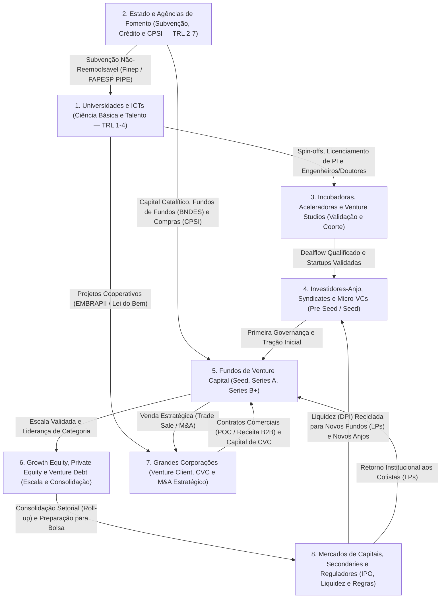

---

### 3. Anatomia Operacional de Cada Ator

#### 3.1. Ator 1 — Universidades, Institutos de Ciência e Tecnologia (ICTs) e Transferência Tecnológica

Nenhuma economia avançada construiu soberania tecnológica apenas com aplicativos de consumo; na base da cadeia alimentar de semicondutores, biotecnologia, novos materiais, aeroespacial, agronomia tropical e inteligência artificial estão as **Universidades de Pesquisa e os Institutos de Ciência e Tecnologia (ICTs)**.

Para dialogar com a academia e os órgãos de fomento, você precisa dominar a escala **TRL (*Technology Readiness Level* ou Nível de Maturidade Tecnológica)**, originalmente criada pela NASA e hoje adotada universalmente pela Finep, FAPESP, EMBRAPII e União Europeia:

* **TRL 1 a 3 (Pesquisa Básica e Prova de Conceito Analítica/Experimental):** Princípios básicos observados (TRL 1), conceito tecnológico formulado (TRL 2) e prova de conceito experimental em bancada (TRL 3). É o território clássico do artigo científico, da tese de doutorado e das bolsas CNPq/CAPES.
* **TRL 4 a 6 (O "Vale da Morte" da Transferência Tecnológica):** Validação em ambiente de laboratório (TRL 4), validação em ambiente relevante/simulado (TRL 5) e demonstração de protótipo em ambiente operacional relevante (TRL 6). É aqui que 90% das pesquisas brasileiras morrem: o pesquisador já publicou o *paper* (cumprindo seu incentivo acadêmico na Plataforma Lattes), mas a tecnologia ainda é imatura demais para um fundo de Venture Capital tradicional assinar um cheque.
* **TRL 7 a 9 (Demonstração Operacional, Certificação e Escala Comercial):** Demonstração do sistema em escala real operacional (TRL 7), sistema completo qualificado e certificado (TRL 8) e operação comercial comprovada no mercado (TRL 9).

No Brasil, o **Marco Legal de Ciência, Tecnologia e Inovação (Lei nº 13.243/2016 e Decreto nº 9.283/2018, complementando a Lei de Inovação nº 10.973/2004)** destravou juridicamente a relação entre universidade e empresa. Antes dele, um professor de universidade pública em regime de dedicação exclusiva que abrisse uma *spin-off* corria risco de processo administrativo, e compartilhar um laboratório público com uma startup era tratado pelos tribunais de contas como improbidade. Hoje, a lei garante segurança jurídica para licenciamento de patentes com ou sem exclusividade, uso compartilhado de laboratórios públicos por startups mediante contrapartida, participação minoritária da ICT no capital social da *spin-off* e bolsas de estímulo à inovação.

O órgão interno que opera essa ponte dentro de cada universidade é o **NIT (Núcleo de Inovação Tecnológica)** — como a **Inova Unicamp** (referência nacional em licenciamento de patentes e berço de mais de mil empresas filhas da UNICAMP), a **AUSPIN (USP)**, a **CTIT (UFMG)** e o **DCTA/ITA**. Ao lado das universidades, operam gigantes da ciência aplicada brasileira: a **EMBRAPA** (responsável pela tropicalização da soja, fixação biológica de nitrogênio e edição gênica que transformou o Cerrado no celeiro do planeta), a **Fiocruz** e o **Instituto Butantan** (imunobiológicos, vacinas e biofármacos), o **CNPEM** em Campinas (que opera o acelerador de partículas **Sirius**, infraestrutura científica única no Hemisfério Sul para análise de materiais, proteínas e nanotecnologia) e o **CPQD** (telecomunicações, IA e IoT).

> [!warning] A armadilha do Cap Table Acadêmico ("Dead Equity Universitário")
> Ao constituir uma *spin-off* acadêmica, nunca distribua 40% ou 50% do *equity* da empresa para um professor orientador que continuará em dedicação exclusiva na universidade trabalhando 2 horas por semana no negócio. Fundos de Venture Capital rejeitam imediatamente startups onde quem detém o controle societário não está 100% dedicado à operação (*dead equity*). A solução limpa é: (a) os alunos/pós-doutorandos que deixam a bancada para operar a startup em tempo integral detêm 80% a 90%+ do *cap table* fundador; (b) o professor que permanece na universidade recebe participação de *advisor* científico (1% a 5% com *vesting* de 4 anos); e (c) a universidade/ICT é remunerada via contrato de licenciamento de patente com *royalties* sobre a receita líquida (tipicamente 1% a 5%, com carência de 2 a 3 anos até a entrada em receita comercial).

---

#### 3.2. Ator 2 — O Estado Empreendedor, Agências de Fomento e Bancos de Desenvolvimento

Como demonstrou a economista Mariana Mazzucato em *O Estado Empreendedor*, tecnologias que formam a espinha dorsal da economia moderna — a internet (DARPA), o GPS (Marinha dos EUA), as telas sensíveis ao toque (CERN/CIA/NSF), a Siri (SRI International/DARPA) e algoritmos de busca (financiamento inicial da NSF em Stanford) — foram financiadas no estágio de maior incerteza pelo Estado, não pelo capital de risco privado.

No Brasil, o Estado atua em quatro frentes complementares que todo fundador técnico ou de setores regulados precisa dominar (conforme aprofundado no Capítulo 6 sobre Hardware e Deep Tech e no Capítulo 7 sobre Govtech deste volume):

1. **Subvenção Econômica Não-Reembolsável (*Non-Dilutive Grant*):** É o capital mais nobre do ecossistema — dinheiro a fundo perdido (não gera dívida e não toma participação societária) destinado a cobrir o risco tecnológico (TRL 2 a 7). Os dois maiores motores do país são a **Finep (Financiadora de Estudos e Projetos)** — através de editais nacionais de Subvenção Econômica, programas como o *Tecnova* e linhas do FNDCT (Fundo Nacional de Desenvolvimento Científico e Tecnológico) — e as **FAPs (Fundações Estaduais de Amparo à Pesquisa)**, com destaque absoluto para o **PIPE da FAPESP (Pesquisa Inovativa em Pequenas Empresas)** em São Paulo (dividido em Fase 1 de viabilidade técnica com até R$ 300 mil, Fase 2 de desenvolvimento com até R$ 1,5 milhão e PIPE Invest/Fase 3 comercial), além de FAPERJ (RJ), FAPEMIG (MG), FACEPE (PE) e FAPESC (SC).
2. **Co-financiamento Industrial e P&D Cooperativo (EMBRAPII e SEBRAE):** A **EMBRAPII (Empresa Brasileira de Pesquisa e Inovação Industrial)** opera o modelo mais ágil do país para P&D aplicado (TRL 3 a 6): sem depender de editais com janelas anuais, ela credencia unidades de excelência (institutos SENAI de Inovação, CPQD, IPT, laboratórios universitários) e paga a fundo perdido de **33% a 50% do custo do projeto** (chegando a mais em programas específicos para micro e pequenas empresas via parceria com o **SEBRAE**), enquanto a empresa entra com o restante e a unidade EMBRAPII entra com horas de pesquisadores e equipamentos.
3. **Bancos de Desenvolvimento e Papel de LP Catalítico (BNDES e Finep Investimento):** O **BNDES** e a **Finep** não operam apenas concedendo crédito subsidiado (como as linhas *Finep Inovacred* ou *BNDES Inovação*). Seu papel mais transformador na história do Venture Capital brasileiro foi atuar como **LP (cotista âncora) de fundos privados**: os programas **Criatec (I, II, III e IV)**, **Fundo Primatec**, **BNDES Garagem** e fundos setoriais de transição energética, bioeconomia e inteligência artificial formaram a primeira geração de gestores profissionais de VC no Brasil quando o capital privado doméstico ainda só investia em imóveis e CDI.
4. **Incentivos Fiscais e Compras Públicas de Inovação (Lei do Bem, Lei de Informática e CPSI):**
   * **Lei do Bem (Lei nº 11.196/2005, Cap. III):** Permite que empresas no regime de Lucro Real com lucro fiscal deduzam de 60% a 80% (ou até 100%) dos dispêndios com P&D da base de cálculo do IRPJ e da CSLL. Mesmo quando sua startup ainda opera no Simples ou Lucro Presumido, a Lei do Bem é um poderoso **argumento comercial B2B**: grandes corporações no Lucro Real podem contratar startups e ICTs para projetos de P&D usando esse benefício fiscal.
   * **Lei de Informática (Lei nº 8.248/1991, atualizada pela Lei nº 13.969/2019):** Concede créditos financeiros em troca de investimento obrigatório em P&D (tipicamente 4% a 5% do faturamento bruto incentivado) para fabricantes de hardware, automação e eletrônica, gerando centenas de milhões de reais anuais que obrigatoriamente precisam ser aplicados em convênios com institutos credenciados pelo CATI/MCTI e startups.
   * **CPSI (Contrato Público de Solução Inovadora — Marco Legal das Startups, LC nº 182/2021):** Permite que órgãos públicos, estatais e prefeituras contratem startups em fase de validação para testar soluções inovadoras por até **R$ 1,6 milhão por contrato** (com possibilidade de **Fornecimento Posterior de até R$ 8 milhões** sem nova licitação caso as metas técnicas sejam atingidas).

---

#### 3.3. Ator 3 — Incubadoras, Aceleradoras, Parques Tecnológicos e Venture Studios

Agrupar incubadoras, aceleradoras e *Venture Studios* no mesmo saco conceitual custa caro ao fundador. São quatro modelos econômicos com estruturas de incentivos completamente distintas:

* **Incubadoras de Base Tecnológica e Parques Tecnológicos (ex.: CIETEC/USP, Centev/UFV, Incamp/Unicamp, Porto Digital, Tecnopuc, Sapiens Parque, Parque Tecnológico de SJC):** São infraestruturas de abrigo e maturação longa (1 a 3 anos), geralmente ligadas a universidades ou governos locais. Oferecem espaço físico subsidiado, laboratórios compartilhados, assessoria para captação de fomento (FAPESP/Finep) e proximidade com pesquisadores. **Modelo econômico:** Cobram taxas mensais baixíssimas de manutenção e **não costumam exigir participação societária relevante (0% a 2%)**. São ideais para *Deep Techs*, *Biotechs* e *Hardtechs* que precisam de anos de bancada antes de ir a mercado.
* **Aceleradoras de Coorte (ex.: Y Combinator e Techstars globalmente; Darwin Startups, ACE, Quintal, Wow, Brasil Innovators/Endeavor no Brasil):** Operam em ciclos curtos e intensivos (3 a 6 meses) com turmas (*batches*) selecionadas competitivamente, culminando em um *Demo Day* para investidores. **Modelo econômico:** Investem um cheque padronizado em troca de *equity* minoritário (globalmente, a Y Combinator investe US$ 500 mil em SAFE; no Brasil, os cheques variam de R$ 150 mil a R$ 800 mil por 5% a 10%).
* **Venture Studios / Venture Builders (Fábricas de Startups):** Diferente da aceleradora (que seleciona um time fundador externo que já tem uma empresa), o **Venture Studio cria a tese internamente**, aloca seu próprio capital inicial, usa um time compartilhado de design, engenharia, jurídico e *growth* para validar o MVP e **recruta cofundadores externos (EIRs — *Entrepreneurs in Residence*)** para liderar a operação. **Modelo econômico:** Como o Studio assume o risco zero-a-um e aporta a infraestrutura inicial, ele retém uma fatia pesada do *cap table* (**20% a 50% do *equity***).
* **Comunidades de Fundadores e Redes de Escala (ex.: Endeavor, Cubo Itaú, InovaBra, Instituto Caldeira):** Não tomam *equity* pela adesão; operam por curadoria rigorosa e mensalidade ou patrocínio corporativo, conectando fundadores a clientes B2B, mentores que já escalaram unicórnios e fundos de Venture Capital.

> [!tip] Regra de Bolso: Quando Ceder Equity para Aceleradora ou Venture Studio
> **Jamais entregue 7% a 15% da sua empresa para uma "aceleradora" que não coloca dinheiro vivo no seu caixa (*cash-in*)** ou que cobra de volta metade do cheque investido a título de "taxa de consultoria, horas de mentoria e espaço de coworking". Só faz sentido diluir seu *cap table* em uma aceleradora se ela entregar simultaneamente: (1) capital líquido real na conta da empresa; (2) sinalização de mercado que aumente seu *valuation* na rodada seguinte em pelo menos 2x a 3x a diluição sofrida; e (3) acesso direto a clientes corporativos ou investidores que você não conseguiria acessar sozinho. Quando se tratar de *Venture Studio*, nunca aceite um acordo onde os fundadores operacionais fiquem com menos de 50% a 60% do *cap table* somado antes do Seed, sob pena de a empresa se tornar **infinanciável (*uninvestable*)** para fundos de Series A.

---

#### 3.4. Ator 4 — Investidores-Anjo, Syndicates, Family Offices e Micro-VCs

Quando a startup supera a ideação e precisa de R$ 300 mil a R$ 3 milhões para validar seu *Product-Market Fit* e contratar os primeiros engenheiros e vendedores, ela entra no território do capital privado inicial:

1. **Investidores-Anjo Individuais e Redes de Anjos (ex.: Anjos do Brasil, GVAngels, Poli Angels, Insper Angels, Harvard/Stanford Angels):** São pessoas físicas (executivos sêniores, empresários ou ex-fundadores que tiveram liquidez) que investem do próprio patrimônio líquido. No Brasil, o cheque individual típico varia de **R$ 25 mil a R$ 150 mil por anjo**. Para evitar ter 30 pessoas físicas assinando cada alteração do contrato social na Junta Comercial, **agrupe investidores-anjo em um veículo único (SPE, clube ou *Syndicate*)** ou utilize contratos de **Mútuo Conversível / SAFE** com procuração irrevogável de voto para o *lead angel* (líder da rodada).
2. **Anjo Operador (*Smart Money*) vs. Anjo Turístico:** O melhor anjo do mundo é um fundador ou executivo C-level do seu próprio setor que já viveu a sua dor, abre a agenda de telefone para os seus primeiros 10 clientes B2B e entende que 7 em cada 10 startups do portfólio podem quebrar. O pior investidor possível é o **"anjo turístico"**: um empresário tradicional do setor imobiliário ou varejista que nunca investiu em tecnologia, coloca R$ 100 mil achando que comprou uma franquia, exige 25% da empresa, liga toda segunda-feira cobrando dividendos no terceiro mês e ameaça judicializar o negócio quando você precisa pivotar.
3. **Family Offices (Single e Multi-Family Offices):** Gestores do patrimônio de famílias empresárias brasileiras (que detêm bilhões oriundos do agronegócio, indústria, setor financeiro ou varejo). Nos últimos anos, os *Family Offices* brasileiros profissionalizaram suas carteiras de *Venture Capital*, atuando tanto como LPs de fundos quanto fazendo investimentos diretos em rodadas Seed e Series A (cheques de R$ 1 milhão a R$ 15 milhões), muitas vezes trazendo acesso estratégico às empresas operacionais da própria família.
4. **Micro-VCs (ex.: Norte Ventures, Maya Capital, Canary, Latitud Ventures, Bossa Invest, Domino Ventures):** Fundos ágeis (geralmente entre R$ 30 milhões e R$ 200 milhões sob gestão) focados exclusivamente em Pre-Seed e Seed. Operam com processos decisórios rápidos (2 a 6 semanas), termos padronizados de mercado e forte apoio na preparação para o Series A.

---

#### 3.5. Ator 5 — Fundos de Venture Capital (Pre-Seed, Seed, Series A, Series B+): A Matemática Interna do Fundo

Muitos fundadores entram em uma reunião com um fundo de Venture Capital (como Kaszek, Monashees, Valor Capital, Astella, Redpoint eventures, Upload, Canary, Atlantico, Igah, DGF, Quartz ou fundos globais como a16z, Sequoia, General Catalyst e Riverwood) achando que o sócio do fundo (*General Partner*) está avaliando se a empresa será um "bom negócio lucrativo que fatura R$ 20 milhões por ano". **Não está.** Para entender o comportamento de um VC, você precisa dominar a equação financeira do fundo (detalhada na Fase 14, no Volume 5):

##### A Estrutura GP vs. LP e o Regra do "2 e 20"
Um fundo de Venture Capital não investe o dinheiro da conta corrente dos seus gestores. Ele é estruturado juridicamente (no Brasil, frequentemente via **FIP — Fundo de Investimento em Participações** regulado pela Resolução CVM 175, ou no exterior via *Limited Partnership* em Delaware/Cayman/Ontario) dividindo duas figuras:
* **LPs (*Limited Partners* ou Cotistas):** São os donos do capital — fundos de pensão, *endowments* universitários, *Family Offices*, fundos de fundos (FoFs), bancos de desenvolvimento (BNDES, IFC, BID Lab) e fundadores bem-sucedidos. Eles aportam ~98% a 99% do capital do fundo.
* **GPs (*General Partners* ou Gestores):** São os sócios da gestora que prospectam, selecionam, sentam no conselho e desinvestem das startups (aportando 1% a 2% do fundo como *GP Commit* para alinhar incentivos).

A remuneração padrão segue o modelo **2/20**:
* **Taxa de Administração (*Management Fee*) de ~2% ao ano** sobre o capital comprometido durante o período de investimento, usada para pagar salários da equipe de análise, aluguel, viagens, auditoria e jurídico do fundo.
* **Taxa de Performance (*Carried Interest* ou *Carry*) de 20%** sobre o lucro líquido que exceder a devolução integral do capital investido pelos LPs (frequentemente após superar uma taxa mínima de retorno ou *hurdle rate*, como IPCA + 6% ou 8% a.a. em dólar).

##### O Ciclo de 10 Anos (5 + 5) e a Matemática do *Fund Returner*
Um fundo de VC tem prazo de vida fechado, tipicamente de **10 anos (prorrogáveis por mais 1 ou 2 anos)**:
* **Anos 1 a 4/5 (Período de Investimento / *Deployment Period*):** O fundo constrói o portfólio fazendo novos investimentos (*initial checks*) em 15 a 30 empresas e reservando metade do fundo para *follow-ons* (dobrar a aposta nas vencedoras).
* **Anos 5 a 10 (Período de Maturação e Colheita / *Harvest Period*):** O fundo não pode mais investir em novas empresas; sua única missão é ajudar as empresas do portfólio a crescerem e **vender suas participações (via M&A, venda secundária ou IPO)** para devolver dinheiro vivo aos LPs.

Veja por que essa matemática dita tudo o que o VC exige de você:
Imagine um fundo brasileiro de **R$ 500 milhões**. Em 10 anos, para compensar a iliquidez e o risco frente ao CDI ou ao S&P 500, o gestor precisa devolver aos LPs pelo menos **3x o fundo líquido (R$ 1,5 bilhão)**.
Se o fundo investe em 25 startups e, no momento da saída (*exit*), após diluições sucessivas de Series A, B e C, o fundo detém em média **10% de participação** em cada vencedora:
* Pelas estatísticas globais da indústria, das 25 empresas, **10 a 12 vão a zero ou apenas devolvem o capital (0x a 1x)**; **8 a 10 terão saídas modestas (2x a 4x)**; e **apenas 1 a 3 empresas serão *outliers* extremos (*Fund Returners*)**.
* Para que **uma única empresa** devolva o fundo inteiro de R$ 500 milhões com o fundo tendo 10% dela na saída, essa startup precisa ser vendida ou abrir capital por **R$ 5 bilhões (aproximadamente US$ 1 bilhão — um unicórnio)**.
* Se o seu negócio é excelente, saudável e vai valer R$ 80 milhões no teto máximo do seu mercado, vender 10% dele gera R$ 8 milhões para o fundo — o que move apenas 1,6% da agulha de um fundo de R$ 500 milhões. **Por isso um fundo grande diz "não" para bons negócios de nicho:** não é porque sua empresa é ruim; é porque a física matemática do tamanho do fundo o proíbe de alocar um assento de conselho em uma tese cujo teto não comporte retornar uma fração expressiva do fundo inteiro.

##### As 3 Métricas que Governam a Vida de um GP: TVPI, DPI e IRR
Quando você conversa com um VC, saiba como os LPs dele o avaliam:
1. **TVPI (*Total Value to Paid-In Capital*):** Valor total do portfólio (soma do dinheiro já devolvido + valor de marcação no papel das startups ainda abertas) dividido pelo capital chamado dos LPs. É a riqueza "no papel".
2. **DPI (*Distributed to Paid-In Capital*):** **A métrica soberana desde 2022.** Mede exclusivamente o **dinheiro em espécie (*cash*) efetivamente devolvido à conta bancária dos LPs** dividido pelo capital aportado. Em janelas de juros altos, LPs não comem *valuation* de papel (TVPI); eles exigem DPI. Por isso fundos com mais de 6 ou 7 anos de vida pressionam ativamente os fundadores do portfólio por M&A ou liquidez secundária.
3. **IRR / TIR (*Internal Rate of Return* / Taxa Interna de Retorno):** Mede o retorno composto anualizado ponderado pelo tempo. Quanto mais rápido ocorre o *exit*, maior a TIR do fundo.

---

#### 3.6. Ator 6 — Growth Equity, Private Equity, Venture Debt e Search Funds (ETA)

Quando a startup atravessa a Fase 13 (PMF consolidado), passa de R$ 30 milhões a R$ 100 milhões de receita anual recorrente (ARR) e elimina o risco tecnológico e de produto, entram em cena os atores da **alavancagem financeira e consolidação operacional**:

* **Growth Equity (ex.: General Atlantic, Riverwood Capital, SoftBank, Warburg Pincus, Patria, Vinci, Kinea, Crescera):** Investem cheques de R$ 50 milhões a R$ 500 milhões+ em participações minoritárias relevantes (15% a 35%) ou controle compartilhado. Diferente do VC inicial, o fundo de *Growth Equity* **não aceita taxa de mortalidade alta na carteira**: ele espera que quase 100% das investidas multipliquem seu valor por 2,5x a 5x em 3 a 5 anos através de expansão geográfica, novos produtos, eficiência de vendas e aquisições (*M&A*).
* **Private Equity / Buyout (ex.: Advent, Brookfield, Patria, Vinci, IG4, Bain Capital):** Compram o **controle (51% a 100%)** de empresas maduras ou plataformas tecnológicas geradoras de caixa, utilizam alavancagem financeira, trocam ou reforçam a diretoria executiva, cortam gorduras operacionais e executam **teses de consolidação setorial (*Roll-ups*)** — comprando 5, 10 ou 20 empresas menores do mesmo setor por múltiplos de 4x a 6x EBITDA para integrá-las em uma plataforma única avaliada a 12x ou 15x EBITDA.
* **Venture Debt e Crédito Estruturado (ex.: SRM Ventures, Itaú BBA Tech, Bradesco Next/Inovabra, Brasilpar, fundos de FIDC para fintechs):** Para startups com receita recorrente previsível ou carteira de recebíveis (como *fintechs* de crédito, *SaaS* B2B com baixo *churn* ou *Hardware-as-a-Service*), usar *equity* caro para financiar capital de giro ou compra de equipamentos é um erro primário de estrutura de capital. O **Venture Debt** é uma dívida de médio prazo (24 a 48 meses) que combina juros mensais com um pequeno componente de participação societária chamado **warrant / equity kicker** (tipicamente direito de subscrever o equivalente a 5% a 15% do valor do empréstimo em ações na próxima rodada), permitindo estender o *runway* ou financiar aquisições com diluição mínima.
* **Search Funds / ETA (*Entrepreneurship Through Acquisition*):** Uma classe de ativos em rápida expansão no Brasil (que já é o 3º maior mercado de *Search Funds* do mundo fora dos EUA/Espanha, com gestoras e investidores dedicados como Spectre, Colibri, Cerrado, Vonze). Em vez de começar uma startup do zero (Fase 0), um ou dois empreendedores (geralmente com passagem por MBA de ponta, consultoria estratégica ou banco de investimento) captam um pequeno fundo inicial (*Search Capital* de R$ 1,5M a R$ 2,5M) com 12 a 20 investidores para passar 18 a 24 meses procurando **uma única PME brasileira lucrativa, com receita recorrente entre R$ 20 milhões e R$ 100 milhões, margem EBITDA de 15% a 35% e fundadores sem sucessão familiar**. Encontrada a empresa, os *searchers* captam o *Acquisition Capital*, compram 100% do negócio (usando *equity* dos investidores + dívida bancária + *seller note* parcelado com o ex-dono), assumem como CEOs e recebem de 15% a 30% do *equity* atrelado a metas de retorno (TIR). Para fundadores de startups ou empresas de software de nicho que querem se aposentar ou vender 100% do negócio por R$ 30M a R$ 120M, os *Search Funds* tornaram-se um dos compradores mais ágeis e líquidos do país.

---

#### 3.7. Ator 7 — Grandes Corporações: Open Innovation, Venture Clienting, CVC e M&A Estratégico

Relacionar-se com grandes corporações (como Itaú, Bradesco, Petrobras, Vale, Ambev, Gerdau, WEG, Raízen, Suzano, Natura, Hospital Albert Einstein, TOTVS, B3) pode acelerar sua startup em três anos ou matá-la por asfixia burocrática no chamado **Purgatório de Provas de Conceito (*POC Purgatory*)**. Para sobreviver e lucrar, diferencie os três chapéus que uma corporação usa ao falar com startups:

1. **Venture Clienting (Compra Comercial de Inovação):** A corporação não quer ser sua sócia; ela quer ser sua **cliente pagante** para resolver uma dor de eficiência, custo ou receita. É a relação mais saudável no início: receita não dilui *cap table* e valida produto.
   * *Como não morrer no POC Purgatory:* Nunca aceite rodar um "piloto gratuito de 6 meses" sem patrocinador executivo (*champion*) com orçamento aprovado. Uma POC saudável no B2B corporativo deve ser: (a) **paga** (mesmo que por um valor simbólico de R$ 30 mil a R$ 80 mil para cobrir *setup*, pois o simples ato de cadastrar sua startup no sistema de compras/ERP da corporação já vence 80% da barreira burocrática para o contrato definitivo); (b) **curta** (30 a 90 dias); e (c) com **critérios binários de sucesso pré-acordados** (*"Se reduzirmos o tempo de conciliação em 25% no piloto, o contrato anual de R$ 600 mil entra em vigor automaticamente"*).
2. **Corporate Venture Capital — CVC (ex.: Wayra/Vivo, Vivo Ventures, Itaú Ventures, Bradesco/Inovabra Ventures, Gerdau Next Ventures, Vale Ventures, Raízen Ventures, Suzano Ventures, Oxygea/Braskem, Einstein Conecta):** É o braço de investimento de risco da corporação. Existem dois tipos de CVC e você precisa descobrir em qual deles está pisando no primeiro café:
   * **CVC Financeiro Independente:** Tem fundo constituído separado do balanço anual da empresa, equipe própria com remuneração atrelada a *carry*, velocidade de VC tradicional e tese de longo prazo.
   * **CVC Estratégico / de Balanço:** Investe diretamente do caixa operacional da matriz e responde ao diretor de inovação ou CFO. Se o preço da *commodity* da matriz cair ou se o CEO da corporação trocar, o CVC pode congelar novos cheques da noite para o dia.
   * **Regra de ouro ao captar com CVC:** **Nunca conceda ao CVC de um cliente ou player setorial direito de preferência exclusivo na compra da empresa (*Right of First Refusal — ROFR*), direito de veto sobre venda para concorrentes ou exclusividade comercial no setor.** Se a corporação A tem direito de preferência ou veto sobre seu *cap table*, as corporações concorrentes B, C e D jamais comprarão seu software (por medo de vazamento de dados estratégicos) e jamais farão uma oferta de M&A na Fase 20, destruindo o leilão competitivo na sua saída. Aceite apenas um **Right of First Notice (Direito de Primeira Notificação)**: se a startup receber uma proposta de compra ou abrir processo de M&A, o CVC é avisado para poder apresentar uma proposta em igualdade de condições, sem travar o mercado.
3. **M&A Estratégico (*Trade Sale*):** No Brasil, **mais de 85% das saídas (*exits*) de startups acontecem via M&A estratégico ou consolidação de Private Equity**, e não via IPO na bolsa (conforme detalhado na Fase 20 do Volume 9). A grande corporação compra uma startup por um de três motivos: (a) **Comprar Tempo (*Build vs. Buy*)** — levaria 4 anos para construir internamente a tecnologia e a carteira de clientes que a startup já tem; (b) **Expandir Receita Cross-Sell** — plugar o produto da startup na força de vendas de 5.000 representantes da corporação (estratégia clássica de TOTVS, Locaweb/LWSA, Linx/Stone e Magazine Luiza); ou (c) **Defesa Existencial** — adquirir um desafiante antes que ele roube o mercado principal.

---

#### 3.8. Ator 8 — Mercados de Capitais, Liquidez Secundária e Autarquias Reguladoras

No topo da pirâmide de liquidez estão os mercados públicos de ações, os fundos de mercado secundário e os xerifes regulatórios do sistema:

* **Bolsas de Valores (B3 no Brasil vs. Nasdaq / NYSE nos EUA):** Abrir capital (IPO) exige escala massiva, previsibilidade trimestral implacável e governança de companhia aberta. Na **B3**, a janela para empresas de tecnologia historicamente abre e fecha ao sabor do ciclo da taxa Selic (como visto no Capítulo 1 deste volume), exigindo tipicamente faturamento superior a R$ 300 milhões–R$ 500 milhões e geração consistente de lucro líquido/EBITDA (casos como TOTVS, Bemobi, Locaweb, Sinqia, Méliuz, Intelbras). Na **Nasdaq e NYSE**, onde há investidores institucionais profundos especializados em tecnologia e software, abriram capital os maiores *outliers* brasileiros e latino-americanos (Nubank, Mercado Livre, XP, Stone, PagSeguro, VTEX, CI&T, dLocal).
* **Fundos de Liquidez Secundária (*Secondaries*):** Como o tempo médio entre a fundação de uma startup e seu IPO ou grande M&A subiu globalmente de 6 anos (nos anos 2000) para **11 a 14 anos (em 2026)**, surgiu um mercado trilionário de **Secondaries**: fundos especializados (como Lexington Partners, StepStone, G Squared globalmente, e veículos dedicados no Brasil) que compram participações diretamente de fundadores, primeiros funcionários (com *stock options* já adquiridas) e fundos de VC antigos (Pre-Seed/Seed no ano 8 ou 9 de vida) antes mesmo de a empresa inteira ser vendida. Isso permite que o fundador tire R$ 5 milhões a R$ 30 milhões da mesa na Série B ou C para garantir sua segurança patrimonial familiar e continuar focado em construir uma empresa dez vezes maior sem a pressão psicológica de vender tudo cedo demais.
* **Autarquias Reguladoras como Arquitetas de Mercado (BACEN, CVM, SUSEP, ANVISA, ANEEL, CADE):** Conforme dissecado nos Capítulos 2, 3 e 4 deste volume, o regulador no Brasil deixou de ser apenas um fiscal punitivo para se tornar um **criador de infraestrutura de mercado**. A agenda *BC#* do **Banco Central do Brasil** (criando o PIX, o Open Finance, a figura das SCDs/SEPs e a duplicata escritural) e o marco regulatório da **CVM** (Resolução CVM 88 para *equity crowdfunding* até R$ 15 milhões e Resolução CVM 175 para FIPs e FIDC) desenharam os trilhos sobre os quais centenas de *fintechs* e gestoras de risco operam hoje.

---

### 4. Regras de Sobrevivência para Navegar o Tabuleiro Institucional

> [!tip] As 5 Leis de Alinhamento entre Fundador e Atores da Inovação
> 1. **Case a fonte de capital com a natureza do risco:** Nunca use dívida bancária com aval pessoal para financiar risco científico ou descoberta de produto (Fases 1 a 10). Use subvenção pública (Finep/FAPESP/EMBRAPII) para risco tecnológico, bootstrap/anjo/VC para risco de mercado e Venture Debt/bancos apenas quando o motor comercial for previsível (Fases 14 a 19).
> 2. **Proteja a investibilidade futura do seu Cap Table:** Cada linha do seu quadro societário conta uma história para o próximo investidor. Se no início da jornada você entregou 30% para uma incubadora ou consultoria, 20% para um sócio inativo da universidade e assinou uma cláusula de preferência (ROFR) com uma corporação, nenhum fundo institucional de Série A tocará na sua empresa — a menos que você faça uma dolorosa cirurgia de *recap* (recompra e limpeza societária).
> 3. **Saiba em qual ano de vida está o fundo do seu VC:** Antes de assinar um *term sheet*, pergunte de qual fundo (*vintage year*) sairá o cheque. Entrar como o primeiro investimento de um fundo novo (Ano 1 ou 2) dá a você 7 a 8 anos de paciência institucional e ampla reserva para *follow-on*; entrar como o último cheque do Ano 5 de um fundo significa que os GPs precisarão mostrar liquidez (DPI) em 3 a 4 anos.
> 4. **Use o dinheiro não-dilutivo como alavanca de valuation, não como muleta de consultoria:** Cuidado com a síndrome da "startup caçadora de edital" — empresas que sobrevivem por 8 anos ganhando editais públicos de R$ 500 mil sem nunca vender para um cliente privado. Subvenção pública serve para financiar o P&D que destrava o produto comercial, permitindo que você chegue ao investidor privado em TRL 6 ou 7 valendo três vezes mais e diluindo metade.
> 5. **Clientes pagam salários; investidores financiam aceleração:** Entre um cheque de R$ 1 milhão de um investidor e R$ 1 milhão em contratos comerciais assinados com clientes B2B (Venture Clienting), o milhão do cliente é infinitamente superior: não gera diluição, prova *Product-Market Fit* de forma irrefutável e faz com que os próprios investidores disputem o direito de entrar na sua rodada.

---

### Filtro de Entrada na Trincheira: Você Deve Entrar Neste Jogo?

Antes de assinar qualquer acordo com investidores, universidades ou programas corporativos, responda sem rodeios:

1. **O Teste da Lei de Potência:** O seu negócio tem estrutura de custos e mercado endereçável para devolver de 10x a 30x o capital de um fundo de Venture Capital, ou você está forçando uma excelente empresa de dividendos a vestir uma roupa de unicórnio que vai sufocá-la?
2. **A Auditoria do Relógio:** Se a corporação ou agência de fomento com quem você negocia hoje atrasar o repasse em nove meses, você continua vivo com a receita de clientes privados ou fecha as portas?
3. **A Blindagem de IP e Cap Table:** Você manterá mais de 70% de participação para os fundadores operacionais após a rodada Seed e 100% da liberdade comercial sobre o seu código?

**O Movimento de Segunda-Feira:** Mapeie em uma planilha nos próximos 15 dias exatamente três editais não-diluitivos (FAPs, FINEP ou EMBRAPII) e cinco investidores-anjo operadores do seu setor, descartando qualquer intermediário que cobre participação societária apenas para fazer apresentações.


---

## CAPÍTULO 2 — GEOGRAFIA MUNDIAL DA INOVAÇÃO: CONTINENTES, ESPECIALIZAÇÃO, VANTAGENS COMPETITIVAS E HUBS GLOBAIS E BRASILEIROS

### A Regra Invisível do Jogo: A Arbitragem Geográfica de Talento e Distribuição

Quando o trabalho remoto se popularizou, o empreendedor "turista" acreditou na fantasia de que a geografia havia morrido. Ele abriu sua startup isolado de qualquer polo técnico, tentou contratar engenheiros seniores pagando salários inflacionados da Faria Lima sem ter rede de confiança local e tentou vender software para o agronegócio do Mato Grosso ou para indústrias de Joinville sem nunca ter pisado no chão de fábrica ou na poeira da BR-163. Dezoito meses depois, seu custo de aquisição de clientes (CAC) explodiu e seu time técnico se desfez por falta de densidade cultural.

Como Geoffrey Moore demonstrou ao analisar como mercados cruzam o abismo, a inovação não se espalha no vácuo: ela depende de densidade extrema de talento especializado, clientes âncora e capital inteligente no mesmo raio físico. O veterano de trincheira sabe que cada continente no mundo e cada um dos quinze hubs brasileiros possui um monopólio invisível de competência.

O segredo dos fundadores que escalam com metade do caixa dos concorrentes é **A Arbitragem Geográfica de Talento e Distribuição**: a capacidade de desacoplar onde você constrói sua engenharia profunda (como Campina Grande, Santa Rita do Sapucaí, São Carlos, Florianópolis ou Recife, onde o turnover é baixo e a formação técnica é de elite) de onde você fecha contratos corporativos e levanta capital institucional (São Paulo ou polos setoriais específicos). Quem escolhe a cidade errada para a vertical errada paga um imposto invisível todos os meses na folha de pagamento e no ciclo comercial.

---

**Por que a Inovação se Concentra no Espaço — O Mapa Estratégico dos Polos Mundiais, as 5 Vantagens Estruturais do Brasil e os 15 Hubs Nacionais**

> [!abstract] Posição no livro
> Este capítulo analisa a geografia econômica da tecnologia: por que o talento e o capital de risco se aglomeram em cidades específicas, o que cada continente faz melhor, onde o Brasil detém vantagem comparativa global insuperável e como escolher entre os 15 principais polos brasileiros e globais para alocar engenharia, vendas e estrutura societária. Aplique este conteúdo em conjunto com a Fase 6 (Mapeamento de Mercado) do Volume 2, a Fase 14 (Captação e Estrutura Offshore) do Volume 5, a Fase 16 (Recrutamento e Trabalho Remoto) do Volume 6 e os Playbooks Setoriais deste Volume 10.

---

### 1. O Paradoxo da Geografia Digital: Por que a Inovação se Concentra no Espaço

Nos anos 1990 e novamente em 2020, futuristas previram a "morte da distância": se o código viaja na velocidade da luz pela fibra óptica e reuniões acontecem por vídeo, as empresas de tecnologia deveriam se espalhar uniformemente pelo planeta em busca do metro quadrado mais barato. **Aconteceu exatamente o oposto.** Quanto mais digital e intensiva em conhecimento a economia se tornou, mais concentrada geograficamente ficou a criação de valor tecnológico.

A explicação econômica para esse aparente paradoxo repousa sobre três pilares clássicos — **Alfred Marshall (1890)**, **Michael Porter (1990)** e **Enrico Moretti (2012, *The New Geography of Jobs*)** — combinados com o fenômeno moderno da reciclagem de capital e talento:

#### 1.1. As Três Forças de Aglomeração de Marshall-Moretti
1. **Mercados de Trabalho Espessos (*Thick Labor Markets*):** Um engenheiro de aprendizado de máquina sênior ou um VP de Vendas Enterprise B2B só aceita o risco de trocar um emprego estável por uma startup incipiente se souber que, caso aquela startup quebre em 18 meses, existem outras 200 startups no mesmo raio geográfico ou ecossistema prontas para contratá-lo na semana seguinte sem que ele precise mudar os filhos de escola. Da mesma forma, uma startup em crescimento hiperacelerado precisa contratar 30 especialistas que já escalaram um produto de 0 a 10 milhões de usuários — e essas pessoas não se formam em livros, mas na vivência prática dentro de outros *outliers*.
2. **Transbordamento de Conhecimento Tácito (*Knowledge Spillovers*):** Conhecimento codificado (documentação técnica, *papers* no arXiv, cursos online) viaja pelo mundo instantaneamente e de graça. Já o **conhecimento tácito** — qual arquitetura de cobrança reduziu a fraude no Pix em 40% na semana passada, qual fundo de VC está com caixa travado, qual cláusula oculta um grande banco está exigindo nos contratos de Open Finance — **viaja na velocidade de cafés presenciais, jantares de fundadores e trocas de funcionários entre empresas vizinhas**.
3. **Ecossistema de Fornecedores Hiperespecializados:** Em um hub maduro, o escritório de advocacia já redigiu 300 contratos de *SAFE* e *Cayman Sandwich*; o contador domina a Lei do Bem e o *stock option plan*; o *headhunter* conhece pelo nome os 50 melhores diretores de produto do país; e o banco comercial tem uma mesa dedicada a startups. Em uma cidade isolada, você gasta seis meses educando seu advogado sobre o que é *vesting* com *cliff*.

#### 1.2. Reciclagem de Capital e o Efeito "Máfias de Fundadores" (*Founder Mafias*)
Um polo de inovação não nasce quando o governo inaugura um prédio de vidro; ele atinge massa crítica quando ocorre a **primeira onda de grandes eventos de liquidez (*exits* ou IPOs) que transformam dezenas de primeiros funcionários em milionários que voltam a empreender e investir como anjos**.

No Vale do Silício, o caso arquetípico foi a **PayPal Mafia**: após a venda do PayPal para o eBay em 2002 por US$ 1,5 bilhão, seus fundadores e primeiros executivos (Peter Thiel, Elon Musk, Reid Hoffman, Max Levchin, Roelof Botha, Chad Hurley, Steve Chen, Jeremy Stoppelman) criaram ou lideraram **Tesla, SpaceX, LinkedIn, YouTube, Palantir, Affirm, Yelp, Yammer, Founders Fund, Khosla Ventures e a liderança da Sequoia Capital**.

No Brasil, entre 2018 e 2026, consolidou-se exatamente o mesmo motor de reciclagem geracional. Hoje, a espinha dorsal das melhores rodadas Pre-Seed e Seed do país é liderada pelas **"Máfias Brasileiras de Fundadores"**:
* **Máfia ex-Nubank ("NuMafia"):** Dezenas de ex-diretores de engenharia, produto, crédito e operações do Nubank que fundaram novas *fintechs* de infraestrutura bancária, inteligência artificial, seguros, cripto e *SaaS* B2B, já saindo na largada com acesso direto a fundos do Vale do Silício e de São Paulo.
* **Máfia ex-iFood / Movile:** Executivos forjados na escola de hiperescala logística, *marketplaces* e M&A da Movile e do iFood (em Campinas e São Paulo), que criaram dezenas de startups em logística, *foodtech*, *fintech* e *retail media*.
* **Máfia ex-99 (primeiro unicórnio brasileiro):** Seus fundadores e primeiros líderes geraram tanto novos unicórnios e *scale-ups* (como Kovi, Kavak Brasil, Pomelo, Buser) quanto fundos de Venture Capital de primeira linha (como Canary e Norte Ventures).
* **Máfias ex-Stone / Pagar.me / Arpex, ex-VTEX, ex-QuintoAndar, ex-Wildlife, ex-RD Station e ex-Mercado Livre:** Verdadeiras universidades práticas de execução que abastecem o ecossistema com fundadores de segunda viagem (*second-time founders*) — profissionais que já sabem contratar, já têm capital próprio para o primeiro ano e levantam rodadas Seed em semanas.

---

### 2. Radiografia da Inovação por Continente: Especialização, Cultura e Hubs

O mundo não é plano: cada continente e cada grande polo desenvolveu uma **especialização darwiniana** moldada por sua matriz industrial, regulação estatal, universidades e mercado consumidor. Compreender esse mapa permite ao fundador brasileiro saber **onde buscar referência técnica (*benchmark*), onde recrutar, onde vender e onde captar**:

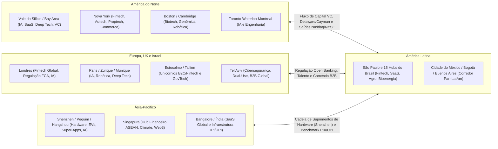

#### 2.1. América do Norte (Estados Unidos e Canadá)
A América do Norte permanece como o centro gravitacional de liquidez global, concentrando mais de 50% do capital de risco do planeta, o mercado comprador corporativo (Fortune 500) mais disposto a testar software novo e as bolsas de maior liquidez (Nasdaq e NYSE).
* **Vale do Silício e Bay Area (San Francisco, Palo Alto, Mountain View, San Jose):** O epicentro indiscutível de **Inteligência Artificial Generativa e Fundacional**, **SaaS B2B**, **Semicondutores** e **Deep Tech**. Sua vantagem competitiva não é apenas Stanford, UC Berkeley ou os US$ 100+ bilhões anuais da Sand Hill Road, mas uma **cultura única onde a falência honesta é tratada como aprendizado curricular** e onde gigantes de tecnologia compram de startups de 10 pessoas sem exigir 5 anos de balanço auditado.
* **Nova York (Silicon Alley):** O segundo maior ecossistema do mundo ocidental. Enquanto o Vale constrói infraestrutura tecnológica pura, Nova York domina a aplicação tecnológica nos setores que sedia: **Fintech e Mercado de Capitais**, **Mídia e Adtech**, **Proptech (Imobiliário)**, **E-commerce/Marcas D2C** e **Healthtech comercial**.
* **Boston e Cambridge (Massachusetts):** O maior cluster mundial de **Biotecnologia, Genômica, Farmacêutica (Kendall Square), Dispositivos Médicos e Robótica Avançada**, ancorado na densidade inigualável do **MIT**, **Harvard**, hospitais universitários de ponta (Mass General) e laboratórios de P&D das maiores farmacêuticas globais.
* **Austin, Miami, Los Angeles e Seattle:** **Seattle** é a capital mundial de *Cloud Computing* e *Enterprise Software* (forjada por Microsoft e Amazon/AWS); **Los Angeles** lidera em *Creator Economy*, *Gaming*, entretenimento e aeroespacial privado (SpaceX, Anduril em Orange County); **Austin** consolidou-se em semicondutores, infraestrutura e operações; e **Miami** tornou-se a **ponte financeira e societária entre os Estados Unidos e a América Latina**, abrigando gestores de VC pan-regionais, *fintechs* cross-border e fundadores latino-americanos.
* **Corredor Canadense (Toronto – Waterloo – Montreal – Vancouver):** Berço acadêmico do *Deep Learning* moderno (Geoffrey Hinton em Toronto, Yoshua Bengio no Mila em Montreal). A **Universidade de Waterloo** possui o programa de engenharia cooperativa (*co-op*) mais produtivo da América do Norte, funcionando como celeiro de talentos técnicos e *SaaS* (como a Shopify em Ottawa/Toronto), com políticas de imigração de talentos e incentivos fiscais de P&D (SR&ED) altamente competitivos.

#### 2.2. Europa e Reino Unido
A Europa combina excelência científica universitária, forte financiamento público de transição climática/industrial (Horizon Europe, EIC, Bpifrance, KfW) e regulação pioneira (GDPR em privacidade, PSD2 em Open Banking, AI Act), embora enfrente maior fragmentação linguística e mercados de capitais locais menos profundos que os EUA.
* **Londres (com o triângulo Oxford–Cambridge):** A capital absoluta da Europa em **Fintech** (Revolut, Monzo, Wise, Checkout.com) e **Inteligência Artificial** (berço da Google DeepMind). O **FCA (*Financial Conduct Authority*)** britânico inventou o conceito de *Regulatory Sandbox* e *Open Banking* que inspirou diretamente o Banco Central do Brasil.
* **Paris (França):** Impulsionada pelo banco público de investimento **Bpifrance**, pela **Station F** (maior campus de startups do mundo) e por escolas de matemática e engenharia de elite (*École Polytechnique*, *ENS*), Paris tornou-se a capital continental da **IA europeia** (sede da Mistral AI, Hugging Face, Kyutai e laboratórios globais de IA da Meta e Google), além de liderar em *Deep Tech*, saúde e tecnologias para a indústria do luxo.
* **Berlim e Munique (Alemanha):** Duas vocações complementares. **Berlim** é o polo de consumo digital, *Fintech* (N26, Trade Republic), *E-commerce* e *SaaS* (alavancado historicamente pela escola operacional da Rocket Internet); **Munique**, ancorada na **TUM (Universidade Técnica de Munique)** e nas gigantes industriais (BMW, Siemens, Allianz), é a potência alemã em **Robótica, Mobilidade Autônoma, Indústria 4.0, Aeroespacial e Defesa**.
* **Estocolmo (Suécia) e Nórdicos:** Com menos de 2 milhões de habitantes na região metropolitana, Estocolmo é a maior fábrica de unicórnios *per capita* do mundo fora do Vale do Silício (**Spotify, Klarna, King, Mojang/Minecraft, iZettle, Lovable**). O segredo sueco: mercado doméstico pequeno que força toda startup a nascer em inglês para o mercado global no dia 1, rede de proteção social que reduz o medo da ruína pessoal e políticas estatais dos anos 1990 que subsidiaram computadores pessoais e banda larga em todos os lares.
* **Zurique e Lausanne (Suíça):** Ancoradas no **ETH Zurich** e na **EPFL**, formam o polo de maior densidade de doutores do continente em **Robótica, Visão Computacional, Biotecnologia e Criptografia/Blockchain** (Crypto Valley em Zug).
* **Amsterdã e Eindhoven (Holanda):** Eindhoven é o cérebro do hardware de semicondutores europeu — sede da **ASML** (única empresa do planeta capaz de produzir as máquinas de litografia ultravioleta extrema — EUV — que fabricam os chips mais avançados do mundo), enquanto Amsterdã lidera em pagamentos globais (**Adyen**) e plataformas de viagens (**Booking.com**).
* **Tallinn (Estônia):** País de 1,3 milhão de habitantes que construiu o Estado 100% digital mais eficiente do mundo (*X-Road*, identidade digital universal, abertura de empresas em minutos via *e-Residency*) e gerou **Skype, Wise, Bolt, Pipedrive e Veriff**.

#### 2.3. Ásia-Pacífico (China, Índia, Singapura, Coreia, Japão e Austrália)
A Ásia deixou há muito tempo de ser a "fábrica copiadora do Ocidente" para se tornar a fronteira mundial em manufatura avançada, transição energética, pagamentos instantâneos e comércio móvel:
* **Shenzhen e Grande Baía (China):** O ecossistema físico de **Hardware, Eletrônica, Robótica, Drones (DJI), Baterias (CATL/BYD), Veículos Elétricos e Telecomunicações (Huawei, Tencent)** mais rápido e integrado da história humana. Um protótipo de hardware que leva 4 meses para ser iterado na Califórnia ou em São Paulo é produzido, testado e modificado em **48 a 72 horas em Shenzhen** graças à concentração de milhares de fábricas de placas (PCBs), moldes de injeção, sensores e componentes num raio de 50 quilômetros.
* **Pequim (Zhongguancun), Xangai e Hangzhou:** **Pequim** (ancorada na Universidade Tsinghua e na Universidade de Pequim) é o centro de **Inteligência Artificial, LLMs (DeepSeek, Baidu, ByteDance/TikTok) e Semicondutores**; **Hangzhou** (sede do Alibaba e Ant Group) reinventou o **Social Commerce, Live Commerce e Logística Automatizada**.
* **Singapura:** A cidade-Estado funciona como a "Suíça tropical" e sede regional obrigatória para todo o **Sudeste Asiático (ASEAN)** — um mercado consumidor vizinho de mais de 680 milhões de pessoas (Indonésia, Vietnã, Tailândia, Filipinas, Malásia). Impulsionada pelos fundos soberanos **Temasek** e **GIC**, Singapura domina **Fintech, Comércio Marítimo/Supply Chain, Biotecnologia Asiática e Climate Tech**.
* **Índia (Bangalore, Mumbai, Delhi-NCR, Hyderabad e Chennai):** O ecossistema mais importante do mundo para um fundador brasileiro estudar e comparar. **Bangalore** e **Chennai** tornaram-se potências de **SaaS B2B Global** (Freshworks, Postman, Zoho — construindo software com engenharia indiana a uma fração do custo americano e vendendo em dólar para os EUA). Mais importante ainda: a Índia construiu a **India Stack (DPI — *Digital Public Infrastructure*)**, combinando identidade biométrica universal (**Aadhaar**, com mais de 1,3 bilhão de pessoas), pagamentos instantâneos interoperáveis (**UPI**, que processa mais de 14 bilhões de transações mensais) e compartilhamento de dados (**Account Aggregator**). A comparação direta entre o **UPI indiano** e o **PIX + Open Finance + Gov.br brasileiros** mostra que Brasil e Índia são os dois líderes mundiais indiscutíveis em infraestrutura pública digital financeira.
* **Seul, Tóquio e Sydney/Melbourne:** **Seul** lidera em semicondutores de memória (Samsung, SK Hynix), baterias, *gaming*, robótica e cultura pop digitalizada (Coupang, Krafton, Naver/Kakao); **Tóquio** destaca-se em robótica industrial, materiais avançados, automação para sociedades em envelhecimento demográfico e *Corporate Venture Capital* global (SoftBank); e a **Austrália (Sydney/Melbourne)** provou como construir gigantes globais de software *Product-Led Growth (PLG)* longe dos EUA, como **Atlassian (Jira/Trello)** e **Canva**.

#### 2.4. Oriente Médio e África (MENA e África Subsaariana)
* **Israel (Tel Aviv, Herzliya, Haifa):** A chamada *Startup Nation* (com cerca de 9,5 milhões de habitantes) possui a maior densidade mundial de investimento de VC como percentual do PIB e o maior número de empresas listadas na Nasdaq fora dos EUA e China (Wiz, Mobileye, Check Point, Palo Alto Networks,CyberArk, Monday.com, Wix, Fiverr). A vantagem competitiva israelense nasce da combinação entre pesquisa universitária (Technion, Instituto Weizmann, Universidade Hebraica), serviço militar tecnológico obrigatório de elite (como a **Unidade 8200** de inteligência cibernética e a **Talpiot**, onde jovens de 18 a 22 anos lideram projetos críticos de criptografia, IA e defesa sob pressão real) e uma premissa geográfica inegociável: **como o mercado interno de Israel é minúsculo, 100% das startups israelenses já nascem no dia zero projetadas em inglês para vender B2B Enterprise nos Estados Unidos e na Europa**.
* **Emirados Árabes Unidos (Dubai e Abu Dhabi) e Arábia Saudita (Riade):** Tornaram-se os maiores polos de **Capital Soberano do planeta** (Mubadala, ADIA, MGX em Abu Dhabi; PIF/Sanabil na Arábia Saudita — investidores diretos nos maiores fundos de IA do mundo e muito ativos no Brasil, onde o Mubadala investe pesadamente), além de oferecerem zonas francas jurídicas de direito anglo-saxão (*Common Law* no DIFC e ADGM), imposto zero e pontes aéreas entre Europa, Ásia e África.
* **África (Lagos na Nigéria, Nairóbi no Quênia, Cairo no Egito e Cidade do Cabo na África do Sul):** Os chamados *"Big Four"* africanos são laboratórios extraordinários de **inovação de fronteira para mercados informais e desbancorizados**. O Quênia (**Nairóbi / Silicon Savannah**) foi pioneiro mundial em dinheiro móvel com o **M-Pesa** em 2007 (muito antes do Ocidente) e em energia solar distribuída *Pay-As-You-Go* (M-KOPA); a Nigéria (**Lagos**) produziu gigantes de infraestrutura de pagamentos e *fintech* como **Flutterwave, Paystack (adquirida pela Stripe), Interswitch e Moniepoint**; o **Cairo** conecta o talento de engenharia egípcio ao mercado do Golfo Árabe; e a **Cidade do Cabo** lidera em software corporativo, seguros e biotecnologia no continente.

#### 2.5. América Latina e a Tese Pan-Latino-Americana
A América Latina soma mais de **660 milhões de habitantes**, PIB superior a US$ 6,5 trilhões, altíssima urbanização (~81%) e penetração massiva de smartphones e redes sociais, dividida em apenas dois grandes idiomas (Português e Espanhol) com forte afinidade cultural e dores estruturais idênticas (crédito caro, informalidade, saúde pública sobrecarregada, logística fragmentada e burocracia contábil).
* **O Eixo São Paulo – Cidade do México (CDMX):** Representa mais de 75% de todo o capital de risco da região. A tese clássica dos grandes vencedores regionais (**Mercado Livre, Nubank, Kavak, Rappi, dLocal, Creditas, QuintoAndar/Benvi, VTEX, EBANX, Wellhub**) segue duas rotas: ou a startup nasce no **Brasil** (que sozinho representa ~45% a 55% do mercado de tecnologia da região, permitindo atingir escala de unicórnio apenas no mercado doméstico) e depois usa a **Cidade do México** como segundo motor de crescimento; ou nasce na **Colômbia (Bogotá/Medellín)**, **Argentina (Buenos Aires)**, **Chile (Santiago)** ou **Uruguai (Montevidéu)** — países com talentos técnicos excepcionais mas mercados internos menores — e expande imediatamente para o México e o Brasil.
* **A complementaridade dos hubs hispânicos:** **Buenos Aires** e **Montevidéu** têm a tradição mais antiga de fundadores globais da região (Mercado Livre, Globant, Auth0, Despegar, PedidosYa, dLocal); **Bogotá e Medellín** destacam-se em operações, logística de última milha e talento de engenharia (Rappi, Habi); **Santiago** oferece o ambiente institucional e bancário mais estável da América do Sul (Cornershop/Uber, NotCo, Buk, Betterfly); e **Monterrey e Cidade do México** surfam a onda histórica do **Nearshoring industrial e logístico** com os Estados Unidos.

---

### 3. As 5 Vantagens Competitivas Estruturais do Brasil no Mundo

Um erro estratégico grave de fundadores brasileiros é tentar copiar teses do Vale do Silício onde o Brasil tem desvantagem comparativa (como fabricar placas de GPU de 2 nanômetros do zero sem cadeia local de litografia), ignorando as **cinco arenas globais onde o Brasil não é seguidor, mas o laboratório número 1 do planeta**:

#### 3.1. Vantagem 1 — Infraestrutura Financeira Digital, Pagamentos Instantâneos e Crédito (PIX, Open Finance e Drex)
Graças a décadas de hiperinflação (até 1994), que obrigaram os bancos brasileiros a construir compensação eletrônica em tempo real quando os Estados Unidos ainda compensavam cheques em papel pelo correio, e à agenda pró-competição do **Banco Central do Brasil**, o país possui hoje a infraestrutura financeira mais avançada do Ocidente. O **PIX** (usado por mais de 90% da população adulta e integrado a QR Codes, Pix Automático e Pix por aproximação), o **Open Finance** em escala real, a regulamentação ágil de **SCDs, IPs e FIDCs** e a infraestrutura de ativos tokenizados (**Drex**) fazem com que uma *fintech* brasileira opere sob padrões tecnológicos anos à frente do sistema bancário regional norte-americano ou europeu.

#### 3.2. Vantagem 2 — Agronegócio Tropical, Biotecnologia de Solo e Clima Aberto
Enquanto a agricultura temperada americana ou europeia faz uma safra por ano com inverno congelante que mata pragas naturalmente, o Brasil é a única potência agrícola tropical capaz de fazer **duas a três safras por ano no mesmo solo (soja + milho safrinha + cobertura/integração lavoura-pecuária)** sob pressão biológica constante. Isso transformou o Brasil no líder mundial em **insumos biológicos (*Bioinputs* — biofertilizantes, bionematicidas, fixação biológica de nitrogênio)**, **genética tropical**, **monitoramento satelital de safras**, **fintechs de crédito rural privado (CPR digital, Barter, FIAGRO)** e **conectividade e telemetria de máquinas no campo** (ver Capítulo 8 deste volume).

#### 3.3. Vantagem 3 — Matriz Energética Limpa, Bioeconomia, Biocombustíveis e Mercado de Carbono
Com mais de **85% a 90% da matriz elétrica renovável** (hidrelétrica, eólica no Nordeste e solar distribuída em todo o território), liderança mundial em **etanol de cana e de milho, biodiesel, biometano e SAF (Combustível Sustentável de Aviação)** e a maior reserva florestal e de biodiversidade da Terra (Amazônia, Cerrado, Mata Atlântica), o Brasil é o destino mais competitivo do mundo para: (a) *Cleantechs* de mensuração, rastreabilidade e certificação de carbono (MRV digital); (b) *Data Centers* verdes de Inteligência Artificial alimentados por energia limpa e barata; (c) hidrogênio verde e industrialização descarbonizada (*green steel*, *green fertilizers*); e (d) bioprospecção de moléculas da biodiversidade para cosméticos, alimentos e fármacos (ver Capítulo 10 deste volume).

#### 3.4. Vantagem 4 — Demografia Conectada, Hiper-Adoção Social e Digitalização de Serviços Essenciais
O brasileiro está entre os povos que passam mais horas por dia conectados à internet e ao **WhatsApp** no mundo, com baixíssima resistência cultural para adotar novas tecnologias digitais de consumo e trabalho. Ao mesmo tempo, o país apresenta gargalos colossais em serviços básicos — saúde suplementar e pública (SUS), educação profissionalizante, segurança patrimonial, varejo de vizinhança e logística rodoviária. Essa combinação de **dor aguda no mundo físico + população hiperconectada no celular** permite que *Healthtechs*, *Edtechs*, *Logtechs* e soluções de *Conversational Commerce* (vendas e atendimento via agentes de IA no WhatsApp) atinjam milhões de usuários em velocidade recorde.

#### 3.5. Vantagem 5 — Software de Gestão (SaaS/ERP/Tax/Legal) Forjado na Maior Complexidade Operacional do Mundo
O sistema tributário, trabalhista, regulatório e judiciário brasileiro (Nota Fiscal Eletrônica em tempo real, SPED, substituição tributária, transição do IVA Dual CBS/IBS da Reforma Tributária, eSocial, PJe nos tribunais) é um dos ambientes mais complexos da Terra. Isso produz dois efeitos estratégicos: primeiro, cria uma **barreira de entrada natural contra concorrentes estrangeiros** (um software contábil, de folha de pagamento ou ERP americano quebra ao tentar calcular a tributação de uma mercadoria cruzando três estados brasileiros); segundo, **forja engenheiros e arquitetos de software brasileiros acostumados a lidar com regras de negócio extremas, conciliação financeira massiva e sistemas governamentais de missão crítica**.

---

### 4. Mapa Completo e Especialização dos 15 Principais Hubs de Inovação do Brasil

O Brasil não é um monólito: é um arquipélago continental de polos tecnológicos altamente especializados. Conhecer a vocação real de cada um dos **15 principais hubs brasileiros** permite a você decidir onde recrutar seus engenheiros, onde buscar parceria com universidades/EMBRAPII e onde posicionar sua operação comercial:

| # | Hub / Polo Brasileiro | Vocação Setorial Dominante | Universidades, ICTs e Parques-Âncora | Casos Icônicos e Referências Locais | Vantagem Competitiva Distintiva |
| :--- | :--- | :--- | :--- | :--- | :--- |
| **1** | **São Paulo (Capital)** | Fintech, SaaS B2B, Marketplaces, Proptech, Healthtech, Adtech, IA Comercial e Capital de Risco | USP (Poli, IME, FEA, FMUSP), Insper, FGV, ITA-SP, IPT, CIETEC, Cubo Itaú, InovaBra | Nubank, QuintoAndar, Creditas, TOTVS, Wellhub, Unico, Stone/Linx, Kavak, Loft, Omie, Blip | Concentra ~70%+ do capital de VC do país, sedes das corporações clientes (Faria Lima/Berrini) e maior *pool* de executivos de escala |
| **2** | **Campinas (SP)** | Deep Tech, SaaS, Logística, Foodtech, Agro, Fotônica, Telecom e P&D Corporativo | UNICAMP (Inova Unicamp), CNPEM (Sirius), CPQD, Instituto Eldorado, PUC-Campinas, IAC | iFood, CI&T, Movile, Sensedia, Griaule, Matera, dezenas de *spin-offs* da Unicamp | Maior ecossistema de ciência aplicada e patentes do país combinado com cultura de engenharia global (CI&T/iFood) a 90 km da capital |
| **3** | **São José dos Campos (SP)** | Aeroespacial, Defesa, Drones, Satélites, Mobilidade Aérea (eVTOL), Fintech e SaaS | ITA, DCTA, INPE, CEMADEN, UNIFESP, Parque Tecnológico de SJC (Nexus) | Embraer / Eve Air Mobility, Pagar.me (origem), Quero Educação, Birdie, Xmobots (região/SP) | Formação de elite em engenharia (ITA) com cultura *hardcore* de resolução de problemas complexos e cadeia aeronáutica global |
| **4** | **Piracicaba (SP)** | Agritech, Biotecnologia Agrícola, Bioenergia, AgFintech e Sensoriamento Rural | ESALQ/USP, CENA/USP, EsalqTec, Pulse (Raízen), AgTech Garage (PwC), Pecege | Solinftec (presença no polo), @Tech, Bart Digital, Traive, dezenas de biotechs de solo e insumos | O "Vale do Piracicaba" (AgTech Valley): maior concentração de agrônomos, doutores em genética vegetal e usinas/corporações do agro |
| **5** | **São Carlos (SP)** | Deep Tech, Óptica/Fotônica, Novos Materiais, IA, Robótica, Drones e Insurtech/Fintech | USP São Carlos (ICMC, EESC, IFSC, IQSC), UFSCar, Embrapa Instrumentação, ParqTec | Opto Eletrônica, Xmobots, Arquivei, Kakau, Monitora, *spin-offs* de física e computação | Maior densidade de doutores por habitante do Brasil (1 PhD para cada ~180 moradores); excelência em física, materiais e computação |
| **6** | **Florianópolis (SC)** | SaaS B2B, MarTech, Inside Sales, Gestão para PMEs, Energia e Saúde Digital | UFSC, UDESC, Fundação CERTI, ACATE, Sapiens Parque, Centros de Inovação | RD Station, Neoway, Involves, Asaas (SC), Exact Sales, Softplan, Peixe Urbano (histórico), Intelbras (Grande Floripa) | A "Ilha do Silício": tecnologia é a primeira atividade econômica da cidade; associativismo exemplar (ACATE) e escola nacional de *Inside Sales* |
| **7** | **Joinville, Blumenau e Vale do Itajaí (SC)** | ERP, Gestão Contábil/Fiscal, Indústria 4.0, Automação, Fintech B2B e E-commerce Têxtil | UDESC Joinville, UFSC Joinville, FURB, Ágora Tech Park (Perini Business Park), SENAI/SC | ContaAzul, Asaas, Senior Sistemas, Blusoft, Philips Clinical Informatics (origem local), WEG (Jaraguá do Sul) | Conexão visceral com o PIB industrial mais diversificado do Sul (metal-mecânica, motores elétricos na WEG, têxtil e plásticos) |
| **8** | **Recife (PE)** | Engenharia de Software em Escala, Serviços Financeiros, Saúde Digital, Games e GovTech | CIn-UFPE (Centro de Informática), CESAR, Porto Digital, UPE, UNICAP | Porto Digital (+400 empresas e +18 mil profissionais), CESAR, Tempest Security, Neurotech, In Loco/Incognia | Maior parque tecnológico urbano aberto do Brasil; o CIn-UFPE e o CESAR formam uma das maiores escolas de ciência da computação e design da América Latina |
| **9** | **Belo Horizonte (MG)** | Creator Economy, Martech, SaaS, Conversational AI, Fintech, Biotech e Mineração | UFMG (DCC, ICB, Engenharia), BH-TEC, PUC Minas, Biominas, FIEMG Lab | Hotmart, Take Blip, Méliuz, Sympla, MaxMilhas, Samba Tech, Akwan (comprada pelo Google — 1º centro de P&D do Google na AL) | "San Pedro Valley": cultura comunitária de ajuda mútua entre fundadores, centro de P&D do Google na América Latina e excelência em busca/IA e bio |
| **10** | **Curitiba (PR)** | Fintech de Pagamentos Cross-Border, E-commerce/Varejo, Contabilidade Digital e Mobilidade | UFPR, UTFPR, PUCPR (Hotmilk), Vale do Pinhão | EBANX, Olist, MadeiraMadeira, Contabilizei, Pipefy, James Delivery, VHSYS | Forte pragmatismo comercial: berço de *three unicorns* (EBANX, Olist, MadeiraMadeira) e referência em *SaaS* de processos e pagamentos |
| **11** | **Porto Alegre e São Leopoldo (RS)** | Semicondutores, SaaS Enterprise, Fintech/Varejo, Healthtech e Agrotech | UFRGS, PUCRS (Tecnopuc), UNISINOS (Tecnosinos), Instituto Caldeira, CEITEC | Getnet (nascida no RS), Sicredi/Woop, Agibank, Zenvia, Stilingue, Nelogica, HT Micron | Tradição universitária de ponta, parques tecnológicos premiados (Tecnopuc/Tecnosinos) e polo industrial/financeiro no Instituto Caldeira |
| **12** | **Rio de Janeiro (RJ)** | Energia, Óleo & Gás, Transição Energética, Matemática Aplicada/IA, Games, Marítimo e Mídia | UFRJ (COPPE e Parque Tecnológico da UFRJ), IMPA, PUC-Rio, FGV-Rio, IME (Exército), Fiocruz | Wildlife Studios (raízes PUC/ITA), VTEX (nascida no RJ), Stone (nascida no RJ), Passei Direto, Gympass/Wellhub (co-fundação), Buser | O **IMPA** (referência mundial em matemática pura e aplicada), a **COPPE/UFRJ** (maior centro de engenharia de petróleo, oceânica e energia) e a **PUC-Rio** (criadora da linguagem Lua) |
| **13** | **Santa Rita do Sapucaí (MG)** | Hardware, Telecomunicações, IoT, Sensores, Cidades Inteligentes e Manufatura Eletrônica | INATEL (Instituto Nacional de Telecomunicações), ETE FMC, FAI, Incubadora Municipal | Mais de 160 empresas de base eletroeletrônica e telecom (Leucotron, Sense, Ativa Soluções) | O "Vale da Eletrônica" mineiro: cadeia completa de projeto de placa, firmware, rádio-frequência e montagem de hardware no Brasil |
| **14** | **Uberlândia e Triângulo Mineiro (MG)** | Agritech, Logística Nacional, Atacado Distribuidor, Telecom e Serviços Financeiros | UFU (Universidade Federal de Uberlândia), Uberhub, Brain (centro de inovação da Algar) | Sankhya, Zup Innovation (adquirida pelo Itaú), Cedro Technologies, Brain/Algar, iCrop | Posição logística central no Brasil (entroncamento entre Sudeste, Centro-Oeste e Nordeste) combinada com força no agro e *enterprise software* |
| **15** | **Goiânia, Brasília e Eixo Centro-Oeste (GO/DF/MT)** | Govtech, Regtech, Cibersegurança (Brasília); Agritech, Logtech, Fintech Rural e Saúde (GO/MT) | UnB, UFG (CEIA — Centro de Excelência em IA), UFMT, Embrapa Cerrados/Soja/Agrossilvipastoril, Hub Goiás, Biotic (DF) | Conexa Saúde (raízes no CO), Auvo, Ploomes/ecossistema ERP e centenas de Govtechs (DF) e Agritechs (Lucas do Rio Verde/Sinop/Rondonópolis/Rio Verde) | **Brasília** concentra o orçamento federal, tribunais superiores e bancos públicos (CPSI/Govtech); **Goiânia (CEIA-UFG)** tornou-se polo nacional de talentos de IA; e **MT/GO** são o laboratório de campo em escala real da produção de grãos e proteína animal |

---

### 5. Playbook de Decisão Geográfica: Onde Sediar, Onde Construir e Quando Internacionalizar

Com o mapa mundial e os 15 polos brasileiros na mesa, todo fundador enfrenta três decisões práticas de arquitetura geográfica ao longo das Fases 0 a 20:

#### 5.1. Onde Alocar o Time: A Equação "Comercial na Faria Lima, Engenharia nos Polos Universitários"
O erro clássico da startup que acaba de captar seu primeiro cheque em São Paulo é tentar contratar 40 desenvolvedores juniores e plenos disputando-os no mesmo quarteirão da Avenida Faria Lima com bancos de investimento e gigantes globais, pagando salários inflacionados e sofrendo um *turnover* (rotatividade) de 35% ao ano.

As startups brasileiras mais eficientes em capital (*capital-efficient*) operam uma **arquitetura geográfica distribuída ou dual**:
* **Comercial Enterprise, Relações com Investidores, Regulatório e Parcerias Corporativas:** Mantêm presença física (ou viagens quinzenais estruturadas) em **São Paulo (Capital)** — ou no polo específico do cliente (ex.: **Piracicaba/Cuiabá/Goiânia** para Agritech; **Brasília** para Govtech Federal; **Rio de Janeiro** para Óleo, Gás e Energia). Negócios B2B de alto valor (*High-Touch*), M&A e captação de rodadas Series A+ ainda dependem fortemente de confiança olho no olho.
* **Engenharia de Software, Ciência de Dados, IA e P&D Físico:** Alocam seus centros de engenharia ou contratam células inteiras nos polos universitários de altíssima formação técnica e retenção superior — como **Campinas (UNICAMP)**, **Recife (CIn-UFPE/Porto Digital)**, **Belo Horizonte (UFMG)**, **São Carlos (USP/UFSCar)**, **Florianópolis/Joinville (UFSC/UDESC)**, **Campina Grande (UFCG — outro celeiro extraordinário de cientistas da computação na Paraíba)**, **Goiânia (CEIA-UFG)**, **Uberlândia (UFU)**, **Curitiba (UTFPR/UFPR)** e **Porto Alegre/São Leopoldo (UFRGS/PUCRS/UNISINOS)**. Nesses polos, a relação entre qualidade técnica do engenheiro, custo total de folha e lealdade à empresa no longo prazo é drasticamente superior.

#### 5.2. Quando Abrir Entidade Internacional (*Flip* / *Cayman Sandwich* / Delaware C-Corp)
Conforme detalhado na Fase 14 (Volume 5) e na Fase 18 (Volume 8), abrir uma estrutura *offshore* custa dinheiro (US$ 15 mil a US$ 50 mil de *setup* jurídico e contábil inicial, mais US$ 10 mil a US$ 25 mil por ano de manutenção, contabilidade e obrigações ao Banco Central e Receita Federal). Portanto, **não abra estrutura internacional no Dia Zero por vaidade**:

* **Quando operar 100% com Ltda. ou S.A. brasileira:** Enquanto você estiver em fase de validação (Fases 1 a 11), captando com subvenção pública (Finep/FAPESP exigem CNPJ brasileiro operacional), investidores-anjo locais ou fundos de Pre-Seed/Seed com veículos locais em reais (FIPs na CVM). Uma Ltda. brasileira com contrato de Mútuo Conversível bem redigido resolve 100% da sua vida em 48 horas e com custo mínimo.
* **Quando executar o *Flip* (subir a holding para Cayman/Delaware ou constituir Delaware C-Corp direto):**
  1. **Captação com VCs Internacionais ou Regionais Dolarizados:** Se o *lead investor* do seu Seed ou Series A investe a partir de um veículo em Delaware ou Cayman (prática padrão de fundos globais e da maioria dos grandes fundos latino-americanos), eles exigirão investir na *holding* estrangeira (frequentemente o modelo **Cayman HoldCo → Delaware LLC → Brasil Ltda.** para empresas com operação predominante no Brasil, ou **Delaware C-Corp** pura para empresas de SaaS/IA que vendem diretamente nos Estados Unidos).
  2. **Venda Global desde o Dia 1 (*Global-First SaaS / AI / DevTools*):** Se o seu produto é uma ferramenta para desenvolvedores, infraestrutura de IA ou *SaaS* em inglês cujo cliente está nos EUA e na Europa, constituir uma **Delaware C-Corp** com conta bancária e processamento via Stripe nos EUA é requisito comercial básico para receber pagamentos em dólar sem fricção cambial e tributária.

> [!warning] Regra de Ouro da Ambição Geográfica
> **Nunca deixe o CEP onde você nasceu definir o teto do mercado que você atende.** O Brasil possui hoje talentos de engenharia de software, inteligência artificial, agronomia, biotecnologia e serviços financeiros que competem de igual para igual com qualquer centro do mundo. Use a densidade do seu polo local para construir um produto tecnicamente impecável com custo eficiente, use a escala continental do mercado brasileiro (ou a ponte direta com os EUA) para validar a economia unitária e trate o mapa mundial de capital e talentos como o seu verdadeiro tabuleiro de jogo.

---

### Filtro de Entrada na Trincheira: Você Deve Entrar Neste Jogo?

Antes de escolher a sede fiscal ou alugar escritório, passe por três perguntas de fogo:

1. **Proximidade da Dor Real:** Você está a menos de duas horas dos vinte maiores compradores do seu setor para tomar café olho no olho, ou tenta vender para um setor tradicional por vídeo a mil quilômetros de distância?
2. **Fonte de Engenharia Sustentável:** O polo onde você recruta forma centenas de engenheiros na sua tecnologia todos os anos com retenção superior a três anos, ou você disputa cada programador a peso de ouro com bancos e big techs?
3. **Incentivo Fiscal e Fomento Local:** Sua sede permite acessar a FAP estadual mais forte para a sua vertical (FAPESP, FAPEMIG, FACEPE) e alíquota reduzida de ISS?

**O Movimento de Segunda-Feira:** Nos próximos 15 dias, faça uma imersão presencial de três dias no hub brasileiro líder da sua vertical e entreviste cinco fundadores residentes sobre custo de engenharia e acesso a clientes.


---

## CAPÍTULO 3 — CICLOS MACROECONÔMICOS E A STARTUP BRASILEIRA

### A Regra Invisível do Jogo: A Gravidade da Selic de Dois Dígitos sobre o Valuation

Em 2021, com a taxa Selic na mínima histórica e o mundo inundado de liquidez a juro zero, dezenas de fundadores "turistas" no Brasil aprenderam a gerenciar empresas como se o dinheiro fosse gratuito e infinito. Eles contratavam centenas de pessoas antes da receita existir, subsidiavam frete e cashback com dinheiro de Venture Capital e comemoravam múltiplos de vinte vezes a receita recorrente. Quando a Selic voltou para dois dígitos, o choque foi letal: em menos de dezoito meses, quem dependia de capital barato viu o custo do próprio capital de giro explodir, a inadimplência dos clientes subir e os fundos internacionais desaparecerem na manhã seguinte.

Jim Collins mostrou em *Great by Choice* que as empresas que dominam ambientes turbulentos não são as que preveem o futuro macroeconômico com bola de cristal, mas as que operam com paranoia produtiva e margem de segurança extrema. No Brasil, macroeconomia não é conversa de economista na televisão — é a gravidade física que dita o fluxo de caixa da sua segunda-feira.

Toda startup brasileira vive sob **A Gravidade da Selic de Dois Dígitos**: quando o título público livre de risco paga mais de 10% ou 12% ao ano, nenhum investidor institucional racional financia crescimento ineficiente, e nenhum diretor financeiro corporativo aprova um software que não gere retorno em caixa em menos de seis meses. O veterano de trincheira indexa seus contratos pela inflação, blinda seus custos em dólar e usa a recessão para comprar participação de mercado quando os turistas ficam sem fôlego.

---

**Ciclos Macroeconômicos e a Startup Brasileira — Navegar Recessão, Inflação e Ciclos de Capital**

> [!abstract] Posicao no livro
> Este capítulo cobre como ciclos macroeconomicos brasileiros (SELIC, inflacao, cambio, inverno do VC) afetam decisao de captacao, escala e exit. Aplicar especialmente em,
> - [[IGNICAO-Vol-4-Tracao-e-PMF#FASE 12 — VALIDAÇÃO DO MODELO DE NEGÓCIO|Fase 12 (Vol. 4)]] e [[IGNICAO-Vol-8-Juridico-LGPD-e-Seguranca#FASE 18 — ESTRUTURAÇÃO JURÍDICA, SOCIETÁRIA E BLINDAGEM OPERACIONAL|Fase 18 (Vol. 8)]] para timing de rodada
> - [[IGNICAO-Vol-6-Receita-e-Pessoas#FASE 16 — TIME, LIDERANÇA EXECUTIVA E CULTURA EM ESCALA|Fase 16 (Vol. 6)]] para estrategia de contracao em janela ruim
> - [[IGNICAO-Vol-9-Maturidade-e-Exit#FASE 20 — ESTRATÉGIA DE SAÍDA (EXIT STRATEGY)|Fase 20 (Vol. 9)]] para timing de saida

---

### 1. Por que o macro importa para startups

Existe uma narrativa sedutora no ecossistema de inovação: a startup opera num mercado próprio, cria demanda onde não existia, então os ciclos da "velha economia" não se aplicam. Essa ilusão mata empresas.

A realidade é que todo negócio brasileiro está exposto ao ambiente macroeconômico de maneira direta e indireta, mesmo quando os fundadores não conseguem ver as conexões. Os três canais de transmissão mais relevantes são:

**Canal 1 — Custo de capital**

Quando o Banco Central eleva a SELIC, o custo de oportunidade do dinheiro sobe para todo o sistema. O investidor que antes aceitava apostar num SaaS em fase seed agora pode obter 13% ao ano com risco zero em LFT. O prêmio de risco exigido por participar de uma startup cresce. O resultado imediato é compressão de múltiplos e processos de captação mais longos, mais exigentes e com valuation menor.

**Canal 2 — Burn rate real**

Inflação corrói o poder de compra do caixa. Uma startup que levantou R$ 2 milhões em janeiro de 2021 e projetou 24 meses de runway viu esse prazo encolher porque o IPCA acumulou mais de 20% nesse período. Custos de escritório, softwares, serviços terceirizados e folha de pagamento sobem. O runway nominal permanece, mas o runway real se contrai.

**Canal 3 — Exposição cambial invisível**

A maioria das startups brasileiras tem custos em dólar que não aparecem como dólar na contabilidade: servidores AWS, Stripe, licenças Figma, HubSpot, Slack, Notion, Intercom. Quando o real se desvaloriza de R$ 4,00 para R$ 5,50 por dólar, a linha de despesas de infraestrutura cresce 37,5% sem que nenhuma decisão operacional tenha sido tomada.

> [!warning]
> Ignorar o macro não o neutraliza. Significa apenas que você será surpreendido por ele em vez de se preparar para ele.

---

### 2. O ciclo econômico brasileiro: as quatro fases

O Brasil tem um ciclo econômico mais volátil do que economias desenvolvidas por três razões estruturais: dependência de commodities, fragilidade fiscal crônica e sensibilidade a fluxos de capital externo. Isso amplifica tanto as expansões quanto as contrações.

```text
CICLO ECONÔMICO — FASES E CARACTERÍSTICAS

┌─────────────────────────────────────────────────────────────────┐
│  EXPANSÃO          │  Crédito barato, confiança alta,           │
│                    │  investidor apetitoso, talentos caros       │
├─────────────────────────────────────────────────────────────────┤
│  PICO              │  Inflação começa a subir, BC eleva SELIC,   │
│                    │  janela de captação ainda aberta            │
├─────────────────────────────────────────────────────────────────┤
│  CONTRAÇÃO         │  Crédito se contrai, VC recua, runway       │
│                    │  encurta, clientes cortam gastos            │
├─────────────────────────────────────────────────────────────────┤
│  RECUPERAÇÃO       │  Oportunidade de consolidação, valuation    │
│                    │  comprimido cria M&A barato, capital         │
│                    │  começa a retornar seletivamente            │
└─────────────────────────────────────────────────────────────────┘
```

**2010–2012 — O boom**

O Brasil vivia o ciclo das commodities, fluxo de capital externo abundante e crédito barato. A SELIC caiu para 7,25% em 2012 — mínima histórica até então. O ecossistema de startups cresceu numa bolha de otimismo. Fundadores captavam com múltiplos generosos porque o custo de oportunidade do dinheiro era baixo e a narrativa do "Brasil que vai dar certo" estava no auge.

**2015–2016 — A recessão**

O PIB recuou 3,5% em 2015 e mais 3,3% em 2016. A SELIC subiu para 14,25%. O crédito secou, o desemprego bateu 13%, e o consumo das famílias colapsou. Startups que dependiam de crescimento de mercado consumidor sentiram na pele: a demanda simplesmente não estava lá. Empresas que tinham runway curto não sobreviveram. As que tinham eficiência de capital atravessaram e saíram mais fortes.

**2020 — A pandemia**

Um choque exógeno que colapsou setores inteiros em semanas. O BC cortou a SELIC para 2% em resposta, criando paradoxalmente uma das melhores janelas de captação da história do ecossistema brasileiro — porque capital barato e digitalização forçada aceleraram a demanda por software. Empresas de saúde digital, edtech e logística viram crescimento de 3–5 anos acontecer em 12 meses.

**2021–2022 — O aperto monetário global**

O ciclo de juro zero terminou. O Fed subiu a faixa-alvo de 0 a 0,25 por cento para 5,25 a 5,50 por cento entre março de 2022 e julho de 2023. O Banco Central brasileiro, que já havia sido mais rápido no aperto, manteve a SELIC acima de 13%. O capital de risco global recuou. Rodadas que seriam fechadas em 60 dias passaram a levar 9 meses. Valuations caíram 40 a 60% em muitas categorias. O inverno do VC tinha chegado.

> [!note]
> O Brasil tipicamente antecipa o ciclo de aperto e atrasa o ciclo de afrouxamento em relação aos EUA. Isso significa que o ecossistema local sente o frio antes e o sente por mais tempo.

---

### 3. SELIC e startups: o mecanismo de compressão de valuations

A SELIC não é apenas a taxa do tesouro. Ela é a âncora de toda a estrutura de desconto da economia. Para entender o impacto em valuations de startups, o mecanismo é o seguinte:

**O modelo de fluxo de caixa descontado**

O valor de qualquer ativo é o valor presente dos fluxos de caixa futuros. A taxa de desconto usada nesse cálculo inclui a taxa livre de risco (aproximada pela SELIC para ativos em real) mais um prêmio de risco. Quando a SELIC sobe, a taxa de desconto sobe, e o valor presente dos fluxos futuros cai.

Uma startup de SaaS que projeta R$ 10 milhões de fluxo de caixa livre em 2030 vale:

```text
IMPACTO DA SELIC NO VALOR PRESENTE

Taxa de desconto  │  Valor presente de R$ 10M em 5 anos
──────────────────┼──────────────────────────────────────
8%                │  R$ 6,81 milhões
13%               │  R$ 5,43 milhões   (queda de 20%)
15%               │  R$ 4,97 milhões   (queda de 27%)
```

O efeito é ainda mais dramático para startups em fase inicial, onde os fluxos positivos estão mais distantes no tempo.

**O efeito no apetite do investidor**

Quando a renda fixa oferece 13% ao ano com liquidez diária e risco zero, o investidor de VC precisa acreditar que a startup vai entregar retorno muito superior para justificar a iliquidez e o risco. O número de operações que passam pelo filtro diminui. Os cheques ficam menores. As condições de investimento ficam mais rígidas.

**O custo de crédito operacional**

Mesmo que a startup não dependa de VC, o custo do crédito bancário e de linhas como o Cartão BNDES ou capital de giro sobe diretamente com a SELIC. Financiamentos que eram viáveis a CDI + 3% se tornam insustentáveis quando o CDI está em 13%.

> [!important]
> Fundadores devem conhecer a SELIC projetada pelo boletim Focus para os próximos 12 meses antes de projetar qualquer modelo de valuation ou planejamento de captação.

---

### 4. Inflação e operações: proteger contratos e custo do time

Inflação não é apenas número de jornal. Ela afeta a operação da startup em três dimensões práticas: contratos com clientes, custo da equipe e precificação de produtos.

**Contratos e cláusulas de reajuste**

Todo contrato SaaS ou de serviço firmado no Brasil sem cláusula de reajuste é um contrato que perde valor em termos reais ao longo do tempo. A prática recomendada é incluir reajuste anual indexado a um índice de preços.

A escolha do índice importa:

```text
ÍNDICES DE INFLAÇÃO — COMPARATIVO

Índice   │ O que mede                  │ Quando usar
─────────┼─────────────────────────────┼────────────────────────────
IPCA     │ Inflação ao consumidor      │ Contratos B2C, SaaS para PME
IGP-M    │ Inclui inflação atacadista  │ Aluguéis comerciais
INPC     │ Consumidor de baixa renda   │ Salários mínimos, acordos CLT
IPCA-E   │ IPCA estimado mensal        │ Contratos com reajuste mensal
```

O IGP-M tem alta volatilidade — chegou a acumular 23% em 2020 — e pode criar passivos inesperados se usado em contratos com clientes que não têm essa exposição natural. Para a maioria das startups B2B, o IPCA é o índice mais defensável e aceito pelos clientes.

A cláusula de reajuste deve ser clara: "O valor contratual será reajustado anualmente na data de aniversário do contrato pelo IPCA acumulado nos 12 meses anteriores, divulgado pelo IBGE." Sem ambiguidade sobre o índice, o período de cálculo e a data de aplicação.

**Custo do time e salário real**

Em períodos de inflação alta, manter talentos exige atenção ao salário real, não apenas ao nominal. Um colaborador que não recebeu aumento enquanto o IPCA acumulou 8% sofreu queda de 8% no poder de compra. Isso cria insatisfação, turnover e risco de perder pessoas-chave para empresas que fizeram reajuste.

A prática saudável é comunicar claramente o critério de reajuste anual da empresa — seja IPCA integral, seja IPCA parcial com complemento por mérito — antes que o colaborador precise pedir.

**Pricing em período inflacionário**

Aumentar preço em período de inflação alta é politicamente mais fácil do que em período de estabilidade, porque o contexto geral justifica a conversa. Empresas que postergam reajustes de preço perdem margem e precisam de aumentos maiores e mais disruptivos no futuro.

> [!tip]
> Em contratos anuais, programe o reajuste para coincidir com a renovação. Em contratos mensais, avise com 30 dias de antecedência e use a linguagem de reajuste contratual previsto — não de "aumento de preço".

---

### 5. Câmbio como risco e oportunidade

O câmbio é a variável mais frequentemente ignorada em modelos financeiros de startups brasileiras. Existem dois perfis opostos de exposição:

**O perfil de risco: custo em dólar, receita em real**

É o perfil da maioria das startups em fase inicial. A infraestrutura é americana (AWS, GCP, Azure), as ferramentas são americanas (Stripe, Twilio, Segment, Amplitude), e a receita é em real. Quando o dólar sobe de R$ 4,80 para R$ 5,60 — variação de 16,7% — os custos de infraestrutura crescem na mesma proporção sem nenhuma contrapartida na receita.

Ações para mitigar:

- Mapear todas as despesas em moeda estrangeira e calcular a exposição mensal em dólar
- Negociar créditos anuais com provedores cloud, reduzindo exposição a variação intra-ano
- Manter parte do caixa em dólar como reserva natural de hedge
- Avaliar alternativas nacionais para componentes de baixa criticidade (provedores cloud locais, ferramentas nacionais)

**O perfil de vantagem: receita em dólar, equipe em real**

Startups com tração internacional — seja por produto global, seja por clientes fora do Brasil — têm vantagem competitiva quando o real se desvaloriza. A receita em dólar se converte em mais reais, enquanto o custo da equipe permanece em real. A margem operacional real sobe.

Esse diferencial é uma das razões pelas quais fundadores de startups com vocação global devem priorizar receita internacional cedo — não apenas para diversificar mercado, mas para criar hedge natural contra a volatilidade cambial.

**Hedge cambial para PME**

Para startups com exposição significativa ao câmbio, existem instrumentos de proteção acessíveis a pequenas empresas:

```text
INSTRUMENTOS DE HEDGE CAMBIAL

Instrumento       │ Como funciona                  │ Adequado para
──────────────────┼────────────────────────────────┼──────────────────────
NDF               │ Contrato a termo de câmbio     │ Exposição previsível,
(Non-Deliverable  │ sem entrega física, liquidado  │ pagamentos futuros
Forward)          │ pela diferença                 │ em USD conhecidos
──────────────────┼────────────────────────────────┼──────────────────────
Opção de câmbio   │ Direito (não obrigação) de     │ Proteção com custo
                  │ comprar USD a preço fixo       │ definido, exposição
                  │                                │ variável
──────────────────┼────────────────────────────────┼──────────────────────
Reserva em USD    │ Manter parte do caixa em       │ Proteção simples,
                  │ dólar em conta no exterior     │ sem sofisticação
                  │ ou conta internacional         │ necessária
──────────────────┼────────────────────────────────┼──────────────────────
Conta no exterior │ Conta em banco americano       │ Startups com receita
                  │ ou europeu para receber        │ internacional
                  │ e pagar em USD                 │ recorrente
```

> [!warning]
> NDF e opções de câmbio têm custo e exigem contrapartes bancárias. Para a maioria das startups em fase inicial, a reserva em dólar é a solução mais prática. Contratar instrumentos financeiros complexos sem entender o mecanismo pode criar risco adicional.

---

### 6. Ciclos de capital de risco: o inverno do VC

O capital de risco não é uma fonte estável de financiamento. Ele se expande e se contrai com o ciclo global de liquidez. Compreender esse ciclo é fundamental para planejar captações.

**O mecanismo de transmissão global**

Quando o Fed sobe juros nos EUA, os fundos de pensão e endowments americanos — que são os LPs (Limited Partners) dos grandes VCs globais — alocam mais capital em renda fixa e menos em fundos alternativos como VC. Os grandes VCs reduzem a velocidade de investimento. Os VCs brasileiros, que frequentemente recebem capital de fundos internacionais ou de LPs que também investem em fundos internacionais, sentem o mesmo aperto com defasagem de 6 a 12 meses.

**O inverno de 2022–2023**

O ciclo de aperto monetário global que começou em 2022 provocou uma contração severa no mercado de VC global. No Brasil, o impacto foi direto:

- Volume de rodadas caiu 40–50% em relação ao pico de 2021
- Valuations pré-money de seed e série A recuaram 30–50%
- Tempo médio de fechamento de rodada subiu de 3 para 6–9 meses
- Exigência de métricas de eficiência (LTV/CAC, payback period, margem bruta) substituiu foco exclusivo em crescimento

**O que os VCs brasileiros fazem quando o mercado global esfria**

Os gestores de VC locais adotam comportamentos previsíveis em downturns:

- Desaceleram o ritmo de novas alocações para preservar pólvora para follow-ons do portfólio existente
- Elevam o bar de entrada: exigem receita recorrente, path para rentabilidade e fundadores com experiência anterior
- Aumentam o peso de due diligence financeira em relação à due diligence de mercado
- Preferem valuations mais baixos e rounds menores com cláusulas de proteção (anti-diluição, liquidation preference)

**Como se preparar para captar em ambiente restritivo**

A preparação começa 12 a 18 meses antes da rodada:

- Atingir métricas de eficiência que resistam ao escrutínio: churn abaixo de 2% ao mês, LTV/CAC acima de 3x, payback em menos de 12 meses
- Construir relacionamento com 3 a 5 fundos antes de precisar do dinheiro
- Ter 18 meses de runway no momento em que iniciar o processo de captação
- Documentar a tese de resiliência: como o negócio se comportou (ou se comportaria) em contração econômica

> [!note]
> A janela de captação se reabre antes do ciclo econômico se recuperar completamente. Os melhores termos tendem a aparecer 6 a 12 meses antes do pico do ciclo — quando o capital começa a voltar mas a competição por deals ainda não aqueceu.

---

### 7. Estratégia de crise: o playbook de contração

Quando a macroeconômica aperta, a startup precisa de um playbook claro. A decisão central é binária: estender runway (modo defensivo) ou crescer através do downturn (modo ofensivo).

**Quando estender runway**

A escolha defensiva é apropriada quando:

- O mercado-alvo da startup é diretamente afetado pelo ciclo (consumo discricionário, crédito, imóveis)
- A startup ainda não atingiu product-market fit claro
- O runway atual é inferior a 18 meses
- O pipeline de captação está incerto

O objetivo é chegar ao outro lado da crise com a empresa intacta. Isso significa cortes reais, não cosméticos.

**O que cortar primeiro**

```text
HIERARQUIA DE CORTES EM CRISE

Prioridade 1 — Cortar imediatamente:
  - Marketing de aquisição pago com CAC elevado
  - Contratos de fornecedores não essenciais
  - Viagens e eventos
  - Softwares com uso abaixo de 30% da capacidade contratada

Prioridade 2 — Renegociar:
  - Aluguel de escritório (home office como padrão)
  - Contratos de prestadores de serviço
  - Planos de infraestrutura cloud (right-sizing)

Prioridade 3 — Avaliar com cuidado:
  - Headcount em funções não essenciais ao produto core
  - Projetos de expansão de produto sem validação de demanda

Nunca cortar:
  - Time core de produto e engenharia
  - Customer success de clientes que geram receita
  - Capacidade de entrega do produto atual
```

**Quando crescer através do downturn**

A escolha ofensiva é válida quando:

- O produto da startup resolve um problema que se intensifica em crise (redução de custo, automação, eficiência)
- A startup tem runway superior a 24 meses
- Concorrentes estão recuando, abrindo espaço de mercado
- A janela de captação ainda está aberta para o perfil da empresa

**A crise como janela de consolidação**

Downturns criam oportunidades de M&A que não existem em períodos de expansão. Concorrentes com menos capital ficam vulneráveis. Talentos ficam disponíveis. Clientes que estavam satisfeitos com o status quo ficam abertos a soluções mais eficientes.

Empresas que atravessaram crises com saúde financeira e capturaram consolidação saíram estruturalmente mais fortes. O exemplo brasileiro mais claro é o ciclo de 2015–2016, que eliminou dezenas de startups e concentrou mercado nas sobreviventes mais bem capitalizadas.

> [!important]
> A pior decisão em crise é a indecisão: nem cortar o suficiente para garantir runway nem investir com convicção suficiente para capturar oportunidade. Defina o modo em que está operando e execute com consistência.

---

### 8. Indicadores que o fundador deve monitorar

O acompanhamento do ambiente macroeconômico não exige ser economista. Exige um painel de 6 a 8 indicadores monitorados com frequência definida.

```text
PAINEL MACROECONÔMICO DO FUNDADOR

Indicador                  │ Fonte        │ Frequência  │ O que sinaliza
───────────────────────────┼──────────────┼─────────────┼─────────────────────────────
SELIC (Meta)               │ Banco Central│ Mensal      │ Custo de capital, apetite VC
SELIC (Boletim Focus)      │ Banco Central│ Semanal     │ Expectativa do mercado 12m
IPCA (acumulado 12m)       │ IBGE         │ Mensal      │ Pressão de custo, pricing
IGP-M                      │ FGV          │ Mensal      │ Contratos com indexação
USD/BRL (câmbio comercial) │ Banco Central│ Diária      │ Custo infra, receita USD
Inadimplência PJ           │ Banco Central│ Mensal      │ Saúde financeira de clientes
ICE/FGV (Confiança do      │ FGV          │ Mensal      │ Propensão a investir/contratar
Empresário)                │              │             │
PIB (prévia e realizado)   │ IBGE         │ Trimestral  │ Ciclo econômico geral
```

**SELIC e Boletim Focus**

O Boletim Focus é publicado toda segunda-feira pelo Banco Central e consolida as expectativas de mais de 100 instituições financeiras para os principais indicadores. A SELIC projetada para 12 e 24 meses é o dado mais relevante para planejar captações e modelar valuation.

**IPCA acumulado 12 meses**

O IPCA cheio dá o contexto geral, mas para startups de software é útil acompanhar o IPCA de serviços — que tende a ser mais persistente e reflete melhor o custo de mão de obra qualificada.

**Inadimplência pessoa jurídica**

Publicado mensalmente pelo Banco Central, o índice de inadimplência de pessoas jurídicas sinaliza a saúde financeira das empresas clientes. Para startups B2B, inadimplência crescente precede cancelamentos e dificuldades de cobrança.

**ICE — Índice de Confiança do Empresário (FGV)**

O ICE mede a percepção dos empresários sobre o ambiente de negócios atual e futuro. Quando o índice cai de forma consistente, decisões de compra corporativas ficam represadas — o que afeta diretamente o ciclo de vendas de startups B2B.

**Construindo o hábito de monitoramento**

A sugestão prática é criar um ritual de 30 minutos mensais para atualizar o painel. Não para fazer previsões macroeconômicas — isso não é o papel do fundador — mas para verificar se o cenário operacional mudou o suficiente para exigir ajuste de plano.

> [!tip]
> O app do Banco Central (SGS — Sistema Gerenciador de Séries Temporais) permite exportar qualquer série histórica em planilha. Configure alertas de variação para SELIC e câmbio. Quando uma variável ultrapassar um limiar definido, o painel chama atenção automaticamente.

---

### A Mentalidade Macro de Trincheira: Paranoia Produtiva e Caixa como Oxigênio

Este capítulo cobre os quatro canais pelos quais o ambiente macroeconômico afeta startups (custo de capital, burn real, câmbio e ciclo de VC) e os playbooks para cada fase do ciclo. Ele conecta-se diretamente à Fase 8 (crescimento e escala) e ao Capítulo 4 (Vol. 4) (Branding, Posicionamento de Marca e Product Marketing (PMM)) (modelagem financeira), onde as decisões de runway e captação precisam incorporar leitura macro.

```text
PRINCÍPIOS DE RESILIÊNCIA MACROECONÔMICA

1. Manter runway mínimo de 18 meses em qualquer fase do ciclo
2. Indexar contratos de receita a índice de inflação desde o primeiro contrato
3. Mapear exposição cambial antes de ela se tornar um problema
4. Monitorar o painel macro mensalmente, não reativamente
5. Definir gatilhos de decisão antecipados: "se SELIC superar X, faço Y"
6. Construir para eficiência antes de precisar dela
7. Cultivar relacionamentos com investidores fora dos processos de captação
```

A startup que sobrevive a um ciclo completo — expansão, contração, recuperação — emerge com vantagens competitivas que não podem ser compradas: resiliência operacional, base de clientes testada e equipe que sabe operar sob pressão.

---

**Ver também:**

- [[IGNICAO-Vol-4-Tracao-e-PMF#CAPÍTULO 4 — BRANDING, POSICIONAMENTO DE MARCA E PRODUCT MARKETING (PMM)|Capítulo 4 — Fundamentos de Modelagem Financeira para Startups (Vol. 4)]]
- [[IGNICAO-Vol-6-Receita-e-Pessoas#CAPÍTULO 2 — VENDAS COMPLEXAS ENTERPRISE: CICLO LONGO, ALTO VALOR, MÚLTIPLOS DECISORES|Capítulo 2 — Estrutura de Captação e Rodadas de Investimento (Vol. 6)]]
- [[IGNICAO-Vol-5-Financas-e-Captacao#CAPÍTULO 4 — PLANEJAMENTO FINANCEIRO (FP&A), ORÇAMENTO E REVENUE FORECASTING|Capítulo 4 — Métricas Financeiras e Indicadores de Saúde (Vol. 5)]]
- [[IGNICAO-Vol-6-Receita-e-Pessoas#CAPÍTULO 11 — COMPENSAÇÃO E BENEFÍCIOS NO BRASIL|Capítulo 11 — Planejamento de Runway e Gestão de Caixa (Vol. 6)]]
- [[IGNICAO-Vol-2-Descoberta-e-Mercado#CAPÍTULO 2 — INTELIGÊNCIA COMPETITIVA, POSICIONAMENTO E CATEGORY DESIGN|Capítulo 2 — Precificação e Modelagem de Receita (Vol. 2)]]
- [[IGNICAO-Vol-4-Tracao-e-PMF#FASE 12 — VALIDAÇÃO DO MODELO DE NEGÓCIO|Fase 12 — Validação do Modelo de Negócio (Vol. 4)]]
- [[IGNICAO-Vol-6-Receita-e-Pessoas#FASE 15 — MÁQUINA DE CRESCIMENTO E EXPANSÃO EM ESCALA|Fase 15 — Máquina de Crescimento e Expansão em Escala (Vol. 6)]]

---

### Filtro de Entrada na Trincheira: Você Deve Entrar Neste Jogo?

Antes de aprovar seu orçamento anual ou assinar despesas fixas no Brasil, responda:

1. **O Teste de Estresse da Selic a 14%:** Se os juros subirem três pontos e a janela de Venture Capital fechar por 24 meses, sua operação chega ao breakeven com o caixa atual ou precisa de nova rodada para pagar a folha?
2. **A Auditoria da Moeda Descasada:** Qual percentual da sua margem bruta evapora amanhã se o dólar saltar de R$ 5,00 para R$ 6,20 na sua fatura de nuvem, APIs de IA e ferramentas em moeda forte?
3. **A Cláusula de Inflação:** Todos os seus contratos B2B possuem reajuste anual automático por IPCA que entra na fatura sem exigir renegociação comercial?

**O Movimento de Segunda-Feira:** Nos próximos 15 dias, audite 100% da sua pilha de servidores e softwares cobrados em dólar, migre cargas para contratos em reais e simule um plano de corte imediato de 25% nas despesas discricionárias.


---

## CAPÍTULO 4 — REGULATÓRIO SETORIAL BRASILEIRO

### A Regra Invisível do Jogo: A Licença Regulatória como Fosso de Monopólio

O fundador "turista" trata a regulação brasileira seguindo o conselho mais perigoso importado sem filtro do Vale do Silício: *"peça desculpas depois, não peça permissão"*. No Brasil, quem aplica essa frase contra o Banco Central, a CVM, a SUSEP, a ANVISA ou a ANS descobre da pior maneira possível como funciona o poder de polícia administrativo: em uma única manhã, um ofício de suspensão cautelar bloqueia as contas da empresa, congela a distribuição do produto, gera responsabilidade civil e criminal no CPF dos administradores e transforma o valuation da startup em pó.

O veterano de trincheira enxerga o conjunto das oito grandes autarquias reguladoras brasileiras sob uma lente diametralmente oposta — a lente de Peter Thiel sobre como construir monopólios duráveis. Quando um setor exige conformidade pesada, capital regulatório mínimo e auditoria técnica rigorosa, o regulador deixa de ser um obstáculo burocrático e passa a ser o guarda-costas que impede aventureiros de copiarem o seu negócio da noite para o dia.

Esse é o princípio d'**A Licença Regulatória como Fosso de Monopólio**: a arte de usar a escada progressiva das autarquias — começando como parceiro regulado ou BaaS/MGA para validar a demanda em semanas e conquistando a licença própria (SCD, IP, S4 ou registro ANVISA) exatamente quando a escala transforma o custo fixo de compliance em uma barreira intransponível para os concorrentes atrasados.

---

> [!important] AW como indice regulatorio
> Este capítulo oferece o indice geral de regulatorio brasileiro aplicavel a startups. Para temas com profundidade dedicada, ver,
> - [[IGNICAO-Vol-8-Juridico-LGPD-e-Seguranca#CAPÍTULO 10 — REGULATÓRIO DE IA NO BRASIL|Capítulo 10 (Regulatório de IA no Brasil) (Vol. 8)]] para IA
> - [[#CAPÍTULO 5 — CADE E ANTITRUSTE — QUANDO O CRESCIMENTO ATRAI O REGULADOR|Capítulo 5 (CADE e Antitruste — Quando o Crescimento Atrai o Regulador)]] para concorrencial
> - [[#CAPÍTULO 6 — POLÍTICA PÚBLICA COMO ESTRATÉGIA|Capítulo 6 (Política Pública como Estratégia)]] para politica publica e influencia
> - Capítulos verticais (CM saude, CA hardware, DK govtech, DL agritech, DO proptech, DM edtech, DN cleantech) para regulatorio especifico do setor

> [!abstract] Posicao no livro
> AW e o indice geral de regulatorio setorial brasileiro. Vizinhos relevantes,
> - [[IGNICAO-Vol-8-Juridico-LGPD-e-Seguranca#CAPÍTULO 10 — REGULATÓRIO DE IA NO BRASIL|Capítulo 10 (Regulatório de IA no Brasil) (Vol. 8)]], quando o tema central e regulacao de sistemas de IA
> - [[#CAPÍTULO 5 — CADE E ANTITRUSTE — QUANDO O CRESCIMENTO ATRAI O REGULADOR|Capítulo 5 (CADE e Antitruste — Quando o Crescimento Atrai o Regulador)]], quando a empresa cresceu o suficiente para atrair atencao concorrencial
> - [[#CAPÍTULO 6 — POLÍTICA PÚBLICA COMO ESTRATÉGIA|Capítulo 6 (Política Pública como Estratégia)]], para influenciar a norma antes que ela seja escrita
> - Capítulos verticais regulados (CM, CA, DK, DL, DM, DN, DO, DP, DQ), para mergulho setorial especifico

> [!note] Nota de validade
> Regulação setorial muda frequentemente no Brasil. Alíquotas, prazos de tramitação, entendimento fronteiriço e custos específicos têm meia-vida de doze a vinte e quatro meses. Este capítulo reflete o cenário de abril de 2026 e é mapa estrutural — não substitui advogado setorial especializado para decisões operacionais. Princípios (arquitetura de reguladores, ordem de magnitude de custo, armadilhas recorrentes) têm validade mais longa que detalhes pontuais.

### Por Que um Ofício de Suspensão da Autarquia Zera o Valuation em 24 Horas

Compliance (conformidade regulatória) setorial é pré-requisito, não opção. Não há "escolha" em fintech regulada: ou você tem licença, ou não pode operar. Autuações setoriais podem ser existenciais, com multas de milhões, suspensão imediata de operação, reputação destruída e inviabilidade de captação subsequente.

Reguladores brasileiros variam em agilidade e previsibilidade. O BCB (Banco Central do Brasil) é relativamente previsível. A ANVISA tem backlog crônico. A ANEEL tem regulamentação em mudança. Conhecer o regulador específico é parte do trabalho.

A competição entre startups reguladas é filtrada por compliance: quem não consegue atingir requisitos sai do jogo cedo. Isso gera tanto barreira de entrada quanto oportunidade para quem domina. E investidor sério não investe em empresa regulada com compliance em atraso. Due diligence descobre, e risco regulatório é deal-killer (mata a negociação).

### A Escada de Licenciamento: Quando Alugar a Licença de Terceiros e Quando Pedir a Sua

Na [[IGNICAO-Vol-2-Descoberta-e-Mercado#FASE 4 — DESCOBERTA DO PROBLEMA|Fase 4 (Vol. 2)]]-4 (descoberta do problema), se você identifica oportunidade em setor regulado, entenda a arquitetura regulatória antes de construir MVP (Minimum Viable Product, produto mínimo viável). Descobrir que seu produto exige licença dezoito meses depois de construí-lo é catastrófico. Na [[IGNICAO-Vol-4-Tracao-e-PMF#FASE 11 — MVP E EXPERIMENTOS DE MERCADO|Fase 11 (Vol. 4)]] (MVP), busque primeiras licenças piloto ou sandboxes regulatórios — ambientes controlados de teste (quando existem). Na [[IGNICAO-Vol-4-Tracao-e-PMF#FASE 13 — PRODUCT-MARKET FIT|Fase 13 (Vol. 4)]] (PMF), compliance pleno é pré-requisito para captar Série A em setor regulado. Da [[IGNICAO-Vol-6-Receita-e-Pessoas#FASE 16 — TIME, LIDERANÇA EXECUTIVA E CULTURA EM ESCALA|Fase 16 (Vol. 6)]] em diante, compliance officer dedicado, relacionamento estruturado com regulador e participação em consultas públicas.

### Navegando BACEN, CVM, SUSEP, ANVISA, ANS, ANATEL, ANEEL e ANP na Prática

#### 1. FINTECH — regulação pelo Banco Central (BCB) e CVM

**Arquitetura regulatória:**

O Brasil tem uma das arquiteturas fintech mais articuladas do mundo, com o BCB funcionando como regulador ativo, iniciador de inovações (Pix, Open Finance) e supervisor. Agenda BC# do BCB estrutura prioridades regulatórias em cinco eixos: inclusão, competitividade, transparência, educação e sustentabilidade.

**Tipos de autorização/licença relevantes:**

**Instituição de Pagamento (IP)**: regulada pela Lei 12.865/2013 e Resoluções BCB. Três subcategorias:

- **Emissor de moeda eletrônica** (wallets, cartões pré-pagos): capital mínimo R$ 2M.
- **Emissor de instrumentos de pagamento pós-pago** (cartões de crédito, BNPL): capital mínimo R$ 2M.
- **Credenciadora** (adquirência): capital mínimo R$ 2M.
- **Iniciador de Transação de Pagamento (ITP)**: categoria nova no Open Finance, capital mínimo R$ 1M.

**Processo de autorização IP:** submissão a BCB com plano de negócios, estrutura societária, governança, compliance, prevenção a lavagem, tecnologia. Tramitação típica: 6-18 meses, frequentemente mais. Custo de assessoria: R$ 300-800k. **Antes da autorização**: empresa opera sob arrangement com IP licenciada (BaaS, Banking as a Service).

**Sociedade de Crédito Direto (SCD)**: regulada pela Resolução CMN 4.656/2018. Modelo para fintechs de crédito. Capital mínimo R$ 1M. Limite: empresa só pode operar com capital próprio (não capta depósito).

- Processo de autorização: 4-12 meses, custo: R$ 200-500k.
- SCD tornou viável para fintech pequena operar crédito sem virar banco completo.

**Sociedade de Empréstimo entre Pessoas (SEP)**: regulada pela mesma resolução. Modelo peer-to-peer lending. Capital mínimo R$ 1M. Limitações específicas de concentração por investidor.

**Banco Digital (Banco Múltiplo ou Banco Comercial)**: autorização plena. Capital mínimo de R$ 17,5M (banco comercial). Tramitação 12-36 meses. Custo: R$ 2-10M só em processo. Caminho de Nubank, Inter, C6 após atingirem maturidade.

**Cooperativa de Crédito**: alternativa menos usada em tech, modelo cooperativista. Regulada pela Lei 4.595/1964 e Resolução CMN.

**CVM, regulação de valores mobiliários:**

- **Gestora de recursos**: exige registro CVM, gestor qualificado CGA/Anbima.
- **Distribuidora de valores mobiliários**: autorização para distribuir produtos de investimento.
- **Crowdfunding de investimento**: regulada pela Instrução CVM 88 (2022). Startups podem captar até R$ 15M/ano via plataformas autorizadas.
- **Tokenização**: regulamentação em construção. CVM classificou alguns tokens como valores mobiliários, depende da natureza.

**COAF, prevenção a lavagem de dinheiro:**

- Toda fintech deve ter programa AML/PLD (Prevenção à Lavagem de Dinheiro).
- Cadastro obrigatório no COAF.
- Obrigação de reportar operações suspeitas.
- Auditoria periódica.

**Sandbox Regulatório BCB (Lab BCB)**:

- Programa para startups testarem soluções inovadoras em ambiente controlado.
- Não substitui licença plena mas permite operação piloto com flexibilização regulatória.
- Ciclos de seleção semestrais.
- Alternativa valiosa para startups em fronteira regulatória.

**Cripto e ativos virtuais:**

- Lei 14.478/2022 (Marco Legal dos Criptoativos): estabeleceu regulação para Prestadores de Serviços de Ativos Virtuais (PSAV).
- BCB é o regulador designado (Decreto 11.563/2023).
- Regulamentação específica em desenvolvimento (2026).
- Empresas como Mercado Bitcoin, Foxbit, Bitso operam neste regime.

**Open Finance:**

- Fase de implementação avançada em 2026.
- Fintechs podem participar como iniciadoras (ITP) ou agregadoras.
- Exige padronização técnica (APIs regulamentadas) e compliance específico.

**Custo típico de compliance em fintech operacional:**

- Capital mínimo: R$ 1-17,5M dependendo da licença.
- Compliance officer + time jurídico: R$ 500k-2M/ano.
- Auditoria e certificações: R$ 200-500k/ano.
- Tecnologia de compliance (RegTech): R$ 100-500k/ano.
- Total: 5-15% do OpEx em fase inicial, reduz com escala.

**Armadilhas específicas de fintech BR:**

- Operar em "área cinza" esperando BCB não ver, resulta em notificação e suspensão.
- Subcapitalizar para chegar ao mínimo legal, investidor percebe, round morre.
- Ignorar AML/PLD por "ainda somos pequenos", multas automáticas quando COAF detecta.
- Usar BaaS como solução permanente, cresce a dependência estrutural do parceiro, viabilidade questionada em DD.
- Assumir que regulação americana (SEC) ou europeia (PSD2) vale no Brasil, arquitetura é diferente.

**Referências práticas:**

- BCB: www.bcb.gov.br (Agenda BC#, resoluções, circulares).
- CVM: www.cvm.gov.br.
- ABFintechs: www.abfintechs.com.br (associação, canais com reguladores).
- Anbima: www.anbima.com.br (regulação autorregulatória).

#### 2. HEALTHTECH — regulação pela ANVISA, ANS, CFM e conselhos profissionais

**Arquitetura regulatória:**

Saúde no Brasil tem múltiplos reguladores com jurisdições parcialmente sobrepostas. Desafio fundador: entender qual(is) regulador(es) incidem sobre seu produto específico.

**ANVISA, Agência Nacional de Vigilância Sanitária:**

Regula **dispositivos médicos** (RDC 751/2022), classificados em 4 classes:

- **Classe I** (baixo risco): termômetros, estetoscópios, apps de wellness. Notificação simples.
- **Classe II** (médio risco): monitores cardíacos, bombas de infusão. Registro obrigatório.
- **Classe III** (alto risco): stents, próteses. Registro mais rigoroso.
- **Classe IV** (máximo risco): implantes cardíacos, equipamentos de suporte à vida.

**Software como Dispositivo Médico (SaMD, Software as a Medical Device):**

- RDC 657/2022 específica para SaMD.
- Classificação baseada em impacto (diagnóstico, monitoramento, suporte à decisão) e severidade (condição séria vs. não-séria).
- App de diagnóstico de diabetes baseado em IA pode ser Classe II ou III dependendo de uso.
- Registro ANVISA para Classe II+: 6-24 meses, R$ 50-300k em projeto.

**Telemedicina, regulação combinada:**

- Lei 14.510/2022 legalizou telemedicina em caráter permanente.
- Resolução CFM 2.314/2022 regulamenta prática.
- Resolução CFM 2.381/2024 atualizou critérios.
- Exigências: consentimento informado, prontuário eletrônico, conexão segura, identificação de profissional.
- **Prescrição eletrônica**: regulamentada, receita via sistemas autorizados (Memed, iClinic, Receita Digital Nacional).

**ANS, Agência Nacional de Saúde Suplementar:**

Regula planos e operadoras de saúde. Startup saúde complementar (novos modelos de plano de saúde) enfrenta:

- Registro como operadora: processo longo (12-24 meses), capital mínimo R$ 5-12M dependendo do porte.
- Constituição de reservas técnicas, solvência, compliance atuarial.
- Comercialização supervisionada.
- Custo típico: R$ 2-5M para estruturar operação.

Modelos alternativos que escapam do registro ANS:

- **Cartão de descontos** (não é plano): regras específicas, não oferece cobertura real.
- **Coparticipação em custos reais** (healthcare como benefício corporativo): estrutura diferente de plano.
- **Telemedicina avulsa**: não requer registro ANS, mas requer compliance CFM.

**CFM e conselhos profissionais:**

- Conselho Federal de Medicina regula prática médica.
- Conselhos estaduais (CREMESP, CREMERJ) têm regulamentações próprias.
- Odontologia (CFO), psicologia (CFP), enfermagem (COFEN), fisioterapia (COFFITO) têm conselhos análogos com regras para ato profissional à distância, propaganda, limite de atuação.

**LGPD específica para saúde:**

- Dados de saúde são **dados sensíveis** (Art. 5, II da LGPD).
- Tratamento exige consentimento específico ou hipóteses legais estritas (tutela de saúde por profissional, emergência).
- Vazamento de dados de saúde tem penalidade maior (até R$ 50M/infração).

**ANVISA para medicamentos, suplementos e cosméticos:**

- Medicamentos: regulação rigorosa, exclui maior parte das startups sem experiência pharma.
- Suplementos alimentares: regulados pela ANVISA via RDC 243/2018.
- Cosméticos: RDC 752/2022 define categorias e registro.

**Armadilhas específicas de healthtech BR:**

- Construir app de "bem-estar" que vira SaMD por features adicionadas, acaba em zona cinzenta ANVISA.
- Telemedicina sem compliance CFM, suspensão e processo ético.
- Dado de saúde tratado como dado comum, multa LGPD ampliada.
- Claim médico em marketing sem registro ANVISA, autuação de publicidade.
- Prescrição eletrônica fora de sistema autorizado, inválida legalmente.
- Modelo de "plano de saúde" mascarado de cartão de descontos, ANS autua.

**Referências práticas:**

- ANVISA: www.gov.br/anvisa (consultas técnicas, classificação de dispositivos).
- ANS: www.gov.br/ans.
- CFM: portal.cfm.org.br.
- Sindusfarma, Abimed (associações setoriais).

#### 3. EDTECH — regulação pelo MEC, CAPES, conselhos

**Arquitetura regulatória:**

Educação tem duas camadas principais: educação **livre** (mercado aberto, sem acreditação) e educação **formal** (certificados com valor legal). Distinção é fundamental, estruturas regulatórias são completamente diferentes.

**Educação livre:**

- Cursos de aperfeiçoamento, profissionalizante, extensão (sem certificado com valor legal para carreira formal).
- Não requer reconhecimento MEC.
- Exemplos: Alura, Rocketseat, Hotmart, Coursera operando no BR.
- Regulação principal: CDC (Código de Defesa do Consumidor), LGPD, contratos.
- Marco Legal da Primeira Infância (Lei 13.257/2016) se conteúdo é para menores de 6 anos.

**Educação formal:**

- Cursos regulares de ensino superior, técnico, médio.
- Exige reconhecimento MEC via portaria específica.
- EAD tem regulamentação própria (Decreto 9.057/2017 e atualizações).
- Exemplos: Estácio, Uninter, Cruzeiro do Sul, UniCesumar em EAD.

**Processo de reconhecimento MEC para ensino superior:**

- Credenciamento institucional: 12-36 meses, investimento R$ 1-10M.
- Autorização de curso: 6-18 meses por curso.
- Reconhecimento (após primeira turma): processo formal.
- Renovação periódica obrigatória.

**CAPES, Coordenação de Aperfeiçoamento de Pessoal de Nível Superior:**

- Regula pós-graduação stricto sensu (mestrado, doutorado).
- Avaliação quadrienal de programas.
- Escopo muito específico, startup típica não opera neste nível.

**LGPD específica para educação:**

- Dados de menores: consentimento dos pais/responsáveis, finalidade estrita.
- Dados de desempenho: sensíveis quando derivam perfil comportamental.
- Plataformas escolares (K-12): compliance rigoroso.
- **Autoridade Nacional de Proteção de Dados (ANPD) tem sinalizado foco em edtech com dados de menores.**

**Conselhos profissionais em educação:**

- Conselhos de classe (CREFITO, CRA, CRP, CRM) regulamentam formação específica de profissionais de suas áreas. Curso que "forma" profissional destas classes entra na órbita do respectivo conselho.
- Cursos preparatórios para OAB, concursos, residência médica: mercado livre, mas conteúdo pode gerar questionamentos éticos (uso de material das bancas sem autorização).

**ENADE e avaliação:**

- Alunos de cursos reconhecidos são avaliados via ENADE.
- Performance afeta reconhecimento do curso.
- Para edtech em educação formal, gestão de ENADE é crítica.

**Marco Legal da Educação à Distância:**

- Decreto 9.057/2017: regulamenta EAD.
- Atualização 2024 (Decreto 11.871/2024) restringiu algumas modalidades.
- Cursos de medicina, odontologia e enfermagem têm restrições específicas ao EAD.

**Armadilhas específicas de edtech BR:**

- "Nossa formação tem valor de certificado reconhecido" quando não tem, propaganda enganosa, autuação PROCON.
- Coletar dados de menores sem compliance LGPD, multa ampliada.
- Modelo híbrido sem enquadramento claro (parte livre, parte formal), complicação regulatória.
- Usar conteúdo licenciado sem autorização, violação de direito autoral.
- Publicidade com claim de empregabilidade sem dados, problema CDC.

#### 4. AGRITECH — regulação pelo MAPA, IBAMA, INPI, e estaduais

**Arquitetura regulatória:**

Agronegócio brasileiro é economicamente dominante mas tem regulação fragmentada (federal, estadual, municipal) e específica por cadeia produtiva.

**MAPA, Ministério da Agricultura, Pecuária e Abastecimento:**

- Registros de produtos agropecuários.
- Regulamentação de defensivos agrícolas (agrotóxicos).
- Regras de rastreabilidade (carnes, lácteos, grãos).
- Certificação orgânica.
- Sanidade animal e vegetal.

**Lei 14.785/2023 (nova Lei dos Agrotóxicos):**

- Substituiu Lei 7.802/1989.
- Muda arquitetura de aprovação de novos produtos.
- Transição em implementação.

**IBAMA, Instituto Brasileiro do Meio Ambiente:**

- Licenciamento ambiental (quando aplicável).
- Controle de produtos e resíduos.
- Relevante para agritech que lida com impacto ambiental direto.

**INPI, cultivares:**

- Proteção de cultivares (sementes, variedades).
- Lei 9.456/1997.
- Relevante para agritech de genética/melhoramento.

**Regulamentação estadual:**

- Cada estado tem secretarias de agricultura com competências próprias.
- Defesa agropecuária estadual: inspeções sanitárias, certificações.
- Produtos específicos (café em MG, soja em MT) podem ter regulamentação regional.

**Conectividade rural e regulação:**

- ANATEL regula serviços de telecomunicações.
- Programa Nacional de Conectividade (Wi-Fi Brasil, internet rural) cria oportunidades regulatórias específicas.

**Crédito rural:**

- Crédito rural regulamentado via BCB (SNCR, Sistema Nacional de Crédito Rural).
- CPR (Cédula de Produto Rural): instrumento específico de crédito agrícola.
- Fintechs em crédito rural enfrentam regulação cruzada (BCB + MAPA).

**ESG e ASV:**

- Rastreabilidade de origem (boi, soja) virou exigência comercial (Moratória da Soja, compromissos climáticos).
- Agritech de rastreabilidade opera em espaço regulatório + contratual.

**Armadilhas específicas de agritech BR:**

- Ignorar especificidades estaduais, operação que funciona em SP falha em MT.
- Subestimar sazonalidade regulatória (safras, calendários).
- Ignorar cooperativismo (forte no setor), cooperativas têm poder regulatório informal significativo.
- Produto sem registro MAPA quando necessário, suspensão comercial.

#### 5. BLOCKCHAIN E CRIPTO — regulação pela CVM, BCB, COAF, Receita Federal

**Arquitetura regulatória:**

Regulação de criptoativos no Brasil avançou significativamente entre 2022-2026, mas ainda em desenvolvimento. Lei 14.478/2022 (Marco Legal dos Criptoativos) foi marco estrutural.

**Prestadores de Serviços de Ativos Virtuais (PSAV):**

- Lei 14.478/2022 define PSAV e estabelece regras de operação.
- Decreto 11.563/2023 designou BCB como regulador.
- Exchanges (Mercado Bitcoin, Foxbit, Bitso) operam neste regime.
- Regulamentação específica em construção, empresas operam em transição.

**CVM e tokens:**

- Token classificado como valor mobiliário exige registro CVM.
- Parecer de Orientação 40 da CVM (2022) estabeleceu critérios Howey-like adaptados ao Brasil.
- Tokens de investimento, dívida, ações são valores mobiliários, tokens de utilidade pura podem não ser.
- Ofertas públicas de tokens (ICO) exigem enquadramento cuidadoso.

**COAF e AML/PLD:**

- PSAV tem obrigação de cadastro e reporte no COAF.
- KYC rigoroso.
- Reporte de operações suspeitas.

**Receita Federal:**

- Operações com criptoativos têm obrigação declaratória (IN 1.888/2019).
- Ganhos tributados como ganho de capital (15-22,5%).
- Exchange reporta mensalmente para Receita Federal operações dos clientes.

**Armadilhas específicas de cripto BR:**

- Token utility mascarando token de investimento, CVM autua.
- Operação sem cadastro PSAV após regulamentação plena, operação suspensa.
- KYC frágil, COAF autua.
- Claim de retorno garantido, configuração de pirâmide. MP atua.

#### 6. MOBILITY — regulação pelo CONTRAN/DENATRAN, ANTT, municipal

**Regulação federal:**

- CONTRAN e DENATRAN: registro de veículos, regulamentação.
- ANTT (Agência Nacional de Transportes Terrestres): transporte rodoviário de carga e passageiros.

**Regulação estadual e municipal:**

- Transporte por aplicativo: regulamentado por cada município desde Lei 13.640/2018.
- Cadastro municipal, taxas, seguros obrigatórios variam.
- SP, RJ, BH têm regulamentações robustas, cidades menores frequentemente não têm regras específicas.

**Mobilidade urbana:**

- Patinetes, bikes, scooters: regulamentação municipal.
- Car sharing: regulamentação municipal.

**Segurança veicular (autônomos, ADAS):**

- Regulamentação em desenvolvimento.
- CONTRAN publicou resoluções sobre tecnologias de assistência.
- Veículos autônomos plenos não têm regulamentação clara ainda (2026).

**Armadilhas:**

- Operar em cidade sem compliance municipal, multas acumuladas.
- Motoristas como CLT vs. PJ vs. app, discussão trabalhista enorme (tema do STF).

#### 7. ENERGIA — regulação pela ANEEL e ONS

**Arquitetura regulatória:**

Setor elétrico brasileiro é um dos mais regulados do país. ANEEL é reguladora. ONS (Operador Nacional do Sistema) é operador técnico. MME (Ministério de Minas e Energia) define políticas.

**Geração distribuída:**

- Lei 14.300/2022: marco legal da geração distribuída.
- Pequenas usinas solares, eólicas.
- Sistema de compensação de energia (net metering) em transição.

**Comercialização de energia:**

- Mercado cativo (concessionárias) vs. mercado livre (consumidores grandes).
- Expansão do mercado livre programada para 2026-2028.
- Comercializadoras de energia exigem registro.

**Eficiência energética:**

- PROCEL, Selo Procel.
- Incentivos regulatórios para eficiência.

**Armadilhas:**

- Modelos de compensação complexos mal entendidos.
- Contratos de energia com cláusulas mal calibradas (take-or-pay).
- Regulação mudando durante operação.

#### 8. OUTROS SETORES REGULADOS (breve)

**Telecom**: ANATEL, licenças SCM, STFC, SMP, MVNO. Startup de conectividade rural enfrenta esse.

**Turismo**: Cadastur (Ministério do Turismo), regulamentação de agências, hospedagem, guias.

**Seguros**: SUSEP, resseguros, seguros paramétricos, insurtech. Capital mínimo elevado (R$ 15-30M para seguradora plena).

**Previdência complementar**: Previc, fundos de pensão.

**Defensivos e químicos**: ANVISA + MAPA + IBAMA para produtos químicos industriais.

**Aviação**: ANAC, drones, mobilidade aérea urbana.

**Armas e segurança**: Exército, sistemas de vigilância com armas integradas.

**Mídia e radiodifusão**: ANATEL, limitação constitucional à propriedade.

### Custo de Compliance sobre Receita, Capital Regulatório Alocado e SLA de Resposta a Ofícios

As métricas de compliance regulatório são diretas. Licenças obtidas vs requeridas, onde cem por cento é o único aceitável. Tempo médio de obtenção de licenças, benchmarkado por setor. Custo de compliance como porcentagem de OpEx (cinco a quinze por cento em setores altamente regulados). Autuações pendentes, onde zero é o alvo e qualquer autuação ativa é red flag em DD. Renovações em dia (cem por cento). Pendências em órgãos reguladores (zero).

### Os Erros Fatais: Operar à Margem da Norma, Copiar Modelo Americano e Subestimar Capital Mínimo

> [!warning] Armadilhas regulatórias
> Assumir que regulação internacional se aplica (GDPR, SEC, PSD2). Cada jurisdição tem arquitetura própria. Esperar regulação "chegar" antes de agir: em setores em desenvolvimento (cripto, autônomos), esperar significa perder janela. Reagir a autuação em vez de prevenir: custo de prevenção é fração do custo de correção. Advogado generalista em setor regulado: não tem expertise necessária, passa pano em problemas reais. Subcapitalizar compliance: "começamos pequenos" é desculpa que acaba em operação paralisada. Ignorar regulador como "inimigo": regulador é stakeholder, relacionamento produtivo vale muito. Construir produto sem checar regulação: descobrir depois que precisa licença de dezoito meses é catastrófico. Pedir consulta formal ao regulador cedo demais: algumas consultas formalmente vinculam, avaliar timing.

> [!tip] Checklist
> Mapeei todos os reguladores que incidem sobre meu negócio? Tenho advogado regulatório especializado no(s) setor(es) relevante(s)? Licenças necessárias identificadas com cronograma realista? Compliance officer ou responsável funcional designado? Orçamento de compliance dimensionado (cinco a quinze por cento de OpEx em setores regulados)? Associação setorial relevante integrada (canal com reguladores)? Sandbox regulatório aplicável avaliado? Processos internos auditáveis implementados? Monitoramento de mudanças regulatórias em cadência (mensal ou trimestral)? Relacionamento institucional com regulador em desenvolvimento?

---

### Filtro de Entrada na Trincheira: Você Deve Entrar Neste Jogo?

Antes de lançar qualquer produto que toque dinheiro de terceiros, saúde humana, seguros, energia, telecomunicações ou combustíveis, responda com rigor:

1. **A Fronteira da Ilegalidade:** O seu modelo operacional atual exige autorização prévia de alguma autarquia (BACEN, CVM, SUSEP, ANVISA, ANS, ANATEL, ANEEL ou ANP) ou você está operando em uma zona cinzenta que pode ser fechada por uma única denúncia de um concorrente incumbente?
2. **Alugar vs. Comprar Licença:** Você consegue validar os primeiros doze meses plugado na infraestrutura regulatória de um parceiro autorizado (como BaaS, MGA ou indústria terceirista certificada) antes de imobilizar milhões de reais em patrimônio líquido regulatório?
3. **O CPF Estatutário:** Quem no seu time tem histórico limpo e competência técnica para assinar como diretor estatutário responsável perante a autarquia?

**O Movimento de Segunda-Feira:** Nos próximos 15 dias, contrate um parecer de enquadramento regulatório de duas páginas com um advogado especialista na autarquia do seu setor (nunca um generalista) para mapear sua escada exata de licenciamento.


---

## CAPÍTULO 5 — CADE E ANTITRUSTE — QUANDO O CRESCIMENTO ATRAI O REGULADOR

### A Regra Invisível do Jogo: O Paradoxo do Discurso de Monopólio na Mesa do CADE

Existe uma cena clássica que já destruiu dezenas de milhões de reais em fusões e aquisições no Brasil: o fundador prepara um pitch deck para investidores ou compradores estratégicos cheio de frases agressivas — *"nós vamos dominar 80% do mercado nacional, eliminar a concorrência e criar um monopólio com poder absoluto de preço"*. Meses depois, quando uma grande corporação decide comprar a startup por R$ 400 milhões e a operação precisa ser submetida ao Conselho Administrativo de Defesa Econômica (CADE), a Superintendência-Geral exige todos os documentos internos, apresentações e trocas de e-mails dos últimos anos. Aquele slide escrito para impressionar venture capitalists vira a prova número um para reprovar a aquisição ou impor remédios antitruste devastadores.

O empreendedor "turista" acha que o direito concorrencial só interessa a gigantes como bancos e companhias aéreas. O veterano de trincheira compreende que, na economia digital brasileira, o CADE entra na sua vida de duas formas decisivas: como uma arma de defesa quando um incumbente tenta sufocar sua startup com cláusulas de exclusividade abusivas, ou como o porteiro final do seu exit quando você vende sua empresa para o líder do setor.

Domine desde cedo **O Paradoxo do Discurso de Monopólio**: construa fossos competitivos profundos por meio de eficiência e experiência superior do cliente, mas documente cada movimento interno sob a ótica de redução de preços, aumento de escolha e eficiência para o consumidor brasileiro.

---

> [!note] Nota
> Este capítulo cobre o direito da concorrência aplicado ao contexto de startups brasileiras. As referências à Lei 12.529/2011 (Lei de Defesa da Concorrência) e às Resoluções do CADE são de domínio público. As situações exemplificadas são hipotéticas e têm finalidade didática. Este capítulo não substitui assessoria jurídica especializada.

Para a maioria dos fundadores em estágio inicial, o CADE (Conselho Administrativo de Defesa Econômica, autoridade antitruste brasileira) é uma instituição abstrata que aparece em notícias sobre fusões de grandes empresas. Esse raciocínio é correto até o momento em que a startup não pode mais errar.

O CADE entra na vida de uma empresa por dois caminhos. O primeiro: quando ela faz algo (aquisição, fusão, acordo com concorrente) que exige notificação obrigatória. O segundo: quando ela cresce a ponto de seu comportamento de mercado virar objeto de investigação. Nenhum dos dois é problema exclusivo de empresas grandes. Ambos têm consequências que podem paralisar a operação ou consumir anos de atenção da liderança.

> [!important] O custo do desconhecimento é assimétrico
> Não saber as regras antitruste não protege contra as consequências de violá-las. Multas, nulidades de contrato e investigações administrativas acontecem independentemente da intenção. O fundador que escala sem entender os limites que o crescimento impõe constrói risco silencioso que se materializa no pior momento possível: durante um processo de M&A, numa rodada de captação, ou após uma disputa com concorrente.

### 1. O que é o CADE e quando ele entra na vida da startup

O CADE é a autoridade antitruste brasileira, criado pela Lei 12.529/2011. Sua função é garantir que a concorrência no mercado brasileiro funcione — o que significa, na prática, impedir que empresas usem poder de mercado para prejudicar consumidores, fornecedores ou competidores de forma ilegítima.

A estrutura do CADE tem três órgãos:

- **Tribunal Administrativo.** Decide os processos administrativos e analisa os atos de concentração (fusões e aquisições que superem os thresholds legais). Composto por seis conselheiros e um presidente, todos com mandato fixo.

- **Superintendência-Geral.** Instrui os processos, conduz investigações, realiza buscas e apreensões, e emite pareceres sobre concentrações de menor complexidade.

- **Departamento de Estudos Econômicos.** Produz análises econômicas de suporte. Cresceu em influência após a agenda de economia digital pós-2020.

O CADE atua em dois vetores de risco para startups.

**Controle de estruturas (fusões e aquisições).** Toda operação que ultrapasse os thresholds de faturamento previstos na Lei 12.529/2011 deve ser notificada ao CADE antes de ser consumada. A lógica é preventiva: avaliar se a concentração de mercado resultante prejudicaria a concorrência.

**Controle de condutas.** Investigação de comportamentos anticompetitivos de empresas já no mercado. Cartel, abuso de posição dominante, preços predatórios, fechamento de mercado. Aqui a lógica é repressiva: identificar, investigar e punir.

Para a startup, o primeiro vetor é relevante em operações de M&A — tanto quando a startup compra quanto quando ela é comprada. O segundo vetor se torna relevante quando a empresa atinge posição de destaque em seu mercado, especialmente em plataformas digitais.

> [!note] CADE não é sinônimo de problema
> A maioria das startups brasileiras nunca terá contato direto com o CADE. O risco surge quando o crescimento chega a um patamar relevante de mercado, quando há operações de M&A de porte, ou quando práticas comerciais agressivas cruzam a linha do que a lei permite. O objetivo deste capítulo é mapear onde essa linha fica.

---

### 2. Ato de Concentração — obrigação, prazo e consequências do erro

**O que é um ato de concentração.** A Lei 12.529/2011 define ato de concentração como qualquer fusão, aquisição de controle, aquisição de ativos relevantes ou qualquer outra forma de associação entre empresas que possa produzir efeitos estruturais no mercado.

**Os thresholds obrigatórios.** A notificação ao CADE é obrigatória quando dois critérios cumulativos são atendidos:

- O grupo econômico de pelo menos uma das partes tenha registrado faturamento bruto anual no Brasil superior a **R$ 750 milhões** no ano anterior à operação.

- O grupo econômico de pelo menos outra das partes envolvidas tenha registrado faturamento bruto anual no Brasil superior a **R$ 75 milhões** no mesmo período.

Os dois critérios devem ser atendidos simultaneamente. Se apenas um for atendido, a notificação não é obrigatória.

**O que entra no cálculo.** O faturamento considerado é o do grupo econômico inteiro — não apenas da entidade que formalmente participa da operação. Fundos de private equity e venture capital precisam calcular o faturamento consolidado de todo o portfólio no Brasil para fins de threshold. Esse ponto é frequentemente subestimado por startups adquiridas por fundos com portfólios grandes.

**Sistema gun jumping — a consequência do erro.**

O Brasil adota o sistema de notificação prévia. A operação não pode ser consumada antes de receber aprovação do CADE. Consumar a operação antes da aprovação — mesmo que a aprovação venha depois — configura infração denominada gun jumping.

As consequências são graves:

- Multa entre **R$ 60 mil e R$ 60 milhões** por cada operação consumada antes da aprovação.

- **Nulidade do ato** — a operação é considerada inválida juridicamente até a aprovação ser concedida.

- Risco de imposição de medidas para desfazer os efeitos da operação no período de análise.

> [!warning] Gun jumping em M&A de startup
> Na prática de M&A de startups, o gun jumping costuma acontecer por desconhecimento, não por má-fé. A empresa adquirente começa a integrar times, sistemas e operações antes da aprovação. O adquirido passa a agir como unidade da adquirente antes do closing formal. Qualquer coordenação operacional entre as partes antes da aprovação pode configurar a infração. O protocolo correto é manter as empresas operando de forma completamente independente até o closing autorizado.

**Prazo de análise.** O CADE tem até **240 dias** para concluir a análise de um ato de concentração após a notificação completa (Resolução CADE 33/2022). Na prática, a grande maioria das operações é aprovada em prazo muito menor — operações sem sobreposição horizontal e sem problemas evidentes costumam ser aprovadas em 20 a 30 dias úteis pelo rito sumário. Operações complexas, com sobreposição relevante ou em mercados concentrados, podem demandar o prazo completo.

**O processo de notificação.**

A notificação ao CADE exige um formulário de notificação com informações sobre as partes, o mercado relevante, as participações de mercado, e os efeitos esperados da operação. O custo da notificação inclui taxa de análise que varia conforme o porte da operação (valores atualizados periodicamente por resolução). A notificação é feita pelo advogado especializado em antitruste das partes — não é processo que o fundador conduz diretamente.

---

### 3. Quando a startup vira alvo do CADE

O controle de condutas é a dimensão do antitruste que afeta empresas que ainda não estão no radar de M&A. Uma startup com posição relevante em seu mercado pode ser investigada por como se comporta — independentemente de qualquer operação societária.

**Posição dominante.** A lei brasileira não proíbe ter posição dominante — proíbe o abuso dela. Uma empresa tem posição dominante quando é capaz de agir de forma independente dos concorrentes, clientes e fornecedores, ou quando controla parcela relevante do mercado (presunção legal acima de 20% do mercado relevante, conforme art. 36, §2º da Lei 12.529/2011). A startup que chega a esse patamar em seu nicho começa a ter obrigações adicionais sobre como compete.

**Condutas que configuram abuso de posição dominante.**

- Imposição de preços excessivos sem justificativa de custo.

- Recusa de venda ou prestação de serviços sem justificativa legítima — especialmente em plataformas que funcionam como infraestrutura essencial.

- Condicionamento de contratos à aquisição de produtos ou serviços não relacionados (venda casada).

- Discriminação injustificada entre clientes ou fornecedores similares.

- Práticas que visam eliminar concorrente sem eficiência objetiva que justifique o comportamento (predação).

**Plataformas com efeito de rede.** Plataformas digitais acumulam efeitos de rede que as tornam difíceis de desafiar após atingirem massa crítica. O CADE está particularmente atento a práticas que exploram esse efeito para fechar o mercado a novos entrantes: cláusulas de paridade de preços (MFN — most favored nation), auto-preferência da plataforma em relação a vendedores terceiros, e acesso seletivo a dados gerados pelos usuários.

**Killer acquisitions.** A aquisição de concorrente pequeno que, se deixado crescer, se tornaria ameaça relevante é chamada de killer acquisition. Esse conceito, desenvolvido na literatura antitruste internacional, ganhou atenção crescente do CADE pós-2020. A dificuldade é que killer acquisitions frequentemente ficam abaixo dos thresholds de notificação obrigatória — o adquirido é pequeno demais para acionar o critério de R$ 75 milhões. O CADE tem discutido mecanismos para capturar essas operações, e o debate regulatório ainda está em aberto no Brasil.

> [!tip] O teste da estratégia
> Uma pergunta útil antes de qualquer decisão comercial agressiva: "Se eu publicasse essa estratégia no jornal descrevendo como eliminamos o concorrente X do mercado, isso seria notícia negativa sobre práticas anticompetitivas?" Se a resposta for sim, o comportamento merece revisão jurídica antes de ser executado.

---

### 4. Mercados digitais e o CADE pós-2022

O CADE acompanhou a tendência global de intensificação da atenção regulatória sobre plataformas digitais. A partir de 2020, a Superintendência-Geral abriu uma série de inquéritos e estudos sobre mercados digitais, inspirada pelo Digital Markets Act europeu e pelas investigações da FTC e do DOJ nos Estados Unidos.

**O inquérito sobre marketplaces (2022-2024).** O CADE investigou práticas de grandes marketplaces brasileiros, incluindo análise de: cláusulas de paridade de preços que impediam vendedores de oferecer preços menores em canais próprios; auto-preferência algorítmica da plataforma em detrimento de vendedores terceiros; e acesso assimétrico a dados gerados na plataforma.

**O estudo sobre ecossistemas digitais.** O Departamento de Estudos Econômicos do CADE publicou análises sobre dinâmica de ecossistemas de tecnologia — a prática de grandes plataformas de integrar verticalmente serviços adjacentes de forma a dificultar a interoperabilidade com concorrentes.

**O que pode tornar sua plataforma objeto de investigação.**

- Crescimento para posição de liderança em mercado com fortes efeitos de rede.

- Cláusulas contratuais que impeçam parceiros de trabalhar com plataformas concorrentes (exclusividade).

- Uso de dados de comportamento de parceiros para criar produtos concorrentes aos deles.

- Discriminação sistemática de concorrentes no acesso a funcionalidades da plataforma.

- Alterações unilaterais de regras que prejudicam parceiros dependentes.

**O modelo de plataforma bilateral e os riscos antitruste.**

Plataformas bilaterais — que conectam dois lados distintos de um mercado (ex: motoristas e passageiros, vendedores e compradores, anunciantes e usuários) — têm dinâmica antitruste específica. O CADE analisa cada lado como parte do mercado relevante, o que pode resultar em conclusões contraintuitivas: uma plataforma com participação de mercado moderada em cada lado pode ter poder de mercado significativo sobre os participantes mais dependentes dela.

> [!important] Dados como ativo e como risco antitruste
> A acumulação de dados de usuários e parceiros cria vantagem competitiva legítima. Mas o uso desses dados para replicar produtos de parceiros que dependem da plataforma, ou para discriminar concorrentes no algoritmo de rankeamento, é conduta que a literatura antitruste contemporânea identifica como abuso de dados. O CADE ainda está desenvolvendo sua doutrina nessa área — o que significa que as regras estão sendo escritas agora, e o comportamento de hoje pode ser investigado com standards de amanhã.

---

### 5. Compliance antitruste básico

O compliance antitruste não é assunto exclusivo de grandes empresas. Uma startup com time comercial ativo e concorrentes identificáveis já opera em território onde condutas inadequadas podem gerar investigação administrativa e multas.

**O que o time de vendas nunca pode combinar com concorrente.**

Existe uma categoria de condutas anticompetitivas que a lei e a jurisprudência do CADE tratam como infrações per se — ou seja, ilícitas independentemente de qualquer prova de dano efetivo ao mercado:

- **Combinação de preços.** Acordar com concorrente o preço que cada um vai praticar, o piso abaixo do qual ninguém vai cobrar, ou o teto que nenhum vai ultrapassar. Qualquer forma de coordenação de preços entre competidores é cartel.

- **Divisão de mercado.** Acordar com concorrente que um ficará com determinado território, segmento de clientes, ou tipo de produto. "Você fica com SP, eu fico com RJ" é divisão de mercado e é cartel.

- **Divisão de clientes.** Concordar que determinados clientes pertencem a cada competidor, sem disputa.

- **Combinação de propostas em licitações.** Combinação de quem vai vencer uma licitação pública ou privada, e a qual preço, é uma das condutas mais severamente punidas pelo CADE.

A pena máxima para cartel é de **20% do faturamento bruto** da empresa no ramo de atividade afetado, no último exercício anterior à abertura do processo administrativo.

**O risco nas associações setoriais.**

Reuniões de associações setoriais são o ambiente onde condutas anticompetitivas com frequência se iniciam, muitas vezes sem que os participantes percebam que cruzaram uma linha. O problema específico é a troca de informação competitiva sensível.

Informação competitiva sensível inclui: preços praticados ou a serem praticados, custos, capacidade produtiva, estratégias comerciais, base de clientes, condições de fornecimento, e qualquer dado que, se compartilhado entre concorrentes, possa reduzir a incerteza sobre o comportamento futuro de cada um.

O CADE e os tribunais administrativos entendem que a troca de informação competitiva sensível entre concorrentes pode configurar cartel mesmo sem qualquer acordo explícito — porque o efeito prático (redução da rivalidade) é o mesmo.

```text
Protocolo mínimo para reuniões de associações setoriais:

Antes da reunião
  - Verificar se a pauta inclui temas de preço, custo ou estratégia comercial
  - Solicitar que o advogado da associação esclareça o escopo permitido
  - Preparar posição sobre o que pode ser discutido e o que não pode

Durante a reunião
  - Se temas proibidos forem levantados: objetar em voz alta e registrar a objeção
  - Não responder a perguntas sobre seus preços, custos ou estratégias
  - Sair da reunião se o tema anticompetitivo persistir após a objeção

Após a reunião
  - Registrar internamente qualquer incidente
  - Consultar advogado se houver dúvida sobre o que foi discutido
```

> [!warning] "Foi uma conversa informal" não é defesa
> O CADE investiga conversas em happy hour, trocas de mensagem em WhatsApp, e e-mails pessoais com a mesma autoridade com que investiga acordos formais. A informalidade do canal não descaracteriza a infração. O critério é o conteúdo e o efeito — não o suporte.

---

### 6. Como responder a uma investigação do CADE

Se a startup receber notificação de inquérito administrativo, busca e apreensão, ou qualquer outra comunicação do CADE, a resposta nas primeiras horas define a trajetória do processo.

**Não destrua documentos.**

Esta é a regra mais importante e a mais frequentemente violada por instinto. A destruição de documentos após a ciência de uma investigação configura obstrução de justiça administrativa e pode transformar uma investigação de conduta em crime. "Limpar" e-mails, apagar mensagens de WhatsApp, formatar computadores — qualquer dessas ações, após a ciência da investigação, é ilegal e agrava enormemente a situação.

**Acione advogado especializado imediatamente.**

O direito da concorrência é área de alta especialização. O advogado generalista da empresa, mesmo que competente em direito empresarial, raramente tem o domínio necessário para conduzir uma defesa antitruste de qualidade. A primeira providência após a notificação é acionar um escritório com prática comprovada em antitruste brasileiro.

**Busca e apreensão — o que acontece e como reagir.**

O CADE tem autoridade para conduzir buscas e apreensões em empresas investigadas, mediante autorização judicial. O procedimento envolve chegada de auditores do CADE com mandado judicial, acesso às instalações da empresa, e coleta de documentos, computadores, e registros eletrônicos.

```text
Protocolo de busca e apreensão do CADE:

1. Verificar o mandado judicial antes de permitir acesso — checar validade, escopo e identidade dos auditores
2. Contatar imediatamente o advogado antitruste da empresa
3. Designar um funcionário sênior para acompanhar cada auditor durante toda a busca
4. Não obstruir o cumprimento do mandado — cooperação com o mandado não é confissão
5. Solicitar cópia de tudo que for coletado
6. Registrar por escrito o que foi apreendido
7. Orientar funcionários a não fazer declarações espontâneas além do estritamente necessário
8. Não bloquear comunicações entre funcionários e seus advogados pessoais
```

**Programa de leniência como estratégia.**

O programa de leniência do CADE (art. 86 da Lei 12.529/2011) permite que a primeira empresa ou pessoa física que denunciar um cartel e colaborar integralmente com a investigação obtenha imunidade total de multa e de eventual processo criminal. Para as demais partícipes que colaborem depois, o benefício é redução de multa de 1/3 a 2/3.

O programa é relevante quando a startup participou de conduta anticompetitiva — provavelmente sem ter sido o protagonista — e enfrenta o risco de investigação. A leniência exige denúncia genuína, colaboração completa, e cessação imediata da conduta. A decisão de solicitar leniência deve ser tomada com advogado especializado e com urgência — o benefício integral vai para quem chega primeiro.

> [!important] Investigação do CADE dura anos
> Processos administrativos no CADE frequentemente duram entre três e seis anos da abertura do inquérito até a decisão final do Tribunal. Esse prazo consome recursos legais, atenção da liderança, e cria incerteza que afeta captação, parceiros e M&A. Prevenção — compliance bem estruturado antes do problema — é muito menos custosa do que defesa.

---

### 7. Fusões e aquisições — como o CADE impacta o timeline e os remédios

Para a startup que está sendo adquirida ou que está adquirindo, o CADE é um personagem ativo na negociação — mesmo que silencioso até o momento da notificação.

**Como a análise do CADE entra no timeline de M&A.**

O SPA (Sale and Purchase Agreement) ou o instrumento de M&A precisa prever:

- **Condição precedente de aprovação do CADE.** A operação fica condicionada à aprovação do CADE. Sem essa cláusula, as partes ficam expostas ao risco de gun jumping ou à necessidade de desfazer a operação caso o CADE rejeite ou imponha remédios graves.

- **Long-stop date.** Prazo máximo para a aprovação do CADE ser obtida. Se não vier dentro do prazo, as partes podem desistir da operação sem penalidade. Dado o prazo máximo de 240 dias, o long-stop date costuma ser de 9 a 12 meses.

- **Covenants de conduta no período de espera.** Obrigações sobre como as partes se comportam entre a assinatura e o closing — especialmente sobre o que podem e não podem coordenar (para evitar gun jumping).

- **Remédios e sua alocação de risco.** Quem arca com o custo se o CADE impuser remédios graves? Essa alocação de risco é negociada no SPA.

**Remédios comportamentais versus estruturais.**

Quando o CADE aprova uma operação com condições, os remédios podem ser de dois tipos.

Remédios comportamentais: obrigações de como a empresa combinada deve se comportar após o closing. Exemplos: obrigação de não discriminar concorrentes no acesso à plataforma, obrigação de manter interoperabilidade por determinado prazo, obrigação de licenciar tecnologia a terceiros em termos não discriminatórios. São mais fáceis de negociar, mas exigem monitoramento.

Remédios estruturais: desinvestimentos. O CADE pode exigir que a empresa combinada venda um ativo, uma divisão, ou um portfólio de clientes para restaurar a competição no mercado afetado. São mais drásticos, mais caros, e mais difíceis de negociar, mas resolvem o problema estrutural de forma mais definitiva do ponto de vista da autoridade.

**O papel do advogado antitruste no M&A.**

Em operações que se aproximam dos thresholds de notificação, o advogado antitruste deve ser acionado desde a fase de due diligence — não apenas para preparar a notificação, mas para:

- Avaliar se os thresholds são atingidos (considerando todos os grupos econômicos envolvidos).

- Mapear sobreposições horizontais e relações verticais que podem gerar preocupações concorrenciais.

- Identificar riscos de remédios e seu impacto no valuation e na lógica da operação.

- Estruturar os covenants do período de espera para evitar gun jumping.

> [!tip] O CADE não rejeita a maioria das operações
> A percepção de que o CADE é um obstáculo intransponível para M&A não é precisa. A Superintendência-Geral aprova a grande maioria das operações notificadas sem condições, em prazo muito menor que o máximo legal. O risco real não é a rejeição — é a demora em operações com sobreposição relevante, e os remédios que podem alterar o racional econômico do deal. Planejamento antitruste desde o início do processo de M&A é o que transforma risco em custo gerenciável.

---

### Auditoria Antitruste de Trincheira antes de Assinar Exclusividades ou Term Sheets de M&A

**Antes de qualquer operação de M&A.**

- [ ] Faturamento das partes calculado incluindo todos os grupos econômicos?
- [ ] Threshold de R$ 750 milhões e R$ 75 milhões verificados para o ano anterior?
- [ ] Advogado antitruste acionado na fase de due diligence?
- [ ] Condição precedente de aprovação do CADE incluída no SPA?
- [ ] Long-stop date negociado?
- [ ] Covenants de conduta no período de espera revisados para evitar gun jumping?

**Compliance de condutas.**

- [ ] Time de vendas treinado sobre o que não pode ser combinado com concorrente?
- [ ] Política interna de participação em reuniões de associações setoriais existente?
- [ ] Procedimento para busca e apreensão do CADE documentado?
- [ ] Advogado antitruste de referência identificado?

**Se a empresa está crescendo em mercado digital.**

- [ ] Cláusulas de paridade de preços (MFN) revisadas com advogado antitruste?
- [ ] Política de acesso de concorrentes à plataforma documentada?
- [ ] Uso de dados de parceiros para desenvolvimento de produtos próprios revisado?
- [ ] Aquisições de concorrentes menores avaliadas quanto ao risco de killer acquisition?

---

**Ver também:**

[[IGNICAO-Vol-4-Tracao-e-PMF#CAPÍTULO 4 — BRANDING, POSICIONAMENTO DE MARCA E PRODUCT MARKETING (PMM)|Capítulo 4 — Estrutura Societária (Vol. 4)]], [[IGNICAO-Vol-6-Receita-e-Pessoas#CAPÍTULO 2 — VENDAS COMPLEXAS ENTERPRISE: CICLO LONGO, ALTO VALOR, MÚLTIPLOS DECISORES|Capítulo 2 — Contratos Essenciais (Vol. 6)]], [[IGNICAO-Vol-1-Ideacao#CAPÍTULO 6 — TOMADA DE DECISÃO COMO DISCIPLINA|Capítulo 6 — Tomada de Decisão (Vol. 1)]], [[IGNICAO-Vol-9-Maturidade-e-Exit#CAPÍTULO 11 — RECUPERAÇÃO JUDICIAL E WIND-DOWN — QUANDO A STARTUP NÃO CONSEGUE CONTINUAR|Capítulo 11 — Recuperação Judicial e Wind-Down (Vol. 9)]], [[IGNICAO-Vol-5-Financas-e-Captacao#CAPÍTULO 5 — CAPITAL DE GIRO, RECEBÍVEIS E GESTÃO DE CAIXA EM PROFUNDIDADE|Capítulo 5 — Capital de Giro e Recebíveis (Vol. 5)]]

---

### Filtro de Entrada na Trincheira: Você Deve Entrar Neste Jogo?

Antes de assinar contratos de exclusividade ou iniciar conversas de M&A com um grande grupo econômico, responda:

1. **O Gatilho do Grupo Econômico:** Você sabe que os limites de R$ 750 milhões e R$ 75 milhões da Lei Antitruste somam o faturamento de todas as empresas e fundos do grupo econômico do comprador e dos seus próprios investidores?
2. **A Higiene dos Documentos Internos:** Se o CADE requisitar amanhã todas as apresentações do seu conselho, encontrará linguagem sobre "gerar eficiência para o cliente" ou bravatas sobre "eliminar concorrentes e controlar preços"?
3. **A Armadilha do Gun Jumping:** Durante a negociação de M&A, você instalou um *Clean Team* isolado para impedir que o comprador interfira na sua precificação antes da aprovação final no Diário Oficial?

**O Movimento de Segunda-Feira:** Nos próximos 15 dias, revise seus contratos de exclusividade e elimine de todos os seus pitch decks e atas internas qualquer expressão que sugira fechamento artificial de mercado.


---

## CAPÍTULO 6 — POLÍTICA PÚBLICA COMO ESTRATÉGIA

### A Regra Invisível do Jogo: A Assimetria de Brasília e o Fosso de Política Pública

Quando uma resolução inesperada de Brasília altera do dia para a noite o teto de uma tarifa, a regra de um benefício trabalhista ou o imposto de uma operação digital, o fundador "turista" vai para as redes sociais reclamar do governo enquanto assiste sua margem bruta desaparecer. Ele tratou o Estado brasileiro como um fenômeno meteorológico imprevisível, ignorando que, dezoito meses antes daquela norma ser publicada no Diário Oficial, seus concorrentes incumbentes já estavam sentados nas consultas públicas, apresentando notas técnicas fundamentadas aos relatores e desenhando exatamente o texto que protegeria o modelo deles.

Michael Lewis revelou em suas crônicas de mercado que as maiores transferências de riqueza acontecem nas linhas miúdas das regras institucionais. No Brasil, o Estado não é um observador passivo: ele é simultaneamente o regulador que define quem pode operar, o maior comprador único do país, o maior financiador de pesquisa de longo prazo e, muitas vezes, um criador de infraestrutura pública digital (como o Pix e o Open Finance).

A diferença entre ser atropelado por uma canetada e surfar uma onda estrutural de dez anos chama-se **A Assimetria de Brasília**: a capacidade de transformar Relações Governamentais (RelGov) éticas, transparentes e baseadas em dados técnicos em uma função estratégica do CEO. Quem participa da construção técnica das consultas públicas e domina as leis de fomento não sofre com a regulação — ajuda a escrever a régua de conformidade que elevará o padrão do setor inteiro.

---

> [!abstract] Posicao no livro
> Politica publica como ferramenta estrategica, ler ambiente regulatorio, influenciar normas antes que sejam escritas, acessar capital nao diluidor. Vizinhos relevantes,
> - [[#CAPÍTULO 4 — REGULATÓRIO SETORIAL BRASILEIRO|Capítulo 4 (Regulatório Setorial Brasileiro)]], indice de reguladores e licencas por setor
> - [[#CAPÍTULO 32 — GOVTECH: STARTUP VENDENDO PARA GOVERNO|Capítulo 32 (Govtech: Startup Vendendo para Governo)]], quando o Estado e cliente comprador
> - [[#CAPÍTULO 5 — CADE E ANTITRUSTE — QUANDO O CRESCIMENTO ATRAI O REGULADOR|Capítulo 5 (CADE e Antitruste — Quando o Crescimento Atrai o Regulador)]], antitruste como vetor regulatorio quando a startup cresce
> - [[IGNICAO-Vol-6-Receita-e-Pessoas#CAPÍTULO 4 — BUSINESS DEVELOPMENT E PARCERIAS COM GRANDES CORPORAÇÕES BRASILEIRAS|Capítulo 4 (Business Development e Parcerias com Grandes Corporações Brasileiras) (Vol. 6)]], grandes empresas como aliadas em advocacy setorial

**Política Pública como Estratégia — Como Startups Interagem com o Estado Brasileiro**

---

O empreendedor brasileiro que ignora o Estado como variável estratégica está construindo sobre areia. Não por ideologia, mas por realidade operacional. O setor público regula os mercados mais lucrativos do país, compra bilhões em tecnologia todo ano, financia inovação com dinheiro não-diluidor (capital público que não exige cessão de participação societária) e, em alguns setores, compete diretamente com startups. Ignorar essa dimensão não é neutralidade, é ingenuidade cara.

Este capítulo trata de política pública (public policy, conjunto de normas, programas e ações governamentais que afetam um setor) como ferramenta de negócio. Não de política partidária, não de clientelismo, não de atalhos ilegais. Trata de como founders inteligentes leram o ambiente regulatório, influenciaram normas antes que elas fossem escritas, acessaram capital público sem abrir mão de equity (participação societária) e transformaram a complexidade burocrática em vantagem competitiva.

---

### 1. Por que o Estado é Inevitável

O Estado brasileiro opera em quatro papéis simultâneos no ecossistema de startups: regulador, comprador, financiador e competidor. Cada papel cria oportunidades e ameaças distintas.

### O Estado como Regulador

A economia brasileira é uma das mais reguladas do mundo. Qualquer startup que atue em setores de infraestrutura, saúde, financeiro, telecomunicações, transporte ou dados pessoais responde a pelo menos uma agência reguladora federal.

```text
AGÊNCIA        SETOR                         STARTUPS AFETADAS
----------------------------------------------------------------------
BACEN          Sistema financeiro            Fintechs, meios de pagamento
ANATEL         Telecomunicações              IoT, conectividade, MVNOs
ANPD           Proteção de dados             Toda startup que trata dados
ANTT           Transporte terrestre          Logística, fretamento
ANS            Saúde suplementar             Healthtechs, planos de saúde
ANVISA         Alimentos, medicamentos       Medtechs, foodtechs, cosmetics
CVM            Mercado de capitais           Fintechs, crowdfunding
SUSEP          Seguros e previdência         Insurtechs
ANEEL          Energia elétrica              Cleantech, energia distribuída
```

A regulação não é um obstáculo uniforme. Para setores regulados, ela é o campo de jogo. Quem entende as regras joga melhor. Quem ajuda a escrever as regras ganha antes do apito.

### O Estado como Comprador

O governo federal, estados e municípios somam mais de R$ 800 bilhões em compras públicas por ano. Uma fração minúscula desse volume direcionada a startups representaria mercado suficiente para dezenas de empresas atingirem R$ 10 milhões de ARR (annual recurring revenue — receita recorrente anual) sem um único cliente privado.

O problema histórico era o processo de licitação, projetado para selecionar o fornecedor mais barato de commodities, não o mais inovador para problemas complexos. O Marco Legal das Startups (Lei 182/2021) mudou parte dessa equação. Detalharemos na seção 5.

Além das compras diretas, há canais indiretos relevantes:

- **BID (Banco Interamericano de Desenvolvimento):** financia projetos de governos estaduais e municipais, abrindo contratos para soluções tecnológicas
- **BNDES:** além de financiador, é comprador de tecnologia para seus próprios sistemas e para projetos que apoia
- **Banco Mundial:** projetos no Brasil frequentemente exigem componentes de inovação que governos subnacionais terceirizam

### O Estado como Financiador

O Brasil tem um dos sistemas de financiamento público à inovação mais robustos da América Latina, amplamente subutilizado por startups que não conhecem os instrumentos ou subestimam o custo real de acesso.

```text
INSTRUMENTO         ÓRGÃO      MODALIDADE              VALOR TÍPICO
----------------------------------------------------------------------
Subvenção Econômica FINEP      Não-reembolsável        R$ 500k–R$ 15M
PIPE                FAPESP     Parcialmente reemb.     R$ 200k–R$ 1M
EMBRAPII            EMBRAPII   Empresa parceira        30% da pesquisa
CNPq Universal      CNPq       Não-reembolsável        R$ 50k–R$ 400k
PAPPE Subvenção     FINEP/FAP  Não-reembolsável        R$ 100k–R$ 500k
Crédito FINEP       FINEP      Reembolsável c/ juros   R$ 1M–R$ 50M
```

### O Estado como Competidor

Este é o papel menos discutido e o mais perigoso. O Estado compete diretamente com startups em vários mercados:

- **Correios:** logística e entregas de última milha
- **Caixa Econômica Federal:** crédito pessoal, FGTS, benefícios sociais — base de dados que nenhuma fintech replica
- **Detran Digital:** emissão de documentos, habilitação, que estados vêm digitalizando com sistemas próprios ou contratos exclusivos
- **BB e Caixa em pagamentos:** após o Pix, ampliaram presença em meios de pagamento
- **DataPrev e Serpro:** processamento de dados governamentais que poderiam ser terceirizados

> [!warning]
> Construir uma startup cujo modelo de negócio depende de uma lacuna que o Estado pode decidir preencher com solução própria é risco existencial. Mapeie se o governo já tentou resolver o problema que você resolve, por que falhou, e se os incentivos políticos mudaram desde então.

---

### 2. Regulação como Moat

A narrativa popular sobre regulação no Brasil é de obstáculo burocrático. A narrativa estratégica, que poucos founders articulam abertamente, é diferente: regulação bem navegada é vantagem competitiva sustentável.

### A Primeira Onda das Fintechs

Quando Nubank e PicPay nasceram, o sistema financeiro brasileiro era oligopolizado por cinco grandes bancos. A regulação do BACEN era densa, os requisitos de capital eram elevados e o processo de obtenção de licença era opaco.

A estratégia não foi combater a regulação — foi entendê-la melhor que os incumbentes.

O Nubank construiu sua operação de cartão de crédito sob a licença de uma instituição de pagamento (IP), categoria menos exigente que banco múltiplo. Quando o BACEN criou a figura da Sociedade de Crédito Direto (SCD) em 2018, o Nubank estava posicionado para se tornar um dos primeiros a obter a licença, expandindo para crédito pessoal com custos regulatórios menores que um banco tradicional.

O PicPay usou a estrutura de carteira digital (também IP) para operar fora do sistema bancário tradicional, capturando usuários desbancarizados antes que os grandes bancos entendessem o que estava acontecendo.

```text
LINHA DO TEMPO REGULATÓRIO — FINTECHS BR

2010 ─── Regulamentação das IPs (BACEN Res. 3.765)
         └── Abre caminho para carteiras digitais sem licença bancária

2013 ─── Nubank recebe capital semente
         └── Opera via cartão de crédito pré-pago (não requer banco)

2016 ─── BACEN cria Laboratório de Inovações Financeiras (LIFT)
         └── Canal direto de diálogo regulatório para fintechs

2018 ─── Resolução SCDs e SEPs
         └── Fintechs ganham licença para crédito e P2P lending
         └── Nubank obtém SCD em meses — incumbentes levam anos

2021 ─── PIX atinge 100M de usuários
         └── Infraestrutura de pagamentos instantâneos que nenhuma
             fintech precisou construir sozinha
```

### Regulação como Barreira para Novos Entrantes

O mecanismo mais poderoso — e menos discutido — é o inverso: empresas que ajudaram a construir o arcabouço regulatório de um setor frequentemente constroem barreiras que dificultam a entrada de concorrentes posteriores.

O fenômeno tem nome na literatura: **regulatory capture** (captura regulatória). Na prática, funciona assim:

Uma startup inovadora engaja ativamente com o regulador durante a fase de construção das normas. Ela tem mais conhecimento técnico que os servidores do regulador sobre o que é operacionalmente viável. As normas que emergem refletem, em parte, a realidade operacional dessa startup — que ela já domina. Novos entrantes precisam adaptar suas operações a normas desenhadas em torno de outra arquitetura.

Isso não é necessariamente corrupto ou ilegal. É o resultado natural de quem se engaja versus quem fica de fora.

> [!important]
> A janela para influenciar normas regulatórias é estreita e específica: durante consultas públicas, audiências públicas e grupos de trabalho do regulador. Depois que a norma é publicada, a influência passa a custar muito mais — em tempo de adaptação, em capital político e às vezes em litígio.

### Como Identificar se Regulação é seu Moat ou seu Risco

Faça duas perguntas:

- Se o regulador endurece as normas do seu setor amanhã, você fica mais forte ou mais fraco que seus concorrentes?
- Se o regulador relaxa as normas, quem entra no seu mercado?

Se endurecer te beneficia e relaxar te ameaça, você tem moat regulatório. Se endurecer te mata e relaxar te ajuda, você tem risco regulatório não precificado.

---

### 3. Advocacy e Influência Regulatória

Founders brasileiros raramente se veem como atores políticos. Esse é um erro estratégico. Empresas americanas como Uber, Airbnb e Google tinham times de política pública antes de ter times de vendas em alguns mercados. No Brasil, a tradição é reclamar da regulação, não participá-la.

### Associações Setoriais como Veículo

As associações setoriais são o canal mais acessível para startups que não têm escala para manter um time de relações institucionais próprio.

```text
ASSOCIAÇÃO                    FOCO PRINCIPAL
----------------------------------------------------------------------
ABFintechs                    Fintechs, regulação BACEN/CVM
ABComm                        E-commerce, logística, regulação fiscal
Associação Brasileira de
  Startups (ABStartups)       Ecossistema geral, Marco Legal
BRASSCOM                      TI e telecomunicações
ABINC                         IoT e cidades inteligentes
ABES                          Software empresarial
Conexão Saúde Digital         Healthtechs e regulação ANVISA/ANS
```

A participação em associações não é filantropia. Você recebe:

- Acesso antecipado a consultas públicas relevantes
- Inteligência regulatória agregada de dezenas de empresas
- Representação em audiências onde sua voz isolada seria ignorada
- Legitimidade junto ao regulador ("não sou só eu dizendo isso")

> [!tip]
> Antes de pagar mensalidade de associação, pergunte: essa associação já foi citada em votos do regulador relevante para meu setor? Ela enviou contribuições às últimas três consultas públicas abertas? Se a resposta for não, o dinheiro pode ser melhor investido.

### Audiências Públicas

Todo regulador federal é obrigado por lei a abrir consultas e audiências públicas antes de publicar normas relevantes. Esse é o mecanismo formal de participação.

Na prática, a maioria das contribuições que chegam a uma audiência pública de um regulador como BACEN ou ANATEL é de grandes incumbentes com times jurídicos. Uma contribuição técnica bem fundamentada de uma startup — especialmente sobre aspectos operacionais que o regulador desconhece — tem impacto desproporcional.

Como estruturar uma contribuição:

- Identifique o artigo ou parágrafo específico que impacta seu negócio
- Explique o impacto concreto com números, não com retórica
- Proponha texto alternativo específico, não apenas crítica
- Inclua exemplos de como outros países regularam o mesmo ponto

### Sandbox Regulatório

O sandbox regulatório é o mecanismo mais importante criado na última década para startups que inovam em setores regulados. Em vez de esperar anos por uma licença ou operar na ilegalidade, a startup testa seu modelo sob supervisão do regulador, com regras especialmente flexibilizadas para o período de teste.

O BACEN foi pioneiro no Brasil com o **Lab BACEN** (criado em 2019). SUSEP e ANATEL criaram seus próprios mecanismos depois. A seção 4 detalha o funcionamento.

---

### 4. Sandbox Regulatório em Detalhes

### O Sandbox do BACEN — Lab BACEN

O Sandbox Regulatório do Banco Central (Resolução BCB 35/2020, depois substituída pela Resolução 4.959/2021) permite que instituições autorizadas ou em processo de autorização testem modelos de negócio inovadores por período determinado, com dispensa ou adaptação de requisitos regulatórios normalmente exigidos.

```text
ESTRUTURA DO SANDBOX BACEN

Fase 1 — Inscrição
  ├── Empresa apresenta proposta de inovação
  ├── BACEN avalia viabilidade técnica e risco sistêmico
  └── Prazo: ciclos anuais (edital com datas definidas)

Fase 2 — Admissão
  ├── BACEN publica lista de admitidos
  ├── Empresa recebe "autorização de teste" específica
  └── Define-se: escopo, limites operacionais, prazo (12-24 meses)

Fase 3 — Operação em Sandbox
  ├── Empresa opera com regras flexibilizadas no escopo autorizado
  ├── Reporta resultados periodicamente ao BACEN
  └── Limite de clientes/volume negociado durante o teste

Fase 4 — Resultado
  ├── Autorização plena (se modelo aprovado)
  ├── Encerramento com aprendizado incorporado às normas
  └── Negativa fundamentada
```

O que o Sandbox do BACEN permite testar:

- Modelos de crédito com estruturas jurídicas não contempladas nas categorias existentes
- Serviços de pagamento com características híbridas entre categorias reguladas
- Open finance com APIs em formatos não padronizados
- Operações cambiais simplificadas para casos específicos

Quem foi admitido e o que aprendemos:

As primeiras rodadas do Sandbox BACEN (2021-2022) admitiram empresas em categorias como crédito entre empresas (P2P business lending), recebíveis de precatórios tokenizados, plataformas de câmbio para casos específicos e modelos de consórcio digital. Os resultados mostraram que o BACEN estava disposto a aprender sobre tokenização de ativos reais antes de publicar normas — e as empresas admitidas ajudaram a moldar o arcabouço que se seguiu.

> [!note]
> Ser admitido no Sandbox não garante que você será autorizado ao final. Mas garante dois a três anos de operação legal em uma zona normalmente proibida, com canal direto ao regulador. Para muitas startups, esse tempo é suficiente para validar o modelo e captar as rodadas que tornam a operação plena viável.

### Sandbox SUSEP

A Superintendência de Seguros Privados criou seu sandbox para insurtechs (Resolução SUSEP 381/2020). Permite testar produtos de seguro com coberturas, vigências ou precificações fora dos modelos aprovados. Especialmente relevante para microseguros, seguros paramétricos e modelos de seguro embutido (embedded insurance).

### Sandbox ANATEL

A Agência Nacional de Telecomunicações abriu mecanismo para projetos de IoT, conectividade em frequências experimentais e novos modelos de MVNO (operadoras virtuais). Menos estruturado que o BACEN, mas relevante para hardwarestartups e conectividade industrial.

---

### 5. Contratação Pública como Canal de Receita

### O Marco Legal das Startups

A Lei Complementar 182/2021, conhecida como Marco Legal das Startups, criou dois mecanismos cruciais para startups venderem ao governo:

**1. Encomenda Tecnológica (ETEC)**

Permite que órgãos públicos contratem startups para resolver problemas de relevância pública sem processo licitatório tradicional, quando a solução ainda não existe no mercado. O conceito é análogo ao SBIR/STTR americano.

Como funciona na prática:

- O órgão público define um problema (não uma solução)
- Startups apresentam propostas
- O órgão pode contratar diretamente, com prazo de até 24 meses
- Se a startup desenvolver a solução, pode licenciar para o órgão ou vender a propriedade intelectual

**2. Dispensa de Licitação para Startups**

O Marco Legal criou dispensa de licitação para contratos com startups de até R$ 1,6 milhão por órgão por ano (valor atualizado periodicamente). Isso elimina o principal obstáculo histórico: o processo licitatório que exigia anos de certidões, balanços auditados e garantias que nenhuma startup consegue apresentar.

```text
REQUISITOS PARA VENDER AO GOVERNO VIA MARCO LEGAL

Startup elegível:
  ├── Faturamento anual < R$ 16M (para fins de enquadramento)
  ├── Registro no CNPJ há menos de 10 anos
  ├── Natureza inovadora comprovada (modelo de negócio, produto ou processo)
  └── NÃO precisa: 3 anos de balanços, certidões negativas históricas

Para Encomenda Tecnológica:
  ├── Solução ainda não disponível no mercado
  ├── Órgão define o problema, startup propõe a solução
  └── Contrato pode contemplar risco tecnológico explícito

Para Dispensa de Licitação:
  ├── Limite por órgão: ~R$ 1,6M/ano
  ├── Processo simplificado (cotação, não edital completo)
  └── Prazo de contratação: semanas, não meses
```

### O que é o MROSC

O Marco Regulatório das Organizações da Sociedade Civil (Lei 13.019/2014) é frequentemente confundido com o Marco Legal das Startups, mas é diferente. O MROSC regula parcerias entre governo e OSCs (ONGs, associações). Startups constituídas como sociedade anônima ou LTDA não se enquadram no MROSC — a estrutura correta é o Marco Legal ou contratos diretos.

> [!warning]
> Startups que tentam usar o MROSC para contratar com governo frequentemente enfrentam problemas de prestação de contas e impedimentos legais. Se um gestor público sugerir essa estrutura, questione a assessoria jurídica antes de assinar.

### Como Estruturar uma Proposta para Órgão Público

O maior erro de startups em propostas para governo é apresentar a proposta como se fosse para um fundo de venture capital — com foco em escalabilidade, TAM e métricas de crescimento. Gestores públicos precisam justificar a decisão para auditores do TCU, CGU e para seus superiores hierárquicos.

Estrutura recomendada:

- **Problema público claramente delimitado:** qual indicador melhora, quantos cidadãos são afetados
- **Solução e evidências de funcionamento:** o que foi testado, onde, com quais resultados mensuráveis
- **Enquadramento legal:** qual dispositivo do Marco Legal ou da Lei de Licitações sustenta a contratação
- **Proposta de valor em linguagem auditável:** custo por beneficiário, comparação com a alternativa atual
- **Cronograma com entregáveis verificáveis:** o gestor precisa saber o que mostrar na prestação de contas

---

### 6. Financiamento Público Não-Diluidor

O financiamento público não-diluidor é o capital mais barato disponível para startups brasileiras. O problema não é sua existência — é o custo real de acesso que poucos calculam antes de entrar.

### FINEP

A Financiadora de Estudos e Projetos é o principal instrumento federal de financiamento à inovação empresarial.

**Subvenção Econômica:** Recurso a fundo perdido para empresas que desenvolvem projetos de inovação tecnológica. Editais anuais com temas prioritários definidos pelo MCTI. Valores entre R$ 500 mil e R$ 15 milhões. Exige contrapartida da empresa (geralmente 20-30% do valor total).

**Crédito FINEP:** Empréstimo com juros abaixo do mercado (TJLP + spread), para projetos de P&D. Valores a partir de R$ 1 milhão. Exige garantias reais ou fiança bancária — proibitivo para startups early-stage.

**PAPPE Subvenção:** Executado em parceria com FAPs estaduais, com valores menores e processo mais ágil. Mais acessível para startups sem estrutura para gerir projetos FINEP diretos.

### FAPESP

A Fundação de Amparo à Pesquisa do Estado de São Paulo é modelo internacional de financiamento à pesquisa aplicada.

**PIPE (Pesquisa Inovativa em Pequenas Empresas):** Financiamento em três fases para empresas com até 250 funcionários baseadas em São Paulo. Fase 1 (prova de conceito): até R$ 200k. Fase 2 (desenvolvimento): até R$ 1M. Fase 3 (escalonamento): vinculada à atração de investimento privado.

**PITE (Parceria para Inovação Tecnológica):** Financia pesquisa colaborativa entre empresa e universidade, com a empresa aportando contrapartida e a FAPESP financiando a parte acadêmica.

> [!note]
> A FAPESP exige que os projetos tenham rigor científico documentado. Startups sem conexão com pesquisadores da USP, UNICAMP ou UNESP têm dificuldade em acessar o PIPE sem parceiro acadêmico. Cultivar uma relação com um professor orientador antes de submeter o projeto é estratégia que melhora significativamente as chances.

### EMBRAPII

A Associação Brasileira de Pesquisa e Inovação Industrial não financia startups diretamente — financia institutos de pesquisa (como Senai, IPT, CIMATEC) que trabalham em parceria com empresas. O modelo é: empresa traz problema + 1/3 do custo, EMBRAPII e o instituto cobrem os outros 2/3.

Para startups, o valor é acesso a infraestrutura de laboratório, prototipagem e validação técnica sem precisar montar estrutura própria. Relevante para hardwarestartups, agrotechs e indústria 4.0.

### FAPs Estaduais

Cada estado tem (ou deveria ter) sua Fundação de Amparo à Pesquisa. Além da FAPESP em São Paulo, destacam-se FAPERJ (Rio de Janeiro), FAPEMIG (Minas Gerais), FAPESC (Santa Catarina) e FAPESB (Bahia). Editais menores, processo mais ágil, menos concorrência nacional.

### O Custo Real do Capital Público

```text
COMPONENTE DE CUSTO          ESTIMATIVA REALISTA
----------------------------------------------------------------------
Tempo de preparação          3-6 meses de trabalho dedicado
Equipe mínima para gerir     1 pessoa parcial durante todo o projeto
Relatórios e prestações      40-60 dias/ano de trabalho administrativo
Risco de glosa               10-30% do projeto pode ser questionado
Tempo até o primeiro desemb. 6-18 meses após aprovação
Custo de auditoria externa   R$ 15k-50k/ano dependendo do porte
```

O que as melhores startups usam: subvenção FINEP para projetos com equipe técnica dedicada que já existiria de qualquer forma; PIPE FAPESP para startups baseadas em SP com componente científico genuíno; FAPs estaduais para projetos menores de validação.

O que evitam: crédito FINEP sem garantias reais disponíveis; projetos onde o trabalho de prestação de contas excede o valor recebido; editais com temas tão específicos que a startup precisa distorcer seu roadmap para se enquadrar.

> [!important]
> Capital público não-diluidor é capital de alavancagem, não capital de sobrevivência. Se você precisa do FINEP para pagar salários do mês que vem, o problema não é financiamento — é runway. Use capital público para amplificar P&D que já está acontecendo, nunca para financiar operações correntes.

---

### 7. Relações com o Congresso

### Como Funciona o Lobby no Brasil Pós-Lei de Transparência

O Brasil não tem lei de regulamentação do lobby federal (projeto tramita há mais de uma década). Na ausência de regulamentação, a atividade existe em zona cinzenta: tecnicamente permitida como exercício do direito de petição, mas sem registro obrigatório, sem transparência sistemática.

O que mudou com a Lei de Acesso à Informação (Lei 12.527/2011) e as exigências de transparência do Portal da Transparência é que reuniões de ministros e agentes públicos de alto escalão com representantes de empresas são crescentemente registradas e publicadas. Isso criou incentivo para que o lobby seja feito de forma mais estruturada e documentável.

Na prática, para startups, o Congresso importa em dois momentos:

- **Quando uma norma que afeta seu setor está sendo legislada:** PLs sobre tributação de fintechs, regulamentação de plataformas, proteção de dados específicos para saúde
- **Quando você precisa do Congresso para reverter regulação de agência:** agências reguladoras respondem ao Congresso; pressão parlamentar coordenada pode acelerar ou bloquear normas

### Por que Grandes Fintechs Têm Escritório em Brasília

Nubank, Mercado Pago, Stone, PagSeguro — todas mantêm presença em Brasília. O motivo não é acesso a contratos públicos. É inteligência regulatória antecipada.

Um assessor bem posicionado em Brasília sabe, semanas antes da publicação oficial, que o BACEN está preparando norma sobre determinado tema, que a CVM vai abrir consulta pública sobre tokenização de valores mobiliários, que o Congresso está articulando PL que pode criar nova categoria de licença. Essa antecipação vale muito mais que o custo de manutenção do escritório.

### Quando Contratar um Assessor Parlamentar faz Sentido

Para a maioria das startups early-stage, contratar assessor parlamentar é custo sem retorno. Os critérios para quando faz sentido:

```text
INDICADOR                               SINAL DE MATURIDADE
----------------------------------------------------------------------
Receita anual > R$ 10M                  Escala para justificar o custo
Setor com risco regulatório ativo       PL relevante em tramitação
Você participa de associação setorial   Mas precisa de posição própria
Contrato público relevante em disputa   > R$ 5M em jogo
Expansão para mercado regulado          Licença depende de ato normativo
```

Abaixo desses patamares, a melhor estratégia é atuar via associação setorial e cultivar um ou dois interlocutores em agências reguladoras relevantes — não no Congresso.

> [!tip]
> A via mais subutilizada por startups brasileiras é a participação em frentes parlamentares temáticas. Frentes como a Frente Parlamentar de Inovação e Startups têm deputados genuinamente interessados em aprender sobre o ecossistema — e que frequentemente não têm interlocutores técnicos de qualidade além de grandes empresas. Uma startup com produto relevante pode ter audiência com parlamentares que a Google leva meses para conseguir.

---

### 8. Risco Regulatório como Risco de Negócio

### O que é Risco Regulatório

Risco regulatório é a probabilidade de uma mudança no arcabouço legal ou normativo que afeta materialmente o modelo de negócio de uma empresa. Não é risco hipotético — é risco com probabilidade, impacto e frequência mensuráveis, que deve entrar no valuation e nas decisões estratégicas.

O problema é que founders frequentemente enxergam regulação como dado fixo. Não é. É variável.

### Caso: A Guerra do Intercâmbio nas Maquininhas

Entre 2010 e 2018, o mercado de credenciadoras no Brasil era duopolizado por Cielo e Rede. A taxa de intercâmbio (cobrada do lojista por transação) era o motor financeiro do modelo — e era alta o suficiente para financiar programas de fidelidade, exclusividades e margens robustas.

Stone, SumUp, GetNet e outras entrantes cresceram em parte porque o BACEN e o CADE forçaram a interoperabilidade do sistema, quebrando as exclusividades de aceitação de bandeiras. A regulação destruiu o moat dos incumbentes e criou oportunidade para as entrantes.

Mas a mesma lógica se aplica ao inverso: qualquer startup que construiu receita sobre taxas de intercâmbio estava exposta ao risco de o BACEN comprimir essas taxas — o que aconteceu sistematicamente entre 2015 e 2022, quando as taxas de débito caíram de ~0,8% para ~0,5%.

Quem não precificou esse risco no modelo financeiro foi surpreendido. Quem precificou construiu receitas alternativas (hardware, software, crédito) antes que a compressão chegasse.

### Caso: Open Banking como Disrupção dos Incumbentes

O Open Finance brasileiro (implementado em fases entre 2021 e 2023) foi, em essência, uma decisão regulatória de transferir poder de dados dos bancos para os clientes. O BACEN forçou os grandes bancos a abrir APIs com dados de conta corrente, crédito, investimentos e seguros para plataformas autorizadas.

```text
IMPACTO DO OPEN FINANCE POR AGENTE

Grandes bancos:
  └── Perda do monopólio sobre dados do cliente
  └── Obrigados a investir bilhões em APIs

Fintechs (winners):
  └── Acesso a dados que antes exigiam relacionamento bancário
  └── Custo de aquisição caiu para quem soube usar os dados

Fintechs (losers):
  └── Modelos baseados em "scrapers" de extrato destruídos
  └── Regulação tornou ilegais algumas práticas anteriores

Startups de crédito:
  └── Acesso a histórico completo do cliente sem depender de Serasa
  └── Análise de risco mais precisa = menor inadimplência
```

O Open Finance é um exemplo de risco regulatório positivo para quem se posicionou antecipadamente. Fintechs que participaram dos grupos de trabalho do BACEN durante a construção das normas chegaram ao lançamento com APIs já integradas, enquanto concorrentes levaram meses para adaptar.

### Caso: Pix e a Guerra das Tarifas

Quando o BACEN lançou o Pix em novembro de 2020, a primeira consequência foi a destruição de receita de DOC e TED para bancos — transações que geravam R$ 5-15 por operação foram substituídas por transferências gratuitas para pessoas físicas.

O que não estava claro em 2020:

- O BACEN proibiria tarifas para PF, mas permitiria para PJ
- As fintechs que construíram receita sobre volume de transações PF enfrentariam compressão imediata
- O Pix criaria nova disputa em cobranças (Pix Cobrança vs. boleto vs. cartão), com implicações para toda a cadeia de meios de pagamento

Startups que tinham "taxa por transferência" como linha de receita principal viram esse modelo erodir em meses. As que sobreviveram tinham diversificado receita para crédito, float ou serviços value-added antes do lançamento.

### Como Avaliar e Precificar Risco Regulatório

```text
FRAMEWORK DE AVALIAÇÃO DE RISCO REGULATÓRIO

1. MAPEAMENTO
   ├── Quais normas sustentam meu modelo de negócio hoje?
   ├── Quais normas, se alteradas, destruiriam minha receita?
   └── Quem mais (incumbentes, concorrentes) é afetado pela mesma norma?

2. PROBABILIDADE
   ├── Há PL em tramitação sobre o tema?
   ├── O regulador fez consultas públicas recentes?
   ├── Há pressão de incumbentes para mudar a norma?
   └── O tema é politicamente sensível (eleições, escândalos)?

3. IMPACTO
   ├── Qual % da receita depende dessa norma?
   ├── Em quanto tempo consigo adaptar o modelo se a norma mudar?
   └── Qual o custo de compliance de uma norma mais restritiva?

4. MITIGAÇÃO
   ├── Diversificação de receita fora do escopo regulatório de risco
   ├── Participação antecipada no processo regulatório
   ├── Construção de moat que independe da norma atual
   └── Cláusulas contratuais de reequilíbrio com clientes
```

> [!warning]
> O maior erro em análise de risco regulatório é tratar o regulador como ator racional e consistente. Reguladores brasileiros respondem a pressão política, a escândalos setoriais, a mandatos de dirigentes e a acordos internacionais. Uma mudança de diretoria no BACEN pode mudar a prioridade de pauta de um tema por anos. Monitore pessoas, não apenas normas.

### Construindo Resiliência Regulatória

A startup mais resiliente regulatoriamente não é a que tem o melhor lobista — é a que construiu modelo de negócio onde o valor entregue ao cliente é suficientemente alto para que clientes e parceiros defendam a empresa quando regulação ameaça.

Quando o BACEN discutiu normas que poderiam restringir operações do Nubank em 2019, foram os clientes — não o time de relações institucionais — que geraram pressão pública. Isso só é possível quando o produto cria dependência real, não apenas conveniência superficial.

A resiliência regulatória se constrói na fundação:

- Modelos de receita com múltiplas fontes que não dependem de uma única norma
- Relacionamento proativo com reguladores antes de precisar deles
- Participação em associações setoriais que criam corpo coletivo de influência
- Documentação de evidências de impacto positivo ao consumidor — o argumento que mais pesa nas decisões regulatórias

---

### O Mapa de Comando Institucional para Fundadores de Setores Regulados

```text
ESTADO COMO VARIÁVEL ESTRATÉGICA — MAPA DE AÇÃO

PAPEL DO ESTADO    AÇÃO PRIORITÁRIA              HORIZONTE
----------------------------------------------------------------------
Regulador          Engajar em consultas públicas  Contínuo
                   Participar de sandbox          Quando elegível
                   Monitorar PLs relevantes        Mensal

Comprador          Mapear editais ETEC            Trimestral
                   Qualificar para dispensa        Ano 1-2
                   Identificar gestor-campeão      Por oportunidade

Financiador        Subvenção FINEP/FAPESP          P&D maduro
                   FAPs estaduais                  Early stage
                   EMBRAPII via parceiro           Hardware/indústria

Competidor         Mapear sobreposição             Fundação
                   Definir diferenciação           Produto
                   Monitorar expansão digital      Trimestral
```

O Estado brasileiro não é um parceiro perfeito nem um inimigo inevitável. É um sistema complexo com incentivos contraditórios, janelas de oportunidade estreitas e risco de mudança constante. Founders que aprendem a navegar esse sistema constroem vantagens que concorrentes estrangeiros levam anos para entender — e às vezes nunca entendem.

---

**Ver também:**

- [[IGNICAO-Vol-1-Ideacao#CANVASES VISUAIS DESTA FASE (COM EXEMPLOS BRASILEIROS PREENCHIDOS)|Canvases e Mapas Visuais (Vol. 1)]] — para mapear stakeholders regulatórios no Canvas de Partes Interessadas
- [[IGNICAO-Vol-5-Financas-e-Captacao#CAPÍTULO 13 — VENTURE DEBT E REVENUE-BASED FINANCING (RBF)|Capítulo 13 — Captação de Recursos (Vol. 5)]] — sobre fontes de capital público e privado em conjunto
- [[IGNICAO-Vol-4-Tracao-e-PMF#FASE 11 — MVP E EXPERIMENTOS DE MERCADO|Fase 11 — MVP e Experimentos de Mercado (Vol. 4)]] — como testar modelos regulados dentro de limites legais
- [[IGNICAO-Vol-9-Maturidade-e-Exit#FASE 19 — REINVENÇÃO E SEGUNDA CURVA|Fase 19 — Reinvenção e Segunda Curva (Vol. 9)]] — gestão de risco regulatório em expansão de mercado

---

### Filtro de Entrada na Trincheira: Você Deve Entrar Neste Jogo?

Antes de escalar um negócio cujo modelo de receita depende de brechas normativas, incentivos fiscais ou regras setoriais em mutação, responda:

1. **O Teste da Canetada:** Se uma portaria ministerial ou resolução de autarquia limitar amanhã a principal tarifa ou arbitragem tributária do seu produto (como ocorreu no intercâmbio do pré-pago ou nas regras do PAT), qual é o seu Plano B de monetização?
2. **Voz Institucional:** Sua empresa atua isolada tentando se esconder do regulador ou você já tem assento ativo na associação setorial que senta à mesa nas consultas públicas técnicas?
3. **Capital Público Não-Diluitivo:** Você já mapeou quanto do seu orçamento de P&D dos próximos 24 meses pode ser financiado por subvenção econômica (FINEP, FAPESP ou EMBRAPII) a custo zero de equity?

**O Movimento de Segunda-Feira:** Nos próximos 15 dias, configure um monitoramento quinzenal das consultas públicas da autarquia do seu setor e dos projetos de lei na Câmara/Senado, e agende uma reunião com a diretoria executiva da associação setorial mais técnica do seu mercado.


---

# CLUSTER I — SERVIÇOS FINANCEIROS, CRÉDITO, SEGUROS E MERCADO DE CAPITAIS (CAPÍTULOS 7 A 10)

Impulsionado pela infraestrutura pública digital do Banco Central (PIX e Open Finance) e pelos *spreads* historicamente altos do país, o setor financeiro é a maior vertical tecnológica da América Latina. Os 4 playbooks a seguir dissecam Fintechs de Pagamentos/BaaS, Crédito Digital e FIDCs, Insurtechs e Wealthtechs/Tokenização.

---

## CAPÍTULO 7 — FINTECH: PAGAMENTOS, BANKING-AS-A-SERVICE (BAAS), PIX, OPEN FINANCE E INFRAESTRUTURA FINANCEIRA

### A Regra Invisível do Jogo: A Ilusão do TPV Sem Margem de Crédito e Float

Entre 2019 e 2023, dezenas de fundadores "turistas" lançaram bancos digitais de nicho e carteiras de pagamento no Brasil alugando infraestrutura de Banking-as-a-Service (BaaS) de prateleira. Eles faziam festas para comemorar R$ 1 bilhão em Volume Total de Pagamentos (TPV) processado via Pix e cartões pré-pagos, achando que estavam construindo o próximo grande banco digital. Dezoito meses depois, quase todos quebraram ou foram vendidos por centavos. A razão matemática era implacável: no Brasil pós-Pix e pós-teto de intercâmbio do Banco Central (Resolução BCB nº 246), processar pagamento puro sem saldo parado em conta (*float*) e sem originação de crédito gera centavos de margem bruta que são inteiramente devorados pelo custo de KYC, prevenção a fraudes, nuvem e atendimento a estornos (MED).

O veterano de trincheira sabe que conta digital gratuita e Pix nunca foram o negócio final — eles são apenas a isca de distribuição e captura de dados transacionais.

Quem entra no setor financeiro brasileiro precisa tatuar na parede **A Ilusão do TPV Sem Margem de Crédito e Float**: movimentar bilhões de reais que entram às 9h da manhã e saem via Pix às 9h05 não constrói patrimônio; constrói apenas passivo regulatório e risco operacional. Os verdadeiros vencedores em Fintech no Brasil usam o fluxo transacional, a trava de domicílio nas registradoras de recebíveis (CERC, TAG, Nuclea) e a inteligência do Open Finance para capturar o depósito diário da empresa (*float* remunerado a CDI) ou para embutir serviços financeiros (*Embedded Finance*) dentro de um software vertical onde o CAC já é zero.

---

> [!note] Síntese Executiva da Vertical
> O Brasil possui a infraestrutura financeira mais avançada, digitalizada e regulada do mundo emergente — e, em diversos aspectos como liquidação instantânea em tempo real (SPI/PIX), registro centralizado de recebíveis de cartão e Open Finance mandatório, supera a infraestrutura dos Estados Unidos e da União Europeia. Empreender em Fintech no Brasil na segunda metade da década de 2020 não é mais digitalizar boletos ou lançar contas digitais gratuitas para pessoa física (*neobanks* generalistas): o jogo deslocou-se para **infraestrutura B2B**, **Embedded Finance verticalizado**, **automação de tesouraria corporativa (CFO Stack)**, **iniciação de pagamentos via Open Finance** e **orquestração de múltiplos trilhos de liquidação**.

---

### 1. Arquitetura do Sistema de Pagamentos Brasileiro (SPB) e do SPI

Nenhum fundador constrói uma fintech sólida no Brasil sem compreender onde o dinheiro realmente dorme e por quais trilhos ele trafega. O **Sistema de Pagamentos Brasileiro (SPB)**, reformulado em 2002 para eliminar o risco sistêmico de quebra em cadeia e modernizado continuamente pelo Banco Central do Brasil (BACEN), opera sobre dois grandes motores de liquidação e três camadas de infraestrutura de dados e garantias:

1. **STR (Sistema de Transferência de Reservas):** O coração da liquidação bruta em tempo real (*RTGS — Real-Time Gross Settlement*) para operações de alto valor, reservas bancárias, TEDs e janelas de compensação de câmaras. Opera em dias úteis e exige que os participantes diretos detenham Conta Reservas Bancárias ou Conta de Liquidação no BACEN.
2. **SPI (Sistema de Pagamentos Instantâneos) e DICT (Diretório de Identificadores de Contas Transacionais):** Lançado em novembro de 2020 como a infraestrutura do **PIX**, o SPI opera 24 horas por dia, 365 dias por ano, liquidando transações em menos de 2 segundos diretamente em Contas Pagamento Instantâneo (Conta PI) mantidas no BACEN. O DICT resolve o roteamento associando chaves (CPF, CNPJ, e-mail, celular, EVP) aos dados da conta (ISPB, agência, número).
3. **CIP / Nuclea (Câmara Interbancária de Pagamentos):** Processa a compensação de boletos de cobrança, débitos diretos autorizados (DDA), portabilidade de crédito e liquidação de cartões (SILOC).
4. **Infraestrutura do Ecossistema PIX (2024–2026):** O PIX deixou de ser apenas transferência P2P e QR Code estático/dinâmico para substituir toda a matriz de meios de pagamento recorrentes e presenciais:
   - **Pix Automático:** Substituto moderno do débito automático em conta (restrito historicamente aos grandes bancos conveniados) e do cartão de crédito para assinaturas. Permite que empresas de SaaS, *utilities*, escolas, academias e seguradoras debitem cobranças recorrentes variáveis ou fixas mediante consentimento único do pagador, derrubando o custo de *MDR* de 2,5%–3,5% do cartão para centavos fixos por transação.
   - **Pix por Aproximação (NFC):** Integração do fluxo de iniciação do PIX diretamente em carteiras digitais de smartphones (*wallets*) via protocolo padronizado pelo BACEN, competindo diretamente com o *tap-to-pay* das bandeiras Visa e Mastercard no varejo físico.
   - **Pix Garantido / Parcelado e BolePix:** A convergência do boleto bancário com QR Code PIX embutido transformou a conciliação de cobrança B2B: a empresa emite um instrumento com vencimento e protesto jurídico de título executivo (boleto/duplicata), mas recebe à vista com conciliação instantânea via webhook pelo QR Code PIX.
5. **Open Finance e ITP (Iniciador de Transação de Pagamento):** No Faseamento do Open Finance Brasil, a licença de **Iniciador de Transação de Pagamento (ITP)** permite que uma fintech inicie um pagamento PIX ou transferência diretamente da conta bancária que o usuário detém no Itaú, Bradesco, Banco do Brasil ou Nubank, sem que o usuário precise sair do checkout do e-commerce ou copiar e colar código PIX. A conversão de checkout salta de ~65% (No Pix Copia e Cola) para mais de 88% (no fluxo *jornada sem redirecionamento* / biometria).

---

### 2. Adquirência, Subadquirência, Gateways e Registradoras de Recebíveis

Apesar do avanço avassalador do PIX, o mercado brasileiro de cartões (crédito, débito e pré-pago) movimenta mais de R$ 4 trilhões anuais, sustentado pelo hábito cultural e financeiro do **parcelamento sem juros (lojista)**. Na prática, o "parcelado sem juros" brasileiro é uma operação de crédito embutida no preço da mercadoria, na qual o lojista aguarda 30, 60, 90 até 360 dias para receber — ou paga uma taxa de desconto para antecipar esses recebíveis.

A cadeia de valor de cartões divide-se em cinco atores com papéis econômicos distintos:

- **Bandeiras (Schemes — Visa, Mastercard, Elo, Amex):** Definem as regras do arranjo de pagamento, padrões de segurança (PCI-DSS, tokenização 3DS 2.0), roteamento entre adquirentes e emissores, e fixam a grade de *interchange fee*.
- **Emissores (Issuers — Bancos e IPs Emissoras de Moeda Eletrônica ou Pós-Paga):** Concedem o limite de crédito ou guardam o saldo pré-pago do portador, assumem o risco de inadimplência (*credit risk*) do consumidor final e recebem a **Tarifa de Intercâmbio (Interchange Fee)**. No Brasil, o BACEN limitou o *interchange* do cartão de débito (média ponderada de 0,5%, teto de 0,8%) e do cartão pré-pago (teto de 0,7% desde abril de 2023), mas o *interchange* do cartão de crédito permanece livre (tipicamente entre 1,40% e 2,10% conforme a categoria do plástico: Standard, Gold, Platinum, Black/Infinite).
- **Credenciadoras / Adquirentes (Acquirers — Rede, Cielo, Getnet, Stone, PagBank, Adyen):** Conectam o estabelecimento comercial às bandeiras e liquidam os valores na instituição domicílio do lojista. Cobram o **MDR (Merchant Discount Rate)** bruto e repassam o *interchange* ao emissor e o *scheme fee* à bandeira, retendo o **Net MDR** (tipicamente entre 0,20% e 0,60% em grandes contas, ou 0,80% a 1,50% no SMB).
- **Subcredenciadoras / Subadquirentes (PayFacs — Asaas, Pagar.me, Vindi, Iugu, InfinitePay):** Habilitam estabelecimentos comerciais (especialmente PMEs, infoprodutores, plataformas SaaS e marketplaces) sem que estes precisem passar pelo onboarding direto de uma adquirente. A subadquirente participa da liquidação financeira (recebe da adquirente e repassa aos sub-lojistas via grade de *split* na CIP), assumindo risco de *chargeback* e fraude dos seus estabelecimentos comerciais.
- **Gateways de Pagamento e Orquestradores (Payment Orchestration):** Camada puramente tecnológica (não toca no fluxo financeiro nem sofre regulação de liquidação na CIP). Conecta grandes varejistas a múltiplas adquirentes simultaneamente, fazendo roteamento inteligente por menor taxa ou maior taxa de aprovação (*smart routing*), retentativa automática em caso de queda (*fallback*) e cofre de cartões (*token vault*).
- **Registradoras de Recebíveis (CERC, TAG, B3, Nuclea):** A Resolução CMN 4.734 e a Resolução BCB 264 quebraram a "trava bancária" das adquirentes e dos grandes bancos. Antes de 2021, se um lojista usava a maquininha da Adquirente X ou tomava um empréstimo no Banco Y, toda a sua agenda futura de vendas no cartão ficava bloqueada ("travada") em um único CNPJ. Hoje, toda agenda de recebíveis de cartão é obrigatoriamente registrada em sistemas de registro autorizados (CERC, TAG, B3). Cada parcela futura de cada venda vira uma **Unidade de Recebível (UR)** perfeitamente fracionável e negociável: qualquer fintech, FIDC ou fornecedor B2B pode consultar a agenda do lojista (mediante opt-in) e comprar ou gravar ônus sobre URs específicas para antecipação ou garantia de crédito com risco quase zero de desvio de fluxo.

> [!tip] Onde está o lucro real na Adquirência e Subadquirência Brasileira
> O Net MDR virou *commodity* comprimida pela competição. Na prática, mais de **65% a 75% do lucro bruto** das adquirentes e subadquirentes brasileiras focadas em PMEs não vem do MDR de captura, mas sim do **Spread de Pré-Pagamento (Antecipação Automática de Recebíveis — RAV)** em D+1 ou D+2. A fintech capta *funding* via FIDC ou CDI + 1,5% a.a. (cerca de 1,0% a 1,1% ao mês) e desconta as parcelas de 2x a 12x do lojista cobrando de 1,60% a 2,80% ao mês por parcela antecipada — gerando um spread limpo com baixíssima inadimplência (o risco sacado é o banco emissor do cartão, restando apenas o risco operacional de *chargeback* por não entrega).

---

### 3. Banking-as-a-Service (BaaS), Embedded Finance e a Escada Regulatória do BACEN

O movimento de **Embedded Finance** (finanças embarcadas) parte de uma tese simples: empresas de software vertical (ERPs para clínicas, sistemas para imobiliárias, plataformas de gestão de frotas, marketplaces B2B, redes varejistas) já detêm os dois ativos mais caros do setor financeiro — **o canal de distribuição com CAC pago** e **os dados operacionais em tempo real do cliente**. Em vez de enviar esse usuário para um banco tradicional na hora de pagar boletos, emitir cobranças, antecipar notas fiscais ou conciliar folha, o software vertical embute a conta digital, o cartão corporativo e a cobrança dentro da própria interface (*White-Label*), capturando de 30% a 70% da receita financeira gerada pela sua base.

Para que uma startup de software (ou uma fintech em estágio inicial) opere produtos financeiros sem esperar três anos nem imobilizar dezenas de milhões de reais em patrimônio líquido regulatório, surgiram os provedores de **Banking-as-a-Service (BaaS)** e **Infraestrutura Financeira** no Brasil (como **Qi Tech, Celcoin, Dock, Swap, BaaS do Stark Bank / BTG Pactual / Banco BV / Fitbank**). Eles alugam sua licença regulatória (*BIN Sponsorship*, acesso direto ao STR/SPI/CIP, motor de emissão de CCBs) via APIs REST e Webhooks.

À medida que a fintech ganha escala, porém, o repasse de *revenue share* e tarifas por transação ao parceiro de BaaS corrói a margem bruta. É nesse ponto que o fundador deve subir os degraus da **Escada Regulatória do Banco Central (Resolução BCB 80/2021 e alterações posteriores)**:

| Degrau Regulatório | Figura Jurídica / Licença | Capital Mínimo Regulatório (Referência Base) | O que pode fazer na prática | Quando faz sentido migrar |
|---|---|---|---|---|
| **1. Parceiro Comercial via BaaS / Correspondente Bancário** | Sociedade Limitada ou S.A. comum operando sob contrato com IP/SCD/Banco (Res. CMN 4.935) | R$ 0 (exigência apenas operacional/contratual do parceiro BaaS) | Oferecer conta white-label, PIX, cartões e crédito em nome da instituição parceira. Não guarda dinheiro no próprio CNPJ. | **Pré-Seed ao Series A** (zero a R$ 500M de TPV/ano). Foco 100% em produto e GTM. |
| **2. IP em Volumetria Abaixo do Limite (Em transição p/ Autorização)** | Instituição de Pagamento (Emissora de Moeda Eletrônica / Pós-Paga / Credenciadora) | R$ 2 milhões por modalidade (com regras mais rígidas de integralização pós-2025) | Operar arranjo próprio ou conta de pagamento, mas sujeita ao cronograma de autorização prévia obrigatória do BACEN. | **Atenção:** O BACEN apertou drasticamente a janela de IPs não autorizadas após incidentes de segurança no SPI em 2024/2025. |
| **3. Instituição de Pagamento (IP) Autorizada pelo BACEN** | IP Emissora de Moeda Eletrônica, Emissora de Instrumento Pós-Pago, Credenciadora ou ITP | R$ 1 milhão (apenas ITP) a R$ 2M–R$ 6M+ (conforme soma de modalidades e volumetria) | Acesso direto ao SPI/PIX (participante direto ou indireto próprio), emissão de cartões e gestão de Contas de Pagamento segregadas do patrimônio da empresa. **Vedado conceder empréstimo com funding próprio.** | **Series A / Series B** (> R$ 1 bilhão de TPV anual ou base de contas gerando alto *float* e *interchange*). |
| **4. SCD (Sociedade de Crédito Direto) ou SEP (Sociedade de Empréstimo entre Pessoas)** | Instituição Financeira de escopo focado (Res. CMN 4.656/2018 e atualizações) | R$ 1 milhão de capital mínimo inicial (na prática, BACEN exige plano de negócios com R$ 3M–R$ 5M+ de suficiência) | Emitir CCB (Cédula de Crédito Bancário) no próprio CNPJ sem depender de banco parceiro (*fronting*), ceder créditos para FIDCs, emitir moeda eletrônica e acessar o SCR (Sistema de Informações de Créditos). | Quando a empresa tem operação relevante de crédito ou antecipação e quer eliminar o custo de *fronting* bancário (0,15% a 0,50% por emissão de CCB). |
| **5. SCFI (Financeira) ou Banco Múltiplo / Comercial** | Instituição Financeira Plena | R$ 7 milhões (SCFI) a R$ 17,5M+ (Banco Múltiplo), além de Índice de Basileia completo | Captar depósitos a prazo (CDB, RDB, Letras Financeiras) cobertos pelo FGC (Fundo Garantidor de Créditos) para financiar carteira própria com custo de *funding* abaixo do CDI. | **Scale-ups consolidadas** (Nubank, Stone, PagBank, Agibank, Mercantil) com bilhões em carteira de crédito. |

> [!warning] Segregação Patrimonial da Conta de Pagamento (Lei 12.865/2013)
> Nunca confunda o saldo das Contas de Pagamento dos seus clientes com o caixa operacional da sua startup. Pela Lei 12.865/2013, os recursos mantidos em Contas de Pagamento de uma IP constituem **patrimônio separado**, que não se comunica com o patrimônio da instituição de pagamento, não pode ser dado em garantia de dívidas da startup e não entra na massa falida em caso de recuperação judicial ou falência. Eles devem permanecer alocados no BACEN (espécie/Conta PI) ou em Títulos Públicos Federais (Selic/LFT). A receita da IP vem da remuneração (*float*) desses títulos públicos (quando não repassada integralmente ao cliente), nunca do uso do principal para pagar folha ou fornecedores.

---

### 4. Unit Economics de Fintech: Take Rate, Float, Interchange, Fraude e Compliance

Diferentemente de empresas de SaaS puro (onde a receita é MRR previsível e o COGS resume-se a nuvem e suporte), a demonstração de resultados (DRE) de uma fintech de pagamentos ou BaaS é governada por **Take Rate Líquido sobre TPV (Total Payment Volume)** e **Custo Variável de Transação, Risco e Compliance**:

1. **Gross Take Rate vs. Net Take Rate:** Se a sua fintech processa R$ 100 milhões/mês de TPV e cobra uma média ponderada de 1,80% dos clientes (R$ 1,8 milhão de receita bruta), mas paga 1,10% de *interchange* ao emissor, 0,15% de taxa de bandeira, 0,12% de custo de processamento/liquidação ao BaaS ou CIP e 0,13% de impostos sobre receita (PIS/COFINS/ISS), o seu **Net Take Rate (Take Rate Líquido)** é de apenas **0,30%** (R$ 300 mil de margem de contribuição antes de perdas). Apresentar *Gross Take Rate* para investidores como se fosse margem de software é amadorismo imediato.
2. **Receita de Float (Rendimento de Saldo em Conta):** Com a taxa Selic estruturalmente em dois dígitos (10% a 14% a.a.), o *float* de saldos parados em contas correntes/pagamento de clientes B2B (que não exigem remuneração automática de 100% do CDI no saldo do dia a dia) gera cerca de **0,8% a 1,1% ao mês** livre de risco de crédito sobre o saldo médio diário (*Average Daily Balance*). Para uma fintech B2B com 20.000 PMEs mantendo saldo médio de R$ 15.000 em caixa operacional (R$ 300 milhões de *deposit base*), o *float* sozinho gera mais de R$ 30 milhões/ano de receita de baixíssimo custo marginal.
3. **Interchange de Cartão Corporativo / Pré-Pago:** Emitir cartões corporativos de crédito ou pré-pagos para que PMEs paguem mídia digital (Meta Ads, Google Ads, AWS) e despesas de viagem gera de **0,70% (pré-pago)** a **1,80% (crédito corporativo)** de *interchange* sobre cada real gasto, além de *spread* cambial (2% a 4%) em compras internacionais.
4. **Custo de Onboarding (KYC/KYB), PLD/FT e Fraude Transacional:** Todo novo usuário PF ou PJ custa dinheiro antes de gerar um centavo. A pilha obrigatória de **KYC (Know Your Customer)**, **KYB (Know Your Business)**, biometria facial com *liveness detection* (Unico, Caf, Serpro Datavalid, Idwall), consulta a listas restritivas (OFAC, PEP, CEIS, trabalho escravo) e monitoramento contínuo de **PLD/FT (Prevenção à Lavagem de Dinheiro e ao Financiamento do Terrorismo — Circular BCB 3.978/2020)** custa entre **R$ 1,50 e R$ 8,00 por onboarding aprovado**, além de ferramentas de prevenção a fraude transacional e *chargeback* (ClearSale, Konduto, Incognia, Feedzai).

| Métrica Operacional e Financeira | Definição Prática | Benchmark Saudável no Brasil (2026) | Zona de Perigo / Alerta Vermelho |
|---|---|---|---|
| **Net Take Rate (Pagamentos / Subadquirência)** | (Receita Bruta de MDR + RAV + Tarifas − Interchange − Bandeira − Custo BaaS/CIP − Impostos) / TPV | **0,35% a 0,95%** no SMB; **0,10% a 0,25%** no Enterprise | < 0,15% no SMB (incapaz de absorver CAC e *chargeback*) |
| **Custo Unitário de KYC/KYB no Onboarding** | Soma de birôs, biometria facial (*liveness*), OCR de documentos e motor de regras por conta ativada | **R$ 1,80 a R$ 4,50** (PF); **R$ 6,00 a R$ 18,00** (PJ com quadro societário) | > R$ 10,00 em PF com ativação inferior a 20% (queima de caixa com contas fantasmas) |
| **Loss Rate de Fraude e Chargeback / TPV** | Perdas líquidas com *chargeback* não recuperado, *account takeover* (ATO) e MED (Mecanismo Especial de Devolução PIX) / TPV | **< 0,04% do TPV** (4 bps) | **> 0,15% do TPV** (15 bps — corrói metade do Net Take Rate) |
| **Ativação Real de Conta (D30 Active Rate)** | % de contas abertas que realizam > 3 transações ou mantêm saldo > R$ 200 nos primeiros 30 dias | **> 40%** em B2B / Embedded; **> 25%** em B2C nichado | **< 15%** (aquisição baseada em bônus de indicação caçado por fraudadores) |
| **ARPU Mensal vs. CAC (Payback de CAC)** | Receita líquida média mensal por cliente ativo dividido pelo Custo de Aquisição | **Payback < 6 meses** (B2C) e **< 9 meses** (B2B) | **Payback > 18 meses** sem produto de crédito acoplado |

---

### 5. Casos Reais Brasileiros e Globais: Arquiteturas Vencedoras

> [!example] Estudo de Caso — Asaas, Stark Bank, Qi Tech e Celcoin: A Segunda Geração B2B Brasileira
> Enquanto a primeira geração de fintechs brasileiras (2012–2018) protagonizou a guerra das contas B2C e maquininhas de rua (**Nubank** chegando a mais de 100 milhões de clientes ao combinar cartão de crédito sem anuidade e UX impecável antes de empilhar empréstimo pessoal e consignado; **Stone** e **PagBank** quebrando o duopólio Cielo-Rede com distribuição proprietária por *hubs* locais e conta digital integrada para o microempreendedor), a segunda geração (2019–2026) construiu impérios altamente lucrativos nos bastidores do B2B e da infraestrutura:
> - **Asaas (Joinville/SC):** Fundado pelos irmãos Piero e Diego Contezini, o Asaas percebeu que milhões de PMEs prestadoras de serviços não precisavam apenas de uma maquininha física, mas de um sistema de **gestão de contas a receber e régua automática de cobrança** (enviando avisos por WhatsApp, SMS e e-mail antes e depois do vencimento, negativando na Serasa com um clique e antecipando notas). Evoluiu de subadquirente de cobrança para IP e SCD autorizada pelo BACEN, empilhando conta PJ, ERP e antecipação com altíssima retenção.
> - **Stark Bank (São Paulo/SP):** Fundado por Rafael Stark, recusou o mercado de pessoas físicas e microempresas para construir um banco B2B *API-first* voltado a scale-ups, tecnológicas e médias/grandes corporações. Ao oferecer conciliação instantânea, aprovação de pagamentos em lote via código (SDKs nativos em Python, Node, Go), centenas de chaves PIX programáveis e controle granular de tesouraria, atingiu lucratividade rápida com CAC baixíssimo e altíssimo volume transacional por cliente.
> - **Qi Tech e Celcoin:** Tornaram-se as espinhas dorsais da infraestrutura financeira brasileira. A **Qi Tech** (primeira SCD autorizada pelo BACEN, que depois adquiriu a corretora Singulare) domina a infraestrutura de emissão de CCBs, bancarização e administração/custódia automatizada de FIDCs via API. A **Celcoin** consolidou o mercado de BaaS, Open Finance (adquirindo a Finansystech), recargas, pagamento de contas e infraestrutura de crédito (adquirindo a Galgo e a Reg+ para compliance regulatório).
> - **Pismo:** Fundada por veteranos de processamento de cartões no Brasil, construiu uma plataforma nativa em nuvem (*cloud-native core banking & card processing*) que processava dezenas de milhões de contas para bancos como Itaú e Citi antes de ser adquirida pela **Visa por US$ 1 bilhão** em 2023 — um dos maiores *exits* de infraestrutura de software da história da América Latina.

---

### 6. Armadilhas Fatais em Fintech

> [!warning] As 5 Armadilhas que Quebram Fintechs de Pagamentos e BaaS no Brasil
> 1. **A Armadilha da Conta Digital B2C Gratuita sem Motor de Crédito:** Lançar mais um "banco digital para o público X" oferecendo PIX grátis, boleto grátis e cartão de débito/pré-pago. O PIX para pessoa física é gratuito por força de resolução do BACEN, mas custa centavos de nuvem, antifraude e suporte para a fintech; o *interchange* do pré-pago foi tabelado em 0,7%. Sem um produto de crédito rentável, seguros ou câmbio, cada usuário ativo dá **prejuízo operacional mensal**.
> 2. **Cegueira em PLD/FT e Contas Laranja (Mule Accounts):** Crescer aceleradamente afrouxando o KYB/KYC de abertura de conta PJ ou PF. Quadrilhas especializadas em golpes de PIX e lavagem de dinheiro de apostas ilegais (*bets* não reguladas) detectam em horas qualquer fintech cujo onboarding tenha falha de *liveness* ou validação societária, abrindo milhares de "contas de passagem" para escoar fraudes via MED (Mecanismo Especial de Devolução). O resultado é bloqueio cautelar pelo BACEN, multas milionárias e rescisão imediata pelo parceiro de BaaS.
> 3. **Risco de Conciliação e Reprocessamento Duplicado (Bug de Idempotência):** Em infraestrutura financeira, um erro de software na fila de mensageria que liquide duas vezes um lote de saques PIX na madrugada de domingo pode drenar todo o caixa próprio da startup em 15 minutos. Chaves de idempotência (*idempotency keys*), *ledgers* imutáveis de partidas dobradas (*double-entry accounting ledger* no banco de dados) e travas de limite volumétrico por minuto (*circuit breakers*) são requisitos de sobrevivência desde o MVP.
> 4. **Subestimar o Risco de Chargeback Solidário em Subadquirência:** Habilitar um lojista fraudulento que vende eletrônicos inexistentes parcelados em 12x, solicita antecipação de recebíveis em D+2, saca o dinheiro via PIX e desaparece. Quando os compradores abrem *chargeback* 45 dias depois, a adquirente debita a subadquirente na fonte. Antecipação de recebíveis em D+1 para lojistas novos sem histórico de entrega comprovada (*tracking* logístico) é suicídio financeiro.
> 5. **Dependência Monolítica de um Único Provedor de BaaS/Adquirência:** Construir todo o código acoplado à API proprietária de um único parceiro sem uma camada interna de abstração. Se o parceiro sofrer intervenção regulatória, reajustar preços em 300% ou tiver instabilidade no SPI em dia de pagamento de salário (5º dia útil), sua operação inteira para.

---

### Filtro de Entrada na Trincheira: Você Deve Entrar Neste Jogo?

Antes de alocar um único real para lançar uma operação de pagamentos, conta digital ou Embedded Finance, responda:

1. **A Matemática dos Basis Points:** Depois de descontar o custo do parceiro de BaaS, tributos, KYC/biometria e provisão para fraudes no Pix (MED) e chargebacks, quantos pontos-base (*bps*) líquidos sobram de cada R$ 100 transacionados?
2. **A Propriedade do Saldo (*Float*):** O dinheiro do seu cliente dorme na sua conta gerando receita de *float* atrelada à Selic, ou sua plataforma é apenas um corredor de passagem onde o saldo zera em cinco minutos?
3. **A Vantagem de Distribuição:** Você já possui um software de gestão onde o cliente opera o dia inteiro (CAC próximo de zero), ou pretende comprar anúncios para disputar abertura de conta com grandes bancos?

**O Movimento de Segunda-Feira:** Nos próximos 15 dias, monte a DRE unitária de uma transação de R$ 1.000 cotando custos reais com três provedores de BaaS autorizados pelo BACEN e dois motores de biometria.


---

## CAPÍTULO 8 — CRÉDITO DIGITAL, LENDING, SECURITIZAÇÃO (FIDCS), ANTECIPAÇÃO DE RECEBÍVEIS E COBRANÇA

### A Regra Invisível do Jogo: Emprestar Dinheiro no Brasil É Fácil; Difícil É Receber de Volta com Lucro

Qualquer pessoa com R$ 10 milhões em caixa consegue criar uma página bonita na internet e "escalar" uma carteira de crédito no Brasil em noventa dias: basta aprovar quem os grandes bancos recusaram. O fundador "turista", vindo do mundo de software puro, olha para a primeira safra de empréstimos (*vintage*) nos dois primeiros meses, vê a inadimplência próxima de zero e comemora no conselho que descobriu uma mina de ouro com taxas de 5% ao mês. Entre o sexto e o décimo segundo mês, quando as parcelas começam a vencer e os fraudadores profissionais limpam as contas, a safra apodrece, a subordinação do FIDC é inteiramente consumida e a startup morre insolvente.

Michael Lewis sempre destacou que crises financeiras nascem quando operadores confundem volume de originação com qualidade de risco. No Brasil, crédito não é um problema de interface de usuário — é um problema de assimetria de informação, execução de garantias e custo de funding.

A regra suprema desta vertical é **A Tirania da Safra Madura e do Colateral Executável**: você só sabe se ganhou dinheiro quando a safra atinge a maturidade completa, depois de deduzir o custo do capital sênior (CDI + spread), o custo de cobrança e a perda líquida (*Net Credit Loss*). Enquanto o amador tenta fazer crédito pessoal descoberto (*clean*) e é destruído pela seleção adversa, o veterano amarra o pagamento na fonte: trava de cartão na registradora, consignado em folha, alienação fiduciária líquida ou antecipação B2B contra grandes sacados.

---

> [!note] Síntese Executiva da Vertical
> No Brasil, pagamentos são a cunha de aquisição e retenção, mas **crédito é onde reside 70% a 80% do pool de lucros do sistema financeiro**. Com spreads bancários historicamente elevados, escassez crônica de capital de giro para PMEs e baixa penetração de crédito colateralizado em comparação com economias desenvolvidas, o país é um terreno fértil para fintechs de *lending*. Contudo, crédito é o único modelo de negócio em que **vender o produto é facílimo**: se você colocar uma página no ar emprestando R$ 10.000 sem fricção, você esgota R$ 50 milhões em uma tarde — o desafio inteiro do negócio é **receber de volta com juros que superem o custo de funding, a perda por inadimplência e o custo de aquisição**.

---

### 1. O Mapa das Modalidades de Crédito no Brasil: Risco, Colateral e Retorno

O mercado de crédito brasileiro divide-se nitidamente entre linhas **sem garantia (clean)** — caracterizadas por altíssimas taxas de juros (3% a 15%+ ao mês) e inadimplência estruturalmente elevada — e linhas **com colateral ou desconto em folha/fluxo** — onde a engenharia jurídica e tecnológica de execução da garantia permite taxas muito menores (1,1% a 2,8% ao mês) e prazos longos.

| Modalidade de Crédito | Público-Alvo | Taxa Típica de Juros (a.m.) | Inadimplência > 90 dias (NPL 90+) de Mercado | Mecanismo de Garantia / Retenção de Fluxo | Principais Desafios Operacionais |
|---|---|---|---|---|---|
| **Crédito Pessoal Clean (Não Consignado)** | PF (Classes C, D e emergentes) | **5,5% a 14,0% a.m.** | **8% a 22%+** | Nenhuma garantia real (apenas protesto/negativação em birôs Serasa/SPC/Boa Vista e cobrança digital). | Seleção adversa severa; alta sensibilidade ao ciclo de desemprego e inflação de alimentos. |
| **Consignado Público (INSS, Servidores) e FGTS** | Aposentados, servidores públicos e trabalhadores CLT (Saque-Aniversário / Consignado Privado eSocial) | **1,50% a 2,60% a.m.** (sujeito a tetos legais no INSS) | **1,2% a 3,5%** | Averbação direta na folha de pagamento (Dataprev / portais de averbação / eSocial) ou bloqueio de saldo do FGTS na Caixa. | Risco regulatório de redução arbitrária de teto de juros; fraude de identidade na formalização; demissão em consignado privado. |
| **Crédito com Garantia de Imóvel (Home Equity / CGI) ou Veículo (Auto Equity)** | PF e donos de PMEs com ativos quitados | **1,05% a 1,65% a.m. + IPCA** (Imóvel); **1,8% a 3,2% a.m.** (Veículo) | **1,5% a 4,0%** | **Alienação Fiduciária** (Lei 9.514/1997 para imóveis; Decreto-Lei 911/1969 e Marco Legal das Garantias — Lei 14.711/2023). | Custo e tempo de avaliação do bem, registro em cartório de imóveis/Detran e execução extrajudicial de retomada/leilão. |
| **Antecipação de Recebíveis (Cartões, Duplicatas Escriturais, Notas Fiscais)** | PMEs varejistas, indústrias e prestadores de serviços B2B | **1,30% a 2,80% a.m.** | **0,8% a 3,0%** | Trava de agenda em registradoras (CERC/TAG/B3) para cartões; notificação ao sacado (grandes empresas) e duplicata escritural. | Fraude de **duplicata fria / nota simulada** (emissão de NF sem entrega real de mercadoria ou em conluio com o comprador). |
| **Capital de Giro B2B Clean ou com Aval / Recebíveis PIX** | PMEs e Médias Empresas (Middle Market) | **2,20% a 5,00% a.m.** | **4,0% a 9,5%** | Aval dos sócios + retenção percentual automática de vendas diárias (*split* de adquirente ou conta vinculada *escrow*). | Assimetria contábil de PMEs (balanços defasados); desvio de vendas para outra maquininha ou chave PIX (*leakage* de garantia). |
| **BNPL (Buy Now, Pay Later / Pix Parcelado) e Financiamento no Ponto de Venda** | Consumidores no checkout de e-commerce, saúde, educação ou energia solar | **0% para o comprador** (subsidiado pelo lojista) ou **1,9% a 5,5% a.m.** | **4,5% a 11,0%** | Score de checkout em tempo real + entrada de 20%–30% no PIX + bloqueio remoto de aparelho (no caso de celulares). | Fraude sintética no checkout; disputa comercial quando a clínica/escola fecha e o consumidor para de pagar as parcelas. |

---

### 2. Arquitetura de Funding: De Onde Vem o Dinheiro para Emprestar

Um erro clássico de fundadores de primeira viagem é achar que uma startup de crédito empresta o dinheiro que captou em rodadas de *Venture Capital* (Equity). **Equity é o dinheiro mais caro do mundo** (custo implícito de 30% a 50% ao ano em diluição) e jamais deve ser imobilizado em carteira de crédito, exceto nos primeiros R$ 500 mil a R$ 2 milhões para provar a tese estatística das primeiras safras (*proof of concept* de *underwriting*) e compor a cota subordinada inicial.

Para escalar uma operação de crédito de R$ 5 milhões para R$ 500 milhões ou R$ 5 bilhões no Brasil, utiliza-se uma **arquitetura combinada de emissão regulatória e securitização**:

1. **Emissão da CCB (Cédula de Crédito Bancário — Lei 10.931/2004):** Para que os juros cobrados pela startup não sofram a limitação da Lei da Usura (Decreto 22.626/1933, que limita juros entre empresas não financeiras a 12% ao ano / 1% ao mês), o empréstimo precisa ser originado por uma instituição integrante do Sistema Financeiro Nacional. A startup tem dois caminhos:
   - **BaaS de Crédito (Banking-as-a-Service / Fronting):** Contratar uma SCD ou banco parceiro (Qi Tech, Celcoin, BMP, BV, Topázio) que emite a CCB eletronicamente em segundos via API, cobra uma taxa de emissão (*fronting fee* de 0,15% a 0,50% do valor de face) e endossa imediatamente essa CCB para o veículo de funding da startup.
   - **SCD Própria (Sociedade de Crédito Direto):** Obter licença própria de SCD junto ao BACEN, emitindo CCBs diretamente e cedendo-as para fundos de investimento.
2. **A Engenharia do FIDC (Fundo de Investimento em Direitos Creditórios — Resolução CVM 175):** O FIDC é o veículo rei do mercado de crédito brasileiro. Ele é um condomínio de investidores gerido por uma Gestora (Asset) e administrado/custodiado por uma instituição autorizada pela CVM (Singulare, Vortx, Oliveira Trust, BTG), que compra as CCBs ou duplicatas originadas pela fintech. Além de isolar o risco patrimonial, o FIDC possui **eficiência tributária imbatível**: a carteira do fundo é isenta de IR e CSLL no nível do fundo (a tributação ocorre apenas no resgate/amortização dos cotistas) e as operações de cessão contam com tratamento específico de IOF/ISS.
3. **A Cascata de Subordinação do FIDC (Cotas Sênior, Mezanino e Subordinada Júnior):** Para convencer investidores institucionais conservadores (bancos, fundos de crédito privado, *family offices*) a colocarem R$ 100 milhões no seu FIDC pagando CDI + 2,5% a.a., o fundo é fatiado em *tranches* de risco:
   - **Cota Sênior (tipicamente 65% a 80% do patrimônio do FIDC):** Tem prioridade absoluta de recebimento de juros e amortização de principal. Remunera tipicamente **CDI + 1,8% a CDI + 3,5% a.a.** Só perde um centavo se a inadimplência da carteira inteira destruir toda a cota subordinada e toda a mezanino.
   - **Cota Mezanino (tipicamente 10% a 20% do patrimônio):** Absorve perdas depois da subordinada e antes da sênior. Remunera mais alto (**CDI + 5% a CDI + 9% a.a.**), atraindo fundos *high yield* e *special situations*.
   - **Cota Subordinada Júnior (tipicamente 10% a 25% do patrimônio):** É o "colchão de primeiras perdas" (*first-loss piece* / *skin in the game*), obrigatoriamente subscrito pela própria fintech originadora (com o capital captado em Equity ou lucros retidos). Se a carteira performa bem e gera um spread líquido muito acima do custo da Sênior e da Mezanino, todo o **excesso de spread** flui para a Cota Subordinada, gerando retornos de 30% a 60%+ a.a. para a startup. Se a inadimplência explode além do esperado, o valor da Cota Subordinada é **comido (marcado a zero)** para honrar o pagamento dos cotistas seniores.

```text
ESTRUTURA DE CASCATA (WATERFALL) DE UM FIDC DE R$ 100 MILHÕES

┌─────────────────────────────────────────────────────────────────────────┐
│ CARTEIRA DE RECEBÍVEIS / CCBs (R$ 100M) — Rendimento Médio: 42% a.a.    │
└───────────────────────────────────┬─────────────────────────────────────┘
                                    │ Fluxo de Pagamentos dos Tomadores
                                    ▼
┌─────────────────────────────────────────────────────────────────────────┐
│ 1º) COTA SÊNIOR (R$ 75M — 75%)                                          │
│     • Prioridade máxima de pagamento  • Retorno alvo: CDI + 2,5% a.a.   │
├─────────────────────────────────────────────────────────────────────────┤
│ 2º) COTA MEZANINO (R$ 10M — 10%)                                        │
│     • Risco intermediário             • Retorno alvo: CDI + 6,5% a.a.   │
├─────────────────────────────────────────────────────────────────────────┤
│ 3º) COTA SUBORDINADA JÚNIOR — FINTECH (R$ 15M — 15%)                    │
│     • Absorve 100% dos primeiros R$ 15M de calote (First-Loss)          │
│     • Captura todo o excesso de spread líquido remanescente             │
└─────────────────────────────────────────────────────────────────────────┘
```

---

### 3. Modelagem de Risco de Crédito, Safras (Vintages) e Unit Economics

A equação fundamental de precificação e rentabilidade de qualquer operação de crédito é dada pela **Margem Financeira Líquida Ajustada ao Risco (Risk-Adjusted NIM)**:

$$\text{Perda Esperada (EL)} = \text{PD (Probability of Default)} \times \text{LGD (Loss Given Default)} \times \text{EAD (Exposure at Default)}$$

$$\text{Spread Líquido Ajustado ao Risco} = \text{Taxa Efetiva de Juros} - \text{Custo de Funding (WACC do FIDC)} - \text{Perda Esperada (EL)} - \text{Custos de Originação/Servicing/Impostos}$$

Para gerir essa equação sem quebrar, toda fintech de crédito deve operar sob três pilares analíticos inegociáveis:

1. **Análise de Safras (Vintage Analysis) e o Ilusionismo do NPL Geral:** Jamais avalie a inadimplência de uma fintech dividindo "Total de Créditos Vencidos há mais de 90 dias" pela "Carteira Total Ativa Hoje" (*NPL 90+ Over Total Portfolio*) enquanto a empresa está crescendo rápido. Se você emprestou R$ 10 milhões em janeiro (e 15% deram calote em abril, ou R$ 1,5M), mas em abril você originou R$ 90 milhões novos (que ainda não venceram), sua carteira total é de R$ 100 milhões e o seu NPL 90+ "aparente" parece ser de apenas 1,5% (R$ 1,5M / R$ 100M)! Isso esconde que a empresa está emprestando para maus pagadores. A única métrica verdadeira é a **Curva de Safra por Mês de Originação (MOB — Months on Book)**: acompanhar a coorte de janeiro separadamente em MOB 1, MOB 2, MOB 3, MOB 6, MOB 9 e MOB 12 (*Ever 30+*, *Ever 90+*), junto ao indicador antecedente **FPD (First Payment Default — % de clientes que não pagam nem a primeira parcela)**. Se o FPD passar de 2%–4% em crédito com garantia ou de 6%–8% em crédito *clean*, o motor de concessão ou antifraude está quebrado e precisa ser travado no mesmo dia.
2. **Fontes de Dados Alternativos para Underwriting no Brasil:** Os birôs tradicionais (Serasa Experian, Boa Vista/Equifax, Quod, SPC) e o **Cadastro Positivo** fornecem a linha de base, mas a vantagem competitiva real vem da combinação de quatro fontes proprietárias:
   - **SCR do BACEN (Sistema de Informações de Créditos):** Mostra o endividamento bancário total do CPF/CNPJ por faixa de vencimento, prejuízo baixado e limite de cartão tomado no mercado (acessível via SCD ou parceiro BaaS mediante autorização do cliente).
   - **Open Finance e Extrato Bancário Estruturado:** Leitura direta do fluxo de caixa real dos últimos 12 meses (volatilidade de entradas, comprometimento de renda com apostas/*bets*, uso recorrente de cheque especial).
   - **Dados Fiscais, Notas Fiscais Eletrônicas (NF-e/NFS-e) e Registradoras:** Em crédito B2B, conectar via API à emissão de notas fiscais (ou ERP do cliente) e às agendas de CERC/TAG revela em tempo real se o faturamento da PME caiu 40% neste mês — muito antes que o primeiro boleto atrase.
   - **Dados Comportamentais de Ecossistema (Embedded Lending):** Quando uma plataforma SaaS ou adquirente empresta para seu próprio usuário, ela conhece a frequência de login, o giro de estoque e a reputação do lojista há anos.
3. **Cobrança Digital e Recuperação de Crédito (Collections Engine):** Em crédito *clean* ou PME, ganhar dinheiro depende de recuperar de 25% a 50% do que atrasa nos primeiros 30 dias (*Early Collections*). As melhores operações substituíram *call centers* agressivos e caros por **réguas multicanal automatizadas baseadas em propensão** (WhatsApp oficial interativo com botão de negociação, descontos dinâmicos calculados por modelo de *Machine Learning* que estima a probabilidade de auto-cura vs. perda total, parcelamento via PIX instantâneo e acionamento automatizado de travas de garantia).

---

### 4. Casos Brasileiros de Destaque em Crédito Digital

> [!example] Estudo de Caso — Creditas, Solfácil, Zippi e Koin: Quatro Teses Distintas de Crédito no Brasil
> - **Creditas (São Paulo/SP):** Fundada pelo espanhol Sergio Furio em 2012, atacou uma anomalia histórica brasileira: famílias com imóveis e carros quitados pagando 12% ao mês no cheque especial e no rotativo do cartão. Ao digitalizar a originação, avaliação jurídica/engenharia e securitização (via FIDCs, CRIs — Certificados de Recebíveis Imobiliários — e FIIs) de empréstimos com garantia de imóvel (*Home Equity*), veículo (*Auto Equity*) e consignado privado, construiu um portfólio multibilionário com taxas fração das linhas *clean*. O caso provou que, em crédito colateralizado longo, a maestria em **mercado de capitais (securitização e *matching* de duration/indexadores IPCA/CDI)** é tão vital quanto o software de aquisição.
> - **Solfácil:** Criou o maior ecossistema de financiamento de energia solar distribuída do Brasil combinando *fintech* e *marketplace/IoT*. Em vez de financiar um bem de consumo que se deprecia, a Solfácil financia placas solares cujo retorno vem da **economia imediata na conta de luz** do cliente: a parcela do financiamento equivale ao que o cliente já pagava para a distribuidora de energia. Além disso, desenvolveu um sensor IoT proprietário (*Ampera*) conectado ao inversor solar para monitoramento de geração e gestão da garantia.
> - **Zippi (ex-TruePay):** Atuou na dor aguda do capital de giro de milhões de autônomos, feirantes e microempreendedores (MEIs) que compram mercadoria toda semana. Em vez de conceder um empréstimo tradicional de 12 meses (onde o microempreendedor perde o controle do fluxo mensal), criou uma fatura semanal via PIX e cartão: o cliente compra insumos na segunda-feira, vende durante a semana e paga a fatura na quarta-feira seguinte para liberar o limite imediatamente, permitindo ajustar limites (aumentar ou cortar) a cada 7 dias conforme o comportamento real.
> - **Koin (adquirida pelo Grupo Decolar):** Pioneira em *Buy Now, Pay Later (BNPL)* via boleto e PIX parcelado no e-commerce brasileiro e em turismo, demonstrando como combinar motor antifraude de checkout com parcelamento fora do limite do cartão de crédito para aumentar a conversão do varejista.

---

### 5. Armadilhas Fatais em Crédito Digital

> [!warning] As 5 Armadilhas que Destroem Startups de Crédito
> 1. **Acelerar a Originação Antes de Maturar a Safra (O "Vôo Cego" de 6 a 12 Meses):** A startup lança um produto de crédito com prazo de 12 ou 24 meses, vê que nos primeiros 60 dias a inadimplência está em 1% e multiplica a concessão por 10x. No 6º ou 8º mês (*peak default window*), descobre que a perda real daquela safra era de 18%, não 4% — mas já emprestou R$ 80 milhões com o modelo calibrado errado. **Regra de ouro:** nunca escale exponencialmente uma carteira sem observar pelo menos um ciclo completo de maturação das primeiras coortes ou usar limites curtos auto-liquidáveis (7 a 30 dias) que renovam apenas após pagamento.
> 2. **Ter a Cota Subordinada "Comida" pelo FIDC e Sofrer Eventos de Avaliação:** Os regulamentos de FIDC contêm **Índices de Subordinação Mínima** e gatilhos de **Eventos de Avaliação / Liquidação** (ex.: se o índice de atraso > 90 dias ultrapassar X% ou o excesso de spread ficar negativo). Quando a inadimplência sobe, a cota subordinada da startup encolhe; para o fundo não entrar em amortização forçada (travando novas compras de CCBs e matando a operação comercial da fintech da noite para o dia), a startup é obrigada a **aportar caixa próprio de emergência** no FIDC no pior momento do ciclo.
> 3. **Descasamento de Indexadores e Duration (Risco de Taxa de Juros):** Emprestar a uma taxa prefixada de 1,8% a.m. por 36 ou 60 meses enquanto o passivo do FIDC é pós-fixado em CDI + 3% a.a. Se o Banco Central subir a Selic de 9% para 14,25% no meio da vida do contrato (como ocorreu entre 2021 e 2022), o custo do FIDC dispara e a carteira prefixada antiga passa a dar prejuízo líquido todo mês até o vencimento, a menos que o fundo faça *hedge* via contratos de DI Futuro na B3.
> 4. **Seleção Adversa por Preço Alto Demais:** Quando uma fintech cobra 9% ao mês de uma PME achando que a taxa alta vai compensar o risco, ela expulsa todas as PMEs saudáveis (que conseguem crédito a 2%–3% a.m. em cooperativas como Sicredi/Sicoob ou linhas de FGI/Pronampe) e atrai exclusivamente empresas desesperadas à beira da falência ou fraudadores que nunca tiveram intenção de pagar.
> 5. **Fraude de Conluio e Duplicata Simulada no B2B:** Descontar duplicatas de uma PME sem validar a existência real da mercadoria no Manifesto Eletrônico de Documentos Fiscais (MDF-e / CT-e) e sem confirmação formal do sacado (comprador) em registradora. Quadrilhas abrem duas empresas, emitem notas fiscais milionárias de serviços ou mercadorias fictícias entre si, pagam pontualmente durante quatro meses para inflar o limite na fintech e, no quinto mês, descontam R$ 5 milhões em notas frias e somem.

---

### Filtro de Entrada na Trincheira: Você Deve Entrar Neste Jogo?

Antes de emprestar o primeiro real ou estruturar um FIDC no Brasil, responda:

1. **A Trava da Fonte Pagadora:** Como você recebe seu dinheiro de volta antes que o tomador decida se paga o boleto — você tem trava automática em registradora de cartões, desconto em folha, retenção no ERP ou garantia real líquida?
2. **O Dado Proprietário de Subscrição:** Qual informação exclusiva sobre a saúde financeira em tempo real daquele tomador você possui que os grandes bancos e a Serasa ainda não enxergam?
3. **A Matemática da Cota Subordinada:** Se a perda de crédito (*default*) da sua carteira dobrar em uma recessão, sua cota subordinada no FIDC aguenta o tranco ou você perderá 100% do equity investido?

**O Movimento de Segunda-Feira:** Nos próximos 15 dias, antes de escrever qualquer motor próprio de crédito, faça um piloto manual (*Shadow Underwriting*) analisando 50 pastas reais de clientes e cotando com duas administradoras de FIDC os covenants exigidos.


---

## CAPÍTULO 9 — INSURTECH: SEGUROS DIGITAIS, SEGUROS EMBARCADOS (EMBEDDED INSURANCE), SINISTROS E PREVIDÊNCIA

### A Regra Invisível do Jogo: Seguro Não É Comprado, É Embutido na Jornada

O fundador "turista" entra no mercado de seguros brasileiro olhando para a baixa penetração de apólices na população e pensa: *"vou criar um aplicativo moderno, com linguagem jovem e sem papelada, onde as pessoas vão entrar espontaneamente para comprar seguro de vida ou residencial"*. Ele levanta uma rodada Seed, gasta milhões em mídia paga no Google e na Meta e descobre em dezoito meses uma parede psicológica intransponível: quase ninguém acorda num sábado de sol com vontade de comprar um contrato que fala sobre morte, incêndio ou roubo. O CAC no leilão de anúncios explode, os únicos clientes que entram sozinhos pelo anúncio são exatamente os que já têm altíssimo risco de acionar o sinistro na semana seguinte (seleção adversa), e a operação sangra até parar.

O veterano de trincheira entende a máxima secular do setor, atualizada pela economia de plataformas de Geoffrey Moore: seguro de varejo e PME raramente é comprado — ele é vendido no contrapeso de uma transação principal onde o risco acaba de nascer.

Quem vence em Insurtech domina **A Regra do Seguro Invisível Embarcado e da Subscrição Antisseleção**: em vez de disputar cliques caros na internet, você embute a proteção via API diretamente no checkout do aluguel imobiliário, na compra do equipamento, no fechamento do frete ou na folha de pagamento. E, em vez de esperar anos por uma licença completa de seguradora, opera como MGA (*Managing General Agent*) ou na licença S4 da SUSEP, capturando comissão recorrente e participação no lucro técnico (*profit sharing*) por controlar a sinistralidade com telemetria.

---

> [!note] Síntese Executiva da Vertical
> O mercado de seguros brasileiro (supervisionado pela SUSEP para seguros gerais, vida, previdência e capitalização, e pela ANS para saúde suplementar e odontologia) movimenta mais de R$ 400 bilhões anuais ex-saúde (e supera R$ 700 bilhões incluindo saúde suplementar), mas ainda apresenta penetração histórica no PIB inferior à média da OCDE em ramos cruciais como Vida Individual, Residencial, Responsabilidade Civil, Cyber e PMEs. Para o empreendedor, a grande revolução do setor na década de 2020 não está em tentar substituir as gigantescas seguradoras de balanço na força bruta do capital regulatório, mas em dominar a **distribuição contextual (Embedded Insurance / B2B2C)**, a **subscrição orientada por dados (MGA — Managing General Agent)** e a **automação de regulação de sinistros com IA**.

---

### 1. A Cadeia de Valor do Seguro e Onde as Insurtechs Capturam Margem

O seguro é uma indústria de transferência e mutualização estatística de risco. Compreender os cinco elos da cadeia é fundamental para escolher onde posicionar sua startup sem imobilizar dezenas de milhões de reais desnecessariamente:

1. **Corretora Digital e Comparador (Digital Broker):** Atua exclusivamente na distribuição e intermediação (regulada pela Lei 4.594/1964 e normas da SUSEP). Não assume risco atuarial no balanço. Recebe uma **Comissão de Corretagem** (que varia de 10% a 25% no Seguro Auto, até 30%–50%+ no primeiro ano em Vida Individual, Affinity e Garantias). Seu desafio é o CAC em canais digitais (Google Ads para "seguro auto barato" é um leilão sanguinário).
2. **MGA (Managing General Agent / Representante de Seguros Tecnológico):** É o modelo de melhor relação retorno/capital para insurtechs (como **Azos** e **180 Seguros** em diversas linhas). A MGA não é apenas uma corretora: ela constrói o produto técnico, desenvolve o motor proprietário de precificação e subscrição (*underwriting engine*), integra via API nos canais de distribuição e faz a regulação inicial do sinistro, mas **utiliza o balanço e a capacidade de risco de uma Seguradora ou Resseguradora parceira** (*capacity provider*, como Swiss Re, Munich Re, IRB, Kovr, Pottencial, Icatu). A MGA captura comissão de distribuição mais *profit sharing* (participação no lucro técnico se a sinistralidade ficar abaixo da meta atuarial).
3. **Estipulante e Canal de Embedded Insurance (B2B2C):** Varejistas, bancos digitais, plataformas de mobilidade, imobiliárias, plataformas de logística e ERPs que embutem o seguro de forma nativa na jornada de uma transação principal (ex.: seguro prestamista no empréstimo, garantia estendida/roubo no checkout do celular, seguro fiança na locação do imóvel, seguro de carga por viagem no frete, seguro de acidentes pessoais para entregadores). O CAC marginal tende a zero e a conversão atinge de 8% a 35% do fluxo transacional.
4. **Seguradora Plena (Risk Carrier — Segmentos S1, S2, S3 e S4 da SUSEP):** Detém a licença regulatória para assumir risco no próprio balanço, emitir apólices, constituir **Provisões Técnicas** (PPNG — Provisão de Prêmios Não Ganhos; PSL — Provisão de Sinistros a Liquidar; IBNR — Sinistros Ocorridos e Não Avisados) e manter o **Capital Base e Capital de Risco (CMR)**. Como as provisões técnicas ficam aplicadas em títulos públicos e renda fixa rendendo perto de 100% da Selic, seguradoras brasileiras ganham um expressivo **Resultado Financeiro (Float Atuarial)** além do Resultado Técnico de subscrição.
5. **Resseguradora (Reinsurer — IRB Re, Munich Re, Swiss Re, Austral):** O "seguro das seguradoras". Assume parte do risco em contratos proporcionais (*Quota Share*, onde a seguradora cede, por exemplo, 70% do prêmio e 70% do sinistro) ou não-proporcionais (*Excess of Loss — XL*, cobrindo catástrofes ou sinistros individuais acima de um teto). É o parceiro estratégico que viabiliza que uma insurtech jovem emita apólices de alto valor sem quebrar no primeiro sinistro severo.
6. **Regulação de Sinistros, Vistoria e Assistência 24h (Claims & BPO Tech):** Camada de software e serviços que vende para seguradoras incumbentes (Porto, Tokio Marine, Bradesco Seguros, Allianz, Mapfre) soluções de vistoria prévia por visão computacional, detecção de fraude em notas fiscais médicas/oficinas, telemetria veicular e orquestração de guinchos/prestadores.

---

### 2. Marco Regulatório da SUSEP, Segmentação S4, SRO e Open Insurance

A **SUSEP (Superintendência de Seguros Privados)**, autarquia vinculada ao Ministério da Fazenda, protagonizou entre 2020 e 2026 uma das modernizações regulatórias mais profundas do setor financeiro nacional:

- **Sandbox Regulatório da SUSEP e Segmento S4:** O Sandbox permitiu que uma geração inteira de insurtechs (como Pier, Iza, Darwin, Thinkseg, 88i) operasse como seguradora experimental com capital mínimo reduzido (a partir de R$ 1 milhão na época) e limites por risco. A evolução natural desse aprendizado foi a consolidação da segmentação prudencial (**Resolução CNSP 388/2020 e atualizações**), em especial o **Segmento S4**, desenhado para seguradoras de porte reduzido ou atuação focada em microsseguros e linhas digitais massificadas, com exigências de governança e capital proporcionalmente mais leves do que os gigantes do Segmento S1.
- **Desregulamentação de Produtos de Grandes Riscos e Liberdade Contratual:** A SUSEP substituiu o antigo regime de aprovação prévia burocrática de cláusulas padronizadas por maior liberdade de desenho de coberturas, permitindo seguros intermitentes (liga/desliga por hora ou quilômetro rodado), seguros paramétricos (que indenizam automaticamente com base em um índice objetivo externo — como volume de chuva medido por satélite no agro ou atraso de voo — sem necessidade de perícia física de dano) e apólices modulares.
- **SRO (Sistema de Registro de Operações) e Open Insurance (OPIN):** Toda operação de seguro passou a exigir registro granular no SRO. Em paralelo, o **Open Insurance**, interoperável com o Open Finance do BACEN, permite que o consumidor ou PME compartilhe seu histórico de apólices, bônus de sinistralidade e patrimônio com insurtechs concorrentes, reduzindo a assimetria de informação que protegia as carteiras das seguradoras tradicionais.
- **Novo Marco Legal dos Seguros (Lei 15.040/2024):** Modernizou integralmente o direito securitário brasileiro (substituindo dispositivos antigos do Código Civil), trazendo prazos rigorosos para manifestação sobre aceitação de risco e para regulação e liquidação de sinistros (regra geral de 30 dias sob pena de decadência do direito de recusar cobertura se não houver pedido fundamentado de documentos complementares), exigindo que insurtechs tenham motores de subscrição e *claims* extremamente ágeis.

---

### 3. Unit Economics e Métricas Vitais de uma Insurtech

Em seguros, **receita não é Prêmio Emitido (GWP — Gross Written Premium)** se você é uma corretora ou MGA (sua receita real é a comissão líquida), e, se você é uma seguradora, **Prêmio Emitido é uma receita acompanhada de um passivo estocástico futuro (o sinistro)**. As quatro métricas que separam uma insurtech saudável de uma bomba-relógio atuarial são:

$$\text{Sinistralidade (Loss Ratio)} = \frac{\text{Sinistros Ocorridos (Indenizações Pagas + Variação de IBNR/PSL) + Custos de Regulação (LAE)}}{\text{Prêmio Ganho (Earned Premium)}}$$

$$\text{Índice Combinado (Combined Ratio)} = \text{Sinistralidade (Loss Ratio)} + \text{Custos de Aquisição/Comissão (Commission Ratio)} + \text{Despesas Administrativas (Expense Ratio)}$$

- Se o **Índice Combinado é menor que 100%** (ex.: 92%), a seguradora tem **Lucro Técnico de Subscrição** de 8% sobre o prêmio ganho, *antes* mesmo de somar o rendimento financeiro (Selic) das provisões técnicas.
- Se o **Índice Combinado está entre 100% e 106%** no Brasil, a operação ainda pode ser lucrativa no resultado final (*Índice Combinado Ampliado*) porque o rendimento da Selic sobre as provisões técnicas compensa o leve déficit técnico.
- Se o **Índice Combinado passa de 115%–120%**, a operação destrói capital a cada apólice vendida: quanto mais cresce, mais rápido quebra.

| Ramo de Seguro no Brasil | Sinistralidade (Loss Ratio) Alvo Saudável | Comissão Típica de Corretagem / MGA | Persistência Anual (Retenção) | Principal Vetor de Risco e Fraude |
|---|---|---|---|---|
| **Auto / Mobilidade (Casco, RCF-V, Frotas)** | **55% a 68%** | 10% a 22% | 70% a 82% | Roubo/furto em regiões críticas, inflação de peças automotivas, fraude de condutor principal. |
| **Vida Individual e Doenças Graves** | **20% a 38%** (em carteiras jovens/maturando) | **30% a 60%** no 1º ano + vitalício menor (ou nivelado 15%–25%) | **> 85% ao ano** | Omissão de doença preexistente no questionário de declaração pessoal de saúde (DPS). |
| **Garantia Judicial, Contratual e Fiança Locatícia** | **15% a 35%** | 20% a 35% | Vinculado ao contrato principal | Inadimplência em massa do inquilino ou quebra de empreiteira contratada. |
| **Celular, Portáteis e Affinity Varejo** | **40% a 60%** | 25% a 45% (dividido com varejista) | 60% a 75% | **Seleção adversa e fraude no dia 1** (contratar seguro após a tela já estar quebrada ou simular furto simples). |
| **Cyber Insurance e RC Profissional (E&O / D&O)** | **35% a 55%** | 18% a 28% | > 80% | Ataques de *ransomware* sistêmicos em PMEs sem higiene básica de segurança (MFA/backups). |

---

### 4. Onde Estão as Maiores Oportunidades e Casos Brasileiros

> [!example] Estudo de Caso — Azos, 180 Seguros, Justos, Pottencial e Pier: Lições Reais do Mercado Brasileiro
> - **Azos (São Paulo/SP):** Identificou que o seguro de vida individual no Brasil era caro, burocrático (exigindo exames médicos presenciais e semanas de espera) e mal distribuído. Estruturou-se como uma **MGA tecnológica** com respaldo de resseguradoras globais (como Munich Re / Swiss Re), desenvolveu um algoritmo proprietário de subscrição instantânea que aprova coberturas de até R$ 2 milhões em minutos, e — em vez de tentar matar o corretor de seguros tradicional — transformou **milhares de corretores independentes e planejadores financeiros em seu principal canal de distribuição**, entregando a eles um painel digital impecável e comissionamento justo.
> - **180 Seguros:** Construiu a principal plataforma de *Insurance-as-a-Service (B2B2C / Embedded Insurance)* do país, combinando infraestrutura tecnológica de APIs com veículo segurador próprio para permitir que empresas digitais, varejistas, fintechs e proptechs lancem produtos de seguro customizados em semanas, cuidando de toda a esteira regulatória, atuarial e de sinistros nos bastidores.
> - **Justos:** Entrou no gigantesco mercado de seguro auto brasileiro utilizando **telemetria via smartphone** e inteligência artificial em visão computacional (para vistorias e abertura de sinistros em minutos pelo WhatsApp), precificando melhor motoristas prudentes e armando corretores com cotação instantânea.
> - **Pottencial Seguradora (Belo Horizonte/MG):** Tornou-se líder nacional em **Seguro Garantia** (judicial, licitações públicas, obrigações contratuais) e Seguro Fiança Locatícia ao digitalizar integralmente a análise de crédito do tomador e a emissão de apólices via API para grandes escritórios de advocacia, departamentos jurídicos e imobiliárias.
> - **A Lição Dura da Pier (e da Lemonade globalmente):** A Pier foi pioneira no Sandbox da SUSEP com seguro de celular e auto por assinatura mensal sem carência, alcançando forte reconhecimento de marca B2C. Porém, o seguro de celular e auto contratado diretamente pelo consumidor final na internet sofre de **seleção adversa brutal** (quem procura ativamente seguro de celular online sem vínculo com a compra do aparelho novo na loja tem probabilidade de sinistro muito superior à média da população). Com o fechamento da janela de capital de risco em 2023/2024 e pressão de sinistralidade vs. custo de estrutura de seguradora B2C pura, a empresa precisou encerrar a operação. A lição para todo fundador de insurtech é cristalina: **crescimento de prêmios emitidos com sinistralidade descalibrada e CAC B2C direto não é tração — é transferência de patrimônio dos investidores para fraudadores e segurados de alto risco.**

---

### 5. Armadilhas Fatais em Insurtech

> [!warning] As 5 Armadilhas que Destroem Insurtechs
> 1. **Seleção Adversa por Remoção Ingênua de Fricção:** No mundo de software tradicional, eliminar passos do onboarding é sempre bom. Em seguros, **certas fricções existem para impedir fraude**. Se você remove a vistoria inteligente do aparelho usado (ex.: teste de tela no espelho com visão computacional) ou elimina a carência sem contrapartida de contexto (como venda exclusiva no ato da emissão da nota fiscal do produto novo), você atrairá 100% dos fraudadores do mercado em 48 horas.
> 2. **Vender Seguro Barato para Ganhar Market Share (Subprecificação Atuarial):** Diferente de um marketplace de entregas que pode subsidiar corridas por seis meses e cortar o cupom amanhã, uma apólice de seguro anual mal precificada cria uma **cauda de passivo contratual de 12 meses (ou anos, em linhas de cauda longa como RC/Garantia)** que não pode ser cancelada unilateralmente sem justa causa legal.
> 3. **Hostilizar o Corretor de Seguros em Ramos Complexos:** No Brasil, mais de 80% da distribuição de seguros passa por corretores habilitados (SUSEP). Em produtos de ticket médio/alto (Vida de alta renda, Saúde PME, Frota, Condomínio, Riscos de Engenharia, D&O), o comprador brasileiro exige aconselhamento humano. Insurtechs que armam o corretor como super-canal escalam com CAC muito mais eficiente do que as que tentam substituí-lo com anúncios no Instagram.
> 4. **Ignorar o Custo de Regulação e Fraude na Liquidação de Sinistros:** Pagar todo sinistro em 3 minutos sem motor de *fraud scoring* gera explosão de sinistros fabricados; demorar 45 dias pedindo papelada inútil para clientes honestos destrói o NPS e gera processos no Juizado Especial Cível (com condenação em danos morais). A excelência está na **via rápida verde (*fast-track* automático em 5 minutos)** para os 70% de sinistros de baixo risco/alto score de confiança, e investigação pericial profunda nos 10% sinalizados por grafos de anomalia.
> 5. **Confundir Regulação da SUSEP com Regulação da ANS:** Planos de saúde médicos e odontológicos (preço pré-estabelecido ou pós-estabelecido de assistência à saúde) são regulados pela **ANS (Agência Nacional de Saúde Suplementar — Lei 9.656/1998)**, com rol de procedimentos obrigatórios, regras rígidas de reajuste e reservas próprias. Já seguros de vida, diárias por incapacidade temporária (DIT) e doenças graves (que pagam uma indenização em dinheiro ao segurado no diagnóstico) são regulados pela **SUSEP**. Misturar os dois sem a licença correta gera autuação imediata.

---

### Filtro de Entrada na Trincheira: Você Deve Entrar Neste Jogo?

Antes de desenhar uma insurtech ou negociar capacidade de risco com uma seguradora no Brasil, responda:

1. **O Gatilho de Distribuição Nativa:** Em qual transação obrigatória ou hábito diário o seu seguro será oferecido como um clique nativo (*Embedded Insurance*) para que o seu CAC seja uma fração da comissão da apólice?
2. **A Blindagem contra a Seleção Adversa:** Como a sua tecnologia de vistoria, telemetria ou dados evita que a sua carteira atraia exatamente os segurados prestes a sofrer (ou forjar) um sinistro nos primeiros 60 dias?
3. **O Dono do Risco Atuarial:** Você já tem uma seguradora disposta a assinar o *fronting* do produto com acordo de *profit sharing* sobre o resultado técnico, ou está construindo telas sem ter quem garanta o capital de solvência?

**O Movimento de Segunda-Feira:** Nos próximos 15 dias, entreviste três diretores de parcerias/affinity de seguradoras e dois parceiros de canal (ERPs, marketplaces ou imobiliárias) para validar a margem de comissão e o apetite de risco.


---

## CAPÍTULO 10 — WEALTHTECH, MERCADO DE CAPITAIS, GESTÃO PATRIMONIAL, CRIPTO E TOKENIZAÇÃO DE ATIVOS (DREX E RWA)

### A Regra Invisível do Jogo: A Guerra Silenciosa pelo Conflito de Comissão vs. Fee-Based

Quando olha de fora para o mercado brasileiro de investimentos e gestão patrimonial, o empreendedor "turista" vê trilhões de reais sob custódia e imagina que basta lançar um aplicativo de recomendações financeiras ou uma plataforma de tokenização para capturar uma fatia desse bolo. Em menos de dezoito meses, ele descobre duas barreiras brutais: primeiro, o investidor pessoa física de varejo com R$ 2.000 na conta não paga assinatura mensal por aplicativo de finanças; segundo, os clientes de alta renda já estão cercados por assessores de investimento e gerentes de private banking cujos incentivos econômicos giram em torno de comissões embutidas (*rebates*) nos produtos distribuídos.

Como Michael Lewis expôs ao narrar os bastidores de Wall Street, no mercado de capitais a pergunta fundamental nunca é "qual é a rentabilidade prometida na tela?", mas sim **"quem está pagando quem por trás do balcão?"**. O veterano de trincheira entende que a Resolução CVM nº 179 (transparência obrigatória de remuneração e rebates) e a chegada do Drex e dos ativos reais tokenizados (RWA sob a Resolução CVM nº 88) abriram a maior janela de ruptura da década.

Quem vence domina **A Arbitragem da Transparência Fiduciária e da Infraestrutura B2B**: em vez de tentar educar o pequeno poupador no B2C, as máquinas de lucro do setor constroem o sistema operacional que multiplica por cinco a carteira atendida por consultores CVM *fee-based* e *multi-family offices*, ou usam tokenização e *stablecoins* B2B nos bastidores para baratear a liquidação de recebíveis e o câmbio corporativo.

---

> [!note] Síntese Executiva da Vertical
> O mercado de capitais e de gestão de patrimônio brasileiro atravessou duas revoluções consecutivas: primeiro, a **desbancarização dos investimentos** liderada por plataformas abertas (XP, BTG Pactual Digital), que tirou trilhões de reais da poupança e dos fundos caros das agências bancárias; segundo, a **institucionalização da infraestrutura de capitais, investimentos internacionais, criptoativos regulados e tokenização de ativos reais (RWA)**. Empreender em Wealthtech no Brasil exige navegar com precisão cirúrgica as fronteiras da **CVM (Comissão de Valores Mobiliários)**, da autorregulação da **ANBIMA** e da regulação de prestadores de serviços de ativos virtuais (**VASPs**) pelo **Banco Central**.

---

### 1. O Mapa Regulatório da CVM e ANBIMA: Licenças, Conflitos e Modelos de Receita

Qualquer startup que recomende, distribua, faça gestão discricionária, custodie ou estruture valores mobiliários no Brasil opera sob a jurisdição da **CVM (Lei 6.385/1976)** e, na prática de mercado, sob os códigos de autorregulação da **ANBIMA**. Escolher a licença correta define como sua empresa pode cobrar e se ela pode ou não receber comissões de produtos (*rebates*):

| Figura Regulatória (CVM) | Norma de Referência | Como Monetiza (Modelo de Receita) | Restrições e Conflitos de Interesse | Exemplo de Aplicação em Startups |
|---|---|---|---|---|
| **Assessor de Investimento (AI — antigo AAI)** | **Resolução CVM 178/2023** | **Commission-Based:** Recebe percentual de corretagem, *spread* na colocação de renda fixa/estruturados (COE) e *rebate* de taxa de administração das corretoras às quais está vinculado. | Pode ser sociedade empresária, receber sócios capitalistas (investidores de VC/PE) e atuar como preposto de uma ou mais corretoras/distribuidoras, mas deve dar transparência sobre remuneração. | Escritórios de assessoria em escala acoplados a plataformas (G2D/XP, BTG, Safra Invest). |
| **Consultor de Valores Mobiliários** | **Resolução CVM 19** | **Fee-Based / Fee-Only:** Cobra diretamente do cliente uma taxa percentual sobre o patrimônio acompanhado (ex.: 0,4% a 1,0% a.a. sobre AuA) ou assinatura fixa de planejamento financeiro. | **Proibido receber comissão, rebate ou benefício oculto** de corretoras ou emissores de produtos. Caso receba qualquer valor de terceiros, este deve ser 100% devolvido (*cashback*) ao cliente. | Wealthtechs de consultoria independente, *Robo-Advisors* de planejamento e *Family Offices* (Portfel, Clube do Valor, SuperRico). |
| **Gestora de Recursos (Asset Management / Administradora de Carteiras)** | **Resolução CVM 21** (e **Res. CVM 175** para Fundos) | **Taxa de Administração** (ex.: 0,5% a 2,0% a.a. sobre o Patrimônio Líquido / AuM) + **Taxa de Performance** (tipicamente 20% sobre o que exceder o *benchmark* CDI/IBX/IPCA+X%, com linha d'água). | Exige diretor responsável com certificação CGA/CFA/CGE habilitado pela CVM, segregação física/lógica (*Chinese Wall*) de outras atividades e contratação de Administrador Fiduciário. | Gestoras quantitativas, fundos de crédito algorítmicos, carteiras administradas automatizadas (Warren, Giant Steps). |
| **Administrador Fiduciário e Custodiante Digital** | **Resolução CVM 21 e Res. CVM 175** | Taxa de administração fiduciária, custódia, controladoria de passivo e escrituração por fundo (FIDC, FIP, FII, FIM). | Responsabilidade fiduciária direta perante a CVM pelos atos de precificação (*marcação a mercado*), enquadramento do regulamento e verificação de lastro. | **Infratechs de Mercado de Capitais** (Vortx, Singulare/Qi Tech, Kanastra, Oliveira Trust). |
| **Plataforma Eletrônica de Investimento Participativo (Crowdfunding)** | **Resolução CVM 88/2022** | Taxa de sucesso (*success fee* de 5% a 10% sobre o montante captado) + participação no *carry* ou taxa de estruturação/escrituração. | Dispensa de registro de oferta pública tradicional para empresas com receita bruta anual de até R$ 40M–R$ 80M (grupo), com captações de até **R$ 15 milhões por ano** (amplamente usada para Equity de startups, dívida PME e tokens RWA). | Plataformas de equity crowdfunding e tokenizadoras reguladas (EqSeed, CapTable, Kria, Hurst, Liqi, Mercado Bitcoin / MB Tokens). |
| **Ofertas Públicas com Rito Automático (Mercado de Capitais)** | **Resolução CVM 160/2022** | Taxa de coordenação, estruturação e distribuição (*placement fee* de 1% a 3,5%) para emissões de Debêntures, CRI, CRA, FIDC, FII e Ações. | Exige participação de instituição coordenadora líder (ou securitizadora registrada na CVM em emissões próprias de CRI/CRA até limites específicos). | Securitizadoras digitais e plataformas de originação de crédito estruturado (Opea, Bari, Virgo, True Securitizadora). |

> [!tip] A Revolução Silenciosa da Resolução CVM 175 (Marco Regulatório dos Fundos)
> A **Resolução CVM 175** modernizou toda a indústria brasileira de fundos de investimento (que soma mais de R$ 9 trilhões de patrimônio líquido). Entre os avanços que criaram oportunidades diretas para wealthtechs e fintechs estão: (1) a possibilidade de **classes e subclasses de cotas com patrimônios segregados** dentro de um mesmo CNPJ de fundo (reduzindo brutalmente o custo fixo de manter múltiplos veículos); (2) a limitação da responsabilidade dos cotistas ao valor de suas cotas (acabando com o medo histórico de o investidor ser chamado a aportar dinheiro do próprio bolso se um fundo alavancado ficasse com patrimônio líquido negativo); e (3) a liberação para que investidores de varejo geral invistam em **FIDCs** (desde que cumpridos requisitos de *rating* e transparência da classe sênior) e fundos com exposição regulada a criptoativos.

---

### 2. Infraestrutura de Distribuição, Investimentos Globais e Consolidação de Carteira

Nos últimos anos, três frentes de produto redefiniram o mercado de Wealthtech para pessoas físicas e empresas no Brasil:

1. **Dolarização Patrimonial e Contas Globais de Investimento (Cross-Border Wealth):** O investidor brasileiro de classe média-alta e alta percebeu o risco de manter 100% do patrimônio em Reais (moeda que historicamente sofre depreciação estrutural frente ao dólar além do diferencial de inflação). Startups como **Avenue** (adquirida pelo Itaú) e **Nomad** construíram bases de milhões de clientes combinando **câmbio instantâneo via PIX + conta bancária/investimento nos EUA** (via corretoras parceiras reguladas pela SEC/FINRA e protegidas pelo SIPC americano) + relatórios automatizados de apuração de imposto de renda para a Receita Federal (cruciais após a Lei 14.754/2023 unificar a tributação de rendimentos e ganhos de capital de aplicações financeiras no exterior na declaração de ajuste anual em 15%).
2. **Infraestrutura de Backoffice para Fundos Alternativos (Kanastra, Vortx):** Estruturar e gerir um FIDC, FII ou Fiagro no Brasil costumava envolver planilhas enviadas por e-mail, arquivos CNAB 400 legados e semanas para conciliar cada cessão de recebível. Infratechs como **Kanastra** e **Vortx** automatizaram de ponta a ponta a administração fiduciária, custódia, verificação de lastro via API e emissão de cotas, tornando-se peças centrais para gestoras de crédito privado e fintechs.
3. **Consolidação de Carteira, B2B para Assessores/MFOs e Open Finance de Investimentos:** Com o cliente mantendo recursos espalhados entre B3 (Tesouro Direto, Ações, FIIs), plataformas (XP, BTG), bancos tradicionais e corretoras no exterior, softwares B2B como **Gorila, SmartBrain e Comdinheiro (adquirida pela Nelogica)** tornaram-se o sistema operacional diário de milhares de consultores, assessores e *Multi-Family Offices (MFOs)*, integrando-se às APIs da **Área do Investidor da B3** e ao **Open Finance Fase 4 (Investimentos)** para calcular rentabilidade ponderada pelo tempo (*TWR*) e risco de portfólio automaticamente.

---

### 3. Criptoativos, Stablecoins B2B, Drex e Tokenização de Ativos Reais (RWA)

O Brasil consolidou-se entre os cinco maiores mercados do mundo em adoção institucional e regulatória de criptoativos e tecnologia de registro distribuído (*DLT / Blockchain*), sustentado por três pilares reais de negócio (muito além da especulação de varejo):

1. **Marco Legal dos Criptoativos (Lei 14.478/2022) e Regulação de VASPs pelo BACEN:** O Decreto 11.563/2023 designou o **Banco Central do Brasil** como o regulador das Prestadoras de Serviços de Ativos Virtuais (**VASPs** — corretoras/*exchanges*, custodiantes e intermediadores cripto), enquanto a **CVM** mantém competência sobre qualquer token que configure valor mobiliário (*Security Tokens* / contratos de investimento coletivo). O BACEN estruturou regras estritas de segregação patrimonial (impedindo que corretoras usem o saldo dos clientes como fez a FTX globalmente), governança de PLD/FT (*Travel Rule*) e integração com as normas do mercado de câmbio (**Lei 14.286/2021 — Novo Marco Cambial**).
2. **Stablecoins (USDT / USDC) como Trilho de Liquidez Cross-Border e Tesouraria B2B:** Mais de 70% do volume transacionado no ecossistema cripto brasileiro não é Bitcoin ou Ethereum especulativo, mas sim **Stablecoins pareadas ao dólar (USDT e USDC)**. Importadores, exportadores de serviços de tecnologia, empresas de jogos/mídia global e tesourarias utilizam provedores de liquidez cripto-fiat (*on/off-ramps* integrados ao PIX) para liquidar operações internacionais em minutos, 24/7, com *spreads* significativamente menores que o trilho SWIFT bancário tradicional — segmento que agora passa a ser formalmente enquadrado e supervisionado nas regras cambiais do BACEN.
3. **Tokenização de Ativos Reais (RWA — Real World Assets) e Drex (Real Digital):**
   - **RWA via Resolução CVM 88 e CVM 160:** Empresas como **Mercado Bitcoin (MB), Liqi, Hurst Capital e AmFi** já tokenizaram bilhões de reais em **direitos creditórios reais**: cotas de consórcio contempladas, precatórios federais/estaduais, fluxos de recebíveis de cartões, Cédulas de Produto Rural (CPRs) e notas comerciais. Ao fracionar uma operação de crédito estruturado de R$ 5 milhões em tokens de R$ 100 ou R$ 500 com liquidação programável via *smart contracts* (e registro formal na CVM via rito da Res. 88 até R$ 15M ou secutirização tradicional), elimina-se uma camada inteira de intermediários.
   - **Drex (Plataforma do Real Digital do BACEN):** Diferente do PIX (que é um mensageiro instantâneo de moeda escritural comum), o **Drex** foi concebido pelo Banco Central como uma infraestrutura de **moeda digital de atacado (wCBDC) e depósitos tokenizados** operando em rede DLT permissionada compatível com EVM. O caso de uso matador do Drex é o **DvP (Delivery versus Payment — Entrega contra Pagamento) atômico**: quando um comprador adquire um veículo (no Detran), um imóvel (no cartório) ou um título público/privado tokenizado, o contrato inteligente transfere a propriedade do ativo *exatamente no mesmo segundo* em que transfere os Reais tokenizados — eliminando o risco de uma parte pagar e a outra não transferir o bem.

---

### 4. Unit Economics de Wealthtech: AuM, AuC, ROA e LTV/CAC

O modelo econômico de uma Wealthtech é governado pelo estoque de ativos sob gestão/custódia (**AuM — Assets under Management** ou **AuC — Assets under Custody**) multiplicado pelo **ROA (Return on Assets / Revenue Yield sobre AuM)**:

$$\text{Receita Anual Recorrente} = \text{AuM Médio} \times \text{ROA Líquido (\%)}$$

| Modelo de Negócio Wealthtech | ROA Líquido Típico (Receita Anual / AuM) | Ticket Médio de Patrimônio por Cliente | CAC Médio no Brasil | Payback de CAC Saudável |
|---|---|---|---|---|
| **Consultoria Independente / Robo-Advisor (Fee-Based)** | **0,40% a 0,90% a.a.** | R$ 100 mil a R$ 2 milhões (Varejo Alta Renda / Affluent) | R$ 600 a R$ 3.500 | **6 a 14 meses** |
| **Plataforma / Corretora Aberta (Varejo + Alta Renda)** | **0,70% a 1,40% a.a.** (soma de *float*, corretagem, *spread* RF, crédito c/ garantia de investimentos) | R$ 30 mil a R$ 500 mil | R$ 300 a R$ 1.800 | **8 a 18 meses** |
| **Conta Global / Investimentos no Exterior (US/Global)** | **1,20% a 2,50% a.a.** (impulsionado por *spread* de câmbio no *funding* + *float* em dólar + *interchange* do cartão internacional) | R$ 10 mil a R$ 150 mil | R$ 120 a R$ 450 | **3 a 9 meses** |
| **Tokenização RWA / Crowdfunding de Dívida (Originador)** | **2,50% a 5,00% por emissão** (taxa de estruturação/distribuição *upfront* + *servicing* mensal) | R$ 5 mil a R$ 50 mil por investidor | R$ 150 a R$ 600 | **1ª a 2ª emissão investida** |
| **Infraestrutura B2B (Adm/Custódia FIDC / SaaS Consolidador)** | Cobrança de **R$ 4.000 a R$ 25.000/mês por fundo** (ou 0,05%–0,15% a.a. sobre PL) ou **SaaS por carteira** | B2B (Gestoras, FIDCs, MFOs) | R$ 8.000 a R$ 35.000 | **4 a 10 meses** |

---

### 5. Armadilhas Fatais em Wealthtech e Cripto

> [!warning] As 5 Armadilhas que Destroem Wealthtechs no Brasil
> 1. **Tentar Construir um "Robo-Advisor B2C para Investidores de R$ 1.000" cobrando 0,5% a.a.:** Faça a conta de guardanapo: um cliente com R$ 2.000 investidos pagando 0,5% ao ano gera **R$ 10,00 por ano (R$ 0,83 por mês)** de receita bruta. O seu custo de aquisição (CAC) em mídia digital não será menor que R$ 80 a R$ 150, e só o KYC + manutenção de conta custa mais do que R$ 0,83/mês. É matematicamente impossível fechar a conta sem ticket patrimonial acima de R$ 50k–R$ 100k ou sem monetizar câmbio, cartão e crédito colateralizado.
> 2. **Exercício Irregular de Consultoria ou Gestão sem Registro na CVM (Stop Order):** Criar um aplicativo com "Inteligência Artificial que monta sua carteira personalizada de ações/fundos e diz o que comprar hoje" sem ter registro de **Consultora de Valores Mobiliários (Res. CVM 19)** ou **Analista (CNPI / Res. CVM 20)**. A CVM monitora redes sociais, lojas de aplicativos e plataformas, emitindo *Stop Orders* públicas com multa diária pesada que destroem a reputação da startup perante bancos e investidores.
> 3. **Emitir Token de Receita ou Participação Ignorando o Teste de Howey da CVM:** Achar que chamar um investimento de "Token Utilitário / RWA em Blockchain" isenta a empresa das regras da CVM. Pelo Parecer de Orientação CVM 40, se há captação pública de poupança popular com expectativa de lucro ou remuneração derivada do esforço do empreendedor ou de terceiros, **trata-se de um Contrato de Investimento Coletivo (Valor Mobiliário)** e precisa obrigatoriamente seguir a Resolução CVM 88 (Crowdfunding até R$ 15M) ou a Resolução CVM 160.
> 4. **Efeito Manada da Selic Alta Secando Produtos de Risco:** No Brasil, quando a Selic está em 12%–14% a.a. e há títulos bancários isentos de Imposto de Renda para pessoa física (LCI, LCA, CRI, CRA, Debêntures Incentivadas) pagando o equivalente a 110%–120% do CDI bruto com baixíssimo risco, o apetite do investidor brasileiro por renda variável (ações, fundos multimercado, cripto volátil) evapora. Wealthtechs que dependem exclusivamente de corretagem de bolsa quebram nos ciclos de juro alto; as resilientes ganham dinheiro distribuindo renda fixa estruturada e crédito privado.
> 5. **Falha de Segurança em Custódia de Chaves Privadas (Hot Wallets) em Cripto:** Em operações de ativos digitais e stablecoins, um único comprometimento de chave privada (*private key leak*) ou falha de *smart contract* é irreversível — não existe estorno na blockchain. Toda arquitetura profissional exige **MPC (Multi-Party Computation — Fireblocks, BitGo, Parfin)**, segregação entre *Cold Wallets* (95%+ dos fundos) e *Hot Wallets* operacionais com políticas estritas de *quorum* multi-assinatura.

---

### Filtro de Entrada na Trincheira: Você Deve Entrar Neste Jogo?

Antes de escrever código para uma wealthtech, plataforma de investimentos ou tokenizadora no Brasil, responda:

1. **O Teste da Stop Order da CVM:** O ativo ou recomendação que passa pela sua plataforma pode ser caracterizado como contrato de investimento coletivo ou consultoria de valores mobiliários sem registro na CVM (Resoluções 88, 178 ou 179)?
2. **A Conta do Patrimônio Mínimo:** Seu modelo depende de cobrar R$ 29/mês de clientes de baixa renda (onde o churn supera 8% ao mês), ou captura uma taxa percentual (*ROA* de 30 a 80 bps/ano) sobre carteiras acima de R$ 500 mil ou fluxos B2B?
3. **Utilidade Real vs. Especulação:** Se o mercado cripto entrar em inverno profundo amanhã, sua tecnologia de tokenização ou *stablecoin* continua gerando economia real de custo e liquidação para empresas?

**O Movimento de Segunda-Feira:** Nos próximos 15 dias, sente-se com cinco sócios de *Multi-Family Offices* ou consultorias *fee-based* para mapear quanto tempo eles perdem hoje consolidando extratos de múltiplos bancos e offshores.


---

# CLUSTER II — AGRO, PECUÁRIA/AQUICULTURA, COMMODITIES/TRADING, BIOCOMBUSTÍVEIS/BIOECONOMIA, INFRAESTRUTURA, ENERGIA, RESÍDUOS/FLORESTAL, MINERAÇÃO E INDÚSTRIA (CAPÍTULOS 11 A 21)

Aqui estão os 11 setores primários, extrativistas, energéticos e industriais onde o Brasil é potência mundial e gera margens extraordinárias de caixa: Agritech (lavoura), Pecuária de Precisão e Aquicultura, Trading de Commodities, Barter, Silos e Arco Norte, Biocombustíveis (Etanol de Milho, SAF, CBIOs), Bioinsumos, Irrigação e Bioeconomia Amazônica, Infratech/Saneamento, Energytech, Cleantech, Resíduos Sólidos/Biometano e Base Florestal/Celulose, Mineração/Óleo & Gás, Indústria 4.0 e Hardware/Deep Tech.

---

## CAPÍTULO 11 — AGRITECH: PLAYBOOK PARA O CAMPO BRASILEIRO

### A Regra Invisível do Jogo: O Cemitério do Software que Não Sobrevive à Poeira da Cabine e ao Calendário da Safra

Todo ano, empreendedores "turistas" de grandes centros urbanos olham para o PIB gigantesco do agronegócio brasileiro, criam um painel de gestão agrícola lindo no monitor do escritório com Wi-Fi de fibra óptica e pegam um voo para Sorriso (MT), Rio Verde (GO) ou Luís Eduardo Magalhães (BA). Chegando lá, descobrem três verdades que nenhum relatório contou: primeiro, no meio do talhão de soja a 40 graus sob o sol, não há sinal 4G e a tela cheia de botões miúdos não funciona na mão do operador da colheitadeira; segundo, se a startup perde a janela de decisão de compras entre maio e agosto, ela perde o ano-safra inteiro; terceiro, o produtor rural não compra promessa de startup desconhecida sem o aval do agrônomo da revenda ou da cooperativa onde ele já tem crédito aberto.

Geoffrey Moore ensinou que mercados pragmáticos só adotam tecnologia quando ela resolve um problema completo (*whole product*) dentro do ecossistema de confiança existente. No campo brasileiro, software isolado que exige digitação manual do peão morre em noventa dias.

O veterano de trincheira constrói sob a lei d'**O Cemitério do Software que Não Sobrevive à Poeira da Cabine**: na porteira para dentro, só para de pé a tecnologia *offline-first* que coleta dados automaticamente da máquina ou do sensor, comprova economia direta em reais por hectare (menos diesel, menos defensivo ou mais sacas colhidas) em uma única safra e transforma a cooperativa ou revenda agrícola em canal de distribuição remunerado.

---

> [!note] Nota de validade
> Dados de PIB agropecuário, safra, e instrumentos de crédito rural (CPR, CRA, Fiagro, BNDES) mudam anualmente. Este capítulo reflete o cenário de maio de 2026. Condições de mercado do agronegócio são voláteis — preço de commodity, câmbio, e clima impactam diretamente o orçamento do produtor. Revisar os dados macroeconômicos do setor no início de cada ano-safra.

O Brasil é uma das maiores potências agrícolas do mundo. O agronegócio responde por cerca de 25% do PIB, mais de 40% das exportações e emprega cerca de 30% da força de trabalho. São mais de 5 milhões de propriedades rurais cadastradas no Cadastro Ambiental Rural (CAR). A soja brasileira alimenta o gado europeu e a indústria alimentícia asiática. O frango e a carne bovina brasileiros chegam a mais de 150 países.

Esse tamanho cria oportunidade, e também cria complexidade. O campo brasileiro não é uniforme. Uma fazenda de 10.000 hectares no Mato Grosso produzindo soja com precisão agrícola é cliente radicalmente diferente de um agricultor familiar com 5 hectares no Sul produzindo milho para subsistência. Esses dois segmentos exigem produtos diferentes, canais diferentes, ciclos diferentes e modelos de negócio diferentes.

Agritech (startup voltada ao agronegócio) que não segmenta direito morre tentando servir a todos.

### A Assimetria Tropical: Onde Está a Brecha Real entre a Genética de Ponta e a Gestão no Talhão

O paradoxo da agritech brasileira é evidente nos números. O Brasil tem:

- Segunda maior área agricultável do mundo, com enorme fronteira ainda expansível no Cerrado.
- Segunda maior frota de tratores da América Latina, com penetração crescente de precisão agrícola.
- Embrapa, uma das maiores instituições de pesquisa agrícola pública do mundo, com centenas de cultivares desenvolvidas.
- Crédito rural via SNCR (Sistema Nacional de Crédito Rural) de R$ 400+ bilhões anuais, o maior da história recente.

E ao mesmo tempo:

- Conectividade 4G em menos de 50% das propriedades rurais brasileiras.
- Mais de 50% dos agricultores familiares sem acesso a internet de qualidade na propriedade.
- Penetração de software de gestão agrícola em menos de 15% das propriedades médias.
- Alta dependência de relações pessoais e confiança acumulada em décadas para adoção de qualquer nova tecnologia.

A brecha tecnológica não é falta de demanda. É combinação de conectividade, confiança, e ciclo de adoção lento que define o ritmo da agritech no Brasil.

### Os Três Mercados Distintos do Campo: Agricultura Familiar, Médio Produtor de Cooperativa e Gigantes Corporativos

O erro mais comum de fundadores agritech é tratar o produtor rural como segmento único. Na prática são três mercados com go-to-market radicalmente diferente.

| Segmento | Definição | Número aproximado | Ticket médio (ano) | Ciclo de venda | Canal adequado |
|---|---|---|---|---|---|
| Grande produtor | Fazendas > 500 ha (soja, milho, cana, algodão, boi gordo) | ~80.000 produtores | R$ 30K–300K | 3–9 meses | Venda direta, consultor técnico |
| Médio produtor | 50–500 ha, diversificado ou especializado | ~500.000 produtores | R$ 3K–30K | 2–6 meses | Revendas, cooperativas, distribuidor |
| Agricultor familiar | < 50 ha, subsistência ou nicho | ~4,5M produtores | R$ 200–3K | 6–18 meses | Cooperativas, Emater, ATER pública |

**Grande produtor.** É o early adopter da agritech. Tem acesso a capital, tem gestor técnico na fazenda (agrônomo, consultor), e está disposto a pagar por tecnologia que comprove ROI rápido. CAC é alto porque o ciclo de venda é longo e exige múltiplas visitas. Mas LTV é alto, churn é baixo (custo de troca é alto), e NPS tende a ser excelente quando a solução funciona. Startups como Agrosmart, Solinftec e Strider começaram no grande produtor por essa razão.

**Médio produtor.** É o segmento de crescimento. Tem adoção crescente de tecnologia, mas não tem orçamento para produtos premium nem equipe técnica interna para implementar soluções complexas. Acessa tecnologia via canal (cooperativa, revenda, integradoras). O produto precisa ser simples de usar, com suporte local, e preço acessível. A startup que só vende para grandes produtores não cresce porque esse mercado é finito. A que consegue adaptar o produto para o médio via canal escala.

**Agricultor familiar.** É o maior em número, menor em ticket. Go-to-market via mercado privado raramente funciona — o preço que o agricultor familiar pode pagar não cobre CAC de venda direta. O modelo que funciona é parceria com cooperativas, Emater (extensão rural pública), e programas governamentais (Pronaf, PAA). Startups que atendem esse segmento frequentemente têm receita mista: governo subsidia parcialmente, cooperativa distribui, agricultor paga parcela menor.

> [!important] Escolher segmento primeiro
> Startups agritech que tentam servir todos os segmentos ao mesmo tempo não têm produto para nenhum deles. As melhores agritechs brasileiras escolheram segmento específico, dominaram o canal certo para aquele segmento, e expandiram depois. Strider focou no grande produtor de soja. Agrosmart focou em culturas de alto valor (café, laranja, cana) com produtores médio-grandes. AgroRadar focou em médio produtor via cooperativa. A escolha inicial de segmento define o canal, o produto, e o modelo de negócio.

### O Guardião da Porteira: Como Transformar Revendas e Cooperativas no seu Exército de Distribuição

O maior erro de fundadores agritech com background tech é tentar distribuir diretamente para o produtor rural. O campo tem canais consolidados com décadas de relacionamento, crédito, e confiança acumulada. Ignorar esses canais é como tentar vender software empresarial ignorando os resellers.

**Cooperativas.** Há mais de 1.500 cooperativas agropecuárias no Brasil (OCB/MAPA). Elas compram insumos, financiam safra, armazenam produção, e vendem para os cooperados. A cooperativa que distribui uma solução agritech carrega o endosso mais poderoso possível — é a instituição em que o produtor deposita a colheita e de quem recebe crédito. Parceria com cooperativas dá acesso a carteiras de mil a cinquenta mil produtores de uma vez. O modelo: licença branca (a startup fornece, a cooperativa vende sob sua marca) ou co-branded, com revenue share de 20–40%.

**Revendas agropecuárias.** São os distribuidores de insumos (sementes, defensivos, fertilizantes). Há mais de 30.000 revendas no Brasil (ABAG e ANDAV). O vendedor de revenda visita o produtor na fazenda toda semana. Essa relação de confiança pessoal é o ativo mais valioso da cadeia. Produto agritech que o vendedor de revenda pode recomendar com convicção tem vantagem brutal. Modelo de comercialização: comissão por licença vendida (10–25%), ou produto gratuito para o produtor como ferramenta de retenção da revenda.

**Integradoras.** No setor de aves e suínos, integradoras como BRF, JBS, Aurora, e Seara contratam produtores para criar animais com padrões definidos. Essas integradoras têm contato direto com dezenas de milhares de produtores integrados. Parceria com integradora para distribuir solução de gestão ou monitoramento pode atingir escala rápida. Cuidado: integradora quer exclusividade e margem alta.

**Consultor técnico (agrônomo independente).** No segmento de grandes produtores, o consultor técnico é o influenciador com poder de recomendar ou bloquear qualquer produto. Ele visita a fazenda toda semana, conhece o produtor há anos, e tem autoridade técnica. Programa de parceria com consultores (comissão, acesso antecipado a features, suporte dedicado) é estratégia de distribuição subestimada. Agrosmart e Strider usaram explicitamente esse canal.

> [!tip] O canal é o produto
> Em agritech, a decisão de canal é tão estratégica quanto a decisão de produto. Canal errado mata startup certa. Produto mediocre com canal certo cresce. Antes de definir roadmap de produto, definir canal e construir o produto em torno das necessidades do parceiro de canal.

### A Tirania do Calendário Agrícola: Por Que Errar a Janela de Vendas Significa Esperar 12 Meses pelo Caixa

O campo opera no tempo da safra. Não no tempo do fundador.

A soja — a principal commodity da agritech brasileira — tem ciclo definido:

- **Agosto–setembro**: planejamento da safra, definição de insumos, negociação de crédito rural. Decisões de tecnologia para a safra seguinte são tomadas aqui.
- **Outubro–novembro**: plantio. Produtor está na lavoura 16 horas por dia. Não atende reunião de vendas.
- **Fevereiro–março**: colheita. Mesmo ritmo do plantio. Ninguém toma decisão de compra.
- **Abril–julho**: entressafra. É a janela de ouro para vendas, implementação, treinamento, e renovação.

Startup agritech que fecha deals em novembro não fecha deals. Startup que não entende o calendário da safra principal do seu cliente-alvo constrói pipeline no momento errado e perde a janela de vendas.

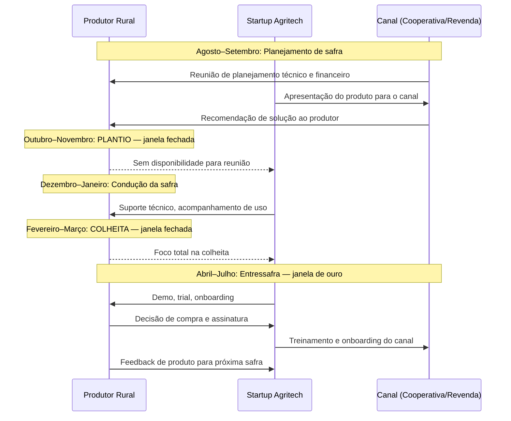

> [!warning] Erro de timing custa um ano inteiro
> Em agritech, errar o timing de lançamento ou da abordagem comercial não custa um mês — custa um ciclo de safra inteiro (6 a 12 meses). Startup que lança produto em outubro (plantio da soja) não tem segunda chance antes de abril. Planejar lançamentos e campanhas de vendas para a entressafra. Produtos que exigem 30 a 60 dias de onboarding precisam começar em abril para estar funcionando em agosto.

### Regulatório: o mapa do campo regulado

Agritech opera em mercado fortemente regulado pelo MAPA (Ministério da Agricultura, Pecuária e Abastecimento) e por outras agências.

**MAPA.** Fiscaliza registro de defensivos agrícolas, sementes, fertilizantes, e bioinsumos. Startup que desenvolve produto biológico (controle biológico, inoculante) ou hardware relacionado a aplicação de agroquímicos precisa de registro específico. Prazo: 12 a 36 meses. Custo: R$ 200K a R$ 1M dependendo da categoria.

**Embrapa como parceiro estratégico.** A Empresa Brasileira de Pesquisa Agropecuária (Embrapa) desenvolve tecnologia agropecuária há cinco décadas. Para agritechs de deep tech (biotech agrícola, genômica, sensoriamento remoto), parceria com Embrapa via licenciamento de cultivares ou acordos de transferência de tecnologia é caminho validado. A Embrapa tem unidades descentralizadas por bioma e cultura — 43 unidades distribuídas pelo Brasil. Prospectar a unidade relevante para a cultura-alvo.

**SNCR (Sistema Nacional de Crédito Rural).** O SNCR é a estrutura que viabiliza crédito para o produtor rural via bancos públicos e cooperativas de crédito. Startups que integram dados de crédito rural (Banco do Brasil, Sicredi, Sicoob, Cresol) na plataforma aumentam valor percebido. Startups que querem operar como plataforma de crédito rural precisam de autorização do BACEN ou operar via parceria com instituição financeira autorizada.

**Pronaf.** O Programa Nacional de Fortalecimento da Agricultura Familiar é o principal instrumento de crédito para o agricultor familiar. Startups de agritech para pequenos produtores que conseguem integrar seus produtos ao fluxo de crédito do Pronaf têm vantagem de adoção massiva. O Pronaf financia não só insumos mas tecnologia e assistência técnica — via ATER (Assistência Técnica e Extensão Rural).

> [!important] Registro MAPA não é opcional
> Startup que desenvolve produto biológico ou produto de aplicação agrícola sem registro MAPA não pode comercializar legalmente. Descobrir isso depois de produto desenvolvido é catastrófico. Mapear exigências regulatórias do MAPA nos primeiros três meses de desenvolvimento.

### Funding agrícola: instrumentos específicos do campo

O agronegócio tem instrumentos de financiamento próprios que startups de outras verticais desconhecem.

**CPR — Cédula de Produto Rural.** Título de crédito emitido pelo produtor comprometendo entrega futura de produto agrícola. Pode ser física (compromisso de entrega do produto) ou financeira (compromisso de pagamento em dinheiro). Startup que vende para produtor pode usar CPR como instrumento de pagamento diferido alinhado ao ciclo de safra. Plataformas como LandBank e AgroCredit estruturam CPRs para startups e produtores.

**CRA — Certificado de Recebíveis do Agronegócio.** Título de securitização lastreado em recebíveis do agronegócio. Agritechs com carteira de clientes produtores rurais podem estruturar CRAs para antecipar recebíveis. Instrumento de capital de giro sem diluição de equity. Mínimo de carteira para estruturar: tipicamente R$ 5–10M em recebíveis.

**FNO / FCO — Fundos Constitucionais.** O Fundo Constitucional de Financiamento do Norte (FNO) e do Centro-Oeste (FCO) financiam empreendimentos na Amazônia, Centro-Oeste, e Cerrado, incluindo agrotech. Taxas subsidiadas, prazos longos. Acessíveis via Banco da Amazônia (FNO) e BB/Caixa (FCO).

**Fiagro — Fundo de Investimento nas Cadeias Produtivas Agroindustriais.** Criado pela Lei 14.130/2021, o Fiagro é o instrumento mais novo de funding para o agronegócio. Funciona como um FII (Fundo Imobiliário) mas voltado a ativos do agro (terra, CPR, CRA, recebíveis). Startups agritech com modelo de capital-intensivo (compra de terra, armazenagem) podem ser objeto de Fiagros. Investimento mínimo de gestores de Fiagro em startups agritech ainda é incipiente, mas crescente.

**BNDES crédito rural e BNDES Fundo Clima.** O BNDES opera linhas específicas para inovação no agronegócio: BNDES Agro (via agentes financeiros credenciados), BNDES Fundo Clima (para soluções de adaptação à mudança climática em agro), e PRONAF para startups que prestam serviços para agricultores familiares. Ver [[IGNICAO-Vol-5-Financas-e-Captacao#CAPÍTULO 12 — FINANCIAMENTO NÃO-DILUITIVO|Capítulo 12 (Financiamento Não-Diluitivo) (Vol. 5)]] para detalhes de acesso.

### Jornada de adoção do produtor rural

O produtor rural tem curva de adoção diferente de qualquer segmento B2B urbano. Confiança é construída em anos, não em demos.

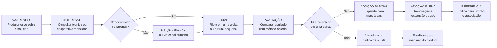

A fase mais crítica é a de TRIAL. O produtor não arrisca a safra inteira. Ele testa em uma gleba pequena, em uma cultura secundária, ou em uma área marginal. A startup precisa garantir que o piloto gera resultado mensurável em um ciclo de safra — e que esse resultado é documentado e comunicado de forma que o produtor possa contar para outros.

### Lições da Trincheira Brasileira: QuemDominou a Porteira e Quem Quebrou Tentando Desintermediar o Canal

**Agrosmart.** Fundada em 2014 em Campinas, a Agrosmart desenvolveu sensores IoT para monitoramento de microclima e solo em campo. Focou inicialmente em culturas de alto valor (café, laranja, cana-de-açúcar), onde o produtor tem margem para investir em precisão. Construiu canal via consultores técnicos especializados antes de expandir para cooperativas. Foi adquirida pela Trimble Agriculture em 2021, um dos primeiros exits relevantes de agritech brasileira.

**Solinftec.** Robótica e automação para colheita de cana-de-açúcar no interior de São Paulo. Fundada em 2012, a Solinftec desenvolveu o robô ALICE para monitoramento de operações em usinas sucroalcooleiras. Modelo B2B para grandes grupos (Raízen, Copersucar, Biosev). Captou rodadas com fundos americanos e recebeu aporte da Bunge. Exemplo de agritech de deep tech com foco em segmento específico (sucroalcooleiro) e cliente de grande porte.

**Strider.** Plataforma de gestão de pragas e defensivos agrícolas para grandes produtores de soja, milho, e algodão. Fundada em 2013, a Strider focou no problema de tomada de decisão de aplicação de defensivos — um dos maiores custos variáveis do grande produtor. Canal principal: consultores técnicos independentes. Foi adquirida pela Syngenta em 2016, primeiro grande exit de agritech brasileira.

**Agrotools.** Plataforma de inteligência de dados agrícolas para análise de mercado, rastreabilidade, e ESG no agronegócio. Fundada em 2013, a Agrotools combina sensoriamento remoto (satélite) com dados de campo para análise de risco de portfólio agrícola. Clientes incluem bancos (análise de crédito rural), seguradoras, e grandes tradings. Modelo de dados como serviço com ticket alto e ciclo de venda corporativo.

**AgroRadar.** Startup de gestão agrícola para médio produtor, com foco em usabilidade simplificada e distribuição via cooperativas. Exemplo de pivot de segmento bem executado: começou tentando atender o grande produtor, migrou para o médio via cooperativa depois de perceber que o grande produtor já tinha soluções consolidadas. O canal cooperativa foi o diferencial.

### As Ciladas Mortais no Campo: Depender de Digitação Manual, Ignorar a Revenda e Quebrar no Fluxo Safra-a-Safra

> [!warning] Armadilhas de agritech
> **Subestimar o distribuidor como gatekeeper.** Startup que lança produto diretamente ao produtor sem endosso do canal enfrenta resistência mesmo com produto superior. O consultor técnico e a revenda são os árbitros de confiança do campo. Produto sem endorsement do canal leva anos para penetrar. Produto com endorsement penetra em uma safra.
>
> **Tecnologia que exige conectividade onde não há 4G.** Produto que funciona perfeitamente em São Paulo e trava em fazenda no Piauí não é produto para o campo brasileiro. Toda solução agritech precisa ter modo offline, sincronização assíncrona, e fallback por SMS ou celular 2G. Testar na pior condição de conectividade antes de lançar, não depois.
>
> **Ciclo anual que pune erro de timing.** Fundador que começa abordagem comercial em outubro (plantio) não tem segunda chance antes de abril. Seis meses perdidos. Startup com capital escasso que erra o timing de vendas por um ciclo pode não sobreviver.
>
> **Relação de confiança que demora anos.** O produtor rural não compra de desconhecido. Ele compra de quem conhece, de quem indicou alguém que conhece, ou de quem o consultor técnico endossou. Startup que espera vender na primeira reunião vai ficar esperando. O ciclo de construção de confiança no campo é de 12 a 36 meses. Planejar o ciclo de vendas com essa realidade.
>
> **Precificar pela lógica de SaaS urbano.** Produtor rural compra por ROI demonstrado por safra, não por feature list. Pricing baseado em "R$ X/mês" não comunica valor para produtor que pensa em resultado por hectare. Traduzir sempre o preço em: "R$ X por hectare por safra, que se paga se você reduzir aplicação de defensivo em Y%."
>
> **Ignorar que o comprador é diferente do usuário.** Em grandes fazendas, quem decide a compra é o dono ou CEO da fazenda. Quem usa é o gerente agrícola ou operador. Quem influencia é o consultor técnico. São três pessoas distintas. Startup que apresenta o produto só para um deles perde o negócio.

### Leitura adicional

- **Embrapa** — portal de transferência de tecnologia e acordos de licenciamento. Ponto de partida para agritech de deep tech.
- **OCB (Organização das Cooperativas Brasileiras)** — mapa de cooperativas por estado e por segmento. Essencial para desenho de canal.
- **MAPA — Registros de defensivos e bioinsumos** — sistema de consulta de registros vigentes e em tramitação.
- **BNDES Agro** — portal de linhas de crédito e programas de inovação para o agronegócio.
- **Relatório Agribusiness Brasil (Rabobank)** — análise anual de tendências e investimentos no agronegócio brasileiro.
- **ABAgri (Associação Brasileira de Agritech)** — benchmark de mercado, eventos setoriais, mapeamento de startups.
- **AgFunder Brasil** — relatório anual de investimentos em agritech na América Latina.

---

### Filtro de Entrada na Trincheira: Você Deve Entrar Neste Jogo?

Antes de investir construindo software, hardware ou insumos para o produtor rural brasileiro, responda sem ilusão:

1. **O Teste da Cabine sem Internet:** O seu produto funciona 100% *offline* no meio do Mato Grosso sem exigir que o operador do trator digite planilhas no celular ao final de um turno de doze horas?
2. **A Conta em Sacas por Hectare:** Você consegue provar em um talhão-piloto que a sua solução economiza pelo menos 3x o valor da assinatura em defensivos, fertilizantes, diesel ou perdas de colheita já na primeira safra?
3. **O Aliado na Porteira:** O agrônomo da cooperativa ou o RTV da revenda local ganha dinheiro e prestígio quando recomenda o seu produto, ou enxerga você como ameaça à comissão dele?

**O Movimento de Segunda-Feira:** Nos próximos 15 dias, calce uma bota, passe três dias inteiros dentro de três fazendas e duas cooperativas acompanhando o fechamento de pedidos e o trabalho na cabine da máquina.


---

## CAPÍTULO 12 — PECUÁRIA DE PRECISÃO (PECTECH), PROTEÍNA ANIMAL, GENÉTICA BOVINA (FIV), RASTREABILIDADE E AQUICULTURA (AQUATECH)

### A Regra Invisível do Jogo: A Matemática da Arroba, da Conversão Alimentar e do Boi Invisível no Pasto

O empreendedor "turista" costuma tratar pecuária e agricultura como se fossem a mesma coisa porque ambas ficam na zona rural. Ele tenta vender um software de assinatura mensal para um pecuarista extensivo sem entender que a física financeira da proteína animal opera em um relógio biológico completamente diferente da soja: o ciclo pecuário dura de trinta a trinta e seis meses, o ativo principal caminha sobre quatro patas em milhares de hectares sem rede e 70% do custo de produção no confinamento, na avicultura, na suinocultura e na piscicultura está concentrado em uma única linha da planilha — a nutrição (ração). Quem vende um "painel gerencial genérico" sem tocar no ganho de peso diário (GMD), na taxa de prenhez ou na conversão alimentar morre ignorado pelo produtor.

O veterano de trincheira enxerga o Brasil como a maior potência mundial de proteína animal tropical e sabe onde o lucro está escondido: na transição da pecuária extensiva para a pecuária de precisão, na genética bovina de elite (IATF e FIV, onde o Brasil domina mais da metade do mercado mundial de embriões), na rastreabilidade individual e na explosão da aquicultura intensiva (tilápia e camarão).

Aqui vigora **A Lei da Conversão Alimentar e da Rastreabilidade de Frigorífico**: o produtor só abre a carteira para tecnologias que pesam o animal sem estresse, cortam o desperdício de ração no cocho ou no tanque, antecipam o abate via genética/nutrição ou destravam o prêmio do frigorífico exportador pela rastreabilidade livre de desmatamento.

---

> [!note] Síntese Executiva da Vertical
> Enquanto a agricultura de grãos opera sob janelas sazonais fixas de plantio e colheita onde a terra é o ativo imóvel central, a **Pecuária e a Indústria de Proteína Animal** operam sobre um **estoque biológico vivo, móvel, autorreplicável e de ciclo plurianual**. O Brasil detém o **maior rebanho bovino comercial do planeta (mais de 230 milhões de cabeças)**, é o **1º exportador mundial absoluto de carne bovina e de carne de frango**, o 4º maior exportador de carne suína e protagoniza uma revolução silenciosa na **Aquicultura e Piscicultura continental e marinha (Economia Azul)**. Empreender em *PecTech* e *AquaTech* exige compreender que o pecuarista e o integrador não compram "tecnologia bonita": eles compram **Ganho Médio Diário (GMD)**, **redução na Conversão Alimentar (CA)**, **aumento da taxa de prenhez**, **lotação por hectare (UA/ha)** e **passaporte sanitário e ambiental** para acessar mercados premium na China, União Europeia, Estados Unidos, Oriente Médio e Japão.

---

### 1. A Física Econômica da Proteína Animal vs. Lavoura: O Ciclo Pecuário Plurianual

O erro primário de fundadores de *AgTech* oriundos da soja ou do milho ao tentar entrar na pecuária é ignorar a **física biológica e financeira do ciclo pecuário**. Na soja, o produtor planta em outubro e colhe em fevereiro (ciclo de 120 dias). Na bovinocultura de corte, entre a inseminação da vaca matriz (9 meses de gestação), o desmame do bezerro aos 7–8 meses (fase de **Cria**), o desenvolvimento estrutural e muscular no pasto (fase de **Recria**, de 8 a 12 meses) e a terminação intensiva a pasto ou em cocho (fase de **Engorda / Confinamento**, de 90 a 120 dias), transcorrem de **24 a 36 meses** até que o animal atinja 18 a 21 arrobas ($@$, onde $1\text{ @} = 15\text{ kg}$ de peso de carcaça morta, equivalente a ~30 kg de peso vivo com rendimento de carcaça de 50% a 54%) e vá para o gancho do frigorífico.

Essa latência biológica cria o famoso **Ciclo Pecuário de Preços (de 4 a 5 anos)** negociado no contrato futuro de Boi Gordo (BGI) na B3:
1. **Fase de Baixa e Liquidação de Matrizes:** Quando o preço do bezerro cai, o criador descapitalizado vende fêmeas (vacas e novilhas) para o abate a fim de fazer caixa rápido. A oferta de carne no curto prazo explode nos frigoríficos, derrubando ainda mais o preço da arroba ($@$) do boi gordo.
2. **Fase de Inversão e Retenção de Fêmeas:** Dois anos depois, faltam bezerros no mercado porque as mães foram abatidas. O preço do bezerro de reposição dispara. Os criadores passam a reter todas as fêmeas na fazenda para reproduzir, enxugando a oferta de animais para abate e fazendo a arroba do boi gordo disparar na B3.
3. **Implicação Estratégica para Startups (*PecTechs*):** Durante a fase de baixa da arroba, o pecuarista de cria corta gastos supérfluos, mas o **confinador e o recriador profissional precisam desesperadamente de eficiência nutricional, pesagem de precisão e hedge** para proteger a relação de troca (*ágio/deságio do bezerro vs. boi gordo*). Na fase de alta da arroba, explode a demanda por **biotecnologia reprodutiva (IATF e FIV)**, reforma de pastagens e expansão de rebanho.

---

### 2. Bovinocultura de Corte e Leite: Da Pecuária Extensiva à Pecuária de Precisão (PecTech)

Historicamente, a pecuária brasileira foi sinônimo de ocupação extensiva de fronteira: menos de 1 cabeça por hectare em pastagens degradadas, abates tardios aos 48 meses e zero controle individual de desempenho. Nas últimas duas décadas, a pressão do preço da terra (onde 1 hectare de pasto bom em São Paulo, Mato Grosso do Sul, Goiás ou Mato Grosso vale dezenas de milhares de reais e compete diretamente com soja, milho e cana) forçou a **intensificação vertical da pecuária**.

As quatro grandes frentes tecnológicas de *PecTech* dentro da porteira são:

#### A) Pesagem Passiva por Visão Computacional 3D, Brincos RFID e IoT no Pasto
Na pecuária tradicional, para saber se um lote de 500 bois está ganhando peso ou perdendo dinheiro, o peão precisava tocar a boiada por quilômetros até o curral, prendê-los no tronco e pesá-los na balança mecânica — um processo que gera **estresse agudo no animal, contusões e perda imediata de 3 a 5 kg de peso vivo (quebra de manejo)**.
- **Balanças de Passagem e Visão Computacional 3D/Termográfica no Cocho e Bebedouro:** Startups e centros de engenharia instalaram câmeras estereoscópicas 3D (LiDAR/Time-of-Flight) e plataformas de pesagem passiva acopladas às aguadas (bebedouros) ou saleiros solares no pasto. Quando o boi vai beber água voluntariamente todos os dias, a antena lê o **brinco eletrônico RFID (ISO 11784/11785 — FDX/HDX)** na orelha do animal, a câmera 3D reconstrói a nuvem de pontos do dorso e da garupa (estimando o peso com erro $< 1,5\%$ e o acabamento de gordura subcutânea) e uma câmera termográfica mede a temperatura ocular do animal (detectando febre subclínica de tristeza parasitária ou pneumonia 48 horas antes do sintoma visual).
- **Algoritmo de Ponto Ótimo de Abate:** Se um boi em confinamento está consumindo R$ 18,00/dia de ração, mas seu Ganho Médio Diário (GMD) caiu de $1,6\text{ kg/dia}$ para $0,7\text{ kg/dia}$ porque ele já atingiu a maturidade fisiológica e só está depositando sebo caro, o software emite um alerta imediato: *"Apartar animal brinco #4892 para embarque imediato ao frigorífico; mantê-lo mais 15 dias no cocho gerará prejuízo líquido de R$ 95,00"*.

#### B) Gestão de Confinamentos (*Feedlots*), Boitéis e Cochos Inteligentes (*Smart Bunks*)
O Brasil confina mais de **7 a 8 milhões de bovinos por ano** no período seco (maio a novembro), em megaoperações próprias ou **Boitéis** (hotéis de engorda terceirizada onde o pecuarista deixa o boi pagando por diária alimentar ou por arroba produzida).
- Na operação de confinamento, a **nutrição representa 70% a 80% do custo operacional (excluindo a compra do boi magro)**. Um desvio de 3% no trato diário de um confinamento de 30.000 cabeças destrói milhões de reais de margem.
- **Sistemas de Gestão de Trato e Leitura de Cocho (como Ponta / PontaAgro, JetBov e Prodap):** O sistema integra o vagão misturador (caminhão trato com células de carga e GPS) ao software de nutrição. Antes do primeiro trato da manhã, sensores ou operadores registram o **Escore de Cocho** (se o cocho amanheceu lambido nota 0, com sobra fina nota 1 ou cheio de sobra nota 3). O algoritmo recalcula automaticamente em segundos a quantidade exata de matéria seca (silagem de milho, milho moído, farelo de soja/algodão ou DDGS de etanol de milho, núcleo mineral e ionóforos como monensina sódica) que o caminhão deve descarregar em cada curral específico, enquanto sensores de matéria seca por **espectroscopia NIR portátil** corrigem a umidade da silagem após uma chuva noturna.

#### C) Pecuária Leiteira de Alta Precisão (*Smart Dairy*)
Na cadeia do leite — concentrada no Sul (PR, RS, SC), Minas Gerais, Goiás e interior de São Paulo —, a profissionalização em sistemas *Compost Barn* e *Free Stall* substituiu o manejo empírico por telemetria individual contínua:
- **Colares Inteligentes de Ruminação e Atividade (acelerômetros 3-eixos + microfones acústicos no pescoço da vaca):** Monitoram 24 horas por dia os minutos de ruminação, ofegação (estresse térmico que derruba a produção de leite no verão tropical) e movimentação.
- Quando a vaca entra no **estro (cio)**, sua atividade motora aumenta em 300% e o tempo de ruminação cai abruptamente. O colar avisa no celular do inseminador a janela exata de 12 horas de máxima fertilidade para inseminar com sêmen sexado de fêmea, além de detectar **mastite subclínica ou cetose pós-parto** antes que o leite seja contaminado e descartado no tanque de resfriamento.

#### D) Manejo de Pastagens Rotacionadas via Satélite e Recuperação de Áreas Degradadas
O Brasil possui cerca de **160 milhões de hectares de pastagens**, dos quais estima-se que **80 a 100 milhões de hectares apresentem algum grau de degradação** (baixa cobertura vegetal, cupinzeiros, invasoras e perda de matéria orgânica).
- A maior oportunidade econômica e climática do agronegócio brasileiro não requer derrubar uma única árvore: **converter 40 milhões de hectares de pasto degradado em sistemas intensivos de Integração Lavoura-Pecuária-Floresta (ILPF) ou pastagem rotacionada adubada** permite dobrar a produção de carne e liberar área para grãos.
- Startups de sensoriamento remoto combinam imagens diárias de satélites (Sentinel-2, Planet) e radar (SAR) com modelos agronômicos de crescimento de gramíneas tropicais (*Brachiaria / Urochloa*, *Panicum / Megathyrsus* — Mombaça, Zuri, Miyagi) para estimar a **biomassa de matéria seca disponível em cada piquete (kg MS/ha)**, indicando ao pecuarista o dia exato de entrada e saída do gado (respeitando a altura de entrada e o resíduo pós-pastejo) e gerando protocolos auditáveis de **sequestro de carbono no solo (SOC — *Soil Organic Carbon*)**.

---

### 3. Rastreabilidade Individual da Cadeia da Carne: SISBOV, PNIB e Regulação Europeia (EUDR)

> [!important] O Gargalo Bilionário dos "Fornecedores Indiretos"
> Quando você compra um corte de picanha em um supermercado de Londres, Xangai ou São Paulo, o frigorífico (JBS, Marfrig, Minerva, Prima Foods) conhece perfeitamente a **fazenda de engorda final (Fornecedor Direto)** de onde o caminhão boiadeiro saiu. O problema é que, durante os 24 meses anteriores, aquele mesmo boi nasceu em uma **fazenda de cria (Fornecedor Indireto Nível 2)** na fronteira agrícola, foi vendido aos 8 meses para uma **fazenda de recria (Fornecedor Indireto Nível 1)** e só depois chegou à fazenda de engorda. Até recentemente, a **Guia de Trânsito Animal (GTA)** emitida pelos órgãos estaduais de defesa agropecuária (INDEA-MT, IAGRO-MS, IDARON-RO, ADEPARÁ, CDA-SP) rastreava **lotes de animais para fins sanitários (febre aftosa)**, mas não vinculava o histórico individual de cada CPF/brinco do bezerro desde o nascimento!

Esse vácuo criou uma corrida tecnológica sem precedentes impulsionada por três forças simultâneas:
1. **Regulação da União Europeia para Produtos Livres de Desmatamento (EUDR — *EU Deforestation Regulation*) e Exigências de Importadores Globais:** A Europa, o Reino Unido e as grandes redes globais de varejo e *fast food* (Carrefour, Tesco, Casino, McDonald's, Burger King) passaram a exigir comprovação georreferenciada (polígonos de todas as fazendas pelas quais o animal passou desde o nascimento) garantindo **desmatamento zero e ausência de trabalho análogo ao escravo ou invasão de terras indígenas/unidades de conservação**.
2. **Plano Nacional de Identificação Individual de Bovinos e Bubalinos (PNIB / MAPA) e Programas Estaduais (como o Passaporte Verde do Pará):** O governo brasileiro, a indústria frigorífica e os estados da Amazônia Legal estruturaram cronogramas para a **identificação eletrônica individual obrigatória (brinco visual + botão eletrônico RFID)** de todo o rebanho nacional até o início da década de 2030, superando as limitações burocráticas do antigo **SISBOV** (que historicamente cobria apenas ~2% a 3% do rebanho nacional voltado à Cota Hilton europeia).
3. **Como operam as Plataformas de Compliance Socioambiental e Rastreabilidade Pecuária (Niceplanet, Ecotrace, SafeTrace, Agrotools, Visipec):**
   - **Camada 1 (Monitoramento Territorial de Fornecedores Diretos):** Antes de o comprador de gado do frigorífico fechar a compra de uma boiada, o sistema cruza automaticamente o número do **CAR (Cadastro Ambiental Rural)** da fazenda com 15 bases públicas atualizadas diariamente: alertas de desmatamento **PRODES e DETER (INPE)**, lista de áreas embargadas pelo **IBAMA e ICMBio**, terras indígenas (FUNAI), territórios quilombolas (INCRA) e a "Lista Suja" do trabalho escravo do Ministério do Trabalho. Se houver sobreposição irregular, o CPF/CNPJ é **bloqueado automaticamente no ERP do frigorífico**.
   - **Camada 2 (Reconciliação de GTAs, Blockchain e Escritórios Verdes):** Para rastrear os fornecedores indiretos, plataformas de rastreabilidade integram a leitura dos brincos RFID na desmama com registros imutáveis (frequentemente ancorados em blockchain ou bancos de dados auditáveis de terceira parte) e cruzamento de grafos de movimentação de GTAs. Além do bloqueio punitivo, surgiram os **Escritórios Verdes e Plataformas de Regularização Ambiental**: quando um pequeno produtor de bezerros tem pendência no CAR, a startup automatiza o projeto técnico de recomposição florestal (PRA) e destrava o crédito bancário para reintegrá-lo formalmente à cadeia.

---

### 4. Genética Bovina de Elite (IATF e FIV), Nutrição e Saúde Animal

Poucos brasileiros sabem que **o Brasil é o líder mundial absoluto em biotecnologia reprodutiva bovina**, produzindo sozinho mais embriões bovinos por **Fertilização In Vitro (FIV)** do que os Estados Unidos e a Europa somados!

1. **A Revolução da IATF (Inseminação Artificial em Tempo Fixo) e da FIV:**
   - Na monta natural com touro no pasto, um bom reprodutor cobre 25 a 40 vacas por ano, e 80% das propriedades brasileiras ainda usavam touros comuns sem avaliação genética ("boi de boiada").
   - Com os protocolos hormonais de **IATF** (dispositivos intravaginais de progesterona + benzoato de estradiol + prostaglandina + eCG, desenvolvidos com protagonismo de pesquisadores brasileiros da USP/UNESP e empresas como **Ourofino Saúde Animal, Biogenesis Bagó, Zoetis e MSD**), o pecuarista sincroniza a ovulação de 1.000 vacas para inseminá-las todas no mesmo dia com sêmen congelado dos melhores touros provados do mundo, sem precisar observar cio! Hoje, mais de **20% a 25% das matrizes de corte do Brasil são inseminadas por IATF** (gerando bezerros que pesam 20 a 30 kg a mais no desmame e abatem 6 meses mais cedo, inclusive no **Cruzamento Industrial** de matrizes **Nelore** rústicas com sêmen de **Aberdeen Angus** para produzir carne marmorizada premium).
   - No topo da pirâmide está a **FIV (Fertilização In Vitro)**: um veterinário faz a **aspiração folicular guiada por ultrassom (OPU — *Ovum Pick-Up*)** em uma vaca doadora de elite na fazenda, envia os oócitos para um laboratório de biotecnologia (como **Vitrogen/ABS Pecplan, Alta Genetics, CRV, InVitro Brasil**), fecunda com sêmen sexado no laboratório por 7 dias e transfere os embriões a fresco ou vitrificados para vacas receptoras ("barrigas de aluguel"). Uma única vaca Nelore ou Girolando campeã, que teria apenas 1 bezerro por ano na natureza, passa a produzir **60 a 120 filhos por ano via FIV**!
2. **Avaliação Genômica e DEPs (Diferenças Esperadas na Progênie):** Programas como o **PMGZ (ABCZ)**, **ANCP**, **CIA de Melhoramento** e **Geneplus (Embrapa)** utilizam chips de genotipagem de SNPs (DNA da crina do bezerro recém-nascido) para prever com altíssima acurácia o potencial genético de precocidade sexual, área de olho de lombo (AOL), marmoreio e **CAR (Consumo Alimentar Residual — animais que ganham o mesmo peso comendo 15% menos comida e emitindo menos metano)**.
3. **Aditivos Redutores de Metano Entérico e Biológicos Veterinários:** Como ruminantes emitem metano ($\text{CH}_4$) pela eructação durante a fermentação ruminal, a indústria global de nutrição (**DSM-Firmenich com o Bovaer/3-NOP**, extratos de taninos vegetais de quebracho/acácia, óleos essenciais de caju e mamona desenvolvidos por empresas brasileiras como **Connan, Premix, Tortuga/DSM**) desenvolve moléculas que inibem a enzima metanogênica no rúmen, reduzindo a emissão de metano em **25% a 40%** e convertendo a energia economizada em mais ganho de peso.

---

### 5. Aves, Suínos e a Explosão da Aquicultura/Piscicultura (*AquaTech* e Economia Azul)

#### A) Avicultura e Suinocultura Integrada (Smart Barns / Granjas 4.0)
Na avicultura de corte e postura e na suinocultura (concentradas no Sul e Centro-Oeste sob o sistema de integração vertical com **BRF, Seara/JBS, Aurora Coop, C.Vale, Copacol, Lar e Vibra**), a margem é disputada na segunda casa decimal da **Conversão Alimentar (CA)**:
- Um frango de corte moderno atinge $2,8\text{ kg a }3,0\text{ kg}$ em apenas **42 dias**, com uma Conversão Alimentar extraordinária de **$1,55\text{ a }1,65\text{ kg}$ de ração por kg de peso vivo**!
- Startups de **Ambiência, IoT e Biosseguridade para Granjas** (como **Agriness** na suinocultura — que gerencia milhões de matrizes suínas na América Latina com o indicador *Pigs Per Sow Per Year / Leitões Desmamados por Fêmea/Ano* —, **ChainSight, SmartBreeder, Edge**) automatizam galpões *Dark House* com pressão negativa, sensores de amônia ($\text{NH}_3$), $\text{CO}_2$, umidade relativa, pesagem automática de aves em poleiros suspensos e análise acústica da tosse/vocalização de suínos e aves por IA para detectar surtos respiratórios ou **Influenza Aviária de Alta Patogenicidade (IAAP / H5N1)** em tempo real.

#### B) O Boom da Aquicultura e Piscicultura Brasileira (*AquaTech*)
O Brasil possui **12% de toda a água doce superficial disponível no planeta**, um litoral de mais de 8.500 km, clima tropical com águas quentes o ano inteiro (entre $25\text{ °C}$ e $30\text{ °C}$, faixa ótima para o metabolismo de peixes tropicais) e abundância de milho e soja para fabricar ração extrusada. Essa combinação transformou a **Piscicultura (liderada pela Tilápia no Oeste do Paraná, São Paulo, Minas Gerais e Mato Grosso do Sul, e pelo Tambaqui/Pirarucu na Região Norte)** e a **Carcinicultura (produção de Camarão *Litopenaeus vannamei* no Rio Grande do Norte, Ceará e Paraíba)** na proteína animal que mais cresce porcentualmente no país (~900 mil toneladas/ano de peixes cultivados e > 120 mil toneladas/ano de camarão):
- **A Física Econômica do Peixe:** Como o peixe vive suspenso na água (não gasta energia postural contra a gravidade como o boi) e é ectotérmico (não gasta calorias da ração para manter o corpo aquecido a $38,5\text{ °C}$), sua **Conversão Alimentar é imbatível: $1,25\text{ a }1,50\text{ kg}$ de ração para produzir $1,0\text{ kg}$ de peixe vivo**!
- **As 5 Oportunidades de Ouro em *AquaTech*:**
  1. **Sondas IoT de Oxigênio Dissolvido (OD), Amônia Tóxica ($\text{NH}_3$) e Automação de Aeradores:** Em um tanque escavado ou tanque-rede de alta densidade (50 a $100\text{ kg de tilápia/m}^3$ em reservatórios hidrelétricos concedidos pela União via MPA/ANA como Ilha Solteira, Furnas e Itaipu), se o **Oxigênio Dissolvido cair abaixo de $2,0\text{ mg/L}$** às 4h da madrugada (quando as microalgas consomem oxigênio na respiração noturna) ou faltar energia elétrica nos aeradores de pás, **o produtor perde 100% do cardume asfixiado em 90 minutos**! Sensores ópticos luminescentes de OD conectados a acionadores automáticos de aeradores e geradores salvam milhões de reais por safra.
  2. **Alimentadores Automáticos Inteligentes por Hidrofonia Passiva e Visão Computacional:** Na piscicultura e carcinicultura, a ração extrusada representa **65% a 75% do custo total de produção**. Jogar ração demais na água além de desperdiçar dinheiro apodrece no fundo do tanque, gerando amônia tóxica que mata o peixe ou o camarão. Alimentadores acústicos (tecnologia usada na carcinicultura e salmonicultura e adaptada para tilápia) utilizam um **hidrofone subaquático** que escuta o "estalo mandibular" dos camarões ou o ataque das tilápias aos *pellets* de ração: enquanto o cardume está com fome e mastigando vorazmente, o alimentador solta ração; assim que a frequência acústica de mastigação diminui, o equipamento corta o fornecimento no segundo exato.
  3. **Genética de Alevinos Reversos/Melhorados e Pós-Larvas SPF (*Specific Pathogen Free*) + Vacinação Automatizada de Peixes:** Empresas de genética aquícola (como **AquaGenetics, GenoMar, AcquaSul, Aquabel**) utilizam seleção genômica para resistência às bactérias *Streptococcus agalactiae* e *Francisella*, enquanto máquinas automatizadas vacinam mais de **8.000 alevinos por hora** por injeção intraperitoneal guiada por visão computacional, reduzindo a mortalidade no tanque-rede de 20% para menos de 3% sem uso de antibióticos.
  4. **Biomassa e Biorrefinaria de Resíduos da Filetagem (Economia Circular do Pescado):** Quando o frigorífico de peixe corta o filé de tilápia, o rendimento de filé limpo é de apenas **32% a 35% do peso do peixe inteiro** — os outros **65% (cabeça, espinhaço, vísceras, escamas e pele)** costumavam ser um passivo ambiental. Hoje, plantas de biotecnologia extraem **colágeno hidrolisado e gelatina farmacêutica de altíssimo valor a partir da pele e escamas da tilápia** (inclusive curativos biológicos para queimaduras humanas desenvolvidos no Ceará/UFC), **óleo de peixe rico em Ômega-3** das vísceras e **farinha proteica/hidrolisado enzimático** para *pet food* super premium!
  5. **Maricultura no Litoral (Mexilhões, Ostras em Santa Catarina e Algas Marinhas *Kappaphycus alvarezii*):** Cultivo regenerativo em mar aberto no litoral de SC, SP, RJ e Nordeste para produção de **bioestimulantes agrícolas à base de extrato de algas marinhas** (que aumentam a resistência da soja à seca) e carragenana para a indústria alimentícia.

---

### 6. Unit Economics e Benchmarks Comparativos das Cadeias de Proteína Animal

| Indicador Físico e Financeiro | Bovinocultura de Corte (Ciclo Completo / Confinamento) | Avicultura de Corte (Integrada / Dark House) | Suinocultura Tecnificada (Ciclo Completo / Terminação) | Piscicultura Intensiva (Tilápia em Tanque-Rede / Viveiro) |
|---|---|---|---|---|
| **Ciclo Biológico até o Abate** | **20 a 30 meses** (Tecnificado) / 36–42 meses (Extensivo) | **40 a 45 dias** | **150 a 170 dias** (~115–125 kg vivo) | **160 a 210 dias** (~850g a 1,1 kg vivo) |
| **Conversão Alimentar (CA: kg ração MS / kg ganho de peso)** | **6,0 a 8,5 : 1** (em confinamento) | **1,55 a 1,68 : 1** | **2,35 a 2,65 : 1** | **1,30 a 1,55 : 1** (A mais eficiente entre animais de fazenda!) |
| **Produtividade Anual por Hectare Útil** | **4 a 8 @/ha/ano** (Extensivo) vs. **25 a 55 @/ha/ano** (Intensivo/Recria-Engorda) | Altíssima densidade (**35 a 42 kg/m²** por lote; 6 lotes/ano) | Alta densidade em galpões climatizados com biodigestores | **15 a 30 ton/ha/ano** (Viveiro escavado) ou **100 a 150 kg/m³** (Tanque-rede) |
| **Peso da Alimentação no Custo Operacional (COE)** | **70% a 80%** (na fase de confinamento, ex-boi magro) | **68% a 74%** | **72% a 78%** | **65% a 75%** (Ração extrusada flutuante de 28%–45% PB) |
| **Rendimento de Carcaça / Corte Principal** | **52% a 56%** (Carcaça quente/fria sobre peso vivo) | **72% a 75%** (Carcaça eviscerada) | **75% a 78%** (Carcaça) | **32% a 36%** (Filé limpo sem pele) + **65% coprodutos** |
| **Margem EBITDA Típica na Produção Tecnificada** | **15% a 28%** (Recria/Engorda intensiva bem travada na B3) | **12% a 20%** (Integrador) / Estável por taxa (Integrado) | **14% a 24%** (Sujeita ao ciclo do milho/farelo de soja) | **18% a 30%** (Integrada com filetagem e coprodutos) |
| **Ticket Médio de SaaS / IoT PecTech ou AquaTech** | **R$ 1,50 a R$ 4,00 / cabeça / ano** ou **R$ 800 a R$ 4.500 / mês** por fazenda/confinamento | **R$ 400 a R$ 2.000 / mês** por núcleo de aviários | **R$ 2,50 a R$ 6,00 / matriz / ano** | **R$ 600 a R$ 3.500 / mês** por parque aquícola + comodato de sondas |

---

### 7. Casos Brasileiros de Destaque em PecTech, Genética, Saúde Animal e AquaTech

> [!example] Estudo de Caso — PontaAgro, JetBov, Ourofino, Vitrogen/ABS, Rehagro e Geneseas/Tilabras
> - **Ponta (PontaAgro — Goiânia/GO, investida/adquirida no ecossistema de nutrição e gestão de confinamentos) e Prodap (Belo Horizonte/MG, adquirida pela gigante global DSM-Firmenich):** A **Ponta** consolidou-se como o sistema operacional padrão dos maiores confinamentos de gado de corte da América Latina (controlando milhões de cabeças confinadas no Brasil, Paraguai, Argentina e EUA), automatizando a leitura de cocho, a batida do caminhão trato e a rastreabilidade nutricional. Já a mineira **Prodap** provou a tese do **SaaS + Consultoria Zootécnica + Nutrição de Precisão**: ao combinar softwares de gestão pecuária (Prodap Views) com formulação nutricional sob medida, escalou para centenas de milhões de reais de faturamento e protagonizou um *exit* estratégico histórico para a holandesa **DSM-Firmenich**.
> - **JetBov (Joinville/SC — Xaxim/SC) e BovControl:** Focadas na pecuária de corte a pasto (cria, recria e engorda), resolveram o problema da coleta de dados offline no curral (integrando via Bluetooth bastões leitores de brincos RFID e barras de pesagem eletrônica Tru-Test/Coimma ao aplicativo mobile do peão) e entregando ao dono da fazenda a margem real por lote, previsão de abate e ganho de peso por piquete.
> - **Ourofino Saúde Animal (Cravinhos/SP):** Fundada por Norival Bonamichi e Jardel Massari em 1987 como uma pequena fábrica no interior paulista, tornou-se a maior indústria farmacêutica veterinária de capital nacional (listada por anos na B3 como OFSA3 antes de fechar capital em transação estratégica), competindo de igual para igual com multinacionais americanas e europeias em vacinas, antiparasitários e protocolos reprodutivos de IATF.
> - **Geneseas e Tilabras (Piscicultura Industrial Verticalizada de Tilápia no Rio Paraná — SP/MS):** Operando nos grandes reservatórios de águas cristalinas da bacia do Rio Paraná (divisa de São Paulo com Mato Grosso do Sul), empresas como **Geneseas** e **Tilabras** verticalizaram toda a cadeia: melhoramento genético próprio de alevinos, berçários, engorda em tanques-rede de grande volume com alimentação automatizada, plantas frigoríficas certificadas com selos internacionais de sustentabilidade (**ASC — *Aquaculture Stewardship Council* e BAP**) exportando filés frescos de tilápia por via aérea e marítima para os Estados Unidos, além de processar pele e escamas para a indústria de colágeno e óleo.

---

### 8. Armadilhas Fatais em PecTech, Proteína Animal e AquaTech

> [!warning] Os 5 Erros Mortais que Quebram Startups e Operações de Proteína Animal
> 1. **A Armadilha da "Digitação Manual pelo Peão no Curral":** Se o seu software de gestão pecuária exige que um vaqueiro, com a mão suja de barro e esterco, sob sol de $38\text{ °C}$ e com 400 bois bravos pulando no brete, digite em uma tela pequena de celular um número de brinco de 6 dígitos e o peso lido no visor da balança, **seu churn será de 90% em 90 dias**! Os dados serão digitados errados ou inventados à noite no alojamento. Na pecuária e na piscicultura, **a coleta de dado primário tem que ser invisível, passiva ou 100% automatizada via Bluetooth/RFID/Sensores/Voz**, funcionando **100% offline** no curral e sincronizando quando o trabalhador chega na sede.
> 2. **Vender SaaS Puro Barato (R$ 199/mês) com Custo de Implantação Presencial no Interior do Mato Grosso ou Pará:** Uma fazenda de gado fica a 180 km de estrada de chão da cidade mais próxima. Se você cobra R$ 250/mês de assinatura e precisa mandar um técnico de caminhonete passar dois dias na fazenda para instalar o sistema e treinar a equipe, seu **CAC Payback será de 36 meses** e sua startup vai quebrar sem caixa. Ou você cobra tickets *Enterprise* (> R$ 2.500 a R$ 10.000/mês em grandes confinamentos e grupos agropecuários), ou embute sua tecnologia no canal de distribuição das **indústrias de nutrição animal, saúde veterinária, cooperativas e frigoríficos**, ou acopla receita transacional (compra de insumos, comercialização de gado, seguro, crédito via CPR ou *royalties* sobre arroba produzida).
> 3. **Subestimar o Risco Sanitário e Ambiental na Aquicultura (Mortalidade por Hipóxia, *Streptococcus* e Licenciamento de Águas da União):** Na piscicultura intensiva, o crescimento sem biosseguridade é suicídio financeiro. Superpovoar tanques acima da capacidade de suporte de assimilação de nitrogênio/fósforo da água sem aeração redundante (gerador a diesel com partida automática em 10 segundos na falta de luz da concessionária rural) e sem vacinação contra *Streptococcus* leva a **mortalidades catastróficas de 50% a 100% do lote na véspera da despesca**, quando o peixe já comeu toda a ração do ciclo!
> 4. **Especular no Confinamento sem Travar a "Troca Boi Magro / Ração / Boi Gordo na B3":** Muitos pecuaristas e boitéis quebram porque compram o boi magro caro no mercado físico, compram milho e farelo de soja à vista e deixam o preço de venda do boi gordo 100% aberto para daqui a 110 dias. Se a China suspende temporariamente um frigorífico ou o ciclo vira durante aqueles 110 dias e a arroba cai 15%, toda a margem da engorda vira prejuízo milionário. Operações profissionais de engorda **travam o custo da dieta e vendem contratos futuros de Boi Gordo (BGI) ou compram opções de venda (*Puts*) na B3 no exato dia em que o boi magro pisa no curral**.
> 5. **Ignorar a Conformidade Socioambiental dos Fornecedores Indiretos (Risco de Bloqueio de Exportação e Crédito):** Adquirir bezerros ou garrotes baratos "sem origem rastreada" (ou via triangulação de GTA para esquentar gado vindo de áreas embargadas pelo IBAMA) é uma bomba-relógio. Com o cruzamento automatizado de dados entre bancos (Resolução CMN/BACEN que veda crédito rural para propriedades com embargos ambientais), frigoríficos exportadores e Ministérios Públicos Estaduais/Federal, **um único lote contaminado bloqueia o CNPJ inteiro da fazenda de engorda**, corta o acesso ao Plano Safra e impede a venda para qualquer planta frigorífica de primeira linha.

---

### Filtro de Entrada na Trincheira: Você Deve Entrar Neste Jogo?

Antes de investir em PecTech, genética, saúde animal ou AquaTech no Brasil, responda:

1. **O Teste do Cocho e da Balança:** Sua solução impacta diretamente uma das três alavancas da margem líquida do produtor — Conversão Alimentar (ração por quilo ganho), Ganho Médio Diário (tempo até o abate) ou Taxa de Prenhez/Mortalidade?
2. **A Sobrevivência no Curral ou no Açude:** Se o seu produto envolve sensor, brinco, câmera ou alimentador automático, ele suporta lama, coice de boi de 500 quilos, sol de 42 graus ou corrosão na água do viveiro por três anos sem manutenção de engenheiro?
3. **Quem Paga a Conta da Rastreabilidade:** Na rastreabilidade bovina, você depende do pequeno criador pagar do próprio bolso ou quem financia é o frigorífico/banco que exige conformidade socioambiental dos fornecedores indiretos?

**O Movimento de Segunda-Feira:** Nos próximos 15 dias, acompanhe presencialmente um dia inteiro de manejo em um confinamento ou piscicultura comercial e valide em quanto tempo seu produto se paga em arrobas ou quilos de peixe.


---

## CAPÍTULO 13 — TRADING DE COMMODITIES, ORIGINAÇÃO, BARTER, ARMAZENAGEM (SILOS), HEDGE (CBOT/B3) E ESCOAMENTO (ARCO NORTE)

### A Regra Invisível do Jogo: A Armadilha do Marketplace de Grãos Sem Trava de CPR e Sem Silo

Todo ciclo de alta das commodities atrai o mesmo tipo de empreendedor "turista" para o interior do Brasil: ele olha para os bilhões de dólares movimentados pelas grandes tradings globais (ABCD) e decide criar o "Uber ou Mercado Livre da comercialização de soja e milho", cobrando 0,5% de comissão para conectar o produtor rural diretamente ao comprador final pelo aplicativo. Em dezoito meses, a plataforma vira pó. O turista descobre tarde demais que ninguém vende cinquenta mil sacas de soja para um estranho num aplicativo sem garantia bancária de liquidação, sem classificação física da umidade e da impureza na moega do silo e sem travar simultaneamente o contrato futuro em Chicago (CBOT) e o dólar na B3. Pior: na primeira oscilação de 15% no preço da saca, a ponta perdedora dá *default* na entrega física (*washout*) e quebra o intermediário ingênuo.

Como Michael Lewis retratou nos mercados de commodities, quem domina o comércio físico de grãos não vende telas — vende liquidez financeira, execução logística no Arco Norte e gestão de risco de base (*basis*).

Na trincheira do pós-porteira, a regra soberana é **A Equação Indivisível de Originação, Barter, Silo e Hedge**: o lucro real não está em um balcão de anúncios digitais avulso, mas na infraestrutura que amarra o insumo entregue no plantio ao grão colhido via Cédula de Produto Rural (CPR) registrada com georreferenciamento, que audita fisicamente o estoque dentro do armazém por termometria e espectroscopia NIR e que automatiza a trava instantânea de preço e câmbio para cooperativas, cerealistas e indústrias esmagadoras.

---

> [!note] Síntese Executiva da Vertical
> Se dentro da porteira da fazenda o jogo é biológico e agronômico, **da porteira e da boca da mina até o porão do navio (*Midstream, Origination, Storage & Trading*) o jogo é puramente financeiro, logístico e matemático**. É neste elo que circula o dinheiro grosso do setor primário brasileiro — mais de **R$ 1,5 trilhão por ano** em soja, milho, café arábica e conilon, açúcar VHP, algodão em pluma, suco de laranja concentrado, cacau, celulose e minérios. As maiores fortunas e corporações do agronegócio global (as gigantes **ABCD — ADM, Bunge, Cargill, Louis Dreyfus**, além de **Amaggi, Cofco, Viterra, Sucden, Olam e Coamo**) não ganham dinheiro apostando se a soja vai subir ou cair: elas ganham **arbitrando o *Basis* (prêmio físico), financiando o produtor via *Barter*, capturando o *carry* de armazenagem em silos e otimizando o frete multimodal pelo Arco Norte e pelos corredores ferroviários até os portos**. Para fundadores de *AgFintechs*, *LogTechs* e plataformas de *Trading/Originação*, dominar a formação de preço físico, a engenharia da CPR e o déficit de armazenagem é o passaporte para construir negócios bilionários.

---

### 1. A Anatomia Matemática da Formação de Preço da Commodity no Interior do Brasil

Por que uma saca de 60 kg de soja vale R$ 135,00 no porto de Paranaguá (PR), mas no mesmo minuto vale R$ 108,00 em Sorriso (MT) ou R$ 118,00 em Rio Verde (GO)?
Qualquer empreendedor que construa software de comercialização agrícola, motores de precificação de crédito (*AgFintech*), plataformas de *Barter* ou ERPs para cooperativas precisa ter tatuada na mente a **Equação Fundamental de Paridade de Exportação (*Export Parity Pricing*)** que rege cada saca negociada no Brasil:

$$\text{Preço Físico Interno (R\$/sc)} = \left[\left(\text{Cotação Futura CBOT/ICE (US\$/bu)} + \text{Prêmio de Porto / Basis (US\$/bu)}\right) \times \text{Fator de Conversão} \times \text{Taxa de Câmbio PTAX/NDF}\right] - \text{Frete Interno e Custos Portuários (Fobbing)}$$

Vamos dissecar os **4 motores independentes** dessa equação — porque entender que eles se movem em direções opostas é o que separa os profissionais dos amadores que quebram:

1. **Cotação na Bolsa Internacional de Referência (Tela Internacional):**
   - **Soja, Farelo de Soja, Óleo de Soja, Milho e Trigo:** Cotados na **CBOT (Bolsa de Chicago — CME Group)** em centavos de dólar por *bushel* ($\text{US cents/bu}$), onde $1\text{ saca de 60 kg de soja} = 2,20462\text{ bushels}$ (pois $1\text{ bushel de soja} = 27,2155\text{ kg}$) e $1\text{ saca de 60 kg de milho} = 2,3621\text{ bushels}$ ($1\text{ bushel de milho} = 25,401\text{ kg}$).
   - **Café Arábica, Açúcar Bruto (VHP #11), Algodão (#2), Cacau e Suco de Laranja (FCOJ):** Cotados na **ICE Futures US (Nova York)** em centavos de dólar por libra-peso ($\text{US cents/lb}$, onde $1\text{ saca de 60 kg} = 132,277\text{ libras-peso}$), enquanto o **Café Robusta/Conilon** e o **Açúcar Branco Refinado** são cotados na **ICE Futures Europe (Londres)** em dólares por tonelada métrica ($\text{US\$/ton}$).
   - **Milho Mercado Interno, Boi Gordo, Café Arábica e Etanol Hidratado:** Também possuem contratos futuros líquidos negociados diretamente na **B3 (São Paulo)**.
2. **O Prêmio de Exportação (*Basis* Portuário — Paranaguá, Santos, Rio Grande, Barcarena, Itaqui):**
   - O **Prêmio (*Basis*)** é a diferença (positiva ou negativa, expressa em centavos de dólar por *bushel* sobre o contrato futuro de referência em Chicago) que os compradores internacionais (como os esmagadores chineses) aceitam pagar pelo grão físico embarcado em um porto brasileiro específico (*FOB Paranaguá* ou *FOB Barcarena*) em relação ao grão americano no Golfo do México.
   - **Por que o Prêmio é o grande cemitério de quem faz hedge errado?** Quando os Estados Unidos sofrem uma seca severa no Meio-Oeste, a tela de Chicago (CBOT) dispara, mas se o Brasil colhe uma supersafra recorde de 165 milhões de toneladas ao mesmo tempo e faltam caminhões e berços nos portos brasileiros, **o Prêmio de Paranaguá despenca para valores profundamente negativos (ex.: $-150\text{ a }-200\text{ cents/bu}$)**! O produtor ou trader amador que travou apenas Chicago achando que estava protegido descobre, na hora da colheita, que o colapso do Prêmio e a explosão do frete comeram 25% do valor da sua soja!
3. **Taxa de Câmbio (Dólar Spot / PTAX ou Contrato Futuro de Dólar / NDF — *Non-Deliverable Forward*):**
   - Como a receita da commodity é em dólar ($\text{US\$}$) e 60% dos custos operacionais locais (mão de obra, arrendamento, frete rodoviário, impostos, manutenção) são em reais ($\text{R\$}$), a valorização abrupta do Real frente ao Dólar esmaga o preço em reais da saca no interior, mesmo que Chicago fique parada. Por isso, toda operação de *trading* ou *barter* exige **travamento simultâneo da Moeda (NDF ou Dólar Futuro na B3) casado com a Tela da Commodity**.
4. **Custo de *Fobbing* (Despesas Portuárias de Elevação) e Frete Interno Rodoviário/Ferroviário/Hidroviário:**
   - Para trazer a soja do navio (*FOB — Free on Board*) de volta para o preço na porteira da fazenda (*Ex-Farm*), a *trading* desconta o custo de elevação portuária (*fobbing*: recepção no terminal portuário, armazenagem portuária, corretagem marítima, supervisão SGS/Cotecna e capatazia, tipicamente **US$ 8 a US$ 14/tonelada**) e o **Frete Interno** da fazenda até o porto (que no Mato Grosso até Santos pode custar **R$ 350 a R$ 480/tonelada**, ou seja, **R$ 21 a R$ 29 por saca de 60 kg**!).

---

### 2. Operações Estruturadas de *Barter* e Plataformas de Originação Digital

Como o crédito rural oficial subsidiado pelo governo (Plano Safra) cobre menos de um terço da necessidade total de capital de giro de R$ 700+ bilhões da safra brasileira, as **Tradings (ABCD, Amaggi, Cofco)**, as **Gigantes de Insumos (Syngenta, Bayer, Corteva, Yara, Mosaic, UPL)** e as **Revendas/Cooperativas** criaram o mecanismo financeiro mais poderoso do agronegócio brasileiro: a **Operação Estruturada de *Barter* (Troca Triangular de Insumos por Grãos Futuros)**.

```
[1. Indústria de Sementes / Defensivos / Fertilizantes ou Revenda]
       │
       ├──► Entrega R$ 5 milhões em insumos para o Produtor em Agosto (Plantio)
       │    sem que o Produtor desembolse R$ 1,00 de caixa no ato.
       ▼
[2. Produtor Rural] ──► Assina uma CPR Física (Cédula de Produto Rural — Lei 8.929/94
       │                modernizada pela Lei do Agro 13.986/2020 e 14.421/2022)
       │                registrada eletronicamente na B3 / CERC / Núclea,
       │                prometendo entregar 45.000 sacas de soja em Março (Colheita),
       │                com alienação fiduciária/penhor de 1º grau da lavoura.
       ▼
[3. Trading / Offtaker (Cargill, Bunge, Amaggi, Cofco)]
       ├──► Recebe a cessão/endosso da CPR ou assina contrato de compra a termo,
       ├──► Trava imediatamente a soja na CBOT + Prêmio + NDF de Dólar no mercado futuro,
       └──► Desconta/antecipa o recebível (ou lastreia um CRA/FIAGRO no mercado de capitais)
            para pagar à vista a Indústria de Insumos!
```

#### Onde as Startups (*AgFintechs* e Plataformas de Originação) Ganham Bilhões Nesse Fluxo:
1. **Motores de Formalização Digital de Barter e Risco de Crédito (Bart Digital, Traive, Agroforte):** Historicamente, montar uma operação de *Barter* levava 30 dias de burocracia jurídica em cartórios de registro de imóveis de comarcas do interior para registrar penhor de safra, emitir certidões e colher assinaturas físicas. Startups como a **Bart Digital** e a **Traive** automatizaram 100% da esteira: assinatura eletrônica com validade jurídica, emissão e registro automático da **CPR Digital na registradora autorizada pelo Banco Central (CERC, B3, Núclea)**, monitoramento via satélite do polígono da lavoura dada em garantia (para impedir que o produtor dê a mesma área de soja em garantia para três credores diferentes — a fraude do *"duplo penhor"*) e monitoramento de desvio de colheita (*side-selling*).
2. **Marketplaces de Comercialização e Originação Digital de Grãos e Café (Grão Direto, Tarken, Fox, Compra de Café Digital):** Antes, para vender 10.000 sacas de milho ou soja no disponível (*spot*) ou a termo, o produtor ligava no telefone fixo ou WhatsApp para 3 corretores locais da sua cidade, sem visibilidade transparente da curva de prêmios e fretes de 40 compradores industriais (fábricas de ração da BRF/Seara, usinas de etanol de milho, moinhos, exportadores). Plataformas como a **Grão Direto** (investida simultaneamente pelas próprias gigantes concorrentes ADM, Cargill, Bunge, Louis Dreyfus, Amaggi e grandes bancos!) digitalizaram o balcão de comercialização: o comprador publica sua oferta georreferenciada com atualização automática segundo a segundo conforme a CBOT e o Dólar piscam na tela, e o produtor fecha o lote com um clique no celular com governança de contrato e logística integrada.

---

### 3. O Déficit Crítico de Armazenagem Estática, Silos Inteligentes e Classificação Óptica/NIR

> [!tip] A Assimetria Estrutural que Drena R$ 30 Bilhões por Ano do Produtor Brasileiro
> A **FAO (Organização das Nações Unidas para a Alimentação e a Agricultura)** recomenda que um país tenha capacidade estática de armazenagem equivalente a **120% da sua produção anual de grãos**.
> - Nos **Estados Unidos e no Canadá**, a capacidade de armazenagem supera **130% da safra**, sendo que **mais de 60% a 65% dos silos estão DENTRO das próprias fazendas (*On-Farm Storage*)**.
> - No **Brasil**, a produção de grãos ultrapassou **300 milhões de toneladas**, mas a capacidade estática total é de apenas **~200 a 210 milhões de toneladas (~65% a 70% da produção)**, e **apenas 15% a 18% dessa capacidade está dentro das fazendas (*On-Farm*)**!

O que acontece na prática por causa desse déficit de silos na fazenda?
Quando chega o pico da colheita da soja em fevereiro/março no Mato Grosso, Paraná ou Goiás, chove quase todos os dias e o produtor precisa tirar a soja da roça imediatamente para plantar o milho de 2ª safra (*safrinha*). Como ele **não tem silo próprio na fazenda** para secar e guardar o grão, ele é obrigado a:
1. Carregar o caminhão direto da colheitadeira ("bica corrida") e enfrentar filas de 48 horas nos armazéns das *tradings* ou nos portos;
2. Pagar o **frete rodoviário no pico mais caro do ano** (quando o frete sobe 40% a 60% por falta de caminhões); e
3. Vender o grão no momento de **menor preço físico e pior Prêmio (*Basis*) do ano**, entregando toda a margem de *carry* (valorização do grão na entressafra, de julho a novembro) para quem tem armazém!

Isso abriu três avenidas gigantescas de negócios tecnológicos e industriais:

#### A) Termometria Digital, Sensores de $\text{CO}_2$ e Automação de Aeração de Silos com IA
Um silo metálico ou armazém graneleiro horizontal com **100.000 sacas de soja (6.000 toneladas)** guarda **R$ 13 milhões a R$ 15 milhões em dinheiro vivo na forma de grãos respirando**.
- Grãos armazenados são organismos vivos que respiram, liberando calor, água e $\text{CO}_2$. Se a umidade da massa de grãos subir de 13% para 16% em um bolsão quente do silo, fungos (*Aspergillus*, *Penicillium*) e insetos proliferam exponencialmente, gerando **micotoxinas (aflatoxinas)** e podendo causar até a **combustão espontânea ou explosão de pó de silo**.
- Por outro lado, se o operador do silo ligar os potentes ventiladores de aeração nas horas erradas (com umidade relativa do ar externa muito baixa e ar muito quente), ele provoca a **supersecagem (*over-drying*)**: derrubar a umidade da soja de 14,0% (padrão comercial aceito sem desconto) para 11,0% significa **evaporar 3% do peso total do silo em água gratuita — perdendo 3.000 sacas (R$ 400.000!) de peso físico na balança de saída por pura incompetência operacional**!
- **Startups de Automação de Unidades Armazenadoras (como Widitec/SilosSoft, Verum, Agrosafety, Silo Verde):** Instalam cabos digitais de termometria pendurados no teto do silo combinados com **sensores de dióxido de carbono ($\text{CO}_2$ em ppm)** no *plenum*/exaustão (que detectam atividade fúngica 15 dias antes de o cabo térmico registrar aumento de temperatura!) e estações meteorológicas externas. O controlador de IA liga e desliga os ventiladores de aeração e exaustores apenas nas janelas psicrométricas exatas da madrugada em que o ar externo equilibra a umidade do grão em **13,5% a 14,0%**, economizando **30% a 45% na conta de energia elétrica** do armazém e zerando a quebra técnica de peso!

#### B) Financiamento Estruturado de Silos *On-Farm* (PCA/BNDES, Consórcios e FIAGROs)
Fabricantes de silos e secadores (Kepler Weber — listada na B3 como KEPL3 —, GSI/AGCO, Comil, Pagé, Casp) e *fintechs* estruturam operações casadas onde o produtor financia a construção da sua Unidade de Beneficiamento de Grãos (UBS/UAG) via **PCA (Programa para Construção e Ampliação de Armazéns do BNDES, com prazos de até 10–12 anos)** ou via **FIAGROs imobiliários/crédito** no modelo *Built-to-Suit / Sale-and-Leaseback*, pagando a parcela do silo com o ganho de **R$ 8 a R$ 15 por saca** obtido ao guardar o grão para vender na entressafra e economizar no frete de pico.

#### C) Classificação Automatizada de Grãos e Café por Visão Computacional e Espectroscopia NIR
Na chegada do caminhão à moega do armazém ou cooperativa, um classificador humano retira uma amostra com o calador pneumático e separa com uma pinça, no olho nu, quantos grãos estão **avariados, ardidos, mofados, fermentados, esverdeados, quebrados ou com impurezas** (conforme a Instrução Normativa MAPA nº 11/2007 para soja).
- Esse processo manual é lento (15 a 25 minutos por caminhão, gerando filas quilométricas na rodovia), subjetivo e alvo constante de **conflitos e suspeitas de fraude** entre o caminhoneiro/produtor e o recebedor da *trading* (pois 2% a mais de desconto de avariado/umidade rouba a margem do caminhão).
- **Classificadores Ópticos com IA e NIR (como ZoomAgri, GroundEye, Foison, Perten/PerkinElmer):** O operador despeja 500 gramas de soja, milho, cevada ou café em um scanner óptico de alta resolução combinado com **Espectroscopia no Infravermelho Próximo (NIR)**. Em **menos de 90 segundos**, redes neurais convolucionais (CNNs) analisam individualmente milhares de grãos em frente e verso, medem simultaneamente o teor de **umidade, proteína e óleo** da soja (ou a pureza varietal da cevada cervejeira para a Ambev/Heineken) e emitem um **laudo digital imutável com foto de cada grão defeituoso**, enviado no WhatsApp do produtor na mesma hora.

---

### 4. Logística de Escoamento Pesado: Ferrovias, Hidrovias e a Revolução do Arco Norte

Durante 40 anos, toda a soja produzida no Mato Grosso viajava absurdos **2.000 km de caminhão por rodovias esburacadas rumo ao Sul/Sudeste** para embarcar nos portos congestionados de **Santos (SP)** e **Paranaguá (PR)**.
Nos últimos dez anos, o Brasil executou uma das maiores revoluções geopolíticas e logísticas do comércio global de commodities: a consolidação do **Arco Norte** (todos os complexos portuários situados acima do paralelo $16^\circ\text{ S}$).

```
                 A NOVA GEOGRAFIA DO ESCOAMENTO DE GRÃOS DO BRASIL
                 
  [Norte do Mato Grosso: Sorriso / Sinop / Lucas do Rio Verde]
       │
       ├──► ROTA 1 (Arco Norte — Tapajós/Amazonas):
       │    Caminhão sobe ~950 km pela BR-163 pavimentada até MIRITITUBA (Itaituba/PA)
       │    ──► Transbordo para Comboios de 20 a 30 Barcaças Fluviais no Rio Tapajós
       │    ──► Navegação até os portos de SANTARÉM (PA), BARCARENA / VILA DO CONDE (PA)
       │        ou SANTANA (AP) ──► Navios Panamax/Capesize direto para China e Europa
       │        (Economizando 1.000 km de caminhão + 4 a 6 dias de navegação marítima!).
       │
       ├──► ROTA 2 (Arco Norte — Madeira/Amazonas):
       │    Oeste do MT e Rondônia ──► Estação de Transbordo de PORTO VELHO (RO)
       │    ──► Barcaças pelo Rio Madeira até ITACOATIARA (AM) e SANTARÉM (PA).
       │
       ├──► ROTA 3 (Arco Norte — Corredor Leste / Matopiba):
       │    Leste do MT, Goiás e MATOPIBA (MA, TO, PI, BA)
       │    ──► Ferrovia Norte-Sul (FNS / VLI / Rumo) + Estrada de Ferro Carajás (EFC / Vale)
       │    ──► Porto do ITAQUI (São Luís / MA) — um dos portos mais profundos e eficientes do mundo.
       │
       └──► ROTA 4 (Corredor Sul/Sudeste Ferroviário):
            Sudeste do MT e MS ──► Terminais de Rondonópolis / Rio Verde / Lucas (Malha Norte e Central da RUMO)
            ──► Comboios de 120 vagões Hopper até o Porto de SANTOS (SP).
```

Hoje, os portos do **Arco Norte já respondem por mais de 33% a 38% de todas as exportações brasileiras de soja e milho** (contra menos de 8% no início da década de 2010), operados por gigantes como **Hidrovias do Brasil (B3: HBSA3)**, **Amaggi Navegação**, **Cianport**, **VLI**, **Rumo (B3: RAIL3)**, **Cargill**, **Bunge/Zen-Noh (Terfron)** e **Louis Dreyfus**.

#### Onde Estão as Oportunidades para *LogTechs* e *MaritimeTechs* no Escoamento de Commodities:
1. **Sistemas de Agendamento de Pátios Ferroviários/Portuários e Controle de Fila de Caminhões (*Yard & Slot Management*):** Uma estação de transbordo em Miritituba (PA), Rondonópolis (MT) ou um terminal em Santos (SP) recebe **2.000 a 5.000 caminhões bitrem/rodotrem de 9 eixos por dia** (transportando 50 a 74 toneladas líquidas cada). Se um caminhão sai de Sorriso sem janela de descarga agendada (*slot*) e sem validação prévia de nota fiscal e qualidade, forma-se um engarrafamento de 40 km na rodovia e a *trading* paga **estadia rodoviária obrigatória por lei (Lei 13.103/2015)** por cada hora que o caminhão fica parado esperando para descarregar!
2. **Previsão e Mitigação de *Demurrage* Marítimo (Sobreestadia de Navios Graneleiros):** Quando uma *trading* afreta um navio graneleiro *Panamax* (65.000 a 75.000 toneladas de soja), o contrato de afretamento (*Charter Party*) estipula uma franquia de tempo para carregar o navio (*Laytime*, ex.: 5 dias). Se chover no porto de Paranaguá ou faltar soja no silo portuário porque o trem atrasou e o navio ficar **10 dias esperando na barra**, a *trading* paga uma multa diária brutal em dólar ao armador do navio chamada **Demurrage (US$ 20.000 a US$ 55.000 POR DIA por navio parado!)**. Softwares preditivos que cruzam microclima portuário (janelas de abertura de porão sem chuva), posição AIS dos navios e chegada de vagões/caminhões economizam dezenas de milhões de dólares por ano em *demurrage* e ganham **Despatch** (prêmio pago pelo armador quando o navio é carregado antes do prazo!).
3. **Hidrometria Preditiva e Calado Dinâmico em Rios Amazônicos:** Durante secas extremas na Amazônia (setembro a novembro), o nível dos rios Madeira e Tapajós baixa drasticamente, obrigando os comboios de barcaças a navegar com **50% a 60% da capacidade (quebra de calado)** para não encalhar em bancos de areia e pedrais. Soluções de batimetria contínua por sonar em embarcações e modelagem hidrológica por satélite permitem maximizar cada centímetro de calado seguro por viagem.

---

### 5. Unit Economics e Margens na Cadeia de Originação, Armazenagem e Trading

| Elo da Cadeia de Commodities | Receita / Spread Bruto Típico | Margem EBITDA Típica | Giro de Capital (Asset Turnover) | Onde Ganha e Onde Perde Dinheiro |
|---|---|---|---|---|
| **1. Trading Global / Originação Física (ABCD, Amaggi, Cofco)** | **US$ 8 a US$ 22 / ton** de margem bruta comercial e logística | **2,5% a 6,5%** sobre a receita bruta (mas **15% a 25% de ROIC** pelo giro altíssimo!) | **4x a 8x ao ano** | Ganha no *Basis* (comprando prêmio barato na safra e vendendo caro no FOB), no *Barter* e na eficiência de frete/elevação; perde em *washout* (inadimplência física) e *demurrage*. |
| **2. Unidade Armazenadora Comercial / Silo Terceirizado** | Recepção + Limpeza + Secagem (**R$ 4,50 a R$ 8,00/sc**) + Taxa de Armazenagem quinzenal + Quebra Técnica contratual | **35% a 50%** | **0,6x a 1,2x ao ano** (Infraestrutura intensiva em CAPEX) | Ganha na prestação de serviço, no *blend* de lotes (misturar soja de 12% de umidade com soja de 15% para entregar tudo a 14% sem desconto!) e no *carry* da entressafra. |
| **3. Operador Logístico Multimodal / Transbordo e Ferrovia (Rumo, Hidrovias)** | Tarifa de transporte e elevação (**R$ 120 a R$ 350 / ton** conforme distância e modal) | **42% a 60%** (Ferrovias e Terminais Portuários sob contratos *Take-or-Pay*) | **0,4x a 0,8x ao ano** | Contratos *Take-or-Pay* de 5 a 20 anos com as tradings garantem receita mínima mesmo se houver quebra de safra; risco está na seca severa de rios ou CAPEX ferroviário. |
| **4. Plataforma SaaS / Marketplace de Originação e Barter Digital** | **0,15% a 0,60% de *Take Rate*** sobre o GMV transacionado ou **SaaS Enterprise (R$ 15k a R$ 150k/mês)** para tradings/cooperativas | **45% a 70%** (Software puro em escala) | Altíssimo (*Asset-Light*) | Ganha automatizando o registro de CPRs, a mesa de originação e o monitoramento de garantias; morre se tentar assumir risco de balanço sem estrutura de capital. |

---

### 6. Casos Brasileiros de Destaque em Trading, Originação Digital, Barter e Logística

> [!example] Estudo de Caso — Amaggi, Grão Direto, Bart Digital, Traive, Kepler Weber e Hidrovias do Brasil
> - **Amaggi (Cuiabá/MT):** Fundada em 1977 por André Maggi como uma sementeira no Paraná que migrou para o cerrado mato-grossense, a Amaggi tornou-se a maior empresa de grãos e fibras 100% brasileira, movimentando mais de **18 a 20 milhões de toneladas de grãos por ano**. O segredo estratégico da Amaggi foi não ficar refém das multinacionais ABCD na comercialização: o grupo verticalizou **sementes, produção agrícola própria em mais de 300 mil hectares, originação/barter, esmagamento de soja, geração de energia hidrelétrica, frota própria de centenas de caminhões e barcaças fluviais no Corredor Madeira-Amazonas e no Tapajós**, além de terminais portuários próprios no Brasil e na Europa.
> - **Grão Direto (Uberlândia/MG):** Fundada por Alexandre Borges e Pedro Paiva (oriundos de família de corretores e produtores de grãos no Triângulo Mineiro), a Grão Direto resolveu o dilema clássico dos marketplaces de commodities: em vez de tentar "desintermediar as tradings inimigas", ela trouxe **ADM, Bunge, Cargill, Louis Dreyfus, Amaggi, Cofco e grandes cooperativas para dentro do cap table e da plataforma como compradoras âncoras**. Hoje, milhões de toneladas de soja, milho e sorgo são cotadas e fechadas digitalmente no aplicativo com integração direta às mesas de *trading* e hedge.
> - **Bart Digital (Londrina/PR) e Traive (São Paulo/SP):** Transformaram a infraestrutura invisível do crédito e do *Barter* agrícola no Brasil. Enquanto a **Bart Digital** tornou-se a plataforma líder na estruturação, formalização e gestão de operações de *Barter* e emissão de CPRs digitais para as maiores multinacionais de insumos e revendas do país (processando dezenas de bilhões de reais em garantias agrícolas), a **Traive** construiu uma infraestrutura de inteligência artificial para análise de risco de crédito agronômico e distribuição de títulos do agronegócio (CPRs, CDCA, CRAs) para o mercado de capitais.
> - **Kepler Weber (Panambi/RS — B3: KEPL3):** Com quase 100 anos de história no interior gaúcho, é a líder absoluta em equipamentos de armazenagem, secagem, limpeza e movimentação de grãos na América Latina (presente nas maiores fazendas, cooperativas e terminais portuários/ferroviários), surfando diretamente a onda de investimentos para fechar o déficit de armazenagem *on-farm* e industrial do Brasil e conectando seus silos e secadores via plataforma IoT **Sync**.

---

### 7. Armadilhas Fatais no Trading de Commodities, Barter e Armazenagem

> [!warning] Os 4 Riscos Sistêmicos que Levam Tradings, Cooperativas e AgFintechs à Falência em 48 Horas
> 1. **Risco de Performance Física / Quebra de Contrato (*Washout / Side-Selling*) em Anos de Alta Explosiva:** Imagine que em setembro (plantio) uma cooperativa ou *trading* comprou a termo do produtor 100.000 sacas de soja a **R$ 120,00/saca** para entrega em março, e imediatamente vendeu o contrato futuro correspondente na bolsa de Chicago (CBOT) para fazer o *hedge*. Em fevereiro, ocorre uma quebra climática ou guerra internacional e a soja no mercado físico à vista (*spot*) dispara para **R$ 180,00/saca**. Um produtor de má-fé (ou desesperado porque colheu menos do que esperava) **desvia os caminhões de soja à noite para vender à vista a R$ 180,00 para um comprador pirata (*side-selling*) e dá calote na entrega física da *trading***. O resultado para a *trading* é devastador: ela não recebe a soja física para entregar ao navio na China, mas **tem que pagar em dinheiro vivo o ajuste negativo de R$ 60,00/saca (R$ 6 milhões!) na bolsa de Chicago**! Por isso, operações profissionais exigem **CPR com alienação fiduciária registrada em 1º grau na comarca, monitoramento quinzenal de colheitadeiras por satélite (SAR/Óptico) para saber o dia exato em que a máquina entrou no talhão e limites estritos de comprometimento máximo de 30% a 40% da safra esperada por produtor**.
> 2. **A Armadilha Mortal da "Chamada de Margem (*Margin Call*)" na Bolsa Sem Liquidez de Caixa:** Este erro já quebrou dezenas de usinas, cooperativas e *tradings* médias no Brasil. Quando você vende contratos futuros de soja, milho, café ou açúcar na **CBOT, ICE ou B3** para proteger (*hedgear*) seu estoque físico no armazém, a bolsa exige **Ajuste Diário em Dinheiro (*Mark-to-Market*)**. Se o preço da commodity na bolsa subir 30% em duas semanas, a sua soja física guardada no silo também valorizou 30%, **mas a soja física só vai virar dinheiro daqui a 4 meses quando o navio embarcar, enquanto a bolsa exige que você deposite milhões de dólares em dinheiro vivo na conta da corretora até as 11h da manhã do dia seguinte (*Margin Call*)**! Se a empresa não tiver linhas de crédito bancário pré-aprovadas específicas para financiamento de margem (*Margin Call Facility*) ou não usar **Opções de Venda (*Puts*, onde você paga o prêmio à vista e nunca sofre chamada de margem)**, a corretora liquida compulsoriamente a posição no topo da alta e a empresa quebra tendo o produto físico no silo!
> 3. **Fazer "Hedge Sujo" ou Especulação Alavancada Disfarçada de Proteção (*Accumulators* e Derivativos Tóxicos):** Em 2008 e em vários ciclos cambiais, grandes empresas agrícolas brasileiras perderam bilhões de reais porque seus diretores financeiros, em vez de fazer um *hedge* simples de NDF ou Compra de *Put*, assinaram derivativos exóticos de balcão (*Target Redemption Forwards — TARFs* ou *Accumulators Double-Up*) que davam um ganho pequenininho se o dólar caísse, mas **dobravam a dívida em dólar sem limite se o dólar passasse de uma barreira (*Knock-In*)**. **Regra de ouro:** Mesa de *hedge* de empresa produtora ou originadora serve para **travar margem operacional física**, nunca para tentar adivinhar topo e fundo de mercado com alavancagem!
> 4. **Fraude de Estoque Físico ("Silo Oco / Certificado de Depósito Fantasma"):** Antes de financiar grãos ou café supostamente estocados em armazéns gerais de terceiros via **CDA/WA (Certificado de Depósito Agropecuário / Warrant Agropecuário)**, nunca confie apenas em um papel assinado pelo fiel depositário. A história do agro brasileiro é repleta de escândalos onde o mesmo lote físico de 50.000 sacas de café ou soja no fundo do armazém foi empenhado simultaneamente para cinco bancos diferentes, ou onde pilhas de *big bags* continham palha por dentro e café apenas na fileira da frente. Exija **cubagem volumétrica por drone/LiDAR 3D dentro do armazém, sensores de peso/nível e auditoria física surpresa por empresas certificadoras de primeira linha (SGS, Cotecna, Bureau Veritas)**.

---

### Filtro de Entrada na Trincheira: Você Deve Entrar Neste Jogo?

Antes de construir qualquer plataforma para comercialização de grãos, barter, armazenagem ou logística de commodities, responda:

1. **A Blindagem contra o Washout:** Se a soja em Chicago subir 25% entre o contrato a termo e a colheita, qual trava jurídica, registral (CPR em registradora) e de satélite impede que o produtor venda o grão no mercado *spot* para terceiros?
2. **Risco de Mesa vs. Receita de Software:** Seu modelo ganha *fee* tecnológico e spread travado (*back-to-back*), ou sua startup assume risco direcional de commodity e câmbio no próprio balanço?
3. **A Verdade Física da Moega:** Como sua solução valida que o grão prometido no papel realmente existe no silo com o padrão correto de umidade e impureza?

**O Movimento de Segunda-Feira:** Nos próximos 15 dias, acompanhe a mesa de originação e barter de duas cooperativas ou cerealistas e mapeie o tempo gasto entre o pedido no WhatsApp e a trava final na B3/CBOT.


---

## CAPÍTULO 14 — BIOCOMBUSTÍVEIS (ETANOL DE MILHO, SAF, CBIOS), BIOINSUMOS, AGROMINERAIS, IRRIGAÇÃO E BIOECONOMIA EXTRATIVISTA

### A Regra Invisível do Jogo: A Vantagem Fotossintética Tropical e o Fosso do Registro Regulatório

Quando olha para a transição energética e biológica, o empreendedor "turista" copia teses de descarbonização europeias ou americanas baseadas em subsídios estatais inexistentes no hemisfério sul, ou tenta lançar um biodefensivo "caseiro" e um projeto extrativista na Amazônia sem dominar a engenharia de fermentação industrial, o registro tripartite (MAPA, ANVISA e IBAMA) ou a conformidade com o SisGen. Em dezoito meses, ou o produto biológico morre na prateleira da revenda por falta de estabilidade térmica a 35 graus, ou a startup trava num labirinto regulatório por usar patrimônio genético brasileiro sem cadastro prévio.

Peter Thiel argumenta que os maiores negócios do século nascem onde uma vantagem natural incomparável se encontra com engenharia proprietária. Nenhuma nação do planeta possui a combinação brasileira de sol o ano inteiro, disponibilidade hídrica, segunda safra de milho abundante no Centro-Oeste, indústria sucroenergética madura e a maior biodiversidade molecular da Terra.

O veterano de trincheira opera sob **A Lei da Densidade Energética e Biológica Tropical**: enquanto o resto do mundo discute como eletrificar caminhões pesados e aviões sem rede elétrica suficiente, o Brasil gera caixa real transformando amido de milho da safrinha em etanol de baixíssima pegada de carbono, convertendo bagaço e vinhaça em biometano e Combustível Sustentável de Aviação (SAF), emitindo CBIOs (RenovaBio) negociados na B3 com liquidez imediata, substituindo agroquímicos importados por bioinsumos de prateleira longa e gerenciando cada milímetro de água nos pivôs centrais com telemetria e outorga da ANA.

---

> [!note] Síntese Executiva da Vertical
> Se o século XX pertenceu aos hidrocarbonetos fósseis extraídos do subsolo do Oriente Médio e do Texas, **o século XXI pertence aos carboidratos, lipídios, microrganismos e moléculas renováveis sintetizados pela fotossíntese tropical brasileira**. O Brasil não é apenas um exportador de grãos *in natura*; o país construiu as **quatro cadeias de bioeconomia industrial e agrotecnológica mais avançadas do planeta**: **(1) o Complexo de Biocombustíveis e Biorrefinarias** (Cana-de-Açúcar, Etanol de Milho, Biodiesel, Biometano, Etanol 2G e Combustível Sustentável de Aviação — SAF, ancorados no RenovaBio e na Lei do Combustível do Futuro); **(2) a Indústria de Bioinsumos (Biodefensivos e Inoculantes) e Agrominerais (Pó de Rocha)**, que lidera mundialmente a substituição de agroquímicos e fertilizantes fósseis importados; **(3) a Agricultura Irrigada de Precisão**, capaz de produzir 3 safras por ano no mesmo hectare; e **(4) a Bioeconomia Extrativista e Agroflorestal da Floresta em Pé** (Açaí, Cacau, Macaúba, Babaçu e ativos cosméticos/farmacêuticos da Amazônia, Cerrado e Caatinga). Este capítulo entrega o mapa técnico, regulatório e econômico dessas quatro potências.

---

### 1. Complexo Sucroenergético, Usinas de Etanol de Milho (*Flex/Full*), SAF, BECCS e RenovaBio (CBIOs)

#### A) Da Usina de Açúcar à Biorrefinaria Integrada de Cana (E1G, E2G, Bioeletricidade e Biometano)
O setor sucroenergético brasileiro (concentrado em São Paulo, Goiás, Minas Gerais, Mato Grosso do Sul, Paraná e Alagoas/Pernambuco, liderado por gigantes como **Raízen, São Martinho, BP Bunge, Tereos, Adecoagro, Coruripe e Jalles Machado**) deixou há muito tempo de ser apenas um produtor de açúcar e álcool hidratado de posto.
Uma usina moderna opera como uma **biorrefinaria multiproduto de desperdício zero**:
1. **Caldo da Cana (Sacarose):** Arbitrado dinamicamente entre a produção de **Açúcar VHP** (*Very High Polarization*, exportado pelo porto de Santos sob cotação da ICE NY #11) e **Etanol de Primeira Geração (E1G)** — tanto **Etanol Hidratado** (usado diretamente nos veículos *flex-fuel*) quanto **Etanol Anidro** (misturado obrigatoriamente à gasolina C, com mandato elevado pela Lei do Combustível do Futuro para a faixa de **27% a 35% — E30/E35**).
2. **Bagaço e Palha (Lignocelulose):** Queimados em caldeiras de alta pressão (65 a 100 bar) para cogeração de **Bioeletricidade limpa e despachável** exportada para o Sistema Interligado Nacional (SIN) justamente nos meses de seca dos reservatórios hidrelétricos (maio a novembro), ou hidrolisados enzimaticamente para produzir **Etanol de Segunda Geração (E2G — Etanol Celulósico)**. A **Raízen** tornou-se a única empresa do planeta a operar plantas de E2G em escala comercial lucrativa, aumentando em **50% a produção de etanol no mesmo hectare de cana plantada**, com pegada de carbono 80% menor que a gasolina e vendido com prêmio em dólar para a Europa e aviação!
3. **Vinhaça e Torta de Filtro (Resíduos Líquidos e Sólidos):** Para cada 1 litro de etanol produzido, a destilaria gera de **10 a 13 litros de vinhaça** rica em potássio e matéria orgânica. Antes aplicada apenas in natura na lavoura (*fertirrigação*), hoje a vinhaça e a torta de filtro passam por **biodigestores anaeróbios gigantes** para produzir **Biogás e Biometano**, substituindo 100% do óleo diesel consumido pelos tratores, colhedoras e caminhões canavieiros da própria usina!

#### B) A Explosão das Usinas de Etanol de Milho (*Full* e *Flex*) no Centro-Oeste e Matopiba
Até 2015, o Brasil produzia praticamente zero litros de etanol a partir do milho. No entanto, com a explosão do **milho de 2ª safra (*safrinha*, plantado em fevereiro logo após a colheita da soja)** no Mato Grosso, Goiás, Mato Grosso do Sul e Matopiba, surgiu uma distorção econômica colossal: a mais de 1.800 km dos portos, o milho *safrinha* sobrava no interior a preços aviltantes (R$ 30 a R$ 45/saca), enquanto o Centro-Oeste precisava importar combustível caro de Paulínia (SP).
Grupos visionários — liderados pela **Inpasa** (maior produtora de etanol de cereais da América Latina, fundada por José Lopes), **FS Bioenergia** (primeira usina *Full* de milho do país em Lucas do Rio Verde/MT, joint venture da Summit Agricultural Group com a Tapajós) e **São Martinho / Cerradinho (Neomille)** — importaram e tropicalizaram a tecnologia americana de moagem a seco (*dry-grind*) usando **biomassa de eucalipto plantado** (em vez de gás natural fóssil usado nos EUA!) para alimentar as caldeiras.

A mágica econômica da usina de etanol de milho está na **Equação de Transformação de 1 Tonelada de Milho**:
- De **1 tonelada de milho em grão** processada, a usina extrai simultaneamente **três produtos de altíssima liquidez**:
  1. **~420 a 440 litros de Etanol (Anidro/Hidratado/Neutro industrial)**;
  2. **~280 a 310 kg de DDGS (*Dried Distillers Grains with Solubles* ou WDG úmido):** Como o processo fermentativo consome apenas o amido do milho, toda a **proteína (28% a 32% de Proteína Bruta), fibra digestível e energia** se concentra no farelo DDGS, revolucionando a nutrição de confinamentos bovinos, vacas leiteiras, suínos, aves e peixes num raio de 300 km ao redor da usina;
  3. **~18 a 22 kg de Óleo de Milho Técnico (*Distillers Corn Oil*):** Vendido a preço de ouro para usinas de **Biodiesel, HVO e SAF**.
- Na prática, **a venda do DDGS e do Óleo de Milho chega a pagar de 45% a 60% do custo de compra do grão de milho**, garantindo margens EBITDA superiores a **25%–38%** mesmo em anos de oscilação do petróleo!

#### C) RenovaBio (CBIOs), Lei do Combustível do Futuro, SAF (Aviação) e BECCS (Captura Geológica de Carbono)
O Brasil criou o arcabouço regulatório de descarbonização de transportes mais sofisticado do mundo:
1. **O Mercado de CBIOs (RenovaBio — Lei 13.576/2017):** Cada usina de etanol, biodiesel ou biometano passa por uma auditoria de Análise de Ciclo de Vida (ACV do berço ao túmulo) na calculadora **RenovaCalc (ANP)** para receber sua **Nota de Eficiência Energético-Ambiental (NEEA)**. Quanto menor o uso de diesel, menor o uso de adubo nitrogenado sintético e zero desmatamento na lavoura fornecedora de cana, milho ou soja, maior é a nota da usina e mais **CBIOs** ela emite a cada litro vendido. As distribuidoras de combustíveis fósseis (Vibra, Ipiranga, Raízen, Alesat) são **obrigadas por lei** a comprar milhões de CBIOs por ano na **B3** (onde $1\text{ CBIO} = 1\text{ tonelada de }\text{CO}_2\text{ equivalente evitada}$, negociado tipicamente entre **R$ 70 e R$ 140 por título**), injetando bilhões de reais de receita líquida com **margem de quase 100%** diretamente no caixa das usinas eficientes!
   - **Oportunidade para Startups (*ClimateTechs / AgTechs*):** Como uma usina de etanol de milho ou biodiesel compra grãos de 2.000 produtores terceiros, se ela não conseguir comprovar os dados agronômicos primários de cada fazenda fornecedora, ela cai no "perfil padrão penalizado" da RenovaCalc e perde milhões em CBIOs. Startups que automatizam a coleta de dados primários de fazendas e a certificação **RenovaBio / ISCC CORSIA** capturam contratos milionários recorrentes com as usinas.
2. **Lei do Combustível do Futuro (Lei nº 14.993/2024), SAF (*Sustainable Aviation Fuel*) e Diesel Verde (HVO):** A lei instituiu o **ProBioQAV**, obrigando as companhias aéreas que operam no Brasil a reduzir progressivamente suas emissões com o uso de **SAF** a partir de 2027 (de 1% até 10% em 2037), além de elevar a mistura obrigatória de **Biodiesel no diesel fóssil (rumo ao B15–B20)** e criar mandatos para o **Biometano**.
   - Na corrida global do **SAF**, o Brasil domina as duas principais rotas tecnológicas: a rota **ATJ (*Alcohol-to-Jet*)**, que desidrata e oligomeriza o etanol de cana ou milho em querosene de aviação sintético, e a rota **HEFA (*Hydroprocessed Esters and Fatty Acids*)**, que hidrotrata óleos vegetais (soja, **Macaúba** — palmeira nativa do Cerrado que produz 4.000 a 5.000 litros de óleo/ha, dez vezes mais que a soja! —, palma/dendê), sebo bovino de frigoríficos e óleo de cozinha usado (UCO).
3. **BECCS (*Bioenergy with Carbon Capture and Storage*) na Fermentação do Etanol:** Durante a fermentação alcoólica da cana ou do milho pelas leveduras *Saccharomyces cerevisiae* nas dornas da usina, o gás liberado pela chaminé da dorna é **98% a 99% $\text{CO}_2$ biogênico puro**! Enquanto capturar $\text{CO}_2$ da chaminé de uma termelétrica a carvão ou gás custa **US$ 80 a US$ 150/tonelada** (porque o $\text{CO}_2$ está diluído a 8%–12% no nitrogênio), comprimir, desidratar e injetar o $\text{CO}_2$ puro da fermentação do etanol a 2.000 metros de profundidade nas formações salinas/basálticas da **Bacia do Paraná** (como no projeto pioneiro da **FS Bioenergia** em Lucas do Rio Verde/MT) custa apenas **US$ 20 a US$ 35/tonelada**! Isso gera **Etanol de Carbono Negativo** e créditos permanentes de remoção geológica de carbono (*CDR*) disputados por Microsoft, Google e companhias aéreas a **US$ 100–US$ 200+/tonelada**.

---

### 2. A Revolução dos Bioinsumos (Biodefensivos e Inoculantes) e Agrominerais (Pó de Rocha)

#### A) Por que o Brasil é o Líder Mundial Absoluto em Controle Biológico e Inoculantes
Enquanto na Europa e nos Estados Unidos o inverno congelante de $-15\text{ °C}$ "esteriliza" naturalmente a lavoura e mata os insetos e nematoides a cada ano, **no Brasil tropical o solo nunca congela e fazemos 2 a 3 safras sucessivas por ano (soja -> milho -> feijão/algodão — a chamada "ponte verde")**.
Essa pressão biológica ininterrupta fez com que pragas devastadoras (mosca-branca, cigarrinha-do-milho *Dalbulus maidis*, lagartas *Spodoptera/Helicoverpa*, bicudo-do-algodoeiro e **nematoides de solo**) desenvolvessem resistência rápida às moléculas químicas sintéticas tradicionais (cujo custo de descoberta na indústria química já passa de US$ 300 milhões e 12 anos por molécula).

A resposta brasileira foi protagonizar a **maior revolução de Bioinsumos da história da agricultura mundial** (crescendo 20% a 35% ao ano e movimentando mais de R$ 5 a R$ 8 bilhões/ano na porta da fábrica, impulsionada pelo **Programa Nacional de Bioinsumos e pelo Marco Legal dos Bioinsumos — Lei nº 14.997/2024 / regulamentação específica do MAPA/ANVISA/IBAMA**):
1. **Inoculantes e Biofertilizantes (Fixação Biológica de Nitrogênio e Solubilização de Fósforo):** Graças às pesquisas pioneiras de **Johanna Döbereiner e da Embrapa Agrobiologia/Soja**, quase **100% dos 46 milhões de hectares de soja do Brasil** não utilizam um único saco de adubo nitrogenado químico (ureia)! As sementes recebem inoculantes líquidos ou turfosos de bactérias **Bradyrhizobium** (que formam nódulos nas raízes e capturam o nitrogênio $N_2$ do ar entregando de graça à planta — uma economia de **mais de US$ 15 bilhões por ano** para o Brasil!) e co-inoculação com **Azospirillum brasilense**. Na década de 2020, explodiram os **solubilizadores biológicos de Fósforo e Potássio** (cepas de *Bacillus megaterium* e *Bacillus subtilis*, como o famoso *BiomaPhos* desenvolvido pela Embrapa com parceiros privados como **Biotrop e Simbiose**), capazes de destravar o "fósforo preso" nos argilominerais e óxidos de ferro/alumínio dos solos ácidos do Cerrado!
2. **Bionematicidas, Biofungicidas e Bioinseticidas:** Fungos benéficos como **Trichoderma harzianum / asperellum** e bactérias **Bacillus aryabhattai / amyloliquefaciens** protegem as raízes contra nematoides e *Fusarium/Sclerotinia* (mofo-branco); fungos entomopatogênicos (**Beauveria bassiana**, **Metarhizium anisopliae**, **Isaria / Cordyceps**) dizimam cigarrinhas e mosca-branca; **Baculovírus** específicos matam lagartas sem tocar em abelhas ou inimigos naturais; e **macrobiológicos** (vespinhas *Trichogramma* e *Cotesia* liberadas por drones sobre canaviais e lavouras de soja/milho) parasitam os ovos das pragas no campo.

#### B) Bioinsumos Industriais (Prateleira) vs. Multiplicação *On-Farm* (Biofábricas na Fazenda)
O mercado brasileiro dividiu-se em dois modelos de negócios bilionários que hoje convergem sob as novas regras de controle de qualidade do MAPA:
- **1. Indústria de Bioinsumos Formulados de Alta Tecnologia (Biotrop — adquirida pela belga Biobest por R$ 2,8 bilhões! —, Koppert Brasil, Vittia — B3: VITT3 —, Simbiose, Ballagro, Lallemand, Rovensa):** Selecionam cepas proprietárias (muitas vezes combinando consórcios de 2 a 4 microrganismos sinérgicos e seus metabólitos/endósporos), formulam com protetores solares e estabilizantes que garantem **12 a 24 meses de vida de prateleira (*shelf-life*) sem refrigeração** e compatibilidade para mistura de tanque com defensivos químicos, distribuindo pelas revendas agrícolas com margens brutas de **50% a 70%**.
- **2. Biofábricas *On-Farm* Profissionalizadas (O Modelo SoluBio):** Grandes produtores do Cerrado (> 5.000 hectares) perceberam que podiam multiplicar bactérias e fungos para uso exclusivo na própria fazenda por uma fração do custo comercial. Para eliminar o risco grave das antigas "multiplicações caseiras em caixas d'água abertas" (que frequentemente multiplicavam contaminantes patogênicos em vez da bactéria alvo!), empresas como a **SoluBio** (Jataí/GO) criaram o modelo de **Hardware-as-a-Service + Consumíveis Recorrentes (*Razor & Blade*)**: instalam um laboratório estéril automatizado com biorreatores de aço inox na fazenda e vendem recorrentemente os **kits fechados de meios de cultura estéreis, inóculos puros certificados e controle de qualidade laboratorial**.

#### C) Remineralizadores de Solo (Pó de Rocha / Agrominerais — Lei 12.890/2013) e Organominerais (+ ERW)
Como o Brasil importa cerca de **85% dos fertilizantes químicos NPK** que consome (especial destaque para os 95% de dependência no Cloreto de Potássio — KCl — importado do Canadá, Rússia e Belarus), a **Lei Federal nº 12.890/2013** regulamentou os **Remineralizadores de Solo (Agrominerais / Pó de Rocha)**:
- Rochas silicáticas ricas em potássio, cálcio, magnésio, fósforo e micronutrientes (**basaltos, kamafugitos, fonolitos, micaxistos, verdete/glauconita**) presentes ao redor das grandes regiões agrícolas em Goiás, Minas Gerais, Mato Grosso, Paraná e Rio Grande do Sul são cominuídas (moídas em granulometria fina controlada e registradas no MAPA).
- Além de liberar nutrientes gradualmente sem salinizar o solo (ao contrário do cloro do KCl químico que mata a microbiota ao redor da raiz!) e rejuvenescer solos tropicais intemperizados, o uso de **pó de rocha basáltica em solos agrícolas tropicais quentes e úmidos** tornou-se a fronteira mundial do **Intemperismo Acelerado de Rochas (*Enhanced Rock Weathering — ERW*)**: quando o silicato de cálcio/magnésio do basalto se dissolve na água da chuva com ácido carbônico no solo da fazenda, ele **captura permanentemente o $\text{CO}_2$ atmosférico na forma de íons bicarbonato ($\text{HCO}_3^-$)** por milhares de anos! Startups de clima e agrominerais (como **InPlanet, Terradot, Verde AgriTech, Remin**) pagam ou subsidiam o pó de rocha para o agricultor brasileiro em troca da medição geoquímica e venda dos **créditos de remoção permanente de carbono (CDR)** para Big Techs globais!

---

### 3. Agricultura Irrigada de Precisão, Pivôs Centrais e Gestão de Recursos Hídricos (Outorga ANA)

> [!important] O Multiplicador de Terra sem Desmatamento: 3 Safras por Ano no Mesmo Hectare
> O Brasil cultiva cerca de **75 a 80 milhões de hectares de lavouras**, mas **irriga menos de 9 milhões de hectares (~11% a 13% da área)** — embora a Agência Nacional de Águas (ANA) e a FAO apontem que o país possui potencial técnico e disponibilidade hídrica sustentável para **expandir em mais de 15 a 25 milhões de hectares irrigados** em áreas já abertas!
> Um hectare irrigado por **Pivô Central** ou **Gotejamento Subterrâneo** nos polos de **Cristalina (GO), Paracatu/Unaí (MG), Oeste da Bahia (Luís Eduardo Magalhães/Barreiras), Sudoeste Paulista (Itapetininga/Paranapanema), Chapada Diamantina (BA) ou Mato Grosso** não produz apenas mais por safra: ele elimina o risco climático de veranicos e permite fazer **3 safras completas por ano no mesmo chão** (ex.: **1ª safra de Soja/Semente -> 2ª safra de Milho/Algodão/Tomate Industrial -> 3ª safra de Inverno de Feijão, Trigo Irrigado, Batata, Alho, Cebola ou Ervilha**), triplicando a geração de caixa da propriedade!

Paralelamente, no semiárido nordestino, o polo de **Petrolina (PE) e Juazeiro (BA) no Vale do São Francisco** (junto com o Vale do Açu/Mossoró no RN e a Chapada do Apodi) usa irrigação localizada por gotejamento e microaspersão combinada com indução floral e insolação de 3.000 horas/ano para colher **uvas de mesa sem semente e mangas padrão exportação** exatamente nas janelas de entressafra do Hemisfério Norte, dominando as gôndolas da Europa e dos Estados Unidos!

#### Onde Empreender em *WaterTech* e Irrigação de Precisão:
1. **Manejo Inteligente de Irrigação (*Irrigation Scheduling SaaS + IoT* — como Irriga Global, NetWord Agro, CropX, Kilimo):** A maioria dos operadores de pivô central ainda liga o equipamento no "olhômetro" ("20 milímetros de lâmina porque faz 4 dias que não chove"). Irrigar de menos na florada da soja ou do feijão derruba 30% da produtividade; irrigar demais **lava o nitrogênio e o potássio para o lençol freático (lixiviação), apodrece raízes por fungos de solo (*Rhizoctonia/Fusarium*), desperdiça a água da outorga e explode a conta de energia elétrica da bomba hidráulica** (que é o maior custo operacional do pivô!). Plataformas líderes combinam **balanço hídrico climatológico por satélite + estações meteorológicas (equação de Penman-Monteith da evapotranspiração da cultura $ET_c = ET_0 \times K_c$) + sondas de capacitância/tensiômetros de perfil de solo**, enviando diretamente para o painel eletrônico do pivô (**Valley/Valmont, Lindsay/Zimmatic, Bauer, Krebs, Fockink, Netafim**) a prescrição diária em milímetros por setor (*Variable Rate Irrigation — VRI*).
2. **Eletro-hidráulica Solar, Baterias (BESS) e Tarifação Horária Noturna:** Como a energia elétrica rural na ponta (18h às 21h) é caríssima e a rede elétrica de distribuição no interior frequentemente não suporta a partida simultânea de motores de 200 cv a 500 cv de dez pivôs novos, explodiu o mercado de **usinas solares fotovoltaicas *on-farm* combinadas com bancos de baterias (BESS) ou reservatórios elevados de acumulação (piscinões revestidos de geomembrana)**, além de bombas com inversores de frequência e telemetria de pressão/vazão.
3. **Engenharia Hídrica, Barramentos e Inteligência Regulatória de Outorga (ANA / IGAM-MG / SEMAD-GO / INEMA-BA / DAEE-SP):** Nenhum banco libera financiamento de R$ 2 milhões para comprar um pivô central (via linha **Moderinfra / Proirriga do BNDES**) sem a **Outorga de Direito de Uso de Recursos Hídricos** emitida pelo órgão gestor da bacia hidrográfica (estadual ou federal/ANA). Em bacias críticas (como São Marcos, Paracatu, Urucuia, Rio Grande e Corrente), a capacidade de suporte já está no limite: consultorias de hidrologia digital que projetam **barragens de regularização de vazão de chuva** e instalam sistemas de **telemetria hidrométrica auditável em tempo real** exigidos pelos órgãos ambientais têm demanda reprimida de anos.

---

### 4. Bioeconomia Extrativista da Floresta em Pé e Bioprospecção (Lei 13.123/2015 / SisGen)

O quarto pilar exclusivo do Brasil é a **Bioeconomia da Biodiversidade Nativa** (Amazônia, Cerrado, Caatinga, Mata Atlântica e Pantanal). O país abriga cerca de **20% de todas as espécies vivas do planeta** — um banco genético e bioquímico inexplorado de trilhões de dólares em óleos funcionais, manteigas vegetais, polpas antioxidantes, alcaloides, peptídeos farmacêuticos e fragrâncias.

#### A) As Grandes Cadeias Agroextrativistas e Sistemas Agroflorestais (SAFs)
1. **O Fenômeno Global do Açaí (*Euterpe oleracea* — Pará, Amapá e Amazonas):** O que até os anos 1990 era um alimento básico de consumo estritamente regional ribeirinho em Belém e Macapá transformou-se em uma **indústria multibilionária global de *superfood* que movimenta mais de 1,7 milhão de toneladas de frutos por ano** (90%+ concentrados no Pará, gerando renda para mais de 300 mil famílias e sustentando dezenas de indústrias despolpadeiras e liofilizadoras que exportam para EUA, Europa, Japão e Austrália — casos como **Sambazon, Oakberry, Petruz Fruity, Açaí Amazonas, Point do Açaí**). Além da polpa, o **caroço do açaí** (que representa **83% a 85% do peso do fruto** e antes entupia Belém de resíduo!) hoje é transformado em **biomassa energética para caldeiras industriais/cimenteiras, carvão ativado de altíssima porosidade, fibra para compósitos e extrato antioxidante rico em polifenóis para cosméticos**!
2. **Cacau Nativo e Sombreado em Sistemas Agroflorestais (Pará — Medicilândia/Tucumã — e Sul da Bahia — *Cabruca*):** O Brasil retomou a autossuficiência e o protagonismo no cacau combinando a tradição da **Cabruca baiana** (cacau plantado à sombra da Mata Atlântica nativa) com a altíssima produtividade do **cacau em Sistemas Agroflorestais no Pará** (plantado consorciado com açaí, banana, pimenta-do-reino e espécies florestais madeireiras/castanheira em áreas anteriormente degradadas da Transamazônica e São Félix do Xingu). Esse modelo deu origem a marcas *bean-to-bar* e *tree-to-bar* de alto valor agregado (como **Dengo Chocolates, Luisa Abram, Mission, Baianí**) e negócios de restauração agroflorestal em escala como a **Belterra Agroflorestas**.
3. **Oleaginosas, Manteigas e Resinas da Sociobiodiversidade (Macaúba, Babaçu, Castanha-do-Brasil, Cupuaçu, Murumuru, Ucuúba, Andiroba, Copaíba, Buriti, Pequi e Carnaúba):**
   - Na **Amazônia e no Maranhão/Tocantins (região das Quebradeiras de Coco Babaçu)**, manteigas de **Cupuaçu, Murumuru e Ucuúba** substituem silicones sintéticos e lanolina animal nos xampus, cremes e batons das maiores marcas de beleza do mundo (**Natura Ekos, L'Oréal, Lush, The Body Shop, Clarins**), processadas por biorrefinarias de ingredientes especiais como **Beraca (adquirida pela suíça Clariant), Symrise Amazon, Croda e Atina**.
   - Na **Caatinga (Piauí e Ceará)**, a **Cera de Carnaúba** (*Copernicia prunifera*) é um monopólio natural brasileiro indispensável para o revestimento brilhante de comprimidos farmacêuticos, confeitos (como M&M's), polimento automotivo e **revestimento biodegradável pós-colheita de frutas** (que triplica o tempo de prateleira de maçãs, mangas e limões sem plástico!).
   - No **Cerrado e Minas Gerais**, a **Macaúba** (*Acrocomia aculeata* — liderada por empresas pioneiras de domesticação e plantio silvicultural como **Inocas, Acelen Renováveis, Soleá**) desponta como o "dendê sustentável do semiárido e do Cerrado", produzindo até 5 toneladas de óleo por hectare em áreas de pastagem degradada para abastecer a indústria de **SAF (Combustível Sustentável de Aviação) e HVO**!

#### B) O Marco Legal da Biodiversidade (Lei 13.123/2015) e o Cadastro no SisGen
Qualquer startup de biotecnologia, cosméticos, alimentos funcionais, agroquímicos ou fármacos que pesquise, desenvolva ou comercialize produtos derivados de **qualquer espécie nativa brasileira** (mesmo comprada em feira ou de fornecedor local, incluindo microrganismos isolados de solo brasileiro!) precisa dominar a **Lei Federal nº 13.123/2015 (Marco Legal da Biodiversidade)** e o decreto regulamentador:
1. **Cadastro Obrigatório no SisGen (Sistema Nacional de Gestão do Patrimônio Genético e do Conhecimento Tradicional Associado — Ministério do Meio Ambiente / CGEN):** Todo acesso ao patrimônio genético brasileiro (PG) ou ao conhecimento tradicional associado (CTA de povos indígenas, ribeirinhos e comunidades tradicionais) deve ser **cadastrado no SisGen ANTES de requerer qualquer patente no INPI, antes de publicar resultados comerciais ou antes de comercializar o produto acabado (Notificação de Produto)**.
2. **Repartição de Benefícios Justa e Equitativa:** Quando o componente do patrimônio genético nativo é um dos elementos principais de agregação de valor do produto acabado, a empresa deve repartir benefícios:
   - Se for acesso apenas ao **Patrimônio Genético (PG)**: **1% da receita líquida anual** obtida com a venda do produto acabado (podendo cair para até **0,1%** por acordo setorial ou ser cumprida na modalidade não-monetária via projetos de conservação e capacitação equivalentes a **0,75%**); isenções se aplicam a microempresas, empresas de pequeno porte e produtos intermediários na cadeia.
   - Se envolver **Conhecimento Tradicional Associado (CTA) de origem identificável**: exige **Consentimento Prévio Informado (CPI)** documentado da comunidade tradicional e negociação direta + recolhimento ao **FNRB (Fundo Nacional para a Repartição de Benefícios)**.

---

### 5. Unit Economics e Benchmarks das 4 Subverticais da Bioeconomia e Recursos Naturais

| Subvertical | Ativo / Produto Principal | CAPEX / Ticket Típico | Margem Bruta / EBITDA Típico | Principais Vetores de Retorno e Moat |
|---|---|---|---|---|
| **1. Usina de Etanol de Milho (*Full*) + DDGS + Óleo + CBIOs** | Etanol Anidro/Hidratado + Farelo DDGS (30% PB) + Óleo + CBIOs | **R$ 800M a R$ 2,2 bilhões** por planta industrial | **25% a 38% EBITDA** | Arbitragem do milho barato de 2ª safra no interior + receita de DDGS/Óleo cobrindo ~50% do milho + CBIOs livres de imposto/custo. |
| **2. Indústria de Bioinsumos (Biodefensivos e Inoculantes)** | Bionematicidas, bioinseticidas, inoculantes e solubilizadores de P/K | **R$ 30M a R$ 150M** (Planta de fermentação submersa/sólida + registros MAPA) | **55% a 72% Margem Bruta** / **28% a 42% EBITDA** | Registro prioritário no MAPA para biológicos (12–24 meses vs. 8 anos dos químicos), cepas proprietárias e *shelf-life* em temperatura ambiente. |
| **3. Agricultura Irrigada (Pivô Central + SaaS de Manejo)** | Grãos/Sementes/Hortifrúti em 3 safras/ano + Software de lâmina hídrica | **R$ 12.000 a R$ 22.000 / hectare** instalado (Pivô) | **R$ 35 a R$ 90 / ha / ano** (SaaS) | **+40% a +120% de margem/ha** na fazenda | **70% Margem Bruta** (SaaS) | Outorga hídrica garantida (ativo escasso que valoriza a terra em 50%–100%), economia de 20%–35% de água/energia e 3 safras anuais. |
| **4. Biorrefinaria de Ingredientes da Sociobiodiversidade (Amazônia/Cerrado)** | Manteigas, óleos fixos/essenciais, extratos cosméticos e polpa de açaí/cacau | **R$ 15M a R$ 120M** (Planta de extração supercrítica/prensagem a frio/liofilização) | **40% a 65% Margem Bruta** (Ingredientes B2B especiais) | Rastreabilidade até a cooperativa extrativista, certificações **UEBT / Fair Trade / Orgânico**, conformidade **SisGen** e contratos globais. |

---

### 6. Casos Brasileiros de Destaque em Biocombustíveis, Bioinsumos, Irrigação e Bioeconomia

> [!example] Estudo de Caso — Inpasa, FS Bioenergia, Raízen, Biotrop, Vittia, SoluBio, Irriga Global e Natura Ekos/Beraca
> - **Inpasa e FS Bioenergia (O Milagre do Etanol de Milho no Centro-Oeste):** Em menos de uma década, a **Inpasa** (com megaplantas em Sinop/MT, Nova Mutum/MT, Dourados/MS, Sidrolândia/MS, Balsas/MA e Paraguai) e a **FS Bioenergia** (Lucas do Rio Verde/MT, Sorriso/MT, Primavera do Leste/MT) criaram do zero uma indústria que já responde por mais de **20% de todo o etanol produzido no Brasil**. Além de industrializar o interior do Mato Grosso e Mato Grosso do Sul, o farelo proteico **DDGS** gerado por essas usinas viabilizou o surgimento de dezenas de confinamentos bovinos ao redor das plantas, fechando um ciclo perfeito de integração lavoura-indústria-pecuária-energia.
> - **Biotrop (Vinhedo/SP — Curitiba/PR, adquirida pelo Biobest Group) e Vittia (São Joaquim da Barra/SP — B3: VITT3):** Fundada em 2018 por executivos veteranos do setor liderados por Antonio Carlos Zem (com apoio do fundo Aqua Capital), a **Biotrop** cresceu de zero a mais de R$ 600 milhões de receita anual em apenas 5 anos com foco 100% em produtos biológicos e naturais (incluindo a parceria no *BiomaPhos* da Embrapa), sendo vendida em 2023 para a multinacional belga **Biobest** em uma transação avaliada em **R$ 2,8 bilhões** — o maior *exit* da história das *Biotechs* agrícolas da América Latina! Ao seu lado, a **Vittia** abriu capital na B3 demonstrando a solidez financeira da combinação de controle biológico, inoculantes e fertilizantes especiais/micronutrientes.
> - **Irriga Global (Santa Maria/RS):** Nascida na incubadora tecnológica da Universidade Federal de Santa Maria (UFSM), a Irriga Global tornou-se referência internacional em **manejo científico de irrigação como serviço (SaaS + acompanhamento agronômico)**, monitorando centenas de milhares de hectares irrigados no Brasil e no exterior e provando que algoritmos agrometeorológicos geram ROI imediato na primeira conta de energia elétrica do pivô.
> - **Natura Ekos, Beraca (Clariant) e Belterra Agroflorestas:** A linha **Natura Ekos** (lançada no ano 2000) e a paraense **Beraca** provaram ao mundo que era possível construir cadeias produtivas industriais com dezenas de cooperativas extrativistas da Amazônia (como a **CAMTA** em Tomé-Açu/PA e a **COOPAVAM** em Juruena/MT), remunerando as comunidades tanto pela compra justa da semente/óleo quanto pela repartição de benefícios do conhecimento tradicional (SisGen). Mais recentemente, a **Belterra Agroflorestas** criou um modelo escalável de parceria e arrendamento com médios e pequenos produtores em áreas degradadas no Pará, Mato Grosso, Bahia e Minas Gerais para implantar sistemas agroflorestais mecanizados de cacau, açaí, banana e madeira nativa com financiamento de impacto e créditos de carbono.

---

### 7. Armadilhas Fatais em Biocombustíveis, Bioinsumos, Irrigação e Bioeconomia

> [!warning] Os 5 Erros Fatais que Destroem Operações de Bioinsumos, Irrigação e Biodiversidade
> 1. **Contaminação Biológica em Multiplicações *On-Farm* Amadoras ("Caldo de E. coli e Salmonella na Lavoura"):** Multiplicar bactérias no campo sem esterilização rigorosa, sem água tratada, sem biorreator hermético e sem controle microbiológico de lote é uma roleta-russa biológica. Como o meio de cultura é rico em açúcares e nutrientes e fica aquecido a $30\text{ °C}$ por 24–48 horas, **qualquer bactéria oportunista do ar, da água ou das mãos do operador (como *Escherichia coli*, *Salmonella*, *Klebsiella* ou *Enterococcus* patogênicos para humanos e animais) multiplica-se 1.000 vezes mais rápido que o *Bacillus* agrícola**, resultando num caldo onde **zero por cento é o agente biológico desejado e 100% é esgoto bacteriano pulverizado sobre a lavoura**! Siga estritamente as normas do **Marco Legal dos Bioinsumos e do MAPA**: use apenas inóculos registrados de bancos de germoplasma certificados, equipamentos fechados esterilizáveis e laudo de pureza microbiológica.
> 2. **Multa Milionária do IBAMA e Travamento de Patente por Ignorar o SisGen ("Armadilha da Biopirataria Acidental"):** Muitos fundadores de startups de cosméticos naturais, alimentos *plant-based*, suplementos ou biotecnologia compram óleo de copaíba, extrato de guaraná, buriti, própolis verde ou isolam uma levedura/bactéria brasileira na universidade, lançam o produto no mercado (ou depositam patente no exterior/INPI) e postam no Instagram: *"Desenvolvido com a biodiversidade da Amazônia!"*. Meses depois, recebem um **Auto de Infração do IBAMA com multas que variam de R$ 10.000 a R$ 10.000.000 por infração ao patrimônio genético nacional (Lei 13.123/2015)**, além de verem seu pedido de patente bloqueado ou anulado! **Regra absoluta:** Antes de divulgar, patentear ou vender qualquer inovação com espécie nativa do Brasil, faça o **cadastro eletrônico gratuito no SisGen** (leva poucas horas quando bem assessorado).
> 3. **Comprar e Instalar Pivô Central Sem Outorga Hídrica Definitiva e Sem Estudo de Capacidade da Rede Elétrica:** Um erro clássico de produtores empolgados é comprar um pivô central de R$ 1,8 milhão antes de ter a **Outorga de Água aprovada** e o **Parecer de Acesso da Concessionária de Energia**. Resultado: o equipamento fica 2 anos enferrujando desmontado no pátio da fazenda porque a subestação elétrica rural da concessionária não tem carga para ligar o motor de 250 cv, ou pior, o fiscal do órgão ambiental (IGAM, SEMAD, INEMA, ANA) detecta a roda do pivô pelo satélite Sentinel-2, constata captação clandestina ou acima da vazão outorgada, **lacra a casa de bombas com multa pesada e responde-se por crime ambiental e usurpação de bem da União/Estado**.
> 4. **Vender "Pó de Brita Comum" como se fosse Remineralizador de Solo (Sem Registro no MAPA e Sem Ensaio Agronômico):** Nem toda pedra moída de pedreira serve para a agricultura! Rochas com alto teor de quartzo livre ($\text{SiO}_2 > 25\%$) ou metais pesados (elementos potencialmente tóxicos como arsênio, cádmio, chumbo e mercúrio acima dos limites da **Instrução Normativa MAPA nº 05/2016**) são estéreis ou tóxicas para o solo. Para ser vendido legalmente como **Remineralizador de Solo**, o agromineral exige análises petrográficas, químicas (soma de bases $\text{CaO} + \text{MgO} + \text{K}_2\text{O} \ge 9\%$ e $\text{K}_2\text{O} \ge 1\%$), granulométricas e testes agronômicos oficiais aprovados pelo MAPA, além de estar a uma distância logística máxima viável (**raio econômico de 150 a 300 km da jazida**, pois o frete rodoviário inviabiliza transportar 3 toneladas/ha de rocha por 1.000 km!).
> 5. **Quebra da Cadeia Fria e Sazonalidade Extrema na Bioeconomia Amazônica (O Caso da Safra do Açaí e da Castanha):** Quem monta uma indústria de processamento de açaí, cacau ou óleos amazônicos achando que a floresta entrega matéria-prima igual de janeiro a dezembro quebra no primeiro semestre. O **açaí de várzea concentra 70% a 80% da colheita no segundo semestre ("safra de verão", de agosto a dezembro)**; na entressafra chuvosa (janeiro a maio), o preço da rasa/lata de açaí fresco em Belém ou Igarapé-Miri **triplica ou quadruplica de preço**! Além disso, o fruto de açaí recém-colhido no açaizal **fermenta e azeda em menos de 24 a 36 horas sob o calor amazônico** se não for transportado de barco refrigerado ou despolpado e congelado a $-18\text{ °C}$ imediatamente. Dominar a **originação com financiamento de capital de giro às cooperativas na safra, o cultivo de açaí irrigado de terra firme (que colhe na entressafra!) e a cadeia de frio de $-18\text{ °C}$** é o verdadeiro fosso competitivo da bioeconomia amazônica.

---

### Filtro de Entrada na Trincheira: Você Deve Entrar Neste Jogo?

Antes de alocar capital em biocombustíveis, bioinsumos, agrominerais, irrigação ou bioeconomia amazônica, passe sua tese por três perguntas de fogo:

1. **O Teste do Galpão a 38 °C (*Shelf-Life*):** Se você desenvolve bioinsumos, sua formulação sobrevive seis a doze meses no galpão de uma fazenda no Cerrado sem cadeia fria e sem entupir o bico do pulverizador em mistura de calda?
2. **A Blindagem Regulatória (MAPA / ANP / SisGen / ANA):** Você já mapeou o cronograma exato de registro sob a Lei dos Bioinsumos, a certificação RenovaBio na ANP ou o cadastro obrigatório no SisGen antes de publicar ou comercializar qualquer ativo da biodiversidade nacional?
3. **A Conta Econômica sem Discurso Verde:** O usineiro ou produtor rural compraria a sua tecnologia exclusivamente pelo aumento de rendimento industrial ou economia de diesel/energia/químicos, mesmo que o crédito ambiental valesse zero?

**O Movimento de Segunda-Feira:** Nos próximos 15 dias, valide seu protocolo técnico com uma unidade EMBRAPII de bioeconomia/agroenergia ou com o diretor industrial/agrícola de duas usinas ou grandes fazendas irrigantes.


---

## CAPÍTULO 15 — INFRATECH: SANEAMENTO, CONCESSÕES, PPPS, OBRAS PESADAS E INFRAESTRUTURA CRÍTICA

### A Regra Invisível do Jogo: Vender para a Concessionária Privada, Jamais para a Estatal Quebrada

Quando ouve a palavra "infraestrutura" no Brasil, o fundador "turista" pensa imediatamente em obras públicas paradas, licitações viciadas e empresas estatais municipais de água e esgoto que demoram dois anos para pagar uma fatura. Com medo, ele foge do setor — ou, quando entra, comete o erro fatal de tentar vender software diretamente para companhias públicas deficitárias. Enquanto o turista olha pelo retrovisor da década passada, uma revolução silenciosa de centenas de bilhões de reais já mudou os donos da infraestrutura brasileira: com o Novo Marco Legal do Saneamento (Lei nº 14.026/2020) e as ondas de concessões rodoviárias, ferroviárias, portuárias e de iluminação pública, o comprador deixou de ser o Estado e passou a ser o fundo de Private Equity e a concessionária privada.

O veterano de trincheira enxerga o que Jim Collins chama de inflexão estrutural: essas concessionárias privadas assinaram contratos de trinta anos com metas draconianas de universalização (99% de água e 90% de esgoto até 2033) e redução de perdas na rede. Se não cumprirem os indicadores contratuais, sofrem multas milionárias da agência reguladora e perdem o retorno da tarifa.

Essa é a chave d'**A Arbitragem da Multa Contratual de Concessão**: em Infratech, você não vende "transformação digital"; você vende para o Diretor de Engenharia ou de Operações da concessionária privada uma tecnologia (detecção acústica/IA de vazamentos ocultos, gêmeos digitais BIM 4D/5D, telemetria de estações ou monitoramento geotécnico de pavimentos e barragens) que evita glosas na tarifa, reduz o roubo de água/energia e antecipa a entrega do Capex contratado.

---

> [!note] Síntese Executiva da Vertical
> O Brasil investiu historicamente menos de 2% do PIB ao ano em infraestrutura (quando precisaria de 4,0% a 4,5% apenas para modernizar e expandir sua malha logística e urbana). A boa notícia para o empreendedor de tecnologia é que, entre 2020 e 2026, o país destravou o maior ciclo de **concessões privadas, privatizações e Parcerias Público-Privadas (PPPs)** de sua história moderna — somando mais de **R$ 1,5 trilhão em compromissos contratuais obrigatórios de CAPEX e OPEX** para os próximos 10 a 30 anos em saneamento básico, rodovias, ferrovias, portos, aeroportos, transmissão elétrica e iluminação pública. Uma **Infratech** não é uma empreiteira que bate concreto: é a empresa de software, IoT, visão computacional, geotecnologia ou dados que permite que concessionárias privadas cumpram metas regulatórias severas gastando 20% a 40% menos CAPEX e OPEX.

---

### 1. O Tsunami de Investimentos Contratados: Saneamento, Transportes e PPPs

Diferentemente de empresas de consumo ou varejo (cujos orçamentos de tecnologia desaparecem na primeira recessão), uma **Concessionária de Serviço Público** assina um contrato de 25 a 35 anos com o Poder Concedente e com agências reguladoras (ANA, ANTT, ANTAQ, ANAC, ARTESP, ARSESP) contendo **metas contratuais vinculantes sob pena de multa bilionária, execução de seguro-garantia ou caducidade da concessão**:

1. **O Novo Marco Legal do Saneamento Básico (Lei 14.026/2020):** Determinou que todos os municípios brasileiros atinjam a **universalização até 2033** — 99% da população com água potável e 90% com coleta e tratamento de esgoto —, além de metas estritas de **redução de perdas hídricas na distribuição** (o Brasil perde, em média, **37% a 40% de toda a água tratada** antes que ela chegue ao hidrômetro do cidadão, por vazamentos subterrâneos invisíveis e ligações clandestinas). Com a desestatização da **Sabesp**, da **Cedae (leilões no RJ)**, da **Corsan (RS)** e dezenas de concessões regionais vencidas por grupos como **Aegea, Iguá Saneamento, Equatorial, BRK Ambiental e Águas do Brasil**, mais de **R$ 500 bilhões a R$ 700 bilhões** estão sendo injetados no setor até 2033.
2. **Concessões Rodoviárias, Free Flow e Telemetria Viária:** As novas safras de leilões rodoviários federais (ANTT / Ministério dos Transportes) e estaduais (São Paulo, Paraná, Minas Gerais, Mato Grosso), operadas por gigantes como **CCR (Motiva), EcoRodovias, Pátria, Arteris e EPR**, trouxeram obrigações tecnológicas inéditas: implantação de pedágio eletrônico sem cancela (**Free Flow** — Lei 14.157/2021), cobertura integral de conectividade 4G/5G e câmeras inteligentes com detecção automática de incidentes ao longo de milhares de quilômetros, pesagem em movimento (*HS-WIM — High Speed Weigh-in-Motion*) e monitoramento estrutural contínuo de pontes, viadutos e taludes.
3. **Ferrovias, Portos e Terminais Hidroviários:** A renovação antecipada de malhas ferroviárias, a Ferrovia de Integração Oeste-Leste (FIOL), a Ferrogrão/FICO e a modernização de operadores como **Rumo, VLI, MRS e Vale** — somadas aos arrendamentos portuários em Santos, Paranaguá, Itaqui e Suape — demandam digitalização pesada de pátios, gêmeos digitais de malha, manutenção preditiva de material rodante (vagões e locomotivas) e janelas logísticas portuárias (*Port Community Systems*).
4. **PPPs Municipais de Iluminação Pública, Resíduos Sólidos e Cidades Inteligentes:** Estruturadas com apoio do BNDES e da Caixa Econômica Federal e garantidas pela **COSIP/CIP** (Contribuição para o Custeio do Serviço de Iluminação Pública, cobrada diretamente na conta de luz pela distribuidora de energia, o que elimina o risco de calote da prefeitura), centenas de PPPs municipais estão trocando milhões de pontos de luz por luminárias LED telegestionadas com nós de IoT urbano, câmeras de segurança e sensores ambientais.

---

### 2. Onde as Infratechs Entram: As 6 Teses Tecnológicas de Alto Retorno

Para vender para infraestrutura pesada sem carregar balanço de construtora, as startups brasileiras mais bem-sucedidas atacam seis dores críticas de engenharia e operação:

| Subvertical / Tese Infratech | Problema Real da Concessionária / Obra | Solução Tecnológica (Hardware-Enabled SaaS / AI) | Comprador Direto (Champion Internamente) |
|---|---|---|---|
| **1. Combate a Perdas Hídricas e Smart Water (Saneamento)** | 38% da água tratada e bombeada (com altíssimo custo de energia elétrica e produtos químicos) vaza no subsolo ou é furtada (*perda física e perda aparente*). | Sensores acústicos IoT de correlação de ruído em adutoras, medição ultrassônica/telemetria (NB-IoT/LoRaWAN), modelagem hidráulica com IA para controle dinâmico de pressão em válvulas (VRPs) e visão satelital por radar SAR. | Diretor de Operações / Gerente de Redução de Perdas (Saneamento). |
| **2. Gêmeos Digitais (Digital Twins) e Inspeção Autônoma de Ativos Críticos** | Inspecionar 5.000 km de rodovias, pontes, túneis, barragens ou linhas de transmissão manualmente é lento, perigoso e sujeito a falha humana. | Drones autônomos BVLOS, sensores LiDAR móveis (*Mobile Mapping*), reconstrução fotogramétrica 3D e visão computacional que detecta fissuras milimétricas, recalques (InSAR satelital) e degradação de pavimento (IRI). | Diretor de Engenharia / Gestão de Ativos e Manutenção. |
| **3. BIM 4D/5D e Acompanhamento Físico-Financeiro de Obras Pesadas** | Grandes obras de infraestrutura atrasam 30% a 80% do cronograma e estouram o CAPEX por falta de visibilidade diária entre o projeto 3D (BIM) e o que foi realmente executado em campo. | Plataformas que cruzam o modelo **BIM 4D (tempo) e 5D (custo)** com imagens 360º de capacetes/drones no canteiro, apontando automaticamente desvios de avanço físico antes da medição mensal da empreiteira. | Diretor de Implantação / CAPEX / Gerenciadora de Obras. |
| **4. Gestão Fundiária, Ambiental e de Faixas de Servidão / Domínio** | Desapropriar milhares de terrenos, obter licenças ambientais (IBAMA/órgãos estaduais) e impedir invasões ou queimadas sob linhas de transmissão, dutos e ferrovias. | Geoprocessamento automatizado de matrículas cartorárias, monitoramento diário por constelações de satélites ópticos/SAR com alertas automáticos de invasão de faixa de domínio ou supressão vegetal. | Diretoria de Meio Ambiente, Fundiário e Jurídico Regulatório. |
| **5. Free Flow, Cobrança Eletrônica e Inteligência de Tráfego** | No pedágio sem cancela (*Free Flow*), veículos sem *tag* (Sem Parar, ConectCar, Veloe) geram evasão e inadimplência se o OCR de placa falhar ou se a régua de cobrança digital for ruim. | Câmeras OCR/IA de altíssima precisão para placas Mercosul/danificadas, fusão de sensores no pórtico e plataformas digitais de notificação, parcelamento e cobrança amigável/administrativa de tarifas de pedágio. | Diretor de Tecnologia (CIO) e Diretor de Receita / Arrecadação da Concessionária. |
| **6. Eficiência Energética em Bombeamento e Estações de Tratamento (ETAs/ETEs)** | A conta de energia elétrica é o **segundo maior custo (OPEX)** de qualquer empresa de saneamento (atrás apenas de pessoal), devido às bombas de recalque operando 24h. | Algoritmos de otimização de bombeamento que deslocam o enchimento de reservatórios para fora do horário de ponta tarifária da rede elétrica e detectam perda de rendimento hidromecânico de conjuntos moto-bomba. | Diretor de Operações e Eficiência Energética. |

---

### 3. Como Vender para Concessionárias, EPCistas e Estruturadores de Project Finance

O ciclo comercial em Infratech é fundamentalmente B2B Enterprise de alta complexidade (6 a 18 meses), mas com uma vantagem rara: **uma vez homologada na malha de uma holding como Aegea, CCR, Equatorial ou Pátria, a startup pode expandir o contrato para 10, 20 ou 50 SPEs (Sociedades de Propósito Específico) do mesmo grupo econômico**, gerando um *Net Dollar Retention (NRR)* frequentemente superior a 140%–180% ao ano com *churn* próximo de zero.

Para encurtar o ciclo de vendas de 18 meses para 4 a 6 meses, utilize as três portas de entrada estratégicas do setor:

1. **Entrar Durante a Fase de Estudos de Viabilidade (PMI / Estruturação do Leilão):** Antes de uma concessionária vencer um leilão na B3, consórcios e estruturadores (bancos de investimento, consultorias de engenharia como Alvarez & Marsal Infra, Pezco, Radar PPP, Moysés & Pires) passam meses modelando o **CAPEX e OPEX do lance**. Se a sua tecnologia (ex.: método não-destrutivo de detecção de vazamentos ou monitoramento geotécnico) comprovar que reduz o CAPEX obrigatório em R$ 80 milhões no plano de negócios do leilão, você entra especificado na proposta vencedora desde o Dia 1 da SPE.
2. **Programas de Inovação Aberta e P&D Regulatório (ANEEL / ANP / Sandbox de Concessionárias):** Grandes grupos de infraestrutura operam veículos dedicados de contratação rápida de startups (como os programas da **Aegea, Iguá Lab, Sabesp, CCR, EcoRodovias, Rumo, Equatorial e Andrade Gutierrez / Vetor AG**). Esses programas utilizam contratos de **POC / Piloto Remunerado** (tipicamente de R$ 80 mil a R$ 350 mil por 3 a 6 meses) fora da fila burocrática de compras de suprimentos tradicionais, desde que o piloto tenha **critérios de sucesso matemáticos pré-acordados** para conversão em roll-out de longo prazo.
3. **Alinhamento com Covenants de Project Finance e Debêntures Incentivadas (Lei 12.431 e Lei 14.801/2024):** Quase toda grande obra de infraestrutura no Brasil é financiada por **Project Finance** (BNDES, BID, IFC, debêntures incentivadas de infraestrutura). Os credores exigem um **Engenheiro Independente (Independent Certifier)** para atestar o avanço físico da obra e o cumprimento de metas socioambientais (ESG) antes de liberar cada *tranche* do desembolso financeiro. Startups cujo software fornece trilha de auditoria imutável para o Engenheiro Independente tornam-se indispensáveis para o CFO da concessionária.

---

### 4. Unit Economics, Precificação e Casos Brasileiros em Infratech

> [!example] Estudo de Caso — Stattus4, Construflow, Visi (Construct IN) e Kartado: Digitalizando Saneamento e Obras no Brasil
> - **Stattus4 (Sorocaba/SP):** Co-fundada por Marília Lara, atacou de frente o problema dos quase 40% de água potável perdida nas redes subterrâneas das distribuidoras brasileiras. Desenvolveu sensores acústicos IoT combinados com inteligência artificial em nuvem que "escutam" a vibração das tubulações de madrugada e identificam com precisão a probabilidade e a localização de vazamentos ocultos antes que eles rompam o asfalto, atendendo dezenas de operações de saneamento público e privado no país.
> - **Construct IN e Construflow:** Atacaram o caos da gestão de projetos e acompanhamento visual de obras de engenharia e infraestrutura. Enquanto a **Construct IN** permite documentar e inspecionar remotamente milhares de metros quadrados de obra via câmeras 360º acopladas ao capacete do engenheiro conectadas à planta (reduzindo viagens de fiscalização e retrabalho), a **Construflow** estruturou a coordenação de projetos em metodologia BIM reduzindo falhas de compatibilização que custam milhões no canteiro.
> - **Kartado (Grupo Softplan):** Focou na digitalização das equipes de campo que fazem manutenção e conservação de milhares de quilômetros de rodovias, ferrovias e saneamento — substituindo pranchetas de papel por apontamento georreferenciado auditável que comprova aos reguladores (ANTT, ARTESP) que o buraco na pista foi tapado ou a roçada foi executada dentro do SLA contratual.

| Métrica de Negócio Infratech | Benchmark Saudável no Brasil (2026) | Como Estruturar o Modelo Comercial |
|---|---|---|
| **Ticket Médio Anual por SPE / Concessão (ACV)** | **R$ 180 mil a R$ 1,5 milhão/ano** (podendo superar R$ 5M/ano no consolidado da Holding com 10+ SPEs) | Cobrar por **extensão de ativo monitorado** (ex.: R$/km de rodovia ou rede de água/mês), **número de ativos críticos** (pontes/ETAs) ou **% sobre o CAPEX gerenciado**. |
| **Margem Bruta (Gross Margin)** | **65% a 80%** (Software/Dados/Satélite) ou **50% a 65%** (Hardware-Enabled SaaS com sensores em campo) | Separar taxa de *setup/implantação inicial* (que cobre 100% do custo do hardware IoT e instalação) da assinatura recorrente de monitoramento (ARR). |
| **Payback do Cliente (Concessionária)** | **< 6 a 12 meses** em economia direta de água, energia elétrica, asfalto, horas de engenharia ou multas regulatórias evitadas | Nunca venda "licença de software por usuário": venda **redução comprovada de OPEX/CAPEX ou blindagem contra multa da agência reguladora**. |
| **Net Revenue Retention (NRR)** | **125% a 160% a.a.** | *Land-and-Expand*: entrar em 1 trecho rodoviário ou 1 município de saneamento e expandir para todas as concessões do grupo. |

---

### 5. Armadilhas Fatais em Infratech

> [!warning] As 5 Armadilhas que Matam Startups de Infraestrutura
> 1. **A Armadilha da "Fábrica Infinita de Pilotos" (Pilot Purgatory):** Rodar um piloto gratuito ou barato de 6 meses com a área de Inovação da concessionária sem envolver o **Diretor de Operações/Engenharia (dono do orçamento real)** e a área de **Suprimentos/Compras** desde o primeiro dia. O piloto dá certo tecnicamente, ganha prêmio de inovação, mas morre porque não havia orçamento alocado na diretoria operacional nem contrato-mestre pré-negociado para escala.
> 2. **Exigir Conectividade Perfeita em Campo (Não Ser Offline-First):** Obras de ferrovias no Pará, rodovias no Mato Grosso, barragens em Minas Gerais ou subsolos de galerias de saneamento **não têm sinal 4G/5G confiável**. Qualquer aplicativo móvel de campo ou sensor IoT que trave ou perca dados quando fica sem internet será abandonado pelos operadores na primeira semana. Arquitetura *offline-first* com sincronização assíncrona resiliente e conectividade híbrida (LoRaWAN, Satélite LEO/Starlink, NB-IoT) é obrigatória.
> 3. **Vender Modelo "Success Fee Puro" sobre Economia de Obra ou Água:** Parece tentador dizer à concessionária *"não me pague nada agora, me pague 20% da água ou do CAPEX que eu economizar"*. Na prática, no final do ano, a engenharia da concessionária dirá que a redução de perdas aconteceu por causa da troca de tubulação que eles mesmos fizeram, não pelo seu algoritmo, gerando uma disputa interminável de atribuição (*baseline dispute*). Sempre cobre um **piso fixo recorrente (SaaS/Monitoramento)** que cubra seus custos e garanta margem, usando bônus de performance apenas como *upside* adicional.
> 4. **Subestimar Requisitos de Saúde e Segurança do Trabalho (SST / NRs) em Campo:** Se a sua startup precisa enviar técnicos próprios para instalar sensores em rodovias movimentadas, espaços confinados de esgoto (NR-33) ou trabalho em altura em pontes e torres (NR-35), um único acidente grave de trabalho sem documentação rigorosa de segurança para toda a operação comercial e aciona responsabilidade solidária na concessionária.
> 5. **Ficar Preso em Licitações de Estatais Municipais Inadimplentes:** Enquanto concessionárias privadas (Aegea, Sabesp privatizada, Iguá, Equatorial, CCR) têm acesso amplo ao mercado de capitais e pagam fornecedores em dia, centenas de autarquias municipais nanicas (SAAEs deficitários) sofrem com bloqueios judiciais e atrasos crônicos. Priorize grupos privados capitalizados e concessões estruturadas com contas vinculadas (*escrow*).

---

### Filtro de Entrada na Trincheira: Você Deve Entrar Neste Jogo?

Antes de construir uma Infratech voltada para saneamento, concessões de transportes ou obras pesadas, passe pelo filtro das três perguntas:

1. **Privado vs. Público Deficitário:** Pelo menos 80% do seu pipeline comercial foca em concessionárias privadas capitalizadas, construtoras EPCistas e fundos de infraestrutura, ou você queima caixa licitando em autarquias municipais sem orçamento?
2. **A Conexão com o QID (Indicadores de Desempenho):** Seu produto melhora diretamente uma métrica auditada pelo Verificador Independente da concessão (perdas de água, tempo de socorro na rodovia ou iluminação pública) que destrava tarifa ou evita multa?
3. **Fôlego para o Ciclo Enterprise:** Sua empresa tem *runway* de 18 meses para atravessar a homologação técnica de engenharia e compras de uma grande concessionária?

**O Movimento de Segunda-Feira:** Nos próximos 15 dias, baixe os contratos dos três últimos leilões de saneamento ou rodovias na B3, leia o Anexo de Indicadores de Desempenho e converse com três diretores de engenharia dessas concessionárias.


---

## CAPÍTULO 16 — ENERGYTECH: GERAÇÃO DISTRIBUÍDA, MERCADO LIVRE DE ENERGIA, SMART GRIDS E ARMAZENAMENTO

### A Regra Invisível do Jogo: A Arbitragem Horária do Elétron e a Morte do Integrador Solar Amador

Durante anos, milhares de empreendedores "turistas" ganharam dinheiro fácil no setor elétrico brasileiro apenas comprando kits de placas solares importadas e instalando no telhado de residências e comércios, surfando a isenção total de tarifas de fio. Com a entrada em vigor da Lei nº 14.300/2022 (Marco Legal da Geração Distribuída), a queda de preço dos painéis que comoditizou a margem de instalação, as inversões de fluxo na rede das distribuidoras e os cortes de geração (*curtailment*) em usinas renováveis, o instalador amador que só sabia vender placa entrou em colapso.

O veterano de trincheira sabe que o Setor Elétrico Brasileiro (SEB) entrou em sua fase mais sofisticada e lucrativa: a abertura completa do Mercado Livre de Energia (ACL) para toda a alta tensão e, progressivamente, para milhões de pequenos comércios e consumidores, combinada com o Preço de Liquidação das Diferenças (PLD) horário e a chegada dos sistemas de armazenamento em baterias (*BESS*).

Quem domina a nova Energytech brasileira opera sob **A Lei da Arbitragem Horária do Elétron e do Varejista de Energia**: o lucro deixou de estar no parafuso da placa solar e migrou para o software que gerencia a fatura e a migração em massa de PMEs na Câmara de Comercialização de Energia Elétrica (CCEE) como Comercializador Varejista, para a orquestração de usinas de energia por assinatura com inadimplência controlada e para a inteligência de baterias (*behind-the-meter*) que desliga o cliente industrial da rede exatamente nas três horas de ponta em que a tarifa da concessionária quadruplica.

---

> [!note] Síntese Executiva da Vertical
> O Brasil possui uma das matrizes elétricas mais limpas do planeta (mais de 85% renovável, combinando hidrelétricas com o crescimento explosivo de usinas eólicas e solares no Nordeste e Sudeste), mas convive simultaneamente com **uma das tarifas de energia elétrica ao consumidor final mais caras do mundo**, inflada por encargos setoriais (CDE), subsídios cruzados, perdas não-técnicas (furto de energia / "gatos") e impostos. Essa combinação de **energia cara na ponta + abundância de geração solar/eólica barata na fonte + abertura regulatória do mercado** criou uma avenida trilionária para **Energytechs** (startups do setor elétrico) atuarem em comercialização varejista, geração distribuída compartilhada, financiamento, gestão de energia com IA, armazenamento em baterias (BESS) e eletromobilidade.

---

### 1. Arquitetura Institucional e Econômica do Setor Elétrico Brasileiro (SEB)

Para construir uma Energytech sem tropeçar na regulação, o fundador precisa dominar a divisão de papéis das quatro instituições que governam o setor e a separação entre os dois ambientes de contratação de energia:

1. **As 4 Instituições Pilares do SEB:**
   - **ANEEL (Agência Nacional de Energia Elétrica):** Autarquia reguladora que fiscaliza concessões, define as tarifas das distribuidoras (reajustes e revisões tarifárias periódicas), edita a **REN 1.000/2021** (que consolidou os direitos do consumidor e as regras de conexão e geração distribuída) e aplica multas.
   - **ONS (Operador Nacional do Sistema Elétrico):** Coordena e controla fisicamente a operação das usinas e da rede básica de transmissão (**SIN — Sistema Interligado Nacional**), decidindo em tempo real quais usinas despacham (hidrelétricas, eólicas, solares ou térmicas) e aplicando cortes de geração (*curtailment / constrained-off*) quando há excesso de oferta renovável sem linha de transmissão suficiente.
   - **CCEE (Câmara de Comercialização de Energia Elétrica):** É a "bolsa e câmara de liquidação" da energia no Brasil. Contabiliza quanto cada gerador produziu e quanto cada consumidor livre consumiu, liquida as diferenças financeiras e calcula o **PLD (Preço de Liquidação das Diferenças)** — o preço *spot* horário/semanal do megawatt-hora (MWh), que varia do piso regulatório (~R$ 60/MWh em períodos úmidos com reservatórios cheios) a centenas de reais por MWh em secas severas.
   - **EPE (Empresa de Pesquisa Energética):** Planeja a expansão da matriz (PDE — Plano Decenal de Expansão de Energia) e os leilões de geração e transmissão.
2. **Os Dois Ambientes de Contratação (ACR vs. ACL) e a Abertura do Mercado Livre:**
   - **ACR (Ambiente de Contratação Regulada — "Mercado Cativo"):** Onde estão as residências e os pequenos comércios (Grupo B — Baixa Tensão, atendidos em 127V/220V/380V). O consumidor é obrigado a comprar tanto o uso do fio (**TUSD — Tarifa de Uso do Sistema de Distribuição**) quanto a energia em si (**TE — Tarifa de Energia**) da concessionária local (Enel, CPFL, Neoenergia, Equatorial, Cemig, Copel, Light, Energisa), sofrendo com as bandeiras tarifárias (verde, amarela, vermelha).
   - **ACL (Ambiente de Contratação Livre — "Mercado Livre de Energia"):** O consumidor continua pagando a TUSD (aluguel do fio) para a distribuidora local, mas **escolhe livremente de qual gerador ou comercializadora compra a energia elétrica** através de contratos bilaterais livremente negociados, economizando tipicamente **de 15% a 35% na conta de luz**.
   - **O Divisor de Águas da Portaria Normativa MME 50/2022 (Vigente desde Janeiro de 2024):** Abriu o Mercado Livre de Energia para **100% dos consumidores do Grupo A (Alta e Média Tensão)**, independentemente do tamanho da demanda contratada — destravando um universo de **mais de 160.000 a 200.000 PMEs** (padarias, supermercados de bairro, postos de gasolina, pequenas indústrias, clínicas, condomínios comerciais, hotéis com contas de luz a partir de R$ 8 mil a R$ 15 mil/mês), que obrigatoriamente precisam ser representadas na CCEE por um **Comercializador Varejista**. O próximo passo já em estruturação regulatória para o final da década (2026–2030) é a abertura gradual da **Baixa Tensão (Grupo B)** para livre escolha de fornecedor.

---

### 2. Geração Distribuída (GD), Energia por Assinatura e o Marco Legal (Lei 14.300/2022)

Para os mais de 85 milhões de consumidores de **Baixa Tensão (Grupo B)** que ainda não podem migrar para o Mercado Livre (ACL), a alternativa regulatória para reduzir a conta de luz em 10% a 25% sem instalar placas no próprio telhado (ou instalando no telhado com financiamento) é a **Geração Distribuída (Microgeração até 75 kW e Minigeração até 3 MW–5 MW)**, regida pela **Lei 14.300/2022**:

1. **GD no Telhado (Behind-the-Meter) e Financiamento Solar:** O consumidor ou PME instala painéis fotovoltaicos no próprio telhado e injeta o excedente na rede da distribuidora em troca de créditos de energia válidos por 60 meses (**SCEE — Sistema de Compensação de Energia Elétrica**). Com a queda de mais de 70% no preço global do polissilício e dos módulos solares e o juro alto no Brasil, o gargalo da GD de telhado deixou de ser engenharia para ser **crédito/financiamento e software de projeto para os mais de 25.000 integradores solares** do país.
2. **GD Compartilhada / Fazendas Solares por Assinatura (Remote Net Metering):** Através de um consórcio, cooperativa ou condomínio voluntário, uma Energytech (como **Órigo Energia, Lemon Energia, Reenergisa, Raízen Power**) aluga usinas solares ou de biogás remotas (até 5 MW) conectadas na mesma área de concessão da distribuidora local (ex.: Cemig em MG, CPFL no interior de SP) e aloca cotas de créditos de energia para milhares de residências, farmácias, restaurantes e lojas de rua. O cliente final não faz nenhuma obra, não investe um centavo de CAPEX e recebe todo mês um boleto unificado (ou dois boletos) com **10% a 20% de desconto garantido** sobre o valor que pagaria à distribuidora.

---

### 3. Novas Fronteiras: Baterias (BESS), Smart Grids, Resposta da Demanda e Mobilidade Elétrica

Com a explosão da geração solar diurna e eólica no Brasil, o sistema elétrico passou a enfrentar a famosa **"Curva dos Patos" (*Duck Curve*)**: sobra energia barata entre 10h e 15h (gerando cortes de geração / *curtailment* no Nordeste e PLD no piso), mas falta potência firme entre **18h e 21h** (horário de ponta, quando o sol se põe e o consumo residencial dispara, forçando o despacho de termelétricas caras e tarifas de ponta até 3x a 5x maiores para comércios e indústrias).

Isso abriu quatro teses de alto crescimento para startups:

- **Armazenamento em Baterias Behind-the-Meter (BESS — Battery Energy Storage Systems) e Arbitragem de Ponta (Peak Shaving):** Indústrias, supermercados, centros logísticos e fazendas do Grupo A pagam tarifas altíssimas no **Horário de Ponta (tipicamente 18h às 21h)** ou sofrem com quedas de energia que estragam lotes industriais. Startups que combinam baterias de Lítio-Ferro-Fosfato (LFP) + software de controle inteligente (EMS — *Energy Management System*) carregam as baterias na madrugada ou no pico solar (energia barata) e descarregam entre 18h e 21h, zerando o consumo da rede no horário caro e substituindo geradores a diesel poluentes e caros.
- **Eficiência Energética Industrial, Submedição IoT e Gestão de Faturas:** Grandes redes varejistas (com 200 a 2.000 lojas, farmácias ou agências) perdem milhões de reais todos os anos pagando **multas de ultrapassagem de demanda contratada**, **energia reativa excedente (fator de potência < 0,92)** e ar-condicionado/refrigeração mal calibrados. Plataformas de Hardware-Enabled SaaS (como **Cubi Energia, Delfos, Turivius/Squair, Kapsula**) instalam medidores IoT nos quadros elétricos e auditam automaticamente milhares de faturas das distribuidoras via OCR/IA, gerando ROI em menos de 4 meses.
- **Infraestrutura de Recarga de Veículos Elétricos (EV Charging / CPOs & eMSPs):** Com a eletrificação acelerada da frota leve (BYD, GWM, Volvo) e de frotas comerciais de última milha no Brasil, startups como **Voltbras, Tupinambá, Zletric e Ezvolt** fornecem o sistema operacional (*OCPP — Open Charge Point Protocol*) para gestão, cobrança via PIX/cartão, balanceamento inteligente de carga em condomínios residenciais e roteirização de frotas elétricas.

| Modelo de Negócio Energytech | Receita Principal e Take Rate / Margem | CAC e Canal de Aquisição Dominante | Principal Risco Operacional / Financeiro |
|---|---|---|---|
| **Comercializadora Varejista Digital (Mercado Livre Grupo A)** | **Spread de Comercialização** (R$ 15 a R$ 45/MWh) ou taxa de gestão mensal + % da economia gerada | Inside Sales B2B + Parcerias com contabilidades, associações comerciais e integradores solares | **Risco de Mercado/Exposição ao PLD** (vender preço fixo sem ter o lastro físico/financeiro *hedgeado*) e inadimplência da PME. |
| **Orquestradora / Marketplace de Energia por Assinatura (GD Grupo B)** | **Taxa de Gestão / Take Rate de 12% a 22%** sobre os créditos de energia compensados mensalmente (sem ser dona do CAPEX da usina) | Aquisição digital (Meta/Google), venda porta a porta em comércios de rua e parcerias B2B2C (bancos, operadoras telecom, redes de franquias) | **Inadimplência do assinante B2C/PME** e demora de 60–90 dias da distribuidora para atualizar a lista de rateio de créditos. |
| **Fintech / Plataforma para Integradores Solares e BESS** | **Spread de originação de crédito (2% a 5% do valor financiado)** + margem na distribuição de kits/equipamentos + SaaS | Rede de 20.000+ integradores e instaladores regionais como canal de vendas na ponta | Ciclo de juros (Selic alta encarece a parcela frente à conta de luz) e risco de engenharia de integradores mal qualificados. |
| **SaaS + IoT de Gestão de Energia e Telemetria (B2B)** | **MRR de R$ 400 a R$ 3.500 por unidade/planta monitorada** (Margem Bruta > 70% no software) | Venda consultiva para Diretores de Operações, *Facilities* e Sustentabilidade de redes multi-site e indústrias | Ficar restrito a um painel passivo de gráficos que o cliente para de olhar após 3 meses sem automação de controle de carga. |

---

### 4. Casos Brasileiros de Destaque em Energytech

> [!example] Estudo de Caso — Clarke Energia, Lemon Energia, Órigo, Solfácil e Voltbras
> - **Clarke Energia:** Surgiu para capturar a abertura do Mercado Livre de Energia para PMEs do Grupo A. Em vez de operar como uma consultoria analógica tradicional que demorava semanas analisando contas de luz em planilha, construiu um simulador e marketplace digital onde qualquer empresa de média tensão envia sua fatura em PDF, descobre em segundos quanto economizará migrando para o Mercado Livre e compara propostas de grandes geradores/comercializadores varejistas, digitalizando todo o processo de denúncia do contrato cativo junto à distribuidora e adesão à CCEE.
> - **Lemon Energia e Órigo Energia:** Protagonizaram a escala da **Geração Distribuída Compartilhada (energia por assinatura)** para pequenos comércios e residências. Enquanto a **Órigo** estruturou um modelo verticalizado massivo captando bilhões em *project finance* e equity para construir e operar fazendas solares próprias atendendo mais de 100 mil clientes, a **Lemon** focou em ser a plataforma tecnológica *asset-light* que conecta proprietários/investidores de usinas de GD a milhares de pequenos comércios na ponta, gerindo alocação algorítmica de créditos, faturamento e cobrança.
> - **Voltbras:** Em vez de imobilizar capital comprando eletropostos físicos em esquinas, tornou-se o **sistema operacional White-Label líder** para redes de recarga elétrica no Brasil e na América Latina, permitindo que redes de postos, shoppings, montadoras, condomínios e distribuidoras de energia gerenciem e monetizem milhares de carregadores via protocolo OCPP.

---

### 5. Armadilhas Fatais em Energytech

> [!warning] As 5 Armadilhas que Quebram Startups do Setor Elétrico
> 1. **Operar Descasado no Mercado Livre (Especulação com PLD sem Hedge):** Uma comercializadora varejista assina contratos de 3 anos prometendo 25% de desconto fixo para 500 PMEs, mas não compra o lastro de energia equivalente no longo prazo (*PPA*) porque acha que o PLD continuará no piso de R$ 60/MWh. Quando ocorre um atraso nas chuvas (El Niño / seca severa) e o PLD dispara para R$ 400+/MWh em duas semanas, a comercializadora sofre chamadas de margem milionárias na CCEE e quebra em um único mês. **Startup de tecnologia não é mesa proprietária de apostas climáticas: opere 100% *back-to-back* (casado).**
> 2. **Ignorar o Risco de Conexão e "Inversão de Fluxo" nas Distribuidoras (GD):** Construir ou alugar uma usina de geração distribuída sem parecer de acesso definitivo e descobrir que a distribuidora local negou ou condicionou a conexão a obras milionárias na subestação alegando **inversão de fluxo de potência no transformador/alimentador** (Art. 73 da REN 1.000/2021). Em GD, o orçamento de conexão aprovado pela distribuidora com viabilidade de rede é o ativo mais crítico antes de qualquer desembolso de CAPEX.
> 3. **Subestimar o Risco de Curtailment (Constrained-Off) em Projetos de Geração Centralizada:** Em usinas solares e eólicas de maior porte conectadas à rede básica, o ONS pode ordenar a redução física da geração por gargalos de transmissão ou excesso de oferta instantânea, sem ressarcimento financeiro na maior parte das ocorrências classificadas como razão energética/confiabilidade. Modelos financeiros que assumem 100% de geração vendida sem desconto de *curtailment* (que chegou a superar 10%–20% em estados do Nordeste em 2024–2025) quebram os *covenants* da dívida.
> 4. **Faturamento Atrasado por Falha de Leitura das Distribuidoras:** Em GD por assinatura, a startup depende dos dados de medição e compensação da distribuidora local para emitir seu boleto de cobrança ao cliente. Distribuidoras têm sistemas legados que mudam o layout da fatura sem aviso, atrasam leituras ou injetam créditos na unidade consumidora errada. Construir robôs resilientes de leitura, conciliação energética e auditoria regulatória de faturas é questão de sobrevivência de fluxo de caixa.
> 5. **Assumir o Risco de Inadimplência da Conta Inteira no Varejista sem Trava de Corte ou Garantia:** No modelo de Comercializador Varejista, se a PME cliente não pagar a fatura de energia no mês, a comercializadora continua obrigada a liquidar a energia na CCEE. Sem rigoroso *score* de crédito B2B, exigência de caução/garantia ou processo ágil de desligamento regulatório da unidade consumidora inadimplente, duas PMEs em recuperação judicial consomem a margem anual de cinquenta clientes adimplentes.

---

### Filtro de Entrada na Trincheira: Você Deve Entrar Neste Jogo?

Antes de alocar capital em uma Energytech de geração distribuída, comercialização varejista ou armazenamento de energia no Brasil, responda:

1. **Software Recorrente vs. Obra Única:** Seu modelo captura margem recorrente mensal sobre a conta de luz economizada (via Mercado Livre, energia por assinatura ou *Energy-as-a-Service*), ou depende de vender equipamentos comoditizados uma única vez?
2. **A Blindagem da Conta de Luz:** Na energia por assinatura ou comercialização varejista para PMEs, como seu motor de cobrança junto às distribuidoras evita que a inadimplência coma os 10% a 15% de desconto prometidos?
3. **O Risco de Mercado (PLD):** Sua startup ganha *fee* tecnológico previsível ou assume risco de descasamento entre contratos de longo prazo (PPA) e oscilações violentas do PLD na CCEE?

**O Movimento de Segunda-Feira:** Nos próximos 15 dias, colete as faturas de energia de dez médias empresas (supermercados, frigoríficos ou indústrias) e simule na ponta do lápis a economia exata da migração para o Mercado Livre ou de baterias no horário de ponta.


---

## CAPÍTULO 17 — CLEANTECH E ESG: STARTUPS DE IMPACTO AMBIENTAL NO BRASIL

### A Regra Invisível do Jogo: O Fim do Greenwashing de Slide e o Prêmio da Integridade Auditável

Entre 2020 e 2023, uma legião de fundadores "turistas" entrou no mercado de clima e ESG no Brasil vendendo "calculadoras de pegada de carbono" genéricas ou prometendo créditos de carbono florestais mágicos em terras na Amazônia sem matrícula imobiliária limpa. Quando escândalos globais de superestimativa de créditos derrubaram os preços do mercado voluntário (VCM) e quando os diretores financeiros corporativos cortaram todos os gastos de sustentabilidade que não eram exigidos por lei ou por clientes exportadores, os turistas desapareceram.

O veterano de trincheira entende que a aprovação da Lei nº 15.042/2024 (que instituiu o Sistema Brasileiro de Comércio de Emissões — SBCE), a Resolução CVM nº 193 (relatórios financeiros de sustentabilidade obrigatórios no padrão IFRS S1/S2) e as travas europeias de fronteira (CBAM e EUDR) mudaram a natureza do jogo: clima deixou de ser marketing filantrópico do departamento de comunicação e virou obrigação regulatória de balanço auditada pela mesma firma que assina o demonstrativo financeiro.

A regra que separa os sobreviventes dos turistas é **A Lei da Adicionalidade Física e da Fundiária Blindada**: no Brasil, uma Cleantech só constrói valor durável em duas frentes — ou desenvolvendo infraestrutura de mensuração, relato e verificação digital (dMRV por satélite, LiDAR e carbono no solo) com integridade científica à prova de fraude e cadeia dominial da terra 100% regularizada no CAR/INCRA, ou entregando descarbonização industrial que reduz simultaneamente o custo de energia, combustível ou matéria-prima do cliente.

---

> [!note] Posição no livro
> Este capítulo é referência para fundadores de startups com tese ambiental ou de impacto. Conecta-se ao [[IGNICAO-Vol-9-Maturidade-e-Exit#CAPÍTULO 4 — ESG, IMPACT E GOVERNANÇA PARA STARTUP|Capítulo 4 — ESG (Vol. 9)]], ao [[#CAPÍTULO 21 — HARDWARE E DEEP TECH: CONSTRUIR NEGÓCIO COM FABRICAÇÃO, IP E HORIZONTES LONGOS|Capítulo 21 — Deep Tech]] e ao [[IGNICAO-Vol-5-Financas-e-Captacao#CAPÍTULO 12 — FINANCIAMENTO NÃO-DILUITIVO|Capítulo 12 — Financiamento Não-Diluitivo (Vol. 5)]].

---

### Por Que o Brasil Detém o Maior Estoque de Soluções Baseadas na Natureza e Remoção de Carbono do Planeta

O Brasil tem posição singular no mercado global de cleantech (tecnologia limpa), e não por acidente. A combinação vem de dotação natural com décadas de política industrial específica.

**Os ativos:**

- Maior biodiversidade do planeta: 20% da água doce superficial do mundo, 60% da Amazônia, Cerrado, Pantanal e Mata Atlântica como sumidouros de carbono
- Quarta maior capacidade de energia renovável do mundo (hidro + eólica + solar)
- Matriz elétrica com mais de 85% de fontes renováveis — entre as mais limpas de qualquer grande economia
- Maior produtor mundial de etanol de cana-de-açúcar: 30% da produção global
- Agronegócio com potencial único de carbono: 200 milhões de hectares em produção, com crescente demanda por práticas sustentáveis certificadas
- Mercado de créditos de carbono florestais: mais de 60% dos projetos REDD+ do mundo estão no Brasil

A oportunidade total endereçável para cleantech no Brasil é estimada em R$ 1–2 trilhões ao longo da próxima década — incluindo transição energética, mobilidade elétrica, agro sustentável, gestão de resíduos e mercado de carbono.

Isso não significa que é fácil. Regulação fragmentada, risco político alto, custo de capital elevado e lacuna histórica de infraestrutura (infrastructure gap) tornam o mercado tão complexo quanto atrativo.

---

### As Seis Teses de Cleantech: Do Carbono Florestal/Regenerativo ao Hidrogênio Verde e Circularidade

#### Energia solar (microgeração e fazendas solares)

O segmento mais maduro do cleantech brasileiro. A Lei 14.300/2022 (Marco Legal da Micro e Minigeração Distribuída) definiu as regras para sistemas de até 5 MW conectados à rede — e abriu mercado para instaladores, financiadores, gestores de energia solar e plataformas de marketplace de energia.

Dois submercados distintos:

- **Microgeração distribuída (residencial e pequenas empresas):** sistema de 3–15 kWp instalado no telhado. Mercado de massa. CAC é custo de vendas do instalador. Prazo de retorno: 4–7 anos. Financiamento via BNDES Finame Solar ou crédito privado (Solfácil, Bloxs, BV Financeira).

- **Fazendas solares (utility scale):** plantas de 1–500 MW. Capital intensivo (R$ 2M–2B por projeto). Receita via PPA (Power Purchase Agreement) de longo prazo com distribuidoras ou consumidores livre. Financiamento via project finance.

Para startups: a oportunidade está em software de gestão de energia (EMS), plataformas de financiamento solar, marketplaces de energia, IoT para monitoramento de performance e plataformas de autoprodução compartilhada (novo modelo habilitado pela Lei 14.300).

#### Energia eólica

Brasil é o quinto maior produtor de energia eólica do mundo. Concentrado no Nordeste (ventos constantes e previsíveis). O mercado de construção de novos parques é dominado por grandes players (Voltalia, Enel Green Power, Casa dos Ventos, Omega Energia). Para startups: software de previsão de vento, otimização de operação e manutenção preditiva (O&M), gestão de contratos de energia e plataformas de financiamento de projetos pequenos.

#### Mobilidade elétrica

Mercado ainda inicial no Brasil. Frota de veículos elétricos representa menos de 1% do total (contra 20–30% em países escandinavos). Os obstáculos são: preço alto dos veículos (sem incentivo fiscal federal consolidado), infraestrutura de carregamento escassa e matriz de distribuição elétrica sem capacidade de suportar carregamento em massa sem upgrades.

Oportunidade real para startups:

- Gestão de frotas elétricas para empresas (ônibus, delivery, logística)
- Infraestrutura de recarga (CPO — Charge Point Operators)
- Plataformas de roaming de carregamento
- Software de otimização de carregamento para utilities
- Conversão de frotas de combustão para elétrico (especialmente motocicletas de entrega)

#### Agro sustentável

O agronegócio responde por 25% do PIB brasileiro — e é tanto o maior emissor de carbono do país quanto o maior gerador de créditos de carbono potenciais. A tese: tecnologia que ajuda o produtor a adotar práticas sustentáveis (plantio direto, integração lavoura-pecuária-floresta, recuperação de pastagens degradadas) pode gerar créditos de carbono certificados E aumentar produtividade.

Startups relevantes aqui incluem: plataformas de MRV (Monitoramento, Reporte e Verificação) para créditos de carbono agrícola, soluções de manejo de precisão que reduzem emissão de N2O, bioinsumos que substituem fertilizantes sintéticos, e plataformas de rastreabilidade de supply chain sustentável.

#### Gestão de resíduos e economia circular

O Brasil gera 80 milhões de toneladas de resíduos sólidos por ano. Apenas 1–2% é efetivamente reciclado (contra 20–30% em países europeus). A Lei 12.305/2010 (Política Nacional de Resíduos Sólidos) estabeleceu o marco regulatório, mas sua implementação é fragmentada.

Oportunidades: plataformas de logística reversa, marketplaces de resíduos industriais (um produtor vende o resíduo de outro como insumo), soluções de upcycling, gestão de aterros com captura de biogás e plataformas de compliance de responsabilidade compartilhada.

#### Créditos de carbono

O segmento mais complexo e de maior potencial de receita imediata para startups brasileiras. Detalhado na seção específica abaixo.

---

### Mercado Voluntário (VCM) vs. Mercado Regulado Brasileiro (SBCE): Onde Estão o Preço e a Liquidez

Esta é a distinção mais importante para qualquer fundador que queira operar em carbono.

#### VCM — Mercado Voluntário de Carbono

Empresas compram créditos de carbono voluntariamente para compensar emissões ou atingir metas de net zero. Os padrões dominantes são Verra (VCS — Verified Carbon Standard) e Gold Standard. No Brasil, a maioria dos projetos é de evitamento de desmatamento (REDD+) ou de projetos de energia renovável.

**Como funciona:**

1. Dono do projeto (fazendeiro, comunidade indígena, empresa) contrata consultor para desenvolver o projeto segundo um metodologia aprovada
2. Consultor independente acreditado pela Verra ou Gold Standard faz a verificação
3. Créditos são registrados no Verra Registry (1 crédito = 1 tonelada de CO2 evitada ou removida)
4. Créditos são vendidos no mercado (corretoras, brokers, bolsas como Xpansiv) para compradores finais

**Preço de carbono no Brasil (VCM, 2024–2025):**

- Créditos REDD+ de baixa integridade: USD 1–5/tCO2
- Créditos REDD+ certificados com co-benefícios (comunidades, biodiversidade): USD 8–20/tCO2
- Créditos de energia renovável (solar/eólica): USD 1–3/tCO2
- Créditos de alta integridade (CORSIA eligible, high biodiversity): USD 15–50/tCO2

> [!warning] O mercado voluntário está sob pressão
> A partir de 2022–2023, o mercado voluntário passou por crise de credibilidade. Investigações jornalísticas (Guardian, Zeit) questionaram a integridade de créditos REDD+ de grandes projetos na Amazônia. Compradores corporativos estão mais exigentes: querem créditos com alta integridade, metodologias robustas e co-benefícios verificáveis. Projetos de baixa qualidade estão perdendo valor. Para startups de MRV (mensuração e verificação), isso é uma oportunidade: há demanda por melhor transparência e rastreabilidade.

#### SBCE — Sistema Brasileiro de Comércio de Emissões (mercado regulado)

O Brasil aprovou a criação do SBCE com a sanção da Lei 15.042 em 11 de dezembro de 2024 (após aprovação no Congresso em 2023). O mercado regulado ainda está em fase de implantação por etapas, com cronograma oficial em cinco fases e operação plena prevista para 2030. A Secretaria Extraordinária do Mercado de Carbono (vinculada ao Ministério da Fazenda) foi criada em outubro de 2025 para coordenar a implementação. Quando operacional, empresas de setores com metas obrigatórias de redução de emissões (energia, cimento, siderurgia, química) precisarão comprar ou vender licenças de emissão.

O SBCE cria oportunidade para:
- Plataformas de compliance de emissões
- Consultores e ferramentas de inventário de GEE (Gases de Efeito Estufa)
- Corretoras e market makers do mercado regulado
- Plataformas de integração entre VCM e SBCE

> [!important] Não confunda VCM com SBCE
> Créditos do mercado voluntário (Verra, Gold Standard) não são automaticamente aceitos no mercado regulado e vice-versa. São regimes distintos, com regras distintas. Projetos que geram créditos hoje no VCM podem ou não ter reconhecimento no SBCE — isso dependerá das regras de transição que o governo brasileiro vai definir. Fundadores que planejam negócio em carbono precisam ser explícitos sobre qual mercado estão endereçando.

---

### Diagrama: cadeia de valor de crédito de carbono

```mermaid
flowchart LR
    A["Dono do projeto\n(fazendeiro, comunidade,\nempresa florestal)"] --> B["Desenvolvimento\ndo projeto\n(metodologia Verra/\nGold Standard)"]
    B --> C["Validação\n(auditor independente\nacreditado)"]
    C --> D["Implementação\n(3–5 anos de monitoramento\ncontinuado)"]
    D --> E["Verificação periódica\n(a cada 1–3 anos)"]
    E --> F["Emissão de créditos\n(registro no Verra\nou Gold Standard)"]
    F --> G["Venda no VCM\n(broker, bolsa,\nvenda direta)"]
    G --> H["Comprador final\n(empresa para\ncompensação de emissões)"]
    H --> I["Aposentadoria\ndo crédito\n(cancelamento no registro)"]

    style A fill:#2d5a27,color:#fff
    style D fill:#2d5a27,color:#fff
    style I fill:#1a3a75,color:#fff
```

---

### Tabela: segmentos de cleantech — maturidade, funding e regulação

| Segmento | Maturidade de mercado | Funding disponível | Regulação crítica | Ticket de receita típico |
|---|---|---|---|---|
| **Energia solar (microgeração)** | Maduro | Alto (BNDES, BV, bancos privados) | ANEEL, Lei 14.300/2022 | R$ 20–200K por projeto residencial/comercial |
| **Energia solar (utility scale)** | Maduro | Alto (project finance, infra) | ANEEL, leilões EPE | R$ 50M–2B por usina |
| **Energia eólica** | Maduro | Alto (project finance) | ANEEL, Ibama | R$ 100M–3B por parque |
| **Mobilidade elétrica** | Inicial/emergente | Médio (CVCs, estratégico) | CONTRAN, INMETRO, ANEEL | R$ 100K–10M por projeto |
| **Agro sustentável / carbono agrícola** | Emergente | Crescente (VCM, BNDES) | MAPA, SBCE (futuro) | USD 5–25/tCO2 |
| **Gestão de resíduos** | Fragmentado | Baixo–médio | PNRS, lei municipal | R$ 500K–50M por contrato |
| **Créditos de carbono (REDD+)** | Em transformação | Médio (impacto, soberano) | SBCE, Verra, Gold Standard | USD 1–50/tCO2 |
| **Economia circular (B2B)** | Emergente | Baixo | PNRS, legislação setorial | R$ 50K–5M por contrato |
| **Biocombustíveis** | Maduro (etanol), emergente (SAF, H2) | Alto para SAF/H2 | ANP, RenovaBio | Contrato de longo prazo |

---

### Funding específico para cleantech

O cleantech tem fontes de capital distintas do SaaS ou do fintech. Entender cada uma é crítico.

**BNDES Fundo Clima:** Principal instrumento público de financiamento climático no Brasil. Linhas para energia renovável, eficiência energética, mobilidade elétrica e projetos de carbono. Taxas abaixo do mercado (TLP ou SELIC reduzida). Prazo de até 20 anos. Exige garantias reais para grandes volumes. Processo lento (6–18 meses para aprovação de projetos grandes).

**Finep Green / Finep Clima:** Recursos não-reembolsáveis (subvenção) e reembolsáveis para inovação em tecnologia limpa. Mais acessível para startups em estágio inicial do que o BNDES. Exige histórico de P&D e equipe técnica qualificada.

**Fundos de impacto:** Vox Capital, Bemtevi Investimentos, MOV Investimentos, Gaia Impact. Tickets de R$ 1–15M. Avaliam tanto retorno financeiro quanto impacto ambiental mensurado. Ciclo de decisão mais rápido do que BNDES. Expectativa de retorno de mercado (não é filantropia), com restrição a setores com externalidade negativa.

**Green bonds e CRA/CRI sustentáveis:** Instrumentos de dívida com uso de recursos vinculado a projetos verdes. Grandes emissores são utilities e empresas de agro. Para startups, acesso é indireto (via securitização de recebíveis de projetos de energia ou carbono).

**Blended finance:** Combinação de capital concessionário (governo, fundações, multilaterais) com capital privado para reduzir o risco de projetos que o mercado ainda não financia sozinho. Estrutura comum em projetos de mobilidade elétrica em áreas remotas ou de economia circular em cadeias de baixa renda. IFC (International Finance Corporation) e BID Invest são os principais multilaterais com mandato para blended finance no Brasil.

**CVCs estratégicos:** Raízen Ventures, Vibra Energia, Equatorial, EDP Ventures. Interesse em startups de tecnologia de energia, mobilidade, carbono e eficiência. Ticket de R$ 2–30M. Vantagem: acesso a infraestrutura e clientes do investidor. Risco: conflito de interesse se o investidor for também concorrente potencial.

> [!tip] BNDES Fundo Clima como alavanca, não como base
> Startups que constroem o modelo de negócio assumindo que o BNDES vai aprovar o projeto em 6 meses se frustram quando demora 18. Use funding público como alavanca sobre capital privado já comprometido — não como primeira fonte de capital.

---

### ESG como estratégia de produto: greenwashing vs. impacto real

ESG virou buzzword. Para cleantech, isso é um problema: qualquer empresa pode dizer que tem produto "sustentável" sem ter nada mensurável para mostrar.

**A diferença que importa:**

Greenwashing é quando a comunicação ambiental supera o impacto real. Pode ser intencional (marketing enganoso) ou não intencional (empresa genuína que não sabe medir o impacto). O CONAR no Brasil e a SEC nos EUA (para empresas listadas com operações internacionais) estão aumentando a fiscalização sobre claims de sustentabilidade.

Impacto real é quando há metodologia auditável, dados transparentes e metas específicas com baseline definido.

**Frameworks de reporte:**

- **GRI (Global Reporting Initiative):** Padrão mais usado no Brasil para relatório de sustentabilidade. Modular, adaptável por setor. Usado por Petrobras, Vale, Natura, Ambev. Para startups, as GRI Standards para PMEs são o ponto de entrada.

- **SASB (Sustainability Accounting Standards Board):** Foco em métricas financeiramente materiais por setor. Mais adotado por investidores institucionais americanos. Complementar ao GRI.

- **TCFD (Task Force on Climate-related Financial Disclosures):** Framework específico para disclosure de riscos climáticos financeiros. Em vias de se tornar obrigatório para empresas de capital aberto no Brasil via resolução CVM.

- **B Corp:** Certificação privada da B Lab. Avalia impacto social e ambiental em governança, trabalhadores, comunidade, meio ambiente e clientes. Mais de 400 empresas certificadas no Brasil. Requer pontuação mínima de 80 pontos (de 200) na avaliação BIA (B Impact Assessment) e mudança estatutária (empresa de impacto pelo Código Civil). Útil como diferenciador de mercado, principalmente para B2B com compradores ESG-conscious.

> [!warning] B Corp não é substituto de métrica de impacto
> A certificação B Corp atesta que a empresa tem boas práticas. Não atesta que tem impacto ambiental mensurável e crescente. Para cleantech que quer acessar fundos de impacto, a exigência é de teoria de mudança explícita + métricas de impacto com coleta de dados verificável. "Somos B Corp" não é suficiente.

---

### Na Trincheira Tropical: Casos Brasileiros de Remoção de Carbono, Biochar, Restauração e Software Climático

**Voltalia:** Grupo franco-brasileiro com projetos de energia solar e eólica no Brasil. Exemplo de empresa que construiu portfólio diversificado de geração renovável combinando leilões de energia (B2G) e PPAs com grandes consumidores industriais (B2B). A operação brasileira é uma das maiores da empresa globalmente.

**Raízen (Shell + Cosan):** Joint venture que opera a maior plataforma de biocombustíveis do mundo com etanol de cana-de-açúcar. Está desenvolvendo E2G (etanol de segunda geração, a partir do bagaço) e está entrando em SAF (Sustainable Aviation Fuel — combustível sustentável de aviação), uma das teses mais quentes da transição energética global (acordo de descarbonização da aviação — CORSIA). Caso de empresa incumbente investindo em inovação cleantech como defesa de posição de mercado.

**Carbonext:** Startup brasileira de créditos de carbono florestal. Atua na gestão de projetos REDD+ em propriedades privadas e comunidades no Pará e no Amazonas, fazendo o intermediário entre o dono da floresta e o comprador corporativo. Levantou funding de fundos de impacto internacionais. Exemplo de startup de carbono que está apostando em alta integridade (metodologias rigorosas, co-benefícios verificados) como diferencial num mercado sob pressão de credibilidade.

**Lixo Zero:** Plataforma de gestão de resíduos e logística reversa para empresas. Conecta geradoras de resíduo a recicladores, emite relatório de destinação para fins de compliance (PNRS) e oferece dashboard de sustentabilidade para o RH/ESG do cliente. Modelo B2B com receita de serviço (gestão do processo) e potencial de créditos de carbono em projetos de desvio de aterro.

**Mobil2u:** Startup de mobilidade elétrica focada em conversão de motos de delivery para elétrico e gestão de frotas para plataformas de entrega (iFood, Rappi, Loggi). A tese é que motoristas de delivery são os maiores consumidores de combustível urbano per capita — e que converter essa frota é tanto impacto ambiental quanto economia para o entregador.

---

### O Mapa Regulatório Obrigatório: Lei 15.042/2024 (SBCE), CVM 193, Artigo 6 do Acordo de Paris e Direitos Indígenas/Quilombolas

**ANEEL (Agência Nacional de Energia Elétrica):** Regula geração, transmissão, distribuição e comercialização de energia elétrica. Qualquer startup que opere na geração de energia (solar, eólica, biogás) ou na comercialização de energia no mercado livre precisa entender as normativas da ANEEL. A Lei 14.300/2022 é o principal marco recente para microgeração distribuída.

**IBAMA e ICMBio:** Licenciamento ambiental para projetos que afetam o meio ambiente (instalação de parques solares e eólicos, projetos florestais, mineração de lítio). O licenciamento ambiental pode ser a variável de maior risco de prazo num projeto de cleantech: pode levar de 6 meses a 5 anos dependendo do bioma, do tamanho do projeto e da capacidade do órgão licenciador estadual.

**MAPA (Ministério da Agricultura):** Regula práticas agrícolas, incluindo uso de bioinsumos, registro de insumos agrícolas e certificações de produto orgânico/sustentável. Para startups de agro sustentável, a aprovação de novos bioinsumos no MAPA pode ser o gargalo de go-to-market.

**ANP (Agência Nacional do Petróleo):** Regula combustíveis, incluindo biocombustíveis e o RenovaBio (programa de descarbonização do setor de combustíveis). Startups em SAF ou bioquerosene precisam conhecer a regulação ANP.

**Lei 14.300/2022 — Marco do Setor Solar:** Define regras para micro e minigeração distribuída (sistemas até 5 MW conectados à rede de distribuição). Criou o regime de "autoprodução compartilhada" (condomínios solares), eliminou incerteza regulatória que travava investimentos no setor. É o principal catalisador de crescimento do solar distribuído no Brasil nos próximos anos.

---

### As Ciladas Mortais: Grilagem e Sobreposição Fundiária no CAR, Anos de Fila na Certificadora e Vender ESG Sem ROI

**1. Depender de regulação favorável que muda com governo**

O RenovaBio (mistura obrigatória de etanol na gasolina) já teve sua meta ajustada por pressão de grupos de interesse. O PNEC (Plano Nacional de Energia e Clima) muda prioridades a cada governo. Startups que constroem modelo dependendo de incentivo fiscal ou mandato regulatório específico têm risco político alto. O ICMS-Energia para solar, por exemplo, foi alvo de disputa judicial por anos. Modele cenários com e sem o incentivo regulatório.

**2. Subestimar o custo de certificação ambiental**

Certificar um projeto de carbono pela Verra (Verra VCS) custa tipicamente USD 50–200K em consultoria, auditoria e taxas de registro — antes de emitir o primeiro crédito. O prazo vai de 18 a 36 meses. Startups que modelam receita de crédito de carbono no ano 1 sem contar esse custo e prazo chegam ao investidor com projeção irrealista.

**3. Confundir mercado voluntário com mercado regulado de carbono**

São mercados com compradores diferentes, preços diferentes, metodologias diferentes e riscos diferentes. Uma startup que está desenvolvendo projeto para o VCM (Verra) não tem garantia de que seus créditos serão aceitos no SBCE quando o mercado regulado iniciar. Planejar para um mercado e comunicar para o outro é receita de problema com investidor.

**4. Ignorar o risco de additionality**

Projetos de carbono precisam demonstrar "additionality": a redução de emissão só aconteceu por causa do projeto — sem o projeto, as emissões continuariam. Projetos de energia renovável em mercados onde a energia renovável já é economicamente viável sem créditos de carbono perdem additionality. Isso já afetou projetos brasileiros de solar e eólica no VCM.

**5. Confundir impacto com narrativa**

Fundadores de cleantech frequentemente são motivados por propósito genuíno — e isso é uma vantagem. Mas investidores de impacto exigem dados. "Nossa tecnologia vai salvar a Amazônia" sem teoria de mudança estruturada, sem baseline de emissões, sem métrica de additionality verificável é narrativa, não impacto mensurável. O mercado maduro de funding de impacto já distingue os dois.

**6. Subestimar o custo de capital de projetos físicos**

Software cleantech tem economics de SaaS. Projetos físicos (usina solar, parque eólico, planta de biogás) são capital intensivos, com retorno em 10–20 anos e risco de construção. Fundadores que vêm do mundo de software e entram em cleantech físico levam um choque com o ciclo de retorno e a complexidade de project finance.

---

### Auditoria de Trincheira antes de Iniciar um Projeto de Carbono ou Software ESG no Brasil

- [ ] O modelo de negócio é software (cleantech-enabled) ou projeto físico (infraestrutura)? As unit economics são radicalmente diferentes.
- [ ] Se carbono: VCM ou SBCE? A estratégia foi desenhada para o mercado correto?
- [ ] O custo e prazo de certificação ambiental foram modelados antes de projetar receita?
- [ ] Há exposição a risco regulatório específico (incentivo fiscal, mandato de mistura, tarifa subsidiada)?
- [ ] O modelo de impacto tem teoria de mudança explícita, baseline e métrica verificável?
- [ ] As fontes de funding foram mapeadas corretamente (BNDES, Finep, fundos de impacto, blended finance)?
- [ ] O licenciamento ambiental foi estimado com prazo realista (não otimista)?
- [ ] Para agro sustentável: o MAPA e o processo de aprovação de bioinsumos foram considerados?
- [ ] Para mobilidade elétrica: a infraestrutura de carregamento disponível no mercado-alvo foi verificada?
- [ ] A empresa tem capacidade de distinguir greenwashing de impacto real nas comunicações?

---

**Ver também:** [[IGNICAO-Vol-9-Maturidade-e-Exit#CAPÍTULO 4 — ESG, IMPACT E GOVERNANÇA PARA STARTUP|Capítulo 4 — ESG (Vol. 9)]], [[#CAPÍTULO 21 — HARDWARE E DEEP TECH: CONSTRUIR NEGÓCIO COM FABRICAÇÃO, IP E HORIZONTES LONGOS|Capítulo 21 — Deep Tech]], [[IGNICAO-Vol-5-Financas-e-Captacao#CAPÍTULO 12 — FINANCIAMENTO NÃO-DILUITIVO|Capítulo 12 — Financiamento Não-Diluitivo (Vol. 5)]]

---

### Filtro de Entrada na Trincheira: Você Deve Entrar Neste Jogo?

Antes de investir em créditos de carbono, restauração florestal ou software de sustentabilidade no Brasil, responda sem hesitar:

1. **O Teste da Matrícula Trintenária (Para Projetos de Terra):** Você fez a *due diligence* fundiária completa garantindo ausência de sobreposição com terras públicas, unidades de conservação ou territórios tradicionais e matrícula imobiliária incontestável?
2. **O Teste do Comprador Obrigado (Para Software ESG):** Seu software resolve uma obrigação legal auditável (Resolução CVM 193, SBCE acima de 10.000 tCO2e/ano ou passaporte EUDR/CBAM), ou é um painel cosmético cortado na primeira crise?
3. **O Fôlego até a Emissão:** Se a certificação e auditoria externa do crédito levarem 24 a 36 meses até a primeira receita, quem financia seu fluxo de caixa nesse intervalo?

**O Movimento de Segunda-Feira:** Nos próximos 15 dias, entreviste três diretores financeiros/ESG de grandes exportadoras ou indústrias reguladas pelo SBCE e valide quanto eles gastam hoje auditando dados de fornecedores (Escopo 3).


---

## CAPÍTULO 18 — GESTÃO DE RESÍDUOS SÓLIDOS, ECONOMIA CIRCULAR, RECICLAGEM INDUSTRIAL, BIOMETANO E BASE FLORESTAL/CELULOSE

### A Regra Invisível do Jogo: A Matemática do Duplo Faturamento no Lixo e a Escala da Celulose Tropical

Para o empreendedor "turista", resíduos sólidos e plantações de eucalipto parecem setores sem charme, dominados por caminhões basculantes e indústrias pesadas. Quando o turista tenta entrar na reciclagem no Brasil, ele geralmente cria um "aplicativo de gamificação para moradores separarem o lixo em casa". Em menos de um ano, o aplicativo fracassa porque ignora a física logística: coletar pequenas quantidades de recicláveis pulverizadas no trânsito urbano custa três vezes mais em diesel e mão de obra do que o valor da sucata vendida na ponta final.

O veterano de trincheira sabe que o setor de resíduos industriais, aterros sanitários e base florestal esconde algumas das máquinas de geração de caixa mais extraordinárias do Brasil. No eucalipto e no pinus, o Brasil tem o ciclo biológico de colheita mais curto do planeta (seis a sete anos na árvore clonada contra quinze a vinte anos no hemisfério norte). E na gestão de resíduos industriais e aterros, opera um segredo financeiro raro.

Esse segredo é **A Matemática do Duplo Faturamento (Gate Fee + Insumo Valorizado)**: diferente de qualquer indústria tradicional que paga caro pela matéria-prima, o operador de gestão de resíduos e valorização industrial **recebe dinheiro para aceitar a matéria-prima** (a taxa de destinação ou *gate fee* paga pelas indústrias geradoras obrigadas pela Política Nacional de Resíduos Sólidos e pelo manifesto MTR/SINIR a dar fim correto ao passivo) e **recebe dinheiro uma segunda vez** quando transforma aquele resíduo em biometano, resina reciclada de grau alimentício, combustível derivado de resíduos (CDR para cimenteiras) ou créditos de logística reversa.

---

> [!note] Síntese Executiva da Vertical
> Poucos setores da economia brasileira combinam barreiras de entrada regulatórias intransponíveis, contratos de longo prazo corrigidos pela inflação e margens **EBITDA entre 35% e 55%** como a cadeia de **Gestão e Valorização de Resíduos Sólidos** e a **Indústria de Base Florestal e Celulose**. Enquanto o empreendedor iniciante enxerga "lixo" ou "reflorestamento" como atividades commoditizadas e lentas, o capital institucional enxerga **monopólios naturais geográficos**, **usinas químicas de energia renovável (biometano)** e a **maior vantagem comparativa biológica do planeta** (a produtividade florestal brasileira). Empreender nesta vertical exige dominar o licenciamento ambiental, a engenharia de processos e a monetização simultânea na entrada (*gate fee*) e na saída (energia, moléculas verdes, créditos de reciclagem e carbono).

---

### 1. O Marco Regulatório da PNRS (Lei 12.305/2010) e a Economia do Lixo no Brasil

O Brasil gera mais de **80 milhões de toneladas de Resíduos Sólidos Urbanos (RSU)** por ano, além de dezenas de milhões de toneladas de resíduos industriais, agrossilvipastoris, de serviços de saúde (RSS) e da construção civil (RCC). Durante décadas, o destino padrão desse volume foi o "lixão" a céu aberto — uma aberração sanitária e climática responsável por contaminação de lençóis freáticos por chorume e emissão descontrolada de metano ($\text{CH}_4$, gás com potencial de aquecimento global 28 vezes superior ao $\text{CO}_2$ no horizonte de 100 anos).

A transformação estrutural do setor apoia-se em quatro pilares regulatórios que criaram mercados bilionários obrigatórios por força de lei:

1. **Política Nacional de Resíduos Sólidos (PNRS — Lei Federal nº 12.305/2010) e o Novo Marco do Saneamento (Lei nº 14.026/2020):** Estabeleceram a obrigatoriedade do encerramento definitivo dos lixões municipais, a cobrança de taxas ou tarifas de sustentabilidade econômico-financeira do manejo de resíduos urbanos pelos municípios (frequentemente acopladas à conta de água ou IPTU) e a hierarquia obrigatória de gestão: não geração, redução, reutilização, reciclagem, tratamento dos resíduos sólidos e disposição final ambientalmente adequada apenas dos **rejeitos** (aquilo que não comporta mais nenhuma viabilidade técnica ou econômica de reaproveitamento).
2. **Responsabilidade Compartilhada pelo Ciclo de Vida dos Produtos e Logística Reversa Obrigatória:** Pelo artigo 33 da PNRS e pelo Decreto nº 10.936/2022, fabricantes, importadores, distribuidores e comerciantes são obrigados a estruturar e custear sistemas de logística reversa independentes do serviço público de limpeza urbana. Isso começou com embalagens de agrotóxicos (onde o Brasil, via **inpEV**, recicla mais de 94% das embalagens plásticas vazias, recorde mundial absoluto), pneus inservíveis, óleos lubrificantes, pilhas e baterias, lâmpadas fluorescentes e eletroeletrônicos, e expandiu-se para **embalagens em geral** (plástico, vidro, papel/papelão, alumínio e aço), medicamentos vencidos e baterias automotivas/lítio.
3. **Certificados de Crédito de Reciclagem (Recicla+ — Decreto nº 11.044/2022) e Rastreabilidade por Nota Fiscal Eletrônica:** Como uma indústria de alimentos ou cosméticos sediada em São Paulo não consegue fisicamente ir buscar cada garrafa plástica ou caixa de papelão descartada pelo consumidor no interior do Pará, o marco regulatório criou o mecanismo de compensação via **Certificados de Crédito de Reciclagem (CCRs)**. Cooperativas de catadores, operadores de triagem e recicladores emitem Notas Fiscais Eletrônicas (NF-e) da venda do material reciclável para a indústria transformadora; essas notas são auditadas e lastreadas por entidades gestoras e plataformas tecnológicas (como **Polen, Tuhu, Central de Custódia**), gerando créditos que as grandes marcas de bens de consumo (FMCG) compram para comprovar o cumprimento das metas legais de logística reversa (que caminham de 22% para 45%+ do volume colocado no mercado) perante os órgãos ambientais estaduais (CETESB, INEA, FEPAM, SEMAD).
4. **Responsabilidade Solidária e Passivo Ambiental Perpétuo do Gerador Industrial:** No direito ambiental brasileiro, a responsabilidade pelo dano ambiental é **objetiva, solidária e imprescritível**. Se uma fábrica automotiva ou farmacêutica contratar um transportador barato que despeja seus resíduos químicos em um terreno clandestino, **a fábrica geradora responde judicial e criminalmente pelo passivo ambiental**, mesmo tendo pago pelo serviço. Por isso, grandes corporações não compram "frete de caçamba": elas compram **segurança jurídica, rastreabilidade (MTR — Manifesto de Transporte de Resíduos via SINIR/SIGOR) e Certificados de Destinação Final (CDF)** emitidos por operadores de altíssima reputação.

---

### 2. As 5 Grandes Subverticais de Resíduos, Economia Circular e Base Florestal

| Subvertical | Modelo de Negócio e Fonte de Receita | Margem EBITDA Típica | Principais Barreiras de Entrada (Moat) |
|---|---|---|---|
| **1. Ecoparques (Aterros Sanitários Privados), Biogás e Biometano** | Recebimento de RSU municipal e resíduos industriais Classe II (*gate fee* por tonelada) + captura e purificação de biogás em **Biometano** + geração elétrica + venda de créditos de carbono e CBIOs. | **45% a 58%** | Licenciamento ambiental de 5 a 8 anos, área com argila impermeável próxima a centros urbanos e contratos de concessão/PPP de 20 a 35 anos. |
| **2. Gestão de Resíduos Industriais Perigosos (Classe I), Coprocessamento e Emergências** | Manufatura reversa dentro da planta do cliente (*Total Waste Management*), blendagem de resíduos para coprocessamento em fornos de clínquer (cimenteiras), autoclavagem/incineração de resíduos de saúde (RSS) e prontidão 24/7 para emergências químicas. | **30% a 45%** | Licenças para resíduos perigosos/inflamáveis/tóxicos (NBR 10004), plantas de blendagem certificadas, frota especializada e homologação em grandes indústrias. |
| **3. Reciclagem Industrial em Escala e Rastreabilidade Digital** | Transformação física/química de sucata pós-consumo em matéria-prima industrial (resina PET *bottle-to-bottle* grau alimentício, alumínio secundário, vidro, compostos de PP/PE, reciclagem de baterias de lítio/chumbo e *e-waste*) + venda de CCRs. | **18% a 32%** (industrial) / **60%+** (SaaS/Marketplace CCR) | Logística reversa capilarizada de sucata limpa, tecnologia de descontaminação aprovada pela ANVISA (no caso de resina grau alimentício) e capital de giro. |
| **4. Silvicultura, Ativos Florestais (TIMOs) e Celulose/Papel/Embalagens** | Plantio clonal de alta produtividade de **Eucalipto** (ciclo de 6 a 7 anos) e **Pinus** (12 a 15 anos) para celulose de fibra curta/longa, papel *kraftliner*, *tissue*, madeira engenheirada (CLT/painéis) e biomassa energética. | **42% a 55%** (Líderes de Celulose) | Genética florestal clonal proprietária, terras produtivas com logística ferroviária/portuária dedicada e plantas industriais de US$ 3 bilhões a US$ 4 bilhões. |
| **5. ForestTech, AgTech Florestal e Novos Biomateriais** | Monitoramento de incêndios florestais e pragas via satélite/torres ópticas com IA, inventário florestal com LiDAR/drones, silvicultura de precisão e desenvolvimento de bioplásticos/lignina/nanocelulose. | **35% a 75%** | Algoritmos calibrados para dossel florestal tropical, contratos enterprise com gigantes de papel/celulose e TIMOs (*Timber Investment Management Organizations*). |

#### Subvertical 1: Dos Aterros Sanitários aos Ecoparques Produtores de Biometano
A revolução econômica dos aterros sanitários privados no Brasil — liderada por grupos como **Orizon Valorização de Resíduos**, **Marca Ambiental**, **Solví (Essencis/Revita)** e **Estre** — foi perceber que um aterro sanitário moderno não é um "buraco para enterrar lixo", mas um **biorreator químico gigante que opera por 30 anos**.
Quando a fração orgânica do lixo (que no Brasil representa cerca de 50% do peso do RSU, muito acima dos 25%–30% da Europa) se decompõe anaerobiamente sob camadas compactadas e impermeabilizadas com geomembranas de PEAD, ela gera **biogás** (composto por ~50% a 55% de metano $\text{CH}_4$ e ~40% a 45% de $\text{CO}_2$).
Historicamente, os aterros queimavam esse metano em *flares* (para converter $\text{CH}_4$ em $\text{CO}_2$ e gerar créditos de carbono) ou acionavam motogeradores para vender energia elétrica no mercado livre. A virada financeira da década de 2020 é a **purificação do biogás em Biometano** (upgrading por membranas ou PSA que eleva a pureza do metano para > 96,5%, tornando-o quimicamente idêntico ao Gás Natural fóssil e certificado pela ANP):
- O **Biometano** substitui diretamente o **óleo diesel** em frotas pesadas de caminhões (Scania, Mercedes, Iveco a gás/biometano) e o **gás natural** em fornos industriais de vidro, cerâmica, alimentos e química (clientes como Ambev, Nestlé, Saint-Gobain, L'Oréal e Unilever assinam contratos de compra de longo prazo para descarbonizar seu Escopo 1).
- Além de vender a molécula física de combustível com margem altíssima, a planta de biometano emite **CBIOs (Créditos de Descarbonização do RenovaBio)** negociados na B3 e **Créditos de Carbono** verificados, empilhando **quatro receitas sobre a mesma tonelada de lixo que já pagou para entrar no portão (*gate fee*)**.

#### Subvertical 2: Valorização de Resíduos Industriais, Coprocessamento e Manufatura Reversa
Nenhuma grande fábrica da **Ambev, Natura, GM, Vale, Petrobras ou Klabin** quer correr o risco de ter uma embalagem com sua marca encontrada em um lixão ou ter um caminhão de carga química tombado na rodovia Rodovia Presidente Dutra estampado no jornal.
Isso deu origem a dois modelos B2B altamente rentáveis:
1. **Gerenciamento Global de Resíduos Industriais (*Total Waste Management* — TWM) e Coprocessamento:** A gestora ambiental assume a central de resíduos dentro da fábrica do cliente. Tudo o que é reciclável é segregado e vendido; os resíduos industriais perigosos (borras de tinta, solventes, óleos contaminados, EPIs sujos, lamas químicas — Classe I) passam por **unidades de blendagem** para se transformarem em **CDR (Combustível Derivado de Resíduos)**, que é queimado a 1.450 °C nos fornos rotativos de clínquer das cimenteiras (Votorantim Cimentos, InterCement, CSN Cimentos), destruindo 100% da molécula tóxica sem gerar cinzas residuais e substituindo o coque de petróleo importado!
2. **Descaracterização Industrial, Manufatura Reversa e Resposta a Emergências (O Modelo Ambipar / Environment & Response):** Lotes de medicamentos vencidos, cosméticos fora de especificação, produtos falsificados apreendidos pela Receita Federal ou eletrônicos obsoletos precisam ser triturados, descaracterizados com gravação em vídeo auditada e reinseridos como matéria-prima secundária. Paralelamente, o modelo de **Resposta a Emergências Ambientais** funciona como uma assinatura de seguro operacional: transportadoras de cargas perigosas, ferrovias, portos e indústrias químicas pagam um *retainer* mensal fixo para ter bases operacionais prontas 24/7 em todo o território nacional, mais faturamento adicional por evento de contenção de vazamento químico, óleo ou incêndio.

#### Subvertical 3: Reciclagem Industrial em Escala e DeepTech Circular
O Brasil é uma potência mundial na reciclagem de **latas de alumínio** (taxa de reciclagem próxima a **98% a 100%**, com ciclo médio de retorno da lata à prateleira em apenas 60 dias, sustentado pelo alto valor por tonelada da sucata de alumínio e pela economia de 95% de energia elétrica frente à produção de alumínio primário via bauxita/alumina).
O grande oceano de oportunidades para empreendedores e industriais está nas cadeias onde a reciclagem ainda é gargalo técnico ou logístico:
- **Resinas Plásticas Pós-Consumo (PCR) e PET *Bottle-to-Bottle*:** Transformar fardos de garrafas PET ou embalagens flexíveis de polietileno/polipropileno coletadas em cooperativas em **resina PCR de grau alimentício ou cosmético** (sem odor, com cor controlada e descontaminação aprovada pela ANVISA) permite cobrar **prêmios de preço (Green Premium)** de multinacionais que assumiram metas globais de ter 25% a 50% de plástico reciclado em suas embalagens.
- **Mineração Urbana (*Urban Mining*): Lixo Eletrônico (E-Waste) e Baterias de Lítio/Chumbo:** Placas de circuito impresso de celulares, servidores e computadores descartados possuem concentrações de **ouro, prata, paládio e cobre** por tonelada dezenas de vezes superiores às do minério bruto extraído de uma mina subterrânea. Com a eletrificação da frota de ônibus, carros elétricos e sistemas de armazenamento de energia (BESS), a logística reversa, o diagnóstico para **segunda vida (*second-life batteries*)** e a reciclagem hidrometalúrgica (*black mass*) de baterias de íons de lítio (LFP e NMC) despontam como uma das teses industriais mais valiosas da década.

#### Subvertical 4: A Hegemonia Brasileira em Silvicultura, Celulose e Biomateriais
Se existe um setor em que o Brasil humilha qualquer concorrente global na física e na biologia, é o de **florestas plantadas e celulose**. Enquanto na Escandinávia (Finlândia, Suécia) ou no Canadá uma árvore de fibra longa leva de **35 a 70 anos** para atingir o ponto de corte e produz um **IMA (Incremento Médio Anual)** de apenas $4\text{ a }10\text{ m}^3/\text{ha/ano}$, no Brasil o melhoramento genético clonal do **Eucalipto** aliado ao sol tropical, regime hídrico e silvicultura de precisão permite colher a floresta em apenas **6 a 7 anos**, com um **IMA médio de $38\text{ a }45\text{ m}^3/\text{ha/ano}$** (chegando a mais de $55\text{ m}^3/\text{ha/ano}$ nos melhores clones)!
- Isso confere a gigantes brasileiras como **Suzano** (maior produtora mundial de celulose de mercado de eucalipto) e **Klabin** (maior produtora e exportadora de papéis para embalagens e única do país a produzir simultaneamente celulose de fibra curta, fibra longa de pinus e celulose *fluff* para fraldas/absorventes), além de **Eldorado Brasil**, **Sylvamo** e **Dexco** (painéis de madeira reconstituída MDF/MDP), o **menor custo caixa de produção (*cash cost*) de celulose do planeta**.
- **Para onde vai a inovação aberta (ForestTech e Bioeconomia):** Gigantes como a Suzano (via **Suzano Ventures**) e a Klabin contratam e investem pesadamente em startups que resolvem três frentes:
  1. **Proteção e Produtividade Florestal:** Detecção precoce de focos de incêndio em menos de 3 minutos via câmeras ópticas/termais em torres e algoritmos de visão computacional (como a **Sintecsys / Um Grau e Meio**, que monitora mais de 17 milhões de hectares no Brasil), controle biológico de pragas florestais (formiga-cortadeira, percevejo-bronzeado), inventário florestal automatizado por drones/LiDAR e previsão microclimática.
  2. **Mercados de Carbono Florestal (ARR — *Afforestation, Reforestation and Revegetation*) e Restauração Ecológica:** Startups como **Mombak**, **Re.green**, **Biomas** e **Carbonext** captam centenas de milhões de dólares de fundos globais e Big Techs (Microsoft, Google, Meta, McLaren) para comprar ou arrendar pastagens degradadas na Amazônia e na Mata Atlântica e plantar florestas nativas biodiversas, vendendo créditos de remoção de carbono (*Carbon Removal Credits*) de altíssima integridade a US$ 35–US$ 60+ por tonelada de $\text{CO}_2$.
  3. **Substituição de Fósseis pela Árvore (*Fossil-to-Tree*):** Desenvolvimento de celulose microfibrilada (MFC), lignina industrial (para substituir resinas fenólicas derivadas de petróleo em compensados, pneus e asfalto), bioplásticos e têxteis celulósicos (viscose/liocel).

---

### 3. Unit Economics da Gestão de Resíduos: A Matemática do Duplo Faturamento

> [!tip] O Segredo Econômico do Setor de Resíduos: Ser Pago pela Matéria-Prima
> Em 99% das indústrias humanas, você precisa **pagar caro ao fornecedor** para comprar a matéria-prima, processá-la e tentar vendê-la com alguma margem. Na gestão de resíduos e valorização ambiental, **o fornecedor da matéria-prima (o município ou a indústria geradora) PAGA A VOCÊ (*Gate Fee*) para você aceitar receber o material no seu portão**. Toda a receita obtida depois com a venda do biometano, da energia elétrica, do composto orgânico, da sucata metálica/plástica reciclada e dos créditos de carbono entra com **custo de matéria-prima negativo**!

Analise a anatomia financeira de um **Ecoparque de Escala Regional** no Brasil (recebendo 2.500 toneladas/dia de RSU = ~900.000 toneladas/ano):

| Linha de Receita / Custo do Ecoparque | Premissa Operacional | Receita / Custo por Tonelada de RSU Entrada | Impacto Anual (Base: 900 mil ton/ano) |
|---|---|---|---|
| **1. Gate Fee (Tarifa de Disposição e Tratamento)** | Cobrado das prefeituras consorciadas e geradores privados (Classes IIA/IIB) na balança de entrada | **R$ 85 a R$ 145 / ton** | **R$ 76,5M a R$ 130,5M / ano** |
| **2. Venda de Biometano (ou Energia Elétrica)** | ~65 a 85 $\text{Nm}^3$ de biometano purificado por tonelada de RSU depositada ao longo da curva de decaimento | **R$ 55 a R$ 95 / ton equivalente** | **R$ 49,5M a R$ 85,5M / ano** |
| **3. Créditos de Carbono + CBIOs (RenovaBio)** | Destruição/evitação de metano (~0,45 a 0,65 $\text{tCO}_2\text{e}$ por ton de RSU) + emissão de CBIOs na venda do combustível | **R$ 18 a R$ 38 / ton** | **R$ 16,2M a R$ 34,2M / ano** |
| **4. Triagem Mecanizada (UTM) + CDR + CCRs** | Recuperação de 4% a 8% de recicláveis secos de alto valor + venda de CDR para cimenteiras + certificados Recicla+ | **R$ 12 a R$ 25 / ton** | **R$ 10,8M a R$ 22,5M / ano** |
| **(=) Receita Líquida Total Combinada** | Empilhamento das 4 fontes sobre a mesma massa de resíduo | **R$ 170 a R$ 303 / ton** | **R$ 153M a R$ 272,7M / ano** |
| **(-) OPEX Operacional (Compactação, Tratamento de Chorume, Purificação, Monitoramento)** | Tratores de esteira, geomembranas de avanço de célula, estação de tratamento de efluentes (osmose reversa/nanofiltração) e equipe | **(R$ 75 a R$ 125 / ton)** | **(R$ 67,5M a R$ 112,5M / ano)** |
| **(=) EBITDA Operacional do Ecoparque** | Margem EBITDA consolidada de **52% a 58%** | **R$ 95 a R$ 178 / ton** | **R$ 85,5M a R$ 160,2M / ano** |

---

### 4. Casos Brasileiros de Destaque em Resíduos, Circularidade e Florestas

> [!example] Estudo de Caso — Orizon, Ambipar, Boomera, Polen/Tuhu e o Ecossistema Florestal (Suzano / Um Grau e Meio)
> - **Orizon Valorização de Resíduos (B3: ORVR3):** Protagonista do primeiro IPO puro de gestão e valorização de resíduos da bolsa brasileira (2021), a Orizon transformou antigos aterros sanitários em uma rede de mais de 15 **Ecoparques** de alta tecnologia que atendem mais de 40 milhões de brasileiros. Em vez de depender apenas da tarifa pública de enterramento de lixo, a Orizon instalou plantas de triagem mecanizada em larga escala, unidades de produção de Combustível Derivado de Resíduos (CDR), usinas termelétricas a biogás e uma joint venture estratégica (**BioE** e parcerias com distribuidoras de gás como Compass/Ultragaz) para se tornar uma das maiores produtoras de **biometano** do hemisfério sul.
> - **Ambipar (B3: AMBP3):** Fundada por Tércio Borlenghi Junior originalmente no setor de logística e resposta a emergências químicas rodoviárias, a Ambipar construiu um gigante global dividido em duas grandes verticais: **Ambipar Environment** (gestão total de resíduos dentro de fábricas, coprocessamento, economia circular e créditos de carbono) e **Ambipar Response** (atendimento a emergências químicas, marítimas, ferroviárias e industriais com centenas de bases na América Latina, América do Norte e Europa). A tese provou o poder de venda cruzada (*cross-sell*) B2B: a indústria que contrata a prontidão de emergência acaba entregando toda a gestão da sua central de resíduos para o mesmo fornecedor.
> - **Boomera (adquirida pela Ambipar), Polen e Tuhu:** Na frente de economia circular e rastreabilidade, a **Boomera** (fundada por Guilherme Brammer) ficou famosa por aplicar engenharia de materiais para reciclar resíduos "não-recicláveis" (cápsulas de café, fraldas descartáveis, embalagens laminadas de salgadinhos BOPP) em parceria com cooperativas de catadores e grandes marcas como Nestlé e P&G, transformando sucata complexa em novos produtos industriais. Já plataformas como **Polen** e **Tuhu** digitalizaram a custódia, auditoria antifraude de notas fiscais (via blockchain e cruzamento na Receita Federal) e comercialização de **Certificados de Crédito de Reciclagem**, conectando centenas de cooperativas às metas de compliance ESG das maiores indústrias do país.
> - **Um Grau e Meio (Sintecsys — Jundiaí/SP):** Criou o padrão ouro de combate a incêndios em florestas plantadas, reservas naturais e canaviais no Brasil. Utilizando câmeras em torres conectadas a modelos proprietários de visão computacional treinados para diferenciar fumaça real de neblina, poeira de estrada de terra ou nuvens baixas em segundos, reduziu o tempo de detecção de incêndios florestais de horas para menos de 3 minutos, derrubando em mais de 90% a área queimada por ocorrência em clientes como Suzano, Klabin, Bracell, Dexco e Raízen.

---

### 5. Armadilhas Fatais na Gestão de Resíduos e Base Florestal

> [!warning] As 4 Armadilhas que Quebram Operações de Resíduos, Reciclagem e Ativos Florestais
> 1. **A Armadilha Logística da Sucata de Baixa Densidade ("Transportar Ar"):** O erro número um de startups de reciclagem e logística reversa é coletar plástico pós-consumo, isopor (EPS) ou papelão solto em pequenos pontos de entrega voluntária (PEVs) e enviá-los de caminhão por 400 km até a planta recicladora. Um caminhão cheio de garrafas PET não prensadas ou isopor solto carrega **90% de ar e 10% de peso**: o custo do óleo diesel, pedágio e motorista supera em 2x a 3x o valor da sucata transportada! Nenhuma operação de reciclagem para em pé sem **adensamento local na ponta (prensas enfardadeiras verticais, trituradores/moinhos móveis ou extrusoras compactadoras)** para garantir que o caminhão viaje sempre no limite de peso da balança (30 a 48 toneladas).
> 2. **Dupla Contagem e Fraude Fiscal em Créditos de Reciclagem (Lavagem de Notas):** No mercado de logística reversa, órgãos ambientais e o Ministério Público têm fechado o cerco contra "notas fiscais frias" (intermediários que emitem notas de sucata inexistente ou vendem a mesma tonelada de papelão para três indústrias diferentes baterem meta). Operar em créditos de reciclagem exige **auditoria física de massa (balanço de massa entre entrada de energia/água/fardos na recicladora e saída de produto acabado)**, rastreamento por geolocalização e homologação estrita junto aos sistemas estaduais (SIGOR/SINIR).
> 3. **Subestimar o Prazo da Licença Prévia (LP), de Instalação (LI) e de Operação (LO):** Empreendedores de primeira viagem alugam um galpão industrial, compram R$ 5 milhões em máquinas de lavagem e extrusão de plástico ou tratamento de resíduos financiadas pelo banco, e só então descobrem que a **CETESB (SP), o INEA (RJ) ou a FEPAM (RS)** levarão **14 a 24 meses** para emitir a Licença de Operação (LO) devido à exigência de Estudo de Impacto de Vizinhança (EIV), outorga de uso de água e estação de tratamento de efluentes (ETE) em circuito fechado. Nunca imobilize CAPEX pesado de máquinas antes da Licença de Instalação aprovada — ou cresça adquirindo plantas industriais já licenciadas (*brownfield*).
> 4. **Risco de Crédito Municipal sem Garantia Vinculada:** Ao operar coleta urbana ou aterro sanitário para prefeituras brasileiras de pequeno e médio porte, assinar um contrato administrativo comum sem **vinculação de recebedores (trava em conta vinculada do FPM — Fundo de Participação dos Municípios — ou arrecadação direta da taxa de lixo na fatura da concessionária de água/saneamento)** expõe a empresa ao clássico calote político em anos eleitorais ou trocas de prefeito. Estruture contratos via **Consórcios Públicos Intermunicipais** ou PPPs com garantias reais líquidas.

---

### Filtro de Entrada na Trincheira: Você Deve Entrar Neste Jogo?

Antes de investir em gestão de resíduos, economia circular, biometano ou silvicultura/florestas no Brasil, responda:

1. **A Conta da Densidade Logística:** Você captura resíduos concentrados e homogêneos na porta de grandes geradores B2B (indústrias, CDs, supermercados, usinas e aterros) que pagam *gate fee*, ou tenta coletar quilos espalhados no varejo residencial?
2. **A Blindagem de Compliance Fiscal e Ambiental:** Se sua operação envolve sucatas ou recicláveis, sua plataforma audita 100% das notas fiscais, licenças ambientais (CADRI/LO) e manifestos MTR no SINIR para blindar compradores corporativos contra passivos solidários?
3. **O Teste do Raio Econômico:** Na sua tese de biometano ou florestal, o cliente âncora (*offtaker*) está a um raio logístico viável de gasoduto virtual ou transporte de madeira?

**O Movimento de Segunda-Feira:** Nos próximos 15 dias, visite dois aterros sanitários privados ou duas indústrias geradoras e mapeie na planilha quanto elas pagam hoje por tonelada descartada e o custo do frete.


---

## CAPÍTULO 19 — MININGTECH, OIL & GAS TECH, GEOLOGIA DIGITAL E RECURSOS NATURAIS PESADOS

### A Regra Invisível do Jogo: A Máquina Bilionária de P&D Obrigatório da ANP e a Licença Social para Operar

Quase todo empreendedor "turista" passa longe dos setores de mineração pesada e óleo e gás achando que são feudos impenetráveis onde uma startup jamais conseguiria vender um contrato sem dez anos de relacionamento. Quando tenta vender para uma gigante como Petrobras, Vale ou operadoras internacionais do pré-sal e do quadrilátero ferrífero, ele bate na porta de compras comuns oferecendo um software genérico — e morre na fila de homologação.

O veterano de trincheira conhece um dos maiores segredos financeiros do Brasil: pela Cláusula de P&D&I da ANP, as concessionárias de petróleo e gás são obrigadas por lei a investir de 0,5% a 1,0% da receita bruta dos campos de grande produção em Pesquisa, Desenvolvimento e Inovação no país — injetando mais de R$ 3 bilhões a R$ 4 bilhões por ano em projetos tecnológicos sem que a startup ceda um ponto percentual do seu *cap table*. Na mineração, após Mariana e Brumadinho, a resolução da ANM proibindo barragens a montante e exigindo monitoramento geotécnico em tempo real transformou segurança e descaracterização de rejeitos em sobrevivência penal para os diretores.

Aqui você joga sob **A Lei do Financiamento por P&D Obrigatório e do Risco Zero de Parada**: em MiningTech e Oil & Gas Tech, o dinheiro para desenvolver sua tecnologia profunda já está carimbado por lei nas petroleiras e nos hubs setoriais (como o Mining Hub e o CENPES), desde que você negocie a cotitularidade da propriedade intelectual e reduza o risco de vida humana ou de parada de ativos que custam milhões por hora parada.

---

> [!note] Síntese Executiva da Vertical
> Mineração, Siderurgia e Óleo & Gás formam a espinha dorsal do saldo comercial brasileiro e concentram os maiores orçamentos individuais de engenharia, manutenção e Pesquisa & Desenvolvimento (P&D) obrigatório do Hemisfério Sul. Uma única parada não programada em um FPSO (navio-plataforma de produção de petróleo no Pré-Sal) ou em uma usina de beneficiamento de minério de ferro em Carajás custa **entre US$ 1 milhão e US$ 5 milhões por dia**. Por isso, gigantes como **Petrobras, Vale, PRIO, Equinor, Shell Brasil, Brava Energia, CSN, Gerdau, Usiminas, CBA, Anglo American, Kinross, Nexa e CBMM** não compram tecnologia porque é "moderna": compram porque reduz risco catastrófico de segurança operacional (HSE), destrava recuperação física de reserva ou evita milhões de dólares em *downtime* e emissões.

---

### 1. A Máquina Bilionária de P&D Obrigatório: Cláusula da ANP, CENPES e Mining Hub

O segredo mais bem guardado do ecossistema de *Deep Tech*, *Hard Tech*, Robótica e IA Industrial no Brasil é que o setor de Óleo & Gás e Energia é **obrigado por lei federal a investir bilhões de reais todos os anos em Pesquisa, Desenvolvimento e Inovação (PD&I)** no país — dinheiro que não pode ser simplesmente guardado pelas petroleiras e que busca ativamente startups e centros de pesquisa qualificados:

1. **A Cláusula de PD&I da ANP (Agência Nacional do Petróleo, Gás Natural e Biocombustíveis):** Nos contratos de concessão, cessão onerosa e partilha de produção de campos de alta produtividade (como todo o polígono do Pré-Sal nas Bacias de Santos e Campos), as operadoras de petróleo (**Petrobras, Shell, TotalEnergies, Equinor, Petrogal, Repsol Sinopec, CNOOC, PRIO**) são obrigadas a investir **entre 0,5% e 1,0% da Receita Bruta da Produção** de cada campo em PD&I no Brasil. Isso gera um fluxo anual obrigatório de **R$ 3,5 bilhões a R$ 4,5+ bilhões por ano** (Resolução ANP 918/2023).
   - **A Revolução para Startups na Regra da ANP:** Historicamente, esse dinheiro ia quase 100% para universidades públicas construírem laboratórios. As revisões do Regulamento Técnico da ANP (e programas como o **Programa Petrobras Conexões para Inovação — Módulo Startups / Ignição / Desafios**, em parceria com Sebrae, Finep e EMBRAPII) passaram a permitir e incentivar a **contratação direta de startups e empresas brasileiras de base tecnológica** para desenvolver tecnologias de TRL 3 a TRL 7/8 (inclusive temas de transição energética, descarbonização, hidrogênio, CCUS, IA, robótica e integridade de ativos), financiando **100% do desenvolvimento a fundo perdido (não-diluitivo)** para a startup!
2. **O Ecossistema da Mineração: Mining Hub, ANM e Vale Ventures:**
   - **Mining Hub (Belo Horizonte/MG):** Primeiro hub de inovação aberta do setor mineral do mundo, reunindo mais de 20 grandes mineradoras (Vale, Anglo American, Samarco, Kinross, Gerdau, Usiminas, CBMM, Nexa, Aura, Lundin Mining) e grandes fornecedores de engenharia (Sotreq/Caterpillar, Metso, ABB, Weir) sob o teto do IBRAM. Opera ciclos contínuos de provas de conceito (POCs) remuneradas com acesso direto às plantas industriais e minas em Minas Gerais, Pará, Goiás e Bahia.
   - **ANM (Agência Nacional de Mineração) e Segurança Geotécnica:** Após as tragédias de Mariana (2015) e Brumadinho (2019), a Lei 14.066/2020 (Política Nacional de Segurança de Barragens) e as resoluções da ANM proibiram barragens a montante e impuseram monitoramento geotécnico automatizado em tempo real 24/7, descaracterização de estruturas e planos de ação de emergência, criando uma demanda estrutural perene por geotecnologia e sensoriamento.

---

### 2. As 6 Grandes Oportunidades Tecnológicas em MiningTech e Oil & Gas Tech

| Frente de Oportunidade | Dor Crítica da Operadora (Vale, Petrobras, PRIO, CSN) | Solução Startup (AI / Robótica / Biotecnologia / Sensores) | Ticket Típico de Contrato / Projeto |
|---|---|---|---|
| **1. Robótica de Inspeção em Espaços Confinados, Subaquáticos (ROV/AUV) e Altura** | Enviar mergulhadores a 2.000m de profundidade ou alpinistas industriais para dentro de tanques de carga de FPSOs, caldeiras e britadores expõe vidas humanas a risco letal e exige parar a planta por dias. | Robôs magnéticos escaladores (*crawlers*), drones confinados resistentes a colisão, AUVs/ROVs autônomos com sonar/laser 3D e visão computacional para medição de espessura por ultrassom e detecção de corrosão sob isolamento (CUI). | **R$ 800 mil a R$ 8 milhões/ano** (RaaS — *Robotics-as-a-Service* ou projeto ANP). |
| **2. Geologia Digital, Exploração Mineral Assistida por IA e Minerais Críticos** | Achar novas jazidas de **Lítio (Vale do Jequitinhonha/MG), Cobre, Níquel e Terras Raras** exige analisar décadas de testemunhos de sondagem, geofísica aérea e geoquímica. | Modelos fundacionais geológicos, hiperespectral em testemunhos de sondagem (*core scanning*) e inversão geofísica por IA para reduzir furos de sonda secos (cada furo custa centenas de milhares de reais). | **R$ 500 mil a R$ 4 milhões** por campanha ou licença anual. |
| **3. Geotecnia, Segurança de Barragens, Cavas e Taludes em Tempo Real** | Deslizamento de talude em mina a céu aberto ou liquefação de rejeitos para a operação inteira, gera multas bilionárias e risco de vida. | Fusão de dados de radares interferométricos terrestres/satelitais (InSAR), piezômetros automatizados, fibra óptica distribuída (DAS/DTS) e modelos preditivos hidrogeológicos. | **R$ 600 mil a R$ 3,5 milhões/ano** por complexo minerador. |
| **4. Otimização de Processos Metalúrgicos, Cominuição e Beneficiamento (Plant AI)** | A moagem e britagem (*cominuição*) consomem até **40% a 50% de toda a energia de uma mineradora**, e variações de 0,5% na recuperação metálica na flotação equivalem a dezenas de milhões de dólares por ano. | Sistemas de controle avançado de processos (*APC / Soft Sensors* baseados em *Machine Learning*) que ajustam dosagem de reagentes, velocidade de moinhos e granulometria por visão computacional na correia transportadora. | **R$ 400 mil a R$ 2,5 milhões/ano** por usina de beneficiamento. |
| **5. Descarbonização de Frota Fora-de-Estrada, Gestão de Pneus e Diesel (Escopo 1)** | Caminhões fora-de-estrada (de 240 a 400 toneladas, como Caterpillar 797 e Komatsu 930E) queimam milhões de litros de diesel; cada pneu gigante custa **US$ 40.000 a US$ 60.000**. | Telemetria de ciclo de transporte (*dispatch optimization*), sensores TPMS térmicos preditivos para pneus gigantes, mistura de biocombustíveis/etanol/hidrogênio e eletrificação de frotas subterrâneas. | **R$ 300 mil a R$ 3 milhões/ano** por frota de mina. |
| **6. Economia Circular de Rejeitos, Bio-lixiviação e Remediação Ambiental** | Bilhões de toneladas de rejeitos acumulados que contêm metais residuais valiosos ou exigem descomissionamento ambiental caro. | Biotecnologia (bactérias bio-lixiviadoras para extrair cobre/ouro/terras raras de rejeitos de baixo teor), reaproveitamento de rejeitos na construção civil/agregados e monitoramento de efluentes. | Parcerias de P&D + *Royalties* de produção. |

---

### 3. Como Co-Desenvolver via ANP / CENPES / EMBRAPII sem Perder a Propriedade Intelectual (IP)

Um temor recorrente de fundadores de *Deep Tech* ao assinar um convênio de P&D de R$ 3 milhões a R$ 10 milhões com a Petrobras (CENPES), com uma petroleira internacional (Shell, Equinor, Repsol, TotalEnergies) ou com uma mineradora é: *"A corporação vai ficar dona da minha patente e do meu código-fonte, e eu vou virar apenas uma fábrica de software barata que não pode vender para mais ninguém no mercado?"*

A resposta está em saber negociar as **cláusulas de Propriedade Intelectual (Background IP vs. Foreground IP)** e licenciamento comercial desde a minuta do plano de trabalho:

1. **Separe Explicitamente o "Background IP" (Conhecimento Pré-Existente):** Antes de assinar o termo de cooperação ou contrato de encomenda tecnológica, liste em um anexo formal todas as patentes depositadas, algoritmos, bibliotecas de software, arquiteturas de hardware e *know-how* que a sua startup **já possuía antes do projeto**. O *Background IP* permanece 100% de titularidade exclusiva da startup.
2. **Negocie Cotitularidade com Direito de Exploração Comercial Exclusivo para a Startup no "Foreground IP":** Nos projetos da Cláusula de P&D da ANP e da EMBRAPII, a titularidade da propriedade intelectual gerada durante o projeto (*Foreground IP*) costuma ser compartilhada (ex.: 50%/50% ou proporcional ao aporte) entre a operadora (ex.: Petrobras/Shell) e a startup/ICT. Porém, **o objetivo de uma petroleira ou mineradora não é virar vendedora de software ou robôs no mercado** — o objetivo dela é usar a tecnologia nas suas próprias plataformas/minas e receber uma compensação justa. Portanto, a cláusula padrão saudável garante:
   - **Licença de Uso Interna Gratuita (Royalty-Free) para a Operadora Financiadora** nas suas próprias unidades operacionais;
   - **Direito Exclusivo de Comercialização para Terceiros pela Startup**, mediante o pagamento de um *royalty* modesto (ex.: 2% a 5% sobre a receita líquida de vendas daquele módulo específico para outras empresas, muitas vezes limitado a um teto ou prazo) para a operadora financiadora e/ou unidade EMBRAPII.
3. **A Alavanca do Contrato de Primeiro Fornecimento Pós-TRL 7 (Compra Pós-Encomenda):** Na Petrobras e em órgãos submetidos à Lei das Estatais (Lei 13.303/2016) e ao Marco Legal das Startups (LC 182/2021), projetos contratados via **Encomenda Tecnológica (ETEC)** ou Desafios de Inovação Aberta já preveem a possibilidade jurídica de **contratação direta do fornecimento em escala comercial** (sem necessidade de nova licitação aberta de menor preço contra aventureiros) caso a solução atinja com sucesso as metas técnicas de validação em ambiente operacional!

---

### 4. Casos Brasileiros de Destaque em MiningTech e Oil & Gas Tech

> [!example] Estudo de Caso — Instor, Vidya Technology, Radaz e I Systems (adquirida pela Vale/Pátria)
> - **Vidya Technology (Curitiba/PR):** Nascida com forte DNA de pesquisa aplicada em integridade de ativos e corrosão, desenvolveu uma plataforma de **Gêmeo Digital de Integridade (Asset Integrity Digital Twin)** combinada com visão computacional e IA que mapeia em 3D plataformas *offshore* (FPSOs), refinarias e plantas de mineração. Em vez de milhares de relatórios de inspeção em PDF perdidos em pastas, o engenheiro visualiza no modelo 3D exatamente quais tubulações e vasos de pressão têm risco de falha por corrosão, reduzindo trabalho humano embarcado (*POB — People on Board*, que é caríssimo e limitado por leitos no mar) e atendendo gigantes como Petrobras, PRIO e Modec.
> - **Radaz (São Carlos/SP):** Spin-off de pesquisa avançada em física e engenharia de radar, desenvolveu um **radar portátil em drone que opera em três bandas de frequência simultâneas (Bandas P, L e C)**, capaz de enxergar *através* da copa densa da floresta tropical e penetrar vários metros abaixo do solo para medir umidade, arqueologia, biomassa e instabilidade geotécnica em barragens e faixas de dutos — onde o LiDAR óptico tradicional cega ao bater nas folhas das árvores.
> - **Instor e Robótica Offshore (RS/RJ):** Exemplos de engenharia brasileira em robótica e inspeção crítica desenvolvidas em estreita colaboração com o CENPES/Petrobras e unidades EMBRAPII para operar em ambientes hostis do Pré-Sal.

---

### 5. Armadilhas Fatais em MiningTech e Oil & Gas

> [!warning] As 5 Armadilhas que Matam Startups em Recursos Naturais Pesados
> 1. **Desconhecer Certificação de Área Classificada (Atmosfera Explosiva — ATEX / IECEx / INMETRO):** Tentar levar um sensor IoT, câmera ou robô comum para uma plataforma de petróleo, refinaria ou planta química sem certificação **Ex (Intrinsecamente Seguro / À Prova de Explosão — Portaria INMETRO 179)**. Uma única faísca elétrica de uma bateria de lítio não certificada em uma zona com presença de gás inflamável (Zona 0, 1 ou 2) pode causar uma explosão catastrófica. O equipamento nem sequer é autorizado a embarcar no helicóptero ou navio de apoio sem o certificado INMETRO/IECEx válido.
> 2. **Morrer no Fluxo de Caixa Esperando o Cadastro de Fornecedores (SICAF / Petronect / Ariba):** Entre o "sim" técnico do gerente de engenharia da Vale ou da Petrobras e o primeiro real cair na conta bancária da startup, existem **4 a 9 meses** de homologação jurídica, financeira, de integridade (Due Diligence de Integridade — DDI), SMS (Saúde, Meio Ambiente e Segurança) e cadastro no portal **Petronect** ou **SAP Ariba**. Startups sem *runway* de pelo menos 12 a 18 meses quebram na sala de espera de suprimentos.
> 3. **Viver de "Bolsa de P&D" sem Construir Produto Escalável (Armadilha da Consultoria Acadêmica):** Algumas startups viciam em captar projetos de P&D da ANP sob medida (cada projeto pede uma coisa diferente), incham a folha com 40 pesquisadores e nunca lançam um produto padronizado com receita recorrente (ARR). Quando os projetos terminam, a empresa não tem time de vendas nem produto replicável. Use o recurso da ANP/EMBRAPII exclusivamente para financiar os módulos do seu **roadmap central de produto**.
> 4. **Subestimar a Hostilidade Física do Ambiente (Poeira de Minério, Vibração e Salinidade):** Na mineração de ferro ou bauxita, a poeira fina condutiva e abrasiva combinada com chuva torrencial amazônica e vibração de britadores destrói em 15 dias qualquer hardware projetado para escritório (exige grau de proteção **IP67/IP68/IP69K** e conectores padrão militar/industrial M12). No *offshore*, a névoa salina corrói alumínio e aço comum em semanas (exige aço inox 316L, titânio ou polímeros de engenharia naval).
> 5. **Ignorar o Sindicato, o Operador de Campo e a Cultura de Segurança:** Se o operador da escavadeira ou o técnico de manutenção sentir que o seu sensor com câmera/IA é um "big brother" criado pela diretoria para demiti-lo ou puni-lo, o equipamento aparecerá misteriosamente "quebrado por uma pedra" ou "com o cabo cortado" no terceiro dia. O produto precisa entregar **segurança e facilidade real para o trabalhador da ponta** desde o primeiro turno.

---

### Filtro de Entrada na Trincheira: Você Deve Entrar Neste Jogo?

Antes de iniciar uma startup voltada para mineração, petróleo, gás ou geologia pesada no Brasil, responda com frieza cirúrgica:

1. **A Cláusula de Liberdade Comercial da IP:** Nos seus contratos de co-desenvolvimento via verba ANP ou EMBRAPII com uma petroleira ou mineradora, está garantido que sua startup detém o direito de licenciar a tecnologia para todas as outras empresas do mercado?
2. **O Custo da Hora Parada ou da Vida Humana:** O problema que você resolve afeta diretamente a segurança operacional crítica (barragens, espaço confinado, vazamentos) ou evita a parada de um FPSO, mina ou ferrovia onde cada hora parada custa centenas de milhares de reais?
3. **A Travessia do TRL 6 para Suprimentos:** Você conhece o caminho para sair do laboratório de P&D e ser homologado no cadastro oficial de fornecedores (Petronect / compras)?

**O Movimento de Segunda-Feira:** Nos próximos 15 dias, mapeie os desafios abertos no portal Conexões para Inovação (Petrobras) e no Mining Hub, e agende reunião com uma unidade EMBRAPII credenciada na ANP.


---

## CAPÍTULO 20 — INDÚSTRIA 4.0, MANUFATURA AVANÇADA, MANUTENÇÃO PREDITIVA, IIOT E AUTOMAÇÃO FABRIL

### A Regra Invisível do Jogo: O Muro entre a TI e a Automação de Chão de Fábrica (OT) e a Conta do Downtime

Quando um fundador de software "turista" entra em uma fábrica brasileira em Joinville, Caxias do Sul, ABC Paulista ou Manaus, ele comete sempre o mesmo erro fatal: vai conversar com o Diretor de TI (*CIO*) e propõe conectar todas as máquinas da planta diretamente na nuvem para gerar um painel bonito de dados. Em cinco minutos, o Gerente de Manutenção e Engenharia de Automação (*OT — Operational Technology*) veta o projeto inteiro. Por quê? Porque no chão de fábrica brasileiro, onde convivem máquinas novas com prensas e tornos instalados em 1994 rodando protocolos fechados, ninguém permite que uma startup externa abra portas de rede que possam travar a linha de produção ou violar normas de segurança (NR-12).

O veterano de trincheira domina a psicologia e a física econômica da manufatura: o gerente industrial não quer mais um gráfico na tela — ele quer que a linha não pare de madrugada e que o seu indicador sagrado de eficiência global (*OEE — Overall Equipment Effectiveness*) suba três pontos percentuais.

A chave que abre os cofres da indústria brasileira chama-se **O Hardware-Enabled SaaS Não-Invasivo e a Conta da Hora Parada**: as startups que dominam a Indústria 4.0 instalam sensores externos plug-and-play (vibração triaxial, temperatura, ultrassom e corrente) em quinze minutos na carcaça do motor sem cortar um fio do CLP, processam dados na borda (*Edge AI*) com conectividade própria e entregam diagnóstico prescritivo no celular do mecânico: *"troque o rolamento do eixo secundário na parada de quinta-feira e evite R$ 480 mil de lucro cessante"*.

---

> [!note] Síntese Executiva da Vertical
> A indústria de transformação brasileira — alimentos e bebidas, papel e celulose, química e petroquímica, siderurgia, metalmecânica, automotiva, autopeças, farmacêutica, têxtil, cimento e embalagens — responde por mais de R$ 1,2 trilhão do PIB, mas opera com uma **idade média de maquinário superior a 14–18 anos**. Substituir parques fabris inteiros por máquinas alemãs ou japonesas novas é financeiramente inviável com o custo de capital brasileiro. É exatamente nesse abismo que nasce a tese mais vitoriosa da **Indústria 4.0 no Brasil**: **Retrofit Digital e Inteligência Plug-and-Play (IIoT + IA)** — acoplar sensores não-invasivos e camadas de software sobre ativos industriais existentes (*brownfield*) para elevar a disponibilidade e a eficiência com *payback* inferior a 3 a 6 meses.

---

### 1. A Pilha Tecnológica do Chão de Fábrica (OT vs. IT) e a Equação do OEE

Para vender qualquer solução para um Diretor Industrial, Gerente de Planta ou Gerente de Manutenção (Confiabilidade), você precisa falar a língua da **Pirâmide de Automação Industrial (ISA-95)** e dominar a métrica que define o bônus anual de todo executivo de fábrica: o **OEE (Overall Equipment Effectiveness — Eficiência Global do Equipamento)**.

$$\text{OEE (\%)} = \text{Disponibilidade (\%)} \times \text{Performance / Ritmo (\%)} \times \text{Qualidade (\%)}$$

- **Disponibilidade:** Tempo em que a máquina realmente produziu dividido pelo tempo programado para produzir. Cai quando há **Paradas Não-Programadas (Downtime por quebra mecânica/elétrica)** ou *setups* demorados (troca de molde/ferramenta — SMED).
- **Performance (Velocidade):** Velocidade real de produção dividida pela velocidade nominal de projeto da máquina. Cai por microparadas de 30 segundos, engasgos na linha ou operação abaixo da velocidade padrão.
- **Qualidade (First-Pass Yield):** Unidades boas produzidas de primeira divididas pelo total de unidades processadas. Cai por refugo (*scrap*), peças defeituosas e retrabalho.
- **A Realidade Brasileira:** Uma fábrica de classe mundial (*World-Class Manufacturing*) opera com **OEE acima de 85%**. A média da indústria brasileira (fora das gigantes de processo contínuo) gira entre **48% e 62%**, frequentemente medida em apontamentos de papel ou planilhas de Excel preenchidas pelo operador no fim do turno (onde uma parada por falta de manutenção vira "limpeza programada" para ninguém levar bronca).

Na arquitetura de sistemas fabris, as startups precisam navegar a separação histórica entre **OT (Operational Technology — Tecnologia Operacional do chão de fábrica)** e **IT (Information Technology — TI corporativa)**:

1. **Nível de Campo e Controle (Sensores, Atuadores, CLPs e CNCs):** Onde estão os Controladores Lógicos Programáveis (**CLPs / PLCs** da Siemens, Rockwell/Allen-Bradley, Schneider, WEG, Mitsubishi) falando protocolos industriais como **Modbus, Profibus, Profinet, OPC-UA, EtherNet/IP e MQTT**.
2. **Nível de Supervisão (SCADA e IHM):** Telas operacionais que monitoram temperatura, pressão, vazão e alarmes em tempo real na sala de controle.
3. **Nível de Execução da Manufatura (MES — Manufacturing Execution System) e Gestão de Manutenção (CMMS / EAM):** Onde residem o apontamento de ordens de produção (OEE) e o gerenciamento de ordens de serviço de manutenção preventiva/corretiva.
4. **Nível Corporativo (ERP — SAP S/4HANA, TOTVS Protheus/Datasul, Oracle, Sankhya):** Onde moram o orçamento, a compra de peças de reposição (MRO — *Maintenance, Repair and Operations*), o estoque e a contabilidade de custos.

> [!tip] A Regra de Ouro do IIoT Brasileiro: "Zero Intrusão na Rede de Automação (OT)"
> Se para fazer uma prova de conceito (POC) de R$ 15 mil/mês a sua startup exigir que a equipe de engenharia da fábrica pare a linha de produção, altere a programação *ladder* do CLP da máquina (arriscando perder a garantia do fabricante original) e abra portas no *firewall* da rede industrial da planta para a nuvem externa, **a sua venda levará 14 meses bloqueada pelo CISO e pela Automação**. As startups que escalaram 10x mais rápido no Brasil (**Tractian, Dynamox, Cogtive**) criaram arquiteturas **não-invasivas (*plug-and-play*)**: o sensor cola com ímã ou parafuso na carcaça do motor/rolamento em 2 minutos ou lê um sinal externo com alicate amperímetro/sensor óptico, e envia os dados via **rede celular própria (4G/LTE-M embarcado no gateway da startup)** direto para a nuvem, sem tocar em um único cabo da rede interna da fábrica!

---

### 2. As 4 Grandes Teses de Produto na Indústria 4.0 Brasileira

| Tese de Produto | Como Funciona na Prática | Problema Financeiro que Resolve | Casos e Referências no Brasil |
|---|---|---|---|
| **1. Manutenção Preditiva Assistida por IA + CMMS (Hardware-Enabled SaaS)** | Sensores sem fio de **vibração triaxial (acelerômetros de alta frequência), temperatura e horímetro/corrente** colados em motores, redutores, compressores, bombas e ventiladores. Algoritmos de análise espectral (FFT — Transformada Rápida de Fourier) e IA detectam desalinhamento, cavitação, folga mecânica ou falha de rolamento semanas antes da quebra catastrófica, já abrindo a Ordem de Serviço no celular do mecânico. | Reduz **paradas não-programadas (Unplanned Downtime)** em 30% a 60%, alonga a vida útil do ativo e corta o custo de manutenção corretiva emergencial (que custa 3x a 5x mais que a planejada). | **Tractian, Dynamox, Semeq** |
| **2. MES / OEE Ágil e Digitalização de Chão de Fábrica em Tempo Real** | Coleta automática de ciclos de máquina (via sensores ópticos/indutivos ou gateway OPC-UA) combinada com tablets industriais na bancada do operador para apontamento em tempo real de motivos de parada, refugo, rastreabilidade de lote e fila de ordens de produção. | Aumenta a capacidade produtiva da fábrica em **10% a 25% sem comprar uma única máquina nova (CAPEX zero)**, apenas eliminando microparadas e tempos mortos de *setup*. | **Cogtive, Intelup, OEE/SKA, Prodwin** |
| **3. Otimização de Processos Contínuos e Malhas de Controle (Industrial AI / Process Mining)** | Em indústrias contínuas (celulose, açúcar e etanol, cimento, química, refino, siderurgia), milhares de válvulas e malhas de controle PID operam desreguladas no modo manual. Softwares conectam-se ao historiador de dados (*PI System / Aveva*) e usam *Machine Learning* para recomendar o *setpoint* ótimo de vapor, pressão e insumos químicos a cada minuto. | Reduz o consumo específico de vapor/energia/insumos químicos em **2% a 8%** e estabiliza a qualidade da batelada, gerando milhões de reais de ganho direto no EBITDA da planta. | **BirminD, Delfos, Industrial Analytics** |
| **4. Visão Computacional Industrial para Inspeção de Qualidade e Segurança (EHS)** | Câmeras industriais de alta velocidade na esteira (com iluminação controlada e processamento em *Edge AI* via GPUs embarcadas tipo NVIDIA Jetson) inspecionam 100% das peças/embalagens a 300 unidades por minuto; ou câmeras de segurança detectam uso de EPI, invasão de área de risco de robô/empilhadeira e ergonomia. | Elimina devoluções de lotes inteiros por clientes exigentes (montadoras automotivas, farmacêuticas, varejo alimentar) e evita interdições trabalhistas por acidentes graves. | **Pix Force, Visio.ai, V2COM** |

---

### 3. O Modelo Comercial Vencedor: Hardware-Enabled SaaS e a Matemática do ROI de Downtime

Na indústria tradicional, fabricantes de sensores tentavam vender o hardware como **CAPEX** (ex.: cobrar R$ 80.000 de entrada pelos sensores e instalação), o que exigia aprovação da diretoria financeira em comitê anual de investimentos. As startups brasileiras de Indústria 4.0 revolucionaram esse go-to-market ao transformar tudo em **OPEX via Hardware-Enabled SaaS**:

1. **Hardware em Comodato (Assinatura Tudo-Incluso por Ponto Monitorado):** A startup não vende o sensor físico: ela cobra uma assinatura mensal recorrente (**tipicamente de R$ 90 a R$ 350/mês por ativo/sensor monitorado**, contratada em pacotes anuais ou plurianuais de 50, 100 ou 500 pontos, gerando ACVs de **R$ 60 mil a R$ 600 mil+ por planta**). O sensor vai em comodato com garantia vitalícia de troca se der defeito, conectividade 4G inclusa e acesso ilimitado ao software. Como entra na linha de **OPEX de manutenção** (e não CAPEX), o próprio Gerente de Manutenção ou Gerente de Planta consegue aprovar a compra dentro da sua alçada mensal!
2. **Unit Economics do Sensor (Hardware Payback):** Um sensor industrial IoT bem projetado para manufatura em escala tem custo de produção (**BOM — Bill of Materials + montagem**) entre **R$ 180 e R$ 450**. Cobrando uma taxa de ativação/*setup* inicial ou amortizando na mensalidade, a startup recupera 100% do custo físico do hardware nos primeiros **2 a 3 meses de contrato**, e do 4º mês em diante desfruta de uma **margem bruta de software (> 75% a 82%)** com *churn* baixíssimo (porque ninguém arranca 200 sensores colados nas máquinas da fábrica que já fazem parte da rotina diária dos técnicos).
3. **Como Calcular o ROI na Reunião de Vendas (A Conta de Horas de Parada Evitadas):** Nunca venda "tecnologia de análise de vibração por inteligência artificial". Faça três perguntas ao Gerente de Manutenção nos primeiros 10 minutos da chamada:
   - *"Quantas paradas não-programadas críticas vocês tiveram nos últimos 12 meses nesta linha?"* (Ex.: 6 paradas de 8 horas cada = 48 horas paradas/ano).
   - *"Quanto custa uma hora desta linha de produção parada em faturamento perdido, matéria-prima estragada e hora-extra de equipe?"* (Em uma indústria média de alimentos, embalagens ou autopeças, 1 hora de linha principal parada custa facilmente **R$ 15.000 a R$ 80.000**; em papel e celulose, siderurgia ou automotiva, passa de **R$ 200.000/hora**).
   - **O Fechamento Matemático:** Se a assinatura anual do seu sistema para monitorar os 100 ativos críticos daquela linha custa **R$ 180.000/ano** e uma única quebra de redutor evitada no ano economiza **8 horas de parada (R$ 320.000)** mais a diferença entre trocar um rolamento de R$ 800 versus comprar um motor/redutor novo de R$ 45.000 de emergência, **uma única detecção paga quase 2 anos inteiros do seu contrato**.

---

### 4. Casos Brasileiros de Destaque na Indústria 4.0

> [!example] Estudo de Caso — Tractian, Dynamox e BirminD: Do Chão de Fábrica Brasileiro para o Mundo
> - **Tractian (São Paulo/SP — Atlanta/EUA):** Fundada em 2019 por Igor Marinelli e Leonardo Desiderati (que cresceram vendo de perto a rotina de manutenção industrial), a Tractian tornou-se um dos casos de crescimento mais impressionantes da história do B2B brasileiro, captando com fundos globais de elite (General Catalyst, Sapphire Ventures, Next47) e expandindo fortemente para os Estados Unidos e México. O segredo da Tractian foi duplo: (1) engenharia de hardware e firmware impecável que permitiu ao mecânico instalar o sensor *Smart Trac* em minutos com conectividade celular nativa e alertas diagnósticos mastigados (*"Desalinhamento severo detectado no mancal dianteiro — inspecionar acoplamento em até 72h"*); e (2) perceber cedo que o sensor sozinho não bastava se a ordem de serviço ficasse perdida no papel — lançando o **TracOS (CMMS / EAM completo assistido por IA)** para se tornar o sistema operacional central de toda a equipe de manutenção e confiabilidade da planta.
> - **Dynamox (Florianópolis/SC):** Nascida no polo tecnológico e eletromecânico catarinense, construiu sensores sem fio de vibração e temperatura de altíssima precisão industrial (incluindo certificações rigorosas para atmosferas explosivas e ambientes severos de mineração, siderurgia e papel e celulose), monitorando centenas de milhares de ativos em gigantes industriais no Brasil e no exterior.
> - **BirminD (Sorocaba/SP):** Especializou-se no cérebro matemático das indústrias de processos contínuos (açúcar e etanol, química, papel e celulose), aplicando *analytics* industrial diretamente sobre as malhas de controle (PID) e dados de historiadores existentes sem exigir troca de hardware, provando que otimizar a variabilidade do controle gera milhões de reais em economia de vapor e energia.

---

### 5. Armadilhas Fatais na Indústria 4.0

> [!warning] As 5 Armadilhas que Destroem Startups de Manufatura e IIoT
> 1. **A Armadilha do "Dashboard Passivo de Gráficos" (Fadiga de Alertas):** Entregar uma tela cheia de gráficos de espectro de frequência e curvas de temperatura esperando que o engenheiro de manutenção fique olhando para o monitor o dia inteiro. No chão de fábrica real, a equipe está apagando incêndio com chave inglesa na mão. Se o seu sistema não entregar **diagnóstico prescritivo acionável** (*o que está falhando, qual a severidade, qual peça trocar e qual o prazo limite*) integrado diretamente ao fluxo da **Ordem de Serviço no celular ou no SAP PM / TOTVS**, o software será ignorado após 60 dias e cancelado na renovação.
> 2. **Excesso de Falsos Positivos Destruindo a Confiança do Mecânico:** Se o seu algoritmo de IA mandar o mecânico parar uma máquina crítica e desmontar um motor de 2 toneladas na terça-feira dizendo que o rolamento está quebrado, e quando ele abrir o motor o rolamento estiver perfeito, **você perdeu a confiança do chão de fábrica para sempre**. Na segunda vez que o alerta tocar (mesmo que seja real), ninguém vai parar a máquina. Calibrar a precisão (*Precision* vs. *Recall*) e usar analistas humanos de confiabilidade no *loop* (*Human-in-the-Loop*) durante a maturação do algoritmo é vital.
> 3. **Subestimar o Efeito Gaiola de Faraday nos Galpões Fabris:** Galpões industriais cheios de estruturas metálicas pesadas, fornos, pontes rolantes e interferência eletromagnética de inversores de frequência bloqueiam sinais de Wi-Fi, Bluetooth e até celular em cantos subterrâneos. Projetar topologias de rede industrial robustas (sub-GHz, LoRa, *mesh* industrial ou gateways posicionados estrategicamente com antenas de alto ganho e buffer local na memória flash do sensor) evita buracos cegos de dados.
> 4. **Morrer no Custo de Suporte Presencial (Field Service Não-Escalável):** Se para cada 20 sensores vendidos você precisar mandar um engenheiro da sua startup viajar de avião até o interior do Paraná ou de Goiás para instalar, configurar e trocar bateria a cada 6 meses, a sua margem bruta de SaaS vira margem de prestadora de serviços braçais. O produto precisa ser **auto-instalável pelo próprio técnico da fábrica em 5 minutos** (com vídeo/app guiado) e ter **bateria com duração mínima de 3 a 5 anos**.
> 5. **Vender Apenas para o "Gerente de Inovação" sem Comprar o Chefe da Manutenção:** O Gerente de Manutenção veterano (com 25 anos de fábrica) muitas vezes enxerga a startup como uma ameaça que veio "mostrar para o diretor que a manutenção dele era ruim". Transforme o gestor de manutenção no **herói interno do projeto**: mostre como os dados do seu sistema provam para a diretoria financeira que a equipe dele evitou R$ 2 milhões em quebras e justificam o orçamento que ele sempre pediu.

---

### Filtro de Entrada na Trincheira: Você Deve Entrar Neste Jogo?

Antes de tentar vender IoT industrial, visão computacional ou software MES/manutenção para fábricas no Brasil, responda a estas três perguntas de fogo:

1. **O Teste da Instalação sem Parada:** Sua solução pode ser instalada nos ativos críticos em menos de uma tarde sem parar a linha de produção, sem violar o painel elétrico original da máquina e sem depender do Wi-Fi instável da planta?
2. **Alarme de Gráfico vs. Diagnóstico Prescritivo:** Seu sistema apenas joga um gráfico de vibração na tela, ou diz exatamente qual peça vai quebrar, em quantos dias e gera a Ordem de Serviço automática no SAP/TOTVS?
3. **Opex vs. Capex:** Seu modelo comercial permite que o gerente de manutenção contrate o piloto dentro da alçada mensal de despesas operacionais (Opex), sem esperar doze meses pelo orçamento anual de Capex?

**O Movimento de Segunda-Feira:** Nos próximos 15 dias, visite três plantas industriais, peça ao gerente de manutenção para apontar as cinco máquinas "gargalo A" e calcule quanto custa uma hora de parada não planejada.


---

## CAPÍTULO 21 — HARDWARE E DEEP TECH: CONSTRUIR NEGÓCIO COM FABRICAÇÃO, IP E HORIZONTES LONGOS

### A Regra Invisível do Jogo: A Travessia do Vale da Morte Físico e a Lei Brasileira de Informática

Existe um tipo particular de tragédia quando um fundador tenta construir uma startup de Hardware ou Deep Tech (robótica, fotônica, novos materiais, semicondutores, dispositivos médicos ou biotecnologia industrial) usando o manual de uma startup de aplicativo de celular. O empreendedor "turista" monta um protótipo bonito em uma bancada de laboratório com placas Arduino e impressão 3D (*TRL 4*), levanta uma pequena rodada com investidores que esperam receita recorrente em seis meses e promete entregar mil unidades no trimestre seguinte. Dezoito meses depois, seu dinheiro acabou retido na alfândega de Viracopos esperando componentes importados, seu lote piloto falhou nos testes de interferência eletromagnética da ANATEL/INMETRO e o custo unitário de fabricação (*BOM*) ficou maior do que o preço de venda.

Como Peter Thiel insiste, a inovação em átomos e ciência dura cria os fossos competitivos mais inexpugnáveis do capitalismo, porque nenhum concorrente consegue copiar cinco anos de física, química e patentes em um fim de semana. Mas átomos não aceitam *deploy* de correção na sexta-feira à noite.

O veterano de trincheira vence no Brasil dominando **A Engenharia de DFM (Design for Manufacturing) e a Alavancagem de Fomento Industrial**: ele nunca financia o risco científico inicial com equity caro de Venture Capital — usa subvenção econômica (FINEP, FAPESP PIPE, EMBRAPII e verbas obrigatórias da Lei de Informática e ANP/ANEEL), projeta a placa desde o dia um usando componentes que já possuem estoque nas montadoras EMS nacionais e cobra pelo hardware atrelado a um contrato recorrente de telemetria, consumíveis ou *Hardware-as-a-Service*.

---

### A Física dos Átomos e da Ciência Profunda: Do Laboratório (TRL 1–4) à Manufatura em Escala (TRL 7–9)

Deep tech (tecnologia de fronteira) é o conjunto de startups cuja proposta de valor depende de avanço científico ou técnico relevante. Não é app bem feito nem marketplace bem executado. É nova física, nova química, nova biologia, novos materiais, nova arquitetura de hardware. Hardware é a categoria mais tangível dentro de deep tech: empresas que fabricam coisas, como dispositivos médicos, semicondutores, robótica, drones, satélites, baterias, sensores, equipamentos industriais, produtos IoT (Internet of Things, ou Internet das Coisas). Pode haver software junto, mas o produto físico é o centro.

A diferença gigantesca entre hardware ou deep tech e software puro é o ciclo. Software vai de ideia a MVP (produto mínimo viável) em três meses, e de MVP a produto com cliente pagante em seis a doze. Hardware vai de ideia a protótipo em doze a dezoito meses, e de protótipo a produto escalável em três a cinco anos. Deep tech biofarma exige oito a doze anos de ciclo pré-receita. A matemática de venture capital (capital de risco) convencional pressupõe retorno em sete a dez anos, o que aperta hardware. Em biofarma, em geral nem fecha sem capital paciente específico.

No Brasil, deep tech ganhou tração nos últimos dez anos. Fundos especializados surgiram, como Vox Capital, Bossa Nova, KPTL, ABSeed em tese tech-pro-mercado, Domo Invest e Astella com teses específicas, e fundos de corporate venture (capital de risco corporativo) de grandes indústrias. A academia se conectou mais. USP, IPT, Unicamp, INPE e Embrapa fazem transferência de tecnologia com frequência crescente. Algumas histórias de sucesso parciais apareceram. Kovi e Loft em modelos operacionais, WEG como referência industrial histórica, CI&T como serviço industrial de tecnologia, e ISA CTEEP como infraestrutura. Empresas puras de hardware brasileiras com exit (saída via venda ou IPO) relevante ainda são raras. Isso torna este capítulo mais um guia de "como montar para fugir das armadilhas" do que "como replicar casos locais".

### Por Que Construir no Mundo Físico É Mais Difícil na Entrada, mas Cria um Fosso Quase Inexpugnável na Saída

Há quatro razões pelas quais deep tech e hardware merecem atenção num manual de empreendedorismo brasileiro.

A primeira é oportunidade científica real. O Brasil tem ciência de ponta em agro, biotecnologia vegetal, energia renovável, materiais de biomassa, mineração e aviação. A academia brasileira, com USP, UFMG, UFRJ, UFSC, Unicamp, produz tecnologia que morre em paper por falta de empreendedores tecnicamente competentes para levar a mercado. Transferência de tecnologia continua sendo oportunidade relevante e mal explorada.

A segunda é vantagem geográfica em agro e biotecnologia. O Brasil produz quase trinta por cento de alimentos e soja mundiais, tem sessenta por cento da biodiversidade terrestre, matriz elétrica oitenta por cento renovável, e segundo maior programa aeroespacial emergente da América do Sul. Startups de hardware em agrotech, biotech, energia e aviação podem nascer aqui com vantagem de mercado local que não tem paralelo.

A terceira é capital global disponível. O capital de venture global para deep tech disparou pós-2020. Em ClimateTech (tecnologia para clima), há Breakthrough Energy Ventures, Lowercarbon, e Energy Impact Partners. Semicondutores ganharam funding (financiamento) público pós-CHIPS Act. Defesa e aeroespacial atraíram OTOH e Lux Capital. Biotech tem fundos generalistas voltados para first-in-class (primeiro da categoria). O fundador brasileiro capacitado consegue capital gringo se a tese for boa.

A quarta é moat (barreira competitiva) real. Hardware bem executado, com patentes, know-how (conhecimento prático) de fabricação e relacionamentos de supply chain (cadeia de suprimentos), cria moat duradouro que software raramente cria. Empresa de hardware com cem patentes ativas, cinco fábricas e cinquenta parceiros de fornecimento é difícil de copiar. Software é muitas vezes copiável em seis meses.

### O Filtro da Fronteira Científica: Diferenciando Deep Tech Real de Integração de Prateleira

O teste é direto. O que você está construindo seria possível fazer melhor, mais barato ou mais rápido com avanço em algum paper acadêmico dos últimos dez anos, alguma patente específica, ou alguma técnica de fabricação que poucos no mundo dominam?

Se sim, é deep tech. Se não, se é "software com plataforma", não é deep tech, é software com narrativa pesada. Fundador precisa ser honesto consigo nesse ponto. Deep tech no discurso e software na execução vira híbrido mal-resolvido que atrai investidor errado, deep tech paciente fica frustrado com cadência rápida, VC generalista fica frustrado com timeline longo.

> [!example] É deep tech ou não é
> **É:** Ambev Food Labs lançando alternativas proteicas via precision fermentation. Embraer com eVTOL. Stone Age, agrotech de análise genômica de solo. Estoque digital que usa ML proprietário pra inventário industrial.
> **Não é (apesar de complexo):** Fintech com modelo de crédito, marketplace de carros com ML de precificação, HRtech com sistema de pontos.

### Sincronizando a Escada TRL com o Tipo Certo de Capital (Subvenção antes do Venture Capital)

A jornada de deep tech tem quatro estágios típicos antes de virar empresa industrial madura.

No pré-spin-off acadêmico, dos zero aos doze meses, há um pesquisador ou engenheiro com invenção técnica validada em ambiente controlado. Tem paper, patente ou protótipo de laboratório. Não tem empresa ainda. Prioridade nessa fase é validar se mercado existe e se a tecnologia chega a produto comercial. Métodos típicos: entrevistas com trinta a cinquenta potenciais compradores industriais, análise de processo de produção, análise de propriedade intelectual concorrente.

No spin-off técnico, dos doze aos vinte e quatro meses, a empresa está constituída, o protótipo funciona fora de laboratório, o freedom-to-operate (FTO, levantamento legal de patentes concorrentes) está concluído, e os primeiros testes com cliente piloto estão rodando. Financiamento típico vem de FAPs estaduais (FAPESP, FAPERJ, FAPEMIG), Finep, BNDES, programas universitários de empreendedorismo, e grants internacionais (Bill & Melinda Gates pra health, BGE e Founders Pledge pra climate, ARPA-E e DARPA pra quem consegue acessar).

No pré-produto comercial, dos vinte e quatro aos quarenta e oito meses, o produto está validado em piloto e prepara escala. Primeiras vendas B2B aparecem, com tickets pequenos, mais validação que receita. Série seed ou A específica de deep tech entra. Surge necessidade de contratação industrial real, supply chain, manufacturing, qualidade.

Na produção em escala, a partir dos quarenta e oito meses, o produto vende consistentemente, a fábrica (própria ou contratada) opera, e a série B+ já tem lógica de growth. A empresa passa a se comportar mais como indústria do que como startup, com preocupações de margem bruta, inventário e logística.

> [!warning] Biotech farma é outro animal
> Ciclo pré-receita é de oito a doze anos, financiado por séries seguidas (seed, A, B, C, D) antes do primeiro produto. Venture capital biotech especializado e IPO em pré-receita são normais. Brasil tem muito pouco disso. Maioria das biotechs brasileiras é spin-off que vai pros EUA ou Europa porque ecossistema local não sustenta o ciclo.

### Cientistas-Fundadores, Engenheiros de DFM/Supply Chain, Unidades EMBRAPII, Montadoras EMS e Bancas de Patentes

Times de deep tech têm estrutura diferente de software.

O CEO é normalmente fundador técnico ou executivo de indústria com conhecimento técnico suficiente. Não precisa ser PhD, mas precisa entender tecnologia para defendê-la com investidor e cliente. CEO "só de vendas" sem backup técnico cofundador tem dificuldade em deep tech.

O CTO ou Chief Science Officer é PhD ou MSc com publicações relevantes e experiência de produto, responsável pela tecnologia. Em biotech farma, CSO separado de CTO (CSO cuida de ciência, CTO cuida de desenvolvimento de produto). Em hardware puro, normalmente é uma pessoa só.

O Head of Engineering ou VP Engineering é engenheiro de produto (mecânico, elétrico, eletrônico dependendo do setor) com experiência em levar produto do protótipo à produção. Brasil tem escassez, mas Embraer, Petrobras e WEG formam engenheiros sêniores que podem ir para startup.

O Head of Manufacturing ou Operations é alguém que já fez supply chain, contract manufacturing e qualidade. Em hardware, função crítica e subestimada por fundadores técnicos.

O Head of Regulatory (em setores regulados) lida com ANVISA (saúde), ANAC (aviação), ANATEL (telecom), INPE (espaço) e IBAMA (ambiental). Sem alguém dedicado, processos regulatórios atrasam lançamento em meses ou anos.

O Head of BD ou Vendas B2B complexas é vendedor com experiência em ciclo longo industrial. Não é SDR ou AE de SaaS. É gerente de conta industrial com relacionamentos de vinte anos.

Advisors científicos formam um painel de três a cinco PhDs ou executivos de indústria que ajudam credibilidade científica e abrem portas. Pagos em equity (zero vírgula um a zero vírgula cinco por cento cada).

Head of People entra mais tarde mas é relevante. Cultura de hardware precisa equilibrar rigor de engenharia, ritmo de startup e respeito a cronogramas industriais.

### Da Bancada à Linha de Montagem: Prototipagem, Certificação (ANATEL/INMETRO/ANVISA), BOM e HaaS

O primeiro elemento é propriedade intelectual. IP em deep tech não é opcional. Quatro princípios governam.

Patentear cedo e estrategicamente. Patentes são caras (cerca de trinta a oitenta mil reais por família para cobertura Brasil, EUA e Europa) e demoradas (três a cinco anos para concessão), mas essenciais. Priorizar invenção core do produto e cobertura em mercados que importam. Não patentear tudo: processo industrial (trade secret) às vezes é melhor que patente pública.

Freedom-to-operate (FTO). Análise legal: minha invenção viola patente de terceiro? Essencial antes de investir em desenvolvimento. Fundadores brasileiros subestimam custo de FTO internacional. Advogado especializado (Dannemann Siemsen, Brasil Norte, KPW, Daniel Advogados) é obrigatório em aplicação comercial nos EUA e Europa.

Gestão de IP quando há universidade envolvida. Spin-off acadêmico normalmente compartilha IP com universidade (via NIT, Núcleo de Inovação Tecnológica). Negociar cedo: quem é titular, quem licencia, royalties, exclusividade. Contrato mal feito na origem vira problema recorrente na vida da empresa.

Proteção internacional. PCT (Patent Cooperation Treaty) permite depositar em um lugar com prioridade para outros países por trinta meses. Usar para ganhar tempo até entender onde o mercado está.

O segundo elemento é o roadmap técnico vs business. Deep tech tem dois roadmaps que precisam ser sincronizados. O roadmap técnico vai de TRL 1 (conceito) a TRL 9 (produto comercial pleno), com passagens entre TRLs que requerem engenharia, testes e prototipagem em escalas crescentes. O roadmap business vai do primeiro cliente-piloto ao primeiro produto vendido em escala comercial. Erro comum: roadmap técnico atrasa (o que é normal) e business ignora atraso, continua prometendo receita. Resultado: board pressiona, time técnico corta canto, produto sai com qualidade inferior, mercado rejeita. Alternativa: sincronizar. Se técnico escorrega seis meses, business recalibra. Investidor paciente aceita. Investidor errado não aceita.

O terceiro elemento é supply chain. Hardware é supply chain. Setenta por cento do custo unitário é componente mais fabricação, não engenharia. Isso tem implicações profundas.

Early design for manufacturability: engenheiro que desenha produto precisa pensar em produção em massa desde o início. "Vamos otimizar isso na v2" vira retrabalho completo. Fornecedores qualificados: componentes têm variação, mesmo componente de fornecedor diferente pode alterar performance. Qualificar fornecedores (bring-up, testes) e manter segundo fornecedor qualificado em componentes críticos. Gestão de inventário: hardware sem gestão de inventário queima caixa absurdamente. Fábrica parada por falta de componente custa mais que estoque elevado, mas estoque elevado em hardware com ciclo longo tem risco de obsolescência. Contract manufacturers (CM) vs fábrica própria: startup típica usa CM (Flex, Jabil, Foxconn internacionalmente; Positivo, Digibras, Multilaser Industrial no Brasil para eletrônica). Fábrica própria faz sentido só em escala grande ou em IP crítico que precisa controle total. Nearshoring e reshoring: pós-2020 (pandemia, tensões EUA-China), movimento de reshoring favorece Brasil em alguns setores (eletrônica leve, autopeças, agro). Oportunidade para hardware brasileiro que vende para clientes americanos que querem reduzir exposição chinesa.

O quarto elemento é regulatório. Deep tech em setores regulados tem regulatório como gating. Em saúde (ANVISA, FDA, EMA), dispositivos médicos têm classes I, II e III. Classe I tem processo simples, classe III (implantáveis, alto risco) pode levar três a sete anos e custar milhões. Orçamento e cronograma precisam refletir. Em aviação (ANAC, FAA, EASA), certificação de aeronaves ou componentes críticos é decenal e multimilionária. Em espaço (INPE, FCC, ITU), satélites têm requisitos de frequência, licenciamento e seguro. Em meio ambiente (IBAMA e conselhos estaduais), agrotech, energia e mineração têm licenciamento ambiental com timeline de um a três anos. Em químico e farma (ANVISA, INPI), farmoquímica tem GMP, registro ANVISA e testes clínicos se medicamento, com ciclo de seis a doze anos de pré-commercial. Contratar regulatório cedo. Trabalhar com consultorias especializadas. Brasileiro típico subestima regulatório em duas a três vezes tempo e custo.

> [!important] Fator de correção
> Aplicar fator dois vezes em tempo e custo sobre orçamento e cronograma originais. Se ainda não fecha, projeto está subfinanciado.

O quinto elemento é capital. Deep tech requer capital em ciclos específicos. Grants (não-diluitivo): FAPs estaduais, Finep, BNDES, EU Horizon Europe, NIH-SBIR americano, Eureka europeia, programas BMGF. Planejar dois a cinco grants ao longo dos primeiros cinco anos pode trazer dois a dez milhões de reais sem diluir. Venture capital especializado: globalmente, Lux Capital, Founders Fund, Union Square, 8VC, Cantos, Engine, Lowercarbon, Breakthrough Energy Ventures, Bessemer Deep Tech, Playground Global. No Brasil: Bossa Nova Deep Tech, Vox Capital (impacto), KPTL (venture builder), Astella (seleciona), Kaszek (ocasional). Corporate venture: grandes indústrias brasileiras com programas de CV (Ambev Tech, Vale Ventures, Petrobras Tech Ventures, Embraer X, Azul X, Braskem, Ultra Ventures). CV tem vantagem de sinergia industrial e potencialmente clientes. Desvantagem: conflito de interesse em exit, ritmo lento, às vezes requisitos de exclusividade. Negociar com cuidado. Dívida para hardware: hardware vende inventário, inventário pode ser colateral. BNDES Cartão, linhas de capital de giro, factoring para receita. Revenue-based financing: para hardware com vendas recorrentes (contratos de manutenção, software vendido junto), RBF brasileiro (Cora, a55, Divibank) pode financiar.

O sexto elemento é parcerias. Deep tech em grande escala raramente é vendida sozinha por startup pequena. Parceria industrial: startup desenvolve produto, empresa grande (OEM) vende sob sua marca (Embraer faz isso com startups de aviação, Natura com biotech de cosmético, Ambev com food tech). Parceria bem negociada traz mercado e capital sem diluir equity. Mal negociada amarra. Licenciamento: startup licencia IP ou tecnologia para empresa industrial que vende e paga royalty. Modelo clássico de biotech. Menos equity, mais segurança. Venda de componente: startup vende componente para OEM que integra em produto final. Margem menor mas escala mais rápida. Joint venture: startup e indústria criam empresa conjunta. Uso em setores com capital intensivo (energia, infraestrutura). Governança complexa, fundador pode perder controle.

### Escala TRL, Custo de BOM vs. Preço, Rendimento de Linha (First-Pass Yield), Giro de Estoque e Margem Híbrida

As métricas diferem entre setores, mas as mais comuns incluem TRL (progresso técnico), patentes concedidas vs depositadas (robustez de IP), freedom-to-operate score (risco legal), custo por unidade em diferentes volumes (curva de aprendizado industrial), yield de produção (porcentagem de unidades boas saindo da fábrica), time-to-first-revenue-customer (primeiro cliente pagante), pipeline industrial (número de clientes em piloto e em venda ativa), burn multiple específico (deep tech tem burn maior, ajustar benchmarks), milestones regulatórios (status de certificações relevantes) e papers publicados ou apresentações em conferências (credibilidade técnica).

Métricas convencionais de SaaS (ARR, churn, NRR, CAC) são parcialmente relevantes em deep tech, mas burn multiple típico de SaaS (menor que duas vezes) não se aplica. Deep tech frequentemente tem burn multiple de cinco a dez vezes nos primeiros anos.

### O Inferno do Protótipo Artesanal Não-Manufaturável, Estoque Morto na Alfândega e Capital de Giro Devorado pelo Hardware

> [!warning] Armadilhas de deep tech e hardware
> Fundador técnico sem cofundador CEO-oriented. Cientista brilhante que vira CEO sem habilidades de mercado sofre em venda complexa, comunicação com investidor, gestão de equipe e negociação industrial. Solução: cofundador complementar desde cedo.
>
> Subestimar cronograma e orçamento em duas a três vezes. "Em dezoito meses a gente lança o produto" vira três a quatro anos. "Três milhões é suficiente para primeira fase" vira dez a quinze milhões.
>
> Contratar VC convencional que não entende timeline. VC de SaaS generalista pressiona por crescimento rápido, resulta em cortes de canto, lançamento prematuro e fracasso. Fundador precisa fazer due diligence reversa: o VC entende o setor? Tem portfolio similar? Aceita timeline?
>
> Não investir em regulatório cedo. "Depois a gente vê isso." Depois é tarde. Produto inteiro precisa ser redesenhado para atender norma que não foi considerada no início.
>
> Perder foco perseguindo múltiplas aplicações. "Nossa tecnologia serve para agro, saúde, energia, defesa..." Cinco mercados é igual a zero mercado. Foco em uma aplicação primária, validar ali, expandir depois.
>
> Ignorar supply chain até precisar produzir. Descobrir que componente-chave não está disponível, ou tem lead time de nove meses, ou só tem um fornecedor no mundo com queue de dezoito meses. Começar negociação com fornecedores cedo.
>
> Gestão de IP ruim com universidade. Acordo original concede muito à universidade (cinquenta por cento de royalty, exclusividade de uso). Investidor futuro vê e desiste ou exige renegociação difícil.
>
> Parceria industrial com cláusula de exclusividade ampla demais. OEM oferece parceria mas pede exclusividade em setor inteiro por dez anos. Negociar exclusividade limitada (geografia, aplicação, janela de tempo).
>
> Focar em tecnologia e esquecer pricing. Produto incrível que ninguém pagaria esse preço. Validar willingness-to-pay cedo com potenciais compradores reais.
>
> Rever patente antes de PCT. PCT deadline passa sem depositar internacionalmente. Proteção fica só no Brasil. Produto é copiado por concorrente americano. Sem volta.

> [!tip] Checklist
> Honestidade sobre ser ou não deep tech (teste: depende de avanço científico real?). Cofundador técnico (PhD ou MSc) mais cofundador business, ou fundador híbrido claro. Invention disclosure e patente depositada antes de publicação ou apresentação pública. FTO realizado para mercado prioritário. Acordo com universidade (se aplicável) negociado por advogado antes de spin-off. TRL atual honestamente avaliado. Roadmap técnico e business sincronizados, revisados trimestralmente. Regulatório identificado nos primeiros seis meses (agências, cronograma, custo). Supply chain desenhada com pelo menos dois fornecedores qualificados em componentes críticos. Contract manufacturer vs fábrica própria decidido com base em escala e IP. Grants aplicados (mínimo três tentativas nos primeiros dois anos). VCs contatados que têm portfolio em setor similar (não VCs generalistas). Advisors científicos no board técnico. Estratégia de IP revisada anualmente. Fator duas vezes aplicado em orçamento e cronograma originais como premissa. Métricas setoriais acompanhadas trimestralmente. Parceria industrial estudada antes de assinar. Presença internacional avaliada no ano dois a três.

> [!note] Nota de validade
> Setor em evolução rápida pós-CHIPS Act (EUA, 2022), IRA (Inflation Reduction Act, 2022), pacote europeu de green deal e política industrial brasileira (2023 em diante). Programas, fundos e prioridades de governo mudam. Revisar ecossistema anualmente.

---

### Filtro de Entrada na Trincheira: Você Deve Entrar Neste Jogo?

Antes de comprometer anos da sua vida e milhões de reais em Hardware ou Deep Tech no Brasil, responda sem rodeios:

1. **O Teste do BOM Multiplicado por Três:** O custo total da sua lista de materiais e montagem (*BOM*) em escala de 1.000 unidades representa menos de 25% a 30% do preço final, ou você vende hardware com margem baixa que não paga sua engenharia?
2. **A Receita Recorrente Acoplada:** Depois que o equipamento físico é instalado no cliente, ele gera uma assinatura obrigatória de software/dados ou venda recorrente de consumíveis proprietários (*razor-and-blade* ou *HaaS*)?
3. **O Financiamento do Vale da Morte:** Você já mapeou como financiar os testes e certificações (TRL 4 a 7) usando subvenção da FINEP, FAPESP PIPE, EMBRAPII ou Lei de Informática antes de diluir seu *cap table*?

**O Movimento de Segunda-Feira:** Nos próximos 15 dias, leve o esquemático do seu protótipo a duas montadoras eletrônicas (EMS) nacionais para uma revisão implacável de *Design for Manufacturing (DFM)* e cotação de componentes.


---

# CLUSTER III — LOGÍSTICA, MOBILIDADE, CONSÓRCIOS/RENTAL/AFTERMARKET, IMOBILIÁRIO, SEGURANÇA/FACILITIES, TELECOM/DATA CENTERS E AEROESPACIAL (CAPÍTULOS 22 A 28)

Este cluster reúne as 7 verticais que movem cargas, frotas, ativos pesados, imóveis e infraestrutura crítica em escala continental: Logtech, Mobitech, Consórcios Administrados (BACEN), Rental de Máquinas/Frotas e Aftermarket Automotivo, Proptech/Construtech, Segurança Privada, Portaria Remota e Facilities, Telecom/ISPs de Fibra e Data Centers de IA, e Aerospace/Drones/Defesa.

---

## CAPÍTULO 22 — LOGTECH: TECNOLOGIA EM LOGÍSTICA E SUPPLY CHAIN NO BRASIL

### A Regra Invisível do Jogo: A Ilusão do Frete Subvencionado e o Imposto do Caminhão Vazio e do Gris

O mercado brasileiro de logística movimenta centenas de bilhões de reais por ano em um país continental dependente de rodovias, funcionando como um canto da sereia para o fundador "turista". Olhando de fora, ele decide criar um "Uber dos caminhões ou das entregas urbanas": levanta capital de risco, subsidia o frete para roubar embarcadores das transportadoras tradicionais e comemora o crescimento explosivo do GMV. Dezoito meses depois, a conta chega com brutalidade: assim que ele retira o subsídio e tenta cobrar 8% de *take rate*, o motorista autônomo e o embarcador trocam números de WhatsApp e fecham o próximo frete por fora da plataforma. Pior: uma única carga roubada na rodovia sem gerenciamento de risco (*Gris*) adequado apaga o lucro de mil viagens.

O veterano de trincheira entende que logística no Brasil não é um jogo de conexão superficial — é um jogo de densidade de rota, capital de giro do caminhoneiro (pedágio e diesel no ato do carregamento), conformidade fiscal pesada (CT-e, MDF-e, CIOT) e gerenciamento de risco de roubo de carga.

As empresas que dominam a Logtech brasileira operam sob **A Lei da Densidade de Malha e da Trava Financeiro-Fiscal do Frete**: elas só ganham dinheiro quando eliminam o retorno vazio do caminhão (*backhaul*), quando adensam quarteirões no *last-mile* com pontos de coleta (*PUDOs*) ou quando se tornam o sistema operacional indispensável da transportadora e do embarcador (TMS, torre de controle, auditoria de fretes e pagamento de vale-pedágio/CIOT homologado pela ANTT).

---

> [!note] Posição no livro
> Relevante para [[IGNICAO-Vol-3-Experimentos-e-Prototipagem#CAPÍTULO 4 — MARKETPLACES, PLATAFORMAS E EFEITOS DE REDE: LIQUIDEZ, OVO-E-GALINHA E RISCO DE PLATAFORMA|Capítulo 4 — Marketplace Dynamics (Vol. 3)]], [[#CAPÍTULO 4 — REGULATÓRIO SETORIAL BRASILEIRO|Capítulo 4 — Regulatório Setorial]], [[IGNICAO-Vol-3-Experimentos-e-Prototipagem#CAPÍTULO 5 — B2B2C: QUANDO SUA EMPRESA VENDE PARA OUTRA EMPRESA QUE VENDE PARA CONSUMIDOR|Capítulo 5 — Modelos B2B2C (Vol. 3)]] e para fundadores que operam em e-commerce, agro, indústria ou qualquer negócio onde o produto precisa se mover fisicamente.

---

### O Paradoxo Continental Brasileiro: Rodovias, Frete de Retorno Vazio, Roubo de Carga e Complexidade Fiscal

Logtech (tecnologia aplicada à logística e cadeia de suprimentos) lida com um problema brasileiro estrutural. O Brasil tem 8,5 milhões de km². É o 5º maior país do mundo em área e o 7º em PIB. A infraestrutura de transporte e logística não acompanhou essa dimensão.

O custo logístico no Brasil representa entre 12% e 15% do PIB, contra cerca de 8% nos EUA e 10% na média da Europa. Essa diferença não é acidental, é estrutural.

**Os motivos são conhecidos:**

- Dependência excessiva de rodovias (65% da carga transportada no Brasil é por caminhão, contra 27% nos EUA, que usa muito mais ferrovia e hidrovia)
- Malha ferroviária precária e fragmentada — cerca de 30.000 km de ferrovias, contra mais de 200.000 km nos EUA
- Portos lentos e caros (custo de operação portuária no Brasil é 2–3x o de portos asiáticos de referência)
- Concentração de infraestrutura no eixo Sul-Sudeste
- Alta informalidade nos transportadores autônomos

Cada um desses fatores é um problema que tecnologia pode atacar parcialmente — e também é um risco que startups de logística precisam precificar.

---

### O Labirinto Regulatório do Transporte: ANTT, RNTRC, CIOT, Vale-Pedágio Obrigatório, CT-e/MDF-e e PGR

#### ANTT e o transportador autônomo de carga (TAC)

A ANTT (Agência Nacional de Transportes Terrestres) regula o transporte rodoviário de cargas. Todo transportador autônomo precisa estar inscrito no RNTRC (Registro Nacional de Transportadores Rodoviários de Cargas), mantido pela ANTT.

A Lei 11.442/2007 regulamentou o transporte autônomo de cargas e criou o TAC (Transportador Autônomo de Cargas), figura jurídica distinta da empresa transportadora.

Para startups de marketplace de fretes (como CargoX), isso significa que os motoristas cadastrados precisam ter RNTRC válido. Plataformas que aceitam motoristas sem RNTRC estão sujeitas a autuação e responsabilização por cargas transportadas irregularmente.

> [!warning] RNTRC e responsabilidade da plataforma
> Se a plataforma intermedeia um frete e o transportador não tem RNTRC, a responsabilidade pelo transporte irregular pode recair sobre a plataforma. Verifique o status do RNTRC de cada motorista no cadastro — e automatize a verificação periódica, pois o registro pode ser suspenso.

#### Nota fiscal eletrônica (NF-e) e CT-e

Toda movimentação de mercadorias no Brasil exige nota fiscal eletrônica (NF-e) ou Conhecimento de Transporte Eletrônico (CT-e). Isso não é opcional — a fiscalização de carga nas rodovias verifica documentação eletrônica.

Para startups de gestão logística, isso significa integração com os sistemas da SEFAZ (Secretaria da Fazenda Estadual) de múltiplos estados — cada um com sua API, prazo de processamento e regras de cancelamento.

#### ANVISA para cold chain

Transporte de alimentos, medicamentos e outros produtos regulados pela ANVISA exige condições específicas de temperatura, rastreabilidade e documentação. Veículos de transporte refrigerado precisam de habilitação específica.

Startups de logística de alimentos (incluindo dark kitchens com entrega própria) e de medicamentos precisam incorporar os requisitos da ANVISA desde o design do produto — não como afterthought.

#### Lei do frete mínimo (Lei 13.703/2018)

Após a greve dos caminhoneiros de 2018, o governo criou tabela de frete mínimo para transporte rodoviário de cargas. A tabela é definida pela ANTT por tipo de carga e distância.

Para marketplaces de frete: o preço negociado na plataforma não pode ser inferior à tabela de frete mínimo. Plataformas que facilitavam "leilão de fretes" abaixo do mínimo foram autuadas. Isso limita o espaço para competição por preço e desloca a diferenciação para confiabilidade, rastreamento e prazo.

---

### Cadeia logística típica no Brasil

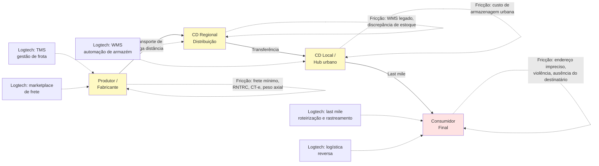

> [!note] Last mile como campo de batalha
> A última milha — do hub urbano ao consumidor final — concentra os maiores custos unitários e os problemas mais difíceis. No Brasil, endereços imprecisos (CEP que cobre quadra inteira), violência urbana em regiões de risco, alta densidade de pedestres em centros e informalidade de destinatários tornam a última milha significativamente mais cara do que em países comparáveis.

---

### Segmentos logtech e suas dinâmicas

#### 1. TMS — Transportation Management System

Software de gestão de frotas e transporte. Inclui roteirização, controle de custo por viagem, manutenção preventiva de frota, gestão de motoristas e integração com NF-e/CT-e.

Comprador típico: empresas de transporte de médio e grande porte, ou embarcadores (indústrias e distribuidoras) que gerenciam frota própria ou contratada.

Ticket médio: R$ 1.000–30.000/mês dependendo do porte da frota. Modelo SaaS com módulos adicionais.

#### 2. Last mile delivery

O segmento mais competitivo e com maior queima de capital. Inclui:

- Delivery de e-commerce (Loggi, Total Express, Jadlog)
- Delivery de alimentos (iFood, Rappi — integrados verticalmente)
- Entrega expressa corporativa

O modelo de unit economics crítico é o custo por entrega. No Brasil, o custo médio de uma entrega last mile para e-commerce varia de R$ 8 a R$ 25 dependendo da distância, densidade urbana e nível de serviço.

A Loggi construiu posição dominante em São Paulo a partir de entrega de documentos e expandiu para e-commerce. O modelo de gig (entregadores autônomos) cria flexibilidade operacional mas gera risco trabalhista crescente — ver seção de armadilhas.

#### 3. Marketplace de frete

Plataformas que conectam embarcadores a transportadores autônomos ou pequenas transportadoras. O modelo é similar a Uber aplicado ao frete: embarcador posta a carga, transportadores aceitam, plataforma cobra take rate (4–12% sobre o valor do frete).

A CargoX é a referência brasileira nesse segmento. O desafio operacional é manter a qualidade do serviço com motoristas autônomos e verificar continuamente a conformidade regulatória (RNTRC, seguro de carga, CNH categoria adequada).

#### 4. WMS — Warehouse Management System

Gestão de armazéns: recebimento, conferência, armazenagem, separação de pedidos (picking) e expedição. Integrado a TMS e ao ERP do cliente.

O mercado é dominado por grandes players (SAP WM, Oracle WMS) na enterprise, com espaço para SaaS mid-market. Empresas de fulfillment (que operam armazéns para terceiros) são clientes relevantes.

#### 5. Rastreamento e visibilidade

Plataformas de track & trace que consolidam eventos de múltiplas transportadoras e exibem status em tempo real para o embarcador e para o destinatário final.

Modelo de receita: SaaS por volume de eventos rastreados ou por transportadora integrada. A Intelipost opera nesse espaço como camada de abstração entre e-commerce e múltiplas transportadoras.

#### 6. Logística reversa

Coleta de devoluções, gestão de RMA (Return Merchandise Authorization), reprocessamento e descarte adequado. Ganha relevância com o crescimento do e-commerce e com regulação de logística reversa de embalagens (Política Nacional de Resíduos Sólidos — Lei 12.305/2010).

Segmento ainda emergente como produto standalone. Grandes players de last mile incluem reversa como módulo adicional.

#### 7. Cold chain

Cadeia de frio: transporte e armazenagem de produtos que requerem temperatura controlada. Inclui alimentos perecíveis, medicamentos, vacinas, flores.

Regulação ANVISA impõe requisitos rígidos de temperatura, registro de desvios e rastreabilidade. Startups nesse segmento precisam de hardware (sensores IoT de temperatura) integrado ao software de gestão.

---

### Tabela: segmentos logtech brasileiros

| Segmento | Modelo de receita | Desafio operacional crítico | Caso referência |
|---|---|---|---|
| TMS / gestão de frota | SaaS por módulo ou veículo | Integração com NF-e de múltiplos estados | Intelipost, unico |
| Last mile delivery | Custo por entrega (cobrado do embarcador) | Custo unitário × volume mínimo rentável | Loggi, Total Express |
| Marketplace de frete | Take rate (4–12%) sobre o frete | Verificação RNTRC, qualidade do transportador | CargoX |
| WMS | SaaS por armazém ou por pedido | Integração com ERPs legados do cliente | Depositar, uWMS |
| Rastreamento / visibilidade | SaaS por volume de eventos ou transações | Integração com 50–100+ transportadoras | Intelipost |
| Logística reversa | Por coleta ou SaaS integrado | Fluxo reverso é menos previsível que forward | Kangu, Mandaê |
| Cold chain | SaaS + hardware IoT | Uptime dos sensores, conformidade ANVISA | Temp-Guard, Sensorweb |
| Micromobilidade (last mile urbano) | Assinatura mensal da bicicleta / patinete | Manutenção de frota, vandalismo | Tembici |

---

### Unit economics específicos de logtech

#### Marketplace de frete — take rate

O take rate sustentável em marketplace de frete no Brasil está entre 4% e 10% do valor do frete bruto. Abaixo de 4%, a plataforma não cobre custos de suporte e verificação regulatória. Acima de 12%, transportadores migram para acordos diretos com embarcadores frequentes.

A chave é o volume: com baixo volume, o marketplace não tem liquidez suficiente para cobrir todas as rotas; com alto volume, surgem transportadores que tentam sair da plataforma.

Métricas de saúde de um marketplace de frete:

- **Taxa de match:** % das cargas postadas que encontram transportador em menos de X horas
- **Taxa de conclusão:** % dos fretes iniciados que são concluídos sem incidente
- **Repeat rate:** % de embarcadores que usam a plataforma mais de uma vez por mês
- **Custo de verificação por transportador:** quanto custa validar RNTRC, seguro, CNH

#### Last mile — custo por entrega

O custo por entrega em last mile inclui:

- Custo do entregador (gig ou CLT): 40–60% do custo total
- Combustível ou recarga (para elétrico / bicicleta): 5–15%
- Custo de hub urbano e handling: 10–20%
- Tentativas frustradas (destinatário ausente, endereço errado): 10–20% de sobrecusto em média
- Custo de suporte e atendimento a ocorrências: 5–10%

No Brasil, a taxa de insucesso na primeira tentativa de entrega pode chegar a 20–30% em cidades com endereçamento precário — contra 5–10% nos EUA. Isso sozinho representa diferença de 15–25% no custo total da operação.

#### Armazenagem — giro de estoque

Para operadores de fulfillment (que armazenam estoque de e-commerce de terceiros), a métrica central é o giro: quantos dias, em média, um SKU fica no armazém antes de ser vendido e expedido.

Giro alto (< 15 dias) = armazém produtivo, receita por m² relevante.
Giro baixo (> 60 dias) = capital imobilizado do cliente, pressão para cobrar armazenagem adicional.

A cobrança ideal separa:

- Taxa de recebimento (por item ou por SKU)
- Taxa de picking e embalagem (por pedido)
- Armazenagem (por pallete-dia ou m²-dia)
- Expedição (por pedido, integrada à transportadora)

---

### Lições da Estrada Brasileira: Como os Vencedores Construíram Fossos em Frete, TMS e Last-Mile

#### Loggi — do documento ao e-commerce

A Loggi começou em 2013 com entrega de documentos jurídicos em São Paulo (prazo curtíssimo, cliente B2B disposto a pagar). Expandiu para e-commerce quando o mercado cresceu. Tornou-se uma das maiores operadoras de last mile do Brasil, com hubs em capitais e cidades médias.

O modelo de gig economy (entregadores de bicicleta e moto autônomos) deu flexibilidade operacional mas cria tensão trabalhista crescente — ver armadilhas.

#### CargoX — matching de frete com tecnologia

A CargoX criou marketplace de frete rodoviário de cargas, conectando embarcadores industriais (açúcar, grãos, insumos) a caminhoneiros autônomos e pequenas transportadoras.

O diferencial foi a automação da verificação regulatória (RNTRC, seguro) e a transparência de preço — em um mercado onde os fretes eram negociados manualmente por telefone.

#### Intelipost — camada de integração para e-commerce

Posicionamento como "middleware" logístico: o e-commerce integra uma única API da Intelipost e acessa múltiplas transportadoras. A plataforma consolida rastreamento, calcula tarifas e gerencia ocorrências.

Modelo de receita SaaS com cobrança por volume de etiquetas e envios. Beneficia de efeito de rede à medida que mais transportadoras e mais e-commerces entram na plataforma.

#### Tembici — micromobilidade como first e last mile

A Tembici opera bicicletas compartilhadas em grandes cidades brasileiras (BikeItaú em São Paulo, Rio, Brasília; Bike Giro em outras cidades). O uso cresce tanto para lazer quanto para deslocamento urbano e, crescentemente, para última milha de entregadores.

O modelo B2G (patrocínio de banco ou prefeitura) sustenta a infraestrutura, com monetização adicional via assinaturas mensais de usuários.

#### Mandaê — fulfillment para PMEs

Fulfillment terceirizado para pequenos e médios e-commerces: recebe o estoque, armazena, separa e expede. O lojista não precisa de armazém próprio.

O modelo compete diretamente com o fulfillment do Mercado Livre (MELI) e da Amazon. A diferença é que a Mandaê atende e-commerces que vendem em múltiplos canais (próprio + marketplaces), não apenas no marketplace da plataforma dona do fulfillment.

---

### Subsidiar Frete com Capital de VC, Passivo Trabalhista de Entregadores, Fraude de Carga Fantasma e Custo de Insucesso na Entrega

**1. Risco trabalhista do modelo gig**

A Justiça do Trabalho brasileira tem reconhecido, progressivamente, vínculo empregatício entre plataformas de entrega e seus entregadores. Decisões do TST (especialmente após 2022) apontam que, quando a plataforma controla preço, rota, jornada e penalidades, o entregador é empregado — não autônomo.

O risco não é hipotético: há passivos trabalhistas bilionários sendo discutidos nas principais plataformas de delivery. Startups que replicam o modelo sem precificar esse passivo potencial podem encontrar dívida trabalhista maior do que o negócio vale.

> [!important] Precifique o risco trabalhista desde o início
> O modelo de gig pode ser a única forma de ter escala operacional inicialmente. Mas construa reservas para o cenário de reconhecimento de vínculo empregatício. Consulte advogado trabalhista com experiência em plataformas digitais antes de definir o modelo de contratação.

**2. Concentração geográfica no eixo SP-RJ**

É tentador construir o modelo em São Paulo, onde a densidade urbana, o volume de e-commerce e a infraestrutura são melhores. O problema é que o eixo SP-RJ representa menos de 30% da população e do território brasileiro. Quando a startup tenta expandir para o Nordeste, Norte ou Centro-Oeste, frequentemente descobre que o modelo de unit economics não funciona nas mesmas condições.

**3. Violência e risco de carga**

O Brasil tem uma das maiores taxas de roubo de carga do mundo. São Paulo, Rio de Janeiro e regiões de fronteira têm índices que impactam diretamente o custo do seguro de carga e as rotas possíveis.

Para marketplaces de frete, o seguro de carga é obrigatório para o transportador (RCTR-C — Responsabilidade Civil do Transportador Rodoviário de Cargas). Para plataformas de last mile, o risco de roubo de moto/bicicleta do entregador é custo operacional real.

**4. Informalidade do motorista como risco de qualidade**

Cerca de 65% dos caminhoneiros no Brasil são autônomos. Muitos operam com documentação irregular, veículos fora da manutenção adequada ou sem o RNTRC atualizado. Aceitar motoristas informais para cobrir rotas é tentador mas cria risco regulatório e de sinistro.

**5. Importação de peças e custo Brasil**

Veículos de logística (caminhões, vans, equipamentos de armazém) têm componentes que dependem de importação. O custo Brasil (impostos de importação, taxa de câmbio, tempo de desembaraço alfandegário) impacta o custo de manutenção de frota de forma relevante. Startups que operam frota própria precisam precificar esse custo desde o início.

**6. Heterogeneidade regional de infraestrutura**

Uma solução de TMS ou WMS desenvolvida para rotas entre capitais no Sul-Sudeste pode falhar completamente no Norte, onde parte das rotas é fluvial, estradas são precárias e a cobertura de telefonia 4G é fragmentada. Não assuma que o que funciona em São Paulo funciona no Brasil.

> [!tip] Estratégia de expansão regional
> Startups de logtech bem-sucedidas no Brasil tipicamente adicionam uma região por vez, adaptando o modelo de operação (parceiros locais, cobertura de seguro diferenciada, tipo de veículo) antes de avançar. Expansão nacional acelerada em logística frequentemente termina em burn de capital sem produto-mercado fit regional.

---

---

### Filtro de Entrada na Trincheira: Você Deve Entrar Neste Jogo?

Antes de investir em uma Logtech de frete rodoviário, entregas urbanas, armazenagem ou supply chain no Brasil, responda:

1. **O Teste do WhatsApp (Anti-Leakage):** Por que o embarcador e o motorista continuam transacionando na sua plataforma na décima viagem em vez de fecharem direto no WhatsApp — você embute seguro automático, antecipação de frete, emissão de CT-e/CIOT e conciliação?
2. **A Matemática da Parada por Km² (Para Last-Mile):** Quantas entregas você concentra no mesmo quarteirão na mesma janela horária para que a margem por pacote supere o custo do motorista e dos destinatários ausentes?
3. **A Blindagem contra o Roubo de Carga:** Sua plataforma valida antecedentes, bloqueia motoristas fantasmas e cumpre 100% do Plano de Gerenciamento de Risco (PGR) das seguradoras?

**O Movimento de Segunda-Feira:** Nos próximos 15 dias, passe duas madrugadas na doca de um centro de distribuição ou transportadora acompanhando a expedição real, a emissão de CT-e/MDF-e e a contratação de caminhoneiros.


---

## CAPÍTULO 23 — MOBITECH: MOBILIDADE URBANA, GESTÃO DE FROTAS, TELEMETRIA, ELETROMOBILIDADE E AUTÔNOMOS

### A Regra Invisível do Jogo: A Física Implacável do Ativo sobre Rodas e do Pneu Furado

Poucos setores queimaram tanto dinheiro de investidores desavisados na última década quanto a mobilidade urbana B2C. O empreendedor "turista" lembra da febre dos patinetes elétricos e dos aplicativos de carona subsidiados: ele importa veículos leves, espalha pelas calçadas dos bairros nobres de São Paulo ou Rio de Janeiro e projeta em uma planilha que cada veículo durará trinta e seis meses rodando seis viagens por dia. Na vida real brasileira, sob chuva tropical, asfalto esburacado, vandalismo, furto de baterias e custo logístico diário de caminhonetes recolhendo equipamentos descarregados de madrugada, o veículo se destrói em quatro meses — antes de pagar um terço do próprio custo de aquisição (Capex).

O veterano de trincheira sabe que, na mobilidade brasileira, o cemitério está cheio de quem tentou competir em transporte B2C subsidiado, enquanto fortunas silenciosas são construídas todos os anos no **B2B de gestão de frotas corporativas, telemetria pesada, videotelemetria anticolisão e eletrificação de frotas comerciais de alta rodagem**.

A lei férrea deste setor é **A Equação do TCO (Custo Total de Propriedade) por Quilômetro Rodado**: para qualquer operador de frota no Brasil — seja de ônibus, caminhões, furgões de entrega ou carros corporativos —, três vilões devoram toda a margem operacional: o combustível/energia, a manutenção corretiva por mau uso do motorista e o sinistro/roubo. Quem instala telemetria com visão computacional (DMS/ADAS) que detecta fadiga do motorista, corta o consumo de diesel em 12%, derruba acidentes em 50% e comprova a economia em 30 dias nunca mais é desligado da frota.

---

> [!note] Síntese Executiva da Vertical
> Empreender em Mobitech no Brasil exige compreender que a mobilidade brasileira opera sob três forças estruturais simultâneas: (1) déficit histórico de infraestrutura metroferroviária que empurra mais de 85% dos deslocamentos motorizados de passageiros e cargas para o asfalto; (2) frota circulante superior a 115 milhões de veículos com idade média avançada, alto índice de sinistralidade viária e custo severo de combustível e seguro; e (3) mais de 1,7 milhão de trabalhadores atuando em aplicativos de transporte de passageiros e entregas urbanas. Quem domina a equação entre software de otimização, telemetria embarcada e estruturação financeira de ativos constrói negócios altamente defensáveis.

---

### 1. O ecossistema de mobilidade no Brasil: escala, gargalos e regulação

A mobilidade urbana e corporativa no Brasil movimenta centenas de bilhões de reais por ano entre transporte público coletivo, transporte individual por aplicativo, locação de veículos, gestão de frotas corporativas e eletromobilidade. Ao contrário da Europa ou da Ásia Oriental, onde redes densas de metrô e trens de subúrbio estruturam o deslocamento metropolitano, as cidades brasileiras cresceram sobre o ônibus urbano, o automóvel particular e, na última década, a motocicleta — que se tornou a espinha dorsal tanto do *last-mile* logístico quanto do transporte de passageiros (*moto-táxi* e *moto-app*) fora dos centros expandidos das capitais.

Do ponto de vista regulatório, toda startup de Mobitech opera em um tabuleiro federativo de três níveis:

- **Nível Federal (CONTRAN, SENATRAN e ANTT):** O Conselho Nacional de Trânsito (CONTRAN) e a Secretaria Nacional de Trânsito (SENATRAN) regulam homologação veicular, equipamentos obrigatórios, prontuários de condutores, notificações eletrônicas (SNE) e diretrizes de segurança viária e sistemas avançados de assistência ao condutor (ADAS). Já a Agência Nacional de Transportes Terrestres (ANTT) regula o transporte rodoviário interestadual de passageiros e o Registro Nacional de Transportadores Rodoviários de Cargas (RNTRC).
- **Nível Estadual (DETRANs e Secretarias de Fazenda):** Os 27 DETRANs estaduais controlam registro, licenciamento anual, transferência de propriedade (CRLV-e e ATPV-e), vistoria veicular e pontuação de CNH, enquanto as SEFAZ estaduais definem alíquotas e isenções de IPVA (fator decisivo para a viabilidade de locadoras de veículos e frotas elétricas em estados como Minas Gerais, Paraná, Distrito Federal ou São Paulo).
- **Nível Municipal (Prefeituras e Secretarias de Mobilidade):** A Lei Federal 13.640/2018 atribuiu aos municípios a competência exclusiva para regulamentar e fiscalizar o transporte remunerado privado individual de passageiros por aplicativo. Cada prefeitura define cobrança por quilômetro rodado na malha viária (como o sistema de outorga onerosa por uso do viário em São Paulo), idade máxima do veículo, exigências de seguro APP (Acidentes Pessoais de Passageiros) e regras para operação de micromobilidade (bicicletas e patinetes compartilhados) e corredores exclusivos de ônibus.

> [!warning] A assimetria regulatória municipal e o risco trabalhista
> Uma operação de mobilidade que é 100% legal e fluida em São Paulo pode sofrer apreensão de veículos ou bloqueio administrativo no Rio de Janeiro, em Fortaleza ou em municípios médios do interior no dia seguinte. Além disso, o enquadramento jurídico da relação entre plataformas digitais e motoristas/entregadores (autonomia com proteção previdenciária versus vínculo empregatício CLT) permanece no centro das disputas no TST, no STF e no Congresso Nacional, exigindo que o modelo de negócio suporte encargos previdenciários sem destruir a margem de contribuição.

---

### 2. As sete subverticais de Mobitech no Brasil

O mercado brasileiro de tecnologia para mobilidade divide-se em sete subverticais com arquiteturas tecnológicas, compradores e exigências de capital radicalmente distintos:

#### 2.1 Transporte público, bilhetagem eletrônica e MaaS (Mobility-as-a-Service)
O Brasil registra mais de 30 milhões de viagens diárias em ônibus urbanos. Durante décadas, os sistemas de bilhetagem eletrônica foram caixas-pretas controladas por sindicatos de empresas de ônibus, com cartões proprietários fechados e conciliação opaca. A nova geração de Mobitechs ataca a digitalização do pagamento em transporte coletivo (QR Code, PIX no validador, pagamento por aproximação NFC/EMV com cartão de débito/crédito direto na catraca e carteiras digitais de benefícios de Vale-Transporte), além da previsão de chegada em tempo real via GPS dos ônibus (como Cittamobi e Moovit). No segmento corporativo, plataformas de fretamento inteligente otimizam rotas de transporte de colaboradores industriais e administrativos, reduzindo de 15% a 30% o custo de fretado das empresas por meio de algoritmos de *clustering* de endereços e ocupação dinâmica de vans e ônibus.

#### 2.2 Ride-hailing, transporte sob demanda e micromobilidade
Nos aplicativos de corrida urbana, a dinâmica clássica de *marketplace* bilateral hiperlocal consolidou-se em grandes plataformas (Uber, 99, inDrive), mas abriu espaço para nichos verticalizados (transporte executivo corporativo integrado a sistemas de despesas, cooperativas municipais de motoristas e logística urbana sobre duas rodas). Já na micromobilidade, o Brasil aprendeu da forma mais dura entre 2018 e 2020 que patinetes elétricos soltos na calçada (*free-floating*) sem docas, com vandalismo alto, baterias furtadas e depreciação em 4 meses não fecham a conta. O modelo vencedor no país — liderado pela **Tembici** — baseia-se em estações fixas integradas ao transporte público, contratos de patrocínio corporativo plurianuais (*naming rights* de bancos e grandes marcas, que cobrem parcela substancial do CapEx) e planos de assinatura semanais para entregadores de aplicativos (como o projeto iFood Pedal com bicicletas elétricas robustas).

#### 2.3 Gestão de frotas leves e pesadas e videotelemetria com IA
Esta é a subvertical B2B de melhor relação retorno sobre capital investido no Brasil. O país possui milhões de veículos comerciais leves (fiorinos, picapes, carros de técnicos de telecom, energia e saneamento) e caminhões pesados que sofrem com três ralos financeiros: desperdício de combustível por condução agressiva ou marcha lenta excessiva, manutenção corretiva não planejada e sinistros de trânsito (colisões, tombamentos e processos trabalhistas/cíveis). Startups como **Cobli**, **Golfleet** e **Prolog** substituíram o antigo rastreador passivo de localização por plataformas de **videotelemetria com Inteligência Artificial embarcada (Edge AI)**. Câmeras duplas (*dual-facing dashcams*) analisam em tempo real a via (frenagem brusca, distância de seguimento, invasão de faixa) e a cabine do motorista (sonolência, olhos fechados, uso de celular ao volante, falta de cinto), emitindo alertas sonoros instantâneos na cabine antes que o acidente ocorra e gerando *scores* de segurança por condutor para o gestor de frota.

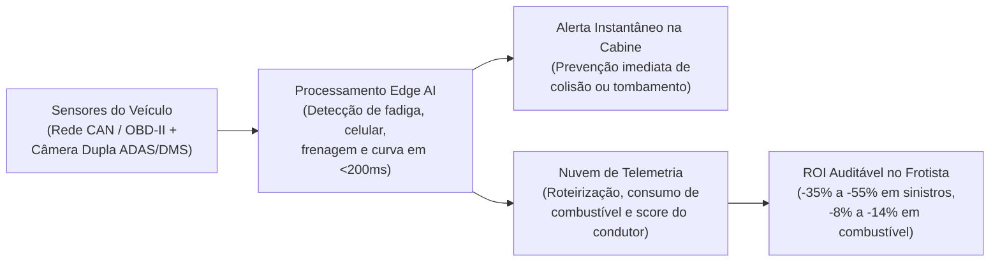

#### 2.4 Assinatura de veículos para motoristas de app e carsharing digital
Milhões de brasileiros desejam trabalhar como motoristas de aplicativo ou precisam de um carro na metrópole, mas não possuem entrada nem *score* de crédito bancário para financiar um veículo a taxas de 25% a 35% ao ano. Startups como a **Kovi** criaram o modelo de locação e assinatura com opção de compra (*rent-to-own*) desenhado especificamente para motoristas profissionais: análise de crédito baseada em dados comportamentais e histórico de corridas, telemetria com bloqueio remoto de segurança, cobrança semanal descontada diretamente do fluxo de ganhos e manutenção preventiva em oficinas próprias de altíssimo giro. Em paralelo, o *carsharing* 100% digital por hora ou dia (liderado pela **Turbi** em São Paulo) eliminou a loja física e o balcão de locadora: o usuário destrava o carro pelo smartphone em estacionamentos parceiros 24/7, devolve no mesmo ponto e paga apenas pelo tempo e quilometragem utilizados.

#### 2.5 Eletromobilidade comercial e infraestrutura de recarga (EV)
No Brasil, a eletrificação de frotas não avança por subsídio governamental direto ao consumidor, mas por **matemática pura de TCO (Custo Total de Propriedade)** em veículos que rodam mais de 150 km por dia. Para um motociclista de entrega que roda 4.500 a 6.000 km por mês, o gasto mensal com gasolina supera facilmente R$ 1.200 a R$ 1.600. Startups como a **Vammo** resolveram o maior gargalo da moto elétrica — o tempo de recarga na tomada e o medo de ficar sem carga no meio do turno — implantando redes densas de **estações de troca rápida de bateria (*battery swapping*)**, onde o entregador substitui a bateria descarregada por uma 100% carregada em menos de dois minutos. Já no segmento de carros e utilitários elétricos (impulsionado pela entrada massiva de montadoras como BYD e GWM no país), surgiram plataformas de software de gestão de recarga, cobrança de energia e interoperabilidade de eletropostos (como **Tupinambá**, **Voltbras** e **Zletric**).

#### 2.6 Fretamento rodoviário sob demanda e digitalização de passagens
O transporte rodoviário interurbano brasileiro transporta mais de 130 milhões de passageiros por ano — mais do que a aviação comercial doméstica. O setor viveu décadas de reserva de mercado em linhas concedidas, até que modelos de fretamento colaborativo (como a **Buser**) e agregadores de passagens rodoviárias conectaram empresas de fretamento ociosas a passageiros com preços 30% a 50% menores que a rodoviária tradicional, utilizando telemetria de segurança e precificação dinâmica de assentos.

#### 2.7 Veículos autônomos e robótica móvel em ambientes confinados
Enquanto o *robotáxi* urbano de Nível 4 enfrenta no Brasil barreiras severas de sinalização viária precária, infraestrutura heterogênea e custo de sensores (LiDAR/radares importados), os **veículos autônomos para ambientes operacionais confinados ou privados** já são realidade comercial no país. Caminhões autônomos e remotamente assistidos em minas a céu aberto, tratores e transbordos autônomos na colheita de cana-de-açúcar e grãos (como **Grunner** e **Lume Robotics**) e rebocadores autônomos (AMRs/AGVs) dentro de centros de distribuição e portos operam em propriedades privadas (fora do Código de Trânsito Brasileiro público) e pagam seu investimento pela redução de pisoteamento de solo, operação 24 horas sem troca de turno em locais remotos e economia de diesel.

---

### 3. Unit economics de Mobitech: a física financeira do ativo sobre rodas

Negócios de mobilidade quebram quando os fundadores tratam uma operação intensiva em ativos físicos (*asset-heavy*) como se tivesse a estrutura de margem de um software puro (*asset-light*). Mesmo nas startups que vendem apenas software e hardware de telemetria (HaaS), o produto só é retido se melhorar diretamente o demonstrativo de resultados da frota do cliente.

As cinco métricas fundamentais que governam qualquer operação de Mobitech são:

1. **TCO por Quilômetro Rodado (R$/km):** Soma de depreciação do veículo, custo financeiro do capital imobilizado, combustível ou energia elétrica, pneus, manutenção preventiva e corretiva, seguro/sinistralidade, impostos (IPVA/licenciamento) e multas, dividida pelo total de quilômetros produtivos rodados no período.
2. **Taxa de Utilização Física e Financeira da Frota (%):** Em locação, assinatura ou *carsharing*, é a proporção de veículos efetivamente alugados e adimplentes sobre a frota total disponível. Uma frota de locação precisa operar consistentemente entre **82% e 92% de utilização física**; abaixo de 75%, o custo financeiro da dívida (indexada ao CDI) e a depreciação devoram o EBITDA.
3. **Sinistralidade, Perda Total e Taxa de Recuperação Veicular (%):** Percentual da frota envolvido em colisões severas, furtos, roubos ou apropriação indébita. Em operações de locação para aplicativos no Brasil, reduzir a perda de ativos de 4% para menos de 0,8% ao ano via inteligência de dados, cercas eletrônicas (*geofencing*) e pronta-resposta define quem sobrevive.
4. **Payback do Hardware Embarcado e LTV/CAC em Telemetria (HaaS):** Quando a startup fornece o rastreador ou a câmera de IA em comodato, o CapEx do equipamento mais a instalação (R$ 600 a R$ 2.200 por veículo) somado ao CAC comercial precisa ser recuperado pela margem bruta da mensalidade em menos de **6 a 9 meses**, exigindo contratos mínimos de 24 a 36 meses com multa rescisória proporcional ao equipamento.
5. **Resultado de Desmobilização (*Remarketing* de Seminovos):** Em modelos de frota própria, grande parte do lucro líquido do ciclo de 24 a 36 meses do veículo não vem apenas da locação mensal, mas da diferença entre o valor contábil depreciado e o preço real de venda do veículo seminovo no varejo ou atacado ao final do ciclo.

#### Tabela de Benchmarks e Unit Economics por Subvertical de Mobitech no Brasil

| Subvertical | Modelo de Receita Dominante | Ticket / Receita Típica | Margem Bruta Típica | Métrica Operacional Crítica | Intensidade de Capital (CapEx) | Casos Brasileiros de Referência |
|---|---|---|---|---|---|---|
| **Videotelemetria e Gestão de Frotas (HaaS + SaaS)** | Assinatura mensal por placa ativa (comodato de câmera/IoT) | R$ 90 a R$ 280 / veículo / mês | 65% a 78% (após amortização do hardware) | *Hardware Payback* (< 8 meses) e *Net Revenue Retention* (> 110%) | Média (financiamento do lote de câmeras/IoT via dívida ou giro) | Cobli, Golfleet, Prolog, Sascar |
| **Locação / Assinatura para Motoristas de App** | Receita semanal recorrente (locação ou *rent-to-own*) | R$ 650 a R$ 1.150 / semana por carro | 35% a 50% (operacional antes da dívida) | Utilização (> 88%), Inadimplência (< 3%) e Perda de Ativo (< 1%) | Altíssima (exige FIDC / Debêntures para compra da frota) | Kovi, Localiza Zarp, Movida |
| **Carsharing Urbano B2C por Hora / Dia** | Tarifa por hora + R$/km rodado + pacotes diários | R$ 18 a R$ 35 / hora + R$ 0,60 a R$ 1,20 / km | 40% a 55% | Horas faturadas por carro/dia (> 9h) e custo de estacionamento/manutenção | Alta (frota financiada via dívida estruturada) | Turbi, Awto |
| **Motos Elétricas e Battery Swapping** | Assinatura mensal da moto + plano de trocas de bateria | R$ 220 a R$ 350 / semana (moto + energia) | 45% a 60% | Ciclos úteis da bateria de lítio (> 1.500 ciclos) e densidade de estações | Alta (motos + banco de baterias + estações de recarga) | Vammo, Tembici (e-bikes iFood Pedal) |
| **Software para Infraestrutura de Recarga EV** | SaaS por conector gerenciado + *take rate* sobre recarga (R$/kWh) | R$ 80 a R$ 250 / ponto/mês + 8% a 15% da recarga | 70% a 85% (no modelo puro de software) | Uptime dos carregadores (> 97%) e kWh vendidos por estação/dia | Baixa (se puro CPMS) a Alta (se dono do eletroposto/CPO) | Tupinambá, Voltbras, Zletric |
| **Fretamento Corporativo e Rodoviário** | Comissão (*take rate*) ou contrato mensal B2B por rota otimizada | 15% a 25% de *take rate* (B2C) ou R$ 12k–25k/ônibus/mês (B2B) | 20% a 35% (líquida sobre GMV) | Ocupação média por viagem (> 75% dos assentos) | Baixa (frota de terceiros parceiros) | Buser, Fretadão, BusUp |

---

### 4. Casos reais brasileiros: estratégias vencedoras e lições duras

> [!example] Caso 1: Cobli, Golfleet e Prolog — O ROI imediato da videotelemetria e gestão de ativos no B2B
> Vender software para gestores de frota no Brasil sempre esbarrou em uma objeção pragmática: o frotista não quer mais um painel com gráficos bonitos; ele quer gastar menos com óleo diesel, pneus e oficinas. A **Cobli** e a **Golfleet** escalaram combinando telemetria avançada e câmeras com IA embarcada porque conseguem provar matematicamente, em um piloto de 30 a 60 dias com 20 veículos do cliente, que a redução de excesso de velocidade, freadas bruscas e uso de celular ao volante derruba os acidentes em mais de 40% e economiza combustível suficiente para pagar de 2x a 4x a mensalidade da plataforma. Na mesma linha, a **Prolog** construiu uma solução vertical focada no segundo maior custo variável de uma transportadora pesada depois do diesel — os pneus —, digitalizando a aferição de sulco e calibragem com sensores eletrônicos para evitar perdas prematuras de carcaças que custam milhares de reais cada.

> [!example] Caso 2: Kovi e Turbi — A vitória da engenharia de risco, telemetria e dívida estruturada
> Tanto a **Kovi** (focada em motoristas profissionais de aplicativos) quanto a **Turbi** (focada em *carsharing* B2C por hora/dia em São Paulo) provaram que o segredo de uma startup *asset-heavy* de veículos não é comprar carros com dinheiro de Venture Capital, mas sim separar cirurgicamente o **capital de tecnologia (Equity)** do **capital de frota (Dívida Estruturada via FIDCs e Debêntures)**. Na Kovi, o diferencial tecnológico real reside nos algoritmos proprietários de concessão e monitoramento contínuo de risco do motorista, na manutenção industrializada em megacentros próprios (reduzindo o tempo de carro parado em oficina de dias para horas) e nos protocolos de recuperação rápida de ativos em caso de inadimplência ou tentativa de fraude. Na Turbi, a tecnologia de abertura sem chave (*keyless*), vistoria digital por foto na devolução e precificação dinâmica por zona horária permitiu atingir taxas de utilização superiores às de locadoras tradicionais com zero funcionários em agências físicas.

> [!example] Caso 3: Vammo e Tembici — Eletrificação com unit economics de trabalho
> Enquanto fabricantes que tentaram vender motos elétricas diretamente no varejo brasileiro sem controle da cadeia de suprimentos e sem rede de pós-venda colapsaram (como o rumoroso caso da Voltz, que sofreu com atrasos severos de entrega, queima de caixa em fábrica própria prematura e passivos com consumidores), a **Vammo** atacou o problema pelo modelo integrado de assinatura + rede própria de *battery swapping*. O entregador profissional não compra a bateria (o componente mais caro e sujeito a degradação química); ele assina a moto e troca a bateria em menos de 2 minutos nas estações espalhadas pela metrópole. De forma análoga, a **Tembici** transformou a bicicleta elétrica compartilhada em ferramenta de trabalho para dezenas de milhares de entregadores urbanos, reduzindo o custo operacional diário do trabalhador e gerando receita recorrente previsível combinada com patrocínio de marca.

---

### 5. Armadilhas fatais em Mobitech

1. **Financiar compra de frota (CapEx) com Equity de Venture Capital:** Usar dinheiro de diluição societária (Seed/Série A) para comprar centenas de carros, motos ou ônibus no balanço é suicídio societário. O equity deve financiar apenas produto, software, equipe, dados e o *equity cushion* (subordinação de 10% a 20%) exigido para levantar dívida estruturada (FIDC, CRI/CRA, debêntures ou linhas de *fleet financing*) que financia os outros 80% a 90% dos veículos.
2. **Subestimar o crime organizado, a fraude de identidade e a apropriação indébita:** No Brasil, qualquer operação que entregue um veículo de R$ 15 mil (moto) a R$ 90 mil (carro) sem biometria facial robusta com prova de vida (*liveness detection*), validação de antecedentes, múltiplos dispositivos de rastreamento redundantes (incluindo iscas de radiofrequência imunes a *jammers* de GPS) e equipe de pronta-resposta em campo sofrerá perdas de frota que inviabilizam o negócio nos primeiros seis meses.
3. **Confundir o Brasil com a Califórnia em recarga elétrica residencial:** Mais de 70% dos motoristas de aplicativo e entregadores das grandes capitais brasileiras moram em condomínios populares, vilas ou residências sem garagem preparada para instalar um *wallbox* dedicado. Modelos de eletromobilidade comercial no Brasil que exigem que o motorista carregue o veículo por 6 horas em casa durante a noite têm seu mercado endereçável drasticamente amputado se não oferecerem infraestrutura pública rápida ou troca de bateria.
4. **Ignorar a severidade mecânica do pavimento brasileiro na conta de depreciação:** Buracos, lombadas fora de padrão, combustível adulterado e trânsito severo desgastam suspensão, embreagem, freios e baterias muito mais rápido do que nos manuais europeus ou chineses. Se o seu modelo financeiro copiar a curva de manutenção de fora do país, sua margem operacional será negativa a partir do 14º mês de vida da frota.

> [!tip] Checklist de Validação para Fundadores de Mobitech
> - [ ] O modelo de negócio separa claramente o caixa da startup (OpEx/Tech) do veículo de financiamento de ativos (FIDC/Dívida/Arrendamento)?
> - [ ] Para soluções B2B de frota/telemetria: o piloto comprova economia financeira líquida em combustível, pneus ou sinistros pelo menos **3x maior** que a mensalidade cobrada?
> - [ ] O hardware embarcado possui homologação **ANATEL** ativa e opera com chip *multi-operadora (eSIM/M2M)* com armazenamento local (*offline buffer*) para zonas de sombra de sinal?
> - [ ] Para modelos de locação/assinatura: existe protocolo automatizado de cobrança semanal, bloqueio preventivo seguro e equipe de recuperação física de veículos com SLA inferior a 4 horas?
> - [ ] A regulação municipal específica (outorga por km, cadastro de condutores/veículos) e as regras estaduais de IPVA para frotistas foram incorporadas na planilha de *unit economics* de cada cidade antes da expansão?

---

### Filtro de Entrada na Trincheira: Você Deve Entrar Neste Jogo?

Antes de investir em mobilidade, gestão de frotas, telemetria ou recarga elétrica no Brasil, responda sem dourar a planilha:

1. **Quem Paga a Depreciação do Ativo:** Se o negócio envolve veículos, baterias ou carregadores físicos, o risco de depreciação, roubo e manutenção está coberto por contratos B2B *take-or-pay* de 36 a 60 meses, ou você depende de demanda avulsa B2C?
2. **A Prova dos 10% no Combustível e na Oficina:** Se você vende telemetria/software para frotas, consegue rodar um piloto de 30 dias em 20 veículos e provar uma economia mensal em diesel, pneus, multas e oficina pelo menos 3x maior que sua mensalidade por placa?
3. **Resistência à Sabotagem:** Seu hardware automotivo suporta painel a 70 °C sob o sol e detecta tentativas de desconexão ou bloqueio da câmera pelo motorista?

**O Movimento de Segunda-Feira:** Nos próximos 15 dias, entreviste cinco gestores de frotas com mais de 100 veículos e audite quanto eles perderam no último ano com desvios em abastecimento, oficinas e colisões.


---

## CAPÍTULO 24 — CONSÓRCIOS ADMINISTRADOS (BACEN), RENTAL DE MÁQUINAS/FROTAS PESADAS E AFTERMARKET AUTOMOTIVO (AUTOPEÇAS, SEMINOVOS E LEILÕES)

### A Regra Invisível do Jogo: A Máquina Silenciosa da Taxa de Administração, do Desconto de Montadora e do Giro de Pátio

O fundador "turista", educado apenas por podcasts da Califórnia, jamais olha para consórcios, locação de máquinas pesadas (*rental*) ou comércio de autopeças e seminovos — porque essas indústrias operam de forma única no Brasil. Enquanto o turista ignora esses mercados, grupos brasileiros que dominaram a matemática dessas três engrenagens construíram impérios multibilionários na B3 e máquinas privadas de dividendos.

Quando um amador entra no *rental* de caminhões, máquinas ou carros, ou abre uma operação de seminovos, acha que ganha dinheiro apenas na mensalidade do aluguel. Em dezoito meses de Selic alta, o juro da dívida tomada para comprar os ativos corrói 100% do lucro operacional e os equipamentos parados no pátio levam a empresa à recuperação judicial.

O veterano de trincheira domina **A Tríade Secreta da Economia Automotiva e de Equipamentos no Brasil**:
1. Nos **Consórcios regulados pelo BACEN (Lei nº 11.795/2008)**, a administradora cobra 15% a 22% de taxa de administração com **risco zero de funding bancário** (pois a poupança dos consorciados financia o grupo) e lucra no float do fundo comum e nos seguros embutidos;
2. No **Rental de Frotas e Linha Amarela**, o verdadeiro lucro líquido vem da **arbitragem entre o desconto de 20% a 30% na compra direta da montadora em volume e a revenda do ativo seminovo desmobilizado** após 24 a 36 meses;
3. Nas **Autopeças e Oficinas**, vence quem resolve a catalogação exata por placa/chassi em uma frota com mais de dez anos de idade média e entrega a peça no elevador do mecânico em noventa minutos.

---

> [!note] Síntese Executiva da Vertical
> Em um país onde a taxa básica de juros (Selic) historicamente permanece em dois dígitos e o *spread* bancário para compra de bens duráveis e máquinas é proibitivo, a economia real brasileira desenvolveu **três máquinas colossais de financiamento alternativo, uso compartilhado de ativos e extensão de vida útil**: **(1) o Sistema de Consórcios**, uma invenção genuinamente brasileira regulada pelo Banco Central que movimenta mais de **R$ 350 bilhões por ano em novos créditos vendidos** para mais de 10,5 milhões de consorciados ativos, gerando margens líquidas extraordinárias sem risco de *funding* bancário; **(2) a Indústria de *Rental* (Locação e Terceirização de Caminhões, Máquinas de Linha Amarela, Equipamentos Agrícolas e Intralogística)**, que permite às empresas substituírem CapEx imobilizado por OpEx 100% dedutível do Imposto de Renda; e **(3) o *Aftermarket* Automotivo (Autopeças, Oficinas, Seminovos e Leilões)**, que mantém rodando uma frota nacional de mais de **115 milhões de veículos** com idade média superior a 10 anos. Este capítulo disseca a engenharia financeira, regulatória e operacional desses três mercados trilionários.

---

### 1. O Sistema de Consórcios no Brasil (Lei nº 11.795/2008 e Resolução BCB nº 285/2023)

#### A) A Física Econômica Imbatível da Administradora de Consórcios
Criado no Brasil no início da década de 1960 por funcionários do Banco do Brasil para viabilizar a compra de automóveis da nascente indústria automobilística nacional e hoje regido pela **Lei Federal nº 11.795/2008** e pela **Resolução BCB nº 285/2023 do Banco Central do Brasil**, o **Consórcio** é uma das engenharias financeiras mais brilhantes do mundo emergente.
Diferentemente de um banco — que precisa captar dinheiro caro em CDB/LCI pagando CDI, emprestar para o cliente correndo risco de crédito no próprio balanço e manter índice de Basileia —, a **Administradora de Consórcios atua exclusivamente como gestora fiduciária de grupos de autofinanciamento (poupança coletiva com patrimônio segregado)**:
1. **Patrimônio Separado (Art. 5º da Lei 11.795/2008):** Os recursos arrecadados dos participantes de cada grupo de consórcio pertencem exclusivamente ao próprio grupo (não se comunicam com o patrimônio da Administradora nem respondem por dívidas dela). O crédito entregue nas contemplações mensais vem 100% da arrecadação das parcelas dos próprios consorciados daquele grupo (**risco de *funding* zero para a Administradora!**).
2. **As 5 Fontes de Receita Empilhadas da Administradora de Consórcios:**
   - **1. Taxa de Administração Total (15% a 22% sobre o valor da Carta de Crédito):** Diluída no prazo do grupo (ex.: 18% em 180 meses em imóveis ou 16% em 80 meses em veículos), sendo que a legislação permite a **antecipação de parcela da taxa de administração nas primeiras mensalidades** para cobrir o comissionamento da força de vendas!
   - **2. Receita de Administração sobre os Fundos Financeiros do Grupo (Float Bancário):** Todo o dinheiro do Fundo Comum e do Fundo de Reserva do grupo que fica aplicado em títulos públicos federais/fundos DI entre o vencimento do boleto, a assembleia e o pagamento efetivo do bem ao fornecedor rende taxas de administração financeira ou remuneração fiduciária.
   - **3. Seguro de Vida / Prestamista de Grupo (Comissão de Corretagem de 25% a 45%):** Quase toda cota de consórcio embute um seguro prestamista (que quita o saldo devedor da cota em caso de morte ou invalidez permanente do consorciado), gerando uma receita recorrente de corretagem securitária altíssima.
   - **4. Multas, Juros de Atraso (divididos entre o grupo e a administradora) e Taxas de Transferência/Cessão de Cota.**
   - **5. Retenção Contratual sobre Cotas Canceladas (Desistentes/Excluídos) e Revenda de Cotas de Reposição.**

#### B) A Engenharia Matemática dos Grupos: Sorteio, Lance Livre, Lance Fixo e Lance Embutido
Um grupo de consórcio moderno (seja de **Imóveis**, **Caminhões/Tratores/Colheitadeiras**, **Automóveis/Motos**, **Usinas Solares Fotovoltaicas** ou **Serviços Médicos/Estéticos/Reformas**) não é mais aquele produto passivo dos anos 1980 onde o cliente rezava anos para uma bolinha do globo ser sorteada.
Hoje, o consórcio é operado como um **instrumento sofisticado de planejamento financeiro e alavancagem patrimonial**, estruturado sobre quatro mecanismos de contemplação mensal nas Assembleias Gerais Ordinárias (AGOs):
1. **Contemplação por Sorteio (Extração da Loteria Federal):** Garante a isonomia estatística para todos os consorciados adimplentes do grupo.
2. **Lance Livre (% sobre a Carta ou Valor da Categoria):** Funciona como um leilão fechado na assembleia: ganha a carta de crédito quem oferecer antecipar o maior percentual de quitação do saldo devedor usando recursos próprios (ou o seu FGTS, no caso de consórcio imobiliário residencial).
3. **Lance Fixo (ex.: 25% ou 40% da Carta):** Todos os consorciados que ofertam exatamente o percentual fixo estipulado no regulamento do grupo concorrem apenas entre si (um "subgrupo VIP" onde a probabilidade matemática de contemplação é 5 a 10 vezes maior que no sorteio geral!).
4. **Lance Embutido (O Grande Acelerador Comercial):** O regulamento do grupo permite que o consorciado utilize **parte da própria Carta de Crédito (ex.: até 25% ou 30% do crédito) para pagar o lance**!
   - *Exemplo Prático:* O investidor ou transportador precisa de **R$ 700.000 líquidos** para comprar um caminhão ou um imóvel comercial. O consultor vende para ele uma **Carta de Crédito de R$ 1.000.000**, oferta **30% de Lance Embutido (R$ 300.000 descontados da própria carta)** somados a 10% de recurso próprio, contempla a cota rapidamente e recebe os **R$ 700.000 líquidos** pagando uma parcela mensal sem juros bancários (corrigida anualmente apenas pelo INCC, IPCA ou tabela do fabricante)!

#### C) Consórcio-as-a-Service (White-Label), Investimento Imobiliário e Mercado Secundário de Cotas
Como conseguir uma nova autorização do Banco Central para operar uma Administradora de Consórcios do zero exige patrimônio líquido mínimo regulatório (Resolução BCB nº 285/2023), auditoria rigorosa de *compliance*/PLD e anos de aprovação, surgiram três modelos de negócios explosivos para empreendedores:
1. **Consórcio-as-a-Service (*White-Label* / Parcerias Estratégicas — modelo Ademicon, Embracon, Racon/Randoncorp, Porto Seguro, Âncora):** A administradora autorizada pelo BACEN entra com a licença regulatória, o *backoffice* atuarial de gestão de grupos, a cobrança e o faturamento, enquanto **marcas comerciais, redes de concessionárias automotivas, cooperativas agropecuárias, redes de franquias solares, incorporadoras e fintechs** lançam a sua própria marca de consórcio (*ex.: Consórcio New Holland, Consórcio Cresol, Consórcio Pop*), capturando comissões de distribuição de **6% a 10% do valor total do crédito vendido**!
2. **Boutiques de Investimento e Alavancagem Patrimonial com Consórcio Imobiliário:** Consultorias especializadas que estruturam carteiras de cotas imobiliárias para médicos, empresários e investidores comprarem imóveis comerciais ou residenciais para locação (fazendo o inquilino pagar a parcela do consórcio após a contemplação) ou para *arbitragem de ágio na venda da cota contemplada*.
3. **Mercado Secundário e Bolsas de Cotas Contempladas e Canceladas (Descontempladas):**
   - **Cotas Contempladas:** Um consorciado que foi sorteado na 3ª parcela de uma carta de R$ 500.000 (tendo pago apenas R$ 9.000 até ali) pode ceder/vender legalmente sua cota contemplada para um comprador que tem pressa do crédito imediato por um **ágio de R$ 80.000 a R$ 130.000 à vista**, multiplicando seu capital investido por 10x!
   - **Cotas Canceladas / Excluídas (Com Deságio):** Pela Lei 11.795/2008, quem desiste do consórcio continua concorrendo no sorteio mensal dos excluídos para receber de volta o que pagou (com desconto da multa contratual). Plataformas especializadas (como **CotaBest, BomConsórcio, ConsórcioCred**) compram essas cotas canceladas com deságio de 30% a 50% de quem precisa de liquidez imediata e aguardam o sorteio ou reativam a cota, capturando uma **TIR superior a 25%–35% ao ano** com risco de crédito quase nulo (pois o devedor é o caixa do grupo fiscalizado pelo BACEN!).

---

### 2. *Rental*: Locação e Terceirização de Máquinas Pesadas, Linha Amarela, Caminhões e Equipamentos

Enquanto o consórcio financia a propriedade do bem, a segunda megatendência estrutural do Brasil corporativo é a **desmobilização do balanço (*Asset-Light Transition*) via *Rental* de Longo Prazo**.
Por que uma grande usina sucroenergética, mineradora, construtora, operador logístico ou indústria (como Ambev, Vale, Suzano, Raízen, Rumo) prefere **alugar 500 caminhões pesados, 200 escavadeiras/carregadeiras ("Linha Amarela"), 300 empilhadeiras elétricas e 150 plataformas elevatórias** em contratos de 36 a 60 meses com empresas como **Vamos (B3: VAMO3)**, **Armac (B3: ARML3)**, **Mills (B3: MILS3)**, **Localiza/Unidas Pesados** ou locadoras regionais, em vez de comprar as máquinas?

#### A) A Dupla Arbitragem Econômica e Tributária do *Rental* no Brasil
1. **O Escudo Fiscal do Lucro Real (OpEx vs. CapEx):** Quando uma empresa tributada pelo **Lucro Real** compra um caminhão ou escavadeira no seu ativo imobilizado (CapEx), ela só pode depreciar contabilmente uma fração por ano e tem restrições financeiras. Quando ela **aluga a frota ou equipamento com manutenção embutida (OpEx)**, **100% do valor da fatura mensal de locação é despesa operacional dedutível da base de cálculo do IRPJ e da CSLL (gerando economia tributária de 34%!)**, além de gerar **crédito integral de PIS/COFINS (9,25%) ou IBS/CBS na Reforma Tributária sobre bens de capital operacionais**!
2. **A Arbitragem de Compra (OEM Discount) e Venda de Seminovos:** Uma empresa média que vai à concessionária comprar 2 caminhões ou 1 escavadeira paga preço cheio de tabela e financia caro. Uma locadora de escala que compra **5.000 caminhões da Volkswagen/Scania/Volvo ou 2.000 máquinas da Caterpillar/John Deere/JCB por ano** obtém **descontos de fábrica (*OEM Fleet Discount*) de 15% a 28%** na largada!
   - Durante 48 a 60 meses, a locadora aluga esse equipamento cobrando um **Yield Mensal de 2,5% a 3,8% sobre o valor de mercado do ativo** (recuperando 120% a 180% do valor da máquina só nas mensalidades!).
   - Ao final do 5º ano, como a locadora comprou a máquina com 22% de desconto na largada e a inflação de máquinas novas subiu o preço de tabela nos últimos 5 anos, ela **vende o caminhão ou trator seminovo nas suas próprias lojas de varejo de usados por um preço em reais próximo ou até superior ao que pagou 5 anos atrás**!

$$\text{ROIC do Rental} = \underbrace{\left(\text{Yield Anual de Locação Líquido de Manutenção}\right)}_{\text{Fluxo de Caixa Operacional Recorrente}} + \underbrace{\left(\frac{\text{Preço de Venda do Seminovo} - \text{Custo de Compra OEM com Desconto}}{\text{Capital Investido}}\right)}_{\text{Ganho de Capital na Desmobilização}}$$

#### B) Os 5 Nichos de Ouro para Empreender em *Rental* Regional ou Especializado
Você não precisa tentar bater de frente com a Localiza em carros de passeio de aeroporto (onde são necessários R$ 20 bilhões de CapEx). Os maiores retornos sobre capital investido (**ROIC de 22% a 38% ao ano e Margem EBITDA de 45% a 65%**) estão nos **nichos técnicos B2B onde a manutenção especializada e a disponibilidade mecânica na ponta são o verdadeiro fosso competitivo**:
1. **Linha Amarela e Movimentação de Granéis com Operador (*Wet Rental* — O Modelo Armac):** Alugar escavadeiras hidráulicas, pás-carregadeiras, tratores de esteira e retroescavadeiras não apenas para obras civis (que são cíclicas), mas para **operações contínuas perenes (24/7) dentro de fábricas de fertilizantes, pátios de biomassa/cavaco florestal, portos de grãos, mineração e aterros sanitários**, fornecendo mecânica preditiva própria no local.
2. **Plataformas Elevatórias Móveis de Trabalho (PEMT / *Aerial Work Platforms*), Fôrmas/Escoramentos e Compressores/Geradores (O Modelo Mills):** Com a fiscalização rigorosa da **NR-18 e NR-35 (Trabalho em Altura)** pelo Ministério do Trabalho, o antigo andaime de madeira improvisado foi banido das indústrias, galpões logísticos e shoppings, sendo substituído pela locação diária/mensal de **plataformas tesoura e articuladas elétricas/diesel** (fabricantes JLG, Genie, Haulotte, Skyjack), que geram *payback* em 24 a 30 meses.
3. **Intralogística: Empilhadeiras Elétricas de Lítio, Transpaleteiras e Rebocadores para Centros de Distribuição (CDs):** Com o boom do e-commerce (Mercado Livre, Shopee, Amazon, Magalu) e atacarejos (Assaí, Atacadão), nenhum grande CD quer comprar empilhadeiras a gás GLP ou gerenciar salas de baterias chumbo-ácidas. Locadoras especializadas em **empilhadeiras elétricas com bateria de íons de lítio (LFP) + telemetria de impacto e bloqueio por crachá do operador** assinam contratos de 60 meses com churn próximo de zero.
4. **Rental de Equipamentos Médicos, Estéticos e Laboratoriais (*MedTech / BeautyTech Rental*):** Clínicas dermatológicas, centros cirúrgicos e hospitais médios alugam **lasers dermatológicos (Lavieen, Ultraformer, Fotona), arcos cirúrgicos, torres de vídeo-endoscopia, ultrassons e monitores multiparamétricos** por diária (*laser day*) ou assinatura mensal, com retorno de **3% a 6% ao mês** sobre o valor do equipamento!
5. **Rental de Tecnologia, Coletores de Dados RFID/Código de Barras, Notebooks Corporativos e Maquinário de Limpeza Profissional (*Device-as-a-Service*):** Locação de frotas de coletores Zebra/Honeywell para logística, lavadoras de piso tripuladas para supermercados e parques de TI corporativos com seguro e reposição em 24h.

---

### 3. *Aftermarket* Automotivo: Autopeças, Oficinas, Seminovos e Leilões

Quando um veículo sai da garantia de fábrica (após os primeiros 3 a 5 anos de uso), ele deixa de frequentar a concessionária autorizada da montadora (OEM) e entra no gigantesco oceano do **Aftermarket Automotivo Independente (IAM)**.
No Brasil, a frota circulante efetiva ultrapassa **115 milhões de veículos** (entre carros, comerciais leves, caminhões, ônibus e motocicletas), com uma **idade média superior a 10,5 anos** — o que significa que mais de **80% da frota nacional depende exclusivamente de oficinas independentes e do varejo de autopeças de reposição**!

#### A) A Cadeia de Autopeças e o Desafio Tecnológico da Catalogação (Placa $\rightarrow$ Chassi $\rightarrow$ SKU)
A cadeia física de reposição automotiva movimenta mais de **R$ 150 bilhões/ano** em quatro elos:
1. **Indústria Fabricante de Autopeças de Reposição (Tier 1 / Aftermarket):** Gigantes nacionais e globais como **Fras-le Mobility / Randoncorp (B3: FRAS3 — líder em lonas/pastilhas de freio, suspensão Nakata e amortecedores)**, **Baterias Moura**, **Tupy / MWM**, **Metal Leve / Mahle (B3: LEVE3)**, **Iochpe-Maxion (MYPK3)**, **Schulz (SHUL4)**, **Bosch, ZF, Cofap/Marelli, Valeo e Schaeffler**.
2. **Grandes Distribuidores Atacadistas e Redes Associativas:** **Pellegrino, Rede Âncora, Furacão, DPK (Grupo DPaschoal), Sama/Laguna (compradas pela Fras-le/Randon), Poli Peças e Roni Chaves**.
3. **Varejistas de Autopeças de Balcão (> 60.000 lojas de bairro/cidade) e E-commerce (Mercado Livre Autopeças, Canal da Peça, Hipervarejo, PneuStore).**
4. **Oficinas Mecânicas, Centros Automotivos e Funilarias (> 120.000 estabelecimentos).**

> [!important] O Gargalo de Ouro das *AutoTechs*: O Problema da Aplicação Veicular
> Por que **20% a 25% das peças compradas pela internet ou pelo telefone para oficinas mecânicas são devolvidas por erro de aplicação**? Porque o dono da oficina pede *"um jogo de pastilha de freio dianteira do Gol 1.6 ano 2014"*, mas para aquele mesmo ano/modelo existem **3 sistemas de pinça de freio diferentes (Teves, Bosch ou Varga) com medidas incompatíveis**!
> As startups que dominam o *Aftermarket* automotivo brasileiro (como **Canal da Peça**, **Cilia Tecnologia** no orçamento de colisão/sinistro para seguradoras, **Doutor-IE** em enciclopédias técnicas de reparação e **Sua Oficina Online / Ultracar / Oficina Inteligente**) construíram **Bancos de Dados Proprietários de Cruzamento de Placa $\rightarrow$ Decodificação de Chassi (VIN) nas bases DENATRAN/Montadoras $\rightarrow$ Padrão Internacional TecDoc $\rightarrow$ Código OEM Original $\rightarrow$ Referências Cruzadas (*Cross-Reference*) de 50 marcas paralelas de reposição**! Quem domina o catálogo de aplicação domina a transação B2B entre a oficina e o distribuidor.

#### B) Comércio de Seminovos, Vistoria Cautelar, Repasse B2B e Leilões Automotivos
O Brasil transaciona cerca de **14 a 15 milhões de veículos usados e seminovos por ano** (uma proporção de **5 a 6 veículos usados vendidos para cada 1 veículo zero-quilômetro emplacado**!).
As oportunidades tecnológicas e operacionais de maior margem nesse mercado estão nas infraestruturas de confiança, liquidez e giro:
1. **Leilões Industriais de Veículos de Seguradoras (Salvados de Sinistro) e Retomados de Financiamento Bancário (Busca e Apreensão — Lei 14.711/2023):** Quando um banco (BV, Santander, Bradesco, Itaú, Pan) retoma um veículo de um devedor inadimplente na alienação fiduciária, ou quando uma seguradora (Porto, Tokio Marine, Bradesco, Allianz) indeniza perda total ou média monta, eles precisam transformar centenas de milhares de carros parados no pátio em dinheiro vivo em poucos dias. Plataformas gigantes de leilão físico e digital (**Copart Brasil, Sodré Santoro, Superbid Exchange, Freitas Leiloeiro, Guariglia, Milan Leilões**) cobram **5% de comissão do comprador (leiloeiro) + taxas logísticas/administrativas de pátio e guarda**, operando com liquidez diária e geração de caixa brutal.
2. **Plataformas de Repasse B2B (*Wholesale*) e Compra Instantânea (*C2B*):** Quando um cliente entrega seu carro usado de 8 anos na troca (*trade-in*) por um carro zero-quilômetro em uma concessionária Toyota ou Jeep, a concessionária de carros novos não quer vender aquele usado antigo no seu salão; ela precisa repassá-lo em 24 horas para um lojista multimarcas do interior. Plataformas B2B (como **AutoAvaliar**, que processa bilhões de reais em repasses entre milhares de concessionárias e lojistas, **InstaCarro, Kavak e OLX/Webmotors Cockpit**) digitalizaram a avaliação física, o pregão eletrônico de repasse em 30 minutos e o piso de financiamento de estoque (*Floor Plan*).
3. **Vistoria Cautelar Veicular e Histórico Veicular (Super Visão, Dekra, Terceira Visão, Olho no Carro, Checkauto):** Antes de comprar um seminovo de R$ 100.000, nenhuma loja ou comprador prudente fecha negócio sem um **Laudo de Vistoria Cautelar (R$ 220 a R$ 450 com margem bruta > 75%)** que verifica adulteração numérica de chassi/motor/câmbio, reparos estruturais graves em longarinas e colunas (carro batido recuperado), passagem por leilão de sinistro, restrições judiciais (Renajud) e fraude de hodômetro via scanner OBD-II.

---

### 4. Unit Economics e Benchmarks: Consórcio, Rental Pesado e Aftermarket Automotivo

| Subvertical | Métrica Principal de Receita / Yield | Margem Bruta / EBITDA Típico | Ciclo / Payback de Capital | Indicador Crítico de Sobrevivência (KPI) |
|---|---|---|---|---|
| **1. Administradora de Consórcios (Autorizada BACEN)** | **Taxa de Adm. de 15% a 22%** no ciclo (~1,5% a 2,8% a.a.) + Float + Prestamista | **35% a 55% Margem EBITDA** sobre a receita de taxas | **Zero CapEx de crédito**; Payback do CAC de comissão nas primeiras 4–6 parcelas | **Inadimplência/Cancelamento Precoce (nas primeiras 3 parcelas < 12%)** e saúde atuarial do Fundo Comum. |
| **2. Corretora Master / White-Label de Consórcio** | **6% a 10% de Comissão Bruta** sobre o valor da Carta de Crédito vendida | **25% a 45% EBITDA** (após repasse aos vendedores) | Recebimento da comissão em **1 a 6 parcelas** conforme pagamento do cliente | **Clawback (Estorno de Comissão)** se o cliente cancelar antes da 3ª/6ª parcela + Custo de Aquisição de Leads. |
| **3. Rental de Caminhões, Linha Amarela e Equipamentos (Vamos, Armac, Mills)** | **Yield Mensal de 2,5% a 3,8%** sobre o valor do ativo novo + Venda do Seminovo | **45% a 65% Margem EBITDA** (Locação pura) / **18% a 26% ROIC** | Contratos de **36 a 60 meses** (*Take-or-Pay* com multa rescisória) | **Taxa de Ocupação Física da Frota (> 85%–90%)**, Desconto de Compra OEM (> 18%) e Spread sobre o CDI da dívida. |
| **4. Distribuidor / E-commerce de Autopeças e Pneus** | Markup de **25% a 45%** (Distribuição) / **35% a 60%** (Varejo/Oficina) | **8% a 16% EBITDA** (Distribuição) / **20% a 32%** (Oficina/Serviço) | Giro de estoque médio de **60 a 90 dias** (Curva A < 30 dias) | **Taxa de Devolução por Erro de Aplicação (< 3%)** e controle implacável de obsolescência da Curva C. |
| **5. Leilões Automotivos e Vistoria Cautelar** | **5% de Comissão do Leiloeiro + Taxa de Pátio (3%–6%)** | **R$ 250–R$ 400 / Laudo** | **50% a 70% EBITDA** (Leilão Digital e Rede de Vistoria) | Recebimento **100% à vista** antes da retirada do lote no pátio (*Cash Cow*) | Contratos de exclusividade com Bancos/Seguradoras (Leilão) e Credenciamento junto aos DETRANs Estaduais (ECV). |

---

### 5. Casos Brasileiros de Destaque em Consórcios, Rental e Aftermarket

> [!example] Estudo de Caso — Ademicon, Vamos, Armac, Mills, Fras-le Mobility e AutoAvaliar/Superbid
> - **Ademicon (Curitiba/PR):** Fundada a partir da pioneira Ademilar (primeira administradora independente de consórcio de imóveis do Brasil, criada por Tatiana Schuchovsky Reichmann e família no Paraná), a **Ademicon** (investida por fundos de Private Equity como Treecorp e 23S Capital) revolucionou o setor ao criar o modelo de **Consórcio-as-a-Service (White-Label)** para grandes marcas e redes de lojas licenciadas de consórcio como investimento, ultrapassando dezenas de bilhões de reais em créditos comercializados por ano com crescimento composto superior a 30% a.a.
> - **Vamos (Grupo Simpar — B3: VAMO3), Armac (B3: ARML3) e Mills (B3: MILS3):** O trio que provou na Bolsa brasileira o poder da tese de *Rental* pesado. A **Vamos** (liderada por Gustavo Couto dentro da holding Simpar, da família Batista/Fernando Simões) consolidou a locação de caminhões, máquinas agrícolas e equipamentos com contratos de 5 anos e rede própria de concessionárias de seminovos; a **Armac** (fundada pelos irmãos Fernando e José Augusto Aragão aos 20 e poucos anos comprando a primeira retroescavadeira usada!) tornou-se a maior locadora de linha amarela do país ao focar na manutenção própria em operações contínuas do agro, mineração e infraestrutura; e a **Mills** reinventou-se de uma antiga empresa de andaimes de obras públicas para a líder nacional indiscutível em plataformas elevatórias (PEMT), compressores e linha amarela com margens EBITDA acima de 48%.
> - **Fras-le Mobility (Caxias do Sul/RS — B3: FRAS3, controlada pela Randoncorp):** Construiu um império global do *Aftermarket* de autopeças. Percebendo que a venda de peças de reposição (pastilhas e lonas de freio Fras-le, amortecedores e suspensão **Nakata**, discos **Fremax**, materiais de fricção na Europa via aquisição da britânica **Juratek** e na América Latina) é totalmente anticíclica — pois quando a economia desacelera e as pessoas param de comprar carro zero, elas gastam mais consertando o carro usado! —, a Fras-le tornou-se uma das ações industriais mais resilientes e rentáveis do Brasil.
> - **Superbid Exchange e Cilia Tecnologia (Goiânia/GO):** Enquanto a **Superbid** digitalizou os leilões industriais de máquinas pesadas, frotas corporativas e ativos inservíveis das maiores empresas do Brasil, a goiana **Cilia Tecnologia** conquistou a maioria das seguradoras e milhares de oficinas de funilaria do país com seu sistema de orçamentação eletrônica de sinistros automotivos em 3D com catálogo de peças integrado.

---

### 6. Armadilhas Fatais em Consórcios, Rental de Frotas e Aftermarket Automotivo

> [!warning] Os 5 Erros Mortais que Destroem Operações de Consórcio, Locadoras de Máquinas e Autopeças
> 1. **A Fraude da "Promessa de Contemplação Garantida na 1ª Assembleia" ("Golpe da Cota Já Contemplada"):** O maior risco reputacional, civil e criminal no mercado de consórcios. Representantes comerciais inescrupulosos anunciam na internet um caminhão ou imóvel dizendo ao cliente humilde: *"Dê R$ 15.000 de entrada hoje que na semana que vem o crédito de R$ 200.000 cai na sua conta!"*. Na verdade, o vendedor embolsa os R$ 15.000 como taxa de adesão/primeiras parcelas de uma cota comum não contemplada. Quando o cliente descobre que terá que esperar o sorteio, ele processa a Administradora e a Corretora (que respondem **solidariamente pelo Código de Defesa do Consumidor** com devolução imediata + danos morais!), além de atrair intervenção do **Banco Central e Ministério Público**. **Regra inegociável:** Grave 100% das ligações de *Welcome Call / Pós-Venda (Quality Assurance)* antes de validar a venda: o backoffice liga para o cliente e pergunta explicitamente: *"O senhor está ciente de que a contemplação ocorre exclusivamente por sorteio ou lance e que não existe data garantida de entrega do crédito?"*. Se o cliente disser que o vendedor prometeu data certa, cancele a proposta na hora, devolva o dinheiro e descredencie o vendedor!
> 2. **Descasamento de Juros no *Rental* (Dívida Pós-Fixada em CDI vs. Contrato de Aluguel Fixo sem Reajuste):** Este erro quase quebrou grandes locadoras brasileiras quando a Selic saltou de 2% para 13,75% entre 2021 e 2023. A locadora comprou R$ 500 milhões em caminhões emitindo debêntures atreladas a **CDI + 2,5% a.a.** e assinou contratos de locação de 60 meses com taxa fixa baixa calculada quando o CDI era 2%. Quando o CDI multiplicou por 6x, **toda a geração de caixa do aluguel passou a ser engolida pelos juros da dívida bancária**! Em *Rental*, como o negócio é intensivo em capital, você deve **casar a duration da dívida com a do contrato de locação (fazendo swap de CDI para IPCA/Pré ou embutindo cláusula contratual de repasse automático de variação do CDI + IPCA no aluguel)**.
> 3. **Subestimar o Custo de Manutenção de Fim de Ciclo e o Valor Residual na Desmobilização (*Residual Value Risk*):** Nos primeiros 18 meses, uma máquina nova quase não dá oficina. Do 36º ao 60º mês de operação severa em mineração ou canavial, o custo de manutenção corretiva (motor, transmissão, material rodante de esteira, pneus fora-de-estrada que custam R$ 40.000 cada!) explode. Se a locadora precificou o aluguel olhando apenas o custo de manutenção do 1º ano ou superestimou o preço de venda do equipamento usado (ex.: comprando marcas chinesas sem rede de peças e sem liquidez de revenda no mercado de usados brasileiro), o lucro contábil dos 4 anos evapora num prejuízo gigantesco na hora de vender a sucata!
> 4. **Morte por Estoque Obsoleto de Curva C no Varejo e Distribuição de Autopeças:** Uma loja ou distribuidora de autopeças precisa trabalhar com 30.000 a 80.000 SKUs. O erro clássico do dono de autopeças é comprar lotes grandes de peças de baixo giro ("Curva C" — ex.: lanterna traseira de um carro importado de 2012) atraído por 10% de desconto do fabricante. O dinheiro da empresa fica enterrado em prateleiras empoeiradas que não giram há 3 anos, enquanto falta caixa para repor os **20% de itens de Curva A (filtros, pastilhas, óleo, baterias, velas, kits de embreagem dos 20 carros mais vendidos do Brasil)** que geram 80% do faturamento diário!
> 5. **Falta de Telemetria de Bloqueio Remoto e Apropriação Indébita de Máquinas e Veículos Locados:** No Brasil, quadrilhas especializadas abrem empresas de fachada ("laranjas"), alugam 5 caminhões, 3 retroescavadeiras ou 10 carros executivos, pagam o primeiro boleto em dia e, na segunda semana, arrancam o rastreador comum e cruzam a fronteira com o Paraguai/Bolívia ou desmancham os equipamentos. Toda operação de *Rental* exige **kyB/análise antifraude rigorosa do CNPJ e dos sócios antes da entrega técnica, cercamento eletrônico (*geofencing*) com múltiplos sensores redundantes (satelital + RF/LoRa escondidos no chassi) e corte remoto de partida no minuto em que a máquina sai do perímetro da obra contratada**.

---

### Filtro de Entrada na Trincheira: Você Deve Entrar Neste Jogo?

Antes de alocar capital em consórcios, locação de máquinas/veículos (*rental*) ou tecnologia para autopeças e seminovos, responda:

1. **O Teste do Spread sobre o CDI (Para Rental):** A soma da margem de locação com a revenda do seminovo gera um *ROIC* pelo menos 4 a 5 pontos percentuais acima do seu custo de dívida (*Kd*), mesmo com a Selic em dois dígitos?
2. **Venda Qualificada vs. Cancelamento Precoce (Para Consórcios):** Seu funil vende consórcio como planejamento patrimonial (retendo o cliente além da 6ª parcela), ou atrai compradores com falsa promessa de contemplação imediata que cancelam e geram estorno de comissão?
3. **Da Placa ao Parafuso (Para Autopeças):** Sua catalogação garante que a peça comprada pelo mecânico serve exatamente naquele ano/motorização do carro no elevador, reduzindo devoluções para menos de 3%?

**O Movimento de Segunda-Feira:** Nos próximos 15 dias, visite cinco oficinas mecânicas independentes, duas operações de rental/seminovos ou uma administradora de consórcios *white-label* para auditar onde o caixa trava.


---

## CAPÍTULO 25 — PROPTECH: TECNOLOGIA NO MERCADO IMOBILIÁRIO BRASILEIRO

### A Regra Invisível do Jogo: A Armadilha do Portal de Anúncios Imobiliários e o Cofre da Garantia Locatícia

Quando olha para o mercado imobiliário brasileiro, o empreendedor "turista" se irrita com a busca de apartamentos e decide criar "mais um portal de classificados imobiliários com fotos bonitas e inteligência artificial". Dezoito meses depois, seu caixa acaba. O turista não percebeu que classificados puros são um jogo de efeito de rede já consolidado e que, na compra e venda de imóveis, o evento tem frequência baixíssima (a cada dez ou quinze anos) e sofre um vazamento (*leakage*) brutal: assim que corretor e comprador se encontram na visita física, qualquer tentativa de cobrar comissão pela plataforma sem ser o dono da garantia financeira ou do financiamento é contornada no cartório.

O veterano de trincheira sabe como os maiores campeões brasileiros de Proptech e Construtech construíram seus impérios: não foi vendendo anúncio de imóvel, mas eliminando o atrito financeiro da transação ou o desperdício físico do canteiro de obras.

Domine **A Lei da Trava Financeira na Locação e da Engenharia de Suprimentos no Canteiro**: na locação residencial, vence quem elimina a humilhação do fiador assumindo a garantia de pagamento em dia para o proprietário e capturando de 8% a 12% do aluguel todo mês durante trinta meses (um LTV recorrente gigantesco), além de seguros e crédito com garantia de imóvel (*Home Equity*). Já na Construtech B2B, o dinheiro está no software e marketplace que corta em 10% o desperdício de aço, concreto e mão de obra na SPE da incorporadora antes que o estouro do orçamento (INCC) destrua a margem da obra.

---

> [!note] Posição no livro
> Relevante para [[#CAPÍTULO 4 — REGULATÓRIO SETORIAL BRASILEIRO|Capítulo 4 — Regulatório Setorial]], [[IGNICAO-Vol-5-Financas-e-Captacao#CAPÍTULO 14 — CAPTAÇÃO ALTERNATIVA DIGITAL: EQUITY CROWDFUNDING (CVM 88) E TOKENIZAÇÃO DE ATIVOS|Capítulo 14 — Tokenização de Ativos (Vol. 5)]], [[IGNICAO-Vol-8-Juridico-LGPD-e-Seguranca#CAPÍTULO 1 — MARCO LEGAL DAS STARTUPS: LC 182/2021|Capítulo 1 — Marco Legal das Startups (Vol. 8)]] e para fundadores que atuam em marketplaces com ativos de alto valor, crédito ou construção civil.

---

### Por Que o Maior Ativo das Famílias Brasileiras Ainda Opera entre Cartórios Analógicos e Canteiros Artesanais

Proptech (property technology, tecnologia aplicada ao mercado imobiliário) é o foco deste capítulo. O mercado imobiliário brasileiro movimenta mais de R$ 2 trilhões em patrimônio. É o maior ativo individual da maioria das famílias brasileiras. E, ao mesmo tempo, é um dos mercados mais fragmentados, lentos e opacos do país.

Comprar um imóvel no Brasil exige:

- Corretores credenciados pelo CRECI (Conselho Regional de Corretores de Imóveis)
- Registro em cartório (tempo médio: 30–90 dias)
- Escritura lavrada por notário
- Verificação de múltiplas certidões negativas (municipais, estaduais, federais)
- Pagamento de ITBI (Imposto de Transmissão de Bens Imóveis) — variável por município, geralmente 2–3%
- Financiamento via SFH (Sistema Financeiro de Habitação) ou crédito livre

Cada etapa é um ponto de fricção. Cada ponto de fricção é uma oportunidade para proptech.

---

### As Regras que Governam o Tijolo: Lei do Inquilinato, Incorporação (Lei 4.591/64), Patrimônio de Afetação, CRECI e Cartórios (ONR)

#### CRECI e Lei 6.530/78

A intermediação imobiliária no Brasil é profissão regulamentada. A Lei 6.530/78 e o Decreto 81.871/78 exigem que todo corretor de imóveis seja registrado no CRECI do seu estado. Não basta ter pessoa jurídica — cada corretor-pessoa física precisa de registro individual.

Isso cria uma barreira real para startups que tentam:

- Montar equipe de vendas interna sem corretores registrados
- Operar como plataforma que "conecta compradores e vendedores" sem intermediação de CRECI
- Usar modelos algorítmicos de precificação como substituto da avaliação do corretor

O CRECI tem poder de autuação e cassação. Modelos que ignoram essa regulação encontram resistência organizada do sistema de conselhos.

> [!warning] CRECI como barreira de entrada real
> Diversas startups tentaram operar na zona cinzenta de "marketplace sem intermediação" e receberam notificações do CRECI. O modelo seguro é contratar corretores registrados, fazer parceria com imobiliárias credenciadas ou atuar em segmentos que não se enquadram como intermediação (ferramentas de gestão, crédito, construção).

#### SPE — Sociedade de Propósito Específico

Toda incorporação imobiliária formal no Brasil exige a constituição de uma SPE (Sociedade de Propósito Específico) para cada empreendimento. Isso serve para segregar o patrimônio do empreendimento do patrimônio da incorporadora.

A SPE cria complexidade societária real:

- Cada empreendimento é uma empresa separada
- Abertura, contabilidade e encerramento de cada SPE têm custo fixo
- Investidores externos precisam entrar na SPE (não na holding) para ter direito sobre o ativo específico
- Auditoria e due diligence se multiplicam proporcionalmente ao número de empreendimentos

Para incorporadoras digitais (como Benx), gerenciar dezenas de SPEs simultâneas é desafio de governança e tecnologia.

#### Lei 4.591/64 e o Registro de Incorporação (RFI)

Antes de vender qualquer unidade "na planta", a incorporadora precisa registrar a incorporação no Cartório de Registro de Imóveis. O RFI exige documentação extensa: projeto aprovado pela prefeitura, licenças ambientais, memorial descritivo, alvará de construção, certidões dos terrenos, plantas aprovadas.

Esse processo leva meses. Startups que tentam acelerar o ciclo de vendas frequentemente se veem limitadas pelo tempo de aprovação cartorial — que não é tecnológico, é jurídico-burocrático.

#### RET — Regime Especial de Tributação

Incorporadoras que aderem ao RET (Regime Especial de Tributação) pagam alíquota unificada de 4% sobre a receita bruta (IRPJ + CSLL + PIS + COFINS), em vez do regime normal que pode chegar a 7–8% pelo Lucro Presumido.

A adesão ao RET é por SPE e é irretratável durante a existência da incorporação. Isso significa que a escolha tributária precisa ser feita antes do lançamento e não pode ser revertida.

---

### Segmentos proptech e suas dinâmicas

#### 1. Marketplace de compra, venda e locação

O segmento mais visível. Plataformas que agregam ofertas, conectam interessados e facilitam a transação.

O modelo de receita dominante é comissão sobre a transação (locação: 1 mês de aluguel; venda: 5–6% do valor do imóvel, em geral compartilhada com o corretor). Marketplaces puros de listagem (OLX Imóveis, Viva Real antes da fusão) cobram CPC ou plano mensal da imobiliária.

A grande inovação do QuintoAndar foi remover o fiador da equação da locação. O modelo cobre o risco de inadimplência institucionalmente, cobra taxa do proprietário (equivalente a ~20% do aluguel mensal como seguro/gestão) e entrega certeza de pagamento. Isso destravou um mercado onde proprietários tinham medo de alugar diretamente.

#### 2. Gestão de condomínios

Segmento B2B de ticket médio (R$ 300–800/mês por condomínio). Inclui gestão financeira, comunicação com moradores, controle de acesso, assembleias digitais, reserva de espaços.

Regulatório relevante: a Lei dos Condomínios (Lei 4.591/64 e Código Civil arts. 1.331–1.358) exige síndico (pode ser morador ou profissional) e assembleias com quórum específico. Tecnologia que substitui assembleia presencial entrou em debate durante a pandemia e foi parcialmente regulamentada.

#### 3. Construção — BIM e gestão de obra

Building Information Modeling (BIM) e plataformas de gestão de obra (cronograma, insumos, subempreiteiros, qualidade) são segmento B2B corporativo. Clientes são construtoras e incorporadoras de médio e grande porte.

Ciclo de vendas longo (6–18 meses), mas churn baixo e expansão alta uma vez que o software está integrado aos processos da construtora.

O governo federal publicou a Estratégia BIM BR (Decreto 9.983/2019) tornando BIM obrigatório progressivamente em obras públicas — o que cria demanda institucional.

#### 4. Crédito imobiliário

Segmento com regulação específica do Banco Central e do CMN. Modelos possíveis:

- **Correspondente bancário:** parceria com banco para originar crédito. Requer habilitação como correspondente (Resolução CMN 3.954/2011)
- **Marketplace de crédito:** conecta tomador a múltiplos bancos, sem intermediar o crédito. Menos regulação, menos margem
- **Fintech de crédito próprio:** requer licença de instituição financeira (SCD ou SEP do Banco Central)

A Credihome opera como marketplace de crédito imobiliário, comparando propostas de múltiplos bancos. Não precisa de capital próprio para emprestar, mas depende dos bancos para fechar as operações.

#### 5. Tokenização de imóveis

Imóveis tokenizados via blockchain existem como produto no Brasil desde 2019-2020. A CVM regulamentou via Resolução CVM 88 (2022) a tokenização de ativos imobiliários via CRI tokenizados e FIIs tokenizados.

O modelo mais comum no Brasil é:

1. Imóvel entra em uma SPE
2. SPE emite CRI (Certificado de Recebíveis Imobiliários) lastreado no imóvel
3. CRI é tokenizado e negociado em plataforma digital
4. Investidor compra tokens representando fração do CRI

A regulação de tokenização de imóveis diretamente (sem CRI ou FII como veículo) ainda é incerta — ver [[IGNICAO-Vol-5-Financas-e-Captacao#CAPÍTULO 14 — CAPTAÇÃO ALTERNATIVA DIGITAL: EQUITY CROWDFUNDING (CVM 88) E TOKENIZAÇÃO DE ATIVOS|Capítulo 14 (Captação Alternativa Digital: Equity Crowdfunding (CVM 88) e Tokenização de Ativos) (Vol. 5)]] (security tokens, ativos digitais e o que é regulado em 2026).

#### 6. Property management

Gestão operacional de imóveis para proprietários: precificação dinâmica, manutenção, comunicação com inquilinos, contabilidade de aluguéis. Modelo parecido com gestão hoteleira, aplicado ao mercado residencial e comercial.

A Housi (do grupo Vitacon) combinou incorporação de unidades compactas com gestão flexível — proprietários compravam unidades já conectadas a plataforma de locação por temporada. O modelo criou dependência forte da plataforma como gestora.

---

### Jornada de compra de imóvel no Brasil: pontos de fricção

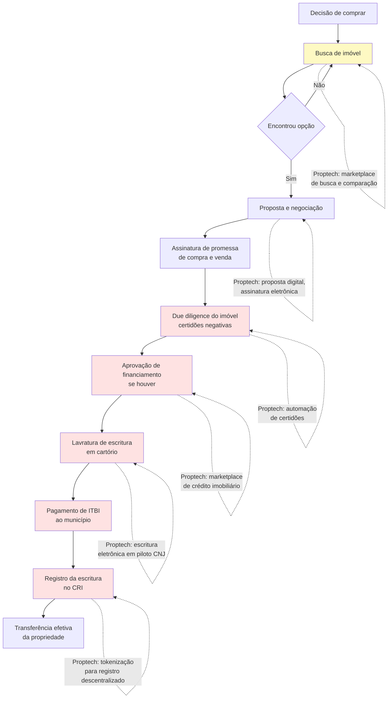

> [!note] Gargalo real
> As etapas F, G, H, I e J são onde a jornada trava. A tecnologia resolveu bem a etapa de busca (B) e parcialmente a proposta (D). O cartório, o ITBI e o registro ainda são analógicos, caros e lentos. Startups que atacam essas etapas enfrentam resistência institucional forte — mas também encontram espaço para diferenciação real.

---

### Funding imobiliário: os instrumentos que o fundador precisa conhecer

#### LCI — Letra de Crédito Imobiliário

Título de renda fixa emitido por instituições financeiras lastreado em crédito imobiliário. Isento de IR para pessoa física. Usado por bancos para captar recursos destinados ao crédito imobiliário.

Relevante para startups de crédito imobiliário: bancos parceiros captam via LCI para financiar operações originadas pela startup.

#### CRI — Certificado de Recebíveis Imobiliários

Título de securitização emitido por securitizadoras (não por bancos). Lastreado em recebíveis imobiliários (aluguéis futuros, parcelas de financiamento, etc.). Isento de IR para pessoa física.

Incorporadoras usam CRI para antecipar recebíveis de unidades vendidas. Proptech pode usar CRI para securitizar carteiras de aluguel gerenciadas.

#### FII — Fundo de Investimento Imobiliário

Fundo de investimento que investe em imóveis ou em títulos do setor imobiliário. Negociado em bolsa (B3). Obrigado a distribuir 95% do resultado semestral.

FIIs de "papel" (que investem em CRI/LCI) são diferentes de FIIs de "tijolo" (que investem em imóveis físicos). Proptyechs podem criar FIIs para dar liquidez a portfólio de imóveis gerenciados — mas exige registro na CVM e gestora credenciada.

#### SFH — Sistema Financeiro de Habitação

Sistema com regras específicas do CMN para crédito imobiliário residencial com valor de imóvel até limite determinado (em 2024: R$ 1,5 milhão). Taxa limitada (12% a.a. + TR). Parte do funding vem do FGTS (via FGTS-imóveis e Casa Verde e Amarela).

Startups de crédito imobiliário que querem operar no segmento popular precisam entender as regras do SFH e a elegibilidade do FGTS.

---

### Tabela: segmentos proptech brasileiros

| Segmento | Modelo de receita | Regulação crítica | Caso referência |
|---|---|---|---|
| Marketplace locação | Comissão (% aluguel) + taxa gestão | CRECI (intermediação) | QuintoAndar |
| Marketplace compra/venda | Comissão transacional (5–6%) | CRECI + Lei 6.530 | Loft, OLX Imóveis |
| Gestão de condomínios | SaaS mensal por condomínio | Lei dos Condomínios | Síndico Fácil, Condomob |
| Crédito imobiliário | Comissão bancária (0,5–1,5%) | BC — correspondente bancário | Credihome |
| Construção / BIM | SaaS por projeto ou sede | Decreto BIM BR (obras públicas) | Sienge, Constructi |
| Gestão de obra | SaaS + % economia gerada | CREA (responsável técnico) | Obra Prima, Unaí |
| Tokenização | Taxa de emissão + custódia | CVM 88, Lei 14.430/22 | RealTokens, Liqi |
| Property management | % receita de locação (15–25%) | CRECI (se intermediar) | Housi, Vista |
| Incorporadora digital | Margem de incorporação (15–25%) | SPE, RFI, RET, Lei 4.591 | Benx, Vitacon |

---

### Lições da Trincheira Imobiliária Brasileira: Quem Virou Infraestrutura e Quem Quebrou no iBuying Pesado

#### QuintoAndar — remover o fiador foi o produto

O insight central do QuintoAndar não foi tecnológico — foi de risco. Ao absorver institucionalmente o risco de inadimplência do inquilino (cobrindo o proprietário em caso de calote), a startup desbloqueou proprietários que tinham imóveis vazios por medo. O produto de tecnologia (app, assinatura digital, gestão de pagamentos) foi viabilizador, não diferencial central.

#### Loft — compra e venda com iBuying adaptado

A Loft tentou o modelo de iBuying (comprar imóvel, reformar, revender) nos EUA como referência, mas adaptou ao Brasil com foco em apartamentos de alto padrão em São Paulo. O modelo intensivo em capital esbarrou em ciclos longos de giro e nos juros altos brasileiros. A empresa pivotou progressivamente para marketplace + serviços ancilares.

#### Credihome — marketplace de crédito sem capital próprio

Modelo de menor risco regulatório: conecta tomador a múltiplos bancos, cobra comissão do banco originador. Não precisa de licença de instituição financeira. A margem é menor, mas o capital necessário também.

#### Housi — moradia flexível como produto

A Housi criou a proposta de valor de "assinar" uma moradia: o morador paga mensalidade e pode se mudar entre unidades Housi sem burocracia. O modelo exige estoque de unidades gerenciadas — o que criou dependência de capital para crescer.

---

### A Matemática Real de Proptech: Take Rate Recorrente de Locação, Inadimplência Líquida de Garantia e Economia sobre CUB/INCC

#### Marketplace de locação

A saúde de um marketplace de locação como o QuintoAndar se mede em:

- **Tempo médio de locação:** dias entre o imóvel ser listado e o contrato ser assinado. Mercado informal tradicional: 30–60 dias. Plataforma eficiente: 10–20 dias
- **Taxa de vacância do portfólio gerenciado:** % de imóveis cadastrados que estão sem inquilino. Acima de 10% começa a preocupar proprietários
- **Taxa de inadimplência:** % de aluguéis não pagos no mês. Num modelo em que a plataforma garante o pagamento ao proprietário, esse número vai direto para o resultado
- **Custo de aquisição de imóvel (CAI):** quanto custa trazer um novo imóvel para o portfólio (marketing para proprietários, visita, fotografia, precificação)
- **LTV do imóvel:** receita total gerada pela gestão de um imóvel enquanto ele permanece na plataforma. Um imóvel que fica na plataforma por 5 anos gerando R$ 800/mês produz R$ 48.000 de LTV

A viabilidade do modelo depende de CAI << LTV. Se custa R$ 2.000 para trazer um imóvel e o LTV é R$ 48.000, a unidade é saudável. Se o churn de proprietários é alto (imóvel sai da plataforma em 12 meses), o LTV cai para R$ 9.600 e o modelo fica apertado.

#### Incorporação digital

Para uma incorporadora digital (como Benx ou modelos similares), as métricas centrais são:

- **VSO (Velocidade de Vendas sobre Oferta):** % das unidades lançadas que são vendidas no mês. VSO acima de 15% no lançamento é forte. Abaixo de 8% preocupa
- **Margem bruta de incorporação:** receita total das unidades vendidas menos custo de construção, terreno, financiamento e aprovações. No Brasil, margem bruta de 30–35% é razoável para incorporação vertical. Abaixo de 20% é sinal de estresse
- **Ciclo de obra:** tempo entre lançamento comercial e entrega das chaves. Tipicamente 36–48 meses no Brasil. Cada mês adicional corrói margem pelo custo de capital
- **Distrato:** taxa de desistência de compradores após a assinatura. O Código Civil e a Lei 13.786/2018 regulamentam os direitos do comprador no distrato — para a incorporadora, cada distrato significa recolocar a unidade no mercado com desconto e renegociar com o financiador

#### Crédito imobiliário (marketplace)

Para um marketplace de crédito como a Credihome:

- **Taxa de conversão funnel:** visitante → simulação → proposta solicitada → proposta aprovada → contrato assinado. A conversão de simulação para contrato assinado tipicamente fica entre 5–15%
- **Ticket médio financiado:** o tamanho do financiamento determina a comissão absoluta. Um financiamento de R$ 500.000 com comissão de 1% gera R$ 5.000 de receita. O custo de originar esse lead pode chegar a R$ 1.500–3.000 em mídia paga, o que ainda deixa margem
- **Tempo de fechamento:** quantos dias entre a simulação e a assinatura do contrato. O prazo de análise bancária (21–60 dias) é gargalo que a plataforma não controla, mas pode gerenciar com follow-up automatizado

---

### Imobilizar Caixa Comprando Imóveis no Balanço (iBuying), Ignorar o Corretor/Imobiliária e Subestimar o Ciclo de Obra de 36 Meses

**1. CRECI como risco subestimado**

Modelos que "apenas conectam" mas na prática intermediam transações imobiliárias são autuados pelo CRECI. A zona cinzenta entre "plataforma de tecnologia" e "corretora digital" é real. Consulte advogado especializado antes de definir o modelo de negócio.

**2. SPE como complexidade operacional**

Cada empreendimento em uma SPE separada parece simples no papel. Na prática, significa abrir, contabilizar e encerrar dezenas de empresas em paralelo. Isso exige equipe jurídica e contábil relevante desde cedo.

**3. Dependência de cartório**

O cartório de registro de imóveis é gargalo analógico em um setor que tenta digitalizar. A escritura eletrônica avançou (CNJ habilitou cartórios para lavrar escrituras eletrônicas), mas o registro ainda exige comparecimento físico em muitos estados. Tempo e custo de cartório precisam entrar no modelo financeiro — e não são triviais.

**4. Capital intensivo em iBuying**

O modelo de comprar imóveis para revender (iBuying) é altamente sensível a juros. No Brasil, com taxa Selic historicamente alta, o custo de carregar imóvel no balanço é proibitivo para a maioria dos ciclos de mercado.

**5. Regulação estadual heterogênea**

CRECI é estadual. ITBI é municipal. Legislação de parcelamento do solo é municipal. Uma startup que quer operar nacionalmente precisa navegar regulação diferente em cada estado — o que multiplica o custo de compliance.

> [!tip] Estratégia de entrada
> As proptechs brasileiras que tiveram mais sucesso começaram em São Paulo (maior mercado, regulação mais desenvolvida) e só expandiram quando o modelo estava comprovado. Expansão prematura para mercados regionais com infraestrutura cartorial e regulação distintas costuma ser armadilha de capital.

---

---

### Filtro de Entrada na Trincheira: Você Deve Entrar Neste Jogo?

Antes de abrir uma Proptech ou Construtech no mercado brasileiro, passe sua tese por três perguntas de fogo:

1. **Transação Única vs. Fluxo de 30 Meses:** Seu modelo tenta capturar uma comissão única na compra/venda (onde corretor e cliente têm incentivo para fechar por fora), ou senta sobre um fluxo financeiro mensal recorrente (administração de locação, garantia locatícia, conta condominial ou SaaS de obra)?
2. **O Risco do Tijolo no Balanço:** Sua startup é leve em ativos (*asset-light*, operando software, seguros e FIDCs de terceiros), ou imobiliza capital próprio para comprar e reformar imóveis (*iBuying*)?
3. **Aliado do Canteiro e da Imobiliária:** Na ponta operacional, sua ferramenta resolve a vida do mestre de obras e do corretor no celular em cinco segundos ou exige preenchimento burocrático?

**O Movimento de Segunda-Feira:** Nos próximos 15 dias, passe duas manhãs em um canteiro de obras com o engenheiro residente e duas tardes no setor de locação de uma imobiliária tradicional mapeando perdas de tempo e dinheiro.


---

## CAPÍTULO 26 — SEGURANÇA PRIVADA, PATRIMONIAL, CONDOMINIAL (PORTARIA REMOTA/AUTÔNOMA), VISÃO COMPUTACIONAL E FACILITIES

### A Regra Invisível do Jogo: A Substituição da Folha 12x36 por Portaria Autônoma e a Blindagem de Terceirização

Para quem olha de fora, segurança patrimonial, portaria de prédios e limpeza corporativa (*facilities*) parecem negócios velhos de mão de obra intensiva e margem espremida. Quando um fundador "turista" entra nesse mercado vendendo apenas "um aplicativo social para moradores de condomínio reservarem o salão de festas e conversarem no mural", ele descobre uma realidade cruel: o condomínio não paga mais do que R$ 150 por mês por um aplicativo de recados, o síndico troca a cada dois anos e o custo de aquisição não fecha a conta.

O veterano de trincheira olha para a planilha real de custos dos mais de 500 mil condomínios e milhares de galpões logísticos do Brasil e enxerga o elefante na sala: manter uma portaria física presencial 24 horas por dia (quatro porteiros na escala 12x36 mais folguista e encargos da CLT) custa entre R$ 22.000 e R$ 35.000 por mês — consumindo até 65% da taxa condominial.

Aqui reina **A Arbitragem da Folha 12x36 pelo Hardware-Enabled SaaS Condominial**: as empresas que constroem máquinas de caixa nesta vertical chegam ao síndico e à assembleia com uma proposta matemática irrecusável: substituir R$ 28.000 mensais de folha e passivo trabalhista por uma mensalidade recorrente de R$ 6.000 a R$ 9.000 de portaria remota ou autônoma inteligente (eclusas, biometria facial, leitura de placa LPR, armários inteligentes e visão computacional monitorada sob o novo Estatuto da Segurança Privada — Lei nº 14.967/2024). O condomínio economiza mais de R$ 200 mil por ano, e a empresa conquista um contrato de 48 a 60 meses com *churn* mínimo.

---

> [!note] Síntese Executiva da Vertical
> O Brasil convive com um paradoxo econômico monumental: a deficiência histórica da segurança pública estatal e a complexidade trabalhista de manter equipes próprias de limpeza, portaria e manutenção predial criaram um **mercado privado obrigatório, inelástico e anticíclico que movimenta mais de R$ 160 bilhões por ano**. Com mais de **200 mil condomínios residenciais e comerciais** registrados, além de centenas de milhares de plantas industriais, centros de distribuição logísticos, hospitais, shopping centers e redes varejistas, a vertical de **Segurança Privada, Tecnologia Condominial e Facilities Management** passa pela maior transformação tecnológica de sua história: a substituição de mão de obra presencial improdutiva por **Hardware-Enabled SaaS (portaria remota/autônoma, controle de acesso facial e visão computacional em nuvem)** e a consolidação agressiva via M&A (*roll-up*).

---

### 1. A Demanda Inelástica da Segurança no Brasil e o Estatuto da Segurança Privada (Lei 14.967/2024)

Por que empresas de segurança eletrônica, monitoramento condominial e *facilities* figuram entre os ativos favoritos de fundos de *Private Equity* e *Search Funds* no Brasil? Porque o serviço é **essencial à continuidade operacional e à vida cotidiana**: um condomínio residencial não pode ficar sem controle de acesso na crise; um hospital não pode cancelar a higienização técnica de centros cirúrgicos; um centro de distribuição de e-commerce não pode desligar a prevenção de perdas.

Para operar neste mercado sem sofrer interdições ou multas milionárias, o empreendedor precisa compreender a fronteira regulatória estabelecida pelo novo **Estatuto da Segurança Privada e da Segurança das Instituições Financeiras (Lei Federal nº 14.967, sancionada em setembro de 2024)**, que substituiu a antiga Lei 7.102/1983 e modernizou a regulação sob fiscalização direta da **Polícia Federal (PF)**:

1. **Segurança Privada Armada, Desarmada, Escolta Armada e Transporte de Valores (Regulação Estrita da Polícia Federal):** Atividades que envolvem vigilantes profissionais (formados em academias credenciadas pela PF, com reciclagem obrigatória a cada 2 anos, porte de arma em serviço, colete balístico e piso salarial de categoria) só podem ser exercidas por **Empresas de Serviços de Segurança** com autorização expressa de funcionamento da Polícia Federal, capital social mínimo integralizado (que na nova lei varia conforme o escopo, chegando a milhões de reais para transporte de valores) e instalações físicas blindadas/aprovadas.
2. **Monitoramento Eletrônico, Portaria Remota, Controle de Acesso e Rastreamento Tecnológico:** O novo Estatuto trouxe segurança jurídica para as empresas de **monitoramento de sistemas eletrônicos de segurança e rastreamento**, separando o escopo puramente tecnológico/remoto do serviço de vigilância armada ostensiva, mas exigindo conformidade técnica, proteção de dados (LGPD — especialmente crítica para bancos de biometria facial de moradores e leitura de placas veiculares OCR/LPR) e vedando a prestação clandestina de segurança física por cooperativas ou autônomos ("bicos" ilegais).
3. **A Matemática Brutal do Posto de Trabalho Presencial 24x7 no Brasil (Escala 12x36):** Para manter **um único posto de portaria ou vigilância presencial funcionando 24 horas por dia, 7 dias por semana**, a legislação trabalhista brasileira exige a contratação de **4 a 4,4 profissionais** revezando em escala 12x36 (2 no turno diurno, 2 no turno noturno, mais cobertura de férias, 13º salário, folgas intrajornada e absenteísmo). Somando salários-base da convenção coletiva, adicional noturno, horas de intrajornada, vale-transporte, vale-refeição, uniforme, FGTS, INSS patronal e provisões rescisórias, **um único posto presencial 24h custa a um condomínio ou empresa entre R$ 24.000 e R$ 38.000 por mês (R$ 288 mil a R$ 456 mil por ano)**!

---

### 2. As 4 Grandes Subverticais de Segurança e Facilities

| Subvertical | Proposta de Valor Central | Modelo de Receita e Contrato | Margem Bruta / EBITDA |
|---|---|---|---|
| **1. Portaria Remota, Portaria Autônoma com IA e Controle de Acesso Condominial** | Substituir ou hibridizar a portaria presencial 24h por eclusas automatizadas, reconhecimento facial de alta precisão, QR Code para visitantes/entregas, armários inteligentes (*smart lockers*) e central remota redundante. | **MRR de R$ 5.500 a R$ 12.000/mês** por condomínio (contrato de 36 a 60 meses com hardware comodatado ou financiado). | **Margem Bruta: 58% a 72% / EBITDA: 30% a 45%** |
| **2. Videomonitoramento em Nuvem (VSaaS), Visão Computacional e Câmeras Urbanas Colaborativas** | Transformar câmeras IP comuns em sensores inteligentes na nuvem: leitura de placas (LPR/OCR), detecção de invasão de perímetro, perambulação suspeita, furto em gôndola de varejo e malhas colaborativas de vigilância de bairro. | **SaaS / Hardware-Enabled SaaS** cobrado por câmera/licença ativa (R$ 45 a R$ 250/câmera/mês) ou assinatura residencial/empresarial. | **Margem Bruta: 65% a 80% / EBITDA: 25% a 40%** |
| **3. Proteção Veicular, Rastreamento Tático, Recuperação de Ativos e Blindagem** | Telemetria e rastreamento satelital/celular + iscas de carga RF/LoRa + pronta-resposta tática de recuperação para frotas comerciais, cargas visadas e veículos de passeio sem seguro tradicional. | Mensalidade recorrente por veículo/ativo (**R$ 55 a R$ 220/mês**) + taxa de instalação/comodato. | **Margem Bruta: 55% a 70% / EBITDA: 28% a 42%** |
| **4. Facilities Management Tech-Enabled (Limpeza Técnica, Manutenção Predial, PMOC e Recepção)** | Terceirização integrada (*Integrated Facility Management — IFM*) de limpeza hospitalar/corporativa, manutenção elétrica/hidráulica, ar-condicionado (PMOC obrigatório por lei) e jardinagem com gestão digital de SLAs. | Contratos corporativos B2B plurianuais baseados em **SLAs por metro quadrado ou postos + margem sobre insumos/equipamentos**. | **Margem Bruta: 18% a 26% / EBITDA: 10% a 16%** (altíssimo giro sobre capital e escala bilionária) |

#### Subvertical 1: A Revolução da Portaria Remota e Autônoma nos Condomínios
Mais de **70% da taxa condominial** de um edifício residencial brasileiro de porte pequeno ou médio (20 a 60 apartamentos) é consumida exclusivamente pela folha de pagamento da portaria presencial. Em prédios de até 40 unidades, manter uma portaria 24h presencial joga a cota mensal de cada apartamento para R$ 1.200 a R$ 1.800, inviabilizando a venda e a locação dos imóveis.
As empresas de **Portaria Remota e Portaria Autônoma** (como **Porter, Kiper, Lello Condomínios, GuardeMais/redes franqueadas e integradores regionais equipados com Segware/Seventh**) resolvem uma equação financeira irresistível para o síndico e para a assembleia de moradores:
- **Para o Condomínio:** O custo mensal de portaria cai imediatamente de **R$ 28.000/mês para R$ 6.500 a R$ 9.500/mês** (uma economia líquida imediata de **60% a 75% na folha**, que permite ao condomínio congelar a taxa condominial por anos ou financiar a reforma da fachada), enquanto a segurança física aumenta drasticamente — pois um porteiro presencial pode ser rendido com uma arma apontada para a guarita, mas um operador remoto sentado a 15 km de distância em um bunker blindado (ou um sistema autônomo com reconhecimento facial anti-spoofing e botão de pânico silencioso) não pode ser coagido fisicamente pelo assaltante na calçada!
- **A Evolução da Portaria Remota 1.0 para a Portaria Autônoma com IA (2.0):** Na geração 1.0, todo visitante ou entregador de iFood tocava o interfone e gerava um atendimento humano na central de monitoramento (exigindo 1 operador humano para cada 12 a 18 condomínios no horário de pico das 19h às 21h). Na geração 2.0 (**Portaria Autônoma**), 92% dos fluxos não passam por nenhum operador humano: o morador entra em 0,3 segundo por reconhecimento facial duplo na eclusa; o visitante recebe um convite com QR Code ou cadastro facial temporário direto no WhatsApp validado pelo morador no aplicativo; e a encomenda da Amazon/Mercado Livre é depositada pelo entregador em um **Armário Inteligente (*Smart Locker*)** na antecâmara sem contato humano. O operador da central só intervém nas exceções de segurança (8% dos eventos), permitindo que **1 operador monitore de 45 a 80 condomínios simultaneamente**, explodindo a margem bruta operacional!

#### Subvertical 2: Visão Computacional, Câmeras Colaborativas Urbanas e Prevenção de Perdas
O Brasil possui dezenas de milhões de câmeras de CFTV instaladas que são **puramente "forenses"** — ou seja, ninguém olha para elas ao vivo; elas só servem para o dono da loja voltar a gravação no dia seguinte e assistir em baixa resolução como o ladrão levou o estoque na madrugada anterior.
Duas teses de tecnologia mudaram completamente esse jogo:
1. **Malhas de Câmeras Colaborativas e Segurança Urbana Inteligente (O Modelo Gabriel e Camerite):** A startup carioca/paulista **Gabriel** instalou milhares de "Camaleões" (totens externos com câmeras de alta definição, visão noturna e leitura automática de placas — OCR/LPR) nas fachadas de prédios residenciais e estabelecimentos comerciais. Ao conectar prédios vizinhos na mesma rua ou bairro (como Higienópolis, Jardins, Itaim, Leblon, Ipanema), cria-se uma **cerca eletrônica contínua**: se um veículo roubado ou uma motocicleta usada em assaltos entra no perímetro do bairro, a inteligência artificial reconstrói a rota inteira através de dezenas de esquinas em tempo real e aciona a central de inteligência 24/7 integrada às forças policiais.
2. **Prevenção de Perdas no Varejo (*Retail Loss Prevention*) e Segurança Industrial:** Supermercados, farmácias e atacarejos brasileiros perdem de **1,5% a 2,8% do faturamento bruto** (quase todo o lucro líquido de um supermercado!) com furtos externos, fraudes no *self-checkout*, desvios internos na doca de recebimento e quebras operacionais. Startups de visão computacional conectam-se às câmeras já instaladas na loja para detectar comportamento de ocultação de produtos, passagem de mercadoria no caixa sem leitura de código de barras (*sweethearting*), invasão de docas fora de horário e contagem de fluxo de clientes (*footfall analytics*).

#### Subvertical 4: O Império do Facilities Management e a Máquina de M&A (O Caso Grupo GPS)
Se o seu objetivo é construir uma companhia de R$ 100 milhões a R$ 10 bilhões de faturamento na economia real com forte geração de caixa, estude o setor de **Facilities Management e Segurança Patrimonial Integrada**.
O maior exemplo da história corporativa brasileira é o **Grupo GPS (B3: GGPS3)**:
- Embora o mercado de limpeza corporativa/hospitalar, manutenção predial (elétrica, hidráulica, HVAC/PMOC), logística interna (*intralogística* fabril) e segurança patrimonial tenha margens brutas unitárias aparentemente modestas (18% a 25%), ele exige **baixíssimo CAPEX de ativos fixos** (o ativo são os contratos e a capacidade de recrutar, treinar, alocar e gerir dezenas de milhares de colaboradores sem passivo trabalhista descontrolado).
- O Grupo GPS aperfeiçoou um sistema operacional proprietário de **controle descentralizado de margem por contrato (Centro de Resultado)** combinado com uma **máquina industrial de M&A (*Roll-up*)**: adquiriu mais de 40 empresas regionais de segurança, limpeza técnica, manutenção industrial, alimentação coletiva e *field marketing* por múltiplos de **4,5x a 6,5x EBITDA**, plugando cada empresa adquirida na sua plataforma central de compras, folha de pagamento, compliance trabalhista e *cross-sell* comercial — enquanto o próprio Grupo GPS negocia na Bolsa a múltiplos de **10x a 14x EBITDA** (arbitragem pura de múltiplo com criação real de valor operacional).

---

### 3. Unit Economics de Portaria Remota / Autônoma e VSaaS

Para escalar uma operação de Portaria Remota/Autônoma ou Videomonitoramento Inteligente sem quebrar no fluxo de caixa, o fundador deve dominar a relação entre **CAPEX de Implantação (Hardware + Obra Civil da Eclusa)** e **MRR do Contrato Plurianual**:

| Métrica Unitária (Por Condomínio Médio — 40 unid.) | Modelo Tradicional (Venda de Equipamento) | Modelo Vencedor (Hardware-Enabled SaaS / Locação 48 meses) | Benchmark de Excelência no Brasil |
|---|---|---|---|
| **Ticket Médio Mensal (MRR por Condomínio)** | R$ 2.500/mês (apenas monitoramento) | **R$ 7.200 / mês** (hardware + software + manutenção + link redundante + operação) | R$ 6.000 a R$ 11.000 / mês |
| **CAPEX de Implantação (Câmeras, Leitores Faciais, Motores Rápidos de Portão, Nobreak, Armário)** | Pago à vista pelo condomínio (R$ 45k — trava a venda em assembleia!) | **R$ 32.000 a R$ 42.000** (custo direto para a operadora instalar com zero entrada ou taxa de adesão simbólica) | BOM + Instalação < 6x o MRR mensal |
| **Payback do CAPEX de Implantação** | Imediato (mas conversão de vendas é 5x menor) | **7 a 10 meses** de operação líquida | **< 11 meses** |
| **Custo Direto Mensal (COGS: Fração de Operador + Nuvem + Dois Links Fibra/4G + Manutenção Preventiva)** | R$ 1.100 / mês | **R$ 2.300 / mês** | **< 35% do MRR** (Margem Bruta > 65%) |
| **Churn Mensal de Contratos (Logo Churn)** | 0,8% a 1,2% ao mês | **0,15% a 0,35% ao mês** (menos de 3% a 4% ao ano!) | **< 0,40% ao mês** (Fidelidade de 36–60 meses com multa rescisória proporcional ao CAPEX) |
| **LTV / CAC (Incluindo Comissão do Síndico Profissional / Administradora)** | 3,5x | **8,5x a 14,0x** | **> 7,0x** |

> [!tip] Como Financiar o CAPEX da Portaria Remota sem Queimar o Caixa da Startup
> Se você ganha 30 novos condomínios por mês e cada instalação custa R$ 35.000 em equipamentos (leitores faciais Hikvision/Control iD, motores de portão ultra-rápidos de abertura em 4 segundos, clausuras metálicas, fibra + 4G, nobreaks senoidais), você precisará desembolsar **R$ 1,05 milhão por mês de caixa à vista** antes de receber a primeira mensalidade! As operadoras que cresceram rápido sem diluir os sócios estruturaram **FIDCs de Recebíveis Performados/Contratos de Locação de Longo Prazo** ou linhas de **Vendor Finance / CDC com fabricantes e distribuidores de segurança eletrônica (como Intelbras, WDC Networks — listada na B3 exatamente com o modelo de *Technology-as-a-Service* para integradores)**, casando a parcela do equipamento em 36 meses com o boleto mensal pago pelo condomínio (cuja inadimplência histórica é próxima de zero, já que o condomínio tem força executiva para penhorar o próprio imóvel do morador devedor).

---

### 4. Casos Brasileiros de Destaque em Segurança, Portaria e Facilities

> [!example] Estudo de Caso — Porter, Kiper, Intelbras/WDC, Gabriel e Grupo GPS
> - **Porter e Kiper (Florianópolis/SC):** O ecossistema catarinense de segurança eletrônica e automação (nascido ao redor do polo tecnológico de Florianópolis e São José, berço da gigante **Intelbras**) criou os dois maiores nomes de portaria remota e autônoma do Brasil. A **Porter** escalou uma rede de dezenas de franquias e unidades operacionais em todo o país, migrando milhares de condomínios para portarias controladas por aplicativo e hardware proprietário/homologado, enquanto a **Kiper** destacou-se pela engenharia robusta de hardware de controle de acesso (QR Code, RF, biometria facial) e software em nuvem para centrais de monitoramento.
> - **Segware e Seventh (Ecossistema de Software para Monitoramento):** Por trás de milhares de empresas regionais de monitoramento de alarmes e portaria remota no Brasil estão plataformas de software como a **Segware** (líder absoluta em sistemas de gestão de eventos de alarme e segurança eletrônica na América Latina, investida por fundos de Private Equity) e a **Seventh** (especialista em VMS — *Video Management System* — e portaria remota, adquirida pela **Intelbras** para fortalecer sua receita recorrente de software).
> - **Gabriel (Rio de Janeiro e São Paulo):** Fundada por Otávio Miranda e Erick Coser, transformou o conceito de segurança de rua em um serviço por assinatura residencial e comercial suportado por visão computacional e inteligência de dados, atraindo capital institucional global (como SoftBank e Canary) e provando que moradores e lojistas pagam com satisfação uma assinatura mensal quando enxergam proteção real no quarteirão inteiro, e não apenas da porta para dentro.
> - **Grupo GPS (B3: GGPS3) e Verzani & Sandrini:** No topo da pirâmide de *Facilities* e Segurança Patrimonial corporativa, o **Grupo GPS** (com mais de 150 mil colaboradores e receita anual superior a R$ 14 bilhões) e a **Verzani & Sandrini** (líder em shopping centers, hospitais e grandes condomínios corporativos) demonstram como a combinação de disciplina espartana de controle de custos trabalhistas, tecnologia de ponto eletrônico geolocalizado/facial e escala de compras transforma serviços intensivos em pessoas em máquinas de dividendos.

---

### 5. Armadilhas Fatais em Segurança Condominial e Facilities

> [!warning] As 4 Armadilhas que Destroem Empresas de Segurança e Facilities
> 1. **A Falha de Redundância ("O Prédio Trancado às 19h de Sexta-Feira sob Chuva"):** Na portaria remota ou autônoma, você pode acertar 99,9% das aberturas no ano; mas se numa sexta-feira chuvosa às 19h cair a energia elétrica do bairro e o link da operadora de fibra óptica romper, e **o seu nobreak não aguentar 4 horas ou o seu failover automático para 4G/Starlink não funcionar em 3 segundos**, deixando 80 moradores trancados na calçada sob risco de assalto por 40 minutos, **o síndico convocará uma assembleia extraordinária na segunda-feira e rescindirá o seu contrato por justa causa operacional**. Redundância tripla de energia (baterias estacionárias monitoradas remotamente por telemetria de tensão), dupla abordagem de conectividade (fibra + chip M2M multi-operadora) e **contingência tática motorizada em até 15 minutos** são inegociáveis.
> 2. **Portões Lentos e Falta de Eclusa (O Risco do "Carona"):** Instalar portaria remota ou autônoma aproveitando o motor de portão velho do prédio (que leva 18 segundos para abrir e fechar) sem construir uma **clausura/eclusa de pedestres e veículos (intertravamento de dois portões)** é pedir para acontecer uma invasão por "carona" (*tailgating*). A venda consultiva séria obriga a adequação física do perímetro (motores rápidos de 3 a 4 segundos, sensores de barreira infravermelha antiesmagamento e gaiola de intertravamento) antes de desligar o porteiro físico.
> 3. **Passivo Trabalhista Oculto em Facilities (Responsabilidade Subsidiária do Tomador):** Em *Facilities Management* e vigilância presencial, a margem líquida é de 8% a 12%. Se a empresa errar o cálculo de insalubridade (ex.: limpeza de banheiros de grande circulação pública, que o TST frequentemente equipara a insalubridade em grau máximo de 40%), atrasar o recolhimento de FGTS/INSS ou não controlar rigorosamente o ponto biométrico de intrajornada, **uma única safra de ações trabalhistas consome 3 anos de lucro líquido** — e faz os clientes corporativos cancelarem o contrato imediatamente, pois no Brasil a empresa contratante (tomadora do serviço) responde **subsidiariamente** na Justiça do Trabalho se a terceirizada não pagar!
> 4. **Vender Direto ao Morador sem Conquistar as Administradoras de Condomínios e Síndicos Profissionais:** No mercado condominial brasileiro, o ciclo de decisão de uma assembleia geral de moradores com síndico amador pode levar 9 meses. Já um único **Síndico Profissional** gere de 15 a 60 condomínios simultaneamente, e uma grande **Administradora de Condomínios** (como Lello, Apsa, Auxiliadora Predial, Guarida, Cipa) influencia de 500 a 3.000 prédios. Construir um canal de parcerias B2B2C com administradoras e síndicos profissionais reduz o CAC pela metade e multiplica a velocidade de fechamento.

---

### Filtro de Entrada na Trincheira: Você Deve Entrar Neste Jogo?

Antes de investir em tecnologia para condomínios, segurança eletrônica, visão computacional ou gestão de facilities no Brasil, responda:

1. **App Cosmético vs. Substituição de Folha:** Seu produto disputa uma migalha de R$ 200/mês no orçamento do condomínio/empresa, ou substitui e otimiza diretamente a linha de R$ 25.000/mês de mão de obra presencial e risco trabalhista?
2. **A Redundância de Vida ou Morte:** Se a fibra óptica da rua for cortada e a energia cair durante uma tempestade às 23h, sua portaria autônoma mantém eclusas, câmeras e comunicação operando via nobreak e duplo link 4G/satélite?
3. **O Financiamento do Capex de Entrada:** Como você financia os R$ 30 mil a R$ 60 mil de equipamentos instalados em cada novo prédio (FIDC de locação, leasing ou adesão) sem quebrar o caixa no crescimento?

**O Movimento de Segunda-Feira:** Nos próximos 15 dias, converse com cinco síndicos profissionais (que gerem 20 a 80 prédios cada) e duas administradoras para auditar os balancetes reais de condomínios residenciais.


---

## CAPÍTULO 27 — TELECOMUNICAÇÕES, PROVEDORES REGIONAIS DE FIBRA (ISPS), REDES PRIVATIVAS 5G, TORRES E DATA CENTERS DE IA

### A Regra Invisível do Jogo: A Consolidação dos Provedores Regionais de Fibra e a Corrida pela Energia nos Data Centers de IA

Pouca gente fora do setor sabe que o Brasil protagonizou um fenômeno único no mundo nas últimas duas décadas: mais da metade da internet banda larga de fibra óptica (*FTTH*) do país não foi construída pelas três gigantes multinacionais de telefonia, mas por mais de sete mil Provedores Regionais de Internet (*ISPs*) nascidos no interior do país. O empreendedor "turista" que olha para telecomunicações hoje acha que ainda dá para ganhar dinheiro puxando cabo de fibra amador em postes saturados e brigando por preço de R$ 79,90 no varejo residencial. Em dezoito meses, a inadimplência, o aluguel de poste da distribuidora elétrica e o cancelamento de clientes (*churn*) destroem a operação.

O veterano de trincheira enxerga que o jogo de Telecom e Infraestrutura Digital no Brasil mudou de fase: na fibra óptica, estamos na era da consolidação via M&A, da eficiência operacional para ISPs (redução de *truck rolls* — visitas técnicas improdutivas na casa do assinante — e venda agregada de SVA, streaming, telemedicina e seguros para otimização tributária legítima entre SCM e SVA) e das redes privativas 5G para o agro e a indústria.

Ao mesmo tempo, nos Data Centers, vigora **A Lei da Arbitragem Elétrica Limpa para Inteligência Artificial**: enquanto Estados Unidos e Europa enfrentam filas de anos para conectar novos data centers à rede elétrica, o Brasil possui matriz 85%+ renovável, sistema interligado nacional (SIN) e cabos submarinos em Fortaleza e São Paulo — transformando acesso a subestações de alta tensão e refrigeração líquida no ativo mais cobiçado da década.

---

> [!note] Síntese Executiva da Vertical
> Por trás de cada transação PIX, chamada de vídeo, safra agrícola conectada e modelo de Inteligência Artificial rodando no Brasil, existe uma infraestrutura física monumental de cabos de fibra óptica, torres de transmissão, cabos submarinos e galpões refrigerados de alta densidade energética. O setor de **Telecomunicações e Infraestrutura Digital (Data Centers, Fibra e Conectividade B2B)** é uma das maiores máquinas de geração de **receita recorrente previsível e margens EBITDA de 40% a 60%** do país. Mais impressionante ainda: diferentemente do restante do mundo (onde 3 ou 4 ex-monopólios estatais dominam 95% da banda larga), o Brasil protagonizou um fenômeno empreendedor único na história global — **milhares de fundadores do interior construíram provedores regionais de fibra óptica (ISPs)** do zero, conquistando mais de 50% de *market share* nacional da banda larga fixa e criando empresas bilionárias listadas na B3.

---

### 1. O Fenômeno Único dos Provedores Regionais (ISPs) no Brasil e a Consolidação de Fibra (FTTH)

Nos anos 2000 e 2010, as grandes operadoras nacionais de telecomunicações (*Incumbents* — Oi, Vivo/Telefônica, Claro/NET, TIM) concentraram seus investimentos de banda larga fixa nas capitais e nos bairros de alta renda do eixo Sudeste-Sul, deixando mais de 4.500 municípios brasileiros do interior e as periferias metropolitanas dependentes de conexões ADSL lentas em par metálico de cobre (1 a 5 Mbps).

Foi nesse vácuo que milhares de técnicos, engenheiros e empreendedores locais solicitaram a licença **SCM (Serviço de Comunicação Multimídia)** junto à **ANATEL** — hoje existem mais de **20.000 ISPs (*Internet Service Providers* / Prestadoras de Pequeno Porte — PPPs)** registrados no país — e começaram a lançar cabos de **Fibra Óptica até a Casa do Cliente (FTTH — *Fiber-to-the-Home* com tecnologia GPON / XGS-PON)** diretamente nos postes das distribuidoras de energia elétrica:

1. **Vantagem Competitiva das PPPs Regulatórias:** A ANATEL aplicou historicamente uma regulação assimétrica inteligente para estimular a competição: provedores com menos de 5% de participação no mercado nacional são classificados como **Prestadoras de Pequeno Porte (PPPs)**, ficando isentos de pesadas obrigações burocráticas de universalização das concessionárias legadas e gozando de regimes tributários e trabalhistas mais ágeis no início da jornada.
2. **Proximidade Local e Atendimento Imbatível:** Enquanto uma grande operadora nacional levava 7 dias para mandar um técnico terceirizado consertar um cabo rompido no interior de Minas Gerais, Santa Catarina ou Ceará, o ISP regional tinha loja física na praça central da cidade, conhecia o cliente pelo nome, atendia pelo WhatsApp em 2 minutos e mandava a moto com o técnico de fusão óptica em 2 horas.
3. **As Três Ondas dos ISPs Brasileiros:**
   - **1ª Onda (2005–2014 — Rádio para Fibra):** Migração do acesso via rádio (2.4 / 5.8 GHz) para as primeiras redes FTTH metro-ethernet financiadas com o próprio fluxo de caixa dos assinantes.
   - **2ª Onda (2015–2021 — A Corrida do Ouro do "Homes Passed", Private Equity e IPOs):** Fundos como **EB Capital (Alloha Fibra), Vinci Partners (Vero), Aqua Capital, Warburg Pincus e Kinea** injetaram bilhões de reais para comprar dezenas de provedores regionais e construir plataformas consolidadoras, culminando nos IPOs históricos de **Brisanet (B3: BRIT3)**, **Unifique (B3: FIQE3)** e **Desktop (B3: DESK3)** em 2021, além da mega-fusão entre **Vero e Americanet**.
   - **3ª Onda (2022–2026+ — Rentabilização da Planta, Redes Neutras, 5G Regional e Serviços B2B/SVA):** Com o juro (CDI) elevado e a maioria das cidades brasileiras já cobertas por 3 a 5 redes de fibra sobrepostas (*overbuild*), a era de queimar caixa passando cabo vazio acabou. O jogo agora é **ocupar a rede existente (aumentar o *Take-up Rate*)**, usar **Redes Neutras (V.tal, FiBrasil, I-Systems)** onde não vale a pena construir rede própria, empilhar **SVAs (Serviços de Valor Adicionado)** e atacar o mercado **B2B corporativo e 5G regional**.

---

### 2. As 4 Grandes Subverticais de Telecomunicações e Infraestrutura Digital

| Subvertical | Ativo Central e Modelo de Negócio | Margem EBITDA Típica | Múltiplo Histórico de Valuation (EV/EBITDA) |
|---|---|---|---|
| **1. Provedores Regionais de Fibra (ISPs) e Plataformas Consolidadoras** | Rede FTTH própria (backbone + última milha GPON) vendendo banda larga residencial (R$ 90–R$ 150/mês), link dedicado B2B (SLA 99,9% com IP fixo), telefonia fixa/móvel e SVAs. | **40% a 52%** | **4,5x a 6,5x EBITDA** (ISPs menores: R$ 900 a R$ 1.600 por assinante ativo *Homes Connected*) |
| **2. Data Centers Hyperscale, Colocation, Edge e Infraestrutura de IA** | Galpões de missão crítica (Tier III / Tier IV) com subestações elétricas dedicadas (50 MW a 500+ MW), refrigeração líquida/ar e conectividade neutra, alugados em contratos de 10 a 15 anos (*take-or-pay*) para Big Techs (AWS, Microsoft, Google, Meta, Oracle) e bancos. | **52% a 68%** | **14x a 22x EBITDA** (um dos múltiplos mais altos do mercado global de infraestrutura) |
| **3. Redes Privativas 5G/4G LTE (Agro/Indústria/Mineração), Torres e MVNOs** | Implantação de redes celulares privadas (banda 250 MHz / 700 MHz / 3.5 GHz) para usinas sucroenergéticas, fazendas, minas e portos; operação de **MVNOs** (*Mobile Virtual Network Operators*) para marcas/varejo e conectividade M2M/IoT + Starlink B2B. | **35% a 65%** | **6x a 12x EBITDA** (Torres puras chegam a 12x–16x EBITDA) |
| **4. SaaS para Telecom, NOC Automatizado e Orquestração de Rede** | ERPs especializados para ISPs (faturamento SCM + SVA, aprovisionamento automático de OLTs/ONTs Huawei/Nokia/ZTE/Datacom, mapa de rede FTTH, aplicativo de auto-atendimento e cobrança Pix). | **30% a 45%** | **6x a 10x ARR / 10x a 15x EBITDA** |

#### Subvertical 1: A Física Econômica de um ISP de Fibra Óptica (HP, HC, Take-up e SVA)
Para construir, operar ou avaliar um provedor de internet no Brasil, toda a análise financeira gira em torno de cinco indicadores fundamentais:
1. **HP (*Homes Passed* — Casas Passadas):** Número total de domicílios ou empresas que possuem uma caixa de terminação óptica (CTO) do provedor instalada no poste em frente ao imóvel, pronta para ativação. Construir 1 HP no Brasil custa em média **R$ 220 a R$ 380** (cabos ópticos, ferragens, CTOs, portas de OLT e mão de obra de lançamento).
2. **HC (*Homes Connected* — Casas Conectadas / Assinantes Ativos) e Take-up Rate (Taxa de Ocupação):** Percentual dos *Homes Passed* que efetivamente assinaram o serviço ($\text{Take-up Rate} = \text{HC} / \text{HP}$).
   - Se o provedor passa fibra para 10.000 casas (CAPEX de ~R$ 3 milhões) e conecta apenas **1.000 clientes (10% de *Take-up*)**, o CAPEX investido por cliente ativo é de R$ 3.000 + R$ 650 de ativação (ONU Wi-Fi 6 + cabo *drop* + mão de obra do técnico) = **R$ 3.650 por cliente**, destruindo o ROIC (Retorno sobre o Capital Investido).
   - Se o provedor atinge **30% a 40% de *Take-up Rate*** na mesma rede (3.000 a 4.000 clientes), o custo de rede construída dilui-se para ~R$ 750–R$ 1.000 por cliente ativo, gerando um negócio com **mais de 45% de margem EBITDA**!
3. **A Engenharia Tributária Legal do Combo SCM + SVA:** No Brasil, o serviço puro de telecomunicações (SCM) sofre incidência pesada de **ICMS estadual (17% a 22% dependendo do estado)**, além de contribuições para FUST e FUNTTEL. Por jurisprudência consolidada e normas fiscais, os provedores brasileiros compõem o plano mensal do assinante (ex.: R$ 109,90/mês) combinando o serviço de conexão (**SCM**) com **Serviços de Valor Adicionado (SVA — que não constituem telecomunicação pela LGT art. 61**, tais como plataformas de streaming, e-books, cursos, segurança digital, armazenamento em nuvem, telemedicina ou *apps* parceiros como Watch Brasil, Ubook, Paramount+, Max, Deezer). Os SVAs tributam pelo ISS municipal (2% a 5%) ou são isentos de ICMS no caso de livros/periódicos digitais (imunidade constitucional do livro eletrônico), reduzindo legalmente a carga tributária efetiva sobre a receita bruta do provedor de ~26% para **11% a 15%** e elevando a retenção do cliente!

#### Subvertical 2: Por que o Brasil é o Eldorado Global dos Data Centers de IA e Hyperscale
Com a explosão dos modelos fundacionais de Inteligência Artificial Generativa (LLMs) e a migração massiva para nuvem, o gargalo mundial da tecnologia deixou de ser "chips (GPUs NVIDIA)" para se tornar **Energia Elétrica Limpa, Firme e Disponível na Rede de Alta Tensão (Megawatts — MW)**. Nos Estados Unidos (Northern Virginia, Silicon Valley) e na Europa (Frankfurt, Dublin, Amsterdã), a fila de espera para conseguir conexão elétrica na rede de transmissão para um novo Data Center de 100 MW chega a **5 a 8 anos**, e a energia vem majoritariamente de gás natural ou carvão.

O Brasil emergiu como um dos destinos mais estratégicos do planeta para **Data Centers Hyperscale e Clusters de Treinamento de IA**, impulsionado por quatro vantagens estruturais:
1. **Matriz Elétrica Mais Limpa e Abundante do G20 (85% a 90%+ Renovável):** O Sistema Interligado Nacional (SIN) brasileiro combina usinas hidrelétricas de reservatório (energia de base firme 24/7) com o crescimento exponencial da geração eólica e solar no Nordeste, permitindo que Big Techs cumpram suas metas globais de **100% Carbon-Free Energy (24/7 CFE)** contratando PPAs (*Power Purchase Agreements*) de autoprodução renovável em dólar ou real a preços altamente competitivos.
2. **Posição Geográfica de Cabos Submarinos (Fortaleza, Rio de Janeiro e Santos/Praia Grande):** Fortaleza (CE) é um dos maiores entroncamentos de cabos submarinos ópticos do mundo, conectando o Brasil diretamente aos Estados Unidos, à Europa (cabo EllaLink ligando Fortaleza a Sines/Portugal com ~60 ms de latência direta sem passar pelos EUA) e à África, enquanto o eixo **São Paulo – Barueri (Tamboré) – Campinas/Sumaré/Hortolândia** concentra mais de 70% do tráfego de dados corporativos e financeiros da América Latina.
3. **Os Campeões Nacionais e Globais no Brasil:** Empresas como **Scala Data Centers** (fundada por Marcos Peigo com apoio da DigitalBridge, projetando megacampi como o *Tamboré* e o projeto *Scala AI City* no Rio Grande do Sul com capacidade planejada na escala de Gigawatts), **Ascenty** (Digital Realty + Brookfield), **Odata** (criada pela Pátria Investimentos e vendida para a americana Aligned Data Centers em uma transação bilionária), **Elea Data Centers** (Piemonte Holding, focada em *Edge Data Centers* distribuídos nas principais capitais) e **Tivit / Takoda** lideram investimentos que superam R$ 50 bilhões no país.
4. **O Ecossistema Empreendedor ao Redor do Data Center:** Você não precisa ter US$ 500 milhões para ganhar dinheiro na onda de Data Centers no Brasil. Há uma demanda explosiva e subatendida por **engenharia especializada em missão crítica**, **fabricação e manutenção de quadros elétricos de média/baixa tensão, subestações, chillers e sistemas de *Liquid Cooling* (refrigeração líquida direta no chip para racks de GPUs acima de 50 kW–120 kW)**, **cabeamento estruturado de altíssima densidade**, **comissionamento** e **automação predial/BMS (Building Management System)** para reduzir o **PUE (*Power Usage Effectiveness*)** das plantas.

#### Subvertical 3: Redes Privativas 5G/4G no Campo e na Indústria + MVNOs
Enquanto o 5G comercial das operadoras atende os centros urbanos, **80% da área agrícola produtiva do Brasil, dezenas de minas a céu aberto e rodovias permanecem em "sombra de conectividade"**. Uma colheitadeira autônoma John Deere de R$ 4 milhões ou um caminhão fora-de-estrada na mineração não funcionam sem telemetria de baixa latência.
- **Redes Privativas Agro e Industriais (4G LTE em 250 MHz / 700 MHz e 5G em 3.5 GHz):** Integradores especializados e operadoras B2B instalam torres próprias nas usinas de cana-de-açúcar (Raízen, São Martinho, BP Bunge), fazendas de grãos do Mato Grosso, plantas de papel e celulose e portos, iluminando raios de 20 km a 40 km por torre para conectar 100% dos tratores, pivôs de irrigação, sensores meteorológicos e câmeras de incêndio.
- **MVNOs (*Mobile Virtual Network Operators*) e Conectividade IoT/M2M:** Empresas como **Arqia (Grupo Datora)**, **Dry Telecom**, **Surf Telecom**, **Nomo** e **Telecall** operam redes móveis virtuais (alugando o espectro de rádio da TIM ou Vivo) para duas frentes altamente lucrativas: (1) fornecer **chips M2M/eSIM multi-operadora** para milhões de maquininhas de cartão (POS), rastreadores veiculares, medidores inteligentes de energia/água e sensores industriais; e (2) criar operadoras móveis de marca própria (*Brand MVNOs*) para varejistas, bancos digitais, clubes de futebol, cooperativas e os próprios ISPs regionais (que passam a vender o "Combo Fibra Residencial + Chip Celular 5G" na mesma fatura, reduzindo o *churn* pela metade).

---

### 3. Benchmark de Métricas Operacionais e Financeiras (ISPs e Data Centers)

| Métrica Chave | ISP de Fibra Óptica (FTTH Regional) | Data Center Colocation / Hyperscale | Zona de Alerta / Perigo |
|---|---|---|---|
| **ARPU / Receita Unitária** | **R$ 95 a R$ 115 / mês** (B2C); **R$ 600 a R$ 3.500 / mês** (Link Dedicado B2B) | **US$ 120 a US$ 190 por kW / mês** de capacidade crítica contratada | ARPU B2C < R$ 79,90 (guerra suicida de preço com pirataria) |
| **Take-up Rate / Ocupação** | **28% a 42%** das Casas Passadas (HP) | **80% a 95%** dos MW construídos (geralmente pré-locados antes da obra) | Take-up FTTH < 18% após 24 meses do lançamento da rede |
| **CAPEX de Instalação / Ativação** | **R$ 550 a R$ 780 por cliente ativado** (ONU + Drop + Mão de Obra) | **US$ 7 milhões a US$ 10 milhões por MW** de TI construído | Custo de ativação FTTH > R$ 1.000 sem fidelidade de 12 meses |
| **Churn Mensal / Anual** | **1,3% a 2,1% ao mês** (B2C); **< 0,6% ao mês** (B2B) | **~0% ao ano** (Contratos *take-or-pay* de 10 a 15 anos em dólar) | Churn B2C > 2,8% ao mês (destrói o fluxo de caixa livre pelo CAPEX de ONU) |
| **Margem EBITDA** | **40% a 52%** | **55% a 68%** | EBITDA < 30% em ISP (excesso de folha ou aluguel de poste não regularizado) |
| **Eficiência Energética (PUE)** | N/A | **1,18 a 1,38** (Média global é ~1,55; líquida chega a < 1,15) | PUE > 1,60 (desperdício massivo de energia com refrigeração antiga) |

---

### 4. Casos Brasileiros Icônicos em Telecom e Infraestrutura Digital

> [!example] Estudo de Caso — Brisanet, Unifique, Desktop, Scala/Odata e IXC Soft
> - **Brisanet (Pereiro/CE — B3: BRIT3):** Uma das histórias de empreendedorismo mais extraordinárias do Brasil. José Roberto Nogueira nasceu na zona rural de Pereiro, uma pequena cidade no semiárido do interior do Ceará. Depois de trabalhar na montagem de aviões na Embraer em São Paulo e estudar telecomunicações de forma autodidata, voltou ao sertão nordestino no final dos anos 1990 para levar internet via rádio com antenas fabricadas artesanalmente no topo das serras. Quando ninguém acreditava que o interior do Nordeste pagaria por fibra óptica, a Brisanet construiu sua própria fábrica de cabos/ferragens e centro de treinamento próprio, cabendo centenas de cidades do Ceará, Rio Grande do Norte, Paraíba, Pernambuco, Alagoas, Sergipe, Piauí, Maranhão e Bahia. Hoje atende mais de **1,4 milhão de assinantes de fibra**, fez IPO na B3 e venceu o leilão da ANATEL para construir a **quarta grande rede móvel 5G do Nordeste e Centro-Oeste**, levando 5G a municípios onde as grandes operadoras demorariam anos para chegar.
> - **Unifique (Timbó/SC — B3: FIQE3) e Desktop (Sumaré/SP — B3: DESK3):** Enquanto a Brisanet cresceu de forma puramente orgânica no Nordeste, a **Unifique** (fundada por Fabiano Busnardo em Santa Catarina) e a **Desktop** (fundada por Denio Lindo no interior paulista) combinaram crescimento orgânico com dezenas de aquisições disciplinadas de provedores menores (*M&A roll-up*). A Unifique tornou-se referência nacional em rentabilidade (margem EBITDA acima de 48%, baixíssimo *churn* e forte presença corporativa B2B no Sul), enquanto a Desktop consolidou o mercado mais rico fora da capital (interior e litoral de São Paulo), ultrapassando 1 milhão de assinantes conectados.
> - **Odata (Pátria Investimentos) e Scala Data Centers:** Demonstraram como o Brasil consegue criar campeões globais de infraestrutura pesada. A **Odata**, criada em 2015 pelo Pátria Investimentos para construir Data Centers *hyperscale* no Brasil, México, Colômbia e Chile, foi vendida em 2023 para a americana Aligned Data Centers por um *Enterprise Value* estimado em cerca de **R$ 10 bilhões (US$ 1,8 bilhão)** — um dos maiores retornos da história do *Private Equity* de infraestrutura na América Latina.
> - **IXC Soft (Chapecó/SC) e MK Solutions:** Do lado do software B2B vertical, empresas como a **IXC Soft** construíram negócios altamente lucrativos fornecendo o ERP completo (financeiro, emissão de notas modelo 21/22 e NFCom, mapa de rede óptica, integração com OLTs e aplicativo do assinante) para milhares de ISPs brasileiros.

---

### 5. Armadilhas Fatais em Telecom e Infraestrutura Digital

> [!warning] As 4 Armadilhas que Quebram Provedores de Internet e Operações de Infraestrutura
> 1. **A Bomba-Relógio dos Postes ("Ocupação Clandestina / À Revelia"):** Para lançar cabos de fibra óptica na rua, o provedor precisa aprovar um projeto de compartilhamento de infraestrutura e pagar aluguel mensal por ponto de fixação em cada poste (geralmente entre R$ 3,50 e R$ 9,00 por poste/mês) para a distribuidora de energia elétrica local (Enel, CPFL, Equatorial, Neoenergia, Cemig, Copel). Milhares de pequenos provedores cresceram lançando cabos na madrugada sem contrato ("ocupação à revelia") para economizar. Hoje, com a nova regulamentação conjunta **ANATEL/ANEEL ("Poste Legal" / Operador Neutro de Postes)** e os mutirões de corte de cabos irregulares pelas prefeituras e concessionárias elétricas, um ISP com 50% da rede clandestina pode ter seus cabos **cortados da noite para o dia** ou sofrer um passivo retroativo milionário que inviabiliza qualquer venda de M&A na *Due Diligence*.
> 2. **A Ilusão do EBITDA Alto que Esconde Geração de Caixa Livre Negativa (CapEx de Manutenção e Churn):** Em um ISP de fibra, o EBITDA contábil parece maravilhoso (45%), porque o custo da ONU (roteador Wi-Fi na casa do cliente) e a mão de obra de instalação entram no balanço como **CAPEX (Ativo Imobilizado)** e não como despesa no DRE! Se o provedor tem um *churn* de 2,5% ao mês (30% da base cancela por ano) e não consegue recolher os equipamentos na casa dos ex-clientes inadimplentes, ele precisa gastar todo o seu EBITDA comprando ONUs novas apenas para repor os clientes que saíram — ficando com **Fluxo de Caixa Livre (FCF) zero ou negativo** enquanto a dívida bancária em CDI bola de neve!
> 3. **Dívida em CDI de Curto Prazo para Financiar Rede de Maturação Lenta:** Construir um *backbone* ou iluminar uma cidade nova com FTTH leva de 18 a 30 meses para atingir 30% de *take-up rate*. Financiar esse CAPEX com empréstimos bancários de capital de giro de 24 meses a CDI + 4% a.a. levou dezenas de provedores médios à reestruturação de dívida entre 2023 e 2025. Infraestrutura de telecom exige *funding* de longo prazo (debêntures incentivadas de infraestrutura — Lei 12.431, FUST/BNDES a juros subsidiados ou *equity*).
> 4. **Ignorar o Mercado B2B Local:** Um cliente residencial paga R$ 99,90/mês, exige suporte no domingo à noite porque o Wi-Fi não pega no último quarto e cancela por R$ 10 de desconto do concorrente. Uma fábrica, hospital, supermercado ou prefeitura na mesma avenida paga **R$ 1.200 a R$ 5.000/mês por um Link Dedicado com SLA, IP Fixo, PABX em nuvem e Firewall gerenciado**, assina contrato de 24 a 36 meses e quase nunca cancela. Todo ISP vencedor dedica pelo menos 25% a 35% da sua receita ao segmento B2B corporativo e governo.

---

### Filtro de Entrada na Trincheira: Você Deve Entrar Neste Jogo?

Antes de investir em soluções para provedores de internet (ISPs), redes privativas corporativas ou data centers no Brasil, responda:

1. **A Alavanca de Margem do ISP:** Se você vende software ou serviços agregados (SVA) para provedores de fibra, seu produto reduz diretamente uma das três maiores dores do ISP — inadimplência/churn inicial, custo de visita técnica improdutiva (*truck roll*) ou separação tributária legítima SCM/SVA?
2. **Rede Neutra vs. Cabo Próprio:** Na sua tese de conectividade, faz sentido imobilizar Capex lançando cabo próprio ou é matematicamente superior operar sobre redes neutras existentes?
3. **O Gargalo do Megawatt (Para Data Centers/Edge):** Você já possui parecer de acesso elétrico garantido, dupla abordagem de fibra óptica e contrato *take-or-pay* pré-assinado antes de construir?

**O Movimento de Segunda-Feira:** Nos próximos 15 dias, visite o NOC e o atendimento de três provedores regionais (20 mil a 100 mil assinantes) e audite quantos chamados técnicos são apenas falhas de Wi-Fi interno.


---

## CAPÍTULO 28 — AEROSPACE, SPACETECH, DRONES, SATÉLITES E TECNOLOGIA DE DEFESA (DUAL-USE)

### A Regra Invisível do Jogo: A Sobrevivência Dual-Use — Vender Caixa Diário para o Agro e Energia Enquanto Homologa na Defesa

O fundador "turista" apaixonado por aviação, espaço ou defesa sai de uma universidade de engenharia com um projeto brilhante de drone, microssatélite ou radar e decide que seu único cliente será o Ministério da Defesa ou a Força Aérea Brasileira. Ele passa três anos participando de reuniões em Brasília, fazendo demonstrações em campos de instrução militar e esperando uma rubrica do orçamento federal que sofre contingenciamento no mês seguinte. Antes que o primeiro contrato governamental de produção seriada seja assinado, o caixa da startup zera e os melhores engenheiros vão trabalhar no exterior.

O veterano de trincheira do cluster aeroespacial de São José dos Campos — o único polo do hemisfério sul capaz de projetar, certificar e fabricar aeronaves comerciais, jatos executivos, radares e sistemas espaciais completos — conhece a regra de ouro que separa as empresas centenárias das startups que morrem na pista: nenhuma empresa aeroespacial emergente sobrevive no Brasil vendendo exclusivamente para o orçamento militar.

A regra de ferro é **A Arquitetura Dual-Use (Defesa financia o P&D; o Mercado Civil paga os Boletos)**: você usa a encomenda tecnológica estatal, a subvenção da FINEP/FAPESP e os laboratórios de ensaio do LIT/INPE e do DCTA para desenvolver e certificar a tecnologia pesada sem diluir seu *cap table*, mas desde o primeiro ano vende a mesma plataforma (drones BVLOS homologados pela ANAC/DECEA, imageamento SAR por satélite, visão computacional ou aviônica) em contratos recorrentes *Data-as-a-Service* para quem tem pressa e caixa privado: gigantes florestais, usinas sucroenergéticas, mineradoras, concessionárias de linhas de transmissão e seguradoras rurais.

---

> [!note] Síntese Executiva da Vertical
> O Brasil detém uma anomalia positiva rara no hemisfério sul: o terceiro maior complexo industrial de fabricação aeronáutica comercial do planeta, ancorado em São José dos Campos (SP), somado a uma dimensão territorial continental (8,5 milhões de km² de terra e 5,7 milhões de km² de Amazônia Azul marítima) onde conectividade terrestre e fiscalização presencial são fisicamente impossíveis ou economicamente proibitivas. Para startups de **Aerospace, SpaceTech, Drones e Tecnologias de Defesa**, a regra de ouro da sobrevivência no Brasil atende por um único nome: **arquitetura Dual-Use (Uso Dual)** — construir tecnologias com rigor de engenharia militar e aeroespacial, mas gerar caixa recorrente imediato nos mercados civis gigantescos do agronegócio, energia, mineração, logística e monitoramento ambiental, sem depender exclusivamente do ciclo orçamentário das Forças Armadas.

---

### 1. O cluster aeroespacial e de defesa brasileiro: a vantagem assimétrica de São José dos Campos

Diferentemente de outras verticais de *deep tech* em que o Brasil tenta criar competências do zero, a engenharia aeroespacial brasileira possui mais de sete décadas de acumulação institucional contínua. O epicentro desse ecossistema fica no Vale do Paraíba paulista, em **São José dos Campos**, estruturado em torno do **DCTA (Departamento de Ciência e Tecnologia Aeroespacial)**, do **ITA (Instituto Tecnológico de Aeronáutica)** — cuja expansão histórica com o novo campus em Fortaleza (CE) amplia a formação de engenheiros de elite —, do **INPE (Instituto Nacional de Pesquisas Espaciais)**, do **Parque Tecnológico de São José dos Campos (PqTec)** e da cadeia global de fornecedores liderada pela **Embraer**.

Complementam essa infraestrutura estratégica:
- **Centro Espacial de Alcântara (CEA/CLA), no Maranhão:** Localizado a apenas 2°18' ao sul da linha do Equador, Alcântara oferece uma das melhores geometrias orbitais do mundo para lançamentos equatoriais e suborbitais, economizando entre 15% e 30% de propelente para inserção em órbitas geoestacionárias ou equatoriais e contando com o Acordo de Salvaguardas Tecnológicas (AST) firmado entre Brasil e Estados Unidos para viabilizar lançamentos comerciais com componentes norte-americanos sob regime ITAR.
- **Agência Espacial Brasileira (AEB) e Comando da Aeronáutica (COMAE):** Órgãos responsáveis pelo Programa Nacional de Atividades Espaciais (PNAE), pela regulamentação de lançamentos (Regulamento Espacial Brasileiro — REB) e pela operação conjunta de constelações estratégicas (Programa Estratégico de Sistemas Espaciais — PESE).
- **Polos secundários de excelência:** São Carlos (SP — Escola de Engenharia da USP e cluster de óptica, sensores e VANTs liderado pela Xmobots), Santa Maria (RS), Belo Horizonte (MG), Florianópolis (SC — constelações IoT e CubeSats) e Recife/Fortaleza.

---

### 2. A tese Dual-Use no Brasil: por que vender só para Defesa quebra a startup

Nos Estados Unidos ou em Israel, uma startup de defesa pode escalar de zero a um bilhão de dólares vendendo exclusivamente para o Pentágono (DoD) ou para o Ministério da Defesa local. No Brasil, **tentar construir uma startup que dependa 100% de compras públicas das Forças Armadas (Marinha, Exército e Aeronáutica) é uma armadilha mortal de fluxo de caixa**. Embora o orçamento total de Defesa do Brasil seja expressivo em termos absolutos, cerca de 75% a 82% dele é consumido por folha de pagamento de pessoal ativo, inativos e pensões, restando uma fatia estreita e sujeita a contingenciamentos fiscais para investimentos (GND 4) e P&D.

A solução estratégica que separa as empresas aeroespaciais brasileiras prósperas das que morrem esperando empenho orçamentário é o modelo **Dual-Use (Uso Dual)**: a mesma plataforma tecnológica (drone de longa autonomia, radar de abertura sintética, câmera multiespectral, comunicação via satélite, sistema de comando e controle ou propulsão híbrida) é desenhada para atender simultaneamente:

1. **Mercado Civil Privado (Receita Rápida, Margem e Recorrência):** Usinas sucroalcooleiras, produtores de soja e algodão, empresas florestais de papel e celulose (Suzano, Klabin), mineradoras (Vale), concessionárias de linhas de transmissão elétrica e dutos (Petrobras, Transpetro, ISA Energia), seguradoras rurais e fundos de crédito de carbono. Esses clientes pagam em 30 a 60 dias, compram com base em ROI operacional imediato e permitem escalar a manufatura.
2. **Mercado Governamental, Defesa e Segurança Pública (Contratos Plurianuais, Financiamento de P&D e Soberania):** Monitoramento de fronteiras terrestres (SISFRON), vigilância da Amazônia Legal (CENSIPAM, IBAMA, Polícia Federal), patrulha marítima da Amazônia Azul (SisGAAz), defesa antiaérea e guerra eletrônica. O Estado entra para financiar o desenvolvimento tecnológico de fronteira (via subvenção Finep ou Encomenda Tecnológica — ETEC) e assinar contratos estruturantes quando a empresa já tem fôlego financeiro civil.

> [!important] O estatuto de EED (Empresa Estratégica de Defesa) e a Lei 12.598/2012
> A Lei 12.598/2012 criou o regime jurídico especial da **Base Industrial de Defesa (BID)**. Startups credenciadas pelo Ministério da Defesa como **ED (Empresa de Defesa)** ou **EED (Empresa Estratégica de Defesa)** — exigindo sede no Brasil, domínio local do conhecimento tecnológico/propriedade intelectual e maioria de capital votante brasileiro para EED — ganham acesso a dois instrumentos poderosos: (1) o **RETID (Regime Especial Tributário para a Indústria de Defesa)**, que suspende PIS/COFINS e IPI na cadeia produtiva; e (2) licitações exclusivas para compra de **PRODE (Produto de Defesa)** e **PED (Produto Estratégico de Defesa)**, onde o critério de continuidade produtiva e soberania nacional supera o menor preço de importados.

---

### 3. As quatro frentes de negócio em Aerospace e SpaceTech

#### 3.1 Drones (RPAs / VANTs): agricultura de precisão, inspeção industrial e logística aérea
O Brasil já é um dos maiores mercados mundiais de drones comerciais e agrícolas. A cadeia divide-se em três aplicações de alta tração:
- **Pulverização agrícola e controle biológico:** Drones aplicadores de defensivos químicos e bioinsumos (como liberação de *Trichogramma* contra pragas na cana-de-açúcar e pulverização localizada em áreas onde o trator não entra ou amassa a lavoura) tornaram-se ferramenta padrão no campo brasileiro.
- **Mapeamento aerofotogramétrico, inspeção de ativos e segurança patrimonial:** VANTs de asa fixa ou VTOL híbridos de média e longa autonomia (Classes 2 e 1) equipados com câmeras termográficas, multiespectrais e sensores LiDAR monitoram milhares de hectares de florestas, linhas de alta tensão, ferrovias, barragens de rejeitos e fronteiras.
- **Drone Delivery (entrega aérea de última milha e saúde):** Transporte autônomo de amostras biológicas laboratoriais (parcerias com grupos como Dasa e Pardini), medicamentos de urgência, peças industriais offshore e delivery comercial em rotas aéreas pré-aprovadas, pioneirizado na América Latina pela **Speedbird Aero**.

#### 3.2 Mobilidade Aérea Avançada (AAM) e eVTOLs
O Brasil possui a maior frota de helicópteros executivos urbanos do mundo (concentrada em São Paulo) e uma cadeia de engenharia aeronáutica madura. A **Eve Air Mobility** — spin-off da Embraer listada na NYSE — colocou o país na vanguarda global do desenvolvimento de **eVTOLs (aeronaves elétricas de decolagem e pouso vertical)** e de softwares de gerenciamento de tráfego aéreo urbano (Urban ATM). Ao redor dos eVTOLs, abre-se uma cadeia inteira para startups brasileiras: sistemas de simulação e treinamento de pilotos, infraestrutura de *vertiports* (heliportos eletrificados de alta potência), sistemas de armazenamento de energia, manutenção preditiva de motores elétricos aeronáuticos e plataformas de comercialização de assentos por fração ou rota.

#### 3.3 NewSpace: nanossatélites (CubeSats), conectividade IoT e sensoriamento remoto orbital
A revolução do *NewSpace* reduziu o custo de construir e lançar um satélite de US$ 300 milhões (satélites geoestacionários clássicos de várias toneladas) para **US$ 300 mil a US$ 3 milhões** usando arquiteturas modulares de **CubeSats (1U a 16U)** e microssatélites lançados em voos compartilhados (*rideshare*, como o programa Transporter da SpaceX ou futuros lançadores nacionais de pequeno porte como o VLPP). No Brasil, o modelo de negócio em SpaceTech divide-se em:
- **Upstream (Hardware Espacial, Sub-sistemas e Integração):** Projetos e fabricação de plataformas de nanossatélites, computadores de bordo, sistemas de controle de atitude, propulsão e cargas úteis ópticas/radares (ex.: **Visiona Tecnologia Espacial**, ** Pion Labs**, projetos do ecossistema ITA/INPE/UFSC).
- **Midstream (Comunicação e IoT Orbital):** Constelações de baixa órbita (LEO) para conectar sensores de telemetria agrícola, boias oceânicas, caminhões e medidores elétricos nos mais de 60% do território brasileiro onde não há cobertura celular 4G/5G.
- **Downstream (Inteligência Geoespacial e Observação da Terra — Earth Observation):** A camada mais escalável para Venture Capital tradicional. Como a Amazônia e grande parte do Brasil têm cobertura constante de nuvens durante meses do ano, imagens ópticas comuns falham. Startups que combinam imagens de **Radar de Abertura Sintética (SAR — que atravessa nuvens e opera à noite)** com sensores multiespectrais e modelos de *Computer Vision* vendem SaaS de monitoramento de safra, detecção de desmatamento/garimpo em tempo real, validação de crédito rural (exigência do Banco Central para bloqueio de áreas embargadas no SICOR) e mensuração de biomassa para créditos de carbono (MRV).

#### 3.4 Sistemas de Defesa, Guerra Eletrônica, C4ISR e Radares
Desenvolvimento nacional de radares de vigilância terrestre e aérea (onde o Brasil já possui campeãs históricas como a **BradQuip/Embraer Defesa & Segurança / Mectron / IACIT**), sistemas anti-drone (*Counter-UAS* com bloqueio de radiofrequência e detecção acústica/radar para proteção de presídios, refinarias, aeroportos e eventos), simuladores táticos, criptografia de Estado e plataformas de Comando, Controle, Comunicações, Computação, Inteligência, Vigilância e Reconhecimento (C4ISR).

---

### 4. Arquitetura regulatória: ANAC, DECEA, ANATEL e AEB

Nenhuma aeronave não tripulada ou sistema espacial opera legalmente no Brasil sem aprovações coordenadas em três autarquias distintas (o "tripé regulatório aéreo"):

1. **ANAC (Agência Nacional de Aviação Civil — RBAC-E nº 94):** Regula o projeto, a aeronavegabilidade e a habilitação de pilotos de RPAs (Aeronaves Remotamente Pilotadas), divididas por peso máximo de decolagem (PMD):
   - **Classe 3 (PMD ≤ 25 kg):** Operações em linha de visada visual (VLOS) até 400 pés (120m) exigem apenas cadastro simples no sistema **SISANT**. Já operações **BVLOS (Beyond Visual Line of Sight — além da linha de visada visual)** ou acima de 400 pés exigem projeto autorizado (CAER — Certificado de Aeronavegabilidade Especial para RPA).
   - **Classe 2 (25 kg < PMD ≤ 150 kg) e Classe 1 (PMD > 150 kg):** Exigem certificação de projeto junto à ANAC, registro no RAB (Registro Aeronáutico Brasileiro), manutenção registrada e licença/habilitação específica do piloto remoto.
   - **Pulverização aeroagrícola com drones (Portaria MAPA nº 298/2021 e RBAC 137):** Exige registro da operação junto ao **MAPA**, curso de **CAAR (Coordenador/Aplicador Aeroagrícola Remoto)** e respeito estrito às faixas de segurança ambiental.
2. **DECEA (Departamento de Controle do Espaço Aéreo — ICA 100-40):** Órgão da Força Aérea Brasileira que controla o uso do espaço aéreo. Toda operação comercial de drone precisa ser solicitada e coordenada via sistema **SARPAS NG**, respeitando zonas de restrição ao redor de aeroportos, helipontos e áreas militares.
3. **ANATEL (Agência Nacional de Telecomunicações):** Todo transmissor de radiofrequência do drone (telecomando, telemetria e link de vídeo) ou estação terrena/satélite precisa de homologação ANATEL e alocação de espectro (evitando apreensão por uso de frequências ilegais ou potência acima do permitido).

#### Tabela Comparativa das Subverticais de Aerospace, SpaceTech e Defesa no Brasil

| Segmento | Nível de TRL Inicial Típico | Órgãos Reguladores Críticos | Ciclo até Receita Comercial | Fontes Primárias de Capital | Modelo de Receita Dominante | Casos Brasileiros de Referência |
|---|---|---|---|---|---|---|
| **Drones Comerciais e Agrícolas (Hardware + Serviço/SaaS)** | TRL 6–9 | ANAC (RBAC-E 94), DECEA (SARPAS), ANATEL, MAPA | 12 a 24 meses | Finep, BNDES, CVCs do Agro, Crédito Rural (Finame) | Venda do equipamento (CapEx) + pós-venda, peças e SaaS de processamento | Xmobots, SkyDrones, Arpac |
| **Logística Aérea por Drones (Drone Delivery)** | TRL 7–8 | ANAC (CAER BVLOS / aprovação de rota), DECEA | 18 a 36 meses | VC de Logística/Saúde, Contratos Corporativos B2B | Contratos mensais por rota dedicada (*Drone-as-a-Service*) + tarifa por voo | Speedbird Aero |
| **VANTs Táticos e Defesa (Classe 1 e 2 / Dual-Use)** | TRL 5–8 | Ministério da Defesa (BID/EED), ANAC, DECEA | 24 a 48 meses | Subvenção Finep, Encomenda Tecnológica (ETEC), BID | Contratos governamentais de fornecimento + suporte logístico integrado (CLS) | Stella Tecnologia, Xmobots (Nauru 1000C) |
| **eVTOLs e Mobilidade Aérea Avançada (AAM)** | TRL 4–7 | ANAC (Certificação de Tipo), FAA, EASA, DECEA | 48 a 72+ meses | Strategic Corporates, PIPE/NYSE, BNDES (Fundo Clima/Inovação) | Venda de aeronaves (backlog) + serviços de frota + software Urban ATM | Eve Air Mobility (Embraer) |
| **NewSpace Downstream (SAR / Geo-Analytics SaaS)** | TRL 7–9 | AEB (se operar estação própria), BACEN (regras crédito rural) | 6 a 18 meses | Venture Capital tradicional (Seed/Série A), Climate Tech VCs | SaaS B2B por hectare monitorado ou assinatura anual de API para bancos/agro | Quasar Space, Visiona, Umbra/Parceiros locais |
| **NewSpace Upstream (CubeSats e Sub-sistemas)** | TRL 4–7 | AEB, ANATEL, ITU (coordenação de espectro), INPE (LIT) | 24 a 48 meses | Finep Espaço, AEB, FAPESP PIPE, Contratos de Missão | Venda de plataformas/cargas úteis + *Satellite-as-a-Service* | Visiona, Pion Labs, Cenic |

---

### 5. Financiamento inteligente: usando Finep, ETEC e LIT/INPE sem diluir o Cap Table

Construir hardware aeroespacial ou sistemas orbitais apenas com cheques de fundos de Venture Capital generalistas é quase impossível no Brasil: o *burn rate* de engenharia, ensaios ambientais e certificação consome uma rodada Seed inteira antes do primeiro voo comercial. Os fundadores que vencem nesta vertical dominam a **arquitetura de capital híbrido (Blended Capital)**:

- **Subvenção Econômica Finep (Mais Inovação Brasil — Cadeias de Defesa, Aviação e Espaço):** Recursos 100% não-reembolsáveis (sem dívida e sem diluição societária) que frequentemente financiam de R$ 3 milhões a R$ 30 milhões por projeto estratégico em temas como propulsão, satélites, sensores, radares, drones autônomos e combustível sustentável de aviação (SAF).
- **Encomenda Tecnológica (ETEC — Art. 20 da Lei de Inovação 10.973/2004 e Decreto 9.283/2018):** Instrumento pelo qual a Força Aérea, a Marinha, o Exército ou a AEB contratam diretamente uma startup ou consórcio para desenvolver uma solução tecnológica ainda inexistente no mercado, assumindo compartilhamento do risco tecnológico e podendo avançar para compra direta do produto resultante sem nova licitação comum.
- **Uso do LIT/INPE (Laboratório de Integração e Testes, em São José dos Campos):** Em vez de gastar dezenas de milhões de reais comprando câmaras de termo-vácuo, *shakers* de vibração mecânica e câmaras anecoicas de compatibilidade eletromagnética (EMC/EMI), startups brasileiras qualificam seus satélites e componentes aeroespaciais utilizando a infraestrutura de classe mundial do LIT/INPE e os túneis de vento do DCTA/ITA.
- **Credenciamento FINAME/BNDES para equipamentos nacionais:** Quando um drone agrícola ou sistema de monitoramento atinge o índice mínimo de nacionalização e credenciamento no BNDES Finame, o produtor rural ou a empresa compradora pode financiar a aquisição com linhas de crédito subsidiadas do Plano Safra, destravando as vendas comerciais da startup.

---

### 6. Casos reais brasileiros

> [!example] Caso 1: Xmobots — Da pós-graduação na USP à liderança latino-americana em drones agrícolas e de defesa
> Fundada em 2007 por Giovani Amianti a partir de pesquisas de mestrado na USP (São Carlos), a **Xmobots** sobreviveu aos primeiros anos quando o mercado de drones ainda nem tinha regulação da ANAC porque focou obsessivamente em engenharia de voo autônomo e resolução de dores reais do agronegócio e de cartografia. A empresa tornou-se a maior fabricante de drones da América Latina (e Top 6 global no segmento agrícola) com uma estratégia **Dual-Use exemplar**: de um lado, fatura centenas de milhões de reais no mercado civil vendendo drones de mapeamento (Arator, Echar), prestação de serviços aeroagrícolas e distribuição/suporte técnico para o agronegócio; de outro, desenvolveu o **Nauru 1000C** (VANT tático de 150 kg de decolagem vertical híbrida com 10 horas de autonomia), contratado pelo Exército Brasileiro e com parceria estratégica com a Embraer para o mercado de defesa e segurança.

> [!example] Caso 2: Speedbird Aero e Eve Air Mobility — Vencendo o gargalo da certificação na ANAC
> A **Speedbird Aero** (fundada em Franca/São José dos Campos por Manoel Coelho e Samuel Salomão) entendeu desde o dia zero que o verdadeiro *moat* em *drone delivery* não é montar um hexacóptero na oficina — qualquer engenheiro monta um em 30 dias —, mas sim obter a **certificação aeronáutica da ANAC e do DECEA para voar BVLOS sobre áreas urbanas e sobre água carregando carga comercial**. Ao trabalhar ombro a ombro com os engenheiros da ANAC nos processos de *sandbox* e CAER, a Speedbird tornou-se a primeira empresa da América Latina certificada para entregas regulares por drones (operando com iFood, Dasa, Grupo Pardini e operações internacionais na Europa, Ásia e EUA). Na escala corporativa, a **Eve Air Mobility** usou o histórico da Embraer (que já certificou mais de 30 aeronaves diferentes na história junto à ANAC, FAA e EASA) para captar mais de US$ 400 milhões e acumular uma carteira de quase 3.000 cartas de intenção de compra de eVTOLs, financiando o longo vale da morte regulatório antes do início da operação comercial.

> [!example] Caso 3: Visiona, Quasar Space e Stella Tecnologia — Sensores orbitais, SAR e soberania tecnológica
> A **Visiona** (joint venture entre Embraer e Telebras) projetou e lançou o **VCUB1**, o primeiro nanossatélite de observação da Terra e coleta de dados inteiramente projetado pela indústria nacional privada, validando software de controle de atitude e ótica espacial no Brasil. No *downstream*, startups como a **Quasar Space** utilizam dados de constelações de satélites de Radar de Abertura Sintética (SAR) para medir umidade do solo, biomassa e produtividade agrícola mesmo sob cobertura contínua de nuvens, vendendo inteligência direta para o agro e para o mercado financeiro. Já no Rio de Janeiro, a **Stella Tecnologia** desenvolveu o **Atobá** (maior VANT desenvolvido no hemisfério sul, com 11 metros de envergadura e 28 horas de autonomia) e munições vagantes (*loitering munitions*), demonstrando a capacidade da engenharia nacional de produzir sistemas estratégicos de classe 1 com fração do orçamento de gigantes estrangeiros.

---

### 7. Armadilhas fatais em Aerospace e SpaceTech

1. **Síndrome do "Projeto de Doutorado Infinito" (TRL estagnado entre 3 e 4):** Fundadores acadêmicos que passam 5 anos aperfeiçoando um algoritmo de controle ou um sub-sistema de satélite sem assinar um único contrato comercial de piloto no mercado civil. Sem receita de *downstream* ou aplicação industrial intermediária, o caixa seca assim que a bolsa da FAPESP ou o edital da Finep termina.
2. **Ignorar o regime ITAR/EAR norte-americano na lista de materiais (BOM):** Projetar um VANT de defesa ou um satélite brasileiro utilizando sensores inerciais, câmeras termais ou chips sujeitos às restrições de exportação militar dos EUA (*International Traffic in Arms Regulations — ITAR*) sem licença prévia significa que os EUA podem vetar a venda do seu produto para clientes terceiros ou bloquear o fornecimento de peças da noite para o dia. Projetos estratégicos brasileiros priorizam componentes *ITAR-free* ou nacionalizados.
3. **Lançar satélite antes de validar a venda do dado em terra:** Startups de *NewSpace* que gastam US$ 2 milhões construindo um CubeSat próprio para descobrir, depois do lançamento, que o cliente do agronegócio ou banco já conseguia comprar o mesmo dado bruto da Sentinel (ESA), Planet ou Capella Space por uma fração do preço. **Sempre valide e venda primeiro a plataforma de inteligência e decisão usando dados orbitais de terceiros; só lance hardware próprio se o dado que você precisa não existir no mercado.**
4. **Tratar a ANAC e o DECEA como burocracia pós-produto:** Em aviação, a certificação não é um carimbo ao final do código; a arquitetura de redundância de hardware, aviônica, pára-quedas balístico e engenharia de software crítico (DO-178C / DO-254) precisa nascer no primeiro rascunho do projeto. Refazer um drone ou aeronave porque a ANAC reprovou a arquitetura de falha custa anos de retrabalho.

> [!tip] Checklist de Execução para Aerospace, Drones e SpaceTech
> - [ ] A tecnologia possui tese **Dual-Use** clara, com pelo menos **70% da receita projetada nos primeiros 36 meses** vindo do setor privado (agro, energia, mineração, logística, financeiro)?
> - [ ] O roteiro de certificação **ANAC (SISANT / CAER / Certificação de Tipo)**, **DECEA (SARPAS)** e **ANATEL** foi validado com engenheiros de assuntos regulatórios antes de congelar o *design* de hardware?
> - [ ] A lista de componentes críticos (*Bill of Materials*) foi auditada quanto a restrições **ITAR/EAR** e gargalos de importação?
> - [ ] A empresa já estruturou sua elegibilidade para editais não-diluitivos (**Finep Subvenção, FAPESP PIPE, EMBRAPII**) e avaliou o credenciamento como **ED/EED na Base Industrial de Defesa (BID)**?
> - [ ] No caso de SpaceTech: o produto final entregue ao cliente é uma **decisão acionável** (ex.: "liberar crédito rural para este CAR" ou "irrigar o talhão 4") e não apenas uma imagem de satélite bruta em formato GeoTIFF?

---

### Filtro de Entrada na Trincheira: Você Deve Entrar Neste Jogo?

Antes de fundar ou investir em uma startup de drones, satélites, aviação avançada ou defesa no Brasil, responda com rigor:

1. **O Teste do Cliente Civil de Segunda-Feira:** Se o orçamento público de Defesa e Espaço ficar congelado por 24 meses, sua tecnologia resolve uma dor tão urgente no agronegócio, setor elétrico, óleo e gás ou mineração que empresas privadas pagarão mensalidade por ela?
2. **Venda de Avião vs. Venda do Dado (*DaaS*):** Seu cliente final quer comprar e manter um drone ou satélite complexo, ou quer apenas receber toda semana o relatório processado com falhas de plantio, volume de minério ou alerta de invasão de faixa de dutos?
3. **A Homologação ANAC / DECEA:** Você já tem o roteiro regulatório (RBAC-E nº 94 para drones ou BVLOS) desenhado com engenheiros de certificação experientes?

**O Movimento de Segunda-Feira:** Nos próximos 15 dias, valide um piloto pago de dados aéreos/orbitais com duas grandes empresas privadas (florestal, energia ou agro) e mapeie os laboratórios do Parque Tecnológico de SJC.


---

# CLUSTER IV — SAÚDE DIGITAL E BIOTECH, SAÚDE FÍSICA PRIVADA (CLÍNICAS, ODONTO, ESTÉTICA, DIAGNÓSTICO, FARMA E OPME), EDUCAÇÃO, GOVERNO E SETOR JURÍDICO (CAPÍTULOS 29 A 33)

Cobrindo mais de um quarto do PIB brasileiro, estes 5 playbooks dissecam os setores regulados, assistenciais e institucionais: Saúde Digital e Biotech (ANVISA/ANS), Saúde Física Privada (Redes de Clínicas Médicas e Odontológicas, Estética, Medicina Diagnóstica, Farmácias Magistrais e OPME), Edtech, Govtech (vendas públicas, licitações e CPSI) e Legaltech/Regtech/Taxtech.

---

## CAPÍTULO 29 — BIOTECH E HEALTHTECH: PLAYBOOK DE REGULAÇÃO, ENSAIOS E CAPITAL

### A Regra Invisível do Jogo: Na Saúde Brasileira, Quem Usa Não É Quem Paga — e o Prontuário É o Trono

Quase todo fundador de primeira viagem em saúde digital (*Healthtech*) entra no setor pela porta errada: cria um aplicativo bonito direto para o paciente controlar exames ou agendar teleconsulta avulsa, ou cria um algoritmo de inteligência artificial diagnóstica isolado e tenta cobrar R$ 99 por mês do médico no consultório. Em dezoito meses, a startup descobre a lei mais dura da medicina: o paciente saudável não paga assinatura mensal de saúde; o médico odeia abrir uma segunda tela fora do prontuário eletrônico que já usa; e o hospital ou operadora jamais compra um software que aumente a conta de exames sem reduzir a sinistralidade médica (*MLR*) ou a glosa hospitalar.

O veterano de trincheira entende que a saúde suplementar e hospitalar no Brasil vive uma guerra financeira entre operadoras (reguladas pela ANS, espremidas por sinistralidade acima de 85% e judicialização) e hospitais/clínicas (sufocados por prazos de recebimento de 90 dias e glosas de 5% a 15% nas contas médicas).

Para dominar Healthtech e Biotech no Brasil, obedeça a **A Lei do Desbloqueio de Sinistralidade/Glosa e da Integração no Fluxo Clínico**: em saúde B2B, só escala rápido quem prova ao CFO do hospital que recupera milhões em contas glosadas e aumenta o giro de leito, ou quem prova ao diretor médico da operadora que desospitaliza pacientes crônicos. E, se o seu software faz diagnóstico ou triagem clínica, o registro como *Software as a Medical Device (SaMD)* na ANVISA (RDC nº 657/2022) é o fosso regulatório que protege seu contrato.

---

### A Arquitetura Econômica e Regulatória da Saúde Digital e Biotech no Brasil: ANS, ANVISA (SaMD), CFM e Ciclo de Receita Hospitalar

Empreender em saúde é jogar um jogo diferente. Os ciclos são mais longos. O capital é mais pesado. A regulação é parte do produto, não obstáculo externo. E a prova de valor exige evidência clínica. Este capítulo cobre quatro subcategorias, cada uma com particularidades. Healthtech (saúde digital, com software ou serviço como prontuário eletrônico, telemedicina, operadora, gestão, IA diagnóstica, dispositivos conectados). Medtech (tecnologia médica, com equipamentos, wearables clínicos ou dispositivos vestíveis, implantes, kits de diagnóstico). Biotech ou farma (biotecnologia, com moléculas, terapias, biotecnologia de ponta). E diagnóstico (laboratórios, testes genéticos, imagens).

Saúde representa 9 a 10% do PIB global (no Brasil, cerca de 9,6%). Barreiras regulatórias altas criam moats (fossos competitivos defensáveis) reais. Os outcomes (resultados em saúde do paciente) importam literalmente. Vidas, não métricas. Ciclos de três a dez ou mais anos exigem capital paciente. Startups de sucesso como Dasa, Fleury, Hapvida, Alice, Sami e Dr. Consulta levaram décadas ou foram construídas sobre empresas existentes.

> [!warning] Erros de execução em saúde
> Têm custo moral, e criminal. Não só comercial.

### Navegando ANVISA (RDC 657/2022 para SaMD), CFM (Telemedicina e IA), ANS e LGPD para Dados Sensíveis de Saúde (Art. 11)

**Healthtech (software, ou SaaS de saúde).**

Se é apenas registro, agendamento, ou gestão administrativa. Regulação leve. Principalmente LGPD, mais RDC 509, de 2021 (ANVISA, sobre software de gestão em saúde quando aplicável), mais eventualmente normas CFM.

Se é software como dispositivo médico (SaMD). Função clínica (diagnóstico, triagem, ou recomendação de tratamento). Regulado como dispositivo médico pela ANVISA (Brasil), FDA (EUA), ou MDR (Europa).

Telemedicina no Brasil. Lei 14.510, de 2022, regulamenta. CFM Resolução 2.314, de 2022, define padrões. Consulta válida por telemedicina.

Prontuário eletrônico. Resolução CFM 1.821, de 2007, e RDC 509, de 2021, exigem certificação SBIS-CFM (NGS1, ou NGS2) para prontuário com eliminação de papel.

Dados sensíveis de saúde. LGPD classifica como "dado pessoal sensível". Tratamento exige consentimento específico, ou base legal robusta (prestação de serviço de saúde, pesquisa, etc).

**Dispositivos médicos (Brasil).**

Classes de risco. I (baixo), II (médio), III (alto), e IV (máximo). Risco aumenta. Exigências aumentam.

Registro ANVISA. Obrigatório para comercialização. Tempo médio. Seis a vinte e quatro ou mais meses, dependendo da classe.

ISO 13485. Sistema de gestão de qualidade para dispositivos médicos. Praticamente obrigatório.

Clinical evaluation. Para classes II a IV, evidência clínica é exigida.

Mercados internacionais. FDA (EUA). 510(k) para dispositivos equivalentes a predicato. PMA para alto risco, ou novidade. De Novo para novidades de baixo risco. Tempos, e custos, variam de cerca de US$ 50 mil (510k simples), a US$ 2 milhões ou mais (PMA). CE Mark (Europa). MDR (Medical Device Regulation), desde 2021, endureceu muito. Notified Body audita. Estratégia comum. Priorizar BR mais EUA, ou BR mais Europa, conforme foco comercial.

**Farma e terapias (biotech).**

Processo clássico.

1. Pré-clínico. Pesquisa em laboratório, e animais. Três a seis anos. Custo tipicamente US$ 5 milhões a US$ 10 milhões.
2. Fase I. Segurança em humanos saudáveis (vinte a cem). Um a dois anos. US$ 2 milhões a US$ 10 milhões.
3. Fase II. Eficácia, e dose, em pacientes (cem a quinhentos). Dois a três anos. US$ 10 milhões a US$ 50 milhões.
4. Fase III. Confirmação em larga escala (mil a cinco mil ou mais). Três a cinco anos. US$ 50 milhões a US$ 500 milhões ou mais.
5. Submissão regulatória. NDA, ou BLA (FDA). NDS (Canadá). Dossiê ANVISA. Um a dois anos.
6. Fase IV. Pós-marketing. Contínuo.

> [!warning] Taxa de sucesso acumulada
> Cerca de dez por cento de moléculas que entram em Fase I chegam ao mercado.

**Atalhos possíveis.** Drug repurposing. Reposicionar molécula já aprovada para nova indicação. Pula pré-clínica. Às vezes parte da Fase I, ou II. Orphan drug. Para doenças raras. FDA, ou ANVISA, dão incentivos (exclusividade, fast-track, e redução de taxas). Fast-track, Breakthrough, ou Accelerated Approval. Regimes especiais FDA para necessidades médicas não atendidas. Licenciamento. Comprar molécula de universidade, ou concorrente, em fase inicial.

### Executando Pesquisa Clínica no Brasil sob o Novo Marco Legal (Lei 14.874/2024): Prazos Rápidos, Diversidade Genética e CROs

Desenho do estudo. Objetivo (endpoint primário), critério inclusão, ou exclusão, e n amostral, e duração. Biostatistics desenha poder estatístico.

Protocolo. Documento mestre aprovado pelo CEP (Comitê de Ética em Pesquisa), mais CONEP (Comissão Nacional), para estudos com seres humanos no Brasil.

Sites (centros de pesquisa). Hospitais, ou clínicas, que recrutam, e conduzem. Relacionamento é tudo.

CRO (Contract Research Organization). Terceiriza condução. Grandes CROs no Brasil. IQVIA, Icon, Worldwide, LabCorp (Covance), e PPD. Mais locais. Custo enorme. Mas reduz risco operacional.

Recrutamento. Geralmente o gargalo. Pacientes demoram. Protocolo é difícil. Site não performa.

Monitoria. CRAs (Clinical Research Associates) visitam sites, checam dados, e garantem GCP.

Banco de dados, e análise. EDC (Electronic Data Capture), Medidata, Oracle Clinical, e Veeva. Estatístico analisa no fim.

Relatório clínico (CSR). Documento mestre com resultados.

> [!info] Custos típicos de ensaio no Brasil
> Fase II, cerca de R$ 5 milhões a R$ 20 milhões. Fase III, cerca de R$ 30 milhões a R$ 200 milhões ou mais. Dependendo de tamanho, e complexidade.

### Financiando a Travessia Regulatória e Clínica: Subvenção FINEP/FAPESP/EMBRAPII, Parcerias com Big Pharma e Venture Capital Especializado

Capital do zero até comercialização é longo.

**Grants e fomento.** FINEP. Subvenção econômica, e crédito, para biotech, ou healthtech. Editais recorrentes. BNDES. Linhas de biotecnologia, e saúde. FAPESP. Fomento SP. Programas PIPE para startups. FAPERJ, FAPEMIG, etc. Estaduais. CNPq. Bolsas. Internacionais. Gates Foundation, Bill and Melinda Gates, NIH grants (EUA), e Horizon (Europa) para parcerias.

**Angels especializados.** Anjos com experiência em saúde (muitos são ex-médicos bem-sucedidos, ou executivos farma). Ticket típico R$ 200 mil a R$ 2 milhões.

**VC especializado.** Brasil. Kortex Ventures, Astella (saúde é vertical), Valor Capital, Canary, e DOMO. Fundos específicos de saúde ainda nascentes no país. LatAm, ou Global. Kaszek, monashees, Andreessen Horowitz (bio fund), Flagship Pioneering, OrbiMed, RA Capital, ARCH, e fundos globais de biotech. Corporate VC. Braços VC de farmacêuticas (Novartis Venture Fund, Pfizer Ventures, e J&J Innovation).

**Parcerias estratégicas (não-diluitivas).** Licenciamento de molécula para farma em troca de milestones, mais royalties. Comum em biotech. Co-desenvolvimento com hospital, ou operadora (por exemplo, Alice com Einstein, e Sírio). Contratos de pesquisa com farmas.

**Debt.** Linhas BNDES, ou FINEP, como acima. Venture debt. Poucos no Brasil topam saúde pre-revenue.

**IPO, ou exit.** Mercado BR de IPO biotech é raso. Dasa, Fleury, Hapvida, e NotreDame Intermédica, são casos consolidados. Mas na prática via grupos econômicos. EUA. NASDAQ aceita biotech pre-revenue, com Fase II, ou III, promissora. Exemplo brasileiro. Vitru, e Biotoscana (antes fusão). M&A por farma global, ou operadora. Caminho mais comum para liquidez em biotech early.

### Os Modelos que Param de Pé: SaaS Clínico/PEP, Ciclo de Receita (Antiglosa/DRG), Gestão de Sinistralidade B2B e Pesquisa Clínica

Alguns padrões recorrentes.

**Operadora, ou plano verticalizado (Alice, Sami, e Qsaúde).** Vende plano. Controla experiência, e rede. Economics. ARPU alto. Retenção boa. CAC alto. Sinistralidade determina margem. Regulado pela ANS. Requer registro como operadora, reservas, e normas.

**Clínica própria, ou franquia (Dr. Consulta, Docway, e Teladoc).** Atendimento direto ao paciente. Cash, ou via convênios. Economics. Volume vezes ticket, menos custos fixos (imóvel, equipamento, e pessoal).

**SaaS para clínicas, ou hospitais (iClinic, Feegow, Nexxera, e TOTVS Saúde).** Vende software para profissionais, e instituições. Economics. SaaS clássico. Ticket baixo. Volume alto.

**Serviço diagnóstico (Dasa, Fleury, Genera, e Mendelics).** Laboratório (in-house, ou parceria). Recebe amostras. Entrega resultado. Economics. Volume vezes margem por teste. Unidade de serviço fundamental.

**Plataforma de dados, ou IA (MIT Tech, Radiologia.ai, e Pixeon).** Licencia IA para hospitais, ou radiologistas. Economics. SaaS. Mas venda enterprise lenta.

**Benefícios corporativos (Conexa, Wellhub saúde, e Alice empresas).** Vende para RH. Entrega para funcionários. Economics. B2B2C. CAC amortizado em volume.

### Tentar Monetizar Paciente B2C Avulso, Exigir Dupla Digitação do Médico fora do PEP e Operar SaMD sem Registro ANVISA

Subestimar tempo regulatório. "Vamos lançar em seis meses" para dispositivo classe II ou III é irrealista.

Fazer software "que faz diagnóstico" sem registro. Operar como SaMD sem cumprir regulação. Risco de interdição ANVISA. Processo. Fim da empresa.

Publicidade enganosa em saúde. Afirmações sem base científica violam Código de Ética Médica (CRM), CFM, Procon, e ANVISA.

Conflito de interesse médico. Médico dono, mais médico prescritor. Limites éticos CFM.

LGPD, mais dados de saúde. Breach é fatal. Investimento em segurança é obrigatório.

Telemedicina sem CRM válido no estado. Ilegal.

Subestimar capital. Biotech que levanta R$ 5 milhões achando que é suficiente para Fase II está quebrando.

Pulando validação clínica. Venda antes de evidência. Funciona por tempo curto. Depois quebra com resistência médica, ou incidente.

Founder médico sem produto. Domina medicina. Não domina produto, ou vendas. Precisa de cofundador complementar.

Founder tech sem medicina. Domina software. Subestima complexidade clínica. Cria solução elegante que não se aplica.

Medicina privada brasileira é peculiar. ANS regula operadoras. Mercado fragmentado. Fee-for-service versus capitation. Relacionamento hospital, e operadora, complicado.

SUS é mercado gigante. Mas difícil. Compras públicas, pregões, e relacionamento político. Nem todo founder quer esse jogo.

### Redução de Sinistralidade (MLR), Taxa de Glosa Recuperada, Tempo Economizado por Consulta, Retenção Médica e Marcos Regulatórios

**Healthtech operadora, ou plano.** Vidas ativas, ARPU, sinistralidade (loss ratio), NPS médico, NPS paciente, e churn.

**Healthtech clínica.** Consultas por mês, ticket médio, ocupação, profissionais ativos, e retorno do paciente.

**SaaS saúde.** MRR, churn, NRR, e adoção (percentual ativos sobre total).

**Medtech.** Unidades vendidas, ASP (average selling price), cycle time de venda, e pipeline.

**Biotech.** Marcos regulatórios atingidos, pacientes recrutados por mês, caixa versus burn, parcerias assinadas, e pipeline pré-clínico, ou clínico.

### A Vantagem Brasileira em Pesquisa Clínica, TISS/RNDS e Consolidação Hospitalar

Mercado saúde BR. Cerca de R$ 800 bilhões a R$ 900 bilhões por ano. Cerca de nove a dez por cento do PIB.

Divisão. Cerca de sessenta por cento SUS. Cerca de quarenta por cento suplementar (planos). Cada um com lógicas, e compradores, distintos.

Operadoras (ANS). Cerca de cinquenta e três milhões de vidas em planos médico-hospitalares mais cerca de trinta e cinco milhões em planos odontológicos (dados ANS, 2024). Mercado concentrado (Bradesco, SulAmérica, Hapvida, Amil, e Unimeds). A fusão Hapvida-NotreDame Intermédica em fevereiro de 2022 criou a maior operadora do mercado, com cerca de oito milhões de clientes.

Hospitais. Cerca de sete mil estabelecimentos. Grandes redes privadas. Einstein, Sírio-Libanês, HCor, Oswaldo Cruz, São Camilo, e D'Or.

Médicos. Cerca de quinhentos e setenta e cinco mil registrados no CFM (dado de 2024).

Farmas locais. EMS, Hypera, Eurofarma, Aché, e Libbs. Maioria foco em genéricos, e similares. Inovação concentra-se em multinacionais.

Biotech BR nascente. Nintx, Recepta, Cristália, Hypera Innovation, e iniciativas de universidades (USP, Unicamp, e UFRJ). Ainda longe de Boston, ou Bay Area, em densidade.

Vantagens BR. Diversidade genética única (atrativa para biotech). Custo de ensaio menor que EUA. Centros de excelência de classe mundial (Einstein, HCFMUSP, Sírio, e InCor).

Desvantagens BR. Capital pequeno. Saída limitada. Regulação lenta. Sistema público com dinâmica política.

### Auditoria Regulatória e Comercial antes de Lançar uma Healthtech ou Biotech no Brasil

Biotech ou healthtech está saudável quando há evidência clínica publicada em revista peer-reviewed, aprovação ou registro regulatório relevante (ANVISA, FDA ou CE), uso por médicos ou instituições de referência (Einstein, Sírio, HCFMUSP, Oswaldo Cruz), economics saudáveis dado o contexto (em biotech, "queimar capital com marcos claros" conta como saúde), e reputação médica (founders e produto bem vistos em congressos, sociedades, escolas de medicina). Os itens abaixo sustentam isso.

- [ ] Clareza sobre classe regulatória do produto (SaMD, dispositivo classe X, farma, ou serviço)?
- [ ] Consultor regulatório contratado (interno, ou terceirizado), antes de decisões de produto críticas?
- [ ] QMS (ISO 13485, ou BPF) em construção se dispositivo, ou farma?
- [ ] Protocolo de ensaio com CEP, ou CONEP, se envolve pesquisa em humanos?
- [ ] Compliance LGPD específico para dados sensíveis de saúde?
- [ ] Medical Director, ou CMO, definido (pode ser consultor inicialmente)?
- [ ] Plano financeiro com cenários realistas de prazo regulatório (não otimistas)?
- [ ] Estratégia de evidência clínica. Quais estudos, onde publicar, e com quem?
- [ ] Parcerias hospitalares, ou operadoras, para validação?
- [ ] Cap table com espaço para capital de longo prazo?
- [ ] Relacionamento com fomentos (FINEP, BNDES, FAPESPs, e FAPs estaduais)?
- [ ] Mapeamento de exits plausíveis (M&A por farma, IPO NASDAQ, ou venda para operadora)?

---

### Filtro de Entrada na Trincheira: Você Deve Entrar Neste Jogo?

Antes de escrever código para uma Healthtech ou iniciar uma Biotech no Brasil, passe sua tese por três perguntas de fogo:

1. **Quem Paga e Por Quê:** O comprador real da sua solução (CFO do hospital, operadora, indústria farmacêutica ou RH corporativo) enxerga retorno financeiro auditável em menos de seis meses (menos glosa TISS, menos internação ou recrutamento clínico ágil), ou você depende de assinatura B2C do paciente?
2. **O Teste dos Zero Cliques Extras:** Sua ferramenta funciona invisivelmente dentro do Prontuário Eletrônico (PEP) ou por escuta ambiente de voz, ou obriga o médico a digitar tudo duas vezes?
3. **O Enquadramento ANVISA (RDC 657/2022) e LGPD:** Você já validou se seu algoritmo exige registro como dispositivo médico (*SaMD*) na ANVISA e isolamento criptográfico de dados sensíveis?

**O Movimento de Segunda-Feira:** Nos próximos 15 dias, acompanhe o setor de faturamento/glosas de dois hospitais e a rotina de cinco médicos no consultório para medir onde o dinheiro e o tempo vazam.


---

## CAPÍTULO 30 — SAÚDE FÍSICA PRIVADA: REDES DE CLÍNICAS MÉDICAS E ODONTOLÓGICAS, ESTÉTICA AVANÇADA, MEDICINA DIAGNÓSTICA, FARMÁCIAS MAGISTRAIS E OPME

### A Regra Invisível do Jogo: A Máquina de Caixa do Procedimento Particular, da Farmácia Magistral e do OPME

Enquanto metade dos fundadores de tecnologia disputa migalhas vendendo aplicativos de agendamento médico de R$ 199 por mês, os operadores mais astutos da economia real brasileira construíram impérios bilionários na **Saúde Física Privada fora dos planos de saúde tradicionais**: redes de clínicas médicas populares com cartões de assinatura familiar, redes odontológicas de implantes e alinhadores, clínicas de estética avançada, dermatologia, transplante capilar e longevidade, farmácias de manipulação de alta performance e distribuidoras/auditorias de Órteses, Próteses e Materiais Especiais (OPME).

Por que o empreendedor "turista" quebra quando tenta abrir ou escalar uma clínica ou operação física de saúde? Porque ele comete dois erros clássicos: ou depende 100% de repasses de planos de saúde que pagam R$ 45 por consulta com noventa dias de atraso e glosam 12% do faturamento, ou coloca um médico/dentista excelente na cadeira achando que excelência técnica sozinha fecha tratamentos de R$ 15.000 sem funil comercial estruturado.

O veterano de trincheira opera sob **A Lei da Desintermediação do Convênio e da Margem de Procedimento de Alto Ticket**: nas clínicas médicas, odontológicas e de estética de alta rentabilidade, a consulta inicial ou o cartão de benefícios apenas paga o CAC; o lucro extraordinário (EBITDA de 25% a 40%) vem da conversão em procedimentos ambulatoriais (*Day Hospital*), implantes, protocolos injetáveis, exames próprios e prescrição integrada nas farmácias magistrais — tudo cobrado no particular com risco controlado.

---

> [!note] Síntese Executiva da Vertical
> Poucos setores da economia brasileira geram tantos milionários e grupos empresariais resilientes em cidades médias e capitais quanto a **prestação física de serviços de saúde privada, odontologia, estética médica avançada, medicina diagnóstica, farmácias magistrais e distribuição de materiais especiais (OPME)**. A física demográfica e institucional do Brasil explica o fenômeno: de um lado, **~51 milhões de brasileiros possuem planos de saúde médico-hospitalares** regulados pela ANS, mas enfrentam descredenciamentos e buscam atendimento especializado; de outro, **~160 milhões de brasileiros dependem exclusivamente do SUS**, onde conseguem vacinas e emergências graves, mas enfrentam filas de 6 a 18 meses para uma consulta com especialista, um exame de imagem ou uma cirurgia de catarata — criando um mercado gigantesco de pagamento direto do próprio bolso (*Out-of-Pocket*). Quando o empreendedor combina **padronização operacional de rede, funil comercial ético, ciclo de receita sem glosas e a poderosa Equiparação Hospitalar no Lucro Presumido (que derruba a base de IRPJ de 32% para 8%)**, uma clínica deixa de ser um "consultório de autônomo" e transforma-se em uma máquina de geração de caixa e consolidação (*Roll-Up*).

---

### 1. Redes de Clínicas Populares, Cartões de Benefícios e Centros Médicos Especializados (*Day Hospital*)

#### A) Plano de Saúde (ANS) vs. Cartões de Desconto e Clínicas Acessíveis (*Out-of-Pocket*)
Para empreender na saúde acessível para as classes C e D sem ser destruído pelo risco atuarial, é vital distinguir dois mundos jurídicos completamente diferentes no Brasil:
1. **Operadora de Plano de Saúde (Regulada pela ANS — Lei Federal nº 9.656/1998):** Quando você cobra uma mensalidade fixa prometendo cobrir gratuitamente consultas, exames, internações de UTI e quimioterapias do **Rol da ANS**, você assume **risco atuarial ilimitado (sinistralidade)**. Isso exige autorização de funcionamento da ANS, dezenas de milhões de reais bloqueados em **Ativos Garantidores / Provisões Técnicas** e capital regulatório pesado.
2. **Cartão de Benefícios / Clube de Descontos + Rede de Clínicas Populares (*Out-of-Pocket* — O Modelo Cartão de Todos / AmorSaúde e Dr. Consulta):**
   - O **Cartão de Desconto** **NÃO é plano de saúde** (e não se submete à ANS desde que jamais prometa cobertura gratuita de procedimentos nem assuma risco financeiro de sinistro!).
   - Como funciona a engrenagem que levou o **Cartão de Todos** (fundado por Altair Vilar em Ipatinga/MG) a superar **5 milhões de famílias assinantes (~16 milhões de pessoas!) e mais de 400 unidades da rede parceira AmorSaúde**: a família paga uma assinatura recorrente pequenininha (**R$ 29,00 a R$ 35,00/mês** debitados na conta de energia elétrica ou cartão) que dá direito a agendar consultas médicas presenciais na clínica parceira por **R$ 35,00 a R$ 70,00 à vista**, exames laboratoriais e de imagem com 50% de desconto, tratamento odontológico acessível e cashback em farmácias e educação.
   - **A Mágica do Unit Economics:** A assinatura mensal de R$ 30,00 paga todo o CAC, a estrutura de vendas porta-a-porta/digital e gera lucro recorrente puro, enquanto a clínica médica recebe **100% à vista no PIX ou cartão na recepção antes de o paciente entrar no consultório — zero glosa, zero atraso de 90 dias de operadora e giro de caixa imediato**!

#### B) Clínicas de Alta Complexidade Ambulatorial (*Day Hospital*) e Terapias Especiais
Na outra ponta da pirâmide (atendendo planos de saúde premium e pacientes particulares de alta renda), o grande movimento de Private Equity no Brasil é tirar procedimentos complexos de dentro dos hospitais gerais caríssimos (onde a diária de centro cirúrgico é inflada e há risco de infecção hospitalar) e levá-los para **Clínicas Especializadas e *Day Hospitals* (internação inferior a 24 horas)**:
1. **Oncologia Ambulatorial e Infusão de Imunobiológicos (Modelo Oncoclínicas — B3: ONCO3):** Tratamento quimioterápico, imunoterapia e infusões para doenças autoimunes (reumatologia, gastroenterologia, neurologia/esclerose múltipla). A margem bruta vem tanto do serviço médico quanto da gestão e dispensação técnica de medicamentos especiais de alto custo.
2. **Oftalmologia Cirúrgica (Catarata, Refrativa a Laser e Injeções Intravítreas de Retina — ex.: Grupo H.Olhos/Vision One, CBV, Opty):** Uma cirurgia de catarata por facoemulsificação com implante de lente intraocular (LIO multifocal/tórica importada) leva **15 a 20 minutos** em regime de *Day Hospital*, sem internação noturna, gerando tickets de **R$ 4.500 a R$ 14.000 por olho**!
3. **Reprodução Humana Assistida (Fertilização In Vitro — FIV Humana, congelamento de óvulos e genética embrionária PGT-A — ex.: Grupo Huntington):** Com o adiamento da maternidade nas capitais brasileiras, clínicas de reprodução assistida cobram **R$ 22.000 a R$ 38.000 por ciclo de FIV** (100% particular *out-of-pocket*) mais anuidades recorrentes de criopreservação de óvulos e embriões em nitrogênio líquido.
4. **Clínicas de Terapias Multidisciplinares e Neurodesenvolvimento (TEA / Autismo — Método ABA, Fonoaudiologia, Terapia Ocupacional — ex.: Genial Care):** Impulsionadas pelas decisões do STJ e da ANS que tornaram obrigatório o custeio ilimitado de terapias multidisciplinares para o Transtorno do Espectro Autista (TEA) pelos planos de saúde, redes estruturadas com supervisão clínica padronizada e prontuário digital auditável cresceram exponencialmente.

#### C) O Segredo Tributário das Clínicas de Alta Margem: A Equiparação Hospitalar (Tema 217 do STJ)
> [!tip] Como Derrubar Legalmente o IRPJ da sua Clínica de 32% para 8% no Lucro Presumido
> A maioria dos médicos e dentistas brasileiros paga imposto demais por erro de estruturação societária e contábil.
> Na regra geral do **Lucro Presumido**, empresas prestadoras de serviços (inclusive consultórios médicos comuns) sofrem uma presunção de lucro de **32% sobre a receita bruta** (pagando $32\% \times 25\% = 8\%$ de IRPJ + $32\% \times 9\% = 2,88\%$ de CSLL, totalizando **10,88% só de IRPJ/CSLL**, mais 3,65% de PIS/COFINS e 2% a 5% de ISS = **~16,5% a 19,5% sobre o faturamento bruto**!).
> Porém, a **Lei Federal nº 9.249/1995 (art. 15, § 1º, III, "a" e art. 20)** e o julgamento vinculante do **STJ no Tema Repetitivo nº 217 (REsp 1.116.399)** estabeleceram que os **serviços médicos e odontológicos voltados à promoção da saúde (exames diagnósticos, cirurgias ambulatoriais, implantes, procedimentos dermatológicos/oftalmológicos/oncológicos, internação dia, etc., excluídas apenas as simples consultas médicas de anamnese)** têm direito à **EQUIPARAÇÃO HOSPITALAR**:
> - A base de cálculo presumida do **IRPJ cai de 32% para 8%**!
> - A base de cálculo presumida da **CSLL cai de 32% para 12%**!
> - **Economia direta no bolso:** A carga de IRPJ + CSLL sobre os procedimentos cai de **~10,88% para ~3,08% do faturamento bruto** — uma **economia líquida de quase 8 pontos percentuais de margem EBITDA pura**!
> - **Os 3 Requisitos Obrigatórios na Receita Federal:** (1) A clínica **NÃO pode ser Sociedade Simples** registrada em Cartório Civil nem atuar sob regime de sociedade uniprofissional sem caráter empresarial; ela **DEVE ser constituída como Sociedade Empresária (LTDA ou S/A) com contrato social registrado na Junta Comercial**; (2) Deve possuir **Alvará Sanitário da Vigilância Sanitária** e cumprir as normas técnicas de infraestrutura da **RDC nº 50/2002 da ANVISA**; e (3) Segregar contabilmente nas Notas Fiscais o faturamento de "Consultas Simples" (tributadas na base de 32%) do faturamento de "Procedimentos Cirúrgicos, Terapêuticos e Diagnósticos" (tributados na base reduzida de 8%/12%).

---

### 2. Redes de Clínicas Odontológicas, Implantes, Alinhadores e Odontologia Digital

O Brasil possui mais de **400.000 cirurgiões-dentistas inscritos no Conselho Federal de Odontologia (CFO)** — cerca de **20% de todos os dentistas do planeta**!
Durante décadas, o dentista trabalhava sozinho em uma sala alugada com 1 cadeira odontológica (*equipo*), atendendo um paciente por hora, fazendo limpeza, obturação, orçamento, compras e cobrança — um modelo artesanal incapaz de escalar porque a cadeira ficava ociosa 60% do tempo.

A revolução empresarial da odontologia brasileira (liderada por redes gigantes de franquias e clínicas próprias como **OdontoCompany** — maior rede do mundo com > 1.700 unidades, hoje no grupo SMZTO/Odontoprev —, **Sorridents/Salus**, **Oral Sin**, **OrthoDontic**, **Odonto Excellence** e **Coi**) separou radicalmente a **Máquina Comercial e Financeira** da **Execução Clínica Especializada**:
1. **A Arquitetura da Clínica Multi-Cadeiras (4 a 10 Consultórios na Mesma Unidade):**
   - **Cadeira 1 (Avaliação e Diagnóstico):** Um dentista avaliador (com forte treinamento em comunicação empática, câmera intraoral de alta definição que projeta os dentes aumentados 40x numa TV de 55 polegadas na frente do paciente e raio-X panorâmico/scanner 3D no local) realiza apenas o diagnóstico completo e o **Plano de Tratamento Integrado**.
   - **Cadeiras 2 a 8 (Execução por Especialidade em Linha):** Clínico geral/endodontista, ortodontista, implantodontista/cirurgião bucomaxilofacial e protesista/reabilitação estética (facetas em resina/lentes de contato dental em cerâmica *disilicato de lítio*).
2. **A Engenharia Financeira dos Tratamentos de Alto Ticket (Implantes Protocolo e Reabilitação Oral):**
   - Enquanto uma limpeza ou restauração custa R$ 150 a R$ 300, uma **Reabilitação Total sobre Implantes (Prótese Protocolo de Branemark superior e inferior com carga imediata)** ou um tratamento com **Alinhadores Invisíveis + Lentes Cerâmicas** tem ticket de **R$ 8.000 a R$ 35.000 por paciente**!
   - Como o brasileiro de classe B/C não tem R$ 15.000 à vista nem limite livre no cartão de crédito para pagar um implante, as grandes redes acoplaram **Motores de Crédito ao Paciente (*Embedded Patient Financing* / FIDCs Odontológicos e Bancos Parceiros)**: o paciente aprova o crédito na recepção via biometria facial em 3 minutos, parcela o tratamento em 24x no boleto/carnê com análise de score, o FIDC antecipa o valor à vista para a clínica comprar os implantes (**Neodent/Straumann, SIN, Titaniumfix**) e pagar o laboratório de prótese, e a clínica executa a cirurgia na mesma semana!
3. **Odontologia Digital (CAD/CAM) e Laboratórios de Prótese 4.0:** O antigo molde com "massinha" (alginato/silicone que dava ânsia de vômito no paciente e demorava 10 dias no motoboy até o protético) foi substituído pelo **Scanner Intraoral 3D** (3Shape Trios, iTero, Medit, Primescan). O dentista escaneia a boca em 2 minutos, envia o arquivo **.STL** pela nuvem para uma **Fresadora CNC de 5 eixos ou Impressora 3D de Resina Biocompatível**, e a coroa de zircônia, o guia cirúrgico de implante guiado sem corte (*flapless*) ou o conjunto de **Alinhadores Ortodônticos Transparentes** fica pronto com precisão micrométrica!

---

### 3. Estética Médica Avançada, Dermatologia, Transplante Capilar e Longevidade/Metabolismo

O Brasil é o **2º maior mercado de procedimentos estéticos médicos e cirúrgicos do mundo** (atrás apenas dos Estados Unidos). Para o empreendedor e para o médico empresário, a vertical de **Estética Médica Avançada, Cosmiatria, Transplante Capilar e Medicina do Estilo de Vida/Metabólica** possui uma característica financeira única na saúde: **100% da receita é Particular (*Out-of-Pocket*), com Margem Bruta entre 65% e 82%, zero dependência de convênios médicos e altíssima recorrência programada**!

As 4 locomotivas de geração de caixa nesta subvertical são:
1. **Injetáveis e Harmonização Facial/Corporal Recorrente:**
   - **Toxina Botulínica (*Botox, Dysport, Xeomin*):** O efeito biológico dura de **4 a 6 meses**, o que cria um **efeito de assinatura natural (*natural subscription*)** onde o paciente retorna de 2 a 3 vezes por ano pelo resto da vida.
   - **Bioestimuladores de Colágeno (Ácido Poli-L-Lático — *Sculptra*, Hidroxiapatita de Cálcio — *Radiesse*) e Preenchedores de Ácido Hialurônico (*Juvederm, Restylane, Rennova*):** Procedimentos de consultório realizados em 45 minutos com tickets de **R$ 3.500 a R$ 18.000 por sessão** (protocolos *Full Face* ou glúteo/corporal) e margem de contribuição superior a 65%.
2. **Tecnologias Baseadas em Energia (Lasers, Ultrassom Micro e Macrofocado, Radiofrequência Microagulhada):** Equipamentos como **Ultraformer MPT/III, Fotona 4D, Lavieen, Morpheus8, PicoSure e CoolSculpting** possuem um custo de consumível (ponteira/disparo) conhecido e previsível por sessão, permitindo criar **Planos Anuais de Gerenciamento do Envelhecimento (*Beauty Clubs / Memberships*)** onde o paciente paga R$ 400 a R$ 1.200/mês no cartão recorrente para fazer seu calendário anual de estímulo de colágeno.
3. **Transplante Capilar FUE (*Follicular Unit Extraction*) e Tricologia Médica:** A calvície androgenética atinge mais de 40 milhões de brasileiros. Com a técnica **FUE** (extração folículo a folículo da área doadora da nuca com *micropunches* motorizados e implantação de 3.000 a 5.000 unidades foliculares em um único dia com anestesia local e sedação leve), clínicas especializadas realizam 1 a 3 cirurgias por sala/dia com tickets de **R$ 18.000 a R$ 45.000**, vendendo no pós-operatório protocolos recorrentes de **mesoterapia capilar (MMP), LEDterapia e formulações magistrais tópicas/orais**.
4. **Clínicas de Emagrecimento Médico, Nutrologia, Endocrinologia e Acompanhamento Metabólico (A Era dos Análogos de GLP-1/GIP):** A chegada das canetas semanais de agonistas de **GLP-1 e GIP (Semaglutida — *Ozempic/Wegovy* e Tirzepatida — *Mounjaro*)** criou a maior revolução da medicina metabólica do século. Porém, o paciente que usa a caneta sem acompanhamento médico, nutricional e treino de força perde **massa muscular magra (sarcopenia)**, sofre efeito rebote severo ao parar e tem flacidez facial/corporal ("*Ozempic face*"). Clínicas multidisciplinares de **Medicina Metabólica, Performance e Longevidade** cobram programas trimestrais/semestrais de **R$ 4.000 a R$ 15.000** combinando consulta médica, bioimpedância tetrapolar/DEXA, suplementação proteica/injetável, ajuste de dose e bioestimuladores de colágeno para combater a flacidez durante o emagrecimento!

---

### 4. Medicina Diagnóstica, Farmácias de Manipulação (Magistrais) e Cadeia de OPME / Glosas

#### A) Medicina Diagnóstica: O Modelo *Hub-and-Spoke* e o *Lab-to-Lab* (Apoio Laboratorial)
Como grandes grupos de medicina diagnóstica brasileiros (**Fleury / Instituto Hermes Pardini — B3: FLRY3**, **Dasa — B3: DASA3**, **Grupo Sabin** e **Alliança**) conseguem processar centenas de milhões de exames de sangue, genética e patologia por ano com altíssima precisão?
Através da arquitetura operacional **Hub-and-Spoke (Raios e Cubo Central)**:
- **Spokes (Postos de Coleta Descentralizados e Coleta Domiciliar/Móvel):** Unidades leves de rua ou shopping (ou vans de coleta domiciliar *home care* que já respondem por 8% a 15% da receita do Fleury!) que não possuem máquinas pesadas de análise: elas apenas acolhem o paciente com hospitalidade, coletam os tubos de sangue com código de barras/RFID (e realizam exames de imagem básicos como ultrassom/raio-X) e despacham as amostras refrigeradas de hora em hora.
- **Hub (NTO — Núcleo Técnico Operacional Automatizado):** Uma verdadeira fábrica robotizada com esteiras magnéticas contínuas (Roche, Abbott, Siemens Healthineers, Sysmex) onde braços robóticos centrifugam, destampam, pipetam e analisam **10.000 a 50.000 tubos por hora sem toque humano**, derrubando o custo marginal por exame de bioquímica/hormônio para centavos!
- **O Mercado de Apoio Laboratorial (*Lab-to-Lab* — O Modelo Hermes Pardini / DB Diagnósticos / Álvaro):** Existem mais de **12.000 laboratórios pequenos e médios no interior do Brasil**. Quando um médico em uma cidade de 50 mil habitantes no interior do Piauí pede um exame genético raro ou uma dosagem hormonal complexa, o laboratório local não tem escala para comprar o reagente caro daquele exame. Ele coleta o sangue do paciente por R$ 250,00 e envia o tubo pela malha aérea diária para um **Laboratório de Apoio B2B (como o Hermes Pardini)**, que processa o exame por R$ 45,00 e devolve o laudo em PDF com a logomarca do laboratório local (*White-Label*)!

#### B) O Império Brasileiro das Farmácias de Manipulação (Setor Magistral — RDC ANVISA nº 67/2007)
Pouca gente sabe que **o Brasil possui o maior e mais sofisticado setor de Farmácias de Manipulação (Farmácias Magistrais) do planeta**, com mais de **8.500 estabelecimentos regulamentados pela RDC nº 67/2007 da ANVISA** e faturamento superior a R$ 12 bilhões/ano!
Por que uma farmácia de manipulação bem gerida (ou grandes grupos magistrais de alta tecnologia como **Essentia Group / Essential Nutrition — fundada por Iagê/Dr. Paulo Muzy e parceiros, que se fundiu/aliou a gigantes do setor —, Grupo Fagron, Pharmapele, OficialFarma, DrogaVET na manipulação veterinária**) tem **Margem Bruta de 68% a 82%**, contra apenas 26% a 30% de uma drogaria comum que revende remédio industrializado de caixinha?
1. **Personalização de Dose, Forma Farmacêutica e Combinação de Ativos:** O médico dermatologista, nutrólogo, endocrinologista, pediatra ou psiquiatra prescreve uma fórmula única com **8 ativos combinados na miligramagem exata do paciente**, em veículo personalizado (cápsula vegetal, goma de colágeno sem açúcar, *shot* líquido sublingual, sérum dermatológico *airless*, creme transdérmico *Pentravan* ou biscoito palatável sabor bacon para cães e gatos na **manipulação veterinária**!).
2. **Fidelização via Relacionamento de Visitação Médica e Prescrição Digital Integrada:** A farmácia magistral que constrói uma equipe técnica de **Visitadores Médicos/Nutricionistas** levando literatura científica de novos ativos padronizados (fornecidos por importadoras de insumos farmacêuticos ativos — IFAs — como **Fagron, Galena, Infinity Pharma, Biovital, Via Farma**) cria uma máquina de receita recorrente onde o paciente renova a fórmula a cada 30 ou 60 dias pelo WhatsApp.

#### C) Distribuição de OPME e Gestão do Ciclo de Receita Hospitalar (Glosas TISS/TUSS)
Nos bastidores dos hospitais e clínicas cirúrgicas (ortopedia, coluna, neurocirurgia, cardiologia intervencionista, bucomaxilofacial), dois gargalos financeiros movimentam dezenas de bilhões de reais:
1. **A Cadeia de OPME (Órteses, Próteses e Materiais Especiais — RDC ANVISA nº 15/2012 e 665/2022):** Parafusos pediculares de titânio para coluna, próteses de quadril/joelho, *stents* farmacológicos cardíacos, válvulas, grampeadores cirúrgicos laparoscópicos e telas. Como o cirurgião só sabe o tamanho exato do parafuso ou da prótese na hora em que abre o paciente na mesa cirúrgica, o **Distribuidor de OPME** opera no modelo de **Consignação Cirúrgica com Rastreabilidade Unitária**: envia uma caixa cirúrgica esterilizada com 40 tamanhos diferentes de parafusos e instrumentais para o Centro de Material e Esterilização (CME) do hospital antes da cirurgia, acompanha ou audita o consumo em sala (lacres e etiquetas de rastreabilidade coladas no prontuário e na folha de gasto de sala), fatura apenas os 4 parafusos efetivamente implantados no paciente e recolhe o restante para logística reversa! Plataformas B2B (como **Bionexo, Opmenexo, Síntese**) digitalizaram a cotação e auditoria técnica de OPME entre hospitais, planos de saúde e distribuidores.
2. **Prevenção e Recurso de Glosas Médicas e Hospitalares (Padrão TISS / TUSS da ANS):**
   - No Brasil, quando um hospital ou clínica atende um paciente pelo plano de saúde, ele não recebe na hora: ele precisa montar uma conta médica complexa no padrão XML **TISS (Troca de Informações na Saúde Suplementar)** usando a codificação **TUSS**, anexar guias autorizadas, assinaturas, relatórios cirúrgicos e etiquetas de OPME/medicamentos (tabelas **Brasíndice e Simpro**) e enviar para a operadora pagar em 30 a 60 dias.
   - Se faltar um carimbo médico, um código de autorização prévia ou houver divergência de porte anestésico, a operadora aplica uma **GLOSA (recusa parcial ou total do pagamento da conta médica)**. Estima-se que clínicas e hospitais brasileiros sofram **5% a 14% de glosas sobre todo o seu faturamento**, e que **mais de 30% das glosas nunca sejam recuperadas** por desorganização do faturamento!
   - **Fintechs e HealthTechs de Ciclo de Receita (*Revenue Cycle Management — RCM*):** Softwares com IA que auditam 100% das guias TISS **antes** do envio para a operadora (zerando glosas administrativas), automatizam a conciliação financeira e redigem automaticamente o **Recurso de Glosa técnico** cobrando *success fee* de 15% a 25% sobre os milhões recuperados!

---

### 5. Unit Economics e Benchmarks: Clínicas, Odonto, Estética, Diagnóstico e Magistral

| Subvertical | Ticket Médio por Atendimento / Ciclo | Margem Bruta | Margem EBITDA Típica (Madura) | KPI Operacional Sagrado |
|---|---|---|---|---|
| **1. Clínica Médica Popular + Cartão de Benefícios (*Out-of-Pocket*)** | **R$ 30–R$ 35/mês** (Assinatura) + **R$ 50–R$ 95** (Consulta) + **R$ 120–R$ 350** (Exames) | **55% a 68%** (após repasse médico de ~40%–50% na consulta) | **22% a 35%** (Com conversão de exames no mesmo local) | **Taxa de Conversão Consulta $\rightarrow$ Exames na Clínica (> 65%)** e Churn mensal do Cartão (< 3,5%). |
| **2. Clínica Especializada / *Day Hospital* (Oftalmo, Onco, FIV, Orto)** | **R$ 4.500 a R$ 35.000** por procedimento cirúrgico / ciclo | **45% a 62%** | **25% a 40%** (Turbinada pela Equiparação Hospitalar!) | **Taxa de Ocupação da Sala Cirúrgica / Poltrona de Infusão (> 75%)** e Glosa Líquida (< 1,5%). |
| **3. Rede de Clínicas Odontológicas (Implantes e Ortodontia)** | **R$ 150/mês** (Manutenção Orto) | **R$ 6.000 a R$ 25.000** (Implantes / Reabilitação) | **60% a 72%** (Insumo odonto + protético = ~12%–18%; dentista = ~20%–25%) | **24% a 38%** | **Taxa de Fechamento de Orçamentos na Cadeira de Avaliação (> 35%–45%)** e Inadimplência de Boleto (< 6%). |
| **4. Clínica de Estética Médica, Cosmiatria e Transplante Capilar** | **R$ 2.500 a R$ 12.000** (Injetáveis/Laser) | **R$ 20.000 a R$ 40.000** (Capilar FUE) | **68% a 82%** | **30% a 48%** (100% Particular / Zero Glosa) | **LTV / Recompra em 6 meses (> 60% dos pacientes retornando)** e Ocupação de Equipamentos de Energia. |
| **5. Farmácia de Manipulação (Setor Magistral / Nutracêuticos)** | **R$ 180 a R$ 650** por receituário manipulado | **68% a 80%** (Custo de matéria-prima IFA + embalagem = 20%–32%) | **20% a 34%** | **Produtividade da Equipe de Visitação Médica (Receitas/Médico/Mês)** e Taxa de Recompra de Uso Contínuo. |

---

### 6. Casos Brasileiros de Destaque em Clínicas, Odonto, Diagnóstico, Magistral e OPME

> [!example] Estudo de Caso — Cartão de Todos/AmorSaúde, Fleury/Pardini, OdontoCompany/Oral Sin, Oncoclínicas e Essentia/Bionexo
> - **Cartão de Todos e Rede AmorSaúde (Ipatinga/MG $\rightarrow$ Nacional e Internacional):** Criado em 2001 por Altair Vilar no Vale do Aço mineiro após o fechamento de um hospital local, o **Cartão de Todos** provou que a classe trabalhadora brasileira estava disposta a pagar uma pequena mensalidade recorrente em troca de acesso digno, rápido e barato à saúde privada. Hoje, a plataforma conecta mais de 16 milhões de usuários a mais de **400 clínicas médicas e odontológicas da rede AmorSaúde** em todos os estados do Brasil, operando o maior ecossistema de saúde *out-of-pocket* da América Latina.
> - **Grupo Fleury + Instituto Hermes Pardini (B3: FLRY3) e Grupo Sabin (Brasília/DF):** A combinação estratégica entre o **Fleury** (líder nacional em medicina diagnóstica premium *B2C*, centros integrados de saúde e infusões) e o **Hermes Pardini** (campeão nacional de eficiência operacional e logística no mercado de apoio laboratorial *Lab-to-Lab* para milhares de laboratórios parceiros em todo o país), ao lado do **Grupo Sabin** (fundado pelas bioquímicas Janete Vaz e Sandra Costa em Brasília e expandido para dezenas de cidades com excelência em gestão de pessoas), demonstra a força de geração de caixa e dividendos da medicina diagnóstica em escala.
> - **OdontoCompany (São José do Rio Preto/SP, fundada por Paulo Zahr) e Oral Sin (Londrina/PR):** Transformaram o interior paulista e paranaense na capital mundial do franchising odontológico. Enquanto a **OdontoCompany** escalou o modelo de clínica multidisciplinar acessível para mais de 1.700 unidades, redes como a **Oral Sin** especializaram-se no nicho de **implantes dentários e reabilitação oral de alto ticket para o público 50+**, dominando a mídia regional, o acolhimento humanizado e o financiamento próprio de tratamentos.
> - **Essentia Group (Florianópolis/SC — Essential Nutrition / Essentia Pharma / Noorskin):** Fundado por Iagê Terra em Santa Catarina, o grupo reinventou o conceito de farmácia de manipulação no Brasil: construiu laboratórios magistrais estéreis de padrão farmacêutico suíço (incluindo injetáveis estéreis para clínicas médicas, hormônios bioidênticos e cápsulas oleosas), criou a marca líder de suplementos *clean label* prescritos por médicos e nutricionistas (**Essential Nutrition**) e consolidou um ecossistema bilionário de saúde integrativa e longevidade.
> - **Bionexo (São Paulo/SP):** Criada nos anos 2000 por Maurício Barbosa, tornou-se a infraestrutura digital padrão de compras hospitalares da América Latina, transacionando dezenas de bilhões de reais por ano em medicamentos, materiais médico-hospitalares e **OPME** entre milhares de hospitais, operadoras de saúde e fornecedores.

---

### 7. Armadilhas Fatais em Clínicas Médicas, Odontológicas, Estética, Magistral e OPME

> [!warning] Os 5 Erros Mortais que Quebram Clínicas, Franquias de Saúde e Operações de OPME
> 1. **Operar um "Cartão de Desconto" como se fosse "Plano de Saúde Disfarçado" (Multa Milionária e Interdição pela ANS):** Se você criar um clube de assinatura de saúde e prometer na propaganda: *"Pague R$ 59/mês e tenha consultas e exames GRATUITOS ilimitados!"*, a **Agência Nacional de Saúde Suplementar (ANS)** enquadrará sua empresa por **operação ilegal de plano privado de assistência à saúde sem autorização (Art. 29 da Lei 9.656/1998 e Súmula Normativa ANS)**, aplicando multa diária devastadora, bloqueando as contas bancárias da empresa e decretando liquidação extrajudicial! Em um Cartão de Desconto legal, o cliente paga a mensalidade pelo programa de fidelidade/descontos e **paga um valor reduzido (coparticipação/preço de tabela com desconto) a cada ato médico ou exame realizado**, deixando escrito em letras garrafais no contrato e no site: *"ESTE PRODUTO NÃO É PLANO DE SAÚDE E NÃO GARANTE COBERTURA FINANCEIRA DE INTERNAÇÕES OU PROCEDIMENTOS"*.
> 2. **A Armadilha do "Boleto Próprio Sem Motor de Crédito" nas Clínicas de Implantes e Ortodontia:** O franqueado iniciante de clínica odontológica comemora que "vendeu R$ 300.000 em implantes no primeiro mês" parcelando tudo em 24x no "boleto da própria clínica" para qualquer paciente sem consulta de score e sem entrada mínima. A clínica desembolsa à vista no mês 1 os **35% de custo direto (R$ 105.000 em pinos de titânio, protético, impostos, comissão do avaliador e pagamento do cirurgião)**, coloca os dentes na boca do paciente em 7 dias e, a partir da 3ª parcela, **35% dos pacientes param de pagar o boleto (porque o implante já está parafusado na boca e ninguém pode "retomar um dente em busca e apreensão"!)**. A clínica quebra no 6º mês com lucro contábil no papel e caixa negativo! **Regra de ouro:** Exija que a **entrada à vista (PIX/Cartão) cubra pelo menos 100% do custo direto da cirurgia + laboratório + comissão (~30% a 35% do contrato)**, use financiamento bancário/FIDC sem recurso sempre que possível, e amarre a comissão do dentista avaliador ao recebimento efetivo.
> 3. **Perda da Equiparação Hospitalar e Autuação Retroativa de 5 Anos da Receita Federal por Erro Societário:** Muitas clínicas médicas recolhem IRPJ/CSLL pela alíquota reduzida de equiparação hospitalar (8%/12%) por conta própria, mas esquecem de converter seu contrato social de **Sociedade Simples (registrada em Cartório)** para **Sociedade Empresária (registrada na Junta Comercial)** ou não possuem Alvará Sanitário vigente compatível com a RDC 50/2002 da ANVISA. Quando a malha fina da Receita Federal cruza o CNPJ, ela **glosa retroativamente os últimos 5 anos de benefício fiscal**, cobrando a diferença de 24 pontos percentuais de base de cálculo acrescida de **multa de ofício de 75% e juros Selic** — quebrando os sócios!
> 4. **Violações de Ética Publicitária Médica/Odontológica (CFM / CFO) e Interdição Sanitária (ANVISA):** Embora a **Resolução CFM nº 2.336/2023** tenha modernizado a publicidade médica no Brasil (permitindo divulgar preços de consultas, equipamentos, mostrar imagens educativas de "antes e depois" sob critérios técnicos estritos sem sensacionalismo ou promessa de resultado garantido), no setor odontológico (**Código de Ética Odontológica / CFO**) e médico a promessa de *"Resultado 100% Garantido"*, sorteios de procedimentos, venda casada ou uso de produtos injetáveis sem registro na ANVISA (contrabando de toxina/preenchedores ou manipulação irregular de substâncias estéreis em farmácias sem licença de injetáveis) resulta em **cassação do CRM/CRO, interdição cautelar imediata do estabelecimento pela Vigilância Sanitária e processo criminal hediondo por falsificação/adulteração de produto terapêutico (Art. 273 do Código Penal — pena de 10 a 15 anos de reclusão!)**.
> 5. **Morrer Sufocado no Capital de Giro de OPME por Glosas e Ciclo de 120 Dias dos Hospitais:** Um distribuidor de próteses ortopédicas ou materiais de neurocirurgia compra o implante importado pagando o fabricante em 30 dias. Ele entrega o material em consignação na cirurgia hoje; o hospital leva 20 dias para fechar a conta médica; a operadora do plano de saúde leva 60 dias para analisar, glosa 20% dos itens por falta de etiqueta ou divergência de código TUSS, e só paga o hospital 90 a 120 dias após a cirurgia! Se o distribuidor de OPME não tiver uma **equipe de Auditoria Concorrente dentro do centro cirúrgico** (conferindo a autorização prévia e colando cada etiqueta de rastreabilidade ANVISA no minuto em que a cirurgia acaba) e capital de giro robusto para suportar 120 dias de *Ciclo de Conversão de Caixa*, ele quebra financiando hospitais e operadoras.

---

### Filtro de Entrada na Trincheira: Você Deve Entrar Neste Jogo?

Antes de investir na abertura, consolidação ou tecnologia para clínicas médicas, odontológicas, estética, laboratórios, farmácias magistrais ou OPME, responda:

1. **A Matemática da Hora-Cadeira / Hora-Sala:** Você sabe exatamente quanto custa cada hora em que uma cadeira odontológica, laser ou sala de exames fica vazia na unidade, e qual é a sua taxa de *no-show* e de conversão de avaliações em procedimentos fechados?
2. **Particular Recorrente vs. Refém de Convênio:** Mais de 70% da sua receita vem de pagamentos particulares diretos, clubes de assinatura ou pacotes pré-pagos, ou seu capital de giro está refém de 90 dias de prazo e glosas de planos?
3. **A Blindagem no Parcelamento:** Quando o paciente parcela um tratamento de R$ 12.000, o risco de crédito é transferido para uma financeira/FIDC parceiro ou fica no seu balanço?

**O Movimento de Segunda-Feira:** Nos próximos 15 dias, audite o funil de três clínicas ou farmácias magistrais de referência — do WhatsApp até o fechamento do orçamento — e meça onde os pacientes desistem.


---

## CAPÍTULO 31 — EDTECH: PLAYBOOK PARA TECNOLOGIA DE EDUCAÇÃO NO BRASIL

### A Regra Invisível do Jogo: A Morte do Curso Avulso de 3% de Conclusão e a Vitória do Sistema de Ensino e da Empregabilidade

Quando olha para os problemas da educação brasileira, o empreendedor "turista" tem quase sempre a mesma ideia: gravar centenas de videoaulas e vender assinaturas mensais de R$ 49,90 diretamente para estudantes ou adultos na internet (*B2C*). Nos primeiros meses, enquanto gasta dinheiro em anúncios nas redes sociais, entram milhares de alunos. No quarto mês, a física implacável da Edtech B2C destrói a planilha: a taxa de conclusão dos cursos gravados cai para menos de 5%, o aluno que não assiste às aulas cancela o cartão no segundo mês (*churn* mensal de 12%), e o custo de aquisição no leilão de mídia supera todo o valor que ele deixa na empresa (*LTV < CAC*).

O veterano de trincheira sabe que educação no Brasil são três motores econômicos distintos (K-12 escolar, Ensino Superior/Pós regulado pelo MEC e Educação Corporativa/Empregabilidade), e em todos eles o dinheiro de verdade nunca está no curso avulso vendido no varejo.

Na educação brasileira, impera **A Lei do Contrato Anual B2B2C Escolar e do ROI de Empregabilidade**: no K-12 (educação básica), os impérios bilionários brasileiros foram construídos vendendo **Sistemas de Ensino e plataformas bilingues/STEM em contratos plurianuais para as escolas privadas**, onde a escola embute a compra para 1.000 famílias de uma só vez com *churn* próximo de zero no ano letivo. Já no público adulto, só retém e cobra caro quem entrega **diploma regulado pelo MEC** que aumenta salário ou **treinamento corporativo B2B** pago pelo orçamento de RH.

---

> [!note] Posição no livro
> Este capítulo é referência para fundadores de startups de educação e tecnologia no Brasil. Conecta-se ao [[#CAPÍTULO 4 — REGULATÓRIO SETORIAL BRASILEIRO|Capítulo 4 — Regulatório]], ao [[IGNICAO-Vol-4-Tracao-e-PMF#CAPÍTULO 6 — PRICING STRATEGY E ECONOMIA DA RECORRÊNCIA (SUBSCRIPTION ECONOMY)|Capítulo 6 — Subscription Economy (Vol. 4)]] e ao [[#CAPÍTULO 32 — GOVTECH: STARTUP VENDENDO PARA GOVERNO|Capítulo 32 — Govtech e B2G]].

---

### Onde Estão os Bilhões da Educação Brasileira: Da Escola Básica Privada e PNLD ao Ensino Superior EAD e Treinamento B2B

O Brasil tem um dos maiores mercados de educação do mundo. Estimado em mais de R$ 200 bilhões por ano entre ensino público e privado em todos os níveis. Para contexto: são 47 milhões de alunos na educação básica, 9 milhões no ensino superior privado, 2 milhões no ensino profissionalizante e um mercado corporativo de treinamento que movimenta R$ 15–20 bilhões anuais só nas grandes empresas.

O mercado é estruturalmente fragmentado. Existem mais de 300 grupos de ensino privado no Brasil, a maioria com menos de 5 mil alunos. Os quatro maiores grupos (Kroton/Cogna, Estácio/Yduqs, Anima, Ser Educacional) concentram cerca de 30% do ensino superior privado, mas isso ainda deixa 70% pulverizado. Na educação básica, a fragmentação é ainda maior: mais de 140 mil escolas privadas no país, com a maioria sendo microempresas ou pequenas empresas familiares.

Para a edtech (startup de tecnologia para educação), essa fragmentação cria tanto oportunidade (mercado grande sem consolidador tecnológico claro) quanto dificuldade (ciclo de venda longo, tickets pequenos, maturidade tecnológica desigual entre clientes).

**Quatro segmentos, quatro jogos diferentes:**

- **Educação básica (K-12, do infantil ao ensino médio):** 180 dias letivos obrigatórios, currículo nacional (BNCC), regulação estadual e municipal, tomador de decisão é a secretaria de educação (público) ou o dono/gestor da escola (privado). Ticket baixo por aluno, volume alto.

- **Ensino superior:** MEC regula autorização e reconhecimento de cursos. EAD (ensino a distância) cresceu de 20% para 60%+ das matrículas após 2019. Grandes grupos são compradores institucionais com processos de procurement (compras corporativas).

- **Profissionalizante e técnico:** SENAI, SENAC e sistema S têm recursos próprios. PRONATEC distribui vagas via governo. Público de adultos que quer empregabilidade rápida, não diploma.

- **Corporativo (L&D, learning and development, ou treinamento e desenvolvimento):** Comprado pelo RH ou pela área de negócio. Decisão baseada em outcome — resultado mensurável (certificação, NPS de treinamento, redução de turnover, ou rotatividade). Ciclo de venda de 3–12 meses em empresas médias a grandes.

---

### Comparativo Estratégico de Sobrevivência: Por Que o B2B Escolar/Corporativo Vence a Armadilha do Churn no B2C Livre

#### Modelo B2C — Direto ao consumidor

Vende para o aluno final. Assinatura mensal, curso avulso ou pacote de preparação para prova.

**Perfil:** Vestibular, certificações (OAB, concursos, CFA), idiomas, habilidades digitais, conteúdo complementar escolar.

**Unit economics típico:**

- CAC: R$ 80–350 (Google Ads e Meta para cursos populares; R$ 500–1.200 para EAD de nicho técnico)
- Ticket médio: R$ 39–199/mês (assinatura) ou R$ 197–2.990 (curso avulso)
- Churn mensal: 8–15% para assinaturas. Alto porque há sazonalidade forte
- LTV: Frequentemente menor do que o CAC em modelos puramente transacionais
- Margem bruta: 60–80% (conteúdo digital tem custo marginal baixo)

**Sazonalidade é assassina no B2C:**

- Janeiro/fevereiro: pico de matrículas, pico de conversão para cursos preparatórios
- Julho: segunda janela de matrícula, cursinho semestral
- Agosto/setembro: ENEM. Volume máximo de buscas por preparatório
- Outubro/novembro: pós-ENEM, queda brusca. Cursinhos tradicionais desaparecem da conversa

Um negócio B2C de preparação para vestibular que não tiver estratégia para os meses de outubro a março ou vai morrer de caixa ou vai ter um negócio irreconhecivelmente menor nos meses fora de pico.

> [!warning] Churn sazonal esconde retenção real
> Uma edtech B2C com churn de 12% ao mês pode ter retenção de 88% no mês — mas se medir por cohort, vai descobrir que 60% dos alunos de janeiro cancelaram antes de abril. O churn sazonal (aluno que atingiu o objetivo: passou no vestibular, passou na certificação) não é o mesmo que churn por insatisfação. Misturar os dois produz diagnóstico errado e solução errada.

#### Modelo B2B — Venda para instituições

Vende para escolas, faculdades, empresas. A instituição paga e distribui para seus alunos ou funcionários.

**Perfil:** Plataforma LMS, sistema de gestão escolar, conteúdo licenciado, assessment, analytics de aprendizagem, ERP educacional.

**Unit economics típico:**

- Ciclo de venda: 3–12 meses para escola privada pequena; 6–24 meses para grupo de ensino
- Ticket médio anual: R$ 15–120 por aluno/ano (conteúdo licenciado) ou R$ 50K–500K/ano (plataforma enterprise)
- Churn anual: 10–25% (alta em escola pequena; baixa em contrato enterprise com integração profunda)
- LTV: Alto quando há integração no sistema da escola. Custo de troca é real
- Margem bruta: 55–70% para software puro; 40–55% se inclui serviço de implementação

**O ciclo de venda B2B tem sazonalidade própria:**

- Fevereiro/março: gestor escolar está no meio do ano letivo, sem tempo. Não é hora de fechar
- Maio/junho: janela de budget para o próximo ano. Aqui se planta a semente
- Julho/agosto: decisões de compra para começar em janeiro. Janela principal
- Outubro/novembro: fechamento de contratos com implementação para janeiro

#### Modelo B2G — Venda para governo

Vende para prefeituras, estados, governo federal, autarquias como FNDE, SENAI, SENAC.

**Perfil:** Material didático digital (PNLD), plataforma de EAD para servidores públicos, sistema de avaliação escolar, conteúdo para escolas municipais.

**Unit economics típico:**

- Ciclo de venda: 12–36 meses. Licitação, homologação, empenho, liquidação
- Ticket total: R$ 500K–200M por contrato (PNLD pode chegar a R$ bilhões)
- Churn: Quase zero se o contrato for executado. O risco é não renovação por mudança de governo ou corte orçamentário
- Margem bruta: 40–65% (alta em conteúdo digital; mais comprimida em contratos com entrega física)
- Previsibilidade: Alta quando o contrato existe. Baixíssima antes de ganhar a licitação

> [!important] B2G: receita garantida, burocracia máxima
> Empresas que ganham contratos com o FNDE ou estados podem ter receita previsível por 3–5 anos. Mas o caminho até chegar lá exige capital de giro para suportar 12–36 meses de ciclo de venda sem receita, equipe de relações governamentais, experiência em licitação (Lei 14.133/2021 — nova lei de licitações) e capacidade de emitir nota fiscal conforme as exigências específicas de cada ente federativo. Não é jogo para empresa sem caixa ou sem sócio que entenda o setor público.

---

### Diagrama: comparativo de funil B2C vs. B2B vs. B2G

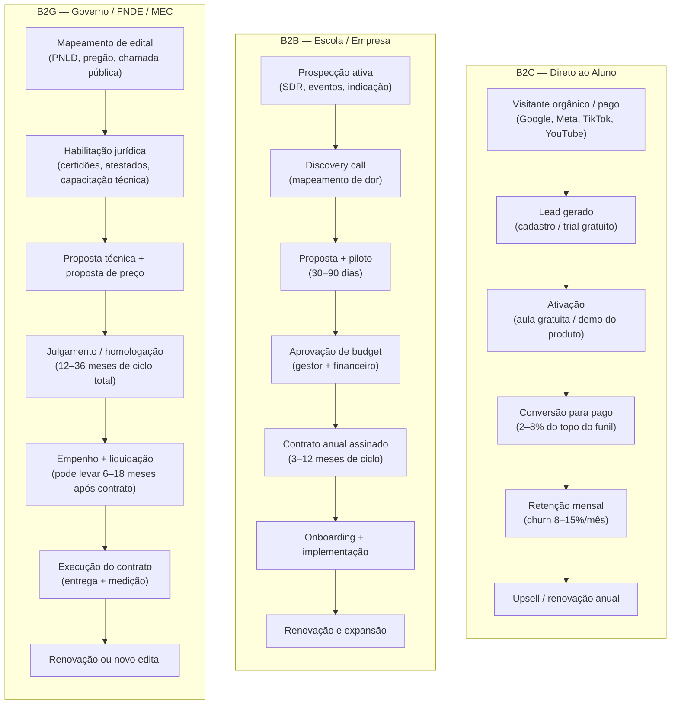

---

### Tabela: comparativo por modelo de negócio

| Dimensão | B2C (assinatura) | B2C (curso avulso) | B2B escola/empresa | B2G governo |
|---|---|---|---|---|
| **Ticket médio mensal** | R$ 39–199 | R$ 197–2.990 (único) | R$ 3K–50K/mês | R$ 50K–5M/mês (contrato) |
| **Ciclo de venda** | Dias (self-service) | Dias | 3–12 meses | 12–36 meses |
| **Churn esperado** | 8–15%/mês | N/A (transação única) | 10–25%/ano | <5%/ano (risco político) |
| **Margem bruta** | 60–80% | 65–85% | 55–70% | 40–65% |
| **CAC típico** | R$ 80–1.200 | R$ 50–800 | R$ 3K–30K | R$ 50K–500K+ |
| **LTV/CAC** | 1,5–4x (frágil) | 1–3x | 4–15x | 5–20x (quando ganha) |
| **Previsibilidade de receita** | Média (churn sazonal) | Baixa | Alta após contrato | Alta durante contrato |
| **Complexidade regulatória** | Baixa (conteúdo livre) | Baixa | Média (EAD, MEC) | Altíssima |

---

### O Tabuleiro do MEC, CNE, BNCC e Lei de Diretrizes e Bases: Quando a Regulação É Barreira e Quando É Livre

#### Ensino livre vs. ensino regulado

A primeira decisão de qualquer edtech é: o produto precisa de autorização do MEC?

**Ensino livre** (não precisa de MEC): cursos de extensão, preparatório para vestibular, habilidades técnicas (programação, design, Excel), idiomas, certificações corporativas. A empresa pode vender, cobrar e operar livremente. A maioria das edtechs B2C e B2B de treinamento corporativo está aqui.

**Ensino regulado** (precisa de autorização do MEC/INEP): graduação, pós-graduação lato sensu (MBA, especialização), cursos técnicos de nível médio (SENAI/SENAC ou escolas técnicas privadas), educação básica credenciada. Aqui entram as regras da LDB (Lei 9.394/1996) e das portarias do MEC.

> [!warning] Produto que parece livre mas é regulado
> Oferecer "pós-graduação" sem autorização do MEC é infração. Oferecer certificados com aparência de credencial oficial (ex: "Certificado de Especialista em X") sem a regulação correspondente pode configurar propaganda enganosa e gerar autuação pelo MEC. Fundadores de edtech que querem escalar devem definir explicitamente se o produto é ensino livre ou regulado — e se for regulado, qual é o caminho de autorização.

#### EAD regulamentado — Portaria MEC 2.117/2019

Para cursos de graduação e pós-graduação com modalidade EAD, a Portaria 2.117/2019 é a referência principal. Ela permite que IES (Instituições de Ensino Superior) autorizadas pelo MEC ofereçam até 40% da carga horária de cursos presenciais a distância — e cursos 100% EAD nos polos credenciados. Os grandes grupos de ensino (Estácio, Kroton, Anima) cresceram agressivamente nesse modelo a partir de 2020.

Para uma edtech que quer criar seu próprio curso de graduação EAD do zero, o caminho é: credenciamento como IES (3–5 anos, alto custo), ou parceria com IES já credenciada (modelo de marca branca ou joint venture educacional).

#### PRONATEC e formação profissional

O PRONATEC (Programa Nacional de Acesso ao Ensino Técnico e Emprego) é o principal programa federal de formação técnica. Operado pelo MEC em parceria com o sistema S (SENAI, SENAC, SENAF), institutos federais e escolas técnicas credenciadas. Para uma edtech acessar recursos do PRONATEC, precisa ser operadora credenciada — processo longo e com exigências de infraestrutura física.

#### PNLD — Programa Nacional do Livro e do Material Didático

O PNLD é o maior programa de compra de material didático do mundo (são mais de 30 milhões de alunos na rede pública). Para participar, a editora ou edtech precisa submeter obras ao processo de avaliação do MEC, que ocorre por ciclos (a cada 3–4 anos por segmento). O processo inclui análise pedagógica, conformidade com a BNCC e adequação ao público. É lento e exigente — mas uma aprovação no PNLD garante contratos de R$ milhões.

---

### Lições da Trincheira Educacional Brasileira: Como Sistemas de Ensino, Plataformas Escolares e Edtechs B2B Escalaram

**Descomplica:** Começou como B2C de preparação para vestibular (YouTube + plataforma própria). Construiu base de usuários massiva com conteúdo gratuito. Criou modelo de assinatura mensal acessível (R$ 39–59/mês). Em 2019, adquiriu autorização de IES e começou a oferecer graduação EAD (movimento B2C → regulado). Em 2021, levantou R$ 720M em rodada Series D liderada por SoftBank, valendo ~R$ 2B. O movimento do Descomplica é o clássico: escala em B2C livre → monetização por assinatura → expansão para ensino regulado (que tem LTV muito maior, porque o aluno fica 4 anos na graduação).

**Alura:** Plataforma de cursos de tecnologia. Começou estritamente B2C — desenvolvedor individual comprando cursos de programação. Com o crescimento do mercado de tech no Brasil (2018–2022), as empresas começaram a comprar assinaturas para seus times (B2B). Hoje o Alura for Business (B2B enterprise) é parte central do negócio: contrato anual por assento, com gerente de conta e relatório de progresso. O case ilustra o caminho B2C → B2B enterprise em edtech técnica: a base de usuários B2C funciona como prova de conceito e source of truth de engajamento para vender para o RH corporativo.

**Hotmart:** Não é edtech no sentido estrito — é plataforma de marketplace para criadores de conteúdo digital. Produtores (infoprodutores) criam cursos e vendem via Hotmart, que fica com 9,9% + taxa de processamento de cada transação. A escala é impressionante: mais de 300 mil criadores ativos, mais de 40 países. O modelo é B2B2C (a empresa vende para o criador, que vende para o aluno). Não há regulação MEC porque os produtos são ensino livre. O risco do Hotmart é reputacional: a plataforma hospeda produtos de qualidade muito variável, incluindo o mercado de "guru de autoajuda".

**Duolingo no Brasil:** O Brasil é o segundo maior mercado do Duolingo no mundo (atrás dos EUA). O produto é gratuito com anúncios (B2C freemium), com opção Super Duolingo (R$ 35–49/mês sem anúncios e com recursos adicionais). O CAC do Duolingo no Brasil é extraordinariamente baixo porque o produto é viral por design (gamificação, streak, competição entre amigos). A conversão para pago é baixa (~5%), mas o volume de usuários (dezenas de milhões no Brasil) torna o negócio viável. O Duolingo não compete com cursos de idiomas regulamentados — é entretenimento educativo.

**Estácio/Kroton como incumbentes:** Os grandes grupos de ensino superior têm múltiplas funções no ecossistema de edtech: são compradores de tecnologia (LMS, ERP educacional, analytics), são concorrentes diretos de edtechs que entram em ensino superior regulado, e são potenciais adquirentes de startups. A Kroton/Cogna montou um fundo de corporate venture (Cogna Ventures) justamente para ter acesso a tecnologia que não conseguiria construir internamente.

---

### O Relógio Fatal de Outubro: Por Que Perder a Janela de Matrículas do K-12 Significa Ficar Sem Receita por 12 Meses

```text
Jan  ★★★★★  Matrículas. Pico de conversão B2C. Onboarding de clientes B2B.
Fev  ★★★★☆  Início das aulas. Corpo docente ocupado. Venda B2B difícil.
Mar  ★★★☆☆  Rotina estabelecida. Oportunidade de venda para datas de avaliação.
Abr  ★★★☆☆  Mid-term. Engajamento cai em plataformas B2C.
Mai  ★★★★☆  Budget planning para o próximo ano começa em escolas. Semear pipeline B2B.
Jun  ★★★☆☆  Meio do semestre. Preparação para ENEM começa.
Jul  ★★★★★  Matrículas 2º semestre. Segunda janela B2C. Decisões de compra B2B para janeiro.
Ago  ★★★★★  ENEM aproxima. Pico de busca por preparatório. Volume máximo B2C.
Set  ★★★★★  ENEM. Volume máximo. Conversão máxima para cursinhos.
Out  ★★☆☆☆  Pós-ENEM: queda brusca. Foco em fechamento B2B para janeiro.
Nov  ★★★☆☆  Corporativo: fim de orçamento. Budget de L&D precisa ser gasto antes de dez/31.
Dez  ★★☆☆☆  Recesso. Quase nada fecha. Planejamento do ano seguinte.
```

> [!tip] Novembro é o Q4 do mercado corporativo
> Empresas com budget de treinamento não utilizado precisam gastá-lo antes do fechamento do exercício. Uma edtech B2B que faz pipeline corporativo entre agosto e outubro e fecha em novembro captura esse janela. É análogo ao Q4 de SaaS enterprise — mas específico do segmento de L&D.

---

### A Matemática que Fecha a Conta: LTV/CAC, Churn Sazonal, Margem Bruta de Conteúdo/IA e Financiamento Estudantil

#### B2C: o problema do CAC sazonal

O CAC de uma edtech B2C flutua radicalmente ao longo do ano. Em agosto (pré-ENEM), todos os competidores estão no leilão do Google Ads. O CPC para palavras-chave de "cursinho online", "preparatório ENEM" e "vestibular" dobra ou triplica. O fundador que calcula CAC médio anual está escondendo que adquiriu metade dos clientes a custo três vezes maior no pico sazonal.

Métricas que importam no B2C de edtech:

- **CAC por cohort de aquisição** (não apenas CAC médio anual)
- **LTV por objetivo** (aluno de vestibular tem LTV limitado a 12–24 meses; aluno de certificação profissional pode renovar por anos)
- **Contribution margin após sazonalidade** (cobrir custos fixos nos meses de baixo volume)
- **NPS por outcome** (aluno que passou no vestibular tem NPS altíssimo e vira referência; aluno que não passou tem NPS baixo independentemente da qualidade do produto)

#### B2B: o valor do custo de troca

O B2B de edtech tem um mecanismo de defesa poderoso quando o produto está integrado: custo de troca. Uma escola que usa o LMS para controlar frequência, notas, comunicação com pais e relatórios pedagógicos não troca de fornecedor facilmente. Esse lock-in é o que justifica ciclos de venda longos (vale o esforço quando o cliente fica 5–10 anos) e permite expansão de ticket ao longo do tempo.

O risco inverso é que o lock-in dificulta a venda inicial. A escola sabe que está comprando por muitos anos e quer certeza antes de assinar. Isso explica por que pilotos gratuitos de 30–90 dias são padrão no mercado B2B de edtech.

---

### Perder a Janela de Adoção Escolar, Quebrar com Inadimplência em ISA (Income Share Agreement) Mal Subscrito e Ignorar o Professor

**1. Regulação trava o produto digital no ensino formal**

Uma edtech que desenvolve conteúdo inovador para sala de aula descobre que a escola pública usa currículo aprovado pela secretaria de educação — que só incorpora material após processo de avaliação que dura 1–2 anos. O produto pode ser excelente. A inovação pedagógica pode ser comprovada. Mas a escola não pode adotar sem autorização. Isso não significa que B2G de conteúdo é inviável — significa que o ciclo de vendas é muito mais longo do que o fundador imagina quando entra no mercado.

**2. Confundir engajamento com aprendizagem**

Gamificação gera engajamento. Engajamento não garante aprendizagem. Uma edtech que mede sucesso por "minutos gastos na plataforma" ou "número de aulas completadas" pode estar criando uma métrica de vaidade. O que o mercado corporativo e o governo cada vez mais pedem é evidência de resultado: nota melhorou, empregabilidade aumentou, certificação conquistada. Startups que não desenvolvem métricas de outcome vão perder contratos para quem tem.

**3. Comparar unit economics de B2C com B2B como se fossem o mesmo negócio**

CAC de R$ 500 em B2C (para um cliente que paga R$ 59/mês) pode ser inviável. CAC de R$ 500 em B2B (para uma escola que paga R$ 5.000/mês por 5 anos) é excepcional. Fundadores que migram de B2C para B2B carregam a mentalidade de CAC baixo e assustam com o custo de um vendedor enterprise — sem entender que o LTV compensa amplamente.

**4. Não separar receita de conteúdo de receita de tecnologia**

Empresas que vendem tanto conteúdo quanto plataforma têm dois P&Ls distintos: conteúdo tem alta margem mas fecha valor e fica obsoleto; tecnologia tem CAC alto mas gera receita recorrente e LTV longo. Misturar os dois no mesmo modelo financeiro produz métricas enganosas.

**5. Ignorar inadimplência no B2B pequeno**

Escola particular pequena é uma das categorias de maior inadimplência no Brasil. Uma edtech que vendeu para 500 escolas pequenas e não tem processo de cobrança pode ter 20–30% de inadimplência no portfólio — destruindo a margem que parecia saudável no Excel.

---

### Auditoria de Trincheira antes de Lançar um Produto Educacional no Brasil

- [ ] Produto é ensino livre ou ensino regulado? Se regulado, qual o caminho de credenciamento?
- [ ] Qual modelo de negócio principal: B2C, B2B, B2G ou híbrido?
- [ ] O unit economics foi calculado por cohort sazonal, não apenas pela média anual?
- [ ] Há estratégia para os meses de baixo volume (outubro a fevereiro para vestibular)?
- [ ] Para B2B: o produto tem custo de troca real que justifique o ciclo de venda longo?
- [ ] Para B2G: há capital de giro para sustentar 12–36 meses de ciclo sem receita?
- [ ] As métricas de sucesso incluem outcome de aprendizagem, não apenas engajamento?
- [ ] A sazonalidade do mercado corporativo (novembro) está mapeada no pipeline?
- [ ] Para EAD regulado: a Portaria 2.117/2019 foi lida e os requisitos de polos EAD entendidos?

---

**Ver também:** [[#CAPÍTULO 4 — REGULATÓRIO SETORIAL BRASILEIRO|Capítulo 4 — Regulatório Geral]], [[IGNICAO-Vol-4-Tracao-e-PMF#CAPÍTULO 6 — PRICING STRATEGY E ECONOMIA DA RECORRÊNCIA (SUBSCRIPTION ECONOMY)|Capítulo 6 — Subscription Economy (Vol. 4)]], [[#CAPÍTULO 32 — GOVTECH: STARTUP VENDENDO PARA GOVERNO|Capítulo 32 — Govtech e B2G]]

---

### Filtro de Entrada na Trincheira: Você Deve Entrar Neste Jogo?

Antes de gravar uma aula ou escrever código para uma Edtech no Brasil, passe sua tese por três perguntas de fogo:

1. **Curso Livre vs. Obrigação Institucional:** Seu produto depende de convencer pessoas no Instagram a pagarem R$ 59/mês por um curso que abandonam na terceira semana, ou vende contratos anuais para escolas (K-12 B2B2C), empresas (B2B) ou cursos que destravam diploma/emprego?
2. **A Sincronia com o Relógio de Maio a Setembro (Para K-12):** Se você vende para escolas privadas, seu time comercial já está negociando entre maio e agosto — antes que o mantenedor feche o orçamento do ano seguinte em outubro?
3. **Aliado do Professor:** Sua tecnologia economiza cinco horas semanais de trabalho braçal do professor (corrigindo redações e montando aulas BNCC), ou cria mais uma tarefa para um docente exausto?

**O Movimento de Segunda-Feira:** Nos próximos 15 dias, converse com cinco mantenedores de escolas privadas ou cinco diretores de RH/T&D e audite quais fornecedores educacionais eles renovaram ou cancelaram nos últimos três anos.


---

## CAPÍTULO 32 — GOVTECH: STARTUP VENDENDO PARA GOVERNO

### A Regra Invisível do Jogo: A Armadilha do Prefeito Entusiasmado Sem Dotação Orçamentária e a Alavancagem do CPSI

Existe um ritual de passagem doloroso que já levou dezenas de startups brasileiras à falência no setor público (*GovTech*): o fundador consegue uma reunião no gabinete de um prefeito ou secretário estadual, faz uma apresentação brilhante, o político tira foto para as redes sociais dizendo que a cidade será "a mais inteligente do Brasil" e pede um piloto gratuito de seis meses. O fundador "turista" comemora e financia o piloto do próprio bolso. Seis meses depois, o piloto é um sucesso — mas o secretário descobre que não existe rubrica na Lei Orçamentária Anual (LOA), a Procuradoria trava a contratação por medo do Tribunal de Contas (TCE/TCU), a TI municipal boicota o sistema e o ano eleitoral congela os empenhos.

O veterano de trincheira sabe que no setor público brasileiro o entusiasmo do político vale zero se não vier acompanhado de três pilares técnicos: **enquadramento jurídico blindado, rubrica orçamentária carimbada com fonte de recurso garantida e adesão da burocracia de carreira**.

Para vencer em GovTech sem quebrar o caixa, domine **A Engenharia do CPSI (LC nº 182/2021) e da Adesão de Ata de Registro de Preços**: em vez de pilotos gratuitos informais que impedem a contratação posterior, o fundador profissional entra via Contrato Público para Solução Inovadora (CPSI — que remunera até R$ 1,6 milhão no teste e permite contrato de fornecimento de até R$ 8 milhões sem nova licitação) ou via Sistema de Registro de Preços (SRP) na Lei nº 14.133/2021, permitindo que dezenas de prefeituras aderiram à mesma ata.

---

> [!note] Nota de validade
> Valores de dispensa de licitação e limites de contratação são reajustados periodicamente por decreto federal. Os valores citados refletem o cenário de maio de 2026, com base nos reajustes da Lei 14.133/2021 e regulamentações vigentes. Verificar atualização antes de qualquer processo de contratação. O Marco Legal das Startups (LC 182/2021) é a âncora legal principal — ver [[IGNICAO-Vol-8-Juridico-LGPD-e-Seguranca#CAPÍTULO 1 — MARCO LEGAL DAS STARTUPS: LC 182/2021|Capítulo 1 (Marco Legal das Startups: Lc 182/2021) (Vol. 8)]] para o instrumento em detalhe.

Governo é o maior comprador do Brasil. O setor público gasta mais de R$ 2 trilhões por ano. Saúde, educação, segurança, mobilidade, assistência social, fiscalização tributária. Todos operam sobre tecnologia envelhecida, processos manuais e baixa eficiência. O gap (lacuna) entre o que o setor público precisa e o que consegue contratar via TI tradicional é onde a govtech (startup que vende para governo) vive.

Governo, no entanto, é cliente diferente de tudo o que uma startup conhece. O ciclo de venda é longo. O processo de compra é burocrático por design. O pagamento pode atrasar meses. E a troca de prefeito ou secretário pode desfazer um contrato assinado.

Este capítulo é um playbook (manual operacional) para fundar, vender e crescer no setor público brasileiro.

### Por Que o Estado É o Maior Comprador do Brasil — e Por Que Ele Opera Pela Legalidade Estrita, Não Pela Vontade do Gestor

Quatro características distinguem o governo de qualquer cliente privado.

**Ciclo de compra anual e orçamento pré-definido.** O governo federal, estadual e municipal opera com lei orçamentária anual (LOA). O dinheiro disponível para contratar uma startup está ou não está na LOA. Secretaria sem dotação orçamentária não contrata, mesmo que queira. O ciclo é: setembro a dezembro é o momento de influenciar a LOA do ano seguinte. Janeiro a abril é o momento de fazer o processo de contratação. Maio a agosto é quando o contrato começa a rodar. Essa sazonalidade rígida muda o modelo de go-to-market inteiro.

**Compliance intenso por obrigação constitucional.** A administração pública opera sob o princípio da legalidade: só pode fazer o que a lei expressamente autoriza. Isso significa que toda contratação tem trâmites formais: parecer jurídico, aprovação de comitê, publicação no Diário Oficial. Não existe "assinar agora e regularizar depois" no setor público.

**Stakeholders múltiplos e decisão não-linear.** No privado, o CEO decide. No governo, a decisão passa por técnico, gestor intermediário, jurídico, controle interno, secretário ou prefeito, e às vezes câmara de vereadores. Cada um tem poder de veto. Nenhum tem poder de dizer "sim" sozinho.

**Empenho não é pagamento.** Este é o ponto que mais surpreende fundadores govtech. O contrato assinado gera uma nota de empenho, ou seja, reserva orçamentária. O pagamento efetivo ocorre após entrega do serviço, emissão de nota fiscal, aceite técnico da secretaria e processamento contábil. Na prática, o prazo entre entrega e recebimento varia de 30 a 120 dias. Startups com caixa curto quebram esperando receber do governo.

> [!warning] Empenho não é dinheiro em conta
> Muitos fundadores govtech cometem o erro de contar com receita de contratos públicos no fluxo de caixa antes do recebimento efetivo. Empenho é compromisso orçamentário, não liquidez. Planejar com 60 a 90 dias de gap entre entrega e pagamento. Ter reserva de caixa antes de fechar contratos públicos.

### A Via Expressa Legal: Como o CPSI (LC 182/2021) Permite Contratar Testes Remunerados (R$ 1,6M) e Escala Direta (R$ 8M)

A Lei Complementar 182/2021 mudou a equação para startups que querem vender para governo. Antes dela, contratar startup era juridicamente difícil para o gestor público — qualquer contratação direta sem licitação gerava risco de autuação pelo TCU ou TCE.

O art. 20 da LC 182 criou a base legal explícita para contratação de startups por dispensa de licitação, para desenvolvimento ou teste de soluções inovadoras. O gestor que usa esse mecanismo tem amparo legal claro. Isso reduziu o medo institucional de contratar startups.

Além da dispensa, a lei criou o **Contrato de Opção de Compra de Participação (COCP)**, que permite ao governo participar em startups como investidor — instrumento ainda pouco explorado, mas previsto.

O art. 30 especificamente autoriza a **dispensa de licitação para contratação de startups**, limitada a:

- Startups com até dez anos de constituição.
- Receita bruta anual de até R$ 16 milhões no exercício anterior.
- Objeto voltado a desenvolvimento ou teste de solução inovadora.
- Contrato de caráter experimental ou de validação.

> [!important] O gestor precisa de coragem institucional
> A lei existe, mas muitos gestores ainda têm medo de usar. TCU e TCEs fiscalizam com rigor. Governos mais inovadores (Minas Gerais, São Paulo, Rio Grande do Sul, Ceará, prefeituras como BH, SP, Porto Alegre) têm mais familiaridade com o mecanismo. Prefeituras pequenas raramente usam. Mapear o perfil de inovação do órgão antes de investir no pipeline.

### As Cinco Portas de Entrada Jurídica: CPSI, Pregão/Concorrência (Lei 14.133), Inexigibilidade, Dispensa e Carona em Ata (SRP)

Governo não tem uma única forma de comprar. Há pelo menos cinco modalidades relevantes para startups, cada uma com lógica, valor e complexidade diferentes.

| Modalidade | Limite de valor | Complexidade | Prazo típico | Melhor para |
|---|---|---|---|---|
| Dispensa de licitação (inovação) | Variável por regulamentação (referência: R$ 57,5K para serviços comuns; inovação tem previsão específica) | Baixa | 30–90 dias | Piloto, MVP, validação inicial |
| Inexigibilidade | Sem limite de valor | Média | 45–120 dias | Fornecedor exclusivo, solução singular |
| Pregão eletrônico | Sem limite | Alta | 90–180 dias | Produto padronizado, escalável |
| Concurso público de inovação | Sem limite (prêmio) | Média | 60–180 dias | Soluções para desafio específico |
| Sandbox ARE (ARE setorial) | Variável por regulador | Média | 90–360 dias | Healthtech, fintech, edtech regulados |

> [!tip] Dispensa para inovação vs. dispensa comum
> A dispensa de licitação comum (para serviços de baixo valor) é uma coisa. A dispensa para inovação via LC 182 é outra. A segunda tem objeto específico (solução inovadora), processo distinto (chamada pública com avaliação técnica) e não depende de limite de valor pequeno. Fundador que só conhece a dispensa comum perde a principal porta de entrada govtech.

**Dispensa de licitação para inovação.** É o mecanismo central da LC 182. O órgão publica uma chamada pública descrevendo o problema que precisa resolver. Startups apresentam propostas. Uma comissão técnica avalia e seleciona — normalmente até três startups para pilotos paralelos. O contrato é assinado sem licitação formal. Valor máximo definido pelo órgão, com amparo na regulamentação específica.

**Inexigibilidade.** Quando a startup tem solução sem concorrente equivalente no mercado. Exige justificativa técnica robusta. Risco: qualquer concorrente pode questionar. Funciona bem para startups com patente ou tecnologia genuinamente proprietária.

**Pregão eletrônico.** Licitação plena com disputa de preço. Burocracia alta, prazo longo, mas sem limite de valor. Adequado para startup que já tem produto maduro, quer escala, e pode competir por preço. Empresas de edtech que fornecem para o FNDE/MEC frequentemente operam via pregão.

**Concurso público de inovação.** Edital com desafio técnico específico, premiação por solução. Não é contratação direta, mas é porta de entrada. Algumas prefeituras e estados usam como primeiro passo antes da contratação.

**Sandbox ARE (Ambiente Regulatório Experimental).** Para healthtech, edtech e outras verticais reguladas, o ARE setorial permite operar em ambiente controlado com flexibilização de requisitos regulatórios. Ver [[IGNICAO-Vol-8-Juridico-LGPD-e-Seguranca#CAPÍTULO 1 — MARCO LEGAL DAS STARTUPS: LC 182/2021|Capítulo 1 (Marco Legal das Startups: Lc 182/2021) (Vol. 8)]] e [[#CAPÍTULO 4 — REGULATÓRIO SETORIAL BRASILEIRO|Capítulo 4 (Regulatório Setorial Brasileiro)]].

### Fluxo de contratação pública para startup

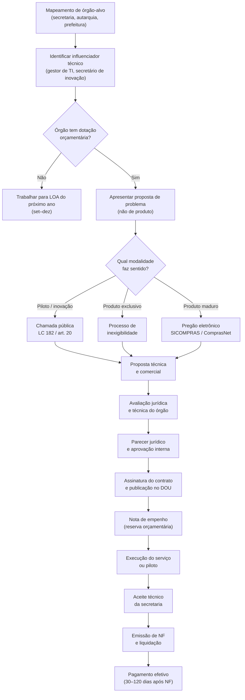

### Pipeline de vendas para governo

Vender para governo é menos sobre "produto" e mais sobre "problema". O gestor público não compra tecnologia — ele compra solução para problema político (eleição, CPI, corte de gastos) ou operacional (fila de espera, erro de cadastro, fraude).

**Etapa 1 — Mapeamento de influenciadores.** Toda contratação pública tem um influenciador técnico antes de chegar ao decisor formal. Gerente de TI, superintendente de inovação, assessor da secretaria. Esse influenciador molda o edital, define requisitos, e tem peso decisivo na avaliação técnica. Identificar quem é e construir relacionamento antes de qualquer processo formal.

**Etapa 2 — Mapeamento de dotação orçamentária.** Antes de investir tempo em um órgão, verificar se há dotação orçamentária disponível ou em planejamento. Portal da Transparência, SIAFI, e relatórios de execução orçamentária são públicos. Órgão sem orçamento não contrata.

**Etapa 3 — Construção de caso de uso documentado.** O decisor público não pode correr risco reputacional. Ele precisa de evidência de que a solução funciona antes de assinar. Oferecer piloto gratuito ou subsidiado, documentar resultados com métricas, obter declaração do gestor técnico. Esse caso de uso é a principal ferramenta de vendas para o próximo órgão.

**Etapa 4 — Adequação ao processo licitatório.** Cada modalidade tem exigências documentais diferentes. Regularidade fiscal federal, estadual e municipal é obrigatória. Certidões negativas de débito (CND) precisam estar em dia. Startups no Simples Nacional têm processo mais simples. Criar checklist documental e manter sempre atualizado.

**Etapa 5 — Gestão pós-contrato.** Contrato assinado não é trabalho concluído. O gestor público tem medo de errar. Precisa de suporte frequente, relatórios documentados, e evidência contínua de que a solução está funcionando. Essa relação de suporte estreito é o que garante renovação e expansão para outros órgãos.

> [!tip] A prefeitura é a porta de entrada
> Municípios têm orçamentos menores, processos mais simples, e decisores mais acessíveis. Uma startups govtech típica começa com duas ou três prefeituras médias (100–500 mil habitantes), valida o modelo, e usa esses contratos como referência para secretarias estaduais e ministérios. Nunca começar pelo governo federal.

### Auditando o Órgão Antes de Gastar Um Real: PPA/LDO/LOA, Fonte de Recurso, TCE e Calendário Eleitoral

O erro número um que reprova startups em bancas de incubação pública (como o Hub GovTech Paraná, Mobilab SP, Porto Digital ou chamadas de CPSI) e trava vendas para prefeituras não é falha de código — é a **simplificação ingênua do problema público**.

Fundadores vindos do mercado privado costumam formular problemas públicos como se fossem dores lineares de uma PME privada (*"a prefeitura demora para responder protocolos porque o atendimento é manual; nosso sistema com IA automatiza isso"*). Quando um avaliador experiente ou um secretário municipal ouve essa formulação, ele percebe imediatamente que a startup ainda não conhece a anatomia interna de um órgão público.

No setor público brasileiro, um problema raramente depende de uma única variável. Ele é o resultado de um sistema acoplado que envolve simultaneamente **13 variáveis institucionais, operacionais e tecnológicas**:

| # | Variável Institucional | Como ela trava a adoção na prática em uma Prefeitura ou Secretaria |
|---|---|---|
| **1** | **Processos administrativos formais** | O fluxo atual não existe por acaso: ele obedece a decretos municipais, portarias, regimentos internos e ritos de tramitação que não podem ser alterados apenas trocando a tela de um software. |
| **2** | **Sistemas legados e incumbentes** | Nenhuma prefeitura é uma folha em branco. Ela já roda ERPs públicos e sistemas estruturantes (como **e-Cidade**, **SEI**, **Betha**, **IPM**, **Fiorilli**, **Elotech**, **Governançabrasil**, ou companhias públicas de TI como **Celepar**, **Prodam**, **Prodabel**, **Procergs**, **Serpro** e **Dataprev**). |
| **3** | **Regras e normativos legais** | Leis orgânicas municipais, normas do Tribunal de Contas (TCE/TCU), exigências do Ministério Público e regras setoriais (SUS/RNDS na saúde, MEC/Censo na educação, STN/Siconfi nas finanças). |
| **4** | **Múltiplas áreas co-responsáveis** | Um único processo (ex: alvará, compra, atendimento ao cidadão, prontuário) atravessa 3 a 5 secretarias diferentes (Fazenda, Administração, Procuradoria, TI e a pasta finalística), sem que uma mande na outra. |
| **5** | **Limitações orçamentárias (PPA/LDO/LOA)** | Mesmo que o benefício econômico seja óbvio, a despesa precisa caber em uma rubrica orçamentária existente e respeitar a Lei de Responsabilidade Fiscal (LRF). |
| **6** | **Infraestrutura tecnológica local** | Computadores com 8 anos de uso, links de internet instáveis em postos de saúde ou escolas rurais, ausência de rede Wi-Fi corporativa ou bloqueios severos de firewall. |
| **7** | **Disponibilidade e qualidade dos dados** | Bases cadastrais duplicadas, CPFs ausentes, dados presos em PDFs escaneados sem OCR ou tabelas proprietárias cujo dicionário de dados pertence ao fornecedor atual. |
| **8** | **Segurança da informação e LGPD pública** | Medo legítimo de vazamento de dados pessoais/sensíveis do cidadão, sequestro por *ransomware* e responsabilização sob os arts. 23 a 30 da LGPD (capítulo exclusivo do Poder Público). |
| **9** | **Resistência organizacional e carreira** | O servidor efetivo (concursado) viu dezenas de "projetos de inovação de prefeito" nascerem e morrerem a cada 4 anos, deixando passivo e retrabalho manual para quem fica. |
| **10** | **Competências digitais das equipes** | Alta rotatividade de cargos comissionados combinada com servidores próximos da aposentadoria que rejeitam interfaces complexas ou que exijam treinamento longo. |
| **11** | **Fornecedores existentes e contratos vigentes** | A empresa que fornece o sistema atual da prefeitura muitas vezes cobra caro (ou cria barreiras técnicas) para liberar APIs de leitura e escrita para uma startup terceira. |
| **12** | **Integrações e interoperabilidade** | Se a sua solução exigir que o servidor digite a mesma informação duas vezes (uma no seu sistema e outra no sistema legado oficial), a ferramenta será abandonada em 30 dias. |
| **13** | **Maturidade institucional heterogênea** | Um município de 15 mil habitantes não tem equipe de TI própria nem procuradoria especializada; uma capital tem 400 analistas na empresa municipal de informática e comitê rígido de governança. |

> [!important] A Regra da Inversão em GovTech: *Problem-First* vs. *Tech-First*
> Um dos erros mais fatais ao empreender para o setor público é **partir da tecnologia antes de compreender o contexto institucional** (*"construímos uma plataforma de agentes de IA / blockchain / IoT e agora vamos vender para prefeituras"*). No governo, a solução tecnicamente mais sofisticada quase nunca é a mais viável institucionalmente.
>
> Trabalhe sempre na direção inversa:
> **Problema Institucional Concreto → Processo Administrativo Existente → Atores Envolvidos → Restrições Legais e Técnicas → Oportunidade Delimitada de Melhoria → Solução Necessária → Tecnologia Adequada.**

Antes de escrever uma única linha de código ou subir no palco de uma banca, sua equipe precisa saber responder com precisão cirúrgica às **8 Perguntas de Diagnóstico do Problema Público**:

1. **Qual problema específico** (e não genérico) está sendo resolvido?
2. **Onde exatamente ele acontece** (qual secretaria, departamento, equipamento público e porte de município)?
3. **Quem é diretamente afetado** (qual perfil de servidor interno e qual grupo de cidadãos)?
4. **Quais áreas e órgãos participam** do início ao fim desse fluxo administrativo?
5. **Como o problema é tratado atualmente** (passo a passo do processo *AS-IS*, incluindo planilhas paralelas, carimbos, WhatsApp pessoal e sistemas legados)?
6. **Por que as soluções atuais são insuficientes** (qual é a falha estrutural do sistema legado ou do rito manual)?
7. **Quais restrições institucionais existem** (normas, leis, contratos vigentes, limitações de TI e segurança)?
8. **Qual consequência concreta e mensurável** é produzida hoje pela situação atual (horas de servidor desperdiçadas, fila em dias, perda de arrecadação em R$, judicialização ou glosa de repasses)?

#### Como delimitar um Caso de Uso Municipal Específico (A Cunha B2G)

Diante da complexidade administrativa, **nunca tente resolver "a gestão das prefeituras brasileiras" de uma só vez**. Escolha inicialmente um recorte (*beachhead* / cunha) extremamente fechado de 6 dimensões:

- **1 tipo de município** (ex: municípios de 50 mil a 200 mil habitantes do Sul/Sudeste que já utilizam protocolo eletrônico);
- **1 secretaria ou área específica** (ex: Secretaria Municipal de Saúde — Atenção Primária, ou Secretaria de Fazenda — Dívida Ativa/ISS);
- **1 processo administrativo específico** (ex: triagem e regulação de exames de média complexidade, ou análise documental de licenciamento ambiental simplificado);
- **1 usuário operador definido** (ex: o servidor administrativo regulador na ponta);
- **1 dor quantificável** (ex: 40% dos pedidos voltam por erro de preenchimento documental, gerando 18 dias de atraso);
- **1 resultado esperado verificável** (ex: redução de 70% no tempo de triagem sem alterar a portaria municipal vigente).

---

### Mapeando os Sete Atores do Poder Público: Do Prefeito e Secretário ao Fiscal do Contrato, Procurador e TI

Conversar com um prefeito ou secretário em um evento e ouvir *"achei sua ideia excelente, precisamos muito disso aqui"* **não é validação**. No setor público, o entusiasmo político desacompanhado de pesquisa operacional com os servidores de carreira vale zero.

Para transformar hipóteses internas em conhecimento sustentado pelo contexto público, o *Customer Discovery* de uma GovTech precisa entrevistar diretamente **os 7 papéis institucionais** que tocam o processo:

| Ator Institucional | Qual é a agenda real dele | O que você precisa descobrir na entrevista (Mom Test Público) |
|---|---|---|
| **1. Secretário / Gestor da Pasta** | Entregar resultado visível dentro do mandato sem gerar crise na imprensa ou no legislativo | Qual indicador tira o sono dele hoje? Existe prioridade política e dotação na LOA para atacar esse gargalo este ano? |
| **2. Servidor Responsável pelo Processo (Ponta)** | Reduzir retrabalho manual, não ser culpado por erros e não ter que alimentar dois sistemas ao mesmo tempo | Como ele executa a tarefa hoje, tela por tela? Quais gambiarras (*workarounds* em Excel/papel) ele usa? O que já tentaram implantar lá que fracassou e por quê? |
| **3. Equipe de TI da Prefeitura / Órgão** | Manter sistemas no ar, evitar passivos de manutenção sem equipe e impedir vazamentos de dados | Quais sistemas legados rodam hoje? O banco de dados é local ou nuvem? Existem APIs ou rotinas de importação/exportação? Quais são os padrões exigidos pela TI? |
| **4. Segurança da Informação e DPO (LGPD)** | Garantir conformidade com a LGPD (arts. 23–30), controle de acesso e rastreabilidade contra auditorias | Quais dados pessoais ou sensíveis transitam no processo? Quais são as exigências de guarda, anonimização, logs de auditoria e isolamento? |
| **5. Área Administrativa e Compras** | Seguir estritamente a Lei 14.133/2021 ou LC 182/2021 sem risco de impugnação ou representação no TCE | Como o órgão costuma contratar software? Já usaram dispensa por inovação, CPSI, adesão a ata de registro de preços ou inexigibilidade? |
| **6. Gestor / Fiscal de Contrato** | Ter métricas claras e relatórios auditáveis para assinar o ateste mensal da nota fiscal com segurança no CPF | Como ele mede se um fornecedor atual entregou o serviço? Que relatório mensal ele precisa anexar ao processo de liquidação de despesa? |
| **7. Controle Interno / Procuradoria** | Blindar a legalidade do ato administrativo e a titularidade pública sobre os dados e decisões | Quais normas ou pareceres jurídicos restringem a automação desse processo? Qual ato exige assinatura/decisão exclusiva de servidor concursado? |

#### A Escada de Evidências de Validação em GovTech (Pesos Reais de Banca e Mercado)

Tanto em bancas de seleção (incubadoras, Finep, FAPs) quanto diante de investidores e novos prefeitos, é fundamental separar o peso de cada evidência construída. Construa sua validação subindo degrau por degrau nesta escada de **6 níveis**:

1. **Nível 1 — Opinião Informal (*Peso Mínimo*):** conversa casual em que um gestor diz que o problema "parece interessante". Não valida processo, orçamento nem viabilidade técnica.
2. **Nível 2 — Diagnóstico Estruturado de Campo (*Peso Básico*):** 10 a 20 entrevistas estruturadas documentadas com servidores, gestores e TI de municípios reais, acompanhadas do mapeamento do fluxo atual (*AS-IS*) e de dados quantitativos sobre a frequência e o impacto financeiro/operacional do problema.
3. **Nível 3 — Validação de Fluxo e Teste de Protótipo (*Peso Intermediário*):** demonstração e teste de protótipo navegável diretamente nas mãos dos servidores que operam o processo, validando que o fluxo proposto é compreendido, resolve o gargalo real e respeita o rito administrativo.
4. **Nível 4 — Validação de Arquitetura junto à TI Pública (*Peso Técnico*):** apresentação do dossiê de arquitetura, segurança e integração para equipes municipais de TI, obtendo validação técnica de que a solução é aceitável e implantável no ambiente da prefeitura.
5. **Nível 5 — Ambiente Institucional Real / Piloto Formalizado (*Peso Alto*):** formalização de carta de intenção, **Acordo de Cooperação Técnica (ACT sem repasse financeiro)** ou projeto-piloto em 1 município/órgão parceiro, com utilização real pelos servidores e coleta de indicadores antes/depois.
6. **Nível 6 — Contratação Pública e Utilização Recorrente (*Peso Máximo*):** contrato assinado (via LC 182/CPSI, dispensa, inexigibilidade ou pregão), nota de empenho emitida, implantação em produção e renovação comprovada.

> [!tip] Como validar dentro de uma prefeitura sem esperar 12 meses por uma licitação
> Você **não precisa de um contrato licitado para fazer *discovery* e rodar um teste de validação** com uma prefeitura. O instrumento jurídico padrão no Brasil é o **Acordo de Cooperação Técnica (ACT)** sem transferência de recursos financeiros (previsto na Lei nº 14.133/2021, art. 184, e no Marco Legal de CT&I — Lei nº 13.243/2016), ou a atuação dentro de hubs e laboratórios públicos de inovação (como Hub GovTech PR, Mobilab+ SP, iGov, GNova). Um ACT simples de 60 a 90 dias permite mapear o processo in loco, testar o protótipo com servidores reais, validar requisitos com a TI municipal e gerar os indicadores quantitativos que destravarão suas primeiras contratações remuneradas.

---

### Estruturação da solução: a Jornada Operacional (*Service Blueprint* Institucional)

Um erro clássico de startups técnicas ao apresentar para o governo é descrever a solução pela pilha tecnológica (*"usamos LLMs com RAG, visão computacional e mensageria assíncrona"*), deixando uma lacuna cognitiva enorme sobre **como o trabalho administrativo acontece na prática dentro da repartição**.

Para que gestores de negócio, servidores e auditores compreendam e confiem na proposta, decomponha sempre sua solução em uma **Jornada Operacional de 8 Etapas**, deixando explícito o que o software faz, com qual sistema legado ele conversa e **qual responsabilidade permanece humana (*Human-in-the-Loop*)** — já que, no Direito Administrativo brasileiro, atos decisórios que afetam direitos do cidadão ou o erário exigem chancela de agente público competente:

```mermaid
flowchart LR
    S1["1. Situação Atual
(Gatilho do Processo)"] --> S2["2. Entrada de Dados
(Cidadão, Servidor ou Legado)"]
    S2 --> S3["3. Processamento
(Regras, Validação ou IA)"]
    S3 --> S4["4. Ação da Solução
(Triagem, Cálculo ou Minuta)"]
    S4 --> S5["5. Informação Gerada
(Painel, Alerta ou Parecer)"]
    S5 --> S6["6. Servidor Responsável
(Revisão Human-in-the-Loop)"]
    S6 --> S7["7. Decisão ou Ato
(Despacho e Integração)"]
    S7 --> S8["8. Resultado Esperado
(KPI Público Mensurável)"]
```

Para cada etapa dessa jornada operacional, documente a matriz de execução da sua solução:

| Dimensão da Etapa | Pergunta Obrigatória que o Produto Precisa Responder | Exemplo Prático em um Caso de Uso Municipal |
|---|---|---|
| **1. Quem participa** | Qual ator inicia ou opera esta etapa? | Cidadão no portal / Servidor analista de tributos ou regulação |
| **2. Informação necessária** | Quais documentos ou campos estruturados entram? | Requerimento + CPF/CNPJ + comprovantes via formulário ou API |
| **3. Tecnologia utilizada** | O que é regra determinística vs. OCR/IA? | Validação cadastral via API + extração documental assistida por IA |
| **4. Dado gerado** | Qual artefato auditável o sistema produz? | Pré-análise estruturada com checklist de conformidade e score de risco |
| **5. Sistema legado integrado** | Onde esse dado precisa ser lido ou gravado? | Consulta ao cadastro imobiliário/tributário e envio de minuta ao **SEI / e-Cidade** |
| **6. Responsabilidade humana** | O que **não** é automatizado e exige decisão do servidor? | O fiscal ou analista concursado revisa a evidência e assina o deferimento/indeferimento |
| **7. Resultado produzido** | Qual métrica comprova o ganho público? | Tempo de análise cai de 15 dias para 20 minutos; 0% de perda de rastro de auditoria |

Essa decomposição cumpre um duplo papel estratégico: mostra ao órgão público que você respeita a governança administrativa e permite à sua própria engenharia separar **o que realmente precisa ser construído do zero** do que pode ser resolvido integrando sistemas existentes.

---

### Vencendo o Veto Silencioso da TI Pública: Interoperabilidade (e-PING/gov.br), LGPD Pública e Apoio ao Servidor de Carreira

Em mais de 70% dos projetos GovTech que morrem após o entusiasmo inicial do secretário da pasta, o óbito acontece na mesa do **Departamento de Tecnologia da Informação (TI)** da prefeitura ou da empresa pública de informática.

A resistência da área de TI **não deve ser tratada como má vontade comercial ou sabotagem burocrática**. Ela é uma **resposta perfeitamente racional à assimetria de risco**: quando uma startup implanta um sistema novo na Saúde, Educação ou Fazenda municipal, o secretário ganha os aplausos políticos se der certo; mas se o sistema ficar fora do ar, corromper a base legada, vazar dados de prontuários/contribuintes ou se a startup falir daqui a 12 meses sem dar manutenção, **quem responde ao Processo Administrativo Disciplinar (PAD) e reconstrói a operação no fim de semana é a equipe de TI da prefeitura**.

Por isso, toda GovTech precisa construir, desde o primeiro dia, **dois materiais distintos**:
1. **O Pitch Principal (Comercial e Institucional):** focado no problema público, impacto operacional, economia de recursos e validação para o Secretário e Gestores de Negócio;
2. **A Proposta Técnica e de Segurança da Informação (O "Deck da TI"):** um dossiê objetivo desenhado especificamente para conquistar a confiança e a aprovação dos arquitetos, analistas de suporte e gestores de segurança da informação do município.

#### Os 10 Blocos Obrigatórios da Proposta Técnica para a TI Municipal

| Bloco Técnico | As Perguntas Exatas que a TI da Prefeitura Fará | Como a GovTech Deve Estruturar a Resposta |
|---|---|---|
| **1. Arquitetura** | Como a solução está estruturada? É monolito, microsserviços, SaaS multi-tenant ou instalação local? | Diagrama limpo de arquitetura em camadas (front-end web responsivo, API gateway, banco de dados com isolamento lógico estrito por *tenant*/município). |
| **2. Infraestrutura e Hospedagem** | Onde o sistema será executado? Quem paga a nuvem? Os dados saem do Brasil? | Hospedagem em nuvem pública certificada (AWS, GCP, Azure) obrigatoriamente em **região brasileira (sa-east-1 — São Paulo)**, garantindo soberania de dados exigida pelo setor público. |
| **3. Integração e Interoperabilidade** | Com quais sistemas da prefeitura precisa conversar e como? | Suporte nativo a **APIs REST/JSON**, Webhooks, importação/exportação assíncrona segura (SFTP/CSV padronizado quando o legado não tem API) e integração com **Login Único Gov.br**, **SEI** e ERPs municipais. |
| **4. Dados e LGPD Pública** | Quais dados coleta, processa e produz? Quem é o dono do banco de dados? | **Titularidade 100% do Município (Controlador)**; a startup atua estritamente como **Operadora** (arts. 23 a 30 da LGPD). Garantia contratual de exportação integral da base em formato aberto ao fim do contrato (zero *vendor lock-in* de dados). |
| **5. Segurança da Informação** | Como dados, acessos e modelos de IA são protegidos? | Criptografia em trânsito (**TLS 1.3**) e em repouso (**AES-256**); segregação de ambientes; se usar IA/LLMs, garantia contratual de **zero treinamento de modelos públicos com dados municipais** e anonimização de PII. |
| **6. Autenticação, Autorização e Logs** | Quem acessa o quê e como auditamos desvios? | Controle de acesso baseado em papéis (**RBAC** por perfil de servidor/secretaria), suporte a **SSO / MFA**, e **Logs de Auditoria Imutáveis** registrando *quem*, *quando*, *IP*, *ação* e *valor anterior/novo* de toda operação. |
| **7. Disponibilidade, Backup e Contingência** | O que acontece se o servidor cair? Como funciona a recuperação? | SLA de disponibilidade (ex: 99,5%+), rotinas de backup automatizadas diárias com retenção geográfica redundante, **RPO** (perda máxima de dados) e **RTO** (tempo máximo de restauração) explícitos. |
| **8. Implantação (*Zero-Footprint*)** | O que o município precisa disponibilizar? Vai dar trabalho para a TI local? | Demonstrar que a implantação é 100% web/SaaS, exigindo **zero alocação de desenvolvedores da prefeitura** e zero compra de servidores locais (apenas liberação de domínio/credenciais de integração). |
| **9. Manutenção e Atualizações** | Como correções de bugs e novas versões são aplicadas? | Atualizações contínuas transparentes em janelas fora do expediente municipal, sem custo adicional de versão e com ambiente de homologação (*staging*) separado de produção. |
| **10. Suporte e Matriz de Responsabilidades** | Quem atende incidentes quando o servidor da ponta tiver dúvida? | Central de suporte própria da startup (N1 para dúvidas de usuários, N2/N3 para engenharia) — tirando o fardo do *helpdesk* das costas da TI municipal — e matriz **RACI** clara entre Empresa e Órgão. |

#### Mapa das 9 Resistências Racionais da TI Pública e Como Neutralizá-las

Antes de qualquer reunião técnica com a prefeitura ou banca avaliadora, antecipe estas 9 objeções:

1. *"Mais um sistema isolado (silo) que não conversa com nosso ERP."* → **Resposta:** Mostrar o conector de API/arquivo já previsto para o sistema legado deles e garantir que o sistema oficial continua sendo a fonte da verdade (*System of Record*).
2. *"Nossa equipe de TI está sobrecarregada e não tem braço para implantar nem dar suporte aos servidores."* → **Resposta:** Assumir contratualmente o onboarding, o treinamento dos servidores da ponta e o suporte N1/N2 direto no sistema.
3. *"Se vocês usam IA generativa, os dados sigilosos dos munícipes vão vazar para a OpenAI/Google?"* → **Resposta:** Demonstrar uso de endpoints corporativos com *Zero Data Retention*, mascaramento de dados pessoais (CPF/nome) antes da inferência e hospedagem em nuvem privada/nacional.
4. *"Se um servidor mal-intencionado alterar um registro ou vazar informação, como descobrimos?"* → **Resposta:** Mostrar a tela de trilha de auditoria (*audit log*) completa por CPF do servidor, exportável para sindicância e Controle Interno.
5. *"E se a startup quebrar ou o contrato acabar? Ficamos reféns sem nossos dados?"* → **Resposta:** Cláusula expressa de reversibilidade e entrega periódica do *dump* estruturado e documentado de todos os dados e documentos ao município.
6. *"A internet das nossas unidades de ponta cai toda semana."* → **Resposta:** Interface leve, tolerância a falhas de conexão, salvamento automático de rascunho local ou operação assíncrona.
7. *"Como ficam os perfis quando um servidor muda de secretaria ou é exonerado?"* → **Resposta:** Painel simples de gestão de identidades e revogação instantânea de acesso pelo gestor ou integração com o Active Directory / LDAP municipal.
8. *"Isso vai exigir comprar servidor ou licença de banco de dados pela prefeitura?"* → **Resposta:** Modelo 100% SaaS em nuvem já precificado na assinatura, sem custo oculto de infraestrutura ou licenças de terceiros para o município.
9. *"Quem garante que esse sistema aguenta o pico de acessos no último dia do prazo fiscal/matrícula?"* → **Resposta:** Arquitetura elástica com *auto-scaling* comprovado por teste de carga documentado.

### Na Trincheira do B2G Brasileiro: Startups que Escalaram em Saúde, Educação, Arrecadação e Gestão Pública com Compliance Total

**SoftDesign e cidade inteligente em Porto Alegre.** A SoftDesign foi uma das primeiras consultorias de tecnologia brasileiras a estruturar projeto de cidade inteligente para o município de Porto Alegre, desenvolvendo soluções de dados para mobilidade urbana via contratação direta com a prefeitura. O caso foi referência para o modelo de contratação pública de startups de TI no Rio Grande do Sul.

**Healthtech e telehealth pós-COVID.** A pandemia de 2020 criou abertura sem precedente para healthtechs no setor público. Municípios que jamais considerariam contratar startup de telemedicina passaram a aceitar pilotos emergenciais. Várias startups (entre elas Conexa Saúde, Docway e outras de menor porte) estabeleceram contratos com secretarias municipais de saúde via dispensa emergencial que depois foram formalizados. A lição: crises regulatórias criam janelas de contratação. Monitorar.

**Edtech e FNDE/MEC.** O Fundo Nacional de Desenvolvimento da Educação (FNDE) opera os maiores programas de aquisição de material didático e tecnologia educacional do país. Startups de edtech que conseguem homologação pelo MEC acessam um mercado de escala nacional via pregão. O processo é longo (12 a 24 meses de homologação), mas o contrato resultante pode ser de dezenas de milhões de reais com dezenas de prefeituras.

**Govtech de fiscalização tributária.** Prefeituras têm problema crônico de evasão de ISS e IPTU. Startups de análise de dados para fiscalização tributária (como Celcoin em parte de suas soluções, e fintechs B2G especializadas) acessam prefeituras via inexigibilidade, justificando solução tecnológica proprietária para cruzamento de dados.

### Prazo entre Homologação, Nota de Empenho e Pagamento (DSO Público), Taxa de Renovação Plurianual e Receita via Adesão de Atas

Governança de govtech exige métricas diferentes de B2B privado.

| Métrica | Definição | Benchmark govtech |
|---|---|---|
| CAC público vs. privado | Custo de aquisição de cliente público (ciclo longo) | CAC público é 3–5x maior em tempo, mas potencialmente menor em $ se processo de chamada pública é orgânico |
| Ciclo médio de venda | Da primeira reunião ao empenho | 6 a 18 meses (vs. 1–3 meses B2B privado) |
| Tempo médio de pagamento | Da entrega ao recebimento | 45–90 dias em municípios, 60–120 dias em estados |
| Concentração de receita pública | % do total da receita oriunda do setor público | Alarme acima de 40% em contrato único; saudável até 60% distribuído |
| Taxa de renovação de contrato | Contratos que renovam após vencimento | Abaixo de 60% é sinal de dependência de gestor específico |
| Número de órgãos ativos | Diversificação de base pública | Mínimo 3 órgãos independentes antes de levantar capital |

> [!warning] CAC público subestimado
> Fundadores govtech calculam o CAC contando só tempo comercial. O custo real inclui: customização de proposta técnica, adequação documental, espera de processo, reuniões com múltiplos stakeholders. Para contratos abaixo de R$ 200K, o CAC público frequentemente torna a unidade econômica negativa no primeiro ano. O modelo funciona em renovação e expansão, não em primeiro contrato.

### Prestar Serviço Sem Nota de Empenho Prévia, Depender de um Único Prefeito e Ignorar o Servidor Concursado que Assina a Medição

> [!warning] Armadilhas de govtech
> **Dependência de um único contrato público.** Governo troca de gestor a cada eleição. Contratos podem não ser renovados por razões políticas, não técnicas. Startup com 70% da receita em um contrato municipal está a um mandato de fechar.
>
> **Confundir proposta com contrato.** Proposta apresentada, elogiada, e "aprovada" pelo gestor ainda não é contrato. Enquanto não houver empenho publicado no Diário Oficial, não há contrato. Não contratar funcionários nem fazer investimentos com base em proposta não formalizada.
>
> **Atraso de pagamento como problema de sobrevivência.** Startup com burn rate de R$ 150K/mês e contrato público de R$ 400K/trimestre que paga com 90 dias de atraso tem problema de caixa real. Calcular o capital de giro necessário para sobreviver ao gap de pagamento antes de assinar.
>
> **Mudança de governo cancela contrato.** Especialmente em nível municipal e estadual. Contratos de tecnologia são frequentemente revisados ou cancelados no primeiro ano de novo governo. Incluir no modelo financeiro um cenário de não-renovação de 30% dos contratos públicos a cada ciclo eleitoral.
>
> **Customização que vira armadilha.** Governo frequentemente pede customizações específicas que tornam o produto difícil de replicar para outros órgãos. Aceitar customização tem custo de divergência de produto. Definir política clara: customizações que se tornam features do produto (aceitar) vs. customizações exclusivas (cobrar ou recusar).
>
> **Não entender o motivador real do gestor.** Gestor público não tem bônus de desempenho. Tem risco de carreira. O que o motiva é evitar problema, não maximizar resultado. Proposta que apresenta risco tem menos tração que proposta que apresenta segurança com evidência de funcionamento.

### Leitura adicional

- **LC 182/2021** — texto integral no Portal do Planalto. Leitura obrigatória antes de qualquer processo via art. 20.
- **Lei 14.133/2021 (Nova Lei de Licitações)** — substituiu a Lei 8.666/1993. Govtech precisa entender a nova arquitetura de contratação pública.
- **ComprasNet / PNCP** — Portal Nacional de Contratações Públicas. Onde todos os editais federais são publicados.
- **GovTech Brasil (ABStartups)** — grupo de trabalho com mapeamento de oportunidades e casos de sucesso nacionais.
- **CUBO Govtech** e **Tempest GovTech** — aceleradoras e programas especializados em startups de governo.
- **Relatório de Inovação do TCU** — documenta melhores práticas e casos de contratação pública de inovação auditados.

---

### Filtro de Entrada na Trincheira: Você Deve Entrar Neste Jogo?

Antes de dedicar seu time comercial a vender para prefeituras, estados ou União no Brasil, responda:

1. **O Teste da Rubrica Vinculada:** O problema que você resolve está amarrado a uma fonte de recurso carimbada e obrigatória (25% da Educação/FUNDEB, 15% da Saúde/SUS ou aumento de arrecadação de ISS/IPTU financiado pelo PMAT/BNDES), ou depende de caixa livre que o prefeito corta na crise?
2. **A Regra de Ouro contra o Calote:** Você tem a disciplina inegociável de **jamais** iniciar um serviço público um único dia antes da emissão formal da **Nota de Empenho**?
3. **O Aliado Concursado:** O servidor efetivo (que continuará lá após a eleição) e o procurador enxergam seu sistema como um escudo que protege o CPF deles perante o Tribunal de Contas?

**O Movimento de Segunda-Feira:** Nos próximos 15 dias, baixe a Lei Orçamentária Anual (LOA) e o Plano de Contratações Anual (PCA) de três municípios-alvo no PNCP e identifique a dotação exata onde sua solução se encaixa.


---

## CAPÍTULO 33 — LEGALTECH: TECNOLOGIA JURÍDICA NO BRASIL

### A Regra Invisível do Jogo: No País de 80 Milhões de Processos, a OAB Pune quem Capta Clientes, mas Premia quem Vende Eficiência e Liquidez

O Brasil possui o mercado jurídico mais litigioso do planeta: são mais de 80 milhões de processos judiciais em tramitação, 1,4 milhão de advogados inscritos na OAB e dezenas de bilhões de reais travados em provisões trabalhistas, tributárias, cíveis e precatórios. Deslumbrado com esses números, o empreendedor "turista" decide criar o "Uber dos advogados" ou uma plataforma que capta consumidores lesados na internet e cobra 30% do processo dividido com escritórios parceiros. Em menos de doze meses, a startup recebe processos disciplinares e ações civis públicas da OAB por mercantilização da profissão e captação ilícita de clientela (Lei nº 8.906/1994 e Provimento nº 205/2021).

O veterano de trincheira conhece a linha vermelha regulatória da OAB e sabe que os maiores impérios de Legaltech do Brasil foram construídos onde a Ordem não tem poder de veto e onde o dinheiro corre em caminhões: **nos departamentos jurídicos corporativos (*LegalOps*), na automação de contencioso de massa com IA e na compra e securitização de ativos judiciais e precatórios**.

Essa é a essência d'**A Arbitragem do Contencioso de Massa e dos Créditos Judiciais**: quando você vende software de gestão jurídica (CLM/ELM), jurimetria preditiva e IA generativa treinada nos 90+ tribunais brasileiros (PJe, e-SAJ, eproc) para um banco, varejista ou aérea que responde a 100 mil processos, reduzir o tempo de acordo ou liberar 10% do depósito recursal economiza dezenas de milhões para o CFO — justificando contratos Enterprise de seis ou sete dígitos anuais.

---

> [!note] Posição no livro
> Relevante para [[IGNICAO-Vol-8-Juridico-LGPD-e-Seguranca#CAPÍTULO 5 — ARQUITETURA CONTRATUAL PARA STARTUPS: OPERAÇÃO E CONTRATOS EM PROFUNDIDADE POR TIPO|Capítulo 5 — Contratos e Aspectos Legais (Vol. 8)]], [[IGNICAO-Vol-8-Juridico-LGPD-e-Seguranca#CAPÍTULO 3 — PROPRIEDADE INTELECTUAL E INPI|Capítulo 3 — Propriedade Intelectual (Vol. 8)]], [[IGNICAO-Vol-8-Juridico-LGPD-e-Seguranca#CAPÍTULO 9 — LGPD, COMPLIANCE E GOVERNANÇA DE DADOS|Capítulo 9 — LGPD e Privacidade (Vol. 8)]] e para fundadores que desenvolvem ferramentas para escritórios de advocacia, departamentos jurídicos ou acesso à Justiça.

---

### A Anomalia Brasileira do Litígio: 80 Milhões de Processos, 90+ Tribunais Distintos e Bilhões Travados em Provisões

Legaltech (tecnologia aplicada ao setor jurídico) opera num mercado de escala incomum. O Brasil tem mais de 1,3 milhão de advogados registrados na OAB, a maior advocacia do mundo em números absolutos, superando os EUA. O Judiciário carrega estoque de mais de 80 milhões de processos em tramitação. O custo de um litígio civil de médio porte, considerando honorários, custas e tempo, ultrapassa R$ 50 mil com facilidade.

Esse cenário cria três mercados distintos para legaltech:

1. **Ferramentas para advogados:** software que aumenta produtividade de escritórios e departamentos jurídicos
2. **Acesso à Justiça:** plataformas que reduzem a distância entre o cidadão comum e serviços jurídicos
3. **Compliance e risco:** tecnologia que ajuda empresas a identificar e mitigar riscos jurídicos e regulatórios

Cada mercado tem dinâmicas e riscos regulatórios distintos.

---

### A Linha Vermelha da OAB (Lei 8.906/94 e Provimento 205/2021): O Que É Tecnologia Livre vs. Captação Ilícita de Clientela

A Ordem dos Advogados do Brasil é simultaneamente:

- Entidade de classe (defesa dos interesses dos advogados)
- Regulador da profissão (poder disciplinar, ética, publicidade)
- Poder de veto informal sobre inovação que afeta a advocacia

O Estatuto da OAB (Lei 8.906/94) e o Código de Ética e Disciplina estabelecem regras que impactam diretamente como startups podem operar:

#### Art. 16 do EOAB: vedação de participação de não-advogados

Sociedades de advocacia não podem ter sócios que não sejam advogados. Isso significa que uma startup de tecnologia **não pode ser sócia de um escritório de advocacia**. Modelos como os de firmas de serviços jurídicos integrados nos EUA (onde fundo de PE pode investir em escritório) são proibidos no Brasil.

Isso limita os modelos possíveis:

- Startup vende software **para** escritório (permitido)
- Startup cria plataforma que **conecta** clientes a advogados (permitido com restrições)
- Startup **presta** serviço jurídico usando advogados contratados como CLT ou PJ (zona cinzenta — OAB questiona se configura captação irregular)

#### Provimento 205/2021: publicidade de advogados

O Código de Ética proíbe captação de clientes "mercantilizada". O Provimento 205/2021 atualizou as regras para o ambiente digital e permite:

- Site institucional com informações do escritório
- Redes sociais com conteúdo informativo e educacional
- Patrocínio de anúncios online desde que sem cunho "sensacionalista"

O que continua proibido:

- Promessa de resultado ("garantimos que você vai ganhar")
- Comparação com outros escritórios
- Captação via telemarketing ativo
- Participação em plataformas que façam leilão de clientes para o menor honorário

> [!warning] Plataformas de marketplace de advogados
> Modelos que conectam clientes a advogados competindo por preço são considerados pela OAB como captação irregular. Diversas startups nesse modelo receberam notificações do Conselho Federal da OAB. O modelo seguro é a plataforma de **matching por especialidade** (não por preço) com advogado controlando integralmente a relação com o cliente.

---

### Onde Construir Sem Guerra Regulatória: B2B Corporativo e Infraestrutura vs. Zona de Risco Disciplinar B2C

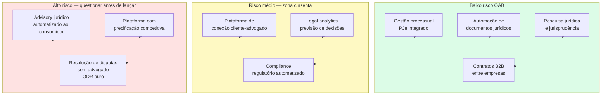

> [!note] A linha tênue do advisory automatizado
> Sistemas que respondem perguntas jurídicas ao consumidor final (como DoNotPay nos EUA) operam em zona de alto risco no Brasil. A OAB interpreta isso como exercício ilegal da profissão. O caminho mais seguro é o sistema apresentar a resposta como "informação educacional" e recomendar consulta a advogado — o que limita muito o valor percebido pelo usuário.

---

### Segmentos em detalhe

#### 1. Automação de documentos

O segmento mais maduro e menos controverso. Ferramentas que permitem gerar contratos, petições e pareceres a partir de templates com variáveis dinâmicas.

O modelo de receita predominante é SaaS (R$ 200–2.000/mês por escritório, dependendo do volume). O comprador é o escritório ou departamento jurídico de empresa — não o advogado individual.

A Contraktor opera no segmento de contratos B2B: qualquer empresa pode criar, enviar e assinar contratos digitalmente sem envolver advogado. O produto não presta serviço jurídico — apenas automatiza a operação documental.

#### 2. Gestão de processos e integração com PJe

O PJe (Processo Judicial Eletrônico) é o sistema oficial de tramitação processual na maior parte dos tribunais federais e estaduais. Tem API parcialmente documentada e padrões de integração variáveis por tribunal.

Startups como Projuris e 99Juris constroem cima do PJe e outros sistemas tribunalícios para dar ao escritório uma visão unificada dos processos, com alertas de prazos e automação de tarefas.

O risco técnico é a instabilidade e fragmentação dos sistemas dos tribunais — cada TJ (Tribunal de Justiça estadual) tem sua própria implementação, com diferenças relevantes de formato e protocolo.

> [!warning] Scraping de dados processuais
> Extrair dados processuais via scraping dos portais dos tribunais viola os termos de uso da maioria deles. Tribunais como o TJSP e o TRF proibiram explicitamente acesso automatizado não autorizado. Além do risco jurídico, a dependência de scraping cria fragilidade técnica: mudança de layout derruba o produto. Use as APIs oficiais onde existirem e monitore os termos de cada tribunal.

#### 3. Pesquisa jurídica e legal analytics

O JusBrasil construiu a maior base de jurisprudência e legislação do Brasil, com acesso freemium para advogados e estudantes. O modelo de receita é SaaS para escritórios e assinaturas premium.

Legal analytics — prever probabilidade de sucesso em determinado tipo de demanda com base em histórico de decisões do tribunal ou do juiz — é segmento mais sofisticado. Empresas como Nerit e Tikal Tech operam nesse espaço com machine learning aplicado a dados de processos.

Risco: dados processuais com partes identificadas podem conter informações pessoais sensíveis. A LGPD se aplica ao tratamento dessas informações — mesmo que sejam públicas nos autos, seu reuso em base de dados estruturada exige base legal.

#### 4. Contratos inteligentes e blockchain

Contratos autoexecutáveis em blockchain têm uso limitado no direito civil brasileiro. O Código Civil exige para muitos atos jurídicos forma específica (escritura pública, testemunhas, registro). Um smart contract não substitui escritura pública de compra de imóvel.

O uso prático no Brasil está em contratos B2B de execução simples (pagamento automático ao atingir milestone mensurável on-chain) e em instrumentos financeiros tokenizados (ver [[IGNICAO-Vol-5-Financas-e-Captacao#CAPÍTULO 14 — CAPTAÇÃO ALTERNATIVA DIGITAL: EQUITY CROWDFUNDING (CVM 88) E TOKENIZAÇÃO DE ATIVOS|Capítulo 14 (Captação Alternativa Digital: Equity Crowdfunding (CVM 88) e Tokenização de Ativos) (Vol. 5)]] — security tokens e instrumentos financeiros tokenizados).

#### 5. Compliance regulatório automatizado

Ferramentas que monitoram publicações do Diário Oficial, CVM, Banco Central, ANATEL, ANVISA e demais reguladores e alertam a empresa sobre mudanças relevantes.

Segmento B2B com ticket médio alto (R$ 2.000–20.000/mês). Comprador é o jurídico ou o compliance de empresas médias e grandes. Ciclo de vendas longo mas churn baixo.

A Nerit opera nesse espaço com monitoramento regulatório automatizado para empresas reguladas.

#### 6. Acesso à Justiça e ODR

Online Dispute Resolution: resolução de disputas de forma digital, sem necessidade de processo judicial. Aplicável a disputas de consumo, contratos comerciais simples e cobranças.

No Brasil, câmaras arbitrais e câmaras de mediação operam nesse espaço (parcialmente). A arbitragem tem base legal sólida (Lei 9.307/96 — Lei de Arbitragem). A mediação extrajudicial foi regulamentada pela Lei 13.140/2015.

O risco do ODR puro (sem advogado) é que consumidores desassistidos juridicamente podem aceitar acordos desfavoráveis. A OAB critica modelos que excluem advogados da equação como contrários ao interesse do jurisdicionado.

---

### Tabela: modelos de negócio legaltech

| Modelo | Quem compra | Risco OAB | Ticket médio mensal |
|---|---|---|---|
| SaaS gestão processual | Escritório / Depto. jurídico | Baixo | R$ 500–5.000 |
| Automação de documentos | Empresa B2B / Escritório | Baixo | R$ 200–3.000 |
| Pesquisa jurídica / analytics | Advogado / Escritório | Baixo | R$ 100–2.000 |
| Compliance regulatório | Empresa regulada (médio/grande) | Baixo | R$ 2.000–20.000 |
| Conexão cliente-advogado | Consumidor final | Médio-alto | R$ 0 (comissão) |
| Advisory jurídico automatizado | Consumidor final / PME | Alto | R$ 50–500 |
| ODR sem advogado | Consumidor / Empresa | Alto | % do acordo |
| LegalOps corporativo | Jurídico corporativo enterprise | Baixo | R$ 5.000–50.000 |

---

### Lições da Trincheira Jurídica Brasileira: Como Dados Judiciais, Acordos Online e Securitização de Precatórios Viraram Gigantes

#### JusBrasil — a maior base jurídica do Brasil

Começou como agregador de jurisprudência gratuito e construiu audiência massiva (mais de 8 milhões de usuários mensais em 2023). Monetiza via planos premium para advogados com funcionalidades de pesquisa avançada e alertas de processos.

O modelo freemium com audiência massiva cria barreira de dados: quanto mais decisões, mais relevante a base; quanto mais relevante a base, mais usuários.

#### Projuris — gestão processual para escritórios médios

SaaS de gestão de processos com integração a múltiplos tribunais. Posicionado para escritórios de 10–200 advogados que precisam de controle de prazos e dashboards de carteira.

O desafio é a fragmentação dos tribunais: o produto precisa manter integração com dezenas de sistemas com padrões distintos, o que cria custo de engenharia contínuo.

#### Contraktor — contratos sem dor de cabeça

Foco em PMEs que precisam criar, enviar e assinar contratos sem envolver advogado para cada operação. O produto é B2B e evita deliberadamente a prestação de serviço jurídico — vende eficiência operacional, não assessoria.

Essa posição deliberada (ferramenta, não advogado digital) é o que mantém o modelo fora do radar da OAB.

#### 99Juris — analytics jurídico

Foco em analytics processual para empresas com grande volume de litígios (bancos, seguradoras, telecom). Permite identificar padrões de sucesso/fracasso por tipo de demanda, comarca, juiz. Orientado ao jurídico corporativo, não ao escritório de advocacia.

#### Jurídico Certo — acesso à Justiça com advogados reais

Plataforma que conecta consumidores a advogados para consultas e contratos simples. O modelo evita o "leilão de preços" proibido pela OAB ao focar em matching por especialidade e deixar o advogado definir seus honorários de forma autônoma.

---

### Referências internacionais — o que adapta ao Brasil

#### LegalZoom (EUA)

Documentos jurídicos padronizados para pessoa física e pequena empresa: abertura de empresa, testamento, divórcio não contestado. Opera em estados onde o exercício da advocacia é menos restrito.

**O que não adapta ao Brasil:** a OAB proibiria o serviço de elaboração de documentos jurídicos sem advogado responsável. O modelo de LegalZoom no Brasil precisaria ter advogados como responsáveis técnicos pelos documentos gerados.

**O que adapta:** a ideia de produtos jurídicos padronizados a preço acessível para demandas repetitivas tem mercado. Com advogados no backend (como prestadores de revisão), é possível criar algo análogo.

#### DoNotPay (EUA)

"O primeiro advogado robô": sistema de IA que orienta consumidores em disputas simples (multas, cancelamentos, chargebacks). Cresceu como curiosidade tecnológica, mas enfrentou questionamentos sobre exercício ilegal da advocacia.

**O que não adapta ao Brasil:** advisory jurídico automatizado ao consumidor final enfrenta oposição direta da OAB e enquadramento como exercício ilegal da profissão.

**O que adapta:** a ideia de guiar o usuário no processo (não praticar o ato jurídico por ele) tem aplicação. Ferramentas de orientação para Juizado Especial Cível (JEC — pequenas causas) que informam sobre direitos e documentação necessária operam nessa linha com menor risco.

> [!tip] A regra prática
> No Brasil, o ponto de segurança é: a ferramenta pode informar, organizar e automatizar. Quando a ferramenta começa a **recomendar** o que o usuário deve fazer juridicamente no caso específico dele, entra na zona de risco de exercício ilegal da profissão. A diferença entre "isso é o que a lei diz" e "isso é o que você deve fazer no seu caso" é a fronteira que a OAB monitora.

---

### A Revolução do LegalOps: Quando o Departamento Jurídico Passa a Ser Gerido por Métricas Financeiras de Eficiência

LegalOps (Legal Operations) é a gestão profissional do departamento jurídico de uma empresa como unidade de negócio — com métricas, orçamento controlado, processos documentados e tecnologia.

Nos EUA, a função de CLO (Chief Legal Officer) evoluiu para incluir um COO jurídico ou um LegalOps Manager dedicado. No Brasil, o movimento chegou com atraso mas está acelerando em empresas de médio porte que cresceram rápido e precisam profissionalizar o jurídico.

O que um departamento jurídico compra em LegalOps:

- **Contratos:** criação, aprovação, assinatura, arquivo e renovação automatizados. Ferramentas como Ironclad (EUA) e Contraktor (Brasil) atacam esse segmento
- **Gestão de advogados externos:** painéis de controle de horas faturadas, aprovação de notas, comparativo de custo por tipo de demanda e por escritório. Empresas com R$ 1M+/ano em honorários externos têm ROI direto nesse controle
- **Compliance normativo:** monitoramento de mudanças regulatórias e alertas automáticos. Crítico para setores regulados (saúde, financeiro, telecomunicações, alimentos)
- **Matter management:** gestão centralizada de todos os assuntos jurídicos ativos, com status, responsável, prazo e custo acumulado
- **eBilling:** faturamento eletrônico padronizado de escritórios externos, com validação automática de UTBMS (códigos de atividade jurídica) — padrão ainda pouco adotado no Brasil mas com crescimento

O ticket médio para soluções de LegalOps corporativo varia de R$ 3.000 a R$ 50.000/mês dependendo do porte do departamento jurídico e dos módulos contratados. O ciclo de vendas é longo (6–12 meses para grandes empresas) mas o churn é baixíssimo — departamentos jurídicos têm alta resistência à troca de sistema depois que os processos estão integrados.

> [!note] Oportunidade de expansão
> O mercado de LegalOps ainda é pouco desenvolvido no Brasil comparado aos EUA e Europa. As grandes empresas brasileiras (especialmente as de capital aberto, que têm CVM para responder) são o alvo natural. Fintechs, healthtechs e empresas de e-commerce que cresceram rápido e agora precisam de governança jurídica são o mercado emergente.

---

### IA Jurídica sem Alucinação: Jurisprudência Vinculada, Auditoria de Citações (CNJ) e Triagem de Iniciais em Escala

A chegada de modelos de linguagem de grande porte (LLMs) abriu uma nova camada de possibilidades e riscos para o setor jurídico.

**O que os LLMs fazem bem em contexto jurídico:**

- Sumarização de contratos longos e extração de cláusulas relevantes
- Geração de minutas a partir de parâmetros fornecidos
- Pesquisa de jurisprudência com síntese dos fundamentos recorrentes
- Revisão de documentos para identificar inconsistências e cláusulas ausentes
- Tradução jurídica (contratos internacionais, due diligence cross-border)

**O que os LLMs fazem mal e que o produto não pode prometer:**

- Precisão factual em jurisprudência recente (alucinações são frequentes em referências específicas de acórdãos)
- Raciocínio estratégico sobre o caso concreto (o LLM não conhece o histórico processual completo nem o perfil do juiz)
- Garantia de que o resultado da ação será aquele previsto (o que a OAB já proibia antes dos LLMs)

A forma responsável de integrar IA a produtos jurídicos no Brasil é como ferramenta de **aumento de produtividade do advogado**, não como substituto. O advogado revisa, valida e assina. A IA gera o rascunho, pesquisa os precedentes e alerta sobre inconsistências.

Startups que vendem "IA que substitui advogado" como proposição de valor enfrentam resistência da OAB e, mais importante, responsabilidade quando o output do sistema estiver errado.

---

### Cruzar a Linha de Captação de Clientes da OAB, Quebra de Captcha/Crawlers nos Tribunais e Alucinação de Súmulas em Petições

**1. Subestimar a OAB como regulador ativo**

A OAB tem Conselho Federal e 27 seccionais estaduais. Quando um modelo de negócio ameaça a renda dos advogados, a OAB reage. Isso não é burocracia passiva — é pressão ativa com poder de interdição.

**2. Tentar substituir o advogado em vez de equipá-lo**

As legatechs que cresceram no Brasil equipam advogados. As que tentaram substituí-los esbarraram em resistência regulatória e cultural. O advogado é simultaneamente o regulador (via OAB), o canal de distribuição e, em muitos casos, o usuário final. Competir com ele raramente termina bem.

**3. Dependência de scraping de tribunais**

Além do risco jurídico (violação de termos de uso), scraping cria dependência técnica frágil. Mudança de layout derruba o produto. Crescimento de usuários sobrecarrega o site do tribunal e pode gerar bloqueio de IP. O caminho correto é pressionar por APIs abertas (movimento que está evoluindo no CNJ) e usar as APIs disponíveis.

**4. LGPD e dados processuais**

Processos judiciais são públicos, mas os dados das partes têm proteção da LGPD. Construir base de dados com CPF, endereço, situação processual de pessoas físicas sem base legal adequada é risco real de autuação pela ANPD.

**5. Ciclo de vendas para escritórios**

Escritórios de advocacia tradicionais têm ciclo de vendas longo, decisão por sócio-sênior e resistência cultural a mudanças de processo. Startups que projetam crescimento rápido em escritórios tradicionais frequentemente se frustram. O crescimento mais rápido está em departamentos jurídicos corporativos e em escritórios jovens.

---

---

### Filtro de Entrada na Trincheira: Você Deve Entrar Neste Jogo?

Antes de lançar uma Legaltech ou operação de créditos judiciais no mercado brasileiro, responda sem rodeios:

1. **O Teste de Blindagem da OAB:** Sua empresa vende tecnologia, dados ou compra direitos creditórios legítimos (Cessão de Crédito no Código Civil), ou cobra comissão sobre honorários advocatícios prometendo "causa ganha" no varejo?
2. **Advogado Autônomo vs. CFO/LegalOps:** Seu modelo depende de cobrar R$ 99/mês de pequenos escritórios (alto *churn*), ou vende para departamentos jurídicos corporativos e grandes bancas onde sua ferramenta economiza milhões em provisões e revelias?
3. **Zero Alucinação Jurisprudencial:** Se seu produto usa IA generativa para redigir peças, toda citação de lei ou acórdão possui link verificável na base oficial do tribunal para evitar multas por litigância de má-fé?

**O Movimento de Segunda-Feira:** Nos próximos 15 dias, entreviste cinco gerentes de *LegalOps* de grandes empresas e dois gestores de fundos de *Special Situations* para mapear onde eles perdem mais horas e dinheiro.


---

# CLUSTER V — VAREJO, ALIMENTAÇÃO, BENS DE CONSUMO (D2C), TURISMO, PET, LONGEVIDADE E SETOR FUNERÁRIO/ASSISTENCIAL (CAPÍTULOS 34 A 38)

Estes 5 playbooks dissecam o comércio, a alimentação, as marcas nativas e os serviços recorrentes às famílias brasileiras: Retailtech e E-Commerce Omnichannel, Foodtech e Food Service, Marcas D2C, Beleza, Moda e Wellness, Traveltech, Eventos, PetTech e Economia da Longevidade (*Silver Economy*), e a máquina anticíclica do Setor Funerário, Cemitérios, Planos de Assistência Familiar e *DeathTech*.

---

## CAPÍTULO 34 — RETAILTECH, E-COMMERCE, OMNICHANNEL, SOCIAL COMMERCE E DIGITALIZAÇÃO DO VAREJO FÍSICO

### A Regra Invisível do Jogo: No Varejo Brasileiro, Quem Subsidia GMV Quebra; Quem Domina o Balcão, o Estoque e o Retail Media Fica Rico

Quando olha para o comércio varejista brasileiro, o fundador "turista" confunde movimentação de mercadoria (*GMV*) com receita real. Ele cria um marketplace B2B para pequenos mercados de bairro, compra mercadoria da indústria, vende pelo mesmo preço para ganhar participação, subsidia a entrega com dinheiro de investidores e oferece trinta dias no boleto sem conhecer o risco daquele CNPJ. Em menos de dezoito meses, entre roubo de carga, devoluções, ruptura e inadimplência, a margem de contribuição fica negativa em cada pedido — e quanto mais a startup cresce, mais rápido quebra.

O veterano de trincheira entende uma verdade estrutural sobre o Brasil: mais de 80% do consumo das famílias ainda passa pelo ponto de venda físico, e o varejista brasileiro trabalha com margens líquidas estreitas (2% a 5% nos supermercados). Ele não compra tecnologia por "inovação"; compra por sobrevivência de caixa.

No varejo brasileiro, a vitória pertence a quem domina **A Trindade da Ruptura Zero, da Conversão no WhatsApp e do Retail Media**: as Retailtechs mais lucrativas do país não carregam estoque comoditizado no balanço — vendem o software que impede a gôndola de ficar sem o produto campeão no sábado à tarde (previsão de demanda e prevenção de perdas), que equipa os vendedores de loja física com *clienteling* via WhatsApp ou que transforma o tráfego físico e digital do varejista em uma máquina de publicidade de 80% de margem bruta paga pela indústria (*Retail Media*).

---

> [!note] Síntese Executiva da Vertical
> O varejo brasileiro movimenta mais de R$ 2,8 trilhões por ano, dos quais o e-commerce já responde por 12% a 15% (ultrapassando R$ 350 bilhões anuais de GMV), mas onde **85% do consumo ainda ocorre dentro da loja física — cada vez mais influenciado ou iniciado no celular, especialmente via WhatsApp e redes sociais**. Empreender em RetailTech no Brasil não é criar "mais uma loja virtual", e sim construir a infraestrutura de software, pagamentos, logística, dados e automação conversacional que conecta o estoque da loja de rua, o centro de distribuição, o *marketplace* e o WhatsApp do vendedor em uma única operação lucrativa.

---

### 1. A transformação estrutural do varejo brasileiro: do canal isolado ao comércio unificado

Durante a década de 2010, o varejo brasileiro operou sob uma esquizofrenia operacional: o e-commerce da marca era tratado como uma filial isolada em um galpão em Extrema (MG) ou Cajamar (SP), competindo contra as lojas físicas da própria rede, com estoques separados, sistemas fiscais incompatíveis e conflito de comissão entre o vendedor da loja de shopping e o site.

Na década de 2020, três forças colapsaram essa separação e redesenharam o mapa de oportunidades para startups de RetailTech no Brasil:

1. **Unificação de Estoque e OMS (*Order Management System*):** A loja física deixou de ser apenas ponto de exposição e passou a funcionar como **mini-hub logístico urbano (*Ship-from-Store* e *Pick-up in Store / Clique e Retire*)**. Um sistema OMS moderno roteiriza o pedido feito no aplicativo para a loja física situada a 2 km do cliente, reduzindo o frete pela metade, entregando em 2 horas e evitando a perda da venda por ruptura de tamanho ou cor no CD central.
2. **Conversational Commerce e Social Commerce no WhatsApp:** Com o WhatsApp presente em 99% dos smartphones brasileiros, o comércio conversacional deixou de ser "vendedor mandando foto pelo celular pessoal" para se tornar um canal estruturado com catálogos integrados ao ERP, carrinhos de compra dentro do chat, links de pagamento via PIX/cartão com *split* automático de comissão para o vendedor da loja e agentes de IA que recuperam carrinhos abandonados com taxas de conversão 3x a 5x maiores que o e-mail marketing tradicional.
3. **Concentração nos Grandes Marketplaces e a Reação do D2C + B2B:** Enquanto Mercado Livre, Shopee, Amazon, Magalu e Shein concentram mais de 70% do tráfego de busca de produtos no Brasil, dezenas de milhares de marcas próprias, indústrias e varejistas médios buscam tecnologias para construir canais próprios rentáveis (via plataformas como **VTEX**, **Nuvemshop** e **Wake**) ou para plugar seus estoques simultaneamente em dez *marketplaces* sem perder o controle de margem e conciliação financeira (via integradores e *hubs* como **Olist**, **Bling** e **ANYMARKET**).

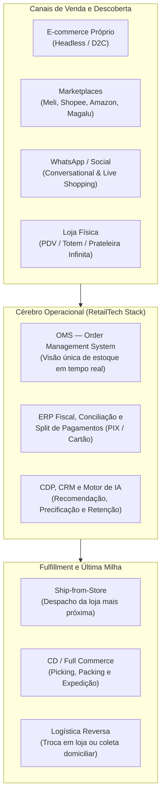

---

### 2. Os quatro blocos de oportunidade para startups de RetailTech

#### 2.1 Plataformas de E-commerce, Headless Commerce, PDV na Nuvem e OMS
O coração transacional do varejo moderno divide-se por porte de cliente. No *Enterprise* e *Upper Mid-Market*, a arquitetura dominante é o **Composable / Headless Commerce** (onde o *front-end* de experiência do usuário é desacoplado do *back-end* de catálogo, carrinho, promoções e OMS via APIs, especialidade que levou a brasileira **VTEX** ao IPO na NYSE e impulsionou plataformas como **Wake**). No segmento de PMEs e marcas nativas digitais, a vitória pertence à simplicidade de *setup*, ecossistema de aplicativos plugáveis e meios de pagamento/frete nativos (como a **Nuvemshop**, que se tornou unicórnio atendendo mais de 120 mil lojistas na América Latina). Já na loja física, a substituição dos antigos sistemas de frente de caixa (PDV/POS) instalados em servidores locais Windows por **PDVs 100% em nuvem e *mobile POS*** (rodando em tablets e maquininhas *smart POS* Android com emissão de NFC-e/SAT) permite que o vendedor consulte o estoque de toda a rede, venda itens que não estão naquela filial (*prateleira infinita*) e finalize o pagamento sem fila no caixa tradicional — território disputado pela gigante consolidada **Linx** (adquirida pela Stone) e por entrantes ágeis de nicho como **IzzyWay** (focada em supermercados e alimentação) e **Cigam/Millennium**.

#### 2.2 Infraestrutura de Habilitação do E-commerce (Conversion, Checkout, IA, Pós-Venda e Full Commerce)
Ao redor da plataforma central de e-commerce gravita um ecossistema rico de ferramentas SaaS B2B que vendem sob a promessa direta de **aumentar a receita ou reduzir o custo operacional do lojista**:
- **Checkout Transparente de 1 Clique, Prevenção a Fraude e Orquestração de Pagamentos:** No Brasil, a taxa média de abandono de carrinho supera 75%, e a taxa de falso-positivo em antifraudes de cartão de crédito pode recusar de 8% a 15% dos pedidos legítimos. Soluções que otimizam o checkout, oferecem PIX com confirmação em 2 segundos, recuperam transações negadas via retentativa multi-adquirente e embarcam serviços financeiros (*Embedded Finance*, como a **Zoop**, do grupo iFood) capturam *take rate* sobre o TPV.
- **Busca Inteligente, Recomendação por IA e *Retail Media*:** Motores de busca com processamento de linguagem natural (que entendem os erros de digitação do consumidor brasileiro), vitrines personalizadas em tempo real e plataformas de **Retail Media Ads** (que permitem a grandes varejistas e farmácias venderem espaços patrocinados de busca em seus próprios sites e aplicativos para a indústria de bens de consumo, com margens brutas acima de 80%).
- **Logística Reversa, Trocas e Pós-Venda Automatizado:** No varejo de moda e calçados online, a taxa de devolução e troca varia de 12% a 28%. Startups que transformam o processo traumático de devolução nos Correios em um fluxo self-service que incentiva o cliente a usar o crédito na compra de um produto de valor maior (ou trocar na loja física mais próxima, gerando tráfego qualificado de *upsell*) protegem a margem líquida do varejista.
- **Full Commerce B2B:** Empresas como a **Infracommerce** operam a pilha completa (plataforma, SAC, armazém, *fulfillment*, meios de pagamento e entrega) para grandes indústrias multinacionais (Nike, Unilever, L'Oréal, Samsung) que querem vender direto ao consumidor (B2C) ou direto ao pequeno varejo (B2B) sem montar operação logística de varejo dentro de casa.

#### 2.3 Digitalização do Varejo Físico: Gôndola, Ruptura, Precificação Dinâmica e Visão Computacional
O maior ralo invisível de dinheiro no varejo físico brasileiro (especialmente supermercados, atacarejos, farmácias e lojas de material de construção) é a **ruptura de gôndola** — que chega a 8%–12% do faturamento perdido quando o produto está no depósito dos fundos da loja ou no CD, mas não está exposto na prateleira — somada à **quebra operacional e vencimento de perecíveis** (1,8% a 3,5% da receita bruta). Startups brasileiras estão atacando esse problema com:
- **Sensores, Visão Computacional e Auditoria de Ponto de Venda (*Crowdsourcing* ou Câmeras):** Monitoramento de execução de ponto de venda (*planograma*, *share of shelf*, falta de etiqueta de preço) para a indústria de bens de consumo e redes varejistas (ex.: ** Involves**, ** Solinftec Retail / startups de computer vision**).
- **Precificação Dinâmica (*Dynamic Pricing*) e Inteligência Competitiva:** Motores algorítmicos que monitoram preços de concorrentes regionais, elasticidade-preço por SKU e data de validade do lote para ajustar automaticamente os preços no e-commerce e nas etiquetas eletrônicas de prateleira (*Electronic Shelf Labels — ESL*), evitando que o supermercado jogue fora laticínios e carnes próximos ao vencimento.
- **CRM de Varejo Físico, *Cashback* e *Clienteling*:** Ferramentas que identificam o cliente pelo CPF no caixa (programas de fidelidade e clubes de desconto obrigatórios no atacarejo moderno) e abastecem os vendedores de lojas de moda/shopping com listas diárias de clientes no WhatsApp prontos para recompra (*clienteling* — ex.: **Oto**, **Dito**, **Bonus**, **CRMBonus**).

#### 2.4 Marketplaces B2B e Digitalização do Varejo de Vizinhança
O Brasil possui mais de 600 mil pequenos mercados de bairro, mercearias, padarias, lojas de cosméticos, depósitos de construção e pet shops independentes. Historicamente, esses pequenos comerciantes dependiam da visita semanal presencial do representante comercial de cada distribuidora, comprando no caderno ou no boleto com pouca transparência de preço. Os **Marketplaces B2B e plataformas de e-B2B** digitalizaram o abastecimento desse varejo independente, permitindo que o dono do mercadinho compare preços de dezenas de indústrias e distribuidores pelo celular às 22h e acesse linhas de crédito de capital de giro (*Buy Now, Pay Later* B2B) baseadas em seu volume de emissões de notas fiscais.

---

### 3. Unit economics de RetailTech: onde o dinheiro é ganho e onde ele evapora

Em RetailTech, é fundamental distinguir se a sua startup é um **provedor de tecnologia para o varejo (SaaS / Infraestrutura / Take Rate)** ou se você **opera varejo e carrega estoque/logística no próprio balanço (E-commerce / Marketplace / Full Commerce)**.

As métricas que todo fundador e investidor de RetailTech audita semanalmente são:

1. **GMV (*Gross Merchandise Volume*) vs. Receita Líquida (*Net Revenue*):** GMV é o volume total transacionado; **GMV não paga salário**. Se você é plataforma ou marketplace, sua receita bruta é **GMV × Take Rate** (tipicamente 0,8% a 2,5% em plataformas de e-commerce SaaS+TPV, e 10% a 22% em marketplaces B2C com logística inclusa).
2. **AOV (*Average Order Value* / Ticket Médio) e Custo de *Fulfillment* por Pedido:** No Brasil, um pedido de e-commerce com ticket médio abaixo de R$ 90 enviado por transportadora individual quase nunca fecha a conta sem cobrança de frete ou subsídio cruzado, porque o custo de *picking/packing* (R$ 4 a R$ 9) + embalagem (R$ 2 a R$ 4) + frete de última milha (R$ 14 a R$ 28) consome toda a margem bruta do produto.
3. **ROAS (*Return on Ad Spend*), CAC e Taxa de Conversão de Sessão:** A taxa média de conversão do e-commerce brasileiro gira em torno de **1,2% a 2,2%** (subindo para 3,5%–5,0% em nichos recorrentes ou via WhatsApp assistido). Com o encarecimento estrutural do leilão de mídia na Meta e no Google, o CAC do primeiro pedido frequentemente empata ou supera a margem de contribuição da primeira compra, exigindo que a conta feche via **recompra orgânica (LTV de 12 meses)** ou **aumento de cesta (*cross-sell* / kits)**.
4. **Net Revenue Retention (NRR) em SaaS de Varejo:** As melhores plataformas de RetailTech (como VTEX, Nuvemshop e Zoop) combinam uma assinatura mensal fixa (MRR) com uma alíquota variável sobre o GMV ou TPV processado pelo lojista. Isso gera um **NRR estruturalmente superior a 110%–125%**: conforme o lojista cresce na Black Friday, no Natal ou pela inflação natural dos produtos, a receita da startup cresce automaticamente sem precisar de novo esforço de venda.

#### Tabela de Benchmarks e Unit Economics de RetailTech no Brasil

| Subvertical de RetailTech | Modelo de Monetização | Take Rate / Ticket Médio | Margem Bruta da Startup | NRR / Retenção Típica | Métrica de Eficiência Principal | Casos Brasileiros de Referência |
|---|---|---|---|---|---|---|
| **Plataforma de E-commerce Enterprise / Mid-Market** | Mensalidade fixa (SaaS) + % sobre o GMV excedente | R$ 5k a R$ 80k/mês + 0,5% a 2,0% do GMV | 70% a 80% | NRR de 110% a 125% a.a.; Churn anual < 6% | *CAC Payback* (12–18 meses) e GMV por cliente | VTEX, Wake, Linx Commerce |
| **Plataforma de E-commerce PME / Social Sellers** | Assinatura mensal acessível + *take rate* em pagamentos e frete | R$ 60 a R$ 400/mês + 1% a 3% em TPV/Envios | 68% a 78% | GRR de 75%–85% (compensado por expansão de TPV) | *Attach rate* de pagamentos e logística (Nuvem Pago / Envios) | Nuvemshop, Loja Integrada, Bagy |
| **Habilitadores de Marketplace / Store-in-Store** | Assinatura SaaS + comissão sobre vendas nos canais | R$ 200 a R$ 1.500/mês + 2% a 8% de comissão | 60% a 75% | NRR de 100% a 115% | GMV por *seller* ativo e SLA de postagem (< 24h) | Olist, ANYMARKET, Plugg.to |
| **SaaS de PDV / ERP / Fidelidade para Loja Física** | SaaS mensal por loja/CNPJ ou por terminal PDV ativo | R$ 350 a R$ 3.500 / loja / mês + *spread* de TPV | 72% a 85% | Churn mensal < 1,2%; NRR > 108% | TPV capturado por loja e ROI de recompra via CRM | Linx, IzzyWay, CRMBonus, Dito, Oto |
| **Embedded Payments / Orquestração para Varejo** | *Spread* líquido (*Net MDR*) + antecipação de recebíveis (RAV) | 0,40% a 1,80% líquido sobre o TPV processado | 45% a 65% (sobre receita líquida) | NRR de 115% a 135% | TPV processado, perda por *chargeback* e custo de funding | Zoop, Pagar.me, Tuna, Asaas |
| **Full Commerce B2B2C (Operação Completa)** | Taxa de gestão mensal + % do GMV faturado + *fulfillment* | 12% a 22% do GMV (incluindo operação logística) | 25% a 40% | Contratos de 24 a 36 meses | Custo de *fulfillment* por pedido e giro de estoque | Infracommerce, Synapcom |

---

### 4. Casos reais brasileiros: da garagem à bolsa e ao domínio continental

> [!example] Caso 1: VTEX — Como uma empresa brasileira venceu gigantes globais no e-commerce Enterprise
> Fundada no Rio de Janeiro por Geraldo Thomaz e Mariano Gomide, a **VTEX** não tentou competir fazendo sites baratos para microempresas; ela atacou a dor mais complexa das grandes redes varejistas e indústrias brasileiras (como Magazine Luiza, C&A, Carrefour, Sony, Whirlpool e Ambev): operar múltiplos estoques, franquias, lojas físicas e *marketplaces* sob a complexidade tributária brasileira (ICMS interestadual, substituição tributária) com uma arquitetura multi-tenant em nuvem e *checkout* sem senha (*SmartCheckout*). Ao transformar cada cliente grande em um operador de *marketplace* próprio (*VTEX Collaborative Commerce*) e cobrar uma parcela percentual do GMV transacionado, a VTEX cresceu junto com a digitalização do varejo latino-americano, expandiu para mais de 40 países e realizou seu IPO na Bolsa de Nova York (NYSE: VTEX).

> [!example] Caso 2: Nuvemshop e Olist — A inclusão digital e logística da PME brasileira
> Na outra ponta da pirâmide, a **Nuvemshop** compreendeu que o empreendedor brasileiro de moda, acessórios e nichos queria independência das taxas de 16% a 20% dos grandes *marketplaces*, mas precisava de uma plataforma onde pudesse criar sua loja em uma tarde, integrar com o Instagram/WhatsApp e já ter meio de pagamento (**Nuvem Pago**) e contrato de frete mais barato que o balcão dos Correios (**Nuvem Envios**) nativos no painel. Já o **Olist** (fundado por Tiago Dalvi em Curitiba) resolveu o problema inverso: pequenos lojistas e pequenas indústrias tinham bom produto e estoque, mas não tinham reputação digital nem tráfego para aparecer na primeira página do Mercado Livre ou da Amazon. Ao criar uma "megaloja oficial" de altíssima reputação dentro dos *marketplaces* e agregar milhares de pequenos lojistas por trás dessa reputação única (evoluindo depois para uma plataforma completa de comércio, ERP com a aquisição da Tiny e logística com a PAX), o Olist tornou-se um dos principais unicórnios de RetailTech do país.

> [!example] Caso 3: Linx, Zoop e IzzyWay — O poder do software colado na transação física
> A história da **Linx** — que atingiu liderança absoluta em software de gestão e PDV para o varejo físico brasileiro em dezenas de verticais (moda, postos de combustível, farmácias, alimentação) e protagonizou em 2020 uma disputa bilionária de aquisição na B3 vencida pela **Stone** por mais de R$ 6 bilhões — provou a tese mais importante de RetailTech no Brasil: **quem controla a tela do caixa (PDV) e o sistema de gestão da loja controla o roteamento do pagamento e o acesso aos dados de crédito do varejista**. Esse mesmo racional impulsionou a **Zoop** (infraestrutura de *embedded payments* e *banking* para plataformas de varejo, adquirida pelo grupo iFood) e o crescimento de especialistas regionais e verticais como a **IzzyWay** (nascida no Ceará e focada na digitalização completa de varejistas de alimentação e supermercados com simplicidade extrema na nuvem).

---

### 5. Armadilhas fatais em RetailTech

1. **Tentar criar um "Marketplace B2C Generalista do Zero" contra Mercado Livre e Shopee:** Nenhum fundo de Venture Capital são financiará hoje uma startup cujo plano seja comprar tráfego no Google para vender eletrônicos, utilidades domésticas ou roupas genéricas competindo de frente com empresas que têm malha aérea própria, milhares de vans, *fulfillment* no mesmo dia e bilhões em caixa para subsidiar frete grátis. Marketplaces novos no Brasil só sobrevivem se forem **hiperverticais com assimetria técnica** (ex.: autopeças pesadas, insumos químicos/industriais, maquinário usado, moda circular de luxo com curadoria/autenticação) ou **B2B com crédito embarcado**.
2. **Construir uma ferramenta "vitamina" (Nice-to-Have) desconectada de GMV ou Margem:** Em épocas de juros altos e varejo pressionado, o diretor de e-commerce corta na primeira segunda-feira do trimestre todos os softwares periféricos (widgets visuais, pop-ups cosméticos, relatórios que ninguém abre). Sua solução precisa ser **missão crítica** (PDV, ERP, OMS, Checkout, Conciliação) ou provar **ROI incremental direto e mensurável por teste A/B** (ex.: "nosso motor de recuperação via WhatsApp gerou R$ 85.000 em vendas pagas líquidas neste mês e custou R$ 4.500").
3. **Subestimar o inferno das integrações legadas no varejo físico brasileiro:** O fundador cria uma solução brilhante de IA ou omnichannel, fecha contrato com uma rede de 80 lojas e descobre que as lojas rodam um ERP legado em Delphi/Cobol ou banco de dados local sem API documentada, mantido por uma software house regional que cobra caro e leva 4 meses para liberar um arquivo CSV. Sem uma camada própria de conectores prontos (*middlewares*, agentes sincronizadores de banco local ou leitura via notas fiscais XML da SEFAZ), o *onboarding* trava e o *churn* explode antes do *go-live*.
4. **Crescimento de GMV com Margem de Contribuição Negativa (Armadilha do Full Commerce e Logística):** Assumir operações físicas de armazenagem, separação e frete para clientes sem precificar corretamente devoluções, avarias, diferenças de inventário e picos sazonais (como a Black Friday, onde o volume multiplica por 5x em 48 horas e exige mão de obra temporária cara).

> [!tip] Checklist de Validação para Fundadores de RetailTech
> - [ ] O produto resolve uma dor ligada diretamente a **aumento de conversão/receita** ou **redução de ruptura/custo operacional/fraude**, comprovável em até 30 dias de teste?
> - [ ] A solução já possui conectores nativos (*plug-and-play*) com as principais plataformas de e-commerce (**VTEX, Nuvemshop, Shopify, Wake**) e ERPs brasileiros (**Bling, Tiny, Omie, TOTVS, Linx, Sankhya**)?
> - [ ] O modelo de precificação combina uma base recorrente fixa (SaaS) com uma variável atrelada ao sucesso do lojista (% de GMV, TPV ou volume de pedidos/mensagens), garantindo **NRR > 110%**?
> - [ ] Para soluções de loja física/PDV: o sistema funciona *offline-first* (contingência fiscal de NFC-e/SAT quando a internet da loja cai em pleno sábado de movimento)?
> - [ ] O canal de WhatsApp da solução utiliza a **API Oficial da Meta (WhatsApp Business Platform)** com gestão de *templates* e conformidade LGPD para evitar banimento do número do lojista?

---

### Filtro de Entrada na Trincheira: Você Deve Entrar Neste Jogo?

Antes de construir uma Retailtech para o comércio físico ou digital brasileiro, passe sua ideia por três perguntas de fogo:

1. **Software de Margem vs. Atacadista Disfarçado:** Sua empresa vende software, dados, pagamentos ou mídia de alta margem bruta (> 70%), ou compra e estoca mercadoria física no balanço para revender com margem bruta de 8% que não paga o frete?
2. **O Teste da Integração com PDV/ERP:** Sua solução já possui conectores homologados com os principais sistemas de frente de caixa e ERPs do varejo brasileiro (TOTVS/Linx, Sankhya, Omie, VTEX, Shopify), ou cada cliente exige três meses de integração manual?
3. **Verba da Indústria (Trade/Retail Media):** Você consegue fazer a indústria fabricante (CPG) financiar parte da conta via verba de *Trade Marketing* e *Retail Media*?

**O Movimento de Segunda-Feira:** Nos próximos 15 dias, passe um sábado inteiro no chão de loja e no estoque de três redes varejistas medindo quantas vendas são perdidas por produto presente no depósito mas ausente na gôndola.


---

## CAPÍTULO 35 — FOODTECH, FOOD SERVICE, DARK KITCHENS, SUPPLY CHAIN ALIMENTAR E NOVOS INGREDIENTES

### A Regra Invisível do Jogo: A Guerra pelo Prime Cost de 60% no Restaurante e a Densidade da Cadeia Fria

Todo empreendedor "turista" apaixonado por gastronomia sonha em revolucionar a alimentação no Brasil abrindo uma rede de cozinhas fantasmas (*dark kitchens*) dependente de aplicativos ou lançando um substituto vegetal (*plant-based*) três vezes mais caro que a carne bovina. Em dezoito meses, a matemática da comida esmaga o sonho: na *dark kitchen* sem canal próprio, depois de pagar 30% de CMV dos ingredientes, 25% de mão de obra e embalagens, 25% de comissão e entrega do aplicativo e 10% de anúncios para aparecer no topo da busca, sobra prejuízo líquido a cada pedido. E no *plant-based* caro, após a primeira compra por curiosidade, 90% dos consumidores voltam para o frango e a carne bovina por preço e sabor.

O veterano de trincheira sabe que o setor de alimentação (*Food Service* e *Foodtech*) no Brasil opera sob uma lei implacável: **A Regra de Ferro do Prime Cost (CMV + Mão de Obra ≤ 60%) e da Recompra Direta**.

Quem ganha dinheiro de verdade em Foodtech no Brasil atua em três frentes: (1) **o software vertical que devolve margem ao restaurante** (cardápio digital e CRM no WhatsApp que migram o cliente fiel do marketplace de 27% para o pedido direto de 2%, combinado com ficha técnica que trava o desperdício na cozinha); (2) **o abastecimento B2B e cadeia fria com densidade de rota**; e (3) **ingredientes funcionais B2B e fermentação tropical** que reduzem o custo de formulação para a indústria de alimentos.

---

> [!note] Síntese Executiva da Vertical
> A cadeia de alimentação fora do lar (*Food Service*), varejo alimentar e ciência de alimentos no Brasil movimenta mais de R$ 1 trilhão por ano e envolve mais de 1,5 milhão de estabelecimentos (restaurantes, bares, padarias, lanchonetes, pizzarias, *dark kitchens* e supermercados). No entanto, o setor opera sob uma equação operacional implacável: **perecibilidade diária do estoque, alta rotatividade de mão de obra, custo de mercadoria vendida (CMV) volátil e forte concentração do canal de demanda digital**. Empreender em Foodtech no Brasil exige escolher com precisão cirúrgica qual dos quatro elos da cadeia você vai atacar — e entender por que modelos que ignoram a margem de contribuição do restaurante ou a física da cadeia fria quebram rapidamente.

---

### 1. Os quatro elos da cadeia de Foodtech no Brasil

Para evitar o erro comum de colocar um software de cardápio digital e uma indústria de biotecnologia de proteínas na mesma planilha, dividimos o ecossistema brasileiro de Foodtech em quatro elos com dinâmicas próprias:

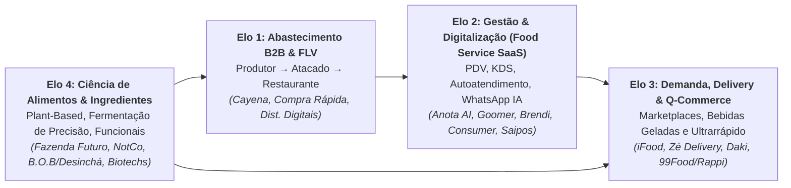

---

### 2. Elo 1 — Digitalização do Food Service e o "Desarmamento" da Taxa dos Marketplaces

O restaurante médio brasileiro vive um dilema existencial com os grandes *marketplaces* de entrega (liderados pelo **iFood**, que detém mais de 80% de *market share* de food delivery no país, seguido por Rappi e Aiqfome/Meli). Por um lado, o *marketplace* é uma vitrine indispensável de aquisição de novos clientes; por outro, as comissões de **12% (plano básico com entrega própria do restaurante) a 23%–27% (plano completo com entrega parceira do app)** somadas a taxas de pagamento e promoções subsidiadas esmagam a margem líquida de um restaurante cujo lucro operacional histórico gira entre 8% e 15%.

Essa dor estrutural criou uma das maiores oportunidades de **Vertical SaaS e Automação com IA** do Brasil: ajudar os restaurantes, pizzarias, hamburguerias e redes de franquias a **operar com eficiência industrial na cozinha e converter o cliente adquirido no marketplace para um canal direto próprio (WhatsApp, cardápio digital e salão) com comissão quase zero**. As frentes vencedoras incluem:

- **Agentes de IA para Atendimento e Vendas no WhatsApp e Cardápio Digital:** Quando o cliente pede uma pizza ou açaí na sexta-feira à noite pelo WhatsApp, o restaurante tradicional perdia vendas porque o atendente demorava 20 minutos para responder ou anotava o pedido errado. Startups como **Anota AI**, **Brendi** e **Goomer** automatizaram 100% dessa jornada: um agente conversacional recebe o pedido em texto ou áudio no WhatsApp, envia o cardápio digital interativo, faz *upsell* automático de bebida e sobremesa, calcula a taxa de entrega por raio/polígono, gera o código PIX Copia e Cola com baixa automática e injeta o pedido direto na impressora da cozinha ou no tela KDS (*Kitchen Display System*), além de reativar clientes inativos com campanhas inteligentes de CRM.
- **Autoatendimento em Salão (Totens, QR Code na Mesa e Tablets):** Com a escassez crônica de garçons e o peso dos encargos trabalhistas no *food service*, soluções de autoatendimento (pioneirizadas em escala pela **Goomer** e integradas por players de ERP como **Linx Degust**, **TOTVS Chef**, **Saipos** e **Consumer**) aumentam o ticket médio da mesa em 15% a 25% (porque o cliente vê fotos apetitosas e pede adicionais sem constrangimento) e reduzem o tempo de giro da mesa no horário de pico do almoço.
- **ERP de Restaurante, Ficha Técnica, Conciliação Financeira e Gestão de Motoboys:** O restaurante moderno recebe vendas de 4 canais diferentes, cartões de 5 bandeiras e vales-refeição (Alelo, Ticket, VR, Pluxee, Caju, Flash) com taxas altas e prazos de repasse distintos. Softwares que automatizam a **ficha técnica de insumos** (baixa automática de gramas de queijo e carne a cada hambúrguer vendido), fazem a **conciliação centavo a centavo** dos repasses dos apps e de vales-refeição e roteirizam o despacho de entregadores (*cloud dispatch* — como **Pick n Go / Box Delivery / Mottu**) tornam-se o coração insubstituível do estabelecimento.

---

### 3. Elo 2 — Supply Chain Alimentar B2B e Redução de Desperdício em FLV

Por trás de cada prato servido há uma cadeia caótica de compras. O dono de um restaurante independente ou padaria em São Paulo, Belo Horizonte ou Recife gasta de 10 a 15 horas por semana cotando preços no WhatsApp com 20 fornecedores diferentes (açougue, distribuidor de bebidas, laticínios, embalagens e CEASA para hortifrúti), lidando com entregas atrasadas, falta de padrão e prazos de pagamento curtos.

Startups como a **Cayena** transformaram esse processo em um **Marketplace B2B de insumos alimentares**: o restaurante faz um único pedido consolidado pelo celular até a meia-noite, escolhendo entre centenas de fornecedores homologados de proteínas, secos, laticínios e descartáveis, recebe tudo no dia seguinte com nível de serviço garantido e paga em boleto unificado com análise de crédito proprietária (*embedded lending*).

Já no segmento de **FLV (Frutas, Legumes e Verduras)**, o Brasil desperdiça entre 30% e 40% do que produz entre a porteira da fazenda, os entrepostos (CEASAs) e a gôndola do supermercado por falhas de classificação, embalagem precária, falta de refrigeração e excesso de intermediários. As Foodtechs de cadeia de suprimentos de frescos que sobrevivem no Brasil não são as que tentam montar galpões refrigerados caríssimos do zero para entregar 5 kg de tomate em cada barzinho (modelo que quebrou dezenas de startups na América Latina pelo custo logístico de fracionamento), mas sim aquelas que operam com **cross-docking ultrarrápido de giro diário (zero estoque parado), contratos de demanda agregada com redes de supermercados/cozinhas industriais ou comercialização de produtos "fora do padrão estético" (imperfeitos porém perfeitos para processamento em restaurantes e consumo doméstico)**.

---

### 4. Elo 3 — Q-Commerce, Bebidas Geladas e a Realidade das Dark Kitchens

O terceiro elo passou por uma depuração brutal entre 2021 e 2025, deixando aprendizados definitivos sobre a física econômica da entrega rápida no Brasil:

- **O Caso Zé Delivery (Inovação de Rede sobre Infraestrutura Existente):** Criado dentro da Ambev, o **Zé Delivery** tornou-se um dos maiores casos mundiais de *Direct-to-Consumer (D2C)* de bens de consumo ao resolver uma dor cultural brasileira: receber cerveja trincando de gelada em casa em menos de 30 minutos pelo preço do supermercado. O segredo genial do Zé Delivery é que a Ambev **não precisou alugar milhares de galpões nem comprar milhares de geladeiras próprias**: ela usou os próprios bares, depósitos de bebidas e distribuidores já espalhados a menos de 1,5 km de cada consumidor brasileiro como *dark stores* descentralizadas, roteirizando o pedido para o ponto parceiro mais próximo.
- **Q-Commerce (*Quick Commerce* de Mercado em 15 minutos — Daki):** O modelo de *dark stores* próprias dedicadas a entregas de supermercado em 15 minutos (onde a **Daki** consolidou a operação brasileira) provou que a conta só fecha em bairros de **altíssima densidade demográfica e renda alta** (como Pinheiros, Itaim Bibi, Jardins, Vila Mariana, Leblon, Savassi), combinada com três alavancas obrigatórias: (1) ticket médio elevado (acima de R$ 130–R$ 160 por cesta); (2) produtos de **marca própria (*private label*)** e parceria de **Retail Media** com a indústria para elevar a margem bruta acima de 32%–38%; e (3) controle cirúrgico de quebra de perecíveis (< 1,5%).
- **A Lição das *Dark Kitchens* (Cozinhas Fantasmas):** Durante a pandemia, o modelo imobiliário de alugar grandes galpões, dividi-los em 25 cubículos de 15 m² e sublocar para restaurantes operarem apenas *delivery* explodiu e depois encolheu drasticamente. A realidade pós-pandemia mostrou que **cozinha sem fluxo de rua e sem marca própria forte vira refém de pagar tráfego patrocinado dentro do aplicativo de delivery**. Os modelos vencedores migraram para **redes próprias multimarcas enxutas** (uma única equipe operacional e os mesmos insumos-base produzindo 3 ou 4 marcas próprias complementares no mesmo fogão para diluir o custo fixo ao longo do almoço, tarde e jantar) ou **franquias virtuais acopladas a restaurantes físicos já existentes com capacidade ociosa na cozinha**.

---

### 5. Elo 4 — Ciência de Alimentos, Ingredientes Funcionais, Plant-Based e Fermentação de Precisão

Na fronteira científica (*Deep Foodtech*), o Brasil possui vantagens competitivas globais incomparáveis: abundância de biomassa, biodiversidade amazônica e do cerrado, liderança mundial em açúcar/energia (insumo base para fermentação industrial) e forte tradição em engenharia de alimentos (UNICAMP/FEA, USP/ESALQ, UFV, EMBRAPA). As quatro frentes principais são:

1. **Proteínas Alternativas (*Plant-Based*) de 2ª Geração:** Após a primeira onda de hambúrgueres vegetais (liderada no Brasil pela **Fazenda Futuro** e pela latino-americana **NotCo**, que usa IA — *Giuseppe* — para formular substitutos de origem vegetal a partir de estruturas moleculares), o mercado amadureceu. O consumidor brasileiro rejeita produtos vegetais que custem o dobro da carne bovina ou tenham lista de ingredientes artificialmente longa e sabor inferior. A segunda geração foca em **paridade de preço, textura fibrosa por extrusão de alta umidade, uso de proteínas nativas brasileiras (ervilha tropicalizada, feijão, castanha, caju, soja não-transgênica processada) e fornecimento B2B de ingredientes** para a indústria alimentícia e redes de *fast-food*.
2. **Fermentação de Precisão e Biomassa (*Precision Fermentation*):** Uso de microrganismos geneticamente programados (leveduras, fungos filamentosos, bactérias) alimentados com açúcar de cana brasileiro para produzir proteínas idênticas às do soro do leite (*whey protein* sem vaca), colágeno, lactoferrina, corantes naturais, enzimas e gorduras estruturadas com custo de produção industrial competitivo.
3. **Alimentos Funcionais, *Clean Label*, Suplementação e Longevidade:** Bebidas funcionais, chás prontos, barras proteicas limpas, pastas, *snacks* sem açúcar adicionado (com alulose, eritritol, taumatina ou estévia fermentada) e nutrição esportiva/cognitiva — segmento que cresce a dois dígitos ao ano nas farmácias, supermercados e canais D2C brasileiros.
4. **Regulação ANVISA e MAPA para Novos Alimentos:** Qualquer novo ingrediente, alimento com alegação de propriedade funcional ou produto obtido por fermentação de precisão/cultivo celular exige aprovação prévia da **ANVISA** (Resolução **RDC nº 839/2023**, que modernizou o marco regulatório de **Novos Alimentos e Novos Ingredientes** no Brasil, estabelecendo avaliação de segurança com aproveitamento de análises de autoridades estrangeiras equivalentes como EFSA e FDA) e cumprimento das normas de rotulagem nutricional frontal (lupa de "Alto em Açúcar Adicionado / Gordura Saturada / Sódio" — **RDC nº 429/2020**), além do registro no **MAPA** para bebidas, produtos de origem animal e estabelecimentos sob inspeção federal (SIF).

---

### 6. Unit economics de Foodtech: a regra do Prime Cost e da densidade

Em negócios de alimentação, a matemática não perdoa amadorismo. A regra clássica do *Food Service* e de operações de *Foodtech* baseia-se no **Prime Cost (CMV + Mão de Obra Direta)** e na **Margem de Contribuição por Pedido Entregue**:

- **A Equação do Restaurante / Dark Kitchen Saudável:**
  **Receita Líquida (100%) − CMV Insumos e Embalagem (28% a 34%) − Comissão/Entrega/Meio de Pagamento (8% a 22%) − Mão de Obra Operacional (18% a 24%) − Ocupação/Utilidades/Marketing (12% a 16%) = EBITDA (10% a 18%)**
  Se o CMV passa de 38% e a comissão do aplicativo de entrega leva outros 25%, **cada pedido adicional que sai da cozinha dá prejuízo líquido ao restaurante**, por maior que seja o volume de vendas.

#### Tabela de Benchmarks e Unit Economics por Elo de Foodtech no Brasil

| Elo da Cadeia de Foodtech | Modelo de Receita | Margem Bruta Típica | Ticket Médio / ARPU | Métrica Operacional Vital | Gargalo Principal no Brasil | Casos de Referência |
|---|---|---|---|---|---|---|
| **SaaS de Gestão, WhatsApp IA e Cardápio Digital** | Assinatura mensal (SaaS) + *spread* de PIX/Cartão ou pacotes de IA | 75% a 85% | R$ 180 a R$ 650 / mês por restaurante | Churn mensal (< 2,0%) e % de vendas migradas para o canal direto | Mortalidade natural de pequenos restaurantes (exige foco em restaurantes estabelecidos) | Anota AI, Goomer, Brendi, Saipos, Consumer |
| **Marketplace B2B de Abastecimento (Food Service)** | *Take rate* (8%–15%) ou margem de distribuição + spread financeiro (BNPL) | 14% a 24% (sobre GMV) | R$ 1.800 a R$ 6.000 / pedido B2B | Frequência semanal de compra, *Drop Size* (R$ por parada do caminhão) e Inadimplência | Custo logístico de entrega fracionada e gestão de risco de crédito de pequenos bares | Cayena |
| **Marketplace B2C de Delivery e Bebidas** | Comissão do restaurante/parceiro + taxa de entrega + **Retail Media Ads** | 30% a 55% (sobre receita líquida) | R$ 55 a R$ 95 / pedido B2C | Pedidos por usuário/mês (> 4,5x), *Densidade de Rota* (entregas/hora/entregador) | Aquisição e retenção de entregadores e pressão regulatória/trabalhista | iFood, Zé Delivery, Aiqfome, Rappi |
| **Q-Commerce (Dark Stores de Ultrarrápido)** | Margem comercial de varejo + *Private Label* + verbas de *Trade/Ads* da indústria | 32% a 40% | R$ 130 a R$ 180 / pedido | Pedidos por *dark store*/dia (> 400), Quebra de perecíveis (< 1,5%) e Custo por entrega | Aluguel urbano e diluição do custo fixo da *dark store* fora dos horários de pico | Daki |
| **CPG Alimentar Inovador / Plant-Based / Ingredientes** | Venda para varejo alimentar (supermercados), *Food Service* e D2C | 42% a 60% (CPG); 55%+ (Ingredientes B2B) | R$ 18 a R$ 45 no PDV (ou contratos B2B industriais) | *Velocidade de Giro por Ponto de Venda* (unidades/loja/semana) e Recompra | Taxas de introdução/enxoval em grandes redes de supermercados e logística refrigerada | Fazenda Futuro, NotCo, Desinchá, Verde Campo |

---

### 7. Casos reais brasileiros

> [!example] Caso 1: iFood e Anota AI — Da hegemonia do marketplace à automação do canal próprio
> O **iFood** construiu um dos casos mais impressionantes de execução de plataforma da história da América Latina ao combinar densidade logística, tecnologia proprietária de roteirização, *fintech* embarcada (Banco de Restaurantes, maquininhas e benefícios corporativos com o iFood Benefícios) e um negócio altamente lucrativo de **iFood Ads (Retail Media)**. Em paralelo, startups como a **Anota AI** (que atraiu investimento estratégico da própria Movile/iFood), **Brendi** e **Goomer** provaram que o mercado de *direct ordering* via WhatsApp e salão é gigantesco e complementar: juntas, essas plataformas processam dezenas de milhões de pedidos por mês através de atendentes virtuais de IA, permitindo que pizzarias, hamburguerias e açaiterias atendam milhares de clientes simultaneamente na noite de domingo sem perder nenhuma mensagem e mantendo 100% dos dados do cliente em seu próprio CRM.

> [!example] Caso 2: Cayena — Resolvendo o abastecimento B2B sem carregar o peso do estoque próprio
> Enquanto dezenas de startups de abastecimento de restaurantes tentaram comprar galpões, caminhões refrigerados e estoques próprios de carnes e hortifrúti (queimando milhões de reais em perda de estoque e frete), a **Cayena** escolheu o modelo *asset-light* de *marketplace* puro com inteligência logística e financeira. Os grandes distribuidores e frigoríficos entram com o estoque e os caminhões; a Cayena entra com a demanda agregada de dezenas de milhares de restaurantes, a experiência digital de compra em 3 minutos, a garantia de nível de serviço (substituindo imediatamente o fornecedor se ele falhar na entrega) e a linha de crédito B2B, alcançando centenas de milhões de reais em GMV com alta eficiência de capital.

> [!example] Caso 3: Fazenda Futuro e NotCo — A transição da euforia do Plant-Based para a eficiência industrial e B2B
> A **Fazenda Futuro** (fundada por Marcos Leta, criador dos sucos Do Bem) e a **NotCo** provaram que marcas latino-americanas conseguem desenvolver ciência de alimentos de padrão global e colocar produtos nas gôndolas do Pão de Açúcar, Carrefour, Whole Foods e redes como Burger King e Outback. Mais importante do que o lançamento inicial, porém, foi a lição de maturidade do setor: após o pico de *hype* global do *plant-based* em 2021, vencer no longo prazo exigiu **reduzir drasticamente o custo de formulação para aproximar o preço da proteína animal, expandir para categorias de alto giro diário (como bebidas proteicas, leites vegetais de baristas, cremes culinários e empanados) e licenciar tecnologia de formulação por IA para gigantes globais de alimentos (modelo B2B da NotCo com grandes multinacionais)**.

---

### 8. Armadilhas fatais em Foodtech

1. **Crescer em pontos de venda (PDVs) de supermercado sem giro de prateleira (*Sell-in* sem *Sell-out*):** Em alimentos e bebidas embalados, colocar seu produto em 3.000 supermercados pagando taxa de cadastro (*slotting fee*) e dando 60 dias de prazo é fácil; o difícil é fazer o consumidor tirar o produto da gôndola toda semana (*sell-out*). Se o produto não gira, ele vence na prateleira, o comprador do supermercado desconta 100% da perda na sua fatura seguinte (acordo comercial de troca/devolução) e descadastra sua marca. **Comece em 50 lojas de altíssima afinidade, faça degustação obsessiva e só expanda portas quando o giro semanal por loja estiver provado.**
2. **Ignorar o custo e a complexidade da Cadeia Fria (*Cold Chain*) no Brasil:** Um produto alimentar que exige transporte e armazenagem congelada (−18 °C) ou resfriada (2 °C a 8 °C) tem custo logístico 2x a 3x maior que um produto *shelf-stable* (temperatura ambiente) e sofre perdas severas por desligamento de freezer no pequeno varejo. Se sua inovação científica permitir uma versão estável em temperatura ambiente (UHT, liofilizado, pó ou embalagem atmosfera modificada), sua velocidade de escala nacional multiplica por cinco.
3. **Vender SaaS barato para restaurantes de altíssima mortalidade sem travar no meio de pagamento ou ERP:** Cerca de 35% a 50% dos pequenos bares e lanchonetes abertos por amadores fecham antes de completar 24 meses. Se o seu SaaS cobra apenas R$ 99/mês de estabelecimentos informais sem filtro de maturidade, seu *logo churn* será de 5% ao mês. Foque em restaurantes que faturam acima de R$ 50 mil a R$ 100 mil/mês, redes de franquias e operações multi-unidades, acoplando seu software ao fluxo transacional (PIX, TPV ou conciliação).

> [!tip] Checklist de Validação para Fundadores de Foodtech
> - [ ] Para **SaaS de Food Service**: o produto se paga em menos de 30 dias aumentando vendas diretas (WhatsApp/Salão) ou reduzindo o CMV/desperdício em pelo menos 2 pontos percentuais?
> - [ ] Para **Supply Chain / B2B Food**: o *Drop Size* (valor médio entregue por parada logística) é suficiente para que o frete represente menos de **5% a 7% do valor do pedido**?
> - [ ] Para **Novos Alimentos / Ingredientes**: a formulação já está em conformidade com a **RDC 839/2023 (Novos Alimentos)** e **RDC 429/2020 (Rotulagem Frontal)** da ANVISA, e possui margem bruta de fábrica ≥ 50% para suportar o *markup* de distribuidores e varejistas?
> - [ ] A operação monitora semanalmente a **quebra física (perecibilidade/validade)** e o **giro de recompra por coorte de estabelecimentos ou consumidores**?

---

### Filtro de Entrada na Trincheira: Você Deve Entrar Neste Jogo?

Antes de investir em Foodtech, operação gastronômica, distribuição B2B de alimentos ou novos ingredientes no Brasil, responda:

1. **A Matemática do Segundo Pedido (Para Food Service):** Quanto sobra de margem de contribuição no bolso do restaurante após ingredientes, embalagem, motoboy e taxas — e como você faz o cliente pedir direto pelo WhatsApp próprio a partir da segunda compra?
2. **O Imposto do Perecível Estragado (Para Supply B2B):** Se sua operação movimenta hortifrúti, carnes ou laticínios, sua perda física (*shrinkage*) está travada abaixo de 2%, e cada caminhão entrega pelo menos R$ 15 mil por rota no mesmo bairro?
3. **Paridade de Preço e Sabor (Para Ciência de Alimentos):** Seu ingrediente funcional entrega custo igual ou menor que o insumo tradicional para a indústria compradora?

**O Movimento de Segunda-Feira:** Nos próximos 15 dias, audite as notas fiscais de insumos, o desperdício da cozinha e o extrato de repasses de aplicativos de cinco restaurantes reais durante uma semana.


---

## CAPÍTULO 36 — MARCAS NATIVAS DIGITAIS (D2C), BELEZA, MODA, BENS DE CONSUMO (CPG) E WELLNESS/FITNESS

### A Regra Invisível do Jogo: A Regra dos 75% de Margem Bruta, o Fosso da ANVISA e a Armadilha do E-Commerce de Compra Única

A barreira para lançar uma marca nativa digital (*D2C / DNVB*) de cosméticos, suplementos, cafés especiais ou moda no Brasil nunca foi tão baixa: qualquer pessoa com R$ 50 mil contrata um fabricante terceirizado (*private label*), abre uma loja online e paga influenciadores no Instagram e no TikTok. É exatamente por isso que 90% dos fundadores "turistas" quebram em dezoito meses. O turista lança um produto com 45% de margem bruta (vendendo por R$ 100 o que custa R$ 55 para fabricar), paga R$ 60 de anúncio para adquirir o primeiro pedido, paga mais R$ 18 de frete e imposto e perde dinheiro na primeira venda — e, como o produto não tem reposição mensal, o cliente nunca mais volta.

O veterano de trincheira sabe que, com o leilão de mídia digital cada vez mais caro, **D2C puro de compra única não é um negócio sustentável — é uma doação de capital para a Meta e o Google**.

As grandes máquinas brasileiras de caixa em Beleza, Suplementos, Nutrição Funcional e Wellness operam sob **A Lei dos 75% de Margem Bruta de Produto e da Omnicanalidade Precoce**: primeiro, você só entra em categorias onde o custo industrial do produto acabado na fábrica (*COGS*) é de 15% a 25% do preço de venda final e onde o pote acaba a cada trinta dias (forçando recompra orgânica com *LTV/CAC > 4x*); segundo, assim que a marca ganha tração digital, você ocupa farmácias, empórios, médicos/nutricionistas prescritores e quiosques físicos — derrubando o seu CAC consolidado.

---

> [!note] Síntese Executiva da Vertical
> O Brasil ocupa simultaneamente a 3ª ou 4ª posição mundial em consumo de produtos de Higiene Pessoal, Perfumaria e Cosméticos (HPPC, superando R$ 150 bilhões/ano), o 2º maior mercado do planeta em número de academias de ginástica e um dos mercados mais engajados do mundo em criadores de conteúdo, suplementação e bem-estar. Essa combinação única permitiu o surgimento de uma geração pujante de **DNVBs (*Digitally Native Vertical Brands*)** e plataformas de **Wellness/Fitness** brasileiras que atingiram centenas de milhões — e, em alguns casos, bilhões — de reais de receita sem pedir permissão às redes de televisão ou aos grandes distribuidores tradicionais.

---

### 1. A anatomia de uma DNVB lucrativa no Brasil: por que "D2C puro" é um estágio, não um destino

Uma **Marca Nativa Digital (DNVB / D2C)** nasce na internet, falando diretamente com o consumidor final via redes sociais, criadores de conteúdo, comunidades e e-commerce próprio, eliminando os intermediários iniciais para capturar dados de primeira mão (*first-party data*) e validar formulações ou peças em semanas. No Brasil, esse movimento criou marcas icônicas em *skincare* e dermocosméticos (**Sallve**, **Creamy**, **Principia**, **Simple Organic**, **B.O.B**), moda funcional e tecnológica (**Insider Store**, **Pantys**, **Linus**, **Yuool**), nutrição e suplementos (**Desinchá**, **Caffeine Army / SuperCoffee**, **Puravida**, **True Source**, **Essential Nutrition**) e estilo de vida pet (**Zee.Dog**).

Todavia, o aprendizado mais importante da última década para qualquer fundador de D2C no Brasil é uma lei econômica inescapável: **vender exclusivamente pelo próprio site pagando leilão de anúncios na Meta (Instagram/Facebook), Google e TikTok tem um teto matemático de escala**. Quando uma marca passa de R$ 2 milhões para R$ 15 milhões por mês comprando tráfego pago para o próprio site, o algoritmo é forçado a buscar públicos cada vez mais frios, fazendo o CAC disparar e o ROAS cair.

Por isso, todas as DNVBs brasileiras que superaram R$ 100 milhões a R$ 500 milhões de faturamento anual com geração de caixa executaram a **Jornada de Maturidade Omnichannel em 4 Estágios**:

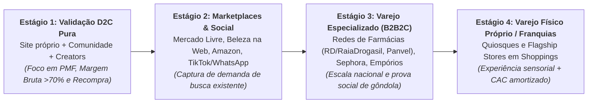

Quando uma marca como **Sallve**, **Creamy**, **Principia** ou **Desinchá** entra nas mais de 3.000 farmácias da RaiaDrogasil (RD Saúde), na Venancio ou na Panvel, acontece um efeito mágico nas finanças da empresa: o anúncio digital que antes convertia apenas os 2% de consumidores dispostos a esperar o frete em casa passa a converter os outros 98% que veem o vídeo no celular de manhã e compram o sérum ou o suplemento na farmácia da esquina à tarde — reduzindo o CAC consolidado da marca e multiplicando o giro de caixa.

---

### 2. Fabricação Terceirizada (Private Label / Terceiristas) vs. Indústria Própria e Regulação ANVISA

Um erro clássico de fundadores inexperientes em bens de consumo (CPG), cosméticos, suplementos ou vestuário tecnológico é imobilizar R$ 3 milhões em máquinas industriais, reatores químicos, envasadoras ou teares antes de vender as primeiras 50.000 unidades.

No Brasil, existe um parque industrial maduro de **terceiristas homologados (*contract manufacturers* / *full service*)** em São Paulo, interior paulista, Santa Catarina, Paraná, Goiás e Minas Gerais capazes de produzir cosméticos, suplementos e peças têxteis com qualidade de exportação. A estratégia correta segue três regras práticas:

1. **Comece 100% terceirizado, mas seja dono da fórmula (P&D) e do registro/marca:** Nunca venda um produto genérico "de catálogo" do terceirista que qualquer concorrente possa copiar amanhã trocando o rótulo (*white label* raso). Contrate um engenheiro químico, farmacêutico bioquímico ou engenheiro têxtil próprio desde o início para desenvolver uma **formulação proprietária com ativos em concentrações eficazes**, assine contrato de confidencialidade e propriedade intelectual da fórmula com o laboratório terceirizado e homologue pelo menos **dois fabricantes independentes** assim que atingir escala para não ficar refém de greve, incêndio ou aumento unilateral de preço.
2. **Navegue corretamente a classificação da ANVISA em Cosméticos e Suplementos:**
   - **Cosméticos Grau 1 (Risco Mínimo — RDC 752/2022):** Sabonetes comuns, shampoos básicos, hidratantes corporais e maquiagens sem ação fotoprotetora. Exigem apenas **notificação eletrônica simplificada** na ANVISA (feita pela indústria detentora da AFE — Autorização de Funcionamento de Empresa), permitindo lançar um SKU em semanas.
   - **Cosméticos Grau 2 (Risco Potencial / Específico):** Protetores solares (exigem testes caros de FPS *in vivo* e UVA), produtos infantis, antissépticos, clareadores de pele, produtos antiacne ou antiqueda com alegações específicas. Exigem **registro formal ou dossiê técnico robusto de segurança e eficácia** (testes de irritabilidade dérmica/ocular, hipoalergenicidade e estabilidade acelerada de 90 a 180 dias).
   - **Suplementos Alimentares (RDC 243/2018 e IN 28/2018):** A ANVISA criou a categoria unificada de "Suplemento Alimentar", definindo a lista positiva exata de constituintes autorizados (vitaminas, minerais, proteínas, creatina, cafeína, ômega-3, probióticos, compostos bioativos), limites mínimos e máximos diários e as alegações (*claims*) permitidas no rótulo. **Atenção:** prometer "cura de doenças", "emagrecimento garantido" ou "substituição de medicamentos" em anúncios de suplementos gera interdição sumária pela ANVISA e bloqueio imediato das contas de anúncio na Meta e no Google.
3. **Quando verticalizar a fábrica (ou o laboratório de P&D):** Só faz sentido investir em planta fabril própria ou centro de distribuição próprio quando: (a) o volume recorrente garante ocupação acima de 75% da planta desde o primeiro mês; (b) o processo produtivo é o seu segredo competitivo inimitável; ou (c) a margem capturada do terceirista (tipicamente 15% a 25% do custo industrial) paga o CapEx da fábrica em menos de 24 a 30 meses.

---

### 3. A Economia de Wellness, Fitness e Benefícios Corporativos no Brasil

Paralelamente às marcas de produtos físicos, o Brasil consolidou-se como um celeiro global de plataformas de **Wellness, Fitness e Longevidade**. O caso mais emblemático é o **Wellhub (antigo Gympass)**, fundado no Brasil por Cesar Carvalho, João Thayro e Vinicius Ferriani, que descobriu que vender assinaturas avulsas para consumidores finais (B2C) tinha churn alto, mas vender um **benefício corporativo de saúde e bem-estar para o RH de médias e grandes empresas (B2B2C)** — onde a empresa subsidia parte da mensalidade para reduzir o absenteísmo e conter o reajuste anual de sinistralidade do plano de saúde — criava uma máquina global avaliada em vários bilhões de dólares, seguida no mercado nacional pelo forte crescimento da **TotalPass** (do grupo Smart Fit).

As três ondas atuais de oportunidade em WellnessTech e Longevity no Brasil são:
- **Plataformas B2B2C de Bem-Estar Integral:** Além de academias físicas, a expansão do benefício corporativo para saúde mental (psicoterapia online), nutrição personalizada, qualidade do sono, saúde financeira e medicina preventiva do estilo de vida.
- **Clínicas e Ecossistemas de Longevidade, Performance e Medicina Preventiva:** Protocolos integrados de exames laboratoriais contínuos (*biomarkers*), avaliação metabólica, prescrição personalizada de suplementação manipulável ou recorrente, acompanhamento médico-nutricional via aplicativo e integração com dispositivos vestíveis (*wearables*).
- **Vertical SaaS e Fintech para o Ecossistema Fitness:** Gestão de academias de bairro, estúdios de *crossfit*, pilates, *beach tennis*, corrida e assessorias esportivas (mercado liderado por plataformas como **Tecnofit**, **Pacto** e **EVO/W12**), processando cobrança recorrente no cartão sem comprometer o limite do aluno e controlando catracas biométricas.

---

### 4. Unit economics de D2C e CPG: a regra dos 70% de Margem Bruta e do Ciclo de Caixa

Mais de 80% das marcas nativas digitais que quebram no Brasil morrem por dois erros matemáticos: **operar com margem bruta baixa demais para absorver o custo de mídia e os impostos brasileiros** ou **crescer rápido demais com ciclo de conversão de caixa (CCC) negativo, ficando sem dinheiro para pagar o próximo lote de estoque**.

Para que uma DNVB de beleza, suplementos ou moda funcional seja estruturalmente lucrativa no Brasil, sua demonstração de resultado unitária deve respeitar quatro leis:

1. **Markup de 4x a 6x sobre o CMV Industrial (Margem Bruta ≥ 65% a 75% no D2C):** Se um sérum facial ou pote de suplemento custa R$ 18,00 posto no seu centro de distribuição (incluindo fórmula, frasco, cartucho e impostos de industrialização), ele precisa ser vendido no D2C na faixa de **R$ 89,00 a R$ 119,00**. Por quê? Porque entre o preço cheio de vitrine e o seu lucro líquido saem: impostos sobre venda (ICMS/DIFAL/PIS/COFINS ou Simples — 10% a 18%), descontos/cupons de influenciadores (8% a 12%), taxa do meio de pagamento e antifraude (2,5% a 4%), *picking/packing* e embalagem (4% a 6%), subsídio de frete (8% a 14%) e investimento em marketing/CAC (20% a 30%). Se a sua margem bruta de produto for de apenas 40%, é matematicamente impossível dar lucro no canal digital.
2. **Lucratividade na 1ª Compra (*First-Order Profitability*) ou Payback em 90 dias:** No cenário de capital caro no Brasil, você não pode perder R$ 60 na primeira compra do cliente esperando que ele recompre seis vezes nos próximos três anos. Marcas saudáveis aumentam o **Ticket Médio (AOV)** do primeiro pedido usando **kits, rotinas completas e *bundles* progressivos** ("Compre o Kit Completo de 3 Passos com 15% OFF e Frete Grátis"), elevando o AOV de R$ 85 para R$ 210+ para que a primeira compra já pague 100% do CAC e do produto.
3. **Retenção e Recompra por Coorte em 90 e 180 dias:** Cosméticos e suplementos têm uma vantagem mágica sobre colchões ou malas de viagem: **o frasco de 30g ou 60 cápsulas acaba em 30 a 45 dias**. Uma marca excelente converte de **30% a 45% dos clientes do primeiro pedido em uma segunda compra dentro de 90 a 180 dias**, usando réguas automatizadas de WhatsApp e CRM disparadas exatamente no dia 28 após a entrega ("Seu sérum está acabando? Reposição com 1 clique via PIX").
4. **Ciclo de Conversão de Caixa (CCC) e Giro de Estoque (GMROI):** Se o seu fabricante exige 50% de sinal no pedido e 50% na entrega (prazo de produção de 45 dias), você mantém 60 dias de estoque no galpão e vende no cartão de crédito parcelado em 4x sem antecipar (ou vendendo para farmácias com prazo de recebimento de 60 a 90 dias), seu dinheiro fica preso por **120 a 150 dias**. Escalar vendas sem negociar prazo com fornecedores (60/90 dias no boleto) e sem racionalizar o número de SKUs (A Regra 80/20: 20% dos SKUs geram 80% da receita; excesso de cores e tamanhos em moda ou sabores exóticos em suplementos congela o caixa em estoque morto) leva a empresa à insolvência em pleno crescimento de receita.

#### Tabela de Benchmarks e Unit Economics de DNVBs, CPG e Wellness no Brasil

| Subvertical | Margem Bruta D2C Alvo | Margem Bruta B2B (Atacado/Farmácia) | Ticket Médio (AOV) D2C Saudável | Taxa de Recompra (180 dias) | ROAS Alvo (Mídia Paga) | Casos Brasileiros de Referência |
|---|---|---|---|---|---|---|
| **Skincare e Dermocosméticos (Grau 1 e 2)** | 72% a 82% | 48% a 58% | R$ 160 a R$ 260 (via kits/rotinas) | 32% a 48% | 2,8x a 4,5x | Sallve, Creamy, Principia, Simple Organic, B.O.B |
| **Suplementos, Vitaminas e Alimentos Funcionais** | 65% a 76% | 42% a 52% | R$ 180 a R$ 320 (potes/combos) | 38% a 55% (alta recorrência mensal) | 2,5x a 4,0x | Desinchá, Caffeine Army, Puravida, Essential Nutrition |
| **Moda Funcional, Tech Apparel e Calçados D2C** | 65% a 74% | 45% a 55% | R$ 280 a R$ 480 | 25% a 38% | 3,0x a 5,0x | Insider Store, Pantys, Linus, Yuool |
| **Pet Lifestyle e Produtos Premium D2C/Omnichannel** | 62% a 72% | 40% a 50% | R$ 220 a R$ 350 | 30% a 45% | 3,0x a 4,5x | Zee.Dog |
| **Plataformas de Benefícios Corporativos Wellness (B2B2C)** | 25% a 45% (sobre GMV) / 70%+ (sobre Net Rev) | Contrato corporativo B2B + co-pagamento do usuário | R$ 80 a R$ 250 / vida ativa / mês | NRR corporativo > 115% a.a. | Venda B2B (CAC Payback < 9 meses) | Wellhub (Gympass), TotalPass |

---

### 5. Casos reais brasileiros: como as campeãs construíram seus fossos

> [!example] Caso 1: Sallve, Creamy e Principia — Três caminhos distintos para dominar o Skincare nacional
> O mercado brasileiro de *skincare* era historicamente dominado por marcas dermatológicas europeias caríssimas (vendidas a R$ 180–R$ 300 por unidade nas farmácias) ou por cremes populares de catálogo sem ativos concentrados. Três DNVBs brasileiras furaram esse bloqueio com estratégias complementares brilhantes:
> - A **Sallve** (fundada por Julia Petit e Daniel Wjuniski) nasceu da maior comunidade digital de conteúdo de beleza do país, co-criando cada fórmula em salas de escuta com milhares de consumidoras para a pele brasileira (mista/oleosa e solar) antes de escalar para as grandes redes de farmácias.
> - A **Creamy** (fundada pelo médico dermatologista Dr. Luiz Romancini em parceria com o grupo Skelt) combinou autoridade científica dermatológica, embalagens icônicas coloridas e fórmulas de ácidos de alta potência, atingindo escala massiva com lucratividade desde os primeiros anos.
> - A **Principia** executou uma estratégia de eficiência cirúrgica inspirada na transparência clínica: embalagens minimalistas padronizadas, foco absoluto na concentração percentual dos princípios ativos (Niacinamida 10%, Vitamina C, Ácido Mandélico), preços extremamente acessíveis (R$ 40 a R$ 65) e uma máquina de conteúdo educativo de vídeos curtos em escala industrial nas redes sociais e *marketplaces*, vendendo milhões de unidades por ano.

> [!example] Caso 2: Insider Store — Ciência têxtil, Creators como canal de mídia contínua e foco no produto-herói
> Fundada por Yuri Gricheno e Carolina Matsuse, a **Insider Store** fugiu da armadilha da moda tradicional (que lança 4 coleções de 300 peças por ano e morre com 40% de estoque encalhado em liquidação). A Insider começou resolvendo um único problema funcional com engenharia têxtil (*Tech T-Shirt* e *Undershirt* antissuor, antiodor, que não desbota e não precisa passar, feita com fibras tecnológicas como modal austríaco e poliamida biodegradável). Em vez de depender apenas de anúncios de leilão, construiu a maior máquina de marketing de influência e *creators* de longo prazo do Brasil (presente em centenas de podcasts, canais de ciência, tecnologia, negócios e estilo de vida do YouTube), transformando itens básicos perenes (que nunca saem de moda e não sofrem liquidação sazonal) em uma operação de centenas de milhões de reais.

> [!example] Caso 3: Desinchá e Puravida — A construção de marcas de Wellness para o Exit estratégico
> O **Desinchá** (fundado por Lohran Soares e Rodrigo Caetano) transformou uma categoria commoditizada e sem graça — o chá de caixinha de R$ 4 do supermercado — em um produto desejável de estilo de vida, saúde e hábito diário com um *blend* de 8 ingredientes, caixa de 60 sachês para 2 meses (garantindo alto ticket médio desde o dia 1), distribuição simultânea em milhares de farmácias, nutricionistas prescritores e marketing digital, culminando em transações estratégicas relevantes. De forma similar, a **Puravida** (fundada por Flávio Passos) construiu uma marca *premium* de *clean label*, suplementos de alta biodisponibilidade e alimentos saudáveis com forte comunidade fiel, sendo adquirida pela gigante global **Nestlé Health Science**.

---

### 6. Armadilhas fatais em D2C, Beleza, Moda e Wellness

1. **A Ilusão do Faturamento Bruto Comprado na Meta (*Paid Media Trap*):** Uma marca que fatura R$ 2 milhões no mês gastando R$ 1,1 milhão em tráfego pago, dando 20% de desconto mais frete grátis e tendo 30% de CMV está, na verdade, queimando R$ 200 mil de caixa todo mês para enriquecer a Meta e as transportadoras. **Receita sem margem de contribuição positiva após mídia (MER / ROAS sustentável) não vale nada em bens de consumo.**
2. **Explosão Prematura de SKUs (A Morte pelo Estoque Parado):** Lançar 40 produtos, 8 cores e 5 tamanhos antes de ter um único **Produto-Herói (*Hero SKU*)** que represente pelo menos 40% a 50% do faturamento com recompra provada. Cada novo SKU multiplica o pedido mínimo na fábrica (MOQ), fragmenta a verba de marketing e trava o capital de giro em itens de curva C que nunca giram.
3. **Subestimar o Impacto Tributário Interestadual (ICMS, Substituição Tributária — ICMS-ST e DIFAL):** Em cosméticos e suplementos no Brasil, o enquadramento fiscal (NCM/CEST) e a Substituição Tributária de ICMS nas vendas para farmácias e varejistas de outros estados podem alterar o custo tributário em mais de 12 pontos percentuais. Fundadores que precificam a tabela B2B de atacado sem um tributarista especialista em HPPC/Alimentos descobrem tarde demais que venderam para distribuidores com margem líquida negativa.

> [!tip] Checklist de Validação para Fundadores de D2C e Wellness
> - [ ] O **Produto-Herói (*Hero SKU*)** resolve uma dor funcional clara e possui **Margem Bruta ≥ 68% no canal direto** (já descontando produto, embalagem primária/secundária e impostos de entrada)?
> - [ ] A arquitetura de oferta no site força um **Ticket Médio (AOV) pelo menos 3x maior que o custo de frete médio** por meio de kits, *bundles* de rotina ou assinatura com desconto?
> - [ ] A marca monitora o **MER (*Marketing Efficiency Ratio* = Receita Líquida Total / Gasto Total em Marketing e Influenciadores)**, mantendo o gasto total de aquisição abaixo de **22% a 28% da receita líquida** à medida que a base de clientes recorrentes cresce?
> - [ ] Todos os registros/notificações na **ANVISA (Grau 1, Grau 2 ou Suplemento Alimentar)**, laudos laboratoriais de estabilidade/pureza e registros de marca no **INPI** pertencem ao CNPJ da sua startup (e não ao fabricante terceirizado)?

---

### Filtro de Entrada na Trincheira: Você Deve Entrar Neste Jogo?

Antes de encomendar o primeiro lote em uma fábrica terceirista para lançar uma marca D2C de beleza, suplementos, alimentos funcionais ou wellness, responda:

1. **O Teste do Multiplicador 4x a 5x sobre a Fábrica:** Seu preço de venda final é pelo menos 4 a 5 vezes maior que o custo do produto pronto na fábrica (*COGS* de 20% a 25%), deixando margem para pagar impostos, frete, canal B2B/farmácia e aquisição de clientes?
2. **A Recompra Biológica de 30 Dias:** Seu produto acaba fisicamente todo mês na casa do cliente gerando recompra automática sem novo gasto de anúncio, ou você precisa readquirir o cliente a cada venda?
3. **A Blindagem na ANVISA e na Fórmula:** Sua fórmula pertence contratualmente à sua empresa e seus rótulos e vídeos respeitam 100% a RDC nº 243/2018 (sem promessas ilegais de cura)?

**O Movimento de Segunda-Feira:** Nos próximos 15 dias, cote o lote mínimo (*MOQ*) com três terceiristas certificados (BPF/ANVISA), monte a DRE do primeiro pedido com tributos (ICMS-ST/IPI) e valide uma pré-venda.


---

## CAPÍTULO 37 — TRAVELTECH, HOSPITALIDADE, EVENTOS, SPORTSTECH, PETTECH E ECONOMIA DA LONGEVIDADE (SILVER ECONOMY)

### A Regra Invisível do Jogo: Fugir do Leilão B2C de Viagens e Capturar o Float de Eventos, a Recorrência Pet e o Pagador Familiar 60+

Quando olha para turismo, eventos, animais de estimação e terceira idade no Brasil, o fundador "turista" comete sempre o mesmo erro de superfície: tenta criar mais uma agência de viagens online (OTA) B2C para vender pacotes baratos na internet, cria um "Uber de passeadores de cães" ou lança um aplicativo com nome estigmatizado ("App do Idoso") achando que aposentados vão baixá-lo sozinhos. Em dezoito meses, todas essas teses quebram: nas viagens B2C, o Google e as OTAs globais comem toda a margem; nos pacotes flexíveis sem lastro (como o colapso da Hurb e da 123milhas provou), a inflação aérea gera insolvência; no marketplace de passeadores pet, o cliente combina direto no WhatsApp a partir da segunda semana.

O veterano de trincheira enxerga onde os cofres de dinheiro realmente estão nesses quatro mercados:
1. Em **Traveltech**, o lucro e a retenção estão nas **viagens corporativas B2B (*T&E*) com cartão corporativo embarcado** e no software de gestão e reservas diretas (*PMS + Channel Manager*) para hotéis;
2. Em **Eventos**, a mina de ouro chama-se **A Dupla Captura da Bilheteria (Float de 90 Dias) com o Consumo Cashless do Bar**;
3. Em **PetTech** (3º maior mercado pet do mundo), o fosso está em **planos de saúde pet B2B2C no RH, software para clínicas/petshops e assinatura recorrente de ração/antipulgas**;
4. Na **Silver Economy (Longevidade)**, vigora a regra de ouro: **quem usa é o idoso, mas quem decide e passa o cartão recorrente é o filho adulto de 35 a 55 anos (*Caregiver Economy*)**.

---

> [!note] Síntese Executiva da Vertical
> Este capítulo examina quatro gigantescos mercados brasileiros de serviços ao consumidor e B2B2C que, embora operem em indústrias distintas, compartilham a mesma estrutura econômica de plataforma: **(1) Traveltech, Viagens Corporativas e Hospitalidade**; **(2) Eventos, Ticketing, Cashless e SportsTech**; **(3) PetTech (Saúde, Varejo de Recorrência e Serviços Veterinários)**; e **(4) Silver Economy / Longevity Tech (Economia Prateada e Envelhecimento Populacional)**. Em todos os quatro, o Brasil apresenta escala continental e fragmentação extrema de pequenos prestadores (hotéis independentes, produtores de eventos, clínicas veterinárias e cuidadores domiciliares), criando terreno fértil para startups que combinam software de gestão, intermediação transacional e serviços financeiros embarcados.

---

### 1. Subvertical 1 — Traveltech, Viagens Corporativas (T&E) e Hospitalidade

O mercado de turismo, viagens e hospitalidade no Brasil movimenta mais de R$ 750 bilhões por ano (cerca de 7,5% a 8% do PIB), mas apresenta uma particularidade estrutural crítica: enquanto o mercado de passagens aéreas é altamente concentrado em três grandes companhias domésticas (LATAM, Gol e Azul), **o mercado de hotelaria e pousadas (mais de 80% independentes fora das grandes bandeiras internacionais), o transporte rodoviário (mais de 200 viações) e a gestão de viagens e despesas corporativas (*Travel & Expense — T&E*) permanecem profundamente fragmentados**.

#### 1.1 A grande lição das OTAs de milhas e pacotes promocionais sem lastro
Os anos de 2023 e 2024 deixaram a cicatriz mais importante da história do setor de turismo digital no Brasil com as crises e recuperações judiciais da **123milhas (e MaxMilhas)** e da **Hurb (antigo Hotel Urbano)**. Dois modelos mostraram sua fragilidade estrutural:
- **Venda de pacotes futuros a preço fixo sem *hedge* (cobertura) da passagem aérea:** Vender hoje um pacote de viagem para daqui a 12 meses cobrando R$ 999 sem ter comprado o bilhete aéreo equivale a operar vendido a descoberto em uma *commodity* dolarizada (querosene de aviação + câmbio). Quando a tarifa aérea subiu no pós-pandemia, o esquema virou uma pirâmide financeira insustentável que dependia do caixa de novos compradores para pagar os embarques antigos.
- **Dependência de arbitragem em programas de fidelidade de terceiros:** Construir um negócio bilionário inteiro sobre uma brecha tolerada nos regulamentos das companhias aéreas (compra e emissão de passagens usando CPFs de terceiros nos programas Latam Pass, Smiles e TudoAzul) significa que, no dia em que as companhias aéreas restringem o número de CPFs emitidos por conta ou mudam a regra de tarifação em milhas, o seu suprimento seca da noite para o dia.

#### 1.2 Onde estão os negócios sólidos e escaláveis em Traveltech no Brasil
Enquanto as OTAs B2C especulativas sofreram, quatro modelos B2B e B2B2C prosperaram com *unit economics* saudáveis:
- **Gestão de Viagens Corporativas e Despesas (Corporate T&E + Cartão Corporativo):** Substituir as antigas agências de viagens corporativas analógicas (que cobravam taxas por transação manual no telefone e trocavam dezenas de e-mails para aprovar um voo) por plataformas SaaS *self-service* integradas a cartões corporativos inteligentes, adiantamentos via PIX, leitura de notas fiscais por IA e políticas automáticas de alçada por centro de custo. O grande destaque brasileiro é a **Onfly** (nascida em Belo Horizonte), ao lado de soluções de gestão de reembolsos como **VExpenses**, **Paytrack** e **Voll**.
- **Passagens Rodoviárias e Mobilidade Interurbana Digital:** Como 80% dos municípios brasileiros não têm aeroporto comercial com voos regulares, plataformas que digitalizam a venda de passagens das centenas de empresas de ônibus rodoviários (como a **ClickBus**, a **Quero Passagem** e a **DeÔnibus**, além do modelo de fretamento da **Buser**) capturam *take rate* saudável com CAC muito inferior ao aéreo.
- **Hospitalidade Tech (PMS, Channel Manager, Motor de Reservas e Revenue Management):** Software de gestão hoteleira (*Property Management System* — como **Omnibees**, **Hospedin**, **Sistemas TOTVS Hospitalidade**), precificação dinâmica de diárias por IA e gestão profissional de *short-term rentals* (locação de temporada estilo Airbnb, operada por gestoras tecnológicas como **Seazone** e **Anfitrião Prime**).

---

### 2. Subvertical 2 — Eventos, Ticketing, Cashless e SportsTech

O brasileiro é um dos povos que mais consome eventos presenciais no mundo: festivais de música, shows regionais (sertanejo, funk, forró, samba), festas universitárias, congressos corporativos, corridas de rua (crescimento explosivo no pós-2022) e futebol. A tecnologia nesse setor resolve três dores financeiras graves do organizador: **antecipação de fluxo de caixa, combate ao cambismo/fraude de meia-entrada e aumento do gasto por pessoa dentro do evento (A&B — Alimentos e Bebidas)**.

1. **Plataformas de Ticketing Self-Service e Enterprise (Sympla, Ingresse, Bilheteria Digital, Total Acesso, Eventim):** A **Sympla** (fundada em Belo Horizonte e integrada ao ecossistema Movile) democratizou a criação de eventos para dezenas de milhares de produtores independentes (cursos, festas, teatros, congressos), cobrando um *take rate* de **8% a 12%** sobre o valor do ingresso pago. Já para megafestivais e eventos *premium* (como Carnaval no Rio/Salvador, Réveillon no Nordeste e grandes shows), plataformas como a **Ingresse** implementaram **ingressos dinâmicos criptografados (QR Code mutante vinculado à biometria facial ou carteira digital com transferência rastreada)** para erradicar a fraude de ingressos falsos no portão e capturar comissão também no mercado secundário oficial de revenda (*resale*).
2. **Sistemas Cashless, Gestão de Bares e Inteligência de Consumo (Zig / ZigPay, Meep):** Em um festival de 20 mil pessoas, filas no caixa para comprar ficha de cerveja e desvios de dinheiro/estoque no bar podiam custar 20% a 30% da receita de alimentos e bebidas do produtor. A **Zig (fusão de ZigPay e NetPDV)** transformou-se em uma gigante brasileira de infraestrutura transacional para entretenimento ao vivo, casas noturnas, bares e estádios de futebol: por meio de pulseiras/cartões NFC, totens de autoatendimento e maquininhas integradas, aumenta o consumo médio por pessoa em 15% a 25%, retém a sobra de recarga ou facilita o reembolso transparente, elimina o roubo de caixa e monetiza via *take rate* sobre o TPV + antecipação de recebíveis para os produtores.
3. **SportsTech, Corridas de Rua e Gestão de Atletas/Clubes:** O *boom* das corridas de rua, *triathlon*, ciclismo e *beach tennis* no Brasil impulsionou plataformas de inscrição e venda de fotos por reconhecimento facial (como **Ticket Sports** e **Foco Radical**), softwares de prescrição de treino para assessorias esportivas (como **SisRun** e **Treinus**), aplicativos de reserva de quadras (como **Playtomic / LetzPlay**) e tecnologias de biometria facial obrigatória em estádios de futebol com mais de 20 mil lugares (exigência da **Lei Geral do Esporte — Lei 14.597/2023**, que criou um mercado imediato de centenas de milhões de reais para empresas de controle de acesso facial como **Imply**, **Bepass** e **FacialTech**).

---

### 3. Subvertical 3 — PetTech: O 3º Maior Mercado Pet do Planeta

Com mais de **160 milhões de animais de estimação** (cerca de 68 milhões de cães e 34 milhões de gatos) e um faturamento setorial que ultrapassa **R$ 70 bilhões por ano** (Instituto Pet Brasil / Abinpet), o Brasil é o 3º maior mercado pet do mundo, atrás apenas dos Estados Unidos e da China. A mudança demográfica brasileira — famílias com menos filhos, adiamento da maternidade e "humanização" dos pets como membros da família — deslocou o gasto do tutor da simples ração básica para **saúde veterinária complexa, nutrição super-premium, farmácia pet, estética e serviços de hospedagem/creche**.

As três frentes mais valiosas de PetTech no Brasil são:

- **Ecossistemas Integrados de Recorrência, E-commerce e Planos de Saúde Pet (O Caso Petlove):** No varejo pet, a ração e o antipulgas são compras previsíveis a cada 30 ou 45 dias. A **Petlove** (fundada pelo médico veterinário Marcio Waldman) construiu o maior ecossistema digital pet do país não apenas vendendo ração online (onde compete com as redes listadas em bolsa Petz e Cobasi, que anunciaram sua fusão histórica em 2024), mas combinando três motores com sinergia perfeita: (1) **Assinatura recorrente de ração e medicamentos** (que responde por grande parte da receita com altíssimo LTV); (2) **Plano de Saúde Pet (Petlove Saúde, potencializado pela aquisição da Porto.Pet da Porto Seguro)**, que fideliza o tutor por toda a vida do animal (10 a 15 anos) e direciona o fluxo de consultas para milhares de clínicas veterinárias credenciadas; e (3) **Serviços e Softwares B2B** (incorporando **DogHero** para hospedagem domiciliar/*pet sitters* e **Vetus** como ERP e prontuário eletrônico para clínicas e pet shops).
- **Vertical SaaS, Prontuário Eletrônico e Distribuição B2B para Clínicas Veterinárias e Pet Shops:** O Brasil possui mais de **200 mil médicos veterinários em atividade** (um dos maiores contingentes do mundo, regulados pelo **CFMV/CRMVs**) e mais de 40 mil pet shops e clínicas de bairro independentes. Softwares que gerenciam o prontuário clínico do animal, a carteira automática de vacinação (disparando lembretes anuais de reforço de V10 e antirrábica no WhatsApp do tutor), o agendamento de banho e tosa com pacotes mensais e o abastecimento B2B de medicamentos veterinários (controlados pelo **MAPA**) possuem baixíssimo *churn*.
- **Diagnóstico Veterinário, Telemedicina Veterinária (Resolução CFMV nº 1.465/2022) e Manipulação Pet:** Em 2022, o Conselho Federal de Medicina Veterinária regulamentou a **Telemedicina Veterinária** no Brasil (definindo as modalidades de teleconsulta mediante relação prévia ou atendimento de triagem/orientação, telediagnóstico e telemonitoramento). Isso abriu espaço para centrais de teletriagem para planos de saúde pet, telerradiologia/laudos remotos para clínicas do interior e farmácias digitais de manipulação veterinária (transformando comprimidos difíceis de dar a gatos e cães em biscoitos palatáveis, pastas transdérmicas auriculares ou molhos sob prescrição digital).

---

### 4. Subvertical 4 — Silver Economy (Economia da Longevidade / AgeTech)

O Brasil está vivendo uma das transições demográficas mais rápidas da história humana. O que a França levou 115 anos para fazer (dobrar a proporção de idosos de 7% para 14% da população), o Brasil está fazendo em cerca de duas décadas. Segundo o Censo e as projeções atualizadas do IBGE, o país já supera **33 milhões de pessoas com 60 anos ou mais** (mais de 15,8% da população) e caminha para ultrapassar **50 milhões de idosos até 2040**, com o grupo de **80+ anos** sendo a faixa etária que cresce em ritmo mais acelerado.

Mais importante ainda para o empreendedor: a "Economia Prateada" (*Silver Economy*) no Brasil movimenta quase **R$ 2 trilhões por ano em renda e consumo** (somando aposentadorias, pensões, rendimentos patrimoniais e salários de profissionais seniores ativos), mas é tratada pelo mercado de tecnologia com uma miopia grave — ou ignorando completamente o público 60+, ou criando produtos com estética hospitalar depressiva que nenhum idoso quer usar.

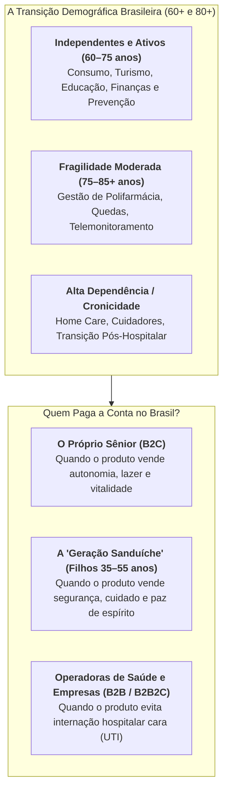

As quatro teses de maior tração em *AgeTech / Longevity Tech* no Brasil são:

1. **Desospitalização, Home Care Tech e Plataformas de Cuidadores Domiciliares:** Para uma operadora de plano de saúde (cujo beneficiário acima de 59 anos tem sinistralidade altíssima), manter um paciente idoso internado em hospital custa de R$ 2.500 a R$ 8.000 por dia; mantê-lo assistido em casa (*Home Care* ou *Hospital at Home*) custa 40% a 70% menos e reduz drasticamente o risco de infecção hospitalar. Startups que fornecem o software de gestão de empresas de *home care*, prontuário domiciliar com checagem por geolocalização da técnica de enfermagem, ou que selecionam, treinam e gerenciam cuidadores profissionais para a "Geração Sanduíche" (filhos adultos de 35 a 55 anos que trabalham o dia inteiro e precisam cuidar simultaneamente dos filhos pequenos e dos pais idosos) resolvem uma dor desesperadora.
2. **Telemonitoramento, Prevenção de Quedas e Gestão de Polifarmácia:** Uma fratura de fêmur por queda doméstica é o evento mais devastador na saúde do idoso acima de 75 anos. Soluções de botão de emergência inteligente / sensores passivos de queda (sem câmeras invasivas no banheiro), caixas/blisters organizadores de medicamentos por turno do dia (delivery de medicamentos já separados por data e horário pela farmácia para idosos que tomam 6 a 10 comprimidos diários) e coordenação de cuidado crônico têm alto apelo tanto para famílias quanto para operadoras de saúde.
3. **Fintech Sênior, Prevenção a Golpes Digitais e Crédito Consignado Transparente:** Os aposentados e pensionistas do INSS e servidores públicos são o principal alvo de fraudes bancárias, golpes de WhatsApp e empréstimos consignados predatórios no Brasil. Soluções financeiras focadas na proteção patrimonial do idoso, seguro contra golpes de PIX, planejamento sucessório simplificado e crédito consignado digital com taxas transparentes movimentam dezenas de bilhões de reais.
4. **Educação Continuada, Recolocação 50+ (Maturijobs / Maturi) e Turismo Sênior:** Plataformas focadas em inclusão produtiva de profissionais 50+ no mercado corporativo (como a **Maturi**), comunidades de aprendizado digital, viagens em grupo na baixa temporada (quando hotéis e companhias aéreas têm 50% de ociosidade de terça a quinta-feira) e moradias assistidas (*Senior Living / Coliving Sênior*).

---

### 5. Tabela Comparativa de Unit Economics: Travel, Eventos, Pet e Silver Economy

| Subvertical | Modelo de Monetização Principal | Take Rate / ARPU Típico | Margem Bruta da Startup | Métrica Estrela (North Star) | Risco Operacional / Regulatório Crítico | Casos Brasileiros de Referência |
|---|---|---|---|---|---|---|
| **Traveltech B2B (Corporate T&E + Despesas)** | Assinatura SaaS por empresa/usuário + *interchange* do cartão corporativo + comissão de hotel/aéreo | R$ 500 a R$ 10k/mês (SaaS) + 1,5% a 4,5% de *take rate* sobre GMV de viagens | 65% a 80% | GMV de viagens gerenciado sob política e NRR (> 120%) | Ciclo de reembolso/faturamento corporativo e integração com ERPs | Onfly, Paytrack, Voll, VExpenses |
| **OTAs Rodoviárias e Hospitalidade SaaS** | Comissão (*take rate*) por passagem emitida ou SaaS mensal por hotel | 8% a 14% no rodoviário; R$ 250 a R$ 2.500/mês por hotel | 60% a 78% | Taxa de conversão de busca e *Attach Rate* de seguros/assentos | Integração com sistemas legados de viações e sazonalidade de férias | ClickBus, Quero Passagem, Omnibees, Seazone |
| **Ticketing, Eventos e Cashless (A&B)** | Taxa de serviço sobre ingresso (8%–12%) + *MDR/Take rate* sobre consumo no bar (2%–5%) | R$ 12 a R$ 45 de receita por participante de grande evento | 55% a 72% | TPV total processado (Ingresso + Consumo *Cashless*) por evento | Chargeback de cartão, Lei da Meia-Entrada (Lei 12.933/13) e conectividade *offline* no evento | Sympla, Zig (ZigPay), Ingresse, Ticket Sports |
| **PetTech (Assinatura, Saúde Pet e SaaS Vet)** | Recorrência mensal de produtos, mensalidade de plano de saúde pet e SaaS veterinário | R$ 60 a R$ 220/mês (Plano Pet); R$ 200 a R$ 350/pedido recorrente | 35% a 45% (Varejo/Saúde); 75%+ (SaaS Vet) | LTV/CAC (> 4x via plano + ração) e *Loss Ratio* (sinistralidade veterinária < 60%) | Fraude de carência em planos de saúde pet, custo logístico de sacos de ração de 15 kg e regras do CFMV | Petlove, DogHero, Vetus, Petz/Cobasi |
| **Silver Economy / Longevity Tech** | Mensalidade B2C (paga pela família) ou *PMPM (Per Member Per Month)* pago pela operadora de saúde | R$ 150 a R$ 600/mês (monitoramento/coordenação) a R$ 4k–12k/mês (*home care*) | 45% a 75% (conforme peso de equipe clínica própria) | Redução de internações hospitalares evitáveis e retenção familiar (> 24 meses) | Risco trabalhista na intermediação de cuidadores domiciliares e responsabilidade clínica (ANS/CRM/COREN) | Maturi, EuVô, Conecta Sênior, Prontmed/linhas de crônicos |

---

### 6. Armadilhas fatais nessas quatro subverticais

1. **Em Traveltech: Assumir risco de variação tarifária aérea ou risco de crédito de agências sem garantias:** Nunca venda passagem ou hospedagem futura a preço travado sem emissão simultânea do bilhete (*back-to-back*) no fornecedor, e nunca conceda limite de faturamento pós-pago (boleto 30 dias) para clientes corporativos sem seguro de crédito ou depósito caução/cartão pré-pago, pois uma única empresa inadimplente em R$ 200 mil de passagens aéreas apaga o lucro líquido de R$ 5 milhões em GMV (dado que o *take rate* aéreo líquido é estreito).
2. **Em Eventos e Cashless: Depender de internet 4G/Wi-Fi durante o show para validar ingresso ou cobrar cerveja:** Quando 40 mil pessoas entram no mesmo estádio ou arena às 21h, todas as torres de celular da região colapsam. Se o seu validador de ingresso ou maquininha *cashless* exigir consulta *online* em nuvem a cada transação, o bar para de vender por duas horas, o público se revolta e o produtor nunca mais contrata sua empresa. **Toda tecnologia de eventos precisa operar com arquitetura local/offline redundante (cartão NFC com saldo gravado criptograficamente no chip ou rede local de alta disponibilidade).**
3. **Em PetTech: Vender ração pesada avulsa comprando clique no Google sem recorrência nem produtos de alta margem:** Um saco de ração super-premium de 15 kg tem margem bruta apertada e frete caríssimo pelo peso cúbico. Se o cliente compra uma única vez pelo menor preço no Google Shopping e no mês seguinte compra no concorrente, você perde dinheiro em cada pedido. A conta de PetTech só fecha quando a ração é a **âncora de frequência** que traz o cliente para a assinatura recorrente e permite vender antipulgas, medicamentos, petiscos de marca própria e o plano de saúde pet (onde a margem bruta e a retenção são muito superiores).
4. **Em Silver Economy: Vender "produtos para velhinhos" para o idoso, ou ignorar quem toma a decisão de compra:** Há uma divisão psicológica essencial na Economia Prateada: **produtos de vitalidade, viagem, beleza, finanças e aprendizado são comprados pelo próprio sênior (60–75 anos), que rejeita qualquer rótulo estigmatizante de "terceira idade"**; já **serviços de cuidado, monitoramento de quedas, gestão de medicamentos e *home care* para idosos frágeis (78+ anos) são pesquisados, escolhidos e pagos pelos filhos adultos (principalmente filhas de 40 a 55 anos)**, mas precisam ter uma interface tão respeitosa e invisível que o pai ou a mãe aceite usar sem se sentir vigiado ou infantilizado.

> [!tip] Checklist de Execução para Travel, Eventos, Pet e Silver Economy
> - [ ] **Traveltech:** O modelo opera 100% livre de descasamento de preço de inventário (*back-to-back booking*) e monetiza serviços de maior margem (hotéis, rodoviário, seguro viagem, câmbio ou SaaS/cartão corporativo) além do bilhete aéreo?
> - [ ] **Eventos / SportsTech:** A operação suporta contingência *offline* total no local do evento, possui antifraude específico para cartões clonados em compra de última hora e cumpre a **Lei 12.933/2013 (Meia-Entrada)** e a **LGPD para dados biométricos faciais**?
> - [ ] **PetTech:** O funil de produto converte o comprador avulso em **assinante recorrente ou titular de plano de saúde pet** nos primeiros 60 dias, com controle rigoroso de carência e auditoria veterinária para evitar seleção adversa?
> - [ ] **Silver Economy:** A proposta de valor separa claramente a comunicação voltada ao **decisor familiar/pagador (filhos ou operadora de saúde)** da experiência de dignidade e simplicidade entregue ao **usuário idoso**?

---

### Filtro de Entrada na Trincheira: Você Deve Entrar Neste Jogo?

Antes de alocar capital em Traveltech, Eventos, PetTech ou Economia da Longevidade (60+) no Brasil, passe sua tese por três perguntas de fogo:

1. **O Teste da Desintermediação e do Leilão (Para Travel e Pet):** Por que o cliente ou empresa continuará usando sua plataforma no décimo mês sem pular para o WhatsApp do prestador local e sem precisar que você recompre o cliente no Google Ads?
2. **A Captura do Float e do Bar (Para Eventos e Hospitalidade):** Sua plataforma captura apenas a taxa do ingresso/reserva, ou retém o *float* da venda antecipada e processa 100% do consumo de alimentos e bebidas (*cashless*) dentro do evento?
3. **Quem É o Verdadeiro Comprador (Para Silver Economy):** Seu go-to-market conversa diretamente com o filho adulto pagador ou com operadoras de saúde que precisam evitar reinternações de idosos?

**O Movimento de Segunda-Feira:** Nos próximos 15 dias, entreviste cinco decisores reais da sua subvertical (gestores de viagens B2B, produtores de eventos, veterinários ou famílias cuidadoras) e audite suas faturas dos últimos 90 dias.


---

## CAPÍTULO 38 — SETOR FUNERÁRIO, CEMITÉRIOS, CREMATÓRIOS, PLANOS DE ASSISTÊNCIA FAMILIAR, DEATHTECH E SUCESSÃO

### A Regra Invisível do Jogo: A Máquina de Caixa Previsível da Assistência Familiar em Vida e da Verticalização Cemiterial

Quase nenhum fundador da Faria Lima cogita olhar para o setor funerário, cemiterial, de cremação e de inventários (*DeathCare / DeathTech*) porque o tema carrega um tabu cultural profundo. Enquanto o empreendedor "turista" desvia o olhar — ou cria um "marketplace para cotar caixão no dia do óbito" que fracassa porque uma família em choque às três da manhã não abre cinco abas para comparar preços —, grupos consolidadores e operadores regionais constroem no Brasil algumas das máquinas de geração de caixa recorrente mais resilientes da economia real.

O veterano de trincheira olha para a demografia brasileira (envelhecimento acelerado e concessão dos cemitérios públicos nas capitais) e compreende que o dinheiro deste setor jamais é ganho apenas no dia do óbito (*at-need*). O grande motor financeiro do setor no Brasil são os **Planos de Assistência Familiar e Funerária pré-pagos em vida (*pre-need*, regulados pela Lei Federal nº 13.261/2016)**.

Essa é a engrenagem d'**A Recorrência Antissinistro da Assistência Familiar Integrada ao Ativo Físico**: milhões de famílias brasileiras pagam religiosamente de R$ 45 a R$ 95 por mês no cartão, boleto ou conta de energia para proteger a família inteira. Como a mortalidade anual da carteira é baixa e previsível (0,6% a 1,2% ao ano), a operadora que acopla benefícios usados em vida (telemedicina, descontos em exames, farmácia e odontologia para travar o *churn*) e é dona da própria funerária, crematório e cemitério parque captura margens EBITDA de 25% a 40% por décadas.

---

> [!note] Síntese Executiva da Vertical
> Poucos mercados no mundo possuem uma demanda tão absolutamente previsível, inelástica, imune a crises macroeconômicas e demograficamente crescente quanto o **Setor Funerário, Cemiterial, de Planos de Assistência Familiar e Sucessão Patrimonial (DeathCare / DeathTech)**. No Brasil, este ecossistema movimenta mais de **R$ 13 bilhões a R$ 15 bilhões por ano**, apoiado sobre o envelhecimento acelerado da população brasileira (que registra cerca de 1,45 milhão a 1,55 milhão de óbitos anuais no SIM/DataSUS, com projeção de alta contínua pelas próximas três décadas conforme a pirâmide etária do IBGE se inverte). O que antes era um setor pulverizado de pequenas funerárias familiares de bairro transformou-se em uma tese sofisticada de **receita recorrente por assinatura (Clubes de Benefícios em Vida + Assistência Funeral)**, **concessões públicas bilionárias**, **crematórios humanos e pet de alta margem (EBITDA de 35% a 55%)** e **plataformas jurídicas/financeiras de inventário e sucessão**.

---

### 1. A Demografia Inevitável e a Regulação dos Planos Funerários (Lei 13.261/2016)

Durante décadas, a maioria das famílias brasileiras das classes B, C e D viveu sob um temor financeiro concreto: o custo inesperado de um funeral e sepultamento particular digno (que varia de **R$ 4.500 a R$ 18.000** à vista, dependendo da cidade, urna, traslado, tanatopraxia, coroa de flores e jazigo) no exato momento de maior fragilidade emocional da família.

Para resolver essa dor sem depender da burocracia das grandes seguradoras tradicionais, nasceram no Brasil centenas de administradoras regionais de **Planos de Assistência Funerária**, regulamentadas especificamente pela **Lei Federal nº 13.261/2016** (distinta da regulação de seguros da SUSEP, embora muitas operadoras hoje combinem o plano assistencial da Lei 13.261 com apólices de microsseguro e títulos de capitalização regulados pela SUSEP):

1. **O Que Diz a Lei Federal nº 13.261/2016:** Regulamenta as empresas de comercialização de planos de assistência funerária (prestação de serviços funerários mediante cobrança de parcelas mensais por contrato escrito). A lei exige a manutenção de **patrimônio líquido mínimo**, constituição de **reserva técnica/solvência** proporcional ao faturamento anual dos contratos, contabilização auditada por atuário/auditor independente e registro nos órgãos de defesa do consumidor, separando grupos sérios de "aventureiros de garagem".
2. **A Grande Sacada de Produto: Do "Plano de Morte" para o "Clube de Benefícios em Vida" (*Living Benefits*):** O maior desafio histórico de um plano puramente funerário era o *churn* (cancelamento) após 18 meses: como a taxa de mortalidade anual de uma carteira familiar saudável gira em torno de **1,5% a 2,5% ao ano**, 98% dos clientes pagavam o boleto todo mês sem usar nada. As líderes brasileiras do setor (**Grupo Zelo, Grupo Vila / Morada da Paz, Grupo Cortel, Sinaf, Primaveras, Bem Mais Benefícios**) resolveram isso reinventando o produto:
   - Por **R$ 39,90 a R$ 89,90 por mês** (cobrindo o titular, cônjuge, filhos, pais e muitas vezes sogros — até 7 a 10 vidas no mesmo contrato!), a família não compra apenas "um caixão no futuro": ela ganha um **Clube de Benefícios de Uso Semanal em Vida**.
   - O pacote inclui **Telemedicina 24h gratuita**, **descontos de 30% a 70% em consultas médicas e exames laboratoriais** em clínicas populares parceiras, **descontos em redes de farmácias** (Raia Drogasil, Pacheco/Pague Menos), **empréstimo gratuito de equipamentos de convalescença** (cadeira de rodas, muletas, cama hospitalar articulada, andador), **assistência residencial** (chaveiro, encanador, eletricista), **cesta básica por 6 meses para a família em caso de óbito do titular**, **sorteios mensais em dinheiro via Título de Capitalização** (R$ 10 mil a R$ 50 mil pela Loteria Federal) e até **assistência funeral para o Pet da família (cão e gato)**!
   - **Resultado Econômico:** A família usa o desconto na farmácia ou na consulta médica todo mês, percebe valor tangível imediato que supera o valor da mensalidade, paga em dia para não perder o número da sorte do sorteio e **o churn despenca para níveis de SaaS Enterprise**!

---

### 2. As 4 Grandes Subverticais de DeathCare e DeathTech no Brasil

| Subvertical | Modelo de Negócio e Receitas | Margem EBITDA Típica | Dinâmica Competitiva e Moat |
|---|---|---|---|
| **1. Planos de Assistência Familiar e Funerária (Recorrência B2C / B2B2C)** | Assinatura mensal familiar (R$ 39 a R$ 90/mês) combinando assistência funeral completa + clube de saúde/benefícios em vida + capitalização. | **28% a 42%** | Escala de carteira ativa (50 mil a 1,5 milhão+ de contratos), rede própria de atendimento funerário para controlar o custo do sinistro e cobrança recorrente automatizada. |
| **2. Cemitérios Parques, Crematórios (Humanos e Pet) e Concessões Públicas** | Venda de jazigos perpétuos ou locação temporária (3 a 5 anos) + **Taxa de Manutenção Anual (Condomínio Cemiterial)** + serviços de velório/cremação + floricultura e lanchonete. | **38% a 55%** (Crematórios chegam a **50%–60%**) | **Licenciamento Ambiental (CONAMA 335/2003)** quase impossível de replicar no mesmo raio urbano + estoque de lóculos/jazigos + concessões municipais de 25 a 35 anos. |
| **3. Microsseguros Funerários e Vida Simplificado (Embedded Insurance)** | Apólices de auxílio-funeral e pecúlio (R$ 5,00 a R$ 25,00/mês) distribuídas embutidas na conta de energia elétrica (*Enel/Equatorial/Cemig*), fatura de varejista, cartão ou banco digital. | **25% a 38%** (Seguradora / MGA) | Canal de distribuição massivo com cobrança atrelada a *utility* ou folha sindical/consignado (inadimplência mínima). |
| **4. DeathTech, Inventário Extrajudicial, Planejamento Sucessório e Probate Lending** | Plataformas jurídicas e financeiras para processamento de **inventários extrajudiciais em cartório**, busca automatizada de ativos esquecidos, testamentos digitais e **adiantamento/financiamento de ITCMD e custas de inventário**. | **35% a 65%** | Especialização jurídica + tecnologia de automação documental + *funding* (FIDC) para financiar herdeiros sem liquidez imediata. |

#### Subvertical 2: A Economia dos Cemitérios Parques, Concessões Municipais e Crematórios (Humanos e Pet)
Unidades físicas de **Cemitérios Parques** (gramados horizontais arborizados e edifícios de columbários/ossários verticais) e **Crematórios** possuem uma das melhores equações imobiliárias e operacionais da economia real:
1. **A Dupla Receita do Cemitério Parque:** Diferentemente de um loteamento residencial comum (onde a loteadora vende o terreno uma vez e nunca mais recebe nada), um Cemitério Parque ganha dinheiro **duas vezes sobre cada metro quadrado**:
   - **Na Venda do Direito de Uso (Pre-Need / At-Need):** Vende a concessão de uso perpétuo ou temporário do jazigo (com 3 a 4 gavetas subterrâneas) por valores que variam de **R$ 8.000 a R$ 45.000+** (parcelados em 36 a 60 vezes para famílias que compram preventivamente — *Pre-Need* — ou à vista na hora do óbito — *At-Need*).
   - **Na Taxa de Manutenção Anual ou Semestral ("Condomínio Cemiterial"):** Todo titular de jazigo paga uma taxa obrigatória de conservação e manutenção perpétua (R$ 450 a R$ 1.200/ano). Quando um cemitério parque atinge a maturidade com **30.000 jazigos vendidos**, apenas a taxa de manutenção gera **R$ 18 milhões a R$ 30 milhões por ano de receita 100% recorrente**, com custo operacional resumido a jardinagem, segurança e administração!
2. **A Explosão da Cremação (Humana e Pet) no Brasil:** Embora a cremação no Brasil ainda represente cerca de **12% a 15% dos óbitos** nas capitais (contra 55%–80% nos EUA, Europa e Japão), a taxa cresce a dois dígitos ao ano por mudança cultural, falta de espaço nos cemitérios municipais e menor custo (uma cremação custa de 30% a 50% menos que a compra de um jazigo novo). Para o operador do crematório, o custo variável direto de uma cremação (gás natural/GLP do forno crematório + urna cinerária + mão de obra técnica de 2 horas) é inferior a **R$ 380 a R$ 550**, enquanto o serviço de despedida/velório e cremação é vendido por **R$ 3.500 a R$ 9.000** — gerando **margens brutas acima de 80%**! Paralelamente, o mercado de **Crematórios Pet** (como **Pet Memorial, Morada da Paz Pet, Cielo Pet**) explodiu nas famílias urbanas que tratam cães e gatos como filhos e contratam planos preventivos ou cremações individuais com entrega de cinzas e memorial por R$ 800 a R$ 2.800.
3. **Privatizações e Concessões de Cemitérios Públicos Municipais:** A partir de 2022–2023 (com a histórica concessão dos 22 cemitérios públicos da cidade de São Paulo para os consórcios **Cortel, Consolare, Maya e Velar**, envolvendo outorgas e investimentos bilionários), dezenas de prefeituras de capitais e cidades médias (Belo Horizonte, Curitiba, Porto Alegre, Campinas, Ribeirão Preto) abriram PPPs e concessões de 25 a 35 anos de seus serviços funerários e cemitérios municipais, criando uma oportunidade histórica para grupos operadores profissionalizados.

#### Subvertical 4: DeathTech, Inventários Extrajudiciais e Financiamento Sucessório (*Probate Lending*)
O que acontece no dia seguinte ao sepultamento? Começa o pesadelo burocrático, tributário e financeiro da **sucessão e do inventário no Brasil**.
Estima-se que existam **bilhões de reais em imóveis, contas bancárias, cotas de fundos, veículos e precatórios travados** no Brasil porque os herdeiros não têm dinheiro líquido à vista para pagar o imposto estadual de herança (**ITCMD — Imposto sobre Transmissão Causa Mortis e Doação**, cuja alíquota foi reformada pela Emenda Constitucional da Reforma Tributária para ser obrigatoriamente progressiva até **8% sobre o patrimônio total**), os emolumentos de cartório/custas judiciais e os honorários advocatícios (que somados consomem de **10% a 16% do valor da herança à vista** antes que a família possa tocar nos bens!).
Isso abriu três teses tecnológicas de altíssimo valor (*DeathTech / LegalTech Sucessória*):
1. **Automação de Inventários Extrajudiciais (Resolução CNJ nº 35/2007 e Resolução CNJ nº 571/2024):** O Conselho Nacional de Justiça (CNJ) revolucionou o direito sucessório brasileiro ao permitir que inventários e partilhas sejam feitos **100% em Cartório de Notas (via escritura pública em semanas, em vez de 8 anos na Justiça)** mesmo quando há **testamento válido** ou **herdeiros menores/incapazes** (desde que haja consenso entre os herdeiros e parecer favorável do Ministério Público). Plataformas jurídicas especializadas digitalizam o levantamento de certidões, avaliação imobiliária, cálculo de ITCMD e minuta da escritura para escritórios e famílias.
2. **Financiamento de Custas de Inventário e Compra de Quinhão Hereditário (*Probate Lending*):** Se uma família herda um apartamento de R$ 1,5 milhão livre de dívidas, mas não tem R$ 150.000 em conta corrente para pagar o ITCMD e o cartório, o imóvel fica irregular ("imóvel de gaveta"), perdendo 40% do valor de mercado. Fintechs e FIDCs especializados em ativos judiciais/sucessórios adiantam os R$ 150.000 para pagar o imposto e destravar o inventário em troca de uma cessão parcial de direitos hereditários ou alienação fiduciária/hipoteca sobre o imóvel liberado, capturando retornos de **CDI + 8% a 15% a.a.** com garantia real imobiliária!
3. **Planejamento Sucessório Digital, Testamentos e Holdings Familiares Automatizadas:** Ferramentas B2C e B2B2C (para assessores de investimentos, planejadores financeiros e contadores) que estruturam testamentos vitais/patrimoniais, seguros de vida para liquidez sucessória e constituição padronizada de holdings patrimoniais familiares.

---

### 3. Unit Economics de uma Operadora de Planos de Assistência Funerária + Cemitério/Crematório Integrado

> [!tip] O Segredo da Verticalização no Setor Funerário
> Se você vende apenas o plano funerário mensal e precisa **comprar no varejo** a urna, o serviço de remoção, a clínica de tanatopraxia (preparação e conservação do corpo), a sala de velório e o sepultamento/cremação de terceiros toda vez que um cliente falece, o seu custo por sinistro será de **R$ 3.500 a R$ 5.000**. Mas quando a sua empresa é **verticalizada** (possui fábrica ou compra atacadista de urnas, frota própria, laboratório de tanatopraxia próprio, centro velatorial e forno crematório/cemitério próprio), o **custo marginal caixa de realizar um atendimento funerário completo cai para R$ 950 a R$ 1.600**!

Veja as métricas de referência de uma operação consolidada de **100.000 contratos familiares ativos** (~450.000 vidas cobertas):

| Métrica Operacional e Atuarial | Benchmark de Mercado no Brasil | Impacto na Geração de Caixa (Carteira de 100k Contratos) |
|---|---|---|
| **Ticket Médio Mensal por Contrato Familiar (ARPU)** | **R$ 58,00 / mês** (cobrindo titular + dependentes) | **R$ 5,8 milhões / mês** (**R$ 69,6 milhões / ano** de Receita Bruta) |
| **Taxa de Sinistralidade Atuarial (Frequência de Óbito por Contrato/Ano)** | **1,8% a 2,4% dos contratos acionam 1 óbito por ano** | ~180 a 200 atendimentos funerários por mês (2.160 a 2.400/ano) |
| **Custo Direto do Sinistro Funerário (Verticalizado) + Benefícios em Vida** | R$ 1.350 por funeral realizado + R$ 4,50/mês por contrato em telemedicina/sorteio/rede | **~R$ 720 mil / mês** (**Sinistralidade Caixa total < 13% da Receita!**) |
| **Custo de Aquisição de Cliente (CAC)** | **R$ 140 a R$ 220 por contrato** (3 a 4 mensalidades de comissão para o vendedor porta-a-porta ou televendas/digital) | Payback do CAC em **3,5 a 5 meses** |
| **Inadimplência Líquida e Churn Mensal** | **1,5% a 2,5% ao mês** (cai para **< 1,0%** quando cobrado na conta de luz, cartão recorrente ou Pix Automático) | Vida média do contrato (*Lifetime*) de **4,5 a 7+ anos** |
| **Receita Adicional de *Upsell* no Atendimento (*At-Need*) e Particulares** | Famílias fora do plano ou upgrades de urna/flores/cremação/jazigo | **+25% a 40% sobre a receita de planos** |
| **Margem EBITDA Consolidada da Operação Integrada** | **32% a 46% de Margem EBITDA** | **R$ 25 milhões a R$ 38 milhões / ano de EBITDA livre** |

---

### 4. Casos Brasileiros de Destaque: Os Consolidadores de DeathCare

> [!example] Estudo de Caso — Grupo Zelo, Grupo Cortel, Grupo Vila (Morada da Paz) e Sinaf
> - **Grupo Zelo (Belo Horizonte/MG — mais de 3,5 milhões de vidas cobertas):** Fundado em Minas Gerais pelos empreendedores Lucas Provenza, Heller Redig e Rodrigo Oliveira, o Grupo Zelo protagonizou o maior movimento de consolidação (*roll-up*) de planos e serviços funerários da história do Brasil. Com o apoio de fundos de *Private Equity* de primeira linha (como **Cresera Capital** e depois **Vinci Partners**), o Grupo Zelo adquiriu mais de **60 empresas funerárias, cemitérios e carteiras regionais de planos assistenciais** em mais de 10 estados brasileiros, ultrapassando a marca de 1 milhão de contratos ativos (quase 4 milhões de pessoas protegidas). O grupo profissionalizou a governança atuarial, digitalizou os meios de cobrança recorrente e transformou marcas locais centenárias em uma plataforma nacional integrada.
> - **Grupo Cortel (Porto Alegre/RS — São Paulo/SP):** Fundado por José Elieles Flores, é o maior operador de cemitérios parques e crematórios privados do Brasil, gerindo ativos icônicos no Rio Grande do Sul, Rio de Janeiro, Amazonas, São Paulo e liderando o maior consórcio vencedor da concessão dos cemitérios públicos da capital paulista. O Cortel foi pioneiro na introdução de arquitetura contemporânea luminosa, memoriais verticais de alto padrão e rituais de despedida humanizados com transmissão online e cremação.
> - **Grupo Vila / Morada da Paz (Natal/RN, João Pessoa/PB e Recife/PE):** Exemplo extraordinário de excelência em hospitalidade, tecnologia e gestão familiar profissionalizada no Nordeste. O grupo criou ecossistemas completos (cemitérios parques premiados internacionalmente, crematórios humanos e **Morada da Paz Pet**, planos de assistência com clube de benefícios e programas de apoio psicológico ao luto), além de lançar iniciativas de inovação aberta e *DeathTech* para planejamento de fim de vida e memórias digitais.
> - **Sinaf Seguros e Assistência (Rio de Janeiro/RJ):** Transformou o seguro e a assistência funeral para as classes C e D no Grande Rio em uma potência financeira regulada pela SUSEP, provando que atendimento digno, capilaridade de agências de bairro e cumprimento rigoroso da promessa em 100% dos óbitos constroem uma marca inabalável na base da pirâmide.

---

### 5. Armadilhas Fatais no Setor Funerário, Cemiterial e Sucessório

> [!warning] As 4 Armadilhas que Destroem Operações de DeathCare
> 1. **A Armadilha do Cobrador de Rua em Dinheiro Vivo (Custo de Cobrança e Desvio):** Centenas de funerárias tradicionais do interior ainda cobram a mensalidade do plano mandando um motoqueiro ("cobrador") bater de porta em porta para receber R$ 50 em dinheiro vivo. Além de o custo do cobrador consumir **18% a 25% da receita bruta**, o risco de assalto, fraude interna ("caixa dois de recibo") e perda de controle da carteira em caso de saída do cobrador é altíssimo. A primeira ação de qualquer *turnaround* ou M&A no setor é **migrar 80%+ da carteira para cobrança automática (débito na fatura da concessionária de energia elétrica/água, cartão de crédito recorrente sem ocupar limite, Pix Automático ou BolePix com régua automática de WhatsApp)**.
> 2. **Licenciamento Ambiental e Passivo de Necrochorume (Resolução CONAMA nº 335/2003 e 368/2006):** Cemitérios horizontais mal projetados em terrenos com lençol freático raso ou solo permeável geram **necrochorume** (líquido viscoso rico em cadaverina, putrescina, bactérias patogênicas e vírus decorrente da decomposição de corpos), cuja contaminação de águas subterrâneas dá cadeia por crime ambiental e interdição imediata pelo Ministério Público! Da mesma forma, **fornos crematórios** exigem câmara secundária de pós-combustão a mais de 850 °C–1.000 °C com tempo de residência mínimo dos gases e monitoramento contínuo de emissões atmosféricas para evitar fumaça visível ou odor. Nunca adquira um cemitério sem auditoria hidrogeológica profunda de poços de monitoramento piezométrico.
> 3. **Falha Operacional ou Frieza no Momento do Luto (Risco Reputacional Irreversível):** Você pode errar a entrega de uma caixa de sapato no e-commerce e pedir desculpas com um cupom; **você nunca pode atrasar 4 horas a remoção de um ente querido falecido, trocar uma identificação no laboratório de tanatopraxia ou tratar uma família em choque com rispidez comercial**. No setor funerário, a empatia clínica, o protocolo de dupla checagem de identificação por pulseira/QR Code desde a remoção até o sepultamento/cremação e o treinamento psicológico da equipe de atendimento ("agentes de acolhimento") são o coração do negócio.
> 4. **Vender Plano sem Carência ou com Seleção Adversa Descontrolada:** Se um vendedor comissionado cadastrar como "titular ou dependente saudável" um paciente de 88 anos que já está internado na UTI em estado terminal apenas para ganhar a comissão de adesão, a empresa receberá R$ 50 de primeira parcela e terá um desembolso imediato de R$ 3.500 na semana seguinte (*seleção adversa*). Contratos sustentáveis exigem **período de carência contratual clara (geralmente 90 a 180 dias para morte natural, com cobertura imediata apenas para morte acidental)**, limite etário nas faixas padrão ou tabela específica sênior e auditoria de vendas nos primeiros 90 dias da safra.

---

### Filtro de Entrada na Trincheira: Você Deve Entrar Neste Jogo?

Antes de investir no setor funerário, cemiterial, de cremação (humana ou pet) ou em uma DeathTech sucessória no Brasil, responda:

1. **Emergência (*At-Need*) vs. Recorrência em Vida (*Pre-Need*):** Seu modelo depende de capturar o cliente no momento do luto (onde o clique no Google Ads é caríssimo e o evento é único), ou constrói receita recorrente mensal em vida via assistência familiar, seguros B2B2C ou SaaS para as 6.000 funerárias do país?
2. **O Antídoto contra o Cancelamento (Uso em Vida):** O titular do plano utiliza benefícios toda semana em vida (clínica popular, telemedicina, desconto em farmácia) para nunca cancelar a assinatura?
3. **Conformidade com a Lei 13.261/2016 e CONAMA 335:** Sua operação mantém contabilidade auditada, reserva técnica de solvência e licenciamento ambiental 100% em dia?

**O Movimento de Segunda-Feira:** Nos próximos 15 dias, visite três operadoras regionais de planos de assistência familiar e dois crematórios/cemitérios parque para dissecar sua cobrança recorrente, inadimplência e custo por atendimento.


---

# CLUSTER VI — SOFTWARE CORPORATIVO (SAAS), SERVIÇOS B2B TECH-ENABLED, IA, CIBERSEGURANÇA, DEVTOOLS, RH, MARKETING, CREATOR ECONOMY E GAMES (CAPÍTULOS 39 A 48)

Fechando os 42 playbooks setoriais, este cluster cobre as 10 verticais de software, serviços B2B de alta margem, IA, cibersegurança, trabalho e mídia: Horizontal B2B SaaS e ERPs, Vertical SaaS com *Embedded Finance*, Serviços Profissionais B2B, Consultorias, Software Houses e *Nearshoring*, Empresas *AI-Native*, Cybersecurity e Identidade Digital, DevTools e Cloud, HRTech e Benefícios, Martech/SalesTech (*WhatsApp-First*), Creator Economy e Gaming/iGaming Regulado.

---

## CAPÍTULO 39 — HORIZONTAL B2B SAAS, ERPS, PRODUTIVIDADE, AUTOMAÇÃO DE BACKOFFICE E PMES

### A Regra Invisível do Jogo: A Fortaleza da Complexidade Fiscal Brasileira e o Canal Contábil como Máquina de Distribuição

Quando um fundador brasileiro "turista" decide criar um software B2B horizontal (ERP, CRM, gestão financeira, cobrança ou automação de backoffice), ele muitas vezes tenta copiar um aplicativo minimalista do Vale do Silício — uma agenda bonita de tarefas ou um painel financeiro simples que não emite nota fiscal, não calcula substituição tributária e não conversa com o contador. Em dezoito meses, ele descobre que a pequena e média empresa brasileira (PME) cancela qualquer software "acessório" na primeira semana de aperto financeiro, mas **jamais cancela o sistema que emite a Nota Fiscal Eletrônica (NF-e/NFS-e), concilia o Pix/boleto bancário e fecha a obrigação fiscal que impede a Receita Federal de bloquear o CNPJ**.

Como Geoffrey Moore e Peter Thiel demonstram, o que parece um defeito estrutural do país para o estrangeiro é, na verdade, o maior fosso defensivo (*moat*) para o fundador local: gigantes globais como QuickBooks e Xero falharam ou desistiram do Brasil porque não conseguiram acompanhar o manicômio tributário municipal, estadual e federal brasileiro.

Com a chegada da **Reforma Tributária do Consumo (EC 132/2023 e LC 214/2025 — transição de 2026 a 2033 com convivência simultânea de ICMS/ISS/PIS/COFINS com o novo IVA Dual CBS/IBS e o *Split Payment* automático na liquidação financeira)**, estamos diante do maior evento de substituição forçada de ERPs e motores fiscais da história do Brasil. Quem domina **A Alavancagem do Contador Parceiro e do Motor de Split Payment** conquista dezenas de milhares de PMEs com CAC mínimo e *churn* blindado.

---

> [!note] Síntese Executiva da Vertical
> O Brasil possui mais de 21 milhões de CNPJs ativos (dos quais cerca de 6,5 milhões são micro, pequenas e médias empresas empregadoras fora os MEIs) e a quarta maior indústria de software corporativo das Américas. Mais importante ainda: **o caótico sistema tributário, trabalhista, contábil e bancário brasileiro funciona como o maior fosso defensivo (*regulatory moat*) do mundo a favor de fundadores locais de B2B SaaS**. Enquanto um software norte-americano de design ou código (como Figma ou GitHub) entra no Brasil sem traduzir uma linha, nenhum ERP, folha de pagamento, motor fiscal ou plataforma de assinatura de contratos estrangeira sobrevive no *backoffice* brasileiro sem integrar NF-e, NFS-e de 5.570 municípios, SPED, eSocial, boletos registrados, PIX e a transição para o IBS/CBS da Reforma Tributária.

---

### 1. O mapa do Horizontal B2B SaaS no Brasil: onde os gigantes globais não conseguem entrar

Software Horizontal B2B é aquele que resolve uma função de negócio comum a múltiplos setores da economia — finanças/ERP, contabilidade, recursos humanos, vendas/CRM, marketing, compras (*procurement*), jurídico/contratos, atendimento ao cliente ou gestão de processos.

Para entender onde estão as oportunidades de construir uma empresa de R$ 100 milhões a R$ 1 bilhão+ de ARR no Brasil, é preciso separar o mercado em duas zonas de competição:

1. **Zona Globalmente Commoditizada (Front-office Criativo, Colaboração e DevTools):** Em categorias onde a regra de negócio é idêntica em São Paulo, Berlim ou São Francisco (edição de vídeo, repositórios de código, gerenciamento básico de tarefas, *cloud infrastructure*), competir de frente com Microsoft, Google, Atlassian, Notion ou Salesforce vendendo apenas em reais para PMEs brasileiras é ingrato, a menos que sua startup nasça **Global-First desde o Dia 1** (como fez o **Pipefy**, fundado em Curitiba por Alessio Alionço, que escalou seu software de automação de *workflows* e processos para clientes em mais de 150 países com receita majoritariamente em dólar) ou adote um diferencial radical de **atendimento em português + canal WhatsApp nativo + preço em reais sem IOF** (como fez a **RD Station** em automação de marketing para PMEs brasileiras, adquirida pela TOTVS por cerca de R$ 2 bilhões).
2. **Zona Blindada pela Complexidade Brasileira (Backoffice, ERP, Fiscal, Contábil, Folha, Pagamentos e Jurídico):** Aqui as startups brasileiras reinam absolutas. Um software de gestão empresarial (ERP) ou *backoffice* no Brasil precisa conversar em tempo real com:
   - **SEFAZ Estaduais e Receita Federal:** Emissão, cancelamento, carta de correção e manifestação de destinatário de **NF-e (Modelo 55)**, **NFC-e (Modelo 65)**, **CT-e** e **MDF-e**, além das obrigações acessórias do **SPED Fiscal, EFD-Contribuições, ECD e ECF**.
   - **5.570 Prefeituras Municipais (NFS-e):** Apesar do avanço do padrão nacional da Nota Fiscal de Serviços Eletrônica, centenas de municípios brasileiros ainda operam padrões próprios de *webservices* com regras díspares de retenção de ISS, INSS, IRRF, CSLL, PIS e COFINS na fonte.
   - **Transição da Reforma Tributária (EC 132/2023 e LC 214/2025 — Período 2026 a 2033):** Durante sete anos, toda empresa brasileira terá de conviver com **dois sistemas tributários simultâneos** (PIS/COFINS/IPI/ICMS/ISS antigos em paralelo às alíquotas de teste e transição da **CBS federal** e do **IBS estadual/municipal**, mais o mecanismo de **Split Payment** tributário automático na liquidação financeira). Isso obriga milhões de empresas a trocarem seus sistemas legados por ERPs e motores fiscais em nuvem atualizados em tempo real.
   - **Trabalhista e eSocial / FGTS Digital:** Folha de pagamento brasileira exige cálculo de 13º salário, férias + 1/3 constitucional, banco de horas, rescisão complexa, SST (Saúde e Segurança do Trabalho) e envio de eventos ao **eSocial**.
   - **Meios de Pagamento e Cobrança Bancária:** Integração nativa com **PIX Dinâmico (QR Code com conciliação instantânea via Webhook)**, **Boletos Bancários Registrados (CNAB 240/400 ou APIs bancárias)**, **PIX Automático** e **Open Finance**.

---

### 2. As seis grandes categorias de Horizontal SaaS no Brasil

#### 2.1 ERPs Cloud para Micro, Pequenas e Médias Empresas (PMEs e Mid-Market)
O mercado de ERP no Brasil estratificou-se em quatro camadas claras:
- **Micro e Pequenas Empresas do E-commerce e Varejo (Ticket R$ 80 a R$ 450/mês):** Liderado por **Bling** (adquirido pela Locaweb/LWSA) e **Tiny ERP** (adquirido pelo Olist), cujo superpoder é emitir nota fiscal em segundos e integrar nativamente com dezenas de *marketplaces* e transportadoras.
- **Pequenas e Médias Empresas de Serviços, Comércio e Indústria Leve (Ticket R$ 250 a R$ 1.800/mês):** Dominado por **Omie** e **ContaAzul**, que transformaram o ERP em uma plataforma integrada conectada diretamente ao escritório de contabilidade da PME e recheada de serviços financeiros (*Conta Digital PJ, emissão de boletos/PIX, antecipação de recebíveis e pagamento automático de contas*).
- **Mid-Market (Empresas com faturamento de R$ 20 milhões a R$ 300 milhões/ano — Ticket R$ 3.500 a R$ 25.000/mês):** Território de alto valor onde atuam **Sankhya**, **Senior Sistemas**, **Cigam** e divisões da **TOTVS**, substituindo planilhas paralelas por governança de centros de custo, MRP industrial, WMS logístico e BI embarcado.
- **Enterprise (Grandes Corporações):** Dominado por **TOTVS (Protheus/Datasul/RM)** — a maior empresa de software da América Latina, que detém cerca de 50% do mercado brasileiro de ERP — ao lado de SAP e Oracle.

#### 2.2 Contabilidade Digital, BPO Financeiro e TaxTech (Automação Fiscal)
Todo CNPJ brasileiro (exceto o MEI) é legalmente obrigado pelo Código Civil a manter contabilidade regular assinada por contador registrado no CRC. A **Contabilizei** revolucionou esse mercado ao criar o maior escritório de contabilidade digital do Brasil (atendendo mais de 50 mil profissionais liberais e microempresas com software próprio que automatiza abertura de CNPJ, cálculo de impostos do Simples Nacional/Lucro Presumido e folha, acoplando o **Contabilizei Bank**). Já para médias e grandes empresas, startups de **TaxTech** (como **Arquivei/Qive**, **Dootax**, **Systax** e **Thomson Reuters/Domínio**) automatizam a captura de 100% dos XMLs de notas fiscais emitidas contra o CNPJ da empresa na SEFAZ, o pagamento automatizado de guias (GNRE, DARF, DAE) e o motor de cálculo de alíquotas interestaduais.

#### 2.3 Assinatura Eletrônica, CLM (Contract Lifecycle Management) e Identidade Digital
A Medida Provisória 2.200-2/2001 e a **Lei 14.063/2020** consolidaram no Brasil a plena validade jurídica das assinaturas eletrônicas simples, avançadas (com validação via PIX, biometria facial, token SMS/WhatsApp ou base Gov.br) e qualificadas (certificado digital ICP-Brasil). Plataformas nacionais como **Clicksign**, **ZapSign** e **D4Sign** tomaram fatia expressiva de mercado da americana DocuSign porque adaptaram o produto à realidade brasileira: assinatura do contrato diretamente dentro do WhatsApp em 30 segundos, precificação acessível em reais sem variação cambial e integração com validação de CPF/CNPJ na Receita Federal, evoluindo para plataformas completas de **CLM (*Contract Lifecycle Management*)** com geração, revisão por IA e controle de vencimento de contratos.

#### 2.4 CRM, Automação de Marketing e Atendimento Omnichannel (WhatsApp-First)
Fora do Brasil, um CRM e um sistema de *helpdesk* são construídos em torno do e-mail e do telefone (como Salesforce, HubSpot e Zendesk originais). No Brasil, **80% das conversas comerciais B2C e B2B de PMEs acontecem no WhatsApp**. Isso gerou uma categoria inteira de plataformas brasileiras de atendimento multi-agente no WhatsApp, chatbots com IA generativa e CRM conversacional (como **Blip / Take Blip**, **Zenvia**, **Helena**, **Kommo/parceiros**, **RD Station Conversas**, **Octadesk** e **Surfe/Clint/Agendor/Ploomes** para vendas consultivas B2B).

#### 2.5 Procurement B2B, Gestão de Despesas e Automação de Contas a Pagar (AP Automation)
Digitalização do ciclo de compras corporativas (*Source-to-Pay*): cotação eletrônica com fornecedores, *homologação de compliance* (checagem automática de certidões negativas, trabalho escravo, protestos e dados bancários para evitar pagamento a contas fraudadas) e conciliação de faturas de utilidades/telecom/fretes contra os contratos assinados.

---

### 3. Estratégias de Go-to-Market (GTM) que funcionam para SaaS B2B no Brasil

A escolha da máquina de distribuição em B2B SaaS deve obedecer estritamente ao **ARPU (Receita Média Mensal por Cliente)**, pois o salário de vendedores, pré-vendas (SDRs) e gerentes de *Customer Success* impõe um piso matemático ao CAC:

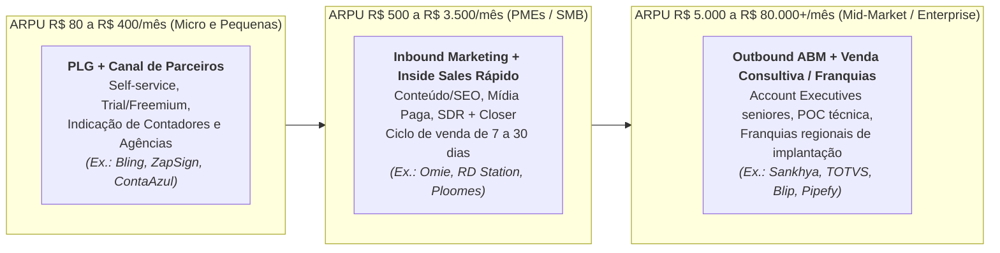

> [!important] O Canal de Contadores e Franquias: A Lição da Omie e da RD Station
> Como vender software para 6 milhões de PMEs brasileiras cujo dono não sabe o que é "ERP" ou "Inbound Marketing" e não procura isso no Google?
> - A **RD Station** treinou e certificou milhares de **agências de marketing digital** em todo o Brasil: cada agência vendia seus serviços de gestão de tráfego/conteúdo levando o software da RD Station embaixo do braço para os clientes.
> - A **Omie** e a **ContaAzul** atacaram a pessoa de maior confiança do pequeno empresário brasileiro: **o seu contador**. Ao dar gratuitamente ao escritório de contabilidade um painel que importa automaticamente a movimentação financeira e fiscal do cliente (economizando 70% do trabalho manual de digitação de extratos no escritório contábil), o próprio contador passou a exigir ou recomendar que seus 100 clientes PMEs assinassem o ERP da Omie ou da ContaAzul — combinando isso, no caso da Omie, com uma rede de centenas de **franquias regionais** focadas em caçar e implantar clientes localmente.

---

### 4. Unit economics de Horizontal B2B SaaS no Brasil

No Brasil, o maior assassino silencioso de startups de SaaS focadas em pequenas empresas (SMB) é o **Churn Mensal**. Um churn de receita aparentemente "pequeno" de **3,5% ao mês** significa perder **35% da sua base de clientes todo ano** — exigindo que a empresa corra desesperadamente na esteira comercial apenas para ficar do mesmo tamanho.

Por isso, todo negócio de Horizontal SaaS brasileiro precisa ser gerido por estas cinco métricas de coorte:

1. **GRR (*Gross Revenue Retention*) vs. NRR (*Net Revenue Retention*):**
   - **GRR** mede quanto da receita do início do ano permanece viva 12 meses depois (sem contar *upsells*). Em SMB no Brasil, um GRR saudável fica entre **80% e 88% ao ano**; em Mid-Market/Enterprise, deve ser **≥ 90% a 95%**.
   - **NRR** soma ao GRR a expansão da base atual (venda de novos módulos, aumento de assentos/volume de notas fiscais e **receita de Fintech/Pagamentos embarcados**). Os melhores SaaS para PMEs no Brasil compensam a mortalidade natural de pequenos negócios (churn de 1,5% a 2,0% a.m.) gerando **2,5% a 3,5% a.m. de expansão financeira (boletos, PIX, antecipação de recebíveis)** nos clientes sobreviventes, atingindo **NRR ≥ 105% a 120% ao ano**.
2. **CAC Payback Period (em meses de Margem Bruta):** Quantos meses o cliente leva para devolver o custo total de vendas e marketing (CAC) dividido pela margem bruta mensal (ARPU × Margem Bruta). No Brasil, com juros altos, o *CAC Payback* em PMEs deve ser **inferior a 6–10 meses**; em Mid-Market/Enterprise, **inferior a 12–18 meses**.
3. **LTV / CAC Ratio:** Deve ser consistentemente **≥ 3,5x a 5,0x**, calculado com margem bruta real (descontando custos de nuvem AWS/GCP, mensageria de WhatsApp da Meta, certificados e equipe de *Customer Success* / suporte).
4. **SaaS Magic Number e Burn Multiple:**
   **Magic Number = (ARR do Trimestre Atual − ARR do Trimestre Anterior) / Gasto de Vendas e Marketing do Trimestre Anterior**
   Acima de **0,75x a 1,0x** indica máquina comercial eficiente pronta para receber mais combustível; abaixo de 0,5x indica que injetar dinheiro em vendas está queimando caixa sem retorno.

#### Tabela de Benchmarks de Horizontal B2B SaaS no Brasil por Segmento de Cliente

| Segmento Alvo | ARPU Mensal Típico (R$) | Ciclo Médio de Venda | Logo Churn Mensal Aceitável | NRR Anual Alvo | CAC Payback Alvo | Modelo de GTM Dominante | Casos Brasileiros de Referência |
|---|---|---|---|---|---|---|---|
| **Microempresas / E-commerce Sellers (VSB)** | R$ 80 a R$ 350 / mês | 1 a 7 dias (Self-Service) | 2,0% a 3,2% a.m. | 95% a 108% (via upgrade de plano e fintech) | 2 a 5 meses | PLG, SEO, YouTube, Contadores, Afiliados | Bling, Tiny, ZapSign, Contabilizei |
| **Pequenas e Médias Empresas (SMB)** | R$ 450 a R$ 2.500 / mês | 10 a 30 dias | 1,0% a 1,8% a.m. | 105% a 120% (fortemente impulsionado por Embedded Finance) | 6 a 11 meses | Inbound + Inside Sales + Canal de Contadores/Franquias | Omie, ContaAzul, RD Station, Clicksign, Qive (Arquivei) |
| **Mid-Market Brasileiro** | R$ 3.500 a R$ 20.000 / mês | 30 a 90 dias | 0,5% a 0,9% a.m. | 110% a 125% | 10 a 15 meses | Outbound SDR + Field/Inside AE + Parceiros de Implantação | Sankhya, Ploomes, Senior, Dootax |
| **Enterprise Nacional e Global** | R$ 25.000 a R$ 150.000+ / mês | 90 a 240 dias | < 0,3% a 0,5% a.m. | 115% a 135% | 12 a 18 meses | ABM, Executivos de Contas Seniores, RFP/POC, Integradores | TOTVS, Pipefy, Blip, Sensedia |

---

### 5. Casos reais brasileiros

> [!example] Caso 1: Omie e ContaAzul — Transformando o ERP e o Contador na porta bancária da PME
> Tanto a **Omie** (fundada por Marcelo Lombardo e Rafael Olmos) quanto a **ContaAzul** (fundada em Joinville por Vinicius Roveda e sócios) entenderam cedo que o pequeno empresário brasileiro odeia preencher planilhas financeiras, mas precisa desesperadamente emitir notas fiscais, enviar boletos/PIX para seus clientes e mandar os documentos do mês para o contador não pagar multa. Ao conectarem a conta bancária da PME e o sistema do escritório contábil em tempo real, essas plataformas eliminaram a digitação manual e deram o passo estratégico definitivo: **transformar o próprio ERP em instituição de pagamento e originador de crédito**. Quando o empresário emite uma nota fiscal dentro da Omie, o boleto registrado ou QR Code PIX já sai gerado pela plataforma, o contas a pagar já liquida os fornecedores ali dentro e a antecipação de recebíveis ocorre com um clique — multiplicando o ARPU da empresa para muito além da mensalidade de software.

> [!example] Caso 2: Qive (ex-Arquivei) e Clicksign — Dominando um gargalo burocrático brasileiro específico
> Em vez de tentar construir um ERP inteiro do zero contra a TOTVS ou a SAP, a **Qive (fundada em São Carlos como Arquivei)** atacou uma única dor aguda que tirava o sono de qualquer diretor financeiro e fiscal no Brasil: saber exatamente todas as Notas Fiscais Eletrônicas (NF-e e CT-e) emitidas contra o CNPJ da empresa na SEFAZ antes mesmo de o caminhão chegar à portaria, evitando multas pesadas por falta de escrituração e fraudes de notas frias. Com uma entrada rápida e *time-to-value* de minutos, conquistou mais de 100 mil empresas e depois expandiu horizontalmente para automação de contas a pagar e conciliação fiscal. De modo análogo, a **Clicksign** focou em resolver a burocracia brasileira de reconhecimento de firma e coleta de assinaturas em contratos, integrando validadores locais, WhatsApp e APIs bancárias que a tornaram a infraestrutura padrão de assinatura eletrônica de fintechs, imobiliárias e seguradoras no país.

---

### 6. Armadilhas fatais em Horizontal B2B SaaS no Brasil

1. **Vender software com ticket de PME (R$ 199/mês) usando força de vendas cara de Enterprise:** Se você paga R$ 8.000 de custo total para um SDR e R$ 12.000 para um *Account Executive* fazerem três reuniões de vídeo de 1 hora para fechar um contrato de R$ 250/mês, seu CAC será de R$ 4.000 e seu *Payback* levará quase dois anos — período em que metade dessas microempresas já terá cancelado. **Ticket abaixo de R$ 400/mês exige venda self-service (PLG), dentro do WhatsApp ou em lotes via canal de contadores/parceiros.**
2. **Negligenciar o Onboarding nos primeiros 14 dias (O Cemitério do "Non-Activation Churn"):** Em software de gestão (ERP, CRM, Financeiro), o cliente que assina o cartão de crédito hoje, mas não cadastra seu certificado digital A1, não importa seus produtos e não emite a primeira nota fiscal ou cobrança nos primeiros **7 a 14 dias**, tem **mais de 70% de probabilidade de cancelar até o 3º mês**. Implantação guiada por IA, importadores automáticos de planilhas/XMLs da SEFAZ e ativação assistida no primeiro dia reduzem o churn precoce pela metade.
3. **Subestimar o Custo de Mensageria da API Oficial do WhatsApp e de Inferência de LLMs na Margem Bruta:** Muitos SaaS brasileiros de atendimento e CRM cobram uma mensalidade fixa de R$ 299 "com mensagens e IA ilimitadas", esquecendo que a Meta cobra em dólar por conversação iniciada de marketing/utilidade na API Oficial e os provedores de LLM cobram por milhão de *tokens*. Sem cobrança variável por consumo (*usage-based pricing* ou pacotes de créditos de mensagens/IA), os clientes mais pesados destroem a margem bruta da startup.

> [!tip] Checklist de Validação para Fundadores de Horizontal B2B SaaS
> - [ ] O produto possui um **fosso de localização brasileira** difícil de ser copiado por ferramentas globais genéricas (integração fiscal SEFAZ/Prefeituras, Reforma Tributária IBS/CBS, PIX/Boletos, Open Finance, WhatsApp ou legislação local)?
> - [ ] A máquina de Go-to-Market é matematicamente compatível com o ARPU (**CAC Payback < 9 meses para PMEs** e **< 15 meses para Mid-Market/Enterprise**)?
> - [ ] O usuário atinge o **"Momento Aha!" (Primeiro Valor Entregue)** em menos de 24 horas após o cadastro, sem depender de 60 dias de consultoria manual?
> - [ ] A precificação possui eixos claros de expansão automática (**assentos, volume de notas/transações, pacotes de IA ou serviços financeiros embarcados**) que sustentam **NRR > 108% ao ano**?

---

### Filtro de Entrada na Trincheira: Você Deve Entrar Neste Jogo?

Antes de construir um SaaS B2B horizontal para PMEs ou empresas de médio porte no Brasil, responda com honestidade brutal:

1. **O Teste do Bloqueio de Faturamento:** Se o seu software parar amanhã às 9h, seu cliente fica impedido de emitir nota fiscal, receber Pix/boleto, assinar contratos ou fechar a contabilidade, ou a empresa dele continua operando normalmente sem você?
2. **A Matemática do Ticket vs. Canal:** Se sua mensalidade (*ARPU*) é de R$ 150 a R$ 400/mês, você tem um motor *PLG* e parceria com contadores (onde 1 contador traz 60 PMEs), ou paga vendedores outbound caros para caçar microempresas uma a uma?
3. **Prontidão para o IVA Dual e Split Payment:** Sua arquitetura já está pronta para calcular CBS/IBS e conciliar a retenção tributária automática na liquidação bancária?

**O Movimento de Segunda-Feira:** Nos próximos 15 dias, visite dez escritórios de contabilidade (100 a 500 PMEs cada) e descubra qual dor no fechamento mensal faria o contador indicar seu sistema para toda a carteira.


---

## CAPÍTULO 40 — VERTICAL SAAS: SISTEMAS OPERACIONAIS SETORIAIS COM PAGAMENTOS, CRÉDITO E IA EMBARCADOS

### A Regra Invisível do Jogo: A Ilusão do "TAM Pequeno" e a Multiplicação de Receita por 4x via Fintech e IA Setorial

Durante mais de uma década, fundos míopes e empreendedores "turistas" desprezaram o software focado em um único setor específico (*Vertical SaaS*) no Brasil com um argumento preguiçoso de planilha: *"existem apenas 15 mil empresas nesse nicho; cobrando R$ 300 por mês, o mercado total (TAM) é pequeno demais"*. Olhando apenas a licença de software, o turista desistia ou criava um sistema genérico que não resolvia a dor profunda de ninguém.

O veterano de trincheira — aplicando a lição de Toast, Procore e ServiceTitan à realidade brasileira — descobriu o segredo que explodiu o tamanho real desses mercados: **em Vertical SaaS, a assinatura mensal é apenas o cavalo de Troia para se tornar o Sistema de Registro (*System of Record*) do setor; o dinheiro grande vem de taxar todas as transações financeiras, compras de insumos, seguros e fluxos de IA que passam por aquele balcão**.

Essa é **A Lei das Três Camadas de Monetização do Vertical SaaS (Assinatura + Fintech/Insumos + Agentes de IA)**: quando você constrói o sistema específico para clínicas odontológicas, oficinas mecânicas, imobiliárias, transportadoras, salões, academias ou postos de combustível, o cliente passa oito horas por dia na sua tela. O *churn* cai para menos de 1% ao mês, o boca a boca derruba o CAC pela metade e você multiplica a receita por cliente (*ARPU*) em 3x a 5x embutindo Pix/maquininha conciliada, antecipação de recebíveis, compra B2B e recepcionistas de IA no WhatsApp.

---

> [!note] Síntese Executiva da Vertical
> Se o Horizontal SaaS constrói ferramentas genéricas que servem para qualquer empresa, o **Vertical SaaS** constrói o **Sistema Operacional Completo (Control Point)** de um único setor específico da economia — clínicas odontológicas, salões de beleza, oficinas mecânicas, academias de ginástica, escritórios de advocacia, construtoras, transportadoras, escolas privadas, igrejas, imobiliárias ou restaurantes. No Brasil, durante anos, investidores de Venture Capital desprezaram o Vertical SaaS sob o argumento míope de que "o mercado endereçável (TAM) de mensalidades de software em um nicho brasileiro é pequeno demais". Essa visão mudou completamente quando ficou provado que **a mensalidade de software é apenas o cavalo de Troia (*wedge*)**: ao acoplar **Pagamentos Embarcados (*Embedded Payments*), Antecipação de Recebíveis, Crédito de Giro, Seguros e Agentes de IA no WhatsApp**, uma Vertical SaaS brasileira multiplica seu ARPU por **3x a 6x** e captura fatia do PIB real do setor inteiro.

---

### 1. A tese do Vertical SaaS no Brasil: por que o "TAM pequeno" era uma ilusão óptica

Imagine o setor de **oficinas mecânicas independentes e centros automotivos** no Brasil (cerca de 120 mil estabelecimentos formais) ou o de **salões de beleza, barbearias e clínicas de estética** (mais de 500 mil estabelecimentos ativos) ou ainda o de **clínicas médicas e odontológicas** (mais de 250 mil consultórios e clínicas).

Se você analisar qualquer um desses setores apenas pela ótica do software tradicional:
- **50.000 estabelecimentos conquistáveis × R$ 200/mês de assinatura de software = R$ 120 milhões/ano de ARR máximo**. Para um fundo de VC tradicional, parecia um teto baixo.

Agora aplique a **Equação Moderna de Vertical SaaS + Embedded Fintech + IA**:
- Cada um desses 50.000 estabelecimentos fatura em média **R$ 50.000 por mês** (R$ 600.000/ano), movimentando **R$ 30 bilhões por ano de TPV (Volume Total de Pagamentos)** que passam 100% por dentro da tela de ordem de serviço, prontuário ou agenda do seu software.
- Quando a sua Vertical SaaS passa a processar os pagamentos (maquininha Smart POS integrada ao sistema, link de pagamento PIX/cartão e cobrança recorrente), antecipar os recebíveis de cartão parcelado em 6x, originar capital de giro para reforma do espaço, vender insumos no *marketplace* B2B embutido e cobrar por um agente de IA que agenda horários 24/7 no WhatsApp do estabelecimento, o seu **ARPU mensal salta de R$ 200 (só software) para R$ 900 a R$ 1.800 por estabelecimento**.
- De repente, aquele nicho "pequeno" de R$ 120 milhões/ano esconde um mercado endereçável de **R$ 600 milhões a R$ 1,2 bilhão por ano de receita líquida com margens altíssimas e quase zero concorrência estrangeira**.

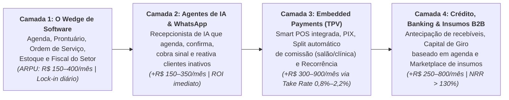

---

### 2. Anatomia do "Sistema de Registro" (*System of Record*): como dominar um setor

Um Vertical SaaS só conquista o direito de monetizar transações financeiras se ele for o **Sistema de Registro e Operação Primário (*System of Record*)** onde os funcionários do cliente passam 8 horas por dia trabalhando. Uma ferramenta horizontal como Trello, Notion ou Excel nunca terá esse poder em uma clínica odontológica ou oficina mecânica porque não conhece a semântica específica da profissão.

Para dominar uma vertical no Brasil, seu produto precisa entregar **quatro pilares hiper-específicos do setor desde o primeiro dia**:

1. **O Fluxo de Trabalho Único do Ofício (*Domain-Specific Workflow*):**
   - Em **odontologia** (ex.: **Dental Office**, **Simples Dental / Henry Schein**): o dentista precisa do **odontograma visual interativo dente a dente e face a face**, plano de tratamento orçado com aprovação pelo paciente, integração com radiografia digital e faturamento no padrão **TISS da ANS** para convênios odontológicos.
   - Em **salões de beleza, barbearias e clínicas de estética** (ex.: **Trinks**, **Avec**, **Gendo**, **Belle Software**): a dor mortal do dono é o cálculo da **Lei do Salão-Parceiro (Lei 13.352/2016)**. Quando uma cliente paga R$ 300 no cartão pela mecha de cabelo, o sistema precisa descontar automaticamente a taxa da maquininha, descontar os 15g de pó descolorante usados do estoque e fazer o **split fiscal e financeiro automático na fonte**: 50% caem direto na conta do cabeleireiro MEI (sem tributar como receita bruta do salão, evitando bitributação e vínculo trabalhista) e 50% caem na conta do salão.
   - Em **academias, boxes de CrossFit, estúdios de Pilates e escolas de esportes** (ex.: **Tecnofit**, **EVO / W12**, **Pacto**, **Next Fit**): o sistema precisa destravar fisicamente a **catraca biométrica facial** na entrada apenas se o aluno estiver adimplente e com exame/PAR-Q em dia, processar **cobrança recorrente inteligente no cartão de crédito** (cobrando mês a mês sem consumir o limite total anual do cartão do aluno) e entregar o aplicativo de treino na mão do professor e do aluno.
   - Em **construção civil e incorporadoras** (ex.: **Sienge / Grupo Softplan**, **Construct IN**, **Obra Prima**): orçamento por composição **SINAPI**, medição física-financeira de empreiteiros no canteiro de obras, gestão de múltiplas SPEs e repasse bancário Caixa.
2. **A Recepcionista / Vendedor de IA no WhatsApp como Diferencial Matador:** Na imensa maioria dos pequenos negócios de serviços no Brasil (clínicas médicas, dentistas, estéticas, salões, oficinas, pet shops, escolas de idiomas), o dono perde de 20% a 35% dos clientes porque a recepcionista está ocupada no balcão ou porque o cliente manda mensagem no WhatsApp às 21h30 querendo agendar um horário para o dia seguinte e ninguém responde. Em 2026, o Vertical SaaS que embute um **Agente de IA conectado diretamente à grade real de horários vagos do sistema** — capaz de conversar naturalmente no WhatsApp da clínica/salão, consultar a agenda do Dr. Carlos, reservar a terça-feira às 14h, cobrar R$ 50 de sinal via PIX para zerar o *no-show* (faltas) e já criar a ficha no sistema — vence instantaneamente qualquer concorrente legado que só vende uma "agenda passiva na tela do computador".
3. **Pagamentos Integrados (*Integrated POS & Split*) que Eliminam o Erro de Caixa:** O funcionário da recepção não pode digitar o valor na maquininha de cartão separada do computador (onde ocorrem erros de digitação, fraudes de troca de maquininha e horas perdidas batendo tirinhas de papel no fim do dia). Na Vertical SaaS madura, o comando sai do software direto para o terminal Smart POS na bancada: o pagamento só é confirmado pelo valor exato da comanda, a nota fiscal (NFS-e/NFC-e) é emitida sozinha e a conciliação bancária nasce 100% pronta.
4. **Origem de Crédito com Assimetria de Dados (*Proprietary Underwriting*):** Um banco tradicional nega crédito para uma clínica de estética ou oficina mecânica de bairro porque só enxerga o balancete contábil defasado. A sua Vertical SaaS, porém, enxerga em tempo real que aquela clínica tem R$ 180 mil de procedimentos agendados para as próximas 4 semanas, taxa de cancelamento de apenas 3% e crescimento de 18% ao ano. Com esses dados proprietários e com a trava do domicílio bancário da maquininha dentro da plataforma, você consegue oferecer capital de giro ou financiamento de novos equipamentos (em parceria com infraestruturas de *Banking-as-a-Service* e crédito como **Asaas**, **Celcoin**, **Zoop**, **Dock**, **Stark Bank** ou FIDCs parceiros) com inadimplência radicalmente menor que a média do mercado.

---

### 3. Mapa das Principais Verticais de SaaS Setorial no Brasil

#### Tabela de Oportunidades, Monetização e Casos de Referência em Vertical SaaS

| Setor Vertical no Brasil | Nº Estimado de Estabelecimentos | Dor Operacional Central (O Wedge) | Camada de Fintech / Transação Embarcada | Ticket SaaS + ARPU Total (Com Fintech) | Casos Brasileiros e Globais de Referência |
|---|---|---|---|---|---|
| **Clínicas Médicas e Consultórios** | ~220.000 clínicas e 570k médicos | Prontuário eletrônico (CFM), prescrição digital (Memed), faturamento TISS/TUSS para convênios e *no-show* | Cobrança de consultas particulares, antecipação de repasses de planos de saúde e crédito médico | R$ 200–600 (SaaS) → R$ 900–2.500 (Total) | **Brasil:** Afya (iClinic, Prontmed, Medicinae), Feegow, Amplimed<br/>**Global:** Athenahealth, Veeva |
| **Clínicas Odontológicas** | ~180.000 consultórios e clínicas | Odontograma digital, orçamento parcelado de implantes/ortodontia e faltas de pacientes | Parcelamento em boleto/cartão recorrente para tratamentos longos e compra B2B de materiais dentais | R$ 150–450 (SaaS) → R$ 800–2.200 (Total) | **Brasil:** Simples Dental (Henry Schein), Dental Office, Clinicorp |
| **Salões de Beleza, Barbearias e Estética** | ~500.000+ formais | Agenda multiprozissional, estoque de insumos por ml/g e **Split da Lei do Salão-Parceiro** | Maquininha com *split* automático salão/profissional, sinal via PIX no agendamento e conta digital | R$ 120–350 (SaaS) → R$ 650–1.800 (Total) | **Brasil:** Trinks (Stone), Avec, Gendo, Belle Software<br/>**Global:** Boulevard, Vagaro, Fresha |
| **Academias, CrossFit, Pilates e Assessorias** | ~45.000 academias e estúdios | Controle de acesso por catraca facial, treinos no app e inadimplência de mensalidades | Cobrança recorrente no cartão sem tomar limite, PIX recorrente e venda de suplementos/planos anuais | R$ 250–700 (SaaS) → R$ 1.100–3.000 (Total) | **Brasil:** Tecnofit, EVO (W12), Pacto, Next Fit<br/>**Global:** Mindbody, Glofox |
| **Restaurantes, Bares e Padarias** | ~1.200.000 ativos | PDV ágil, KDS na cozinha, ficha técnica de CMV, integração delivery e autoatendimento | Smart POS na mesa, *split* de gorjeta (10%), conciliação de vales-refeição e antecipação de recebíveis | R$ 180–550 (SaaS) → R$ 950–2.800 (Total) | **Brasil:** Linx Degust, Saipos, Goomer, Anota AI, Consumer<br/>**Global:** Toast (NYSE: TOST) |
| **Construção Civil, Engenharia e Incorporação** | ~150.000 construtoras e escritórios | Orçamento SINAPI, diário de obra, medição de empreiteiros, compras de cimento/aço e SPEs | Cotação e compra B2B financiada de materiais de construção, antecipação para fornecedores e seguro garantia | R$ 800–5.000 (SaaS) → R$ 2.500–12.000 (Total) | **Brasil:** Sienge (Softplan), Obra Prima, Construct IN<br/>**Global:** Procore |
| **Oficinas Mecânicas e Centros Automotivos** | ~120.000 oficinas | Ordem de serviço com fotos/vídeo pelo WhatsApp, placa/chassi e cotação de autopeças | Catálogo integrado de compra de autopeças B2B + parcelamento do conserto no cartão em até 12x | R$ 150–400 (SaaS) → R$ 700–2.000 (Total) | **Brasil:** Ultracar, Oficina Inteligente, Cilia (orçamentação)<br/>**Global:** ShopMonkey, ServiceTitan |
| **Escolas Privadas, Cursos e Idiomas** | ~42.000 escolas privadas + cursos | Secretaria acadêmica, diário do professor, comunicação com pais e inadimplência escolar (8%–15%) | **Garantia de receita escolar** (a plataforma adianta 100% das mensalidades no dia 5 e assume a cobrança dos pais) | R$ 500–3.000 (SaaS) → R$ 3.000–15.000 (Total) | **Brasil:** Arco/Isaac, Sponte, ClassApp, Agenda Edu, WPensar |

---

### 4. Unit economics de Vertical SaaS: por que o Churn é baixo e o CAC é menor que no Horizontal

Quando bem executada, uma empresa de Vertical SaaS apresenta métricas financeiras superiores às de um SaaS horizontal de mesmo porte por três razões estruturais:

1. **CAC Mais Baixo por Concentração de Canal e Efeito Boca a Boca de Guilda:** Médicos dermatologistas vão aos mesmos 3 congressos anuais da SBD, pertencem aos mesmos grupos de WhatsApp de residência médica e compram dos mesmos fornecedores; donos de oficinas mecânicas ou de academias de *crossfit* se conhecem todos na mesma cidade. Em vez de disputar palavras-chave genéricas caríssimas no Google ("software de gestão financeira" a R$ 35 o clique), o Vertical SaaS domina os eventos, associações e influenciadores técnicos daquela única profissão, derrubando o CAC.
2. **Logo Churn Estruturalmente Baixo (< 0,8% a 1,2% ao mês após ativação):** Trocar uma ferramenta de *e-mail marketing* leva uma tarde; trocar o sistema onde estão armazenados 15.000 prontuários médicos, todas as fichas técnicas de receitas, a catraca biométrica dos alunos, as maquininhas de cartão e o histórico fiscal do negócio é uma cirurgia de coração aberto. Uma vez implantado o sistema operacional setorial com pagamentos acoplados, o cliente raramente sai.
3. **Expansão Multi-Camadas (*Layer-Cake Expansion*) e NRR > 120%:** Você conquista o cliente no Mês 1 cobrando R$ 249/mês pela agenda e prontuário. No Mês 3, ativa a confirmação e agendamento por IA no WhatsApp (+R$ 150/mês). No Mês 4, pluga a maquininha e o PIX integrado, capturando 1,2% de *spread* líquido sobre R$ 60.000 de faturamento mensal da clínica (+R$ 720/mês). No Mês 9, oferece uma linha de capital de giro ou parcelamento garantido para os clientes finais (+R$ 300/mês). A mesma clínica que entrou pagando R$ 249/mês agora gera **R$ 1.419/mês de receita líquida** para a sua startup — um **NRR de mais de 500% naquela conta** sem custo adicional de aquisição comercial.

---

### 5. Casos reais brasileiros e globais que definiram o playbook

> [!example] Caso 1: Toast e ServiceTitan (Referências Globais) — Como um SaaS de nicho vale dezenas de bilhões de dólares
> Dois casos norte-americanos criaram a cartilha mundial que hoje guia os melhores fundadores brasileiros:
> - A **Toast** (NYSE: TOST) começou vendendo software de ponto de venda e gestão exclusivamente para restaurantes nos EUA. Hoje, **mais de 80% da receita total da Toast não vem da assinatura do software, e sim de Fintech (processamento de pagamentos das mesas/delivery e empréstimos de capital de giro Toast Capital)**, usando o software e o hardware da cozinha como barreira competitiva intransponível.
> - A **ServiceTitan** construiu um império atendendo um setor aparentemente "sem glamour": prestadores de serviços residenciais de ar-condicionado (HVAC), encanadores, eletricistas e dedetizadores, digitalizando desde o atendimento telefônico e despacho da van do técnico até o financiamento do equipamento na casa do cliente.

> [!example] Caso 2: Afya (iClinic, Prontmed, Clini.co), Clinicorp e Simples Dental — Consolidação e Fintech na Saúde e Odontologia Brasileira
> No Brasil, o grupo **Afya** (listado na Nasdaq) compreendeu que acompanhar o médico desde o primeiro ano da faculdade de medicina até o consultório particular exigia adquirir e integrar os principais *Vertical SaaS* clínicos do país (como **iClinic**, **Prontmed**, **gooru**, **Medicinae** e **Memed**), combinando prontuário eletrônico, suporte à decisão clínica e serviços financeiros médicos. Na odontologia e estética avançada, empresas como a **Clinicorp** (nascida em Santa Catarina) e o **Simples Dental** demonstraram o poder de combinar gestão clínica, CRM de vendas de tratamentos de alto valor (implantes, alinhadores invisíveis, harmonização facial) e meios de pagamento/recorrência integrados, escalando para dezenas de milhares de clínicas com crescimento lucrativo.

> [!example] Caso 3: Isaac (Arco Educação), Tecnofit e Trinks — Quando o produto financeiro resolve a maior dor do setor
> - Nas **escolas privadas brasileiras**, a maior dor do dono da escola nunca foi apenas "lançar notas no boletim", e sim a **inadimplência de 10% das famílias que atrasavam o boleto da mensalidade**, deixando a escola sem caixa para pagar os professores no quinto dia útil. O **Isaac** (integrado à Arco Educação) virou o mercado de cabeça para baixo ao unir gestão escolar com **Garantia de Receita**: a escola recebe 100% do valor das mensalidades na data certa todos os meses, e a plataforma assume toda a régua de cobrança, meios de pagamento e o risco de crédito.
> - Em **academias e estúdios**, a **Tecnofit** (Curitiba) e a **EVO (W12)** transformaram a cobrança recorrente no cartão e a gestão de retenção de alunos no motor central do negócio.
> - Em **salões de beleza**, o **Trinks** (investido/integrado pela **Stone**) e a **Avec** usaram a automação do *split* de pagamentos da Lei do Salão-Parceiro para capturar tanto a assinatura de software quanto o volume transacional das maquininhas de milhares de salões e barbearias.

---

### 6. Armadilhas fatais em Vertical SaaS

1. **Tentar construir a infraestrutura regulatória de banco e adquirência do zero no Dia 1:** Um erro fatal de fundadores de Vertical SaaS é gastar 18 meses e R$ 5 milhões tentando tirar licença própria de SCD/IP no Banco Central ou construir certificações PCI-DSS de subadquirência antes mesmo de ter 500 clientes usando o software todo dia. **Nos primeiros anos, seja 100% focado em construir o melhor software operacional do setor e plugue o *Embedded Finance* via APIs White-Label de parceiros especializados (como Asaas, Zoop, Celcoin, Pagar.me, Dock ou Efí)**, dividindo o *spread* financeiro sem carregar o peso regulatório e de *funding*. Só verticalize a infraestrutura financeira quando seu TPV anual superar R$ 1 bilhão a R$ 2 bilhões.
2. **Cair na armadilha da "Fábrica de Software sob Encomenda" para clientes grandes do setor:** Quando sua Vertical SaaS começa a vender para redes maiores (uma rede com 30 clínicas ou uma construtora grande), o cliente dirá: *"Eu fecho o contrato se vocês desenvolverem essas 14 telas exclusivas para o meu processo"*. Se você aceitar, sua equipe de engenharia vira uma consultoria terceirizada barata, seu código-fonte se fragmenta em dezenas de versões incompatíveis e sua margem bruta despenca. **Toda funcionalidade construída em um Vertical SaaS deve servir para pelo menos 30% a 50% de todos os clientes daquele setor, configurável por parâmetros, nunca por *forks* de código.**
3. **Ignorar a migração de dados legados no Onboarding:** O dono de uma clínica médica com 12 anos de vida tem 25.000 fichas de pacientes salvas em um software antigo em servidor local ou no concorrente. Se você disser a ele *"Assine nosso sistema e comece do zero amanhã"*, ele jamais mudará. **As melhores empresas de Vertical SaaS constroem robôs importadores dedicados (*migrators*) para os 5 maiores sistemas legados do seu setor**, migrando 100% do histórico de clientes, agendamentos futuros e financeiro em 24 horas sem dor para o cliente.
4. **Ir para uma Segunda Vertical antes de dominar 20%+ da Primeira ("Horizontalização Prematura"):** Fundadores ansiosos conquistam 300 salões de beleza (menos de 0,1% do mercado) e já querem adaptar o sistema para atender oficinas mecânicas, pet shops e escritórios de contabilidade. Ao fazer isso, o produto perde a profundidade específica que o tornava imbatível, o marketing perde o foco e um concorrente especializado engole seu mercado original. **Afunde um quilômetro de profundidade na sua primeira vertical (Software → IA → Pagamentos → Crédito → Insumos B2B) antes de abrir um segundo setor adjacente.**

> [!tip] Checklist de Execução para Fundadores de Vertical SaaS
> - [ ] O nicho escolhido no Brasil possui pelo menos **15.000 a 50.000+ estabelecimentos ativos** (ou milhares de empresas médias) com **TPV anual agregado no setor superior a R$ 15 bilhões**?
> - [ ] O software atua como o **Sistema de Registro Diário (*System of Record*)** insubstituível do estabelecimento (agenda, prontuário, ordem de serviço, PDV ou ERP setorial), e não como um acessório periférico?
> - [ ] A plataforma já possui **importadores automatizados de dados** dos 3 a 5 sistemas legados mais comuns daquele setor para eliminar a fricção de troca?
> - [ ] O produto incorpora nativamente um **Agente de IA no WhatsApp** conectado ao banco de dados operacional do cliente (agendamento, orçamento, cobrança ou atendimento técnico)?
> - [ ] O *roadmap* de monetização acopla **Embedded Payments (PIX, Boleto, Smart POS com Split)** e **antecipação/crédito via parceiro BaaS**, visando elevar a receita de Fintech para **≥ 40% a 60% da receita total da companhia** em até 36 meses?

---

### Filtro de Entrada na Trincheira: Você Deve Entrar Neste Jogo?

Antes de escolher um nicho para construir um Vertical SaaS no Brasil, passe o setor escolhido por estas três perguntas de fogo:

1. **O Teste do Fluxo Financeiro Passante (*GTV*):** As empresas desse nicho movimentam pelo menos R$ 50 mil a R$ 500 mil/mês em recebimentos, pagamentos ou compra de insumos que seu software pode intermediar e conciliar cobrando de 0,8% a 2,5% de *take rate*?
2. **Dor Específica vs. Planilha Genérica:** O setor possui regras operacionais tão específicas (odontograma na odonto, placa/orçamento na oficina, TISS na clínica, medição na obra) que um ERP genérico jamais o atende bem?
3. **Efeito de Rede de Guilda:** Os donos de empresas desse setor frequentam as mesmas feiras, grupos de WhatsApp e sindicatos, permitindo dominar o boca a boca da categoria?

**O Movimento de Segunda-Feira:** Nos próximos 15 dias, sente-se ao lado do balcão de dez empresas do nicho escolhido e liste todas as abas, cadernos, maquininhas e planilhas que elas abrem das 8h às 18h.


---

## CAPÍTULO 41 — SERVIÇOS PROFISSIONAIS B2B DE ALTA MARGEM, CONSULTORIAS, SOFTWARE HOUSES, EXPORTAÇÃO DE ENGENHARIA (NEARSHORING) E BPO

### A Regra Invisível do Jogo: A Máquina de Caixa Sem Diluição, a Arbitragem do Dólar no Nearshoring e a Disciplina da Taxa de Utilização

Existe um preconceito tolo entre fundadores "turistas" deslumbrados pelo teatro do Venture Capital: eles olham com desdém para consultorias especializadas de engenharia, dados, nuvem e IA, *software houses* de elite, exportadoras de *nearshoring* e operações de *BPO tech-enabled*, repetindo que *"serviços não escalam"*. Enquanto o turista queima milhões construindo um SaaS que ninguém quer e acaba diluído a 8% de uma empresa quebrada, os fundadores das melhores empresas brasileiras de serviços B2B constroem negócios de R$ 50 milhões a R$ 300 milhões de receita anual sem captar VC, distribuindo dividendos gordos e vendendo a operação para gigantes globais (Accenture, Globant, Stefanini, TOTVS, Private Equity) com 80% a 100% do *cap table* no bolso.

Onde o operador amador de serviços quebra? Quando vende horas baratas de programação genérica sem especialização, mantém 35% da folha ociosa no "banco de reservas" (*bench*), aceita escopo fechado mal precificado e depende de um único cliente para 60% da receita.

O veterano de trincheira domina **A Física Sagrada da Utilização Faturável (78%–85%), do Retainer de Squads e da Arbitragem do Fuso Horário GMT-3**: exportar engenharia brasileira sênior de IA, dados e cloud em dólar para os Estados Unidos (no mesmo fuso comercial de Nova York) ou usar o lucro líquido dos serviços para financiar seu próprio produto (*Service-to-Product*) é a escola mais sólida de geração de riqueza da tecnologia brasileira.

---

> [!note] Síntese Executiva da Vertical
> Se você perguntar no Vale do Silício qual é o único caminho para construir uma empresa de tecnologia, a resposta padrão será *"levantar Venture Capital para construir um SaaS puro e queimar caixa por 5 anos"*. Mas quando olhamos para os dados reais da Receita Federal e dos grandes eventos de liquidez (*M&A*) no Brasil, descobrimos uma verdade contra-intuitiva: **o setor de Serviços Profissionais B2B de Tecnologia, Engenharia de Software, Consultoria Especializada, Implementação Enterprise e BPO Tech-Enabled é o maior formador de empreendedores milionários de primeira viagem (bootstrapped) do país**. Ao vender inteligência aplicada, execução crítica e transformação digital com **fluxo de caixa positivo desde o primeiro contrato (Dia 1)**, grandes fundadores brasileiros construíram impérios de centenas de milhões — e até bilhões — de reais sem diluir seu *equity* na largada.

---

### 1. Por que Serviços B2B Tech-Enabled são a Maior Escola de Geração de Caixa do Brasil

Construir um produto SaaS do zero exige de 12 a 24 meses de engenharia antes de atingir o *Product-Market Fit*, período em que a startup tem receita próxima de zero e queima capital. Em contrapartida, uma **Consultoria de Engenharia de Dados/IA, Implementadora de ERP/CRM, Software House Especializada ou Operação de BPO Financeiro Automatizado** já nasce resolvendo uma dor urgente pela qual médios e grandes clientes corporativos pagam **R$ 30.000 a R$ 500.000+ por mês** a partir da assinatura do contrato.

Três forças estruturais tornam o Brasil um dos melhores lugares do mundo para construir empresas de serviços tecnológicos e profissionais B2B na década de 2020:

1. **O Déficit Crônico de Execução Técnica nas Médias e Grandes Empresas:** Bancos, seguradoras, indústrias, redes varejistas e grupos do agronegócio sabem que precisam migrar sistemas legados para a nuvem, limpar seus *Data Lakes*, implementar agentes de Inteligência Artificial Generativa, integrar seus ERPs (SAP, TOTVS, Oracle) e automatizar o atendimento no WhatsApp. Porém, eles não conseguem recrutar, reter e gerir internamente dezenas de engenheiros de IA, arquitetos de dados e especialistas em cibersegurança. Eles preferem pagar um prêmio de 40% a 80% sobre a folha para contratar uma **consultoria especializada que entrega a squad pronta, gerenciada e com SLA**.
2. **A Vantagem Geopolítica e de Fuso Horário do *Nearshoring* Brasileiro (Exportação de Engenharia para os EUA):** Após a pandemia e o fim da isenção tributária de P&D nos EUA (Seção 174 do código fiscal americano), empresas americanas de tecnologia e *Fortune 500* aceleraram drasticamente a substituição de engenheiros locais de US$ 180.000–US$ 250.000/ano por equipes remotas no mesmo fuso horário (*Nearshore*). Enquanto a Índia e o Leste Europeu sofrem com diferenças de **8 a 12 horas de fuso horário** (impedindo reuniões em tempo real à tarde com Nova York, São Francisco ou Austin), **o Brasil (UTC-3) tem sobreposição total de expediente comercial com os Estados Unidos**, alta afinidade cultural ocidental e uma das maiores populações de desenvolvedores seniores do mundo.
3. **A Revolução da IA Interna Multiplicando a Margem do BPO e da Consultoria (*Service-as-a-Software*):** Historicamente, empresas de serviços tinham margem bruta limitada a 30%–40% porque cada novo cliente exigia contratar mais analistas humanos na mesma proporção. Hoje, uma empresa de **BPO Financeiro/Contábil, Consultoria Tributária ou Fábrica de Software** que cobra **preço fechado mensal por escopo/resultado (*Fixed-Fee / Outcome-Based*)** e utiliza internamente copilotos de código (Cursor, Claude Code, GitHub Copilot) e agentes autônomos de IA para fazer em **2 horas** o trabalho que antes levava **20 horas de um analista júnior** captura todo o ganho de produtividade diretamente como **expansão brutal de margem EBITDA (saltando de 15% para 35%–45%+)**!

---

### 2. As 5 Grandes Subverticais de Serviços B2B e seus Múltiplos de M&A

| Subvertical | Modelo de Receita Predominante | Margem Bruta / EBITDA Meta | Múltiplo de M&A Típico (EV / EBITDA) |
|---|---|---|---|
| **1. Consultorias de Engenharia de Software, IA, Dados e *Nearshoring* (Exportação USD)** | Contratos anuais de *Squads Gerenciados* (*Managed Pods*), projetos de *Data & AI Engineering* e *Staff Augmentation* sênior faturados em BRL ou USD. | **Margem Bruta: 40% a 55% / EBITDA: 18% a 30%** | **7x a 12x EBITDA** (acima de 10x quando > 50% da receita é em USD recorrente com foco em Dados/IA/Cloud) |
| **2. Implementadoras e Parceiros de Ecossistemas Enterprise (SAP, Salesforce, ServiceNow, TOTVS, AWS/GCP/Azure, VTEX, HubSpot)** | Projetos de implantação/migração + licenciamento (*revenda com rebate*) + **AMS (*Application Management Services* — sustentação recorrente 24/7)**. | **Margem Bruta: 38% a 50% / EBITDA: 16% a 26%** | **8x a 14x EBITDA** (Gigantes globais como Accenture, Globant, NTT Data e IBM compram parceiros certificados a múltiplos premium) |
| **3. Consultorias Estratégicas, Financeiras (M&A, Turnaround, FP&A), Tributárias e de Gestão** | *Retainer* mensal fixo + **Success Fee** (1,5% a 5% sobre a transação de M&A, economia gerada no *turnaround* ou crédito tributário recuperado e homologado). | **Margem Bruta: 50% a 70% / EBITDA: 25% a 45%** | **5x a 9x EBITDA** (ou modelo de *Partnership* distribuindo milhões em dividendos anuais aos sócios) |
| **4. BPO (*Business Process Outsourcing*) Tech-Enabled (Financeiro, Contábil, Folha, Jurídico de Massa, CX)** | Assinatura mensal recorrente (**MRR de R$ 1.500 a R$ 25.000/mês**) para assumir o departamento financeiro, contábil, fiscal ou atendimento da empresa cliente. | **Margem Bruta: 45% a 65% / EBITDA: 20% a 35%** | **6x a 10x EBITDA** (Altíssima previsibilidade e retenção pela dor de troca do backoffice) |
| **5. Agências de Performance, Growth, Martech, CRM e *Venture Studios* B2B** | *Fee* mensal fixo de operação de mídia/CRM/SEO + variável sobre performance (*ROAS / Revenue Share*) ou *equity* em projetos co-criados. | **Margem Bruta: 35% a 55% / EBITDA: 15% a 28%** | **4x a 7x EBITDA** (Sobe para 8x+ quando focada em Martech Enterprise / Dados / CRM) |

#### Subvertical 1: A Matemática da Exportação de Engenharia (*Nearshoring*) do Brasil para os EUA
Considere a arbitragem econômica real de uma consultoria brasileira de engenharia de software e IA que vende para clientes nos Estados Unidos (Delaware / Texas / Califórnia):
- Um **Engenheiro de Software Sênior ou Engenheiro de Dados/IA** excelente no Brasil custa para a consultoria entre **R$ 18.000 e R$ 28.000/mês** (cerca de **US$ 3.500 a US$ 5.400/mês** totalmente carregado com encargos ou contrato PJ sênior + benefícios).
- Esse mesmo engenheiro alocado em uma *squad* gerenciada para um cliente americano é faturado a uma taxa horária (*Bill Rate*) de **US$ 65 a US$ 110 por hora** (ou **US$ 10.500 a US$ 17.600 por mês** considerando 160 horas úteis).
- Para o CTO americano em São Francisco ou Nova York, pagar **US$ 12.000/mês** por um engenheiro sênior fluente em inglês no mesmo fuso horário é uma **economia de 40% a 50%** frente ao custo total de um engenheiro local nos EUA (que custa US$ 20.000 a US$ 25.000/mês entre salário-base, *equity*, seguro saúde americano e impostos).
- Para a consultoria brasileira, faturar US$ 12.000/mês e ter um custo direto de US$ 4.800/mês gera uma **Margem Bruta de 60% em dólar forte**, além de contar com **isenção de ISS, PIS e COFINS sobre a exportação de serviços de tecnologia** (desde que o resultado do serviço se verifique no exterior e haja ingresso efetivo de divisas no Brasil, conforme a Lei Complementar 116/2003 e legislação federal de exportação)!

#### Subvertical 2: Os "Reis do Ecossistema" (Construindo Impérios sobre Gigantes de Software)
Um dos caminhos mais seguros e menos glamourizados para construir uma empresa de R$ 100 milhões a R$ 1 bilhão de valuation é tornar-se o **parceiro número 1 de implementação e sustentação de uma plataforma Enterprise que está crescendo rápido**.
Quando a **Salesforce, ServiceNow, SAP (S/4HANA), TOTVS, AWS, Google Cloud, Databricks, Snowflake, HubSpot ou VTEX** vendem uma licença anual de R$ 2 milhões para um grande grupo empresarial brasileiro, **o fabricante do software não quer fazer a implementação braçal, a migração de dados legados e a customização de regras de negócio**. Ele indica e entrega o cliente na mão de uma **Consultoria Parceira Certificada (*Gold / Platinum / Premier Partner*)**:
- Para cada **R$ 1,00 que uma grande empresa gasta em licença de SAP, Salesforce ou ServiceNow**, ela gasta entre **R$ 1,50 e R$ 3,00 em serviços de consultoria de implementação, integração e sustentação contínua (AMS — *Application Management Services*)**!
- Mais importante: o próprio time comercial da gigante global (**Account Executives da AWS, Salesforce, SAP ou Databricks**) passa a atuar como **a sua força de vendas gratuita**, trazendo clientes corporativos prontos porque o executivo da gigante sabe que, se o projeto for bem implementado pela sua consultoria, o consumo de nuvem/licenças vai dobrar no ano seguinte.
- Quando a sua consultoria acumula 150 a 400 profissionais certificados naquela tecnologia específica, as gigantes globais de consultoria (**Accenture, Globant, Capgemini, NTT Data, Deloitte, IBM**) batem na sua porta para **comprar a sua empresa por múltiplos de 8x a 14x EBITDA** — porque para elas é muito mais rápido e barato comprar uma operação pronta com 300 especialistas certificados em ServiceNow, Databricks ou SAP do que tentar treinar do zero!

---

### 3. A Física Econômica das Empresas de Serviços: As 6 Métricas Sagradas

> [!tip] A Equação Fundamental da Lucratividade em Serviços Profissionais
> Uma empresa de serviços profissionais não quebra por falta de ideias; ela quebra quando erra a gestão de capacidade da sua folha de pagamento. Toda segunda-feira às 8h da manhã, o CEO e o COO de uma consultoria ou software house precisam olhar para um único painel com seis números:
> $$\text{Receita Líquida} = \text{Headcount Técnico} \times \text{Horas Disponíveis} \times \text{Taxa de Utilização Billable (\%)} \times \text{Tarifa Média Efetiva (Blended Rate)}$$

| Métrica Operacional e Financeira | Fórmula e Significado Prático | Benchmark de Excelência (Top Quartile) | Zona de Perigo Mortal |
|---|---|---|---|
| **1. Taxa de Utilização Billable (*Utilization Rate*)** | $\frac{\text{Horas Faturadas em Clientes}}{\text{Total de Horas Disponíveis da Equipe Técnica}}$ (descontando férias e feriados) | **78% a 86%** (Consultores Plenos/Seniores); **60% a 70%** (Gerentes/Arquitetos); **30% a 40%** (Sócios/Diretores) | **< 65% na média da equipe** (significa que 35% da sua folha técnica está ociosa no *bench* queimando margem!) |
| **2. Custo de Bancada (*Bench Cost Rate*)** | % da folha técnica que está temporariamente sem projeto alocado aguardando o fechamento comercial de novas demandas | **3% a 7% da folha técnica** (pulmão saudável para iniciar projetos rápidos) | **> 12% da folha técnica** por mais de 45 dias seguidos |
| **3. Margem Bruta por Projeto (*Project Gross Margin / Delivery Margin*)** | $\frac{\text{Receita Líquida do Projeto} - \text{Custo Direto das Horas Alocadas}}{\text{Receita Líquida do Projeto}}$ | **45% a 60%** (Regra do 2,5x a 3,0x: o cliente deve pagar de 2,5x a 3x o custo hora direto do profissional alocado) | **< 32%** (incapaz de pagar despesas comerciais, G&A, impostos e gerar EBITDA de 20%) |
| **4. Receita Anual por Colaborador (*Revenue per Employee / FTE*)** | Receita Líquida Anual Total dividida pelo número total de pessoas da empresa (incluindo administrativo e vendas) | **R$ 320.000 a R$ 550.000 / ano** (Mercado Nacional); **R$ 600.000 a R$ 1,1M / ano** (*Nearshoring* / IA / Estratégia) | **< R$ 180.000 / ano por colaborador** (operação inchada de juniores ou precificação subvalorizada) |
| **5. Índice de Recorrência da Receita (*Contracted Recurring Revenue %*)** | % do faturamento que vem de contratos contínuos (> 12 meses: *Squads*, AMS, *Retainers*, BPO) vs. projetos pontuais de tiro curto | **> 70% da receita em contratos contínuos de 12–36 meses** com reajuste anual | **< 30% recorrente** ("Montanha-russa": todo dia 1º do mês você começa devendo a folha sem saber o que vai vender) |
| **6. Concentração de Receita no Maior Cliente (*Top-1 / Top-3 Client Concentration*)** | % da receita total dependente do maior cliente individual e dos 3 maiores clientes somados | **Maior cliente < 15% da receita**; Top-3 somados < 35% | **Um único cliente > 35% a 50% da receita** (você não tem uma empresa; você é um departamento terceirizado com risco de demissão!) |

#### A Escada de Evolução da Precificação em Serviços B2B
Para sair da guerra de preços por hora-homem e multiplicar a margem e o múltiplo de valuation da sua empresa, suba deliberadamente os quatro degraus do modelo de contratação:
1. **Degrau 1 — *Staff Augmentation* (Alocação de Corpo por Hora/Mês):** Você aluga 1 desenvolvedor para trabalhar sob a gestão direta do cliente. **Vantagem:** Venda fácil e risco de escopo zero. **Desvantagem:** *Commodity* pura; o cliente sabe exatamente quanto o profissional ganha, pressiona seu *markup* para 25%–30% e tenta contratar seu funcionário diretamente.
2. **Degrau 2 — *Squads Gerenciadas / Pods Dedicados (Time & Materials com Governança)*:** Você não vende CPFs avulsos; você vende uma **célula multidisciplinar completa** (1 Tech Lead + 3 Engenheiros + 1 QA + fração de Product Manager/Agile Master) com metodologia própria, métricas de vazão (*throughput*, qualidade de código, DORA metrics) e substituição transparente sem dor de cabeça para o cliente. **Margem Bruta sobe para 42%–50%**.
3. **Degrau 3 — *Escopo Fechado Produtizado / Aceleradores Proprietários (Productized Services)*:** Você resolve um problema altamente repetitivo (ex.: *"Migração de SAP ECC para S/4HANA em 16 semanas"*, *"Implementação de Data Lakehouse em Databricks + Painel Executivo de CFO em 60 dias"* ou *"Auditoria de Cibersegurança e Adequação ISO 27001"*). Como a sua equipe já fez isso 40 vezes e possui **bibliotecas de código prontas, *templates*, conectores proprietários e agentes de IA internos**, um projeto que levaria 1.000 horas para ser feito do zero é entregue pela sua equipe em **300 horas**, mas você cobra pelo **valor do pacote fechado (R$ 250.000)** — atingindo **65% a 75% de Margem Bruta**!
4. **Degrau 4 — *Sustentação Recorrente (Managed Services / AMS) + IP / SaaS Híbrido*:** Após entregar o projeto, 100% dos clientes entram em um contrato de **Sustentação Contínua, Monitoramento e Evolução (MRR de 24 a 36 meses)**, muitas vezes pagando também uma licença mensal pelos seus conectores e aceleradores proprietários. É aqui que uma empresa de serviços passa a ser avaliada a múltiplos de 10x–15x EBITDA.

---

### 4. Casos Brasileiros Icônicos: De Garagens de Serviços a Bilhões na Bolsa

> [!example] Estudo de Caso — CI&T, Compass UOL (AI/R), Stefanini, Indicium e Visagio/Falconi
> - **CI&T (Campinas/SP — NYSE: CINT):** Fundada em 1995 por Cesar Gon, Bruno Guiçardi e Fernando Matt, três recém-formados em Engenharia de Computação pela Unicamp sem um centavo de Venture Capital no início. Começaram como uma pequena fábrica de software em Campinas, criaram uma metodologia própria de *Lean Digital* e escalaram atendendo gigantes como Itaú, Coca-Cola, Johnson & Johnson e Google. Na década de 2010, pivotaram agressivamente para a exportação de engenharia digital (*Nearshoring*) para os Estados Unidos e Europa, adquiriram concorrentes como a Dextra e a Somo, abriram capital diretamente na **Bolsa de Nova York (NYSE)** em 2021 com avaliação multibilionária e hoje contam com mais de 6.000 profissionais globalmente liderando a transição para engenharia de software aumentada por IA (*CI&T FLOW*).
> - **Compass UOL / Grupo AI/R (Passo Fundo/RS — São Paulo/SP):** Fundada no interior do Rio Grande do Sul por Alexis Rockenbach e Gil Torquato (com apoio estratégico do Grupo UOL), a Compass construiu uma das máquinas de engenharia digital e M&A mais impressionantes das Américas. Cresceu contratando e formando milhares de talentos fora dos grandes centros saturados, adquiriu empresas especializadas em dados, nuvem AWS e inteligência artificial nos EUA e na Europa (como Avenue Code, Invillia, Everymind, Edgy) e consolidou mais de 6.000 profissionais com foco em transformação digital *AI-driven* para clientes globais.
> - **Stefanini (São Paulo/SP):** Fundada por Marco Stefanini em 1987 no seu apartamento após perder tudo no Plano Cruzado, tornou-se a multinacional brasileira de tecnologia mais internacionalizada do país, presente em mais de 40 países, com mais de 30.000 colaboradores e bilhões de reais em receita anual, combinando serviços gerenciados de TI, cibersegurança, BPO e dezenas de *ventures* adquiridas ou incubadas no ecossistema do grupo.
> - **Indicium (Florianópolis/SC):** Exemplo brilhante da nova geração de consultorias de **Engenharia de Dados e Analytics (*Modern Data Stack* — dbt, Snowflake, Databricks)**. Fundada em Florianópolis sem capital de risco inicial, focou cedo em atender clientes nos EUA e grandes corporações no Brasil com excelência técnica em engenharia de dados, atingiu centenas de colaboradores com forte geração de caixa e protagonizou um investimento estratégico/M&A de destaque internacional na onda de dados e IA.
> - **Falconi e Visagio (Consultoria de Gestão, Operações e Engenharia de Negócios):** Na esfera da consultoria de gestão e transformação operacional, a **Falconi** (fundada pelo Professor Vicente Falconi em Minas Gerais, aplicando o método PDCA e Gestão por Diretrizes nas maiores empresas privadas e governos do Brasil) e a **Visagio** (nascida no Rio de Janeiro com forte DNA de engenharia de produção da UFRJ, analytics, automação de processos e *people platform*) provaram que consultorias brasileiras podem vencer McKinsey, BCG e Bain dentro de casa quando entregam **implementação mão na massa e resultado financeiro medido no caixa**.

---

### 5. Armadilhas Fatais em Empresas de Serviços Profissionais e Software Houses

> [!warning] As 5 Armadilhas Clássicas que Quebram Consultorias, Agências e Software Houses
> 1. **A Armadilha do "Escopo Fechado com Requisitos Abertos" (*Scope Creep* Mortal):** O erro que mais faliu software houses na história. O fundador vende o desenvolvimento de um "aplicativo + painel web" por um preço fixo de **R$ 180.000 em 4 meses** baseado em um briefing de 3 páginas. No 2º mês, o cliente muda de ideia sobre as telas, pede mais 15 integrações com ERPs legados mal documentados e diz que *"isso estava implícito no escopo"*. O projeto que deveria levar 4 meses leva **11 meses**, consome **R$ 420.000 em salários de desenvolvedores**, gera um **prejuízo líquido de R$ 240.000** e ainda termina em briga judicial! **Regra de sobrevivência:** Nunca precifique escopo fechado de desenvolvimento sob medida sem antes vender uma **Fase 0 paga de *Discovery / Especificação Técnica e Prototipação* (de 2 a 4 semanas por R$ 20k–R$ 40k)**, ou trabalhe no modelo de **Orçamento por Capacidade/Sprints (*Time & Materials* com teto mensal e backlog priorizado pelo cliente)**.
> 2. **Contratar na Frente da Demanda ("Otimismo de Pipeline Comercial"):** Um diretor comercial diz que está *"90% certo"* que vai fechar um contrato de 25 engenheiros com um grande banco no mês que vem. Com medo de não ter gente para entregar, o CEO contrata os 25 engenheiros hoje (adicionando R$ 500.000/mês de folha fixa). O jurídico e o compras do banco atrasam a assinatura do contrato em **5 meses**. Em 5 meses de *bench* ocioso, a consultoria queima **R$ 2,5 milhões de caixa acumulado** e entra no cheque especial! **Contrate apenas com contrato assinado** e mantenha um **Banco de Talentos Pré-Aprovados (*Talent Pool / Warm Bench*)** de profissionais mapeados ou parceiros homologados com cláusula de início em 10 a 15 dias após a ordem de serviço.
> 3. **Armadilha Trabalhista da "Pejotização Subordinada Malfeita":** No Brasil, muitas empresas de tecnologia contratam profissionais seniores como Pessoa Jurídica (PJ / MEI / LTDA). Se a empresa tratar o prestador PJ exatamente como um empregado CLT de baixa renda — exigindo batida de ponto rígida, aplicando advertência disciplinar por escrito, exigindo atestado médico para descontar horas, proibindo substituição e mantendo pessoalidade/subordinação direta sem autonomia contratual —, **qualquer demissão vira uma Reclamação Trabalhista pedindo reconhecimento de vínculo empregatício dos últimos 5 anos** (férias + 1/3, 13º salário, FGTS + 40% e INSS, dobrando o passivo retroativo!). Estruture modelos jurídicos blindados: CLT competitiva (eventualmente usando benefícios flexíveis e PLR — Participação nos Lucros e Resultados isenta de encargos trabalhistas pela Lei 10.101/2000), cooperativas ou contratos B2B reais de prestação de serviços técnicos para perfis autônomos de alta senioridade revisados por trabalhista especializado.
> 4. **O Mito de "Construir um SaaS nas Horas Vagas com o Time Ocioso da Software House":** Todo dono de software house tem o sonho de usar os desenvolvedores que estão no *bench* entre um projeto e outro para "criar um produto SaaS próprio". **98% dessas tentativas fracassam miseravelmente.** Por quê? Porque assim que entra um cliente pagando R$ 50.000 à vista por um projeto de consultoria, você arranca os desenvolvedores do seu "SaaS interno" para atender o cliente pagante. O produto fica pela metade, sem *Product Manager* dedicado, sem equipe de vendas de SaaS (cujo ciclo e ticket são totalmente diferentes da venda de consultoria) e vira um cemitério de código. Se você quiser incubar um SaaS a partir dos lucros da sua consultoria, **separe um CNPJ ou *Business Unit* independente, aloque uma equipe pequena 100% dedicada (que nunca é puxada para projetos de clientes) e financie como um investidor-anjo disciplinado com metas claras de validação**.
> 5. **Dependência Absoluta do Fundador como Único Vendedor e Arquiteto Principal:** Enquanto o fundador for a única pessoa capaz de fazer a reunião comercial, desenhar a proposta técnica e apagar os incêndios de entrega nos clientes, a empresa baterá num teto intransponível de **R$ 5 milhões a R$ 8 milhões de faturamento anual** e não terá valor de venda em um M&A (pois se o fundador sair, o negócio evapora). Para romper a barreira dos **R$ 20 milhões a R$ 100 milhões/ano**, documente playbooks de entrega, separe a máquina de prospecção/vendas (*Outbound ABM + Parcerias de Ecossistema*) da operação e crie um modelo de **Partnership (Sociedade Meritocrática / Vesting de Quotas ou Phantom Shares)** que transforme seus melhores líderes de entrega e contas em sócios de longo prazo.

---

### Filtro de Entrada na Trincheira: Você Deve Entrar Neste Jogo?

Antes de escalar uma consultoria de tecnologia, *software house*, operação de *nearshoring* ou BPO tech-enabled, passe sua operação por três perguntas de fogo:

1. **A Auditoria da Sexta-Feira (Utilização e Margem):** Você sabe toda sexta-feira às 17h qual foi a taxa de utilização faturável (*billable utilization*) de cada profissional da folha e a margem bruta individual de cada contrato ativo?
2. **Horas Comoditizadas vs. Especialização/Retainer:** Mais de 70% da sua receita vem de contratos recorrentes de *squads*, *managed services* ou implementação especializada (IA, cibersegurança, dados, SAP/Cloud), ou você caça projetos pequenos todo mês?
3. **Alavancagem de IA e Moeda Forte:** Você já usa agentes de IA internamente para entregar em 40 horas o que levava 100 horas, e já fatura parte da operação em dólar/euro (com isenção de PIS/COFINS/ISS na exportação)?

**O Movimento de Segunda-Feira:** Nos próximos 15 dias, audite a margem real hora a hora dos seus contratos ativos, reprecifique os 10% piores e crie uma oferta padronizada (*Productized Service*) de diagnóstico de 15 dias.


---

## CAPÍTULO 42 — AI-NATIVE, MODELOS FUNDACIONAIS, AGENTES AUTÔNOMOS, INFRAESTRUTURA DE DADOS E MLOPS

### A Regra Invisível do Jogo: A Morte da Casca Fina (Thin Wrapper) e a Engenharia de Margem na Economia de Inferência

Toda grande onda tecnológica cria um cemitério de turistas encantados com a superfície. Na Inteligência Artificial Generativa, o fundador "turista" pega a API aberta de um modelo fundacional americano na sexta-feira, coloca uma interface de chat em volta de um *prompt* no domingo e sai na segunda-feira vendendo uma "startup de IA revolucionária" por US$ 20 mensais com uso ilimitado. Seis meses depois, sofre uma morte dupla: na conferência seguinte da OpenAI, Anthropic ou Google, o próprio laboratório lança aquela função de graça no produto padrão; e os 10% de clientes mais pesados (*power users*) disparam milhões de *tokens* gerando uma fatura de inferência em dólar maior que a receita em reais paga à startup.

Peter Thiel ensina que tecnologia sem propriedade exclusiva de dados, fluxo de trabalho ou distribuição é arbitragem temporária fadada a margem zero. O veterano de trincheira sabe que **IA é uma mudança na física econômica do software**, onde a margem bruta exige engenharia e a cobrança por assento (*per-seat*) colapsa quando um agente substitui dez operadores.

As empresas **AI-Native** vencedoras no Brasil dominam **A Lei do Sistema de Ação Proprietário, do Roteamento em Cascata de Modelos e da Precificação por Trabalho Resolvido (*Outcome-Based Pricing*)**: elas se plugam nos sistemas legados e regras brasileiras (SEFAZ, PJe, TISS, BACEN, ERP), acumulam o *feedback loop* humano e usam modelos pequenos para 85% das rotinas, preservando 70% de margem bruta enquanto cobram por resolução entregue.

---

### Além do Chatbot na Lateral da Tela: O Que Separa um Sistema de Ação AI-Native de um SaaS Tradicional Maquiado

Existe uma diferença estrutural entre uma empresa de software tradicional que adicionou um botão de geração de texto ("SaaS com IA acoplada") e uma empresa genuinamente **AI-Native**. No software clássico, humanos operam interfaces gráficas (telas, filtros, formulários e botões) para processar informações e registrar decisões em bancos de dados relacionais; a lógica de negócio é 100% determinística, codificada em regras fixas (*if/then/else*). Em uma empresa AI-Native, modelos fundacionais, modelos especializados de menor porte e fluxos de agentes autônomos deixam de ser um recurso periférico e passam a ser o próprio motor de execução do trabalho. A interface deixa de ser um painel passivo de digitação e passa a ser um centro de supervisão, aprovação por exceção e auditoria de tarefas executadas pela máquina.

Para o fundador brasileiro, compreender onde posicionar a empresa dentro da pilha tecnológica de Inteligência Artificial é uma questão de sobrevivência financeira. Competir diretamente onde gigantes globais investem dezenas de bilhões de dólares por trimestre em capital físico é suicídio estratégico; por outro lado, construir sobre a camada de aplicação e orquestração vertical — resolvendo dores profundamente enraizadas na burocracia tributária, jurídica, clínica, financeira, agrícola e comercial do Brasil — representa a maior janela de criação de valor desde a transição para a nuvem e o smartphone.

---

### Onde Competir e Onde Não Competir nas 4 Camadas da Pilha de IA (Silício, Modelos Fundacionais, Infra/MLOps e Aplicações Agênticas)

Para navegar o setor com clareza analítica, é fundamental dissecar a cadeia de valor da Inteligência Artificial em quatro camadas interdependentes, cada qual com suas leis de retorno de escala, exigência de capital e fossos competitivos:

#### Camada 1 — Silício, Cloud/GPUs e Energia

É a fundação física da era da IA: aceleradores gráficos e tensores (NVIDIA Blackwell/Rubin, Google TPUs, AWS Trainium/Inferentia, AMD Instinct), redes de interconexão de altíssima largura de banda (InfiniBand), *hyperscalers* globais (AWS, Azure, Google Cloud), *neoclouds* especializadas em computação de alta densidade (CoreWeave, Lambda) e infraestrutura crítica de geração e transmissão elétrica com refrigeração líquida.

No Brasil, o custo de importação de GPUs de ponta sem enquadramento em regime de *Ex-Tarifário* ou incentivos de P&D é proibitivo para startups em estágio inicial, tornando o aluguel de capacidade em nuvem ou *serverless GPU* o caminho padrão. Em contrapartida, o país possui uma assimetria estrutural estratégica no nível de infraestrutura pesada: uma matriz elétrica mais de 85% renovável, abundante e competitiva, somada à conectividade de cabos submarinos em polos como Fortaleza e São Paulo, posicionando o território nacional como hub de *data centers* sustentáveis para inferência regional e cargas de treinamento globais.

#### Camada 2 — Modelos Fundacionais (Proprietários e Abertos) e Small Language Models (SLMs)

Compreende os grandes modelos de linguagem e multimodais de fronteira — tanto proprietários acessados via API (famílias GPT e modelos de raciocínio da OpenAI, Claude da Anthropic, Gemini do Google) quanto modelos de pesos abertos (*open-weights*, como Llama da Meta, Qwen, Mistral e DeepSeek) — e os **Small Language Models (SLMs)** especializados (modelos de 1B a 14B de parâmetros ajustados para domínios restritos).

A lição econômica central para o ecossistema brasileiro é direta: **não levante capital de risco local para tentar treinar um modelo fundacional generalista do zero para competir com laboratórios de fronteira**. O valor na Camada 2 no Brasil reside na adaptação, pós-treinamento (*post-training*), ajuste fino supervisionado (*Supervised Fine-Tuning — SFT*), alinhamento por preferência (*DPO / RLHF*) e destilação de modelos abertos para dominar com perfeição o português brasileiro, a legislação nacional e tarefas específicas de baixa latência e baixo custo de inferência. O caso pioneiro da **Maritaca AI** (criadora da família de modelos Sabiá, otimizada para língua portuguesa e exames, direito e contexto nacional) ilustra como a especialização linguística e cultural cria eficiência superior por token em tarefas locais.

#### Camada 3 — Orquestração, Dados, Bancos Vetoriais, RAG, Evals, Guardrails e Observabilidade (LLMOps)

É o *middleware* de engenharia que transforma modelos probabilísticos brutos em sistemas corporativos confiáveis. Inclui:

- **Pipelines de ingestão e preparação de dados não estruturados:** motores de OCR avançado e *parsing* capazes de extrair tabelas complexas de PDFs escaneados de cartórios, notas fiscais de serviço municipais (NFS-e com centenas de padrões no Brasil), laudos médicos e contratos sociais;
- **Bancos de dados vetoriais e busca híbrida:** armazenamento de *embeddings* combinando busca semântica densa com busca lexical exata (BM25 — indispensável para encontrar números de processos do CNJ, códigos TUSS/CID, NCMs fiscais ou cláusulas específicas) e *rerankers* de precisão;
- **Frameworks de orquestração multi-agentes e memória:** gerenciamento de estado, chamadas de ferramentas (*tool calling / function calling*), protocolos padronizados de contexto (como MCP — *Model Context Protocol*) e memória de curto e longo prazo;
- **Plataformas de Avaliação (*Evals*), *Guardrails* e Observabilidade:** suítes de testes automatizados para medir alucinação, precisão factual e regressão de comportamento a cada troca de prompt ou versão de modelo, barreiras de segurança em tempo real contra *prompt injection* e vazamento de dados pessoais (CPF, CNPJ, dados clínicos) e monitoramento de custo por requisição, latência (TTFT — *Time to First Token*) e qualidade em produção.

#### Camada 4 — Aplicações AI-Native e Agentes Autônomos Verticais

É a camada de maior concentração de oportunidades para fundadores no Brasil. Diferente dos copilotos horizontais de primeira geração (que apenas auxiliavam na redação de e-mails ou resumos genéricos), as **Aplicações AI-Native Verticais** e os **Agentes Autônomos de Domínio** assumem fluxos operacionais inteiros: conciliação contábil e fiscal, auditoria de contas médicas e glosas hospitalares, defesa contenciosa de massa e gestão de prazos judiciais, subscrição de crédito para PMEs e agronegócio, atendimento resolutivo e cobrança negociada via WhatsApp, e compras corporativas (*procurement*).

---

### Anatomia da Defensabilidade: Como Sobreviver Quando a Próxima Versão do GPT/Claude/Gemini Ficar 10x Melhor

O maior risco estratégico na Camada 4 é construir um **"thin wrapper"** (uma casca fina): um produto que consiste apenas em uma interface web agradável fazendo chamadas diretas à API de um modelo fundacional com um *system prompt* estático. Startups construídas assim têm barreira de entrada nula, sofrem comoditização imediata por dezenas de clones e são dizimadas quando o próprio provedor do modelo lança aquela funcionalidade nativa na sua interface.

Uma empresa AI-Native verdadeiramente defensável constrói quatro fossos competitivos (*moats*) cumulativos:

1. **Dados proprietários de domínio e contexto não público:** Modelos fundacionais já leram toda a internet pública, mas não têm acesso aos dados privados, transacionais e históricos de uma indústria. Uma legaltech que processa milhões de petições reais, acordos de conciliação e tempos de despacho por vara judicial no Brasil, ou uma healthtech que estrutura desfechos clínicos e motivos reais de glosa entre hospitais e operadoras da ANS, acumula um ativo de contexto que nenhum laboratório global consegue sintetizar artificialmente.
2. **Integração profunda no Sistema de Registro e no Sistema de Ação (*System of Action*):** O valor corporativo não está em gerar uma resposta em texto para o usuário copiar e colar, mas em **executar a ação até o fim nos sistemas legados da empresa**. No Brasil, isso significa manter conectores bidirecionais robustos com ERPs locais (TOTVS Protheus, Datasul, RM, Sankhya, Omie, Bling, SAP Business One), sistemas judiciais (PJe, e-SAJ, Projudi), prontuários eletrônicos (Tasy, MV) e trilhos bancários (Pix, CNAB, Open Finance). Quem domina a camada de integração suja e burocrática com o software legado brasileiro torna-se insubstituível.
3. **Arquitetura cognitiva composta e determinismo híbrido:** Processos empresariais críticos (como calcular impostos da Reforma Tributária, liberar uma linha de crédito ou emitir uma apólice) não toleram criatividade estatística. Empresas AI-Native maduras combinam LLMs (para interpretar documentos não estruturados, intenções humanas e exceções complexas) com motores determinísticos de cálculo, grafos de conhecimento (*GraphRAG*), validação estrita de esquemas JSON (*structured outputs*) e fluxos multi-agentes onde um agente planeja, outro executa usando ferramentas autorizadas e um terceiro agente auditor verifica a conformidade antes de persistir a transação.
4. **Loops de feedback humano implícito e explícito (*Data Flywheel*):** A interface do produto deve ser desenhada para capturar o trabalho do especialista humano como sinal de treinamento contínuo. Sempre que um contador corrige uma classificação fiscal sugerida pela IA, um médico altera uma conduta ou um advogado edita um parágrafo, o sistema registra o par *(sugestão original da IA vs. versão final aprovada pelo humano)*. Esse fluxo alimenta bancos de exemplos dinâmicos (*few-shot* por similaridade) e ciclos periódicos de ajuste fino (*fine-tuning*), fazendo com que o produto fique mais preciso a cada cliente adicionado.

> [!warning] O teste de ácido do "Thin Wrapper"
> Faça a seguinte pergunta sobre a sua startup: *"Se amanhã um modelo fundacional ficar 10 vezes mais inteligente e 90% mais barato, o meu produto fica 10 vezes mais valioso e lucrativo para os meus clientes, ou ele perde completamente a razão de existir?"* Se um modelo melhor torna o seu trabalho obsoleto (porque você só fazia engenharia de prompt para contornar limitações temporárias do modelo), você é um *thin wrapper*. Se um modelo melhor permite que seus agentes integrados ao ERP do cliente resolvam 85% dos casos em vez de 40%, aumentando sua receita por resultado e sua margem bruta, você tem uma arquitetura AI-Native real.

---

### Da Licença por Assento à Venda de Trabalho Executado: Modelos Híbridos, por Resolução (Outcome) e por Volume Processado

Durante vinte anos, o SaaS B2B viveu sob a hegemonia da precificação por usuário/assento (*per-seat pricing*: R$ 150 por usuário/mês). Na era dos agentes autônomos, cobrar exclusivamente por assento cria um **desalinhamento econômico fatal**: se o seu agente de IA é tão eficiente que permite a uma empresa reduzir seu time de triagem de atendimento ou backoffice de 40 analistas para 8 supervisores, cobrar por assento significa que **quanto mais valor você entrega ao cliente, menor fica a sua receita recorrente (ARR)**.

Por isso, as empresas AI-Native estão migrando para três arquiteturas de monetização que alinham captura de valor ao trabalho efetivamente executado pela máquina:

- **Modelo Híbrido (Assinatura de Plataforma + Franquia de Consumo):** O cliente paga uma taxa base mensal ou anual pelo acesso à plataforma, integrações, governança e assentos de supervisão (garantindo previsibilidade de piso de receita para a startup) somada a pacotes de consumo medidos em unidades compreensíveis pelo negócio (ex: quantidade de documentos processados, minutos de voz transcritos e analisados, ou créditos de execução de agentes).
- **Precificação por Unidade de Trabalho (*Work-Unit Pricing*) ou FTE Digital:** O agente é precificado como um "funcionário digital" ou por tarefa operacional completa — por exemplo, R$ 3,50 por dossiê de fornecedor auditado (KYB), R$ 1,20 por nota fiscal complexa classificada e conciliada, ou uma assinatura mensal de R$ 2.500 por "Agente SDR Autônomo", o que representa 25% a 35% do custo total de um funcionário CLT equivalente (considerando salário, 13º, férias, FGTS, INSS patronal, benefícios e rotatividade), entregando disponibilidade 24x7 sem passivo trabalhista.
- **Precificação Baseada em Resultado (*Outcome-Based Pricing*):** A forma mais agressiva e de menor fricção comercial quando o resultado é auditável e livre de ambiguidade. O cliente paga apenas quando o agente conclui o objetivo com sucesso: um valor fixo por chamado de suporte integralmente resolvido pela IA sem transbordo para atendente humano (modelo popularizado globalmente por plataformas de suporte AI-Native), ou uma porcentagem sobre faturas vencidas efetivamente recuperadas pelo agente de negociação.

> [!tip] Nunca exponha "tokens" na proposta comercial para compradores de negócio
> Compradores corporativos (diretores financeiros, jurídicos, médicos ou de operações) não sabem o que são "milhões de tokens de entrada e saída" e odeiam faturas imprevisíveis. Traduza sempre o seu custo interno de tokens para a **unidade econômica do domínio do cliente**: processos monitorados, pacientes acompanhados, apólices subscritas, contratos revisados ou conversas concluídas.

---

### Engenharia de Margem Bruta em IA: Model Routing, Caching Semântico, SLMs Ajustados e Hedge de Tokens em Dólar

No SaaS tradicional, o Custo das Mercadorias Vendidas (COGS) resumia-se a banco de dados, servidores web e suporte técnico, resultando em margens brutas de 80% a 90%. Em startups AI-Native, cada ação do usuário ou ciclo de raciocínio de um agente consome inferência de GPU, chamadas a APIs de terceiros, bancos vetoriais e transcrição de áudio. Sem disciplina arquitetural, uma startup AI-Native pode facilmente operar com **margem bruta de 30% a 45%** — ou até margem negativa em clientes *heavy users* —, destruindo seus múltiplos de *valuation*.

Para construir uma máquina AI-Native saudável (com **margem bruta entre 65% e 78%** em escala), os times de engenharia e MLOps utilizam cinco alavancas técnicas obrigatórias:

1. **Roteamento em Cascata de Modelos (*Model Routing / Cascading*):** Jamais acione o modelo de fronteira mais caro e lento do mercado para 100% das chamadas. Um classificador leve ou um modelo pequeno e ultrarrápido (ex: Gemini Flash, GPT-4o mini, Llama 8B ou SLM próprio) deve processar 80% a 90% das etapas simples (extração de campos, triagem de intenção, formatação, roteamento), escalando apenas os 10% a 20% de casos de alta ambiguidade ou raciocínio multietapas complexo para modelos de fronteira (*reasoning models*). Isso reduz o custo médio de inferência em 70% a 85% sem perda perceptível de qualidade.
2. **Prompt Caching e Caching Semântico:** Em aplicações verticais, grandes blocos de contexto (manual de políticas da empresa, legislação aplicável, esquema do banco de dados, instruções do sistema) repetem-se a cada chamada. O uso de *Prompt Caching* nativo dos provedores reduz em até 75% a 90% o custo e a latência desses tokens prefixados. Adicionalmente, um *cache semântico* em Redis/vetor intercepta perguntas semanticamente idênticas já respondidas recentemente, servindo a resposta validada a custo próximo de zero.
3. **Destilação de Conhecimento (*Model Distillation*) e Fine-Tuning LoRA:** Use o modelo maior e mais caro durante os primeiros meses para gerar dezenas de milhares de exemplos perfeitos validados por humanos em produção; em seguida, use esse conjunto de dados proprietário (*golden dataset*) para fazer o ajuste fino (*fine-tuning* via LoRA/QLoRA) de um modelo aberto menor (7B ou 14B parâmetros). O modelo menor especializado passa a superar o modelo gigante generalista naquela tarefa específica, custando uma fração de centavo por execução.
4. **Processamento Assíncrono em Lote (*Batch Inference*):** Nem toda tarefa de IA precisa responder em 800 milissegundos. Rotinas de auditoria noturna de contratos, análise de sentimento de milhares de avaliações, enriquecimento de base de CNPJs ou pré-processamento de prontuários podem rodar via *Batch API* fora do horário de pico, capturando descontos diretos de 50% no preço por token.
5. **Higiene de Contexto e RAG Cirúrgico:** Enviar um documento inteiro de 150 páginas no prompt a cada pergunta do usuário é preguiça de engenharia que queima caixa e degrada a atenção do modelo (*lost in the middle*). Um pipeline de RAG maduro aplica *chunking* estrutural respeitando a hierarquia do documento, filtragem por metadados antes da busca vetorial e compressão de trechos irrelevantes.

| Camada / Modelo AI-Native | Exemplos no Brasil e Globais | Modelo de Monetização Dominante | Margem Bruta Típica | Métricas Críticas de Saúde (Benchmarks) |
| :--- | :--- | :--- | :--- | :--- |
| **Camada 2: Modelos Especializados / SLMs Locais** | Maritaca AI (Sabiá), modelos abertos ajustados PT-BR | Consumo por milhão de tokens (API) ou licença VPC/On-Premise Enterprise | 55% – 70% | Custo por 1M tokens, TTFT (< 400ms), acurácia em benchmarks locais (OAB, ENEM, Revalida, Finanças BR) |
| **Camada 3: Infraestrutura de Dados, LLMOps e Orquestração** | Plataformas de RAG, Evals, Guardrails, Vetores, Abstra | Usage-Based Pricing (eventos, documentos ingeridos, traces) + Tiers Enterprise | 70% – 82% | Net Dollar Retention (NDR > 120%), latência de busca (< 50ms), uptime (99,99%) |
| **Camada 4A: Copilotos Verticais Especializados** | Jusbrasil (Jus IA), copilotos médicos de anamnese, copilotos fiscais/contábeis | Híbrido: Assinatura por profissional (PEPM/Seat) + franquia de uso | 65% – 80% | DAU/MAU (> 50%), Taxa de Aceitação da sugestão da IA sem edição (> 65%), Churn mensal (< 1,5%) |
| **Camada 4B: Agentes Autônomos Transacionais (B2B)** | Blip (agentes conversacionais), agentes de cobrança, conciliação, compras e RH | Por tarefa resolvida (Work-Unit), FTE Digital ou Outcome-Based (% de sucesso) | 55% – 75% | Taxa de Resolução Autônoma (> 60%–80%), Custo de Inferência por Tarefa (< 15% do preço cobrado), ROI em < 60 dias |

---

### O Fosso Tropical da IA: Burocracia Brasileira, Áudio/Gírias no WhatsApp, LGPD e Governança de Risco Algorítmico

Construir IA para o mercado brasileiro exige resolver particularidades que produtos estrangeiros ignoram:

- **O fator áudio e coloquialismo no WhatsApp:** O usuário brasileiro (seja consumidor final, caminhoneiro, produtor rural, representante comercial ou médico) comunica-se massivamente por **áudios de WhatsApp** cheios de ruído de fundo, sotaques regionais, abreviações, gírias e trocas de assunto no meio da frase, além de fotos tremidas de comprovantes e documentos. Um agente AI-Native no Brasil precisa de um pipeline multimodal impecável de *Speech-to-Text* (como modelos Whisper ajustados para termos e nomes brasileiros) e visão computacional tolerante a imagens de baixa qualidade.
- **Regulação Brasileira de IA (PL 2338/2023) e ANPD:** O Marco Legal da Inteligência Artificial no Brasil (PL 2338/2023, aprovado no Senado e em tramitação na Câmara) adota uma arquitetura inspirada no *EU AI Act*, classificando sistemas por grau de risco. Aplicações de IA utilizadas em **concessão de crédito e escoragem financeira, recrutamento e seleção de trabalhadores, triagem e diagnóstico em saúde, avaliação educacional, segurança pública e administração judiciária** são enquadradas como de **Alto Risco**. Isso impõe obrigações estritas de governança: documentação técnica do sistema, avaliação de impacto algorítmico (AIA), mitigação de vieses discriminatórios, direito à explicação e revisão humana das decisões automatizadas (em consonância com o Art. 20 da LGPD).
- **Privacidade e Zero-Data-Retention:** Ao vender para bancos, hospitais, seguradoras e grandes corporações no Brasil, o DPO e o CISO bloquearão qualquer startup que utilize dados de clientes para treinar modelos compartilhados ou que trafegue dados pessoais identificáveis (PII) sem mascaramento. É obrigatório operar com endpoints corporativos com contrato de *Zero Data Retention* (onde os provedores de LLM não armazenam nem treinam sobre os prompts), anonimização/pseudonimização de CPFs e nomes antes da chamada externa quando aplicável, e opção de processamento em regiões de nuvem homologadas.

> [!example] Caso prático no Brasil: Da busca de jurisprudência ao copiloto e agente jurídico
> O caso do **Jusbrasil** com o lançamento do **Jus IA** e a evolução das legaltechs brasileiras ilustra a transição de SaaS de conteúdo para plataforma AI-Native defensável. Um modelo de linguagem genérico estrangeiro solicitado a redigir uma petição inicial trabalhista ou tributária no Brasil frequentemente "alucina" súmulas inexistentes, cita artigos revogados do Código de Processo Civil de 1973 ou inventa números de acórdãos do STJ — um erro que pode gerar multa por litigância de má-fé e sanção disciplinar na OAB para o advogado. A defensabilidade real só surge quando o modelo é estritamente ancorado (*grounded*) em uma base proprietária e atualizada diariamente com centenas de milhões de peças, acórdãos reais, citações verificadas linha a linha e integração com o fluxo de redação e protocolo eletrônico do escritório.

---

### Oferecer Uso Ilimitado Sem Teto de Tokens, Depender de um Único Provedor de LLM sem Abstração e Colocar Agente em Produção sem Guardrails

1. **Vender planos "Ilimitados" com custo variável em dólar:** Cobrar R$ 199/mês fixos com "uso ilimitado de IA" é uma bomba-relógio financeira. Os 5% de clientes mais intensivos (ou scripts automatizados rodando na conta de um cliente) consumirão US$ 300/mês em chamadas de API em dólar cada um, gerando margem bruta negativa e destruindo o caixa em uma desvalorização cambial do real. Todo plano precisa de limites de uso justo (*fair use limits*), roteamento de modelos e precificação elástica.
2. **Construir para a demonstração (*Demo-Driven Development*) sem conjunto de Evals:** É fácil criar um protótipo de agente em um fim de semana que funciona em 80% das demonstrações ao vivo. O abismo entre 80% de acerto no demo e 99,2% de confiabilidade exigida em produção empresarial é onde 90% das startups de IA morrem. Sem uma suíte automatizada de *Evals* (com pelo menos 200 a 500 casos reais de borda, incluindo tentativas de erro e documentos mal formatados) rodando a cada *commit*, qualquer ajuste no prompt para consertar um cliente quebra silenciosamente outros dez.
3. **Subestimar a latência em fluxos síncronos de voz e atendimento:** Um agente que leva 18 segundos pensando antes de responder ao cliente no telefone ou no checkout derruba a conversão. Fluxos em tempo real exigem *streaming* de tokens, execução paralela de chamadas de ferramentas e modelos de baixa latência.
4. **Ignorar a mudança de comportamento e a fadiga de chat:** Nem todo problema deve ser resolvido com uma janela de chat em branco. Na maioria dos fluxos B2B, o usuário não quer "conversar com um robô" — ele quer que a IA já tenha lido os 50 documentos que chegaram à noite, preenchido a tabela no sistema e deixado apenas três botões na tela: *Aprovar*, *Editar exceção* ou *Rejeitar*.

---

### Auditoria de Trincheira antes de Escalar um Produto de Inteligência Artificial no Brasil

- [ ] A proposta de valor continua de pé e se fortalece (em vez de se tornar obsoleta) quando a próxima geração de modelos fundacionais for lançada?
- [ ] A arquitetura possui **roteamento de modelos** (combinando SLMs/modelos rápidos com modelos de raciocínio) e *prompt caching* para manter a margem bruta acima de 65%?
- [ ] Existe uma suíte de **Evals automatizados** com casos reais do domínio brasileiro testando alucinação, precisão e regressão antes de cada deploy?
- [ ] O produto vai além do "chat" e atua como **Sistema de Ação**, integrado aos ERPs, CRMs ou sistemas de registro usados pelas empresas no Brasil?
- [ ] A interface captura cada edição ou correção do usuário humano para alimentar um *flywheel* de dados proprietários de domínio?
- [ ] O modelo de precificação protege a empresa contra *heavy users*, repassando ou escalando a receita conforme o volume de trabalho executado pela IA?
- [ ] Se a aplicação atua em crédito, RH, saúde, educação ou jurídico (Alto Risco no PL 2338/2023), há trilha de auditoria, explicabilidade, supervisão humana e *Zero Data Retention* para conformidade com a LGPD?

---

### Filtro de Entrada na Trincheira: Você Deve Entrar Neste Jogo?

Antes de levantar capital ou escalar um produto *AI-Native* no Brasil, passe sua arquitetura por três perguntas de fogo:

1. **O Teste da Atualização da Big Tech:** Se daqui a seis meses o novo modelo da OpenAI, Google ou Anthropic ficar 5x melhor, seu produto é esmagado por ser uma casca fina, ou fica **5x mais valioso** porque você detém o workflow, as integrações brasileiras e os dados de avaliação (*evals*)?
2. **Tokens em Dólar vs. Receita em Real:** Você mede diariamente o custo de inferência por cliente e roteia 80% das chamadas simples para modelos menores/baratos, mantendo margem bruta acima de 65%?
3. **Orçamento de TI vs. Orçamento de Folha/BPO:** Sua precificação captura uma fração do trabalho humano economizado por resolução entregue, ou cobra assinatura fixa ilimitada?

**O Movimento de Segunda-Feira:** Nos próximos 15 dias, monte sua bateria proprietária de **200 casos reais de avaliação (*Golden Dataset de Evals*)** do seu setor e meça o custo exato em centavos por tarefa concluída.


---

## CAPÍTULO 43 — CYBERSECURITY, IDENTIDADE DIGITAL, BIOMETRIA, PREVENÇÃO A FRAUDES E PRIVACIDADE

### A Regra Invisível do Jogo: No Laboratório Mundial da Fraude Financeira, o Comprador Não Quer Alerta — Quer Perda Evitada Sem Atrito

Pouca gente fora da segurança da informação compreende por que o Brasil é considerado um dos laboratórios mais sofisticados do planeta em prevenção a fraudes e cibersegurança: a combinação de pagamentos instantâneos irreversíveis 24/7 (Pix), alta digitalização bancária, engenharia social criativa de quadrilhas organizadas e vazamentos históricos de dados cadastrais (CPF, nome da mãe e data de nascimento) transformou o país em um campo de batalha em tempo real.

Quando o fundador "turista" entra em Cybersecurity ou Antifraude no Brasil, ele comete dois erros fatais: primeiro, acha que basta validar se o CPF existe na base da Receita Federal ou pedir uma foto estática de documento — que hoje qualquer fraudador burla em trinta segundos usando *deepfakes* e injeção virtual de câmera em emuladores; segundo, para tentar barrar os criminosos, ele calibra regras tão rígidas que bloqueia 15% dos clientes bons (*falso positivo*) na hora do pagamento ou da abertura de conta, destruindo a receita da empresa cliente e sendo demitido pelo Diretor Comercial em sessenta dias.

O veterano de trincheira sabe que existem **três compradores com psicologias e orçamentos completamente distintos** dentro das empresas brasileiras: o **Head de Fraude/Risco** (que compra ROI matemático imediato medido em milhões de reais de perdas evitadas no Pix/cartão/crédito *versus* aprovação de bons clientes), o **CISO** (que compra visibilidade de ataque, inteligência de ameaças locais e redução de tempo de resposta em SOC/MDR) e o **DPO/Jurídico** (que compra conformidade auditável com LGPD, BACEN, ISO 27001 e SOC 2 para destravar contratos Enterprise).

---

### A Tempestade Perfeita Tropical: Como o Pix 24/7, a Engenharia Social e o CPF Exposto Criaram uma Demanda Inelástica por Defesa

Poucos setores tecnológicos oferecem ao empreendedor brasileiro uma vantagem comparativa natural tão forte quanto cibersegurança, identidade digital e prevenção a fraudes. A razão é um fenômeno socioeconômico e tecnológico único: **o Brasil combina uma das infraestruturas financeiras mais rápidas e digitalizadas do planeta com um dos ecossistemas de fraude e crime cibernético mais sofisticados, criativos e volumosos do mundo**.

Três vetores estruturais explicam por que tecnologias de segurança e antifraude forjadas no Brasil frequentemente superam concorrentes americanos e europeus:

1. **A liquidação instantânea e irrevogável do Pix:** Com mais de 160 milhões de usuários e dezenas de bilhões de transações anuais liquidando 24 horas por dia em menos de 2 segundos, o Pix mudou a física da fraude financeira. No cartão de crédito tradicional, a liquidação leva dias e existe a figura do *chargeback*; no Pix, quando um fraudador assume o controle de uma conta (*Account Takeover — ATO*), aplica um golpe de engenharia social ou força uma transferência sob coação física, o dinheiro pulveriza-se em segundos através de três ou quatro camadas de **contas laranjas** (*mule accounts*) antes de ser sacado ou convertido em criptoativos. Isso obrigou bancos, instituições de pagamento e fintechs brasileiras a operarem motores de decisão de risco em tempo real (abaixo de 100 milissegundos).
2. **A falência dos dados cadastrais estáticos como prova de identidade:** Após décadas de vazamentos massivos de bases públicas e privadas no Brasil, dados como número de CPF, nome completo, filiação (nome da mãe), data de nascimento, endereço, score de crédito, placa de veículo e telefone deixaram de ser segredos — são *commodities* consultadas em segundos por quadrilhas em robôs automatizados no Telegram. Qualquer processo de *onboarding* ou recuperação de senha que confie apenas em perguntas cadastrais ("Qual o nome da sua mãe e sua data de nascimento?") é instantaneamente violado no Brasil.
3. **A industrialização da engenharia social e do roubo de dispositivos:** O Brasil enfrenta modalidades de ataque raras em mercados desenvolvidos, como o furto/roubo de celulares com a tela desbloqueada em via pública (onde o criminoso tem o aparelho legítimo, o chip SIM ativo e a sessão logada do usuário), quadrilhas especializadas em *deepfakes* e injeção de câmera virtual para burlar reconhecimento facial, centrais telefônicas clandestinas aplicando o golpe da falsa central de segurança bancária e *trojans* bancários desenvolvidos especificamente para o sistema financeiro nacional.

Essa pressão evolutiva transformou o mercado brasileiro em um campo de provas extremo: uma tecnologia de biometria, inteligência de dispositivo ou detecção de anomalia transacional que resiste à escala e à hostilidade do varejo e do sistema financeiro brasileiro está pronta para ser exportada para qualquer mercado global.

---

### Onde Está o Dinheiro: Identidade/Biometria (KYC), Antifraude Transacional (Pix/MED), SecOps/MDR, AppSec e GRC/Privacidade

O ecossistema divide-se em cinco subverticais com compradores, arquiteturas técnicas e dinâmicas comerciais distintas:

#### 1. Identidade Digital, Biometria Facial, Prova de Vida (Liveness) e KYC/KYB

Substitui a verificação documental manual por validação biométrica e orquestração de identidade no *onboarding* (abertura de conta, contratação de cartão, check-in, assinatura de contrato ou cadastro em plataformas reguladas) e na autenticação de transações críticas (*step-up authentication*).

Os pilares tecnológicos desta subvertical são:
- **Prova de Vida (*Liveness Detection* ativo e passivo) e PAD (*Presentation Attack Detection*):** redes neurais capazes de distinguir um ser humano real diante da câmera de ataques físicos (fotos impressas, vídeos reproduzidos em telas de alta resolução, máscaras de silicone) e ataques digitais de **injeção de vídeo (*deepfake injection*)**, onde o fraudador intercepta o driver da câmera do navegador ou de um celular com *root/jailbreak* para injetar um vídeo sintético sem usar a lente física;
- **Grafos Privados de Identidade (*Identity Networks*):** o verdadeiro fosso competitivo do setor no Brasil. Não basta saber se a pessoa na selfie é um ser humano vivo (*liveness*) e se parece com a foto da CNH enviada; um fraudador profissional coloca a sua própria foto verdadeira em uma CNH falsificada com o CPF de uma vítima com bom crédito. Somente uma **rede compartilhada de biometria** (onde o rosto daquele indivíduo já está indexado e vinculado ao seu CPF verdadeiro em centenas de outras instituições participantes) detecta em milissegundos que aquele rosto pertence a outro CPF, bloqueando a fraude de identidade sintética na origem;
- **Automação de KYC (*Know Your Customer*) e KYB (*Know Your Business*):** OCR e validação criptográfica de documentos brasileiros (CIN, CNH Digital com QR Code do SERPRO, RG estadual), cruzamento em bases governamentais, listas restritivas (PEP — Pessoas Expostas Politicamente, listas de sanções OFAC/ONU, trabalho análogo à escravidão, embargos do IBAMA) e análise automatizada de quadros societários (QSA) e procurações para contas PJ.

#### 2. Prevenção a Fraudes Transacionais, Inteligência de Dispositivo e Comportamento

Atua continuamente após o cadastro, monitorando cada login, alteração de limite, cadastro de chave Pix, pagamento de boleto ou compra com cartão no e-commerce:
- **Device Fingerprinting e Integridade do Ambiente:** coleta de centenas de atributos de hardware, rede e sistema operacional para gerar um identificador único do aparelho que persiste mesmo após limpeza de cookies, desinstalação do app ou *factory reset*, além de detectar emuladores, VPNs, proxies residenciais, ferramentas de acesso remoto (AnyDesk/TeamViewer usados em golpes de engenharia social onde a vítima é induzida a instalar o app) e chamadas telefônicas ativas durante a realização de um Pix;
- **Identidade por Localização Comportamental e Biometria Comportamental:** uso de sinais de sensores de alta precisão (redes Wi-Fi visíveis, Bluetooth, GPS, acelerômetro, giroscópio, cadência de digitação e pressão do toque na tela) para avaliar se a transação está ocorrendo em um local de confiança habitual do usuário (casa, trabalho) e com seu padrão motor normal, ou em uma zona de risco/coação;
- **Grafos de Risco Transacional e Conformidade com a Resolução Conjunta nº 6 do BACEN:** desde 2023, o Banco Central obriga instituições financeiras e de pagamento a compartilharem eletronicamente dados sobre fraudes e tentativas de fraude em um sistema interoperável, além de operarem o **MED (Mecanismo Especial de Devolução)** do Pix. Startups que constroem motores de detecção de **contas laranjas (*mule accounts*)** na recepção de recursos têm demanda regulatória direta.

#### 3. Segurança Ofensiva, Pentest Contínuo, Gestão de Superfície de Ataque (ASM) e DRP

Focada em encontrar vulnerabilidades e ameaças externas antes dos criminosos:
- **Pentest as a Service (PTaaS) e Bug Bounty:** plataformas que substituem o relatório de teste de intrusão anual em PDF (que fica obsoleto no dia seguinte ao deploy) por testes contínuos combinando scanners automatizados e pesquisadores de segurança (*ethical hackers*) integrados ao Jira/GitHub dos desenvolvedores;
- **Gestão de Superfície de Ataque Externa (EASM) e Digital Risk Protection (DRP):** varredura contínua da internet aberta, *deep web*, fóruns de *ransomware* e grupos de Telegram/WhatsApp para identificar credenciais corporativas vazadas por *infostealers*, cartões clonados, páginas falsas de *phishing* imitando a marca da empresa, aplicativos falsos em lojas e perfis fraudulentos de atendimento no WhatsApp e Instagram, executando o **takedown (derrubada jurídica e técnica)** automatizado em horas.

#### 4. AppSec, Cloud Security (CNAPP), IAM/PAM e SOC/MDR Gerenciado

A camada de defesa de infraestrutura e engenharia interna:
- **PAM (*Privileged Access Management*) e IAM:** cofres de credenciais, controle de acesso *just-in-time* e gravação auditável de todas as sessões de administradores de sistemas, desenvolvedores e terceiros em servidores críticos e bancos de dados de produção;
- **AppSec / ASPM (*Application Security Posture Management*):** orquestração de SAST, DAST, SCA (segurança de dependências open source) e detecção de segredos (*API keys* esquecidas no código) diretamente na esteira de CI/CD;
- **SOC/MDR (*Managed Detection and Response*) para o Mid-Market:** no Brasil, existe um déficit crônico de dezenas de milhares de profissionais de cibersegurança. Empresas de médio porte (faturamento de R$ 50 milhões a R$ 1 bilhão) precisam cumprir exigências de segurança de seus clientes e reguladores, mas não conseguem custear uma equipe de 12 analistas de SOC 24x7. Provedores de MDR que combinam automação por IA (*SOAR*) com operação enxuta de resposta a incidentes capturam contratos plurianuais de altíssima retenção.

#### 5. Governança de Privacidade (LGPD) e Segurança de IA (AI Security)

Com a atuação sancionadora da ANPD e a exigência contratual de conformidade com a LGPD em cadeias de fornecedores B2B, consolidou-se o mercado de softwares de gestão de consentimento (*cookie banners* e termos), mapeamento automatizado de dados pessoais em bancos de dados, gestão de incidentes e portal do titular. A nova onda de crescimento nesta subvertical é a **Segurança de IA (*AI Security / LLM Firewall*)**: ferramentas que impedem funcionários de vazar código-fonte e dados estratégicos em IAs públicas (*Shadow AI DLP*) e protegem agentes corporativos contra ataques de *Prompt Injection*, envenenamento de RAG e exfiltração de dados.

---

### Decifrando os Três Cofres: Como Vender ROI Imediato para Fraudes, Redução de Risco para o CISO e Conformidade para o DPO

Um erro clássico de posicionamento em cibersegurança é usar o mesmo discurso comercial para compradores com incentivos completamente diferentes dentro da organização:

| Subvertical | Comprador Principal (Champion) | Gatilho de Compra e Orçamento | Modelo de Precificação Dominante | Métricas de Sucesso e Benchmarks |
| :--- | :--- | :--- | :--- | :--- |
| **1. Identidade, Biometria e KYC/KYB** | Head de Prevenção a Fraudes, Diretor de Onboarding / Produto, COO | Perda financeira em abertura de contas falsas, exigência do BACEN/SPA-MF ou queda de conversão no cadastro | Por verificação / chamada de API (escalonado por volume mensal com commit mínimo) | FAR (Falso Aceite < 0,01%), FRR (Falsa Rejeição < 2%), Tempo de resposta (< 1,5s), Taxa de aprovação automática (> 90%) |
| **2. Antifraude Transacional (Pix, Cartão, ATO)** | Diretor de Risco / Fraude, CFO, Head de Pagamentos / E-commerce | Explosão de perdas no Pix/ATO, multas de chargeback (> 1% nas bandeiras) ou baixa aprovação de vendas legítimas | Por transação analisada (R$ 0,05 a R$ 0,80), % do TPV aprovado ou taxa de sucesso sobre fraude evitada | Latência de API P99 (< 80ms–120ms), Fraud Loss Rate (bps do TPV), False Positive Ratio (ex: 3:1 a 5:1) |
| **3. Segurança Ofensiva, ASM e DRP (Takedown)** | CISO, Gerente de Segurança da Informação, Jurídico/Marca | Ataques de phishing contra clientes, vazamento de credenciais de funcionários, auditoria anual exigida por clientes | Assinatura anual (ARR) por escopo de ativos monitorados, domínios ou créditos de pentest/takedown | MTTD (Tempo Médio de Detecção), Tempo médio de Takedown de phishing (< 4h–12h), Vulnerabilidades críticas remediadas |
| **4. AppSec, Cloud, PAM e SOC/MDR** | CISO, CTO, VP de Engenharia / Infraestrutura | Incidente de ransomware, exigência de certificação SOC 2 / ISO 27001 / BACEN 4.893 para fechar contratos Enterprise | Assinatura anual por usuário privilegiado (PAM), por desenvolvedor ativo (AppSec) ou por endpoint/volume de logs (MDR) | MTTR (Tempo Médio de Resposta/Contenção < 30 min), NRR (> 115%), Churn bruto anual (< 5%) |
| **5. Privacidade (LGPD), GRC e AI Security** | DPO (Encarregado de Dados), Diretor Jurídico / Compliance, CISO | Notificação da ANPD, questionários de due diligence de segurança de grandes clientes B2B, adoção de IA interna | SaaS anual por porte da empresa, número de sistemas mapeados ou volume de titulares/chamadas de IA | Tempo de resposta a questionários de segurança de clientes, cobertura de ROPA/RIPD, bloqueio de vazamento de PII |

> [!tip] A estratégia de entrada via "Retro-Análise" (Backtesting Cego) em Antifraude
> Ao vender para um Diretor de Fraudes de banco, fintech ou grande varejista, apresentações em PowerPoint são inúteis — todos os fornecedores prometem "99% de precisão com IA". A forma mais rápida de fechar contratos de 6 ou 7 dígitos é propor um **Backtest Cego (Retro-Análise)** de 2 semanas: o cliente envia uma base histórica anonimizada de 100.000 eventos dos últimos 90 dias (contendo tanto clientes bons quanto fraudes já confirmadas hoje, mas sem revelar o rótulo para você). Você roda o seu motor sobre os sinais da época e devolve a matriz de confusão provando matematicamente: *"Teria bloqueado R$ 4,2 milhões das fraudes que passaram pelo seu sistema atual, adicionando apenas 0,4% de fricção em clientes bons"*. Contra ROI auditável na própria base do cliente, o ciclo de compra cai pela metade.

---

### Lições da Trincheira de Defesa Brasileira: Como Bureaus Biométricos, Redes de Dispositivos e MSSPs Escalaram

> [!example] Casos Brasileiros de Referência em Cibersegurança, Identidade e Antifraude
> - **Unico (Unico Check / Unico IDTech):** Um dos casos mais emblemáticos de efeito de rede de dados (*Data Network Effect*) no Brasil. Ao processar centenas de milhões de autenticações biométricas por ano para os maiores bancos, varejistas e fintechs do país, a Unico construiu um grafo privado de identidade onde a precisão de detecção de fraude aumenta a cada nova empresa conectada. Expandiu a tese para admissão digital de RH (Unico People) e assinatura eletrônica, consolidando-se como infraestrutura crítica de confiança digital.
> - **Incognia:** Nascida da tecnologia de localização indoor desenvolvida em Recife (originalmente na InLoco), pivotou estrategicamente para identidade digital e prevenção a fraudes baseada em **localização comportamental de altíssima precisão** e inteligência de dispositivo. Tornou-se referência não apenas nos maiores bancos e apps brasileiros, mas também nos Estados Unidos em aplicativos de *food delivery*, *ride-hailing* e fintechs para combater *account takeover* e fraude de múltiplas contas.
> - **Senhasegura (Segura):** Exemplo de software B2B de cibersegurança profunda construído no Brasil para o mundo. Especializada em PAM (*Privileged Access Management*), conquistou presença em dezenas de países, reconhecimento consistente nos relatórios globais do Gartner e clientes em setores críticos (bancos, governos, telecomunicações e energia), provando que a engenharia brasileira pode competir diretamente com gigantes globais de segurança de infraestrutura.
> - **Axur:** Plataforma brasileira líder em monitoramento de riscos digitais (*Digital Risk Protection* e *Threat Intelligence*), utilizando IA para detectar e derrubar em escala industrial sites falsos de *phishing*, perfis falsos de marcas em redes sociais, vazamento de credenciais na *deep/dark web* e fraudes no Pix para grandes instituições financeiras e varejistas.
> - **Caf, Conviso, Tempest e Clavis:** A **Caf** escalou globalmente na orquestração de KYC, KYB e prova de vida; a **Conviso** consolidou-se em *Application Security* contínua; enquanto **Tempest** (adquirida pela Embraer) e **Clavis** construíram operações robustas de consultoria de elite, SOC/MDR e inteligência de ameaças no país.

---

### Sofrer Vazamento na Própria Startup, Gerar Fadiga de Alertas no CISO, Latência Acima de 300ms no Checkout e Ignorar Fraude de Conta Laranja

> [!warning] As 4 Armadilhas Fatais em Cibersegurança e Prevenção a Fraudes
> 1. **Destruir a conversão do cliente por excesso de Falso Positivo (*Insult Rate*):** Um sistema antifraude que bloqueia 100% dos fraudadores porque barra 25% dos clientes legítimos será desligado pelo Diretor de Produto ou de E-commerce em 48 horas. Em segurança transacional, o produto não é "bloquear pessoas" — é **maximizar a aprovação de bons clientes com o menor índice possível de perda financeira e fricção**.
> 2. **Vender serviço artesanal de consultoria disfarçado de SaaS:** Muitas startups de pentest, GRC/LGPD ou resposta a incidentes vendem assinaturas anuais, mas entregam o trabalho com dezenas de analistas preenchendo planilhas e relatórios manualmente no bastidor. Sem automação de coleta de evidências, agentes de triagem e produto escalável, a margem bruta trava em 35% e a empresa cresce apenas na velocidade da contratação de consultores.
> 3. **Sofrer um incidente de segurança na própria infraestrutura:** Para uma startup de cibersegurança ou biometria, um único vazamento de dados biométricos (dados pessoais sensíveis sob o Art. 11 da LGPD, impossíveis de serem "trocados" como se troca uma senha) ou uma queda de disponibilidade em plena sexta-feira de pagamento salarial representa risco de extinção imediata do negócio.
> 4. **Ignorar a latência e o plano de contingência (*Fallback*) em APIs críticas:** Se a sua API fica no caminho crítico do login, da abertura de conta ou do checkout Pix do cliente, uma indisponibilidade de 15 minutos paralisa a receita do banco ou varejista. Arquitetura multi-região, degradação graciosa (*graceful degradation*) e SLAs rigorosos são pré-requisitos desde o primeiro contrato Enterprise.

---

### Auditoria de Trincheira antes de Vender Segurança ou Antifraude para Bancos e Empresas no Brasil

- [ ] Está claro se o seu comprador econômico é o **Diretor de Fraudes/Risco** (compra ROI imediato em R$ economizados vs. conversão) ou o **CISO/DPO** (compra redução de superfície de risco e conformidade regulatória)?
- [ ] O produto acumula um **efeito de rede de dados** defensável (grafo compartilhado de dispositivos, identidades ou inteligência de ameaças) onde o cliente N+1 torna a proteção mais forte para os N clientes anteriores?
- [ ] As métricas de **Falso Positivo (FRR)** e **Falso Negativo (FAR)** são monitoradas por coorte e calibráveis pelo apetite de risco de cada cliente?
- [ ] A própria startup já possui certificações e práticas compatíveis com o que vende (**SOC 2 Type II**, **ISO 27001**, ou certificações **iBeta PAD Nível 1 e 2** no caso de biometria facial/liveness)?
- [ ] O tratamento de dados biométricos e de dispositivos para prevenção à fraude está juridicamente amparado no **Art. 11, II, 'g' da LGPD** (garantia da prevenção à fraude e à segurança do titular), com avaliação de impacto documentada?
- [ ] Existe um protocolo estruturado de **POC / Retro-Análise de 2 a 4 semanas** com critérios matemáticos de sucesso acordados antes do início do teste?

---

### Filtro de Entrada na Trincheira: Você Deve Entrar Neste Jogo?

Antes de construir uma startup de cibersegurança, biometria ou prevenção a fraudes no Brasil, passe sua tecnologia por três perguntas de fogo:

1. **O Desafio do Bake-Off (Teste Cego em Modo Sombra):** Se um banco, fintech ou varejista rodar sua API em paralelo (*shadow mode*) por 30 dias sobre um milhão de transações, seu motor prova que barra mais fraudes (*deepfakes*, laranjas, *ATO*) **sem aumentar o falso positivo e respondendo em menos de 250ms**?
2. **Efeito de Rede de Consórcio:** Cada fraude detectada no Cliente A alimenta instantaneamente o grafo de dispositivos e contas que protege os Clientes B a Z da sua rede?
3. **A Casa do Ferreiro:** Sua própria infraestrutura já opera com arquitetura *Zero Trust* e certificação ISO 27001 / SOC 2?

**O Movimento de Segunda-Feira:** Nos próximos 15 dias, proponha um *bake-off* retrospectivo gratuito (sobre logs anonimizados dos últimos 90 dias) para três heads de fraude de fintechs ou e-commerces.


---

## CAPÍTULO 44 — DEVTOOLS, CLOUD INFRASTRUCTURE, APIS, OBSERVABILIDADE E OPEN SOURCE COMERCIAL (COSS)

### A Regra Invisível do Jogo: Desenvolvedor Odeia Vendedor, Ama Código Aberto e Compra com o Cartão do Chefe Antes do Contrato Enterprise

Quando tenta vender ferramentas para desenvolvedores (*DevTools*), infraestrutura de nuvem, APIs, bancos de dados ou observabilidade usando o manual clássico de vendas B2B, o fundador "turista" bate em um muro cultural: ele esconde o produto atrás de um botão *"Agende uma Demonstração"*, não publica preço no site e coloca SDRs para ligar no celular de engenheiros de software. O resultado é imediato: o desenvolvedor bloqueia o número, critica a empresa nas comunidades e adota uma ferramenta *open source* ou global que ele testa em cinco minutos no terminal sem falar com ninguém.

O veterano de trincheira entende a psicologia desta vertical: o desenvolvedor é o comprador mais cético a promessas de marketing, mas é o maior evangelista interno dentro de qualquer corporação quando adota uma ferramenta que resolve sua dor técnica com elegância. E, como a linguagem do código, do Kubernetes e das APIs é universal, **uma startup de DevTools nascida no Brasil que escreve sua documentação em inglês no Dia 1 já nasce global**.

Domine **A Engenharia da Cunha Bottom-Up (Developer-Led) para o Cofre Top-Down (Enterprise)**: você conquista o terminal do desenvolvedor individual de graça (via *Open Source Comercial — COSS* ou *free tier* onde o *Time-to-First-Hello-World* é menor que cinco minutos), deixa o uso espalhar por cinco equipes e, quando o consumo atinge escala crítica, aciona a venda Enterprise para o CTO e o CISO cobrando pelas travas corporativas: SSO/SAML, RBAC, auditoria, SLA 99,99% e nuvem dedicada (*BYOC*).

---

### Por Que Marketing Corporativo Tradicional Repulsa Engenheiros — e Como a Documentação Técnica Impecável Vende Sozinha

Construir ferramentas para desenvolvedores (*DevTools*), infraestrutura de nuvem, plataformas de APIs, bancos de dados e sistemas de observabilidade exige inverter quase todas as regras do marketing B2B tradicional. Desenvolvedores, engenheiros de plataforma (*Platform Engineers*), SREs e arquitetos de software possuem alergia aguda a jargões corporativos vazios, *cold calls* de SDRs que não sabem programar, páginas de preços escondidas atrás de formulários "Fale com um Especialista" e promessas que não podem ser verificadas em código.

Em compensação, quando um produto técnico resolve uma dor aguda de engenharia com elegância, velocidade e transparência, o próprio desenvolvedor torna-se o evangelista interno mais poderoso dentro da empresa onde trabalha. É por isso que a categoria de DevTools e Cloud Infrastructure produziu algumas das empresas de crescimento mais eficiente da história do software — e oferece aos fundadores brasileiros a rota mais direta para construir uma **empresa global desde o Dia 1**, arbitrando talento técnico de classe mundial em reais contra receita recorrente em dólares e euros.

---

### As Sete Frentes de Infraestrutura Técnica: De APIs/SDKs, Observabilidade e CI/CD a Edge Computing, Bancos de Dados e LLMOps

O mercado organiza-se em torno do ciclo de vida do desenvolvimento e operação de software (*Software Development Lifecycle — SDLC*):

1. **Produtividade de Engenharia, DevEx e Codificação Assistida por IA:** Ambientes de desenvolvimento em nuvem, agentes de revisão automatizada de *Pull Requests* (segurança, performance e padrões arquiteturais), geração de testes unitários e de integração, ferramentas de construção de aplicações internas (*Internal Developer Portals — IDPs* e automação de *workflows* em código como o modelo da brasileira **Abstra**) e migração assistida de sistemas legados.
2. **Infraestrutura de APIs, Integração (iPaaS) e Mensageria:** *API Gateways*, portais de desenvolvedores, gerenciamento de tráfego, *rate limiting*, autenticação/autorização (OAuth2, chaves de API), infraestrutura de entrega confiável de *webhooks* com retentativas exponenciais e orquestração de microsserviços (onde o Brasil construiu players de relevância internacional como **Sensedia**).
3. **Edge Computing, Serverless, PaaS e Bancos de Dados:** Plataformas que abstraem a complexidade da AWS/GCP/Azure permitindo *deploy* instantâneo a partir do `git push`, execução de código e inferência de IA na borda da rede (*Edge Computing*, reduzindo a latência física para poucos milissegundos do usuário final, como a brasileira **Azion**) e bancos de dados gerenciados (*Postgres serverless*, vetoriais, *time-series* e *caching*).
4. **Observabilidade, Testes Automatizados e Confiabilidade (SRE):** Monitoramento de performance de aplicações (APM), agregação de logs, *distributed tracing* (OpenTelemetry), gerenciamento de incidentes, *feature flags* com *rollout* progressivo e testes de carga e caos.
5. **Comunicação e Colaboração Técnica Open Source:** Plataformas de comunicação segura, soberana e extensível (como o caso global da brasileira **Rocket.Chat**), ferramentas de documentação técnica viva e motores de busca internos para engenharia.

---

### A Máquina de Dois Estágios: Adoção Self-Serve pelo Desenvolvedor (PLG) Seguida de Expansão Enterprise pelo CTO/CISO

Enquanto uma startup de HRTech ou FiscalTech está intrinsecamente presa às leis brasileiras, um protocolo HTTP, um banco de dados Postgres, um pipeline Kubernetes ou uma biblioteca em TypeScript/Python/Go/Rust funcionam exatamente da mesma forma em São Paulo, São Francisco, Berlim ou Tóquio.

Para capturar o mercado global a partir do Brasil (ou por meio de uma estrutura *Delaware C-Corp* desde a fundação, mantendo o centro de P&D no Brasil), a arquitetura de *Go-to-Market* deve combinar **adoção *Bottom-Up* (Product-Led Growth — PLG)** na base com **expansão *Top-Down* (Product-Led Sales — PLS)** no topo:

#### Estágio 1 — Adoção Individual sem Fricção (O teste dos 5 minutos)
- **Inglês como idioma nativo desde a primeira linha:** Documentação, README no GitHub, mensagens de erro da CLI, interface do dashboard, blog técnico e comunidade no Discord precisam nascer 100% em inglês técnico impecável.
- **Time-to-First-Hello-World (TTFHW) abaixo de 5 minutos:** O desenvolvedor que chega ao seu site às 23h de uma terça-feira deve conseguir rodar um comando no terminal, testar um *sandbox* no navegador ou subir um container local e ver o produto funcionando em menos de 5 minutos — sem falar com ninguém e sem digitar cartão de crédito.
- **Documentação como principal canal de marketing:** Em DevTools, a documentação técnica (*Docs*), tutoriais práticos de arquitetura, *benchmarks* reproduzíveis e projetos de exemplo no GitHub convertem muito mais do que anúncios pagos.

#### Estágio 2 — Expansão para a Equipe (Team Tier / Self-Serve)
Quando o desenvolvedor resolve seu problema individual e leva a ferramenta para o projeto do seu *squad*, surgem as necessidades colaborativas: múltiplos ambientes (*staging* e *production*), compartilhamento de configurações com colegas, integração com GitHub Actions/GitLab CI e limites maiores de requisições. Nesse ponto, o líder técnico passa o cartão corporativo da empresa em um plano *Team / Pro* (tipicamente entre US$ 29 e US$ 499 por mês).

#### Estágio 3 — Conversão Enterprise (CTO, VP de Engenharia e CISO)
Quando o sistema de telemetria de produto (*Product-Qualified Accounts — PQAs*) detecta que 4 ou 5 desenvolvedores com o mesmo domínio de e-mail corporativo (`@grandeempresa.com`) estão usando o produto ativamente ou atingindo os limites do plano Pro, entra em ação o executivo de contas técnico (*Account Executive* apoiado por um *Solutions Engineer*).

Aqui, você **não vende funcionalidades básicas para o desenvolvedor** — você vende **governança, segurança, escala e conformidade para o CTO e o CISO**, destravando contratos anuais de US$ 25.000 a US$ 250.000+:
- **Autenticação e Controle de Acesso:** SSO corporativo (SAML/OIDC com Okta, Microsoft Entra ID), RBAC (*Role-Based Access Control*) granular e provisionamento automático SCIM;
- **Segurança e Conformidade:** Relatório **SOC 2 Type II**, certificação ISO 27001, logs de auditoria imutáveis (*Audit Logs*), retenção estendida de dados e acordos de processamento de dados (DPA);
- **Topologia de Implantação:** Isolamento em VPC dedicada, *Private Link*, ou modelos **BYOC (*Bring Your Own Cloud*) / Self-Hosted**, onde o plano de controle fica na nuvem da startup, mas o plano de dados roda dentro da conta AWS/GCP do próprio banco ou corporação (eliminando o medo de saída de dados sensíveis);
- **Comercial e Suporte:** Faturamento anual via *Invoice*, revisão jurídica de MSA e SLA contratual de 99,99% com canal dedicado no Slack com engenheiros de suporte.

---

### Onde Traçar a Linha entre o Gratuito e o Pago: Precificação por Consumo (UBP) e a Regra do Comprador (Dev Grátis vs. Empresa Paga)

As empresas de infraestrutura e DevTools operam sob dois motores de monetização que frequentemente se combinam:

#### 1. Usage-Based Pricing (Precificação por Consumo)
Em vez de cobrar apenas por assento, a cobrança acompanha uma métrica de consumo técnico diretamente correlacionada ao sucesso do cliente: número de requisições de API, gigabytes de dados ou logs ingeridos, minutos de computação executados, ou usuários ativos mensais autenticados (MAUs).

A grande vantagem do *Usage-Based Pricing* é a **Retenção Líquida de Dólares (NDR / NRR)**: conforme o aplicativo do seu cliente cresce em tráfego, a fatura que ele paga para você cresce organicamente todos os meses sem que seu time de vendas precise fazer uma nova reunião, levando empresas líderes da categoria (como Datadog, Snowflake, Twilio e Azion) a operarem historicamente com **NDR entre 115% e 135%+**.

> [!warning] O perigo do "Bill Shock" (Choque de Fatura) em Usage-Based Pricing
> Se um desenvolvedor comete um erro de *loop* infinito na sexta-feira e na segunda-feira recebe uma fatura surpresa de US$ 15.000, ele nunca mais usará sua plataforma e alertará toda a comunidade no Hacker News e no Reddit. Produtos de infraestrutura maduros implementam **alertas de anomalia de consumo em tempo real**, tetos de gastos configuráveis (*hard/soft spend caps*), proteção contra picos acidentais (perdoando o primeiro acidente de boa-fé) e contratos Enterprise com compromissos anuais pré-pagos (*Annual Commits*) com descontos progressivos por volume.

#### 2. Open Source Comercial (COSS) e a arquitetura Open Core
Disponibilizar o núcleo do produto como código aberto no GitHub é uma das estratégias mais poderosas para zerar o CAC inicial e conquistar a confiança de arquitetos que recusam caixas-pretas proprietárias. Contudo, **Open Source não é modelo de negócio; é estratégia de distribuição e desenvolvimento**.

Para monetizar sem ser canibalizado pelo próprio projeto gratuito, as empresas COSS utilizam três camadas claras:
- **Open Core (Núcleo Aberto + Recursos Enterprise Proprietários):** O motor de execução para um único desenvolvedor ou pequena equipe é 100% open source (licença permissiva como MIT/Apache 2.0 ou licença de código disponível como BSL / *Business Source License* e ELv2), enquanto funcionalidades de governança corporativa (SSO, RBAC, auditoria, gerenciamento multi-cluster, conformidade e backup automatizado) exigem licença comercial;
- **Managed Cloud (Hospedagem Gerenciada Serverless):** O desenvolvedor *pode* baixar o código aberto e passar semanas configurando servidores, atualizações de segurança, alta disponibilidade e réplicas de banco de dados por conta própria — ou pode clicar em um botão e pagar US$ 50 a US$ 5.000/mês para usar a nuvem gerenciada pelos próprios criadores do projeto (o modelo do **Supabase**, **MongoDB Atlas** e **Confluent**).

| Modelo / Subvertical de DevTools & Cloud | Métrica Principal de Valor (Value Metric) | Margem Bruta Típica | NDR (Retenção Líquida) Benchmark | Exemplos Brasileiros e Globais |
| :--- | :--- | :--- | :--- | :--- |
| **Edge Computing, CDN e Serverless Compute** | Requisições (milhões), GB transferidos e tempo de CPU/GPU na borda | 65% – 78% | 115% – 130% | **Azion** (BR), Cloudflare, Vercel, Fastly |
| **API Management, Gateways e Integração** | Chamadas de API por mês, número de gateways/clusters e ambientes | 75% – 85% | 110% – 125% | **Sensedia** (BR), Kong, Apigee, Gravitee |
| **Open Source Comercial (COSS) / Colaboração e BaaS** | Assentos ativos (com SSO/Auditoria) ou instância gerenciada na nuvem | 70% – 85% | 110% – 125% | **Rocket.Chat** (BR), Supabase, GitLab, PostHog |
| **Observabilidade, APM e Monitoramento** | Hosts monitorados, GB de logs/traces ingeridos, eventos customizados | 75% – 83% | 120% – 135% | Datadog, Grafana Labs, New Relic, Sentry |
| **Produtividade de Engenharia e Internal Tools** | Desenvolvedores ativos / editores + execuções de workflows/agentes | 75% – 88% | 108% – 120% | **Abstra** (BR), Retool, Linear, Cursor |

---

### Da Engenharia Brasileira para o Mundo: Lições de Azion, Sensedia, Configr, Zup, Kubecost e Projetos Globais

- **Azion:** Fundada em Porto Alegre, construiu uma plataforma global de *Edge Computing* e *Serverless* capaz de competir diretamente com gigantes americanos em performance, segurança (WAF/DDoS) e orquestração de aplicações e IA na borda da rede, atendendo grandes bancos, varejistas e empresas de tecnologia na América Latina e nos EUA.
- **Sensedia:** Nascida em Campinas, surfou a onda de abertura de arquitetura corporativa, microsserviços e *Open Finance*, tornando-se uma referência global reconhecida por Gartner e Forrester em *API Management* e governança de integrações, com operação no Brasil, EUA, Europa e América Latina.
- **Rocket.Chat:** Um dos casos mais bem-sucedidos de *Open Source Comercial (COSS)* nascidos no Brasil (também em Porto Alegre). Com mais de 40 mil estrelas no GitHub, posicionou-se na interseção entre comunicação colaborativa e soberania total de dados (*self-hosted* / nuvem privada), conquistando contratos de alto valor com o setor de defesa e forças armadas dos EUA, governos europeus, bancos e hospitais que não podem armazenar mensagens confidenciais em nuvens públicas compartilhadas.
- **Abstra:** Exemplo da geração moderna de DevTools brasileiras com mentalidade global, permitindo que equipes técnicas construam e automatizem processos empresariais e ferramentas internas usando código Python puro em vez de *low-code* engessado.

> [!example] A regra de ouro da separação Open Core (Camada Individual vs. Camada Organizacional)
> Como decidir o que entra no repositório aberto do GitHub e o que fica no plano Enterprise pago? A melhor heurística da indústria é: **tudo o que um desenvolvedor individual precisa para construir, testar e ter sucesso técnico sozinho deve ser aberto ou gratuito; tudo o que um diretor de engenharia, CISO ou equipe de compras precisa quando a empresa tem 50 desenvolvedores (SSO/SAML, controle de permissões por cargo, relatórios de auditoria, políticas de segurança centralizadas e suporte com SLA) deve ser pago**.

---

### Síndrome do Repositório de 20 Mil Estrelas com Receita Zero, Fatura Surpresa que Assusta o Cliente e Posicionar-se como "Apenas para o Brasil"

1. **A armadilha da vaidade no GitHub (Milhares de estrelas, zero de ARR):** Colocar todas as funcionalidades de escala, multi-usuário e segurança gratuitamente no projeto open source por medo de "desagradar a comunidade". O resultado são grandes bancos e corporações bilionárias rodando seu software em produção de graça sem jamais falar com seu time comercial.
2. **Construir uma consultoria de DevOps disfarçada de produto de plataforma:** No Brasil, é muito tentador para fundadores técnicos aceitarem contratos de alocação de engenheiros e projetos customizados de migração de nuvem para fazer caixa rápido. Se mais de 20% da sua receita vem de horas de engenharia customizada, você perde o foco no produto auto-serviço (*self-serve*).
3. **Abuso do plano gratuito (*Free Tier Abuse*):** Qualquer plataforma que ofereça computação, banco de dados ou banda gratuita sem verificação antifraude (ex: validação de conta GitHub com histórico real ou cartão para limites maiores) será atacada em poucas horas por redes globais de bots para mineração de criptomoedas, hospedagem de *phishing* e *scraping*.
4. **Negligenciar a distribuição e o Developer Relations (DevRel) autêntico:** Achar que "basta escrever um código excelente que os desenvolvedores virão sozinhos". Sem presença técnica constante em comunidades, artigos de engenharia profundos explicando *trade-offs* reais, integrações com os *frameworks* mais usados do momento e *benchmarks* transparentes, o produto permanece invisível.

---

### Auditoria de Trincheira antes de Lançar uma Ferramenta para Desenvolvedores ou Infraestrutura de Nuvem

> [!tip] Checklist de Validação para Fundadores de DevTools e Cloud Infrastructure
> - [ ] Um desenvolvedor externo consegue ir da página inicial ao primeiro código rodando (*Time-to-First-Hello-World*) em **menos de 5 minutos** sem precisar agendar reunião?
> - [ ] A documentação, a CLI, as SDKs e o site nasceram **100% em inglês técnico de alta qualidade**, prontos para adoção global desde o primeiro dia?
> - [ ] Existe uma separação clara e intencional entre as funcionalidades de **adoção individual/squad (PLG)** e os gatilhos de **governança, segurança e escala (Enterprise)**?
> - [ ] A página de preços é pública e transparente para os planos iniciais, com calculadoras ou tetos de consumo que evitam o *bill shock*?
> - [ ] O produto instrumenta sinais de **Product-Qualified Accounts (PQAs)** para alertar o time comercial quando vários desenvolvedores da mesma empresa começam a usar a ferramenta?
> - [ ] Se o modelo é Open Source (COSS), a licença escolhida (MIT/Apache 2.0 + Open Core proprietário, ou BSL/ELv2) protege a empresa contra a revenda predatória por terceiros?

---

### Filtro de Entrada na Trincheira: Você Deve Entrar Neste Jogo?

Antes de lançar uma DevTool, API ou plataforma de infraestrutura de nuvem, passe o seu produto por três perguntas de fogo:

1. **O Teste do Cronômetro de 5 Minutos (*Time-to-Hello-World*):** Um desenvolvedor cético consegue entrar no seu site domingo à noite, ler a documentação, rodar um comando no terminal e ver a primeira chamada funcionando em menos de cinco minutos sem falar com vendedor?
2. **A Linha Divisória do Cofre Corporativo (COSS / Freemium):** Está claro na arquitetura que o dev individual tem sucesso grátis, mas quando a empresa precisa de governança (SSO/SAML, RBAC, SOC 2, SLA ou *BYOC*), o plano Enterprise se torna obrigatório?
3. **Ambição Global desde o Dia 1:** Sua documentação, SDK e comunidade no GitHub/Discord já nascem em inglês para faturar em dólar via Stripe e Cloud Marketplaces?

**O Movimento de Segunda-Feira:** Nos próximos 15 dias, coloque dez engenheiros seniores que nunca viram seu produto para instalá-lo compartilhando a tela, cronometre cada atrito na documentação e corte metade dos passos.


---

## CAPÍTULO 45 — HRTECH, FOLHA DE PAGAMENTO, BENEFÍCIOS FLEXÍVEIS, RECRUTAMENTO E FUTURE OF WORK

### A Regra Invisível do Jogo: A CLT e o eSocial como Fosso de Retenção e o Cartão de Benefícios como Motor de Margem

Quando olha para o setor de Recursos Humanos (*HRTech*) no Brasil, o empreendedor "turista" costuma ter ideias simpáticas: um aplicativo de "pesquisa de clima e elogios entre colegas" ou mais uma plataforma de vagas que cobra comissão única por candidato contratado. Em dezoito meses de aperto macroeconômico, quando as empresas congelam contratações (*hiring freeze*), a startup de recrutamento puro vê sua receita cair 70% e o aplicativo de elogios é o primeiro cortado pelo diretor financeiro.

O veterano de trincheira enxerga o RH brasileiro por outro prisma: o Brasil tem uma das legislações trabalhistas mais complexas e punitivas do planeta (mais de 900 artigos na CLT, milhares de Convenções Coletivas sindicais por cidade e categoria, eSocial em tempo real, FGTS Digital, controle de ponto da Portaria MTP nº 671/2021 e normas de saúde como a NR-1 psicossocial).

Nessa trincheira, quem constrói impérios domina **A Lei do Sistema de Registro Trabalhista (Core HR/Ponto/Folha) Combinado com o Float e Interchange de Benefícios Flexíveis**: quando sua plataforma bate o ponto do funcionário, fecha a folha sem multa do eSocial, admite colaboradores pelo WhatsApp em quinze minutos e deposita o saldo mensal de alimentação, refeição e saúde no cartão bandeirado sob as regras do PAT (Lei nº 14.442/2022), você deixa de depender de uma assinatura de R$ 15 por vida (*PEPM*) e captura receita financeira recorrente todos os meses sobre o consumo e o saldo de centenas de milhares de trabalhadores.

---

### Por Que 900 Artigos da CLT, o eSocial e Milhares de Convenções Sindicais São o Maior Protetor Contra Concorrentes Globais

O Brasil possui uma das legislações trabalhistas, previdenciárias e sindicais mais complexas do planeta. Para o empresário em geral, isso é um custo operacional pesado; para o fundador de uma **HRTech**, essa mesma complexidade é um **fosso competitivo (*moat*) extraordinário que protege o mercado nacional contra a entrada direta de plataformas estrangeiras**.

Quando gigantes globais de software de RH (como Gusto, Rippling ou módulos nativos de suites americanas) tentam operar o ciclo completo de Departamento Pessoal (DP) e Folha de Pagamento no Brasil, esbarram em uma muralha regulatória sem paralelo:

- **A CLT e a matemática de verbas trabalhistas:** Cálculo de férias fracionadas em até três períodos com abono pecuniário e terço constitucional, 13º salário em duas parcelas com incidências distintas de INSS e IRRF, horas extras com reflexos em Descanso Semanal Remunerado (DSR), adicional noturno (com a hora noturna reduzida de 52 minutos e 30 segundos), insalubridade, periculosidade e o labirinto do Termo de Rescisão do Contrato de Trabalho (TRCT);
- **O ecossistema digital do governo (eSocial, DCTFWeb e FGTS Digital):** Toda movimentação na vida do trabalhador — admissão prévia, alteração salarial, afastamento por atestado médico, comunicação de acidente de trabalho (CAT), monitoramento de saúde ocupacional (SST) e desligamento — precisa ser transmitida em leiautes XML estritos e dentro de prazos legais ao **eSocial**, alimentando automaticamente a confissão de dívida previdenciária na **DCTFWeb** e o recolhimento via Pix no **FGTS Digital**;
- **Controle de Jornada e a Portaria MTP nº 671/2021:** O registro eletrônico de ponto no Brasil é estritamente regulamentado em três modalidades — **REP-C** (relógio físico tradicional), **REP-A** (sistema alternativo mediante autorização em convenção ou acordo coletivo) e **REP-P** (Registrador Eletrônico de Ponto via Programa, que exige certificado digital, emissão de Comprovante de Registro de Ponto do Trabalhador assinado eletronicamente a cada marcação, Arquivo Fonte de Dados auditável pela fiscalização do trabalho e registro de programa no INPI);
- **A fragmentação sindical (Mais de 16.000 sindicatos):** Cada categoria profissional em cada município ou estado possui sua própria Convenção Coletiva de Trabalho (CCT) ou Acordo Coletivo (ACT), definindo pisos salariais específicos, datas-base com dissídio retroativo, percentuais próprios de hora extra (60%, 75%, 100%) e obrigatoriedade de benefícios (cesta básica, seguro de vida, auxílio-creche).

Uma startup que codifica essa complexidade com confiabilidade transforma seu software no sistema nervoso central do cliente, alcançando taxas de retenção altíssimas.

---

### Onde Estão a Retenção e a Margem: Admissão/Ponto/Folha, Benefícios Flexíveis/Saúde, Recrutamento (ATS), Performance e Educação/EOR

O mercado brasileiro de tecnologia para Recursos Humanos e Gestão de Pessoas divide-se em cinco grandes subverticais, com modelos de receita que vão do SaaS puro ao *Embedded Finance*:

#### 1. Core HR, Departamento Pessoal (DP) Digital, Admissão, Ponto Eletrônico e Folha

É o sistema de registro (*System of Record*) do colaborador. Enquanto o mercado Enterprise histórico foi dominado por ERPs pesados (TOTVS RM/Protheus, Senior Sistemas, ADP, LG Lugar de Gente), as HRTechs modernas atacaram duas frentes:
- **Admissão Digital e Gestão de DP para PMEs e Mid-Market:** Substituir a entrega física de pilhas de documentos em papel na recepção por um fluxo 100% mobile via WhatsApp/Web, com OCR e validação automática de RG, CPF, título de eleitor, carteira de trabalho digital, certidão de nascimento de dependentes e agendamento de exame admissional (ASO), enviando o evento S-2200 diretamente ao eSocial ou ao sistema contábil;
- **Gestão de Ponto Eletrônico (REP-P) e Escalas:** Aplicativos e totens com reconhecimento facial antifraude, cerca geográfica (*geofencing*) para trabalhadores externos ou em *home office*, cálculo automático de banco de horas e alertas preditivos para gestores evitarem infrações trabalhistas (como interjornada inferior a 11 horas ou mais de 2 horas extras diárias).

#### 2. Cartões de Benefícios Flexíveis, PAT, Antecipação Salarial (EWA) e Consignado Privado

A subvertical de crescimento mais explosivo do setor no Brasil na última década, situada na fronteira exata entre **HRTech e Fintech**:
- **Benefícios Flexíveis e Regulação do PAT:** Substituição dos antigos cartões de vale-refeição e vale-alimentação de rede fechada (que cobravam taxas de 6% a 12% dos restaurantes e exigiam maquininhas específicas) por cartões pré-pagos de **arranjo aberto (bandeira Visa ou Mastercard)** aceitos em milhões de estabelecimentos. O sistema segrega, no mesmo cartão e aplicativo, o saldo carimbado sob as regras do **PAT (Programa de Alimentação do Trabalhador — Lei 14.442/2022 e Decreto 10.854/2021)**, que só passa em MCCs (*Merchant Category Codes*) de restaurantes e supermercados, dos saldos flexíveis de auxílio-home office, mobilidade, saúde, educação e cultura (respeitando o Art. 457 da CLT para não configurar natureza salarial nem sofrer incidência de encargos);
- **Mudança regulatória crítica no PAT:** A legislação proibiu a prática histórica de *rebate* (descontos ou taxas negativas concedidas pelos emissores às empresas contratantes, que eram financiadas esfolando os restaurantes com taxas abusivas) e determinou regras de interoperabilidade e portabilidade, transferindo a competição para a experiência do usuário, gestão para o RH e serviços acoplados;
- **Serviços Financeiros para o Trabalhador (EWA e Consignado Privado):** Uma vez que a HRTech detém os dados de ponto, salário e vínculo empregatício, ela está na posição privilegiada para oferecer **Earned Wage Access (EWA / Antecipação Salarial sob demanda)** — permitindo ao trabalhador sacar no dia 15 os dias que já trabalhou, sem juros abusivos de cheque especial — e **Crédito Consignado Privado** integrado ao eSocial/FGTS, com risco de inadimplência drasticamente reduzido pelo desconto direto em folha.

#### 3. Recrutamento, Seleção (ATS) e Triagem Assistida por IA

Com uma rotatividade (*turnover*) estruturalmente alta no Brasil — especialmente em setores intensivos em mão de obra operacional como varejo, supermercados, logística, restaurantes, call centers e hospitais —, uma grande empresa brasileira analisa centenas de milhares de currículos por ano. As plataformas de **ATS (*Applicant Tracking System*)** centralizam a requisição de vagas, publicação multipontal, triagem por IA, testes comportamentais/técnicos e comunicação via WhatsApp com candidatos, reduzindo o tempo de fechamento de vaga (*Time-to-Hire*) de 45 dias para menos de 12 dias.

#### 4. Gestão de Desempenho, Clima, Riscos Psicossociais (NR-1) e Educação Corporativa

Cobre o desenvolvimento e a retenção de talentos: ciclos de avaliação de desempenho (90º, 180º, 360º), matriz 9-Box, PDI (Plano de Desenvolvimento Individual), metas/OKRs, pesquisas contínuas de clima e pulso (eNPS) e plataformas de aprendizagem corporativa (*LMS/LXP*).

> [!tip] O novo gatilho regulatório da NR-1 (Riscos Psicossociais no Trabalho)
> Historicamente, softwares de clima organizacional e saúde mental sofriam para vender em momentos de corte de orçamento porque eram vistos como *nice-to-have* ("vitamina"). Com a atualização da **Norma Regulamentadora nº 1 (NR-1)** pelo Ministério do Trabalho e Emprego — que tornou obrigatória a identificação, avaliação e gestão de **fatores de risco psicossociais** (assédio, sobrecarga extrema, burnout, metas abusivas) dentro do Programa de Gerenciamento de Riscos (PGR) de todas as empresas —, ferramentas que documentam diagnósticos auditáveis de clima, canal de denúncias (exigido também pela Lei 14.457/2022 para empresas com CIPA) e planos de ação preventiva transformaram-se em item obrigatório de conformidade trabalhista.

#### 5. Contratação Global (EOR — Employer of Record) e Gestão de PJs / Contractors

Plataformas que permitem a empresas brasileiras ou estrangeiras contratarem profissionais em qualquer país sem abrir filial local (via modelo **EOR**, onde a plataforma contrata o profissional em conformidade com a lei local e fatura a empresa cliente), bem como sistemas de gestão de prestadores de serviços PJ (*Contractor Management*) que automatizam contratos, emissão de notas fiscais (NFS-e), pagamentos em lote ou multi-moeda e governança jurídica para mitigar riscos de reconhecimento de vínculo empregatício (*pejotização*).

---

### A Matemática Real por Colaborador Ativo: Como Somar Assinatura PEPM + Interchange de Cartão + Float de Saldo para Triplicar o ARPU

A viabilidade financeira de uma HRTech depende de entender qual das duas engrenagens econômicas move o negócio:

1. **A Engrenagem SaaS (PEPM — *Per Employee Per Month*):** O cliente paga uma assinatura mensal calculada pelo número de colaboradores ativos cadastrados na plataforma (ex: R$ 12,00 por vida/mês no módulo de Ponto + R$ 10,00 no módulo de DP + R$ 15,00 no módulo de Desempenho). O segredo das melhores HRTechs SaaS é a arquitetura **Multi-Produto (*Compound Startup*)**: o Custo de Aquisição de Cliente (CAC) para conquistar o departamento de RH é pago no primeiro módulo (a cunha, geralmente Ponto Eletrônico, Recrutamento ou Admissão), e o LTV multiplica-se por 3x a 5x quando a empresa ativa módulos adicionais para a mesma base de CPFs já cadastrada.
2. **A Engrenagem Transacional / Fintech (Interchange + Float + Crédito):** Nos cartões de benefícios flexíveis, a cobrança de taxa SaaS do RH costuma ser zero ou simbólica. A receita real vem de três fontes:
   - **Interchange Fee (Taxa de Intercâmbio):** ~1,0% a 2,0% sobre o volume transacionado (TPV) toda vez que o funcionário passa o cartão na maquininha como crédito à vista na bandeira aberta;
   - **Float Financeiro (Receita Financeira sobre Saldo em Conta):** A empresa empregadora deposita R$ 1.200 de benefícios por funcionário no dia 1º do mês; o funcionário gasta esse valor gradualmente ao longo de 30 dias (ou acumula saldo). Em um país com taxa Selic elevada, aplicar o saldo médio parado (*float*) de milhões de trabalhadores em títulos públicos pós-fixados (100% do CDI, conforme regras de instituições de pagamento do BACEN) gera uma margem financeira colossal com custo marginal zero;
   - **Receita de Crédito e Serviços ao Colaborador:** Spread em antecipação salarial, consignado ou marketplace de descontos no superapp do trabalhador.

| Subvertical de HRTech | Modelo de Receita Principal | Ticket Médio / Take Rate no Brasil | Ciclo de Venda Típico | Retenção (NRR) e Margem Bruta |
| :--- | :--- | :--- | :--- | :--- |
| **1. Core HR, DP Digital e Ponto (REP-P)** | SaaS PEPM (por colaborador ativo/mês) + taxa de setup | R$ 8 a R$ 35 por vida/mês (piso mínimo de R$ 300–R$ 800/mês por CNPJ) | 15 a 45 dias (PME) / 60 a 120 dias (Mid-Market) | NRR: 105%–118% · Margem Bruta: 78%–85% |
| **2. Benefícios Flexíveis (PAT) e Finanças no RH** | Interchange da bandeira + Float financeiro (CDI) + Crédito/Saúde | 1,2% a 2,2% de Interchange sobre TPV + rendimento CDI sobre saldo médio | 15 a 60 dias (decisão conjunta RH + Financeiro) | NRR: 115%–130% (expansão de vidas e saldo) · Margem Bruta: 60%–75% |
| **3. Recrutamento e Seleção (ATS)** | SaaS anual por faixa de funcionários ou volume de vagas abertas | R$ 800 a R$ 5.000/mês (Mid-Market) a R$ 20k+/mês (Enterprise) | 30 a 90 dias | NRR: 105%–115% · Margem Bruta: 75%–82% |
| **4. Desempenho, Clima (NR-1) e Educação (LXP)** | SaaS PEPM com contrato anual | R$ 10 a R$ 30 por colaborador/mês | 45 a 120 dias (venda consultiva para CHRO/DHO) | NRR: 100%–112% · Margem Bruta: 80%–88% |
| **5. Contratação Global (EOR) e Gestão de PJs** | Taxa fixa mensal por profissional contratado + spread cambial | US$ 40 a US$ 99/mês (Contractor PJ) / US$ 400 a US$ 600/mês (EOR CLT) | 7 a 30 dias (Self-serve / Outbound internacional) | NRR: 115%–125% · Margem Bruta: 70%–85% |

---

### Lições dos Gigantes Brasileiros de HRTech: Como Bem-Estar, Benefícios Flexíveis, Admissão e Gestão de Pessoas Viraram Bilionários

> [!example] Casos Brasileiros de Referência em HRTech e Benefícios
> - **Flash, Caju e Swile Brasil:** Protagonizaram a ruptura de um mercado de mais de R$ 150 bilhões anuais historicamente concentrado em três grandes emissores tradicionais de vouchers. Utilizando a regulação de arranjos abertos de pagamento (Visa/Mastercard) e aplicativos modernos centrados no colaborador, escalaram rapidamente de benefícios flexíveis para plataformas multi-produto (adicionando gestão de despesas corporativas, premiacões, ponto, admissão e desempenho).
> - **Gupy:** Tornou-se a plataforma líder de recrutamento e seleção (ATS), admissão digital e educação corporativa (após aquisições estratégicas como Kenoby e Niduu) no país. Construiu um efeito de rede de dois lados raro em B2B: como dezenas de milhões de trabalhadores brasileiros já possuem currículo e perfil preenchido na Gupy, um candidato consegue se inscrever em uma vaga de outra empresa cliente em poucos cliques, aumentando o volume de inscritos para o RH contratante.
> - **Sólides:** Construiu um império focado nas pequenas e médias empresas brasileiras (PMEs) — historicamente subatendidas por softwares complexos. Combinou mapeamento comportamental (Profiler), recrutamento, gestão de desempenho e, após a aquisição estratégica da **Tangerino** (ponto eletrônico) e integração com contabilidades, tornou-se o sistema operacional de RH e DP da PME brasileira.
> - **Convenia, Pontomais, Qulture.Rocks, Pulses, Deel e Ontop:** A **Convenia** consolidou a categoria de DP na nuvem integrado a contadores e benefícios; a **Pontomais** popularizou o controle de jornada digital em nuvem no país; **Qulture.Rocks** e **Pulses** tornaram-se referências em gestão de performance e clima; enquanto **Deel** e **Ontop** escalaram a contratação global (EOR e PJs internacionais) de talentos brasileiros.

---

### Errar o Cálculo de Folha/eSocial (Multa Imediata), Violar a Separação de Saldos do PAT e Depender 100% de Taxa de Sucesso de Contratação

> [!warning] As 4 Armadilhas Fatais em HRTech e Folha no Brasil
> 1. **Tentar construir um motor próprio de cálculo de Folha de Pagamento no ano 1:** Fundadores de primeira viagem subestimam a profundidade do buraco negro que é calcular folha de pagamento no Brasil para múltiplos regimes tributários, centenas de rubricas do eSocial e milhares de convenções coletivas. Um erro de cálculo de INSS ou rescisão gera multa fiscal imediata para o cliente e demissão do software. O caminho inteligente para startups em estágio inicial é construir a camada de **pré-folha** (admissão, ponto, variáveis, benefícios, férias) e integrar via API com os motores de folha já usados pelos escritórios de contabilidade e ERPs.
> 2. **Desenhar a experiência apenas para o analista de RH e esquecer o colaborador na ponta:** Em ponto eletrônico, benefícios, avaliação de desempenho ou educação corporativa, se o trabalhador na ponta (muitas vezes com celular Android de entrada, pacote de dados limitado e pouca familiaridade digital) não conseguir usar o aplicativo em 10 segundos ou pelo WhatsApp, a adesão despenca e o RH cancela o contrato na renovação.
> 3. **Ignorar o contador como influenciador e poder de veto na PME:** Em empresas de 10 a 150 funcionários no Brasil, o dono da empresa quase nunca toma uma decisão de software de DP ou ponto sem perguntar ao seu **escritório de contabilidade**. Se o seu software dá mais trabalho manual para o contador importar a folha no sistema contábil dele (Domínio, Alterdata, Contmatic, Fortes, Omie), o contador vetará sua ferramenta. Se o seu software economiza 4 horas de fechamento de folha para o contador, ele se torna seu melhor canal de distribuição B2B2B.
> 4. **Risco jurídico de discriminação algorítmica e LGPD em RH:** Currículos, avaliações psicológicas, atestados médicos (CID), dados sindicais e biometria de ponto contêm **dados pessoais sensíveis (Art. 5º, II e Art. 11 da LGPD)**. Treinar modelos de triagem que penalizem candidatos por idade, gênero, CEP de moradia ou maternidade expõe a startup e a empresa cliente a ações civis públicas do Ministério Público do Trabalho (MPT).

---

### Auditoria Trabalhista, Regulatória (PAT/LGPD) e Comercial antes de Escalar uma HRTech no Brasil

- [ ] Seu produto é uma **"vitamina"** (cultura, engajamento isolado) ou um **"analgésico obrigatório"** (conformidade com Portaria 671, eSocial, NR-1, redução de tempo de vaga aberta ou economia tributária no PAT)?
- [ ] A arquitetura foi desenhada como **Multi-Produto** sobre o mesmo cadastro único de colaborador, permitindo expandir o PEPM ao longo do tempo sem novo CAC?
- [ ] Existe integração nativa e exportação limpa de rubricas para os principais sistemas de folha contábil e ERPs usados no Brasil (Domínio, TOTVS, Senior, Sankhya, Alterdata)?
- [ ] Para soluções de ponto eletrônico: o software cumpre integralmente os requisitos técnicos e jurídicos do **REP-P na Portaria MTP 671/2021** (incluindo registro no INPI e assinatura eletrônica dos comprovantes)?
- [ ] Para soluções de benefícios: a estrutura respeita a separação de carteiras do **PAT (Lei 14.442/2022)**, vedação de *rebates* e regras do Banco Central para instituições de pagamento?
- [ ] A jornada do colaborador final funciona perfeitamente em celulares de entrada e possui fluxos integrados ao **WhatsApp** (envio de documentos de admissão, holerites, lembretes de ponto e pesquisas de pulso)?

---

### Filtro de Entrada na Trincheira: Você Deve Entrar Neste Jogo?

Antes de construir ou escalar uma HRTech no mercado brasileiro, passe sua tese por três perguntas de fogo:

1. **DP Obrigatório vs. RH Cosmético:** Seu produto resolve uma dor obrigatória do Departamento Pessoal e do CFO (ponto sem passivo trabalhista, admissão no eSocial, benefícios no PAT, sinistralidade de saúde ou NR-1), ou é um acessório cortado na primeira crise?
2. **A Multiplicação do PEPM (Por Empregado Por Mês):** Você tem um caminho claro para sair de uma mensalidade isolada de R$ 10 por vida para um *ARPU* de R$ 40 a R$ 90 por colaborador acoplando múltiplos módulos ou benefícios financeiros?
3. **Blindagem nas Regras do PAT (Lei 14.442/2022):** Se você opera benefícios, sua arquitetura trava o saldo de alimentação/refeição em redes de alimentação e proíbe *rebates* ilegais?

**O Movimento de Segunda-Feira:** Nos próximos 15 dias, acompanhe presencialmente o fechamento da folha e do ponto (dias 20 a 30) junto a cinco gerentes de Departamento Pessoal de empresas de 200 a 2.000 funcionários.


---

## CAPÍTULO 46 — MARTECH, ADTECH, SALESTECH, CRM, ATENDIMENTO CONVERSACIONAL (WHATSAPP-FIRST) E RETAIL MEDIA

### A Regra Invisível do Jogo: No Brasil, o E-Mail Marketing É Coadjuvante — o WhatsApp É o Balcão Universal, mas a Meta É o Senhorio

Quando um fundador "turista" tenta construir uma ferramenta de marketing ou vendas (*MarTech / SalesTech*) no Brasil copiando um software americano baseado apenas em e-mail frio e formulários web, descobre em noventa dias que a taxa de resposta no Brasil é uma fração da americana. Quando percebe que 99% dos smartphones brasileiros têm o WhatsApp na tela inicial e que da clínica da esquina ao grande banco todos fecham negócios pelo aplicativo, o turista comete o erro oposto: constrói um disparador pirata usando conexões não-oficiais para vender assinaturas de R$ 99/mês. Dezoito meses depois, uma atualização da Meta bane os números de milhares de seus clientes na mesma tarde e destrói a startup.

O veterano de trincheira compreende a singularidade comercial brasileira: **o CRM tradicional que exige que o vendedor preencha trinta campos manualmente sexta-feira à noite está morto**, porque a venda real acontece em conversas de texto e áudio no WhatsApp.

Para construir uma máquina durável em MarTech e SalesTech no Brasil, domine **A Lei da Captura Invisível de Receita no WhatsApp Oficial com Independência de Dados**: os vencedores operam sobre a API Oficial da Meta, mas nunca vendem apenas "revenda comoditizada de mensagens"; entregam o **Sistema de Inteligência de Receita e Conversão** que escuta as conversas dos vendedores, preenche o CRM sozinho com IA, qualifica leads em trinta segundos (*Click-to-WhatsApp*), fecha o Pix dentro do chat e atribui cada real faturado ao anúncio exato que trouxe o cliente.

---

### Por Que o Funil de Vendas Brasileiro Acontece no WhatsApp — e Como Isso Muda Toda a Arquitetura de CRM e Automação de Marketing

Qualquer tentativa de construir ou escalar uma empresa de *MarTech*, *SalesTech* ou *CRM* no Brasil copiando literalmente o playbook do Vale do Silício — baseado em sequências automatizadas de *cold e-mail*, SMS e formulários passivos em páginas web — bate de frente com uma realidade antropológica e digital inescapável: **no Brasil, o WhatsApp é a internet e o sistema operacional do comércio B2C e B2B**.

Presente em cerca de 99% dos smartphones ativos no país, o WhatsApp concentra o topo, o meio e o fundo do funil da economia brasileira. É por ele que o consumidor agenda uma consulta médica, negocia o financiamento de um carro, recebe o catálogo da loja de roupas, tira dúvidas técnicas sobre um software empresarial e paga via *Pix Copia e Cola* sem jamais abrir um navegador.

Essa hiperconcentração conversacional cria um problema estrutural gigantesco para as empresas brasileiras — e a maior oportunidade de mercado para fundadores de MarTech e SalesTech no país:

1. **O "Buraco Negro" do WhatsApp descentralizado:** Em milhares de empresas brasileiras de médio e grande porte, dezenas ou centenas de vendedores, corretores, representantes e consultores negociam diretamente em aparelhos celulares sem supervisão centralizada. A diretoria comercial não faz ideia de quanto tempo o vendedor demora para responder a um lead quente, quais descontos estão sendo prometidos, por que 80% das conversas morrem sem fechamento e — pior — quando o vendedor se demite, ele leva a carteira de clientes e o histórico de negociação embora no próprio chip;
2. **A quebra da atribuição de marketing (*Dark Funnel*):** O CMO investe R$ 200 mil por mês em anúncios no Instagram, Google e TikTok que levam o usuário para uma conversa no WhatsApp (*Click-to-WhatsApp Ads — CTWA*). Se a venda acontece três dias depois por um link de pagamento ou Pix enviado pelo vendedor dentro da conversa, e essa confirmação de compra não é devolvida via API para o algoritmo de mídia, o marketing fica cego, otimizando campanhas para "cliques curiosos" em vez de compradores reais;
3. **A fadiga e o custo do atendimento humano repetitivo:** Responder manualmente a milhares de mensagens diárias de rastreio de pedido, segunda via de boleto, cotação de preço e qualificação básica de leads destrói a margem operacional do varejo e de serviços.

---

### As Quatro Minas de Receita: Conversational Commerce/Agentes SDR, CRM/Revenue Intelligence, Automação/CDP e Retail Media/Influência

O ecossistema brasileiro organiza-se em quatro subverticais de alto impacto:

#### 1. Conversational Commerce, Atendimento e Agentes de Vendas via WhatsApp Business API

Constitui a infraestrutura que conecta marcas e equipes de vendas aos canais de mensageria (WhatsApp Business Platform oficial, Instagram Direct, RCS, Apple Messages for Business e Webchat):
- **BSPs (*Business Solution Providers* da Meta) e Plataformas de Orquestração:** Fornecem acesso oficial à API de Nuvem ou On-Premise do WhatsApp, gestão de múltiplos atendentes no mesmo número oficial verificado, roteamento inteligente por fila/carteira de cliente, disparo de mensagens ativas (*templates* aprovados de marketing e utilidade) e construção de **WhatsApp Flows** (formulários nativos dentro do chat para agendamento, cotação e escolha de produtos);
- **Agentes de IA de Vendas e Atendimento (SDRs e Closers Autônomos):** A evolução dos antigos *chatbots* de árvore de decisão rígida ("Digite 1 para Financeiro, 2 para Comercial" — universalmente odiados pelo consumidor brasileiro) para **Agentes Conversacionais AI-Native**. Esses agentes compreendem áudios longos no WhatsApp, consultam estoque e preço em tempo real no ERP/e-commerce (VTEX, Shopify, Wake, Nuvemshop, TOTVS), negociam dentro de margens pré-aprovadas, recuperam carrinhos abandonados e geram o QR Code do Pix ou link de cartão diretamente na conversa, transbordando para o vendedor humano apenas os casos complexos ou de alto ticket;
- **Governança de Carteirização e *Social Selling* para Varejo Físico:** Ferramentas que permitem aos vendedores de lojas físicas (moda, cosméticos, calçados, concessionárias, materiais de construção) acionarem sua carteira de clientes no WhatsApp com sugestões personalizadas de recompra, mantendo 100% da conversa auditada no CRM da rede varejista.

#### 2. Automação de Marketing, Inbound, CDP (Customer Data Platform) e CRM

É a espinha dorsal de aquisição e retenção de clientes:
- **Automação de Marketing e CRM para PMEs e Mid-Market:** Geração de *leads*, *landing pages*, nutrição multicanal e gestão de *pipeline* comercial (funil Kanban de oportunidades) desenhada especificamente para a realidade brasileira — com integração nativa ao WhatsApp Web/API, discador VoIP, emissão de propostas comerciais com assinatura eletrônica e consulta automática de dados de CNPJ na Receita Federal ao digitar os 14 dígitos;
- **CDP (*Customer Data Platform*) e CRM de Varejo / Fidelidade:** No varejo brasileiro, o hábito cultural de informar o **"CPF na nota"** no caixa da loja física permite unificar a identidade do consumidor entre o mundo físico (PDV) e o mundo digital (e-commerce e app). Plataformas de CDP e CRM para varejo limpam e unificam esses dados transacionais, segmentam clientes por matriz **RFM (Recência, Frequência e Valor Monetário)** e disparam réguas automatizadas de *cashback*, aniversário e reativação de clientes inativos.

#### 3. Sales Engagement, Inteligência Comercial B2B e Conversation Intelligence

Focada em multiplicar a produtividade de máquinas de vendas consultivas B2B (*Inside Sales*, SDRs, BDRs e *Account Executives*):
- **Big Data B2B, Enriquecimento de CNPJ e Intenção de Compra:** Plataformas que estruturam os dados públicos da Receita Federal (mais de 60 milhões de CNPJs, CNAEs principais e secundários, capital social, quadro societário QSA, filiais, regime tributário Simples/Lucro Presumido/Real), combinando-os com sinais digitais (tecnologias instaladas no domínio da empresa, vagas abertas, crescimento de funcionários, processos judiciais e licitações) para definir o **ICP (*Ideal Customer Profile*)** e gerar listas hipersegmentadas de prospecção dentro das balizas de legítimo interesse B2B da LGPD;
- **Sales Engagement e Cadências Multicanal:** Softwares que guiam a rotina diária do pré-vendedor (SDR), orquestrando cadências que misturam ligação telefônica (VoIP com *local presence*), mensagem no WhatsApp, conexão no LinkedIn e e-mail, medindo taxas de conexão, agendamento de reuniões e passagem de bastão (*handoff*) para o executivo de contas;
- **Conversation Intelligence por IA:** Ferramentas que entram nas reuniões de vendas (Google Meet, Zoom, Microsoft Teams) ou gravam as ligações telefônicas, transcrevem a conversa em português brasileiro, extraem automaticamente os critérios de qualificação (**BANT, MEDDIC, SPIN, GPCT**), preenchem os campos obrigatórios no CRM sem que o vendedor precise digitar uma linha e geram *coaching* automatizado para o gestor comercial ("Este vendedor falou 78% do tempo e não perguntou sobre o decisor financeiro").

#### 4. Retail Media Networks (RMN) e Mídia Programática / DOOH (Digital Out-of-Home)

As duas frentes de crescimento mais acelerado em **AdTech** no Brasil:
- **Retail Media Networks (RMN):** Grandes varejistas, marketplaces, redes de farmácias e aplicativos de entrega (como Mercado Livre Ads, iFood Ads, Magalu Ads, Raia Drogasil / RD Ads, Amazon Brasil e redes supermercadistas) descobriram que a sua audiência de milhões de consumidores com intenção imediata de compra vale uma fortuna para a indústria de bens de consumo (Unilever, Nestlé, L'Oréal, Ambev, Samsung). Startups que fornecem a **infraestrutura tecnológica de Retail Media** (motores de leilão de *Sponsored Products* na busca do site/app e atribuição *closed-loop* que cruza o anúncio visto no celular com a compra feita no caixa físico da farmácia ou supermercado) operam em um mercado de margens brutas altíssimas (70% a 85% para o varejista);
- **DOOH Programático (*Digital Out-of-Home*):** A digitalização de telas em elevadores residenciais e comerciais, vagões de metrô, aeroportos, shoppings e mobiliário urbano, permitindo comprar mídia física no mundo real com a mesma segmentação geográfica, horária e programática da mídia digital (liderada no Brasil pela **Eletromidia**).

---

### Sobrevivendo ao Senhorio: Como Proteger sua Margem Bruta das Tarifas por Mensagem da Meta e Evitar o Risco de Banimento

Construir sobre o ecossistema do WhatsApp exige domínio cirúrgico da estrutura de custos da Meta. Na API Oficial (*WhatsApp Business Platform*), a cobrança é feita por conversa/template entregue, com tarifas variáveis em dólar conforme a categoria da mensagem:
- **Marketing** (promoções, ofertas, abandono de carrinho, reativação): a tarifa mais cara por mensagem entregue;
- **Utilidade (*Utility*)** (confirmação de pedido, atualização de entrega, lembrete de fatura/boleto): tarifa intermediária ou gratuita dentro da janela de atendimento;
- **Autenticação** (códigos OTP de login e verificação): tarifa específica;
- **Serviço** (respostas a conversas iniciadas organicamente pelo usuário dentro da janela aberta de 24 horas): isenta de cobrança por mensagem da Meta.

| Subvertical de MarTech / SalesTech / AdTech | Comprador Econômico | Modelo de Monetização Dominante | Margem Bruta Típica | Métricas Críticas e Benchmarks no Brasil |
| :--- | :--- | :--- | :--- | :--- |
| **1. Plataforma Conversacional / Agentes WhatsApp** | Diretor de E-commerce, CX, Atendimento ou Comercial | Assinatura de plataforma + franquia por conversa/agente + repasse (*pass-through* + markup) de mensageria Meta | 50% – 72% (mista: SaaS 80% / Mensageria 20–30%) | ROAS das campanhas de WhatsApp (8x–25x em recuperação), Taxa de leitura (> 80%), Conversão no chat (5%–18%) |
| **2. Automação de Marketing, CDP e CRM** | CMO, Diretor de Vendas, Dono de PME, Head de CRM | SaaS por assento (CRM: R$ 90–R$ 350/usuário/mês) ou por volume de contatos ativos na base (Marketing/CDP) | 75% – 85% | Churn mensal (< 1,5% Mid-Market / < 3% PME), NRR (105%–118%), Receita influenciada pelo CRM |
| **3. Sales Engagement, Dados B2B e Conversation AI** | VP de Vendas, Head de Pré-Vendas (SDR), RevOps | SaaS por assento de SDR/Closer + créditos de enriquecimento de CNPJ/contatos | 75% – 85% | Aumento de reuniões qualificadas por SDR (+30%–50%), Tempo de rampa de novo vendedor, Adesão diária (DAU/MAU > 75%) |
| **4. Tecnologia de Retail Media (RMN) e AdTech** | Diretor de Retail Media / Trade Marketing (Varejista) e Marcas CPG | Revenue Share (15% a 30% do gasto de mídia gerenciado — *Ad Spend*) + taxa de licença SaaS | 70% – 85% | ROAS Closed-Loop (3x–8x), Fill Rate de inventário patrocinado, CTR de produto patrocinado (1,5%–4%) |

> [!warning] A armadilha mortal das "APIs Piratas" de WhatsApp (QR Code / Web Scraping)
> Dezenas de micro-SaaS no Brasil tentam economizar o custo da API Oficial da Meta construindo ferramentas que conectam o celular do cliente lendo um QR Code em bibliotecas não oficiais que emulam o WhatsApp Web. **Isso não é uma empresa defensável; é um castelo de cartas.** Além de violar os Termos de Serviço da Meta, qualquer atualização de protocolo derruba todos os clientes simultaneamente, e os números de telefone dos seus clientes acabam banidos permanentemente pelo algoritmo anti-spam do WhatsApp — gerando processos judiciais de indenização por perda do principal canal de vendas do cliente. Para escalar no Mid-Market e Enterprise, opere exclusivamente sobre a **API Oficial (Cloud API / BSP)** ou integrações homologadas.

---

### Lições da Trincheira Comercial Brasileira: Como Automação de Marketing, Atendimento Conversacional e CRM Escalaram no País

> [!example] A construção de ecossistemas em MarTech, SalesTech e Mensageria no Brasil
> - **RD Station:** O caso seminal de MarTech e construção de categoria no Brasil. Fundada em Florianópolis, educou o mercado brasileiro de PMEs e milhares de agências digitais sobre *Inbound Marketing* (RD Station Marketing) e posteriormente expandiu para vendas (RD Station CRM) e conversação, culminando em sua aquisição histórica pela **TOTVS** por cerca de R$ 1,86 bilhão para formar a unidade de *Business Performance*.
> - **Blip (Take Blip) e Zenvia:** Nascidas na era do SMS corporativo, reinventaram-se como líderes globais no ecossistema de mensageria conversacional e *WhatsApp Business Platform*, atendendo os maiores bancos, operadoras, montadoras e varejistas do Brasil na orquestração de milhões de jornadas de atendimento e vendas por IA.
> - **Exact Sales e Meetime:** Pioneiras em estruturar a categoria de *Pre-Sales / Sales Engagement* no Brasil (posteriormente consolidadas no ecossistema de performance comercial), provando o valor da qualificação profunda de leads B2B antes da agenda do vendedor.
> - **NectarCRM, Agendor, Moskit e Ploomes:** Exemplos de CRMs brasileiros que conquistaram espaço relevante contra gigantes globais ao resolverem especificidades locais: vendas complexas B2B com propostas técnicas e CPQ (*Configure, Price, Quote* — destaque da Ploomes, adquirida pela Sankhya), usabilidade móvel para equipes externas e integração nativa com ERPs e WhatsApp.
> - **Newtail, Wake (LWSA) e Eletromidia:** A **Newtail** destacou-se como plataforma tecnológica habilitando redes de *Retail Media* para grandes varejistas e farmácias brasileiras; enquanto a **Eletromidia** transformou a mídia exterior brasileira com telas digitais inteligentes em elevadores, transportes e ruas, sendo adquirida pelo Grupo Globo.

---

### Construir sobre APIs Não-Oficiais (Banimento em Massa), Ter Margem Bruta Comida pelo Custo de Mensageria da Meta e Alto Churn em Micro-Clientes

1. **Vender métrica de vaidade em vez de atribuição de receita no caixa:** Em períodos de juros altos, o CFO corta qualquer ferramenta de marketing que só entrega relatórios de "alcance, impressões, cliques ou abertura de e-mail". Sobrevive e expande a plataforma que fecha o ciclo até o ERP ou gateway de pagamento e prova: *"Você investiu R$ 4.000 na nossa plataforma este mês e nós recuperamos R$ 68.000 em pedidos pagos via Pix que estavam abandonados"*.
2. **Churn estrutural de microempresas sem processo nem tráfego:** Vender CRM ou automação de marketing para uma microempresa que recebe 5 leads por mês e não tem processo comercial resulta em cancelamento inevitável em 60 dias ("o software não funcionou"). Se você atende PMEs, precisa filtrar clientes com volume mínimo ou entregar *playbooks* prontos de ativação rápida (*Time-to-First-Value* em menos de 48 horas).
3. **Violação da LGPD na comercialização de dados de Pessoas Físicas (B2C):** Enquanto dados cadastrais públicos de **Pessoas Jurídicas (CNPJs)** têm amparo consolidado para inteligência comercial B2B (observados os direitos dos representantes individuais), vender listas raspadas de CPFs, telefones pessoais e salários de consumidores sem consentimento é ilegal sob a LGPD e alvo direto de fiscalização da ANPD e do Ministério Público.

> [!tip] O segredo da retenção em CRM B2B: eliminar a digitação manual com IA invisível
> O maior inimigo de qualquer software de CRM no mundo não é o concorrente — é a preguiça do vendedor de preencher campos após cada reunião. As SalesTechs que vencem na nova geração invertem a lógica: em vez de cobrar que o vendedor preencha 25 campos na mão, o agente de IA escuta a chamada de vídeo/telefone e lê a conversa do WhatsApp Corporativo, extrai automaticamente o orçamento, o decisor, as objeções e os próximos passos, preenche o CRM sozinho e já deixa a mensagem de *follow-up* pronta para aprovação com 1 clique. Quando o software trabalha pelo vendedor em vez de fazê-lo trabalhar para o software, a adoção diária salta para mais de 85%.

---

### Auditoria de Risco de Plataforma, LGPD e Unit Economics antes de Escalar uma MarTech ou SalesTech

- [ ] A arquitetura do produto é genuinamente **WhatsApp-First**, operando sobre a API Oficial da Meta (ou parceiros BSP homologados) com governança contra bloqueio de números (*Quality Rating*)?
- [ ] O produto fecha o ciclo de **atribuição de receita (*Closed-Loop Attribution*)**, conectando a conversa ou campanha ao pagamento real no gateway/ERP e devolvendo o sinal de conversão (CAPI) para as plataformas de mídia?
- [ ] O modelo de precificação separa claramente a **assinatura de software (alta margem)** do **consumo variável de mensageria/telefonia/IA**, evitando que picos de disparos na Black Friday corroam a margem bruta?
- [ ] Para ferramentas de CRM e SalesTech: o produto reduz o trabalho de digitação manual do vendedor (usando IA em chamadas e conversas para preencher o sistema automaticamente)?
- [ ] Existe integração nativa com o ecossistema brasileiro de e-commerce (VTEX, Shopify, Nuvemshop, Wake) ou ERPs (Omie, Bling, Conta Azul, TOTVS, Sankhya)?

---

### Filtro de Entrada na Trincheira: Você Deve Entrar Neste Jogo?

Antes de construir ou escalar uma MarTech ou SalesTech no mercado brasileiro, passe sua tese por três perguntas de fogo:

1. **O Teste do Painel de Receita Gerada:** No dia da renovação mensal, seu software mostra na tela exatamente **quantos reais em vendas pagas** ele gerou ou recuperou para o cliente naquele mês (rastreando do anúncio ao Pix/cartão pago), ou mostra apenas cliques e mensagens enviadas?
2. **A Blindagem contra o Risco Meta:** Sua arquitetura opera 100% sobre APIs oficiais homologadas, separa a assinatura de software (> 75% de margem) do repasse de mensageria da Meta e guarda o CRM fora do WhatsApp?
3. **Zero Digitação Manual para o Vendedor:** Sua ferramenta captura áudios, mensagens e chamadas e atualiza o CRM automaticamente com IA?

**O Movimento de Segunda-Feira:** Nos próximos 15 dias, faça cliente oculto clicando em anúncios de 30 empresas do seu setor-alvo, cronometre quantos minutos demoram para responder no WhatsApp e mostre o diagnóstico a cinco diretores comerciais.


---

## CAPÍTULO 47 — CREATOR ECONOMY, MÍDIA DIGITAL, STREAMING, ÁUDIO, INFOPRODUTOS E PLATAFORMAS DE COMUNIDADE

### A Regra Invisível do Jogo: O Fim do Lançamento de Promessa Vazia e a Máquina do Spread Financeiro, do B2B Niche Media e da Comunidade

O Brasil é um dos três maiores mercados do planeta em tempo de tela nas redes sociais, vídeo, podcasts e produtos digitais. Olhando para os palcos do marketing digital, o empreendedor "turista" entra na *Creator Economy* de duas formas fadadas ao fracasso: ou lança um curso genérico de "como ficar rico na internet" queimando R$ 500 mil em tráfego frio sem marca (descobrindo que o clique triplicou, o reembolso em sete dias pelo artigo 49 do CDC explodiu e o lucro foi negativo), ou tenta criar "mais um checkout de infoprodutos" sem capital de giro nem antifraude para suportar *chargebacks*.

O veterano de trincheira enxerga o que está por trás da cortina: as plataformas bilionárias brasileiras da Creator Economy e as empresas de mídia mais lucrativas não ganham dinheiro com seguidores de vaidade — operam como **bancos de antecipação de recebíveis disfarçados de plataformas de educação** ou como **veículos de mídia B2B hipernichada que vendem acesso aos decisores de cada indústria**.

Aqui governam duas leis invisíveis: nas plataformas, vigora **A Matemática do Take Rate Composto (Taxa da Transação + Spread de Antecipação do Parcelamento em 12x + Float)**, onde financiar o cartão parcelado com FIDC próprio gera mais margem que o software; e nos negócios de conteúdo, vigora **A Lei da Audiência Proprietária Especializada**: uma newsletter, podcast e comunidade para 15 mil médicos, agrônomos, devs ou CFOs vale dez vezes mais em patrocínio B2B e eventos do que entretenimento genérico para milhões de curiosos.

---

### Por Que o Engajamento Digital Brasileiro e o Hábito do Parcelamento em 12x Criaram Gigantes Globais Nascidos no País

O Brasil não é apenas um grande consumidor de redes sociais — é um dos três maiores mercados do planeta em tempo diário de tela conectada, engajamento em vídeo curto (Instagram Reels, TikTok, YouTube Shorts), audiência de transmissões ao vivo (*lives*), consumo de *videocasts* de longa duração e compra de produtos de educação livre digital (*infoprodutos* e comunidades).

Dois fatores socioeconômicos explicam a intensidade desse mercado no país:
1. **A busca por ascensão profissional e educação prática fora do sistema formal:** Diante do descompasso entre o currículo universitário tradicional e as demandas imediatas do mercado (programação, vendas, tráfego pago, finanças, inglês, estética, gastronomia, preparação para concursos e exames médicos), milhões de brasileiros recorrem diretamente a especialistas e criadores para aprender habilidades aplicáveis;
2. **A relação parassocial e de confiança pessoal do consumidor brasileiro:** Como analisado na psicologia do comprador nacional, o brasileiro confia muito mais na recomendação direta de uma pessoa que ele acompanha diariamente em vídeo e áudio no celular do que em anúncios institucionais de marcas impessoais.

Para o empreendedor de tecnologia, a grande tese na *Creator Economy* raramente está em depender da sorte de ser um influenciador individual, mas em **vender as pás, picaretas, trilhos financeiros, ferramentas de produção por IA e infraestrutura de monetização** para centenas de milhares de criadores, especialistas, veículos de mídia nichados e marcas anunciantes.

---

### Os Quatro Motores de Lucro: Plataformas de Checkout/Finanças, Mídia Nichada B2B (Newsletters/Áudio), Comunidades Recorrentes e Eventos/Masterminds

A cadeia de valor divide-se em quatro modelos de negócio com dinâmicas próprias:

#### 1. Infraestrutura Transacional de Infoprodutos, Educação Livre e Comunidades Pagas

É a camada de *Fintech + EdTech + MarTech* que processa bilhões de reais por ano em cursos digitais, mentorias, e-books, eventos presenciais/híbridos e assinaturas de comunidades. Diferente de um gateway de e-commerce comum, uma plataforma de Creator Economy no Brasil resolve quatro problemas críticos:
- **Checkout de Altíssima Conversão e Recuperação Ativa:** Páginas de pagamento ultrarrápidas otimizadas para tráfego mobile vindas do Instagram/YouTube, com *Order Bump* (oferta complementar com 1 clique no próprio checkout), *Upsell* pós-compra sem redigitar o cartão, recuperação automática de Pix e boleto não pagos via WhatsApp em 15 minutos, e **parcelamento inteligente no cartão em até 12x** (incluindo modalidades que consomem apenas o valor da parcela mensal no limite do cartão do aluno);
- **Split de Pagamentos Tributariamente Eficiente (Produtor, Coprodutor e Afiliados):** No Brasil, a maioria dos grandes lançamentos digitais opera no modelo de **Coprodução** (um especialista de conteúdo faz sociedade em um produto com uma agência/estrategista de marketing digital na proporção 50/50 ou 60/40) ou com redes de **Afiliados**. Se 100% do dinheiro caísse na conta do especialista para depois ele transferir metade à agência, haveria **bitributação severa** (pagamento de ISS/PIS/COFINS/IRPJ sobre o total nas duas pontas). O motor de *split* na liquidação da plataforma divide os centavos automaticamente na origem, enviando a fração exata para a conta bancária de cada CNPJ e disparando a emissão de notas fiscais (NFS-e) proporcionais;
- **Área de Membros, Streaming de Vídeo Seguro (DRM) e Apps White-Label:** Hospedagem de vídeo com proteção contra pirataria e download ilegal, trilhas gamificadas de aprendizagem com aparência de serviço de streaming e comunidades integradas;
- **Monetização de Grupos Fechados (WhatsApp, Telegram e Discord):** Ferramentas especializadas (como a brasileira **Lastlink**) que automatizam a cobrança recorrente via Pix/cartão para colocar o assinante adimplente dentro de um grupo VIP de WhatsApp, Telegram ou *Close Friends* do Instagram — e removê-lo automaticamente no segundo em que a assinatura vence, sem trabalho manual do criador.

#### 2. Creator Marketing B2B, Marketplaces de Influenciadores e UGC

Conecta o orçamento de marketing de grandes marcas (varejo, bens de consumo, bancos, beleza, moda) a milhares de influenciadores e criadores de **UGC (*User-Generated Content*)**:
- **Descoberta, Auditoria de Audiência e Antifraude de Engajamento:** Algoritmos conectados às APIs das redes sociais que auditam a demografia real dos seguidores, detectam compra de seguidores falsos (*bots* e fazendas de cliques) e calculam a taxa de engajamento orgânico verdadeiro antes da marca contratar o criador;
- **Orquestração de Campanhas em Escala (Micro e Nanoinfluenciadores):** Contratar 300 microinfluenciadores manualmente exige 300 negociações no WhatsApp, 300 contratos jurídicos, 300 envios de produtos pelos Correios (*seeding*), 300 aprovações de vídeo e 300 notas fiscais para o financeiro pagar. Plataformas B2B automatizam todo esse fluxo operacional e fiscal em um único painel, medindo o **ROAS, CPV (Custo por Visualização) e CPA** real de cada criador.

#### 3. Negócios de Mídia B2B/B2C Nichados, Newsletters e Estúdios de Videocast

A nova geração de empresas de mídia nativa digital no Brasil aprendeu a lição mais dura da última década: **construir um negócio de mídia dependendo de cliques programáticos de centavos (Google AdSense) e do alcance orgânico do algoritmo do Facebook ou Instagram é construir em terreno alugado**.

Os modelos vencedores operam sobre **audiência proprietária e monetização de alto valor**:
- **Ecossistemas de Newsletters Diárias e Mídia B2B (Modelo *Morning Brew / Axios* no Brasil):** Newsletters matinais gratuitas, escritas em linguagem conversacional, direta e bem-humorada, que entregam um resumo de 5 minutos de notícias de negócios, tecnologia, mercado financeiro ou de uma vertical específica (agro, saúde, varejo, direito). Como o leitor abre o e-mail todos os dias às 7h da manhã na sua caixa de entrada (canal proprietário imune a mudanças de algoritmo de rede social), essas empresas alcançam **taxas de abertura de 40% a 55%** e monetizam com margens altíssimas vendendo patrocínios B2B nativos, eventos executivos e produtos próprios;
- **Hubs de Videocasts e Redes de Estúdios (Modelo *Podpah / Flow*):** Evoluíram de um único programa de entrevistas para verdadeiras emissoras digitais multi-estúdio com grades de programação variadas (esportes, cultura pop, finanças, gastronomia, música), monetizando via cotas de patrocínio master de grandes marcas, cortes multiplataforma no YouTube/TikTok e produtos licenciados.

#### 4. Ferramentas AI-Native de Produção de Vídeo, Áudio, Cortes e Dublagem

Softwares SaaS voltados para acelerar a esteira de produção de criadores, agências e produtoras: edição automática de vídeo baseada na transcrição do texto, identificação automática dos momentos de maior retenção de um vídeo longo de 2 horas para gerar 15 cortes verticais (9:16) com reenquadramento automático do rosto de quem está falando e legendas dinâmicas, geração de *thumbnails*, clonagem de voz autorizada e **dublagem com sincronia labial (*lip-sync*) por IA** — permitindo que um criador ou professor brasileiro publique seu curso ou canal simultaneamente em português, espanhol e inglês.

---

### Por Dentro do Cofre das Plataformas: Como Somar Take Rate Base + Antecipação de Cartão (FIDC) + Order Bump/Upsell em 1 Clique

Para analisar ou construir uma empresa na Creator Economy, é preciso dominar as alavancas que separam o volume bruto transacionado (**GMV / TPV**) da receita líquida real (**Net Revenue**):

| Subvertical / Modelo | Fonte Principal de Receita | Take Rate / Margem Bruta Típica | Métricas Críticas de Saúde (Benchmarks BR) |
| :--- | :--- | :--- | :--- |
| **1. Plataformas de Infoprodutos e Comunidades** | Taxa por transação aprovada + Spread financeiro de parcelamento/antecipação + Assinatura de player/ferramentas | **Take Rate Bruto:** 6,9% a 9,9% + taxa fixa (ou 2,5%–4,5% para grandes contas) + **Spread de parcelamento (2,49%–2,99% a.m.)** · **Margem Bruta sobre Receita Líquida:** 60%–75% | GMV/TPV mensal, Taxa de aprovação de cartão (> 88%), Índice de Chargeback (< 0,6%), Retenção de produtores *whales* (Top 5% do GMV) |
| **2. Creator Marketing B2B e UGC Platforms** | SaaS mensal/anual para marcas + Take Rate (15%–25%) sobre o cachê/mídia transacionado na plataforma | Margem Bruta: 65% – 80% | GMV de campanhas, NRR de marcas anunciantes (> 110%), CPV/CPE médio entregue vs. mídia paga tradicional |
| **3. Newsletters e Mídia Digital B2B/B2C** | Patrocínio nativo (CPM / Cota fixa), Geração de Leads B2B (CPL/CPA), Assinaturas Premium e Eventos | Margem Bruta: 75% – 90% | CAC por assinante ativo (R$ 2,50 a R$ 8,00), Taxa de abertura única (> 42%), CTR (> 3,5%), Receita Anual por Leitor Ativo (R$ 30–R$ 150+) |
| **4. SaaS AI-Native para Criadores (Vídeo/Áudio)** | Assinatura mensal/anual com franquia de minutos de vídeo/áudio processados | Margem Bruta: 65% – 78% | Conversão Trial-to-Paid (> 12%), Churn mensal (tipicamente mais alto em B2C/Prosumer: 4%–7%, exigindo planos anuais) |

> [!tip] O motor financeiro oculto: por que plataformas de infoprodutos são, no fundo, Fintechs de Crédito
> No Brasil, mais de 65% das compras de cursos e mentorias de ticket médio/alto (R$ 497 a R$ 5.000) são feitas no **cartão de crédito parcelado em 10x ou 12x**. O comprador escolhe pagar em 12x (arcando com a taxa de parcelamento embutida de ~2,5% a 2,99% ao mês), mas o criador de conteúdo quer receber o dinheiro à vista (em D+2 ou D+14) para pagar o tráfego pago do lançamento na Meta e no Google. Plataformas como Hotmart, Kiwify, Eduzz e Greenn estruturam **FIDCs (Fundos de Investimento em Direitos Creditórios)** próprios ou operam com adquirentes para antecipar esses recebíveis de cartão. O *spread* entre a taxa de parcelamento/antecipação cobrada na ponta e o custo de capital do FIDC (CDI + pequeno prêmio) frequentemente gera tanta ou mais margem de contribuição do que a própria taxa de serviço da plataforma.

---

### Lições das Campeãs Brasileiras de Creator Economy, Newsletters, Podcasts e Ecossistemas de Educação/Comunidade

> [!example] De Belo Horizonte para o mundo: os campeões brasileiros da Creator Economy e Mídia Digital
> - **Hotmart:** Fundada em Belo Horizonte em 2011 por João Pedro Resende e Mateus Bicalho, é um dos maiores casos de sucesso global do ecossistema brasileiro de tecnologia. Criou praticamente do zero a infraestrutura profissional de distribuição de produtos digitais e afiliados no Brasil e na América Latina, expandiu para dezenas de países, adquiriu empresas estratégicas nos EUA e no Brasil (como a americana **Teachable**, além de Klickpages e eNotas) e consolidou uma comunidade massiva em torno do *Fire Festival*.
> - **Kiwify, Eduzz e Greenn:** Representam a geração competitiva que expandiu o mercado brasileiro de infoprodutos, apostando em experiência de checkout simplificada, aprovação de pagamento agressiva, programas de reconhecimento para produtores (as famosas placas de faturamento que funcionam como motor viral orgânico no Instagram dos criadores) e ferramentas acopladas de área de membros e recuperação de vendas.
> - **Lastlink:** Identificou a oportunidade de monetização direta de comunidades em canais de mensagens (WhatsApp, Telegram, Instagram Close Friends e Discord), automatizando a gestão de acesso e cobrança recorrente para milhares de criadores de conteúdo de finanças, fitness, entretenimento e educação.
> - **The News / Grupo Waffle:** Demonstrou no Brasil a força do modelo de mídia via newsletters diárias (atingindo milhões de leitores jovens e profissionais todas as manhãs), expandindo para novas verticais temáticas, estúdio de criação de conteúdo para marcas (*branded content*) e aquisições no setor de mídia digital.

---

### Depender 100% do Algoritmo do Instagram/TikTok, Quebrar com Chargebacks e Reembolsos (Art. 49 CDC) e Ignorar Tributação de E-Books/Cursos

> [!warning] O risco de morte súbita por Chargeback, "Produtos Black" e bloqueio nas bandeiras (Visa/Mastercard)
> Esta é a armadilha número 1 que já quebrou subadquirentes e plataformas de infoprodutos no Brasil. Se para crescer o GMV rápido a sua plataforma aceita sem filtro golpistas vendendo "robôs de dinheiro fácil", falsas curas de saúde ou infoprodutos fantasmas que não entregam o prometido, os compradores pedirão estorno no banco (**chargeback**) e abrirão reclamações no Reclame Aqui e no Procon. Quando o índice de *chargeback* da sua conta master ultrapassa **0,8% a 1,0% das transações** nas bandeiras Visa e Mastercard, a plataforma entra nos programas de monitoramento de fraude das bandeiras, sofre multas pesadas em dólar por transação e pode ter suas liquidações bloqueadas pelas adquirentes. **Como blindar:** KYC rigoroso na entrada do produtor, moderação automatizada (por IA) das promessas nas páginas de vendas, retenção preventiva de **Reserva de Segurança (*Rolling Reserve*) de 10% a 25% por 30 dias** e garantia incondicional de reembolso de 7 dias (Art. 49 do Código de Defesa do Consumidor — Direito de Arrependimento) executada com 1 clique antes que o cliente ligue para o banco abrindo *chargeback*.

2. **Risco de concentração nas "Baleias" (*Whale Risk*):** Em muitas plataformas de criadores, os 2% maiores produtores respondem por 50% do GMV. À medida que esses criadores crescem (faturando R$ 10 milhões a R$ 50 milhões por ano), eles passam a exigir taxas comprimidas (2% a 3%) ou constroem seu próprio checkout direto com gateways como Pagar.me, Asaas, Iugu ou Stripe. A plataforma precisa agregar valor de ecossistema (co-produção, afiliados, área de membros, recuperação de vendas, gestão fiscal e crédito) que torne antieconômico sair.
3. **Churn crônico em ferramentas B2C para aspirantes a criadores:** Vender uma ferramenta de R$ 49/mês para "quem sonha em começar a gravar vídeos" sofre com um churn mensal de 8% a 12%, pois a maioria das pessoas desiste de criar conteúdo após três semanas. Foque o produto e a precificação nos **criadores profissionais, agências de lançamento e equipes de mídia corporativa** que já faturam e têm dor diária de produtividade.

---

### Auditoria Financeira, Tributária (Imunidade de Livros/Split de Coprodução) e de Retenção antes de Escalar na Creator Economy

- [ ] Se a startup processa pagamentos de terceiros (subadquirente / plataforma): existem travas rígidas de **KYC, moderação de ofertas, reembolso fácil em 1 clique (CDC Art. 49) e *Rolling Reserve*** para manter o *chargeback* abaixo de 0,5%?
- [ ] O motor de **Split de Pagamentos** e emissão automatizada de notas fiscais (NFS-e) entre produtor, coprodutor e afiliados está 100% aderente às regras tributárias e contábeis brasileiras, evitando bitributação?
- [ ] Para negócios de mídia e audiência: a empresa constrói uma **base de dados própria de primeiro partido (*First-Party Data*: e-mail e WhatsApp)** em vez de depender exclusivamente do alcance orgânico de algoritmos de terceiros?
- [ ] A taxa de aprovação de cartões de crédito utiliza **roteamento multi-adquirente com retentativa transparente** e oferta imediata de Pix / cartão com limite recorrente quando o cartão tradicional falha por falta de limite?
- [ ] Existe estratégia clara de retenção e serviços de valor agregado (capital de giro, antecipação via FIDC, automação fiscal, comunidade) para reter os maiores criadores (*top performers*) conforme eles escalam?

---

### Filtro de Entrada na Trincheira: Você Deve Entrar Neste Jogo?

Antes de investir em uma plataforma para a Creator Economy, negócio de mídia nichada ou comunidade no Brasil, responda:

1. **Terra Alugada vs. Base Proprietária:** Se o algoritmo do Instagram, TikTok ou YouTube cortar seu alcance orgânico em 80% amanhã, você continua falando com seus clientes porque é dono do e-mail, WhatsApp e comunidade ativa deles, ou seu negócio evapora?
2. **A Conta do Reembolso e do Chargeback:** Seu produto entrega valor prático tão claro já nos primeiros sete dias que a taxa de reembolso (Art. 49 do CDC) fica abaixo de 5% e o *chargeback* no cartão abaixo de 0,8%?
3. **Monetização Multicamada:** Você monetiza a mesma audiência qualificada em múltiplas camadas (assinatura, patrocínio B2B, eventos presenciais e certificação), ou depende da montanha-russa de lançamentos?

**O Movimento de Segunda-Feira:** Nos próximos 15 dias, valide sua comunidade ou mídia B2B nichada vendendo antecipadamente três cotas de patrocínio corporativo ou 50 assinaturas anuais de membros fundadores.


---

## CAPÍTULO 48 — GAMING, ESTÚDIOS DE JOGOS, E-SPORTS, APOSTAS REGULADAS (IGAMING/BETS) E ECONOMIA VIRTUAL

### A Regra Invisível do Jogo: A Guerra de Retenção D30 nos Estúdios Globais de Jogos vs. As Picaretas Reguladas da Lei 14.790/2023 nas Bets

Poucos capítulos exigem uma separação tão rigorosa quanto este: de um lado, a **Indústria de Video Games e Estúdios de Entretenimento Digital** (onde o Brasil abriga mais de mil desenvolvedoras e polos de *mobile gaming* e co-desenvolvimento AAA, amparados pelo Marco Legal dos Games — Lei nº 14.852/2024); de outro, o **Ecossistema Regulado de Apostas de Quota Fixa (*iGaming / Bets*)**, transformado pela Lei nº 14.790/2023 e pela regulamentação da Secretaria de Prêmios e Apostas do Ministério da Fazenda (SPA/MF).

Por que o fundador "turista" quebra em ambos? Nos **Video Games**, o turista passa três anos trancado construindo um jogo autoral sem testar métricas de retenção na primeira semana; quando lança na Steam ou no mobile, descobre que 95% dos jogadores abandonam no terceiro dia (*D3 < 5%*) e que as lojas cobram 30% da receita. Já nas **Bets**, com a exigência de outorga federal de R$ 30 milhões, domínio `.bet.br`, proibição de cartão de crédito e biometria facial obrigatória, operadores amadores foram varridos do mercado.

O veterano de trincheira vence sob **A Lei do LiveOps Global nos Games e das Picaretas B2B no iGaming Regulado**: nos estúdios de jogos, você mata 90% dos protótipos na primeira semana com testes frios de CPI e retenção D1/D7/D30 e exporta 95% da receita em dólar; no iGaming regulado, em vez de assumir o risco B2C da operadora, você vende **a infraestrutura B2B obrigatória por lei** para as casas licenciadas: biometria facial com prova de vida, Pix de conta titular, antifraude de bônus e monitoramento de Jogo Responsável e PLD/FT.

---

### Separando o Jogo de Entretenimento (Marco Legal dos Games — Lei 14.852/2024) da Aposta de Quota Fixa Regulada pelo Ministério da Fazenda

O Brasil é o maior mercado de jogos digitais da América Latina e figura entre os dez maiores do mundo em número de jogadores ativos (mais de 100 milhões de brasileiros consomem jogos eletrônicos, com predominância massiva do smartphone) e em audiência de esportes eletrônicos (*e-sports*). Nos últimos anos, o país também se tornou um dos maiores mercados globais de apostas esportivas e jogos online de quota fixa (*iGaming / Bets*).

Antes de qualquer decisão de investimento ou construção de produto, o fundador precisa compreender a **separação jurídica, regulatória, ética e econômica absoluta** entre esses dois mercados na legislação brasileira:

1. **Indústria de Video Games, Estúdios e E-Sports (Lei 14.852/2024 — Marco Legal dos Jogos Eletrônicos):** Trata-se do setor de entretenimento interativo, desenvolvimento de software de jogos para dispositivos móveis, PC e consoles, serviços de *co-development* e arte 3D, ferramentas para desenvolvedores e competições de habilidade. O Marco Legal dos Jogos Eletrônicos reconhece o desenvolvimento de games como atividade de pesquisa, desenvolvimento, inovação e cultura (habilitando o uso da Lei do Bem, Lei Rouanet, Lei do Audiovisual e editais FINEP/BNDES), e **exclui expressamente de seu escopo** máquinas caça-níqueis, jogos de azar e apostas de quota fixa.
2. **Mercado Regulado de Apostas de Quota Fixa / iGaming (Lei 14.790/2023 e Portarias da SPA/MF):** Trata-se de atividade financeira e de entretenimento de prognósticos e jogos online de quota fixa onde o apostador arrisca dinheiro real com expectativa de prêmio financeiro, estritamente regulada e fiscalizada pela **Secretaria de Prêmios e Apostas do Ministério da Fazenda (SPA/MF)** desde a entrada em vigor plena do mercado regulado em 1º de janeiro de 2025.

Compreender as regras de cada um desses tabuleiros — e as oportunidades gigantescas de infraestrutura B2B que os cercam — é o objetivo deste capítulo.

---

### As Quatro Arenas de Negócio: Estúdios (Mobile/PC/Co-Dev), Pagamentos/Infraestrutura Gamer, E-Sports/UGC e Fornecedores B2B para Bets (.bet.br)

#### 1. Estúdios de Desenvolvimento de Jogos (Mobile F2P, PC/Console e Co-Development B2B)

Os estúdios brasileiros operam sob três modelos de negócios com perfis de risco muito diferentes:

- **Mobile Free-to-Play (F2P) para o Mercado Global:** Jogos gratuitos para baixar na Apple App Store e Google Play Store, monetizados via compras dentro do aplicativo (**IAP — *In-App Purchases***: moedas, itens cosméticos, passes de batalha, aceleradores de progresso) e anúncios (**IAA — *In-App Advertising***: vídeos recompensados / *rewarded videos*). É um negócio de **ciência de dados, engenharia de retenção e compra de mídia global (*User Acquisition — UA*)**. A brasileira **Wildlife Studios** (primeiro unicórnio do setor no país, criadora de *Sniper 3D*, *Tennis Clash* e *Zooba*, com bilhões de downloads globais) provou que é possível construir em São Paulo uma máquina algorítmica de aquisição de usuários e *LiveOps* para competir no topo das lojas americanas, europeias e asiáticas;
- **Jogos Independentes (Indie) e AA para PC e Consoles (Steam, PlayStation, Xbox, Switch):** Jogos pagos (*Premium* — US$ 15 a US$ 40 por cópia digital) distribuídos globalmente via **Steam** e lojas de consoles. Como o desenvolvimento de um título de PC/Console leva de 18 a 48 meses de caixa antes do lançamento, os estúdios brasileiros mais bem-sucedidos combinam três fontes de financiamento sem depender exclusivamente de VC: (a) acordos com *Publishers* internacionais que pagam um adiantamento de desenvolvimento (**MG — *Minimum Guarantee***) recuperável sobre as primeiras vendas; (b) campanhas de financiamento coletivo (*crowdfunding* no Catarse/Kickstarter) alavancadas por comunidades de grandes criadores de conteúdo brasileiros (como os recordes históricos de arrecadação de **Enigma do Medo**, desenvolvido pela **Dumativa** em parceria com o criador Cellbit, e **FOBIA — St. Dinfna Hotel**, da **Pulsatrix Studios**); e (c) editais públicos (Ancine, Lei Paulo Gustavo/Aldir Blanc, Spcine, FINEP);
- **Co-Development (*External Development*) e Serviços B2B em Dólar:** O modelo de fluxo de caixa mais previsível e lucrativo para estúdios no Brasil. Grandes *publishers* globais de jogos AAA (cujos orçamentos de produção superam US$ 100 milhões a US$ 300 milhões por jogo) enfrentam escassez e custo proibitivo de engenheiros Unreal/Unity e artistas técnicos nos EUA e na Europa. Estúdios brasileiros de excelência — como a **Kokku** (em Recife, atuando em franquias globais como *Horizon* da Guerrilla/Sony e *Call of Duty*) e a história da **Aquiris** (em Porto Alegre, criadora de *Horizon Chase* e *Wonderbox*, que construiu tal excelência técnica em Unreal Engine que foi adquirida pela **Epic Games** para se tornar a **Epic Games Brasil**) — vendem esquadrões completos de engenharia, *porting* entre plataformas e arte 3D em dólar, gerando margens saudáveis que financiam a criação de propriedade intelectual (IP) própria.

#### 2. Infraestrutura de Games, Pagamentos Cross-Border, Anti-Cheat e Economia Virtual

Para fundadores de perfil SaaS/Fintech, a infraestrutura ao redor dos games costuma ter retorno ajustado ao risco muito mais previsível do que apostar se um jogo específico será um *hit*:
- **Pagamentos Locais e Cross-Border para Publishers Globais:** Gigantes asiáticos, americanos e europeus (Riot Games, Valve/Steam, Epic Games, Sony, Roblox, Garena, Krafton, Mihoyo) têm dezenas de milhões de jogadores no Brasil, mas a maioria dos jovens brasileiros não possui cartão de crédito internacional habilitado para compras em dólar. Empresas nascidas no Brasil como **BoaCompra** (adquirida pelo PagSeguro) e **EBANX** construíram negócios bilionários permitindo que o jogador brasileiro pague por suas *skins* e jogos em segundos via **Pix** em reais, enquanto a plataforma cuida da conciliação, prevenção à fraude, recolhimento de impostos de remessa e liquidação em dólar na conta internacional da *publisher*;
- **Web Shops Diretas ao Consumidor (*Direct-to-Consumer Web Stores*):** Com a pressão regulatória global sobre a taxa de 30% cobrada pela Apple e pelo Google nas compras dentro do app, grandes estúdios mobile estão criando lojas web externas onde o jogador compra pacotes de moedas com 10% a 20% de bônus via Pix ou cartão, gerando uma economia massiva de margem bruta para o estúdio;
- **Servidores Bare-Metal de Baixa Latência, Anti-Cheat e Moderação por IA:** Infraestrutura de hospedagem em São Paulo e Fortaleza para garantir *ping* abaixo de 20ms em jogos competitivos, sistemas de detecção de trapaças (*anti-cheat*) e moderação de voz/chat em tempo real.

#### 3. E-Sports, Organizações Competitivas e Plataformas de Comunidade

O Brasil possui algumas das torcidas mais engajadas do planeta em modalidades como *Counter-Strike (CS2)*, *Valorant*, *League of Legends*, *Free Fire* e *Rainbow Six*:
- **Plataformas Competitivas B2C/B2B (Modelo *Gamers Club*):** Muito mais escalável do que gerir um time profissional é ser a "quadra e o juiz" onde milhões de jogadores amadores e semiprofissionais treinam, jogam partidas ranqueadas com *anti-cheat* proprietário, assinam planos premium de evolução técnica e disputam campeonatos patrocinados por marcas (como o caso da brasileira **Gamers Club**, adquirida pelo grupo global S8UL/Immortals);
- **Organizações de E-Sports, Mídia e Lifestyle (LOUD, FURIA, paiN Gaming, Fluxo, MIBR):** Os clubes que sobreviveram ao "inverno dos e-sports" entenderam que depender apenas de premiações de campeonatos é financeiramente inviável. Organizações como **LOUD** e **FURIA** operam como potências híbridas de mídia, agenciamento de criadores, vestuário (*streetwear*), experiências físicas e patrocínio para grandes marcas jovens (bancos digitais, energéticos, telecomunicações, periféricos).

#### 4. O Mercado Regulado de Apostas de Quota Fixa (iGaming / Bets) e o Ecossistema B2B

Com a **Lei 14.790/2023** e o arcabouço normativo da **Secretaria de Prêmios e Apostas do Ministério da Fazenda (SPA/MF)**, o Brasil encerrou a era cinzenta das operações *offshore* desregulamentadas e instaurou um dos regimes de conformidade mais rigorosos do mundo:

- **As barreiras de entrada para Operadores (B2C):** Para operar legalmente no Brasil sob o domínio obrigatório **.bet.br**, a empresa precisa constituir sede e administração no país (com sócio brasileiro detendo ao menos 20% do capital social), pagar uma **outorga fixa de R$ 30 milhões à União** (válida por 5 anos para até 3 marcas), manter patrimônio líquido mínimo e reserva financeira de garantia (R$ 5 milhões), recolher **12% de destinação legal sobre o GGR (*Gross Gaming Revenue*)** — além dos tributos corporativos (PIS, COFINS, IRPJ, CSLL e ISS, elevando a carga tributária efetiva total para cerca de 28% a 34% da receita bruta) — e submeter seus sistemas técnicos a laboratórios certificadores reconhecidos pela SPA/MF;
- **As travas financeiras e de proteção ao consumidor:** A regulação brasileira **proibiu expressamente o uso de cartões de crédito**, boletos bancários, criptoativos, dinheiro em espécie e recursos vindos de programas sociais (como Bolsa Família e BPC). Todas as transações de aporte e pagamento de prêmios devem ocorrer exclusivamente por transferência eletrônica instantânea (**Pix**, TED ou débito) entre contas mantidas em instituições autorizadas pelo Banco Central e **obrigatoriamente de mesma titularidade (mesmo CPF) do apostador verificado**.

> [!tip] Onde está a verdadeira oportunidade para startups B2B no mercado regulado (.bet.br)
> Lançar uma nova marca de apostas B2C do zero exige dezenas de milhões de reais em outorga, reserva patrimonial e compra de mídia sob severas restrições publicitárias (Anexo X do CONAR e Portaria SPA/MF nº 1.231/2024). Em contrapartida, as centenas de marcas licenciadas no Brasil são **obrigadas por lei** a contratar uma pilha tecnológica pesada de conformidade B2B onde startups brasileiras estão prosperando:
> 1. **KYC Obrigatório com Reconhecimento Facial e Prova de Vida:** Nenhum apostador pode depositar ou jogar sem validação de CPF na Receita Federal, verificação de impedidos legais (menores de 18 anos, atletas, árbitros, dirigentes e pessoas autoexcluídas) e **biometria facial com *liveness*** no cadastro e reautenticação periódica (mercado atendido por players como **Unico**, **Caf**, **Legitimuz** e **Paag**);
> 2. **Instituições de Pagamento Homologadas pelo BACEN com Trava de Titularidade:** Motores de Pix de altíssima vazão (milhares de transações por segundo no intervalo de um jogo de futebol na quarta-feira à noite) que verificam instantaneamente no DICT/BACEN se o CPF da conta de origem é idêntico ao CPF do apostador cadastrado (como **Pay4Fun**, **Paag** e **OKTO**);
> 3. **Algoritmos de Jogo Responsável, Detecção Precoce de Ludopatia e PLD/FTP:** Sistemas de IA e regras que monitoram o comportamento do usuário em tempo real para identificar sinais de jogo patológico/compulsivo (aumento súbito de frequência, tentativa de recuperar perdas na madrugada, uso de limites), aplicando travas obrigatórias de pausa/autoexclusão, além de monitorar lavagem de dinheiro para comunicação ao **COAF**;
> 4. **Geolocalização e Bloqueio de Fronteira/Proxy:** Garantia técnica de que a aposta está partindo de território permitido sem uso de VPNs para burlar jurisdições estaduais ou federais.

---

### A Matemática Fria das Coortes: Retenção D1/D7/D30 e ROAS D90 nos Games vs. GGR, NGR, Impostos e CAC nas Operadoras Licenciadas

Nos mercados de jogos e apostas reguladas, a contabilidade financeira utiliza métricas específicas que todo fundador e investidor deve dominar. Em especial no mercado regulado de apostas (**.bet.br**), a diferença entre o volume apostado (**Handle / Turnover**), o **GGR (*Gross Gaming Revenue*)** — que é o total apostado menos os prêmios pagos aos vencedores — e o **NGR (*Net Gaming Revenue*)** — que é o GGR líquido após deduzir os 12% de destinação legal sobre o GGR, PIS/COFINS, ISS, taxas de provedores de jogos/dados esportivos, custos de Pix/KYC e bônus promocionais — determina se a operação é lucrativa ou deficitária:

| Subvertical | Modelo de Receita | Estrutura de Custos / Take Rate de Plataforma | Métricas Críticas e Benchmarks de Sucesso |
| :--- | :--- | :--- | :--- |
| **1A. Estúdio Mobile Free-to-Play (F2P)** | IAP (Compras no app) + IAA (Anúncios recompensados) + Web Shop D2C | Taxa de 15% a 30% (App Store / Google Play) ou ~3%–5% (Web Shop D2C) + Orçamento pesado de UA (40%–60% da receita) | **Retenção:** D1 > 40%–45%, D7 > 15%–20%, D30 > 5%–8% · **CPI:** US$ 0,30–US$ 4,00+ · **ROAS D90/D180 > 100%** · **ARPDAU:** US$ 0,08–US$ 0,50+ |
| **1B. Estúdio PC / Console (Steam / Consoles)** | Venda unitária digital (US$ 15–US$ 40) + DLCs + Contratos de Co-Dev B2B | 30% de corte da Steam/Console + Engine (5% Unreal acima de US$ 1M) + Recoup de Publisher (se houver) | **Wishlists na Steam no lançamento:** > 15.000 (Indie) a > 100.000 (Hit) · **Conversão de Wishlist no Mês 1:** 15%–25% · **Margem Co-Dev B2B:** 25%–40% |
| **2. Infraestrutura Gamer, Pagamentos e Plataforma E-Sports** | Take Rate sobre pagamentos cross-border (1,5%–4,5% + spread FX) ou SaaS/Assinatura B2C (R$ 25–R$ 60/mês) | Custos de liquidação Pix, hedge cambial, servidores bare-metal de baixa latência | Uptime em horários de pico (99,99%), Latência de servidor (< 20ms), Churn de assinantes competitivos (< 4% a.m.) |
| **3. Ecossistema B2B para Apostas Reguladas (.bet.br)** | Por verificação de KYC/Biometria, % sobre TPV de Pix (bps) ou SaaS mensal de PAM/PLD/Jogo Responsável | Custo de biometria/bases públicas, infraestrutura de alta concorrência e compliance BACEN | Tempo de verificação KYC (< 5s com aprovação > 92%), Latência de validação de titularidade Pix (< 200ms), Zero falha em pico de jogos (Quarta 21h30 / Domingo 16h) |

> [!example] A regra de ouro da matança rápida de protótipos na Wildlife Studios e nos grandes estúdios mobile
> Em *Mobile Gaming*, apaixonar-se por uma ideia de jogo e passar 18 meses trancado programando sem testar o mercado é a receita certa para a falência. Os melhores estúdios do mundo operam como laboratórios científicos implacáveis: antes mesmo de o jogo completo existir, a equipe testa vídeos curtos de conceito e um protótipo de 3 semanas em mercados de teste (*soft launch*) para medir duas métricas soberanas: **Marketability (CTR do anúncio e CPI — Custo por Instalação)** e **Retenção D1 e D7**. Se menos de 40% dos jogadores voltam no Dia 1 ou menos de 15% voltam no Dia 7, o projeto é **morto ou pivotado em 30 dias**, preservando o capital e os engenheiros para o próximo teste até encontrar um título com *Unit Economics* onde o LTV supera o CPI com folga.

---

### Apaixonar-se por um Jogo com Retenção D1 < 35%, Depender de Premiação de E-Sports e Prestar Serviço para Bets Ilegais fora do Domínio .bet.br

1. **A "Síndrome do Jogo dos Sonhos" sem validação comercial (3 anos de burn, zero wishlists):** No mercado de PC/Console, o algoritmo da Steam recompensa jogos que já chegam ao dia do lançamento com velocidade alta de *Wishlists* (listas de desejos), demonstrações gratuitas jogadas em eventos como o *Steam Next Fest* e comunidades ativas no Discord. Lançar um jogo na Steam em silêncio após anos de desenvolvimento sem pelo menos 10.000 a 30.000 *wishlists* resulta em menos de 500 cópias vendidas.
2. **Assinar contratos predatórios de Publishing Internacional:** Estúdios brasileiros descapitalizados frequentemente assinam contratos com *publishers* estrangeiras de segunda linha onde cedem **100% da Propriedade Intelectual (IP)** perpétua da franquia e aceitam cláusulas de *Recoup* onde a *publisher* desconta despesas infladas de marketing interno com 70% de comissão antes que o estúdio receba um único centavo de *royalty*. Sempre mantenha a titularidade da sua IP (licenciando apenas os direitos de distribuição do título específico por prazo determinado) e exija auditoria aberta sobre despesas recuperáveis.
3. **Ignorar a escala de pico extremo (*Thundering Herd Problem*) em eventos ao vivo:** Diferente de um SaaS B2B cujo tráfego é distribuído das 9h às 18h, uma plataforma de games em dia de lançamento de temporada ou uma infraestrutura de Pix/KYC no apito final de uma final de campeonato recebe **50 vezes o tráfego normal no mesmo segundo**. Arquiteturas que não usam filas assíncronas, *auto-scaling* pré-aquecido e testes de estresse colapsam exatamente na hora em que o cliente mais precisa.

> [!warning] Risco criminal e bloqueio imediato do BACEN: nunca preste serviços para apostas fora da lista da SPA/MF (.bet.br)
> Após 1º de janeiro de 2025, processar pagamentos, fornecer tecnologia ou veicular publicidade para sites de apostas não autorizados pelo Ministério da Fazenda (que operam em domínios *.com* clandestinos para burlar o KYC, o bloqueio de cartão de crédito, o bloqueio de Bolsa Família e os impostos no Brasil) expõe a startup de tecnologia, a instituição de pagamento e seus sócios a **bloqueio imediato de contas pelo Banco Central, sanções administrativas milionárias e responsabilização criminal por operação ilegal e lavagem de dinheiro**. Todo fornecedor B2B deve exigir a portaria de autorização da SPA/MF e o domínio **.bet.br** ativo no *onboarding* de qualquer cliente do setor.

---

### Auditoria de Retenção, Propriedade Intelectual e Conformidade Regulatória (SPA/MF e Lei dos Games) antes de Escalar

- [ ] **Para Estúdios de Jogos:** A equipe valida o apelo comercial (*CTR / CPI* em Mobile ou *taxa de conversão de página para Wishlist* na Steam) nos primeiros 30 a 60 dias de protótipo, com critérios claros para matar projetos que não atingem retenção mínima (D1/D7)?
- [ ] **Para Estúdios de Jogos:** A empresa combina receitas previsíveis (como *Co-Development* B2B em dólar, incentivos do **Marco Legal dos Jogos Eletrônicos — Lei 14.852/2024** ou editais) para proteger o caixa durante o ciclo de criação de IP própria?
- [ ] **Para Estúdios Mobile:** Já existe estratégia de **Web Shop Direta ao Consumidor (D2C)** integrada a Pix para capturar margens de 95% nas compras recorrentes da comunidade fiel, reduzindo a dependência da taxa de 30% das lojas mobile?
- [ ] **Para Startups B2B no mercado de Apostas Reguladas (.bet.br):** O processo de *KYB* da startup aceita **exclusivamente operadores licenciados pela SPA/MF** sob a Lei 14.790/2023, recusando terminantemente qualquer operação clandestina/offshore sem licença federal?
- [ ] **Para Soluções de Pagamento e Identidade em iGaming:** O sistema valida em tempo real a **mesma titularidade de CPF** nas contas bancárias de origem e destino do Pix, bloqueia meios vedados (cartão de crédito, benefícios sociais, menores e impedidos) e inclui ferramentas auditáveis de **Jogo Responsável** e prevenção à ludopatia?

---

### Filtro de Entrada na Trincheira: Você Deve Entrar Neste Jogo?

Antes de alocar capital em um estúdio de jogos, infraestrutura gamer ou tecnologia B2B para apostas reguladas no Brasil, responda:

1. **O Teste da Retenção antes da Arte (Para Estúdios de Games):** Você tem a disciplina de testar o protótipo em duas semanas e **matar o projeto sem piedade** se a retenção D1 for menor que 35% e D7 menor que 12%, em vez de queimar dois anos no escuro?
2. **Co-Dev em Dólar + IP Própria (Para Estúdios):** Enquanto constrói sua IP própria, seu estúdio gera caixa previsível em dólar prestando co-desenvolvimento para *publishers* globais ou criando em ecossistemas UGC (Fortnite UEFN / Roblox)?
3. **Conformidade Estrita `.bet.br` (Para Fornecedores B2B):** Sua solução de biometria, antifraude, Pix ou Jogo Responsável atende exclusivamente operadoras licenciadas pela SPA/MF?

**O Movimento de Segunda-Feira:** Nos próximos 15 dias, se for de Games, rode um teste de *marketability* (CPI e *wishlist*) com vídeo de 15 segundos da mecânica; se for B2B de iGaming, audite as portarias técnicas da SPA/MF com três operadoras `.bet.br`.


---

# DICIONÁRIO GERAL, BIBLIOGRAFIA E ÍNDICES UNIFICADOS DA COLEÇÃO

Este bloco final reúne de forma unificada — sem repetição nos demais volumes — o aparelho de consulta transversal de toda a coleção IGNIÇÃO: a Nota sobre Envelhecimento dos Dados, o **Glossário Geral de Termos Técnicos (A–Z)**, a **Lista Geral de Abreviações e Siglas**, a **Bibliografia Geral**, o **Índice Geral dos 164 Frameworks** e o **Índice Remissivo Completo**.

---

## DATA DE COMPILAÇÃO E NOTA SOBRE ENVELHECIMENTO

**Versão Ignição, compilada em abril de 2026.**

Esta edição foi montada em abril de 2026 e reflete o estado do ecossistema empreendedor brasileiro e o entendimento do autor naquele momento. Partes do livro envelhecem em velocidades diferentes.

**Envelhece devagar (meia-vida de décadas):** frameworks clássicos (Porter, Osterwalder, Christensen), padrões psicológicos do fundador, dinâmicas societárias, estruturas genéricas de captação, princípios de descoberta de cliente, lógica de unit economics.

**Envelhece em anos (revisão bianual recomendada):** quadro regulatório brasileiro (reforma tributária em fase de implementação inicial 2026-2032 após promulgação da EC 132/2023), ferramentas específicas de IA para fundador, plataformas de distribuição (LinkedIn, TikTok, etc), valuations típicos de rodadas, instrumentos de captação (SAFE no BR ainda em consolidação), casos brasileiros específicos (startups em trajetórias ainda em curso).

**Envelhece em meses (verificar antes de usar):** dados específicos de mercado, múltiplos de valuation, features de produtos de IA de terceiros, nomes de fundos/investidores ativos, rankings e prêmios, números concretos de arrecadação ou market cap, notícias sobre empresas mencionadas.

Ao consultar este livro depois de 2027, tenha esse mapa em mente. O que parece verdade universal pode ser apenas estado do mundo de abril de 2026. Verifique antes de agir sobre dado específico.

---

## GLOSSÁRIO DE TERMOS TÉCNICOS

> [!note] Como usar
> Glossário de termos técnicos usados ao longo do livro. Organizado alfabeticamente. Para cada termo: definição em uma frase, contexto de uso e, quando relevante, fase ou capítulo onde o conceito é desenvolvido em profundidade.
>
> Este glossário é a referência canônica de vocabulário do livro. Se um termo aparece em uma fase ou capítulo com tradução inline entre parênteses, a definição autoritativa está aqui.

---

### A

**ACT (Acordo de Cooperação Técnica).** Instrumento jurídico público (Lei 14.133/2021, art. 184 e Marco Legal de CT&I) firmado entre órgãos públicos e startups/instituições privadas sem transferência de recursos financeiros, utilizado para viabilizar *Customer Discovery*, mapeamento de processos e testes de validação/pilotos em ambiente municipal ou estadual real antes da licitação.

**Arco Norte.** Complexo logístico-portuário brasileiro localizado acima do paralelo 16°S (portos de Itaqui/MA, Barcarena/PA, Santarém/PA, Santana/AP e estações de transbordo hidroviário de Miritituba/Rio Tapajós e Porto Velho/Rio Madeira), responsável por escoar mais de um terço da safra de grãos do Centro-Oeste e Matopiba.

**ACV (Annual Contract Value).** Valor anual de um contrato com cliente. Usado em vendas B2B para dimensionar deals e calcular receita por cliente. Ver [[IGNICAO-Vol-4-Tracao-e-PMF#FASE 12 — VALIDAÇÃO DO MODELO DE NEGÓCIO|Fase 12 (Vol. 4)]].

**Acqui-hire.** Aquisição de empresa cujo objetivo principal é contratar o time, não o produto ou receita. O produto é frequentemente descontinuado. Pagamento típico: R$ 500 mil a R$ 3 milhões por engenheiro sênior em pacote de retenção. Ver [[IGNICAO-Vol-9-Maturidade-e-Exit#FASE 20 — ESTRATÉGIA DE SAÍDA (EXIT STRATEGY)|Fase 20 (Vol. 9)]].

**ADR (Architecture Decision Record).** Documento que registra decisões arquiteturais de software, incluindo o contexto, a decisão tomada e as alternativas consideradas. Ferramenta de gestão do conhecimento em times de engenharia.

**Advisor.** Conselheiro externo que orienta o fundador em áreas específicas (técnica, comercial, regulatória, captação). Tipicamente compensado com 0,1% a 1% de equity sob contrato FAST. Ver [[IGNICAO-Vol-1-Ideacao#CAPÍTULO 12 — REDE, MENTORES E ADVISORS — COMO CONSTRUIR O CAPITAL HUMANO DO EMPREENDEDOR|Capítulo 12 (Rede, Mentores e Advisors — Como Construir o Capital Humano do Empreendedor) (Vol. 1)]] (rede de advisors, contrato FAST e ativação desde estágio zero).

**Aha moment.** Momento em que o usuário percebe pela primeira vez o valor central do produto. Ponto crítico da etapa de ativação no funil AARRR.

**Ambidestria organizacional.** Capacidade de uma empresa de explorar o modelo atual (exploit) e explorar novos modelos (explore) simultaneamente. Estrutura central na [[IGNICAO-Vol-9-Maturidade-e-Exit#FASE 19 — REINVENÇÃO E SEGUNDA CURVA|Fase 19 (Vol. 9)]].

**ANPD (Autoridade Nacional de Proteção de Dados).** Autarquia federal brasileira responsável por fiscalizar e aplicar a LGPD. Pode aplicar multas até 2% do faturamento (limite R$ 50 milhões por infração).

**Anti-dilution.** Cláusula societária que protege investidores de diluição em rodadas futuras a valuation menor. Variantes: full ratchet (ajuste integral) e weighted average (mais comum, ajuste ponderado). Ver [[IGNICAO-Vol-8-Juridico-LGPD-e-Seguranca#FASE 18 — ESTRUTURAÇÃO JURÍDICA, SOCIETÁRIA E BLINDAGEM OPERACIONAL|Fase 18 (Vol. 8)]] e [[IGNICAO-Vol-5-Financas-e-Captacao#CAPÍTULO 9 — CAPTAÇÃO DE EQUITY: PLANEJAMENTO DE RODADA, PITCH E RELACIONAMENTO COM INVESTIDORES|Capítulo 9 (Captação de Equity: Planejamento de Rodada, Pitch e Relacionamento com Investidores) (Vol. 5)]] (cláusulas de term sheet incluindo full ratchet e weighted average).

**ARR (Annual Recurring Revenue).** Receita anual recorrente. Soma de todos os contratos ativos anualizados. Principal métrica de tamanho de empresa SaaS. ARR = MRR × 12.

**ASP (Average Selling Price).** Preço médio de venda. Receita total dividida pela quantidade vendida. Diferenças relevantes entre ASP por segmento ou canal indicam oportunidade de pricing diferenciado.

**Assumption Mapping.** Técnica de mapeamento e priorização de hipóteses por importância e nível de evidência. Originada por David Bland (2019). Ver Framework: Assumption Mapping (David J. Bland, 2019) (Fase 7, Vol. 3).

---

### B

**BaaS (Banking-as-a-Service).** Infraestrutura regulatória e tecnológica que permite a empresas não-financeiras (varejistas, ERPs, plataformas) oferecerem contas digitais, PIX, cartões e crédito embutidos em seus próprios produtos (*Embedded Finance*) utilizando a licença de uma Instituição de Pagamento, SCD ou banco parceiro.

**Barter.** Operação triangular típica do agronegócio brasileiro em que o produtor rural adquire insumos (sementes, fertilizantes, defensivos) e paga com a entrega futura de parte física da sua produção (sacas de soja, milho, café ou algodão), formalizada via CPR e travada contra oscilação de preço na bolsa.

**Basis (Prêmio de Porto).** Diferença entre o preço físico de uma commodity em um porto de exportação (como Paranaguá, Santos ou Barcarena) e a cotação do contrato futuro de referência na bolsa internacional (CBOT ou ICE), refletindo frete marítimo, câmbio e oferta/demanda local.

**BECCS (Bioenergy with Carbon Cost Capture and Storage).** Captura e estocagem geológica de carbono associada à bioenergia. Na fermentação do etanol de cana ou milho no Brasil, o CO2 liberado nas dornas tem pureza próxima a 99%, tornando o custo de captura o mais competitivo do mundo.

**BESS (Battery Energy Storage System).** Sistemas de armazenamento de energia em baterias em escala comercial ou industrial, utilizados para arbitragem de tarifa na ponta, backup crítico e estabilização de redes elétricas com alta penetração solar e eólica.

**Bioinsumos.** Produtos de origem biológica (inoculantes fixadores de nitrogênio, bionematicidas, biofungicidas, bioinseticidas e extratos vegetais) utilizados na nutrição e no controle de pragas agrícolas, segmento em que o Brasil lidera a adoção global.

**BaaS (Banking as a Service).** Infraestrutura bancária fornecida como serviço por empresa licenciada. Permite fintechs operarem sem licença bancária própria, integrando serviços financeiros via API.

**BATNA (Best Alternative to a Negotiated Agreement).** Melhor alternativa caso a negociação não resulte em acordo. Quanto melhor o BATNA, mais poder o negociador tem. Conceito central de Fisher e Ury (Getting to Yes, 1981). Ver [[IGNICAO-Vol-4-Tracao-e-PMF#CAPÍTULO 7 — NEGOCIAÇÃO COMO DISCIPLINA|Capítulo 7 (Negociação como Disciplina) (Vol. 4)]] (BATNA, ZOPA e o método Harvard de negociação).

**BCB (Banco Central do Brasil).** Autoridade monetária e regulatória do sistema financeiro brasileiro. Regula bancos, fintechs, instituições de pagamento e sandbox regulatório de inovação financeira.

**Beachhead.** Segmento inicial de mercado onde a empresa concentra esforços antes de expandir. Derivado da estratégia militar (cabeça de praia). O beachhead deve ser pequeno o suficiente para ser dominado, mas grande o suficiente para financiar a expansão. Ver [[IGNICAO-Vol-2-Descoberta-e-Mercado#FASE 6 — MAPEAMENTO DE MERCADO E CONCORRÊNCIA|Fase 6 (Vol. 2)]].

**Bet-the-company (aposta central).** Hipótese cuja refutação invalida o modelo de negócio inteiro. Diferente de hipóteses secundárias, que podem ser refutadas sem comprometer a empresa. Todo negócio tem duas a cinco apostas-centrais. Ver [[IGNICAO-Vol-1-Ideacao#FASE 3 — CONSTRUÇÃO DA TEORIA DO NEGÓCIO|Fase 3 (Vol. 1)]].

**Blitzscaling.** Estratégia de crescimento deliberadamente ineficiente em velocidade extrema para capturar mercado winner-takes-most antes dos competidores. Conceito de Reid Hoffman. Aceita custo e caos em troca de velocidade. Ver Framework: Blitzscaling (Reid Hoffman & Chris Yeh, 2018) (Fase 15, Vol. 6).

**Board.** Conselho de administração. Órgão de governança da empresa. Em startups, tipicamente 3-5 membros: fundadores, investidores e independentes. Ver [[IGNICAO-Vol-9-Maturidade-e-Exit#CAPÍTULO 1 — BOARD E GOVERNANCE|Capítulo 1 (Board e Governance) (Vol. 9)]] (composição, dinâmica e governança do board em startup).

**Bootstrap / Bootstrapped.** Empresa financiada exclusivamente pelo capital dos fundadores e pela própria receita, sem capital externo de risco.

**Burn Multiple.** Net burn (caixa gasto) dividido por net new ARR gerado. Mede eficiência de queima de caixa. Referência: ≤ 1.5x excelente, ≤ 2.5x aceitável, acima de 3x preocupante.

**Burn rate.** Velocidade de consumo de caixa por mês. Caixa disponível dividido pelo burn rate mensal = runway.

---

### C

**Carve-out (Equity Carve-out / Spin-off).** Operação societária em que uma empresa destaca uma unidade de negócio, tecnologia interna ou filial para um novo CNPJ independente (via cisão parcial ou *drop-down* de ativos), permitindo captar recursos próprios, vender para concorrentes da empresa-mãe e destravar múltiplos de valuation.

**Cash Cow (Empresa Pagadora de Dividendos).** Companhia madura com posição competitiva defensável, baixa necessidade de reinvestimento em CapEx, alta geração de fluxo de caixa livre (FCF) e ROIC elevado, operada para distribuir dividendos recorrentes aos sócios em vez de buscar venda (exit).

**CBIO (Crédito de Descarbonização).** Ativo ambiental financeiro emitido por produtores e importadores de biocombustíveis certificados no programa RenovaBio (Lei 13.576/2017) e negociado na B3, equivalente a 1 tonelada de CO2 evitada em comparação ao combustível fóssil.

**COF (Circular de Oferta de Franquia).** Documento jurídico obrigatório regido pela Lei de Franquias (Lei 13.966/2019) que a franqueadora deve entregar ao candidato com no mínimo 10 dias de antecedência da assinatura de qualquer contrato ou pagamento de taxa, sob pena de anulabilidade e devolução integral dos valores corrigidos.

**Consórcio Administrado.** Modalidade brasileira de compra programada baseada na união de pessoas físicas ou jurídicas em grupo fechado (Lei 11.795/2008, fiscalizada pelo BACEN), em que a administradora cobra taxa de administração (15% a 22%) sem risco de funding bancário, contemplando cotistas por sorteio ou lance.

**CPR (Cédula de Produto Rural).** Título de crédito líquido e certo (Lei 8.929/1994) emitido por produtor rural, associação ou cooperativa representativo de promessa de entrega física de produtos rurais (CPR Física) ou liquidação financeira (CPR Financeira), base das operações de *Barter* e de securitização em CRAs e FIAGROs.

**CPSI (Contrato Público para Solução Inovadora).** Modalidade especial de licitação criada pelo Marco Legal das Startups (LC 182/2021) que permite à administração pública contratar testes remunerados de soluções inovadoras por até R$ 1,6 milhão por contrato (com possibilidade de fornecimento posterior sem nova licitação até R$ 8 milhões).

**CAC (Customer Acquisition Cost).** Custo total de marketing e vendas dividido pelo número de novos clientes no período. Calculado por canal para diagnóstico preciso, não apenas blended.

**CAC Payback.** Número de meses necessários para recuperar o CAC com a margem bruta gerada pelo cliente. Referência: ≤ 12 meses B2C, ≤ 18 meses B2B enterprise.

**Cap table (Tabela de capitalização).** Documento que registra a estrutura de propriedade de uma empresa: quem tem quantas ações, de qual classe, com qual vesting e a que preço foram emitidas.

**Carta de intenção (LOI, Letter of Intent).** Documento não-vinculante que formaliza interesse de uma parte em realizar transação (investimento, aquisição) com outra, antes da due diligence completa.

**Category design.** Estratégia de criar e dominar uma categoria de mercado nova, em vez de competir em categoria existente. Empresa define o problema de forma nova, tornando-se referência da categoria. Ver Framework: Category Design (Play Bigger, 2016) (Fase 6, Vol. 2).

**Churn.** Taxa de cancelamento ou perda de clientes ou receita em um período. Churn de clientes: percentual de clientes que cancelaram. Churn de receita (MRR churn): percentual da receita mensal perdida por cancelamentos e downgrades.

**CIM (Confidential Information Memorandum).** Documento confidencial preparado pelo banco de investimento ou advisor que descreve a empresa para potenciais compradores em processo de M&A. Ver [[IGNICAO-Vol-9-Maturidade-e-Exit#FASE 20 — ESTRATÉGIA DE SAÍDA (EXIT STRATEGY)|Fase 20 (Vol. 9)]].

**Cliff (de vesting).** Período inicial de vesting em que nenhuma parte da participação veste. Tipicamente 12 meses para cofundadores e funcionários: se sair antes de 1 ano, não recebe nada. Ver [[IGNICAO-Vol-8-Juridico-LGPD-e-Seguranca#FASE 18 — ESTRUTURAÇÃO JURÍDICA, SOCIETÁRIA E BLINDAGEM OPERACIONAL|Fase 18 (Vol. 8)]].

**Closing.** Momento de assinatura e execução de uma transação (rodada de investimento, M&A). Marca a transferência efetiva de capital e participação. Tipicamente precedido por due diligence, term sheet e SPA.

**Cofundador.** Pessoa que funda a empresa em conjunto com um ou mais sócios desde o início. No Brasil, distinto de "co-founder" — usar termo em português é a convenção do livro.

**COGS (Cost of Goods Sold).** Custo dos produtos ou serviços vendidos. Em SaaS: custos de infraestrutura, suporte e serviços diretamente vinculados à entrega. Determina a margem bruta.

**Compliance.** Conformidade regulatória. Em startups, refere-se à aderência a normas de LGPD, anticorrupção, trabalhistas, fiscais e setoriais. Capítulo 11 (Vol. 8) (Compliance e Anticorrupção para Startups) trata de Compliance e Anticorrupção em profundidade.

**Continuous discovery.** Prática de pesquisa contínua com usuários integrada ao ciclo de desenvolvimento de produto, em vez de pesquisas pontuais. Conceito de Teresa Torres. Ver Framework: Continuous Discovery Habits (Teresa Torres, 2021) (Fase 17, Vol. 7).

**CRM (Customer Relationship Management).** Sistema de gestão de relacionamento com clientes. Registra interações, pipeline de vendas e histórico do cliente. Exemplos: Salesforce, HubSpot, Pipedrive.

**CSD (Certezas, Suposições, Dúvidas).** Framework de mapeamento de hipóteses que separa o que se sabe com certeza, o que se supõe e o que é genuinamente desconhecido. Ver [[IGNICAO-Vol-3-Experimentos-e-Prototipagem#FASE 7 — FORMULAÇÃO RIGOROSA DE HIPÓTESES|Fase 7 (Vol. 3)]].

---

### D

**DDGS (Dried Distillers Grains with Solubles).** Coproduto proteico de alto valor nutricional resultante da produção de etanol de milho, amplamente utilizado na nutrição de bovinos de corte e leite, aves, suínos e piscicultura.

**Drex (Real Digital).** Infraestrutura de moeda digital de atacado e liquidação tokenizada em desenvolvimento pelo Banco Central do Brasil para suportar contratos inteligentes e negociação de ativos reais tokenizados (RWA).

**DAG (Directed Acyclic Graph).** Grafo causal direcionado sem ciclos. Usado em construção de teoria do negócio para mapear relações causais entre variáveis. Ver [[IGNICAO-Vol-1-Ideacao#FASE 3 — CONSTRUÇÃO DA TEORIA DO NEGÓCIO|Fase 3 (Vol. 1)]].

**DAU/MAU.** Proporção de usuários ativos diários sobre usuários ativos mensais. Indica frequência de uso do produto. ≥ 20% é referência para produto de uso frequente.

**DCF (Discounted Cash Flow).** Método de valuation que desconta fluxos de caixa futuros pelo custo de capital (WACC). Teoricamente rigoroso, altamente sensível a premissas em startups.

**Deal flow.** Fluxo de oportunidades de investimento ou aquisição que chega a um investidor ou a uma empresa compradora.

**Delaware Flip.** Reestruturação societária em que uma empresa brasileira passa a ser detida por holding em Delaware (EUA). Comum para startups que captam fundos americanos. Custo típico: US$ 30 mil a US$ 80 mil. Ver [[IGNICAO-Vol-9-Maturidade-e-Exit#CAPÍTULO 5 — INTERNACIONALIZAÇÃO: ESTRUTURA E PRODUTO PARA MÚLTIPLOS MERCADOS|Capítulo 5 (Internacionalização: Estrutura e Produto para Múltiplos Mercados) (Vol. 9)]] (estrutura societária, custo e mecânica do flip).

**Dilution.** Redução da participação percentual de um acionista em decorrência de novas emissões de ações. Ocorre em cada rodada de captação.

**Down round.** Rodada de captação a valuation menor que o da rodada anterior. Penaliza fundadores e investidores anteriores.

**DPA (Data Processing Agreement).** Acordo de processamento de dados pessoais entre controlador e operador, exigido pela LGPD quando há transferência de dados a terceiro processador.

**DPO (Data Protection Officer).** Encarregado de proteção de dados. Função obrigatória sob a LGPD para empresas que processam grandes volumes de dados pessoais ou dados sensíveis.

**Drag-along.** Cláusula societária que permite ao acionista majoritário forçar os minoritários a vender suas participações nas mesmas condições, em caso de venda da empresa. Ver [[IGNICAO-Vol-8-Juridico-LGPD-e-Seguranca#FASE 18 — ESTRUTURAÇÃO JURÍDICA, SOCIETÁRIA E BLINDAGEM OPERACIONAL|Fase 18 (Vol. 8)]].

**Dual-Track Agile.** Modelo em que descoberta (discovery) e entrega (delivery) rodam em trilhos paralelos, alimentando-se mutuamente. Conceito de Marty Cagan. Ver [[IGNICAO-Vol-7-Produto-Engenharia-e-Operacoes#CAPÍTULO 1 — PRODUTO EM ESCALA E DESCOBERTA CONTÍNUA|Capítulo 1 (Produto em Escala e Descoberta Contínua) (Vol. 7)]] (descoberta e entrega em trilhos paralelos).

**Due diligence (DD).** Processo de investigação e verificação de informações sobre empresa-alvo antes de investimento ou aquisição. Cobre dimensões financeiras, jurídicas, operacionais, tecnológicas e tributárias.

---

### E

**Equiparação Hospitalar.** Regime tributário previsto na Lei 9.249/1995 (art. 15, § 1º, III, "a" e Tema 217 do STJ) que reduz a base de cálculo presumida do IRPJ de 32% para 8% e da CSLL de 32% para 12% para clínicas médicas e odontológicas constituídas como sociedade empresária e que cumpram os requisitos sanitários da ANVISA (RDC 50/2002) em serviços cirúrgicos, diagnósticos e terapêuticos.

**EUDR (European Union Deforestation Regulation).** Regulamento da União Europeia que proíbe a importação de commodities (carne bovina, couro, soja, café, cacau, madeira e borracha) oriundas de áreas desmatadas após dezembro de 2020, exigindo geolocalização por polígonos e rastreabilidade completa de fornecedores diretos e indiretos.

**Earnout.** Parte do preço de aquisição condicionada ao atingimento de metas pós-closing. Tipicamente 20-40% do deal value, pago ao longo de 12 a 36 meses. Ver [[IGNICAO-Vol-9-Maturidade-e-Exit#FASE 20 — ESTRATÉGIA DE SAÍDA (EXIT STRATEGY)|Fase 20 (Vol. 9)]] e [[IGNICAO-Vol-9-Maturidade-e-Exit#CAPÍTULO 18 — SUCESSÃO NO EXIT, TRANSIÇÃO PÓS-AQUISIÇÃO (M&A) E RETENÇÃO DE TALENTOS|Capítulo 18 (Sucessão no Exit, Transição Pós-Aquisição (M&A) e Retenção de Talentos) (Vol. 9)]] (estrutura, riscos e transição pós-closing).

**EBITDA.** Lucro antes de juros, impostos, depreciação e amortização. Métrica de geração operacional de caixa, usada em valuation por múltiplos (EV/EBITDA) e em covenants bancários.

**eNPS (Employee Net Promoter Score).** Adaptação do NPS para medir engajamento e satisfação de funcionários. Pergunta: "Em escala de 0 a 10, o quanto você recomendaria trabalhar aqui a um amigo?" Referência saudável: ≥ 30.

**EOR (Employer of Record).** Empresa que atua como empregadora formal de funcionários no exterior, permitindo a startup contratar globalmente sem abrir entidade local. Exemplos: Deel, Remote, Oyster.

**ERP (Enterprise Resource Planning).** Sistema de gestão integrada que centraliza processos operacionais como financeiro, estoque, RH e produção. Exemplos: SAP, Totvs, Oracle.

**ESOP (Employee Stock Option Plan).** Plano de outorga de opções de ações a funcionários. Tipicamente reserva de 10-20% do cap table para o pool. Mecanismo central de retenção em startups. Ver [[IGNICAO-Vol-6-Receita-e-Pessoas#CAPÍTULO 12 — STOCK OPTIONS E ESOP NO BRASIL|Capítulo 12 (Stock Options e ESOP no Brasil) (Vol. 6)]] (estrutura, vesting, tributário e exemplos brasileiros).

**EV (Enterprise Value).** Valor total da empresa: capitalização de mercado mais dívida líquida. Usado como numerador nos múltiplos de valuation (EV/ARR, EV/EBITDA).

**Exit.** Saída do fundador ou investidor da empresa, geralmente via M&A, IPO ou secondary. Ver [[IGNICAO-Vol-9-Maturidade-e-Exit#FASE 20 — ESTRATÉGIA DE SAÍDA (EXIT STRATEGY)|Fase 20 (Vol. 9)]].

---

### F

**Family Office (SFO / MFO).** Estrutura dedicada à governança, alocação patrimonial, planejamento tributário e sucessão da fortuna de uma única família (*Single Family Office* — SFO) ou de múltiplas famílias (*Multi-Family Office* — MFO) após eventos de liquidez (exit) ou acúmulo de dividendos.

**FIDC (Fundo de Investimento em Direitos Creditórios).** Veículo de securitização regulado pela CVM (Resolução CVM 175) que compra recebíveis comerciais, duplicatas, parcelas de cartão ou CCBs de crédito, dividindo o risco entre cotas sênior (renda fixa institucional), mezanino e subordinada (primeira perda retida pelo originador).

**FIV (Fertilização In Vitro).** Biotecnologia reprodutiva de multiplicação genética em laboratório (tanto na pecuária bovina de elite, onde o Brasil é líder mundial absoluto via aspiração folicular OPU-FIV, quanto na medicina reprodutiva humana).

**FMF (Founder-Market Fit).** Alinhamento entre o perfil, experiência e motivação do fundador e as características do problema e mercado que a empresa ataca. Primeiro filtro de avaliação de ideia. Ver [[IGNICAO-Vol-1-Ideacao#FASE 1 — ENCONTRAR A IDEIA|Fase 1 (Vol. 1)]].

**Founder Mode.** Estilo de gestão hands-on do fundador-CEO em estágio early-to-growth, em contraste com o "manager mode" delegativo. Conceito popularizado por Paul Graham (2024). Ver [[IGNICAO-Vol-6-Receita-e-Pessoas#CAPÍTULO 8 — FOUNDER MODE, DELEGAÇÃO, GESTÃO DE TEMPO E CADÊNCIA OPERACIONAL DO CEO|Capítulo 8 (Founder Mode, Delegação, Gestão de Tempo e Cadência Operacional do CEO) (Vol. 6)]] (Founder Mode vs Manager Mode, agenda e cadência operacional).

**FP&A (Financial Planning & Analysis).** Função financeira responsável por planejamento, orçamento e análise de variâncias. Em startups, surge tipicamente após Série B. Ver [[IGNICAO-Vol-5-Financas-e-Captacao#CAPÍTULO 3 — MODELAGEM FINANCEIRA OPERACIONAL BOTTOM-UP E PROJEÇÕES POR COORTES (COHORTS)|Capítulo 3 (Modelagem Financeira Operacional Bottom-Up e Projeções por Coortes (Cohorts)) (Vol. 5)]] (modelagem, planejamento e análise de variâncias).

**Freemium.** Modelo de negócio com camada gratuita permanente e camada paga com funcionalidades avançadas. Taxa de conversão típica: 2 a 5% dos usuários gratuitos.

**FRR (Feature Request Rate).** Taxa de solicitações de novas funcionalidades por cliente. Alta FRR indica gaps no produto ou base de clientes inadequada para o produto atual.

**First Principles Thinking.** Método de raciocinar a partir do fundamento, decompondo crenças aceitas e reconstruindo do zero. Atribuído a Aristóteles, popularizado por Elon Musk. Ver Framework: First Principles Thinking (Aristóteles, ~350 a.C.; popularizado por Elon Musk, anos 2010) (Fase 0, Vol. 1).

---

### G

**GMV (Gross Merchandise Value).** Volume bruto de transações processadas em uma plataforma. A receita da plataforma é o take rate aplicado sobre o GMV.

**Go-to-market (GTM).** Estratégia de como a empresa leva o produto ao mercado: quais segmentos atacar, por quais canais, com qual motion de vendas e posicionamento. Ver [[IGNICAO-Vol-4-Tracao-e-PMF#CAPÍTULO 1 — GTM PLAYBOOK E ARQUITETURA DE CANAIS: DA PRIMEIRA VENDA AO PRIMEIRO MILHÃO DE ARR|Capítulo 1 (GTM Playbook e Arquitetura de Canais: Da Primeira Venda ao Primeiro Milhão de ARR) (Vol. 4)]] (playbook completo de GTM da ideia ao primeiro milhão de ARR).

**GRR (Gross Revenue Retention).** Percentual da receita mantida de um período para o outro, excluindo expansão. Mede churn puro. GRR ideal: acima de 90% em B2B.

---

### H

**Headcount.** Número total de funcionários de uma empresa.

**Hipótese falsificável.** Hipótese que pode ser refutada por evidência observável. Hipóteses não-falsificáveis são crenças, não hipóteses científicas. Central na metodologia do livro. Ver [[IGNICAO-Vol-3-Experimentos-e-Prototipagem#FASE 7 — FORMULAÇÃO RIGOROSA DE HIPÓTESES|Fase 7 (Vol. 3)]].

---

### I

**ISP (Internet Service Provider / Provedor Regional de Fibra).** Operadoras regionais de telecomunicações detentoras de licença SCM na ANATEL que construíram a malha de fibra óptica até a residência (*FTTH*) no interior e nas periferias do Brasil.

**ICP (Ideal Customer Profile).** Perfil ideal do cliente: a empresa ou pessoa para quem o produto foi especificamente construído e que extrai mais valor dele. Mais específico que persona, que é mais específico que segmento.

**Innovator's Dilemma.** Fenômeno documentado por Clayton Christensen onde empresas bem-sucedidas são incapazes de adotar tecnologias disruptivas por serem racionalmente focadas em seus clientes atuais. Ver Framework: Innovator's Dilemma / Disruptive Innovation (Clayton Christensen, 1997) (Fase 19, Vol. 9) e [[IGNICAO-Vol-9-Maturidade-e-Exit#FASE 19 — REINVENÇÃO E SEGUNDA CURVA|Fase 19 (Vol. 9)]].

**IP (Intellectual Property).** Propriedade intelectual: patentes, marcas registradas, código-fonte, segredos comerciais. Em startups, instrumento de cessão de IP do fundador para a empresa é cláusula obrigatória de contrato societário. Ver [[IGNICAO-Vol-8-Juridico-LGPD-e-Seguranca#CAPÍTULO 3 — PROPRIEDADE INTELECTUAL E INPI|Capítulo 3 (Propriedade Intelectual e INPI) (Vol. 8)]] (cessão de IP fundador-empresa, registro INPI, marcas e patentes).

**IPO (Initial Public Offering).** Oferta pública inicial — abertura de capital na bolsa de valores. No Brasil, na B3. Tipicamente alvo de empresas com ARR ≥ R$ 300 milhões e crescimento ≥ 30% YoY. Ver [[IGNICAO-Vol-9-Maturidade-e-Exit#CAPÍTULO 16 — IPO NO BRASIL: QUANDO, COMO E O QUE MUDA|Capítulo 16 (IPO no Brasil: Quando, como e o Que Muda) (Vol. 9)]] (timing, processo e mudança operacional pós-IPO).

---

### J

**JTBD (Jobs to be Done).** Framework de pesquisa que entende comportamento do consumidor como contratação de produtos para realizar um "trabalho" funcional, emocional ou social. Originado por Tony Ulwick (Strategyn, 1990, aplicando Six Sigma à inovação), popularizado por Clayton Christensen em *The Innovator's Solution* (2003), e operacionalizado em Switch Interviews por Bob Moesta. Ver Framework: Jobs to Be Done Framework (Clayton Christensen, Anthony Ulwick, Bob Moesta) (Fase 5, Vol. 2) e Framework: Jobs to Be Done Switch Interviews (Bob Moesta & Chris Spiek, via Clayton Christensen) (Fase 5, Vol. 2).

---

### L

**Landed Cost (Custo Internado).** Custo total final de uma mercadoria importada posta no armazém do importador no Brasil, somando preço FOB, frete e seguro internacional, Imposto de Importação (II), IPI, PIS/COFINS-Importação, ICMS "por dentro" e despesas aduaneiras/portuárias.

**Lead.** Potencial cliente que demonstrou interesse inicial. Pode ser MQL (Marketing Qualified Lead) ou SQL (Sales Qualified Lead) dependendo do nível de qualificação.

**LGPD (Lei Geral de Proteção de Dados).** Lei 13.709/2018 que regula o tratamento de dados pessoais no Brasil. Multa máxima: 2% do faturamento, limite R$ 50 milhões por infração. Fiscalizada pela ANPD. Ver [[IGNICAO-Vol-8-Juridico-LGPD-e-Seguranca#CAPÍTULO 9 — LGPD, COMPLIANCE E GOVERNANÇA DE DADOS|Capítulo 9 (LGPD, Compliance e Governança de Dados) (Vol. 8)]] (LGPD na prática, ANPD e governança de dados).

**Liquidation preference.** Direito dos investidores preferenciais de receber seu investimento de volta (com ou sem juros) antes dos fundadores e acionistas ordinários em caso de exit. Pode ser 1x, 2x ou mais. Ver [[IGNICAO-Vol-5-Financas-e-Captacao#CAPÍTULO 9 — CAPTAÇÃO DE EQUITY: PLANEJAMENTO DE RODADA, PITCH E RELACIONAMENTO COM INVESTIDORES|Capítulo 9 (Captação de Equity: Planejamento de Rodada, Pitch e Relacionamento com Investidores) (Vol. 5)]] (cláusulas de term sheet, 1x/2x, participating versus non-participating).

**Lock-up.** Período pós-IPO ou pós-aquisição durante o qual os acionistas (fundadores, investidores) não podem vender suas ações. Tipicamente 180 dias pós-IPO, 12 a 36 meses pós-M&A.

**LTV (Lifetime Value).** Valor presente líquido da receita gerada por um cliente ao longo de toda a sua relação com a empresa. LTV/CAC ≥ 3x é referência para modelo sustentável.

---

### M

**M&A (Mergers and Acquisitions).** Fusões e aquisições. Caminho mais comum de exit para startups brasileiras. Ver [[IGNICAO-Vol-9-Maturidade-e-Exit#FASE 20 — ESTRATÉGIA DE SAÍDA (EXIT STRATEGY)|Fase 20 (Vol. 9)]].

**Magic Number.** Net new ARR do período dividido pelo investimento em Sales & Marketing do período anterior. Mede eficiência de crescimento. ≥ 0.75 indica que escalar gasto em GTM faz sentido.

**Margem bruta.** (Receita - COGS) / Receita. Em SaaS: tipicamente 65-80%. Em marketplace: 30-50%. Em hardware: 30-55%.

**Market fit.** Versão mais ampla de PMF que inclui adequação ao momento de mercado, não apenas ao produto.

**MECE (Mutually Exclusive, Collectively Exhaustive).** Princípio de estruturação de problemas em categorias mutuamente exclusivas (sem sobreposição) e coletivamente exaustivas (cobrem todo o espaço). Ferramenta de consultoria estratégica. Ver Framework: MECE (Mutually Exclusive, Collectively Exhaustive) — McKinsey (Fase 3, Vol. 1).

**MEDDPICC.** Framework de qualificação de oportunidades em vendas enterprise: Metrics, Economic buyer, Decision criteria, Decision process, Paper process, Identify pain, Champion, Competition. Ver [[IGNICAO-Vol-6-Receita-e-Pessoas#CAPÍTULO 2 — VENDAS COMPLEXAS ENTERPRISE: CICLO LONGO, ALTO VALOR, MÚLTIPLOS DECISORES|Capítulo 2 (Vendas Complexas Enterprise: Ciclo Longo, Alto Valor, Múltiplos Decisores) (Vol. 6)]] (qualificação MEDDPICC em vendas enterprise) e Framework: MEDDIC / MEDDPICC (Jack Napoli / Dick Dunkel, PTC, 1996) (Fase 15, Vol. 6).

**MoM (Month over Month).** Crescimento mês a mês. Em early-stage, crescimento saudável é ≥ 10% MoM sustentado.

**Mom Test, The.** Método de entrevista que evita respostas educadas (de mães) ao perguntar sobre o passado e fatos concretos do entrevistado, em vez de hipóteses sobre o futuro. Rob Fitzpatrick (2013). Ver [[IGNICAO-Vol-2-Descoberta-e-Mercado#FASE 4 — DESCOBERTA DO PROBLEMA|Fase 4 (Vol. 2)]].

**Moat.** Barreira competitiva difícil de replicar. Pode ser efeito de rede, custo de troca, marca, escala, IP ou regulação. Conceito popularizado por Warren Buffett. Ver Framework: 7 Powers (Hamilton Helmer, 2016) (Fase 6, Vol. 2).

**MQL (Marketing Qualified Lead).** Lead qualificado pelo marketing com base em critérios de engajamento, mas ainda não abordado pelo time de vendas.

**MRR (Monthly Recurring Revenue).** Receita recorrente mensal. Soma de todos os contratos ativos, normalizada para mensal.

**MVP (Minimum Viable Product).** Versão mínima do produto com funcionalidades suficientes para validar hipóteses críticas com usuários reais e coletar feedback. Não é produto incompleto: é produto deliberadamente mínimo. Ver [[IGNICAO-Vol-4-Tracao-e-PMF#FASE 11 — MVP E EXPERIMENTOS DE MERCADO|Fase 11 (Vol. 4)]].

---

### N

**Nearshoring (Exportação de Engenharia).** Modelo de negócios em que consultorias e *software houses* brasileiras exportam squads de engenharia de software, dados e IA para clientes nos Estados Unidos e Europa, combinando alinhamento de fuso horário (UTC-3) com arbitragem cambial (receita em dólar e folha em reais).

**NDA (Non-Disclosure Agreement).** Acordo de confidencialidade. Documento legal que restringe o compartilhamento de informações confidenciais entre as partes.

**Net Revenue Retention (NRR).** Percentual da receita mantida e expandida em coorte de clientes existentes. Inclui upsell, cross-sell, expansão de seats e desconta churn e downgrades. NRR ≥ 110% indica crescimento orgânico da base.

**NPS (Net Promoter Score).** Métrica de lealdade e satisfação. Pergunta: "Em escala de 0 a 10, o quanto você recomendaria [empresa/produto] para um amigo?" Promotores (9-10) menos Detratores (0-6) = NPS. Referência: ≥ 40 consumer, ≥ 30 enterprise.

---

### O

**OPME (Órteses, Próteses e Materiais Especiais).** Insumos médicos de alto valor utilizados em procedimentos cirúrgicos e invasivos (stents, marca-passos, implantes ortopédicos e neurocirúrgicos), cujo ciclo de cotação, rastreabilidade ANVISA e auditoria responde por parcela crítica do custo hospitalar e odontológico.

**OKR (Objectives and Key Results).** Framework de definição de metas com objetivo qualitativo e resultados-chave mensuráveis. Criado na Intel por Andy Grove, popularizado pelo Google. Ver Frameworks da Fase 19, Vol. 9.

**Onboarding.** Processo de entrada e ativação de um novo usuário ou colaborador. Onboarding de cliente: caminho do cadastro até o "aha moment". Onboarding de funcionário: integração nas primeiras 4-12 semanas.

**Outbound.** Motion de vendas onde a empresa ativamente prospecta clientes, em vez de esperar inbound. Inclui cold outreach, SDRs e prospecção ativa.

---

### P

**Productized Service (Serviço Produtizado).** Serviço B2B ou B2C empacotado como se fosse um produto de software: escopo fechado, entregável padronizado, preço fixo mensal recorrente, SLA definido e procedimentos operacionais padrão (SOPs), servindo como ponte de *bootstrapping* para financiar a criação de um SaaS próprio.

**PSE (Processo Seletivo Estruturado).** Rito formal de avaliação por banca e barema de pontuação utilizado por hubs de incubação pública, aceleradoras setoriais e agências de fomento no Brasil para selecionar startups com base em evidências de validação do problema, estruturação operacional da solução, viabilidade técnica/segurança e capacidade de execução da equipe.

**P&L (Profit and Loss).** Demonstração de resultados. Mostra receita, custos, despesas e lucro/prejuízo no período. Ver [[IGNICAO-Vol-5-Financas-e-Captacao#CAPÍTULO 1 — DEMONSTRATIVOS FINANCEIROS PARA O FUNDADOR|Capítulo 1 (Demonstrativos Financeiros para o Fundador) (Vol. 5)]] (P&L, balanço, fluxo de caixa e leitura para o fundador).

**Parity feature.** Funcionalidade necessária para não perder clientes para concorrentes, mas que não gera diferenciação. Distinta de features que geram vantagem competitiva.

**Pivot.** Mudança estrutural de uma ou mais dimensões do modelo de negócio (cliente, problema, solução, canal, modelo de receita) mantendo aprendizados anteriores. Diferente de pivô cosmético (renomear) e de "abandonar". Ver [[IGNICAO-Vol-4-Tracao-e-PMF#CAPÍTULO 11 — PIVOT: TIPOLOGIA, DECISÃO E EXECUÇÃO|Capítulo 11 (Pivot: Tipologia, Decisão e Execução) (Vol. 4)]] (tipologia de pivot, critério de decisão e execução).

**PLG (Product-Led Growth).** Motion de crescimento onde o produto é o principal veículo de aquisição, conversão e expansão. Produto gera valor suficiente para que usuário traga outros usuários. Contraposto a SLG (Sales-Led Growth).

**PMF (Product-Market Fit).** Momento em que produto e mercado se encaixam: produto resolve dor real de segmento identificado de forma que gera retenção, engajamento e crescimento orgânico. Diagnóstico central da [[IGNICAO-Vol-4-Tracao-e-PMF#FASE 13 — PRODUCT-MARKET FIT|Fase 13 (Vol. 4)]].

**Positioning.** Posicionamento — escolha estratégica de como a empresa quer ser percebida em relação a concorrentes e alternativas, na mente do cliente. Ver [[IGNICAO-Vol-4-Tracao-e-PMF#CAPÍTULO 4 — BRANDING, POSICIONAMENTO DE MARCA E PRODUCT MARKETING (PMM)|Capítulo 4 (Branding, Posicionamento de Marca e Product Marketing (PMM)) (Vol. 4)]] (branding e posicionamento prático) e Framework: Positioning (Al Ries & Jack Trout, 1981) (Fase 13, Vol. 4).

**Post-mortem.** Análise retrospectiva de falha ou incidente, com foco em aprendizado sistêmico em vez de atribuição de culpa. Blameless post-mortem é variante que explicitamente remove julgamento pessoal.

**Pre-seed.** Rodada de captação anterior à Série Seed. Tipicamente R$ 300 mil a R$ 3 milhões, de anjos ou fundos micro-VC, para time e MVP inicial.

---

### R

**Rental (Locação Pesada de Ativos).** Modelo de negócios intensivo em capital baseado na compra de frotas de caminhões, máquinas de linha amarela, equipamentos agrícolas ou industriais com desconto de montadora (OEM), locação de longo prazo (36 a 60 meses) dedutível como OpEx no Lucro Real do cliente e posterior revenda do ativo seminovo.

**RWA (Real World Assets).** Representação digital (tokenização em blockchain ou infraestrutura DLT) de ativos do mundo real, como recebíveis comerciais, cotas de consórcio, créditos de carbono, imóveis, títulos do agronegócio (CPR/CRA) e títulos públicos.

**Radical Candor.** Modelo de feedback de Kim Scott (2017) que combina "care personally" com "challenge directly". Antídoto à manipulação insincera, agressão obnóxia e empatia ruinosa.

**Ratchet.** Mecanismo de proteção do investidor que ajusta sua participação para cima se a empresa não atingir metas. Gerado por rodadas de valorização ou metas de performance não atingidas.

**RBF (Revenue-Based Financing).** Financiamento em que a empresa devolve um múltiplo do principal como percentual da receita futura, em vez de juros fixos. Não-diluitivo. Exemplos no Brasil: a55, Capital Empreendedor.

**Retenção por coorte.** Análise de quanto um grupo de usuários adquiridos no mesmo período continua ativo ao longo do tempo. Curva que estabiliza (não vai a zero) é o sinal central de PMF.

**RFC (Request for Comments).** Documento que descreve uma proposta técnica ou organizacional e coleta feedback antes da decisão. Mecanismo de escala de decisão em times técnicos. Ver [[IGNICAO-Vol-7-Produto-Engenharia-e-Operacoes#CAPÍTULO 4 — ENGINEERING MANAGEMENT, DEVELOPER EXPERIENCE E GESTÃO DE DÍVIDA TÉCNICA|Capítulo 4 (Engineering Management, Developer Experience e Gestão de Dívida Técnica) (Vol. 7)]] (RFC como mecanismo de escala de decisão técnica).

**ROFR (Right of First Refusal).** Direito de preferência. Cláusula que dá a uma parte (tipicamente investidores existentes) o direito de igualar oferta externa antes que a venda aconteça. Ver [[IGNICAO-Vol-5-Financas-e-Captacao#CAPÍTULO 9 — CAPTAÇÃO DE EQUITY: PLANEJAMENTO DE RODADA, PITCH E RELACIONAMENTO COM INVESTIDORES|Capítulo 9 (Captação de Equity: Planejamento de Rodada, Pitch e Relacionamento com Investidores) (Vol. 5)]] (cláusulas de term sheet, ROFR e direito de preferência).

**ROI (Return on Investment).** Retorno sobre investimento. (Ganho - Custo) / Custo. Métrica genérica de eficiência de capital aplicado.

**Rockefeller Habits.** Disciplina de execução de Verne Harnish (2014) baseada em prioridades trimestrais, métricas semanais e ritmo de reuniões diárias/semanais/mensais/trimestrais.

**RPO (Recovery Point Objective).** Quantidade máxima de dados que a empresa pode perder em caso de falha, medida em tempo. Define frequência de backups. Parte do BCP.

**RTO (Recovery Time Objective).** Tempo máximo tolerável de interrupção de um processo crítico antes que cause dano irreparável. Define prioridade de recuperação.

**Rule of 40.** Crescimento percentual de ARR somado com margem EBITDA percentual. Startups saudáveis em escala devem ter Rule of 40 ≥ 40. Criada para avaliar trade-off entre crescimento e lucratividade.

**Runway.** Número de meses antes de a empresa ficar sem caixa, considerando o burn rate atual. Referência: mínimo 12 meses após rodada, ideal 18 a 24 meses.

---

### S

**SAF (Sustainable Aviation Fuel / Combustível Sustentável de Aviação).** Biocombustível sintético ou derivado de matérias-primas renováveis (etanol via rota *Alcohol-to-Jet*, óleo de soja, macaúba ou sebo bovino via rota HEFA) certificado para substituir o querosene de aviação fóssil com redução drástica de emissões.

**Search Fund (ETA — Entrepreneurship Through Acquisition).** Veículo de investimento em que um ou dois empreendedores (*searchers*) captam capital de investidores para buscar, adquirir, assumir como CEO e escalar uma única empresa madura, lucrativa e com geração de caixa recorrente.

**Secondaries (Liquidez Secundária).** Compra e venda de ações ou cotas já existentes de uma startup (de fundadores, executivos com opções exercidas ou investidores iniciais) para novos investidores ou fundos especializados antes de um exit total (M&A ou IPO).

**SisGen (Sistema Nacional de Gestão do Patrimônio Genético).** Sistema eletrônico do Ministério do Meio Ambiente (Lei 13.123/2015) onde empresas de biotecnologia, cosméticos, fármacos e alimentos devem cadastrar obrigatoriamente o acesso ao patrimônio genético da biodiversidade brasileira (Amazônia, Cerrado, Caatinga, etc.) antes da comercialização ou pedido de patente.

**SISBOV.** Sistema Brasileiro de Identificação Individual de Bovinos e Bubalinos do MAPA, utilizado para certificar a rastreabilidade individual de animais do nascimento ao abate para mercados exigentes e conformidade socioambiental.

**SAFE (Simple Agreement for Future Equity).** Instrumento de captação criado pela Y Combinator. Conversível em ações em rodada futura, sem juros e sem prazo de vencimento. Adaptação brasileira é a "Nota Conversível". Ver [[IGNICAO-Vol-5-Financas-e-Captacao#CAPÍTULO 11 — INSTRUMENTOS DE CAPTAÇÃO: SAFE, NOTA CONVERSÍVEL E MÚTUO CONVERSÍVEL|Capítulo 11 (Instrumentos de Captação: SAFE, Nota Conversível e Mútuo Conversível) (Vol. 5)]] (SAFE, Nota Conversível e Mútuo Conversível na prática brasileira).

**SAM (Serviceable Addressable Market).** Porção do TAM que sua empresa pode realisticamente alcançar com seu modelo de negócio e GTM atual.

**Scenario Planning.** Planejamento por cenários — método desenvolvido pela Royal Dutch Shell nos anos 1970 para preparar a empresa para múltiplos futuros plausíveis, em vez de apostar em uma única previsão. Ver Framework: Scenario Planning (Pierre Wack na Royal Dutch Shell, anos 1970) (Fase 19, Vol. 9) e [[IGNICAO-Vol-4-Tracao-e-PMF#CAPÍTULO 11 — PIVOT: TIPOLOGIA, DECISÃO E EXECUÇÃO|Capítulo 11 (Pivot: Tipologia, Decisão e Execução) (Vol. 4)]] (cenários como antessala da decisão de pivot).

**SDK (Software Development Kit).** Conjunto de ferramentas, bibliotecas e documentação que facilita o desenvolvimento de aplicações em uma plataforma específica.

**Second-Order Thinking.** Pensamento de segunda ordem — método de considerar as consequências das consequências de uma decisão. Conceito central de Howard Marks. Ver Framework: Second-Order Thinking (Howard Marks, 2011) (Fase 3, Vol. 1).

**Seed.** Rodada de captação inicial de startup. No Brasil, tipicamente R$ 1 milhão a R$ 10 milhões, de fundos seed ou anjos, para validar PMF e motor inicial de crescimento.

**Shape Up.** Metodologia de produto da Basecamp (Ryan Singer, 2019). Ciclos fixos de 6 semanas, escopo flexível, autonomia da equipe. Alternativa ao Scrum. Ver Framework: Shape Up (Ryan Singer / Basecamp, 2019) (Fase 17, Vol. 7) e [[IGNICAO-Vol-7-Produto-Engenharia-e-Operacoes#CAPÍTULO 1 — PRODUTO EM ESCALA E DESCOBERTA CONTÍNUA|Capítulo 1 (Produto em Escala e Descoberta Contínua) (Vol. 7)]] (Shape Up aplicado ao contexto de produto em escala).

**SLA (Service Level Agreement).** Acordo de nível de serviço. Define métricas de disponibilidade, performance e tempo de resposta que a empresa se compromete a manter. Violações geram créditos ou penalidades.

**SLG (Sales-Led Growth).** Motion de crescimento liderado por vendas. Empresa investe em time comercial (SDRs, AEs) que prospecta e fecha contratos. Contraposto a PLG.

**SOM (Serviceable Obtainable Market).** Parcela do SAM que a empresa pode realisticamente capturar nos próximos 3 anos. Base para projeções de crescimento defensáveis.

**SPA (Share Purchase Agreement).** Contrato de compra e venda de participação societária. Documento principal de fechamento de rodada de investimento ou M&A.

**SPADE.** Framework de decisão de Gokul Rajaram para decisões importantes: Setting (contexto), People (envolvidos), Alternatives (opções), Decide (escolha), Explain (comunicação). Ver [[IGNICAO-Vol-1-Ideacao#CAPÍTULO 6 — TOMADA DE DECISÃO COMO DISCIPLINA|Capítulo 6 (Tomada de Decisão como Disciplina) (Vol. 1)]] (SPADE para documentar decisões importantes) e Framework: SPADE Decision Framework (Gokul Rajaram, 2014) (Fase 16, Vol. 6).

**SPIN Selling.** Método de vendas consultivas de Neil Rackham baseado em quatro tipos de pergunta: Situation, Problem, Implication, Need-payoff. Ver Framework: SPIN Selling (Neil Rackham, 1988) (Fase 15, Vol. 6) e [[IGNICAO-Vol-6-Receita-e-Pessoas#CAPÍTULO 2 — VENDAS COMPLEXAS ENTERPRISE: CICLO LONGO, ALTO VALOR, MÚLTIPLOS DECISORES|Capítulo 2 (Vendas Complexas Enterprise: Ciclo Longo, Alto Valor, Múltiplos Decisores) (Vol. 6)]] (SPIN Selling em vendas consultivas enterprise).

**SQL (Sales Qualified Lead).** Lead qualificado pelo time de vendas como oportunidade real. Critérios BANT: Budget, Authority, Need, Timeline.

---

### T

**TTD 409/410 (Tratamento Tributário Diferenciado — SC).** Benefício fiscal estadual de Santa Catarina (similar ao Fundap/ES e Sistemática de Alagoas) que difere o ICMS na importação portuária/aeroportuária e reduz a carga efetiva de ICMS nas saídas interestaduais de mercadorias importadas.

**Tag-along.** Cláusula que garante ao acionista minoritário o direito de vender suas ações nas mesmas condições que o majoritário em caso de venda. Proteção do minoritário. Ver [[IGNICAO-Vol-8-Juridico-LGPD-e-Seguranca#FASE 18 — ESTRUTURAÇÃO JURÍDICA, SOCIETÁRIA E BLINDAGEM OPERACIONAL|Fase 18 (Vol. 8)]].

**TAM (Total Addressable Market).** Mercado total endereçável: receita máxima possível se a empresa capturasse 100% do mercado. Calculado preferencialmente bottom-up.

**Take rate.** Percentual do GMV que a plataforma retém como receita. Varia por setor: delivery 15-30%, ride-sharing 20-30%, marketplace 10-20%.

**Technical debt (dívida técnica).** Custo futuro de retrabalho decorrente de decisões técnicas rápidas feitas no passado para ganhar velocidade. Como dívida financeira: acumula juros (velocidade de desenvolvimento decrescente) se não paga.

**Term sheet.** Documento que resume os termos comerciais de uma rodada de investimento ou M&A antes do contrato definitivo. Não vinculante na maior parte das cláusulas, mas vinculante em exclusividade e confidencialidade. Ver [[IGNICAO-Vol-5-Financas-e-Captacao#CAPÍTULO 9 — CAPTAÇÃO DE EQUITY: PLANEJAMENTO DE RODADA, PITCH E RELACIONAMENTO COM INVESTIDORES|Capítulo 9 (Captação de Equity: Planejamento de Rodada, Pitch e Relacionamento com Investidores) (Vol. 5)]] (term sheet por inteiro, cláusulas e negociação).

**TRL (Technology Readiness Level).** Escala de 1 a 9 que mede a maturidade de uma tecnologia, de conceito (TRL 1) a produto comercial pleno (TRL 9). Usada principalmente em deep tech. Ver [[#CAPÍTULO 21 — HARDWARE E DEEP TECH: CONSTRUIR NEGÓCIO COM FABRICAÇÃO, IP E HORIZONTES LONGOS|Capítulo 21 (Hardware e Deep Tech: Construir Negócio com Fabricação, Ip e Horizontes Longos)]] (TRL aplicado a deep tech e fabricação).

---

### U

**Unit economics.** Métricas de rentabilidade no nível da unidade básica do negócio (um cliente, uma transação, um produto). CAC, LTV, margem por transação, payback period.

---

### V

**Vertical SaaS.** Software em nuvem construído especificamente para ser o sistema operacional de missão crítica de um único setor (ex.: clínicas odontológicas, oficinas mecânicas, transportadoras, fazendas, salões, escolas), multiplicando sua receita por cliente ao embutir pagamentos, crédito, seguros e IA no fluxo de trabalho diário.

**Valuation.** Valor estimado de uma empresa. Em startups privadas, determinado por rodadas de captação. Pode ser calculado por múltiplos (EV/ARR, EV/EBITDA), DCF ou transações comparáveis. Ver [[IGNICAO-Vol-5-Financas-e-Captacao#CAPÍTULO 10 — VALUATION METHODS: COMO INVESTIDORES CALCULAM E COMO VOCÊ CALCULA PARA NEGOCIAR|Capítulo 10 (Valuation Methods: Como Investidores Calculam e como Você Calcula para Negociar) (Vol. 5)]] (métodos de valuation: múltiplos, DCF, comparáveis).

**Venture Debt.** Financiamento por dívida para startups que já captaram equity. Concedido por bancos especializados (Silicon Valley Bank historicamente) ou fundos de venture debt. Não-diluitivo, mas exige garantias e covenants. Ver [[IGNICAO-Vol-5-Financas-e-Captacao#CAPÍTULO 13 — VENTURE DEBT E REVENUE-BASED FINANCING (RBF)|Capítulo 13 (Venture Debt e Revenue-Based Financing (RBF)) (Vol. 5)]] (Venture Debt e RBF como financiamento não-diluitivo).

**Vesting.** Mecanismo pelo qual a participação em uma empresa é ganha gradualmente ao longo do tempo. Vesting padrão: 4 anos com 1 ano de cliff. Protege a empresa se fundador ou funcionário sai cedo.

---

### W

**WACC (Weighted Average Cost of Capital).** Custo médio ponderado de capital. Taxa de desconto usada em DCF para refletir o custo de capital próprio e de dívida da empresa.

**Wedge.** Ponto de entrada no mercado. Nicho inicial onde a empresa tem vantagem diferenciada e a partir do qual pode expandir. Estratégia de entrar pequeno para sair grande. Ver [[IGNICAO-Vol-3-Experimentos-e-Prototipagem#CAPÍTULO 3 — IDEA → WEDGE → SCALE: O FRAMEWORK ANTLER COMO LENTE TRANSVERSAL|Capítulo 3 (Idea → Wedge → Scale: O Framework Antler como Lente Transversal) (Vol. 3)]] (Idea → Wedge → Scale, framework Antler).

---

### Y

**YoY (Year over Year).** Crescimento ano a ano. ARR crescendo ≥ 3x YoY é referência para startup em escala.

---

### Z

**ZOPA (Zone of Possible Agreement).** Zona de acordo possível em negociação: sobreposição entre o mínimo aceitável de uma parte e o máximo aceitável da outra. Conceito de Fisher e Ury (Getting to Yes, 1981). Ver [[IGNICAO-Vol-4-Tracao-e-PMF#CAPÍTULO 7 — NEGOCIAÇÃO COMO DISCIPLINA|Capítulo 7 (Negociação como Disciplina) (Vol. 4)]] (ZOPA, BATNA e o método Harvard de negociação).

---

## LISTA DE ABREVIAÇÕES

Manual usa dezenas de siglas e acrônimos do vocabulário padrão de empreendedorismo, gestão, finanças e regulação. Esta lista reúne as mais frequentes em ordem alfabética. O Glossário traz definições expandidas para termos técnicos, aqui está apenas a expansão da sigla e a área em que mais aparece.

**AARRR**: Acquisition, Activation, Retention, Referral, Revenue (framework de métricas de growth, Dave McClure). *Growth.*

**AB / A/B**: teste A/B: experimento controlado comparando duas variantes. *Experimentação.*

**ANPD**: Autoridade Nacional de Proteção de Dados. *Regulação / LGPD.*

**API**: Application Programming Interface. *Tecnologia.*

**ARR**: Annual Recurring Revenue (receita recorrente anual). *SaaS / métricas.*

**B2B**: Business-to-Business. *Modelo de negócio.*

**B2B2C**: Business-to-Business-to-Consumer. *Modelo de negócio.*

**B2C**: Business-to-Consumer. *Modelo de negócio.*

**BACEN**: Banco Central do Brasil. *Regulação.*

**BMC**: Business Model Canvas. *Estratégia / modelagem de negócio.*

**BNDES**: Banco Nacional de Desenvolvimento Econômico e Social. *Financiamento.*

**CAC**: Customer Acquisition Cost (custo de aquisição de cliente). *Unit economics.*

**CEO**: Chief Executive Officer. *Gestão.*

**CFO**: Chief Financial Officer. *Gestão.*

**CLT**: Consolidação das Leis do Trabalho (regime trabalhista brasileiro com vínculo formal). *Trabalho.*

**CMO**: Chief Marketing Officer. *Gestão.*

**CMV**: Custo de Mercadoria Vendida (contabilidade). *Finanças.*

**COGS**: Cost of Goods Sold (equivalente em inglês ao CMV). *Finanças.*

**CPO**: Chief Product Officer. *Gestão.*

**CRM**: Customer Relationship Management (sistema ou prática). *Vendas.*

**CTO**: Chief Technology Officer. *Gestão.*

**CVM**: Comissão de Valores Mobiliários. *Regulação.*

**CVV**: Centro de Valorização da Vida (linha de apoio 188). *Saúde mental.*

**DCF**: Discounted Cash Flow (valuation por fluxo de caixa descontado). *Finanças.*

**DPA**: Data Processing Agreement (adendo contratual de dados). *LGPD.*

**DPO**: Data Protection Officer (encarregado de dados sob LGPD). *LGPD.*

**EBITDA**: Earnings Before Interest, Taxes, Depreciation and Amortization. *Finanças.*

**EOR**: Employer of Record (estrutura para contratação internacional). *Expansão / RH.*

**EPP**: Empresa de Pequeno Porte (classificação brasileira). *Regulação.*

**EVP**: Employee Value Proposition. *RH.*

**FMEA**: Failure Mode and Effects Analysis. *Qualidade / risco.*

**GMV**: Gross Merchandise Value (volume bruto de transações). *Marketplaces.*

**HR / RH**: Human Resources / Recursos Humanos. *Gestão.*

**HRBP**: HR Business Partner. *RH.*

**ICP**: Ideal Customer Profile. *Vendas e marketing.*

**IFRS**: International Financial Reporting Standards. *Contabilidade.*

**INSS**: Instituto Nacional do Seguro Social. *Regulação trabalhista.*

**IPCA**: Índice de Preços ao Consumidor Amplo (indicador de inflação). *Economia brasileira.*

**IPO**: Initial Public Offering (abertura de capital em bolsa). *Exit.*

**IRPJ**: Imposto de Renda Pessoa Jurídica. *Tributos.*

**JTBD**: Jobs To Be Done. *Framework de produto.*

**KR**: Key Result (no framework OKR). *Planejamento.*

**LGPD**: Lei Geral de Proteção de Dados (Lei 13.709/2018). *Regulação.*

**LTV**: Lifetime Value (valor vitalício de cliente). *Unit economics.*

**LTV:CAC**: razão entre LTV e CAC. *Unit economics.*

**M&A**: Mergers and Acquisitions (fusões e aquisições). *Exit.*

**MEI**: Microempreendedor Individual. *Regulação.*

**MQL**: Marketing Qualified Lead. *Vendas.*

**MRR**: Monthly Recurring Revenue. *SaaS / métricas.*

**MVP**: Minimum Viable Product (produto mínimo viável). *Produto.*

**NDA**: Non-Disclosure Agreement (acordo de confidencialidade). *Jurídico.*

**NPS**: Net Promoter Score (métrica de recomendação). *Satisfação.*

**OKR**: Objectives and Key Results. *Planejamento.*

**P&L / DRE**: Profit and Loss / Demonstração de Resultado. *Contabilidade.*

**PIX**: sistema de pagamentos instantâneos do BACEN. *Pagamentos Brasil.*

**PJ**: Pessoa Jurídica (regime de contratação). *Trabalho.*

**PLG**: Product-Led Growth. *Growth.*

**PLR**: Participação nos Lucros e Resultados. *RH.*

**PM**: Product Manager. *Produto.*

**PMF**: Product-Market Fit. *Conceito central.*

**RAPID**: Recommend, Agree, Perform, Input, Decide (framework de decisão). *Gestão.*

**RACI**: Responsible, Accountable, Consulted, Informed. *Gestão.*

**RBF**: Revenue-Based Financing. *Captação não-diluitiva.*

**RFP**: Request for Proposal. *Vendas B2B.*

**RIPD**: Relatório de Impacto de Proteção de Dados. *LGPD.*

**ROI**: Return on Investment. *Finanças.*

**SaaS**: Software as a Service. *Modelo de negócio.*

**SAFE**: Simple Agreement for Future Equity (instrumento de captação). *Captação.*

**SDR**: Sales Development Representative. *Vendas.*

**SIPOC**: Suppliers, Inputs, Process, Outputs, Customers. *Operações.*

**SMB**: Small and Medium Business. *Segmento.*

**SQL**: Sales Qualified Lead. *Vendas.*

**SWOT**: Strengths, Weaknesses, Opportunities, Threats. *Estratégia.*

**TAM / SAM / SOM**: Total Addressable Market, Serviceable Addressable Market, Serviceable Obtainable Market. *Estratégia de mercado.*

**VC**: Venture Capital. *Captação.*

**VP**: Vice President. *Gestão.*

**VPC**: Value Proposition Canvas. *Framework de produto.*

**YoY**: Year-over-Year (comparação ano a ano). *Métricas.*

**ZOPA**: Zone of Possible Agreement. *Negociação.*

**ACL**: Ambiente de Contratação Livre (Mercado Livre de Energia Elétrica). *Energytech / Regulação.*

**ACT**: Acordo de Cooperação Técnica (validação e piloto sem repasse financeiro). *Govtech / Setor Público.*

**ANA**: Agência Nacional de Águas e Saneamento Básico. *Regulação / Irrigação e Saneamento.*

**ANAC**: Agência Nacional de Aviação Civil. *Regulação / Aerospace e Drones.*

**ANATEL**: Agência Nacional de Telecomunicações. *Regulação / Telecom e ISPs.*

**ANEEL**: Agência Nacional de Energia Elétrica. *Regulação / Energia.*

**ANP**: Agência Nacional do Petróleo, Gás Natural e Biocombustíveis. *Regulação / Óleo, Gás e Biocombustíveis.*

**ANS**: Agência Nacional de Saúde Suplementar. *Regulação / Planos de Saúde e Healthtech.*

**ANVISA**: Agência Nacional de Vigilância Sanitária. *Regulação / Saúde, Alimentos, Cosméticos e Agro.*

**BaaS**: Banking-as-a-Service. *Fintech / Infraestrutura Financeira.*

**BECCS**: Bioenergy with Carbon Capture and Storage (Bioenergia com Captura e Estocagem de Carbono). *Biocombustíveis / Clima.*

**BESS**: Battery Energy Storage System (Sistema de Armazenamento de Energia em Baterias). *Energytech.*

**CADE**: Conselho Administrativo de Defesa Econômica. *Antitruste / M&A.*

**CAR**: Cadastro Ambiental Rural. *Agronegócio / Compliance Ambiental.*

**CBIO**: Crédito de Descarbonização (RenovaBio). *Biocombustíveis / Mercado de Carbono.*

**CBOT**: Chicago Board of Trade (Bolsa de Mercadorias de Chicago). *Trading de Commodities.*

**CCEE**: Câmara de Comercialização de Energia Elétrica. *Energytech.*

**COF**: Circular de Oferta de Franquia (Lei 13.966/2019). *Franchising.*

**CPR**: Cédula de Produto Rural. *Crédito Rural / Barter / Agronegócio.*

**CPSI**: Contrato Público para Solução Inovadora (Marco Legal das Startups). *Govtech.*

**CRA / CRI**: Certificado de Recebíveis do Agronegócio / Imobiliários. *Mercado de Capitais / Securitização.*

**CVC**: Corporate Venture Capital. *Economia da Inovação / Investimentos.*

**DDGS**: Dried Distillers Grains with Solubles (Farelo proteico de etanol de milho). *Biocombustíveis / Nutrição Animal.*

**EUDR**: European Union Deforestation Regulation (Regulamento Europeu Antidesmatamento). *Exportação / Rastreabilidade.*

**FIDC**: Fundo de Investimento em Direitos Creditórios. *Crédito / Securitização.*

**FINEP**: Financiadora de Estudos e Projetos. *Fomento Não-Diluitivo / Inovação.*

**FIV**: Fertilização In Vitro (humana e bovina). *Biotecnologia / Pecuária e Saúde.*

**FTTH**: Fiber-to-the-Home (Fibra Óptica até a Residência). *Telecomunicações / ISPs.*

**GGR**: Gross Gaming Revenue (Receita Bruta de Jogos). *Gaming / iGaming Regulado.*

**GTA**: Guia de Trânsito Animal. *Pecuária / Rastreabilidade.*

**IBS / CBS**: Imposto sobre Bens e Serviços / Contribuição sobre Bens e Serviços (IVA Dual da Reforma Tributária). *Tributário.*

**ICT**: Instituição Científica, Tecnológica e de Inovação. *Economia da Inovação / Deep Tech.*

**INPI**: Instituto Nacional da Propriedade Industrial. *Propriedade Intelectual / Patentes e Marcas.*

**ISP**: Internet Service Provider (Provedor Regional de Internet). *Telecomunicações.*

**ITCMD**: Imposto sobre Transmissão Causa Mortis e Doação. *Sucessão / Family Office.*

**MAPA**: Ministério da Agricultura e Pecuária. *Regulação / Agronegócio e Bioinsumos.*

**MFO / SFO**: Multi-Family Office / Single Family Office. *Gestão de Fortuna / Pós-Exit.*

**NCM**: Nomenclatura Comum do Mercosul. *Comércio Exterior / Tributário.*

**NDF**: Non-Deliverable Forward (Contrato a Termo de Moeda sem Entrega Física). *Hedge Cambial / Tesouraria.*

**OEE**: Overall Equipment Effectiveness (Eficiência Global do Equipamento). *Indústria 4.0 / Manufatura.*

**OPME**: Órteses, Próteses e Materiais Especiais. *Saúde Física / Hospitais e Odontologia.*

**PNRS**: Política Nacional de Resíduos Sólidos (Lei 12.305/2010). *Gestão de Resíduos / Economia Circular.*

**PSE**: Processo Seletivo Estruturado (bancas de editais e incubação). *Aceleradoras / Fomento / Govtech.*

**RWA**: Real World Assets (Ativos Reais Tokenizados). *Wealthtech / Mercado de Capitais.*

**SAF**: Sustainable Aviation Fuel (Combustível Sustentável de Aviação). *Biocombustíveis / Aviação.*

**SCD / SEP**: Sociedade de Crédito Direto / Sociedade de Empréstimo entre Pessoas. *Fintech / Regulação BACEN.*

**SisGen**: Sistema Nacional de Gestão do Patrimônio Genético (Lei 13.123/2015). *Bioeconomia / Biodiversidade.*

**SISBOV**: Sistema Brasileiro de Identificação Individual de Bovinos e Bubalinos. *Pecuária / Rastreabilidade.*

**SUSEP**: Superintendência de Seguros Privados. *Regulação / Insurtech.*

**TISS / TUSS**: Troca de Informações na Saúde Suplementar / Terminologia Unificada da Saúde Suplementar. *Saúde / Glosas Médicas.*

**TRL / CRL**: Technology Readiness Level / Customer Readiness Level. *Deep Tech / Validação.*

**TTD**: Tratamento Tributário Diferenciado (benefício fiscal de importação). *Comércio Exterior.*

---

### 📚 Currículo curado de leitura por fase

Para o leitor que quer aprofundar além do próprio manual, abaixo uma sequência curada por fase da jornada. Não todas as referências, apenas a obra essencial por fase. As demais estão na bibliografia completa.

**[[IGNICAO-Vol-1-Ideacao#FASE 0 — PREPARAÇÃO DO EMPREENDEDOR|Fase 0 (Vol. 1)]] (Preparação):** *The Hard Things About Hard Things* (Ben Horowitz). Leitura obrigatória antes de empreender. Desmistifica.

**[[IGNICAO-Vol-1-Ideacao#FASE 1 — ENCONTRAR A IDEIA|Fase 1 (Vol. 1)]]-2 (Ideia):** *Zero to One* (Peter Thiel). Framework para pensar monopolio e diferenciação.

**[[IGNICAO-Vol-2-Descoberta-e-Mercado#FASE 4 — DESCOBERTA DO PROBLEMA|Fases 4 e 5 (Vol. 2)]] (Descoberta do Problema e Pesquisa com Usuários):** *The Mom Test* (Rob Fitzpatrick). Menor livro, maior retorno por hora de leitura.

**[[IGNICAO-Vol-2-Descoberta-e-Mercado#FASE 6 — MAPEAMENTO DE MERCADO E CONCORRÊNCIA|Fase 6 (Vol. 2)]] (Mercado):** *Crossing the Chasm* (Geoffrey Moore). Adoção, segmentação e diferenciação.

**[[IGNICAO-Vol-3-Experimentos-e-Prototipagem#FASE 7 — FORMULAÇÃO RIGOROSA DE HIPÓTESES|Fases 7 e 8 (Vol. 3)]] (Hipóteses e Experimentos):** *The Lean Startup* (Eric Ries) + *Running Lean* (Ash Maurya). Metodologia fundacional.

**[[IGNICAO-Vol-3-Experimentos-e-Prototipagem#FASE 9 — IDEAÇÃO E PROTOTIPAGEM DE SOLUÇÕES|Fases 9 e 10 (Vol. 3)]] (Ideação e Testes de Solução):** *Inspired* (Marty Cagan). Produto moderno.

**[[IGNICAO-Vol-4-Tracao-e-PMF#FASE 11 — MVP E EXPERIMENTOS DE MERCADO|Fase 11 (Vol. 4)]] (MVP):** *Sprint* (Jake Knapp) + *The Right It* (Alberto Savoia, Pretotyping).

**[[IGNICAO-Vol-4-Tracao-e-PMF#FASE 12 — VALIDAÇÃO DO MODELO DE NEGÓCIO|Fase 12 (Vol. 4)]] (Validação do Modelo):** *Lean Analytics* (Croll & Yoskovitz). Métricas que importam em cada estágio.

**[[IGNICAO-Vol-4-Tracao-e-PMF#FASE 13 — PRODUCT-MARKET FIT|Fase 13 (Vol. 4)]] (PMF):** *tração* (Gabriel Weinberg). Canais e bullseye.

**[[IGNICAO-Vol-8-Juridico-LGPD-e-Seguranca#FASE 18 — ESTRUTURAÇÃO JURÍDICA, SOCIETÁRIA E BLINDAGEM OPERACIONAL|Fase 18 (Vol. 8)]] (Estruturação):** *Venture Deals* (Brad Feld). Deal terms e cap table.

**[[IGNICAO-Vol-6-Receita-e-Pessoas#FASE 16 — TIME, LIDERANÇA EXECUTIVA E CULTURA EM ESCALA|Fase 16 (Vol. 6)]] (Escala):** *High Output Management* (Andy Grove) + *Scaling People* (Claire Hughes Johnson). Gestão e estrutura em escala.

**[[IGNICAO-Vol-9-Maturidade-e-Exit#FASE 19 — REINVENÇÃO E SEGUNDA CURVA|Fase 19 (Vol. 9)]] (Reinvenção):** *The Innovator's Dilemma* (Clayton Christensen).

**[[IGNICAO-Vol-9-Maturidade-e-Exit#FASE 20 — ESTRATÉGIA DE SAÍDA (EXIT STRATEGY)|Fase 20 (Vol. 9)]] (Exit):** *The Art of the Start 2.0* (Guy Kawasaki). Cobre fundraising e exit.

**Sempre disponível (cross-phase):** *Thinking, Fast and Slow* (Daniel Kahneman). Psicologia de decisão, aplica em todas as fases.

**Leitura mensal recomendada:** *First Round Review* (newsletter), *Stratechery* (Ben Thompson), *Paul Graham essays* (releitura periódica).

12-15 livros no total. Se você lê 1 por mês durante a jornada, cobre todos em um ano de leitura disciplinada. Complemento ao manual, não substituto.

---

## BIBLIOGRAFIA GERAL

> Obras citadas ao longo do livro, em padrão Chicago author-date adaptado para português. Para citações web ou ensaios online, indica-se URL e data de acesso. Para obras estrangeiras, prefere-se a edição em inglês original quando há ambiguidade de tradução, com nota da edição brasileira quando relevante.

> [!note] Como ler a bibliografia
> Esta lista reúne autores e obras citados em prosa, em entradas dos Manuais de Frameworks das Fases, em capítulos temáticos e em chamadas de leitura adicional. Não é exaustiva. Cada apêndice e ferramenta traz suas próprias referências específicas. Aqui estão consolidadas as cerca de cento e cinquenta entradas de maior frequência e peso argumentativo.

### Livros

Adamson, Brent, e Matthew Dixon. *The Challenger Sale: Taking Control of the Customer Conversation.* Portfolio, 2011.

Andreessen, Marc, e Ben Horowitz. (Coletânea de ensaios em a16z.com, 2009 em diante.)

Blank, Steve. *The Four Steps to the Epiphany: Successful Strategies for Products that Win.* K&S Ranch, 2003 (2ª ed. 2013).

Blank, Steve, e Bob Dorf. *The Startup Owner's Manual: The Step-By-Step Guide for Building a Great Company.* K&S Ranch, 2012.

Bosworth, Mike. *Solution Selling: Creating Buyers in Difficult Selling Markets.* McGraw-Hill, 1994.

Bryar, Colin, e Bill Carr. *Working Backwards: Insights, Stories, and Secrets from Inside Amazon.* St. Martin's Press, 2021.

Buckingham, Marcus, e Curt Coffman. *First, Break All the Rules: What the World's Greatest Managers Do Differently.* Simon & Schuster, 1999.

Cagan, Marty. *Inspired: How to Create Tech Products Customers Love.* 2ª ed. Wiley, 2017.

Chen, Andrew. *The Cold Start Problem: How to Start and Scale Network Effects.* Harper Business, 2021.

Christensen, Clayton M. *The Innovator's Dilemma: When New Technologies Cause Great Firms to Fail.* Harvard Business Review Press, 1997.

Christensen, Clayton M., Taddy Hall, Karen Dillon, e David S. Duncan. *Competing Against Luck: The Story of Innovation and Customer Choice.* HarperBusiness, 2016.

Christensen, Clayton M., e Michael E. Raynor. *The Innovator's Solution: Creating and Sustaining Successful Growth.* Harvard Business Review Press, 2003.

Cialdini, Robert B. *Influence: The Psychology of Persuasion.* Harper Business, 1984 (edição revista 2006).

Cialdini, Robert B. *Pre-Suasion: A Revolutionary Way to Influence and Persuade.* Simon & Schuster, 2016.

Collins, Jim. *Good to Great: Why Some Companies Make the Leap and Others Don't.* HarperBusiness, 2001.

Collins, Jim, e Jerry I. Porras. *Built to Last: Successful Habits of Visionary Companies.* HarperBusiness, 1994.

Coyle, Daniel. *The Culture Code: The Secrets of Highly Successful Groups.* Bantam, 2018.

Croll, Alistair, e Benjamin Yoskovitz. *Lean Analytics: Use Data to Build a Better Startup Faster.* O'Reilly, 2013.

Doerr, John. *Measure What Matters: How Google, Bono, and the Gates Foundation Rock the World with OKRs.* Portfolio, 2018.

Drucker, Peter F. *The Effective Executive.* Harper & Row, 1967.

Drucker, Peter F. *Innovation and Entrepreneurship: Practice and Principles.* Harper & Row, 1985.

Drucker, Peter F. *Management: Tasks, Responsibilities, Practices.* Harper & Row, 1973.

Duke, Annie. *Thinking in Bets: Making Smarter Decisions When You Don't Have All the Facts.* Portfolio, 2018.

Dunford, April. *Obviously Awesome: How to Nail Product Positioning so Customers Get It, Buy It, Love It.* Ambient Press, 2019.

Eyal, Nir. *Hooked: How to Build Habit-Forming Products.* Portfolio, 2014.

Feld, Brad, e Jason Mendelson. *Venture Deals: Be Smarter Than Your Lawyer and Venture Capitalist.* 4ª ed. Wiley, 2019.

Fisher, Roger, e William Ury. *Getting to Yes: Negotiating Agreement Without Giving In.* Penguin, 1981.

Fitzpatrick, Rob. *The Mom Test: How to Talk to Customers and Learn if Your Business is a Good Idea When Everyone is Lying to You.* Founder Centric, 2013.

Gompers, Paul A., e Josh Lerner. *The Money of Invention: How Venture Capital Creates New Wealth.* Harvard Business Review Press, 2001.

Grove, Andrew S. *High Output Management.* Random House, 1983 (reedição Vintage 1995).

Hamel, Gary, e C.K. Prahalad. *Competing for the Future.* Harvard Business Review Press, 1994.

Harnish, Verne. *Scaling Up: How a Few Companies Make It and Why the Rest Don't.* Gazelles, 2014.

Hastings, Reed, e Erin Meyer. *No Rules Rules: Netflix and the Culture of Reinvention.* Penguin Press, 2020.

Helmer, Hamilton. *7 Powers: The Foundations of Business Strategy.* Deep Strategy LLC, 2016.

Hoffman, Reid, e Chris Yeh. *Blitzscaling: The Lightning-Fast Path to Building Massively Valuable Companies.* Currency, 2018.

Horowitz, Ben. *The Hard Thing About Hard Things: Building a Business When There Are No Easy Answers.* HarperBusiness, 2014.

Kahneman, Daniel. *Thinking, Fast and Slow.* Farrar, Straus and Giroux, 2011. (Edição brasileira: *Rápido e Devagar: Duas Formas de Pensar.* Objetiva, 2012.)

Kawasaki, Guy. *The Art of the Start 2.0: The Time-Tested, Battle-Hardened Guide for Anyone Starting Anything.* Portfolio, 2015.

Kim, W. Chan, e Renée Mauborgne. *Blue Ocean Strategy: How to Create Uncontested Market Space and Make the Competition Irrelevant.* Harvard Business Review Press, 2005.

Klein, Gary. *Sources of Power: How People Make Decisions.* MIT Press, 1998.

Knapp, Jake, John Zeratsky, e Braden Kowitz. *Sprint: How to Solve Big Problems and Test New Ideas in Just Five Days.* Simon & Schuster, 2016.

Lafley, A.G., e Roger L. Martin. *Playing to Win: How Strategy Really Works.* Harvard Business Review Press, 2013.

Lencioni, Patrick. *The Five Dysfunctions of a Team: A Leadership Fable.* Jossey-Bass, 2002.

Marks, Howard. *The Most Important Thing: Uncommon Sense for the Thoughtful Investor.* Columbia Business School Publishing, 2013.

Maurya, Ash. *Running Lean: Iterate from Plan A to a Plan That Works.* O'Reilly, 2012 (3ª ed. 2022).

Moesta, Bob. *Demand-Side Sales 101: Stop Selling and Help Your Customers Make Progress.* Lioncrest, 2020.

Moore, Geoffrey A. *Crossing the Chasm: Marketing and Selling High-Tech Products to Mainstream Customers.* HarperBusiness, 1991 (3ª ed. 2014).

Munger, Charles T. *Poor Charlie's Almanack: The Wit and Wisdom of Charles T. Munger.* Editado por Peter D. Kaufman. Donning Company, 2005 (edição expandida Stripe Press 2023).

O'Reilly, Charles A., e Michael L. Tushman. *Lead and Disrupt: How to Solve the Innovator's Dilemma.* Stanford Business Books, 2016.

Osterwalder, Alexander, e Yves Pigneur. *Business Model Generation: A Handbook for Visionaries, Game Changers, and Challengers.* Wiley, 2010.

Osterwalder, Alexander, Yves Pigneur, Greg Bernarda, e Alan Smith. *Value Proposition Design: How to Create Products and Services Customers Want.* Wiley, 2014.

Patton, Jeff. *User Story Mapping: Discover the Whole Story, Build the Right Product.* O'Reilly, 2014.

Pink, Daniel H. *Drive: The Surprising Truth About What Motivates Us.* Riverhead Books, 2009.

Porter, Michael E. *Competitive Strategy: Techniques for Analyzing Industries and Competitors.* Free Press, 1980.

Porter, Michael E. *Competitive Advantage: Creating and Sustaining Superior Performance.* Free Press, 1985.

Rackham, Neil. *SPIN Selling.* McGraw-Hill, 1988.

Ries, Eric. *The Lean Startup: How Today's Entrepreneurs Use Continuous Innovation to Create Radically Successful Businesses.* Crown Business, 2011. (Edição brasileira: *A Startup Enxuta.* Lua de Papel, 2012.)

Ross, Aaron, e Marylou Tyler. *Predictable Revenue: Turn Your Business Into a Sales Machine with the $100 Million Best Practices of Salesforce.com.* PebbleStorm, 2011.

Rumelt, Richard P. *Good Strategy / Bad Strategy: The Difference and Why It Matters.* Crown Business, 2011.

Sarasvathy, Saras D. *Effectuation: Elements of Entrepreneurial Expertise.* Edward Elgar, 2008.

Savoia, Alberto. *The Right It: Why So Many Ideas Fail and How to Make Sure Yours Succeed.* HarperOne, 2019.

Scott, Kim. *Radical Candor: Be a Kick-Ass Boss Without Losing Your Humanity.* St. Martin's Press, 2017.

Singer, Ryan. *Shape Up: Stop Running in Circles and Ship Work that Matters.* Basecamp, 2019.

Smart, Geoff, e Randy Street. *Who: The A Method for Hiring.* Ballantine, 2008.

Smart, Bradford D. *Topgrading: How Leading Companies Win by Hiring, Coaching, and Keeping the Best People.* Penguin/Portfolio, 1999 (3ª ed. 2012).

Thaler, Richard H., e Cass R. Sunstein. *Nudge: Improving Decisions About Health, Wealth, and Happiness.* Yale University Press, 2008.

Thiel, Peter, e Blake Masters. *Zero to One: Notes on Startups, or How to Build the Future.* Crown Business, 2014.

Torres, Teresa. *Continuous Discovery Habits: Discover Products that Create Customer Value and Business Value.* Product Talk, 2021.

Tzuo, Tien, e Gabe Weisert. *Subscribed: Why the Subscription Model Will Be Your Company's Future and What to Do About It.* Portfolio, 2018.

Ulwick, Anthony W. *What Customers Want: Using Outcome-Driven Innovation to Create Breakthrough Products and Services.* McGraw-Hill, 2005.

Ulwick, Anthony W. *Jobs to Be Done: Theory to Practice.* Idea Bite Press, 2016.

Voss, Chris, e Tahl Raz. *Never Split the Difference: Negotiating As If Your Life Depended On It.* HarperBusiness, 2016.

Weinberg, Gabriel, e Justin Mares. *Traction: How Any Startup Can Achieve Explosive Customer Growth.* Portfolio, 2014. (Edição brasileira: *Tração.* Alta Books, 2015.)

Wickman, Gino. *Traction: Get a Grip on Your Business.* BenBella, 2007.

Wiseman, Liz. *Multipliers: How the Best Leaders Make Everyone Smarter.* HarperBusiness, 2010.

### Artigos acadêmicos e papers

Ansoff, H. Igor. "Strategies for Diversification." *Harvard Business Review* 35(5), 1957, pp. 113-124.

Blank, Steve. "Why the Lean Start-Up Changes Everything." *Harvard Business Review* 91(5), 2013, pp. 63-72.

Camuffo, Arnaldo, Alessandro Cordova, Alfonso Gambardella, e Chiara Spina. "A Scientific Approach to Entrepreneurial Decision Making: Evidence from a Randomized Control Trial." *Management Science* 66(2), 2020, pp. 564-586.

Camuffo, Arnaldo, Alfonso Gambardella, Andrea Maccheroni, Massimo Marinacci, e Andrea Pignataro. "A Scientific Approach to Entrepreneurial Decision-Making: Large-Scale Replication and Extension." Working paper, 2024 (RCT em quatro países, aproximadamente 750 empreendedores).

Coali, Andrea, Arnaldo Camuffo, e Alfonso Gambardella. "When Do Entrepreneurs Benefit from Acting Like Scientists?" Working paper, 2024.

Danziger, Shai, Jonathan Levav, e Liora Avnaim-Pesso. "Extraneous Factors in Judicial Decisions." *Proceedings of the National Academy of Sciences* 108(17), 2011, pp. 6889-6892. (Estudo dos juízes israelenses; ver também réplicas e críticas no mesmo ano.)

Felin, Teppo, Alfonso Gambardella, e Todd Zenger. "Theory-Based Reasoning in Strategy and Entrepreneurship." Working paper, 2024.

Hagel, John, e Marc Singer. "Unbundling the Corporation." *Harvard Business Review* 77(2), 1999, pp. 133-141.

Kahneman, Daniel, e Amos Tversky. "Intuitive Prediction: Biases and Corrective Procedures." *TIMS Studies in Management Science* 12, 1979, pp. 313-327. (Origem do conceito de planning fallacy.)

Kozyrkov, Cassie. "The First Thing Great Decision Makers Do." *Harvard Business Review*, 2019.

Lovallo, Dan, e Daniel Kahneman. "Delusions of Success: How Optimism Undermines Executives' Decisions." *Harvard Business Review* 81(7), 2003, pp. 56-63.

Norton, Michael I., Daniel Mochon, e Dan Ariely. "The IKEA Effect: When Labor Leads to Love." *Journal of Consumer Psychology* 22(3), 2012, pp. 453-460.

Ott, T. E., e Kathleen M. Eisenhardt. "Decision Weaving: Forming Novel, Complex Strategy in Entrepreneurial Settings." *Strategic Management Journal* 41(12), 2020, pp. 2275-2314.

Porter, Michael E. "How Competitive Forces Shape Strategy." *Harvard Business Review* 57(2), 1979, pp. 137-145.

Porter, Michael E. "The Five Competitive Forces That Shape Strategy." *Harvard Business Review* 86(1), 2008, pp. 25-40.

Prahalad, C.K., e Gary Hamel. "The Core Competence of the Corporation." *Harvard Business Review* 68(3), 1990, pp. 79-91.

Snowden, David J., e Mary E. Boone. "A Leader's Framework for Decision Making." *Harvard Business Review* 85(11), 2007, pp. 68-76. (Cynefin.)

Spina, Chiara, Arnaldo Camuffo, e Alfonso Gambardella. "Founders, Apply the Scientific Method to Your Startup." *Harvard Business Review* (online), 2020.

### Ensaios e blog posts

Bezos, Jeff. "Cartas anuais aos acionistas da Amazon, 1997 a 2020." Disponíveis em aboutamazon.com/news/company-news/2020-letter-to-shareholders e arquivos da SEC. Acesso em janeiro de 2026.

Chesky, Brian. "Founder Mode (Y Combinator talk)." Setembro de 2024. Notas e transcrição em paulgraham.com/foundermode.html. Acesso em janeiro de 2026.

Ellis, Sean. "The Startup Pyramid (40% Test for Product/Market Fit)." startup-marketing.com, 2009. Acesso em janeiro de 2026.

Graham, Paul. "How to Start a Startup." paulgraham.com/start.html, março de 2005. Acesso em janeiro de 2026.

Graham, Paul. "The 18 Mistakes That Kill Startups." paulgraham.com/startupmistakes.html, outubro de 2006. Acesso em janeiro de 2026.

Graham, Paul. "Maker's Schedule, Manager's Schedule." paulgraham.com/makersschedule.html, julho de 2009. Acesso em janeiro de 2026.

Graham, Paul. "Keep Your Identity Small." paulgraham.com/identity.html, fevereiro de 2009. Acesso em janeiro de 2026.

Graham, Paul. "Mean People Fail." paulgraham.com/mean.html, novembro de 2014. Acesso em janeiro de 2026.

Graham, Paul. "Default Alive or Default Dead?" paulgraham.com/aord.html, outubro de 2015. Acesso em janeiro de 2026.

Graham, Paul. "Earnestness." paulgraham.com/earnest.html, dezembro de 2020. Acesso em janeiro de 2026.

Graham, Paul. "Founder Mode." paulgraham.com/foundermode.html, setembro de 2024. Acesso em janeiro de 2026.

McClure, Dave. "Startup Metrics for Pirates: AARRR!" 500hats.com e slideshare, 2007. Acesso em janeiro de 2026.

Rachleff, Andy. "Product/Market Fit, Wedge Strategy and Why Some Startups Win." Wealthfront blog e palestras Stanford GSB, 2013 a 2015. Acesso em janeiro de 2026.

Rajaram, Gokul. "SPADE: A Toolkit for Making Better Decisions." Medium e gokulrajaram.com, 2019. Acesso em janeiro de 2026.

Ressi, Adeo. "FAST Agreement (Founder/Advisor Standard Template)." Founder Institute, 2011 (atualizações posteriores). fi.co/fast. Acesso em janeiro de 2026.

Thompson, Ben. "Stratechery." stratechery.com, ensaios sobre estratégia em tech, 2013 em diante. Acesso em janeiro de 2026.

### Reportagens e fontes brasileiras

ABStartups. "Mapeamento e relatórios anuais do ecossistema brasileiro de startups." abstartups.com.br. Diversos anos.

Brasscom. "Relatórios setoriais de tecnologia da informação e comunicação no Brasil." brasscom.org.br. Diversos anos.

Brazil Journal. Cobertura de venture capital, M&A e mercado de capitais brasileiro. braziljournal.com. 2018 em diante.

Distrito. "Inside Reports e Panoramas anuais do ecossistema brasileiro de startups, fintechs, agtechs, healthtechs e demais verticais." distrito.me. 2019 em diante.

Endeavor Brasil. "Scaleups no Brasil" e outras pesquisas sobre empreendedorismo de alto impacto. endeavor.org.br. Diversos anos.

EXAME. Cobertura de negócios e startups brasileiras. exame.com. Diversos anos.

Folha de S.Paulo. Cobertura econômica e de negócios. folha.uol.com.br.

InfoMoney. Cobertura de mercado financeiro e startups. infomoney.com.br. Diversos anos.

NeoFeed. Cobertura de venture capital, M&A e ecossistema brasileiro. neofeed.com.br. 2020 em diante.

O Estado de S. Paulo. Cobertura econômica e tecnologia. estadao.com.br.

Pipeline Valor. Cobertura de venture capital e operações estruturadas. pipelinevalor.globo.com. 2020 em diante.

Sebrae. "Sobrevivência das empresas no Brasil" e publicações sobre MEI, microempreendedor e pequenas empresas. sebrae.com.br. Diversos anos.

StartSe. Cobertura de inovação e startups. startse.com. Diversos anos.

Valor Econômico. Cobertura econômica, jornal de referência em negócios. valor.globo.com.

### Documentos legais e regulatórios brasileiros

Lei 4.595/1964. Lei do Sistema Financeiro Nacional.

Lei 7.802/1989. Lei dos Agrotóxicos (revogada pela Lei 14.785/2023).

Lei 8.078/1990. Código de Defesa do Consumidor (CDC).

Lei 8.248/1991. Lei da Informática (atualizada pela Lei 13.969/2019).

Lei 8.666/1993. Antiga Lei de Licitações (substituída pela Lei 14.133/2021).

Lei 8.955/1994. Antiga Lei de Franquias (revogada pela Lei 13.966/2019).

Lei 9.249/1995. Estabelece o regime de Juros sobre Capital Próprio (JCP), art. 9º.

Lei 9.456/1997. Lei de Proteção de Cultivares.

Lei 10.101/2000. Participação nos Lucros e Resultados (PLR).

Lei 11.196/2005. Lei do Bem (incentivos fiscais a P&D).

Lei 11.788/2008. Lei do Estágio.

Lei 12.865/2013. Marco Legal das Instituições de Pagamento.

Lei 13.176/2015. Disposições sobre investidor-anjo.

Lei 13.188/2015. Direito de resposta.

Lei 13.257/2016. Marco Legal da Primeira Infância.

Lei Complementar 155/2016. Investidor-anjo no âmbito do Simples Nacional, incluindo art. 61-A na LC 123/2006.

Lei 13.483/2017. Disposições sobre TJLP, mantida especificamente para JCP no art. 12, § 2º.

Lei 13.640/2018. Marco regulatório do transporte por aplicativo (regulamentação municipal).

Lei 13.709/2018. Lei Geral de Proteção de Dados (LGPD).

Lei 13.787/2018. Prontuário eletrônico e digitalização de prontuários.

Lei 13.966/2019. Nova Lei de Franquias (revogou a Lei 8.955/1994).

Lei 13.969/2019. Atualizou a Lei da Informática (Lei 8.248/1991).

Lei Complementar 182/2021. Marco Legal das Startups e do Empreendedorismo Inovador.

Lei 14.133/2021. Nova Lei de Licitações e Contratos Administrativos.

Lei 14.300/2022. Marco legal da geração distribuída de energia.

Lei 14.442/2022. Trabalho remoto, dispositivos sobre teletrabalho.

Lei 14.460/2022. Transformou a ANPD em autarquia de natureza especial.

Lei 14.478/2022. Marco Legal dos Criptoativos (PSAV).

Lei 14.510/2022. Telemedicina em caráter permanente.

Lei 14.785/2023. Nova Lei dos Agrotóxicos (substituiu a Lei 7.802/1989).

Lei Complementar 224/2025. Reforma tributária, dividendos PF e ajustes de JCP a partir de 2026.

Decreto 9.057/2017. Regulamenta EAD (Educação a Distância).

Decreto 11.563/2023. Designou o BCB como regulador de PSAV no marco de criptoativos.

Decreto 11.856/2023. Política Nacional de Cibersegurança (PNCiber).

Decreto 11.871/2024. Atualizou a regulamentação de EAD.

Resolução CMN (diversas, em complemento à Lei 4.595/1964 sobre cooperativas de crédito).

Resolução CVM 88/2022. Equity crowdfunding (substituiu a Instrução CVM 588/2017).

Resolução CVM 175/2022. Fundos de investimento, inclusive estruturas tokenizadas.

Instrução CVM 356. FIDC (parcialmente substituída pela Resolução CVM 175 a partir de 2023).

Instrução Normativa RFB 2.296/2025. Limites de base e regras de transição para JCP a partir de 2026.

---

---

## ÍNDICE GERAL DE FRAMEWORKS DA COLEÇÃO

> [!note] Onde encontrar cada framework
> Na arquitetura autocontida da coleção IGNIÇÃO, todos os 164 frameworks abaixo estão detalhados passo a passo diretamente dentro das Fases e Capítulos dos **Volumes 1 a 9**. A coluna "Aparece em" aponta diretamente para a Fase ou Capítulo onde o framework é ensinado e aplicado.
### Empreendedorismo científico

| Framework | Autor (Origem) | Ano | Quando usar | Aparece em |
|---|---|---|---|---|
| Lean Startup | Eric Ries | 2011 | Validar produto via build-measure-learn em ciclos curtos quando há incerteza alta | [[IGNICAO-Vol-1-Ideacao#FASE 2 — ARTICULAÇÃO E CAPTURA DA IDEIA|Fase 2 (Vol. 1)]] a [[IGNICAO-Vol-4-Tracao-e-PMF#FASE 13 — PRODUCT-MARKET FIT|Fase 13 (Vol. 4)]], [[IGNICAO-Vol-3-Experimentos-e-Prototipagem#CAPÍTULO 1 — ABORDAGEM CIENTÍFICA vs LEAN STARTUP: QUANDO USAR CADA UMA|Capítulo 1 (Abordagem Científica vs Lean Startup: Quando Usar Cada Uma) (Vol. 3)]] |
| Customer Development | Steve Blank | 2003 | Sair do prédio, entrevistar clientes, validar problema antes de construir | [[IGNICAO-Vol-2-Descoberta-e-Mercado#FASE 4 — DESCOBERTA DO PROBLEMA|Fase 4 (Vol. 2)]], [[IGNICAO-Vol-3-Experimentos-e-Prototipagem#CAPÍTULO 1 — ABORDAGEM CIENTÍFICA vs LEAN STARTUP: QUANDO USAR CADA UMA|Capítulo 1 (Abordagem Científica vs Lean Startup: Quando Usar Cada Uma) (Vol. 3)]] |
| Abordagem Científica | Camuffo et al. (RCT) | 2020 e 2024 | Tratar a startup como gerador de teorias testáveis, com hipóteses e refutação explícitas | [[IGNICAO-Vol-1-Ideacao#FASE 3 — CONSTRUÇÃO DA TEORIA DO NEGÓCIO|Fase 3 (Vol. 1)]], [[IGNICAO-Vol-3-Experimentos-e-Prototipagem#CAPÍTULO 1 — ABORDAGEM CIENTÍFICA vs LEAN STARTUP: QUANDO USAR CADA UMA|Capítulo 1 (Abordagem Científica vs Lean Startup: Quando Usar Cada Uma) (Vol. 3)]] |
| The Mom Test | Rob Fitzpatrick | 2013 | Conduzir entrevistas de descoberta sem viés de confirmação | [[IGNICAO-Vol-2-Descoberta-e-Mercado#FASE 4 — DESCOBERTA DO PROBLEMA|Fase 4 (Vol. 2)]] |
| Jobs to be Done (JTBD) | Ulwick, Christensen, Moesta | 1990 a 2016 | Entender o "trabalho" que o cliente contrata seu produto para fazer | [[IGNICAO-Vol-2-Descoberta-e-Mercado#FASE 4 — DESCOBERTA DO PROBLEMA|Fase 4 (Vol. 2)]] |
| Idea-Wedge-Scale | Antler | 2017 | Decidir por onde começar, qual cunha entrar e como expandir | [[IGNICAO-Vol-3-Experimentos-e-Prototipagem#CAPÍTULO 3 — IDEA → WEDGE → SCALE: O FRAMEWORK ANTLER COMO LENTE TRANSVERSAL|Capítulo 3 (Idea → Wedge → Scale: O Framework Antler como Lente Transversal) (Vol. 3)]] |
| Default Alive vs Default Dead | Paul Graham | 2015 | Saber se a empresa sobrevive sem nova rodada com a trajetória atual | [[IGNICAO-Vol-8-Juridico-LGPD-e-Seguranca#FASE 18 — ESTRUTURAÇÃO JURÍDICA, SOCIETÁRIA E BLINDAGEM OPERACIONAL|Fase 18 (Vol. 8)]] |
| Committed Next Move | Antler | 2017 | Fechar uma fase com decisão observável, não com "sentimento" | [[IGNICAO-Vol-3-Experimentos-e-Prototipagem#CAPÍTULO 2 — MATURIDADE (TRL/CRL), DECISÃO POR GATES E FECHAMENTO DE FASE (COMMITTED NEXT MOVE)|Capítulo 2 (Maturidade (Trl/crl), Decisão por Gates e Fechamento de Fase (Committed Next Move)) (Vol. 3)]] |

### Estratégia

| Framework | Autor (Origem) | Ano | Quando usar | Aparece em |
|---|---|---|---|---|
| Porter Five Forces | Michael Porter | 1979 | Mapear forças competitivas estruturais de uma indústria | [[IGNICAO-Vol-2-Descoberta-e-Mercado#FASE 6 — MAPEAMENTO DE MERCADO E CONCORRÊNCIA|Fase 6 (Vol. 2)]] |
| Blue Ocean Strategy | Kim e Mauborgne | 2005 | Criar espaço de mercado novo em vez de competir em oceano vermelho | [[IGNICAO-Vol-2-Descoberta-e-Mercado#Canvas: Strategy Canvas (W. Chan Kim & Renée Mauborgne, 2005)|Canvas: Strategy Canvas (W. Chan Kim & Renée Mauborgne, 2005) (Vol. 2)]] |
| Strategy Canvas e ERRC Grid | Kim e Mauborgne | 2005 | Visualizar fatores de competição e definir o que eliminar, reduzir, aumentar, criar | [[IGNICAO-Vol-2-Descoberta-e-Mercado#Canvas: Strategy Canvas (W. Chan Kim & Renée Mauborgne, 2005)|Canvas: Strategy Canvas (W. Chan Kim & Renée Mauborgne, 2005) (Vol. 2)]] |
| 7 Powers | Hamilton Helmer | 2016 | Diagnosticar fontes duráveis de vantagem competitiva (moat) | [[IGNICAO-Vol-4-Tracao-e-PMF#FASE 13 — PRODUCT-MARKET FIT|Fase 13 (Vol. 4)]] |
| Wardley Map | Simon Wardley | 2005 | Posicionar componentes da cadeia em estágios de evolução para decidir onde investir | [[IGNICAO-Vol-1-Ideacao#FASE 1 — ENCONTRAR A IDEIA|Fase 1 (Vol. 1)]] |
| Crossing the Chasm | Geoffrey Moore | 1991 | Entender a transição de early adopters para mercado mainstream | [[IGNICAO-Vol-4-Tracao-e-PMF#FASE 13 — PRODUCT-MARKET FIT|Fase 13 (Vol. 4)]] |
| Innovator's Dilemma | Clayton Christensen | 1997 | Decidir quando o incumbente vai ser disrompido e quando a startup é a disruptora | [[IGNICAO-Vol-4-Tracao-e-PMF#FASE 13 — PRODUCT-MARKET FIT|Fase 13 (Vol. 4)]] |
| Ambidestria 70/20/10 | Google e prática corporativa | 2005 | Alocar esforço entre core, adjacente e exploratório em escala | [[IGNICAO-Vol-6-Receita-e-Pessoas#FASE 16 — TIME, LIDERANÇA EXECUTIVA E CULTURA EM ESCALA|Fase 16 (Vol. 6)]] |
| Category Design | Play Bigger | 2016 | Construir e dominar uma nova categoria, não competir em uma existente | [[IGNICAO-Vol-2-Descoberta-e-Mercado#CAPÍTULO 2 — INTELIGÊNCIA COMPETITIVA, POSICIONAMENTO E CATEGORY DESIGN|Capítulo 2 (Inteligência Competitiva, Posicionamento e Category Design) (Vol. 2)]] |

### Modelagem do negócio (canvases)

| Framework | Autor (Origem) | Ano | Quando usar | Aparece em |
|---|---|---|---|---|
| Business Model Canvas (BMC) | Osterwalder e Pigneur | 2010 | Articular modelo de negócio em nove blocos numa página | [[IGNICAO-Vol-1-Ideacao#Canvas: Business Model Canvas (Alexander Osterwalder, 2010)|Canvas: Business Model Canvas (Alexander Osterwalder, 2010) (Vol. 1)]] |
| Lean Canvas | Ash Maurya | 2012 | Adaptar o BMC para startup early-stage, com problema, solução e vantagem injusta | [[IGNICAO-Vol-1-Ideacao#Canvas: Lean Canvas (Ash Maurya, 2012)|Canvas: Lean Canvas (Ash Maurya, 2012) (Vol. 1)]] |
| Value Proposition Canvas (VPC) | Osterwalder | 2014 | Aprofundar o encaixe entre proposta de valor e perfil de cliente | [[IGNICAO-Vol-2-Descoberta-e-Mercado#Canvas: Value Proposition Canvas (Alexander Osterwalder, 2014)|Canvas: Value Proposition Canvas (Alexander Osterwalder, 2014) (Vol. 2)]] |
| Opportunity Solution Tree (OST) | Teresa Torres | 2016 | Conectar resultado, oportunidades, soluções e experimentos em descoberta contínua | [[IGNICAO-Vol-3-Experimentos-e-Prototipagem#Canvas: Opportunity Canvas (Jeff Patton, 2014)|Canvas: Opportunity Canvas (Jeff Patton, 2014) (Vol. 3)]], [[IGNICAO-Vol-7-Produto-Engenharia-e-Operacoes#CAPÍTULO 1 — PRODUTO EM ESCALA E DESCOBERTA CONTÍNUA|Capítulo 1 (Produto em Escala e Descoberta Contínua) (Vol. 7)]] |

### Decisão e cognição

| Framework | Autor (Origem) | Ano | Quando usar | Aparece em |
|---|---|---|---|---|
| Pre-mortem | Gary Klein, popularizado por Kahneman | 1998 e 2007 | Imaginar a falha antes de executar, explicitar o que daria errado | [[IGNICAO-Vol-1-Ideacao#CAPÍTULO 6 — TOMADA DE DECISÃO COMO DISCIPLINA|Capítulo 6 (Tomada de Decisão como Disciplina) (Vol. 1)]] |
| Inversion | Charlie Munger via Carl Jacobi | século XIX | Inverter o problema, perguntar o que não fazer | [[IGNICAO-Vol-1-Ideacao#CAPÍTULO 6 — TOMADA DE DECISÃO COMO DISCIPLINA|Capítulo 6 (Tomada de Decisão como Disciplina) (Vol. 1)]] |
| First Principles | Aristóteles, popularizado por Musk | século IV a.C. | Decompor um problema até axiomas e reconstruir do zero | [[IGNICAO-Vol-1-Ideacao#CAPÍTULO 6 — TOMADA DE DECISÃO COMO DISCIPLINA|Capítulo 6 (Tomada de Decisão como Disciplina) (Vol. 1)]] |
| SPADE | Gokul Rajaram | 2019 | Estruturar decisões importantes com Setting, People, Alternatives, Decide, Explain | [[IGNICAO-Vol-1-Ideacao#CAPÍTULO 6 — TOMADA DE DECISÃO COMO DISCIPLINA|Capítulo 6 (Tomada de Decisão como Disciplina) (Vol. 1)]] |
| Type 1 vs Type 2 Decisions | Jeff Bezos | 2015 | Diferenciar decisões irreversíveis de reversíveis e calibrar velocidade | [[IGNICAO-Vol-1-Ideacao#CAPÍTULO 6 — TOMADA DE DECISÃO COMO DISCIPLINA|Capítulo 6 (Tomada de Decisão como Disciplina) (Vol. 1)]] |
| Thinking in Bets | Annie Duke | 2018 | Avaliar decisões pela qualidade do processo, não pelo resultado | [[IGNICAO-Vol-1-Ideacao#CAPÍTULO 6 — TOMADA DE DECISÃO COMO DISCIPLINA|Capítulo 6 (Tomada de Decisão como Disciplina) (Vol. 1)]] |
| Six Thinking Hats | Edward de Bono | 1985 | Estruturar discussão em grupo separando lentes (fato, emoção, risco, criatividade) | [[IGNICAO-Vol-1-Ideacao#CAPÍTULO 6 — TOMADA DE DECISÃO COMO DISCIPLINA|Capítulo 6 (Tomada de Decisão como Disciplina) (Vol. 1)]] |
| Cialdini 6+1 | Robert Cialdini | 1984 e 2016 | Identificar e usar princípios de influência, com Unity adicionado em 2016 | [[IGNICAO-Vol-1-Ideacao#CAPÍTULO 7 — INFLUÊNCIA E PERSUASÃO SEM AUTORIDADE FORMAL|Capítulo 7 (Influência e Persuasão sem Autoridade Formal) (Vol. 1)]] |
| Working Backwards | Bryar e Carr | 2021 | Escrever o press release antes do produto, partir do cliente final | [[IGNICAO-Vol-3-Experimentos-e-Prototipagem#FASE 9 — IDEAÇÃO E PROTOTIPAGEM DE SOLUÇÕES|Fase 9 (Vol. 3)]], [[IGNICAO-Vol-7-Produto-Engenharia-e-Operacoes#FASE 17 — OPERAÇÕES, PROCESSOS E GESTÃO EM ESCALA|Fase 17 (Vol. 7)]] |

### Validação e pesquisa

| Framework | Autor (Origem) | Ano | Quando usar | Aparece em |
|---|---|---|---|---|
| Matriz CSD | Prática brasileira de design e produto | 2010s | Listar Certezas, Suposições e Dúvidas antes de validar | [[IGNICAO-Vol-1-Ideacao#FASE 2 — ARTICULAÇÃO E CAPTURA DA IDEIA|Fase 2 (Vol. 1)]] |
| Story Tree e Mapa Causal | Tradição em pesquisa formativa | 2000s | Diagramar a teoria do produto como rede causal com hipóteses ponderadas | [[IGNICAO-Vol-1-Ideacao#FASE 3 — CONSTRUÇÃO DA TEORIA DO NEGÓCIO|Fase 3 (Vol. 1)]] |
| Desejabilidade, Viabilidade, Sustentabilidade (DVS) | IDEO, adaptação | 2009 | Filtrar ideias por desejável, viável e sustentável (substitui o tripé clássico) | [[IGNICAO-Vol-1-Ideacao#FASE 1 — ENCONTRAR A IDEIA|Fase 1 (Vol. 1)]] |
| Van Westendorp PSM | Peter van Westendorp | 1976 | Encontrar faixa de preço aceitável via quatro perguntas de sensibilidade | [[IGNICAO-Vol-4-Tracao-e-PMF#CAPÍTULO 6 — PRICING STRATEGY E ECONOMIA DA RECORRÊNCIA (SUBSCRIPTION ECONOMY)|Capítulo 6 (Pricing Strategy e Economia da Recorrência (Subscription Economy)) (Vol. 4)]] |
| Sean Ellis 40% Test | Sean Ellis | 2009 | Medir PMF perguntando como o cliente se sentiria sem o produto | [[IGNICAO-Vol-4-Tracao-e-PMF#FASE 13 — PRODUCT-MARKET FIT|Fase 13 (Vol. 4)]] |

### Ideação e prototipagem

| Framework | Autor (Origem) | Ano | Quando usar | Aparece em |
|---|---|---|---|---|
| Double Diamond | Design Council UK | 2005 | Estruturar processo de design em divergir e convergir duas vezes | [[IGNICAO-Vol-3-Experimentos-e-Prototipagem#FASE 9 — IDEAÇÃO E PROTOTIPAGEM DE SOLUÇÕES|Fase 9 (Vol. 3)]] |
| Crazy 8s | Google Ventures Design Sprint | 2016 | Gerar oito ideias em oito minutos para destravar ideação | [[IGNICAO-Vol-3-Experimentos-e-Prototipagem#FASE 9 — IDEAÇÃO E PROTOTIPAGEM DE SOLUÇÕES|Fase 9 (Vol. 3)]] |
| How Might We | IDEO e P&G | 1970s | Reformular um problema como pergunta geradora de soluções | [[IGNICAO-Vol-3-Experimentos-e-Prototipagem#FASE 9 — IDEAÇÃO E PROTOTIPAGEM DE SOLUÇÕES|Fase 9 (Vol. 3)]] |

### Vieses e armadilhas mentais

| Framework | Autor (Origem) | Ano | Quando usar | Aparece em |
|---|---|---|---|---|
| IKEA Effect | Norton, Mochon, Ariely | 2012 | Reconhecer que valorizamos demais o que construímos com nossas mãos | [[IGNICAO-Vol-1-Ideacao#CAPÍTULO 3 — ARMADILHAS MENTAIS E VIESES|Capítulo 3 (Armadilhas Mentais e Vieses) (Vol. 1)]] |
| ZIRP Mindset | Crítica de mercado pós-2022 | 2022 | Lembrar que práticas de juro zero não funcionam em juro alto | [[IGNICAO-Vol-1-Ideacao#CAPÍTULO 3 — ARMADILHAS MENTAIS E VIESES|Capítulo 3 (Armadilhas Mentais e Vieses) (Vol. 1)]] |
| Planning Fallacy | Kahneman e Tversky | 1979 | Saber que sempre subestimamos prazo, custo e risco do plano | [[IGNICAO-Vol-1-Ideacao#CAPÍTULO 3 — ARMADILHAS MENTAIS E VIESES|Capítulo 3 (Armadilhas Mentais e Vieses) (Vol. 1)]] |

### Priorização

| Framework | Autor (Origem) | Ano | Quando usar | Aparece em |
|---|---|---|---|---|
| MoSCoW | Dai Clegg na Oracle | 1994 | Classificar requisitos em Must, Should, Could, Won't | [[IGNICAO-Vol-4-Tracao-e-PMF#FASE 11 — MVP E EXPERIMENTOS DE MERCADO|Fase 11 (Vol. 4)]] |
| Kano Model | Noriaki Kano | 1984 | Diferenciar atributos básicos, de performance e de delight | [[IGNICAO-Vol-3-Experimentos-e-Prototipagem#FASE 9 — IDEAÇÃO E PROTOTIPAGEM DE SOLUÇÕES|Fase 9 (Vol. 3)]] |
| RICE | Intercom | 2017 | Priorizar com Reach, Impact, Confidence, Effort | [[IGNICAO-Vol-4-Tracao-e-PMF#FASE 13 — PRODUCT-MARKET FIT|Fase 13 (Vol. 4)]] |
| WSJF | SAFe (Don Reinertsen) | 2009 | Priorizar pelo Weighted Shortest Job First, peso sobre tempo | [[IGNICAO-Vol-4-Tracao-e-PMF#FASE 13 — PRODUCT-MARKET FIT|Fase 13 (Vol. 4)]] |
| Eisenhower Matrix | Eisenhower (popularizada por Covey) | 1954 e 1989 | Separar urgente de importante para alocar tempo | [[IGNICAO-Vol-1-Ideacao#FASE 0 — PREPARAÇÃO DO EMPREENDEDOR|Fase 0 (Vol. 1)]] |

### PMF e crescimento

| Framework | Autor (Origem) | Ano | Quando usar | Aparece em |
|---|---|---|---|---|
| AARRR Pirate Funnel | Dave McClure | 2007 | Mapear o funil em Acquisition, Activation, Retention, Referral, Revenue | [[IGNICAO-Vol-4-Tracao-e-PMF#CAPÍTULO 1 — GTM PLAYBOOK E ARQUITETURA DE CANAIS: DA PRIMEIRA VENDA AO PRIMEIRO MILHÃO DE ARR|Capítulo 1 (GTM Playbook e Arquitetura de Canais: Da Primeira Venda ao Primeiro Milhão de ARR) (Vol. 4)]] |
| North Star Metric | Sean Ellis e Amplitude | 2010s | Definir uma métrica que captura valor entregue ao cliente | [[IGNICAO-Vol-4-Tracao-e-PMF#FASE 13 — PRODUCT-MARKET FIT|Fase 13 (Vol. 4)]] |
| One Metric That Matters (OMTM) | Croll e Yoskovitz | 2013 | Focar a empresa numa métrica por estágio para evitar dispersão | [[IGNICAO-Vol-4-Tracao-e-PMF#FASE 11 — MVP E EXPERIMENTOS DE MERCADO|Fase 11 (Vol. 4)]] |
| Hook Model | Nir Eyal | 2014 | Desenhar produtos que formam hábito via gatilho, ação, recompensa, investimento | [[IGNICAO-Vol-4-Tracao-e-PMF#FASE 11 — MVP E EXPERIMENTOS DE MERCADO|Fase 11 (Vol. 4)]] |
| Bullseye Framework | Weinberg e Mares (Traction) | 2014 | Testar canais de aquisição em camadas concêntricas | [[IGNICAO-Vol-4-Tracao-e-PMF#CAPÍTULO 1 — GTM PLAYBOOK E ARQUITETURA DE CANAIS: DA PRIMEIRA VENDA AO PRIMEIRO MILHÃO DE ARR|Capítulo 1 (GTM Playbook e Arquitetura de Canais: Da Primeira Venda ao Primeiro Milhão de ARR) (Vol. 4)]] |

### Vendas

| Framework | Autor (Origem) | Ano | Quando usar | Aparece em |
|---|---|---|---|---|
| BANT | IBM | anos 1960 | Qualificar lead por Budget, Authority, Need, Timeline | [[IGNICAO-Vol-4-Tracao-e-PMF#CAPÍTULO 5 — SALES: MOTION COMPLETA, DO OUTBOUND AO RENEWAL|Capítulo 5 (Sales: Motion Completa, do Outbound ao Renewal) (Vol. 4)]] |
| MEDDPICC | Dunkel, Napoli, McMahon (PTC) | 1996 | Qualificar deal complexo enterprise com sete a oito dimensões | [[IGNICAO-Vol-4-Tracao-e-PMF#CAPÍTULO 5 — SALES: MOTION COMPLETA, DO OUTBOUND AO RENEWAL|Capítulo 5 (Sales: Motion Completa, do Outbound ao Renewal) (Vol. 4)]], [[IGNICAO-Vol-6-Receita-e-Pessoas#CAPÍTULO 2 — VENDAS COMPLEXAS ENTERPRISE: CICLO LONGO, ALTO VALOR, MÚLTIPLOS DECISORES|Capítulo 2 (Vendas Complexas Enterprise: Ciclo Longo, Alto Valor, Múltiplos Decisores) (Vol. 6)]] |
| SPIN Selling | Neil Rackham | 1988 | Vender consultivamente com Situation, Problem, Implication, Need-payoff | [[IGNICAO-Vol-4-Tracao-e-PMF#CAPÍTULO 5 — SALES: MOTION COMPLETA, DO OUTBOUND AO RENEWAL|Capítulo 5 (Sales: Motion Completa, do Outbound ao Renewal) (Vol. 4)]] |
| Solution Selling | Mike Bosworth | 1994 | Vender pela dor identificada e solução customizada | [[IGNICAO-Vol-4-Tracao-e-PMF#CAPÍTULO 5 — SALES: MOTION COMPLETA, DO OUTBOUND AO RENEWAL|Capítulo 5 (Sales: Motion Completa, do Outbound ao Renewal) (Vol. 4)]] |
| Challenger Sale | Dixon e Adamson | 2011 | Ensinar, customizar e tomar controle do diálogo de venda | [[IGNICAO-Vol-4-Tracao-e-PMF#CAPÍTULO 5 — SALES: MOTION COMPLETA, DO OUTBOUND AO RENEWAL|Capítulo 5 (Sales: Motion Completa, do Outbound ao Renewal) (Vol. 4)]] |
| Sandler Sales | David Sandler | 1967 | Qualificar com dor, orçamento e processo de decisão antes de apresentar | [[IGNICAO-Vol-4-Tracao-e-PMF#CAPÍTULO 5 — SALES: MOTION COMPLETA, DO OUTBOUND AO RENEWAL|Capítulo 5 (Sales: Motion Completa, do Outbound ao Renewal) (Vol. 4)]] |

### Liderança e organização

| Framework | Autor (Origem) | Ano | Quando usar | Aparece em |
|---|---|---|---|---|
| OKR | Andy Grove (Intel), John Doerr (Google) | 1970s e 1999 | Alinhar objetivos com resultados-chave mensuráveis em cadência trimestral | [[IGNICAO-Vol-7-Produto-Engenharia-e-Operacoes#FASE 17 — OPERAÇÕES, PROCESSOS E GESTÃO EM ESCALA|Fase 17 (Vol. 7)]] |
| Founder Mode | Paul Graham e Brian Chesky | 2024 | Operar com profundidade do fundador em vez de gestão delegada padrão | [[IGNICAO-Vol-6-Receita-e-Pessoas#CAPÍTULO 8 — FOUNDER MODE, DELEGAÇÃO, GESTÃO DE TEMPO E CADÊNCIA OPERACIONAL DO CEO|Capítulo 8 (Founder Mode, Delegação, Gestão de Tempo e Cadência Operacional do CEO) (Vol. 6)]] |
| Radical Candor | Kim Scott | 2017 | Dar feedback que combina cuidado pessoal e desafio direto | [[IGNICAO-Vol-6-Receita-e-Pessoas#FASE 16 — TIME, LIDERANÇA EXECUTIVA E CULTURA EM ESCALA|Fase 16 (Vol. 6)]] |
| Five Dysfunctions of a Team | Patrick Lencioni | 2002 | Diagnosticar disfunções de time, da ausência de confiança a inatenção a resultados | [[IGNICAO-Vol-6-Receita-e-Pessoas#FASE 16 — TIME, LIDERANÇA EXECUTIVA E CULTURA EM ESCALA|Fase 16 (Vol. 6)]] |
| Multipliers | Liz Wiseman | 2010 | Distinguir líderes que multiplicam capacidade do time de líderes que diminuem | [[IGNICAO-Vol-6-Receita-e-Pessoas#FASE 16 — TIME, LIDERANÇA EXECUTIVA E CULTURA EM ESCALA|Fase 16 (Vol. 6)]] |
| Topgrading | Bradford Smart | 1999 | Elevar a barra de contratação com entrevista cronológica e A-players | [[IGNICAO-Vol-6-Receita-e-Pessoas#CAPÍTULO 9 — EXECUTIVE HIRING: CONTRATAR LÍDERES SÊNIOR E C-LEVEL|Capítulo 9 (Executive Hiring: Contratar Líderes Sênior e C-Level) (Vol. 6)]] |
| High Output Management | Andy Grove | 1983 | Pensar gestão como output da organização, não tarefas individuais | [[IGNICAO-Vol-6-Receita-e-Pessoas#FASE 16 — TIME, LIDERANÇA EXECUTIVA E CULTURA EM ESCALA|Fase 16 (Vol. 6)]] |

### Captação e finanças

| Framework | Autor (Origem) | Ano | Quando usar | Aparece em |
|---|---|---|---|---|
| Pre-money e Post-money | Prática de VC | anos 1980 | Calcular valuation antes e depois do aporte para definir diluição | [[IGNICAO-Vol-5-Financas-e-Captacao#CAPÍTULO 10 — VALUATION METHODS: COMO INVESTIDORES CALCULAM E COMO VOCÊ CALCULA PARA NEGOCIAR|Capítulo 10 (Valuation Methods: Como Investidores Calculam e como Você Calcula para Negociar) (Vol. 5)]] |
| Anti-dilution (full ratchet, broad-based, narrow-based) | Prática de VC | anos 1990 | Proteger investidor em down round, com impacto desigual em fundadores | [[IGNICAO-Vol-5-Financas-e-Captacao#CAPÍTULO 9 — CAPTAÇÃO DE EQUITY: PLANEJAMENTO DE RODADA, PITCH E RELACIONAMENTO COM INVESTIDORES|Capítulo 9 (Captação de Equity: Planejamento de Rodada, Pitch e Relacionamento com Investidores) (Vol. 5)]] |
| Cap Table Mecânico | Prática de VC | anos 1990 | Modelar diluição rodada a rodada, opções, conversões e cenários de exit | [[IGNICAO-Vol-5-Financas-e-Captacao#CAPÍTULO 9 — CAPTAÇÃO DE EQUITY: PLANEJAMENTO DE RODADA, PITCH E RELACIONAMENTO COM INVESTIDORES|Capítulo 9 (Captação de Equity: Planejamento de Rodada, Pitch e Relacionamento com Investidores) (Vol. 5)]] |
| 13-week Cash Forecast | Turnaround e treasury tradition | anos 1980 | Projetar caixa em granularidade semanal quando a margem de erro é fina | [[IGNICAO-Vol-5-Financas-e-Captacao#CAPÍTULO 5 — CAPITAL DE GIRO, RECEBÍVEIS E GESTÃO DE CAIXA EM PROFUNDIDADE|Capítulo 5 (Capital de Giro, Recebíveis e Gestão de Caixa em Profundidade) (Vol. 5)]] |

### Maturidade tecnológica e de mercado

| Framework | Autor (Origem) | Ano | Quando usar | Aparece em |
|---|---|---|---|---|
| TRL (Technology Readiness Level) | NASA | 1974, ISO 16290 em 2013 | Avaliar maturidade tecnológica em nove níveis, da pesquisa ao produto operacional | [[IGNICAO-Vol-3-Experimentos-e-Prototipagem#CAPÍTULO 2 — MATURIDADE (TRL/CRL), DECISÃO POR GATES E FECHAMENTO DE FASE (COMMITTED NEXT MOVE)|Capítulo 2 (Maturidade (Trl/crl), Decisão por Gates e Fechamento de Fase (Committed Next Move)) (Vol. 3)]] |
| CRL (Customer Readiness Level) | Adaptação europeia (Innovation Norway) | 2010s | Avaliar maturidade de adoção de mercado, em paralelo ao TRL | [[IGNICAO-Vol-3-Experimentos-e-Prototipagem#CAPÍTULO 2 — MATURIDADE (TRL/CRL), DECISÃO POR GATES E FECHAMENTO DE FASE (COMMITTED NEXT MOVE)|Capítulo 2 (Maturidade (Trl/crl), Decisão por Gates e Fechamento de Fase (Committed Next Move)) (Vol. 3)]] |

### Operacional e controles

| Framework | Autor (Origem) | Ano | Quando usar | Aparece em |
|---|---|---|---|---|
| COSO Internal Control | Committee of Sponsoring Organizations | 1992 e 2013 | Estruturar controles internos em cinco componentes integrados | [[IGNICAO-Vol-8-Juridico-LGPD-e-Seguranca#CAPÍTULO 12 — FRAUDE INTERNA E CONTROLES INTERNOS|Capítulo 12 (Fraude Interna e Controles Internos) (Vol. 8)]] |
| Framework de Decisão por Gates | Síntese do livro | 2026 | Decidir avanço entre Problem Core, Scale Levers e Exploratory por gates | [[IGNICAO-Vol-3-Experimentos-e-Prototipagem#CAPÍTULO 2 — MATURIDADE (TRL/CRL), DECISÃO POR GATES E FECHAMENTO DE FASE (COMMITTED NEXT MOVE)|Capítulo 2 (Maturidade (Trl/crl), Decisão por Gates e Fechamento de Fase (Committed Next Move)) (Vol. 3)]] |

---

## ÍNDICE REMISSIVO

Índice alfabético curado dos tópicos mais buscados, apontando para o local canônico onde cada um é tratado em profundidade. Não exaustivo, foca em 150 termos essenciais. Use em complemento ao Sumário (que dá a estrutura completa) e ao Glossário (que dá definições).

### A

- **AARRR (Pirate Metrics)**: Framework: AARRR Pirate Metrics (Dave McClure, 2007) (Fase 11, Vol. 4), aplicação em [[IGNICAO-Vol-6-Receita-e-Pessoas#FASE 16 — TIME, LIDERANÇA EXECUTIVA E CULTURA EM ESCALA|Fase 16 (Vol. 6)]]
- **A/B Testing rigoroso**: Framework: A/B Testing Rigoroso (Ron Kohavi, décadas de pesquisa na Microsoft/Airbnb) (Fase 11, Vol. 4)
- **Acordo de sócios**: [[IGNICAO-Vol-1-Ideacao#FASE 0 — PREPARAÇÃO DO EMPREENDEDOR|Fase 0 (Vol. 1)]] (Escolha de sócios), [[IGNICAO-Vol-8-Juridico-LGPD-e-Seguranca#FASE 18 — ESTRUTURAÇÃO JURÍDICA, SOCIETÁRIA E BLINDAGEM OPERACIONAL|Fase 18 (Vol. 8)]], [[IGNICAO-Vol-8-Juridico-LGPD-e-Seguranca#CAPÍTULO 5 — ARQUITETURA CONTRATUAL PARA STARTUPS: OPERAÇÃO E CONTRATOS EM PROFUNDIDADE POR TIPO|Capítulo 5 (Arquitetura Contratual para Startups: Operação e Contratos em Profundidade por Tipo) (Vol. 8)]]
- **Aquisição (estratégia)**: [[IGNICAO-Vol-9-Maturidade-e-Exit#FASE 20 — ESTRATÉGIA DE SAÍDA (EXIT STRATEGY)|Fase 20 (Vol. 9)]] (Exit), [[IGNICAO-Vol-4-Tracao-e-PMF#CAPÍTULO 11 — PIVOT: TIPOLOGIA, DECISÃO E EXECUÇÃO|Capítulo 11 (Pivot: Tipologia, Decisão e Execução) (Vol. 4)]]
- **Anti-dilution clauses**: [[IGNICAO-Vol-8-Juridico-LGPD-e-Seguranca#FASE 18 — ESTRUTURAÇÃO JURÍDICA, SOCIETÁRIA E BLINDAGEM OPERACIONAL|Fase 18 (Vol. 8)]], [[IGNICAO-Vol-5-Financas-e-Captacao#CAPÍTULO 9 — CAPTAÇÃO DE EQUITY: PLANEJAMENTO DE RODADA, PITCH E RELACIONAMENTO COM INVESTIDORES|Capítulo 9 (Captação de Equity: Planejamento de Rodada, Pitch e Relacionamento com Investidores) (Vol. 5)]]
- **Assumption Mapping**: Framework: Assumption Mapping (David J. Bland, 2019) (Fase 7, Vol. 3)
- **ARR / MRR**: [[IGNICAO-Vol-4-Tracao-e-PMF#FASE 12 — VALIDAÇÃO DO MODELO DE NEGÓCIO|Fase 12 (Vol. 4)]], [[IGNICAO-Vol-4-Tracao-e-PMF#FASE 13 — PRODUCT-MARKET FIT|Fase 13 (Vol. 4)]], Framework: Unit Economics (Fase 14, Vol. 5)
- **Autoestima do fundador**: [[IGNICAO-Vol-1-Ideacao#FASE 0 — PREPARAÇÃO DO EMPREENDEDOR|Fase 0 (Vol. 1)]], [[IGNICAO-Vol-1-Ideacao#CAPÍTULO 2 — SAÚDE MENTAL, DINÂMICA DE CO-FOUNDERS E HUMANIDADE DO FUNDADOR|Capítulo 2 (Saúde Mental, Dinâmica de Co-Founders e Humanidade do Fundador) (Vol. 1)]]

### B

- **BANT (Budget-Authority-Need-Timeline)**: Framework: BANT (IBM, anos 1960) (Fase 15, Vol. 6)
- **Blitzscaling**: Framework: Blitzscaling (Reid Hoffman & Chris Yeh, 2018) (Fase 15, Vol. 6), quando usar vs não usar [[IGNICAO-Vol-6-Receita-e-Pessoas#FASE 16 — TIME, LIDERANÇA EXECUTIVA E CULTURA EM ESCALA|Fase 16 (Vol. 6)]]
- **Blue Ocean Strategy**: Framework: Blue Ocean Strategy (W. Chan Kim & Renée Mauborgne, 2005) (Fase 1, Vol. 1)
- **Board (composição, governança)**: [[IGNICAO-Vol-8-Juridico-LGPD-e-Seguranca#FASE 18 — ESTRUTURAÇÃO JURÍDICA, SOCIETÁRIA E BLINDAGEM OPERACIONAL|Fase 18 (Vol. 8)]], [[IGNICAO-Vol-5-Financas-e-Captacao#CAPÍTULO 9 — CAPTAÇÃO DE EQUITY: PLANEJAMENTO DE RODADA, PITCH E RELACIONAMENTO COM INVESTIDORES|Capítulo 9 (Captação de Equity: Planejamento de Rodada, Pitch e Relacionamento com Investidores) (Vol. 5)]]
- **Bootstrap vs VC**: [[IGNICAO-Vol-1-Ideacao#CAPÍTULO 4 — BOOTSTRAP vs VENTURE CAPITAL: A ESCOLHA FUNDACIONAL|Capítulo 4 (Bootstrap vs Venture Capital: A Escolha Fundacional) (Vol. 1)]], [[IGNICAO-Vol-8-Juridico-LGPD-e-Seguranca#FASE 18 — ESTRUTURAÇÃO JURÍDICA, SOCIETÁRIA E BLINDAGEM OPERACIONAL|Fase 18 (Vol. 8)]]
- **Burn Multiple**: Framework: Burn Multiple (David Sacks, 2020) (Fase 14, Vol. 5)
- **Business Model Canvas (BMC)**: [[IGNICAO-Vol-1-Ideacao#Canvas: Business Model Canvas (Alexander Osterwalder, 2010)|Canvas: Business Model Canvas (Alexander Osterwalder, 2010) (Vol. 1)]] (teoria, princípios, exemplo Nubank 2014)

### C

- **CAC (Customer Acquisition Cost)**: Frameworks da Fase 14, Vol. 5, [[IGNICAO-Vol-4-Tracao-e-PMF#FASE 13 — PRODUCT-MARKET FIT|Fase 13 (Vol. 4)]], [[IGNICAO-Vol-5-Financas-e-Captacao#CAPÍTULO 3 — MODELAGEM FINANCEIRA OPERACIONAL BOTTOM-UP E PROJEÇÕES POR COORTES (COHORTS)|Capítulo 3 (Modelagem Financeira Operacional Bottom-Up e Projeções por Coortes (Cohorts)) (Vol. 5)]]
- **Canvas (vários)**: [[IGNICAO-Vol-1-Ideacao#CANVASES VISUAIS DESTA FASE (COM EXEMPLOS BRASILEIROS PREENCHIDOS)|Canvases Visuais da Fase (Vol. 1)]] consolida 20 canvases (BMC em Canvas: Business Model Canvas (Alexander Osterwalder, 2010) (Fase 2, Vol. 1), Lean Canvas em Canvas: Lean Canvas (Ash Maurya, 2012) (Fase 1, Vol. 1), VPC em Canvas: Value Proposition Canvas (Alexander Osterwalder, 2014) (Fase 5, Vol. 2), Strategy Canvas em Canvas: Strategy Canvas (W. Chan Kim & Renée Mauborgne, 2005) (Fase 6, Vol. 2), e outros)
- **Cap Table**: [[IGNICAO-Vol-8-Juridico-LGPD-e-Seguranca#FASE 18 — ESTRUTURAÇÃO JURÍDICA, SOCIETÁRIA E BLINDAGEM OPERACIONAL|Fase 18 (Vol. 8)]], [[IGNICAO-Vol-5-Financas-e-Captacao#CAPÍTULO 9 — CAPTAÇÃO DE EQUITY: PLANEJAMENTO DE RODADA, PITCH E RELACIONAMENTO COM INVESTIDORES|Capítulo 9 (Captação de Equity: Planejamento de Rodada, Pitch e Relacionamento com Investidores) (Vol. 5)]]
- **Captação (processo completo)**: [[IGNICAO-Vol-5-Financas-e-Captacao#CAPÍTULO 9 — CAPTAÇÃO DE EQUITY: PLANEJAMENTO DE RODADA, PITCH E RELACIONAMENTO COM INVESTIDORES|Capítulo 9 (Captação de Equity: Planejamento de Rodada, Pitch e Relacionamento com Investidores) (Vol. 5)]]
- **Churn**: [[IGNICAO-Vol-4-Tracao-e-PMF#FASE 13 — PRODUCT-MARKET FIT|Fase 13 (Vol. 4)]], [[IGNICAO-Vol-4-Tracao-e-PMF#CAPÍTULO 8 — CUSTOMER SUCCESS (CS) E CUSTOMER EXPERIENCE (CX): DA JORNADA AO CHURN ZERO E NRR POSITIVO|Capítulo 8 (Customer Success (CS) e Customer Experience (CX): Da Jornada ao Churn Zero e NRR Positivo) (Vol. 4)]]
- **Cofundador matching**: [[IGNICAO-Vol-1-Ideacao#FASE 0 — PREPARAÇÃO DO EMPREENDEDOR|Fase 0 (Vol. 1)]] (Encontrar co-fundador)
- **Cold Start Problem**: Framework: Cold Start Problem (Andrew Chen, 2021) (Cap. 4, Vol. 3)
- **Comunicação pública do fundador**: [[IGNICAO-Vol-6-Receita-e-Pessoas#CAPÍTULO 7 — MARCA CORPORATIVA, PR, COMUNICAÇÃO PÚBLICA E MARCA PESSOAL DO FUNDADOR|Capítulo 7 (Marca Corporativa, PR, Comunicação Pública e Marca Pessoal do Fundador) (Vol. 6)]]
- **Consultoria (como serviço ou modelo)**: [[IGNICAO-Vol-1-Ideacao#FASE 3 — CONSTRUÇÃO DA TEORIA DO NEGÓCIO|Fase 3 (Vol. 1)]]. [[IGNICAO-Vol-3-Experimentos-e-Prototipagem#CAPÍTULO 4 — MARKETPLACES, PLATAFORMAS E EFEITOS DE REDE: LIQUIDEZ, OVO-E-GALINHA E RISCO DE PLATAFORMA|Capítulo 4 (Marketplaces, Plataformas e Efeitos de Rede: Liquidez, Ovo-e-Galinha e Risco de Plataforma) (Vol. 3)]]
- **Contabilidade inicial**: [[IGNICAO-Vol-8-Juridico-LGPD-e-Seguranca#FASE 18 — ESTRUTURAÇÃO JURÍDICA, SOCIETÁRIA E BLINDAGEM OPERACIONAL|Fase 18 (Vol. 8)]], [[IGNICAO-Vol-5-Financas-e-Captacao#CAPÍTULO 2 — CONTABILIDADE, REGIMES FISCAIS E TRIBUTÁRIO ESTRATÉGICO (REFORMA IBS/CBS E INCENTIVOS)|Capítulo 2 (Contabilidade, Regimes Fiscais e Tributário Estratégico (Reforma Ibs/cbs e Incentivos)) (Vol. 5)]]
- **Contratação (primeiros funcionários)**: [[IGNICAO-Vol-6-Receita-e-Pessoas#FASE 16 — TIME, LIDERANÇA EXECUTIVA E CULTURA EM ESCALA|Fase 16 (Vol. 6)]], Framework: Who / A Method for Hiring (Geoff Smart & Randy Street, 2008) (Fase 16, Vol. 6), Capítulo 13 (Vol. 6) (Cultura como Disciplina e em Situações Críticas (Hipercrescimento, M&A e Remoto))
- **Contratos (frameworks)**: [[IGNICAO-Vol-8-Juridico-LGPD-e-Seguranca#CAPÍTULO 5 — ARQUITETURA CONTRATUAL PARA STARTUPS: OPERAÇÃO E CONTRATOS EM PROFUNDIDADE POR TIPO|Capítulo 5 (Arquitetura Contratual para Startups: Operação e Contratos em Profundidade por Tipo) (Vol. 8)]]
- **Crise (gestão de)**: [[IGNICAO-Vol-9-Maturidade-e-Exit#CAPÍTULO 9 — GESTÃO DE CRISE, CONTINUIDADE OPERACIONAL E COMUNICAÇÃO CRÍTICA|Capítulo 9 (Gestão de Crise, Continuidade Operacional e Comunicação Crítica) (Vol. 9)]]
- **Cultura organizacional**: [[IGNICAO-Vol-6-Receita-e-Pessoas#CAPÍTULO 13 — CULTURA COMO DISCIPLINA E EM SITUAÇÕES CRÍTICAS (HIPERCRESCIMENTO, M&A E REMOTO)|Capítulo 13 (Cultura como Disciplina e em Situações Críticas (Hipercrescimento, M&A e Remoto)) (Vol. 6)]], Framework: The Culture Code (Daniel Coyle, 2018) (Fase 16, Vol. 6)
- **Customer Development**: Framework: Customer Development (Steve Blank, 2005) (Fase 8, Vol. 3)
- **Customer Discovery**: [[IGNICAO-Vol-2-Descoberta-e-Mercado#FASE 5 — PESQUISA COM USUÁRIOS (CUSTOMER DISCOVERY)|Fase 5 (Vol. 2)]]
- **Customer Journey Map**: Framework: Customer Journey Mapping (Ron Zemke e Chip Bell, anos 1990s; popularizado nos 2000s) (Fase 5, Vol. 2), Template: Customer Journey Map em Mermaid — compra em e-commerce brasileiro (Fase 5, Vol. 2)

### D

- **Data (compilação do livro)**: [[#DATA DE COMPILAÇÃO E NOTA SOBRE ENVELHECIMENTO|Data de Compilação e Nota sobre Envelhecimento (abril 2026)]]
- **DCF (Discounted Cash Flow)**: Framework: Discounted Cash Flow (DCF) (Fase 14, Vol. 5)
- **Decisão (frameworks)**: Frameworks da Fase 0, Vol. 1, Frameworks da Fase 3, Vol. 1
- **Demissão**: [[IGNICAO-Vol-6-Receita-e-Pessoas#FASE 16 — TIME, LIDERANÇA EXECUTIVA E CULTURA EM ESCALA|Fase 16 (Vol. 6)]] (seção Demitir bem), [[IGNICAO-Vol-9-Maturidade-e-Exit#CAPÍTULO 10 — LAYOFFS E DOWNSIZING: COMO DEMITIR EM ESCALA SEM DESTRUIR A EMPRESA|Capítulo 10 (Layoffs e Downsizing: Como Demitir em Escala sem Destruir a Empresa) (Vol. 9)]]
- **Descoberta contínua (Continuous Discovery)**: Framework: Continuous Discovery Habits (Teresa Torres, 2021) (Fase 17, Vol. 7). [[IGNICAO-Vol-3-Experimentos-e-Prototipagem#CAPÍTULO 2 — MATURIDADE (TRL/CRL), DECISÃO POR GATES E FECHAMENTO DE FASE (COMMITTED NEXT MOVE)|Capítulo 2 (Maturidade (Trl/crl), Decisão por Gates e Fechamento de Fase (Committed Next Move)) (Vol. 3)]]
- **Design Sprint**: Framework: Google Design Sprint (Jake Knapp, 2016) (Fase 9, Vol. 3)
- **Design Thinking**: Framework: Design Thinking Double Diamond (British Design Council, 2005) (Fase 9, Vol. 3)
- **Disciplinas éticas / ESG**: [[IGNICAO-Vol-9-Maturidade-e-Exit#CAPÍTULO 4 — ESG, IMPACT E GOVERNANÇA PARA STARTUP|Capítulo 4 — ESG, Impact e Governança (Vol. 9)]]
- **DORA Metrics**: Framework: DORA Metrics (Forsgren, Humble, Kim, 2014); SPACE Framework (Forsgren, Storey et al., 2021) (Fase 17, Vol. 7)
- **Due diligence (como alvo)**: [[IGNICAO-Vol-5-Financas-e-Captacao#CAPÍTULO 9 — CAPTAÇÃO DE EQUITY: PLANEJAMENTO DE RODADA, PITCH E RELACIONAMENTO COM INVESTIDORES|Capítulo 9 (Captação de Equity: Planejamento de Rodada, Pitch e Relacionamento com Investidores) (Vol. 5)]]

### E

- **Effectuation**: Framework: Effectuation (Saras Sarasvathy, 2001) (Fase 0, Vol. 1)
- **Empathy Map**: Framework: Empathy Map (Dave Gray / XPlane, 2010) (Fase 5, Vol. 2)
- **Encerramento voluntário (shutdown)**: [[IGNICAO-Vol-9-Maturidade-e-Exit#FASE 20 — ESTRATÉGIA DE SAÍDA (EXIT STRATEGY)|Fase 20 (Vol. 9)]] (seção dedicada)
- **Entrevista de usuário (Mom Test)**: Framework: The Mom Test (Rob Fitzpatrick, 2013) (Fase 4, Vol. 2). [[IGNICAO-Vol-2-Descoberta-e-Mercado#FASE 5 — PESQUISA COM USUÁRIOS (CUSTOMER DISCOVERY)|Fase 5 (Vol. 2)]]
- **EOR (Employer of Record)**: [[IGNICAO-Vol-9-Maturidade-e-Exit#CAPÍTULO 5 — INTERNACIONALIZAÇÃO: ESTRUTURA E PRODUTO PARA MÚLTIPLOS MERCADOS|Capítulo 5 (Internacionalização: Estrutura e Produto para Múltiplos Mercados) (Vol. 9)]]
- **Equity (divisão inicial)**: [[IGNICAO-Vol-1-Ideacao#FASE 0 — PREPARAÇÃO DO EMPREENDEDOR|Fase 0 (Vol. 1)]], [[IGNICAO-Vol-8-Juridico-LGPD-e-Seguranca#FASE 18 — ESTRUTURAÇÃO JURÍDICA, SOCIETÁRIA E BLINDAGEM OPERACIONAL|Fase 18 (Vol. 8)]]
- **Escala (Volume 4 da jornada)**: [[IGNICAO-Vol-6-Receita-e-Pessoas#FASE 16 — TIME, LIDERANÇA EXECUTIVA E CULTURA EM ESCALA|Fase 16 (Vol. 6)]] inteira
- **Escolha de investidor**: [[IGNICAO-Vol-5-Financas-e-Captacao#CAPÍTULO 9 — CAPTAÇÃO DE EQUITY: PLANEJAMENTO DE RODADA, PITCH E RELACIONAMENTO COM INVESTIDORES|Capítulo 9 (Captação de Equity: Planejamento de Rodada, Pitch e Relacionamento com Investidores) (Vol. 5)]] (seção dedicada)
- **Ética empreendedora**: [[IGNICAO-Vol-9-Maturidade-e-Exit#CAPÍTULO 4 — ESG, IMPACT E GOVERNANÇA PARA STARTUP|Capítulo 4 — ESG, Impact e Governança (Vol. 9)]]
- **Exit (estratégias)**: [[IGNICAO-Vol-9-Maturidade-e-Exit#FASE 20 — ESTRATÉGIA DE SAÍDA (EXIT STRATEGY)|Fase 20 (Vol. 9)]]
- **Experimentos controlados**: [[IGNICAO-Vol-3-Experimentos-e-Prototipagem#FASE 8 — EXPERIMENTOS DE VALIDAÇÃO DO PROBLEMA E DA SOLUÇÃO|Fase 8 (Vol. 3)]], Framework: A/B Testing Rigoroso (Ron Kohavi, décadas de pesquisa na Microsoft/Airbnb) (Fase 11, Vol. 4)

### F

- **Fail-fast / pivotar / matar**: [[IGNICAO-Vol-4-Tracao-e-PMF#CAPÍTULO 11 — PIVOT: TIPOLOGIA, DECISÃO E EXECUÇÃO|Capítulo 11 (Pivot: Tipologia, Decisão e Execução) (Vol. 4)]]
- **Financeiro (modelagem)**: [[IGNICAO-Vol-5-Financas-e-Captacao#CAPÍTULO 3 — MODELAGEM FINANCEIRA OPERACIONAL BOTTOM-UP E PROJEÇÕES POR COORTES (COHORTS)|Capítulo 3 (Modelagem Financeira Operacional Bottom-Up e Projeções por Coortes (Cohorts)) (Vol. 5)]], Frameworks da Fase 14, Vol. 5
- **First Principles Thinking**: Framework: First Principles Thinking (Aristóteles, ~350 a.C.; popularizado por Elon Musk, anos 2010) (Fase 0, Vol. 1)
- **Fiscal (tributário BR)**: [[IGNICAO-Vol-5-Financas-e-Captacao#CAPÍTULO 2 — CONTABILIDADE, REGIMES FISCAIS E TRIBUTÁRIO ESTRATÉGICO (REFORMA IBS/CBS E INCENTIVOS)|Capítulo 2 (Contabilidade, Regimes Fiscais e Tributário Estratégico (Reforma Ibs/cbs e Incentivos)) (Vol. 5)]]
- **FMEA (análise de risco)**: Framework: FMEA — Failure Mode and Effects Analysis (US Military, 1949) (Fase 7, Vol. 3)
- **Framework de decisão (geral)**: Framework: DACI / RACI / RAPID (RAPID é da Bain; demais têm origens distintas) (Fase 16, Vol. 6)
- **Fundraising**: [[IGNICAO-Vol-5-Financas-e-Captacao#CAPÍTULO 9 — CAPTAÇÃO DE EQUITY: PLANEJAMENTO DE RODADA, PITCH E RELACIONAMENTO COM INVESTIDORES|Capítulo 9 (Captação de Equity: Planejamento de Rodada, Pitch e Relacionamento com Investidores) (Vol. 5)]], [[IGNICAO-Vol-5-Financas-e-Captacao#CAPÍTULO 9 — CAPTAÇÃO DE EQUITY: PLANEJAMENTO DE RODADA, PITCH E RELACIONAMENTO COM INVESTIDORES|Capítulo 9 (Captação de Equity: Planejamento de Rodada, Pitch e Relacionamento com Investidores) (Vol. 5)]], [[IGNICAO-Vol-5-Financas-e-Captacao#CAPÍTULO 10 — VALUATION METHODS: COMO INVESTIDORES CALCULAM E COMO VOCÊ CALCULA PARA NEGOCIAR|Capítulo 10 (Valuation Methods: Como Investidores Calculam e como Você Calcula para Negociar) (Vol. 5)]]

### G

- **Gestão de tempo do fundador**: [[IGNICAO-Vol-1-Ideacao#FASE 0 — PREPARAÇÃO DO EMPREENDEDOR|Fase 0 (Vol. 1)]], [[IGNICAO-Vol-6-Receita-e-Pessoas#FASE 16 — TIME, LIDERANÇA EXECUTIVA E CULTURA EM ESCALA|Fase 16 (Vol. 6)]]
- **Governança (board, shareholders)**: [[IGNICAO-Vol-8-Juridico-LGPD-e-Seguranca#FASE 18 — ESTRUTURAÇÃO JURÍDICA, SOCIETÁRIA E BLINDAGEM OPERACIONAL|Fase 18 (Vol. 8)]], [[IGNICAO-Vol-5-Financas-e-Captacao#CAPÍTULO 9 — CAPTAÇÃO DE EQUITY: PLANEJAMENTO DE RODADA, PITCH E RELACIONAMENTO COM INVESTIDORES|Capítulo 9 (Captação de Equity: Planejamento de Rodada, Pitch e Relacionamento com Investidores) (Vol. 5)]]
- **Growth (função e práticas)**: [[IGNICAO-Vol-6-Receita-e-Pessoas#CAPÍTULO 1 — GROWTH COMO FUNÇÃO ORGANIZACIONAL: TIME DE GROWTH, BUILD VS HIRE, RELAÇÃO COM PRODUTO|Capítulo 1 (Growth como Função Organizacional: Time de Growth, Build vs Hire, Relação com Produto) (Vol. 6)]]. Frameworks da Fase 11, Vol. 4
- **Growth Loops**: Framework: Growth Loops (Balfour, Winters, Kwok, A. Chen / Reforge, 2019) (Fase 15, Vol. 6)

### H

- **Hipóteses (formulação)**: [[IGNICAO-Vol-3-Experimentos-e-Prototipagem#FASE 7 — FORMULAÇÃO RIGOROSA DE HIPÓTESES|Fase 7 (Vol. 3)]]
- **Hiring (primeiros líderes)**: [[IGNICAO-Vol-6-Receita-e-Pessoas#FASE 16 — TIME, LIDERANÇA EXECUTIVA E CULTURA EM ESCALA|Fase 16 (Vol. 6)]], Capítulo 13 (Vol. 6) (Cultura como Disciplina e em Situações Críticas (Hipercrescimento, M&A e Remoto))
- **Hoshin Kanri**: Framework: Hoshin Kanri (Japão, anos 1950-1970) (Fase 19, Vol. 9)

### I

- **IA / IA como acelerador**: [[IGNICAO-Vol-1-Ideacao#CAPÍTULO 10 — IA GENERATIVA E AGENTES COMO COPILOTO E ACELERADOR DO FUNDADOR (2026)|Capítulo 10 (IA Generativa e Agentes como Copiloto e Acelerador do Fundador (2026)) (Vol. 1)]]
- **Ideias (como encontrar)**: [[IGNICAO-Vol-1-Ideacao#FASE 1 — ENCONTRAR A IDEIA|Fase 1 (Vol. 1)]]
- **Impacto (negócio de impacto social)**: [[IGNICAO-Vol-9-Maturidade-e-Exit#CAPÍTULO 4 — ESG, IMPACT E GOVERNANÇA PARA STARTUP|Capítulo 4 — ESG, Impact e Governança (Vol. 9)]]
- **Indicadores (KPIs por fase)**: cada fase tem seção própria
- **Internacionalização**: [[IGNICAO-Vol-9-Maturidade-e-Exit#CAPÍTULO 5 — INTERNACIONALIZAÇÃO: ESTRUTURA E PRODUTO PARA MÚLTIPLOS MERCADOS|Capítulo 5 (Internacionalização: Estrutura e Produto para Múltiplos Mercados) (Vol. 9)]]
- **Investidores (tipos, critérios)**: [[IGNICAO-Vol-5-Financas-e-Captacao#CAPÍTULO 9 — CAPTAÇÃO DE EQUITY: PLANEJAMENTO DE RODADA, PITCH E RELACIONAMENTO COM INVESTIDORES|Capítulo 9 (Captação de Equity: Planejamento de Rodada, Pitch e Relacionamento com Investidores) (Vol. 5)]]
- **Ishikawa Diagram**: Framework: Ishikawa / Fishbone Diagram (Kaoru Ishikawa, 1968) (Fase 3, Vol. 1)

### J

- **Jobs to Be Done (JTBD)**: Framework: Jobs to Be Done Framework (Clayton Christensen, Anthony Ulwick, Bob Moesta) (Fase 5, Vol. 2). JTBD Switch Framework: Jobs to Be Done Switch Interviews (Bob Moesta & Chris Spiek, via Clayton Christensen) (Fase 5, Vol. 2). ODI Framework: Outcome-Driven Innovation (Anthony Ulwick, 1991; livro 2005) (Fase 5, Vol. 2)
- **Jurídico (estruturação)**: [[IGNICAO-Vol-8-Juridico-LGPD-e-Seguranca#FASE 18 — ESTRUTURAÇÃO JURÍDICA, SOCIETÁRIA E BLINDAGEM OPERACIONAL|Fase 18 (Vol. 8)]], [[IGNICAO-Vol-8-Juridico-LGPD-e-Seguranca#CAPÍTULO 5 — ARQUITETURA CONTRATUAL PARA STARTUPS: OPERAÇÃO E CONTRATOS EM PROFUNDIDADE POR TIPO|Capítulo 5 (Arquitetura Contratual para Startups: Operação e Contratos em Profundidade por Tipo) (Vol. 8)]]

### K

- **Kano Model**: Framework: Kano Model (Noriaki Kano, 1984) (Fase 9, Vol. 3)

### L

- **Launch (playbook de lançamento)**: [[IGNICAO-Vol-4-Tracao-e-PMF#FASE 11 — MVP E EXPERIMENTOS DE MERCADO|Fase 11 (Vol. 4)]] (seção dedicada)
- **Lean Canvas**: [[IGNICAO-Vol-1-Ideacao#Canvas: Lean Canvas (Ash Maurya, 2012)|Canvas: Lean Canvas (Ash Maurya, 2012) (Vol. 1)]] (teoria, princípios, exemplo QuintoAndar 2015)
- **Lean Startup (BML Loop)**: Framework: Build-Measure-Learn Loop (Eric Ries, 2011) (Fase 8, Vol. 3)
- **LGPD (proteção de dados)**: [[IGNICAO-Vol-8-Juridico-LGPD-e-Seguranca#CAPÍTULO 13 — SEGURANÇA DA INFORMAÇÃO: DA CERTIFICAÇÃO À ENGENHARIA|Capítulo 13 (Segurança da Informação: Da Certificação à Engenharia) (Vol. 8)]], vários
- **Liderança**: Frameworks da Fase 16, Vol. 6
- **Liquidation preference**: [[IGNICAO-Vol-8-Juridico-LGPD-e-Seguranca#FASE 18 — ESTRUTURAÇÃO JURÍDICA, SOCIETÁRIA E BLINDAGEM OPERACIONAL|Fase 18 (Vol. 8)]], [[IGNICAO-Vol-5-Financas-e-Captacao#CAPÍTULO 9 — CAPTAÇÃO DE EQUITY: PLANEJAMENTO DE RODADA, PITCH E RELACIONAMENTO COM INVESTIDORES|Capítulo 9 (Captação de Equity: Planejamento de Rodada, Pitch e Relacionamento com Investidores) (Vol. 5)]]

### M

- **Marca pessoal do fundador**: [[IGNICAO-Vol-6-Receita-e-Pessoas#CAPÍTULO 7 — MARCA CORPORATIVA, PR, COMUNICAÇÃO PÚBLICA E MARCA PESSOAL DO FUNDADOR|Capítulo 7 (Marca Corporativa, PR, Comunicação Pública e Marca Pessoal do Fundador) (Vol. 6)]]
- **Marketplace / efeitos de rede**: Framework: Cold Start Problem (Andrew Chen, 2021) (Cap. 4, Vol. 3). [[IGNICAO-Vol-6-Receita-e-Pessoas#CAPÍTULO 1 — GROWTH COMO FUNÇÃO ORGANIZACIONAL: TIME DE GROWTH, BUILD VS HIRE, RELAÇÃO COM PRODUTO|Capítulo 1 (Growth como Função Organizacional: Time de Growth, Build vs Hire, Relação com Produto) (Vol. 6)]]
- **MEDDIC / MEDDPICC**: Framework: MEDDIC / MEDDPICC (Jack Napoli / Dick Dunkel, PTC, 1996) (Fase 15, Vol. 6)
- **Mercado (mapeamento)**: [[IGNICAO-Vol-2-Descoberta-e-Mercado#FASE 6 — MAPEAMENTO DE MERCADO E CONCORRÊNCIA|Fase 6 (Vol. 2)]]
- **Mom Test**: Framework: The Mom Test (Rob Fitzpatrick, 2013) (Fase 4, Vol. 2)
- **MVP**: [[IGNICAO-Vol-4-Tracao-e-PMF#FASE 11 — MVP E EXPERIMENTOS DE MERCADO|Fase 11 (Vol. 4)]] inteira
- **Mulheres fundadoras (casos)**: [[IGNICAO-Vol-6-Receita-e-Pessoas#CAPÍTULO 14 — DIVERSIDADE, EQUIDADE E INCLUSÃO (DEI) EM STARTUP BRASILEIRA|Capítulo 14 (Diversidade, Equidade e Inclusão (Dei) em Startup Brasileira) (Vol. 6)]] (DEI em startup brasileira) e casos dispersos no livro

### N

- **Negociação (frameworks)**: Frameworks da Cap. 7, Vol. 4
- **Never Split the Difference**: Framework: Never Split the Difference (Chris Voss, 2016) (Cap. 7, Vol. 4)
- **North Star Framework**: Framework: North Star Framework (Amplitude / Sean Ellis) (Fase 13, Vol. 4)
- **NPS**: Framework: Net Promoter Score (Fred Reichheld, 2003) (Fase 12, Vol. 4)

### O

- **OKRs**: Framework: OKRs — Objectives and Key Results (Andy Grove, 1970s; John Doerr, popularizou) (Fase 17, Vol. 7), Template: Template de OKRs trimestral preenchido — scaleup brasileira em PMF (Fase 17, Vol. 7)
- **Open Innovation**: Framework: Open Innovation (Henry Chesbrough, 2003) (Fase 19, Vol. 9)
- **Operação (primeiros processos)**: [[IGNICAO-Vol-6-Receita-e-Pessoas#FASE 16 — TIME, LIDERANÇA EXECUTIVA E CULTURA EM ESCALA|Fase 16 (Vol. 6)]], [[IGNICAO-Vol-9-Maturidade-e-Exit#CAPÍTULO 20 — SECOND-TIME FOUNDER|Capítulo 20 (Second-Time Founder) (Vol. 9)]] (ops de precisão)
- **Opportunity Solution Tree**: Framework: Opportunity Solution Tree (Teresa Torres) (Fase 9, Vol. 3), Template: Diagrama de Opportunity Solution Tree (Teresa Torres) — exemplo em SaaS brasileiro (Fase 9, Vol. 3)
- **Outcome-Driven Innovation (ODI)**: Framework: Outcome-Driven Innovation (Anthony Ulwick, 1991; livro 2005) (Fase 5, Vol. 2)

### P

- **Pareto Analysis**: Framework: Pareto Analysis (Joseph Juran, 1940s; Vilfredo Pareto, 1896) (Fase 3, Vol. 1)
- **Parcerias estratégicas**: [[IGNICAO-Vol-6-Receita-e-Pessoas#FASE 16 — TIME, LIDERANÇA EXECUTIVA E CULTURA EM ESCALA|Fase 16 (Vol. 6)]], [[IGNICAO-Vol-6-Receita-e-Pessoas#CAPÍTULO 5 — CANAIS INDIRETOS E PARCERIAS: PARCERIAS, FRANQUIAS, CHANNEL|Capítulo 5 (Canais Indiretos e Parcerias: Parcerias, Franquias, Channel) (Vol. 6)]]
- **Personas**: Framework: Personas (Alan Cooper, 1998) (Fase 5, Vol. 2)
- **Pivot**: [[IGNICAO-Vol-4-Tracao-e-PMF#CAPÍTULO 11 — PIVOT: TIPOLOGIA, DECISÃO E EXECUÇÃO|Capítulo 11 (Pivot: Tipologia, Decisão e Execução) (Vol. 4)]] (tipologia, decisão, execução)
- **PMF (Product-Market Fit)**: [[IGNICAO-Vol-4-Tracao-e-PMF#FASE 13 — PRODUCT-MARKET FIT|Fase 13 (Vol. 4)]]
- **Positioning**: Framework: Positioning (Al Ries & Jack Trout, 1981) (Fase 13, Vol. 4), Framework: Obviously Awesome / April Dunford Positioning (April Dunford, 2019) (Fase 13, Vol. 4)
- **Pré-PMF (navegação)**: Fases 10-11
- **Prestação de contas (board)**: [[IGNICAO-Vol-5-Financas-e-Captacao#CAPÍTULO 9 — CAPTAÇÃO DE EQUITY: PLANEJAMENTO DE RODADA, PITCH E RELACIONAMENTO COM INVESTIDORES|Capítulo 9 (Captação de Equity: Planejamento de Rodada, Pitch e Relacionamento com Investidores) (Vol. 5)]]
- **Pretotyping**: Framework: Pretotyping (Alberto Savoia, 2011) (Fase 8, Vol. 3)
- **Pricing**: [[IGNICAO-Vol-4-Tracao-e-PMF#FASE 12 — VALIDAÇÃO DO MODELO DE NEGÓCIO|Fase 12 (Vol. 4)]], [[IGNICAO-Vol-5-Financas-e-Captacao#CAPÍTULO 3 — MODELAGEM FINANCEIRA OPERACIONAL BOTTOM-UP E PROJEÇÕES POR COORTES (COHORTS)|Capítulo 3 (Modelagem Financeira Operacional Bottom-Up e Projeções por Coortes (Cohorts)) (Vol. 5)]]
- **Priorização (RICE, ICE)**: Framework: RICE Scoring (Intercom, circa 2016) (Fase 13, Vol. 4), Framework: ICE Scoring (Sean Ellis) (Fase 13, Vol. 4)
- **Processo de produto**: Frameworks da Fase 17, Vol. 7. [[IGNICAO-Vol-7-Produto-Engenharia-e-Operacoes#CAPÍTULO 1 — PRODUTO EM ESCALA E DESCOBERTA CONTÍNUA|Capítulo 1 (Produto em Escala e Descoberta Contínua) (Vol. 7)]]
- **Proposta de valor**: [[IGNICAO-Vol-2-Descoberta-e-Mercado#Canvas: Value Proposition Canvas (Alexander Osterwalder, 2014)|Canvas: Value Proposition Canvas (Alexander Osterwalder, 2014) (Vol. 2)]] (Value Proposition Canvas). [[IGNICAO-Vol-2-Descoberta-e-Mercado#FASE 4 — DESCOBERTA DO PROBLEMA|Fase 4 (Vol. 2)]], [[IGNICAO-Vol-3-Experimentos-e-Prototipagem#FASE 7 — FORMULAÇÃO RIGOROSA DE HIPÓTESES|Fase 7 (Vol. 3)]]

### Q

- **Qualidade (processos de)**: Framework: Ishikawa / Fishbone Diagram (Fase 3, Vol. 1), Framework: Pareto Analysis (Fase 3, Vol. 1) e Framework: FMEA (Fase 7, Vol. 3)

### R

- **RACI / DACI / RAPID**: Framework: DACI / RACI / RAPID (RAPID é da Bain; demais têm origens distintas) (Fase 16, Vol. 6)
- **Radical Candor**: Framework: Radical Candor (Kim Scott, 2017) (Fase 16, Vol. 6)
- **Recrutamento**: [[IGNICAO-Vol-6-Receita-e-Pessoas#FASE 16 — TIME, LIDERANÇA EXECUTIVA E CULTURA EM ESCALA|Fase 16 (Vol. 6)]], Framework: Who / A Method for Hiring (Geoff Smart & Randy Street, 2008) (Fase 16, Vol. 6), Capítulo 13 (Vol. 6) (Cultura como Disciplina e em Situações Críticas (Hipercrescimento, M&A e Remoto))
- **Red flags (investidores, sócios, contratações)**: várias fases
- **Referências (como pedir a candidatos)**: [[IGNICAO-Vol-6-Receita-e-Pessoas#FASE 16 — TIME, LIDERANÇA EXECUTIVA E CULTURA EM ESCALA|Fase 16 (Vol. 6)]], Framework: Who / A Method for Hiring (Geoff Smart & Randy Street, 2008) (Fase 16, Vol. 6)
- **Relatório financeiro**: [[IGNICAO-Vol-5-Financas-e-Captacao#CAPÍTULO 3 — MODELAGEM FINANCEIRA OPERACIONAL BOTTOM-UP E PROJEÇÕES POR COORTES (COHORTS)|Capítulo 3 (Modelagem Financeira Operacional Bottom-Up e Projeções por Coortes (Cohorts)) (Vol. 5)]]
- **Retention Analysis**: [[IGNICAO-Vol-4-Tracao-e-PMF#FASE 13 — PRODUCT-MARKET FIT|Fase 13 (Vol. 4)]], Framework: Cohort Analysis (Fase 14, Vol. 5)
- **RICE Scoring**: Framework: RICE Scoring (Intercom, circa 2016) (Fase 13, Vol. 4)
- **Runway (pessoal e empresa)**: [[IGNICAO-Vol-1-Ideacao#FASE 0 — PREPARAÇÃO DO EMPREENDEDOR|Fase 0 (Vol. 1)]], [[IGNICAO-Vol-4-Tracao-e-PMF#FASE 12 — VALIDAÇÃO DO MODELO DE NEGÓCIO|Fase 12 (Vol. 4)]], [[IGNICAO-Vol-5-Financas-e-Captacao#CAPÍTULO 3 — MODELAGEM FINANCEIRA OPERACIONAL BOTTOM-UP E PROJEÇÕES POR COORTES (COHORTS)|Capítulo 3 (Modelagem Financeira Operacional Bottom-Up e Projeções por Coortes (Cohorts)) (Vol. 5)]]

### S

- **SaaS (métricas específicas)**: Frameworks da Fase 14, Vol. 5
- **SAFE (Simple Agreement for Future Equity)**: [[IGNICAO-Vol-5-Financas-e-Captacao#CAPÍTULO 9 — CAPTAÇÃO DE EQUITY: PLANEJAMENTO DE RODADA, PITCH E RELACIONAMENTO COM INVESTIDORES|Capítulo 9 (Captação de Equity: Planejamento de Rodada, Pitch e Relacionamento com Investidores) (Vol. 5)]]
- **Saúde mental do fundador**: [[IGNICAO-Vol-1-Ideacao#CAPÍTULO 2 — SAÚDE MENTAL, DINÂMICA DE CO-FOUNDERS E HUMANIDADE DO FUNDADOR|Capítulo 2 (Saúde Mental, Dinâmica de Co-Founders e Humanidade do Fundador) (Vol. 1)]] inteiro
- **Scaling Up (Rockefeller Habits)**: Framework: Scaling Up / Rockefeller Habits (Verne Harnish, 2014) (Fase 17, Vol. 7)
- **Segunda curva (reinvenção)**: [[IGNICAO-Vol-9-Maturidade-e-Exit#FASE 19 — REINVENÇÃO E SEGUNDA CURVA|Fase 19 (Vol. 9)]]. Frameworks da Fase 19, Vol. 9
- **Series A, B, C (captações)**: [[IGNICAO-Vol-5-Financas-e-Captacao#CAPÍTULO 9 — CAPTAÇÃO DE EQUITY: PLANEJAMENTO DE RODADA, PITCH E RELACIONAMENTO COM INVESTIDORES|Capítulo 9 (Captação de Equity: Planejamento de Rodada, Pitch e Relacionamento com Investidores) (Vol. 5)]]
- **Shutdown voluntário**: [[IGNICAO-Vol-9-Maturidade-e-Exit#FASE 20 — ESTRATÉGIA DE SAÍDA (EXIT STRATEGY)|Fase 20 (Vol. 9)]] (seção dedicada)
- **SIPOC**: Framework: SIPOC (Motorola, anos 1980) (Fase 17, Vol. 7)
- **Sócios (escolha, conflitos, divórcio)**: [[IGNICAO-Vol-1-Ideacao#FASE 0 — PREPARAÇÃO DO EMPREENDEDOR|Fase 0 (Vol. 1)]], [[IGNICAO-Vol-8-Juridico-LGPD-e-Seguranca#FASE 18 — ESTRUTURAÇÃO JURÍDICA, SOCIETÁRIA E BLINDAGEM OPERACIONAL|Fase 18 (Vol. 8)]], [[IGNICAO-Vol-1-Ideacao#CAPÍTULO 2 — SAÚDE MENTAL, DINÂMICA DE CO-FOUNDERS E HUMANIDADE DO FUNDADOR|Capítulo 2 (Saúde Mental, Dinâmica de Co-Founders e Humanidade do Fundador) (Vol. 1)]]
- **Spotify Model**: Framework: Spotify Model (Henrik Kniberg & Anders Ivarsson, 2012) (Fase 17, Vol. 7)
- **Story Mapping**: Framework: Story Mapping (Jeff Patton, 2014) (Fase 9, Vol. 3), Template: Story Map exemplo — MVP de app de entrega regional (Fase 9, Vol. 3)
- **SWOT / TOWS**: Framework: SWOT / TOWS Matrix (Albert Humphrey, 1960s) (Fase 6, Vol. 2)

### T

- **TAM / SAM / SOM**: [[IGNICAO-Vol-2-Descoberta-e-Mercado#FASE 6 — MAPEAMENTO DE MERCADO E CONCORRÊNCIA|Fase 6 (Vol. 2)]]
- **Taxas (tributárias BR)**: [[IGNICAO-Vol-5-Financas-e-Captacao#CAPÍTULO 2 — CONTABILIDADE, REGIMES FISCAIS E TRIBUTÁRIO ESTRATÉGICO (REFORMA IBS/CBS E INCENTIVOS)|Capítulo 2 (Contabilidade, Regimes Fiscais e Tributário Estratégico (Reforma Ibs/cbs e Incentivos)) (Vol. 5)]]
- **Time (primeiros líderes, C-level)**: [[IGNICAO-Vol-6-Receita-e-Pessoas#FASE 16 — TIME, LIDERANÇA EXECUTIVA E CULTURA EM ESCALA|Fase 16 (Vol. 6)]], Capítulo 13 (Vol. 6) (Cultura como Disciplina e em Situações Críticas (Hipercrescimento, M&A e Remoto))
- **Tipos de empresa (ME, EPP, LTDA, SA)**: [[IGNICAO-Vol-8-Juridico-LGPD-e-Seguranca#FASE 18 — ESTRUTURAÇÃO JURÍDICA, SOCIETÁRIA E BLINDAGEM OPERACIONAL|Fase 18 (Vol. 8)]], [[IGNICAO-Vol-5-Financas-e-Captacao#CAPÍTULO 2 — CONTABILIDADE, REGIMES FISCAIS E TRIBUTÁRIO ESTRATÉGICO (REFORMA IBS/CBS E INCENTIVOS)|Capítulo 2 (Contabilidade, Regimes Fiscais e Tributário Estratégico (Reforma Ibs/cbs e Incentivos)) (Vol. 5)]]
- **Tributos**: [[IGNICAO-Vol-5-Financas-e-Captacao#CAPÍTULO 2 — CONTABILIDADE, REGIMES FISCAIS E TRIBUTÁRIO ESTRATÉGICO (REFORMA IBS/CBS E INCENTIVOS)|Capítulo 2 (Contabilidade, Regimes Fiscais e Tributário Estratégico (Reforma Ibs/cbs e Incentivos)) (Vol. 5)]]

### U

- **Unit economics**: Framework: Unit Economics (Fase 14, Vol. 5). [[IGNICAO-Vol-4-Tracao-e-PMF#FASE 12 — VALIDAÇÃO DO MODELO DE NEGÓCIO|Fase 12 (Vol. 4)]]
- **Usabilidade (testes)**: Framework: Usability Testing (Jakob Nielsen & Don Norman, anos 1990) (Fase 10, Vol. 3). [[IGNICAO-Vol-3-Experimentos-e-Prototipagem#FASE 10 — TESTES DE SOLUÇÃO E USABILIDADE|Fase 10 (Vol. 3)]]
- **UX Research**: Frameworks da Fase 10, Vol. 3

### V

- **Validação de problema**: [[IGNICAO-Vol-3-Experimentos-e-Prototipagem#FASE 8 — EXPERIMENTOS DE VALIDAÇÃO DO PROBLEMA E DA SOLUÇÃO|Fase 8 (Vol. 3)]]
- **Valuation**: Framework: Discounted Cash Flow (DCF) (Fase 14, Vol. 5), Framework: Comparable Company Analysis / Precedent Transactions (Fase 14, Vol. 5). [[IGNICAO-Vol-5-Financas-e-Captacao#CAPÍTULO 9 — CAPTAÇÃO DE EQUITY: PLANEJAMENTO DE RODADA, PITCH E RELACIONAMENTO COM INVESTIDORES|Capítulo 9 (Captação de Equity: Planejamento de Rodada, Pitch e Relacionamento com Investidores) (Vol. 5)]]
- **Value Proposition Canvas (VPC)**: [[IGNICAO-Vol-2-Descoberta-e-Mercado#Canvas: Value Proposition Canvas (Alexander Osterwalder, 2014)|Canvas: Value Proposition Canvas (Alexander Osterwalder, 2014) (Vol. 2)]] (teoria, princípios, exemplo Wellhub 2016)
- **Venture Capital**: [[IGNICAO-Vol-5-Financas-e-Captacao#CAPÍTULO 9 — CAPTAÇÃO DE EQUITY: PLANEJAMENTO DE RODADA, PITCH E RELACIONAMENTO COM INVESTIDORES|Capítulo 9 (Captação de Equity: Planejamento de Rodada, Pitch e Relacionamento com Investidores) (Vol. 5)]]. [[IGNICAO-Vol-1-Ideacao#CAPÍTULO 4 — BOOTSTRAP vs VENTURE CAPITAL: A ESCOLHA FUNDACIONAL|Capítulo 4 — Bootstrap vs Venture Capital (Vol. 1)]]
- **Vesting**: [[IGNICAO-Vol-1-Ideacao#FASE 0 — PREPARAÇÃO DO EMPREENDEDOR|Fase 0 (Vol. 1)]], [[IGNICAO-Vol-8-Juridico-LGPD-e-Seguranca#FASE 18 — ESTRUTURAÇÃO JURÍDICA, SOCIETÁRIA E BLINDAGEM OPERACIONAL|Fase 18 (Vol. 8)]]
- **V2MOM**: Framework: V2MOM (Marc Benioff / Salesforce, 1999) (Fase 17, Vol. 7)

### W

- **Wardley Mapping**: Framework: Wardley Mapping (Simon Wardley, 2005) (Fase 1, Vol. 1)
- **Wedge (wedge theory)**: [[IGNICAO-Vol-1-Ideacao#FASE 1 — ENCONTRAR A IDEIA|Fase 1 (Vol. 1)]], [[IGNICAO-Vol-2-Descoberta-e-Mercado#FASE 6 — MAPEAMENTO DE MERCADO E CONCORRÊNCIA|Fase 6 (Vol. 2)]]
- **Working Backwards (Amazon PR-FAQ)**: Framework: Working Backwards / PR-FAQ (Amazon, internal method) (Fase 17, Vol. 7)

### Y

- **YC (Y Combinator) matching e filosofia**: [[IGNICAO-Vol-1-Ideacao#FASE 0 — PREPARAÇÃO DO EMPREENDEDOR|Fase 0 (Vol. 1)]], referências dispersas

### Índice de Ecossistemas, Ciclo de Vida e das 42 Verticais Setoriais (v4.0)

- **Aeroespacial, Spacetech, Drones e Defesa (Dual-Use)**: [[#CAPÍTULO 28 — AEROSPACE, SPACETECH, DRONES, SATÉLITES E TECNOLOGIA DE DEFESA (DUAL-USE)|Capítulo 28]]
- **Aftermarket Automotivo, Autopeças, Seminovos e Leilões**: [[#CAPÍTULO 24 — CONSÓRCIOS ADMINISTRADOS (BACEN), RENTAL DE MÁQUINAS/FROTAS PESADAS E AFTERMARKET AUTOMOTIVO (AUTOPEÇAS, SEMINOVOS E LEILÕES)|Capítulo 24]]
- **Agritech (Lavoura, Maquinário, Crédito Rural e Precisão)**: [[#CAPÍTULO 11 — AGRITECH: PLAYBOOK PARA O CAMPO BRASILEIRO|Capítulo 11]]
- **AI-Native, Agentes Autônomos, Modelos Fundacionais e MLOps**: [[IGNICAO-Vol-4-Tracao-e-PMF#CAPÍTULO 10 — AI COMO PARTE DO PRODUTO (AI-NATIVE PRODUCT)|Capítulo 10 (AI como Parte do Produto (AI-Native Product)) (Vol. 4)]], [[#CAPÍTULO 42 — AI-NATIVE, MODELOS FUNDACIONAIS, AGENTES AUTÔNOMOS, INFRAESTRUTURA DE DADOS E MLOPS|Capítulo 42]]
- **Arco Norte, Hidrovias, Ferrovias e Portos Graneleiros**: [[#CAPÍTULO 13 — TRADING DE COMMODITIES, ORIGINAÇÃO, BARTER, ARMAZENAGEM (SILOS), HEDGE (CBOT/B3) E ESCOAMENTO (ARCO NORTE)|Capítulo 13]]
- **Armazenagem de Grãos, Silos Inteligentes e Classificação Óptica**: [[#CAPÍTULO 13 — TRADING DE COMMODITIES, ORIGINAÇÃO, BARTER, ARMAZENAGEM (SILOS), HEDGE (CBOT/B3) E ESCOAMENTO (ARCO NORTE)|Capítulo 13]]
- **Barter, Originação de Grãos, CPR e Hedge em Chicago (CBOT/B3)**: [[#CAPÍTULO 13 — TRADING DE COMMODITIES, ORIGINAÇÃO, BARTER, ARMAZENAGEM (SILOS), HEDGE (CBOT/B3) E ESCOAMENTO (ARCO NORTE)|Capítulo 13]]
- **Biocombustíveis (Etanol de Milho, E2G, SAF, Biodiesel e CBIOs/RenovaBio)**: [[#CAPÍTULO 14 — BIOCOMBUSTÍVEIS (ETANOL DE MILHO, SAF, CBIOS), BIOINSUMOS, AGROMINERAIS, IRRIGAÇÃO E BIOECONOMIA EXTRATIVISTA|Capítulo 14]]
- **Bioeconomia Extrativista da Amazônia (Açaí, Cacau, Castanha e SisGen)**: [[#CAPÍTULO 14 — BIOCOMBUSTÍVEIS (ETANOL DE MILHO, SAF, CBIOS), BIOINSUMOS, AGROMINERAIS, IRRIGAÇÃO E BIOECONOMIA EXTRATIVISTA|Capítulo 14]]
- **Bioinsumos (Controle Biológico, Inoculantes) e Pó de Rocha (Agrominerais)**: [[#CAPÍTULO 14 — BIOCOMBUSTÍVEIS (ETANOL DE MILHO, SAF, CBIOS), BIOINSUMOS, AGROMINERAIS, IRRIGAÇÃO E BIOECONOMIA EXTRATIVISTA|Capítulo 14]]
- **Biotech e Healthtech (Saúde Digital, Ensaios Clínicos e ANVISA/ANS)**: [[#CAPÍTULO 29 — BIOTECH E HEALTHTECH: PLAYBOOK DE REGULAÇÃO, ENSAIOS E CAPITAL|Capítulo 29]]
- **Bootstrapping, Serviços Produtizados (*Productized Services*) e *Service-to-Product***: [[IGNICAO-Vol-3-Experimentos-e-Prototipagem#CAPÍTULO 7 — BOOTSTRAPPING, SERVIÇOS PRODUTIZADOS (PRODUCTIZED SERVICES) E A TRANSIÇÃO SERVICE-TO-PRODUCT|Capítulo 7 (Bootstrapping, Serviços Produtizados (Productized Services) e a Transição Service-to-Product) (Vol. 3)]]
- **CADE e Defesa da Concorrência (Antitruste)**: [[#CAPÍTULO 5 — CADE E ANTITRUSTE — QUANDO O CRESCIMENTO ATRAI O REGULADOR|Capítulo 5]]
- **Cash Cow (Dividendos Perpétuos), Holdings Patrimoniais, Offshores e *Family Office***: [[IGNICAO-Vol-9-Maturidade-e-Exit#CAPÍTULO 21 — A EMPRESA CASH COW (DIVIDENDOS PERPÉTUOS), HOLDINGS PATRIMONIAIS, FAMILY OFFICE E GESTÃO DE FORTUNA PÓS-EXIT|Capítulo 21 (A Empresa Cash Cow (Dividendos Perpétuos), Holdings Patrimoniais, Family Office e Gestão de Fortuna Pós-Exit) (Vol. 9)]]
- **Cleantech, Mercado de Carbono e ESG Ambiental**: [[#CAPÍTULO 17 — CLEANTECH E ESG: STARTUPS DE IMPACTO AMBIENTAL NO BRASIL|Capítulo 17]]
- **Clínicas Médicas Populares, Odontológicas, Estética Avançada, Diagnóstico, Farmácias Magistrais e OPME**: [[#CAPÍTULO 30 — SAÚDE FÍSICA PRIVADA: REDES DE CLÍNICAS MÉDICAS E ODONTOLÓGICAS, ESTÉTICA AVANÇADA, MEDICINA DIAGNÓSTICA, FARMÁCIAS MAGISTRAIS E OPME|Capítulo 30]]
- **Comércio Exterior, Importação (Ásia-Brasil), Desembaraço, *Landed Cost* e TTD 409**: [[IGNICAO-Vol-5-Financas-e-Captacao#CAPÍTULO 7 — COMÉRCIO EXTERIOR, IMPORTAÇÃO (ÁSIA-BRASIL), DESEMBARAÇO ADUANEIRO, TRIBUTAÇÃO EM CASCATA E BENEFÍCIOS FISCAIS ESTADUAIS|Capítulo 7 (Comércio Exterior, Importação (Ásia-Brasil), Desembaraço Aduaneiro, Tributação em Cascata e Benefícios Fiscais Estaduais) (Vol. 5)]]
- **Consórcios Administrados (Lei 11.795/2008 e Regulação BACEN)**: [[#CAPÍTULO 24 — CONSÓRCIOS ADMINISTRADOS (BACEN), RENTAL DE MÁQUINAS/FROTAS PESADAS E AFTERMARKET AUTOMOTIVO (AUTOPEÇAS, SEMINOVOS E LEILÕES)|Capítulo 24]]
- **Creator Economy, Mídia Digital, Streaming e Infoprodutos**: [[#CAPÍTULO 47 — CREATOR ECONOMY, MÍDIA DIGITAL, STREAMING, ÁUDIO, INFOPRODUTOS E PLATAFORMAS DE COMUNIDADE|Capítulo 47]]
- **Crédito Digital, Lending, Securitização (FIDCs) e Cobrança**: [[IGNICAO-Vol-5-Financas-e-Captacao#CAPÍTULO 5 — CAPITAL DE GIRO, RECEBÍVEIS E GESTÃO DE CAIXA EM PROFUNDIDADE|Capítulo 5 (Capital de Giro, Recebíveis e Gestão de Caixa em Profundidade) (Vol. 5)]], [[#CAPÍTULO 8 — CRÉDITO DIGITAL, LENDING, SECURITIZAÇÃO (FIDCS), ANTECIPAÇÃO DE RECEBÍVEIS E COBRANÇA|Capítulo 8]]
- **Cybersecurity, Identidade Digital, Biometria e Antifraude**: [[#CAPÍTULO 43 — CYBERSECURITY, IDENTIDADE DIGITAL, BIOMETRIA, PREVENÇÃO A FRAUDES E PRIVACIDADE|Capítulo 43]]
- **D2C (Marcas Nativas Digitais), Beleza, Moda, CPG e Wellness**: [[#CAPÍTULO 36 — MARCAS NATIVAS DIGITAIS (D2C), BELEZA, MODA, BENS DE CONSUMO (CPG) E WELLNESS/FITNESS|Capítulo 36]]
- **DevTools, Cloud Infrastructure, APIs e Open Source Comercial (COSS)**: [[IGNICAO-Vol-3-Experimentos-e-Prototipagem#CAPÍTULO 6 — OPEN SOURCE COMO ESTRATÉGIA|Capítulo 6 (Open Source como Estratégia) (Vol. 3)]], [[#CAPÍTULO 44 — DEVTOOLS, CLOUD INFRASTRUCTURE, APIS, OBSERVABILIDADE E OPEN SOURCE COMERCIAL (COSS)|Capítulo 44]]
- **Economia da Inovação e seus 8 Atores (Universidades, Fomento, CVC, VC, PE)**: [[#CAPÍTULO 1 — A ECONOMIA DA INOVAÇÃO E SEUS ATORES: UNIVERSIDADE, ESTADO, CORPORAÇÕES, VENTURE STUDIOS E CAPITAL DE RISCO|Capítulo 1]]
- **Edtech (Educação K-12, Superior/MEC, Corporativa e EdFin)**: [[#CAPÍTULO 31 — EDTECH: PLAYBOOK PARA TECNOLOGIA DE EDUCAÇÃO NO BRASIL|Capítulo 31]]
- **Energytech (Mercado Livre de Energia, Geração Distribuída Solar e Baterias/BESS)**: [[#CAPÍTULO 16 — ENERGYTECH: GERAÇÃO DISTRIBUÍDA, MERCADO LIVRE DE ENERGIA, SMART GRIDS E ARMAZENAMENTO|Capítulo 16]]
- **Fintech (Pagamentos, PIX, Open Finance e Banking-as-a-Service)**: [[#CAPÍTULO 7 — FINTECH: PAGAMENTOS, BANKING-AS-A-SERVICE (BAAS), PIX, OPEN FINANCE E INFRAESTRUTURA FINANCEIRA|Capítulo 7]]
- **Foodtech, Food Service, Dark Kitchens e Novos Ingredientes**: [[#CAPÍTULO 35 — FOODTECH, FOOD SERVICE, DARK KITCHENS, SUPPLY CHAIN ALIMENTAR E NOVOS INGREDIENTES|Capítulo 35]]
- **Franchising, Licenciamento e Redes Multi-Unidades (Lei 13.966/2019 e COF)**: [[IGNICAO-Vol-6-Receita-e-Pessoas#CAPÍTULO 6 — FRANCHISING, LICENCIAMENTO E EXPANSÃO DE REDES MULTI-UNIDADES (LEI 13.966/2019)|Capítulo 6 (Franchising, Licenciamento e Expansão de Redes Multi-Unidades (Lei 13.966/2019)) (Vol. 6)]]
- **Funerário (Setor), Cemitérios, Crematórios, Planos de Assistência Familiar e DeathTech**: [[#CAPÍTULO 38 — SETOR FUNERÁRIO, CEMITÉRIOS, CREMATÓRIOS, PLANOS DE ASSISTÊNCIA FAMILIAR, DEATHTECH E SUCESSÃO|Capítulo 38]]
- **Gaming, Estúdios de Jogos, E-Sports e Apostas Reguladas (iGaming/Bets)**: [[#CAPÍTULO 48 — GAMING, ESTÚDIOS DE JOGOS, E-SPORTS, APOSTAS REGULADAS (IGAMING/BETS) E ECONOMIA VIRTUAL|Capítulo 48]]
- **Geografia Mundial da Inovação e os 15 Hubs de Inovação do Brasil**: [[#CAPÍTULO 2 — GEOGRAFIA MUNDIAL DA INOVAÇÃO: CONTINENTES, ESPECIALIZAÇÃO, VANTAGENS COMPETITIVAS E HUBS GLOBAIS E BRASILEIROS|Capítulo 2]]
- **Govtech (Vendas para Governo, Discovery Público, Dossiê de TI/Segurança, ACT, Lei 14.133/2021 e CPSI)**: [[#CAPÍTULO 32 — GOVTECH: STARTUP VENDENDO PARA GOVERNO|Capítulo 32]]
- **Hardware, IoT, Robótica e Deep Tech Física**: [[#CAPÍTULO 21 — HARDWARE E DEEP TECH: CONSTRUIR NEGÓCIO COM FABRICAÇÃO, IP E HORIZONTES LONGOS|Capítulo 21]]
- **Horizontal B2B SaaS, ERPs e Automação de Backoffice para PMEs**: [[#CAPÍTULO 39 — HORIZONTAL B2B SAAS, ERPS, PRODUTIVIDADE, AUTOMAÇÃO DE BACKOFFICE E PMES|Capítulo 39]]
- **HRTech, Folha de Pagamento, Benefícios Flexíveis e Recrutamento**: [[#CAPÍTULO 45 — HRTECH, FOLHA DE PAGAMENTO, BENEFÍCIOS FLEXÍVEIS, RECRUTAMENTO E FUTURE OF WORK|Capítulo 45]]
- **Indústria 4.0, Manufatura Avançada, IIoT e Manutenção Preditiva**: [[#CAPÍTULO 20 — INDÚSTRIA 4.0, MANUFATURA AVANÇADA, MANUTENÇÃO PREDITIVA, IIOT E AUTOMAÇÃO FABRIL|Capítulo 20]]
- **Infratech (Saneamento, Concessões, PPPs e Obras Pesadas)**: [[#CAPÍTULO 15 — INFRATECH: SANEAMENTO, CONCESSÕES, PPPS, OBRAS PESADAS E INFRAESTRUTURA CRÍTICA|Capítulo 15]]
- **Insurtech e Seguros Embarcados (*Embedded Insurance* / SUSEP)**: [[#CAPÍTULO 9 — INSURTECH: SEGUROS DIGITAIS, SEGUROS EMBARCADOS (EMBEDDED INSURANCE), SINISTROS E PREVIDÊNCIA|Capítulo 9]]
- **Irrigação de Precisão, Pivôs Centrais e Outorga Hídrica (ANA)**: [[#CAPÍTULO 14 — BIOCOMBUSTÍVEIS (ETANOL DE MILHO, SAF, CBIOS), BIOINSUMOS, AGROMINERAIS, IRRIGAÇÃO E BIOECONOMIA EXTRATIVISTA|Capítulo 14]]
- **Legaltech, Regtech e Taxtech**: [[#CAPÍTULO 33 — LEGALTECH: TECNOLOGIA JURÍDICA NO BRASIL|Capítulo 33]]
- **Liquidez Secundária (*Secondaries* para Fundadores, Executivos e Investidores)**: [[IGNICAO-Vol-9-Maturidade-e-Exit#CAPÍTULO 15 — LIQUIDEZ SECUNDÁRIA (SECONDARIES): REALIZAÇÃO PARCIAL DE CAPITAL PARA FUNDADORES, EXECUTIVOS E INVESTIDORES ANTES DO EXIT|Capítulo 15 (Liquidez Secundária (Secondaries): Realização Parcial de Capital para Fundadores, Executivos e Investidores Antes do Exit) (Vol. 9)]]
- **Logtech, Frete e Supply Chain**: [[#CAPÍTULO 22 — LOGTECH: TECNOLOGIA EM LOGÍSTICA E SUPPLY CHAIN NO BRASIL|Capítulo 22]]
- **Martech, SalesTech, CRM, WhatsApp-First e Retail Media**: [[#CAPÍTULO 46 — MARTECH, ADTECH, SALESTECH, CRM, ATENDIMENTO CONVERSACIONAL (WHATSAPP-FIRST) E RETAIL MEDIA|Capítulo 46]]
- **Miningtech, Oil & Gas Tech e Recursos Naturais Pesados (ANP)**: [[#CAPÍTULO 19 — MININGTECH, OIL & GAS TECH, GEOLOGIA DIGITAL E RECURSOS NATURAIS PESADOS|Capítulo 19]]
- **Mobitech, Gestão de Frotas, Telemetria e Eletromobilidade**: [[#CAPÍTULO 23 — MOBITECH: MOBILIDADE URBANA, GESTÃO DE FROTAS, TELEMETRIA, ELETROMOBILIDADE E AUTÔNOMOS|Capítulo 23]]
- **Pecuária de Precisão (PecTech), Proteína Animal, Genética Bovina (FIV), Rastreabilidade (SISBOV/EUDR) e Aquicultura (AquaTech)**: [[#CAPÍTULO 12 — PECUÁRIA DE PRECISÃO (PECTECH), PROTEÍNA ANIMAL, GENÉTICA BOVINA (FIV), RASTREABILIDADE E AQUICULTURA (AQUATECH)|Capítulo 12]]
- **Proptech e Construtech (Mercado Imobiliário e Construção Civil)**: [[#CAPÍTULO 25 — PROPTECH: TECNOLOGIA NO MERCADO IMOBILIÁRIO BRASILEIRO|Capítulo 25]]
- **Rental (Locação de Máquinas Pesadas, Linha Amarela, Caminhões e Equipamentos)**: [[#CAPÍTULO 24 — CONSÓRCIOS ADMINISTRADOS (BACEN), RENTAL DE MÁQUINAS/FROTAS PESADAS E AFTERMARKET AUTOMOTIVO (AUTOPEÇAS, SEMINOVOS E LEILÕES)|Capítulo 24]]
- **Resíduos Sólidos (Gestão de), Aterros, Biometano, Reciclagem e Base Florestal/Celulose**: [[#CAPÍTULO 18 — GESTÃO DE RESÍDUOS SÓLIDOS, ECONOMIA CIRCULAR, RECICLAGEM INDUSTRIAL, BIOMETANO E BASE FLORESTAL/CELULOSE|Capítulo 18]]
- **Retailtech, E-Commerce, Omnichannel e Digitalização do Varejo**: [[#CAPÍTULO 34 — RETAILTECH, E-COMMERCE, OMNICHANNEL, SOCIAL COMMERCE E DIGITALIZAÇÃO DO VAREJO FÍSICO|Capítulo 34]]
- **Segurança Privada, Portaria Remota/Autônoma, Visão Computacional e *Facilities***: [[#CAPÍTULO 26 — SEGURANÇA PRIVADA, PATRIMONIAL, CONDOMINIAL (PORTARIA REMOTA/AUTÔNOMA), VISÃO COMPUTACIONAL E FACILITIES|Capítulo 26]]
- **Serviços Profissionais B2B, Consultorias, Software Houses, *Nearshoring* e BPO**: [[#CAPÍTULO 41 — SERVIÇOS PROFISSIONAIS B2B DE ALTA MARGEM, CONSULTORIAS, SOFTWARE HOUSES, EXPORTAÇÃO DE ENGENHARIA (NEARSHORING) E BPO|Capítulo 41]]
- **Spin-offs, Carve-outs e Venture Building Corporativo**: [[IGNICAO-Vol-9-Maturidade-e-Exit#CAPÍTULO 14 — SPIN-OFFS, CARVE-OUTS E VENTURE BUILDING CORPORATIVO: CRIANDO NOVAS EMPRESAS A PARTIR DE ATIVOS INTERNOS|Capítulo 14 (Spin-Offs, Carve-Outs e Venture Building Corporativo: Criando Novas Empresas a Partir de Ativos Internos) (Vol. 9)]]
- **Telecomunicações, Provedores Regionais de Fibra (ISPs), 5G Privativo e Data Centers de IA**: [[#CAPÍTULO 27 — TELECOMUNICAÇÕES, PROVEDORES REGIONAIS DE FIBRA (ISPS), REDES PRIVATIVAS 5G, TORRES E DATA CENTERS DE IA|Capítulo 27]]
- **Traveltech, Eventos, SportsTech, PetTech e Economia da Longevidade (*Silver Economy*)**: [[#CAPÍTULO 37 — TRAVELTECH, HOSPITALIDADE, EVENTOS, SPORTSTECH, PETTECH E ECONOMIA DA LONGEVIDADE (SILVER ECONOMY)|Capítulo 37]]
- **Vertical SaaS (Sistemas Operacionais Setoriais com Pagamentos, Crédito e IA)**: [[#CAPÍTULO 40 — VERTICAL SAAS: SISTEMAS OPERACIONAIS SETORIAIS COM PAGAMENTOS, CRÉDITO E IA EMBARCADOS|Capítulo 40]]
- **Wealthtech, Mercado de Capitais, Cripto, Drex e Tokenização (RWA)**: [[#CAPÍTULO 10 — WEALTHTECH, MERCADO DE CAPITAIS, GESTÃO PATRIMONIAL, CRIPTO E TOKENIZAÇÃO DE ATIVOS (DREX E RWA)|Capítulo 10]]
