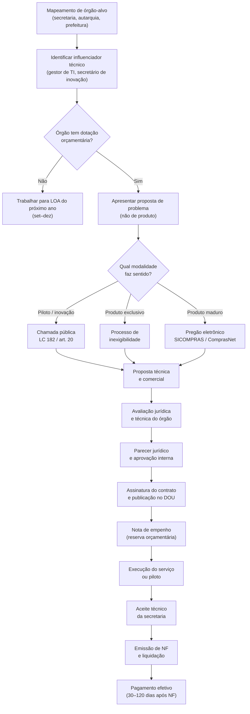
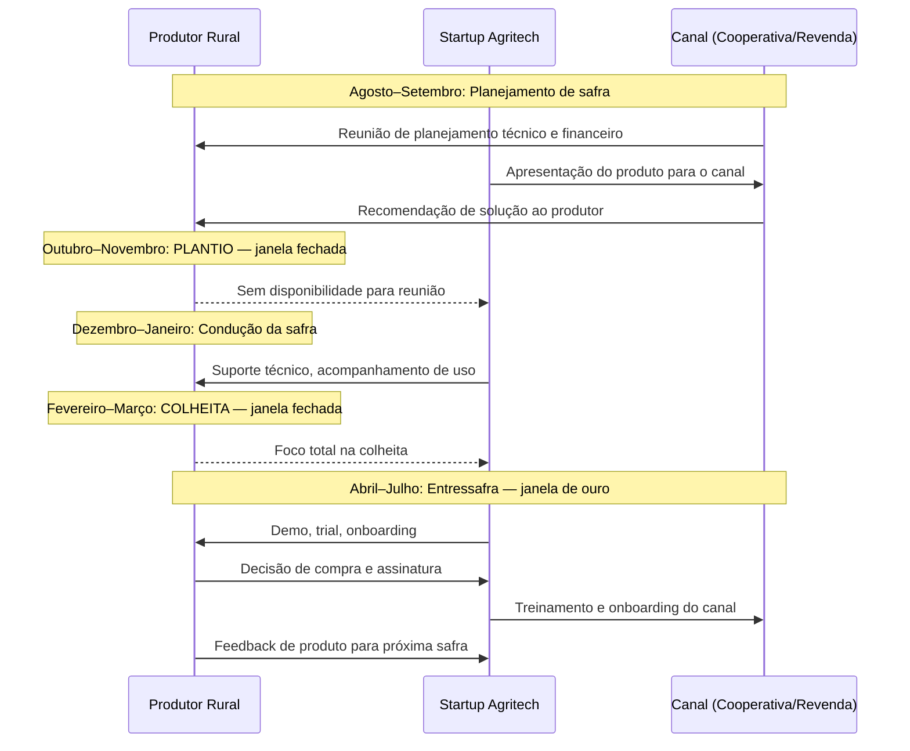
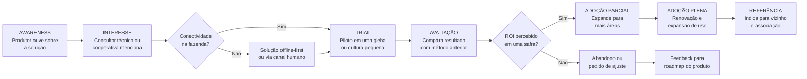
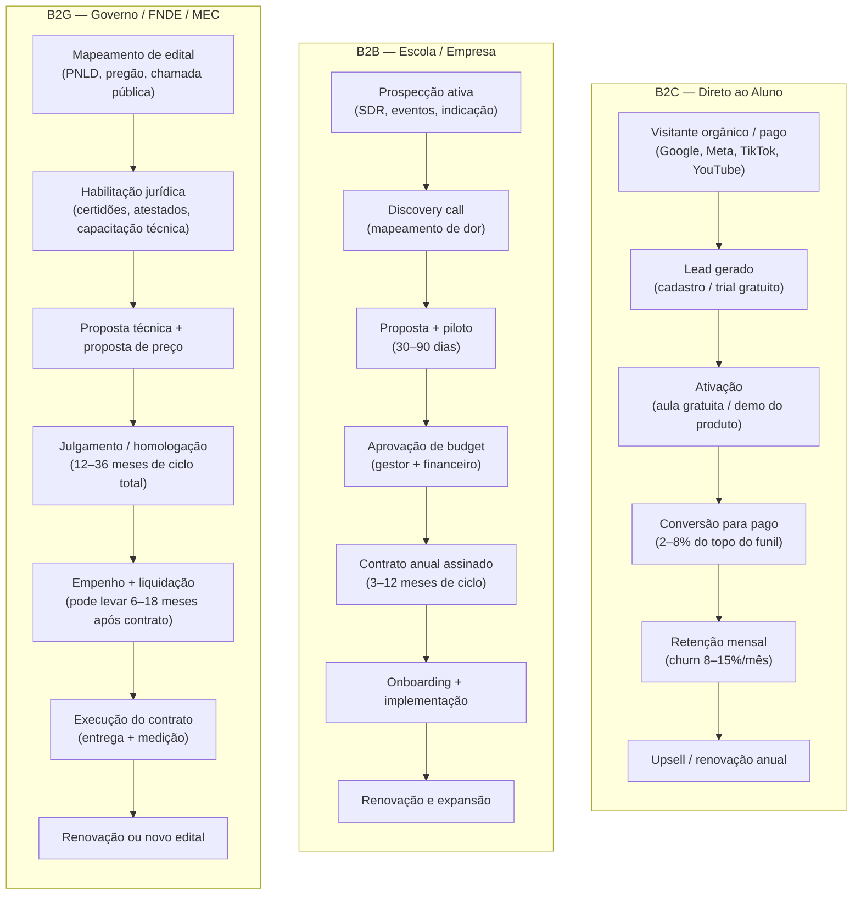
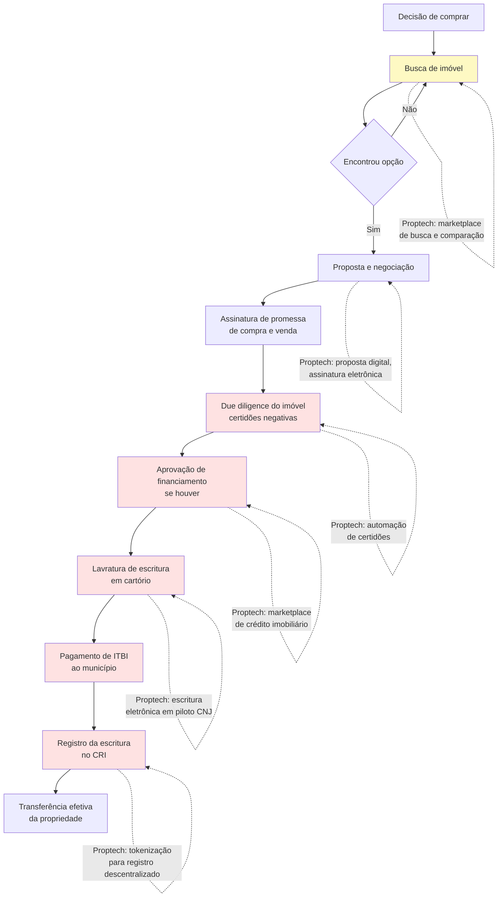
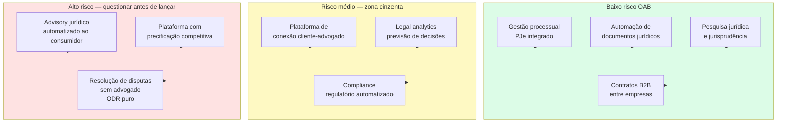
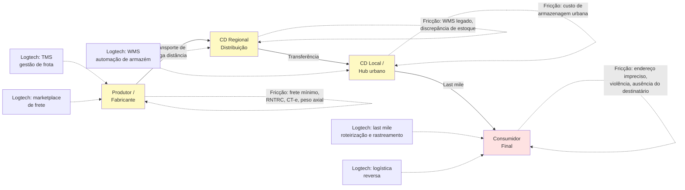
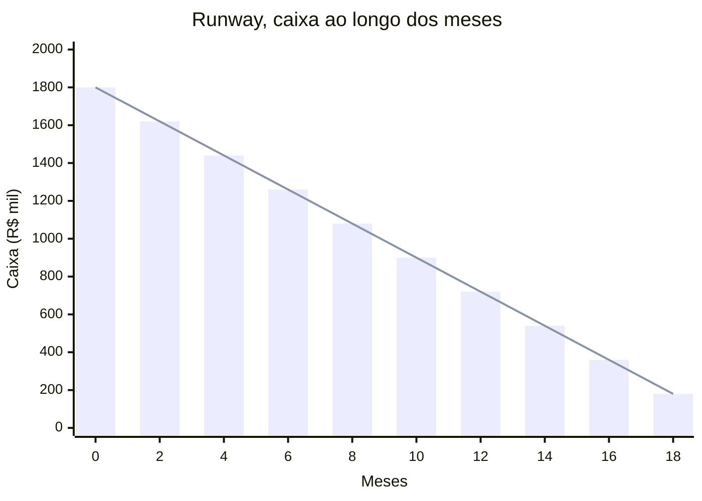

# IGNIÇÃO — Volume 10: Playbooks Setoriais, Regulação e Glossário Geral

**Macroeconomia, Autarquias Reguladoras, 9 Verticais Brasileiras e Dicionário da Coleção (Capítulos 1 a 13 e Índices)**

*João Prado · 2026 — Edição Autocontida (v4.0)*

---

## Sobre este Volume

Este é o **Volume 10 (Playbooks Setoriais, Regulação e Glossário Geral)** da coleção **IGNIÇÃO — O manual operacional do empreendedor brasileiro** (10 volumes autocontidos).

Volume de fechamento da coleção IGNIÇÃO, reunindo dois acervos essenciais: (1) o manual de operação no ambiente macro-institucional e regulatório brasileiro (Ciclos Macroeconômicos/Selic, Autarquias Reguladoras BACEN/CVM/SUSEP/ANVISA/ANS/ANATEL/ANEEL/ANP, CADE/Antitruste e Políticas Públicas) junto aos 9 Playbooks Setoriais em profundidade (Biotech/Healthtech, Hardware/Deep Tech, Govtech, Agritech, Edtech, Cleantech/ESG, Proptech, Legaltech e Logtech); e (2) o Dicionário e Aparelho Crítico Geral da Coleção (Glossário de Termos Técnicos e de Negócios, Lista de Abreviações, Bibliografia Geral e Unificada, Índice Geral de Frameworks e Índices Analítico e Remissivos).

---

## Mapa da Coleção IGNIÇÃO

```mermaid
graph LR
    subgraph J1["Do Zero à Validação"]
        V1["<b>Vol. 1 — Ideação</b><br/>Fases 0 a 3 · Fundador e Teoria"]
        V2["<b>Vol. 2 — Descoberta e Mercado</b><br/>Fases 4 a 6 · Cliente e Cunha"]
        V3["<b>Vol. 3 — Hipóteses e Protótipo</b><br/>Fases 7 a 10 · Testes e Modelos"]
        V1 --> V2 --> V3
    end
    subgraph J2["Tração e Escala"]
        V4["<b>Vol. 4 — Tração e PMF</b><br/>Fases 11 a 13 · MVP, GTM e Vendas"]
        V5["<b>Vol. 5 — Finanças e Captação</b><br/>Fase 14 · Caixa, VC, Tributário e FP&A"]
        V6["<b>Vol. 6 — Receita e Pessoas</b><br/>Fases 15 e 16 · Enterprise, Líderes e Cultura"]
        V7["<b>Vol. 7 — Produto e Engenharia</b><br/>Fase 17 · Operações, IA e Arquitetura"]
        V8["<b>Vol. 8 — Jurídico e Segurança</b><br/>Fase 18 · Societário, Contratos e LGPD"]
        V3 --> V4 --> V5 --> V6 --> V7 --> V8
    end
    subgraph J3["Ciclo Longo e Setores"]
        V9["<b>Vol. 9 — Maturidade e Exit</b><br/>Fases 19 e 20 · Board, Crise, M&A e IPO"]
        V10["<b>Vol. 10 — Verticais e Glossário</b><br/>Regulação, 9 Setores e Índices Gerais"]
        V8 --> V9
    end
    V10 -. "Consulta Setorial e Dicionário" .-> J1
    V10 -. "Consulta Setorial e Dicionário" .-> J2
    V10 -. "Consulta Setorial e Dicionário" .-> J3
```



---

## Sumário deste Volume

### Ambiente Macroeconômico, Regulatório Setorial, Antitruste e Políticas Públicas (Capítulos 1 a 4)
- [[#CAPÍTULO 1 — CICLOS MACROECONÔMICOS E A STARTUP BRASILEIRA|CAPÍTULO 1 — CICLOS MACROECONÔMICOS E A STARTUP BRASILEIRA]]
- [[#CAPÍTULO 2 — REGULATÓRIO SETORIAL BRASILEIRO|CAPÍTULO 2 — REGULATÓRIO SETORIAL BRASILEIRO]]
- [[#CAPÍTULO 3 — CADE E ANTITRUSTE — QUANDO O CRESCIMENTO ATRAI O REGULADOR|CAPÍTULO 3 — CADE E ANTITRUSTE — QUANDO O CRESCIMENTO ATRAI O REGULADOR]]
- [[#CAPÍTULO 4 — POLÍTICA PÚBLICA COMO ESTRATÉGIA|CAPÍTULO 4 — POLÍTICA PÚBLICA COMO ESTRATÉGIA]]
### Playbooks de Verticais e Setores Regulados no Brasil (Capítulos 5 a 13)
- [[#CAPÍTULO 5 — BIOTECH E HEALTHTECH: PLAYBOOK DE REGULAÇÃO, ENSAIOS E CAPITAL|CAPÍTULO 5 — BIOTECH E HEALTHTECH: PLAYBOOK DE REGULAÇÃO, ENSAIOS E CAPITAL]]
- [[#CAPÍTULO 6 — HARDWARE E DEEP TECH: CONSTRUIR NEGÓCIO COM FABRICAÇÃO, IP E HORIZONTES LONGOS|CAPÍTULO 6 — HARDWARE E DEEP TECH: CONSTRUIR NEGÓCIO COM FABRICAÇÃO, IP E HORIZONTES LONGOS]]
- [[#CAPÍTULO 7 — GOVTECH: STARTUP VENDENDO PARA GOVERNO|CAPÍTULO 7 — GOVTECH: STARTUP VENDENDO PARA GOVERNO]]
- [[#CAPÍTULO 8 — AGRITECH: PLAYBOOK PARA O CAMPO BRASILEIRO|CAPÍTULO 8 — AGRITECH: PLAYBOOK PARA O CAMPO BRASILEIRO]]
- [[#CAPÍTULO 9 — EDTECH: PLAYBOOK PARA TECNOLOGIA DE EDUCAÇÃO NO BRASIL|CAPÍTULO 9 — EDTECH: PLAYBOOK PARA TECNOLOGIA DE EDUCAÇÃO NO BRASIL]]
- [[#CAPÍTULO 10 — CLEANTECH E ESG: STARTUPS DE IMPACTO AMBIENTAL NO BRASIL|CAPÍTULO 10 — CLEANTECH E ESG: STARTUPS DE IMPACTO AMBIENTAL NO BRASIL]]
- [[#CAPÍTULO 11 — PROPTECH: TECNOLOGIA NO MERCADO IMOBILIÁRIO BRASILEIRO|CAPÍTULO 11 — PROPTECH: TECNOLOGIA NO MERCADO IMOBILIÁRIO BRASILEIRO]]
- [[#CAPÍTULO 12 — LEGALTECH: TECNOLOGIA JURÍDICA NO BRASIL|CAPÍTULO 12 — LEGALTECH: TECNOLOGIA JURÍDICA NO BRASIL]]
- [[#CAPÍTULO 13 — LOGTECH: TECNOLOGIA EM LOGÍSTICA E SUPPLY CHAIN NO BRASIL|CAPÍTULO 13 — LOGTECH: TECNOLOGIA EM LOGÍSTICA E SUPPLY CHAIN NO BRASIL]]
### Glossários, Bibliografias e Índices Gerais da Coleção
- [[#DATA DE COMPILAÇÃO E NOTA SOBRE ENVELHECIMENTO|DATA DE COMPILAÇÃO E NOTA SOBRE ENVELHECIMENTO]]
- [[#GLOSSÁRIO DE TERMOS TÉCNICOS|GLOSSÁRIO DE TERMOS TÉCNICOS]]
- [[#GLOSSÁRIO TEMÁTICO DE NEGÓCIOS|GLOSSÁRIO TEMÁTICO DE NEGÓCIOS]]
- [[#LISTA DE ABREVIAÇÕES|LISTA DE ABREVIAÇÕES]]
- [[#BIBLIOGRAFIA GERAL|BIBLIOGRAFIA GERAL]]
- [[#BIBLIOGRAFIA UNIFICADA POR DOMÍNIO|BIBLIOGRAFIA UNIFICADA POR DOMÍNIO]]
- [[#ÍNDICE GERAL DE FRAMEWORKS DA COLEÇÃO|ÍNDICE GERAL DE FRAMEWORKS DA COLEÇÃO]]
- [[#ÍNDICE ANALÍTICO|ÍNDICE ANALÍTICO]]
- [[#ÍNDICE REMISSIVO|ÍNDICE REMISSIVO]]
- [[#ÍNDICE REMISSIVO DE TERMOS-CHAVE|ÍNDICE REMISSIVO DE TERMOS-CHAVE]]

---

# AMBIENTE MACROECONÔMICO, REGULATÓRIO SETORIAL, ANTITRUSTE E POLÍTICAS PÚBLICAS (CAPÍTULOS 1 A 4)

### Arquitetura deste Domínio: O Tabuleiro Macroeconômico, Regulatório e Concorrencial Brasileiro (Capítulos 1 a 4)

Este **Volume 10** cumpre duas missões na coleção IGNIÇÃO: ser o **manual definitivo para empreender em setores regulados e verticais específicas no Brasil** (Capítulos 1 a 13) e consolidar o **Dicionário, a Bibliografia e os Índices Gerais de toda a obra**.

Nos quatro primeiros capítulos, mapeamos as forças estruturais do Estado e da macroeconomia brasileira que afetam qualquer empresa no país:

- **[[#CAPÍTULO 1 — CICLOS MACROECONÔMICOS E A STARTUP BRASILEIRA|Capítulo 1 — Ciclos Macroeconômicos e a Startup Brasileira]]:** Como a taxa Selic, a inflação, o câmbio e a liquidez global alteram o custo de capital, a inadimplência e os múltiplos de *valuation* no Brasil.
- **[[#CAPÍTULO 2 — REGULATÓRIO SETORIAL BRASILEIRO|Capítulo 2 — Regulatório Setorial Brasileiro]]:** O mapa das autarquias brasileiras — **BACEN, CVM, SUSEP, ANVISA, ANS, ANATEL, ANEEL e ANP** —, suas licenças, *sandboxes* regulatórios e tempos de aprovação.
- **[[#CAPÍTULO 3 — CADE E ANTITRUSTE — QUANDO O CRESCIMENTO ATRAI O REGULADOR|Capítulo 3 — CADE e Antitruste]]:** Quando o crescimento orgânico, contratos de exclusividade ou aquisições de concorrentes exigem notificação prévia e defesa concorrencial no CADE.
- **[[#CAPÍTULO 4 — POLÍTICA PÚBLICA COMO ESTRATÉGIA|Capítulo 4 — Política Pública como Estratégia]]:** Como interagir institucionalmente com o Poder Público, participar de consultas públicas e transformar regulação em vantagem competitiva defensável (*regulatory moat*).

---

## CAPÍTULO 1 — CICLOS MACROECONÔMICOS E A STARTUP BRASILEIRA

**Ciclos Macroeconômicos e a Startup Brasileira — Navegar Recessão, Inflação e Ciclos de Capital**

> [!abstract] Posicao no livro
> Este capítulo cobre como ciclos macroeconomicos brasileiros (SELIC, inflacao, cambio, inverno do VC) afetam decisao de captacao, escala e exit. Aplicar especialmente em,
> - [[IGNICAO-Vol-4-Tracao-e-PMF#FASE 12 — VALIDAÇÃO DO MODELO DE NEGÓCIO|Fase 12 (Vol. 4)]] e [[IGNICAO-Vol-8-Juridico-LGPD-e-Seguranca#FASE 18 — ESTRUTURAÇÃO JURÍDICA, SOCIETÁRIA E BLINDAGEM OPERACIONAL|Fase 18 (Vol. 8)]] para timing de rodada
> - [[IGNICAO-Vol-6-Receita-e-Pessoas#FASE 16 — TIME, LIDERANÇA EXECUTIVA E CULTURA EM ESCALA|Fase 16 (Vol. 6)]] para estrategia de contracao em janela ruim
> - [[IGNICAO-Vol-9-Maturidade-e-Exit#FASE 20 — ESTRATÉGIA DE SAÍDA (EXIT STRATEGY)|Fase 20 (Vol. 9)]] para timing de saida

---

### 1. Por que o macro importa para startups

Existe uma narrativa sedutora no ecossistema de inovação: a startup opera num mercado próprio, cria demanda onde não existia, então os ciclos da "velha economia" não se aplicam. Essa ilusão mata empresas.

A realidade é que todo negócio brasileiro está exposto ao ambiente macroeconômico de maneira direta e indireta, mesmo quando os fundadores não conseguem ver as conexões. Os três canais de transmissão mais relevantes são:

**Canal 1 — Custo de capital**

Quando o Banco Central eleva a SELIC, o custo de oportunidade do dinheiro sobe para todo o sistema. O investidor que antes aceitava apostar num SaaS em fase seed agora pode obter 13% ao ano com risco zero em LFT. O prêmio de risco exigido por participar de uma startup cresce. O resultado imediato é compressão de múltiplos e processos de captação mais longos, mais exigentes e com valuation menor.

**Canal 2 — Burn rate real**

Inflação corrói o poder de compra do caixa. Uma startup que levantou R$ 2 milhões em janeiro de 2021 e projetou 24 meses de runway viu esse prazo encolher porque o IPCA acumulou mais de 20% nesse período. Custos de escritório, softwares, serviços terceirizados e folha de pagamento sobem. O runway nominal permanece, mas o runway real se contrai.

**Canal 3 — Exposição cambial invisível**

A maioria das startups brasileiras tem custos em dólar que não aparecem como dólar na contabilidade: servidores AWS, Stripe, licenças Figma, HubSpot, Slack, Notion, Intercom. Quando o real se desvaloriza de R$ 4,00 para R$ 5,50 por dólar, a linha de despesas de infraestrutura cresce 37,5% sem que nenhuma decisão operacional tenha sido tomada.

> [!warning]
> Ignorar o macro não o neutraliza. Significa apenas que você será surpreendido por ele em vez de se preparar para ele.

---

### 2. O ciclo econômico brasileiro: as quatro fases

O Brasil tem um ciclo econômico mais volátil do que economias desenvolvidas por três razões estruturais: dependência de commodities, fragilidade fiscal crônica e sensibilidade a fluxos de capital externo. Isso amplifica tanto as expansões quanto as contrações.

```text
CICLO ECONÔMICO — FASES E CARACTERÍSTICAS

┌─────────────────────────────────────────────────────────────────┐
│  EXPANSÃO          │  Crédito barato, confiança alta,           │
│                    │  investidor apetitoso, talentos caros       │
├─────────────────────────────────────────────────────────────────┤
│  PICO              │  Inflação começa a subir, BC eleva SELIC,   │
│                    │  janela de captação ainda aberta            │
├─────────────────────────────────────────────────────────────────┤
│  CONTRAÇÃO         │  Crédito se contrai, VC recua, runway       │
│                    │  encurta, clientes cortam gastos            │
├─────────────────────────────────────────────────────────────────┤
│  RECUPERAÇÃO       │  Oportunidade de consolidação, valuation    │
│                    │  comprimido cria M&A barato, capital         │
│                    │  começa a retornar seletivamente            │
└─────────────────────────────────────────────────────────────────┘
```

**2010–2012 — O boom**

O Brasil vivia o ciclo das commodities, fluxo de capital externo abundante e crédito barato. A SELIC caiu para 7,25% em 2012 — mínima histórica até então. O ecossistema de startups cresceu numa bolha de otimismo. Fundadores captavam com múltiplos generosos porque o custo de oportunidade do dinheiro era baixo e a narrativa do "Brasil que vai dar certo" estava no auge.

**2015–2016 — A recessão**

O PIB recuou 3,5% em 2015 e mais 3,3% em 2016. A SELIC subiu para 14,25%. O crédito secou, o desemprego bateu 13%, e o consumo das famílias colapsou. Startups que dependiam de crescimento de mercado consumidor sentiram na pele: a demanda simplesmente não estava lá. Empresas que tinham runway curto não sobreviveram. As que tinham eficiência de capital atravessaram e saíram mais fortes.

**2020 — A pandemia**

Um choque exógeno que colapsou setores inteiros em semanas. O BC cortou a SELIC para 2% em resposta, criando paradoxalmente uma das melhores janelas de captação da história do ecossistema brasileiro — porque capital barato e digitalização forçada aceleraram a demanda por software. Empresas de saúde digital, edtech e logística viram crescimento de 3–5 anos acontecer em 12 meses.

**2021–2022 — O aperto monetário global**

O ciclo de juro zero terminou. O Fed subiu a faixa-alvo de 0 a 0,25 por cento para 5,25 a 5,50 por cento entre março de 2022 e julho de 2023. O Banco Central brasileiro, que já havia sido mais rápido no aperto, manteve a SELIC acima de 13%. O capital de risco global recuou. Rodadas que seriam fechadas em 60 dias passaram a levar 9 meses. Valuations caíram 40 a 60% em muitas categorias. O inverno do VC tinha chegado.

> [!note]
> O Brasil tipicamente antecipa o ciclo de aperto e atrasa o ciclo de afrouxamento em relação aos EUA. Isso significa que o ecossistema local sente o frio antes e o sente por mais tempo.

---

### 3. SELIC e startups: o mecanismo de compressão de valuations

A SELIC não é apenas a taxa do tesouro. Ela é a âncora de toda a estrutura de desconto da economia. Para entender o impacto em valuations de startups, o mecanismo é o seguinte:

**O modelo de fluxo de caixa descontado**

O valor de qualquer ativo é o valor presente dos fluxos de caixa futuros. A taxa de desconto usada nesse cálculo inclui a taxa livre de risco (aproximada pela SELIC para ativos em real) mais um prêmio de risco. Quando a SELIC sobe, a taxa de desconto sobe, e o valor presente dos fluxos futuros cai.

Uma startup de SaaS que projeta R$ 10 milhões de fluxo de caixa livre em 2030 vale:

```text
IMPACTO DA SELIC NO VALOR PRESENTE

Taxa de desconto  │  Valor presente de R$ 10M em 5 anos
──────────────────┼──────────────────────────────────────
8%                │  R$ 6,81 milhões
13%               │  R$ 5,43 milhões   (queda de 20%)
15%               │  R$ 4,97 milhões   (queda de 27%)
```

O efeito é ainda mais dramático para startups em fase inicial, onde os fluxos positivos estão mais distantes no tempo.

**O efeito no apetite do investidor**

Quando a renda fixa oferece 13% ao ano com liquidez diária e risco zero, o investidor de VC precisa acreditar que a startup vai entregar retorno muito superior para justificar a iliquidez e o risco. O número de operações que passam pelo filtro diminui. Os cheques ficam menores. As condições de investimento ficam mais rígidas.

**O custo de crédito operacional**

Mesmo que a startup não dependa de VC, o custo do crédito bancário e de linhas como o Cartão BNDES ou capital de giro sobe diretamente com a SELIC. Financiamentos que eram viáveis a CDI + 3% se tornam insustentáveis quando o CDI está em 13%.

> [!important]
> Fundadores devem conhecer a SELIC projetada pelo boletim Focus para os próximos 12 meses antes de projetar qualquer modelo de valuation ou planejamento de captação.

---

### 4. Inflação e operações: proteger contratos e custo do time

Inflação não é apenas número de jornal. Ela afeta a operação da startup em três dimensões práticas: contratos com clientes, custo da equipe e precificação de produtos.

**Contratos e cláusulas de reajuste**

Todo contrato SaaS ou de serviço firmado no Brasil sem cláusula de reajuste é um contrato que perde valor em termos reais ao longo do tempo. A prática recomendada é incluir reajuste anual indexado a um índice de preços.

A escolha do índice importa:

```text
ÍNDICES DE INFLAÇÃO — COMPARATIVO

Índice   │ O que mede                  │ Quando usar
─────────┼─────────────────────────────┼────────────────────────────
IPCA     │ Inflação ao consumidor      │ Contratos B2C, SaaS para PME
IGP-M    │ Inclui inflação atacadista  │ Aluguéis comerciais
INPC     │ Consumidor de baixa renda   │ Salários mínimos, acordos CLT
IPCA-E   │ IPCA estimado mensal        │ Contratos com reajuste mensal
```

O IGP-M tem alta volatilidade — chegou a acumular 23% em 2020 — e pode criar passivos inesperados se usado em contratos com clientes que não têm essa exposição natural. Para a maioria das startups B2B, o IPCA é o índice mais defensável e aceito pelos clientes.

A cláusula de reajuste deve ser clara: "O valor contratual será reajustado anualmente na data de aniversário do contrato pelo IPCA acumulado nos 12 meses anteriores, divulgado pelo IBGE." Sem ambiguidade sobre o índice, o período de cálculo e a data de aplicação.

**Custo do time e salário real**

Em períodos de inflação alta, manter talentos exige atenção ao salário real, não apenas ao nominal. Um colaborador que não recebeu aumento enquanto o IPCA acumulou 8% sofreu queda de 8% no poder de compra. Isso cria insatisfação, turnover e risco de perder pessoas-chave para empresas que fizeram reajuste.

A prática saudável é comunicar claramente o critério de reajuste anual da empresa — seja IPCA integral, seja IPCA parcial com complemento por mérito — antes que o colaborador precise pedir.

**Pricing em período inflacionário**

Aumentar preço em período de inflação alta é politicamente mais fácil do que em período de estabilidade, porque o contexto geral justifica a conversa. Empresas que postergam reajustes de preço perdem margem e precisam de aumentos maiores e mais disruptivos no futuro.

> [!tip]
> Em contratos anuais, programe o reajuste para coincidir com a renovação. Em contratos mensais, avise com 30 dias de antecedência e use a linguagem de reajuste contratual previsto — não de "aumento de preço".

---

### 5. Câmbio como risco e oportunidade

O câmbio é a variável mais frequentemente ignorada em modelos financeiros de startups brasileiras. Existem dois perfis opostos de exposição:

**O perfil de risco: custo em dólar, receita em real**

É o perfil da maioria das startups em fase inicial. A infraestrutura é americana (AWS, GCP, Azure), as ferramentas são americanas (Stripe, Twilio, Segment, Amplitude), e a receita é em real. Quando o dólar sobe de R$ 4,80 para R$ 5,60 — variação de 16,7% — os custos de infraestrutura crescem na mesma proporção sem nenhuma contrapartida na receita.

Ações para mitigar:

- Mapear todas as despesas em moeda estrangeira e calcular a exposição mensal em dólar
- Negociar créditos anuais com provedores cloud, reduzindo exposição a variação intra-ano
- Manter parte do caixa em dólar como reserva natural de hedge
- Avaliar alternativas nacionais para componentes de baixa criticidade (provedores cloud locais, ferramentas nacionais)

**O perfil de vantagem: receita em dólar, equipe em real**

Startups com tração internacional — seja por produto global, seja por clientes fora do Brasil — têm vantagem competitiva quando o real se desvaloriza. A receita em dólar se converte em mais reais, enquanto o custo da equipe permanece em real. A margem operacional real sobe.

Esse diferencial é uma das razões pelas quais fundadores de startups com vocação global devem priorizar receita internacional cedo — não apenas para diversificar mercado, mas para criar hedge natural contra a volatilidade cambial.

**Hedge cambial para PME**

Para startups com exposição significativa ao câmbio, existem instrumentos de proteção acessíveis a pequenas empresas:

```text
INSTRUMENTOS DE HEDGE CAMBIAL

Instrumento       │ Como funciona                  │ Adequado para
──────────────────┼────────────────────────────────┼──────────────────────
NDF               │ Contrato a termo de câmbio     │ Exposição previsível,
(Non-Deliverable  │ sem entrega física, liquidado  │ pagamentos futuros
Forward)          │ pela diferença                 │ em USD conhecidos
──────────────────┼────────────────────────────────┼──────────────────────
Opção de câmbio   │ Direito (não obrigação) de     │ Proteção com custo
                  │ comprar USD a preço fixo       │ definido, exposição
                  │                                │ variável
──────────────────┼────────────────────────────────┼──────────────────────
Reserva em USD    │ Manter parte do caixa em       │ Proteção simples,
                  │ dólar em conta no exterior     │ sem sofisticação
                  │ ou conta internacional         │ necessária
──────────────────┼────────────────────────────────┼──────────────────────
Conta no exterior │ Conta em banco americano       │ Startups com receita
                  │ ou europeu para receber        │ internacional
                  │ e pagar em USD                 │ recorrente
```

> [!warning]
> NDF e opções de câmbio têm custo e exigem contrapartes bancárias. Para a maioria das startups em fase inicial, a reserva em dólar é a solução mais prática. Contratar instrumentos financeiros complexos sem entender o mecanismo pode criar risco adicional.

---

### 6. Ciclos de capital de risco: o inverno do VC

O capital de risco não é uma fonte estável de financiamento. Ele se expande e se contrai com o ciclo global de liquidez. Compreender esse ciclo é fundamental para planejar captações.

**O mecanismo de transmissão global**

Quando o Fed sobe juros nos EUA, os fundos de pensão e endowments americanos — que são os LPs (Limited Partners) dos grandes VCs globais — alocam mais capital em renda fixa e menos em fundos alternativos como VC. Os grandes VCs reduzem a velocidade de investimento. Os VCs brasileiros, que frequentemente recebem capital de fundos internacionais ou de LPs que também investem em fundos internacionais, sentem o mesmo aperto com defasagem de 6 a 12 meses.

**O inverno de 2022–2023**

O ciclo de aperto monetário global que começou em 2022 provocou uma contração severa no mercado de VC global. No Brasil, o impacto foi direto:

- Volume de rodadas caiu 40–50% em relação ao pico de 2021
- Valuations pré-money de seed e série A recuaram 30–50%
- Tempo médio de fechamento de rodada subiu de 3 para 6–9 meses
- Exigência de métricas de eficiência (LTV/CAC, payback period, margem bruta) substituiu foco exclusivo em crescimento

**O que os VCs brasileiros fazem quando o mercado global esfria**

Os gestores de VC locais adotam comportamentos previsíveis em downturns:

- Desaceleram o ritmo de novas alocações para preservar pólvora para follow-ons do portfólio existente
- Elevam o bar de entrada: exigem receita recorrente, path para rentabilidade e fundadores com experiência anterior
- Aumentam o peso de due diligence financeira em relação à due diligence de mercado
- Preferem valuations mais baixos e rounds menores com cláusulas de proteção (anti-diluição, liquidation preference)

**Como se preparar para captar em ambiente restritivo**

A preparação começa 12 a 18 meses antes da rodada:

- Atingir métricas de eficiência que resistam ao escrutínio: churn abaixo de 2% ao mês, LTV/CAC acima de 3x, payback em menos de 12 meses
- Construir relacionamento com 3 a 5 fundos antes de precisar do dinheiro
- Ter 18 meses de runway no momento em que iniciar o processo de captação
- Documentar a tese de resiliência: como o negócio se comportou (ou se comportaria) em contração econômica

> [!note]
> A janela de captação se reabre antes do ciclo econômico se recuperar completamente. Os melhores termos tendem a aparecer 6 a 12 meses antes do pico do ciclo — quando o capital começa a voltar mas a competição por deals ainda não aqueceu.

---

### 7. Estratégia de crise: o playbook de contração

Quando a macroeconômica aperta, a startup precisa de um playbook claro. A decisão central é binária: estender runway (modo defensivo) ou crescer através do downturn (modo ofensivo).

**Quando estender runway**

A escolha defensiva é apropriada quando:

- O mercado-alvo da startup é diretamente afetado pelo ciclo (consumo discricionário, crédito, imóveis)
- A startup ainda não atingiu product-market fit claro
- O runway atual é inferior a 18 meses
- O pipeline de captação está incerto

O objetivo é chegar ao outro lado da crise com a empresa intacta. Isso significa cortes reais, não cosméticos.

**O que cortar primeiro**

```text
HIERARQUIA DE CORTES EM CRISE

Prioridade 1 — Cortar imediatamente:
  - Marketing de aquisição pago com CAC elevado
  - Contratos de fornecedores não essenciais
  - Viagens e eventos
  - Softwares com uso abaixo de 30% da capacidade contratada

Prioridade 2 — Renegociar:
  - Aluguel de escritório (home office como padrão)
  - Contratos de prestadores de serviço
  - Planos de infraestrutura cloud (right-sizing)

Prioridade 3 — Avaliar com cuidado:
  - Headcount em funções não essenciais ao produto core
  - Projetos de expansão de produto sem validação de demanda

Nunca cortar:
  - Time core de produto e engenharia
  - Customer success de clientes que geram receita
  - Capacidade de entrega do produto atual
```

**Quando crescer através do downturn**

A escolha ofensiva é válida quando:

- O produto da startup resolve um problema que se intensifica em crise (redução de custo, automação, eficiência)
- A startup tem runway superior a 24 meses
- Concorrentes estão recuando, abrindo espaço de mercado
- A janela de captação ainda está aberta para o perfil da empresa

**A crise como janela de consolidação**

Downturns criam oportunidades de M&A que não existem em períodos de expansão. Concorrentes com menos capital ficam vulneráveis. Talentos ficam disponíveis. Clientes que estavam satisfeitos com o status quo ficam abertos a soluções mais eficientes.

Empresas que atravessaram crises com saúde financeira e capturaram consolidação saíram estruturalmente mais fortes. O exemplo brasileiro mais claro é o ciclo de 2015–2016, que eliminou dezenas de startups e concentrou mercado nas sobreviventes mais bem capitalizadas.

> [!important]
> A pior decisão em crise é a indecisão: nem cortar o suficiente para garantir runway nem investir com convicção suficiente para capturar oportunidade. Defina o modo em que está operando e execute com consistência.

---

### 8. Indicadores que o fundador deve monitorar

O acompanhamento do ambiente macroeconômico não exige ser economista. Exige um painel de 6 a 8 indicadores monitorados com frequência definida.

```text
PAINEL MACROECONÔMICO DO FUNDADOR

Indicador                  │ Fonte        │ Frequência  │ O que sinaliza
───────────────────────────┼──────────────┼─────────────┼─────────────────────────────
SELIC (Meta)               │ Banco Central│ Mensal      │ Custo de capital, apetite VC
SELIC (Boletim Focus)      │ Banco Central│ Semanal     │ Expectativa do mercado 12m
IPCA (acumulado 12m)       │ IBGE         │ Mensal      │ Pressão de custo, pricing
IGP-M                      │ FGV          │ Mensal      │ Contratos com indexação
USD/BRL (câmbio comercial) │ Banco Central│ Diária      │ Custo infra, receita USD
Inadimplência PJ           │ Banco Central│ Mensal      │ Saúde financeira de clientes
ICE/FGV (Confiança do      │ FGV          │ Mensal      │ Propensão a investir/contratar
Empresário)                │              │             │
PIB (prévia e realizado)   │ IBGE         │ Trimestral  │ Ciclo econômico geral
```

**SELIC e Boletim Focus**

O Boletim Focus é publicado toda segunda-feira pelo Banco Central e consolida as expectativas de mais de 100 instituições financeiras para os principais indicadores. A SELIC projetada para 12 e 24 meses é o dado mais relevante para planejar captações e modelar valuation.

**IPCA acumulado 12 meses**

O IPCA cheio dá o contexto geral, mas para startups de software é útil acompanhar o IPCA de serviços — que tende a ser mais persistente e reflete melhor o custo de mão de obra qualificada.

**Inadimplência pessoa jurídica**

Publicado mensalmente pelo Banco Central, o índice de inadimplência de pessoas jurídicas sinaliza a saúde financeira das empresas clientes. Para startups B2B, inadimplência crescente precede cancelamentos e dificuldades de cobrança.

**ICE — Índice de Confiança do Empresário (FGV)**

O ICE mede a percepção dos empresários sobre o ambiente de negócios atual e futuro. Quando o índice cai de forma consistente, decisões de compra corporativas ficam represadas — o que afeta diretamente o ciclo de vendas de startups B2B.

**Construindo o hábito de monitoramento**

A sugestão prática é criar um ritual de 30 minutos mensais para atualizar o painel. Não para fazer previsões macroeconômicas — isso não é o papel do fundador — mas para verificar se o cenário operacional mudou o suficiente para exigir ajuste de plano.

> [!tip]
> O app do Banco Central (SGS — Sistema Gerenciador de Séries Temporais) permite exportar qualquer série histórica em planilha. Configure alertas de variação para SELIC e câmbio. Quando uma variável ultrapassar um limiar definido, o painel chama atenção automaticamente.

---

### Síntese: a mentalidade macro do fundador brasileiro

Este capítulo cobre os quatro canais pelos quais o ambiente macroeconômico afeta startups (custo de capital, burn real, câmbio e ciclo de VC) e os playbooks para cada fase do ciclo. Ele conecta-se diretamente à Fase 8 (crescimento e escala) e ao Capítulo 7 (Vol. 4) (PRODUCT MARKETING: POSICIONAMENTO, MENSAGEM E LANÇAMENTO) (modelagem financeira), onde as decisões de runway e captação precisam incorporar leitura macro.

```text
PRINCÍPIOS DE RESILIÊNCIA MACROECONÔMICA

1. Manter runway mínimo de 18 meses em qualquer fase do ciclo
2. Indexar contratos de receita a índice de inflação desde o primeiro contrato
3. Mapear exposição cambial antes de ela se tornar um problema
4. Monitorar o painel macro mensalmente, não reativamente
5. Definir gatilhos de decisão antecipados: "se SELIC superar X, faço Y"
6. Construir para eficiência antes de precisar dela
7. Cultivar relacionamentos com investidores fora dos processos de captação
```

A startup que sobrevive a um ciclo completo — expansão, contração, recuperação — emerge com vantagens competitivas que não podem ser compradas: resiliência operacional, base de clientes testada e equipe que sabe operar sob pressão.

---

**Ver também:**

- [[IGNICAO-Vol-4-Tracao-e-PMF#CAPÍTULO 7 — PRODUCT MARKETING: POSICIONAMENTO, MENSAGEM E LANÇAMENTO|Capítulo 7 — Fundamentos de Modelagem Financeira para Startups (Vol. 4)]]
- [[IGNICAO-Vol-6-Receita-e-Pessoas#CAPÍTULO 2 — VENDAS COMPLEXAS ENTERPRISE: CICLO LONGO, ALTO VALOR, MÚLTIPLOS DECISORES|Capítulo 2 — Estrutura de Captação e Rodadas de Investimento (Vol. 6)]]
- [[IGNICAO-Vol-5-Financas-e-Captacao#CAPÍTULO 16 — PLANEJAMENTO FINANCEIRO E ORÇAMENTO|Capítulo 16 — Métricas Financeiras e Indicadores de Saúde (Vol. 5)]]
- [[IGNICAO-Vol-6-Receita-e-Pessoas#CAPÍTULO 14 — COMPENSAÇÃO E BENEFÍCIOS NO BRASIL|Capítulo 14 — Planejamento de Runway e Gestão de Caixa (Vol. 6)]]
- [[IGNICAO-Vol-2-Descoberta-e-Mercado#CAPÍTULO 2 — INTELIGÊNCIA COMPETITIVA — MONITORAMENTO, ANÁLISE E RESPOSTA|Capítulo 2 — Precificação e Modelagem de Receita (Vol. 2)]]
- [[IGNICAO-Vol-4-Tracao-e-PMF#FASE 12 — VALIDAÇÃO DO MODELO DE NEGÓCIO|Fase 12 — Validação do Modelo de Negócio (Vol. 4)]]
- [[IGNICAO-Vol-6-Receita-e-Pessoas#FASE 15 — MÁQUINA DE CRESCIMENTO E EXPANSÃO EM ESCALA|Fase 15 — Máquina de Crescimento e Expansão em Escala (Vol. 6)]]

---

## CAPÍTULO 2 — REGULATÓRIO SETORIAL BRASILEIRO

> [!important] AW como indice regulatorio
> Este capítulo oferece o indice geral de regulatorio brasileiro aplicavel a startups. Para temas com profundidade dedicada, ver,
> - [[IGNICAO-Vol-8-Juridico-LGPD-e-Seguranca#CAPÍTULO 11 — REGULATÓRIO DE IA NO BRASIL|Capítulo 11 (REGULATÓRIO DE IA NO BRASIL) (Vol. 8)]] para IA
> - [[#CAPÍTULO 3 — CADE E ANTITRUSTE — QUANDO O CRESCIMENTO ATRAI O REGULADOR|Capítulo 3 (CADE E ANTITRUSTE — QUANDO O CRESCIMENTO ATRAI O REGULADOR)]] para concorrencial
> - [[#CAPÍTULO 4 — POLÍTICA PÚBLICA COMO ESTRATÉGIA|Capítulo 4 (POLÍTICA PÚBLICA COMO ESTRATÉGIA)]] para politica publica e influencia
> - Capítulos verticais (CM saude, CA hardware, DK govtech, DL agritech, DO proptech, DM edtech, DN cleantech) para regulatorio especifico do setor

> [!abstract] Posicao no livro
> AW e o indice geral de regulatorio setorial brasileiro. Vizinhos relevantes,
> - [[IGNICAO-Vol-8-Juridico-LGPD-e-Seguranca#CAPÍTULO 11 — REGULATÓRIO DE IA NO BRASIL|Capítulo 11 (REGULATÓRIO DE IA NO BRASIL) (Vol. 8)]], quando o tema central e regulacao de sistemas de IA
> - [[#CAPÍTULO 3 — CADE E ANTITRUSTE — QUANDO O CRESCIMENTO ATRAI O REGULADOR|Capítulo 3 (CADE E ANTITRUSTE — QUANDO O CRESCIMENTO ATRAI O REGULADOR)]], quando a empresa cresceu o suficiente para atrair atencao concorrencial
> - [[#CAPÍTULO 4 — POLÍTICA PÚBLICA COMO ESTRATÉGIA|Capítulo 4 (POLÍTICA PÚBLICA COMO ESTRATÉGIA)]], para influenciar a norma antes que ela seja escrita
> - Capítulos verticais regulados (CM, CA, DK, DL, DM, DN, DO, DP, DQ), para mergulho setorial especifico

> [!note] Nota de validade
> Regulação setorial muda frequentemente no Brasil. Alíquotas, prazos de tramitação, entendimento fronteiriço e custos específicos têm meia-vida de doze a vinte e quatro meses. Este capítulo reflete o cenário de abril de 2026 e é mapa estrutural — não substitui advogado setorial especializado para decisões operacionais. Princípios (arquitetura de reguladores, ordem de magnitude de custo, armadilhas recorrentes) têm validade mais longa que detalhes pontuais.

### O que este capítulo cobre

Cobertura regulatória específica por setor. Fundador em vertical regulado enfrenta obrigações que vão além de LGPD (Lei Geral de Proteção de Dados), tributário e trabalhista genéricos. Regulação setorial é pré-requisito operacional: sem ela, a empresa não opera legalmente, sofre multa ou é forçada a suspender operação. O custo de errar aqui costuma ser ordens de magnitude maior que em outras áreas.

### Por que importa

Compliance (conformidade regulatória) setorial é pré-requisito, não opção. Não há "escolha" em fintech regulada: ou você tem licença, ou não pode operar. Autuações setoriais podem ser existenciais, com multas de milhões, suspensão imediata de operação, reputação destruída e inviabilidade de captação subsequente.

Reguladores brasileiros variam em agilidade e previsibilidade. O BCB (Banco Central do Brasil) é relativamente previsível. A ANVISA tem backlog crônico. A ANEEL tem regulamentação em mudança. Conhecer o regulador específico é parte do trabalho.

A competição entre startups reguladas é filtrada por compliance: quem não consegue atingir requisitos sai do jogo cedo. Isso gera tanto barreira de entrada quanto oportunidade para quem domina. E investidor sério não investe em empresa regulada com compliance em atraso. Due diligence descobre, e risco regulatório é deal-killer (mata a negociação).

### Quando agir

Na [[IGNICAO-Vol-2-Descoberta-e-Mercado#FASE 4 — DESCOBERTA DO PROBLEMA|Fase 4 (Vol. 2)]]-4 (descoberta do problema), se você identifica oportunidade em setor regulado, entenda a arquitetura regulatória antes de construir MVP (Minimum Viable Product, produto mínimo viável). Descobrir que seu produto exige licença dezoito meses depois de construí-lo é catastrófico. Na [[IGNICAO-Vol-4-Tracao-e-PMF#FASE 11 — MVP E EXPERIMENTOS DE MERCADO|Fase 11 (Vol. 4)]] (MVP), busque primeiras licenças piloto ou sandboxes regulatórios — ambientes controlados de teste (quando existem). Na [[IGNICAO-Vol-4-Tracao-e-PMF#FASE 13 — PRODUCT-MARKET FIT|Fase 13 (Vol. 4)]] (PMF), compliance pleno é pré-requisito para captar Série A em setor regulado. Da [[IGNICAO-Vol-6-Receita-e-Pessoas#FASE 16 — TIME, LIDERANÇA EXECUTIVA E CULTURA EM ESCALA|Fase 16 (Vol. 6)]] em diante, compliance officer dedicado, relacionamento estruturado com regulador e participação em consultas públicas.

### Quem envolver

Advogado regulatório setorial, não generalista. Fintech pede advogado com experiência em BCB e CVM. Healthtech pede advogado com experiência em ANVISA, ANS e CFM. Custo: quatrocentos a mil e quinhentos reais por hora no Brasil, com projetos típicos de vinte a duzentos mil reais.

Compliance officer dedicado a partir de Série A em setores regulados. Consultorias regulatórias especializadas (Demarest, Mattos Filho, Veirano, BMA, Machado Meyer, Pinheiro Neto têm áreas regulatórias robustas, e existem butiques especializadas por setor). Relacionamento com regulador via associações setoriais (ABFintechs, Anbima, Sindusfarma, Abranet, Abcomm) que têm canais estruturados. Public affairs (relações governamentais) a partir de Série B em setores muito regulados, com profissional dedicado a relacionamento institucional.

### Como — setores em profundidade

#### 1. FINTECH — regulação pelo Banco Central (BCB) e CVM

**Arquitetura regulatória:**

O Brasil tem uma das arquiteturas fintech mais articuladas do mundo, com o BCB funcionando como regulador ativo, iniciador de inovações (Pix, Open Finance) e supervisor. Agenda BC# do BCB estrutura prioridades regulatórias em cinco eixos: inclusão, competitividade, transparência, educação e sustentabilidade.

**Tipos de autorização/licença relevantes:**

**Instituição de Pagamento (IP)**: regulada pela Lei 12.865/2013 e Resoluções BCB. Três subcategorias:

- **Emissor de moeda eletrônica** (wallets, cartões pré-pagos): capital mínimo R$ 2M.
- **Emissor de instrumentos de pagamento pós-pago** (cartões de crédito, BNPL): capital mínimo R$ 2M.
- **Credenciadora** (adquirência): capital mínimo R$ 2M.
- **Iniciador de Transação de Pagamento (ITP)**: categoria nova no Open Finance, capital mínimo R$ 1M.

**Processo de autorização IP:** submissão a BCB com plano de negócios, estrutura societária, governança, compliance, prevenção a lavagem, tecnologia. Tramitação típica: 6-18 meses, frequentemente mais. Custo de assessoria: R$ 300-800k. **Antes da autorização**: empresa opera sob arrangement com IP licenciada (BaaS, Banking as a Service).

**Sociedade de Crédito Direto (SCD)**: regulada pela Resolução CMN 4.656/2018. Modelo para fintechs de crédito. Capital mínimo R$ 1M. Limite: empresa só pode operar com capital próprio (não capta depósito).

- Processo de autorização: 4-12 meses, custo: R$ 200-500k.
- SCD tornou viável para fintech pequena operar crédito sem virar banco completo.

**Sociedade de Empréstimo entre Pessoas (SEP)**: regulada pela mesma resolução. Modelo peer-to-peer lending. Capital mínimo R$ 1M. Limitações específicas de concentração por investidor.

**Banco Digital (Banco Múltiplo ou Banco Comercial)**: autorização plena. Capital mínimo de R$ 17,5M (banco comercial). Tramitação 12-36 meses. Custo: R$ 2-10M só em processo. Caminho de Nubank, Inter, C6 após atingirem maturidade.

**Cooperativa de Crédito**: alternativa menos usada em tech, modelo cooperativista. Regulada pela Lei 4.595/1964 e Resolução CMN.

**CVM, regulação de valores mobiliários:**

- **Gestora de recursos**: exige registro CVM, gestor qualificado CGA/Anbima.
- **Distribuidora de valores mobiliários**: autorização para distribuir produtos de investimento.
- **Crowdfunding de investimento**: regulada pela Instrução CVM 88 (2022). Startups podem captar até R$ 15M/ano via plataformas autorizadas.
- **Tokenização**: regulamentação em construção. CVM classificou alguns tokens como valores mobiliários, depende da natureza.

**COAF, prevenção a lavagem de dinheiro:**

- Toda fintech deve ter programa AML/PLD (Prevenção à Lavagem de Dinheiro).
- Cadastro obrigatório no COAF.
- Obrigação de reportar operações suspeitas.
- Auditoria periódica.

**Sandbox Regulatório BCB (Lab BCB)**:

- Programa para startups testarem soluções inovadoras em ambiente controlado.
- Não substitui licença plena mas permite operação piloto com flexibilização regulatória.
- Ciclos de seleção semestrais.
- Alternativa valiosa para startups em fronteira regulatória.

**Cripto e ativos virtuais:**

- Lei 14.478/2022 (Marco Legal dos Criptoativos): estabeleceu regulação para Prestadores de Serviços de Ativos Virtuais (PSAV).
- BCB é o regulador designado (Decreto 11.563/2023).
- Regulamentação específica em desenvolvimento (2026).
- Empresas como Mercado Bitcoin, Foxbit, Bitso operam neste regime.

**Open Finance:**

- Fase de implementação avançada em 2026.
- Fintechs podem participar como iniciadoras (ITP) ou agregadoras.
- Exige padronização técnica (APIs regulamentadas) e compliance específico.

**Custo típico de compliance em fintech operacional:**

- Capital mínimo: R$ 1-17,5M dependendo da licença.
- Compliance officer + time jurídico: R$ 500k-2M/ano.
- Auditoria e certificações: R$ 200-500k/ano.
- Tecnologia de compliance (RegTech): R$ 100-500k/ano.
- Total: 5-15% do OpEx em fase inicial, reduz com escala.

**Armadilhas específicas de fintech BR:**

- Operar em "área cinza" esperando BCB não ver, resulta em notificação e suspensão.
- Subcapitalizar para chegar ao mínimo legal, investidor percebe, round morre.
- Ignorar AML/PLD por "ainda somos pequenos", multas automáticas quando COAF detecta.
- Usar BaaS como solução permanente, cresce a dependência estrutural do parceiro, viabilidade questionada em DD.
- Assumir que regulação americana (SEC) ou europeia (PSD2) vale no Brasil, arquitetura é diferente.

**Referências práticas:**

- BCB: www.bcb.gov.br (Agenda BC#, resoluções, circulares).
- CVM: www.cvm.gov.br.
- ABFintechs: www.abfintechs.com.br (associação, canais com reguladores).
- Anbima: www.anbima.com.br (regulação autorregulatória).

#### 2. HEALTHTECH — regulação pela ANVISA, ANS, CFM e conselhos profissionais

**Arquitetura regulatória:**

Saúde no Brasil tem múltiplos reguladores com jurisdições parcialmente sobrepostas. Desafio fundador: entender qual(is) regulador(es) incidem sobre seu produto específico.

**ANVISA, Agência Nacional de Vigilância Sanitária:**

Regula **dispositivos médicos** (RDC 751/2022), classificados em 4 classes:

- **Classe I** (baixo risco): termômetros, estetoscópios, apps de wellness. Notificação simples.
- **Classe II** (médio risco): monitores cardíacos, bombas de infusão. Registro obrigatório.
- **Classe III** (alto risco): stents, próteses. Registro mais rigoroso.
- **Classe IV** (máximo risco): implantes cardíacos, equipamentos de suporte à vida.

**Software como Dispositivo Médico (SaMD, Software as a Medical Device):**

- RDC 657/2022 específica para SaMD.
- Classificação baseada em impacto (diagnóstico, monitoramento, suporte à decisão) e severidade (condição séria vs. não-séria).
- App de diagnóstico de diabetes baseado em IA pode ser Classe II ou III dependendo de uso.
- Registro ANVISA para Classe II+: 6-24 meses, R$ 50-300k em projeto.

**Telemedicina, regulação combinada:**

- Lei 14.510/2022 legalizou telemedicina em caráter permanente.
- Resolução CFM 2.314/2022 regulamenta prática.
- Resolução CFM 2.381/2024 atualizou critérios.
- Exigências: consentimento informado, prontuário eletrônico, conexão segura, identificação de profissional.
- **Prescrição eletrônica**: regulamentada, receita via sistemas autorizados (Memed, iClinic, Receita Digital Nacional).

**ANS, Agência Nacional de Saúde Suplementar:**

Regula planos e operadoras de saúde. Startup saúde complementar (novos modelos de plano de saúde) enfrenta:

- Registro como operadora: processo longo (12-24 meses), capital mínimo R$ 5-12M dependendo do porte.
- Constituição de reservas técnicas, solvência, compliance atuarial.
- Comercialização supervisionada.
- Custo típico: R$ 2-5M para estruturar operação.

Modelos alternativos que escapam do registro ANS:

- **Cartão de descontos** (não é plano): regras específicas, não oferece cobertura real.
- **Coparticipação em custos reais** (healthcare como benefício corporativo): estrutura diferente de plano.
- **Telemedicina avulsa**: não requer registro ANS, mas requer compliance CFM.

**CFM e conselhos profissionais:**

- Conselho Federal de Medicina regula prática médica.
- Conselhos estaduais (CREMESP, CREMERJ) têm regulamentações próprias.
- Odontologia (CFO), psicologia (CFP), enfermagem (COFEN), fisioterapia (COFFITO) têm conselhos análogos com regras para ato profissional à distância, propaganda, limite de atuação.

**LGPD específica para saúde:**

- Dados de saúde são **dados sensíveis** (Art. 5, II da LGPD).
- Tratamento exige consentimento específico ou hipóteses legais estritas (tutela de saúde por profissional, emergência).
- Vazamento de dados de saúde tem penalidade maior (até R$ 50M/infração).

**ANVISA para medicamentos, suplementos e cosméticos:**

- Medicamentos: regulação rigorosa, exclui maior parte das startups sem experiência pharma.
- Suplementos alimentares: regulados pela ANVISA via RDC 243/2018.
- Cosméticos: RDC 752/2022 define categorias e registro.

**Armadilhas específicas de healthtech BR:**

- Construir app de "bem-estar" que vira SaMD por features adicionadas, acaba em zona cinzenta ANVISA.
- Telemedicina sem compliance CFM, suspensão e processo ético.
- Dado de saúde tratado como dado comum, multa LGPD ampliada.
- Claim médico em marketing sem registro ANVISA, autuação de publicidade.
- Prescrição eletrônica fora de sistema autorizado, inválida legalmente.
- Modelo de "plano de saúde" mascarado de cartão de descontos, ANS autua.

**Referências práticas:**

- ANVISA: www.gov.br/anvisa (consultas técnicas, classificação de dispositivos).
- ANS: www.gov.br/ans.
- CFM: portal.cfm.org.br.
- Sindusfarma, Abimed (associações setoriais).

#### 3. EDTECH — regulação pelo MEC, CAPES, conselhos

**Arquitetura regulatória:**

Educação tem duas camadas principais: educação **livre** (mercado aberto, sem acreditação) e educação **formal** (certificados com valor legal). Distinção é fundamental, estruturas regulatórias são completamente diferentes.

**Educação livre:**

- Cursos de aperfeiçoamento, profissionalizante, extensão (sem certificado com valor legal para carreira formal).
- Não requer reconhecimento MEC.
- Exemplos: Alura, Rocketseat, Hotmart, Coursera operando no BR.
- Regulação principal: CDC (Código de Defesa do Consumidor), LGPD, contratos.
- Marco Legal da Primeira Infância (Lei 13.257/2016) se conteúdo é para menores de 6 anos.

**Educação formal:**

- Cursos regulares de ensino superior, técnico, médio.
- Exige reconhecimento MEC via portaria específica.
- EAD tem regulamentação própria (Decreto 9.057/2017 e atualizações).
- Exemplos: Estácio, Uninter, Cruzeiro do Sul, UniCesumar em EAD.

**Processo de reconhecimento MEC para ensino superior:**

- Credenciamento institucional: 12-36 meses, investimento R$ 1-10M.
- Autorização de curso: 6-18 meses por curso.
- Reconhecimento (após primeira turma): processo formal.
- Renovação periódica obrigatória.

**CAPES, Coordenação de Aperfeiçoamento de Pessoal de Nível Superior:**

- Regula pós-graduação stricto sensu (mestrado, doutorado).
- Avaliação quadrienal de programas.
- Escopo muito específico, startup típica não opera neste nível.

**LGPD específica para educação:**

- Dados de menores: consentimento dos pais/responsáveis, finalidade estrita.
- Dados de desempenho: sensíveis quando derivam perfil comportamental.
- Plataformas escolares (K-12): compliance rigoroso.
- **Autoridade Nacional de Proteção de Dados (ANPD) tem sinalizado foco em edtech com dados de menores.**

**Conselhos profissionais em educação:**

- Conselhos de classe (CREFITO, CRA, CRP, CRM) regulamentam formação específica de profissionais de suas áreas. Curso que "forma" profissional destas classes entra na órbita do respectivo conselho.
- Cursos preparatórios para OAB, concursos, residência médica: mercado livre, mas conteúdo pode gerar questionamentos éticos (uso de material das bancas sem autorização).

**ENADE e avaliação:**

- Alunos de cursos reconhecidos são avaliados via ENADE.
- Performance afeta reconhecimento do curso.
- Para edtech em educação formal, gestão de ENADE é crítica.

**Marco Legal da Educação à Distância:**

- Decreto 9.057/2017: regulamenta EAD.
- Atualização 2024 (Decreto 11.871/2024) restringiu algumas modalidades.
- Cursos de medicina, odontologia e enfermagem têm restrições específicas ao EAD.

**Armadilhas específicas de edtech BR:**

- "Nossa formação tem valor de certificado reconhecido" quando não tem, propaganda enganosa, autuação PROCON.
- Coletar dados de menores sem compliance LGPD, multa ampliada.
- Modelo híbrido sem enquadramento claro (parte livre, parte formal), complicação regulatória.
- Usar conteúdo licenciado sem autorização, violação de direito autoral.
- Publicidade com claim de empregabilidade sem dados, problema CDC.

#### 4. AGRITECH — regulação pelo MAPA, IBAMA, INPI, e estaduais

**Arquitetura regulatória:**

Agronegócio brasileiro é economicamente dominante mas tem regulação fragmentada (federal, estadual, municipal) e específica por cadeia produtiva.

**MAPA, Ministério da Agricultura, Pecuária e Abastecimento:**

- Registros de produtos agropecuários.
- Regulamentação de defensivos agrícolas (agrotóxicos).
- Regras de rastreabilidade (carnes, lácteos, grãos).
- Certificação orgânica.
- Sanidade animal e vegetal.

**Lei 14.785/2023 (nova Lei dos Agrotóxicos):**

- Substituiu Lei 7.802/1989.
- Muda arquitetura de aprovação de novos produtos.
- Transição em implementação.

**IBAMA, Instituto Brasileiro do Meio Ambiente:**

- Licenciamento ambiental (quando aplicável).
- Controle de produtos e resíduos.
- Relevante para agritech que lida com impacto ambiental direto.

**INPI, cultivares:**

- Proteção de cultivares (sementes, variedades).
- Lei 9.456/1997.
- Relevante para agritech de genética/melhoramento.

**Regulamentação estadual:**

- Cada estado tem secretarias de agricultura com competências próprias.
- Defesa agropecuária estadual: inspeções sanitárias, certificações.
- Produtos específicos (café em MG, soja em MT) podem ter regulamentação regional.

**Conectividade rural e regulação:**

- ANATEL regula serviços de telecomunicações.
- Programa Nacional de Conectividade (Wi-Fi Brasil, internet rural) cria oportunidades regulatórias específicas.

**Crédito rural:**

- Crédito rural regulamentado via BCB (SNCR, Sistema Nacional de Crédito Rural).
- CPR (Cédula de Produto Rural): instrumento específico de crédito agrícola.
- Fintechs em crédito rural enfrentam regulação cruzada (BCB + MAPA).

**ESG e ASV:**

- Rastreabilidade de origem (boi, soja) virou exigência comercial (Moratória da Soja, compromissos climáticos).
- Agritech de rastreabilidade opera em espaço regulatório + contratual.

**Armadilhas específicas de agritech BR:**

- Ignorar especificidades estaduais, operação que funciona em SP falha em MT.
- Subestimar sazonalidade regulatória (safras, calendários).
- Ignorar cooperativismo (forte no setor), cooperativas têm poder regulatório informal significativo.
- Produto sem registro MAPA quando necessário, suspensão comercial.

#### 5. BLOCKCHAIN E CRIPTO — regulação pela CVM, BCB, COAF, Receita Federal

**Arquitetura regulatória:**

Regulação de criptoativos no Brasil avançou significativamente entre 2022-2026, mas ainda em desenvolvimento. Lei 14.478/2022 (Marco Legal dos Criptoativos) foi marco estrutural.

**Prestadores de Serviços de Ativos Virtuais (PSAV):**

- Lei 14.478/2022 define PSAV e estabelece regras de operação.
- Decreto 11.563/2023 designou BCB como regulador.
- Exchanges (Mercado Bitcoin, Foxbit, Bitso) operam neste regime.
- Regulamentação específica em construção, empresas operam em transição.

**CVM e tokens:**

- Token classificado como valor mobiliário exige registro CVM.
- Parecer de Orientação 40 da CVM (2022) estabeleceu critérios Howey-like adaptados ao Brasil.
- Tokens de investimento, dívida, ações são valores mobiliários, tokens de utilidade pura podem não ser.
- Ofertas públicas de tokens (ICO) exigem enquadramento cuidadoso.

**COAF e AML/PLD:**

- PSAV tem obrigação de cadastro e reporte no COAF.
- KYC rigoroso.
- Reporte de operações suspeitas.

**Receita Federal:**

- Operações com criptoativos têm obrigação declaratória (IN 1.888/2019).
- Ganhos tributados como ganho de capital (15-22,5%).
- Exchange reporta mensalmente para Receita Federal operações dos clientes.

**Armadilhas específicas de cripto BR:**

- Token utility mascarando token de investimento, CVM autua.
- Operação sem cadastro PSAV após regulamentação plena, operação suspensa.
- KYC frágil, COAF autua.
- Claim de retorno garantido, configuração de pirâmide. MP atua.

#### 6. MOBILITY — regulação pelo CONTRAN/DENATRAN, ANTT, municipal

**Regulação federal:**

- CONTRAN e DENATRAN: registro de veículos, regulamentação.
- ANTT (Agência Nacional de Transportes Terrestres): transporte rodoviário de carga e passageiros.

**Regulação estadual e municipal:**

- Transporte por aplicativo: regulamentado por cada município desde Lei 13.640/2018.
- Cadastro municipal, taxas, seguros obrigatórios variam.
- SP, RJ, BH têm regulamentações robustas, cidades menores frequentemente não têm regras específicas.

**Mobilidade urbana:**

- Patinetes, bikes, scooters: regulamentação municipal.
- Car sharing: regulamentação municipal.

**Segurança veicular (autônomos, ADAS):**

- Regulamentação em desenvolvimento.
- CONTRAN publicou resoluções sobre tecnologias de assistência.
- Veículos autônomos plenos não têm regulamentação clara ainda (2026).

**Armadilhas:**

- Operar em cidade sem compliance municipal, multas acumuladas.
- Motoristas como CLT vs. PJ vs. app, discussão trabalhista enorme (tema do STF).

#### 7. ENERGIA — regulação pela ANEEL e ONS

**Arquitetura regulatória:**

Setor elétrico brasileiro é um dos mais regulados do país. ANEEL é reguladora. ONS (Operador Nacional do Sistema) é operador técnico. MME (Ministério de Minas e Energia) define políticas.

**Geração distribuída:**

- Lei 14.300/2022: marco legal da geração distribuída.
- Pequenas usinas solares, eólicas.
- Sistema de compensação de energia (net metering) em transição.

**Comercialização de energia:**

- Mercado cativo (concessionárias) vs. mercado livre (consumidores grandes).
- Expansão do mercado livre programada para 2026-2028.
- Comercializadoras de energia exigem registro.

**Eficiência energética:**

- PROCEL, Selo Procel.
- Incentivos regulatórios para eficiência.

**Armadilhas:**

- Modelos de compensação complexos mal entendidos.
- Contratos de energia com cláusulas mal calibradas (take-or-pay).
- Regulação mudando durante operação.

#### 8. OUTROS SETORES REGULADOS (breve)

**Telecom**: ANATEL, licenças SCM, STFC, SMP, MVNO. Startup de conectividade rural enfrenta esse.

**Turismo**: Cadastur (Ministério do Turismo), regulamentação de agências, hospedagem, guias.

**Seguros**: SUSEP, resseguros, seguros paramétricos, insurtech. Capital mínimo elevado (R$ 15-30M para seguradora plena).

**Previdência complementar**: Previc, fundos de pensão.

**Defensivos e químicos**: ANVISA + MAPA + IBAMA para produtos químicos industriais.

**Aviação**: ANAC, drones, mobilidade aérea urbana.

**Armas e segurança**: Exército, sistemas de vigilância com armas integradas.

**Mídia e radiodifusão**: ANATEL, limitação constitucional à propriedade.

### Métricas

As métricas de compliance regulatório são diretas. Licenças obtidas vs requeridas, onde cem por cento é o único aceitável. Tempo médio de obtenção de licenças, benchmarkado por setor. Custo de compliance como porcentagem de OpEx (cinco a quinze por cento em setores altamente regulados). Autuações pendentes, onde zero é o alvo e qualquer autuação ativa é red flag em DD. Renovações em dia (cem por cento). Pendências em órgãos reguladores (zero).

### Definição de sucesso

Compliance regulatório funciona quando há mapeamento completo de todas as regulamentações aplicáveis ao setor, advogado regulatório setorial com relacionamento contínuo, licenças primárias obtidas ou em tramitação clara, compliance officer (ou equivalente funcional) com responsabilidade definida, processos internos documentados em linha com regulação, monitoramento contínuo de mudanças regulatórias, relacionamento com regulador ou associação setorial e orçamento anual de compliance dimensionado realisticamente.

### Armadilhas

> [!warning] Armadilhas regulatórias
> Assumir que regulação internacional se aplica (GDPR, SEC, PSD2). Cada jurisdição tem arquitetura própria. Esperar regulação "chegar" antes de agir: em setores em desenvolvimento (cripto, autônomos), esperar significa perder janela. Reagir a autuação em vez de prevenir: custo de prevenção é fração do custo de correção. Advogado generalista em setor regulado: não tem expertise necessária, passa pano em problemas reais. Subcapitalizar compliance: "começamos pequenos" é desculpa que acaba em operação paralisada. Ignorar regulador como "inimigo": regulador é stakeholder, relacionamento produtivo vale muito. Construir produto sem checar regulação: descobrir depois que precisa licença de dezoito meses é catastrófico. Pedir consulta formal ao regulador cedo demais: algumas consultas formalmente vinculam, avaliar timing.

> [!tip] Checklist
> Mapeei todos os reguladores que incidem sobre meu negócio? Tenho advogado regulatório especializado no(s) setor(es) relevante(s)? Licenças necessárias identificadas com cronograma realista? Compliance officer ou responsável funcional designado? Orçamento de compliance dimensionado (cinco a quinze por cento de OpEx em setores regulados)? Associação setorial relevante integrada (canal com reguladores)? Sandbox regulatório aplicável avaliado? Processos internos auditáveis implementados? Monitoramento de mudanças regulatórias em cadência (mensal ou trimestral)? Relacionamento institucional com regulador em desenvolvimento?

### Ver também

[[IGNICAO-Vol-8-Juridico-LGPD-e-Seguranca#CAPÍTULO 10 — LGPD, COMPLIANCE E GOVERNANÇA DE DADOS|Capítulo 10 (LGPD, COMPLIANCE E GOVERNANÇA DE DADOS) (Vol. 8)]] cobre LGPD. [[#CAPÍTULO 5 — BIOTECH E HEALTHTECH: PLAYBOOK DE REGULAÇÃO, ENSAIOS E CAPITAL|Capítulo 5 (BIOTECH E HEALTHTECH: PLAYBOOK DE REGULAÇÃO, ENSAIOS E CAPITAL)]] cobre biotech e healthtech em profundidade.

---

## CAPÍTULO 3 — CADE E ANTITRUSTE — QUANDO O CRESCIMENTO ATRAI O REGULADOR

> [!note] Nota
> Este capítulo cobre o direito da concorrência aplicado ao contexto de startups brasileiras. As referências à Lei 12.529/2011 (Lei de Defesa da Concorrência) e às Resoluções do CADE são de domínio público. As situações exemplificadas são hipotéticas e têm finalidade didática. Este capítulo não substitui assessoria jurídica especializada.

Para a maioria dos fundadores em estágio inicial, o CADE (Conselho Administrativo de Defesa Econômica, autoridade antitruste brasileira) é uma instituição abstrata que aparece em notícias sobre fusões de grandes empresas. Esse raciocínio é correto até o momento em que a startup não pode mais errar.

O CADE entra na vida de uma empresa por dois caminhos. O primeiro: quando ela faz algo (aquisição, fusão, acordo com concorrente) que exige notificação obrigatória. O segundo: quando ela cresce a ponto de seu comportamento de mercado virar objeto de investigação. Nenhum dos dois é problema exclusivo de empresas grandes. Ambos têm consequências que podem paralisar a operação ou consumir anos de atenção da liderança.

> [!important] O custo do desconhecimento é assimétrico
> Não saber as regras antitruste não protege contra as consequências de violá-las. Multas, nulidades de contrato e investigações administrativas acontecem independentemente da intenção. O fundador que escala sem entender os limites que o crescimento impõe constrói risco silencioso que se materializa no pior momento possível: durante um processo de M&A, numa rodada de captação, ou após uma disputa com concorrente.

### O que este capítulo cobre

Sete dimensões integradas.

**1. O que é o CADE e quando ele entra na vida da startup.** Estrutura, competências, os dois vetores de risco: fusões e condutas.

**2. Ato de Concentração.** Quando é obrigatório, como funciona, o que acontece se você errar o timing.

**3. Quando a startup vira alvo.** Posição dominante em mercados digitais, plataformas com efeito de rede, killer acquisitions.

**4. Mercados digitais e a agenda pós-2022.** O que mudou, o que o CADE investiga hoje, os sinais de que sua plataforma pode ser objeto de atenção.

**5. Compliance antitruste básico.** O que nunca combinar com concorrente, o risco de troca de informação em associações setoriais.

**6. Como responder a uma investigação.** Os primeiros passos, o que não fazer, programa de leniência.

**7. M&A e o CADE.** Como a análise impacta o timeline, remédios comportamentais versus estruturais.

---

### 1. O que é o CADE e quando ele entra na vida da startup

O CADE é a autoridade antitruste brasileira, criado pela Lei 12.529/2011. Sua função é garantir que a concorrência no mercado brasileiro funcione — o que significa, na prática, impedir que empresas usem poder de mercado para prejudicar consumidores, fornecedores ou competidores de forma ilegítima.

A estrutura do CADE tem três órgãos:

- **Tribunal Administrativo.** Decide os processos administrativos e analisa os atos de concentração (fusões e aquisições que superem os thresholds legais). Composto por seis conselheiros e um presidente, todos com mandato fixo.

- **Superintendência-Geral.** Instrui os processos, conduz investigações, realiza buscas e apreensões, e emite pareceres sobre concentrações de menor complexidade.

- **Departamento de Estudos Econômicos.** Produz análises econômicas de suporte. Cresceu em influência após a agenda de economia digital pós-2020.

O CADE atua em dois vetores de risco para startups.

**Controle de estruturas (fusões e aquisições).** Toda operação que ultrapasse os thresholds de faturamento previstos na Lei 12.529/2011 deve ser notificada ao CADE antes de ser consumada. A lógica é preventiva: avaliar se a concentração de mercado resultante prejudicaria a concorrência.

**Controle de condutas.** Investigação de comportamentos anticompetitivos de empresas já no mercado. Cartel, abuso de posição dominante, preços predatórios, fechamento de mercado. Aqui a lógica é repressiva: identificar, investigar e punir.

Para a startup, o primeiro vetor é relevante em operações de M&A — tanto quando a startup compra quanto quando ela é comprada. O segundo vetor se torna relevante quando a empresa atinge posição de destaque em seu mercado, especialmente em plataformas digitais.

> [!note] CADE não é sinônimo de problema
> A maioria das startups brasileiras nunca terá contato direto com o CADE. O risco surge quando o crescimento chega a um patamar relevante de mercado, quando há operações de M&A de porte, ou quando práticas comerciais agressivas cruzam a linha do que a lei permite. O objetivo deste capítulo é mapear onde essa linha fica.

---

### 2. Ato de Concentração — obrigação, prazo e consequências do erro

**O que é um ato de concentração.** A Lei 12.529/2011 define ato de concentração como qualquer fusão, aquisição de controle, aquisição de ativos relevantes ou qualquer outra forma de associação entre empresas que possa produzir efeitos estruturais no mercado.

**Os thresholds obrigatórios.** A notificação ao CADE é obrigatória quando dois critérios cumulativos são atendidos:

- O grupo econômico de pelo menos uma das partes tenha registrado faturamento bruto anual no Brasil superior a **R$ 750 milhões** no ano anterior à operação.

- O grupo econômico de pelo menos outra das partes envolvidas tenha registrado faturamento bruto anual no Brasil superior a **R$ 75 milhões** no mesmo período.

Os dois critérios devem ser atendidos simultaneamente. Se apenas um for atendido, a notificação não é obrigatória.

**O que entra no cálculo.** O faturamento considerado é o do grupo econômico inteiro — não apenas da entidade que formalmente participa da operação. Fundos de private equity e venture capital precisam calcular o faturamento consolidado de todo o portfólio no Brasil para fins de threshold. Esse ponto é frequentemente subestimado por startups adquiridas por fundos com portfólios grandes.

**Sistema gun jumping — a consequência do erro.**

O Brasil adota o sistema de notificação prévia. A operação não pode ser consumada antes de receber aprovação do CADE. Consumar a operação antes da aprovação — mesmo que a aprovação venha depois — configura infração denominada gun jumping.

As consequências são graves:

- Multa entre **R$ 60 mil e R$ 60 milhões** por cada operação consumada antes da aprovação.

- **Nulidade do ato** — a operação é considerada inválida juridicamente até a aprovação ser concedida.

- Risco de imposição de medidas para desfazer os efeitos da operação no período de análise.

> [!warning] Gun jumping em M&A de startup
> Na prática de M&A de startups, o gun jumping costuma acontecer por desconhecimento, não por má-fé. A empresa adquirente começa a integrar times, sistemas e operações antes da aprovação. O adquirido passa a agir como unidade da adquirente antes do closing formal. Qualquer coordenação operacional entre as partes antes da aprovação pode configurar a infração. O protocolo correto é manter as empresas operando de forma completamente independente até o closing autorizado.

**Prazo de análise.** O CADE tem até **240 dias** para concluir a análise de um ato de concentração após a notificação completa (Resolução CADE 33/2022). Na prática, a grande maioria das operações é aprovada em prazo muito menor — operações sem sobreposição horizontal e sem problemas evidentes costumam ser aprovadas em 20 a 30 dias úteis pelo rito sumário. Operações complexas, com sobreposição relevante ou em mercados concentrados, podem demandar o prazo completo.

**O processo de notificação.**

A notificação ao CADE exige um formulário de notificação com informações sobre as partes, o mercado relevante, as participações de mercado, e os efeitos esperados da operação. O custo da notificação inclui taxa de análise que varia conforme o porte da operação (valores atualizados periodicamente por resolução). A notificação é feita pelo advogado especializado em antitruste das partes — não é processo que o fundador conduz diretamente.

---

### 3. Quando a startup vira alvo do CADE

O controle de condutas é a dimensão do antitruste que afeta empresas que ainda não estão no radar de M&A. Uma startup com posição relevante em seu mercado pode ser investigada por como se comporta — independentemente de qualquer operação societária.

**Posição dominante.** A lei brasileira não proíbe ter posição dominante — proíbe o abuso dela. Uma empresa tem posição dominante quando é capaz de agir de forma independente dos concorrentes, clientes e fornecedores, ou quando controla parcela relevante do mercado (presunção legal acima de 20% do mercado relevante, conforme art. 36, §2º da Lei 12.529/2011). A startup que chega a esse patamar em seu nicho começa a ter obrigações adicionais sobre como compete.

**Condutas que configuram abuso de posição dominante.**

- Imposição de preços excessivos sem justificativa de custo.

- Recusa de venda ou prestação de serviços sem justificativa legítima — especialmente em plataformas que funcionam como infraestrutura essencial.

- Condicionamento de contratos à aquisição de produtos ou serviços não relacionados (venda casada).

- Discriminação injustificada entre clientes ou fornecedores similares.

- Práticas que visam eliminar concorrente sem eficiência objetiva que justifique o comportamento (predação).

**Plataformas com efeito de rede.** Plataformas digitais acumulam efeitos de rede que as tornam difíceis de desafiar após atingirem massa crítica. O CADE está particularmente atento a práticas que exploram esse efeito para fechar o mercado a novos entrantes: cláusulas de paridade de preços (MFN — most favored nation), auto-preferência da plataforma em relação a vendedores terceiros, e acesso seletivo a dados gerados pelos usuários.

**Killer acquisitions.** A aquisição de concorrente pequeno que, se deixado crescer, se tornaria ameaça relevante é chamada de killer acquisition. Esse conceito, desenvolvido na literatura antitruste internacional, ganhou atenção crescente do CADE pós-2020. A dificuldade é que killer acquisitions frequentemente ficam abaixo dos thresholds de notificação obrigatória — o adquirido é pequeno demais para acionar o critério de R$ 75 milhões. O CADE tem discutido mecanismos para capturar essas operações, e o debate regulatório ainda está em aberto no Brasil.

> [!tip] O teste da estratégia
> Uma pergunta útil antes de qualquer decisão comercial agressiva: "Se eu publicasse essa estratégia no jornal descrevendo como eliminamos o concorrente X do mercado, isso seria notícia negativa sobre práticas anticompetitivas?" Se a resposta for sim, o comportamento merece revisão jurídica antes de ser executado.

---

### 4. Mercados digitais e o CADE pós-2022

O CADE acompanhou a tendência global de intensificação da atenção regulatória sobre plataformas digitais. A partir de 2020, a Superintendência-Geral abriu uma série de inquéritos e estudos sobre mercados digitais, inspirada pelo Digital Markets Act europeu e pelas investigações da FTC e do DOJ nos Estados Unidos.

**O inquérito sobre marketplaces (2022-2024).** O CADE investigou práticas de grandes marketplaces brasileiros, incluindo análise de: cláusulas de paridade de preços que impediam vendedores de oferecer preços menores em canais próprios; auto-preferência algorítmica da plataforma em detrimento de vendedores terceiros; e acesso assimétrico a dados gerados na plataforma.

**O estudo sobre ecossistemas digitais.** O Departamento de Estudos Econômicos do CADE publicou análises sobre dinâmica de ecossistemas de tecnologia — a prática de grandes plataformas de integrar verticalmente serviços adjacentes de forma a dificultar a interoperabilidade com concorrentes.

**O que pode tornar sua plataforma objeto de investigação.**

- Crescimento para posição de liderança em mercado com fortes efeitos de rede.

- Cláusulas contratuais que impeçam parceiros de trabalhar com plataformas concorrentes (exclusividade).

- Uso de dados de comportamento de parceiros para criar produtos concorrentes aos deles.

- Discriminação sistemática de concorrentes no acesso a funcionalidades da plataforma.

- Alterações unilaterais de regras que prejudicam parceiros dependentes.

**O modelo de plataforma bilateral e os riscos antitruste.**

Plataformas bilaterais — que conectam dois lados distintos de um mercado (ex: motoristas e passageiros, vendedores e compradores, anunciantes e usuários) — têm dinâmica antitruste específica. O CADE analisa cada lado como parte do mercado relevante, o que pode resultar em conclusões contraintuitivas: uma plataforma com participação de mercado moderada em cada lado pode ter poder de mercado significativo sobre os participantes mais dependentes dela.

> [!important] Dados como ativo e como risco antitruste
> A acumulação de dados de usuários e parceiros cria vantagem competitiva legítima. Mas o uso desses dados para replicar produtos de parceiros que dependem da plataforma, ou para discriminar concorrentes no algoritmo de rankeamento, é conduta que a literatura antitruste contemporânea identifica como abuso de dados. O CADE ainda está desenvolvendo sua doutrina nessa área — o que significa que as regras estão sendo escritas agora, e o comportamento de hoje pode ser investigado com standards de amanhã.

---

### 5. Compliance antitruste básico

O compliance antitruste não é assunto exclusivo de grandes empresas. Uma startup com time comercial ativo e concorrentes identificáveis já opera em território onde condutas inadequadas podem gerar investigação administrativa e multas.

**O que o time de vendas nunca pode combinar com concorrente.**

Existe uma categoria de condutas anticompetitivas que a lei e a jurisprudência do CADE tratam como infrações per se — ou seja, ilícitas independentemente de qualquer prova de dano efetivo ao mercado:

- **Combinação de preços.** Acordar com concorrente o preço que cada um vai praticar, o piso abaixo do qual ninguém vai cobrar, ou o teto que nenhum vai ultrapassar. Qualquer forma de coordenação de preços entre competidores é cartel.

- **Divisão de mercado.** Acordar com concorrente que um ficará com determinado território, segmento de clientes, ou tipo de produto. "Você fica com SP, eu fico com RJ" é divisão de mercado e é cartel.

- **Divisão de clientes.** Concordar que determinados clientes pertencem a cada competidor, sem disputa.

- **Combinação de propostas em licitações.** Combinação de quem vai vencer uma licitação pública ou privada, e a qual preço, é uma das condutas mais severamente punidas pelo CADE.

A pena máxima para cartel é de **20% do faturamento bruto** da empresa no ramo de atividade afetado, no último exercício anterior à abertura do processo administrativo.

**O risco nas associações setoriais.**

Reuniões de associações setoriais são o ambiente onde condutas anticompetitivas com frequência se iniciam, muitas vezes sem que os participantes percebam que cruzaram uma linha. O problema específico é a troca de informação competitiva sensível.

Informação competitiva sensível inclui: preços praticados ou a serem praticados, custos, capacidade produtiva, estratégias comerciais, base de clientes, condições de fornecimento, e qualquer dado que, se compartilhado entre concorrentes, possa reduzir a incerteza sobre o comportamento futuro de cada um.

O CADE e os tribunais administrativos entendem que a troca de informação competitiva sensível entre concorrentes pode configurar cartel mesmo sem qualquer acordo explícito — porque o efeito prático (redução da rivalidade) é o mesmo.

```text
Protocolo mínimo para reuniões de associações setoriais:

Antes da reunião
  - Verificar se a pauta inclui temas de preço, custo ou estratégia comercial
  - Solicitar que o advogado da associação esclareça o escopo permitido
  - Preparar posição sobre o que pode ser discutido e o que não pode

Durante a reunião
  - Se temas proibidos forem levantados: objetar em voz alta e registrar a objeção
  - Não responder a perguntas sobre seus preços, custos ou estratégias
  - Sair da reunião se o tema anticompetitivo persistir após a objeção

Após a reunião
  - Registrar internamente qualquer incidente
  - Consultar advogado se houver dúvida sobre o que foi discutido
```

> [!warning] "Foi uma conversa informal" não é defesa
> O CADE investiga conversas em happy hour, trocas de mensagem em WhatsApp, e e-mails pessoais com a mesma autoridade com que investiga acordos formais. A informalidade do canal não descaracteriza a infração. O critério é o conteúdo e o efeito — não o suporte.

---

### 6. Como responder a uma investigação do CADE

Se a startup receber notificação de inquérito administrativo, busca e apreensão, ou qualquer outra comunicação do CADE, a resposta nas primeiras horas define a trajetória do processo.

**Não destrua documentos.**

Esta é a regra mais importante e a mais frequentemente violada por instinto. A destruição de documentos após a ciência de uma investigação configura obstrução de justiça administrativa e pode transformar uma investigação de conduta em crime. "Limpar" e-mails, apagar mensagens de WhatsApp, formatar computadores — qualquer dessas ações, após a ciência da investigação, é ilegal e agrava enormemente a situação.

**Acione advogado especializado imediatamente.**

O direito da concorrência é área de alta especialização. O advogado generalista da empresa, mesmo que competente em direito empresarial, raramente tem o domínio necessário para conduzir uma defesa antitruste de qualidade. A primeira providência após a notificação é acionar um escritório com prática comprovada em antitruste brasileiro.

**Busca e apreensão — o que acontece e como reagir.**

O CADE tem autoridade para conduzir buscas e apreensões em empresas investigadas, mediante autorização judicial. O procedimento envolve chegada de auditores do CADE com mandado judicial, acesso às instalações da empresa, e coleta de documentos, computadores, e registros eletrônicos.

```text
Protocolo de busca e apreensão do CADE:

1. Verificar o mandado judicial antes de permitir acesso — checar validade, escopo e identidade dos auditores
2. Contatar imediatamente o advogado antitruste da empresa
3. Designar um funcionário sênior para acompanhar cada auditor durante toda a busca
4. Não obstruir o cumprimento do mandado — cooperação com o mandado não é confissão
5. Solicitar cópia de tudo que for coletado
6. Registrar por escrito o que foi apreendido
7. Orientar funcionários a não fazer declarações espontâneas além do estritamente necessário
8. Não bloquear comunicações entre funcionários e seus advogados pessoais
```

**Programa de leniência como estratégia.**

O programa de leniência do CADE (art. 86 da Lei 12.529/2011) permite que a primeira empresa ou pessoa física que denunciar um cartel e colaborar integralmente com a investigação obtenha imunidade total de multa e de eventual processo criminal. Para as demais partícipes que colaborem depois, o benefício é redução de multa de 1/3 a 2/3.

O programa é relevante quando a startup participou de conduta anticompetitiva — provavelmente sem ter sido o protagonista — e enfrenta o risco de investigação. A leniência exige denúncia genuína, colaboração completa, e cessação imediata da conduta. A decisão de solicitar leniência deve ser tomada com advogado especializado e com urgência — o benefício integral vai para quem chega primeiro.

> [!important] Investigação do CADE dura anos
> Processos administrativos no CADE frequentemente duram entre três e seis anos da abertura do inquérito até a decisão final do Tribunal. Esse prazo consome recursos legais, atenção da liderança, e cria incerteza que afeta captação, parceiros e M&A. Prevenção — compliance bem estruturado antes do problema — é muito menos custosa do que defesa.

---

### 7. Fusões e aquisições — como o CADE impacta o timeline e os remédios

Para a startup que está sendo adquirida ou que está adquirindo, o CADE é um personagem ativo na negociação — mesmo que silencioso até o momento da notificação.

**Como a análise do CADE entra no timeline de M&A.**

O SPA (Sale and Purchase Agreement) ou o instrumento de M&A precisa prever:

- **Condição precedente de aprovação do CADE.** A operação fica condicionada à aprovação do CADE. Sem essa cláusula, as partes ficam expostas ao risco de gun jumping ou à necessidade de desfazer a operação caso o CADE rejeite ou imponha remédios graves.

- **Long-stop date.** Prazo máximo para a aprovação do CADE ser obtida. Se não vier dentro do prazo, as partes podem desistir da operação sem penalidade. Dado o prazo máximo de 240 dias, o long-stop date costuma ser de 9 a 12 meses.

- **Covenants de conduta no período de espera.** Obrigações sobre como as partes se comportam entre a assinatura e o closing — especialmente sobre o que podem e não podem coordenar (para evitar gun jumping).

- **Remédios e sua alocação de risco.** Quem arca com o custo se o CADE impuser remédios graves? Essa alocação de risco é negociada no SPA.

**Remédios comportamentais versus estruturais.**

Quando o CADE aprova uma operação com condições, os remédios podem ser de dois tipos.

Remédios comportamentais: obrigações de como a empresa combinada deve se comportar após o closing. Exemplos: obrigação de não discriminar concorrentes no acesso à plataforma, obrigação de manter interoperabilidade por determinado prazo, obrigação de licenciar tecnologia a terceiros em termos não discriminatórios. São mais fáceis de negociar, mas exigem monitoramento.

Remédios estruturais: desinvestimentos. O CADE pode exigir que a empresa combinada venda um ativo, uma divisão, ou um portfólio de clientes para restaurar a competição no mercado afetado. São mais drásticos, mais caros, e mais difíceis de negociar, mas resolvem o problema estrutural de forma mais definitiva do ponto de vista da autoridade.

**O papel do advogado antitruste no M&A.**

Em operações que se aproximam dos thresholds de notificação, o advogado antitruste deve ser acionado desde a fase de due diligence — não apenas para preparar a notificação, mas para:

- Avaliar se os thresholds são atingidos (considerando todos os grupos econômicos envolvidos).

- Mapear sobreposições horizontais e relações verticais que podem gerar preocupações concorrenciais.

- Identificar riscos de remédios e seu impacto no valuation e na lógica da operação.

- Estruturar os covenants do período de espera para evitar gun jumping.

> [!tip] O CADE não rejeita a maioria das operações
> A percepção de que o CADE é um obstáculo intransponível para M&A não é precisa. A Superintendência-Geral aprova a grande maioria das operações notificadas sem condições, em prazo muito menor que o máximo legal. O risco real não é a rejeição — é a demora em operações com sobreposição relevante, e os remédios que podem alterar o racional econômico do deal. Planejamento antitruste desde o início do processo de M&A é o que transforma risco em custo gerenciável.

---

### Checklist

**Antes de qualquer operação de M&A.**

- [ ] Faturamento das partes calculado incluindo todos os grupos econômicos?
- [ ] Threshold de R$ 750 milhões e R$ 75 milhões verificados para o ano anterior?
- [ ] Advogado antitruste acionado na fase de due diligence?
- [ ] Condição precedente de aprovação do CADE incluída no SPA?
- [ ] Long-stop date negociado?
- [ ] Covenants de conduta no período de espera revisados para evitar gun jumping?

**Compliance de condutas.**

- [ ] Time de vendas treinado sobre o que não pode ser combinado com concorrente?
- [ ] Política interna de participação em reuniões de associações setoriais existente?
- [ ] Procedimento para busca e apreensão do CADE documentado?
- [ ] Advogado antitruste de referência identificado?

**Se a empresa está crescendo em mercado digital.**

- [ ] Cláusulas de paridade de preços (MFN) revisadas com advogado antitruste?
- [ ] Política de acesso de concorrentes à plataforma documentada?
- [ ] Uso de dados de parceiros para desenvolvimento de produtos próprios revisado?
- [ ] Aquisições de concorrentes menores avaliadas quanto ao risco de killer acquisition?

---

**Ver também:**

[[IGNICAO-Vol-4-Tracao-e-PMF#CAPÍTULO 7 — PRODUCT MARKETING: POSICIONAMENTO, MENSAGEM E LANÇAMENTO|Capítulo 7 — Estrutura Societária (Vol. 4)]], [[IGNICAO-Vol-6-Receita-e-Pessoas#CAPÍTULO 2 — VENDAS COMPLEXAS ENTERPRISE: CICLO LONGO, ALTO VALOR, MÚLTIPLOS DECISORES|Capítulo 2 — Contratos Essenciais (Vol. 6)]], [[IGNICAO-Vol-1-Ideacao#CAPÍTULO 6 — TOMADA DE DECISÃO COMO DISCIPLINA|Capítulo 6 — Tomada de Decisão (Vol. 1)]], [[IGNICAO-Vol-9-Maturidade-e-Exit#CAPÍTULO 12 — RECUPERAÇÃO JUDICIAL E WIND-DOWN — QUANDO A STARTUP NÃO CONSEGUE CONTINUAR|Capítulo 12 — Recuperação Judicial e Wind-Down (Vol. 9)]], [[IGNICAO-Vol-5-Financas-e-Captacao#CAPÍTULO 18 — CAPITAL DE GIRO E RECEBÍVEIS|Capítulo 18 — Capital de Giro e Recebíveis (Vol. 5)]]

---

## CAPÍTULO 4 — POLÍTICA PÚBLICA COMO ESTRATÉGIA

> [!abstract] Posicao no livro
> Politica publica como ferramenta estrategica, ler ambiente regulatorio, influenciar normas antes que sejam escritas, acessar capital nao diluidor. Vizinhos relevantes,
> - [[#CAPÍTULO 2 — REGULATÓRIO SETORIAL BRASILEIRO|Capítulo 2 (REGULATÓRIO SETORIAL BRASILEIRO)]], indice de reguladores e licencas por setor
> - [[#CAPÍTULO 7 — GOVTECH: STARTUP VENDENDO PARA GOVERNO|Capítulo 7 (GOVTECH: STARTUP VENDENDO PARA GOVERNO)]], quando o Estado e cliente comprador
> - [[#CAPÍTULO 3 — CADE E ANTITRUSTE — QUANDO O CRESCIMENTO ATRAI O REGULADOR|Capítulo 3 (CADE E ANTITRUSTE — QUANDO O CRESCIMENTO ATRAI O REGULADOR)]], antitruste como vetor regulatorio quando a startup cresce
> - [[IGNICAO-Vol-6-Receita-e-Pessoas#CAPÍTULO 5 — PARCERIA COM GRANDES CORPORAÇÕES BRASILEIRAS|Capítulo 5 (PARCERIA COM GRANDES CORPORAÇÕES BRASILEIRAS) (Vol. 6)]], grandes empresas como aliadas em advocacy setorial

**Política Pública como Estratégia — Como Startups Interagem com o Estado Brasileiro**

---

O empreendedor brasileiro que ignora o Estado como variável estratégica está construindo sobre areia. Não por ideologia, mas por realidade operacional. O setor público regula os mercados mais lucrativos do país, compra bilhões em tecnologia todo ano, financia inovação com dinheiro não-diluidor (capital público que não exige cessão de participação societária) e, em alguns setores, compete diretamente com startups. Ignorar essa dimensão não é neutralidade, é ingenuidade cara.

Este capítulo trata de política pública (public policy, conjunto de normas, programas e ações governamentais que afetam um setor) como ferramenta de negócio. Não de política partidária, não de clientelismo, não de atalhos ilegais. Trata de como founders inteligentes leram o ambiente regulatório, influenciaram normas antes que elas fossem escritas, acessaram capital público sem abrir mão de equity (participação societária) e transformaram a complexidade burocrática em vantagem competitiva.

---

### 1. Por que o Estado é Inevitável

O Estado brasileiro opera em quatro papéis simultâneos no ecossistema de startups: regulador, comprador, financiador e competidor. Cada papel cria oportunidades e ameaças distintas.

### O Estado como Regulador

A economia brasileira é uma das mais reguladas do mundo. Qualquer startup que atue em setores de infraestrutura, saúde, financeiro, telecomunicações, transporte ou dados pessoais responde a pelo menos uma agência reguladora federal.

```text
AGÊNCIA        SETOR                         STARTUPS AFETADAS
----------------------------------------------------------------------
BACEN          Sistema financeiro            Fintechs, meios de pagamento
ANATEL         Telecomunicações              IoT, conectividade, MVNOs
ANPD           Proteção de dados             Toda startup que trata dados
ANTT           Transporte terrestre          Logística, fretamento
ANS            Saúde suplementar             Healthtechs, planos de saúde
ANVISA         Alimentos, medicamentos       Medtechs, foodtechs, cosmetics
CVM            Mercado de capitais           Fintechs, crowdfunding
SUSEP          Seguros e previdência         Insurtechs
ANEEL          Energia elétrica              Cleantech, energia distribuída
```

A regulação não é um obstáculo uniforme. Para setores regulados, ela é o campo de jogo. Quem entende as regras joga melhor. Quem ajuda a escrever as regras ganha antes do apito.

### O Estado como Comprador

O governo federal, estados e municípios somam mais de R$ 800 bilhões em compras públicas por ano. Uma fração minúscula desse volume direcionada a startups representaria mercado suficiente para dezenas de empresas atingirem R$ 10 milhões de ARR (annual recurring revenue — receita recorrente anual) sem um único cliente privado.

O problema histórico era o processo de licitação, projetado para selecionar o fornecedor mais barato de commodities, não o mais inovador para problemas complexos. O Marco Legal das Startups (Lei 182/2021) mudou parte dessa equação. Detalharemos na seção 5.

Além das compras diretas, há canais indiretos relevantes:

- **BID (Banco Interamericano de Desenvolvimento):** financia projetos de governos estaduais e municipais, abrindo contratos para soluções tecnológicas
- **BNDES:** além de financiador, é comprador de tecnologia para seus próprios sistemas e para projetos que apoia
- **Banco Mundial:** projetos no Brasil frequentemente exigem componentes de inovação que governos subnacionais terceirizam

### O Estado como Financiador

O Brasil tem um dos sistemas de financiamento público à inovação mais robustos da América Latina, amplamente subutilizado por startups que não conhecem os instrumentos ou subestimam o custo real de acesso.

```text
INSTRUMENTO         ÓRGÃO      MODALIDADE              VALOR TÍPICO
----------------------------------------------------------------------
Subvenção Econômica FINEP      Não-reembolsável        R$ 500k–R$ 15M
PIPE                FAPESP     Parcialmente reemb.     R$ 200k–R$ 1M
EMBRAPII            EMBRAPII   Empresa parceira        30% da pesquisa
CNPq Universal      CNPq       Não-reembolsável        R$ 50k–R$ 400k
PAPPE Subvenção     FINEP/FAP  Não-reembolsável        R$ 100k–R$ 500k
Crédito FINEP       FINEP      Reembolsável c/ juros   R$ 1M–R$ 50M
```

### O Estado como Competidor

Este é o papel menos discutido e o mais perigoso. O Estado compete diretamente com startups em vários mercados:

- **Correios:** logística e entregas de última milha
- **Caixa Econômica Federal:** crédito pessoal, FGTS, benefícios sociais — base de dados que nenhuma fintech replica
- **Detran Digital:** emissão de documentos, habilitação, que estados vêm digitalizando com sistemas próprios ou contratos exclusivos
- **BB e Caixa em pagamentos:** após o Pix, ampliaram presença em meios de pagamento
- **DataPrev e Serpro:** processamento de dados governamentais que poderiam ser terceirizados

> [!warning]
> Construir uma startup cujo modelo de negócio depende de uma lacuna que o Estado pode decidir preencher com solução própria é risco existencial. Mapeie se o governo já tentou resolver o problema que você resolve, por que falhou, e se os incentivos políticos mudaram desde então.

---

### 2. Regulação como Moat

A narrativa popular sobre regulação no Brasil é de obstáculo burocrático. A narrativa estratégica, que poucos founders articulam abertamente, é diferente: regulação bem navegada é vantagem competitiva sustentável.

### A Primeira Onda das Fintechs

Quando Nubank e PicPay nasceram, o sistema financeiro brasileiro era oligopolizado por cinco grandes bancos. A regulação do BACEN era densa, os requisitos de capital eram elevados e o processo de obtenção de licença era opaco.

A estratégia não foi combater a regulação — foi entendê-la melhor que os incumbentes.

O Nubank construiu sua operação de cartão de crédito sob a licença de uma instituição de pagamento (IP), categoria menos exigente que banco múltiplo. Quando o BACEN criou a figura da Sociedade de Crédito Direto (SCD) em 2018, o Nubank estava posicionado para se tornar um dos primeiros a obter a licença, expandindo para crédito pessoal com custos regulatórios menores que um banco tradicional.

O PicPay usou a estrutura de carteira digital (também IP) para operar fora do sistema bancário tradicional, capturando usuários desbancarizados antes que os grandes bancos entendessem o que estava acontecendo.

```text
LINHA DO TEMPO REGULATÓRIO — FINTECHS BR

2010 ─── Regulamentação das IPs (BACEN Res. 3.765)
         └── Abre caminho para carteiras digitais sem licença bancária

2013 ─── Nubank recebe capital semente
         └── Opera via cartão de crédito pré-pago (não requer banco)

2016 ─── BACEN cria Laboratório de Inovações Financeiras (LIFT)
         └── Canal direto de diálogo regulatório para fintechs

2018 ─── Resolução SCDs e SEPs
         └── Fintechs ganham licença para crédito e P2P lending
         └── Nubank obtém SCD em meses — incumbentes levam anos

2021 ─── PIX atinge 100M de usuários
         └── Infraestrutura de pagamentos instantâneos que nenhuma
             fintech precisou construir sozinha
```

### Regulação como Barreira para Novos Entrantes

O mecanismo mais poderoso — e menos discutido — é o inverso: empresas que ajudaram a construir o arcabouço regulatório de um setor frequentemente constroem barreiras que dificultam a entrada de concorrentes posteriores.

O fenômeno tem nome na literatura: **regulatory capture** (captura regulatória). Na prática, funciona assim:

Uma startup inovadora engaja ativamente com o regulador durante a fase de construção das normas. Ela tem mais conhecimento técnico que os servidores do regulador sobre o que é operacionalmente viável. As normas que emergem refletem, em parte, a realidade operacional dessa startup — que ela já domina. Novos entrantes precisam adaptar suas operações a normas desenhadas em torno de outra arquitetura.

Isso não é necessariamente corrupto ou ilegal. É o resultado natural de quem se engaja versus quem fica de fora.

> [!important]
> A janela para influenciar normas regulatórias é estreita e específica: durante consultas públicas, audiências públicas e grupos de trabalho do regulador. Depois que a norma é publicada, a influência passa a custar muito mais — em tempo de adaptação, em capital político e às vezes em litígio.

### Como Identificar se Regulação é seu Moat ou seu Risco

Faça duas perguntas:

- Se o regulador endurece as normas do seu setor amanhã, você fica mais forte ou mais fraco que seus concorrentes?
- Se o regulador relaxa as normas, quem entra no seu mercado?

Se endurecer te beneficia e relaxar te ameaça, você tem moat regulatório. Se endurecer te mata e relaxar te ajuda, você tem risco regulatório não precificado.

---

### 3. Advocacy e Influência Regulatória

Founders brasileiros raramente se veem como atores políticos. Esse é um erro estratégico. Empresas americanas como Uber, Airbnb e Google tinham times de política pública antes de ter times de vendas em alguns mercados. No Brasil, a tradição é reclamar da regulação, não participá-la.

### Associações Setoriais como Veículo

As associações setoriais são o canal mais acessível para startups que não têm escala para manter um time de relações institucionais próprio.

```text
ASSOCIAÇÃO                    FOCO PRINCIPAL
----------------------------------------------------------------------
ABFintechs                    Fintechs, regulação BACEN/CVM
ABComm                        E-commerce, logística, regulação fiscal
Associação Brasileira de
  Startups (ABStartups)       Ecossistema geral, Marco Legal
BRASSCOM                      TI e telecomunicações
ABINC                         IoT e cidades inteligentes
ABES                          Software empresarial
Conexão Saúde Digital         Healthtechs e regulação ANVISA/ANS
```

A participação em associações não é filantropia. Você recebe:

- Acesso antecipado a consultas públicas relevantes
- Inteligência regulatória agregada de dezenas de empresas
- Representação em audiências onde sua voz isolada seria ignorada
- Legitimidade junto ao regulador ("não sou só eu dizendo isso")

> [!tip]
> Antes de pagar mensalidade de associação, pergunte: essa associação já foi citada em votos do regulador relevante para meu setor? Ela enviou contribuições às últimas três consultas públicas abertas? Se a resposta for não, o dinheiro pode ser melhor investido.

### Audiências Públicas

Todo regulador federal é obrigado por lei a abrir consultas e audiências públicas antes de publicar normas relevantes. Esse é o mecanismo formal de participação.

Na prática, a maioria das contribuições que chegam a uma audiência pública de um regulador como BACEN ou ANATEL é de grandes incumbentes com times jurídicos. Uma contribuição técnica bem fundamentada de uma startup — especialmente sobre aspectos operacionais que o regulador desconhece — tem impacto desproporcional.

Como estruturar uma contribuição:

- Identifique o artigo ou parágrafo específico que impacta seu negócio
- Explique o impacto concreto com números, não com retórica
- Proponha texto alternativo específico, não apenas crítica
- Inclua exemplos de como outros países regularam o mesmo ponto

### Sandbox Regulatório

O sandbox regulatório é o mecanismo mais importante criado na última década para startups que inovam em setores regulados. Em vez de esperar anos por uma licença ou operar na ilegalidade, a startup testa seu modelo sob supervisão do regulador, com regras especialmente flexibilizadas para o período de teste.

O BACEN foi pioneiro no Brasil com o **Lab BACEN** (criado em 2019). SUSEP e ANATEL criaram seus próprios mecanismos depois. A seção 4 detalha o funcionamento.

---

### 4. Sandbox Regulatório em Detalhes

### O Sandbox do BACEN — Lab BACEN

O Sandbox Regulatório do Banco Central (Resolução BCB 35/2020, depois substituída pela Resolução 4.959/2021) permite que instituições autorizadas ou em processo de autorização testem modelos de negócio inovadores por período determinado, com dispensa ou adaptação de requisitos regulatórios normalmente exigidos.

```text
ESTRUTURA DO SANDBOX BACEN

Fase 1 — Inscrição
  ├── Empresa apresenta proposta de inovação
  ├── BACEN avalia viabilidade técnica e risco sistêmico
  └── Prazo: ciclos anuais (edital com datas definidas)

Fase 2 — Admissão
  ├── BACEN publica lista de admitidos
  ├── Empresa recebe "autorização de teste" específica
  └── Define-se: escopo, limites operacionais, prazo (12-24 meses)

Fase 3 — Operação em Sandbox
  ├── Empresa opera com regras flexibilizadas no escopo autorizado
  ├── Reporta resultados periodicamente ao BACEN
  └── Limite de clientes/volume negociado durante o teste

Fase 4 — Resultado
  ├── Autorização plena (se modelo aprovado)
  ├── Encerramento com aprendizado incorporado às normas
  └── Negativa fundamentada
```

O que o Sandbox do BACEN permite testar:

- Modelos de crédito com estruturas jurídicas não contempladas nas categorias existentes
- Serviços de pagamento com características híbridas entre categorias reguladas
- Open finance com APIs em formatos não padronizados
- Operações cambiais simplificadas para casos específicos

Quem foi admitido e o que aprendemos:

As primeiras rodadas do Sandbox BACEN (2021-2022) admitiram empresas em categorias como crédito entre empresas (P2P business lending), recebíveis de precatórios tokenizados, plataformas de câmbio para casos específicos e modelos de consórcio digital. Os resultados mostraram que o BACEN estava disposto a aprender sobre tokenização de ativos reais antes de publicar normas — e as empresas admitidas ajudaram a moldar o arcabouço que se seguiu.

> [!note]
> Ser admitido no Sandbox não garante que você será autorizado ao final. Mas garante dois a três anos de operação legal em uma zona normalmente proibida, com canal direto ao regulador. Para muitas startups, esse tempo é suficiente para validar o modelo e captar as rodadas que tornam a operação plena viável.

### Sandbox SUSEP

A Superintendência de Seguros Privados criou seu sandbox para insurtechs (Resolução SUSEP 381/2020). Permite testar produtos de seguro com coberturas, vigências ou precificações fora dos modelos aprovados. Especialmente relevante para microseguros, seguros paramétricos e modelos de seguro embutido (embedded insurance).

### Sandbox ANATEL

A Agência Nacional de Telecomunicações abriu mecanismo para projetos de IoT, conectividade em frequências experimentais e novos modelos de MVNO (operadoras virtuais). Menos estruturado que o BACEN, mas relevante para hardwarestartups e conectividade industrial.

---

### 5. Contratação Pública como Canal de Receita

### O Marco Legal das Startups

A Lei Complementar 182/2021, conhecida como Marco Legal das Startups, criou dois mecanismos cruciais para startups venderem ao governo:

**1. Encomenda Tecnológica (ETEC)**

Permite que órgãos públicos contratem startups para resolver problemas de relevância pública sem processo licitatório tradicional, quando a solução ainda não existe no mercado. O conceito é análogo ao SBIR/STTR americano.

Como funciona na prática:

- O órgão público define um problema (não uma solução)
- Startups apresentam propostas
- O órgão pode contratar diretamente, com prazo de até 24 meses
- Se a startup desenvolver a solução, pode licenciar para o órgão ou vender a propriedade intelectual

**2. Dispensa de Licitação para Startups**

O Marco Legal criou dispensa de licitação para contratos com startups de até R$ 1,6 milhão por órgão por ano (valor atualizado periodicamente). Isso elimina o principal obstáculo histórico: o processo licitatório que exigia anos de certidões, balanços auditados e garantias que nenhuma startup consegue apresentar.

```text
REQUISITOS PARA VENDER AO GOVERNO VIA MARCO LEGAL

Startup elegível:
  ├── Faturamento anual < R$ 16M (para fins de enquadramento)
  ├── Registro no CNPJ há menos de 10 anos
  ├── Natureza inovadora comprovada (modelo de negócio, produto ou processo)
  └── NÃO precisa: 3 anos de balanços, certidões negativas históricas

Para Encomenda Tecnológica:
  ├── Solução ainda não disponível no mercado
  ├── Órgão define o problema, startup propõe a solução
  └── Contrato pode contemplar risco tecnológico explícito

Para Dispensa de Licitação:
  ├── Limite por órgão: ~R$ 1,6M/ano
  ├── Processo simplificado (cotação, não edital completo)
  └── Prazo de contratação: semanas, não meses
```

### O que é o MROSC

O Marco Regulatório das Organizações da Sociedade Civil (Lei 13.019/2014) é frequentemente confundido com o Marco Legal das Startups, mas é diferente. O MROSC regula parcerias entre governo e OSCs (ONGs, associações). Startups constituídas como sociedade anônima ou LTDA não se enquadram no MROSC — a estrutura correta é o Marco Legal ou contratos diretos.

> [!warning]
> Startups que tentam usar o MROSC para contratar com governo frequentemente enfrentam problemas de prestação de contas e impedimentos legais. Se um gestor público sugerir essa estrutura, questione a assessoria jurídica antes de assinar.

### Como Estruturar uma Proposta para Órgão Público

O maior erro de startups em propostas para governo é apresentar a proposta como se fosse para um fundo de venture capital — com foco em escalabilidade, TAM e métricas de crescimento. Gestores públicos precisam justificar a decisão para auditores do TCU, CGU e para seus superiores hierárquicos.

Estrutura recomendada:

- **Problema público claramente delimitado:** qual indicador melhora, quantos cidadãos são afetados
- **Solução e evidências de funcionamento:** o que foi testado, onde, com quais resultados mensuráveis
- **Enquadramento legal:** qual dispositivo do Marco Legal ou da Lei de Licitações sustenta a contratação
- **Proposta de valor em linguagem auditável:** custo por beneficiário, comparação com a alternativa atual
- **Cronograma com entregáveis verificáveis:** o gestor precisa saber o que mostrar na prestação de contas

---

### 6. Financiamento Público Não-Diluidor

O financiamento público não-diluidor é o capital mais barato disponível para startups brasileiras. O problema não é sua existência — é o custo real de acesso que poucos calculam antes de entrar.

### FINEP

A Financiadora de Estudos e Projetos é o principal instrumento federal de financiamento à inovação empresarial.

**Subvenção Econômica:** Recurso a fundo perdido para empresas que desenvolvem projetos de inovação tecnológica. Editais anuais com temas prioritários definidos pelo MCTI. Valores entre R$ 500 mil e R$ 15 milhões. Exige contrapartida da empresa (geralmente 20-30% do valor total).

**Crédito FINEP:** Empréstimo com juros abaixo do mercado (TJLP + spread), para projetos de P&D. Valores a partir de R$ 1 milhão. Exige garantias reais ou fiança bancária — proibitivo para startups early-stage.

**PAPPE Subvenção:** Executado em parceria com FAPs estaduais, com valores menores e processo mais ágil. Mais acessível para startups sem estrutura para gerir projetos FINEP diretos.

### FAPESP

A Fundação de Amparo à Pesquisa do Estado de São Paulo é modelo internacional de financiamento à pesquisa aplicada.

**PIPE (Pesquisa Inovativa em Pequenas Empresas):** Financiamento em três fases para empresas com até 250 funcionários baseadas em São Paulo. Fase 1 (prova de conceito): até R$ 200k. Fase 2 (desenvolvimento): até R$ 1M. Fase 3 (escalonamento): vinculada à atração de investimento privado.

**PITE (Parceria para Inovação Tecnológica):** Financia pesquisa colaborativa entre empresa e universidade, com a empresa aportando contrapartida e a FAPESP financiando a parte acadêmica.

> [!note]
> A FAPESP exige que os projetos tenham rigor científico documentado. Startups sem conexão com pesquisadores da USP, UNICAMP ou UNESP têm dificuldade em acessar o PIPE sem parceiro acadêmico. Cultivar uma relação com um professor orientador antes de submeter o projeto é estratégia que melhora significativamente as chances.

### EMBRAPII

A Associação Brasileira de Pesquisa e Inovação Industrial não financia startups diretamente — financia institutos de pesquisa (como Senai, IPT, CIMATEC) que trabalham em parceria com empresas. O modelo é: empresa traz problema + 1/3 do custo, EMBRAPII e o instituto cobrem os outros 2/3.

Para startups, o valor é acesso a infraestrutura de laboratório, prototipagem e validação técnica sem precisar montar estrutura própria. Relevante para hardwarestartups, agrotechs e indústria 4.0.

### FAPs Estaduais

Cada estado tem (ou deveria ter) sua Fundação de Amparo à Pesquisa. Além da FAPESP em São Paulo, destacam-se FAPERJ (Rio de Janeiro), FAPEMIG (Minas Gerais), FAPESC (Santa Catarina) e FAPESB (Bahia). Editais menores, processo mais ágil, menos concorrência nacional.

### O Custo Real do Capital Público

```text
COMPONENTE DE CUSTO          ESTIMATIVA REALISTA
----------------------------------------------------------------------
Tempo de preparação          3-6 meses de trabalho dedicado
Equipe mínima para gerir     1 pessoa parcial durante todo o projeto
Relatórios e prestações      40-60 dias/ano de trabalho administrativo
Risco de glosa               10-30% do projeto pode ser questionado
Tempo até o primeiro desemb. 6-18 meses após aprovação
Custo de auditoria externa   R$ 15k-50k/ano dependendo do porte
```

O que as melhores startups usam: subvenção FINEP para projetos com equipe técnica dedicada que já existiria de qualquer forma; PIPE FAPESP para startups baseadas em SP com componente científico genuíno; FAPs estaduais para projetos menores de validação.

O que evitam: crédito FINEP sem garantias reais disponíveis; projetos onde o trabalho de prestação de contas excede o valor recebido; editais com temas tão específicos que a startup precisa distorcer seu roadmap para se enquadrar.

> [!important]
> Capital público não-diluidor é capital de alavancagem, não capital de sobrevivência. Se você precisa do FINEP para pagar salários do mês que vem, o problema não é financiamento — é runway. Use capital público para amplificar P&D que já está acontecendo, nunca para financiar operações correntes.

---

### 7. Relações com o Congresso

### Como Funciona o Lobby no Brasil Pós-Lei de Transparência

O Brasil não tem lei de regulamentação do lobby federal (projeto tramita há mais de uma década). Na ausência de regulamentação, a atividade existe em zona cinzenta: tecnicamente permitida como exercício do direito de petição, mas sem registro obrigatório, sem transparência sistemática.

O que mudou com a Lei de Acesso à Informação (Lei 12.527/2011) e as exigências de transparência do Portal da Transparência é que reuniões de ministros e agentes públicos de alto escalão com representantes de empresas são crescentemente registradas e publicadas. Isso criou incentivo para que o lobby seja feito de forma mais estruturada e documentável.

Na prática, para startups, o Congresso importa em dois momentos:

- **Quando uma norma que afeta seu setor está sendo legislada:** PLs sobre tributação de fintechs, regulamentação de plataformas, proteção de dados específicos para saúde
- **Quando você precisa do Congresso para reverter regulação de agência:** agências reguladoras respondem ao Congresso; pressão parlamentar coordenada pode acelerar ou bloquear normas

### Por que Grandes Fintechs Têm Escritório em Brasília

Nubank, Mercado Pago, Stone, PagSeguro — todas mantêm presença em Brasília. O motivo não é acesso a contratos públicos. É inteligência regulatória antecipada.

Um assessor bem posicionado em Brasília sabe, semanas antes da publicação oficial, que o BACEN está preparando norma sobre determinado tema, que a CVM vai abrir consulta pública sobre tokenização de valores mobiliários, que o Congresso está articulando PL que pode criar nova categoria de licença. Essa antecipação vale muito mais que o custo de manutenção do escritório.

### Quando Contratar um Assessor Parlamentar faz Sentido

Para a maioria das startups early-stage, contratar assessor parlamentar é custo sem retorno. Os critérios para quando faz sentido:

```text
INDICADOR                               SINAL DE MATURIDADE
----------------------------------------------------------------------
Receita anual > R$ 10M                  Escala para justificar o custo
Setor com risco regulatório ativo       PL relevante em tramitação
Você participa de associação setorial   Mas precisa de posição própria
Contrato público relevante em disputa   > R$ 5M em jogo
Expansão para mercado regulado          Licença depende de ato normativo
```

Abaixo desses patamares, a melhor estratégia é atuar via associação setorial e cultivar um ou dois interlocutores em agências reguladoras relevantes — não no Congresso.

> [!tip]
> A via mais subutilizada por startups brasileiras é a participação em frentes parlamentares temáticas. Frentes como a Frente Parlamentar de Inovação e Startups têm deputados genuinamente interessados em aprender sobre o ecossistema — e que frequentemente não têm interlocutores técnicos de qualidade além de grandes empresas. Uma startup com produto relevante pode ter audiência com parlamentares que a Google leva meses para conseguir.

---

### 8. Risco Regulatório como Risco de Negócio

### O que é Risco Regulatório

Risco regulatório é a probabilidade de uma mudança no arcabouço legal ou normativo que afeta materialmente o modelo de negócio de uma empresa. Não é risco hipotético — é risco com probabilidade, impacto e frequência mensuráveis, que deve entrar no valuation e nas decisões estratégicas.

O problema é que founders frequentemente enxergam regulação como dado fixo. Não é. É variável.

### Caso: A Guerra do Intercâmbio nas Maquininhas

Entre 2010 e 2018, o mercado de credenciadoras no Brasil era duopolizado por Cielo e Rede. A taxa de intercâmbio (cobrada do lojista por transação) era o motor financeiro do modelo — e era alta o suficiente para financiar programas de fidelidade, exclusividades e margens robustas.

Stone, SumUp, GetNet e outras entrantes cresceram em parte porque o BACEN e o CADE forçaram a interoperabilidade do sistema, quebrando as exclusividades de aceitação de bandeiras. A regulação destruiu o moat dos incumbentes e criou oportunidade para as entrantes.

Mas a mesma lógica se aplica ao inverso: qualquer startup que construiu receita sobre taxas de intercâmbio estava exposta ao risco de o BACEN comprimir essas taxas — o que aconteceu sistematicamente entre 2015 e 2022, quando as taxas de débito caíram de ~0,8% para ~0,5%.

Quem não precificou esse risco no modelo financeiro foi surpreendido. Quem precificou construiu receitas alternativas (hardware, software, crédito) antes que a compressão chegasse.

### Caso: Open Banking como Disrupção dos Incumbentes

O Open Finance brasileiro (implementado em fases entre 2021 e 2023) foi, em essência, uma decisão regulatória de transferir poder de dados dos bancos para os clientes. O BACEN forçou os grandes bancos a abrir APIs com dados de conta corrente, crédito, investimentos e seguros para plataformas autorizadas.

```text
IMPACTO DO OPEN FINANCE POR AGENTE

Grandes bancos:
  └── Perda do monopólio sobre dados do cliente
  └── Obrigados a investir bilhões em APIs

Fintechs (winners):
  └── Acesso a dados que antes exigiam relacionamento bancário
  └── Custo de aquisição caiu para quem soube usar os dados

Fintechs (losers):
  └── Modelos baseados em "scrapers" de extrato destruídos
  └── Regulação tornou ilegais algumas práticas anteriores

Startups de crédito:
  └── Acesso a histórico completo do cliente sem depender de Serasa
  └── Análise de risco mais precisa = menor inadimplência
```

O Open Finance é um exemplo de risco regulatório positivo para quem se posicionou antecipadamente. Fintechs que participaram dos grupos de trabalho do BACEN durante a construção das normas chegaram ao lançamento com APIs já integradas, enquanto concorrentes levaram meses para adaptar.

### Caso: Pix e a Guerra das Tarifas

Quando o BACEN lançou o Pix em novembro de 2020, a primeira consequência foi a destruição de receita de DOC e TED para bancos — transações que geravam R$ 5-15 por operação foram substituídas por transferências gratuitas para pessoas físicas.

O que não estava claro em 2020:

- O BACEN proibiria tarifas para PF, mas permitiria para PJ
- As fintechs que construíram receita sobre volume de transações PF enfrentariam compressão imediata
- O Pix criaria nova disputa em cobranças (Pix Cobrança vs. boleto vs. cartão), com implicações para toda a cadeia de meios de pagamento

Startups que tinham "taxa por transferência" como linha de receita principal viram esse modelo erodir em meses. As que sobreviveram tinham diversificado receita para crédito, float ou serviços value-added antes do lançamento.

### Como Avaliar e Precificar Risco Regulatório

```text
FRAMEWORK DE AVALIAÇÃO DE RISCO REGULATÓRIO

1. MAPEAMENTO
   ├── Quais normas sustentam meu modelo de negócio hoje?
   ├── Quais normas, se alteradas, destruiriam minha receita?
   └── Quem mais (incumbentes, concorrentes) é afetado pela mesma norma?

2. PROBABILIDADE
   ├── Há PL em tramitação sobre o tema?
   ├── O regulador fez consultas públicas recentes?
   ├── Há pressão de incumbentes para mudar a norma?
   └── O tema é politicamente sensível (eleições, escândalos)?

3. IMPACTO
   ├── Qual % da receita depende dessa norma?
   ├── Em quanto tempo consigo adaptar o modelo se a norma mudar?
   └── Qual o custo de compliance de uma norma mais restritiva?

4. MITIGAÇÃO
   ├── Diversificação de receita fora do escopo regulatório de risco
   ├── Participação antecipada no processo regulatório
   ├── Construção de moat que independe da norma atual
   └── Cláusulas contratuais de reequilíbrio com clientes
```

> [!warning]
> O maior erro em análise de risco regulatório é tratar o regulador como ator racional e consistente. Reguladores brasileiros respondem a pressão política, a escândalos setoriais, a mandatos de dirigentes e a acordos internacionais. Uma mudança de diretoria no BACEN pode mudar a prioridade de pauta de um tema por anos. Monitore pessoas, não apenas normas.

### Construindo Resiliência Regulatória

A startup mais resiliente regulatoriamente não é a que tem o melhor lobista — é a que construiu modelo de negócio onde o valor entregue ao cliente é suficientemente alto para que clientes e parceiros defendam a empresa quando regulação ameaça.

Quando o BACEN discutiu normas que poderiam restringir operações do Nubank em 2019, foram os clientes — não o time de relações institucionais — que geraram pressão pública. Isso só é possível quando o produto cria dependência real, não apenas conveniência superficial.

A resiliência regulatória se constrói na fundação:

- Modelos de receita com múltiplas fontes que não dependem de uma única norma
- Relacionamento proativo com reguladores antes de precisar deles
- Participação em associações setoriais que criam corpo coletivo de influência
- Documentação de evidências de impacto positivo ao consumidor — o argumento que mais pesa nas decisões regulatórias

---

### Síntese Operacional

```text
ESTADO COMO VARIÁVEL ESTRATÉGICA — MAPA DE AÇÃO

PAPEL DO ESTADO    AÇÃO PRIORITÁRIA              HORIZONTE
----------------------------------------------------------------------
Regulador          Engajar em consultas públicas  Contínuo
                   Participar de sandbox          Quando elegível
                   Monitorar PLs relevantes        Mensal

Comprador          Mapear editais ETEC            Trimestral
                   Qualificar para dispensa        Ano 1-2
                   Identificar gestor-campeão      Por oportunidade

Financiador        Subvenção FINEP/FAPESP          P&D maduro
                   FAPs estaduais                  Early stage
                   EMBRAPII via parceiro           Hardware/indústria

Competidor         Mapear sobreposição             Fundação
                   Definir diferenciação           Produto
                   Monitorar expansão digital      Trimestral
```

O Estado brasileiro não é um parceiro perfeito nem um inimigo inevitável. É um sistema complexo com incentivos contraditórios, janelas de oportunidade estreitas e risco de mudança constante. Founders que aprendem a navegar esse sistema constroem vantagens que concorrentes estrangeiros levam anos para entender — e às vezes nunca entendem.

---

**Ver também:**

- [[IGNICAO-Vol-1-Ideacao#CANVASES VISUAIS DESTA FASE (COM EXEMPLOS BRASILEIROS PREENCHIDOS)|Canvases e Mapas Visuais (Vol. 1)]] — para mapear stakeholders regulatórios no Canvas de Partes Interessadas
- [[IGNICAO-Vol-5-Financas-e-Captacao#CAPÍTULO 10 — VENTURE DEBT E REVENUE-BASED FINANCING (RBF)|Capítulo 10 — Captação de Recursos (Vol. 5)]] — sobre fontes de capital público e privado em conjunto
- [[IGNICAO-Vol-4-Tracao-e-PMF#FASE 11 — MVP E EXPERIMENTOS DE MERCADO|Fase 11 — MVP e Experimentos de Mercado (Vol. 4)]] — como testar modelos regulados dentro de limites legais
- [[IGNICAO-Vol-9-Maturidade-e-Exit#FASE 19 — REINVENÇÃO E SEGUNDA CURVA|Fase 19 — Reinvenção e Segunda Curva (Vol. 9)]] — gestão de risco regulatório em expansão de mercado

---

# PLAYBOOKS DE VERTICAIS E SETORES REGULADOS NO BRASIL (CAPÍTULOS 5 A 13)

### Arquitetura deste Domínio: Os 9 Playbooks de Verticais e Setores Regulados no Brasil (Capítulos 5 a 13)

Cada vertical de mercado possui suas próprias leis da física comercial, regulatória e operacional: o ciclo de vendas para prefeituras em uma *Govtech* não tem nada em comum com o ciclo de aprovação clínica na ANVISA de uma *Healthtech* ou com o financiamento de safra de uma *Agritech*. Consulte diretamente o capítulo correspondente ao seu setor:

- **[[#C|Capítulo 5 — Biotech e Healthtech]]:** Regulação ANVISA/ANS, validação clínica, prontuário eletrônico, reembolso por operadoras e venda hospitalar.
- **[[#C|Capítulo 6 — Hardware e Deep Tech]]:** Prototipagem física, certificação ANATEL/INMETRO, manufatura, cadeia de suprimentos, *Hardware-as-a-Service (HaaS)* e financiamento de ciclos longos.
- **[[#CAPÍTULO 7 — GOVTECH: STARTUP VENDENDO PARA GOVERNO|Capítulo 7 — Govtech]]:** Nova Lei de Licitações (Lei 14.133/2021), Marco Legal das Startups (CPSI), dispensa/inexigibilidade e gestão de caixa para lidar com o ciclo de pagamento público.
- **[[#CAPÍTULO 8 — AGRITECH: PLAYBOOK PARA O CAMPO BRASILEIRO|Capítulo 8 — Agritech]]:** Distribuição no campo (cooperativas, revendas), conectividade *offline-first*, ciclo de safra e integração com crédito rural e CPR.
- **[[#CAPÍTULO 9 — EDTECH: PLAYBOOK PARA TECNOLOGIA DE EDUCAÇÃO NO BRASIL|Capítulo 9 — Edtech]]:** Venda para escolas privadas e redes públicas (K-12), ensino superior (MEC), educação corporativa (B2B) e sazonalidade de matrículas.
- **[[#C|Capítulo 10 — Cleantech e ESG]]:** Mercado regulado e voluntário de carbono, transição energética, rastreabilidade ambiental e *project finance* verde.
- **[[#CAPÍTULO 11 — PROPTECH: TECNOLOGIA NO MERCADO IMOBILIÁRIO BRASILEIRO|Capítulo 11 — Proptech]]:** Incorporadoras, imobiliárias, condomínios, cartórios de registro de imóveis, garantias locatícias e securitização (CRI).
- **[[#CAPÍTULO 12 — LEGALTECH: TECNOLOGIA JURÍDICA NO BRASIL|Capítulo 12 — Legaltech]]:** Automação para departamentos jurídicos e escritórios, integração com sistemas de tribunais (PJe/e-SAJ), limites éticos da OAB e IA jurídica.
- **[[#CAPÍTULO 13 — LOGTECH: TECNOLOGIA EM LOGÍSTICA E SUPPLY CHAIN NO BRASIL|Capítulo 13 — Logtech]]:** Matriz rodoviária brasileira, *last-mile*, caminhoneiros autônomos, gerenciamento de risco/roubo de carga e tabelas de frete.

---

## CAPÍTULO 5 — BIOTECH E HEALTHTECH: PLAYBOOK DE REGULAÇÃO, ENSAIOS E CAPITAL

### O QUE É E POR QUE IMPORTA

Empreender em saúde é jogar um jogo diferente. Os ciclos são mais longos. O capital é mais pesado. A regulação é parte do produto, não obstáculo externo. E a prova de valor exige evidência clínica. Este capítulo cobre quatro subcategorias, cada uma com particularidades. Healthtech (saúde digital, com software ou serviço como prontuário eletrônico, telemedicina, operadora, gestão, IA diagnóstica, dispositivos conectados). Medtech (tecnologia médica, com equipamentos, wearables clínicos ou dispositivos vestíveis, implantes, kits de diagnóstico). Biotech ou farma (biotecnologia, com moléculas, terapias, biotecnologia de ponta). E diagnóstico (laboratórios, testes genéticos, imagens).

Saúde representa 9 a 10% do PIB global (no Brasil, cerca de 9,6%). Barreiras regulatórias altas criam moats (fossos competitivos defensáveis) reais. Os outcomes (resultados em saúde do paciente) importam literalmente. Vidas, não métricas. Ciclos de três a dez ou mais anos exigem capital paciente. Startups de sucesso como Dasa, Fleury, Hapvida, Alice, Sami e Dr. Consulta levaram décadas ou foram construídas sobre empresas existentes.

> [!warning] Erros de execução em saúde
> Têm custo moral, e criminal. Não só comercial.

### QUANDO CONSIDERAR

Você precisa ter ao menos um dos seguintes. Founder (fundador) médico, ou cientista, com expertise técnica profunda. Acesso a hospital, operadora, ou centro acadêmico, para validação. Capital paciente (anjos e VCs de saúde, ou seed com runway de vinte e quatro ou mais meses para a primeira fase). Network regulatório (rede de contatos como ex-ANVISA, consultores regulatórios e advogados especializados).

> [!important] Se não tem nenhum
> Se não tem nenhum, é altamente provável que você subestime o desafio. Não é impossível. Mas risco de naufrágio é alto.

### Quem envolve

**Cofundadores típicos.** Médico, ou cientista. Dá legitimidade. Abre portas. Entende clínica. Tech (tecnologia) ou produto. Traduz ciência em software, ou dispositivo. Regulatório, ou business (negócios). Navega ANVISA, FDA, capital, e parcerias.

**Contratações críticas cedo.** Medical Director (diretor médico), ou Chief Medical Officer (CMO). Médico sênior responsável por decisões clínicas. Obrigatório em vários contextos (telemedicina, e dispositivos). Em farma, dirige ensaios. Regulatory Affairs lead (líder de assuntos regulatórios). Especialista ANVISA, FDA, ou CE Mark. Pode ser consultor terceirizado no início. Quality Assurance (QA, garantia de qualidade), ou QMS lead. Gestor de sistema de qualidade (obrigatório ISO 13485 para dispositivos. BPF para farma). Clinical Operations (operações clínicas). Gerencia ensaios, sites, e protocolos. Biostatistics (bioestatística). Estatístico clínico para desenho, e análise de estudos.

### COMO NAVEGAR REGULAÇÃO

**Healthtech (software, ou SaaS de saúde).**

Se é apenas registro, agendamento, ou gestão administrativa. Regulação leve. Principalmente LGPD, mais RDC 509, de 2021 (ANVISA, sobre software de gestão em saúde quando aplicável), mais eventualmente normas CFM.

Se é software como dispositivo médico (SaMD). Função clínica (diagnóstico, triagem, ou recomendação de tratamento). Regulado como dispositivo médico pela ANVISA (Brasil), FDA (EUA), ou MDR (Europa).

Telemedicina no Brasil. Lei 14.510, de 2022, regulamenta. CFM Resolução 2.314, de 2022, define padrões. Consulta válida por telemedicina.

Prontuário eletrônico. Resolução CFM 1.821, de 2007, e RDC 509, de 2021, exigem certificação SBIS-CFM (NGS1, ou NGS2) para prontuário com eliminação de papel.

Dados sensíveis de saúde. LGPD classifica como "dado pessoal sensível". Tratamento exige consentimento específico, ou base legal robusta (prestação de serviço de saúde, pesquisa, etc).

**Dispositivos médicos (Brasil).**

Classes de risco. I (baixo), II (médio), III (alto), e IV (máximo). Risco aumenta. Exigências aumentam.

Registro ANVISA. Obrigatório para comercialização. Tempo médio. Seis a vinte e quatro ou mais meses, dependendo da classe.

ISO 13485. Sistema de gestão de qualidade para dispositivos médicos. Praticamente obrigatório.

Clinical evaluation. Para classes II a IV, evidência clínica é exigida.

Mercados internacionais. FDA (EUA). 510(k) para dispositivos equivalentes a predicato. PMA para alto risco, ou novidade. De Novo para novidades de baixo risco. Tempos, e custos, variam de cerca de US$ 50 mil (510k simples), a US$ 2 milhões ou mais (PMA). CE Mark (Europa). MDR (Medical Device Regulation), desde 2021, endureceu muito. Notified Body audita. Estratégia comum. Priorizar BR mais EUA, ou BR mais Europa, conforme foco comercial.

**Farma e terapias (biotech).**

Processo clássico.

1. Pré-clínico. Pesquisa em laboratório, e animais. Três a seis anos. Custo tipicamente US$ 5 milhões a US$ 10 milhões.
2. Fase I. Segurança em humanos saudáveis (vinte a cem). Um a dois anos. US$ 2 milhões a US$ 10 milhões.
3. Fase II. Eficácia, e dose, em pacientes (cem a quinhentos). Dois a três anos. US$ 10 milhões a US$ 50 milhões.
4. Fase III. Confirmação em larga escala (mil a cinco mil ou mais). Três a cinco anos. US$ 50 milhões a US$ 500 milhões ou mais.
5. Submissão regulatória. NDA, ou BLA (FDA). NDS (Canadá). Dossiê ANVISA. Um a dois anos.
6. Fase IV. Pós-marketing. Contínuo.

> [!warning] Taxa de sucesso acumulada
> Cerca de dez por cento de moléculas que entram em Fase I chegam ao mercado.

**Atalhos possíveis.** Drug repurposing. Reposicionar molécula já aprovada para nova indicação. Pula pré-clínica. Às vezes parte da Fase I, ou II. Orphan drug. Para doenças raras. FDA, ou ANVISA, dão incentivos (exclusividade, fast-track, e redução de taxas). Fast-track, Breakthrough, ou Accelerated Approval. Regimes especiais FDA para necessidades médicas não atendidas. Licenciamento. Comprar molécula de universidade, ou concorrente, em fase inicial.

### COMO EXECUTAR ENSAIOS CLÍNICOS

Desenho do estudo. Objetivo (endpoint primário), critério inclusão, ou exclusão, e n amostral, e duração. Biostatistics desenha poder estatístico.

Protocolo. Documento mestre aprovado pelo CEP (Comitê de Ética em Pesquisa), mais CONEP (Comissão Nacional), para estudos com seres humanos no Brasil.

Sites (centros de pesquisa). Hospitais, ou clínicas, que recrutam, e conduzem. Relacionamento é tudo.

CRO (Contract Research Organization). Terceiriza condução. Grandes CROs no Brasil. IQVIA, Icon, Worldwide, LabCorp (Covance), e PPD. Mais locais. Custo enorme. Mas reduz risco operacional.

Recrutamento. Geralmente o gargalo. Pacientes demoram. Protocolo é difícil. Site não performa.

Monitoria. CRAs (Clinical Research Associates) visitam sites, checam dados, e garantem GCP.

Banco de dados, e análise. EDC (Electronic Data Capture), Medidata, Oracle Clinical, e Veeva. Estatístico analisa no fim.

Relatório clínico (CSR). Documento mestre com resultados.

> [!info] Custos típicos de ensaio no Brasil
> Fase II, cerca de R$ 5 milhões a R$ 20 milhões. Fase III, cerca de R$ 30 milhões a R$ 200 milhões ou mais. Dependendo de tamanho, e complexidade.

### COMO FINANCIAR

Capital do zero até comercialização é longo.

**Grants e fomento.** FINEP. Subvenção econômica, e crédito, para biotech, ou healthtech. Editais recorrentes. BNDES. Linhas de biotecnologia, e saúde. FAPESP. Fomento SP. Programas PIPE para startups. FAPERJ, FAPEMIG, etc. Estaduais. CNPq. Bolsas. Internacionais. Gates Foundation, Bill and Melinda Gates, NIH grants (EUA), e Horizon (Europa) para parcerias.

**Angels especializados.** Anjos com experiência em saúde (muitos são ex-médicos bem-sucedidos, ou executivos farma). Ticket típico R$ 200 mil a R$ 2 milhões.

**VC especializado.** Brasil. Kortex Ventures, Astella (saúde é vertical), Valor Capital, Canary, e DOMO. Fundos específicos de saúde ainda nascentes no país. LatAm, ou Global. Kaszek, monashees, Andreessen Horowitz (bio fund), Flagship Pioneering, OrbiMed, RA Capital, ARCH, e fundos globais de biotech. Corporate VC. Braços VC de farmacêuticas (Novartis Venture Fund, Pfizer Ventures, e J&J Innovation).

**Parcerias estratégicas (não-diluitivas).** Licenciamento de molécula para farma em troca de milestones, mais royalties. Comum em biotech. Co-desenvolvimento com hospital, ou operadora (por exemplo, Alice com Einstein, e Sírio). Contratos de pesquisa com farmas.

**Debt.** Linhas BNDES, ou FINEP, como acima. Venture debt. Poucos no Brasil topam saúde pre-revenue.

**IPO, ou exit.** Mercado BR de IPO biotech é raso. Dasa, Fleury, Hapvida, e NotreDame Intermédica, são casos consolidados. Mas na prática via grupos econômicos. EUA. NASDAQ aceita biotech pre-revenue, com Fase II, ou III, promissora. Exemplo brasileiro. Vitru, e Biotoscana (antes fusão). M&A por farma global, ou operadora. Caminho mais comum para liquidez em biotech early.

### MODELOS DE NEGÓCIO EM HEALTHTECH

Alguns padrões recorrentes.

**Operadora, ou plano verticalizado (Alice, Sami, e Qsaúde).** Vende plano. Controla experiência, e rede. Economics. ARPU alto. Retenção boa. CAC alto. Sinistralidade determina margem. Regulado pela ANS. Requer registro como operadora, reservas, e normas.

**Clínica própria, ou franquia (Dr. Consulta, Docway, e Teladoc).** Atendimento direto ao paciente. Cash, ou via convênios. Economics. Volume vezes ticket, menos custos fixos (imóvel, equipamento, e pessoal).

**SaaS para clínicas, ou hospitais (iClinic, Feegow, Nexxera, e TOTVS Saúde).** Vende software para profissionais, e instituições. Economics. SaaS clássico. Ticket baixo. Volume alto.

**Serviço diagnóstico (Dasa, Fleury, Genera, e Mendelics).** Laboratório (in-house, ou parceria). Recebe amostras. Entrega resultado. Economics. Volume vezes margem por teste. Unidade de serviço fundamental.

**Plataforma de dados, ou IA (MIT Tech, Radiologia.ai, e Pixeon).** Licencia IA para hospitais, ou radiologistas. Economics. SaaS. Mas venda enterprise lenta.

**Benefícios corporativos (Conexa, Wellhub saúde, e Alice empresas).** Vende para RH. Entrega para funcionários. Economics. B2B2C. CAC amortizado em volume.

### ARMADILHAS ESPECÍFICAS

Subestimar tempo regulatório. "Vamos lançar em seis meses" para dispositivo classe II ou III é irrealista.

Fazer software "que faz diagnóstico" sem registro. Operar como SaMD sem cumprir regulação. Risco de interdição ANVISA. Processo. Fim da empresa.

Publicidade enganosa em saúde. Afirmações sem base científica violam Código de Ética Médica (CRM), CFM, Procon, e ANVISA.

Conflito de interesse médico. Médico dono, mais médico prescritor. Limites éticos CFM.

LGPD, mais dados de saúde. Breach é fatal. Investimento em segurança é obrigatório.

Telemedicina sem CRM válido no estado. Ilegal.

Subestimar capital. Biotech que levanta R$ 5 milhões achando que é suficiente para Fase II está quebrando.

Pulando validação clínica. Venda antes de evidência. Funciona por tempo curto. Depois quebra com resistência médica, ou incidente.

Founder médico sem produto. Domina medicina. Não domina produto, ou vendas. Precisa de cofundador complementar.

Founder tech sem medicina. Domina software. Subestima complexidade clínica. Cria solução elegante que não se aplica.

Medicina privada brasileira é peculiar. ANS regula operadoras. Mercado fragmentado. Fee-for-service versus capitation. Relacionamento hospital, e operadora, complicado.

SUS é mercado gigante. Mas difícil. Compras públicas, pregões, e relacionamento político. Nem todo founder quer esse jogo.

### MÉTRICAS-CHAVE

**Healthtech operadora, ou plano.** Vidas ativas, ARPU, sinistralidade (loss ratio), NPS médico, NPS paciente, e churn.

**Healthtech clínica.** Consultas por mês, ticket médio, ocupação, profissionais ativos, e retorno do paciente.

**SaaS saúde.** MRR, churn, NRR, e adoção (percentual ativos sobre total).

**Medtech.** Unidades vendidas, ASP (average selling price), cycle time de venda, e pipeline.

**Biotech.** Marcos regulatórios atingidos, pacientes recrutados por mês, caixa versus burn, parcerias assinadas, e pipeline pré-clínico, ou clínico.

### CONTEXTO BRASIL

Mercado saúde BR. Cerca de R$ 800 bilhões a R$ 900 bilhões por ano. Cerca de nove a dez por cento do PIB.

Divisão. Cerca de sessenta por cento SUS. Cerca de quarenta por cento suplementar (planos). Cada um com lógicas, e compradores, distintos.

Operadoras (ANS). Cerca de cinquenta e três milhões de vidas em planos médico-hospitalares mais cerca de trinta e cinco milhões em planos odontológicos (dados ANS, 2024). Mercado concentrado (Bradesco, SulAmérica, Hapvida, Amil, e Unimeds). A fusão Hapvida-NotreDame Intermédica em fevereiro de 2022 criou a maior operadora do mercado, com cerca de oito milhões de clientes.

Hospitais. Cerca de sete mil estabelecimentos. Grandes redes privadas. Einstein, Sírio-Libanês, HCor, Oswaldo Cruz, São Camilo, e D'Or.

Médicos. Cerca de quinhentos e setenta e cinco mil registrados no CFM (dado de 2024).

Farmas locais. EMS, Hypera, Eurofarma, Aché, e Libbs. Maioria foco em genéricos, e similares. Inovação concentra-se em multinacionais.

Biotech BR nascente. Nintx, Recepta, Cristália, Hypera Innovation, e iniciativas de universidades (USP, Unicamp, e UFRJ). Ainda longe de Boston, ou Bay Area, em densidade.

Vantagens BR. Diversidade genética única (atrativa para biotech). Custo de ensaio menor que EUA. Centros de excelência de classe mundial (Einstein, HCFMUSP, Sírio, e InCor).

Desvantagens BR. Capital pequeno. Saída limitada. Regulação lenta. Sistema público com dinâmica política.

### Checklist

Biotech ou healthtech está saudável quando há evidência clínica publicada em revista peer-reviewed, aprovação ou registro regulatório relevante (ANVISA, FDA ou CE), uso por médicos ou instituições de referência (Einstein, Sírio, HCFMUSP, Oswaldo Cruz), economics saudáveis dado o contexto (em biotech, "queimar capital com marcos claros" conta como saúde), e reputação médica (founders e produto bem vistos em congressos, sociedades, escolas de medicina). Os itens abaixo sustentam isso.

- [ ] Clareza sobre classe regulatória do produto (SaMD, dispositivo classe X, farma, ou serviço)?
- [ ] Consultor regulatório contratado (interno, ou terceirizado), antes de decisões de produto críticas?
- [ ] QMS (ISO 13485, ou BPF) em construção se dispositivo, ou farma?
- [ ] Protocolo de ensaio com CEP, ou CONEP, se envolve pesquisa em humanos?
- [ ] Compliance LGPD específico para dados sensíveis de saúde?
- [ ] Medical Director, ou CMO, definido (pode ser consultor inicialmente)?
- [ ] Plano financeiro com cenários realistas de prazo regulatório (não otimistas)?
- [ ] Estratégia de evidência clínica. Quais estudos, onde publicar, e com quem?
- [ ] Parcerias hospitalares, ou operadoras, para validação?
- [ ] Cap table com espaço para capital de longo prazo?
- [ ] Relacionamento com fomentos (FINEP, BNDES, FAPESPs, e FAPs estaduais)?
- [ ] Mapeamento de exits plausíveis (M&A por farma, IPO NASDAQ, ou venda para operadora)?

### Ver também

[[#CAPÍTULO 2 — REGULATÓRIO SETORIAL BRASILEIRO|Capítulo 2 (REGULATÓRIO SETORIAL BRASILEIRO)]], Regulatório setorial BR. [[#CAPÍTULO 6 — HARDWARE E DEEP TECH: CONSTRUIR NEGÓCIO COM FABRICAÇÃO, IP E HORIZONTES LONGOS|Capítulo 6 (HARDWARE E DEEP TECH: CONSTRUIR NEGÓCIO COM FABRICAÇÃO, IP E HORIZONTES LONGOS)]], Hardware e deep tech.

---

## CAPÍTULO 6 — HARDWARE E DEEP TECH: CONSTRUIR NEGÓCIO COM FABRICAÇÃO, IP E HORIZONTES LONGOS

### O QUE É

Deep tech (tecnologia de fronteira) é o conjunto de startups cuja proposta de valor depende de avanço científico ou técnico relevante. Não é app bem feito nem marketplace bem executado. É nova física, nova química, nova biologia, novos materiais, nova arquitetura de hardware. Hardware é a categoria mais tangível dentro de deep tech: empresas que fabricam coisas, como dispositivos médicos, semicondutores, robótica, drones, satélites, baterias, sensores, equipamentos industriais, produtos IoT (Internet of Things, ou Internet das Coisas). Pode haver software junto, mas o produto físico é o centro.

A diferença gigantesca entre hardware ou deep tech e software puro é o ciclo. Software vai de ideia a MVP (produto mínimo viável) em três meses, e de MVP a produto com cliente pagante em seis a doze. Hardware vai de ideia a protótipo em doze a dezoito meses, e de protótipo a produto escalável em três a cinco anos. Deep tech biofarma exige oito a doze anos de ciclo pré-receita. A matemática de venture capital (capital de risco) convencional pressupõe retorno em sete a dez anos, o que aperta hardware. Em biofarma, em geral nem fecha sem capital paciente específico.

No Brasil, deep tech ganhou tração nos últimos dez anos. Fundos especializados surgiram, como Vox Capital, Bossa Nova, KPTL, ABSeed em tese tech-pro-mercado, Domo Invest e Astella com teses específicas, e fundos de corporate venture (capital de risco corporativo) de grandes indústrias. A academia se conectou mais. USP, IPT, Unicamp, INPE e Embrapa fazem transferência de tecnologia com frequência crescente. Algumas histórias de sucesso parciais apareceram. Kovi e Loft em modelos operacionais, WEG como referência industrial histórica, CI&T como serviço industrial de tecnologia, e ISA CTEEP como infraestrutura. Empresas puras de hardware brasileiras com exit (saída via venda ou IPO) relevante ainda são raras. Isso torna este capítulo mais um guia de "como montar para fugir das armadilhas" do que "como replicar casos locais".

### POR QUE IMPORTA

Há quatro razões pelas quais deep tech e hardware merecem atenção num manual de empreendedorismo brasileiro.

A primeira é oportunidade científica real. O Brasil tem ciência de ponta em agro, biotecnologia vegetal, energia renovável, materiais de biomassa, mineração e aviação. A academia brasileira, com USP, UFMG, UFRJ, UFSC, Unicamp, produz tecnologia que morre em paper por falta de empreendedores tecnicamente competentes para levar a mercado. Transferência de tecnologia continua sendo oportunidade relevante e mal explorada.

A segunda é vantagem geográfica em agro e biotecnologia. O Brasil produz quase trinta por cento de alimentos e soja mundiais, tem sessenta por cento da biodiversidade terrestre, matriz elétrica oitenta por cento renovável, e segundo maior programa aeroespacial emergente da América do Sul. Startups de hardware em agrotech, biotech, energia e aviação podem nascer aqui com vantagem de mercado local que não tem paralelo.

A terceira é capital global disponível. O capital de venture global para deep tech disparou pós-2020. Em ClimateTech (tecnologia para clima), há Breakthrough Energy Ventures, Lowercarbon, e Energy Impact Partners. Semicondutores ganharam funding (financiamento) público pós-CHIPS Act. Defesa e aeroespacial atraíram OTOH e Lux Capital. Biotech tem fundos generalistas voltados para first-in-class (primeiro da categoria). O fundador brasileiro capacitado consegue capital gringo se a tese for boa.

A quarta é moat (barreira competitiva) real. Hardware bem executado, com patentes, know-how (conhecimento prático) de fabricação e relacionamentos de supply chain (cadeia de suprimentos), cria moat duradouro que software raramente cria. Empresa de hardware com cem patentes ativas, cinco fábricas e cinquenta parceiros de fornecimento é difícil de copiar. Software é muitas vezes copiável em seis meses.

### QUANDO É DEEP TECH DE VERDADE

O teste é direto. O que você está construindo seria possível fazer melhor, mais barato ou mais rápido com avanço em algum paper acadêmico dos últimos dez anos, alguma patente específica, ou alguma técnica de fabricação que poucos no mundo dominam?

Se sim, é deep tech. Se não, se é "software com plataforma", não é deep tech, é software com narrativa pesada. Fundador precisa ser honesto consigo nesse ponto. Deep tech no discurso e software na execução vira híbrido mal-resolvido que atrai investidor errado, deep tech paciente fica frustrado com cadência rápida, VC generalista fica frustrado com timeline longo.

> [!example] É deep tech ou não é
> **É:** Ambev Food Labs lançando alternativas proteicas via precision fermentation. Embraer com eVTOL. Stone Age, agrotech de análise genômica de solo. Estoque digital que usa ML proprietário pra inventário industrial.
> **Não é (apesar de complexo):** Fintech com modelo de crédito, marketplace de carros com ML de precificação, HRtech com sistema de pontos.

### QUANDO COMEÇAR

A jornada de deep tech tem quatro estágios típicos antes de virar empresa industrial madura.

No pré-spin-off acadêmico, dos zero aos doze meses, há um pesquisador ou engenheiro com invenção técnica validada em ambiente controlado. Tem paper, patente ou protótipo de laboratório. Não tem empresa ainda. Prioridade nessa fase é validar se mercado existe e se a tecnologia chega a produto comercial. Métodos típicos: entrevistas com trinta a cinquenta potenciais compradores industriais, análise de processo de produção, análise de propriedade intelectual concorrente.

No spin-off técnico, dos doze aos vinte e quatro meses, a empresa está constituída, o protótipo funciona fora de laboratório, o freedom-to-operate (FTO, levantamento legal de patentes concorrentes) está concluído, e os primeiros testes com cliente piloto estão rodando. Financiamento típico vem de FAPs estaduais (FAPESP, FAPERJ, FAPEMIG), Finep, BNDES, programas universitários de empreendedorismo, e grants internacionais (Bill & Melinda Gates pra health, BGE e Founders Pledge pra climate, ARPA-E e DARPA pra quem consegue acessar).

No pré-produto comercial, dos vinte e quatro aos quarenta e oito meses, o produto está validado em piloto e prepara escala. Primeiras vendas B2B aparecem, com tickets pequenos, mais validação que receita. Série seed ou A específica de deep tech entra. Surge necessidade de contratação industrial real, supply chain, manufacturing, qualidade.

Na produção em escala, a partir dos quarenta e oito meses, o produto vende consistentemente, a fábrica (própria ou contratada) opera, e a série B+ já tem lógica de growth. A empresa passa a se comportar mais como indústria do que como startup, com preocupações de margem bruta, inventário e logística.

> [!warning] Biotech farma é outro animal
> Ciclo pré-receita é de oito a doze anos, financiado por séries seguidas (seed, A, B, C, D) antes do primeiro produto. Venture capital biotech especializado e IPO em pré-receita são normais. Brasil tem muito pouco disso. Maioria das biotechs brasileiras é spin-off que vai pros EUA ou Europa porque ecossistema local não sustenta o ciclo.

### Quem compõe o time

Times de deep tech têm estrutura diferente de software.

O CEO é normalmente fundador técnico ou executivo de indústria com conhecimento técnico suficiente. Não precisa ser PhD, mas precisa entender tecnologia para defendê-la com investidor e cliente. CEO "só de vendas" sem backup técnico cofundador tem dificuldade em deep tech.

O CTO ou Chief Science Officer é PhD ou MSc com publicações relevantes e experiência de produto, responsável pela tecnologia. Em biotech farma, CSO separado de CTO (CSO cuida de ciência, CTO cuida de desenvolvimento de produto). Em hardware puro, normalmente é uma pessoa só.

O Head of Engineering ou VP Engineering é engenheiro de produto (mecânico, elétrico, eletrônico dependendo do setor) com experiência em levar produto do protótipo à produção. Brasil tem escassez, mas Embraer, Petrobras e WEG formam engenheiros sêniores que podem ir para startup.

O Head of Manufacturing ou Operations é alguém que já fez supply chain, contract manufacturing e qualidade. Em hardware, função crítica e subestimada por fundadores técnicos.

O Head of Regulatory (em setores regulados) lida com ANVISA (saúde), ANAC (aviação), ANATEL (telecom), INPE (espaço) e IBAMA (ambiental). Sem alguém dedicado, processos regulatórios atrasam lançamento em meses ou anos.

O Head of BD ou Vendas B2B complexas é vendedor com experiência em ciclo longo industrial. Não é SDR ou AE de SaaS. É gerente de conta industrial com relacionamentos de vinte anos.

Advisors científicos formam um painel de três a cinco PhDs ou executivos de indústria que ajudam credibilidade científica e abrem portas. Pagos em equity (zero vírgula um a zero vírgula cinco por cento cada).

Head of People entra mais tarde mas é relevante. Cultura de hardware precisa equilibrar rigor de engenharia, ritmo de startup e respeito a cronogramas industriais.

### Como montar (framework de execução)

O primeiro elemento é propriedade intelectual. IP em deep tech não é opcional. Quatro princípios governam.

Patentear cedo e estrategicamente. Patentes são caras (cerca de trinta a oitenta mil reais por família para cobertura Brasil, EUA e Europa) e demoradas (três a cinco anos para concessão), mas essenciais. Priorizar invenção core do produto e cobertura em mercados que importam. Não patentear tudo: processo industrial (trade secret) às vezes é melhor que patente pública.

Freedom-to-operate (FTO). Análise legal: minha invenção viola patente de terceiro? Essencial antes de investir em desenvolvimento. Fundadores brasileiros subestimam custo de FTO internacional. Advogado especializado (Dannemann Siemsen, Brasil Norte, KPW, Daniel Advogados) é obrigatório em aplicação comercial nos EUA e Europa.

Gestão de IP quando há universidade envolvida. Spin-off acadêmico normalmente compartilha IP com universidade (via NIT, Núcleo de Inovação Tecnológica). Negociar cedo: quem é titular, quem licencia, royalties, exclusividade. Contrato mal feito na origem vira problema recorrente na vida da empresa.

Proteção internacional. PCT (Patent Cooperation Treaty) permite depositar em um lugar com prioridade para outros países por trinta meses. Usar para ganhar tempo até entender onde o mercado está.

O segundo elemento é o roadmap técnico vs business. Deep tech tem dois roadmaps que precisam ser sincronizados. O roadmap técnico vai de TRL 1 (conceito) a TRL 9 (produto comercial pleno), com passagens entre TRLs que requerem engenharia, testes e prototipagem em escalas crescentes. O roadmap business vai do primeiro cliente-piloto ao primeiro produto vendido em escala comercial. Erro comum: roadmap técnico atrasa (o que é normal) e business ignora atraso, continua prometendo receita. Resultado: board pressiona, time técnico corta canto, produto sai com qualidade inferior, mercado rejeita. Alternativa: sincronizar. Se técnico escorrega seis meses, business recalibra. Investidor paciente aceita. Investidor errado não aceita.

O terceiro elemento é supply chain. Hardware é supply chain. Setenta por cento do custo unitário é componente mais fabricação, não engenharia. Isso tem implicações profundas.

Early design for manufacturability: engenheiro que desenha produto precisa pensar em produção em massa desde o início. "Vamos otimizar isso na v2" vira retrabalho completo. Fornecedores qualificados: componentes têm variação, mesmo componente de fornecedor diferente pode alterar performance. Qualificar fornecedores (bring-up, testes) e manter segundo fornecedor qualificado em componentes críticos. Gestão de inventário: hardware sem gestão de inventário queima caixa absurdamente. Fábrica parada por falta de componente custa mais que estoque elevado, mas estoque elevado em hardware com ciclo longo tem risco de obsolescência. Contract manufacturers (CM) vs fábrica própria: startup típica usa CM (Flex, Jabil, Foxconn internacionalmente; Positivo, Digibras, Multilaser Industrial no Brasil para eletrônica). Fábrica própria faz sentido só em escala grande ou em IP crítico que precisa controle total. Nearshoring e reshoring: pós-2020 (pandemia, tensões EUA-China), movimento de reshoring favorece Brasil em alguns setores (eletrônica leve, autopeças, agro). Oportunidade para hardware brasileiro que vende para clientes americanos que querem reduzir exposição chinesa.

O quarto elemento é regulatório. Deep tech em setores regulados tem regulatório como gating. Em saúde (ANVISA, FDA, EMA), dispositivos médicos têm classes I, II e III. Classe I tem processo simples, classe III (implantáveis, alto risco) pode levar três a sete anos e custar milhões. Orçamento e cronograma precisam refletir. Em aviação (ANAC, FAA, EASA), certificação de aeronaves ou componentes críticos é decenal e multimilionária. Em espaço (INPE, FCC, ITU), satélites têm requisitos de frequência, licenciamento e seguro. Em meio ambiente (IBAMA e conselhos estaduais), agrotech, energia e mineração têm licenciamento ambiental com timeline de um a três anos. Em químico e farma (ANVISA, INPI), farmoquímica tem GMP, registro ANVISA e testes clínicos se medicamento, com ciclo de seis a doze anos de pré-commercial. Contratar regulatório cedo. Trabalhar com consultorias especializadas. Brasileiro típico subestima regulatório em duas a três vezes tempo e custo.

> [!important] Fator de correção
> Aplicar fator dois vezes em tempo e custo sobre orçamento e cronograma originais. Se ainda não fecha, projeto está subfinanciado.

O quinto elemento é capital. Deep tech requer capital em ciclos específicos. Grants (não-diluitivo): FAPs estaduais, Finep, BNDES, EU Horizon Europe, NIH-SBIR americano, Eureka europeia, programas BMGF. Planejar dois a cinco grants ao longo dos primeiros cinco anos pode trazer dois a dez milhões de reais sem diluir. Venture capital especializado: globalmente, Lux Capital, Founders Fund, Union Square, 8VC, Cantos, Engine, Lowercarbon, Breakthrough Energy Ventures, Bessemer Deep Tech, Playground Global. No Brasil: Bossa Nova Deep Tech, Vox Capital (impacto), KPTL (venture builder), Astella (seleciona), Kaszek (ocasional). Corporate venture: grandes indústrias brasileiras com programas de CV (Ambev Tech, Vale Ventures, Petrobras Tech Ventures, Embraer X, Azul X, Braskem, Ultra Ventures). CV tem vantagem de sinergia industrial e potencialmente clientes. Desvantagem: conflito de interesse em exit, ritmo lento, às vezes requisitos de exclusividade. Negociar com cuidado. Dívida para hardware: hardware vende inventário, inventário pode ser colateral. BNDES Cartão, linhas de capital de giro, factoring para receita. Revenue-based financing: para hardware com vendas recorrentes (contratos de manutenção, software vendido junto), RBF brasileiro (Cora, a55, Divibank) pode financiar.

O sexto elemento é parcerias. Deep tech em grande escala raramente é vendida sozinha por startup pequena. Parceria industrial: startup desenvolve produto, empresa grande (OEM) vende sob sua marca (Embraer faz isso com startups de aviação, Natura com biotech de cosmético, Ambev com food tech). Parceria bem negociada traz mercado e capital sem diluir equity. Mal negociada amarra. Licenciamento: startup licencia IP ou tecnologia para empresa industrial que vende e paga royalty. Modelo clássico de biotech. Menos equity, mais segurança. Venda de componente: startup vende componente para OEM que integra em produto final. Margem menor mas escala mais rápida. Joint venture: startup e indústria criam empresa conjunta. Uso em setores com capital intensivo (energia, infraestrutura). Governança complexa, fundador pode perder controle.

### Métricas que deep tech acompanha

As métricas diferem entre setores, mas as mais comuns incluem TRL (progresso técnico), patentes concedidas vs depositadas (robustez de IP), freedom-to-operate score (risco legal), custo por unidade em diferentes volumes (curva de aprendizado industrial), yield de produção (porcentagem de unidades boas saindo da fábrica), time-to-first-revenue-customer (primeiro cliente pagante), pipeline industrial (número de clientes em piloto e em venda ativa), burn multiple específico (deep tech tem burn maior, ajustar benchmarks), milestones regulatórios (status de certificações relevantes) e papers publicados ou apresentações em conferências (credibilidade técnica).

Métricas convencionais de SaaS (ARR, churn, NRR, CAC) são parcialmente relevantes em deep tech, mas burn multiple típico de SaaS (menor que duas vezes) não se aplica. Deep tech frequentemente tem burn multiple de cinco a dez vezes nos primeiros anos.

### Definição de sucesso

Deep tech tem três marcos principais.

O primeiro é TRL 6-7 (protótipo validado em ambiente representativo). A tecnologia saiu do laboratório, funciona em campo em condições reais. Primeiros pilotos com cliente-early-adopter.

O segundo é primeiro produto comercial vendido em volume. Consistência operacional: produto sai da fábrica, funciona, cliente paga. Unit economics começam a fazer sentido (margem bruta positiva, mesmo baixa).

O terceiro é escala industrial. Múltiplos clientes pagando, fábrica operando, margem bruta expandindo, mercado reconhecendo. Aqui deep tech vira empresa industrial madura.

Exit típico: aquisição por indústria grande (não por tech company), IPO tardio (após dez a quinze anos) ou venda para PE industrial. Múltiplos de revenue em hardware são menores que software (duas a cinco vezes vs dez a vinte vezes), o que significa que o modelo de negócio precisa gerar escala maior para chegar ao mesmo valuation.

### Armadilhas

> [!warning] Armadilhas de deep tech e hardware
> Fundador técnico sem cofundador CEO-oriented. Cientista brilhante que vira CEO sem habilidades de mercado sofre em venda complexa, comunicação com investidor, gestão de equipe e negociação industrial. Solução: cofundador complementar desde cedo.
>
> Subestimar cronograma e orçamento em duas a três vezes. "Em dezoito meses a gente lança o produto" vira três a quatro anos. "Três milhões é suficiente para primeira fase" vira dez a quinze milhões.
>
> Contratar VC convencional que não entende timeline. VC de SaaS generalista pressiona por crescimento rápido, resulta em cortes de canto, lançamento prematuro e fracasso. Fundador precisa fazer due diligence reversa: o VC entende o setor? Tem portfolio similar? Aceita timeline?
>
> Não investir em regulatório cedo. "Depois a gente vê isso." Depois é tarde. Produto inteiro precisa ser redesenhado para atender norma que não foi considerada no início.
>
> Perder foco perseguindo múltiplas aplicações. "Nossa tecnologia serve para agro, saúde, energia, defesa..." Cinco mercados é igual a zero mercado. Foco em uma aplicação primária, validar ali, expandir depois.
>
> Ignorar supply chain até precisar produzir. Descobrir que componente-chave não está disponível, ou tem lead time de nove meses, ou só tem um fornecedor no mundo com queue de dezoito meses. Começar negociação com fornecedores cedo.
>
> Gestão de IP ruim com universidade. Acordo original concede muito à universidade (cinquenta por cento de royalty, exclusividade de uso). Investidor futuro vê e desiste ou exige renegociação difícil.
>
> Parceria industrial com cláusula de exclusividade ampla demais. OEM oferece parceria mas pede exclusividade em setor inteiro por dez anos. Negociar exclusividade limitada (geografia, aplicação, janela de tempo).
>
> Focar em tecnologia e esquecer pricing. Produto incrível que ninguém pagaria esse preço. Validar willingness-to-pay cedo com potenciais compradores reais.
>
> Rever patente antes de PCT. PCT deadline passa sem depositar internacionalmente. Proteção fica só no Brasil. Produto é copiado por concorrente americano. Sem volta.

> [!tip] Checklist
> Honestidade sobre ser ou não deep tech (teste: depende de avanço científico real?). Cofundador técnico (PhD ou MSc) mais cofundador business, ou fundador híbrido claro. Invention disclosure e patente depositada antes de publicação ou apresentação pública. FTO realizado para mercado prioritário. Acordo com universidade (se aplicável) negociado por advogado antes de spin-off. TRL atual honestamente avaliado. Roadmap técnico e business sincronizados, revisados trimestralmente. Regulatório identificado nos primeiros seis meses (agências, cronograma, custo). Supply chain desenhada com pelo menos dois fornecedores qualificados em componentes críticos. Contract manufacturer vs fábrica própria decidido com base em escala e IP. Grants aplicados (mínimo três tentativas nos primeiros dois anos). VCs contatados que têm portfolio em setor similar (não VCs generalistas). Advisors científicos no board técnico. Estratégia de IP revisada anualmente. Fator duas vezes aplicado em orçamento e cronograma originais como premissa. Métricas setoriais acompanhadas trimestralmente. Parceria industrial estudada antes de assinar. Presença internacional avaliada no ano dois a três.

> [!note] Nota de validade
> Setor em evolução rápida pós-CHIPS Act (EUA, 2022), IRA (Inflation Reduction Act, 2022), pacote europeu de green deal e política industrial brasileira (2023 em diante). Programas, fundos e prioridades de governo mudam. Revisar ecossistema anualmente.

### Ver também

[[#CAPÍTULO 2 — REGULATÓRIO SETORIAL BRASILEIRO|Capítulo 2 (REGULATÓRIO SETORIAL BRASILEIRO)]] cobre regulatório em profundidade. [[IGNICAO-Vol-5-Financas-e-Captacao#CAPÍTULO 9 — FINANCIAMENTO NÃO-DILUITIVO|Capítulo 9 (FINANCIAMENTO NÃO-DILUITIVO) (Vol. 5)]] cobre financiamento não-diluitivo.

---

## CAPÍTULO 7 — GOVTECH: STARTUP VENDENDO PARA GOVERNO

> [!note] Nota de validade
> Valores de dispensa de licitação e limites de contratação são reajustados periodicamente por decreto federal. Os valores citados refletem o cenário de maio de 2026, com base nos reajustes da Lei 14.133/2021 e regulamentações vigentes. Verificar atualização antes de qualquer processo de contratação. O Marco Legal das Startups (LC 182/2021) é a âncora legal principal — ver [[IGNICAO-Vol-8-Juridico-LGPD-e-Seguranca#CAPÍTULO 1 — MARCO LEGAL DAS STARTUPS: LC 182/2021|Capítulo 1 (MARCO LEGAL DAS STARTUPS: LC 182/2021) (Vol. 8)]] para o instrumento em detalhe.

Governo é o maior comprador do Brasil. O setor público gasta mais de R$ 2 trilhões por ano. Saúde, educação, segurança, mobilidade, assistência social, fiscalização tributária. Todos operam sobre tecnologia envelhecida, processos manuais e baixa eficiência. O gap (lacuna) entre o que o setor público precisa e o que consegue contratar via TI tradicional é onde a govtech (startup que vende para governo) vive.

Governo, no entanto, é cliente diferente de tudo o que uma startup conhece. O ciclo de venda é longo. O processo de compra é burocrático por design. O pagamento pode atrasar meses. E a troca de prefeito ou secretário pode desfazer um contrato assinado.

Este capítulo é um playbook (manual operacional) para fundar, vender e crescer no setor público brasileiro.

### Por que governo é cliente especial

Quatro características distinguem o governo de qualquer cliente privado.

**Ciclo de compra anual e orçamento pré-definido.** O governo federal, estadual e municipal opera com lei orçamentária anual (LOA). O dinheiro disponível para contratar uma startup está ou não está na LOA. Secretaria sem dotação orçamentária não contrata, mesmo que queira. O ciclo é: setembro a dezembro é o momento de influenciar a LOA do ano seguinte. Janeiro a abril é o momento de fazer o processo de contratação. Maio a agosto é quando o contrato começa a rodar. Essa sazonalidade rígida muda o modelo de go-to-market inteiro.

**Compliance intenso por obrigação constitucional.** A administração pública opera sob o princípio da legalidade: só pode fazer o que a lei expressamente autoriza. Isso significa que toda contratação tem trâmites formais: parecer jurídico, aprovação de comitê, publicação no Diário Oficial. Não existe "assinar agora e regularizar depois" no setor público.

**Stakeholders múltiplos e decisão não-linear.** No privado, o CEO decide. No governo, a decisão passa por técnico, gestor intermediário, jurídico, controle interno, secretário ou prefeito, e às vezes câmara de vereadores. Cada um tem poder de veto. Nenhum tem poder de dizer "sim" sozinho.

**Empenho não é pagamento.** Este é o ponto que mais surpreende fundadores govtech. O contrato assinado gera uma nota de empenho, ou seja, reserva orçamentária. O pagamento efetivo ocorre após entrega do serviço, emissão de nota fiscal, aceite técnico da secretaria e processamento contábil. Na prática, o prazo entre entrega e recebimento varia de 30 a 120 dias. Startups com caixa curto quebram esperando receber do governo.

> [!warning] Empenho não é dinheiro em conta
> Muitos fundadores govtech cometem o erro de contar com receita de contratos públicos no fluxo de caixa antes do recebimento efetivo. Empenho é compromisso orçamentário, não liquidez. Planejar com 60 a 90 dias de gap entre entrega e pagamento. Ter reserva de caixa antes de fechar contratos públicos.

### Marco Legal das Startups: LC 182/2021

A Lei Complementar 182/2021 mudou a equação para startups que querem vender para governo. Antes dela, contratar startup era juridicamente difícil para o gestor público — qualquer contratação direta sem licitação gerava risco de autuação pelo TCU ou TCE.

O art. 20 da LC 182 criou a base legal explícita para contratação de startups por dispensa de licitação, para desenvolvimento ou teste de soluções inovadoras. O gestor que usa esse mecanismo tem amparo legal claro. Isso reduziu o medo institucional de contratar startups.

Além da dispensa, a lei criou o **Contrato de Opção de Compra de Participação (COCP)**, que permite ao governo participar em startups como investidor — instrumento ainda pouco explorado, mas previsto.

O art. 30 especificamente autoriza a **dispensa de licitação para contratação de startups**, limitada a:

- Startups com até dez anos de constituição.
- Receita bruta anual de até R$ 16 milhões no exercício anterior.
- Objeto voltado a desenvolvimento ou teste de solução inovadora.
- Contrato de caráter experimental ou de validação.

> [!important] O gestor precisa de coragem institucional
> A lei existe, mas muitos gestores ainda têm medo de usar. TCU e TCEs fiscalizam com rigor. Governos mais inovadores (Minas Gerais, São Paulo, Rio Grande do Sul, Ceará, prefeituras como BH, SP, Porto Alegre) têm mais familiaridade com o mecanismo. Prefeituras pequenas raramente usam. Mapear o perfil de inovação do órgão antes de investir no pipeline.

### Modalidades de contratação

Governo não tem uma única forma de comprar. Há pelo menos cinco modalidades relevantes para startups, cada uma com lógica, valor e complexidade diferentes.

| Modalidade | Limite de valor | Complexidade | Prazo típico | Melhor para |
|---|---|---|---|---|
| Dispensa de licitação (inovação) | Variável por regulamentação (referência: R$ 57,5K para serviços comuns; inovação tem previsão específica) | Baixa | 30–90 dias | Piloto, MVP, validação inicial |
| Inexigibilidade | Sem limite de valor | Média | 45–120 dias | Fornecedor exclusivo, solução singular |
| Pregão eletrônico | Sem limite | Alta | 90–180 dias | Produto padronizado, escalável |
| Concurso público de inovação | Sem limite (prêmio) | Média | 60–180 dias | Soluções para desafio específico |
| Sandbox ARE (ARE setorial) | Variável por regulador | Média | 90–360 dias | Healthtech, fintech, edtech regulados |

> [!tip] Dispensa para inovação vs. dispensa comum
> A dispensa de licitação comum (para serviços de baixo valor) é uma coisa. A dispensa para inovação via LC 182 é outra. A segunda tem objeto específico (solução inovadora), processo distinto (chamada pública com avaliação técnica) e não depende de limite de valor pequeno. Fundador que só conhece a dispensa comum perde a principal porta de entrada govtech.

**Dispensa de licitação para inovação.** É o mecanismo central da LC 182. O órgão publica uma chamada pública descrevendo o problema que precisa resolver. Startups apresentam propostas. Uma comissão técnica avalia e seleciona — normalmente até três startups para pilotos paralelos. O contrato é assinado sem licitação formal. Valor máximo definido pelo órgão, com amparo na regulamentação específica.

**Inexigibilidade.** Quando a startup tem solução sem concorrente equivalente no mercado. Exige justificativa técnica robusta. Risco: qualquer concorrente pode questionar. Funciona bem para startups com patente ou tecnologia genuinamente proprietária.

**Pregão eletrônico.** Licitação plena com disputa de preço. Burocracia alta, prazo longo, mas sem limite de valor. Adequado para startup que já tem produto maduro, quer escala, e pode competir por preço. Empresas de edtech que fornecem para o FNDE/MEC frequentemente operam via pregão.

**Concurso público de inovação.** Edital com desafio técnico específico, premiação por solução. Não é contratação direta, mas é porta de entrada. Algumas prefeituras e estados usam como primeiro passo antes da contratação.

**Sandbox ARE (Ambiente Regulatório Experimental).** Para healthtech, edtech e outras verticais reguladas, o ARE setorial permite operar em ambiente controlado com flexibilização de requisitos regulatórios. Ver [[IGNICAO-Vol-8-Juridico-LGPD-e-Seguranca#CAPÍTULO 1 — MARCO LEGAL DAS STARTUPS: LC 182/2021|Capítulo 1 (MARCO LEGAL DAS STARTUPS: LC 182/2021) (Vol. 8)]] e [[#CAPÍTULO 2 — REGULATÓRIO SETORIAL BRASILEIRO|Capítulo 2 (REGULATÓRIO SETORIAL BRASILEIRO)]].

### Fluxo de contratação pública para startup



### Pipeline de vendas para governo

Vender para governo é menos sobre "produto" e mais sobre "problema". O gestor público não compra tecnologia — ele compra solução para problema político (eleição, CPI, corte de gastos) ou operacional (fila de espera, erro de cadastro, fraude).

**Etapa 1 — Mapeamento de influenciadores.** Toda contratação pública tem um influenciador técnico antes de chegar ao decisor formal. Gerente de TI, superintendente de inovação, assessor da secretaria. Esse influenciador molda o edital, define requisitos, e tem peso decisivo na avaliação técnica. Identificar quem é e construir relacionamento antes de qualquer processo formal.

**Etapa 2 — Mapeamento de dotação orçamentária.** Antes de investir tempo em um órgão, verificar se há dotação orçamentária disponível ou em planejamento. Portal da Transparência, SIAFI, e relatórios de execução orçamentária são públicos. Órgão sem orçamento não contrata.

**Etapa 3 — Construção de caso de uso documentado.** O decisor público não pode correr risco reputacional. Ele precisa de evidência de que a solução funciona antes de assinar. Oferecer piloto gratuito ou subsidiado, documentar resultados com métricas, obter declaração do gestor técnico. Esse caso de uso é a principal ferramenta de vendas para o próximo órgão.

**Etapa 4 — Adequação ao processo licitatório.** Cada modalidade tem exigências documentais diferentes. Regularidade fiscal federal, estadual e municipal é obrigatória. Certidões negativas de débito (CND) precisam estar em dia. Startups no Simples Nacional têm processo mais simples. Criar checklist documental e manter sempre atualizado.

**Etapa 5 — Gestão pós-contrato.** Contrato assinado não é trabalho concluído. O gestor público tem medo de errar. Precisa de suporte frequente, relatórios documentados, e evidência contínua de que a solução está funcionando. Essa relação de suporte estreito é o que garante renovação e expansão para outros órgãos.

> [!tip] A prefeitura é a porta de entrada
> Municípios têm orçamentos menores, processos mais simples, e decisores mais acessíveis. Uma startups govtech típica começa com duas ou três prefeituras médias (100–500 mil habitantes), valida o modelo, e usa esses contratos como referência para secretarias estaduais e ministérios. Nunca começar pelo governo federal.

### Casos brasileiros

**SoftDesign e cidade inteligente em Porto Alegre.** A SoftDesign foi uma das primeiras consultorias de tecnologia brasileiras a estruturar projeto de cidade inteligente para o município de Porto Alegre, desenvolvendo soluções de dados para mobilidade urbana via contratação direta com a prefeitura. O caso foi referência para o modelo de contratação pública de startups de TI no Rio Grande do Sul.

**Healthtech e telehealth pós-COVID.** A pandemia de 2020 criou abertura sem precedente para healthtechs no setor público. Municípios que jamais considerariam contratar startup de telemedicina passaram a aceitar pilotos emergenciais. Várias startups (entre elas Conexa Saúde, Docway e outras de menor porte) estabeleceram contratos com secretarias municipais de saúde via dispensa emergencial que depois foram formalizados. A lição: crises regulatórias criam janelas de contratação. Monitorar.

**Edtech e FNDE/MEC.** O Fundo Nacional de Desenvolvimento da Educação (FNDE) opera os maiores programas de aquisição de material didático e tecnologia educacional do país. Startups de edtech que conseguem homologação pelo MEC acessam um mercado de escala nacional via pregão. O processo é longo (12 a 24 meses de homologação), mas o contrato resultante pode ser de dezenas de milhões de reais com dezenas de prefeituras.

**Govtech de fiscalização tributária.** Prefeituras têm problema crônico de evasão de ISS e IPTU. Startups de análise de dados para fiscalização tributária (como Celcoin em parte de suas soluções, e fintechs B2G especializadas) acessam prefeituras via inexigibilidade, justificando solução tecnológica proprietária para cruzamento de dados.

### Métricas específicas de govtech

Governança de govtech exige métricas diferentes de B2B privado.

| Métrica | Definição | Benchmark govtech |
|---|---|---|
| CAC público vs. privado | Custo de aquisição de cliente público (ciclo longo) | CAC público é 3–5x maior em tempo, mas potencialmente menor em $ se processo de chamada pública é orgânico |
| Ciclo médio de venda | Da primeira reunião ao empenho | 6 a 18 meses (vs. 1–3 meses B2B privado) |
| Tempo médio de pagamento | Da entrega ao recebimento | 45–90 dias em municípios, 60–120 dias em estados |
| Concentração de receita pública | % do total da receita oriunda do setor público | Alarme acima de 40% em contrato único; saudável até 60% distribuído |
| Taxa de renovação de contrato | Contratos que renovam após vencimento | Abaixo de 60% é sinal de dependência de gestor específico |
| Número de órgãos ativos | Diversificação de base pública | Mínimo 3 órgãos independentes antes de levantar capital |

> [!warning] CAC público subestimado
> Fundadores govtech calculam o CAC contando só tempo comercial. O custo real inclui: customização de proposta técnica, adequação documental, espera de processo, reuniões com múltiplos stakeholders. Para contratos abaixo de R$ 200K, o CAC público frequentemente torna a unidade econômica negativa no primeiro ano. O modelo funciona em renovação e expansão, não em primeiro contrato.

### Armadilhas

> [!warning] Armadilhas de govtech
> **Dependência de um único contrato público.** Governo troca de gestor a cada eleição. Contratos podem não ser renovados por razões políticas, não técnicas. Startup com 70% da receita em um contrato municipal está a um mandato de fechar.
>
> **Confundir proposta com contrato.** Proposta apresentada, elogiada, e "aprovada" pelo gestor ainda não é contrato. Enquanto não houver empenho publicado no Diário Oficial, não há contrato. Não contratar funcionários nem fazer investimentos com base em proposta não formalizada.
>
> **Atraso de pagamento como problema de sobrevivência.** Startup com burn rate de R$ 150K/mês e contrato público de R$ 400K/trimestre que paga com 90 dias de atraso tem problema de caixa real. Calcular o capital de giro necessário para sobreviver ao gap de pagamento antes de assinar.
>
> **Mudança de governo cancela contrato.** Especialmente em nível municipal e estadual. Contratos de tecnologia são frequentemente revisados ou cancelados no primeiro ano de novo governo. Incluir no modelo financeiro um cenário de não-renovação de 30% dos contratos públicos a cada ciclo eleitoral.
>
> **Customização que vira armadilha.** Governo frequentemente pede customizações específicas que tornam o produto difícil de replicar para outros órgãos. Aceitar customização tem custo de divergência de produto. Definir política clara: customizações que se tornam features do produto (aceitar) vs. customizações exclusivas (cobrar ou recusar).
>
> **Não entender o motivador real do gestor.** Gestor público não tem bônus de desempenho. Tem risco de carreira. O que o motiva é evitar problema, não maximizar resultado. Proposta que apresenta risco tem menos tração que proposta que apresenta segurança com evidência de funcionamento.

### Conexão com outros capítulos

| Tópico | Capítulo |
|---|---|
| Marco Legal das Startups, COCP, ARE, dispensa de licitação | [[IGNICAO-Vol-8-Juridico-LGPD-e-Seguranca#CAPÍTULO 1 — MARCO LEGAL DAS STARTUPS: LC 182/2021|Capítulo 1 (MARCO LEGAL DAS STARTUPS: LC 182/2021) (Vol. 8)]] |
| Regulatório setorial (healthtech, edtech, fintech) | [[#CAPÍTULO 2 — REGULATÓRIO SETORIAL BRASILEIRO|Capítulo 2 (REGULATÓRIO SETORIAL BRASILEIRO)]] |
| Captação de equity e investidores especializados em govtech | [[IGNICAO-Vol-5-Financas-e-Captacao#CAPÍTULO 5 — CAPTAÇÃO DE EQUITY, PITCH E RELACIONAMENTO COM INVESTIDORES|Capítulo 5 (CAPTAÇÃO DE EQUITY, PITCH E RELACIONAMENTO COM INVESTIDORES) (Vol. 5)]] |
| Financiamento não-diluitivo, BNDES, Finep para produto público | [[IGNICAO-Vol-5-Financas-e-Captacao#CAPÍTULO 9 — FINANCIAMENTO NÃO-DILUITIVO|Capítulo 9 (FINANCIAMENTO NÃO-DILUITIVO) (Vol. 5)]] |
| Sales motion completa, concentração de receita | [[IGNICAO-Vol-4-Tracao-e-PMF#CAPÍTULO 8 — SALES: MOTION COMPLETA, DO OUTBOUND AO RENEWAL|Capítulo 8 (SALES: MOTION COMPLETA, DO OUTBOUND AO RENEWAL) (Vol. 4)]] |

### Leitura adicional

- **LC 182/2021** — texto integral no Portal do Planalto. Leitura obrigatória antes de qualquer processo via art. 20.
- **Lei 14.133/2021 (Nova Lei de Licitações)** — substituiu a Lei 8.666/1993. Govtech precisa entender a nova arquitetura de contratação pública.
- **ComprasNet / PNCP** — Portal Nacional de Contratações Públicas. Onde todos os editais federais são publicados.
- **GovTech Brasil (ABStartups)** — grupo de trabalho com mapeamento de oportunidades e casos de sucesso nacionais.
- **CUBO Govtech** e **Tempest GovTech** — aceleradoras e programas especializados em startups de governo.
- **Relatório de Inovação do TCU** — documenta melhores práticas e casos de contratação pública de inovação auditados.

---

## CAPÍTULO 8 — AGRITECH: PLAYBOOK PARA O CAMPO BRASILEIRO

> [!note] Nota de validade
> Dados de PIB agropecuário, safra, e instrumentos de crédito rural (CPR, CRA, Fiagro, BNDES) mudam anualmente. Este capítulo reflete o cenário de maio de 2026. Condições de mercado do agronegócio são voláteis — preço de commodity, câmbio, e clima impactam diretamente o orçamento do produtor. Revisar os dados macroeconômicos do setor no início de cada ano-safra.

O Brasil é uma das maiores potências agrícolas do mundo. O agronegócio responde por cerca de 25% do PIB, mais de 40% das exportações e emprega cerca de 30% da força de trabalho. São mais de 5 milhões de propriedades rurais cadastradas no Cadastro Ambiental Rural (CAR). A soja brasileira alimenta o gado europeu e a indústria alimentícia asiática. O frango e a carne bovina brasileiros chegam a mais de 150 países.

Esse tamanho cria oportunidade, e também cria complexidade. O campo brasileiro não é uniforme. Uma fazenda de 10.000 hectares no Mato Grosso produzindo soja com precisão agrícola é cliente radicalmente diferente de um agricultor familiar com 5 hectares no Sul produzindo milho para subsistência. Esses dois segmentos exigem produtos diferentes, canais diferentes, ciclos diferentes e modelos de negócio diferentes.

Agritech (startup voltada ao agronegócio) que não segmenta direito morre tentando servir a todos.

### Contexto: a potência agrícola com brecha tecnológica

O paradoxo da agritech brasileira é evidente nos números. O Brasil tem:

- Segunda maior área agricultável do mundo, com enorme fronteira ainda expansível no Cerrado.
- Segunda maior frota de tratores da América Latina, com penetração crescente de precisão agrícola.
- Embrapa, uma das maiores instituições de pesquisa agrícola pública do mundo, com centenas de cultivares desenvolvidas.
- Crédito rural via SNCR (Sistema Nacional de Crédito Rural) de R$ 400+ bilhões anuais, o maior da história recente.

E ao mesmo tempo:

- Conectividade 4G em menos de 50% das propriedades rurais brasileiras.
- Mais de 50% dos agricultores familiares sem acesso a internet de qualidade na propriedade.
- Penetração de software de gestão agrícola em menos de 15% das propriedades médias.
- Alta dependência de relações pessoais e confiança acumulada em décadas para adoção de qualquer nova tecnologia.

A brecha tecnológica não é falta de demanda. É combinação de conectividade, confiança, e ciclo de adoção lento que define o ritmo da agritech no Brasil.

### Segmentação: três mercados dentro de um

O erro mais comum de fundadores agritech é tratar o produtor rural como segmento único. Na prática são três mercados com go-to-market radicalmente diferente.

| Segmento | Definição | Número aproximado | Ticket médio (ano) | Ciclo de venda | Canal adequado |
|---|---|---|---|---|---|
| Grande produtor | Fazendas > 500 ha (soja, milho, cana, algodão, boi gordo) | ~80.000 produtores | R$ 30K–300K | 3–9 meses | Venda direta, consultor técnico |
| Médio produtor | 50–500 ha, diversificado ou especializado | ~500.000 produtores | R$ 3K–30K | 2–6 meses | Revendas, cooperativas, distribuidor |
| Agricultor familiar | < 50 ha, subsistência ou nicho | ~4,5M produtores | R$ 200–3K | 6–18 meses | Cooperativas, Emater, ATER pública |

**Grande produtor.** É o early adopter da agritech. Tem acesso a capital, tem gestor técnico na fazenda (agrônomo, consultor), e está disposto a pagar por tecnologia que comprove ROI rápido. CAC é alto porque o ciclo de venda é longo e exige múltiplas visitas. Mas LTV é alto, churn é baixo (custo de troca é alto), e NPS tende a ser excelente quando a solução funciona. Startups como Agrosmart, Solinftec e Strider começaram no grande produtor por essa razão.

**Médio produtor.** É o segmento de crescimento. Tem adoção crescente de tecnologia, mas não tem orçamento para produtos premium nem equipe técnica interna para implementar soluções complexas. Acessa tecnologia via canal (cooperativa, revenda, integradoras). O produto precisa ser simples de usar, com suporte local, e preço acessível. A startup que só vende para grandes produtores não cresce porque esse mercado é finito. A que consegue adaptar o produto para o médio via canal escala.

**Agricultor familiar.** É o maior em número, menor em ticket. Go-to-market via mercado privado raramente funciona — o preço que o agricultor familiar pode pagar não cobre CAC de venda direta. O modelo que funciona é parceria com cooperativas, Emater (extensão rural pública), e programas governamentais (Pronaf, PAA). Startups que atendem esse segmento frequentemente têm receita mista: governo subsidia parcialmente, cooperativa distribui, agricultor paga parcela menor.

> [!important] Escolher segmento primeiro
> Startups agritech que tentam servir todos os segmentos ao mesmo tempo não têm produto para nenhum deles. As melhores agritechs brasileiras escolheram segmento específico, dominaram o canal certo para aquele segmento, e expandiram depois. Strider focou no grande produtor de soja. Agrosmart focou em culturas de alto valor (café, laranja, cana) com produtores médio-grandes. AgroRadar focou em médio produtor via cooperativa. A escolha inicial de segmento define o canal, o produto, e o modelo de negócio.

### Canal de distribuição: o gatekeeper que muitos ignoram

O maior erro de fundadores agritech com background tech é tentar distribuir diretamente para o produtor rural. O campo tem canais consolidados com décadas de relacionamento, crédito, e confiança acumulada. Ignorar esses canais é como tentar vender software empresarial ignorando os resellers.

**Cooperativas.** Há mais de 1.500 cooperativas agropecuárias no Brasil (OCB/MAPA). Elas compram insumos, financiam safra, armazenam produção, e vendem para os cooperados. A cooperativa que distribui uma solução agritech carrega o endosso mais poderoso possível — é a instituição em que o produtor deposita a colheita e de quem recebe crédito. Parceria com cooperativas dá acesso a carteiras de mil a cinquenta mil produtores de uma vez. O modelo: licença branca (a startup fornece, a cooperativa vende sob sua marca) ou co-branded, com revenue share de 20–40%.

**Revendas agropecuárias.** São os distribuidores de insumos (sementes, defensivos, fertilizantes). Há mais de 30.000 revendas no Brasil (ABAG e ANDAV). O vendedor de revenda visita o produtor na fazenda toda semana. Essa relação de confiança pessoal é o ativo mais valioso da cadeia. Produto agritech que o vendedor de revenda pode recomendar com convicção tem vantagem brutal. Modelo de comercialização: comissão por licença vendida (10–25%), ou produto gratuito para o produtor como ferramenta de retenção da revenda.

**Integradoras.** No setor de aves e suínos, integradoras como BRF, JBS, Aurora, e Seara contratam produtores para criar animais com padrões definidos. Essas integradoras têm contato direto com dezenas de milhares de produtores integrados. Parceria com integradora para distribuir solução de gestão ou monitoramento pode atingir escala rápida. Cuidado: integradora quer exclusividade e margem alta.

**Consultor técnico (agrônomo independente).** No segmento de grandes produtores, o consultor técnico é o influenciador com poder de recomendar ou bloquear qualquer produto. Ele visita a fazenda toda semana, conhece o produtor há anos, e tem autoridade técnica. Programa de parceria com consultores (comissão, acesso antecipado a features, suporte dedicado) é estratégia de distribuição subestimada. Agrosmart e Strider usaram explicitamente esse canal.

> [!tip] O canal é o produto
> Em agritech, a decisão de canal é tão estratégica quanto a decisão de produto. Canal errado mata startup certa. Produto mediocre com canal certo cresce. Antes de definir roadmap de produto, definir canal e construir o produto em torno das necessidades do parceiro de canal.

### Sazonalidade: o relógio que não para

O campo opera no tempo da safra. Não no tempo do fundador.

A soja — a principal commodity da agritech brasileira — tem ciclo definido:

- **Agosto–setembro**: planejamento da safra, definição de insumos, negociação de crédito rural. Decisões de tecnologia para a safra seguinte são tomadas aqui.
- **Outubro–novembro**: plantio. Produtor está na lavoura 16 horas por dia. Não atende reunião de vendas.
- **Fevereiro–março**: colheita. Mesmo ritmo do plantio. Ninguém toma decisão de compra.
- **Abril–julho**: entressafra. É a janela de ouro para vendas, implementação, treinamento, e renovação.

Startup agritech que fecha deals em novembro não fecha deals. Startup que não entende o calendário da safra principal do seu cliente-alvo constrói pipeline no momento errado e perde a janela de vendas.



> [!warning] Erro de timing custa um ano inteiro
> Em agritech, errar o timing de lançamento ou da abordagem comercial não custa um mês — custa um ciclo de safra inteiro (6 a 12 meses). Startup que lança produto em outubro (plantio da soja) não tem segunda chance antes de abril. Planejar lançamentos e campanhas de vendas para a entressafra. Produtos que exigem 30 a 60 dias de onboarding precisam começar em abril para estar funcionando em agosto.

### Regulatório: o mapa do campo regulado

Agritech opera em mercado fortemente regulado pelo MAPA (Ministério da Agricultura, Pecuária e Abastecimento) e por outras agências.

**MAPA.** Fiscaliza registro de defensivos agrícolas, sementes, fertilizantes, e bioinsumos. Startup que desenvolve produto biológico (controle biológico, inoculante) ou hardware relacionado a aplicação de agroquímicos precisa de registro específico. Prazo: 12 a 36 meses. Custo: R$ 200K a R$ 1M dependendo da categoria.

**Embrapa como parceiro estratégico.** A Empresa Brasileira de Pesquisa Agropecuária (Embrapa) desenvolve tecnologia agropecuária há cinco décadas. Para agritechs de deep tech (biotech agrícola, genômica, sensoriamento remoto), parceria com Embrapa via licenciamento de cultivares ou acordos de transferência de tecnologia é caminho validado. A Embrapa tem unidades descentralizadas por bioma e cultura — 43 unidades distribuídas pelo Brasil. Prospectar a unidade relevante para a cultura-alvo.

**SNCR (Sistema Nacional de Crédito Rural).** O SNCR é a estrutura que viabiliza crédito para o produtor rural via bancos públicos e cooperativas de crédito. Startups que integram dados de crédito rural (Banco do Brasil, Sicredi, Sicoob, Cresol) na plataforma aumentam valor percebido. Startups que querem operar como plataforma de crédito rural precisam de autorização do BACEN ou operar via parceria com instituição financeira autorizada.

**Pronaf.** O Programa Nacional de Fortalecimento da Agricultura Familiar é o principal instrumento de crédito para o agricultor familiar. Startups de agritech para pequenos produtores que conseguem integrar seus produtos ao fluxo de crédito do Pronaf têm vantagem de adoção massiva. O Pronaf financia não só insumos mas tecnologia e assistência técnica — via ATER (Assistência Técnica e Extensão Rural).

> [!important] Registro MAPA não é opcional
> Startup que desenvolve produto biológico ou produto de aplicação agrícola sem registro MAPA não pode comercializar legalmente. Descobrir isso depois de produto desenvolvido é catastrófico. Mapear exigências regulatórias do MAPA nos primeiros três meses de desenvolvimento.

### Funding agrícola: instrumentos específicos do campo

O agronegócio tem instrumentos de financiamento próprios que startups de outras verticais desconhecem.

**CPR — Cédula de Produto Rural.** Título de crédito emitido pelo produtor comprometendo entrega futura de produto agrícola. Pode ser física (compromisso de entrega do produto) ou financeira (compromisso de pagamento em dinheiro). Startup que vende para produtor pode usar CPR como instrumento de pagamento diferido alinhado ao ciclo de safra. Plataformas como LandBank e AgroCredit estruturam CPRs para startups e produtores.

**CRA — Certificado de Recebíveis do Agronegócio.** Título de securitização lastreado em recebíveis do agronegócio. Agritechs com carteira de clientes produtores rurais podem estruturar CRAs para antecipar recebíveis. Instrumento de capital de giro sem diluição de equity. Mínimo de carteira para estruturar: tipicamente R$ 5–10M em recebíveis.

**FNO / FCO — Fundos Constitucionais.** O Fundo Constitucional de Financiamento do Norte (FNO) e do Centro-Oeste (FCO) financiam empreendimentos na Amazônia, Centro-Oeste, e Cerrado, incluindo agrotech. Taxas subsidiadas, prazos longos. Acessíveis via Banco da Amazônia (FNO) e BB/Caixa (FCO).

**Fiagro — Fundo de Investimento nas Cadeias Produtivas Agroindustriais.** Criado pela Lei 14.130/2021, o Fiagro é o instrumento mais novo de funding para o agronegócio. Funciona como um FII (Fundo Imobiliário) mas voltado a ativos do agro (terra, CPR, CRA, recebíveis). Startups agritech com modelo de capital-intensivo (compra de terra, armazenagem) podem ser objeto de Fiagros. Investimento mínimo de gestores de Fiagro em startups agritech ainda é incipiente, mas crescente.

**BNDES crédito rural e BNDES Fundo Clima.** O BNDES opera linhas específicas para inovação no agronegócio: BNDES Agro (via agentes financeiros credenciados), BNDES Fundo Clima (para soluções de adaptação à mudança climática em agro), e PRONAF para startups que prestam serviços para agricultores familiares. Ver [[IGNICAO-Vol-5-Financas-e-Captacao#CAPÍTULO 9 — FINANCIAMENTO NÃO-DILUITIVO|Capítulo 9 (FINANCIAMENTO NÃO-DILUITIVO) (Vol. 5)]] para detalhes de acesso.

### Jornada de adoção do produtor rural

O produtor rural tem curva de adoção diferente de qualquer segmento B2B urbano. Confiança é construída em anos, não em demos.



A fase mais crítica é a de TRIAL. O produtor não arrisca a safra inteira. Ele testa em uma gleba pequena, em uma cultura secundária, ou em uma área marginal. A startup precisa garantir que o piloto gera resultado mensurável em um ciclo de safra — e que esse resultado é documentado e comunicado de forma que o produtor possa contar para outros.

### Casos brasileiros

**Agrosmart.** Fundada em 2014 em Campinas, a Agrosmart desenvolveu sensores IoT para monitoramento de microclima e solo em campo. Focou inicialmente em culturas de alto valor (café, laranja, cana-de-açúcar), onde o produtor tem margem para investir em precisão. Construiu canal via consultores técnicos especializados antes de expandir para cooperativas. Foi adquirida pela Trimble Agriculture em 2021, um dos primeiros exits relevantes de agritech brasileira.

**Solinftec.** Robótica e automação para colheita de cana-de-açúcar no interior de São Paulo. Fundada em 2012, a Solinftec desenvolveu o robô ALICE para monitoramento de operações em usinas sucroalcooleiras. Modelo B2B para grandes grupos (Raízen, Copersucar, Biosev). Captou rodadas com fundos americanos e recebeu aporte da Bunge. Exemplo de agritech de deep tech com foco em segmento específico (sucroalcooleiro) e cliente de grande porte.

**Strider.** Plataforma de gestão de pragas e defensivos agrícolas para grandes produtores de soja, milho, e algodão. Fundada em 2013, a Strider focou no problema de tomada de decisão de aplicação de defensivos — um dos maiores custos variáveis do grande produtor. Canal principal: consultores técnicos independentes. Foi adquirida pela Syngenta em 2016, primeiro grande exit de agritech brasileira.

**Agrotools.** Plataforma de inteligência de dados agrícolas para análise de mercado, rastreabilidade, e ESG no agronegócio. Fundada em 2013, a Agrotools combina sensoriamento remoto (satélite) com dados de campo para análise de risco de portfólio agrícola. Clientes incluem bancos (análise de crédito rural), seguradoras, e grandes tradings. Modelo de dados como serviço com ticket alto e ciclo de venda corporativo.

**AgroRadar.** Startup de gestão agrícola para médio produtor, com foco em usabilidade simplificada e distribuição via cooperativas. Exemplo de pivot de segmento bem executado: começou tentando atender o grande produtor, migrou para o médio via cooperativa depois de perceber que o grande produtor já tinha soluções consolidadas. O canal cooperativa foi o diferencial.

### Armadilhas

> [!warning] Armadilhas de agritech
> **Subestimar o distribuidor como gatekeeper.** Startup que lança produto diretamente ao produtor sem endosso do canal enfrenta resistência mesmo com produto superior. O consultor técnico e a revenda são os árbitros de confiança do campo. Produto sem endorsement do canal leva anos para penetrar. Produto com endorsement penetra em uma safra.
>
> **Tecnologia que exige conectividade onde não há 4G.** Produto que funciona perfeitamente em São Paulo e trava em fazenda no Piauí não é produto para o campo brasileiro. Toda solução agritech precisa ter modo offline, sincronização assíncrona, e fallback por SMS ou celular 2G. Testar na pior condição de conectividade antes de lançar, não depois.
>
> **Ciclo anual que pune erro de timing.** Fundador que começa abordagem comercial em outubro (plantio) não tem segunda chance antes de abril. Seis meses perdidos. Startup com capital escasso que erra o timing de vendas por um ciclo pode não sobreviver.
>
> **Relação de confiança que demora anos.** O produtor rural não compra de desconhecido. Ele compra de quem conhece, de quem indicou alguém que conhece, ou de quem o consultor técnico endossou. Startup que espera vender na primeira reunião vai ficar esperando. O ciclo de construção de confiança no campo é de 12 a 36 meses. Planejar o ciclo de vendas com essa realidade.
>
> **Precificar pela lógica de SaaS urbano.** Produtor rural compra por ROI demonstrado por safra, não por feature list. Pricing baseado em "R$ X/mês" não comunica valor para produtor que pensa em resultado por hectare. Traduzir sempre o preço em: "R$ X por hectare por safra, que se paga se você reduzir aplicação de defensivo em Y%."
>
> **Ignorar que o comprador é diferente do usuário.** Em grandes fazendas, quem decide a compra é o dono ou CEO da fazenda. Quem usa é o gerente agrícola ou operador. Quem influencia é o consultor técnico. São três pessoas distintas. Startup que apresenta o produto só para um deles perde o negócio.

### Conexão com outros capítulos

| Tópico | Capítulo |
|---|---|
| Regulatório setorial, MAPA, ANVISA, bioinsumos | [[#CAPÍTULO 2 — REGULATÓRIO SETORIAL BRASILEIRO|Capítulo 2 (REGULATÓRIO SETORIAL BRASILEIRO)]] |
| Hardware, IoT no campo, deep tech com IP | [[#CAPÍTULO 6 — HARDWARE E DEEP TECH: CONSTRUIR NEGÓCIO COM FABRICAÇÃO, IP E HORIZONTES LONGOS|Capítulo 6 (HARDWARE E DEEP TECH: CONSTRUIR NEGÓCIO COM FABRICAÇÃO, IP E HORIZONTES LONGOS)]] |
| Financiamento não-diluitivo, BNDES, Finep, grants agro | [[IGNICAO-Vol-5-Financas-e-Captacao#CAPÍTULO 9 — FINANCIAMENTO NÃO-DILUITIVO|Capítulo 9 (FINANCIAMENTO NÃO-DILUITIVO) (Vol. 5)]] |
| Canal de distribuição e sales B2B complexa | [[IGNICAO-Vol-4-Tracao-e-PMF#CAPÍTULO 8 — SALES: MOTION COMPLETA, DO OUTBOUND AO RENEWAL|Capítulo 8 (SALES: MOTION COMPLETA, DO OUTBOUND AO RENEWAL) (Vol. 4)]] |
| Marco Legal das Startups, COCP para captação rural | [[IGNICAO-Vol-8-Juridico-LGPD-e-Seguranca#CAPÍTULO 1 — MARCO LEGAL DAS STARTUPS: LC 182/2021|Capítulo 1 (MARCO LEGAL DAS STARTUPS: LC 182/2021) (Vol. 8)]] |

### Leitura adicional

- **Embrapa** — portal de transferência de tecnologia e acordos de licenciamento. Ponto de partida para agritech de deep tech.
- **OCB (Organização das Cooperativas Brasileiras)** — mapa de cooperativas por estado e por segmento. Essencial para desenho de canal.
- **MAPA — Registros de defensivos e bioinsumos** — sistema de consulta de registros vigentes e em tramitação.
- **BNDES Agro** — portal de linhas de crédito e programas de inovação para o agronegócio.
- **Relatório Agribusiness Brasil (Rabobank)** — análise anual de tendências e investimentos no agronegócio brasileiro.
- **ABAgri (Associação Brasileira de Agritech)** — benchmark de mercado, eventos setoriais, mapeamento de startups.
- **AgFunder Brasil** — relatório anual de investimentos em agritech na América Latina.

---

## CAPÍTULO 9 — EDTECH: PLAYBOOK PARA TECNOLOGIA DE EDUCAÇÃO NO BRASIL

> [!note] Posição no livro
> Este capítulo é referência para fundadores de startups de educação e tecnologia no Brasil. Conecta-se ao [[#CAPÍTULO 2 — REGULATÓRIO SETORIAL BRASILEIRO|Capítulo 2 — Regulatório]], ao [[IGNICAO-Vol-4-Tracao-e-PMF#CAPÍTULO 10 — SUBSCRIPTION ECONOMY EM PROFUNDIDADE: ALÉM DO "COBRA MENSALMENTE"|Capítulo 10 — Subscription Economy (Vol. 4)]] e ao [[#CAPÍTULO 7 — GOVTECH: STARTUP VENDENDO PARA GOVERNO|Capítulo 7 — Govtech e B2G]].

---

### O mercado

O Brasil tem um dos maiores mercados de educação do mundo. Estimado em mais de R$ 200 bilhões por ano entre ensino público e privado em todos os níveis. Para contexto: são 47 milhões de alunos na educação básica, 9 milhões no ensino superior privado, 2 milhões no ensino profissionalizante e um mercado corporativo de treinamento que movimenta R$ 15–20 bilhões anuais só nas grandes empresas.

O mercado é estruturalmente fragmentado. Existem mais de 300 grupos de ensino privado no Brasil, a maioria com menos de 5 mil alunos. Os quatro maiores grupos (Kroton/Cogna, Estácio/Yduqs, Anima, Ser Educacional) concentram cerca de 30% do ensino superior privado, mas isso ainda deixa 70% pulverizado. Na educação básica, a fragmentação é ainda maior: mais de 140 mil escolas privadas no país, com a maioria sendo microempresas ou pequenas empresas familiares.

Para a edtech (startup de tecnologia para educação), essa fragmentação cria tanto oportunidade (mercado grande sem consolidador tecnológico claro) quanto dificuldade (ciclo de venda longo, tickets pequenos, maturidade tecnológica desigual entre clientes).

**Quatro segmentos, quatro jogos diferentes:**

- **Educação básica (K-12, do infantil ao ensino médio):** 180 dias letivos obrigatórios, currículo nacional (BNCC), regulação estadual e municipal, tomador de decisão é a secretaria de educação (público) ou o dono/gestor da escola (privado). Ticket baixo por aluno, volume alto.

- **Ensino superior:** MEC regula autorização e reconhecimento de cursos. EAD (ensino a distância) cresceu de 20% para 60%+ das matrículas após 2019. Grandes grupos são compradores institucionais com processos de procurement (compras corporativas).

- **Profissionalizante e técnico:** SENAI, SENAC e sistema S têm recursos próprios. PRONATEC distribui vagas via governo. Público de adultos que quer empregabilidade rápida, não diploma.

- **Corporativo (L&D, learning and development, ou treinamento e desenvolvimento):** Comprado pelo RH ou pela área de negócio. Decisão baseada em outcome — resultado mensurável (certificação, NPS de treinamento, redução de turnover, ou rotatividade). Ciclo de venda de 3–12 meses em empresas médias a grandes.

---

### Os três modelos de negócio

#### Modelo B2C — Direto ao consumidor

Vende para o aluno final. Assinatura mensal, curso avulso ou pacote de preparação para prova.

**Perfil:** Vestibular, certificações (OAB, concursos, CFA), idiomas, habilidades digitais, conteúdo complementar escolar.

**Unit economics típico:**

- CAC: R$ 80–350 (Google Ads e Meta para cursos populares; R$ 500–1.200 para EAD de nicho técnico)
- Ticket médio: R$ 39–199/mês (assinatura) ou R$ 197–2.990 (curso avulso)
- Churn mensal: 8–15% para assinaturas. Alto porque há sazonalidade forte
- LTV: Frequentemente menor do que o CAC em modelos puramente transacionais
- Margem bruta: 60–80% (conteúdo digital tem custo marginal baixo)

**Sazonalidade é assassina no B2C:**

- Janeiro/fevereiro: pico de matrículas, pico de conversão para cursos preparatórios
- Julho: segunda janela de matrícula, cursinho semestral
- Agosto/setembro: ENEM. Volume máximo de buscas por preparatório
- Outubro/novembro: pós-ENEM, queda brusca. Cursinhos tradicionais desaparecem da conversa

Um negócio B2C de preparação para vestibular que não tiver estratégia para os meses de outubro a março ou vai morrer de caixa ou vai ter um negócio irreconhecivelmente menor nos meses fora de pico.

> [!warning] Churn sazonal esconde retenção real
> Uma edtech B2C com churn de 12% ao mês pode ter retenção de 88% no mês — mas se medir por cohort, vai descobrir que 60% dos alunos de janeiro cancelaram antes de abril. O churn sazonal (aluno que atingiu o objetivo: passou no vestibular, passou na certificação) não é o mesmo que churn por insatisfação. Misturar os dois produz diagnóstico errado e solução errada.

#### Modelo B2B — Venda para instituições

Vende para escolas, faculdades, empresas. A instituição paga e distribui para seus alunos ou funcionários.

**Perfil:** Plataforma LMS, sistema de gestão escolar, conteúdo licenciado, assessment, analytics de aprendizagem, ERP educacional.

**Unit economics típico:**

- Ciclo de venda: 3–12 meses para escola privada pequena; 6–24 meses para grupo de ensino
- Ticket médio anual: R$ 15–120 por aluno/ano (conteúdo licenciado) ou R$ 50K–500K/ano (plataforma enterprise)
- Churn anual: 10–25% (alta em escola pequena; baixa em contrato enterprise com integração profunda)
- LTV: Alto quando há integração no sistema da escola. Custo de troca é real
- Margem bruta: 55–70% para software puro; 40–55% se inclui serviço de implementação

**O ciclo de venda B2B tem sazonalidade própria:**

- Fevereiro/março: gestor escolar está no meio do ano letivo, sem tempo. Não é hora de fechar
- Maio/junho: janela de budget para o próximo ano. Aqui se planta a semente
- Julho/agosto: decisões de compra para começar em janeiro. Janela principal
- Outubro/novembro: fechamento de contratos com implementação para janeiro

#### Modelo B2G — Venda para governo

Vende para prefeituras, estados, governo federal, autarquias como FNDE, SENAI, SENAC.

**Perfil:** Material didático digital (PNLD), plataforma de EAD para servidores públicos, sistema de avaliação escolar, conteúdo para escolas municipais.

**Unit economics típico:**

- Ciclo de venda: 12–36 meses. Licitação, homologação, empenho, liquidação
- Ticket total: R$ 500K–200M por contrato (PNLD pode chegar a R$ bilhões)
- Churn: Quase zero se o contrato for executado. O risco é não renovação por mudança de governo ou corte orçamentário
- Margem bruta: 40–65% (alta em conteúdo digital; mais comprimida em contratos com entrega física)
- Previsibilidade: Alta quando o contrato existe. Baixíssima antes de ganhar a licitação

> [!important] B2G: receita garantida, burocracia máxima
> Empresas que ganham contratos com o FNDE ou estados podem ter receita previsível por 3–5 anos. Mas o caminho até chegar lá exige capital de giro para suportar 12–36 meses de ciclo de venda sem receita, equipe de relações governamentais, experiência em licitação (Lei 14.133/2021 — nova lei de licitações) e capacidade de emitir nota fiscal conforme as exigências específicas de cada ente federativo. Não é jogo para empresa sem caixa ou sem sócio que entenda o setor público.

---

### Diagrama: comparativo de funil B2C vs. B2B vs. B2G



---

### Tabela: comparativo por modelo de negócio

| Dimensão | B2C (assinatura) | B2C (curso avulso) | B2B escola/empresa | B2G governo |
|---|---|---|---|---|
| **Ticket médio mensal** | R$ 39–199 | R$ 197–2.990 (único) | R$ 3K–50K/mês | R$ 50K–5M/mês (contrato) |
| **Ciclo de venda** | Dias (self-service) | Dias | 3–12 meses | 12–36 meses |
| **Churn esperado** | 8–15%/mês | N/A (transação única) | 10–25%/ano | <5%/ano (risco político) |
| **Margem bruta** | 60–80% | 65–85% | 55–70% | 40–65% |
| **CAC típico** | R$ 80–1.200 | R$ 50–800 | R$ 3K–30K | R$ 50K–500K+ |
| **LTV/CAC** | 1,5–4x (frágil) | 1–3x | 4–15x | 5–20x (quando ganha) |
| **Previsibilidade de receita** | Média (churn sazonal) | Baixa | Alta após contrato | Alta durante contrato |
| **Complexidade regulatória** | Baixa (conteúdo livre) | Baixa | Média (EAD, MEC) | Altíssima |

---

### Regulatório: o que muda dependendo do produto

#### Ensino livre vs. ensino regulado

A primeira decisão de qualquer edtech é: o produto precisa de autorização do MEC?

**Ensino livre** (não precisa de MEC): cursos de extensão, preparatório para vestibular, habilidades técnicas (programação, design, Excel), idiomas, certificações corporativas. A empresa pode vender, cobrar e operar livremente. A maioria das edtechs B2C e B2B de treinamento corporativo está aqui.

**Ensino regulado** (precisa de autorização do MEC/INEP): graduação, pós-graduação lato sensu (MBA, especialização), cursos técnicos de nível médio (SENAI/SENAC ou escolas técnicas privadas), educação básica credenciada. Aqui entram as regras da LDB (Lei 9.394/1996) e das portarias do MEC.

> [!warning] Produto que parece livre mas é regulado
> Oferecer "pós-graduação" sem autorização do MEC é infração. Oferecer certificados com aparência de credencial oficial (ex: "Certificado de Especialista em X") sem a regulação correspondente pode configurar propaganda enganosa e gerar autuação pelo MEC. Fundadores de edtech que querem escalar devem definir explicitamente se o produto é ensino livre ou regulado — e se for regulado, qual é o caminho de autorização.

#### EAD regulamentado — Portaria MEC 2.117/2019

Para cursos de graduação e pós-graduação com modalidade EAD, a Portaria 2.117/2019 é a referência principal. Ela permite que IES (Instituições de Ensino Superior) autorizadas pelo MEC ofereçam até 40% da carga horária de cursos presenciais a distância — e cursos 100% EAD nos polos credenciados. Os grandes grupos de ensino (Estácio, Kroton, Anima) cresceram agressivamente nesse modelo a partir de 2020.

Para uma edtech que quer criar seu próprio curso de graduação EAD do zero, o caminho é: credenciamento como IES (3–5 anos, alto custo), ou parceria com IES já credenciada (modelo de marca branca ou joint venture educacional).

#### PRONATEC e formação profissional

O PRONATEC (Programa Nacional de Acesso ao Ensino Técnico e Emprego) é o principal programa federal de formação técnica. Operado pelo MEC em parceria com o sistema S (SENAI, SENAC, SENAF), institutos federais e escolas técnicas credenciadas. Para uma edtech acessar recursos do PRONATEC, precisa ser operadora credenciada — processo longo e com exigências de infraestrutura física.

#### PNLD — Programa Nacional do Livro e do Material Didático

O PNLD é o maior programa de compra de material didático do mundo (são mais de 30 milhões de alunos na rede pública). Para participar, a editora ou edtech precisa submeter obras ao processo de avaliação do MEC, que ocorre por ciclos (a cada 3–4 anos por segmento). O processo inclui análise pedagógica, conformidade com a BNCC e adequação ao público. É lento e exigente — mas uma aprovação no PNLD garante contratos de R$ milhões.

---

### Casos brasileiros

**Descomplica:** Começou como B2C de preparação para vestibular (YouTube + plataforma própria). Construiu base de usuários massiva com conteúdo gratuito. Criou modelo de assinatura mensal acessível (R$ 39–59/mês). Em 2019, adquiriu autorização de IES e começou a oferecer graduação EAD (movimento B2C → regulado). Em 2021, levantou R$ 720M em rodada Series D liderada por SoftBank, valendo ~R$ 2B. O movimento do Descomplica é o clássico: escala em B2C livre → monetização por assinatura → expansão para ensino regulado (que tem LTV muito maior, porque o aluno fica 4 anos na graduação).

**Alura:** Plataforma de cursos de tecnologia. Começou estritamente B2C — desenvolvedor individual comprando cursos de programação. Com o crescimento do mercado de tech no Brasil (2018–2022), as empresas começaram a comprar assinaturas para seus times (B2B). Hoje o Alura for Business (B2B enterprise) é parte central do negócio: contrato anual por assento, com gerente de conta e relatório de progresso. O case ilustra o caminho B2C → B2B enterprise em edtech técnica: a base de usuários B2C funciona como prova de conceito e source of truth de engajamento para vender para o RH corporativo.

**Hotmart:** Não é edtech no sentido estrito — é plataforma de marketplace para criadores de conteúdo digital. Produtores (infoprodutores) criam cursos e vendem via Hotmart, que fica com 9,9% + taxa de processamento de cada transação. A escala é impressionante: mais de 300 mil criadores ativos, mais de 40 países. O modelo é B2B2C (a empresa vende para o criador, que vende para o aluno). Não há regulação MEC porque os produtos são ensino livre. O risco do Hotmart é reputacional: a plataforma hospeda produtos de qualidade muito variável, incluindo o mercado de "guru de autoajuda".

**Duolingo no Brasil:** O Brasil é o segundo maior mercado do Duolingo no mundo (atrás dos EUA). O produto é gratuito com anúncios (B2C freemium), com opção Super Duolingo (R$ 35–49/mês sem anúncios e com recursos adicionais). O CAC do Duolingo no Brasil é extraordinariamente baixo porque o produto é viral por design (gamificação, streak, competição entre amigos). A conversão para pago é baixa (~5%), mas o volume de usuários (dezenas de milhões no Brasil) torna o negócio viável. O Duolingo não compete com cursos de idiomas regulamentados — é entretenimento educativo.

**Estácio/Kroton como incumbentes:** Os grandes grupos de ensino superior têm múltiplas funções no ecossistema de edtech: são compradores de tecnologia (LMS, ERP educacional, analytics), são concorrentes diretos de edtechs que entram em ensino superior regulado, e são potenciais adquirentes de startups. A Kroton/Cogna montou um fundo de corporate venture (Cogna Ventures) justamente para ter acesso a tecnologia que não conseguiria construir internamente.

---

### Sazonalidade: o calendário do mercado

```text
Jan  ★★★★★  Matrículas. Pico de conversão B2C. Onboarding de clientes B2B.
Fev  ★★★★☆  Início das aulas. Corpo docente ocupado. Venda B2B difícil.
Mar  ★★★☆☆  Rotina estabelecida. Oportunidade de venda para datas de avaliação.
Abr  ★★★☆☆  Mid-term. Engajamento cai em plataformas B2C.
Mai  ★★★★☆  Budget planning para o próximo ano começa em escolas. Semear pipeline B2B.
Jun  ★★★☆☆  Meio do semestre. Preparação para ENEM começa.
Jul  ★★★★★  Matrículas 2º semestre. Segunda janela B2C. Decisões de compra B2B para janeiro.
Ago  ★★★★★  ENEM aproxima. Pico de busca por preparatório. Volume máximo B2C.
Set  ★★★★★  ENEM. Volume máximo. Conversão máxima para cursinhos.
Out  ★★☆☆☆  Pós-ENEM: queda brusca. Foco em fechamento B2B para janeiro.
Nov  ★★★☆☆  Corporativo: fim de orçamento. Budget de L&D precisa ser gasto antes de dez/31.
Dez  ★★☆☆☆  Recesso. Quase nada fecha. Planejamento do ano seguinte.
```

> [!tip] Novembro é o Q4 do mercado corporativo
> Empresas com budget de treinamento não utilizado precisam gastá-lo antes do fechamento do exercício. Uma edtech B2B que faz pipeline corporativo entre agosto e outubro e fecha em novembro captura esse janela. É análogo ao Q4 de SaaS enterprise — mas específico do segmento de L&D.

---

### Unit economics aprofundado por modelo

#### B2C: o problema do CAC sazonal

O CAC de uma edtech B2C flutua radicalmente ao longo do ano. Em agosto (pré-ENEM), todos os competidores estão no leilão do Google Ads. O CPC para palavras-chave de "cursinho online", "preparatório ENEM" e "vestibular" dobra ou triplica. O fundador que calcula CAC médio anual está escondendo que adquiriu metade dos clientes a custo três vezes maior no pico sazonal.

Métricas que importam no B2C de edtech:

- **CAC por cohort de aquisição** (não apenas CAC médio anual)
- **LTV por objetivo** (aluno de vestibular tem LTV limitado a 12–24 meses; aluno de certificação profissional pode renovar por anos)
- **Contribution margin após sazonalidade** (cobrir custos fixos nos meses de baixo volume)
- **NPS por outcome** (aluno que passou no vestibular tem NPS altíssimo e vira referência; aluno que não passou tem NPS baixo independentemente da qualidade do produto)

#### B2B: o valor do custo de troca

O B2B de edtech tem um mecanismo de defesa poderoso quando o produto está integrado: custo de troca. Uma escola que usa o LMS para controlar frequência, notas, comunicação com pais e relatórios pedagógicos não troca de fornecedor facilmente. Esse lock-in é o que justifica ciclos de venda longos (vale o esforço quando o cliente fica 5–10 anos) e permite expansão de ticket ao longo do tempo.

O risco inverso é que o lock-in dificulta a venda inicial. A escola sabe que está comprando por muitos anos e quer certeza antes de assinar. Isso explica por que pilotos gratuitos de 30–90 dias são padrão no mercado B2B de edtech.

---

### Armadilhas específicas de edtech

**1. Regulação trava o produto digital no ensino formal**

Uma edtech que desenvolve conteúdo inovador para sala de aula descobre que a escola pública usa currículo aprovado pela secretaria de educação — que só incorpora material após processo de avaliação que dura 1–2 anos. O produto pode ser excelente. A inovação pedagógica pode ser comprovada. Mas a escola não pode adotar sem autorização. Isso não significa que B2G de conteúdo é inviável — significa que o ciclo de vendas é muito mais longo do que o fundador imagina quando entra no mercado.

**2. Confundir engajamento com aprendizagem**

Gamificação gera engajamento. Engajamento não garante aprendizagem. Uma edtech que mede sucesso por "minutos gastos na plataforma" ou "número de aulas completadas" pode estar criando uma métrica de vaidade. O que o mercado corporativo e o governo cada vez mais pedem é evidência de resultado: nota melhorou, empregabilidade aumentou, certificação conquistada. Startups que não desenvolvem métricas de outcome vão perder contratos para quem tem.

**3. Comparar unit economics de B2C com B2B como se fossem o mesmo negócio**

CAC de R$ 500 em B2C (para um cliente que paga R$ 59/mês) pode ser inviável. CAC de R$ 500 em B2B (para uma escola que paga R$ 5.000/mês por 5 anos) é excepcional. Fundadores que migram de B2C para B2B carregam a mentalidade de CAC baixo e assustam com o custo de um vendedor enterprise — sem entender que o LTV compensa amplamente.

**4. Não separar receita de conteúdo de receita de tecnologia**

Empresas que vendem tanto conteúdo quanto plataforma têm dois P&Ls distintos: conteúdo tem alta margem mas fecha valor e fica obsoleto; tecnologia tem CAC alto mas gera receita recorrente e LTV longo. Misturar os dois no mesmo modelo financeiro produz métricas enganosas.

**5. Ignorar inadimplência no B2B pequeno**

Escola particular pequena é uma das categorias de maior inadimplência no Brasil. Uma edtech que vendeu para 500 escolas pequenas e não tem processo de cobrança pode ter 20–30% de inadimplência no portfólio — destruindo a margem que parecia saudável no Excel.

---

### Checklist para fundadores de edtech

- [ ] Produto é ensino livre ou ensino regulado? Se regulado, qual o caminho de credenciamento?
- [ ] Qual modelo de negócio principal: B2C, B2B, B2G ou híbrido?
- [ ] O unit economics foi calculado por cohort sazonal, não apenas pela média anual?
- [ ] Há estratégia para os meses de baixo volume (outubro a fevereiro para vestibular)?
- [ ] Para B2B: o produto tem custo de troca real que justifique o ciclo de venda longo?
- [ ] Para B2G: há capital de giro para sustentar 12–36 meses de ciclo sem receita?
- [ ] As métricas de sucesso incluem outcome de aprendizagem, não apenas engajamento?
- [ ] A sazonalidade do mercado corporativo (novembro) está mapeada no pipeline?
- [ ] Para EAD regulado: a Portaria 2.117/2019 foi lida e os requisitos de polos EAD entendidos?

---

**Ver também:** [[#CAPÍTULO 2 — REGULATÓRIO SETORIAL BRASILEIRO|Capítulo 2 — Regulatório Geral]], [[IGNICAO-Vol-4-Tracao-e-PMF#CAPÍTULO 10 — SUBSCRIPTION ECONOMY EM PROFUNDIDADE: ALÉM DO "COBRA MENSALMENTE"|Capítulo 10 — Subscription Economy (Vol. 4)]], [[#CAPÍTULO 7 — GOVTECH: STARTUP VENDENDO PARA GOVERNO|Capítulo 7 — Govtech e B2G]]

---

## CAPÍTULO 10 — CLEANTECH E ESG: STARTUPS DE IMPACTO AMBIENTAL NO BRASIL

> [!note] Posição no livro
> Este capítulo é referência para fundadores de startups com tese ambiental ou de impacto. Conecta-se ao [[IGNICAO-Vol-9-Maturidade-e-Exit#CAPÍTULO 4 — ESG, IMPACT E GOVERNANÇA PARA STARTUP|Capítulo 4 — ESG (Vol. 9)]], ao [[#CAPÍTULO 6 — HARDWARE E DEEP TECH: CONSTRUIR NEGÓCIO COM FABRICAÇÃO, IP E HORIZONTES LONGOS|Capítulo 6 — Deep Tech]] e ao [[IGNICAO-Vol-5-Financas-e-Captacao#CAPÍTULO 9 — FINANCIAMENTO NÃO-DILUITIVO|Capítulo 9 — Financiamento Não-Diluitivo (Vol. 5)]].

---

### O Brasil como player global em cleantech (tecnologia limpa)

O Brasil tem posição singular no mercado global de cleantech (tecnologia limpa), e não por acidente. A combinação vem de dotação natural com décadas de política industrial específica.

**Os ativos:**

- Maior biodiversidade do planeta: 20% da água doce superficial do mundo, 60% da Amazônia, Cerrado, Pantanal e Mata Atlântica como sumidouros de carbono
- Quarta maior capacidade de energia renovável do mundo (hidro + eólica + solar)
- Matriz elétrica com mais de 85% de fontes renováveis — entre as mais limpas de qualquer grande economia
- Maior produtor mundial de etanol de cana-de-açúcar: 30% da produção global
- Agronegócio com potencial único de carbono: 200 milhões de hectares em produção, com crescente demanda por práticas sustentáveis certificadas
- Mercado de créditos de carbono florestais: mais de 60% dos projetos REDD+ do mundo estão no Brasil

A oportunidade total endereçável para cleantech no Brasil é estimada em R$ 1–2 trilhões ao longo da próxima década — incluindo transição energética, mobilidade elétrica, agro sustentável, gestão de resíduos e mercado de carbono.

Isso não significa que é fácil. Regulação fragmentada, risco político alto, custo de capital elevado e lacuna histórica de infraestrutura (infrastructure gap) tornam o mercado tão complexo quanto atrativo.

---

### Segmentos: seis teses diferentes

#### Energia solar (microgeração e fazendas solares)

O segmento mais maduro do cleantech brasileiro. A Lei 14.300/2022 (Marco Legal da Micro e Minigeração Distribuída) definiu as regras para sistemas de até 5 MW conectados à rede — e abriu mercado para instaladores, financiadores, gestores de energia solar e plataformas de marketplace de energia.

Dois submercados distintos:

- **Microgeração distribuída (residencial e pequenas empresas):** sistema de 3–15 kWp instalado no telhado. Mercado de massa. CAC é custo de vendas do instalador. Prazo de retorno: 4–7 anos. Financiamento via BNDES Finame Solar ou crédito privado (Solfácil, Bloxs, BV Financeira).

- **Fazendas solares (utility scale):** plantas de 1–500 MW. Capital intensivo (R$ 2M–2B por projeto). Receita via PPA (Power Purchase Agreement) de longo prazo com distribuidoras ou consumidores livre. Financiamento via project finance.

Para startups: a oportunidade está em software de gestão de energia (EMS), plataformas de financiamento solar, marketplaces de energia, IoT para monitoramento de performance e plataformas de autoprodução compartilhada (novo modelo habilitado pela Lei 14.300).

#### Energia eólica

Brasil é o quinto maior produtor de energia eólica do mundo. Concentrado no Nordeste (ventos constantes e previsíveis). O mercado de construção de novos parques é dominado por grandes players (Voltalia, Enel Green Power, Casa dos Ventos, Omega Energia). Para startups: software de previsão de vento, otimização de operação e manutenção preditiva (O&M), gestão de contratos de energia e plataformas de financiamento de projetos pequenos.

#### Mobilidade elétrica

Mercado ainda inicial no Brasil. Frota de veículos elétricos representa menos de 1% do total (contra 20–30% em países escandinavos). Os obstáculos são: preço alto dos veículos (sem incentivo fiscal federal consolidado), infraestrutura de carregamento escassa e matriz de distribuição elétrica sem capacidade de suportar carregamento em massa sem upgrades.

Oportunidade real para startups:

- Gestão de frotas elétricas para empresas (ônibus, delivery, logística)
- Infraestrutura de recarga (CPO — Charge Point Operators)
- Plataformas de roaming de carregamento
- Software de otimização de carregamento para utilities
- Conversão de frotas de combustão para elétrico (especialmente motocicletas de entrega)

#### Agro sustentável

O agronegócio responde por 25% do PIB brasileiro — e é tanto o maior emissor de carbono do país quanto o maior gerador de créditos de carbono potenciais. A tese: tecnologia que ajuda o produtor a adotar práticas sustentáveis (plantio direto, integração lavoura-pecuária-floresta, recuperação de pastagens degradadas) pode gerar créditos de carbono certificados E aumentar produtividade.

Startups relevantes aqui incluem: plataformas de MRV (Monitoramento, Reporte e Verificação) para créditos de carbono agrícola, soluções de manejo de precisão que reduzem emissão de N2O, bioinsumos que substituem fertilizantes sintéticos, e plataformas de rastreabilidade de supply chain sustentável.

#### Gestão de resíduos e economia circular

O Brasil gera 80 milhões de toneladas de resíduos sólidos por ano. Apenas 1–2% é efetivamente reciclado (contra 20–30% em países europeus). A Lei 12.305/2010 (Política Nacional de Resíduos Sólidos) estabeleceu o marco regulatório, mas sua implementação é fragmentada.

Oportunidades: plataformas de logística reversa, marketplaces de resíduos industriais (um produtor vende o resíduo de outro como insumo), soluções de upcycling, gestão de aterros com captura de biogás e plataformas de compliance de responsabilidade compartilhada.

#### Créditos de carbono

O segmento mais complexo e de maior potencial de receita imediata para startups brasileiras. Detalhado na seção específica abaixo.

---

### Mercado de carbono: VCM vs. regulado

Esta é a distinção mais importante para qualquer fundador que queira operar em carbono.

#### VCM — Mercado Voluntário de Carbono

Empresas compram créditos de carbono voluntariamente para compensar emissões ou atingir metas de net zero. Os padrões dominantes são Verra (VCS — Verified Carbon Standard) e Gold Standard. No Brasil, a maioria dos projetos é de evitamento de desmatamento (REDD+) ou de projetos de energia renovável.

**Como funciona:**

1. Dono do projeto (fazendeiro, comunidade indígena, empresa) contrata consultor para desenvolver o projeto segundo um metodologia aprovada
2. Consultor independente acreditado pela Verra ou Gold Standard faz a verificação
3. Créditos são registrados no Verra Registry (1 crédito = 1 tonelada de CO2 evitada ou removida)
4. Créditos são vendidos no mercado (corretoras, brokers, bolsas como Xpansiv) para compradores finais

**Preço de carbono no Brasil (VCM, 2024–2025):**

- Créditos REDD+ de baixa integridade: USD 1–5/tCO2
- Créditos REDD+ certificados com co-benefícios (comunidades, biodiversidade): USD 8–20/tCO2
- Créditos de energia renovável (solar/eólica): USD 1–3/tCO2
- Créditos de alta integridade (CORSIA eligible, high biodiversity): USD 15–50/tCO2

> [!warning] O mercado voluntário está sob pressão
> A partir de 2022–2023, o mercado voluntário passou por crise de credibilidade. Investigações jornalísticas (Guardian, Zeit) questionaram a integridade de créditos REDD+ de grandes projetos na Amazônia. Compradores corporativos estão mais exigentes: querem créditos com alta integridade, metodologias robustas e co-benefícios verificáveis. Projetos de baixa qualidade estão perdendo valor. Para startups de MRV (mensuração e verificação), isso é uma oportunidade: há demanda por melhor transparência e rastreabilidade.

#### SBCE — Sistema Brasileiro de Comércio de Emissões (mercado regulado)

O Brasil aprovou a criação do SBCE com a sanção da Lei 15.042 em 11 de dezembro de 2024 (após aprovação no Congresso em 2023). O mercado regulado ainda está em fase de implantação por etapas, com cronograma oficial em cinco fases e operação plena prevista para 2030. A Secretaria Extraordinária do Mercado de Carbono (vinculada ao Ministério da Fazenda) foi criada em outubro de 2025 para coordenar a implementação. Quando operacional, empresas de setores com metas obrigatórias de redução de emissões (energia, cimento, siderurgia, química) precisarão comprar ou vender licenças de emissão.

O SBCE cria oportunidade para:
- Plataformas de compliance de emissões
- Consultores e ferramentas de inventário de GEE (Gases de Efeito Estufa)
- Corretoras e market makers do mercado regulado
- Plataformas de integração entre VCM e SBCE

> [!important] Não confunda VCM com SBCE
> Créditos do mercado voluntário (Verra, Gold Standard) não são automaticamente aceitos no mercado regulado e vice-versa. São regimes distintos, com regras distintas. Projetos que geram créditos hoje no VCM podem ou não ter reconhecimento no SBCE — isso dependerá das regras de transição que o governo brasileiro vai definir. Fundadores que planejam negócio em carbono precisam ser explícitos sobre qual mercado estão endereçando.

---

### Diagrama: cadeia de valor de crédito de carbono

```mermaid
flowchart LR
    A["Dono do projeto\n(fazendeiro, comunidade,\nempresa florestal)"] --> B["Desenvolvimento\ndo projeto\n(metodologia Verra/\nGold Standard)"]
    B --> C["Validação\n(auditor independente\nacreditado)"]
    C --> D["Implementação\n(3–5 anos de monitoramento\ncontinuado)"]
    D --> E["Verificação periódica\n(a cada 1–3 anos)"]
    E --> F["Emissão de créditos\n(registro no Verra\nou Gold Standard)"]
    F --> G["Venda no VCM\n(broker, bolsa,\nvenda direta)"]
    G --> H["Comprador final\n(empresa para\ncompensação de emissões)"]
    H --> I["Aposentadoria\ndo crédito\n(cancelamento no registro)"]

    style A fill:#2d5a27,color:#fff
    style D fill:#2d5a27,color:#fff
    style I fill:#1a3a75,color:#fff
```



---

### Tabela: segmentos de cleantech — maturidade, funding e regulação

| Segmento | Maturidade de mercado | Funding disponível | Regulação crítica | Ticket de receita típico |
|---|---|---|---|---|
| **Energia solar (microgeração)** | Maduro | Alto (BNDES, BV, bancos privados) | ANEEL, Lei 14.300/2022 | R$ 20–200K por projeto residencial/comercial |
| **Energia solar (utility scale)** | Maduro | Alto (project finance, infra) | ANEEL, leilões EPE | R$ 50M–2B por usina |
| **Energia eólica** | Maduro | Alto (project finance) | ANEEL, Ibama | R$ 100M–3B por parque |
| **Mobilidade elétrica** | Inicial/emergente | Médio (CVCs, estratégico) | CONTRAN, INMETRO, ANEEL | R$ 100K–10M por projeto |
| **Agro sustentável / carbono agrícola** | Emergente | Crescente (VCM, BNDES) | MAPA, SBCE (futuro) | USD 5–25/tCO2 |
| **Gestão de resíduos** | Fragmentado | Baixo–médio | PNRS, lei municipal | R$ 500K–50M por contrato |
| **Créditos de carbono (REDD+)** | Em transformação | Médio (impacto, soberano) | SBCE, Verra, Gold Standard | USD 1–50/tCO2 |
| **Economia circular (B2B)** | Emergente | Baixo | PNRS, legislação setorial | R$ 50K–5M por contrato |
| **Biocombustíveis** | Maduro (etanol), emergente (SAF, H2) | Alto para SAF/H2 | ANP, RenovaBio | Contrato de longo prazo |

---

### Funding específico para cleantech

O cleantech tem fontes de capital distintas do SaaS ou do fintech. Entender cada uma é crítico.

**BNDES Fundo Clima:** Principal instrumento público de financiamento climático no Brasil. Linhas para energia renovável, eficiência energética, mobilidade elétrica e projetos de carbono. Taxas abaixo do mercado (TLP ou SELIC reduzida). Prazo de até 20 anos. Exige garantias reais para grandes volumes. Processo lento (6–18 meses para aprovação de projetos grandes).

**Finep Green / Finep Clima:** Recursos não-reembolsáveis (subvenção) e reembolsáveis para inovação em tecnologia limpa. Mais acessível para startups em estágio inicial do que o BNDES. Exige histórico de P&D e equipe técnica qualificada.

**Fundos de impacto:** Vox Capital, Bemtevi Investimentos, MOV Investimentos, Gaia Impact. Tickets de R$ 1–15M. Avaliam tanto retorno financeiro quanto impacto ambiental mensurado. Ciclo de decisão mais rápido do que BNDES. Expectativa de retorno de mercado (não é filantropia), com restrição a setores com externalidade negativa.

**Green bonds e CRA/CRI sustentáveis:** Instrumentos de dívida com uso de recursos vinculado a projetos verdes. Grandes emissores são utilities e empresas de agro. Para startups, acesso é indireto (via securitização de recebíveis de projetos de energia ou carbono).

**Blended finance:** Combinação de capital concessionário (governo, fundações, multilaterais) com capital privado para reduzir o risco de projetos que o mercado ainda não financia sozinho. Estrutura comum em projetos de mobilidade elétrica em áreas remotas ou de economia circular em cadeias de baixa renda. IFC (International Finance Corporation) e BID Invest são os principais multilaterais com mandato para blended finance no Brasil.

**CVCs estratégicos:** Raízen Ventures, Vibra Energia, Equatorial, EDP Ventures. Interesse em startups de tecnologia de energia, mobilidade, carbono e eficiência. Ticket de R$ 2–30M. Vantagem: acesso a infraestrutura e clientes do investidor. Risco: conflito de interesse se o investidor for também concorrente potencial.

> [!tip] BNDES Fundo Clima como alavanca, não como base
> Startups que constroem o modelo de negócio assumindo que o BNDES vai aprovar o projeto em 6 meses se frustram quando demora 18. Use funding público como alavanca sobre capital privado já comprometido — não como primeira fonte de capital.

---

### ESG como estratégia de produto: greenwashing vs. impacto real

ESG virou buzzword. Para cleantech, isso é um problema: qualquer empresa pode dizer que tem produto "sustentável" sem ter nada mensurável para mostrar.

**A diferença que importa:**

Greenwashing é quando a comunicação ambiental supera o impacto real. Pode ser intencional (marketing enganoso) ou não intencional (empresa genuína que não sabe medir o impacto). O CONAR no Brasil e a SEC nos EUA (para empresas listadas com operações internacionais) estão aumentando a fiscalização sobre claims de sustentabilidade.

Impacto real é quando há metodologia auditável, dados transparentes e metas específicas com baseline definido.

**Frameworks de reporte:**

- **GRI (Global Reporting Initiative):** Padrão mais usado no Brasil para relatório de sustentabilidade. Modular, adaptável por setor. Usado por Petrobras, Vale, Natura, Ambev. Para startups, as GRI Standards para PMEs são o ponto de entrada.

- **SASB (Sustainability Accounting Standards Board):** Foco em métricas financeiramente materiais por setor. Mais adotado por investidores institucionais americanos. Complementar ao GRI.

- **TCFD (Task Force on Climate-related Financial Disclosures):** Framework específico para disclosure de riscos climáticos financeiros. Em vias de se tornar obrigatório para empresas de capital aberto no Brasil via resolução CVM.

- **B Corp:** Certificação privada da B Lab. Avalia impacto social e ambiental em governança, trabalhadores, comunidade, meio ambiente e clientes. Mais de 400 empresas certificadas no Brasil. Requer pontuação mínima de 80 pontos (de 200) na avaliação BIA (B Impact Assessment) e mudança estatutária (empresa de impacto pelo Código Civil). Útil como diferenciador de mercado, principalmente para B2B com compradores ESG-conscious.

> [!warning] B Corp não é substituto de métrica de impacto
> A certificação B Corp atesta que a empresa tem boas práticas. Não atesta que tem impacto ambiental mensurável e crescente. Para cleantech que quer acessar fundos de impacto, a exigência é de teoria de mudança explícita + métricas de impacto com coleta de dados verificável. "Somos B Corp" não é suficiente.

---

### Casos brasileiros

**Voltalia:** Grupo franco-brasileiro com projetos de energia solar e eólica no Brasil. Exemplo de empresa que construiu portfólio diversificado de geração renovável combinando leilões de energia (B2G) e PPAs com grandes consumidores industriais (B2B). A operação brasileira é uma das maiores da empresa globalmente.

**Raízen (Shell + Cosan):** Joint venture que opera a maior plataforma de biocombustíveis do mundo com etanol de cana-de-açúcar. Está desenvolvendo E2G (etanol de segunda geração, a partir do bagaço) e está entrando em SAF (Sustainable Aviation Fuel — combustível sustentável de aviação), uma das teses mais quentes da transição energética global (acordo de descarbonização da aviação — CORSIA). Caso de empresa incumbente investindo em inovação cleantech como defesa de posição de mercado.

**Carbonext:** Startup brasileira de créditos de carbono florestal. Atua na gestão de projetos REDD+ em propriedades privadas e comunidades no Pará e no Amazonas, fazendo o intermediário entre o dono da floresta e o comprador corporativo. Levantou funding de fundos de impacto internacionais. Exemplo de startup de carbono que está apostando em alta integridade (metodologias rigorosas, co-benefícios verificados) como diferencial num mercado sob pressão de credibilidade.

**Lixo Zero:** Plataforma de gestão de resíduos e logística reversa para empresas. Conecta geradoras de resíduo a recicladores, emite relatório de destinação para fins de compliance (PNRS) e oferece dashboard de sustentabilidade para o RH/ESG do cliente. Modelo B2B com receita de serviço (gestão do processo) e potencial de créditos de carbono em projetos de desvio de aterro.

**Mobil2u:** Startup de mobilidade elétrica focada em conversão de motos de delivery para elétrico e gestão de frotas para plataformas de entrega (iFood, Rappi, Loggi). A tese é que motoristas de delivery são os maiores consumidores de combustível urbano per capita — e que converter essa frota é tanto impacto ambiental quanto economia para o entregador.

---

### Regulação crítica: o que o fundador precisa saber

**ANEEL (Agência Nacional de Energia Elétrica):** Regula geração, transmissão, distribuição e comercialização de energia elétrica. Qualquer startup que opere na geração de energia (solar, eólica, biogás) ou na comercialização de energia no mercado livre precisa entender as normativas da ANEEL. A Lei 14.300/2022 é o principal marco recente para microgeração distribuída.

**IBAMA e ICMBio:** Licenciamento ambiental para projetos que afetam o meio ambiente (instalação de parques solares e eólicos, projetos florestais, mineração de lítio). O licenciamento ambiental pode ser a variável de maior risco de prazo num projeto de cleantech: pode levar de 6 meses a 5 anos dependendo do bioma, do tamanho do projeto e da capacidade do órgão licenciador estadual.

**MAPA (Ministério da Agricultura):** Regula práticas agrícolas, incluindo uso de bioinsumos, registro de insumos agrícolas e certificações de produto orgânico/sustentável. Para startups de agro sustentável, a aprovação de novos bioinsumos no MAPA pode ser o gargalo de go-to-market.

**ANP (Agência Nacional do Petróleo):** Regula combustíveis, incluindo biocombustíveis e o RenovaBio (programa de descarbonização do setor de combustíveis). Startups em SAF ou bioquerosene precisam conhecer a regulação ANP.

**Lei 14.300/2022 — Marco do Setor Solar:** Define regras para micro e minigeração distribuída (sistemas até 5 MW conectados à rede de distribuição). Criou o regime de "autoprodução compartilhada" (condomínios solares), eliminou incerteza regulatória que travava investimentos no setor. É o principal catalisador de crescimento do solar distribuído no Brasil nos próximos anos.

---

### Armadilhas específicas de cleantech

**1. Depender de regulação favorável que muda com governo**

O RenovaBio (mistura obrigatória de etanol na gasolina) já teve sua meta ajustada por pressão de grupos de interesse. O PNEC (Plano Nacional de Energia e Clima) muda prioridades a cada governo. Startups que constroem modelo dependendo de incentivo fiscal ou mandato regulatório específico têm risco político alto. O ICMS-Energia para solar, por exemplo, foi alvo de disputa judicial por anos. Modele cenários com e sem o incentivo regulatório.

**2. Subestimar o custo de certificação ambiental**

Certificar um projeto de carbono pela Verra (Verra VCS) custa tipicamente USD 50–200K em consultoria, auditoria e taxas de registro — antes de emitir o primeiro crédito. O prazo vai de 18 a 36 meses. Startups que modelam receita de crédito de carbono no ano 1 sem contar esse custo e prazo chegam ao investidor com projeção irrealista.

**3. Confundir mercado voluntário com mercado regulado de carbono**

São mercados com compradores diferentes, preços diferentes, metodologias diferentes e riscos diferentes. Uma startup que está desenvolvendo projeto para o VCM (Verra) não tem garantia de que seus créditos serão aceitos no SBCE quando o mercado regulado iniciar. Planejar para um mercado e comunicar para o outro é receita de problema com investidor.

**4. Ignorar o risco de additionality**

Projetos de carbono precisam demonstrar "additionality": a redução de emissão só aconteceu por causa do projeto — sem o projeto, as emissões continuariam. Projetos de energia renovável em mercados onde a energia renovável já é economicamente viável sem créditos de carbono perdem additionality. Isso já afetou projetos brasileiros de solar e eólica no VCM.

**5. Confundir impacto com narrativa**

Fundadores de cleantech frequentemente são motivados por propósito genuíno — e isso é uma vantagem. Mas investidores de impacto exigem dados. "Nossa tecnologia vai salvar a Amazônia" sem teoria de mudança estruturada, sem baseline de emissões, sem métrica de additionality verificável é narrativa, não impacto mensurável. O mercado maduro de funding de impacto já distingue os dois.

**6. Subestimar o custo de capital de projetos físicos**

Software cleantech tem economics de SaaS. Projetos físicos (usina solar, parque eólico, planta de biogás) são capital intensivos, com retorno em 10–20 anos e risco de construção. Fundadores que vêm do mundo de software e entram em cleantech físico levam um choque com o ciclo de retorno e a complexidade de project finance.

---

### Checklist para fundadores de cleantech

- [ ] O modelo de negócio é software (cleantech-enabled) ou projeto físico (infraestrutura)? As unit economics são radicalmente diferentes.
- [ ] Se carbono: VCM ou SBCE? A estratégia foi desenhada para o mercado correto?
- [ ] O custo e prazo de certificação ambiental foram modelados antes de projetar receita?
- [ ] Há exposição a risco regulatório específico (incentivo fiscal, mandato de mistura, tarifa subsidiada)?
- [ ] O modelo de impacto tem teoria de mudança explícita, baseline e métrica verificável?
- [ ] As fontes de funding foram mapeadas corretamente (BNDES, Finep, fundos de impacto, blended finance)?
- [ ] O licenciamento ambiental foi estimado com prazo realista (não otimista)?
- [ ] Para agro sustentável: o MAPA e o processo de aprovação de bioinsumos foram considerados?
- [ ] Para mobilidade elétrica: a infraestrutura de carregamento disponível no mercado-alvo foi verificada?
- [ ] A empresa tem capacidade de distinguir greenwashing de impacto real nas comunicações?

---

**Ver também:** [[IGNICAO-Vol-9-Maturidade-e-Exit#CAPÍTULO 4 — ESG, IMPACT E GOVERNANÇA PARA STARTUP|Capítulo 4 — ESG (Vol. 9)]], [[#CAPÍTULO 6 — HARDWARE E DEEP TECH: CONSTRUIR NEGÓCIO COM FABRICAÇÃO, IP E HORIZONTES LONGOS|Capítulo 6 — Deep Tech]], [[IGNICAO-Vol-5-Financas-e-Captacao#CAPÍTULO 9 — FINANCIAMENTO NÃO-DILUITIVO|Capítulo 9 — Financiamento Não-Diluitivo (Vol. 5)]]

---

## CAPÍTULO 11 — PROPTECH: TECNOLOGIA NO MERCADO IMOBILIÁRIO BRASILEIRO

> [!note] Posição no livro
> Relevante para [[#CAPÍTULO 2 — REGULATÓRIO SETORIAL BRASILEIRO|Capítulo 2 — Regulatório Setorial]], [[IGNICAO-Vol-5-Financas-e-Captacao#CAPÍTULO 12 — TOKENIZAÇÃO PARA FOUNDERS: ATIVOS DIGITAIS, SECURITY TOKENS E QUANDO NÃO É HYPE|Capítulo 12 — Tokenização de Ativos (Vol. 5)]], [[IGNICAO-Vol-8-Juridico-LGPD-e-Seguranca#CAPÍTULO 1 — MARCO LEGAL DAS STARTUPS: LC 182/2021|Capítulo 1 — Marco Legal das Startups (Vol. 8)]] e para fundadores que atuam em marketplaces com ativos de alto valor, crédito ou construção civil.

---

### O tamanho do problema e da oportunidade

Proptech (property technology, tecnologia aplicada ao mercado imobiliário) é o foco deste capítulo. O mercado imobiliário brasileiro movimenta mais de R$ 2 trilhões em patrimônio. É o maior ativo individual da maioria das famílias brasileiras. E, ao mesmo tempo, é um dos mercados mais fragmentados, lentos e opacos do país.

Comprar um imóvel no Brasil exige:

- Corretores credenciados pelo CRECI (Conselho Regional de Corretores de Imóveis)
- Registro em cartório (tempo médio: 30–90 dias)
- Escritura lavrada por notário
- Verificação de múltiplas certidões negativas (municipais, estaduais, federais)
- Pagamento de ITBI (Imposto de Transmissão de Bens Imóveis) — variável por município, geralmente 2–3%
- Financiamento via SFH (Sistema Financeiro de Habitação) ou crédito livre

Cada etapa é um ponto de fricção. Cada ponto de fricção é uma oportunidade para proptech.

---

### Contexto regulatório: o que torna o setor complexo

#### CRECI e Lei 6.530/78

A intermediação imobiliária no Brasil é profissão regulamentada. A Lei 6.530/78 e o Decreto 81.871/78 exigem que todo corretor de imóveis seja registrado no CRECI do seu estado. Não basta ter pessoa jurídica — cada corretor-pessoa física precisa de registro individual.

Isso cria uma barreira real para startups que tentam:

- Montar equipe de vendas interna sem corretores registrados
- Operar como plataforma que "conecta compradores e vendedores" sem intermediação de CRECI
- Usar modelos algorítmicos de precificação como substituto da avaliação do corretor

O CRECI tem poder de autuação e cassação. Modelos que ignoram essa regulação encontram resistência organizada do sistema de conselhos.

> [!warning] CRECI como barreira de entrada real
> Diversas startups tentaram operar na zona cinzenta de "marketplace sem intermediação" e receberam notificações do CRECI. O modelo seguro é contratar corretores registrados, fazer parceria com imobiliárias credenciadas ou atuar em segmentos que não se enquadram como intermediação (ferramentas de gestão, crédito, construção).

#### SPE — Sociedade de Propósito Específico

Toda incorporação imobiliária formal no Brasil exige a constituição de uma SPE (Sociedade de Propósito Específico) para cada empreendimento. Isso serve para segregar o patrimônio do empreendimento do patrimônio da incorporadora.

A SPE cria complexidade societária real:

- Cada empreendimento é uma empresa separada
- Abertura, contabilidade e encerramento de cada SPE têm custo fixo
- Investidores externos precisam entrar na SPE (não na holding) para ter direito sobre o ativo específico
- Auditoria e due diligence se multiplicam proporcionalmente ao número de empreendimentos

Para incorporadoras digitais (como Benx), gerenciar dezenas de SPEs simultâneas é desafio de governança e tecnologia.

#### Lei 4.591/64 e o Registro de Incorporação (RFI)

Antes de vender qualquer unidade "na planta", a incorporadora precisa registrar a incorporação no Cartório de Registro de Imóveis. O RFI exige documentação extensa: projeto aprovado pela prefeitura, licenças ambientais, memorial descritivo, alvará de construção, certidões dos terrenos, plantas aprovadas.

Esse processo leva meses. Startups que tentam acelerar o ciclo de vendas frequentemente se veem limitadas pelo tempo de aprovação cartorial — que não é tecnológico, é jurídico-burocrático.

#### RET — Regime Especial de Tributação

Incorporadoras que aderem ao RET (Regime Especial de Tributação) pagam alíquota unificada de 4% sobre a receita bruta (IRPJ + CSLL + PIS + COFINS), em vez do regime normal que pode chegar a 7–8% pelo Lucro Presumido.

A adesão ao RET é por SPE e é irretratável durante a existência da incorporação. Isso significa que a escolha tributária precisa ser feita antes do lançamento e não pode ser revertida.

---

### Segmentos proptech e suas dinâmicas

#### 1. Marketplace de compra, venda e locação

O segmento mais visível. Plataformas que agregam ofertas, conectam interessados e facilitam a transação.

O modelo de receita dominante é comissão sobre a transação (locação: 1 mês de aluguel; venda: 5–6% do valor do imóvel, em geral compartilhada com o corretor). Marketplaces puros de listagem (OLX Imóveis, Viva Real antes da fusão) cobram CPC ou plano mensal da imobiliária.

A grande inovação do QuintoAndar foi remover o fiador da equação da locação. O modelo cobre o risco de inadimplência institucionalmente, cobra taxa do proprietário (equivalente a ~20% do aluguel mensal como seguro/gestão) e entrega certeza de pagamento. Isso destravou um mercado onde proprietários tinham medo de alugar diretamente.

#### 2. Gestão de condomínios

Segmento B2B de ticket médio (R$ 300–800/mês por condomínio). Inclui gestão financeira, comunicação com moradores, controle de acesso, assembleias digitais, reserva de espaços.

Regulatório relevante: a Lei dos Condomínios (Lei 4.591/64 e Código Civil arts. 1.331–1.358) exige síndico (pode ser morador ou profissional) e assembleias com quórum específico. Tecnologia que substitui assembleia presencial entrou em debate durante a pandemia e foi parcialmente regulamentada.

#### 3. Construção — BIM e gestão de obra

Building Information Modeling (BIM) e plataformas de gestão de obra (cronograma, insumos, subempreiteiros, qualidade) são segmento B2B corporativo. Clientes são construtoras e incorporadoras de médio e grande porte.

Ciclo de vendas longo (6–18 meses), mas churn baixo e expansão alta uma vez que o software está integrado aos processos da construtora.

O governo federal publicou a Estratégia BIM BR (Decreto 9.983/2019) tornando BIM obrigatório progressivamente em obras públicas — o que cria demanda institucional.

#### 4. Crédito imobiliário

Segmento com regulação específica do Banco Central e do CMN. Modelos possíveis:

- **Correspondente bancário:** parceria com banco para originar crédito. Requer habilitação como correspondente (Resolução CMN 3.954/2011)
- **Marketplace de crédito:** conecta tomador a múltiplos bancos, sem intermediar o crédito. Menos regulação, menos margem
- **Fintech de crédito próprio:** requer licença de instituição financeira (SCD ou SEP do Banco Central)

A Credihome opera como marketplace de crédito imobiliário, comparando propostas de múltiplos bancos. Não precisa de capital próprio para emprestar, mas depende dos bancos para fechar as operações.

#### 5. Tokenização de imóveis

Imóveis tokenizados via blockchain existem como produto no Brasil desde 2019-2020. A CVM regulamentou via Resolução CVM 88 (2022) a tokenização de ativos imobiliários via CRI tokenizados e FIIs tokenizados.

O modelo mais comum no Brasil é:

1. Imóvel entra em uma SPE
2. SPE emite CRI (Certificado de Recebíveis Imobiliários) lastreado no imóvel
3. CRI é tokenizado e negociado em plataforma digital
4. Investidor compra tokens representando fração do CRI

A regulação de tokenização de imóveis diretamente (sem CRI ou FII como veículo) ainda é incerta — ver [[IGNICAO-Vol-5-Financas-e-Captacao#CAPÍTULO 12 — TOKENIZAÇÃO PARA FOUNDERS: ATIVOS DIGITAIS, SECURITY TOKENS E QUANDO NÃO É HYPE|Capítulo 12 (TOKENIZAÇÃO PARA FOUNDERS: ATIVOS DIGITAIS, SECURITY TOKENS E QUANDO NÃO É HYPE) (Vol. 5)]] (security tokens, ativos digitais e o que é regulado em 2026).

#### 6. Property management

Gestão operacional de imóveis para proprietários: precificação dinâmica, manutenção, comunicação com inquilinos, contabilidade de aluguéis. Modelo parecido com gestão hoteleira, aplicado ao mercado residencial e comercial.

A Housi (do grupo Vitacon) combinou incorporação de unidades compactas com gestão flexível — proprietários compravam unidades já conectadas a plataforma de locação por temporada. O modelo criou dependência forte da plataforma como gestora.

---

### Jornada de compra de imóvel no Brasil: pontos de fricção



> [!note] Gargalo real
> As etapas F, G, H, I e J são onde a jornada trava. A tecnologia resolveu bem a etapa de busca (B) e parcialmente a proposta (D). O cartório, o ITBI e o registro ainda são analógicos, caros e lentos. Startups que atacam essas etapas enfrentam resistência institucional forte — mas também encontram espaço para diferenciação real.

---

### Funding imobiliário: os instrumentos que o fundador precisa conhecer

#### LCI — Letra de Crédito Imobiliário

Título de renda fixa emitido por instituições financeiras lastreado em crédito imobiliário. Isento de IR para pessoa física. Usado por bancos para captar recursos destinados ao crédito imobiliário.

Relevante para startups de crédito imobiliário: bancos parceiros captam via LCI para financiar operações originadas pela startup.

#### CRI — Certificado de Recebíveis Imobiliários

Título de securitização emitido por securitizadoras (não por bancos). Lastreado em recebíveis imobiliários (aluguéis futuros, parcelas de financiamento, etc.). Isento de IR para pessoa física.

Incorporadoras usam CRI para antecipar recebíveis de unidades vendidas. Proptech pode usar CRI para securitizar carteiras de aluguel gerenciadas.

#### FII — Fundo de Investimento Imobiliário

Fundo de investimento que investe em imóveis ou em títulos do setor imobiliário. Negociado em bolsa (B3). Obrigado a distribuir 95% do resultado semestral.

FIIs de "papel" (que investem em CRI/LCI) são diferentes de FIIs de "tijolo" (que investem em imóveis físicos). Proptyechs podem criar FIIs para dar liquidez a portfólio de imóveis gerenciados — mas exige registro na CVM e gestora credenciada.

#### SFH — Sistema Financeiro de Habitação

Sistema com regras específicas do CMN para crédito imobiliário residencial com valor de imóvel até limite determinado (em 2024: R$ 1,5 milhão). Taxa limitada (12% a.a. + TR). Parte do funding vem do FGTS (via FGTS-imóveis e Casa Verde e Amarela).

Startups de crédito imobiliário que querem operar no segmento popular precisam entender as regras do SFH e a elegibilidade do FGTS.

---

### Tabela: segmentos proptech brasileiros

| Segmento | Modelo de receita | Regulação crítica | Caso referência |
|---|---|---|---|
| Marketplace locação | Comissão (% aluguel) + taxa gestão | CRECI (intermediação) | QuintoAndar |
| Marketplace compra/venda | Comissão transacional (5–6%) | CRECI + Lei 6.530 | Loft, OLX Imóveis |
| Gestão de condomínios | SaaS mensal por condomínio | Lei dos Condomínios | Síndico Fácil, Condomob |
| Crédito imobiliário | Comissão bancária (0,5–1,5%) | BC — correspondente bancário | Credihome |
| Construção / BIM | SaaS por projeto ou sede | Decreto BIM BR (obras públicas) | Sienge, Constructi |
| Gestão de obra | SaaS + % economia gerada | CREA (responsável técnico) | Obra Prima, Unaí |
| Tokenização | Taxa de emissão + custódia | CVM 88, Lei 14.430/22 | RealTokens, Liqi |
| Property management | % receita de locação (15–25%) | CRECI (se intermediar) | Housi, Vista |
| Incorporadora digital | Margem de incorporação (15–25%) | SPE, RFI, RET, Lei 4.591 | Benx, Vitacon |

---

### Casos referência

#### QuintoAndar — remover o fiador foi o produto

O insight central do QuintoAndar não foi tecnológico — foi de risco. Ao absorver institucionalmente o risco de inadimplência do inquilino (cobrindo o proprietário em caso de calote), a startup desbloqueou proprietários que tinham imóveis vazios por medo. O produto de tecnologia (app, assinatura digital, gestão de pagamentos) foi viabilizador, não diferencial central.

#### Loft — compra e venda com iBuying adaptado

A Loft tentou o modelo de iBuying (comprar imóvel, reformar, revender) nos EUA como referência, mas adaptou ao Brasil com foco em apartamentos de alto padrão em São Paulo. O modelo intensivo em capital esbarrou em ciclos longos de giro e nos juros altos brasileiros. A empresa pivotou progressivamente para marketplace + serviços ancilares.

#### Credihome — marketplace de crédito sem capital próprio

Modelo de menor risco regulatório: conecta tomador a múltiplos bancos, cobra comissão do banco originador. Não precisa de licença de instituição financeira. A margem é menor, mas o capital necessário também.

#### Housi — moradia flexível como produto

A Housi criou a proposta de valor de "assinar" uma moradia: o morador paga mensalidade e pode se mudar entre unidades Housi sem burocracia. O modelo exige estoque de unidades gerenciadas — o que criou dependência de capital para crescer.

---

### Unit economics de proptech: o que medir

#### Marketplace de locação

A saúde de um marketplace de locação como o QuintoAndar se mede em:

- **Tempo médio de locação:** dias entre o imóvel ser listado e o contrato ser assinado. Mercado informal tradicional: 30–60 dias. Plataforma eficiente: 10–20 dias
- **Taxa de vacância do portfólio gerenciado:** % de imóveis cadastrados que estão sem inquilino. Acima de 10% começa a preocupar proprietários
- **Taxa de inadimplência:** % de aluguéis não pagos no mês. Num modelo em que a plataforma garante o pagamento ao proprietário, esse número vai direto para o resultado
- **Custo de aquisição de imóvel (CAI):** quanto custa trazer um novo imóvel para o portfólio (marketing para proprietários, visita, fotografia, precificação)
- **LTV do imóvel:** receita total gerada pela gestão de um imóvel enquanto ele permanece na plataforma. Um imóvel que fica na plataforma por 5 anos gerando R$ 800/mês produz R$ 48.000 de LTV

A viabilidade do modelo depende de CAI << LTV. Se custa R$ 2.000 para trazer um imóvel e o LTV é R$ 48.000, a unidade é saudável. Se o churn de proprietários é alto (imóvel sai da plataforma em 12 meses), o LTV cai para R$ 9.600 e o modelo fica apertado.

#### Incorporação digital

Para uma incorporadora digital (como Benx ou modelos similares), as métricas centrais são:

- **VSO (Velocidade de Vendas sobre Oferta):** % das unidades lançadas que são vendidas no mês. VSO acima de 15% no lançamento é forte. Abaixo de 8% preocupa
- **Margem bruta de incorporação:** receita total das unidades vendidas menos custo de construção, terreno, financiamento e aprovações. No Brasil, margem bruta de 30–35% é razoável para incorporação vertical. Abaixo de 20% é sinal de estresse
- **Ciclo de obra:** tempo entre lançamento comercial e entrega das chaves. Tipicamente 36–48 meses no Brasil. Cada mês adicional corrói margem pelo custo de capital
- **Distrato:** taxa de desistência de compradores após a assinatura. O Código Civil e a Lei 13.786/2018 regulamentam os direitos do comprador no distrato — para a incorporadora, cada distrato significa recolocar a unidade no mercado com desconto e renegociar com o financiador

#### Crédito imobiliário (marketplace)

Para um marketplace de crédito como a Credihome:

- **Taxa de conversão funnel:** visitante → simulação → proposta solicitada → proposta aprovada → contrato assinado. A conversão de simulação para contrato assinado tipicamente fica entre 5–15%
- **Ticket médio financiado:** o tamanho do financiamento determina a comissão absoluta. Um financiamento de R$ 500.000 com comissão de 1% gera R$ 5.000 de receita. O custo de originar esse lead pode chegar a R$ 1.500–3.000 em mídia paga, o que ainda deixa margem
- **Tempo de fechamento:** quantos dias entre a simulação e a assinatura do contrato. O prazo de análise bancária (21–60 dias) é gargalo que a plataforma não controla, mas pode gerenciar com follow-up automatizado

---

### Armadilhas recorrentes em proptech no Brasil

**1. CRECI como risco subestimado**

Modelos que "apenas conectam" mas na prática intermediam transações imobiliárias são autuados pelo CRECI. A zona cinzenta entre "plataforma de tecnologia" e "corretora digital" é real. Consulte advogado especializado antes de definir o modelo de negócio.

**2. SPE como complexidade operacional**

Cada empreendimento em uma SPE separada parece simples no papel. Na prática, significa abrir, contabilizar e encerrar dezenas de empresas em paralelo. Isso exige equipe jurídica e contábil relevante desde cedo.

**3. Dependência de cartório**

O cartório de registro de imóveis é gargalo analógico em um setor que tenta digitalizar. A escritura eletrônica avançou (CNJ habilitou cartórios para lavrar escrituras eletrônicas), mas o registro ainda exige comparecimento físico em muitos estados. Tempo e custo de cartório precisam entrar no modelo financeiro — e não são triviais.

**4. Capital intensivo em iBuying**

O modelo de comprar imóveis para revender (iBuying) é altamente sensível a juros. No Brasil, com taxa Selic historicamente alta, o custo de carregar imóvel no balanço é proibitivo para a maioria dos ciclos de mercado.

**5. Regulação estadual heterogênea**

CRECI é estadual. ITBI é municipal. Legislação de parcelamento do solo é municipal. Uma startup que quer operar nacionalmente precisa navegar regulação diferente em cada estado — o que multiplica o custo de compliance.

> [!tip] Estratégia de entrada
> As proptechs brasileiras que tiveram mais sucesso começaram em São Paulo (maior mercado, regulação mais desenvolvida) e só expandiram quando o modelo estava comprovado. Expansão prematura para mercados regionais com infraestrutura cartorial e regulação distintas costuma ser armadilha de capital.

---

### Conexões no livro

- **Capítulo 2 — Regulatório Setorial:** framework geral para navegar setores regulados
- **Capítulo 12 (Vol. 5) — Tokenização de Ativos:** tokenização imobiliária como caso específico
- **Capítulo 1 (Vol. 8) — Marco Legal das Startups:** como o Marco Legal afeta estruturas de inovação em setores regulados
- **Capítulo 6 (Vol. 3) — Marketplace Dynamics:** dinâmicas de dois lados aplicadas a marketplaces imobiliários

---

## CAPÍTULO 12 — LEGALTECH: TECNOLOGIA JURÍDICA NO BRASIL

> [!note] Posição no livro
> Relevante para [[IGNICAO-Vol-8-Juridico-LGPD-e-Seguranca#CAPÍTULO 5 — CONTRATOS E ASPECTOS LEGAIS OPERACIONAIS|Capítulo 5 — Contratos e Aspectos Legais (Vol. 8)]], [[IGNICAO-Vol-8-Juridico-LGPD-e-Seguranca#CAPÍTULO 3 — PROPRIEDADE INTELECTUAL E INPI|Capítulo 3 — Propriedade Intelectual (Vol. 8)]], [[IGNICAO-Vol-8-Juridico-LGPD-e-Seguranca#CAPÍTULO 10 — LGPD, COMPLIANCE E GOVERNANÇA DE DADOS|Capítulo 10 — LGPD e Privacidade (Vol. 8)]] e para fundadores que desenvolvem ferramentas para escritórios de advocacia, departamentos jurídicos ou acesso à Justiça.

---

### O tamanho do problema

Legaltech (tecnologia aplicada ao setor jurídico) opera num mercado de escala incomum. O Brasil tem mais de 1,3 milhão de advogados registrados na OAB, a maior advocacia do mundo em números absolutos, superando os EUA. O Judiciário carrega estoque de mais de 80 milhões de processos em tramitação. O custo de um litígio civil de médio porte, considerando honorários, custas e tempo, ultrapassa R$ 50 mil com facilidade.

Esse cenário cria três mercados distintos para legaltech:

1. **Ferramentas para advogados:** software que aumenta produtividade de escritórios e departamentos jurídicos
2. **Acesso à Justiça:** plataformas que reduzem a distância entre o cidadão comum e serviços jurídicos
3. **Compliance e risco:** tecnologia que ajuda empresas a identificar e mitigar riscos jurídicos e regulatórios

Cada mercado tem dinâmicas e riscos regulatórios distintos.

---

### O regulador central: a OAB

A Ordem dos Advogados do Brasil é simultaneamente:

- Entidade de classe (defesa dos interesses dos advogados)
- Regulador da profissão (poder disciplinar, ética, publicidade)
- Poder de veto informal sobre inovação que afeta a advocacia

O Estatuto da OAB (Lei 8.906/94) e o Código de Ética e Disciplina estabelecem regras que impactam diretamente como startups podem operar:

#### Art. 16 do EOAB: vedação de participação de não-advogados

Sociedades de advocacia não podem ter sócios que não sejam advogados. Isso significa que uma startup de tecnologia **não pode ser sócia de um escritório de advocacia**. Modelos como os de firmas de serviços jurídicos integrados nos EUA (onde fundo de PE pode investir em escritório) são proibidos no Brasil.

Isso limita os modelos possíveis:

- Startup vende software **para** escritório (permitido)
- Startup cria plataforma que **conecta** clientes a advogados (permitido com restrições)
- Startup **presta** serviço jurídico usando advogados contratados como CLT ou PJ (zona cinzenta — OAB questiona se configura captação irregular)

#### Provimento 205/2021: publicidade de advogados

O Código de Ética proíbe captação de clientes "mercantilizada". O Provimento 205/2021 atualizou as regras para o ambiente digital e permite:

- Site institucional com informações do escritório
- Redes sociais com conteúdo informativo e educacional
- Patrocínio de anúncios online desde que sem cunho "sensacionalista"

O que continua proibido:

- Promessa de resultado ("garantimos que você vai ganhar")
- Comparação com outros escritórios
- Captação via telemarketing ativo
- Participação em plataformas que façam leilão de clientes para o menor honorário

> [!warning] Plataformas de marketplace de advogados
> Modelos que conectam clientes a advogados competindo por preço são considerados pela OAB como captação irregular. Diversas startups nesse modelo receberam notificações do Conselho Federal da OAB. O modelo seguro é a plataforma de **matching por especialidade** (não por preço) com advogado controlando integralmente a relação com o cliente.

---

### Mapa de segmentos legaltech × risco regulatório



> [!note] A linha tênue do advisory automatizado
> Sistemas que respondem perguntas jurídicas ao consumidor final (como DoNotPay nos EUA) operam em zona de alto risco no Brasil. A OAB interpreta isso como exercício ilegal da profissão. O caminho mais seguro é o sistema apresentar a resposta como "informação educacional" e recomendar consulta a advogado — o que limita muito o valor percebido pelo usuário.

---

### Segmentos em detalhe

#### 1. Automação de documentos

O segmento mais maduro e menos controverso. Ferramentas que permitem gerar contratos, petições e pareceres a partir de templates com variáveis dinâmicas.

O modelo de receita predominante é SaaS (R$ 200–2.000/mês por escritório, dependendo do volume). O comprador é o escritório ou departamento jurídico de empresa — não o advogado individual.

A Contraktor opera no segmento de contratos B2B: qualquer empresa pode criar, enviar e assinar contratos digitalmente sem envolver advogado. O produto não presta serviço jurídico — apenas automatiza a operação documental.

#### 2. Gestão de processos e integração com PJe

O PJe (Processo Judicial Eletrônico) é o sistema oficial de tramitação processual na maior parte dos tribunais federais e estaduais. Tem API parcialmente documentada e padrões de integração variáveis por tribunal.

Startups como Projuris e 99Juris constroem cima do PJe e outros sistemas tribunalícios para dar ao escritório uma visão unificada dos processos, com alertas de prazos e automação de tarefas.

O risco técnico é a instabilidade e fragmentação dos sistemas dos tribunais — cada TJ (Tribunal de Justiça estadual) tem sua própria implementação, com diferenças relevantes de formato e protocolo.

> [!warning] Scraping de dados processuais
> Extrair dados processuais via scraping dos portais dos tribunais viola os termos de uso da maioria deles. Tribunais como o TJSP e o TRF proibiram explicitamente acesso automatizado não autorizado. Além do risco jurídico, a dependência de scraping cria fragilidade técnica: mudança de layout derruba o produto. Use as APIs oficiais onde existirem e monitore os termos de cada tribunal.

#### 3. Pesquisa jurídica e legal analytics

O JusBrasil construiu a maior base de jurisprudência e legislação do Brasil, com acesso freemium para advogados e estudantes. O modelo de receita é SaaS para escritórios e assinaturas premium.

Legal analytics — prever probabilidade de sucesso em determinado tipo de demanda com base em histórico de decisões do tribunal ou do juiz — é segmento mais sofisticado. Empresas como Nerit e Tikal Tech operam nesse espaço com machine learning aplicado a dados de processos.

Risco: dados processuais com partes identificadas podem conter informações pessoais sensíveis. A LGPD se aplica ao tratamento dessas informações — mesmo que sejam públicas nos autos, seu reuso em base de dados estruturada exige base legal.

#### 4. Contratos inteligentes e blockchain

Contratos autoexecutáveis em blockchain têm uso limitado no direito civil brasileiro. O Código Civil exige para muitos atos jurídicos forma específica (escritura pública, testemunhas, registro). Um smart contract não substitui escritura pública de compra de imóvel.

O uso prático no Brasil está em contratos B2B de execução simples (pagamento automático ao atingir milestone mensurável on-chain) e em instrumentos financeiros tokenizados (ver [[IGNICAO-Vol-5-Financas-e-Captacao#CAPÍTULO 12 — TOKENIZAÇÃO PARA FOUNDERS: ATIVOS DIGITAIS, SECURITY TOKENS E QUANDO NÃO É HYPE|Capítulo 12 (TOKENIZAÇÃO PARA FOUNDERS: ATIVOS DIGITAIS, SECURITY TOKENS E QUANDO NÃO É HYPE) (Vol. 5)]] — security tokens e instrumentos financeiros tokenizados).

#### 5. Compliance regulatório automatizado

Ferramentas que monitoram publicações do Diário Oficial, CVM, Banco Central, ANATEL, ANVISA e demais reguladores e alertam a empresa sobre mudanças relevantes.

Segmento B2B com ticket médio alto (R$ 2.000–20.000/mês). Comprador é o jurídico ou o compliance de empresas médias e grandes. Ciclo de vendas longo mas churn baixo.

A Nerit opera nesse espaço com monitoramento regulatório automatizado para empresas reguladas.

#### 6. Acesso à Justiça e ODR

Online Dispute Resolution: resolução de disputas de forma digital, sem necessidade de processo judicial. Aplicável a disputas de consumo, contratos comerciais simples e cobranças.

No Brasil, câmaras arbitrais e câmaras de mediação operam nesse espaço (parcialmente). A arbitragem tem base legal sólida (Lei 9.307/96 — Lei de Arbitragem). A mediação extrajudicial foi regulamentada pela Lei 13.140/2015.

O risco do ODR puro (sem advogado) é que consumidores desassistidos juridicamente podem aceitar acordos desfavoráveis. A OAB critica modelos que excluem advogados da equação como contrários ao interesse do jurisdicionado.

---

### Tabela: modelos de negócio legaltech

| Modelo | Quem compra | Risco OAB | Ticket médio mensal |
|---|---|---|---|
| SaaS gestão processual | Escritório / Depto. jurídico | Baixo | R$ 500–5.000 |
| Automação de documentos | Empresa B2B / Escritório | Baixo | R$ 200–3.000 |
| Pesquisa jurídica / analytics | Advogado / Escritório | Baixo | R$ 100–2.000 |
| Compliance regulatório | Empresa regulada (médio/grande) | Baixo | R$ 2.000–20.000 |
| Conexão cliente-advogado | Consumidor final | Médio-alto | R$ 0 (comissão) |
| Advisory jurídico automatizado | Consumidor final / PME | Alto | R$ 50–500 |
| ODR sem advogado | Consumidor / Empresa | Alto | % do acordo |
| LegalOps corporativo | Jurídico corporativo enterprise | Baixo | R$ 5.000–50.000 |

---

### Casos referência brasileiros

#### JusBrasil — a maior base jurídica do Brasil

Começou como agregador de jurisprudência gratuito e construiu audiência massiva (mais de 8 milhões de usuários mensais em 2023). Monetiza via planos premium para advogados com funcionalidades de pesquisa avançada e alertas de processos.

O modelo freemium com audiência massiva cria barreira de dados: quanto mais decisões, mais relevante a base; quanto mais relevante a base, mais usuários.

#### Projuris — gestão processual para escritórios médios

SaaS de gestão de processos com integração a múltiplos tribunais. Posicionado para escritórios de 10–200 advogados que precisam de controle de prazos e dashboards de carteira.

O desafio é a fragmentação dos tribunais: o produto precisa manter integração com dezenas de sistemas com padrões distintos, o que cria custo de engenharia contínuo.

#### Contraktor — contratos sem dor de cabeça

Foco em PMEs que precisam criar, enviar e assinar contratos sem envolver advogado para cada operação. O produto é B2B e evita deliberadamente a prestação de serviço jurídico — vende eficiência operacional, não assessoria.

Essa posição deliberada (ferramenta, não advogado digital) é o que mantém o modelo fora do radar da OAB.

#### 99Juris — analytics jurídico

Foco em analytics processual para empresas com grande volume de litígios (bancos, seguradoras, telecom). Permite identificar padrões de sucesso/fracasso por tipo de demanda, comarca, juiz. Orientado ao jurídico corporativo, não ao escritório de advocacia.

#### Jurídico Certo — acesso à Justiça com advogados reais

Plataforma que conecta consumidores a advogados para consultas e contratos simples. O modelo evita o "leilão de preços" proibido pela OAB ao focar em matching por especialidade e deixar o advogado definir seus honorários de forma autônoma.

---

### Referências internacionais — o que adapta ao Brasil

#### LegalZoom (EUA)

Documentos jurídicos padronizados para pessoa física e pequena empresa: abertura de empresa, testamento, divórcio não contestado. Opera em estados onde o exercício da advocacia é menos restrito.

**O que não adapta ao Brasil:** a OAB proibiria o serviço de elaboração de documentos jurídicos sem advogado responsável. O modelo de LegalZoom no Brasil precisaria ter advogados como responsáveis técnicos pelos documentos gerados.

**O que adapta:** a ideia de produtos jurídicos padronizados a preço acessível para demandas repetitivas tem mercado. Com advogados no backend (como prestadores de revisão), é possível criar algo análogo.

#### DoNotPay (EUA)

"O primeiro advogado robô": sistema de IA que orienta consumidores em disputas simples (multas, cancelamentos, chargebacks). Cresceu como curiosidade tecnológica, mas enfrentou questionamentos sobre exercício ilegal da advocacia.

**O que não adapta ao Brasil:** advisory jurídico automatizado ao consumidor final enfrenta oposição direta da OAB e enquadramento como exercício ilegal da profissão.

**O que adapta:** a ideia de guiar o usuário no processo (não praticar o ato jurídico por ele) tem aplicação. Ferramentas de orientação para Juizado Especial Cível (JEC — pequenas causas) que informam sobre direitos e documentação necessária operam nessa linha com menor risco.

> [!tip] A regra prática
> No Brasil, o ponto de segurança é: a ferramenta pode informar, organizar e automatizar. Quando a ferramenta começa a **recomendar** o que o usuário deve fazer juridicamente no caso específico dele, entra na zona de risco de exercício ilegal da profissão. A diferença entre "isso é o que a lei diz" e "isso é o que você deve fazer no seu caso" é a fronteira que a OAB monitora.

---

### O movimento de LegalOps corporativo

LegalOps (Legal Operations) é a gestão profissional do departamento jurídico de uma empresa como unidade de negócio — com métricas, orçamento controlado, processos documentados e tecnologia.

Nos EUA, a função de CLO (Chief Legal Officer) evoluiu para incluir um COO jurídico ou um LegalOps Manager dedicado. No Brasil, o movimento chegou com atraso mas está acelerando em empresas de médio porte que cresceram rápido e precisam profissionalizar o jurídico.

O que um departamento jurídico compra em LegalOps:

- **Contratos:** criação, aprovação, assinatura, arquivo e renovação automatizados. Ferramentas como Ironclad (EUA) e Contraktor (Brasil) atacam esse segmento
- **Gestão de advogados externos:** painéis de controle de horas faturadas, aprovação de notas, comparativo de custo por tipo de demanda e por escritório. Empresas com R$ 1M+/ano em honorários externos têm ROI direto nesse controle
- **Compliance normativo:** monitoramento de mudanças regulatórias e alertas automáticos. Crítico para setores regulados (saúde, financeiro, telecomunicações, alimentos)
- **Matter management:** gestão centralizada de todos os assuntos jurídicos ativos, com status, responsável, prazo e custo acumulado
- **eBilling:** faturamento eletrônico padronizado de escritórios externos, com validação automática de UTBMS (códigos de atividade jurídica) — padrão ainda pouco adotado no Brasil mas com crescimento

O ticket médio para soluções de LegalOps corporativo varia de R$ 3.000 a R$ 50.000/mês dependendo do porte do departamento jurídico e dos módulos contratados. O ciclo de vendas é longo (6–12 meses para grandes empresas) mas o churn é baixíssimo — departamentos jurídicos têm alta resistência à troca de sistema depois que os processos estão integrados.

> [!note] Oportunidade de expansão
> O mercado de LegalOps ainda é pouco desenvolvido no Brasil comparado aos EUA e Europa. As grandes empresas brasileiras (especialmente as de capital aberto, que têm CVM para responder) são o alvo natural. Fintechs, healthtechs e empresas de e-commerce que cresceram rápido e agora precisam de governança jurídica são o mercado emergente.

---

### Inteligência Artificial aplicada ao direito brasileiro

A chegada de modelos de linguagem de grande porte (LLMs) abriu uma nova camada de possibilidades e riscos para o setor jurídico.

**O que os LLMs fazem bem em contexto jurídico:**

- Sumarização de contratos longos e extração de cláusulas relevantes
- Geração de minutas a partir de parâmetros fornecidos
- Pesquisa de jurisprudência com síntese dos fundamentos recorrentes
- Revisão de documentos para identificar inconsistências e cláusulas ausentes
- Tradução jurídica (contratos internacionais, due diligence cross-border)

**O que os LLMs fazem mal e que o produto não pode prometer:**

- Precisão factual em jurisprudência recente (alucinações são frequentes em referências específicas de acórdãos)
- Raciocínio estratégico sobre o caso concreto (o LLM não conhece o histórico processual completo nem o perfil do juiz)
- Garantia de que o resultado da ação será aquele previsto (o que a OAB já proibia antes dos LLMs)

A forma responsável de integrar IA a produtos jurídicos no Brasil é como ferramenta de **aumento de produtividade do advogado**, não como substituto. O advogado revisa, valida e assina. A IA gera o rascunho, pesquisa os precedentes e alerta sobre inconsistências.

Startups que vendem "IA que substitui advogado" como proposição de valor enfrentam resistência da OAB e, mais importante, responsabilidade quando o output do sistema estiver errado.

---

### Armadilhas recorrentes em legaltech no Brasil

**1. Subestimar a OAB como regulador ativo**

A OAB tem Conselho Federal e 27 seccionais estaduais. Quando um modelo de negócio ameaça a renda dos advogados, a OAB reage. Isso não é burocracia passiva — é pressão ativa com poder de interdição.

**2. Tentar substituir o advogado em vez de equipá-lo**

As legatechs que cresceram no Brasil equipam advogados. As que tentaram substituí-los esbarraram em resistência regulatória e cultural. O advogado é simultaneamente o regulador (via OAB), o canal de distribuição e, em muitos casos, o usuário final. Competir com ele raramente termina bem.

**3. Dependência de scraping de tribunais**

Além do risco jurídico (violação de termos de uso), scraping cria dependência técnica frágil. Mudança de layout derruba o produto. Crescimento de usuários sobrecarrega o site do tribunal e pode gerar bloqueio de IP. O caminho correto é pressionar por APIs abertas (movimento que está evoluindo no CNJ) e usar as APIs disponíveis.

**4. LGPD e dados processuais**

Processos judiciais são públicos, mas os dados das partes têm proteção da LGPD. Construir base de dados com CPF, endereço, situação processual de pessoas físicas sem base legal adequada é risco real de autuação pela ANPD.

**5. Ciclo de vendas para escritórios**

Escritórios de advocacia tradicionais têm ciclo de vendas longo, decisão por sócio-sênior e resistência cultural a mudanças de processo. Startups que projetam crescimento rápido em escritórios tradicionais frequentemente se frustram. O crescimento mais rápido está em departamentos jurídicos corporativos e em escritórios jovens.

---

### Conexões no livro

- **Capítulo 5 (Vol. 8) — Contratos e Aspectos Legais:** base para entender o mercado que as legaltechs servem
- **Capítulo 3 (Vol. 8) — Propriedade Intelectual:** proteção de software e dados produzidos por legaltech
- **Capítulo 10 (Vol. 8) — LGPD e Privacidade:** tratamento de dados processuais e pessoais em plataformas jurídicas
- **Capítulo 2 — Regulatório Setorial:** framework geral para navegar setores com reguladores ativos

---

## CAPÍTULO 13 — LOGTECH: TECNOLOGIA EM LOGÍSTICA E SUPPLY CHAIN NO BRASIL

> [!note] Posição no livro
> Relevante para [[IGNICAO-Vol-3-Experimentos-e-Prototipagem#CAPÍTULO 6 — MARKETPLACE DYNAMICS E RISCO DE PLATAFORMA|Capítulo 6 — Marketplace Dynamics (Vol. 3)]], [[#CAPÍTULO 2 — REGULATÓRIO SETORIAL BRASILEIRO|Capítulo 2 — Regulatório Setorial]], [[IGNICAO-Vol-3-Experimentos-e-Prototipagem#CAPÍTULO 8 — B2B2C: QUANDO SUA EMPRESA VENDE PARA OUTRA EMPRESA QUE VENDE PARA CONSUMIDOR|Capítulo 8 — Modelos B2B2C (Vol. 3)]] e para fundadores que operam em e-commerce, agro, indústria ou qualquer negócio onde o produto precisa se mover fisicamente.

---

### O problema de escala continental

Logtech (tecnologia aplicada à logística e cadeia de suprimentos) lida com um problema brasileiro estrutural. O Brasil tem 8,5 milhões de km². É o 5º maior país do mundo em área e o 7º em PIB. A infraestrutura de transporte e logística não acompanhou essa dimensão.

O custo logístico no Brasil representa entre 12% e 15% do PIB, contra cerca de 8% nos EUA e 10% na média da Europa. Essa diferença não é acidental, é estrutural.

**Os motivos são conhecidos:**

- Dependência excessiva de rodovias (65% da carga transportada no Brasil é por caminhão, contra 27% nos EUA, que usa muito mais ferrovia e hidrovia)
- Malha ferroviária precária e fragmentada — cerca de 30.000 km de ferrovias, contra mais de 200.000 km nos EUA
- Portos lentos e caros (custo de operação portuária no Brasil é 2–3x o de portos asiáticos de referência)
- Concentração de infraestrutura no eixo Sul-Sudeste
- Alta informalidade nos transportadores autônomos

Cada um desses fatores é um problema que tecnologia pode atacar parcialmente — e também é um risco que startups de logística precisam precificar.

---

### Contexto regulatório

#### ANTT e o transportador autônomo de carga (TAC)

A ANTT (Agência Nacional de Transportes Terrestres) regula o transporte rodoviário de cargas. Todo transportador autônomo precisa estar inscrito no RNTRC (Registro Nacional de Transportadores Rodoviários de Cargas), mantido pela ANTT.

A Lei 11.442/2007 regulamentou o transporte autônomo de cargas e criou o TAC (Transportador Autônomo de Cargas), figura jurídica distinta da empresa transportadora.

Para startups de marketplace de fretes (como CargoX), isso significa que os motoristas cadastrados precisam ter RNTRC válido. Plataformas que aceitam motoristas sem RNTRC estão sujeitas a autuação e responsabilização por cargas transportadas irregularmente.

> [!warning] RNTRC e responsabilidade da plataforma
> Se a plataforma intermedeia um frete e o transportador não tem RNTRC, a responsabilidade pelo transporte irregular pode recair sobre a plataforma. Verifique o status do RNTRC de cada motorista no cadastro — e automatize a verificação periódica, pois o registro pode ser suspenso.

#### Nota fiscal eletrônica (NF-e) e CT-e

Toda movimentação de mercadorias no Brasil exige nota fiscal eletrônica (NF-e) ou Conhecimento de Transporte Eletrônico (CT-e). Isso não é opcional — a fiscalização de carga nas rodovias verifica documentação eletrônica.

Para startups de gestão logística, isso significa integração com os sistemas da SEFAZ (Secretaria da Fazenda Estadual) de múltiplos estados — cada um com sua API, prazo de processamento e regras de cancelamento.

#### ANVISA para cold chain

Transporte de alimentos, medicamentos e outros produtos regulados pela ANVISA exige condições específicas de temperatura, rastreabilidade e documentação. Veículos de transporte refrigerado precisam de habilitação específica.

Startups de logística de alimentos (incluindo dark kitchens com entrega própria) e de medicamentos precisam incorporar os requisitos da ANVISA desde o design do produto — não como afterthought.

#### Lei do frete mínimo (Lei 13.703/2018)

Após a greve dos caminhoneiros de 2018, o governo criou tabela de frete mínimo para transporte rodoviário de cargas. A tabela é definida pela ANTT por tipo de carga e distância.

Para marketplaces de frete: o preço negociado na plataforma não pode ser inferior à tabela de frete mínimo. Plataformas que facilitavam "leilão de fretes" abaixo do mínimo foram autuadas. Isso limita o espaço para competição por preço e desloca a diferenciação para confiabilidade, rastreamento e prazo.

---

### Cadeia logística típica no Brasil



> [!note] Last mile como campo de batalha
> A última milha — do hub urbano ao consumidor final — concentra os maiores custos unitários e os problemas mais difíceis. No Brasil, endereços imprecisos (CEP que cobre quadra inteira), violência urbana em regiões de risco, alta densidade de pedestres em centros e informalidade de destinatários tornam a última milha significativamente mais cara do que em países comparáveis.

---

### Segmentos logtech e suas dinâmicas

#### 1. TMS — Transportation Management System

Software de gestão de frotas e transporte. Inclui roteirização, controle de custo por viagem, manutenção preventiva de frota, gestão de motoristas e integração com NF-e/CT-e.

Comprador típico: empresas de transporte de médio e grande porte, ou embarcadores (indústrias e distribuidoras) que gerenciam frota própria ou contratada.

Ticket médio: R$ 1.000–30.000/mês dependendo do porte da frota. Modelo SaaS com módulos adicionais.

#### 2. Last mile delivery

O segmento mais competitivo e com maior queima de capital. Inclui:

- Delivery de e-commerce (Loggi, Total Express, Jadlog)
- Delivery de alimentos (iFood, Rappi — integrados verticalmente)
- Entrega expressa corporativa

O modelo de unit economics crítico é o custo por entrega. No Brasil, o custo médio de uma entrega last mile para e-commerce varia de R$ 8 a R$ 25 dependendo da distância, densidade urbana e nível de serviço.

A Loggi construiu posição dominante em São Paulo a partir de entrega de documentos e expandiu para e-commerce. O modelo de gig (entregadores autônomos) cria flexibilidade operacional mas gera risco trabalhista crescente — ver seção de armadilhas.

#### 3. Marketplace de frete

Plataformas que conectam embarcadores a transportadores autônomos ou pequenas transportadoras. O modelo é similar a Uber aplicado ao frete: embarcador posta a carga, transportadores aceitam, plataforma cobra take rate (4–12% sobre o valor do frete).

A CargoX é a referência brasileira nesse segmento. O desafio operacional é manter a qualidade do serviço com motoristas autônomos e verificar continuamente a conformidade regulatória (RNTRC, seguro de carga, CNH categoria adequada).

#### 4. WMS — Warehouse Management System

Gestão de armazéns: recebimento, conferência, armazenagem, separação de pedidos (picking) e expedição. Integrado a TMS e ao ERP do cliente.

O mercado é dominado por grandes players (SAP WM, Oracle WMS) na enterprise, com espaço para SaaS mid-market. Empresas de fulfillment (que operam armazéns para terceiros) são clientes relevantes.

#### 5. Rastreamento e visibilidade

Plataformas de track & trace que consolidam eventos de múltiplas transportadoras e exibem status em tempo real para o embarcador e para o destinatário final.

Modelo de receita: SaaS por volume de eventos rastreados ou por transportadora integrada. A Intelipost opera nesse espaço como camada de abstração entre e-commerce e múltiplas transportadoras.

#### 6. Logística reversa

Coleta de devoluções, gestão de RMA (Return Merchandise Authorization), reprocessamento e descarte adequado. Ganha relevância com o crescimento do e-commerce e com regulação de logística reversa de embalagens (Política Nacional de Resíduos Sólidos — Lei 12.305/2010).

Segmento ainda emergente como produto standalone. Grandes players de last mile incluem reversa como módulo adicional.

#### 7. Cold chain

Cadeia de frio: transporte e armazenagem de produtos que requerem temperatura controlada. Inclui alimentos perecíveis, medicamentos, vacinas, flores.

Regulação ANVISA impõe requisitos rígidos de temperatura, registro de desvios e rastreabilidade. Startups nesse segmento precisam de hardware (sensores IoT de temperatura) integrado ao software de gestão.

---

### Tabela: segmentos logtech brasileiros

| Segmento | Modelo de receita | Desafio operacional crítico | Caso referência |
|---|---|---|---|
| TMS / gestão de frota | SaaS por módulo ou veículo | Integração com NF-e de múltiplos estados | Intelipost, unico |
| Last mile delivery | Custo por entrega (cobrado do embarcador) | Custo unitário × volume mínimo rentável | Loggi, Total Express |
| Marketplace de frete | Take rate (4–12%) sobre o frete | Verificação RNTRC, qualidade do transportador | CargoX |
| WMS | SaaS por armazém ou por pedido | Integração com ERPs legados do cliente | Depositar, uWMS |
| Rastreamento / visibilidade | SaaS por volume de eventos ou transações | Integração com 50–100+ transportadoras | Intelipost |
| Logística reversa | Por coleta ou SaaS integrado | Fluxo reverso é menos previsível que forward | Kangu, Mandaê |
| Cold chain | SaaS + hardware IoT | Uptime dos sensores, conformidade ANVISA | Temp-Guard, Sensorweb |
| Micromobilidade (last mile urbano) | Assinatura mensal da bicicleta / patinete | Manutenção de frota, vandalismo | Tembici |

---

### Unit economics específicos de logtech

#### Marketplace de frete — take rate

O take rate sustentável em marketplace de frete no Brasil está entre 4% e 10% do valor do frete bruto. Abaixo de 4%, a plataforma não cobre custos de suporte e verificação regulatória. Acima de 12%, transportadores migram para acordos diretos com embarcadores frequentes.

A chave é o volume: com baixo volume, o marketplace não tem liquidez suficiente para cobrir todas as rotas; com alto volume, surgem transportadores que tentam sair da plataforma.

Métricas de saúde de um marketplace de frete:

- **Taxa de match:** % das cargas postadas que encontram transportador em menos de X horas
- **Taxa de conclusão:** % dos fretes iniciados que são concluídos sem incidente
- **Repeat rate:** % de embarcadores que usam a plataforma mais de uma vez por mês
- **Custo de verificação por transportador:** quanto custa validar RNTRC, seguro, CNH

#### Last mile — custo por entrega

O custo por entrega em last mile inclui:

- Custo do entregador (gig ou CLT): 40–60% do custo total
- Combustível ou recarga (para elétrico / bicicleta): 5–15%
- Custo de hub urbano e handling: 10–20%
- Tentativas frustradas (destinatário ausente, endereço errado): 10–20% de sobrecusto em média
- Custo de suporte e atendimento a ocorrências: 5–10%

No Brasil, a taxa de insucesso na primeira tentativa de entrega pode chegar a 20–30% em cidades com endereçamento precário — contra 5–10% nos EUA. Isso sozinho representa diferença de 15–25% no custo total da operação.

#### Armazenagem — giro de estoque

Para operadores de fulfillment (que armazenam estoque de e-commerce de terceiros), a métrica central é o giro: quantos dias, em média, um SKU fica no armazém antes de ser vendido e expedido.

Giro alto (< 15 dias) = armazém produtivo, receita por m² relevante.
Giro baixo (> 60 dias) = capital imobilizado do cliente, pressão para cobrar armazenagem adicional.

A cobrança ideal separa:

- Taxa de recebimento (por item ou por SKU)
- Taxa de picking e embalagem (por pedido)
- Armazenagem (por pallete-dia ou m²-dia)
- Expedição (por pedido, integrada à transportadora)

---

### Casos referência

#### Loggi — do documento ao e-commerce

A Loggi começou em 2013 com entrega de documentos jurídicos em São Paulo (prazo curtíssimo, cliente B2B disposto a pagar). Expandiu para e-commerce quando o mercado cresceu. Tornou-se uma das maiores operadoras de last mile do Brasil, com hubs em capitais e cidades médias.

O modelo de gig economy (entregadores de bicicleta e moto autônomos) deu flexibilidade operacional mas cria tensão trabalhista crescente — ver armadilhas.

#### CargoX — matching de frete com tecnologia

A CargoX criou marketplace de frete rodoviário de cargas, conectando embarcadores industriais (açúcar, grãos, insumos) a caminhoneiros autônomos e pequenas transportadoras.

O diferencial foi a automação da verificação regulatória (RNTRC, seguro) e a transparência de preço — em um mercado onde os fretes eram negociados manualmente por telefone.

#### Intelipost — camada de integração para e-commerce

Posicionamento como "middleware" logístico: o e-commerce integra uma única API da Intelipost e acessa múltiplas transportadoras. A plataforma consolida rastreamento, calcula tarifas e gerencia ocorrências.

Modelo de receita SaaS com cobrança por volume de etiquetas e envios. Beneficia de efeito de rede à medida que mais transportadoras e mais e-commerces entram na plataforma.

#### Tembici — micromobilidade como first e last mile

A Tembici opera bicicletas compartilhadas em grandes cidades brasileiras (BikeItaú em São Paulo, Rio, Brasília; Bike Giro em outras cidades). O uso cresce tanto para lazer quanto para deslocamento urbano e, crescentemente, para última milha de entregadores.

O modelo B2G (patrocínio de banco ou prefeitura) sustenta a infraestrutura, com monetização adicional via assinaturas mensais de usuários.

#### Mandaê — fulfillment para PMEs

Fulfillment terceirizado para pequenos e médios e-commerces: recebe o estoque, armazena, separa e expede. O lojista não precisa de armazém próprio.

O modelo compete diretamente com o fulfillment do Mercado Livre (MELI) e da Amazon. A diferença é que a Mandaê atende e-commerces que vendem em múltiplos canais (próprio + marketplaces), não apenas no marketplace da plataforma dona do fulfillment.

---

### Armadilhas recorrentes em logtech no Brasil

**1. Risco trabalhista do modelo gig**

A Justiça do Trabalho brasileira tem reconhecido, progressivamente, vínculo empregatício entre plataformas de entrega e seus entregadores. Decisões do TST (especialmente após 2022) apontam que, quando a plataforma controla preço, rota, jornada e penalidades, o entregador é empregado — não autônomo.

O risco não é hipotético: há passivos trabalhistas bilionários sendo discutidos nas principais plataformas de delivery. Startups que replicam o modelo sem precificar esse passivo potencial podem encontrar dívida trabalhista maior do que o negócio vale.

> [!important] Precifique o risco trabalhista desde o início
> O modelo de gig pode ser a única forma de ter escala operacional inicialmente. Mas construa reservas para o cenário de reconhecimento de vínculo empregatício. Consulte advogado trabalhista com experiência em plataformas digitais antes de definir o modelo de contratação.

**2. Concentração geográfica no eixo SP-RJ**

É tentador construir o modelo em São Paulo, onde a densidade urbana, o volume de e-commerce e a infraestrutura são melhores. O problema é que o eixo SP-RJ representa menos de 30% da população e do território brasileiro. Quando a startup tenta expandir para o Nordeste, Norte ou Centro-Oeste, frequentemente descobre que o modelo de unit economics não funciona nas mesmas condições.

**3. Violência e risco de carga**

O Brasil tem uma das maiores taxas de roubo de carga do mundo. São Paulo, Rio de Janeiro e regiões de fronteira têm índices que impactam diretamente o custo do seguro de carga e as rotas possíveis.

Para marketplaces de frete, o seguro de carga é obrigatório para o transportador (RCTR-C — Responsabilidade Civil do Transportador Rodoviário de Cargas). Para plataformas de last mile, o risco de roubo de moto/bicicleta do entregador é custo operacional real.

**4. Informalidade do motorista como risco de qualidade**

Cerca de 65% dos caminhoneiros no Brasil são autônomos. Muitos operam com documentação irregular, veículos fora da manutenção adequada ou sem o RNTRC atualizado. Aceitar motoristas informais para cobrir rotas é tentador mas cria risco regulatório e de sinistro.

**5. Importação de peças e custo Brasil**

Veículos de logística (caminhões, vans, equipamentos de armazém) têm componentes que dependem de importação. O custo Brasil (impostos de importação, taxa de câmbio, tempo de desembaraço alfandegário) impacta o custo de manutenção de frota de forma relevante. Startups que operam frota própria precisam precificar esse custo desde o início.

**6. Heterogeneidade regional de infraestrutura**

Uma solução de TMS ou WMS desenvolvida para rotas entre capitais no Sul-Sudeste pode falhar completamente no Norte, onde parte das rotas é fluvial, estradas são precárias e a cobertura de telefonia 4G é fragmentada. Não assuma que o que funciona em São Paulo funciona no Brasil.

> [!tip] Estratégia de expansão regional
> Startups de logtech bem-sucedidas no Brasil tipicamente adicionam uma região por vez, adaptando o modelo de operação (parceiros locais, cobertura de seguro diferenciada, tipo de veículo) antes de avançar. Expansão nacional acelerada em logística frequentemente termina em burn de capital sem produto-mercado fit regional.

---

### Conexões no livro

- **Capítulo 6 (Vol. 3) — Marketplace Dynamics:** dinâmicas de dois lados aplicadas a marketplaces de frete
- **Capítulo 2 — Regulatório Setorial:** ANTT, ANVISA e regulação de transportes no framework geral
- **Capítulo 8 (Vol. 3) — Modelos B2B2C:** quando a logtech vende para empresa mas serve o consumidor final
- **Capítulo 1 (Vol. 8) — Marco Legal das Startups:** estruturas jurídicas para operações de gig economy e transporte

---

# GLOSSÁRIOS, BIBLIOGRAFIAS E ÍNDICES GERAIS DA COLEÇÃO

### Arquitetura deste Domínio: Dicionário Geral, Bibliografia e Índices Remissivos da Coleção

Esta seção final reúne o aparelho crítico transversal dos 10 volumes da coleção IGNIÇÃO:

1. **[[#DATA DE COMPILAÇÃO E NOTA SOBRE ENVELHECIMENTO|Data de Compilação e Nota sobre Envelhecimento]]:** Critérios de validade temporal dos dados macroeconômicos, fiscais e regulatórios citados na obra.
2. **[[#GLOSSÁRIO DE TERMOS TÉCNICOS|Glossário de Termos Técnicos (A–Z)]] e [[#GLOSSÁRIO TEMÁTICO DE NEGÓCIOS|Glossário Temático de Negócios]]:** Definições diretas e contextualizadas ao Brasil de todas as siglas e conceitos de produto, finanças, vendas, venture capital, jurídico e engenharia.
3. **[[#LISTA DE ABREVIAÇÕES|Lista Geral de Abreviações]]:** Tabela de consulta rápida de siglas e acrônimos, acompanhada do currículo de leitura por etapa.
4. **[[#BIBLIOGRAFIA GERAL|Bibliografia Geral]] e [[#BIBLIOGRAFIA UNIFICADA POR DOMÍNIO|Bibliografia Unificada por Domínio]]:** Todas as obras, artigos científicos, ensaios, fontes nacionais e normas legais que fundamentam a coleção.
5. **[[#ÍNDICE GERAL DE FRAMEWORKS DA COLEÇÃO|Índice Geral de Frameworks da Coleção]]:** Mapa completo dos 164 frameworks da obra, indicando exatamente em qual Volume e Fase cada um está detalhado passo a passo.
6. **[[#ÍNDICE ANALÍTICO|Índice Analítico]], [[#ÍNDICE REMISSIVO|Índice Remissivo]] e [[#ÍNDICE REMISSIVO DE TERMOS-CHAVE|Índice Remissivo de Termos-Chave]]:** Índices cruzados por conceito, métrica, órgão regulador e caso brasileiro para localização imediata em qualquer um dos 10 volumes.

---

## DATA DE COMPILAÇÃO E NOTA SOBRE ENVELHECIMENTO

**Versão Ignição, compilada em abril de 2026.**

Esta edição foi montada em abril de 2026 e reflete o estado do ecossistema empreendedor brasileiro e o entendimento do autor naquele momento. Partes do livro envelhecem em velocidades diferentes.

**Envelhece devagar (meia-vida de décadas):** frameworks clássicos (Porter, Osterwalder, Christensen), padrões psicológicos do fundador, dinâmicas societárias, estruturas genéricas de captação, princípios de descoberta de cliente, lógica de unit economics.

**Envelhece em anos (revisão bianual recomendada):** quadro regulatório brasileiro (reforma tributária em fase de implementação inicial 2026-2032 após promulgação da EC 132/2023), ferramentas específicas de IA para fundador, plataformas de distribuição (LinkedIn, TikTok, etc), valuations típicos de rodadas, instrumentos de captação (SAFE no BR ainda em consolidação), casos brasileiros específicos (startups em trajetórias ainda em curso).

**Envelhece em meses (verificar antes de usar):** dados específicos de mercado, múltiplos de valuation, features de produtos de IA de terceiros, nomes de fundos/investidores ativos, rankings e prêmios, números concretos de arrecadação ou market cap, notícias sobre empresas mencionadas.

Ao consultar este livro depois de 2027, tenha esse mapa em mente. O que parece verdade universal pode ser apenas estado do mundo de abril de 2026. Verifique antes de agir sobre dado específico.

---

## GLOSSÁRIO DE TERMOS TÉCNICOS

> [!note] Como usar
> Glossário de termos técnicos usados ao longo do livro. Organizado alfabeticamente. Para cada termo: definição em uma frase, contexto de uso e, quando relevante, fase ou capítulo onde o conceito é desenvolvido em profundidade.
>
> Este glossário é a referência canônica de vocabulário do livro. Se um termo aparece em uma fase ou capítulo com tradução inline entre parênteses, a definição autoritativa está aqui.

---

### A

**ACV (Annual Contract Value).** Valor anual de um contrato com cliente. Usado em vendas B2B para dimensionar deals e calcular receita por cliente. Ver [[IGNICAO-Vol-4-Tracao-e-PMF#FASE 12 — VALIDAÇÃO DO MODELO DE NEGÓCIO|Fase 12 (Vol. 4)]].

**Acqui-hire.** Aquisição de empresa cujo objetivo principal é contratar o time, não o produto ou receita. O produto é frequentemente descontinuado. Pagamento típico: R$ 500 mil a R$ 3 milhões por engenheiro sênior em pacote de retenção. Ver [[IGNICAO-Vol-9-Maturidade-e-Exit#FASE 20 — ESTRATÉGIA DE SAÍDA (EXIT STRATEGY)|Fase 20 (Vol. 9)]].

**ADR (Architecture Decision Record).** Documento que registra decisões arquiteturais de software, incluindo o contexto, a decisão tomada e as alternativas consideradas. Ferramenta de gestão do conhecimento em times de engenharia.

**Advisor.** Conselheiro externo que orienta o fundador em áreas específicas (técnica, comercial, regulatória, captação). Tipicamente compensado com 0,1% a 1% de equity sob contrato FAST. Ver [[IGNICAO-Vol-1-Ideacao#CAPÍTULO 13 — REDE, MENTORES E ADVISORS — COMO CONSTRUIR O CAPITAL HUMANO DO EMPREENDEDOR|Capítulo 13 (REDE, MENTORES E ADVISORS — COMO CONSTRUIR O CAPITAL HUMANO DO EMPREENDEDOR) (Vol. 1)]] (rede de advisors, contrato FAST e ativação desde estágio zero).

**Aha moment.** Momento em que o usuário percebe pela primeira vez o valor central do produto. Ponto crítico da etapa de ativação no funil AARRR.

**Ambidestria organizacional.** Capacidade de uma empresa de explorar o modelo atual (exploit) e explorar novos modelos (explore) simultaneamente. Estrutura central na [[IGNICAO-Vol-9-Maturidade-e-Exit#FASE 19 — REINVENÇÃO E SEGUNDA CURVA|Fase 19 (Vol. 9)]].

**ANPD (Autoridade Nacional de Proteção de Dados).** Autarquia federal brasileira responsável por fiscalizar e aplicar a LGPD. Pode aplicar multas até 2% do faturamento (limite R$ 50 milhões por infração).

**Anti-dilution.** Cláusula societária que protege investidores de diluição em rodadas futuras a valuation menor. Variantes: full ratchet (ajuste integral) e weighted average (mais comum, ajuste ponderado). Ver [[IGNICAO-Vol-8-Juridico-LGPD-e-Seguranca#FASE 18 — ESTRUTURAÇÃO JURÍDICA, SOCIETÁRIA E BLINDAGEM OPERACIONAL|Fase 18 (Vol. 8)]] e [[IGNICAO-Vol-5-Financas-e-Captacao#CAPÍTULO 5 — CAPTAÇÃO DE EQUITY, PITCH E RELACIONAMENTO COM INVESTIDORES|Capítulo 5 (CAPTAÇÃO DE EQUITY, PITCH E RELACIONAMENTO COM INVESTIDORES) (Vol. 5)]] (cláusulas de term sheet incluindo full ratchet e weighted average).

**ARR (Annual Recurring Revenue).** Receita anual recorrente. Soma de todos os contratos ativos anualizados. Principal métrica de tamanho de empresa SaaS. ARR = MRR × 12.

**ASP (Average Selling Price).** Preço médio de venda. Receita total dividida pela quantidade vendida. Diferenças relevantes entre ASP por segmento ou canal indicam oportunidade de pricing diferenciado.

**Assumption Mapping.** Técnica de mapeamento e priorização de hipóteses por importância e nível de evidência. Originada por David Bland (2019). Ver Framework: Assumption Mapping (David J. Bland, 2019) (Fase 7, Vol. 3).

---

### B

**BaaS (Banking as a Service).** Infraestrutura bancária fornecida como serviço por empresa licenciada. Permite fintechs operarem sem licença bancária própria, integrando serviços financeiros via API.

**BATNA (Best Alternative to a Negotiated Agreement).** Melhor alternativa caso a negociação não resulte em acordo. Quanto melhor o BATNA, mais poder o negociador tem. Conceito central de Fisher e Ury (Getting to Yes, 1981). Ver [[IGNICAO-Vol-4-Tracao-e-PMF#CAPÍTULO 11 — NEGOCIAÇÃO COMO DISCIPLINA|Capítulo 11 (NEGOCIAÇÃO COMO DISCIPLINA) (Vol. 4)]] (BATNA, ZOPA e o método Harvard de negociação).

**BCB (Banco Central do Brasil).** Autoridade monetária e regulatória do sistema financeiro brasileiro. Regula bancos, fintechs, instituições de pagamento e sandbox regulatório de inovação financeira.

**Beachhead.** Segmento inicial de mercado onde a empresa concentra esforços antes de expandir. Derivado da estratégia militar (cabeça de praia). O beachhead deve ser pequeno o suficiente para ser dominado, mas grande o suficiente para financiar a expansão. Ver [[IGNICAO-Vol-2-Descoberta-e-Mercado#FASE 6 — MAPEAMENTO DE MERCADO E CONCORRÊNCIA|Fase 6 (Vol. 2)]].

**Bet-the-company (aposta central).** Hipótese cuja refutação invalida o modelo de negócio inteiro. Diferente de hipóteses secundárias, que podem ser refutadas sem comprometer a empresa. Todo negócio tem duas a cinco apostas-centrais. Ver [[IGNICAO-Vol-1-Ideacao#FASE 3 — CONSTRUÇÃO DA TEORIA DO NEGÓCIO|Fase 3 (Vol. 1)]].

**Blitzscaling.** Estratégia de crescimento deliberadamente ineficiente em velocidade extrema para capturar mercado winner-takes-most antes dos competidores. Conceito de Reid Hoffman. Aceita custo e caos em troca de velocidade. Ver Framework: Blitzscaling (Reid Hoffman & Chris Yeh, 2018) (Fase 15, Vol. 6).

**Board.** Conselho de administração. Órgão de governança da empresa. Em startups, tipicamente 3-5 membros: fundadores, investidores e independentes. Ver [[IGNICAO-Vol-9-Maturidade-e-Exit#CAPÍTULO 1 — BOARD E GOVERNANCE|Capítulo 1 (BOARD E GOVERNANCE) (Vol. 9)]] (composição, dinâmica e governança do board em startup).

**Bootstrap / Bootstrapped.** Empresa financiada exclusivamente pelo capital dos fundadores e pela própria receita, sem capital externo de risco.

**Burn Multiple.** Net burn (caixa gasto) dividido por net new ARR gerado. Mede eficiência de queima de caixa. Referência: ≤ 1.5x excelente, ≤ 2.5x aceitável, acima de 3x preocupante.

**Burn rate.** Velocidade de consumo de caixa por mês. Caixa disponível dividido pelo burn rate mensal = runway.

---

### C

**CAC (Customer Acquisition Cost).** Custo total de marketing e vendas dividido pelo número de novos clientes no período. Calculado por canal para diagnóstico preciso, não apenas blended.

**CAC Payback.** Número de meses necessários para recuperar o CAC com a margem bruta gerada pelo cliente. Referência: ≤ 12 meses B2C, ≤ 18 meses B2B enterprise.

**Cap table (Tabela de capitalização).** Documento que registra a estrutura de propriedade de uma empresa: quem tem quantas ações, de qual classe, com qual vesting e a que preço foram emitidas.

**Carta de intenção (LOI, Letter of Intent).** Documento não-vinculante que formaliza interesse de uma parte em realizar transação (investimento, aquisição) com outra, antes da due diligence completa.

**Category design.** Estratégia de criar e dominar uma categoria de mercado nova, em vez de competir em categoria existente. Empresa define o problema de forma nova, tornando-se referência da categoria. Ver Framework: Category Design (Play Bigger, 2016) (Fase 6, Vol. 2).

**Churn.** Taxa de cancelamento ou perda de clientes ou receita em um período. Churn de clientes: percentual de clientes que cancelaram. Churn de receita (MRR churn): percentual da receita mensal perdida por cancelamentos e downgrades.

**CIM (Confidential Information Memorandum).** Documento confidencial preparado pelo banco de investimento ou advisor que descreve a empresa para potenciais compradores em processo de M&A. Ver [[IGNICAO-Vol-9-Maturidade-e-Exit#FASE 20 — ESTRATÉGIA DE SAÍDA (EXIT STRATEGY)|Fase 20 (Vol. 9)]].

**Cliff (de vesting).** Período inicial de vesting em que nenhuma parte da participação veste. Tipicamente 12 meses para cofundadores e funcionários: se sair antes de 1 ano, não recebe nada. Ver [[IGNICAO-Vol-8-Juridico-LGPD-e-Seguranca#FASE 18 — ESTRUTURAÇÃO JURÍDICA, SOCIETÁRIA E BLINDAGEM OPERACIONAL|Fase 18 (Vol. 8)]].

**Closing.** Momento de assinatura e execução de uma transação (rodada de investimento, M&A). Marca a transferência efetiva de capital e participação. Tipicamente precedido por due diligence, term sheet e SPA.

**Cofundador.** Pessoa que funda a empresa em conjunto com um ou mais sócios desde o início. No Brasil, distinto de "co-founder" — usar termo em português é a convenção do livro.

**COGS (Cost of Goods Sold).** Custo dos produtos ou serviços vendidos. Em SaaS: custos de infraestrutura, suporte e serviços diretamente vinculados à entrega. Determina a margem bruta.

**Compliance.** Conformidade regulatória. Em startups, refere-se à aderência a normas de LGPD, anticorrupção, trabalhistas, fiscais e setoriais. Capítulo 12 (Vol. 8) (COMPLIANCE E ANTICORRUPÇÃO PARA STARTUPS) trata de Compliance e Anticorrupção em profundidade.

**Continuous discovery.** Prática de pesquisa contínua com usuários integrada ao ciclo de desenvolvimento de produto, em vez de pesquisas pontuais. Conceito de Teresa Torres. Ver Framework: Continuous Discovery Habits (Teresa Torres, 2021) (Fase 17, Vol. 7).

**CRM (Customer Relationship Management).** Sistema de gestão de relacionamento com clientes. Registra interações, pipeline de vendas e histórico do cliente. Exemplos: Salesforce, HubSpot, Pipedrive.

**CSD (Certezas, Suposições, Dúvidas).** Framework de mapeamento de hipóteses que separa o que se sabe com certeza, o que se supõe e o que é genuinamente desconhecido. Ver [[IGNICAO-Vol-3-Experimentos-e-Prototipagem#FASE 7 — FORMULAÇÃO RIGOROSA DE HIPÓTESES|Fase 7 (Vol. 3)]].

---

### D

**DAG (Directed Acyclic Graph).** Grafo causal direcionado sem ciclos. Usado em construção de teoria do negócio para mapear relações causais entre variáveis. Ver [[IGNICAO-Vol-1-Ideacao#FASE 3 — CONSTRUÇÃO DA TEORIA DO NEGÓCIO|Fase 3 (Vol. 1)]].

**DAU/MAU.** Proporção de usuários ativos diários sobre usuários ativos mensais. Indica frequência de uso do produto. ≥ 20% é referência para produto de uso frequente.

**DCF (Discounted Cash Flow).** Método de valuation que desconta fluxos de caixa futuros pelo custo de capital (WACC). Teoricamente rigoroso, altamente sensível a premissas em startups.

**Deal flow.** Fluxo de oportunidades de investimento ou aquisição que chega a um investidor ou a uma empresa compradora.

**Delaware Flip.** Reestruturação societária em que uma empresa brasileira passa a ser detida por holding em Delaware (EUA). Comum para startups que captam fundos americanos. Custo típico: US$ 30 mil a US$ 80 mil. Ver [[IGNICAO-Vol-9-Maturidade-e-Exit#CAPÍTULO 5 — INTERNACIONALIZAÇÃO: ESTRUTURA E PRODUTO PARA MÚLTIPLOS MERCADOS|Capítulo 5 (INTERNACIONALIZAÇÃO: ESTRUTURA E PRODUTO PARA MÚLTIPLOS MERCADOS) (Vol. 9)]] (estrutura societária, custo e mecânica do flip).

**Dilution.** Redução da participação percentual de um acionista em decorrência de novas emissões de ações. Ocorre em cada rodada de captação.

**Down round.** Rodada de captação a valuation menor que o da rodada anterior. Penaliza fundadores e investidores anteriores.

**DPA (Data Processing Agreement).** Acordo de processamento de dados pessoais entre controlador e operador, exigido pela LGPD quando há transferência de dados a terceiro processador.

**DPO (Data Protection Officer).** Encarregado de proteção de dados. Função obrigatória sob a LGPD para empresas que processam grandes volumes de dados pessoais ou dados sensíveis.

**Drag-along.** Cláusula societária que permite ao acionista majoritário forçar os minoritários a vender suas participações nas mesmas condições, em caso de venda da empresa. Ver [[IGNICAO-Vol-8-Juridico-LGPD-e-Seguranca#FASE 18 — ESTRUTURAÇÃO JURÍDICA, SOCIETÁRIA E BLINDAGEM OPERACIONAL|Fase 18 (Vol. 8)]].

**Dual-Track Agile.** Modelo em que descoberta (discovery) e entrega (delivery) rodam em trilhos paralelos, alimentando-se mutuamente. Conceito de Marty Cagan. Ver [[IGNICAO-Vol-7-Produto-Engenharia-e-Operacoes#CAPÍTULO 1 — PRODUTO EM ESCALA E DESCOBERTA CONTÍNUA|Capítulo 1 (PRODUTO EM ESCALA E DESCOBERTA CONTÍNUA) (Vol. 7)]] (descoberta e entrega em trilhos paralelos).

**Due diligence (DD).** Processo de investigação e verificação de informações sobre empresa-alvo antes de investimento ou aquisição. Cobre dimensões financeiras, jurídicas, operacionais, tecnológicas e tributárias.

---

### E

**Earnout.** Parte do preço de aquisição condicionada ao atingimento de metas pós-closing. Tipicamente 20-40% do deal value, pago ao longo de 12 a 36 meses. Ver [[IGNICAO-Vol-9-Maturidade-e-Exit#FASE 20 — ESTRATÉGIA DE SAÍDA (EXIT STRATEGY)|Fase 20 (Vol. 9)]] e [[IGNICAO-Vol-9-Maturidade-e-Exit#CAPÍTULO 13 — SUCESSÃO NO EXIT E TRANSIÇÃO PÓS-AQUISIÇÃO|Capítulo 13 (SUCESSÃO NO EXIT E TRANSIÇÃO PÓS-AQUISIÇÃO) (Vol. 9)]] (estrutura, riscos e transição pós-closing).

**EBITDA.** Lucro antes de juros, impostos, depreciação e amortização. Métrica de geração operacional de caixa, usada em valuation por múltiplos (EV/EBITDA) e em covenants bancários.

**eNPS (Employee Net Promoter Score).** Adaptação do NPS para medir engajamento e satisfação de funcionários. Pergunta: "Em escala de 0 a 10, o quanto você recomendaria trabalhar aqui a um amigo?" Referência saudável: ≥ 30.

**EOR (Employer of Record).** Empresa que atua como empregadora formal de funcionários no exterior, permitindo a startup contratar globalmente sem abrir entidade local. Exemplos: Deel, Remote, Oyster.

**ERP (Enterprise Resource Planning).** Sistema de gestão integrada que centraliza processos operacionais como financeiro, estoque, RH e produção. Exemplos: SAP, Totvs, Oracle.

**ESOP (Employee Stock Option Plan).** Plano de outorga de opções de ações a funcionários. Tipicamente reserva de 10-20% do cap table para o pool. Mecanismo central de retenção em startups. Ver [[IGNICAO-Vol-6-Receita-e-Pessoas#CAPÍTULO 15 — STOCK OPTIONS E ESOP NO BRASIL|Capítulo 15 (STOCK OPTIONS E ESOP NO BRASIL) (Vol. 6)]] (estrutura, vesting, tributário e exemplos brasileiros).

**EV (Enterprise Value).** Valor total da empresa: capitalização de mercado mais dívida líquida. Usado como numerador nos múltiplos de valuation (EV/ARR, EV/EBITDA).

**Exit.** Saída do fundador ou investidor da empresa, geralmente via M&A, IPO ou secondary. Ver [[IGNICAO-Vol-9-Maturidade-e-Exit#FASE 20 — ESTRATÉGIA DE SAÍDA (EXIT STRATEGY)|Fase 20 (Vol. 9)]].

---

### F

**FMF (Founder-Market Fit).** Alinhamento entre o perfil, experiência e motivação do fundador e as características do problema e mercado que a empresa ataca. Primeiro filtro de avaliação de ideia. Ver [[IGNICAO-Vol-1-Ideacao#FASE 1 — ENCONTRAR A IDEIA|Fase 1 (Vol. 1)]].

**Founder Mode.** Estilo de gestão hands-on do fundador-CEO em estágio early-to-growth, em contraste com o "manager mode" delegativo. Conceito popularizado por Paul Graham (2024). Ver [[IGNICAO-Vol-6-Receita-e-Pessoas#CAPÍTULO 11 — GESTÃO DE TEMPO DO FUNDADOR E OPERATING CADENCE|Capítulo 11 (GESTÃO DE TEMPO DO FUNDADOR E OPERATING CADENCE) (Vol. 6)]] (Founder Mode vs Manager Mode, agenda e cadência operacional).

**FP&A (Financial Planning & Analysis).** Função financeira responsável por planejamento, orçamento e análise de variâncias. Em startups, surge tipicamente após Série B. Ver [[IGNICAO-Vol-5-Financas-e-Captacao#CAPÍTULO 2 — MODELAGEM FINANCEIRA OPERACIONAL|Capítulo 2 (MODELAGEM FINANCEIRA OPERACIONAL) (Vol. 5)]] (modelagem, planejamento e análise de variâncias).

**Freemium.** Modelo de negócio com camada gratuita permanente e camada paga com funcionalidades avançadas. Taxa de conversão típica: 2 a 5% dos usuários gratuitos.

**FRR (Feature Request Rate).** Taxa de solicitações de novas funcionalidades por cliente. Alta FRR indica gaps no produto ou base de clientes inadequada para o produto atual.

**First Principles Thinking.** Método de raciocinar a partir do fundamento, decompondo crenças aceitas e reconstruindo do zero. Atribuído a Aristóteles, popularizado por Elon Musk. Ver Framework: First Principles Thinking (Aristóteles, ~350 a.C.; popularizado por Elon Musk, anos 2010) (Fase 0, Vol. 1).

---

### G

**GMV (Gross Merchandise Value).** Volume bruto de transações processadas em uma plataforma. A receita da plataforma é o take rate aplicado sobre o GMV.

**Go-to-market (GTM).** Estratégia de como a empresa leva o produto ao mercado: quais segmentos atacar, por quais canais, com qual motion de vendas e posicionamento. Ver [[IGNICAO-Vol-4-Tracao-e-PMF#CAPÍTULO 1 — GTM PLAYBOOK: DA IDEIA AO PRIMEIRO MILHÃO DE ARR|Capítulo 1 (GTM PLAYBOOK: DA IDEIA AO PRIMEIRO MILHÃO DE ARR) (Vol. 4)]] (playbook completo de GTM da ideia ao primeiro milhão de ARR).

**GRR (Gross Revenue Retention).** Percentual da receita mantida de um período para o outro, excluindo expansão. Mede churn puro. GRR ideal: acima de 90% em B2B.

---

### H

**Headcount.** Número total de funcionários de uma empresa.

**Hipótese falsificável.** Hipótese que pode ser refutada por evidência observável. Hipóteses não-falsificáveis são crenças, não hipóteses científicas. Central na metodologia do livro. Ver [[IGNICAO-Vol-3-Experimentos-e-Prototipagem#FASE 7 — FORMULAÇÃO RIGOROSA DE HIPÓTESES|Fase 7 (Vol. 3)]].

---

### I

**ICP (Ideal Customer Profile).** Perfil ideal do cliente: a empresa ou pessoa para quem o produto foi especificamente construído e que extrai mais valor dele. Mais específico que persona, que é mais específico que segmento.

**Innovator's Dilemma.** Fenômeno documentado por Clayton Christensen onde empresas bem-sucedidas são incapazes de adotar tecnologias disruptivas por serem racionalmente focadas em seus clientes atuais. Ver Framework: Innovator's Dilemma / Disruptive Innovation (Clayton Christensen, 1997) (Fase 19, Vol. 9) e [[IGNICAO-Vol-9-Maturidade-e-Exit#FASE 19 — REINVENÇÃO E SEGUNDA CURVA|Fase 19 (Vol. 9)]].

**IP (Intellectual Property).** Propriedade intelectual: patentes, marcas registradas, código-fonte, segredos comerciais. Em startups, instrumento de cessão de IP do fundador para a empresa é cláusula obrigatória de contrato societário. Ver [[IGNICAO-Vol-8-Juridico-LGPD-e-Seguranca#CAPÍTULO 3 — PROPRIEDADE INTELECTUAL E INPI|Capítulo 3 (PROPRIEDADE INTELECTUAL E INPI) (Vol. 8)]] (cessão de IP fundador-empresa, registro INPI, marcas e patentes).

**IPO (Initial Public Offering).** Oferta pública inicial — abertura de capital na bolsa de valores. No Brasil, na B3. Tipicamente alvo de empresas com ARR ≥ R$ 300 milhões e crescimento ≥ 30% YoY. Ver [[IGNICAO-Vol-9-Maturidade-e-Exit#CAPÍTULO 16 — IPO NO BRASIL: QUANDO, COMO E O QUE MUDA|Capítulo 16 (IPO NO BRASIL: QUANDO, COMO E O QUE MUDA) (Vol. 9)]] (timing, processo e mudança operacional pós-IPO).

---

### J

**JTBD (Jobs to be Done).** Framework de pesquisa que entende comportamento do consumidor como contratação de produtos para realizar um "trabalho" funcional, emocional ou social. Originado por Tony Ulwick (Strategyn, 1990, aplicando Six Sigma à inovação), popularizado por Clayton Christensen em *The Innovator's Solution* (2003), e operacionalizado em Switch Interviews por Bob Moesta. Ver Framework: Jobs to Be Done Framework (Clayton Christensen, Anthony Ulwick, Bob Moesta) (Fase 5, Vol. 2) e Framework: Jobs to Be Done Switch Interviews (Bob Moesta & Chris Spiek, via Clayton Christensen) (Fase 5, Vol. 2).

---

### L

**Lead.** Potencial cliente que demonstrou interesse inicial. Pode ser MQL (Marketing Qualified Lead) ou SQL (Sales Qualified Lead) dependendo do nível de qualificação.

**LGPD (Lei Geral de Proteção de Dados).** Lei 13.709/2018 que regula o tratamento de dados pessoais no Brasil. Multa máxima: 2% do faturamento, limite R$ 50 milhões por infração. Fiscalizada pela ANPD. Ver [[IGNICAO-Vol-8-Juridico-LGPD-e-Seguranca#CAPÍTULO 10 — LGPD, COMPLIANCE E GOVERNANÇA DE DADOS|Capítulo 10 (LGPD, COMPLIANCE E GOVERNANÇA DE DADOS) (Vol. 8)]] (LGPD na prática, ANPD e governança de dados).

**Liquidation preference.** Direito dos investidores preferenciais de receber seu investimento de volta (com ou sem juros) antes dos fundadores e acionistas ordinários em caso de exit. Pode ser 1x, 2x ou mais. Ver [[IGNICAO-Vol-5-Financas-e-Captacao#CAPÍTULO 5 — CAPTAÇÃO DE EQUITY, PITCH E RELACIONAMENTO COM INVESTIDORES|Capítulo 5 (CAPTAÇÃO DE EQUITY, PITCH E RELACIONAMENTO COM INVESTIDORES) (Vol. 5)]] (cláusulas de term sheet, 1x/2x, participating versus non-participating).

**Lock-up.** Período pós-IPO ou pós-aquisição durante o qual os acionistas (fundadores, investidores) não podem vender suas ações. Tipicamente 180 dias pós-IPO, 12 a 36 meses pós-M&A.

**LTV (Lifetime Value).** Valor presente líquido da receita gerada por um cliente ao longo de toda a sua relação com a empresa. LTV/CAC ≥ 3x é referência para modelo sustentável.

---

### M

**M&A (Mergers and Acquisitions).** Fusões e aquisições. Caminho mais comum de exit para startups brasileiras. Ver [[IGNICAO-Vol-9-Maturidade-e-Exit#FASE 20 — ESTRATÉGIA DE SAÍDA (EXIT STRATEGY)|Fase 20 (Vol. 9)]].

**Magic Number.** Net new ARR do período dividido pelo investimento em Sales & Marketing do período anterior. Mede eficiência de crescimento. ≥ 0.75 indica que escalar gasto em GTM faz sentido.

**Margem bruta.** (Receita - COGS) / Receita. Em SaaS: tipicamente 65-80%. Em marketplace: 30-50%. Em hardware: 30-55%.

**Market fit.** Versão mais ampla de PMF que inclui adequação ao momento de mercado, não apenas ao produto.

**MECE (Mutually Exclusive, Collectively Exhaustive).** Princípio de estruturação de problemas em categorias mutuamente exclusivas (sem sobreposição) e coletivamente exaustivas (cobrem todo o espaço). Ferramenta de consultoria estratégica. Ver Framework: MECE (Mutually Exclusive, Collectively Exhaustive) — McKinsey (Fase 3, Vol. 1).

**MEDDPICC.** Framework de qualificação de oportunidades em vendas enterprise: Metrics, Economic buyer, Decision criteria, Decision process, Paper process, Identify pain, Champion, Competition. Ver [[IGNICAO-Vol-6-Receita-e-Pessoas#CAPÍTULO 2 — VENDAS COMPLEXAS ENTERPRISE: CICLO LONGO, ALTO VALOR, MÚLTIPLOS DECISORES|Capítulo 2 (VENDAS COMPLEXAS ENTERPRISE: CICLO LONGO, ALTO VALOR, MÚLTIPLOS DECISORES) (Vol. 6)]] (qualificação MEDDPICC em vendas enterprise) e Framework: MEDDIC / MEDDPICC (Jack Napoli / Dick Dunkel, PTC, 1996) (Fase 15, Vol. 6).

**MoM (Month over Month).** Crescimento mês a mês. Em early-stage, crescimento saudável é ≥ 10% MoM sustentado.

**Mom Test, The.** Método de entrevista que evita respostas educadas (de mães) ao perguntar sobre o passado e fatos concretos do entrevistado, em vez de hipóteses sobre o futuro. Rob Fitzpatrick (2013). Ver [[IGNICAO-Vol-2-Descoberta-e-Mercado#FASE 4 — DESCOBERTA DO PROBLEMA|Fase 4 (Vol. 2)]].

**Moat.** Barreira competitiva difícil de replicar. Pode ser efeito de rede, custo de troca, marca, escala, IP ou regulação. Conceito popularizado por Warren Buffett. Ver Framework: 7 Powers (Hamilton Helmer, 2016) (Fase 6, Vol. 2).

**MQL (Marketing Qualified Lead).** Lead qualificado pelo marketing com base em critérios de engajamento, mas ainda não abordado pelo time de vendas.

**MRR (Monthly Recurring Revenue).** Receita recorrente mensal. Soma de todos os contratos ativos, normalizada para mensal.

**MVP (Minimum Viable Product).** Versão mínima do produto com funcionalidades suficientes para validar hipóteses críticas com usuários reais e coletar feedback. Não é produto incompleto: é produto deliberadamente mínimo. Ver [[IGNICAO-Vol-4-Tracao-e-PMF#FASE 11 — MVP E EXPERIMENTOS DE MERCADO|Fase 11 (Vol. 4)]].

---

### N

**NDA (Non-Disclosure Agreement).** Acordo de confidencialidade. Documento legal que restringe o compartilhamento de informações confidenciais entre as partes.

**Net Revenue Retention (NRR).** Percentual da receita mantida e expandida em coorte de clientes existentes. Inclui upsell, cross-sell, expansão de seats e desconta churn e downgrades. NRR ≥ 110% indica crescimento orgânico da base.

**NPS (Net Promoter Score).** Métrica de lealdade e satisfação. Pergunta: "Em escala de 0 a 10, o quanto você recomendaria [empresa/produto] para um amigo?" Promotores (9-10) menos Detratores (0-6) = NPS. Referência: ≥ 40 consumer, ≥ 30 enterprise.

---

### O

**OKR (Objectives and Key Results).** Framework de definição de metas com objetivo qualitativo e resultados-chave mensuráveis. Criado na Intel por Andy Grove, popularizado pelo Google. Ver Frameworks da Fase 19, Vol. 9.

**Onboarding.** Processo de entrada e ativação de um novo usuário ou colaborador. Onboarding de cliente: caminho do cadastro até o "aha moment". Onboarding de funcionário: integração nas primeiras 4-12 semanas.

**Outbound.** Motion de vendas onde a empresa ativamente prospecta clientes, em vez de esperar inbound. Inclui cold outreach, SDRs e prospecção ativa.

---

### P

**P&L (Profit and Loss).** Demonstração de resultados. Mostra receita, custos, despesas e lucro/prejuízo no período. Ver [[IGNICAO-Vol-5-Financas-e-Captacao#CAPÍTULO 1 — DEMONSTRATIVOS FINANCEIROS PARA O FUNDADOR|Capítulo 1 (DEMONSTRATIVOS FINANCEIROS PARA O FUNDADOR) (Vol. 5)]] (P&L, balanço, fluxo de caixa e leitura para o fundador).

**Parity feature.** Funcionalidade necessária para não perder clientes para concorrentes, mas que não gera diferenciação. Distinta de features que geram vantagem competitiva.

**Pivot.** Mudança estrutural de uma ou mais dimensões do modelo de negócio (cliente, problema, solução, canal, modelo de receita) mantendo aprendizados anteriores. Diferente de pivô cosmético (renomear) e de "abandonar". Ver [[IGNICAO-Vol-4-Tracao-e-PMF#CAPÍTULO 16 — PIVOT: TIPOLOGIA, DECISÃO E EXECUÇÃO|Capítulo 16 (PIVOT: TIPOLOGIA, DECISÃO E EXECUÇÃO) (Vol. 4)]] (tipologia de pivot, critério de decisão e execução).

**PLG (Product-Led Growth).** Motion de crescimento onde o produto é o principal veículo de aquisição, conversão e expansão. Produto gera valor suficiente para que usuário traga outros usuários. Contraposto a SLG (Sales-Led Growth).

**PMF (Product-Market Fit).** Momento em que produto e mercado se encaixam: produto resolve dor real de segmento identificado de forma que gera retenção, engajamento e crescimento orgânico. Diagnóstico central da [[IGNICAO-Vol-4-Tracao-e-PMF#FASE 13 — PRODUCT-MARKET FIT|Fase 13 (Vol. 4)]].

**Positioning.** Posicionamento — escolha estratégica de como a empresa quer ser percebida em relação a concorrentes e alternativas, na mente do cliente. Ver [[IGNICAO-Vol-4-Tracao-e-PMF#CAPÍTULO 6 — BRANDING E POSICIONAMENTO DE MARCA PARA STARTUPS|Capítulo 6 (BRANDING E POSICIONAMENTO DE MARCA PARA STARTUPS) (Vol. 4)]] (branding e posicionamento prático) e Framework: Positioning (Al Ries & Jack Trout, 1981) (Fase 13, Vol. 4).

**Post-mortem.** Análise retrospectiva de falha ou incidente, com foco em aprendizado sistêmico em vez de atribuição de culpa. Blameless post-mortem é variante que explicitamente remove julgamento pessoal.

**Pre-seed.** Rodada de captação anterior à Série Seed. Tipicamente R$ 300 mil a R$ 3 milhões, de anjos ou fundos micro-VC, para time e MVP inicial.

---

### R

**Radical Candor.** Modelo de feedback de Kim Scott (2017) que combina "care personally" com "challenge directly". Antídoto à manipulação insincera, agressão obnóxia e empatia ruinosa.

**Ratchet.** Mecanismo de proteção do investidor que ajusta sua participação para cima se a empresa não atingir metas. Gerado por rodadas de valorização ou metas de performance não atingidas.

**RBF (Revenue-Based Financing).** Financiamento em que a empresa devolve um múltiplo do principal como percentual da receita futura, em vez de juros fixos. Não-diluitivo. Exemplos no Brasil: a55, Capital Empreendedor.

**Retenção por coorte.** Análise de quanto um grupo de usuários adquiridos no mesmo período continua ativo ao longo do tempo. Curva que estabiliza (não vai a zero) é o sinal central de PMF.

**RFC (Request for Comments).** Documento que descreve uma proposta técnica ou organizacional e coleta feedback antes da decisão. Mecanismo de escala de decisão em times técnicos. Ver [[IGNICAO-Vol-7-Produto-Engenharia-e-Operacoes#CAPÍTULO 4 — ENGINEERING MANAGEMENT: GESTÃO DO TIME TÉCNICO E DEVELOPER EXPERIENCE|Capítulo 4 (ENGINEERING MANAGEMENT: GESTÃO DO TIME TÉCNICO E DEVELOPER EXPERIENCE) (Vol. 7)]] (RFC como mecanismo de escala de decisão técnica).

**ROFR (Right of First Refusal).** Direito de preferência. Cláusula que dá a uma parte (tipicamente investidores existentes) o direito de igualar oferta externa antes que a venda aconteça. Ver [[IGNICAO-Vol-5-Financas-e-Captacao#CAPÍTULO 5 — CAPTAÇÃO DE EQUITY, PITCH E RELACIONAMENTO COM INVESTIDORES|Capítulo 5 (CAPTAÇÃO DE EQUITY, PITCH E RELACIONAMENTO COM INVESTIDORES) (Vol. 5)]] (cláusulas de term sheet, ROFR e direito de preferência).

**ROI (Return on Investment).** Retorno sobre investimento. (Ganho - Custo) / Custo. Métrica genérica de eficiência de capital aplicado.

**Rockefeller Habits.** Disciplina de execução de Verne Harnish (2014) baseada em prioridades trimestrais, métricas semanais e ritmo de reuniões diárias/semanais/mensais/trimestrais.

**RPO (Recovery Point Objective).** Quantidade máxima de dados que a empresa pode perder em caso de falha, medida em tempo. Define frequência de backups. Parte do BCP.

**RTO (Recovery Time Objective).** Tempo máximo tolerável de interrupção de um processo crítico antes que cause dano irreparável. Define prioridade de recuperação.

**Rule of 40.** Crescimento percentual de ARR somado com margem EBITDA percentual. Startups saudáveis em escala devem ter Rule of 40 ≥ 40. Criada para avaliar trade-off entre crescimento e lucratividade.

**Runway.** Número de meses antes de a empresa ficar sem caixa, considerando o burn rate atual. Referência: mínimo 12 meses após rodada, ideal 18 a 24 meses.

---

### S

**SAFE (Simple Agreement for Future Equity).** Instrumento de captação criado pela Y Combinator. Conversível em ações em rodada futura, sem juros e sem prazo de vencimento. Adaptação brasileira é a "Nota Conversível". Ver [[IGNICAO-Vol-5-Financas-e-Captacao#CAPÍTULO 8 — INSTRUMENTOS DE CAPTAÇÃO: SAFE, NOTA CONVERSÍVEL E MÚTUO CONVERSÍVEL|Capítulo 8 (INSTRUMENTOS DE CAPTAÇÃO: SAFE, NOTA CONVERSÍVEL E MÚTUO CONVERSÍVEL) (Vol. 5)]] (SAFE, Nota Conversível e Mútuo Conversível na prática brasileira).

**SAM (Serviceable Addressable Market).** Porção do TAM que sua empresa pode realisticamente alcançar com seu modelo de negócio e GTM atual.

**Scenario Planning.** Planejamento por cenários — método desenvolvido pela Royal Dutch Shell nos anos 1970 para preparar a empresa para múltiplos futuros plausíveis, em vez de apostar em uma única previsão. Ver Framework: Scenario Planning (Pierre Wack na Royal Dutch Shell, anos 1970) (Fase 19, Vol. 9) e [[IGNICAO-Vol-4-Tracao-e-PMF#CAPÍTULO 16 — PIVOT: TIPOLOGIA, DECISÃO E EXECUÇÃO|Capítulo 16 (PIVOT: TIPOLOGIA, DECISÃO E EXECUÇÃO) (Vol. 4)]] (cenários como antessala da decisão de pivot).

**SDK (Software Development Kit).** Conjunto de ferramentas, bibliotecas e documentação que facilita o desenvolvimento de aplicações em uma plataforma específica.

**Second-Order Thinking.** Pensamento de segunda ordem — método de considerar as consequências das consequências de uma decisão. Conceito central de Howard Marks. Ver Framework: Second-Order Thinking (Howard Marks, 2011) (Fase 3, Vol. 1).

**Seed.** Rodada de captação inicial de startup. No Brasil, tipicamente R$ 1 milhão a R$ 10 milhões, de fundos seed ou anjos, para validar PMF e motor inicial de crescimento.

**Shape Up.** Metodologia de produto da Basecamp (Ryan Singer, 2019). Ciclos fixos de 6 semanas, escopo flexível, autonomia da equipe. Alternativa ao Scrum. Ver Framework: Shape Up (Ryan Singer / Basecamp, 2019) (Fase 17, Vol. 7) e [[IGNICAO-Vol-7-Produto-Engenharia-e-Operacoes#CAPÍTULO 1 — PRODUTO EM ESCALA E DESCOBERTA CONTÍNUA|Capítulo 1 (PRODUTO EM ESCALA E DESCOBERTA CONTÍNUA) (Vol. 7)]] (Shape Up aplicado ao contexto de produto em escala).

**SLA (Service Level Agreement).** Acordo de nível de serviço. Define métricas de disponibilidade, performance e tempo de resposta que a empresa se compromete a manter. Violações geram créditos ou penalidades.

**SLG (Sales-Led Growth).** Motion de crescimento liderado por vendas. Empresa investe em time comercial (SDRs, AEs) que prospecta e fecha contratos. Contraposto a PLG.

**SOM (Serviceable Obtainable Market).** Parcela do SAM que a empresa pode realisticamente capturar nos próximos 3 anos. Base para projeções de crescimento defensáveis.

**SPA (Share Purchase Agreement).** Contrato de compra e venda de participação societária. Documento principal de fechamento de rodada de investimento ou M&A.

**SPADE.** Framework de decisão de Gokul Rajaram para decisões importantes: Setting (contexto), People (envolvidos), Alternatives (opções), Decide (escolha), Explain (comunicação). Ver [[IGNICAO-Vol-1-Ideacao#CAPÍTULO 6 — TOMADA DE DECISÃO COMO DISCIPLINA|Capítulo 6 (TOMADA DE DECISÃO COMO DISCIPLINA) (Vol. 1)]] (SPADE para documentar decisões importantes) e Framework: SPADE Decision Framework (Gokul Rajaram, 2014) (Fase 16, Vol. 6).

**SPIN Selling.** Método de vendas consultivas de Neil Rackham baseado em quatro tipos de pergunta: Situation, Problem, Implication, Need-payoff. Ver Framework: SPIN Selling (Neil Rackham, 1988) (Fase 15, Vol. 6) e [[IGNICAO-Vol-6-Receita-e-Pessoas#CAPÍTULO 2 — VENDAS COMPLEXAS ENTERPRISE: CICLO LONGO, ALTO VALOR, MÚLTIPLOS DECISORES|Capítulo 2 (VENDAS COMPLEXAS ENTERPRISE: CICLO LONGO, ALTO VALOR, MÚLTIPLOS DECISORES) (Vol. 6)]] (SPIN Selling em vendas consultivas enterprise).

**SQL (Sales Qualified Lead).** Lead qualificado pelo time de vendas como oportunidade real. Critérios BANT: Budget, Authority, Need, Timeline.

---

### T

**Tag-along.** Cláusula que garante ao acionista minoritário o direito de vender suas ações nas mesmas condições que o majoritário em caso de venda. Proteção do minoritário. Ver [[IGNICAO-Vol-8-Juridico-LGPD-e-Seguranca#FASE 18 — ESTRUTURAÇÃO JURÍDICA, SOCIETÁRIA E BLINDAGEM OPERACIONAL|Fase 18 (Vol. 8)]].

**TAM (Total Addressable Market).** Mercado total endereçável: receita máxima possível se a empresa capturasse 100% do mercado. Calculado preferencialmente bottom-up.

**Take rate.** Percentual do GMV que a plataforma retém como receita. Varia por setor: delivery 15-30%, ride-sharing 20-30%, marketplace 10-20%.

**Technical debt (dívida técnica).** Custo futuro de retrabalho decorrente de decisões técnicas rápidas feitas no passado para ganhar velocidade. Como dívida financeira: acumula juros (velocidade de desenvolvimento decrescente) se não paga.

**Term sheet.** Documento que resume os termos comerciais de uma rodada de investimento ou M&A antes do contrato definitivo. Não vinculante na maior parte das cláusulas, mas vinculante em exclusividade e confidencialidade. Ver [[IGNICAO-Vol-5-Financas-e-Captacao#CAPÍTULO 5 — CAPTAÇÃO DE EQUITY, PITCH E RELACIONAMENTO COM INVESTIDORES|Capítulo 5 (CAPTAÇÃO DE EQUITY, PITCH E RELACIONAMENTO COM INVESTIDORES) (Vol. 5)]] (term sheet por inteiro, cláusulas e negociação).

**TRL (Technology Readiness Level).** Escala de 1 a 9 que mede a maturidade de uma tecnologia, de conceito (TRL 1) a produto comercial pleno (TRL 9). Usada principalmente em deep tech. Ver [[#CAPÍTULO 6 — HARDWARE E DEEP TECH: CONSTRUIR NEGÓCIO COM FABRICAÇÃO, IP E HORIZONTES LONGOS|Capítulo 6 (HARDWARE E DEEP TECH: CONSTRUIR NEGÓCIO COM FABRICAÇÃO, IP E HORIZONTES LONGOS)]] (TRL aplicado a deep tech e fabricação).

---

### U

**Unit economics.** Métricas de rentabilidade no nível da unidade básica do negócio (um cliente, uma transação, um produto). CAC, LTV, margem por transação, payback period.

---

### V

**Valuation.** Valor estimado de uma empresa. Em startups privadas, determinado por rodadas de captação. Pode ser calculado por múltiplos (EV/ARR, EV/EBITDA), DCF ou transações comparáveis. Ver [[IGNICAO-Vol-5-Financas-e-Captacao#CAPÍTULO 7 — VALUATION METHODS: COMO INVESTIDORES CALCULAM E COMO VOCÊ CALCULA PARA NEGOCIAR|Capítulo 7 (VALUATION METHODS: COMO INVESTIDORES CALCULAM E COMO VOCÊ CALCULA PARA NEGOCIAR) (Vol. 5)]] (métodos de valuation: múltiplos, DCF, comparáveis).

**Venture Debt.** Financiamento por dívida para startups que já captaram equity. Concedido por bancos especializados (Silicon Valley Bank historicamente) ou fundos de venture debt. Não-diluitivo, mas exige garantias e covenants. Ver [[IGNICAO-Vol-5-Financas-e-Captacao#CAPÍTULO 10 — VENTURE DEBT E REVENUE-BASED FINANCING (RBF)|Capítulo 10 (VENTURE DEBT E REVENUE-BASED FINANCING (RBF)) (Vol. 5)]] (Venture Debt e RBF como financiamento não-diluitivo).

**Vesting.** Mecanismo pelo qual a participação em uma empresa é ganha gradualmente ao longo do tempo. Vesting padrão: 4 anos com 1 ano de cliff. Protege a empresa se fundador ou funcionário sai cedo.

---

### W

**WACC (Weighted Average Cost of Capital).** Custo médio ponderado de capital. Taxa de desconto usada em DCF para refletir o custo de capital próprio e de dívida da empresa.

**Wedge.** Ponto de entrada no mercado. Nicho inicial onde a empresa tem vantagem diferenciada e a partir do qual pode expandir. Estratégia de entrar pequeno para sair grande. Ver [[IGNICAO-Vol-3-Experimentos-e-Prototipagem#CAPÍTULO 5 — IDEA → WEDGE → SCALE: O FRAMEWORK ANTLER COMO LENTE TRANSVERSAL|Capítulo 5 (IDEA → WEDGE → SCALE: O FRAMEWORK ANTLER COMO LENTE TRANSVERSAL) (Vol. 3)]] (Idea → Wedge → Scale, framework Antler).

---

### Y

**YoY (Year over Year).** Crescimento ano a ano. ARR crescendo ≥ 3x YoY é referência para startup em escala.

---

### Z

**ZOPA (Zone of Possible Agreement).** Zona de acordo possível em negociação: sobreposição entre o mínimo aceitável de uma parte e o máximo aceitável da outra. Conceito de Fisher e Ury (Getting to Yes, 1981). Ver [[IGNICAO-Vol-4-Tracao-e-PMF#CAPÍTULO 11 — NEGOCIAÇÃO COMO DISCIPLINA|Capítulo 11 (NEGOCIAÇÃO COMO DISCIPLINA) (Vol. 4)]] (ZOPA, BATNA e o método Harvard de negociação).

---

## GLOSSÁRIO TEMÁTICO DE NEGÓCIOS

Termos técnicos usados recorrentemente neste manual, agrupados por tema. Quando um termo aparece pela primeira vez em uma fase, ele é brevemente definido no contexto, aqui está a referência canônica.

### Termos de produto e descoberta

**Cunha (Wedge):** segmento inicial, específico e defensável, escolhido como ponto de ataque ao mercado, a "entrada estreita" pela qual a empresa começa antes de expandir. Ver [[IGNICAO-Vol-3-Experimentos-e-Prototipagem#CAPÍTULO 5 — IDEA → WEDGE → SCALE: O FRAMEWORK ANTLER COMO LENTE TRANSVERSAL|Capítulo 5 (IDEA → WEDGE → SCALE: O FRAMEWORK ANTLER COMO LENTE TRANSVERSAL) (Vol. 3)]] e [[IGNICAO-Vol-2-Descoberta-e-Mercado#FASE 6 — MAPEAMENTO DE MERCADO E CONCORRÊNCIA|Fase 6 (Vol. 2)]].

**Hipótese falsificável:** afirmação formulada em termos testáveis (SE X, ENTÃO Y, MENSURADO POR Z), cujo teste pode invalidá-la. Ver [[IGNICAO-Vol-3-Experimentos-e-Prototipagem#FASE 7 — FORMULAÇÃO RIGOROSA DE HIPÓTESES|Fase 7 (Vol. 3)]] e [[IGNICAO-Vol-3-Experimentos-e-Prototipagem#Template: Banco de Hipóteses — modelo de planilha|Template: Banco de Hipóteses — modelo de planilha (Vol. 3)]].

**ICP (Ideal Customer Profile):** descrição específica e operacional do tipo de cliente que a empresa serve, não demografia abstrata, mas perfil observável e identificável por nomes reais.

**JTBD (Jobs To Be Done):** abordagem que entende o uso de produto como "contratação" para realizar um trabalho específico (funcional, emocional, social) no contexto do usuário. Ver [[IGNICAO-Vol-2-Descoberta-e-Mercado#FASE 5 — PESQUISA COM USUÁRIOS (CUSTOMER DISCOVERY)|Fase 5 (Vol. 2)]].

**MVP (Minimum Viable Product):** primeira versão funcional de um produto, concebida com escopo mínimo suficiente para testar uma hipótese central. Ver [[IGNICAO-Vol-4-Tracao-e-PMF#FASE 11 — MVP E EXPERIMENTOS DE MERCADO|Fase 11 (Vol. 4)]] e [[IGNICAO-Vol-3-Experimentos-e-Prototipagem#Template: Especificação de MVP|Template: Especificação de MVP (Vol. 3)]].

**Persona:** representação fictícia mas baseada em dados reais de um segmento de usuário, com contexto, comportamento, motivações. Ver [[IGNICAO-Vol-2-Descoberta-e-Mercado#Template: Persona com dados|Template: Persona com dados (Vol. 2)]].

**Pivot / Pivotagem:** mudança deliberada de direção em resposta a aprendizado, pode ser de segmento, produto, canal, modelo de negócio.

**PMF (Product-Market Fit):** estado em que o produto é desejado pelo mercado de forma que o uso cresce organicamente, a retenção se estabiliza em patamar alto, e o churn é baixo. Ver [[IGNICAO-Vol-4-Tracao-e-PMF#FASE 13 — PRODUCT-MARKET FIT|Fase 13 (Vol. 4)]].

### Termos de economia e finanças do negócio

**ARR (Annual Recurring Revenue):** receita recorrente anualizada, soma de toda receita contratada em base recorrente projetada para 12 meses.

**Burn rate:** velocidade mensal com que a empresa consome caixa, geralmente medida em R$/mês. "Gross burn" é despesa total, "net burn" é despesa menos receita.

**CAC (Customer Acquisition Cost):** custo para adquirir um novo cliente, inclui marketing pago, comissões de vendas, tempo de sales com atribuição.

**Cap table:** tabela que documenta a composição societária (quem detém quanto), incluindo investidores, founders, e pool de ESOP.

**EBITDA:** lucros antes de juros, impostos, depreciação e amortização, proxy para geração de caixa operacional.

**Gross Margin (Margem Bruta):** (Receita - Custo para servir) / Receita. Em SaaS B2B saudável, ≥ 70%.

**LTV (Lifetime Value):** receita total (ou margem) esperada de um cliente ao longo de sua relação com a empresa. LTV = Margem unitária × Vida média do cliente.

**LTV:CAC:** razão entre LTV e CAC, indicador crítico de saúde de unit economics. Alvo: ≥ 3:1, forte: ≥ 5:1.

**MRR (Monthly Recurring Revenue):** receita recorrente mensal, base para cálculo de ARR (MRR × 12) e análise de crescimento.

**NRR (Net Revenue Retention):** receita mantida + expandida na base atual versus 12 meses atrás, expresso em %. Alvo em SaaS: ≥ 110%. PLG maduro: ≥ 120%.

**GRR (Gross Revenue Retention):** receita retida sem considerar expansão. Complementa NRR para distinguir retenção pura de expansão.

**Payback de CAC:** tempo (em meses) para recuperar o CAC via margem de contribuição mensal. Alvo: ≤ 18 meses. SaaS saudável: 12-15.

**Runway:** tempo (em meses) que a empresa consegue operar com o caixa atual no burn atual

**Visualização de runway, o gráfico que você deveria olhar toda semana:**

> [!note] Compatibilidade — requer Mermaid 10+ (Obsidian 1.4+)



*Exemplo: caixa inicial R$ 1,8M, burn R$ 90k/mês → runway 20 meses. Regras operacionais:*

- *≤ 12 meses: começar captação imediatamente (captar leva 3-9 meses).*
- *≤ 6 meses: ou contrato novo assinado ou bridge em closing, não há mais tempo.*
- *≤ 3 meses: modo sobrevivência (cortar tudo o que puder, board aprova).*
- *Negativo: já morreu, não sabe ainda.*

*Não apenas o saldo: também monitore **burn trajectory**, está crescendo? Estável? Receita compensando? Runway é função de duas variáveis (caixa e burn), e ambas se movem.*

**Runway:** meses que o caixa atual cobre no ritmo de burn vigente, sem nova receita. Alvo: ≥ 12 meses, alerta: < 6.

**TAM/SAM/SOM:** Total Addressable Market (mercado total global), Serviceable Addressable Market (endereçável pela empresa), Serviceable Obtainable Market (obtenível realisticamente em 3 anos).

**Ticket médio (ACV, Average Contract Value):** receita média contratada por cliente anualmente.

**Unit Economics:** economia por unidade (cliente, transação, pedido), LTV, CAC, margem, payback. É a base para avaliar se o modelo escala com viabilidade.

### Métricas de produto e uso

**Activation (Ativação):** ação (ou conjunto) que marca quando um usuário novo obteve valor inicial e está propenso a continuar. Varia por produto.

**Churn:** taxa de perda de clientes em um período (mensal geralmente). Churn de 5% a.m. significa perda de 5% da base a cada mês.

**Coorte:** grupo de usuários que entraram em período específico (ex.: "coorte de janeiro"), analisado ao longo do tempo para medir retenção.

**NPS (Net Promoter Score):** indicador de satisfação baseado na pergunta "em uma escala de 0-10, quanto recomendaria?". NPS = % Promotores (9-10) - % Detratores (0-6). Alvo: ≥ 40.

**North Star Metric:** métrica única que melhor expressa o valor entregue pela empresa, foco organizacional.

**Retention (Retenção):** % de usuários que continuam ativos após um tempo desde entrada. Análise por coorte é padrão.

**TTV (Time to Value):** tempo entre primeiro uso e primeiro valor obtido pelo usuário. Em PLG: minutos é alvo, dias é aceitável, semanas é problema.

### Termos de vendas

**Champion:** pessoa dentro da empresa-cliente que defende internamente a compra do produto. Sem champion identificado, deals complexos tendem a morrer.

**Discovery:** primeira fase de venda B2B onde o vendedor investiga dor, contexto, critério de decisão do cliente, sem pitch.

**Funil (Pipeline):** representação das deals em andamento em estágios (lead → qualificado → proposta → negociação → fechado).

**MEDDIC:** framework de qualificação de vendas enterprise, Metrics, Economic buyer, Decision criteria, Decision process, Identify pain, Champion. Ver [[IGNICAO-Vol-4-Tracao-e-PMF#CAPÍTULO 8 — SALES: MOTION COMPLETA, DO OUTBOUND AO RENEWAL|Capítulo 8 (SALES: MOTION COMPLETA, DO OUTBOUND AO RENEWAL) (Vol. 4)]].

**MQL (Marketing Qualified Lead):** lead qualificado por critério de marketing (ex.: baixou material, atingiu score de engajamento).

**Outbound:** aquisição ativa, iniciada pela empresa (cold call, cold e-mail, LinkedIn outreach). Oposto de Inbound (onde o cliente vem).

**PQL (Product Qualified Lead):** lead qualificado pelo comportamento no próprio produto (ex.: atingiu limite gratuito, convidou múltiplos usuários). Padrão em PLG.

**SQL (Sales Qualified Lead):** lead qualificado por critérios de vendas (BANT ou MEDDIC), pronto para avançar no funil.

**Win Rate:** % de deals qualificados que são fechados.

### Marketing e crescimento

**AARRR (Pirate Metrics):** framework de Dave McClure, Aquisição, Ativação, Retenção, Referência, Receita. Estrutura do funil completo.

**Branded Search:** volume de buscas pelo nome da empresa, indicador de marca viva.

**CAC por canal:** CAC segmentado por fonte de aquisição, varia significativamente entre canais e ao longo do tempo.

**CPA (Cost Per Acquisition):** custo para obter uma ação específica (conversão), geralmente em tráfego pago.

**CTR (Click-Through Rate):** taxa de clique, % de impressões que resultam em clique.

**Direct Traffic:** tráfego web que vem por URL direta (sem referrer). Indicador de marca conhecida.

**PLG (Product-Led Growth):** estratégia em que o próprio produto é motor de aquisição, ativação, retenção e expansão, com mínimo envolvimento humano. Ver expansão no [[IGNICAO-Vol-4-Tracao-e-PMF#CAPÍTULO 2 — FRAMEWORK DE CANAIS DE AQUISIÇÃO|Capítulo 2 (FRAMEWORK DE CANAIS DE AQUISIÇÃO) (Vol. 4)]].

**PLS (Product-Led Sales):** híbrido, PLG na entrada + camada de sales para expansão enterprise.

**Share of Voice (SOV):** % de menções sobre a marca no setor / total de menções do setor. Indicador de presença de marca.

**Viralidade / K-factor:** taxa com que usuários trazem novos usuários. K > 1 = crescimento viral autossustentado (raro).

### Financiamento e investimento

**Bootstrapping:** crescer o negócio sem capital externo, usando receita orgânica e caixa próprio.

**Diluição:** redução percentual da participação dos sócios atuais quando novo capital é emitido.

**Equity:** participação acionária na empresa, capital "diluitivo" (gera diluição).

**Grant:** recurso não-reembolsável obtido via edital (ex.: Finep, FAPESP, BNDES), não diluitivo, não dívida.

**Pre-money / Post-money:** valuation da empresa antes / depois da rodada. Post-money = Pre-money + novo capital.

**RBF (Revenue-Based Financing):** financiamento onde repayment é atrelado a % de receita até atingir múltiplo acordado.

**SAFE (Simple Agreement for Future Equity):** instrumento pré-rodada que converte em equity em futura captação, origem americana (YC).

**Seed / Série A / Série B / Série C:** etapas progressivas de captação equity. Seed: validação. Série A: escalar PMF. Série B: growth. Série C+: escala institucional.

**Term Sheet:** documento não-vinculante que resume condições principais de uma rodada (valuation, liquidation preference, vesting, board etc.).

**Valuation:** valor atribuído à empresa, base para calcular participação do investidor após rodada.

**Venture Debt:** dívida estruturada para startups, geralmente com warrants associados. Complementa equity, não substitui.

### Governança e proteção

**DPA (Data Processing Agreement):** contrato com operador (terceiro que trata dados pessoais em nome do controlador), exigido pela LGPD. Ver [[IGNICAO-Vol-8-Juridico-LGPD-e-Seguranca#CAPÍTULO 10 — LGPD, COMPLIANCE E GOVERNANÇA DE DADOS|Capítulo 10 (LGPD, COMPLIANCE E GOVERNANÇA DE DADOS) (Vol. 8)]].

**DPO (Data Protection Officer / Encarregado):** pessoa formalmente designada como responsável por LGPD, canal de contato público obrigatório. Ver [[IGNICAO-Vol-8-Juridico-LGPD-e-Seguranca#CAPÍTULO 10 — LGPD, COMPLIANCE E GOVERNANÇA DE DADOS|Capítulo 10 (LGPD, COMPLIANCE E GOVERNANÇA DE DADOS) (Vol. 8)]].

**LGPD:** Lei Geral de Proteção de Dados (Lei 13.709/2018), regula tratamento de dados pessoais no Brasil.

**RIPD (Relatório de Impacto à Proteção de Dados):** documento que descreve tratamentos de dados e avaliação de riscos, exigido em certas operações. Ver [[IGNICAO-Vol-8-Juridico-LGPD-e-Seguranca#CAPÍTULO 10 — LGPD, COMPLIANCE E GOVERNANÇA DE DADOS|Capítulo 10 (LGPD, COMPLIANCE E GOVERNANÇA DE DADOS) (Vol. 8)]].

### Gestão e cultura

**1:1:** reunião recorrente (geralmente semanal) entre líder e liderado, com agenda focada em desenvolvimento, feedback, carreira.

**Founder Mode:** modo operacional em que o fundador atua diretamente em áreas críticas, não só estratégicas, em oposição a "Manager Mode" puro. Ver [[IGNICAO-Vol-6-Receita-e-Pessoas#CAPÍTULO 10 — FOUNDER MODE, DELEGAÇÃO E QUANDO PARAR DE FAZER|Capítulo 10 (FOUNDER MODE, DELEGAÇÃO E QUANDO PARAR DE FAZER) (Vol. 6)]].

**KPI (Key Performance Indicator):** indicador-chave de desempenho, métrica que mede progresso em relação a objetivo.

**Manager Mode:** operar via hierarquia delegada formalmente, padrão clássico de gestão corporativa.

**OKR (Objectives and Key Results):** framework de planejamento, objetivo qualitativo + 2-4 key results mensuráveis. Ciclos trimestrais padrão.

**Skip-level:** reunião entre líder sênior e colaborador direto do liderado deste (pulando 1 nível). Função: ouvir sem filtro hierárquico.

### Estratégia e defensabilidade

**Category Design:** disciplina de nomear, definir e reivindicar uma categoria nova, em oposição a competir em categoria existente. Ver [[IGNICAO-Vol-2-Descoberta-e-Mercado#CAPÍTULO 3 — CATEGORY DESIGN|Capítulo 3 (CATEGORY DESIGN) (Vol. 2)]].

**Moat:** vantagem competitiva estrutural que protege de concorrência (network effects, switching costs, escala, propriedade intelectual, marca).

**Network Effects:** efeito em que valor do produto aumenta à medida que mais usuários se juntam à rede.

**POV (Point of View):** declaração da visão de mundo que sustenta a existência de uma categoria, pilar 1 do Category Design.

**Switching Costs:** custos (financeiros, operacionais, cognitivos) que um cliente incorre para trocar para um concorrente.

*Fim do manual.*

*Para comentar, corrigir ou contribuir com este material, entre em contato via canais do autor.*

---

## LISTA DE ABREVIAÇÕES

Manual usa dezenas de siglas e acrônimos do vocabulário padrão de empreendedorismo, gestão, finanças e regulação. Esta lista reúne as mais frequentes em ordem alfabética. O Glossário traz definições expandidas para termos técnicos, aqui está apenas a expansão da sigla e a área em que mais aparece.

**AARRR**: Acquisition, Activation, Retention, Referral, Revenue (framework de métricas de growth, Dave McClure). *Growth.*

**AB / A/B**: teste A/B: experimento controlado comparando duas variantes. *Experimentação.*

**ANPD**: Autoridade Nacional de Proteção de Dados. *Regulação / LGPD.*

**API**: Application Programming Interface. *Tecnologia.*

**ARR**: Annual Recurring Revenue (receita recorrente anual). *SaaS / métricas.*

**B2B**: Business-to-Business. *Modelo de negócio.*

**B2B2C**: Business-to-Business-to-Consumer. *Modelo de negócio.*

**B2C**: Business-to-Consumer. *Modelo de negócio.*

**BACEN**: Banco Central do Brasil. *Regulação.*

**BMC**: Business Model Canvas. *Estratégia / modelagem de negócio.*

**BNDES**: Banco Nacional de Desenvolvimento Econômico e Social. *Financiamento.*

**CAC**: Customer Acquisition Cost (custo de aquisição de cliente). *Unit economics.*

**CEO**: Chief Executive Officer. *Gestão.*

**CFO**: Chief Financial Officer. *Gestão.*

**CLT**: Consolidação das Leis do Trabalho (regime trabalhista brasileiro com vínculo formal). *Trabalho.*

**CMO**: Chief Marketing Officer. *Gestão.*

**CMV**: Custo de Mercadoria Vendida (contabilidade). *Finanças.*

**COGS**: Cost of Goods Sold (equivalente em inglês ao CMV). *Finanças.*

**CPO**: Chief Product Officer. *Gestão.*

**CRM**: Customer Relationship Management (sistema ou prática). *Vendas.*

**CTO**: Chief Technology Officer. *Gestão.*

**CVM**: Comissão de Valores Mobiliários. *Regulação.*

**CVV**: Centro de Valorização da Vida (linha de apoio 188). *Saúde mental.*

**DCF**: Discounted Cash Flow (valuation por fluxo de caixa descontado). *Finanças.*

**DPA**: Data Processing Agreement (adendo contratual de dados). *LGPD.*

**DPO**: Data Protection Officer (encarregado de dados sob LGPD). *LGPD.*

**EBITDA**: Earnings Before Interest, Taxes, Depreciation and Amortization. *Finanças.*

**EOR**: Employer of Record (estrutura para contratação internacional). *Expansão / RH.*

**EPP**: Empresa de Pequeno Porte (classificação brasileira). *Regulação.*

**EVP**: Employee Value Proposition. *RH.*

**FMEA**: Failure Mode and Effects Analysis. *Qualidade / risco.*

**GMV**: Gross Merchandise Value (volume bruto de transações). *Marketplaces.*

**HR / RH**: Human Resources / Recursos Humanos. *Gestão.*

**HRBP**: HR Business Partner. *RH.*

**ICP**: Ideal Customer Profile. *Vendas e marketing.*

**IFRS**: International Financial Reporting Standards. *Contabilidade.*

**INSS**: Instituto Nacional do Seguro Social. *Regulação trabalhista.*

**IPCA**: Índice de Preços ao Consumidor Amplo (indicador de inflação). *Economia brasileira.*

**IPO**: Initial Public Offering (abertura de capital em bolsa). *Exit.*

**IRPJ**: Imposto de Renda Pessoa Jurídica. *Tributos.*

**JTBD**: Jobs To Be Done. *Framework de produto.*

**KR**: Key Result (no framework OKR). *Planejamento.*

**LGPD**: Lei Geral de Proteção de Dados (Lei 13.709/2018). *Regulação.*

**LTV**: Lifetime Value (valor vitalício de cliente). *Unit economics.*

**LTV:CAC**: razão entre LTV e CAC. *Unit economics.*

**M&A**: Mergers and Acquisitions (fusões e aquisições). *Exit.*

**MEI**: Microempreendedor Individual. *Regulação.*

**MQL**: Marketing Qualified Lead. *Vendas.*

**MRR**: Monthly Recurring Revenue. *SaaS / métricas.*

**MVP**: Minimum Viable Product (produto mínimo viável). *Produto.*

**NDA**: Non-Disclosure Agreement (acordo de confidencialidade). *Jurídico.*

**NPS**: Net Promoter Score (métrica de recomendação). *Satisfação.*

**OKR**: Objectives and Key Results. *Planejamento.*

**P&L / DRE**: Profit and Loss / Demonstração de Resultado. *Contabilidade.*

**PIX**: sistema de pagamentos instantâneos do BACEN. *Pagamentos Brasil.*

**PJ**: Pessoa Jurídica (regime de contratação). *Trabalho.*

**PLG**: Product-Led Growth. *Growth.*

**PLR**: Participação nos Lucros e Resultados. *RH.*

**PM**: Product Manager. *Produto.*

**PMF**: Product-Market Fit. *Conceito central.*

**RAPID**: Recommend, Agree, Perform, Input, Decide (framework de decisão). *Gestão.*

**RACI**: Responsible, Accountable, Consulted, Informed. *Gestão.*

**RBF**: Revenue-Based Financing. *Captação não-diluitiva.*

**RFP**: Request for Proposal. *Vendas B2B.*

**RIPD**: Relatório de Impacto de Proteção de Dados. *LGPD.*

**ROI**: Return on Investment. *Finanças.*

**SaaS**: Software as a Service. *Modelo de negócio.*

**SAFE**: Simple Agreement for Future Equity (instrumento de captação). *Captação.*

**SDR**: Sales Development Representative. *Vendas.*

**SIPOC**: Suppliers, Inputs, Process, Outputs, Customers. *Operações.*

**SMB**: Small and Medium Business. *Segmento.*

**SQL**: Sales Qualified Lead. *Vendas.*

**SWOT**: Strengths, Weaknesses, Opportunities, Threats. *Estratégia.*

**TAM / SAM / SOM**: Total Addressable Market, Serviceable Addressable Market, Serviceable Obtainable Market. *Estratégia de mercado.*

**VC**: Venture Capital. *Captação.*

**VP**: Vice President. *Gestão.*

**VPC**: Value Proposition Canvas. *Framework de produto.*

**YoY**: Year-over-Year (comparação ano a ano). *Métricas.*

**ZOPA**: Zone of Possible Agreement. *Negociação.*

---

### 📚 Currículo curado de leitura por fase

Para o leitor que quer aprofundar além do próprio manual, abaixo uma sequência curada por fase da jornada. Não todas as referências, apenas a obra essencial por fase. As demais estão na bibliografia completa.

**[[IGNICAO-Vol-1-Ideacao#FASE 0 — PREPARAÇÃO DO EMPREENDEDOR|Fase 0 (Vol. 1)]] (Preparação):** *The Hard Things About Hard Things* (Ben Horowitz). Leitura obrigatória antes de empreender. Desmistifica.

**[[IGNICAO-Vol-1-Ideacao#FASE 1 — ENCONTRAR A IDEIA|Fase 1 (Vol. 1)]]-2 (Ideia):** *Zero to One* (Peter Thiel). Framework para pensar monopolio e diferenciação.

**[[IGNICAO-Vol-2-Descoberta-e-Mercado#FASE 4 — DESCOBERTA DO PROBLEMA|Fases 4 e 5 (Vol. 2)]] (Descoberta do Problema e Pesquisa com Usuários):** *The Mom Test* (Rob Fitzpatrick). Menor livro, maior retorno por hora de leitura.

**[[IGNICAO-Vol-2-Descoberta-e-Mercado#FASE 6 — MAPEAMENTO DE MERCADO E CONCORRÊNCIA|Fase 6 (Vol. 2)]] (Mercado):** *Crossing the Chasm* (Geoffrey Moore). Adoção, segmentação e diferenciação.

**[[IGNICAO-Vol-3-Experimentos-e-Prototipagem#FASE 7 — FORMULAÇÃO RIGOROSA DE HIPÓTESES|Fases 7 e 8 (Vol. 3)]] (Hipóteses e Experimentos):** *The Lean Startup* (Eric Ries) + *Running Lean* (Ash Maurya). Metodologia fundacional.

**[[IGNICAO-Vol-3-Experimentos-e-Prototipagem#FASE 9 — IDEAÇÃO E PROTOTIPAGEM DE SOLUÇÕES|Fases 9 e 10 (Vol. 3)]] (Ideação e Testes de Solução):** *Inspired* (Marty Cagan). Produto moderno.

**[[IGNICAO-Vol-4-Tracao-e-PMF#FASE 11 — MVP E EXPERIMENTOS DE MERCADO|Fase 11 (Vol. 4)]] (MVP):** *Sprint* (Jake Knapp) + *The Right It* (Alberto Savoia, Pretotyping).

**[[IGNICAO-Vol-4-Tracao-e-PMF#FASE 12 — VALIDAÇÃO DO MODELO DE NEGÓCIO|Fase 12 (Vol. 4)]] (Validação do Modelo):** *Lean Analytics* (Croll & Yoskovitz). Métricas que importam em cada estágio.

**[[IGNICAO-Vol-4-Tracao-e-PMF#FASE 13 — PRODUCT-MARKET FIT|Fase 13 (Vol. 4)]] (PMF):** *tração* (Gabriel Weinberg). Canais e bullseye.

**[[IGNICAO-Vol-8-Juridico-LGPD-e-Seguranca#FASE 18 — ESTRUTURAÇÃO JURÍDICA, SOCIETÁRIA E BLINDAGEM OPERACIONAL|Fase 18 (Vol. 8)]] (Estruturação):** *Venture Deals* (Brad Feld). Deal terms e cap table.

**[[IGNICAO-Vol-6-Receita-e-Pessoas#FASE 16 — TIME, LIDERANÇA EXECUTIVA E CULTURA EM ESCALA|Fase 16 (Vol. 6)]] (Escala):** *High Output Management* (Andy Grove) + *Scaling People* (Claire Hughes Johnson). Gestão e estrutura em escala.

**[[IGNICAO-Vol-9-Maturidade-e-Exit#FASE 19 — REINVENÇÃO E SEGUNDA CURVA|Fase 19 (Vol. 9)]] (Reinvenção):** *The Innovator's Dilemma* (Clayton Christensen).

**[[IGNICAO-Vol-9-Maturidade-e-Exit#FASE 20 — ESTRATÉGIA DE SAÍDA (EXIT STRATEGY)|Fase 20 (Vol. 9)]] (Exit):** *The Art of the Start 2.0* (Guy Kawasaki). Cobre fundraising e exit.

**Sempre disponível (cross-phase):** *Thinking, Fast and Slow* (Daniel Kahneman). Psicologia de decisão, aplica em todas as fases.

**Leitura mensal recomendada:** *First Round Review* (newsletter), *Stratechery* (Ben Thompson), *Paul Graham essays* (releitura periódica).

12-15 livros no total. Se você lê 1 por mês durante a jornada, cobre todos em um ano de leitura disciplinada. Complemento ao manual, não substituto.

---

## BIBLIOGRAFIA GERAL

> Obras citadas ao longo do livro, em padrão Chicago author-date adaptado para português. Para citações web ou ensaios online, indica-se URL e data de acesso. Para obras estrangeiras, prefere-se a edição em inglês original quando há ambiguidade de tradução, com nota da edição brasileira quando relevante.

> [!note] Como ler a bibliografia
> Esta lista reúne autores e obras citados em prosa, em entradas dos Manuais de Frameworks das Fases, em capítulos temáticos e em chamadas de leitura adicional. Não é exaustiva. Cada apêndice e ferramenta traz suas próprias referências específicas. Aqui estão consolidadas as cerca de cento e cinquenta entradas de maior frequência e peso argumentativo. Para uma versão curada e mais curta, ver também o [[#BIBLIOGRAFIA UNIFICADA POR DOMÍNIO|Apêndice — Bibliografia Unificada]] mais adiante.

### Livros

Adamson, Brent, e Matthew Dixon. *The Challenger Sale: Taking Control of the Customer Conversation.* Portfolio, 2011.

Andreessen, Marc, e Ben Horowitz. (Coletânea de ensaios em a16z.com, 2009 em diante.)

Blank, Steve. *The Four Steps to the Epiphany: Successful Strategies for Products that Win.* K&S Ranch, 2003 (2ª ed. 2013).

Blank, Steve, e Bob Dorf. *The Startup Owner's Manual: The Step-By-Step Guide for Building a Great Company.* K&S Ranch, 2012.

Bosworth, Mike. *Solution Selling: Creating Buyers in Difficult Selling Markets.* McGraw-Hill, 1994.

Bryar, Colin, e Bill Carr. *Working Backwards: Insights, Stories, and Secrets from Inside Amazon.* St. Martin's Press, 2021.

Buckingham, Marcus, e Curt Coffman. *First, Break All the Rules: What the World's Greatest Managers Do Differently.* Simon & Schuster, 1999.

Cagan, Marty. *Inspired: How to Create Tech Products Customers Love.* 2ª ed. Wiley, 2017.

Chen, Andrew. *The Cold Start Problem: How to Start and Scale Network Effects.* Harper Business, 2021.

Christensen, Clayton M. *The Innovator's Dilemma: When New Technologies Cause Great Firms to Fail.* Harvard Business Review Press, 1997.

Christensen, Clayton M., Taddy Hall, Karen Dillon, e David S. Duncan. *Competing Against Luck: The Story of Innovation and Customer Choice.* HarperBusiness, 2016.

Christensen, Clayton M., e Michael E. Raynor. *The Innovator's Solution: Creating and Sustaining Successful Growth.* Harvard Business Review Press, 2003.

Cialdini, Robert B. *Influence: The Psychology of Persuasion.* Harper Business, 1984 (edição revista 2006).

Cialdini, Robert B. *Pre-Suasion: A Revolutionary Way to Influence and Persuade.* Simon & Schuster, 2016.

Collins, Jim. *Good to Great: Why Some Companies Make the Leap and Others Don't.* HarperBusiness, 2001.

Collins, Jim, e Jerry I. Porras. *Built to Last: Successful Habits of Visionary Companies.* HarperBusiness, 1994.

Coyle, Daniel. *The Culture Code: The Secrets of Highly Successful Groups.* Bantam, 2018.

Croll, Alistair, e Benjamin Yoskovitz. *Lean Analytics: Use Data to Build a Better Startup Faster.* O'Reilly, 2013.

Doerr, John. *Measure What Matters: How Google, Bono, and the Gates Foundation Rock the World with OKRs.* Portfolio, 2018.

Drucker, Peter F. *The Effective Executive.* Harper & Row, 1967.

Drucker, Peter F. *Innovation and Entrepreneurship: Practice and Principles.* Harper & Row, 1985.

Drucker, Peter F. *Management: Tasks, Responsibilities, Practices.* Harper & Row, 1973.

Duke, Annie. *Thinking in Bets: Making Smarter Decisions When You Don't Have All the Facts.* Portfolio, 2018.

Dunford, April. *Obviously Awesome: How to Nail Product Positioning so Customers Get It, Buy It, Love It.* Ambient Press, 2019.

Eyal, Nir. *Hooked: How to Build Habit-Forming Products.* Portfolio, 2014.

Feld, Brad, e Jason Mendelson. *Venture Deals: Be Smarter Than Your Lawyer and Venture Capitalist.* 4ª ed. Wiley, 2019.

Fisher, Roger, e William Ury. *Getting to Yes: Negotiating Agreement Without Giving In.* Penguin, 1981.

Fitzpatrick, Rob. *The Mom Test: How to Talk to Customers and Learn if Your Business is a Good Idea When Everyone is Lying to You.* Founder Centric, 2013.

Gompers, Paul A., e Josh Lerner. *The Money of Invention: How Venture Capital Creates New Wealth.* Harvard Business Review Press, 2001.

Grove, Andrew S. *High Output Management.* Random House, 1983 (reedição Vintage 1995).

Hamel, Gary, e C.K. Prahalad. *Competing for the Future.* Harvard Business Review Press, 1994.

Harnish, Verne. *Scaling Up: How a Few Companies Make It and Why the Rest Don't.* Gazelles, 2014.

Hastings, Reed, e Erin Meyer. *No Rules Rules: Netflix and the Culture of Reinvention.* Penguin Press, 2020.

Helmer, Hamilton. *7 Powers: The Foundations of Business Strategy.* Deep Strategy LLC, 2016.

Hoffman, Reid, e Chris Yeh. *Blitzscaling: The Lightning-Fast Path to Building Massively Valuable Companies.* Currency, 2018.

Horowitz, Ben. *The Hard Thing About Hard Things: Building a Business When There Are No Easy Answers.* HarperBusiness, 2014.

Kahneman, Daniel. *Thinking, Fast and Slow.* Farrar, Straus and Giroux, 2011. (Edição brasileira: *Rápido e Devagar: Duas Formas de Pensar.* Objetiva, 2012.)

Kawasaki, Guy. *The Art of the Start 2.0: The Time-Tested, Battle-Hardened Guide for Anyone Starting Anything.* Portfolio, 2015.

Kim, W. Chan, e Renée Mauborgne. *Blue Ocean Strategy: How to Create Uncontested Market Space and Make the Competition Irrelevant.* Harvard Business Review Press, 2005.

Klein, Gary. *Sources of Power: How People Make Decisions.* MIT Press, 1998.

Knapp, Jake, John Zeratsky, e Braden Kowitz. *Sprint: How to Solve Big Problems and Test New Ideas in Just Five Days.* Simon & Schuster, 2016.

Lafley, A.G., e Roger L. Martin. *Playing to Win: How Strategy Really Works.* Harvard Business Review Press, 2013.

Lencioni, Patrick. *The Five Dysfunctions of a Team: A Leadership Fable.* Jossey-Bass, 2002.

Marks, Howard. *The Most Important Thing: Uncommon Sense for the Thoughtful Investor.* Columbia Business School Publishing, 2013.

Maurya, Ash. *Running Lean: Iterate from Plan A to a Plan That Works.* O'Reilly, 2012 (3ª ed. 2022).

Moesta, Bob. *Demand-Side Sales 101: Stop Selling and Help Your Customers Make Progress.* Lioncrest, 2020.

Moore, Geoffrey A. *Crossing the Chasm: Marketing and Selling High-Tech Products to Mainstream Customers.* HarperBusiness, 1991 (3ª ed. 2014).

Munger, Charles T. *Poor Charlie's Almanack: The Wit and Wisdom of Charles T. Munger.* Editado por Peter D. Kaufman. Donning Company, 2005 (edição expandida Stripe Press 2023).

O'Reilly, Charles A., e Michael L. Tushman. *Lead and Disrupt: How to Solve the Innovator's Dilemma.* Stanford Business Books, 2016.

Osterwalder, Alexander, e Yves Pigneur. *Business Model Generation: A Handbook for Visionaries, Game Changers, and Challengers.* Wiley, 2010.

Osterwalder, Alexander, Yves Pigneur, Greg Bernarda, e Alan Smith. *Value Proposition Design: How to Create Products and Services Customers Want.* Wiley, 2014.

Patton, Jeff. *User Story Mapping: Discover the Whole Story, Build the Right Product.* O'Reilly, 2014.

Pink, Daniel H. *Drive: The Surprising Truth About What Motivates Us.* Riverhead Books, 2009.

Porter, Michael E. *Competitive Strategy: Techniques for Analyzing Industries and Competitors.* Free Press, 1980.

Porter, Michael E. *Competitive Advantage: Creating and Sustaining Superior Performance.* Free Press, 1985.

Rackham, Neil. *SPIN Selling.* McGraw-Hill, 1988.

Ries, Eric. *The Lean Startup: How Today's Entrepreneurs Use Continuous Innovation to Create Radically Successful Businesses.* Crown Business, 2011. (Edição brasileira: *A Startup Enxuta.* Lua de Papel, 2012.)

Ross, Aaron, e Marylou Tyler. *Predictable Revenue: Turn Your Business Into a Sales Machine with the $100 Million Best Practices of Salesforce.com.* PebbleStorm, 2011.

Rumelt, Richard P. *Good Strategy / Bad Strategy: The Difference and Why It Matters.* Crown Business, 2011.

Sarasvathy, Saras D. *Effectuation: Elements of Entrepreneurial Expertise.* Edward Elgar, 2008.

Savoia, Alberto. *The Right It: Why So Many Ideas Fail and How to Make Sure Yours Succeed.* HarperOne, 2019.

Scott, Kim. *Radical Candor: Be a Kick-Ass Boss Without Losing Your Humanity.* St. Martin's Press, 2017.

Singer, Ryan. *Shape Up: Stop Running in Circles and Ship Work that Matters.* Basecamp, 2019.

Smart, Geoff, e Randy Street. *Who: The A Method for Hiring.* Ballantine, 2008.

Smart, Bradford D. *Topgrading: How Leading Companies Win by Hiring, Coaching, and Keeping the Best People.* Penguin/Portfolio, 1999 (3ª ed. 2012).

Thaler, Richard H., e Cass R. Sunstein. *Nudge: Improving Decisions About Health, Wealth, and Happiness.* Yale University Press, 2008.

Thiel, Peter, e Blake Masters. *Zero to One: Notes on Startups, or How to Build the Future.* Crown Business, 2014.

Torres, Teresa. *Continuous Discovery Habits: Discover Products that Create Customer Value and Business Value.* Product Talk, 2021.

Tzuo, Tien, e Gabe Weisert. *Subscribed: Why the Subscription Model Will Be Your Company's Future and What to Do About It.* Portfolio, 2018.

Ulwick, Anthony W. *What Customers Want: Using Outcome-Driven Innovation to Create Breakthrough Products and Services.* McGraw-Hill, 2005.

Ulwick, Anthony W. *Jobs to Be Done: Theory to Practice.* Idea Bite Press, 2016.

Voss, Chris, e Tahl Raz. *Never Split the Difference: Negotiating As If Your Life Depended On It.* HarperBusiness, 2016.

Weinberg, Gabriel, e Justin Mares. *Traction: How Any Startup Can Achieve Explosive Customer Growth.* Portfolio, 2014. (Edição brasileira: *Tração.* Alta Books, 2015.)

Wickman, Gino. *Traction: Get a Grip on Your Business.* BenBella, 2007.

Wiseman, Liz. *Multipliers: How the Best Leaders Make Everyone Smarter.* HarperBusiness, 2010.

### Artigos acadêmicos e papers

Ansoff, H. Igor. "Strategies for Diversification." *Harvard Business Review* 35(5), 1957, pp. 113-124.

Blank, Steve. "Why the Lean Start-Up Changes Everything." *Harvard Business Review* 91(5), 2013, pp. 63-72.

Camuffo, Arnaldo, Alessandro Cordova, Alfonso Gambardella, e Chiara Spina. "A Scientific Approach to Entrepreneurial Decision Making: Evidence from a Randomized Control Trial." *Management Science* 66(2), 2020, pp. 564-586.

Camuffo, Arnaldo, Alfonso Gambardella, Andrea Maccheroni, Massimo Marinacci, e Andrea Pignataro. "A Scientific Approach to Entrepreneurial Decision-Making: Large-Scale Replication and Extension." Working paper, 2024 (RCT em quatro países, aproximadamente 750 empreendedores).

Coali, Andrea, Arnaldo Camuffo, e Alfonso Gambardella. "When Do Entrepreneurs Benefit from Acting Like Scientists?" Working paper, 2024.

Danziger, Shai, Jonathan Levav, e Liora Avnaim-Pesso. "Extraneous Factors in Judicial Decisions." *Proceedings of the National Academy of Sciences* 108(17), 2011, pp. 6889-6892. (Estudo dos juízes israelenses; ver também réplicas e críticas no mesmo ano.)

Felin, Teppo, Alfonso Gambardella, e Todd Zenger. "Theory-Based Reasoning in Strategy and Entrepreneurship." Working paper, 2024.

Hagel, John, e Marc Singer. "Unbundling the Corporation." *Harvard Business Review* 77(2), 1999, pp. 133-141.

Kahneman, Daniel, e Amos Tversky. "Intuitive Prediction: Biases and Corrective Procedures." *TIMS Studies in Management Science* 12, 1979, pp. 313-327. (Origem do conceito de planning fallacy.)

Kozyrkov, Cassie. "The First Thing Great Decision Makers Do." *Harvard Business Review*, 2019.

Lovallo, Dan, e Daniel Kahneman. "Delusions of Success: How Optimism Undermines Executives' Decisions." *Harvard Business Review* 81(7), 2003, pp. 56-63.

Norton, Michael I., Daniel Mochon, e Dan Ariely. "The IKEA Effect: When Labor Leads to Love." *Journal of Consumer Psychology* 22(3), 2012, pp. 453-460.

Ott, T. E., e Kathleen M. Eisenhardt. "Decision Weaving: Forming Novel, Complex Strategy in Entrepreneurial Settings." *Strategic Management Journal* 41(12), 2020, pp. 2275-2314.

Porter, Michael E. "How Competitive Forces Shape Strategy." *Harvard Business Review* 57(2), 1979, pp. 137-145.

Porter, Michael E. "The Five Competitive Forces That Shape Strategy." *Harvard Business Review* 86(1), 2008, pp. 25-40.

Prahalad, C.K., e Gary Hamel. "The Core Competence of the Corporation." *Harvard Business Review* 68(3), 1990, pp. 79-91.

Snowden, David J., e Mary E. Boone. "A Leader's Framework for Decision Making." *Harvard Business Review* 85(11), 2007, pp. 68-76. (Cynefin.)

Spina, Chiara, Arnaldo Camuffo, e Alfonso Gambardella. "Founders, Apply the Scientific Method to Your Startup." *Harvard Business Review* (online), 2020.

### Ensaios e blog posts

Bezos, Jeff. "Cartas anuais aos acionistas da Amazon, 1997 a 2020." Disponíveis em aboutamazon.com/news/company-news/2020-letter-to-shareholders e arquivos da SEC. Acesso em janeiro de 2026.

Chesky, Brian. "Founder Mode (Y Combinator talk)." Setembro de 2024. Notas e transcrição em paulgraham.com/foundermode.html. Acesso em janeiro de 2026.

Ellis, Sean. "The Startup Pyramid (40% Test for Product/Market Fit)." startup-marketing.com, 2009. Acesso em janeiro de 2026.

Graham, Paul. "How to Start a Startup." paulgraham.com/start.html, março de 2005. Acesso em janeiro de 2026.

Graham, Paul. "The 18 Mistakes That Kill Startups." paulgraham.com/startupmistakes.html, outubro de 2006. Acesso em janeiro de 2026.

Graham, Paul. "Maker's Schedule, Manager's Schedule." paulgraham.com/makersschedule.html, julho de 2009. Acesso em janeiro de 2026.

Graham, Paul. "Keep Your Identity Small." paulgraham.com/identity.html, fevereiro de 2009. Acesso em janeiro de 2026.

Graham, Paul. "Mean People Fail." paulgraham.com/mean.html, novembro de 2014. Acesso em janeiro de 2026.

Graham, Paul. "Default Alive or Default Dead?" paulgraham.com/aord.html, outubro de 2015. Acesso em janeiro de 2026.

Graham, Paul. "Earnestness." paulgraham.com/earnest.html, dezembro de 2020. Acesso em janeiro de 2026.

Graham, Paul. "Founder Mode." paulgraham.com/foundermode.html, setembro de 2024. Acesso em janeiro de 2026.

McClure, Dave. "Startup Metrics for Pirates: AARRR!" 500hats.com e slideshare, 2007. Acesso em janeiro de 2026.

Rachleff, Andy. "Product/Market Fit, Wedge Strategy and Why Some Startups Win." Wealthfront blog e palestras Stanford GSB, 2013 a 2015. Acesso em janeiro de 2026.

Rajaram, Gokul. "SPADE: A Toolkit for Making Better Decisions." Medium e gokulrajaram.com, 2019. Acesso em janeiro de 2026.

Ressi, Adeo. "FAST Agreement (Founder/Advisor Standard Template)." Founder Institute, 2011 (atualizações posteriores). fi.co/fast. Acesso em janeiro de 2026.

Thompson, Ben. "Stratechery." stratechery.com, ensaios sobre estratégia em tech, 2013 em diante. Acesso em janeiro de 2026.

### Reportagens e fontes brasileiras

ABStartups. "Mapeamento e relatórios anuais do ecossistema brasileiro de startups." abstartups.com.br. Diversos anos.

Brasscom. "Relatórios setoriais de tecnologia da informação e comunicação no Brasil." brasscom.org.br. Diversos anos.

Brazil Journal. Cobertura de venture capital, M&A e mercado de capitais brasileiro. braziljournal.com. 2018 em diante.

Distrito. "Inside Reports e Panoramas anuais do ecossistema brasileiro de startups, fintechs, agtechs, healthtechs e demais verticais." distrito.me. 2019 em diante.

Endeavor Brasil. "Scaleups no Brasil" e outras pesquisas sobre empreendedorismo de alto impacto. endeavor.org.br. Diversos anos.

EXAME. Cobertura de negócios e startups brasileiras. exame.com. Diversos anos.

Folha de S.Paulo. Cobertura econômica e de negócios. folha.uol.com.br.

InfoMoney. Cobertura de mercado financeiro e startups. infomoney.com.br. Diversos anos.

NeoFeed. Cobertura de venture capital, M&A e ecossistema brasileiro. neofeed.com.br. 2020 em diante.

O Estado de S. Paulo. Cobertura econômica e tecnologia. estadao.com.br.

Pipeline Valor. Cobertura de venture capital e operações estruturadas. pipelinevalor.globo.com. 2020 em diante.

Sebrae. "Sobrevivência das empresas no Brasil" e publicações sobre MEI, microempreendedor e pequenas empresas. sebrae.com.br. Diversos anos.

StartSe. Cobertura de inovação e startups. startse.com. Diversos anos.

Valor Econômico. Cobertura econômica, jornal de referência em negócios. valor.globo.com.

### Documentos legais e regulatórios brasileiros

Lei 4.595/1964. Lei do Sistema Financeiro Nacional.

Lei 7.802/1989. Lei dos Agrotóxicos (revogada pela Lei 14.785/2023).

Lei 8.078/1990. Código de Defesa do Consumidor (CDC).

Lei 8.248/1991. Lei da Informática (atualizada pela Lei 13.969/2019).

Lei 8.666/1993. Antiga Lei de Licitações (substituída pela Lei 14.133/2021).

Lei 8.955/1994. Antiga Lei de Franquias (revogada pela Lei 13.966/2019).

Lei 9.249/1995. Estabelece o regime de Juros sobre Capital Próprio (JCP), art. 9º.

Lei 9.456/1997. Lei de Proteção de Cultivares.

Lei 10.101/2000. Participação nos Lucros e Resultados (PLR).

Lei 11.196/2005. Lei do Bem (incentivos fiscais a P&D).

Lei 11.788/2008. Lei do Estágio.

Lei 12.865/2013. Marco Legal das Instituições de Pagamento.

Lei 13.176/2015. Disposições sobre investidor-anjo.

Lei 13.188/2015. Direito de resposta.

Lei 13.257/2016. Marco Legal da Primeira Infância.

Lei Complementar 155/2016. Investidor-anjo no âmbito do Simples Nacional, incluindo art. 61-A na LC 123/2006.

Lei 13.483/2017. Disposições sobre TJLP, mantida especificamente para JCP no art. 12, § 2º.

Lei 13.640/2018. Marco regulatório do transporte por aplicativo (regulamentação municipal).

Lei 13.709/2018. Lei Geral de Proteção de Dados (LGPD).

Lei 13.787/2018. Prontuário eletrônico e digitalização de prontuários.

Lei 13.966/2019. Nova Lei de Franquias (revogou a Lei 8.955/1994).

Lei 13.969/2019. Atualizou a Lei da Informática (Lei 8.248/1991).

Lei Complementar 182/2021. Marco Legal das Startups e do Empreendedorismo Inovador.

Lei 14.133/2021. Nova Lei de Licitações e Contratos Administrativos.

Lei 14.300/2022. Marco legal da geração distribuída de energia.

Lei 14.442/2022. Trabalho remoto, dispositivos sobre teletrabalho.

Lei 14.460/2022. Transformou a ANPD em autarquia de natureza especial.

Lei 14.478/2022. Marco Legal dos Criptoativos (PSAV).

Lei 14.510/2022. Telemedicina em caráter permanente.

Lei 14.785/2023. Nova Lei dos Agrotóxicos (substituiu a Lei 7.802/1989).

Lei Complementar 224/2025. Reforma tributária, dividendos PF e ajustes de JCP a partir de 2026.

Decreto 9.057/2017. Regulamenta EAD (Educação a Distância).

Decreto 11.563/2023. Designou o BCB como regulador de PSAV no marco de criptoativos.

Decreto 11.856/2023. Política Nacional de Cibersegurança (PNCiber).

Decreto 11.871/2024. Atualizou a regulamentação de EAD.

Resolução CMN (diversas, em complemento à Lei 4.595/1964 sobre cooperativas de crédito).

Resolução CVM 88/2022. Equity crowdfunding (substituiu a Instrução CVM 588/2017).

Resolução CVM 175/2022. Fundos de investimento, inclusive estruturas tokenizadas.

Instrução CVM 356. FIDC (parcialmente substituída pela Resolução CVM 175 a partir de 2023).

Instrução Normativa RFB 2.296/2025. Limites de base e regras de transição para JCP a partir de 2026.

---

> [!note] Bibliografia complementar curada
> A bibliografia acima é abrangente e sempre crescente. Para um recorte curado e mais curto, com aproximadamente sessenta obras de maior frequência de citação, ver também o [[#BIBLIOGRAFIA UNIFICADA POR DOMÍNIO|Apêndice — Bibliografia Unificada]] mais adiante neste volume. Os dois apêndices se complementam, esta entrada cobre o universo de obras citadas, a unificada destaca as de maior peso para releitura recorrente.

---

## BIBLIOGRAFIA UNIFICADA POR DOMÍNIO

Consolidação das principais referências citadas ao longo do livro. Cada item aparece também na seção "Leitura adicional" da ferramenta ou apêndice que a referencia, aqui estão reunidas para facilitar pesquisa bibliográfica. Organizada por tema, com anotação breve quando relevante.

### Estratégia e modelo de negócio

- **Osterwalder, A. & Pigneur, Y.** (2010). *Business Model Generation.* Wiley. → Framework BMC, clássico fundacional.
- **Osterwalder, A. et al.** (2014). *Value Proposition Design.* Wiley. → Detalhamento do VPC, complemento essencial.
- **Maurya, A.** (2012, 3ª ed. 2022). *Running Lean.* O'Reilly. → Lean Canvas e metodologia adaptada.
- **Porter, M.** (1985). *Competitive Advantage.* Free Press. → Five Forces e Value Chain.
- **Rumelt, R.** (2011). *Good Strategy / Bad Strategy.* Crown Business. → Diagnóstico estratégico rigoroso.
- **Helmer, H.** (2016). *7 Powers.* Deep Strategy LLC. → Defensibilidade estrutural.
- **Kim, W.C. & Mauborgne, R.** (2005). *Blue Ocean Strategy.* Harvard Business Review Press.
- **Sarasvathy, S.** (2008). *Effectuation.* Edward Elgar. → Como empreendedores experientes pensam.
- **Lafley, A.G. & Martin, R.** (2013). *Playing to Win.* Harvard Business Review Press.

### Descoberta, pesquisa e produto

- **Fitzpatrick, R.** (2013). *The Mom Test.* Founder Centric. → Leitura obrigatória para entrevistas.
- **Blank, S.** (2005). *The Four Steps to the Epiphany.* K&S Ranch. → Customer Development.
- **Blank, S. & Dorf, B.** (2012). *The Startup Owner's Manual.* K&S Ranch.
- **Ries, E.** (2011). *The Lean Startup.* Crown Business. → Build-Measure-Learn.
- **Savoia, A.** (2019). *The Right It.* HarperOne. → Pretotyping.
- **Torres, T.** (2021). *Continuous Discovery Habits.* Product Talk.
- **Ulwick, A.** (2016). *Jobs to Be Done: Theory to Practice.* Idea Bite Press.
- **Christensen, C. et al.** (2016). *Competing Against Luck.* HarperBusiness. → JTBD.
- **Patton, J.** (2014). *User Story Mapping.* O'Reilly.
- **Cagan, M.** (2017). *Inspired.* Wiley. → Produto moderno.
- **Knapp, J. et al.** (2016). *Sprint.* Simon & Schuster. → Design Sprint.
- **Singer, R.** (2019). *Shape Up.* Basecamp (e-book grátis).

### Growth, vendas, marketing

- **Weinberg, G. & Mares, J.** (2014). *tração.* Portfolio. → Bullseye Framework.
- **Moore, G.** (1991). *Crossing the Chasm.* HarperBusiness.
- **Chen, A.** (2021). *The Cold Start Problem.* Harper Business.
- **Hoffman, R. & Yeh, C.** (2018). *Blitzscaling.* Currency.
- **Dunford, A.** (2019). *Obviously Awesome.* Ambient Press. → Positioning.
- **Rackham, N.** (1988). *SPIN Selling.* McGraw-Hill.
- **Dixon, M. & Adamson, B.** (2011). *The Challenger Sale.* Portfolio.
- **Fisher, R. & Ury, W.** (1981). *Getting to Yes.* Penguin. → Harvard Negotiation.
- **Voss, C.** (2016). *Never Split the Difference.* HarperBusiness.

### Operações, liderança e pessoas

- **Grove, A.** (1983). *High Output Management.* Vintage.
- **Horowitz, B.** (2014). *The Hard Things About Hard Things.* HarperBusiness. → Essencial.
- **Doerr, J.** (2018). *Measure What Matters.* Portfolio. → OKRs.
- **Scott, K.** (2017). *Radical Candor.* St. Martin's Press.
- **Wickman, G.** (2007). *tração (EOS).* BenBella.
- **Harnish, V.** (2014). *Scaling Up.* Gazelles.
- **Lencioni, P.** (2002). *The Five Dysfunctions of a Team.* Jossey-Bass.
- **Smart, G. & Street, R.** (2008). *Who: The A Method for Hiring.* Ballantine.
- **Hastings, R. & Meyer, E.** (2020). *No Rules Rules.* Penguin Press.
- **Coyle, D.** (2018). *The Culture Code.* Bantam.

### Finanças, captação e valuation

- **Feld, B. & Mendelson, J.** (2011, 4ª ed. 2019). *Venture Deals.* Wiley. → Leitura obrigatória pré-captação.
- **Kawasaki, G.** (2015). *The Art of the Start 2.0.* Portfolio.
- **Gompers, P. & Lerner, J.** (2001). *The Money of Invention.* Harvard Business Review Press.

### Inovação e transformação

- **Christensen, C.** (1997). *The Innovator's Dilemma.* Harvard Business Review Press.
- **Christensen, C. & Raynor, M.** (2003). *The Innovator's Solution.* Harvard Business Review Press.
- **O'Reilly, C. & Tushman, M.** (2016). *Lead and Disrupt.* Stanford Business Books. → Ambidextrous.

### Pensamento, decisão e psicologia

- **Kahneman, D.** (2011). *Thinking, Fast and Slow.* FSG.
- **Klein, G.** (2003). *Sources of Power.* MIT Press. → Pre-mortem.
- **Marks, H.** (2013). *The Most Important Thing.* Columbia Business School Publishing. → Second-order.
- **Snowden, D.** (2007). "A Leader's Framework for Decision Making." HBR. → Cynefin.
- **Ericsson, K.A. & Simon, H.A.** (1984). *Protocol Analysis.* MIT Press. → Think-Aloud.

### Brasil e contexto nacional

- **Endeavor Brasil** (várias publicações). Scaleups e pesquisas sobre empreendedorismo brasileiro.
- **Distrito** (relatórios anuais). Panorama do ecossistema.
- **Sebrae** (publicações sobre MEI, pequenas empresas, sobrevivência).
- **Receita Federal** (Manual de Legislação Tributária).
- **ANPD** (publicações sobre LGPD).
- **Brazil Journal, NeoFeed, Pipeline, StartSe**: jornalismo de negócios em tempo real sobre o ecossistema.

### Leitura periódica recomendada (2025-2026)

- *a16z blog* (Andreessen Horowitz), ensaios sobre estratégia e mercado.
- *First Round Review*, práticas de fundador e operação.
- *Stratechery* (Ben Thompson), análise estratégica de tech.
- *Not Boring* (Packy McCormick), análises de startups.
- *The Generalist*, research sobre empresas em crescimento.
- *Latamlist, Brazil Journal, Pipeline*, cobertura do ecossistema brasileiro.

**Observação sobre a lista.** Esta bibliografia é curada, não exaustiva. Cada framework integrado nos Volumes 1 a 9 traz sua própria seção "Leitura adicional" com referências específicas. Aqui estão concentradas as ~60 obras de maior frequência e importância. Livros publicados antes de 2020 tendem a ser clássicos de meia-vida longa, publicações pós-2020 ainda estão em validação temporal, trate com cuidado ("é novo" não é "é bom").

---

## ÍNDICE GERAL DE FRAMEWORKS DA COLEÇÃO

> [!note] Onde encontrar cada framework
> Na arquitetura autocontida da coleção IGNIÇÃO, todos os 164 frameworks abaixo estão detalhados passo a passo diretamente dentro das Fases e Capítulos dos **Volumes 1 a 9**. A coluna "Aparece em" aponta diretamente para a Fase ou Capítulo onde o framework é ensinado e aplicado.
### Empreendedorismo científico

| Framework | Autor (Origem) | Ano | Quando usar | Aparece em |
|---|---|---|---|---|
| Lean Startup | Eric Ries | 2011 | Validar produto via build-measure-learn em ciclos curtos quando há incerteza alta | [[IGNICAO-Vol-1-Ideacao#FASE 2 — ARTICULAÇÃO E CAPTURA DA IDEIA|Fase 2 (Vol. 1)]] a [[IGNICAO-Vol-4-Tracao-e-PMF#FASE 13 — PRODUCT-MARKET FIT|Fase 13 (Vol. 4)]], [[IGNICAO-Vol-3-Experimentos-e-Prototipagem#CAPÍTULO 1 — ABORDAGEM CIENTÍFICA vs LEAN STARTUP: QUANDO USAR CADA UMA|Capítulo 1 (ABORDAGEM CIENTÍFICA vs LEAN STARTUP: QUANDO USAR CADA UMA) (Vol. 3)]] |
| Customer Development | Steve Blank | 2003 | Sair do prédio, entrevistar clientes, validar problema antes de construir | [[IGNICAO-Vol-2-Descoberta-e-Mercado#FASE 4 — DESCOBERTA DO PROBLEMA|Fase 4 (Vol. 2)]], [[IGNICAO-Vol-3-Experimentos-e-Prototipagem#CAPÍTULO 1 — ABORDAGEM CIENTÍFICA vs LEAN STARTUP: QUANDO USAR CADA UMA|Capítulo 1 (ABORDAGEM CIENTÍFICA vs LEAN STARTUP: QUANDO USAR CADA UMA) (Vol. 3)]] |
| Abordagem Científica | Camuffo et al. (RCT) | 2020 e 2024 | Tratar a startup como gerador de teorias testáveis, com hipóteses e refutação explícitas | [[IGNICAO-Vol-1-Ideacao#FASE 3 — CONSTRUÇÃO DA TEORIA DO NEGÓCIO|Fase 3 (Vol. 1)]], [[IGNICAO-Vol-3-Experimentos-e-Prototipagem#CAPÍTULO 1 — ABORDAGEM CIENTÍFICA vs LEAN STARTUP: QUANDO USAR CADA UMA|Capítulo 1 (ABORDAGEM CIENTÍFICA vs LEAN STARTUP: QUANDO USAR CADA UMA) (Vol. 3)]] |
| The Mom Test | Rob Fitzpatrick | 2013 | Conduzir entrevistas de descoberta sem viés de confirmação | [[IGNICAO-Vol-2-Descoberta-e-Mercado#FASE 4 — DESCOBERTA DO PROBLEMA|Fase 4 (Vol. 2)]] |
| Jobs to be Done (JTBD) | Ulwick, Christensen, Moesta | 1990 a 2016 | Entender o "trabalho" que o cliente contrata seu produto para fazer | [[IGNICAO-Vol-2-Descoberta-e-Mercado#FASE 4 — DESCOBERTA DO PROBLEMA|Fase 4 (Vol. 2)]] |
| Idea-Wedge-Scale | Antler | 2017 | Decidir por onde começar, qual cunha entrar e como expandir | [[IGNICAO-Vol-3-Experimentos-e-Prototipagem#CAPÍTULO 5 — IDEA → WEDGE → SCALE: O FRAMEWORK ANTLER COMO LENTE TRANSVERSAL|Capítulo 5 (IDEA → WEDGE → SCALE: O FRAMEWORK ANTLER COMO LENTE TRANSVERSAL) (Vol. 3)]] |
| Default Alive vs Default Dead | Paul Graham | 2015 | Saber se a empresa sobrevive sem nova rodada com a trajetória atual | [[IGNICAO-Vol-8-Juridico-LGPD-e-Seguranca#FASE 18 — ESTRUTURAÇÃO JURÍDICA, SOCIETÁRIA E BLINDAGEM OPERACIONAL|Fase 18 (Vol. 8)]] |
| Committed Next Move | Antler | 2017 | Fechar uma fase com decisão observável, não com "sentimento" | [[IGNICAO-Vol-3-Experimentos-e-Prototipagem#CAPÍTULO 4 — COMO FECHAR UMA FASE: COMMITTED NEXT MOVE E SINAIS OBSERVÁVEIS|Capítulo 4 (COMO FECHAR UMA FASE: COMMITTED NEXT MOVE E SINAIS OBSERVÁVEIS) (Vol. 3)]] |

### Estratégia

| Framework | Autor (Origem) | Ano | Quando usar | Aparece em |
|---|---|---|---|---|
| Porter Five Forces | Michael Porter | 1979 | Mapear forças competitivas estruturais de uma indústria | [[IGNICAO-Vol-2-Descoberta-e-Mercado#FASE 6 — MAPEAMENTO DE MERCADO E CONCORRÊNCIA|Fase 6 (Vol. 2)]] |
| Blue Ocean Strategy | Kim e Mauborgne | 2005 | Criar espaço de mercado novo em vez de competir em oceano vermelho | [[IGNICAO-Vol-2-Descoberta-e-Mercado#Canvas: Strategy Canvas (W. Chan Kim & Renée Mauborgne, 2005)|Canvas: Strategy Canvas (W. Chan Kim & Renée Mauborgne, 2005) (Vol. 2)]] |
| Strategy Canvas e ERRC Grid | Kim e Mauborgne | 2005 | Visualizar fatores de competição e definir o que eliminar, reduzir, aumentar, criar | [[IGNICAO-Vol-2-Descoberta-e-Mercado#Canvas: Strategy Canvas (W. Chan Kim & Renée Mauborgne, 2005)|Canvas: Strategy Canvas (W. Chan Kim & Renée Mauborgne, 2005) (Vol. 2)]] |
| 7 Powers | Hamilton Helmer | 2016 | Diagnosticar fontes duráveis de vantagem competitiva (moat) | [[IGNICAO-Vol-4-Tracao-e-PMF#FASE 13 — PRODUCT-MARKET FIT|Fase 13 (Vol. 4)]] |
| Wardley Map | Simon Wardley | 2005 | Posicionar componentes da cadeia em estágios de evolução para decidir onde investir | [[IGNICAO-Vol-1-Ideacao#FASE 1 — ENCONTRAR A IDEIA|Fase 1 (Vol. 1)]] |
| Crossing the Chasm | Geoffrey Moore | 1991 | Entender a transição de early adopters para mercado mainstream | [[IGNICAO-Vol-4-Tracao-e-PMF#FASE 13 — PRODUCT-MARKET FIT|Fase 13 (Vol. 4)]] |
| Innovator's Dilemma | Clayton Christensen | 1997 | Decidir quando o incumbente vai ser disrompido e quando a startup é a disruptora | [[IGNICAO-Vol-4-Tracao-e-PMF#FASE 13 — PRODUCT-MARKET FIT|Fase 13 (Vol. 4)]] |
| Ambidestria 70/20/10 | Google e prática corporativa | 2005 | Alocar esforço entre core, adjacente e exploratório em escala | [[IGNICAO-Vol-6-Receita-e-Pessoas#FASE 16 — TIME, LIDERANÇA EXECUTIVA E CULTURA EM ESCALA|Fase 16 (Vol. 6)]] |
| Category Design | Play Bigger | 2016 | Construir e dominar uma nova categoria, não competir em uma existente | [[IGNICAO-Vol-2-Descoberta-e-Mercado#CAPÍTULO 3 — CATEGORY DESIGN|Capítulo 3 (CATEGORY DESIGN) (Vol. 2)]] |

### Modelagem do negócio (canvases)

| Framework | Autor (Origem) | Ano | Quando usar | Aparece em |
|---|---|---|---|---|
| Business Model Canvas (BMC) | Osterwalder e Pigneur | 2010 | Articular modelo de negócio em nove blocos numa página | [[IGNICAO-Vol-1-Ideacao#Canvas: Business Model Canvas (Alexander Osterwalder, 2010)|Canvas: Business Model Canvas (Alexander Osterwalder, 2010) (Vol. 1)]] |
| Lean Canvas | Ash Maurya | 2012 | Adaptar o BMC para startup early-stage, com problema, solução e vantagem injusta | [[IGNICAO-Vol-1-Ideacao#Canvas: Lean Canvas (Ash Maurya, 2012)|Canvas: Lean Canvas (Ash Maurya, 2012) (Vol. 1)]] |
| Value Proposition Canvas (VPC) | Osterwalder | 2014 | Aprofundar o encaixe entre proposta de valor e perfil de cliente | [[IGNICAO-Vol-2-Descoberta-e-Mercado#Canvas: Value Proposition Canvas (Alexander Osterwalder, 2014)|Canvas: Value Proposition Canvas (Alexander Osterwalder, 2014) (Vol. 2)]] |
| Opportunity Solution Tree (OST) | Teresa Torres | 2016 | Conectar resultado, oportunidades, soluções e experimentos em descoberta contínua | [[IGNICAO-Vol-3-Experimentos-e-Prototipagem#Canvas: Opportunity Canvas (Jeff Patton, 2014)|Canvas: Opportunity Canvas (Jeff Patton, 2014) (Vol. 3)]], [[IGNICAO-Vol-7-Produto-Engenharia-e-Operacoes#CAPÍTULO 1 — PRODUTO EM ESCALA E DESCOBERTA CONTÍNUA|Capítulo 1 (PRODUTO EM ESCALA E DESCOBERTA CONTÍNUA) (Vol. 7)]] |

### Decisão e cognição

| Framework | Autor (Origem) | Ano | Quando usar | Aparece em |
|---|---|---|---|---|
| Pre-mortem | Gary Klein, popularizado por Kahneman | 1998 e 2007 | Imaginar a falha antes de executar, explicitar o que daria errado | [[IGNICAO-Vol-1-Ideacao#CAPÍTULO 6 — TOMADA DE DECISÃO COMO DISCIPLINA|Capítulo 6 (TOMADA DE DECISÃO COMO DISCIPLINA) (Vol. 1)]] |
| Inversion | Charlie Munger via Carl Jacobi | século XIX | Inverter o problema, perguntar o que não fazer | [[IGNICAO-Vol-1-Ideacao#CAPÍTULO 6 — TOMADA DE DECISÃO COMO DISCIPLINA|Capítulo 6 (TOMADA DE DECISÃO COMO DISCIPLINA) (Vol. 1)]] |
| First Principles | Aristóteles, popularizado por Musk | século IV a.C. | Decompor um problema até axiomas e reconstruir do zero | [[IGNICAO-Vol-1-Ideacao#CAPÍTULO 6 — TOMADA DE DECISÃO COMO DISCIPLINA|Capítulo 6 (TOMADA DE DECISÃO COMO DISCIPLINA) (Vol. 1)]] |
| SPADE | Gokul Rajaram | 2019 | Estruturar decisões importantes com Setting, People, Alternatives, Decide, Explain | [[IGNICAO-Vol-1-Ideacao#CAPÍTULO 6 — TOMADA DE DECISÃO COMO DISCIPLINA|Capítulo 6 (TOMADA DE DECISÃO COMO DISCIPLINA) (Vol. 1)]] |
| Type 1 vs Type 2 Decisions | Jeff Bezos | 2015 | Diferenciar decisões irreversíveis de reversíveis e calibrar velocidade | [[IGNICAO-Vol-1-Ideacao#CAPÍTULO 6 — TOMADA DE DECISÃO COMO DISCIPLINA|Capítulo 6 (TOMADA DE DECISÃO COMO DISCIPLINA) (Vol. 1)]] |
| Thinking in Bets | Annie Duke | 2018 | Avaliar decisões pela qualidade do processo, não pelo resultado | [[IGNICAO-Vol-1-Ideacao#CAPÍTULO 6 — TOMADA DE DECISÃO COMO DISCIPLINA|Capítulo 6 (TOMADA DE DECISÃO COMO DISCIPLINA) (Vol. 1)]] |
| Six Thinking Hats | Edward de Bono | 1985 | Estruturar discussão em grupo separando lentes (fato, emoção, risco, criatividade) | [[IGNICAO-Vol-1-Ideacao#CAPÍTULO 6 — TOMADA DE DECISÃO COMO DISCIPLINA|Capítulo 6 (TOMADA DE DECISÃO COMO DISCIPLINA) (Vol. 1)]] |
| Cialdini 6+1 | Robert Cialdini | 1984 e 2016 | Identificar e usar princípios de influência, com Unity adicionado em 2016 | [[IGNICAO-Vol-1-Ideacao#CAPÍTULO 7 — INFLUÊNCIA E PERSUASÃO SEM AUTORIDADE FORMAL|Capítulo 7 (INFLUÊNCIA E PERSUASÃO SEM AUTORIDADE FORMAL) (Vol. 1)]] |
| Working Backwards | Bryar e Carr | 2021 | Escrever o press release antes do produto, partir do cliente final | BG |

### Validação e pesquisa

| Framework | Autor (Origem) | Ano | Quando usar | Aparece em |
|---|---|---|---|---|
| Matriz CSD | Prática brasileira de design e produto | 2010s | Listar Certezas, Suposições e Dúvidas antes de validar | [[IGNICAO-Vol-1-Ideacao#FASE 2 — ARTICULAÇÃO E CAPTURA DA IDEIA|Fase 2 (Vol. 1)]] |
| Story Tree e Mapa Causal | Tradição em pesquisa formativa | 2000s | Diagramar a teoria do produto como rede causal com hipóteses ponderadas | [[IGNICAO-Vol-1-Ideacao#FASE 3 — CONSTRUÇÃO DA TEORIA DO NEGÓCIO|Fase 3 (Vol. 1)]] |
| Desejabilidade, Viabilidade, Sustentabilidade (DVS) | IDEO, adaptação | 2009 | Filtrar ideias por desejável, viável e sustentável (substitui o tripé clássico) | [[IGNICAO-Vol-1-Ideacao#FASE 1 — ENCONTRAR A IDEIA|Fase 1 (Vol. 1)]] |
| Van Westendorp PSM | Peter van Westendorp | 1976 | Encontrar faixa de preço aceitável via quatro perguntas de sensibilidade | [[IGNICAO-Vol-4-Tracao-e-PMF#CAPÍTULO 9 — PRICING STRATEGY COMO DISCIPLINA|Capítulo 9 (PRICING STRATEGY COMO DISCIPLINA) (Vol. 4)]] |
| Sean Ellis 40% Test | Sean Ellis | 2009 | Medir PMF perguntando como o cliente se sentiria sem o produto | [[IGNICAO-Vol-4-Tracao-e-PMF#FASE 13 — PRODUCT-MARKET FIT|Fase 13 (Vol. 4)]] |

### Ideação e prototipagem

| Framework | Autor (Origem) | Ano | Quando usar | Aparece em |
|---|---|---|---|---|
| Double Diamond | Design Council UK | 2005 | Estruturar processo de design em divergir e convergir duas vezes | BG |
| Crazy 8s | Google Ventures Design Sprint | 2016 | Gerar oito ideias em oito minutos para destravar ideação | BG |
| How Might We | IDEO e P&G | 1970s | Reformular um problema como pergunta geradora de soluções | BG |

### Vieses e armadilhas mentais

| Framework | Autor (Origem) | Ano | Quando usar | Aparece em |
|---|---|---|---|---|
| IKEA Effect | Norton, Mochon, Ariely | 2012 | Reconhecer que valorizamos demais o que construímos com nossas mãos | [[IGNICAO-Vol-1-Ideacao#CAPÍTULO 3 — ARMADILHAS MENTAIS E VIESES|Capítulo 3 (ARMADILHAS MENTAIS E VIESES) (Vol. 1)]] |
| ZIRP Mindset | Crítica de mercado pós-2022 | 2022 | Lembrar que práticas de juro zero não funcionam em juro alto | [[IGNICAO-Vol-1-Ideacao#CAPÍTULO 3 — ARMADILHAS MENTAIS E VIESES|Capítulo 3 (ARMADILHAS MENTAIS E VIESES) (Vol. 1)]] |
| Planning Fallacy | Kahneman e Tversky | 1979 | Saber que sempre subestimamos prazo, custo e risco do plano | [[IGNICAO-Vol-1-Ideacao#CAPÍTULO 3 — ARMADILHAS MENTAIS E VIESES|Capítulo 3 (ARMADILHAS MENTAIS E VIESES) (Vol. 1)]] |

### Priorização

| Framework | Autor (Origem) | Ano | Quando usar | Aparece em |
|---|---|---|---|---|
| MoSCoW | Dai Clegg na Oracle | 1994 | Classificar requisitos em Must, Should, Could, Won't | BG |
| Kano Model | Noriaki Kano | 1984 | Diferenciar atributos básicos, de performance e de delight | BG |
| RICE | Intercom | 2017 | Priorizar com Reach, Impact, Confidence, Effort | BG |
| WSJF | SAFe (Don Reinertsen) | 2009 | Priorizar pelo Weighted Shortest Job First, peso sobre tempo | BG |
| Eisenhower Matrix | Eisenhower (popularizada por Covey) | 1954 e 1989 | Separar urgente de importante para alocar tempo | BG |

### PMF e crescimento

| Framework | Autor (Origem) | Ano | Quando usar | Aparece em |
|---|---|---|---|---|
| AARRR Pirate Funnel | Dave McClure | 2007 | Mapear o funil em Acquisition, Activation, Retention, Referral, Revenue | [[IGNICAO-Vol-4-Tracao-e-PMF#CAPÍTULO 2 — FRAMEWORK DE CANAIS DE AQUISIÇÃO|Capítulo 2 (FRAMEWORK DE CANAIS DE AQUISIÇÃO) (Vol. 4)]] |
| North Star Metric | Sean Ellis e Amplitude | 2010s | Definir uma métrica que captura valor entregue ao cliente | BG |
| One Metric That Matters (OMTM) | Croll e Yoskovitz | 2013 | Focar a empresa numa métrica por estágio para evitar dispersão | BG |
| Hook Model | Nir Eyal | 2014 | Desenhar produtos que formam hábito via gatilho, ação, recompensa, investimento | BG |
| Bullseye Framework | Weinberg e Mares (Traction) | 2014 | Testar canais de aquisição em camadas concêntricas | [[IGNICAO-Vol-4-Tracao-e-PMF#CAPÍTULO 2 — FRAMEWORK DE CANAIS DE AQUISIÇÃO|Capítulo 2 (FRAMEWORK DE CANAIS DE AQUISIÇÃO) (Vol. 4)]] |

### Vendas

| Framework | Autor (Origem) | Ano | Quando usar | Aparece em |
|---|---|---|---|---|
| BANT | IBM | anos 1960 | Qualificar lead por Budget, Authority, Need, Timeline | [[IGNICAO-Vol-4-Tracao-e-PMF#CAPÍTULO 8 — SALES: MOTION COMPLETA, DO OUTBOUND AO RENEWAL|Capítulo 8 (SALES: MOTION COMPLETA, DO OUTBOUND AO RENEWAL) (Vol. 4)]] |
| MEDDPICC | Dunkel, Napoli, McMahon (PTC) | 1996 | Qualificar deal complexo enterprise com sete a oito dimensões | [[IGNICAO-Vol-4-Tracao-e-PMF#CAPÍTULO 8 — SALES: MOTION COMPLETA, DO OUTBOUND AO RENEWAL|Capítulo 8 (SALES: MOTION COMPLETA, DO OUTBOUND AO RENEWAL) (Vol. 4)]], [[IGNICAO-Vol-6-Receita-e-Pessoas#CAPÍTULO 2 — VENDAS COMPLEXAS ENTERPRISE: CICLO LONGO, ALTO VALOR, MÚLTIPLOS DECISORES|Capítulo 2 (VENDAS COMPLEXAS ENTERPRISE: CICLO LONGO, ALTO VALOR, MÚLTIPLOS DECISORES) (Vol. 6)]] |
| SPIN Selling | Neil Rackham | 1988 | Vender consultivamente com Situation, Problem, Implication, Need-payoff | [[IGNICAO-Vol-4-Tracao-e-PMF#CAPÍTULO 8 — SALES: MOTION COMPLETA, DO OUTBOUND AO RENEWAL|Capítulo 8 (SALES: MOTION COMPLETA, DO OUTBOUND AO RENEWAL) (Vol. 4)]] |
| Solution Selling | Mike Bosworth | 1994 | Vender pela dor identificada e solução customizada | [[IGNICAO-Vol-4-Tracao-e-PMF#CAPÍTULO 8 — SALES: MOTION COMPLETA, DO OUTBOUND AO RENEWAL|Capítulo 8 (SALES: MOTION COMPLETA, DO OUTBOUND AO RENEWAL) (Vol. 4)]] |
| Challenger Sale | Dixon e Adamson | 2011 | Ensinar, customizar e tomar controle do diálogo de venda | [[IGNICAO-Vol-4-Tracao-e-PMF#CAPÍTULO 8 — SALES: MOTION COMPLETA, DO OUTBOUND AO RENEWAL|Capítulo 8 (SALES: MOTION COMPLETA, DO OUTBOUND AO RENEWAL) (Vol. 4)]] |
| Sandler Sales | David Sandler | 1967 | Qualificar com dor, orçamento e processo de decisão antes de apresentar | [[IGNICAO-Vol-4-Tracao-e-PMF#CAPÍTULO 8 — SALES: MOTION COMPLETA, DO OUTBOUND AO RENEWAL|Capítulo 8 (SALES: MOTION COMPLETA, DO OUTBOUND AO RENEWAL) (Vol. 4)]] |

### Liderança e organização

| Framework | Autor (Origem) | Ano | Quando usar | Aparece em |
|---|---|---|---|---|
| OKR | Andy Grove (Intel), John Doerr (Google) | 1970s e 1999 | Alinhar objetivos com resultados-chave mensuráveis em cadência trimestral | BG |
| Founder Mode | Paul Graham e Brian Chesky | 2024 | Operar com profundidade do fundador em vez de gestão delegada padrão | [[IGNICAO-Vol-6-Receita-e-Pessoas#CAPÍTULO 10 — FOUNDER MODE, DELEGAÇÃO E QUANDO PARAR DE FAZER|Capítulo 10 (FOUNDER MODE, DELEGAÇÃO E QUANDO PARAR DE FAZER) (Vol. 6)]] |
| Radical Candor | Kim Scott | 2017 | Dar feedback que combina cuidado pessoal e desafio direto | BG |
| Five Dysfunctions of a Team | Patrick Lencioni | 2002 | Diagnosticar disfunções de time, da ausência de confiança a inatenção a resultados | BG |
| Multipliers | Liz Wiseman | 2010 | Distinguir líderes que multiplicam capacidade do time de líderes que diminuem | BG |
| Topgrading | Bradford Smart | 1999 | Elevar a barra de contratação com entrevista cronológica e A-players | [[IGNICAO-Vol-6-Receita-e-Pessoas#CAPÍTULO 12 — EXECUTIVE HIRING: CONTRATAR LÍDERES SÊNIOR E C-LEVEL|Capítulo 12 (EXECUTIVE HIRING: CONTRATAR LÍDERES SÊNIOR E C-LEVEL) (Vol. 6)]] |
| High Output Management | Andy Grove | 1983 | Pensar gestão como output da organização, não tarefas individuais | BG |

### Captação e finanças

| Framework | Autor (Origem) | Ano | Quando usar | Aparece em |
|---|---|---|---|---|
| Pre-money e Post-money | Prática de VC | anos 1980 | Calcular valuation antes e depois do aporte para definir diluição | [[IGNICAO-Vol-5-Financas-e-Captacao#CAPÍTULO 7 — VALUATION METHODS: COMO INVESTIDORES CALCULAM E COMO VOCÊ CALCULA PARA NEGOCIAR|Capítulo 7 (VALUATION METHODS: COMO INVESTIDORES CALCULAM E COMO VOCÊ CALCULA PARA NEGOCIAR) (Vol. 5)]] |
| Anti-dilution (full ratchet, broad-based, narrow-based) | Prática de VC | anos 1990 | Proteger investidor em down round, com impacto desigual em fundadores | [[IGNICAO-Vol-5-Financas-e-Captacao#CAPÍTULO 5 — CAPTAÇÃO DE EQUITY, PITCH E RELACIONAMENTO COM INVESTIDORES|Capítulo 5 (CAPTAÇÃO DE EQUITY, PITCH E RELACIONAMENTO COM INVESTIDORES) (Vol. 5)]] |
| Cap Table Mecânico | Prática de VC | anos 1990 | Modelar diluição rodada a rodada, opções, conversões e cenários de exit | [[IGNICAO-Vol-5-Financas-e-Captacao#CAPÍTULO 5 — CAPTAÇÃO DE EQUITY, PITCH E RELACIONAMENTO COM INVESTIDORES|Capítulo 5 (CAPTAÇÃO DE EQUITY, PITCH E RELACIONAMENTO COM INVESTIDORES) (Vol. 5)]] |
| 13-week Cash Forecast | Turnaround e treasury tradition | anos 1980 | Projetar caixa em granularidade semanal quando a margem de erro é fina | [[IGNICAO-Vol-5-Financas-e-Captacao#CAPÍTULO 4 — GESTÃO DE CAIXA EM PROFUNDIDADE|Capítulo 4 (GESTÃO DE CAIXA EM PROFUNDIDADE) (Vol. 5)]] |

### Maturidade tecnológica e de mercado

| Framework | Autor (Origem) | Ano | Quando usar | Aparece em |
|---|---|---|---|---|
| TRL (Technology Readiness Level) | NASA | 1974, ISO 16290 em 2013 | Avaliar maturidade tecnológica em nove níveis, da pesquisa ao produto operacional | [[IGNICAO-Vol-3-Experimentos-e-Prototipagem#CAPÍTULO 3 — TRL E CRL: MATURIDADE TECNOLÓGICA E DE MERCADO|Capítulo 3 (TRL E CRL: MATURIDADE TECNOLÓGICA E DE MERCADO) (Vol. 3)]] |
| CRL (Customer Readiness Level) | Adaptação europeia (Innovation Norway) | 2010s | Avaliar maturidade de adoção de mercado, em paralelo ao TRL | [[IGNICAO-Vol-3-Experimentos-e-Prototipagem#CAPÍTULO 3 — TRL E CRL: MATURIDADE TECNOLÓGICA E DE MERCADO|Capítulo 3 (TRL E CRL: MATURIDADE TECNOLÓGICA E DE MERCADO) (Vol. 3)]] |

### Operacional e controles

| Framework | Autor (Origem) | Ano | Quando usar | Aparece em |
|---|---|---|---|---|
| COSO Internal Control | Committee of Sponsoring Organizations | 1992 e 2013 | Estruturar controles internos em cinco componentes integrados | [[IGNICAO-Vol-8-Juridico-LGPD-e-Seguranca#CAPÍTULO 13 — FRAUDE INTERNA E CONTROLES INTERNOS|Capítulo 13 (FRAUDE INTERNA E CONTROLES INTERNOS) (Vol. 8)]] |
| Framework de Decisão por Gates | Síntese do livro | 2026 | Decidir avanço entre Problem Core, Scale Levers e Exploratory por gates | [[IGNICAO-Vol-3-Experimentos-e-Prototipagem#CAPÍTULO 2 — FRAMEWORK DE DECISÃO POR GATES (PROBLEM CORE + SCALE LEVERS + EXPLORATORY)|Capítulo 2 (FRAMEWORK DE DECISÃO POR GATES (PROBLEM CORE + SCALE LEVERS + EXPLORATORY)) (Vol. 3)]] |

---

## ÍNDICE ANALÍTICO

> [!note] Como usar este índice
> Índice de termos-chave do livro em ordem alfabética. Cada entrada aponta para fases, capítulos ou seções onde o termo aparece com peso conceitual, não toda menção literal. Para definição curta de cada termo, ver o [[#GLOSSÁRIO DE TERMOS TÉCNICOS|Glossário de Termos Técnicos]]. Para framework relacionado, ver o [[#ÍNDICE GERAL DE FRAMEWORKS DA COLEÇÃO|Índice de Frameworks]]. Para citações textuais e ocorrências por capítulo, ver o [[#ÍNDICE REMISSIVO|Índice Remissivo]].

### A

- **AARRR** (Pirate Funnel), [[IGNICAO-Vol-4-Tracao-e-PMF#CAPÍTULO 2 — FRAMEWORK DE CANAIS DE AQUISIÇÃO|Capítulo 2 (FRAMEWORK DE CANAIS DE AQUISIÇÃO) (Vol. 4)]], [[IGNICAO-Vol-4-Tracao-e-PMF#CAPÍTULO 5 — MARKETING DE PERFORMANCE EM PROFUNDIDADE|Capítulo 5 (MARKETING DE PERFORMANCE EM PROFUNDIDADE) (Vol. 4)]]
- **ACV** (Annual Contract Value), [[IGNICAO-Vol-6-Receita-e-Pessoas#CAPÍTULO 2 — VENDAS COMPLEXAS ENTERPRISE: CICLO LONGO, ALTO VALOR, MÚLTIPLOS DECISORES|Capítulo 2 (VENDAS COMPLEXAS ENTERPRISE: CICLO LONGO, ALTO VALOR, MÚLTIPLOS DECISORES) (Vol. 6)]], [[IGNICAO-Vol-5-Financas-e-Captacao#CAPÍTULO 17 — REVENUE FORECASTING: MODELOS, ACURÁCIA E PROCESSO PARA O FOUNDER|Capítulo 17 (REVENUE FORECASTING: MODELOS, ACURÁCIA E PROCESSO PARA O FOUNDER) (Vol. 5)]]
- **advisor**, [[IGNICAO-Vol-1-Ideacao#CAPÍTULO 13 — REDE, MENTORES E ADVISORS — COMO CONSTRUIR O CAPITAL HUMANO DO EMPREENDEDOR|Capítulo 13 (REDE, MENTORES E ADVISORS — COMO CONSTRUIR O CAPITAL HUMANO DO EMPREENDEDOR) (Vol. 1)]], [[IGNICAO-Vol-9-Maturidade-e-Exit#CAPÍTULO 1 — BOARD E GOVERNANCE|Capítulo 1 (BOARD E GOVERNANCE) (Vol. 9)]]
- **AI-native product**, [[IGNICAO-Vol-4-Tracao-e-PMF#CAPÍTULO 15 — AI COMO PARTE DO PRODUTO (AI-NATIVE PRODUCT)|Capítulo 15 (AI COMO PARTE DO PRODUTO (AI-NATIVE PRODUCT)) (Vol. 4)]], [[IGNICAO-Vol-1-Ideacao#CAPÍTULO 10 — IA GENERATIVA COMO ACELERADOR DO EMPREENDEDOR (2026)|Capítulo 10 (IA GENERATIVA COMO ACELERADOR DO EMPREENDEDOR (2026)) (Vol. 1)]]
- **anchoring** (viés de ancoragem), [[IGNICAO-Vol-1-Ideacao#CAPÍTULO 3 — ARMADILHAS MENTAIS E VIESES|Capítulo 3 (ARMADILHAS MENTAIS E VIESES) (Vol. 1)]], [[IGNICAO-Vol-4-Tracao-e-PMF#CAPÍTULO 11 — NEGOCIAÇÃO COMO DISCIPLINA|Capítulo 11 (NEGOCIAÇÃO COMO DISCIPLINA) (Vol. 4)]]
- **ANPD** (Autoridade Nacional de Proteção de Dados), [[IGNICAO-Vol-8-Juridico-LGPD-e-Seguranca#CAPÍTULO 10 — LGPD, COMPLIANCE E GOVERNANÇA DE DADOS|Capítulo 10 (LGPD, COMPLIANCE E GOVERNANÇA DE DADOS) (Vol. 8)]], [[#CAPÍTULO 2 — REGULATÓRIO SETORIAL BRASILEIRO|Capítulo 2 (REGULATÓRIO SETORIAL BRASILEIRO)]]
- **anti-dilution**, [[IGNICAO-Vol-5-Financas-e-Captacao#CAPÍTULO 5 — CAPTAÇÃO DE EQUITY, PITCH E RELACIONAMENTO COM INVESTIDORES|Capítulo 5 (CAPTAÇÃO DE EQUITY, PITCH E RELACIONAMENTO COM INVESTIDORES) (Vol. 5)]], [[IGNICAO-Vol-5-Financas-e-Captacao#CAPÍTULO 8 — INSTRUMENTOS DE CAPTAÇÃO: SAFE, NOTA CONVERSÍVEL E MÚTUO CONVERSÍVEL|Capítulo 8 (INSTRUMENTOS DE CAPTAÇÃO: SAFE, NOTA CONVERSÍVEL E MÚTUO CONVERSÍVEL) (Vol. 5)]]
- **ARR** (Annual Recurring Revenue), [[IGNICAO-Vol-5-Financas-e-Captacao#CAPÍTULO 17 — REVENUE FORECASTING: MODELOS, ACURÁCIA E PROCESSO PARA O FOUNDER|Capítulo 17 (REVENUE FORECASTING: MODELOS, ACURÁCIA E PROCESSO PARA O FOUNDER) (Vol. 5)]], [[IGNICAO-Vol-4-Tracao-e-PMF#CAPÍTULO 1 — GTM PLAYBOOK: DA IDEIA AO PRIMEIRO MILHÃO DE ARR|Capítulo 1 (GTM PLAYBOOK: DA IDEIA AO PRIMEIRO MILHÃO DE ARR) (Vol. 4)]], [[IGNICAO-Vol-4-Tracao-e-PMF#CAPÍTULO 10 — SUBSCRIPTION ECONOMY EM PROFUNDIDADE: ALÉM DO "COBRA MENSALMENTE"|Capítulo 10 (SUBSCRIPTION ECONOMY EM PROFUNDIDADE: ALÉM DO "COBRA MENSALMENTE") (Vol. 4)]]

### B

- **B3**, [[IGNICAO-Vol-9-Maturidade-e-Exit#CAPÍTULO 16 — IPO NO BRASIL: QUANDO, COMO E O QUE MUDA|Capítulo 16 (IPO NO BRASIL: QUANDO, COMO E O QUE MUDA) (Vol. 9)]], [[#CAPÍTULO 2 — REGULATÓRIO SETORIAL BRASILEIRO|Capítulo 2 (REGULATÓRIO SETORIAL BRASILEIRO)]]
- **BACEN**, [[#CAPÍTULO 2 — REGULATÓRIO SETORIAL BRASILEIRO|Capítulo 2 (REGULATÓRIO SETORIAL BRASILEIRO)]], [[IGNICAO-Vol-5-Financas-e-Captacao#CAPÍTULO 19 — RELAÇÕES BANCÁRIAS E CRÉDITO NO BRASIL|Capítulo 19 (RELAÇÕES BANCÁRIAS E CRÉDITO NO BRASIL) (Vol. 5)]]
- **balanço patrimonial**, [[IGNICAO-Vol-5-Financas-e-Captacao#CAPÍTULO 1 — DEMONSTRATIVOS FINANCEIROS PARA O FUNDADOR|Capítulo 1 (DEMONSTRATIVOS FINANCEIROS PARA O FUNDADOR) (Vol. 5)]], [[IGNICAO-Vol-5-Financas-e-Captacao#CAPÍTULO 2 — MODELAGEM FINANCEIRA OPERACIONAL|Capítulo 2 (MODELAGEM FINANCEIRA OPERACIONAL) (Vol. 5)]]
- **BANT**, [[IGNICAO-Vol-4-Tracao-e-PMF#CAPÍTULO 8 — SALES: MOTION COMPLETA, DO OUTBOUND AO RENEWAL|Capítulo 8 (SALES: MOTION COMPLETA, DO OUTBOUND AO RENEWAL) (Vol. 4)]], [[IGNICAO-Vol-6-Receita-e-Pessoas#CAPÍTULO 2 — VENDAS COMPLEXAS ENTERPRISE: CICLO LONGO, ALTO VALOR, MÚLTIPLOS DECISORES|Capítulo 2 (VENDAS COMPLEXAS ENTERPRISE: CICLO LONGO, ALTO VALOR, MÚLTIPLOS DECISORES) (Vol. 6)]]
- **board** (conselho), [[IGNICAO-Vol-9-Maturidade-e-Exit#CAPÍTULO 1 — BOARD E GOVERNANCE|Capítulo 1 (BOARD E GOVERNANCE) (Vol. 9)]], [[IGNICAO-Vol-9-Maturidade-e-Exit#CAPÍTULO 2 — EMPRESA FAMILIAR E SUCESSÃO: GOVERNANÇA, DINÂMICA E PSICOLOGIA|Capítulo 2 (EMPRESA FAMILIAR E SUCESSÃO: GOVERNANÇA, DINÂMICA E PSICOLOGIA) (Vol. 9)]]
- **bootstrap**, [[IGNICAO-Vol-1-Ideacao#CAPÍTULO 4 — BOOTSTRAP vs VENTURE CAPITAL: A ESCOLHA FUNDACIONAL|Capítulo 4 (BOOTSTRAP vs VENTURE CAPITAL: A ESCOLHA FUNDACIONAL) (Vol. 1)]], [[IGNICAO-Vol-5-Financas-e-Captacao#CAPÍTULO 9 — FINANCIAMENTO NÃO-DILUITIVO|Capítulo 9 (FINANCIAMENTO NÃO-DILUITIVO) (Vol. 5)]]

### C

- **CAC** (Customer Acquisition Cost), [[IGNICAO-Vol-4-Tracao-e-PMF#CAPÍTULO 5 — MARKETING DE PERFORMANCE EM PROFUNDIDADE|Capítulo 5 (MARKETING DE PERFORMANCE EM PROFUNDIDADE) (Vol. 4)]], [[IGNICAO-Vol-5-Financas-e-Captacao#MÉTRICAS E BENCHMARKS DESTA FASE (FASE 14)|Catálogo de Métricas e Benchmarks (Vol. 5)]], [[IGNICAO-Vol-5-Financas-e-Captacao#CAPÍTULO 3 — MODELAGEM FINANCEIRA COM COHORTS: PROJEÇÕES QUE FUNCIONAM EM EMPRESA RECORRENTE|Capítulo 3 (MODELAGEM FINANCEIRA COM COHORTS: PROJEÇÕES QUE FUNCIONAM EM EMPRESA RECORRENTE) (Vol. 5)]]
- **CADE**, [[#CAPÍTULO 3 — CADE E ANTITRUSTE — QUANDO O CRESCIMENTO ATRAI O REGULADOR|Capítulo 3 (CADE E ANTITRUSTE — QUANDO O CRESCIMENTO ATRAI O REGULADOR)]]
- **cap table**, [[IGNICAO-Vol-5-Financas-e-Captacao#CAPÍTULO 5 — CAPTAÇÃO DE EQUITY, PITCH E RELACIONAMENTO COM INVESTIDORES|Capítulo 5 (CAPTAÇÃO DE EQUITY, PITCH E RELACIONAMENTO COM INVESTIDORES) (Vol. 5)]], [[IGNICAO-Vol-5-Financas-e-Captacao#CAPÍTULO 6 — PLANEJAMENTO DE RODADA COMO PROCESSO: FUNDRAISING COMO PROJETO ESTRUTURADO|Capítulo 6 (PLANEJAMENTO DE RODADA COMO PROCESSO: FUNDRAISING COMO PROJETO ESTRUTURADO) (Vol. 5)]]
- **CARF**, [[IGNICAO-Vol-5-Financas-e-Captacao#CAPÍTULO 14 — CONTABILIDADE, TRIBUTÁRIO E REGIMES FISCAIS PARA STARTUP BRASILEIRA|Capítulo 14 (CONTABILIDADE, TRIBUTÁRIO E REGIMES FISCAIS PARA STARTUP BRASILEIRA) (Vol. 5)]], [[IGNICAO-Vol-5-Financas-e-Captacao#CAPÍTULO 15 — TRIBUTÁRIO ESTRATÉGICO PARA STARTUPS|Capítulo 15 (TRIBUTÁRIO ESTRATÉGICO PARA STARTUPS) (Vol. 5)]]
- **cash conversion cycle**, [[IGNICAO-Vol-5-Financas-e-Captacao#CAPÍTULO 18 — CAPITAL DE GIRO E RECEBÍVEIS|Capítulo 18 (CAPITAL DE GIRO E RECEBÍVEIS) (Vol. 5)]], [[IGNICAO-Vol-5-Financas-e-Captacao#CAPÍTULO 4 — GESTÃO DE CAIXA EM PROFUNDIDADE|Capítulo 4 (GESTÃO DE CAIXA EM PROFUNDIDADE) (Vol. 5)]]
- **Challenger Sale**, [[IGNICAO-Vol-4-Tracao-e-PMF#CAPÍTULO 8 — SALES: MOTION COMPLETA, DO OUTBOUND AO RENEWAL|Capítulo 8 (SALES: MOTION COMPLETA, DO OUTBOUND AO RENEWAL) (Vol. 4)]], [[IGNICAO-Vol-6-Receita-e-Pessoas#CAPÍTULO 2 — VENDAS COMPLEXAS ENTERPRISE: CICLO LONGO, ALTO VALOR, MÚLTIPLOS DECISORES|Capítulo 2 (VENDAS COMPLEXAS ENTERPRISE: CICLO LONGO, ALTO VALOR, MÚLTIPLOS DECISORES) (Vol. 6)]]
- **churn**, [[IGNICAO-Vol-4-Tracao-e-PMF#CAPÍTULO 12 — CUSTOMER SUCCESS COMO DISCIPLINA|Capítulo 12 (CUSTOMER SUCCESS COMO DISCIPLINA) (Vol. 4)]], [[IGNICAO-Vol-4-Tracao-e-PMF#CAPÍTULO 10 — SUBSCRIPTION ECONOMY EM PROFUNDIDADE: ALÉM DO "COBRA MENSALMENTE"|Capítulo 10 (SUBSCRIPTION ECONOMY EM PROFUNDIDADE: ALÉM DO "COBRA MENSALMENTE") (Vol. 4)]], [[IGNICAO-Vol-4-Tracao-e-PMF#CAPÍTULO 13 — CUSTOMER EXPERIENCE: DA JORNADA AO NPS AO CHURN ZERO|Capítulo 13 (CUSTOMER EXPERIENCE: DA JORNADA AO NPS AO CHURN ZERO) (Vol. 4)]]
- **cliff** (vesting), [[IGNICAO-Vol-6-Receita-e-Pessoas#CAPÍTULO 15 — STOCK OPTIONS E ESOP NO BRASIL|Capítulo 15 (STOCK OPTIONS E ESOP NO BRASIL) (Vol. 6)]], [[IGNICAO-Vol-5-Financas-e-Captacao#CAPÍTULO 5 — CAPTAÇÃO DE EQUITY, PITCH E RELACIONAMENTO COM INVESTIDORES|Capítulo 5 (CAPTAÇÃO DE EQUITY, PITCH E RELACIONAMENTO COM INVESTIDORES) (Vol. 5)]]
- **comp plan** (plano de comissão), [[IGNICAO-Vol-4-Tracao-e-PMF#CAPÍTULO 8 — SALES: MOTION COMPLETA, DO OUTBOUND AO RENEWAL|Capítulo 8 (SALES: MOTION COMPLETA, DO OUTBOUND AO RENEWAL) (Vol. 4)]], [[IGNICAO-Vol-6-Receita-e-Pessoas#CAPÍTULO 14 — COMPENSAÇÃO E BENEFÍCIOS NO BRASIL|Capítulo 14 (COMPENSAÇÃO E BENEFÍCIOS NO BRASIL) (Vol. 6)]]
- **confirmation bias**, [[IGNICAO-Vol-1-Ideacao#CAPÍTULO 3 — ARMADILHAS MENTAIS E VIESES|Capítulo 3 (ARMADILHAS MENTAIS E VIESES) (Vol. 1)]], [[IGNICAO-Vol-1-Ideacao#CAPÍTULO 6 — TOMADA DE DECISÃO COMO DISCIPLINA|Capítulo 6 (TOMADA DE DECISÃO COMO DISCIPLINA) (Vol. 1)]]
- **CRL** (Customer Readiness Level), [[IGNICAO-Vol-3-Experimentos-e-Prototipagem#CAPÍTULO 3 — TRL E CRL: MATURIDADE TECNOLÓGICA E DE MERCADO|Capítulo 3 (TRL E CRL: MATURIDADE TECNOLÓGICA E DE MERCADO) (Vol. 3)]]
- **CVM**, [[IGNICAO-Vol-9-Maturidade-e-Exit#CAPÍTULO 16 — IPO NO BRASIL: QUANDO, COMO E O QUE MUDA|Capítulo 16 (IPO NO BRASIL: QUANDO, COMO E O QUE MUDA) (Vol. 9)]], [[IGNICAO-Vol-5-Financas-e-Captacao#CAPÍTULO 11 — EQUITY CROWDFUNDING NO BRASIL: CAPTAÇÃO PÚBLICA DE PEQUENOS INVESTIDORES|Capítulo 11 (EQUITY CROWDFUNDING NO BRASIL: CAPTAÇÃO PÚBLICA DE PEQUENOS INVESTIDORES) (Vol. 5)]], [[#CAPÍTULO 2 — REGULATÓRIO SETORIAL BRASILEIRO|Capítulo 2 (REGULATÓRIO SETORIAL BRASILEIRO)]]

### D

- **default alive / default dead**, definição canônica em [[IGNICAO-Vol-4-Tracao-e-PMF#FASE 12 — VALIDAÇÃO DO MODELO DE NEGÓCIO|Fase 12 (Vol. 4)]] (Passo 10). Também em [[IGNICAO-Vol-5-Financas-e-Captacao#CAPÍTULO 4 — GESTÃO DE CAIXA EM PROFUNDIDADE|Capítulo 4 (GESTÃO DE CAIXA EM PROFUNDIDADE) (Vol. 5)]] e [[IGNICAO-Vol-5-Financas-e-Captacao#CAPÍTULO 16 — PLANEJAMENTO FINANCEIRO E ORÇAMENTO|Capítulo 16 (PLANEJAMENTO FINANCEIRO E ORÇAMENTO) (Vol. 5)]].
- **DEI** (Diversity, Equity, Inclusion), [[IGNICAO-Vol-6-Receita-e-Pessoas#CAPÍTULO 18 — DIVERSIDADE, EQUIDADE E INCLUSÃO (DEI) EM STARTUP BRASILEIRA|Capítulo 18 (DIVERSIDADE, EQUIDADE E INCLUSÃO (DEI) EM STARTUP BRASILEIRA) (Vol. 6)]]
- **drag-along**, [[IGNICAO-Vol-5-Financas-e-Captacao#CAPÍTULO 5 — CAPTAÇÃO DE EQUITY, PITCH E RELACIONAMENTO COM INVESTIDORES|Capítulo 5 (CAPTAÇÃO DE EQUITY, PITCH E RELACIONAMENTO COM INVESTIDORES) (Vol. 5)]], [[IGNICAO-Vol-9-Maturidade-e-Exit#CAPÍTULO 3 — DISPUTA SOCIETÁRIA E SAÍDA DE SÓCIO|Capítulo 3 (DISPUTA SOCIETÁRIA E SAÍDA DE SÓCIO) (Vol. 9)]]
- **DRE** (Demonstração de Resultado), [[IGNICAO-Vol-5-Financas-e-Captacao#CAPÍTULO 1 — DEMONSTRATIVOS FINANCEIROS PARA O FUNDADOR|Capítulo 1 (DEMONSTRATIVOS FINANCEIROS PARA O FUNDADOR) (Vol. 5)]], [[IGNICAO-Vol-5-Financas-e-Captacao#CAPÍTULO 2 — MODELAGEM FINANCEIRA OPERACIONAL|Capítulo 2 (MODELAGEM FINANCEIRA OPERACIONAL) (Vol. 5)]]
- **due diligence**, [[IGNICAO-Vol-5-Financas-e-Captacao#CAPÍTULO 5 — CAPTAÇÃO DE EQUITY, PITCH E RELACIONAMENTO COM INVESTIDORES|Capítulo 5 (CAPTAÇÃO DE EQUITY, PITCH E RELACIONAMENTO COM INVESTIDORES) (Vol. 5)]], [[IGNICAO-Vol-9-Maturidade-e-Exit#CAPÍTULO 14 — M&A ATIVO E ROLL-UPS: FUNDADOR COMO COMPRADOR|Capítulo 14 (M&A ATIVO E ROLL-UPS: FUNDADOR COMO COMPRADOR) (Vol. 9)]], [[IGNICAO-Vol-9-Maturidade-e-Exit#CAPÍTULO 13 — SUCESSÃO NO EXIT E TRANSIÇÃO PÓS-AQUISIÇÃO|Capítulo 13 (SUCESSÃO NO EXIT E TRANSIÇÃO PÓS-AQUISIÇÃO) (Vol. 9)]]

### E

- **EBITDA**, [[IGNICAO-Vol-5-Financas-e-Captacao#CAPÍTULO 1 — DEMONSTRATIVOS FINANCEIROS PARA O FUNDADOR|Capítulo 1 (DEMONSTRATIVOS FINANCEIROS PARA O FUNDADOR) (Vol. 5)]], [[IGNICAO-Vol-5-Financas-e-Captacao#CAPÍTULO 7 — VALUATION METHODS: COMO INVESTIDORES CALCULAM E COMO VOCÊ CALCULA PARA NEGOCIAR|Capítulo 7 (VALUATION METHODS: COMO INVESTIDORES CALCULAM E COMO VOCÊ CALCULA PARA NEGOCIAR) (Vol. 5)]]
- **engineering manager**, [[IGNICAO-Vol-7-Produto-Engenharia-e-Operacoes#CAPÍTULO 4 — ENGINEERING MANAGEMENT: GESTÃO DO TIME TÉCNICO E DEVELOPER EXPERIENCE|Capítulo 4 (ENGINEERING MANAGEMENT: GESTÃO DO TIME TÉCNICO E DEVELOPER EXPERIENCE) (Vol. 7)]], [[IGNICAO-Vol-7-Produto-Engenharia-e-Operacoes#CAPÍTULO 2 — MANAGEMENT PARA O FUNDADOR TÉCNICO|Capítulo 2 (MANAGEMENT PARA O FUNDADOR TÉCNICO) (Vol. 7)]]
- **equity crowdfunding**, [[IGNICAO-Vol-5-Financas-e-Captacao#CAPÍTULO 11 — EQUITY CROWDFUNDING NO BRASIL: CAPTAÇÃO PÚBLICA DE PEQUENOS INVESTIDORES|Capítulo 11 (EQUITY CROWDFUNDING NO BRASIL: CAPTAÇÃO PÚBLICA DE PEQUENOS INVESTIDORES) (Vol. 5)]]
- **ESOP**, [[IGNICAO-Vol-6-Receita-e-Pessoas#CAPÍTULO 15 — STOCK OPTIONS E ESOP NO BRASIL|Capítulo 15 (STOCK OPTIONS E ESOP NO BRASIL) (Vol. 6)]], [[IGNICAO-Vol-5-Financas-e-Captacao#CAPÍTULO 5 — CAPTAÇÃO DE EQUITY, PITCH E RELACIONAMENTO COM INVESTIDORES|Capítulo 5 (CAPTAÇÃO DE EQUITY, PITCH E RELACIONAMENTO COM INVESTIDORES) (Vol. 5)]]
- **exit tax**, [[IGNICAO-Vol-9-Maturidade-e-Exit#CAPÍTULO 19 — TRIBUTAÇÃO DO EXIT PARA FUNDADORES BRASILEIROS|Capítulo 19 (TRIBUTAÇÃO DO EXIT PARA FUNDADORES BRASILEIROS) (Vol. 9)]]

### F

- **FCF** (Free Cash Flow), [[IGNICAO-Vol-5-Financas-e-Captacao#CAPÍTULO 1 — DEMONSTRATIVOS FINANCEIROS PARA O FUNDADOR|Capítulo 1 (DEMONSTRATIVOS FINANCEIROS PARA O FUNDADOR) (Vol. 5)]], [[IGNICAO-Vol-5-Financas-e-Captacao#CAPÍTULO 4 — GESTÃO DE CAIXA EM PROFUNDIDADE|Capítulo 4 (GESTÃO DE CAIXA EM PROFUNDIDADE) (Vol. 5)]]
- **FIDC**, [[IGNICAO-Vol-5-Financas-e-Captacao#CAPÍTULO 9 — FINANCIAMENTO NÃO-DILUITIVO|Capítulo 9 (FINANCIAMENTO NÃO-DILUITIVO) (Vol. 5)]], [[IGNICAO-Vol-5-Financas-e-Captacao#CAPÍTULO 18 — CAPITAL DE GIRO E RECEBÍVEIS|Capítulo 18 (CAPITAL DE GIRO E RECEBÍVEIS) (Vol. 5)]]
- **FIP** (Fundo de Investimento em Participações), [[IGNICAO-Vol-5-Financas-e-Captacao#CAPÍTULO 5 — CAPTAÇÃO DE EQUITY, PITCH E RELACIONAMENTO COM INVESTIDORES|Capítulo 5 (CAPTAÇÃO DE EQUITY, PITCH E RELACIONAMENTO COM INVESTIDORES) (Vol. 5)]], [[#CAPÍTULO 2 — REGULATÓRIO SETORIAL BRASILEIRO|Capítulo 2 (REGULATÓRIO SETORIAL BRASILEIRO)]]
- **first principles**, [[IGNICAO-Vol-1-Ideacao#CAPÍTULO 6 — TOMADA DE DECISÃO COMO DISCIPLINA|Capítulo 6 (TOMADA DE DECISÃO COMO DISCIPLINA) (Vol. 1)]], [[IGNICAO-Vol-1-Ideacao#CAPÍTULO 3 — ARMADILHAS MENTAIS E VIESES|Capítulo 3 (ARMADILHAS MENTAIS E VIESES) (Vol. 1)]]
- **Founder Mode**, [[IGNICAO-Vol-6-Receita-e-Pessoas#CAPÍTULO 10 — FOUNDER MODE, DELEGAÇÃO E QUANDO PARAR DE FAZER|Capítulo 10 (FOUNDER MODE, DELEGAÇÃO E QUANDO PARAR DE FAZER) (Vol. 6)]], [[IGNICAO-Vol-6-Receita-e-Pessoas#CAPÍTULO 11 — GESTÃO DE TEMPO DO FUNDADOR E OPERATING CADENCE|Capítulo 11 (GESTÃO DE TEMPO DO FUNDADOR E OPERATING CADENCE) (Vol. 6)]]

### G

- **GRR** (Gross Revenue Retention), [[IGNICAO-Vol-4-Tracao-e-PMF#CAPÍTULO 12 — CUSTOMER SUCCESS COMO DISCIPLINA|Capítulo 12 (CUSTOMER SUCCESS COMO DISCIPLINA) (Vol. 4)]], [[IGNICAO-Vol-5-Financas-e-Captacao#CAPÍTULO 17 — REVENUE FORECASTING: MODELOS, ACURÁCIA E PROCESSO PARA O FOUNDER|Capítulo 17 (REVENUE FORECASTING: MODELOS, ACURÁCIA E PROCESSO PARA O FOUNDER) (Vol. 5)]]

### H

- **holding**, [[IGNICAO-Vol-5-Financas-e-Captacao#CAPÍTULO 14 — CONTABILIDADE, TRIBUTÁRIO E REGIMES FISCAIS PARA STARTUP BRASILEIRA|Capítulo 14 (CONTABILIDADE, TRIBUTÁRIO E REGIMES FISCAIS PARA STARTUP BRASILEIRA) (Vol. 5)]], [[IGNICAO-Vol-9-Maturidade-e-Exit#CAPÍTULO 2 — EMPRESA FAMILIAR E SUCESSÃO: GOVERNANÇA, DINÂMICA E PSICOLOGIA|Capítulo 2 (EMPRESA FAMILIAR E SUCESSÃO: GOVERNANÇA, DINÂMICA E PSICOLOGIA) (Vol. 9)]]

### I

- **IC** (Individual Contributor), [[IGNICAO-Vol-7-Produto-Engenharia-e-Operacoes#CAPÍTULO 3 — RECRUTAMENTO TÉCNICO EM PROFUNDIDADE|Capítulo 3 (RECRUTAMENTO TÉCNICO EM PROFUNDIDADE) (Vol. 7)]], [[IGNICAO-Vol-7-Produto-Engenharia-e-Operacoes#CAPÍTULO 4 — ENGINEERING MANAGEMENT: GESTÃO DO TIME TÉCNICO E DEVELOPER EXPERIENCE|Capítulo 4 (ENGINEERING MANAGEMENT: GESTÃO DO TIME TÉCNICO E DEVELOPER EXPERIENCE) (Vol. 7)]]
- **ICP** (Ideal Customer Profile), [[IGNICAO-Vol-4-Tracao-e-PMF#CAPÍTULO 1 — GTM PLAYBOOK: DA IDEIA AO PRIMEIRO MILHÃO DE ARR|Capítulo 1 (GTM PLAYBOOK: DA IDEIA AO PRIMEIRO MILHÃO DE ARR) (Vol. 4)]], [[IGNICAO-Vol-4-Tracao-e-PMF#CAPÍTULO 8 — SALES: MOTION COMPLETA, DO OUTBOUND AO RENEWAL|Capítulo 8 (SALES: MOTION COMPLETA, DO OUTBOUND AO RENEWAL) (Vol. 4)]]
- **Inova Simples**, [[IGNICAO-Vol-8-Juridico-LGPD-e-Seguranca#CAPÍTULO 1 — MARCO LEGAL DAS STARTUPS: LC 182/2021|Capítulo 1 (MARCO LEGAL DAS STARTUPS: LC 182/2021) (Vol. 8)]]
- **inversion** (técnica de inversão), [[IGNICAO-Vol-1-Ideacao#CAPÍTULO 6 — TOMADA DE DECISÃO COMO DISCIPLINA|Capítulo 6 (TOMADA DE DECISÃO COMO DISCIPLINA) (Vol. 1)]], [[IGNICAO-Vol-1-Ideacao#CAPÍTULO 3 — ARMADILHAS MENTAIS E VIESES|Capítulo 3 (ARMADILHAS MENTAIS E VIESES) (Vol. 1)]]
- **IPO**, [[IGNICAO-Vol-9-Maturidade-e-Exit#CAPÍTULO 16 — IPO NO BRASIL: QUANDO, COMO E O QUE MUDA|Capítulo 16 (IPO NO BRASIL: QUANDO, COMO E O QUE MUDA) (Vol. 9)]], [[IGNICAO-Vol-5-Financas-e-Captacao#CAPÍTULO 7 — VALUATION METHODS: COMO INVESTIDORES CALCULAM E COMO VOCÊ CALCULA PARA NEGOCIAR|Capítulo 7 (VALUATION METHODS: COMO INVESTIDORES CALCULAM E COMO VOCÊ CALCULA PARA NEGOCIAR) (Vol. 5)]]

### J

- **JCP** (Juros sobre Capital Próprio), [[IGNICAO-Vol-5-Financas-e-Captacao#CAPÍTULO 14 — CONTABILIDADE, TRIBUTÁRIO E REGIMES FISCAIS PARA STARTUP BRASILEIRA|Capítulo 14 (CONTABILIDADE, TRIBUTÁRIO E REGIMES FISCAIS PARA STARTUP BRASILEIRA) (Vol. 5)]], [[IGNICAO-Vol-5-Financas-e-Captacao#CAPÍTULO 15 — TRIBUTÁRIO ESTRATÉGICO PARA STARTUPS|Capítulo 15 (TRIBUTÁRIO ESTRATÉGICO PARA STARTUPS) (Vol. 5)]]
- **JTBD** (Jobs to Be Done), [[IGNICAO-Vol-7-Produto-Engenharia-e-Operacoes#CAPÍTULO 1 — PRODUTO EM ESCALA E DESCOBERTA CONTÍNUA|Capítulo 1 (PRODUTO EM ESCALA E DESCOBERTA CONTÍNUA) (Vol. 7)]], [[IGNICAO-Vol-4-Tracao-e-PMF#CAPÍTULO 7 — PRODUCT MARKETING: POSICIONAMENTO, MENSAGEM E LANÇAMENTO|Capítulo 7 (PRODUCT MARKETING: POSICIONAMENTO, MENSAGEM E LANÇAMENTO) (Vol. 4)]]

### L

- **LC 182/2021** (Marco Legal das Startups), [[IGNICAO-Vol-8-Juridico-LGPD-e-Seguranca#CAPÍTULO 1 — MARCO LEGAL DAS STARTUPS: LC 182/2021|Capítulo 1 (MARCO LEGAL DAS STARTUPS: LC 182/2021) (Vol. 8)]]
- **LGPD**, [[IGNICAO-Vol-8-Juridico-LGPD-e-Seguranca#CAPÍTULO 10 — LGPD, COMPLIANCE E GOVERNANÇA DE DADOS|Capítulo 10 (LGPD, COMPLIANCE E GOVERNANÇA DE DADOS) (Vol. 8)]], [[IGNICAO-Vol-8-Juridico-LGPD-e-Seguranca#CAPÍTULO 5 — CONTRATOS E ASPECTOS LEGAIS OPERACIONAIS|Capítulo 5 (CONTRATOS E ASPECTOS LEGAIS OPERACIONAIS) (Vol. 8)]]
- **LTV** (Lifetime Value), [[IGNICAO-Vol-4-Tracao-e-PMF#CAPÍTULO 12 — CUSTOMER SUCCESS COMO DISCIPLINA|Capítulo 12 (CUSTOMER SUCCESS COMO DISCIPLINA) (Vol. 4)]], [[IGNICAO-Vol-5-Financas-e-Captacao#CAPÍTULO 3 — MODELAGEM FINANCEIRA COM COHORTS: PROJEÇÕES QUE FUNCIONAM EM EMPRESA RECORRENTE|Capítulo 3 (MODELAGEM FINANCEIRA COM COHORTS: PROJEÇÕES QUE FUNCIONAM EM EMPRESA RECORRENTE) (Vol. 5)]], [[IGNICAO-Vol-5-Financas-e-Captacao#MÉTRICAS E BENCHMARKS DESTA FASE (FASE 14)|Catálogo de Métricas e Benchmarks (Vol. 5)]]
- **Lucro Real / Lucro Presumido**, [[IGNICAO-Vol-5-Financas-e-Captacao#CAPÍTULO 14 — CONTABILIDADE, TRIBUTÁRIO E REGIMES FISCAIS PARA STARTUP BRASILEIRA|Capítulo 14 (CONTABILIDADE, TRIBUTÁRIO E REGIMES FISCAIS PARA STARTUP BRASILEIRA) (Vol. 5)]], [[IGNICAO-Vol-5-Financas-e-Captacao#CAPÍTULO 15 — TRIBUTÁRIO ESTRATÉGICO PARA STARTUPS|Capítulo 15 (TRIBUTÁRIO ESTRATÉGICO PARA STARTUPS) (Vol. 5)]]

### M

- **M&A**, [[IGNICAO-Vol-9-Maturidade-e-Exit#CAPÍTULO 14 — M&A ATIVO E ROLL-UPS: FUNDADOR COMO COMPRADOR|Capítulo 14 (M&A ATIVO E ROLL-UPS: FUNDADOR COMO COMPRADOR) (Vol. 9)]], [[IGNICAO-Vol-9-Maturidade-e-Exit#CAPÍTULO 13 — SUCESSÃO NO EXIT E TRANSIÇÃO PÓS-AQUISIÇÃO|Capítulo 13 (SUCESSÃO NO EXIT E TRANSIÇÃO PÓS-AQUISIÇÃO) (Vol. 9)]], [[IGNICAO-Vol-9-Maturidade-e-Exit#CAPÍTULO 20 — RETENÇÃO DE TALENTOS APÓS M&A: O QUE MUDA E O QUE SE PERDE|Capítulo 20 (RETENÇÃO DE TALENTOS APÓS M&A: O QUE MUDA E O QUE SE PERDE) (Vol. 9)]]
- **Marco Civil da Internet**, [[IGNICAO-Vol-8-Juridico-LGPD-e-Seguranca#CAPÍTULO 10 — LGPD, COMPLIANCE E GOVERNANÇA DE DADOS|Capítulo 10 (LGPD, COMPLIANCE E GOVERNANÇA DE DADOS) (Vol. 8)]], [[#CAPÍTULO 2 — REGULATÓRIO SETORIAL BRASILEIRO|Capítulo 2 (REGULATÓRIO SETORIAL BRASILEIRO)]]
- **MEDDPICC**, [[IGNICAO-Vol-6-Receita-e-Pessoas#CAPÍTULO 2 — VENDAS COMPLEXAS ENTERPRISE: CICLO LONGO, ALTO VALOR, MÚLTIPLOS DECISORES|Capítulo 2 (VENDAS COMPLEXAS ENTERPRISE: CICLO LONGO, ALTO VALOR, MÚLTIPLOS DECISORES) (Vol. 6)]], [[IGNICAO-Vol-4-Tracao-e-PMF#CAPÍTULO 8 — SALES: MOTION COMPLETA, DO OUTBOUND AO RENEWAL|Capítulo 8 (SALES: MOTION COMPLETA, DO OUTBOUND AO RENEWAL) (Vol. 4)]]
- **Mom Test**, [[IGNICAO-Vol-7-Produto-Engenharia-e-Operacoes#CAPÍTULO 1 — PRODUTO EM ESCALA E DESCOBERTA CONTÍNUA|Capítulo 1 (PRODUTO EM ESCALA E DESCOBERTA CONTÍNUA) (Vol. 7)]], [[#ÍNDICE GERAL DE FRAMEWORKS DA COLEÇÃO|Índice de Frameworks]]
- **MRR** (Monthly Recurring Revenue), [[IGNICAO-Vol-5-Financas-e-Captacao#CAPÍTULO 17 — REVENUE FORECASTING: MODELOS, ACURÁCIA E PROCESSO PARA O FOUNDER|Capítulo 17 (REVENUE FORECASTING: MODELOS, ACURÁCIA E PROCESSO PARA O FOUNDER) (Vol. 5)]], [[IGNICAO-Vol-4-Tracao-e-PMF#CAPÍTULO 10 — SUBSCRIPTION ECONOMY EM PROFUNDIDADE: ALÉM DO "COBRA MENSALMENTE"|Capítulo 10 (SUBSCRIPTION ECONOMY EM PROFUNDIDADE: ALÉM DO "COBRA MENSALMENTE") (Vol. 4)]]
- **mútuo conversível**, [[IGNICAO-Vol-5-Financas-e-Captacao#CAPÍTULO 8 — INSTRUMENTOS DE CAPTAÇÃO: SAFE, NOTA CONVERSÍVEL E MÚTUO CONVERSÍVEL|Capítulo 8 (INSTRUMENTOS DE CAPTAÇÃO: SAFE, NOTA CONVERSÍVEL E MÚTUO CONVERSÍVEL) (Vol. 5)]], [[IGNICAO-Vol-5-Financas-e-Captacao#CAPÍTULO 5 — CAPTAÇÃO DE EQUITY, PITCH E RELACIONAMENTO COM INVESTIDORES|Capítulo 5 (CAPTAÇÃO DE EQUITY, PITCH E RELACIONAMENTO COM INVESTIDORES) (Vol. 5)]]
- **MVP** (Minimum Viable Product), [[IGNICAO-Vol-3-Experimentos-e-Prototipagem#CAPÍTULO 1 — ABORDAGEM CIENTÍFICA vs LEAN STARTUP: QUANDO USAR CADA UMA|Capítulo 1 (ABORDAGEM CIENTÍFICA vs LEAN STARTUP: QUANDO USAR CADA UMA) (Vol. 3)]], [[IGNICAO-Vol-7-Produto-Engenharia-e-Operacoes#CAPÍTULO 1 — PRODUTO EM ESCALA E DESCOBERTA CONTÍNUA|Capítulo 1 (PRODUTO EM ESCALA E DESCOBERTA CONTÍNUA) (Vol. 7)]]

### N

- **North Star Metric**, [[IGNICAO-Vol-6-Receita-e-Pessoas#CAPÍTULO 1 — GROWTH COMO FUNÇÃO ORGANIZACIONAL: TIME DE GROWTH, BUILD VS HIRE, RELAÇÃO COM PRODUTO|Capítulo 1 (GROWTH COMO FUNÇÃO ORGANIZACIONAL: TIME DE GROWTH, BUILD VS HIRE, RELAÇÃO COM PRODUTO) (Vol. 6)]], [[IGNICAO-Vol-5-Financas-e-Captacao#MÉTRICAS E BENCHMARKS DESTA FASE (FASE 14)|Catálogo de Métricas e Benchmarks (Vol. 5)]]
- **NPS** (Net Promoter Score), [[IGNICAO-Vol-4-Tracao-e-PMF#CAPÍTULO 13 — CUSTOMER EXPERIENCE: DA JORNADA AO NPS AO CHURN ZERO|Capítulo 13 (CUSTOMER EXPERIENCE: DA JORNADA AO NPS AO CHURN ZERO) (Vol. 4)]], [[IGNICAO-Vol-4-Tracao-e-PMF#CAPÍTULO 12 — CUSTOMER SUCCESS COMO DISCIPLINA|Capítulo 12 (CUSTOMER SUCCESS COMO DISCIPLINA) (Vol. 4)]]
- **NRR** (Net Revenue Retention), [[IGNICAO-Vol-4-Tracao-e-PMF#CAPÍTULO 12 — CUSTOMER SUCCESS COMO DISCIPLINA|Capítulo 12 (CUSTOMER SUCCESS COMO DISCIPLINA) (Vol. 4)]], [[IGNICAO-Vol-5-Financas-e-Captacao#CAPÍTULO 17 — REVENUE FORECASTING: MODELOS, ACURÁCIA E PROCESSO PARA O FOUNDER|Capítulo 17 (REVENUE FORECASTING: MODELOS, ACURÁCIA E PROCESSO PARA O FOUNDER) (Vol. 5)]]

### O

- **OKR**, [[#ÍNDICE GERAL DE FRAMEWORKS DA COLEÇÃO|Índice de Frameworks]], [[IGNICAO-Vol-6-Receita-e-Pessoas#CAPÍTULO 13 — PERFORMANCE REVIEWS ESTRUTURADOS: CICLO, CALIBRAÇÃO E CONEXÃO COM COMPENSAÇÃO|Capítulo 13 (PERFORMANCE REVIEWS ESTRUTURADOS: CICLO, CALIBRAÇÃO E CONEXÃO COM COMPENSAÇÃO) (Vol. 6)]]
- **OST** (Opportunity Solution Tree), [[IGNICAO-Vol-7-Produto-Engenharia-e-Operacoes#CAPÍTULO 1 — PRODUTO EM ESCALA E DESCOBERTA CONTÍNUA|Capítulo 1 (PRODUTO EM ESCALA E DESCOBERTA CONTÍNUA) (Vol. 7)]], [[#ÍNDICE GERAL DE FRAMEWORKS DA COLEÇÃO|Índice de Frameworks]]
- **OTE** (On-Target Earnings), [[IGNICAO-Vol-4-Tracao-e-PMF#CAPÍTULO 8 — SALES: MOTION COMPLETA, DO OUTBOUND AO RENEWAL|Capítulo 8 (SALES: MOTION COMPLETA, DO OUTBOUND AO RENEWAL) (Vol. 4)]], [[IGNICAO-Vol-6-Receita-e-Pessoas#CAPÍTULO 14 — COMPENSAÇÃO E BENEFÍCIOS NO BRASIL|Capítulo 14 (COMPENSAÇÃO E BENEFÍCIOS NO BRASIL) (Vol. 6)]]

### P

- **payback** (CAC payback), [[IGNICAO-Vol-4-Tracao-e-PMF#CAPÍTULO 5 — MARKETING DE PERFORMANCE EM PROFUNDIDADE|Capítulo 5 (MARKETING DE PERFORMANCE EM PROFUNDIDADE) (Vol. 4)]], [[IGNICAO-Vol-5-Financas-e-Captacao#CAPÍTULO 3 — MODELAGEM FINANCEIRA COM COHORTS: PROJEÇÕES QUE FUNCIONAM EM EMPRESA RECORRENTE|Capítulo 3 (MODELAGEM FINANCEIRA COM COHORTS: PROJEÇÕES QUE FUNCIONAM EM EMPRESA RECORRENTE) (Vol. 5)]]
- **performance review**, [[IGNICAO-Vol-6-Receita-e-Pessoas#CAPÍTULO 13 — PERFORMANCE REVIEWS ESTRUTURADOS: CICLO, CALIBRAÇÃO E CONEXÃO COM COMPENSAÇÃO|Capítulo 13 (PERFORMANCE REVIEWS ESTRUTURADOS: CICLO, CALIBRAÇÃO E CONEXÃO COM COMPENSAÇÃO) (Vol. 6)]]
- **phantom share**, [[IGNICAO-Vol-6-Receita-e-Pessoas#CAPÍTULO 15 — STOCK OPTIONS E ESOP NO BRASIL|Capítulo 15 (STOCK OPTIONS E ESOP NO BRASIL) (Vol. 6)]]
- **pivot**, [[IGNICAO-Vol-4-Tracao-e-PMF#CAPÍTULO 16 — PIVOT: TIPOLOGIA, DECISÃO E EXECUÇÃO|Capítulo 16 (PIVOT: TIPOLOGIA, DECISÃO E EXECUÇÃO) (Vol. 4)]]
- **PMF** (Product-Market Fit), [[IGNICAO-Vol-7-Produto-Engenharia-e-Operacoes#CAPÍTULO 1 — PRODUTO EM ESCALA E DESCOBERTA CONTÍNUA|Capítulo 1 (PRODUTO EM ESCALA E DESCOBERTA CONTÍNUA) (Vol. 7)]], [[IGNICAO-Vol-4-Tracao-e-PMF#CAPÍTULO 1 — GTM PLAYBOOK: DA IDEIA AO PRIMEIRO MILHÃO DE ARR|Capítulo 1 (GTM PLAYBOOK: DA IDEIA AO PRIMEIRO MILHÃO DE ARR) (Vol. 4)]], [[IGNICAO-Vol-3-Experimentos-e-Prototipagem#CAPÍTULO 1 — ABORDAGEM CIENTÍFICA vs LEAN STARTUP: QUANDO USAR CADA UMA|Capítulo 1 (ABORDAGEM CIENTÍFICA vs LEAN STARTUP: QUANDO USAR CADA UMA) (Vol. 3)]]
- **post-money / pre-money**, [[IGNICAO-Vol-5-Financas-e-Captacao#CAPÍTULO 7 — VALUATION METHODS: COMO INVESTIDORES CALCULAM E COMO VOCÊ CALCULA PARA NEGOCIAR|Capítulo 7 (VALUATION METHODS: COMO INVESTIDORES CALCULAM E COMO VOCÊ CALCULA PARA NEGOCIAR) (Vol. 5)]], [[IGNICAO-Vol-5-Financas-e-Captacao#CAPÍTULO 5 — CAPTAÇÃO DE EQUITY, PITCH E RELACIONAMENTO COM INVESTIDORES|Capítulo 5 (CAPTAÇÃO DE EQUITY, PITCH E RELACIONAMENTO COM INVESTIDORES) (Vol. 5)]]
- **pre-mortem**, [[IGNICAO-Vol-1-Ideacao#CAPÍTULO 6 — TOMADA DE DECISÃO COMO DISCIPLINA|Capítulo 6 (TOMADA DE DECISÃO COMO DISCIPLINA) (Vol. 1)]], [[IGNICAO-Vol-1-Ideacao#CAPÍTULO 3 — ARMADILHAS MENTAIS E VIESES|Capítulo 3 (ARMADILHAS MENTAIS E VIESES) (Vol. 1)]]

### R

- **ramp time**, [[IGNICAO-Vol-4-Tracao-e-PMF#CAPÍTULO 8 — SALES: MOTION COMPLETA, DO OUTBOUND AO RENEWAL|Capítulo 8 (SALES: MOTION COMPLETA, DO OUTBOUND AO RENEWAL) (Vol. 4)]], [[IGNICAO-Vol-7-Produto-Engenharia-e-Operacoes#CAPÍTULO 3 — RECRUTAMENTO TÉCNICO EM PROFUNDIDADE|Capítulo 3 (RECRUTAMENTO TÉCNICO EM PROFUNDIDADE) (Vol. 7)]]
- **RBF** (Revenue-Based Financing), [[IGNICAO-Vol-5-Financas-e-Captacao#CAPÍTULO 10 — VENTURE DEBT E REVENUE-BASED FINANCING (RBF)|Capítulo 10 (VENTURE DEBT E REVENUE-BASED FINANCING (RBF)) (Vol. 5)]], [[IGNICAO-Vol-5-Financas-e-Captacao#CAPÍTULO 9 — FINANCIAMENTO NÃO-DILUITIVO|Capítulo 9 (FINANCIAMENTO NÃO-DILUITIVO) (Vol. 5)]]
- **RICE** (priorização), [[IGNICAO-Vol-7-Produto-Engenharia-e-Operacoes#CAPÍTULO 1 — PRODUTO EM ESCALA E DESCOBERTA CONTÍNUA|Capítulo 1 (PRODUTO EM ESCALA E DESCOBERTA CONTÍNUA) (Vol. 7)]], [[#ÍNDICE GERAL DE FRAMEWORKS DA COLEÇÃO|Índice de Frameworks]]
- **ROFR** (Right of First Refusal), [[IGNICAO-Vol-5-Financas-e-Captacao#CAPÍTULO 5 — CAPTAÇÃO DE EQUITY, PITCH E RELACIONAMENTO COM INVESTIDORES|Capítulo 5 (CAPTAÇÃO DE EQUITY, PITCH E RELACIONAMENTO COM INVESTIDORES) (Vol. 5)]], [[IGNICAO-Vol-9-Maturidade-e-Exit#CAPÍTULO 3 — DISPUTA SOCIETÁRIA E SAÍDA DE SÓCIO|Capítulo 3 (DISPUTA SOCIETÁRIA E SAÍDA DE SÓCIO) (Vol. 9)]]
- **runway**, [[IGNICAO-Vol-5-Financas-e-Captacao#CAPÍTULO 4 — GESTÃO DE CAIXA EM PROFUNDIDADE|Capítulo 4 (GESTÃO DE CAIXA EM PROFUNDIDADE) (Vol. 5)]], [[IGNICAO-Vol-5-Financas-e-Captacao#CAPÍTULO 16 — PLANEJAMENTO FINANCEIRO E ORÇAMENTO|Capítulo 16 (PLANEJAMENTO FINANCEIRO E ORÇAMENTO) (Vol. 5)]]

### S

- **SAFE** (Simple Agreement for Future Equity), [[IGNICAO-Vol-5-Financas-e-Captacao#CAPÍTULO 8 — INSTRUMENTOS DE CAPTAÇÃO: SAFE, NOTA CONVERSÍVEL E MÚTUO CONVERSÍVEL|Capítulo 8 (INSTRUMENTOS DE CAPTAÇÃO: SAFE, NOTA CONVERSÍVEL E MÚTUO CONVERSÍVEL) (Vol. 5)]], [[IGNICAO-Vol-5-Financas-e-Captacao#CAPÍTULO 5 — CAPTAÇÃO DE EQUITY, PITCH E RELACIONAMENTO COM INVESTIDORES|Capítulo 5 (CAPTAÇÃO DE EQUITY, PITCH E RELACIONAMENTO COM INVESTIDORES) (Vol. 5)]]
- **secondary** (mercado secundário), [[IGNICAO-Vol-9-Maturidade-e-Exit#CAPÍTULO 17 — SECONDARY E LIQUIDEZ DE FOUNDER|Capítulo 17 (SECONDARY E LIQUIDEZ DE FOUNDER) (Vol. 9)]], [[IGNICAO-Vol-9-Maturidade-e-Exit#CAPÍTULO 18 — MERCADO SECUNDÁRIO E LIQUIDEZ ANTECIPADA PARA FOUNDERS E EARLY EMPLOYEES|Capítulo 18 (MERCADO SECUNDÁRIO E LIQUIDEZ ANTECIPADA PARA FOUNDERS E EARLY EMPLOYEES) (Vol. 9)]]
- **security token**, [[IGNICAO-Vol-5-Financas-e-Captacao#CAPÍTULO 12 — TOKENIZAÇÃO PARA FOUNDERS: ATIVOS DIGITAIS, SECURITY TOKENS E QUANDO NÃO É HYPE|Capítulo 12 (TOKENIZAÇÃO PARA FOUNDERS: ATIVOS DIGITAIS, SECURITY TOKENS E QUANDO NÃO É HYPE) (Vol. 5)]]
- **Simples Nacional**, [[IGNICAO-Vol-5-Financas-e-Captacao#CAPÍTULO 14 — CONTABILIDADE, TRIBUTÁRIO E REGIMES FISCAIS PARA STARTUP BRASILEIRA|Capítulo 14 (CONTABILIDADE, TRIBUTÁRIO E REGIMES FISCAIS PARA STARTUP BRASILEIRA) (Vol. 5)]]
- **SPADE** (framework de decisão), [[IGNICAO-Vol-1-Ideacao#CAPÍTULO 6 — TOMADA DE DECISÃO COMO DISCIPLINA|Capítulo 6 (TOMADA DE DECISÃO COMO DISCIPLINA) (Vol. 1)]]
- **SPIN Selling**, [[IGNICAO-Vol-4-Tracao-e-PMF#CAPÍTULO 8 — SALES: MOTION COMPLETA, DO OUTBOUND AO RENEWAL|Capítulo 8 (SALES: MOTION COMPLETA, DO OUTBOUND AO RENEWAL) (Vol. 4)]]
- **stock option**, [[IGNICAO-Vol-6-Receita-e-Pessoas#CAPÍTULO 15 — STOCK OPTIONS E ESOP NO BRASIL|Capítulo 15 (STOCK OPTIONS E ESOP NO BRASIL) (Vol. 6)]], [[IGNICAO-Vol-5-Financas-e-Captacao#CAPÍTULO 5 — CAPTAÇÃO DE EQUITY, PITCH E RELACIONAMENTO COM INVESTIDORES|Capítulo 5 (CAPTAÇÃO DE EQUITY, PITCH E RELACIONAMENTO COM INVESTIDORES) (Vol. 5)]]
- **sunk cost** (viés do custo afundado), [[IGNICAO-Vol-1-Ideacao#CAPÍTULO 3 — ARMADILHAS MENTAIS E VIESES|Capítulo 3 (ARMADILHAS MENTAIS E VIESES) (Vol. 1)]], [[IGNICAO-Vol-1-Ideacao#CAPÍTULO 6 — TOMADA DE DECISÃO COMO DISCIPLINA|Capítulo 6 (TOMADA DE DECISÃO COMO DISCIPLINA) (Vol. 1)]]

### T

- **tag-along**, [[IGNICAO-Vol-5-Financas-e-Captacao#CAPÍTULO 5 — CAPTAÇÃO DE EQUITY, PITCH E RELACIONAMENTO COM INVESTIDORES|Capítulo 5 (CAPTAÇÃO DE EQUITY, PITCH E RELACIONAMENTO COM INVESTIDORES) (Vol. 5)]], [[IGNICAO-Vol-9-Maturidade-e-Exit#CAPÍTULO 3 — DISPUTA SOCIETÁRIA E SAÍDA DE SÓCIO|Capítulo 3 (DISPUTA SOCIETÁRIA E SAÍDA DE SÓCIO) (Vol. 9)]]
- **technical debt**, [[IGNICAO-Vol-7-Produto-Engenharia-e-Operacoes#CAPÍTULO 5 — TECHNICAL DEBT COMO DISCIPLINA GERENCIADA|Capítulo 5 (TECHNICAL DEBT COMO DISCIPLINA GERENCIADA) (Vol. 7)]]
- **term sheet**, [[IGNICAO-Vol-5-Financas-e-Captacao#CAPÍTULO 5 — CAPTAÇÃO DE EQUITY, PITCH E RELACIONAMENTO COM INVESTIDORES|Capítulo 5 (CAPTAÇÃO DE EQUITY, PITCH E RELACIONAMENTO COM INVESTIDORES) (Vol. 5)]], [[IGNICAO-Vol-5-Financas-e-Captacao#CAPÍTULO 6 — PLANEJAMENTO DE RODADA COMO PROCESSO: FUNDRAISING COMO PROJETO ESTRUTURADO|Capítulo 6 (PLANEJAMENTO DE RODADA COMO PROCESSO: FUNDRAISING COMO PROJETO ESTRUTURADO) (Vol. 5)]]
- **tokenização**, [[IGNICAO-Vol-5-Financas-e-Captacao#CAPÍTULO 12 — TOKENIZAÇÃO PARA FOUNDERS: ATIVOS DIGITAIS, SECURITY TOKENS E QUANDO NÃO É HYPE|Capítulo 12 (TOKENIZAÇÃO PARA FOUNDERS: ATIVOS DIGITAIS, SECURITY TOKENS E QUANDO NÃO É HYPE) (Vol. 5)]]
- **TRL** (Technology Readiness Level), [[IGNICAO-Vol-3-Experimentos-e-Prototipagem#CAPÍTULO 3 — TRL E CRL: MATURIDADE TECNOLÓGICA E DE MERCADO|Capítulo 3 (TRL E CRL: MATURIDADE TECNOLÓGICA E DE MERCADO) (Vol. 3)]], [[#CAPÍTULO 6 — HARDWARE E DEEP TECH: CONSTRUIR NEGÓCIO COM FABRICAÇÃO, IP E HORIZONTES LONGOS|Capítulo 6 (HARDWARE E DEEP TECH: CONSTRUIR NEGÓCIO COM FABRICAÇÃO, IP E HORIZONTES LONGOS)]]
- **Type 1 / Type 2 decision**, [[IGNICAO-Vol-1-Ideacao#CAPÍTULO 6 — TOMADA DE DECISÃO COMO DISCIPLINA|Capítulo 6 (TOMADA DE DECISÃO COMO DISCIPLINA) (Vol. 1)]]

### V

- **valuation**, [[IGNICAO-Vol-5-Financas-e-Captacao#CAPÍTULO 7 — VALUATION METHODS: COMO INVESTIDORES CALCULAM E COMO VOCÊ CALCULA PARA NEGOCIAR|Capítulo 7 (VALUATION METHODS: COMO INVESTIDORES CALCULAM E COMO VOCÊ CALCULA PARA NEGOCIAR) (Vol. 5)]], [[IGNICAO-Vol-5-Financas-e-Captacao#CAPÍTULO 5 — CAPTAÇÃO DE EQUITY, PITCH E RELACIONAMENTO COM INVESTIDORES|Capítulo 5 (CAPTAÇÃO DE EQUITY, PITCH E RELACIONAMENTO COM INVESTIDORES) (Vol. 5)]]
- **venture capital**, [[IGNICAO-Vol-1-Ideacao#CAPÍTULO 4 — BOOTSTRAP vs VENTURE CAPITAL: A ESCOLHA FUNDACIONAL|Capítulo 4 (BOOTSTRAP vs VENTURE CAPITAL: A ESCOLHA FUNDACIONAL) (Vol. 1)]], [[IGNICAO-Vol-5-Financas-e-Captacao#CAPÍTULO 5 — CAPTAÇÃO DE EQUITY, PITCH E RELACIONAMENTO COM INVESTIDORES|Capítulo 5 (CAPTAÇÃO DE EQUITY, PITCH E RELACIONAMENTO COM INVESTIDORES) (Vol. 5)]]
- **venture debt**, [[IGNICAO-Vol-5-Financas-e-Captacao#CAPÍTULO 10 — VENTURE DEBT E REVENUE-BASED FINANCING (RBF)|Capítulo 10 (VENTURE DEBT E REVENUE-BASED FINANCING (RBF)) (Vol. 5)]], [[IGNICAO-Vol-5-Financas-e-Captacao#CAPÍTULO 9 — FINANCIAMENTO NÃO-DILUITIVO|Capítulo 9 (FINANCIAMENTO NÃO-DILUITIVO) (Vol. 5)]]
- **vesting**, [[IGNICAO-Vol-6-Receita-e-Pessoas#CAPÍTULO 15 — STOCK OPTIONS E ESOP NO BRASIL|Capítulo 15 (STOCK OPTIONS E ESOP NO BRASIL) (Vol. 6)]], [[IGNICAO-Vol-5-Financas-e-Captacao#CAPÍTULO 5 — CAPTAÇÃO DE EQUITY, PITCH E RELACIONAMENTO COM INVESTIDORES|Capítulo 5 (CAPTAÇÃO DE EQUITY, PITCH E RELACIONAMENTO COM INVESTIDORES) (Vol. 5)]]
- **VPC** (Value Proposition Canvas), [[IGNICAO-Vol-1-Ideacao#CANVASES VISUAIS DESTA FASE (COM EXEMPLOS BRASILEIROS PREENCHIDOS)|Canvases Visuais da Fase (Vol. 1)]], [[#ÍNDICE GERAL DE FRAMEWORKS DA COLEÇÃO|Índice de Frameworks]]

### W

- **working capital** (capital de giro), [[IGNICAO-Vol-5-Financas-e-Captacao#CAPÍTULO 18 — CAPITAL DE GIRO E RECEBÍVEIS|Capítulo 18 (CAPITAL DE GIRO E RECEBÍVEIS) (Vol. 5)]], [[IGNICAO-Vol-5-Financas-e-Captacao#CAPÍTULO 4 — GESTÃO DE CAIXA EM PROFUNDIDADE|Capítulo 4 (GESTÃO DE CAIXA EM PROFUNDIDADE) (Vol. 5)]]

---

## ÍNDICE REMISSIVO

Índice alfabético curado dos tópicos mais buscados, apontando para o local canônico onde cada um é tratado em profundidade. Não exaustivo, foca em 150 termos essenciais. Use em complemento ao Sumário (que dá a estrutura completa) e ao Glossário (que dá definições).

### A

- **AARRR (Pirate Metrics)**: Framework: AARRR Pirate Metrics (Dave McClure, 2007) (Fase 11, Vol. 4), aplicação em [[IGNICAO-Vol-6-Receita-e-Pessoas#FASE 16 — TIME, LIDERANÇA EXECUTIVA E CULTURA EM ESCALA|Fase 16 (Vol. 6)]]
- **A/B Testing rigoroso**: Framework: A/B Testing Rigoroso (Ron Kohavi, décadas de pesquisa na Microsoft/Airbnb) (Fase 11, Vol. 4)
- **Acordo de sócios**: [[IGNICAO-Vol-1-Ideacao#FASE 0 — PREPARAÇÃO DO EMPREENDEDOR|Fase 0 (Vol. 1)]] (Escolha de sócios), [[IGNICAO-Vol-8-Juridico-LGPD-e-Seguranca#FASE 18 — ESTRUTURAÇÃO JURÍDICA, SOCIETÁRIA E BLINDAGEM OPERACIONAL|Fase 18 (Vol. 8)]], [[IGNICAO-Vol-8-Juridico-LGPD-e-Seguranca#CAPÍTULO 5 — CONTRATOS E ASPECTOS LEGAIS OPERACIONAIS|Capítulo 5 (CONTRATOS E ASPECTOS LEGAIS OPERACIONAIS) (Vol. 8)]]
- **Aquisição (estratégia)**: [[IGNICAO-Vol-9-Maturidade-e-Exit#FASE 20 — ESTRATÉGIA DE SAÍDA (EXIT STRATEGY)|Fase 20 (Vol. 9)]] (Exit), [[IGNICAO-Vol-4-Tracao-e-PMF#CAPÍTULO 16 — PIVOT: TIPOLOGIA, DECISÃO E EXECUÇÃO|Capítulo 16 (PIVOT: TIPOLOGIA, DECISÃO E EXECUÇÃO) (Vol. 4)]]
- **Anti-dilution clauses**: [[IGNICAO-Vol-8-Juridico-LGPD-e-Seguranca#FASE 18 — ESTRUTURAÇÃO JURÍDICA, SOCIETÁRIA E BLINDAGEM OPERACIONAL|Fase 18 (Vol. 8)]], [[IGNICAO-Vol-5-Financas-e-Captacao#CAPÍTULO 5 — CAPTAÇÃO DE EQUITY, PITCH E RELACIONAMENTO COM INVESTIDORES|Capítulo 5 (CAPTAÇÃO DE EQUITY, PITCH E RELACIONAMENTO COM INVESTIDORES) (Vol. 5)]]
- **Assumption Mapping**: Framework: Assumption Mapping (David J. Bland, 2019) (Fase 7, Vol. 3)
- **ARR / MRR**: [[IGNICAO-Vol-4-Tracao-e-PMF#FASE 12 — VALIDAÇÃO DO MODELO DE NEGÓCIO|Fase 12 (Vol. 4)]], [[IGNICAO-Vol-4-Tracao-e-PMF#FASE 13 — PRODUCT-MARKET FIT|Fase 13 (Vol. 4)]], Framework: Unit Economics (Fase 14, Vol. 5)
- **Autoestima do fundador**: [[IGNICAO-Vol-1-Ideacao#FASE 0 — PREPARAÇÃO DO EMPREENDEDOR|Fase 0 (Vol. 1)]], [[IGNICAO-Vol-1-Ideacao#CAPÍTULO 2 — SAÚDE MENTAL, DINÂMICA DE CO-FOUNDERS E HUMANIDADE DO FUNDADOR|Capítulo 2 (SAÚDE MENTAL, DINÂMICA DE CO-FOUNDERS E HUMANIDADE DO FUNDADOR) (Vol. 1)]]

### B

- **BANT (Budget-Authority-Need-Timeline)**: Framework: BANT (IBM, anos 1960) (Fase 15, Vol. 6)
- **Blitzscaling**: Framework: Blitzscaling (Reid Hoffman & Chris Yeh, 2018) (Fase 15, Vol. 6), quando usar vs não usar [[IGNICAO-Vol-6-Receita-e-Pessoas#FASE 16 — TIME, LIDERANÇA EXECUTIVA E CULTURA EM ESCALA|Fase 16 (Vol. 6)]]
- **Blue Ocean Strategy**: Framework: Blue Ocean Strategy (W. Chan Kim & Renée Mauborgne, 2005) (Fase 1, Vol. 1)
- **Board (composição, governança)**: [[IGNICAO-Vol-8-Juridico-LGPD-e-Seguranca#FASE 18 — ESTRUTURAÇÃO JURÍDICA, SOCIETÁRIA E BLINDAGEM OPERACIONAL|Fase 18 (Vol. 8)]], [[IGNICAO-Vol-5-Financas-e-Captacao#CAPÍTULO 6 — PLANEJAMENTO DE RODADA COMO PROCESSO: FUNDRAISING COMO PROJETO ESTRUTURADO|Capítulo 6 (PLANEJAMENTO DE RODADA COMO PROCESSO: FUNDRAISING COMO PROJETO ESTRUTURADO) (Vol. 5)]]
- **Bootstrap vs VC**: [[IGNICAO-Vol-1-Ideacao#CAPÍTULO 4 — BOOTSTRAP vs VENTURE CAPITAL: A ESCOLHA FUNDACIONAL|Capítulo 4 (BOOTSTRAP vs VENTURE CAPITAL: A ESCOLHA FUNDACIONAL) (Vol. 1)]], [[IGNICAO-Vol-8-Juridico-LGPD-e-Seguranca#FASE 18 — ESTRUTURAÇÃO JURÍDICA, SOCIETÁRIA E BLINDAGEM OPERACIONAL|Fase 18 (Vol. 8)]]
- **Burn Multiple**: Framework: Burn Multiple (David Sacks, 2020) (Fase 14, Vol. 5)
- **Business Model Canvas (BMC)**: [[IGNICAO-Vol-1-Ideacao#Canvas: Business Model Canvas (Alexander Osterwalder, 2010)|Canvas: Business Model Canvas (Alexander Osterwalder, 2010) (Vol. 1)]] (teoria, princípios, exemplo Nubank 2014)

### C

- **CAC (Customer Acquisition Cost)**: Frameworks da Fase 14, Vol. 5, [[IGNICAO-Vol-4-Tracao-e-PMF#FASE 13 — PRODUCT-MARKET FIT|Fase 13 (Vol. 4)]], [[IGNICAO-Vol-5-Financas-e-Captacao#CAPÍTULO 2 — MODELAGEM FINANCEIRA OPERACIONAL|Capítulo 2 (MODELAGEM FINANCEIRA OPERACIONAL) (Vol. 5)]]
- **Canvas (vários)**: [[IGNICAO-Vol-1-Ideacao#CANVASES VISUAIS DESTA FASE (COM EXEMPLOS BRASILEIROS PREENCHIDOS)|Canvases Visuais da Fase (Vol. 1)]] consolida 20 canvases (BMC em Canvas: Business Model Canvas (Alexander Osterwalder, 2010) (Fase 2, Vol. 1), Lean Canvas em Canvas: Lean Canvas (Ash Maurya, 2012) (Fase 1, Vol. 1), VPC em Canvas: Value Proposition Canvas (Alexander Osterwalder, 2014) (Fase 5, Vol. 2), Strategy Canvas em Canvas: Strategy Canvas (W. Chan Kim & Renée Mauborgne, 2005) (Fase 6, Vol. 2), e outros)
- **Cap Table**: [[IGNICAO-Vol-8-Juridico-LGPD-e-Seguranca#FASE 18 — ESTRUTURAÇÃO JURÍDICA, SOCIETÁRIA E BLINDAGEM OPERACIONAL|Fase 18 (Vol. 8)]], [[IGNICAO-Vol-5-Financas-e-Captacao#CAPÍTULO 6 — PLANEJAMENTO DE RODADA COMO PROCESSO: FUNDRAISING COMO PROJETO ESTRUTURADO|Capítulo 6 (PLANEJAMENTO DE RODADA COMO PROCESSO: FUNDRAISING COMO PROJETO ESTRUTURADO) (Vol. 5)]]
- **Captação (processo completo)**: [[IGNICAO-Vol-5-Financas-e-Captacao#CAPÍTULO 5 — CAPTAÇÃO DE EQUITY, PITCH E RELACIONAMENTO COM INVESTIDORES|Capítulo 5 (CAPTAÇÃO DE EQUITY, PITCH E RELACIONAMENTO COM INVESTIDORES) (Vol. 5)]]
- **Churn**: [[IGNICAO-Vol-4-Tracao-e-PMF#FASE 13 — PRODUCT-MARKET FIT|Fase 13 (Vol. 4)]], [[IGNICAO-Vol-4-Tracao-e-PMF#CAPÍTULO 12 — CUSTOMER SUCCESS COMO DISCIPLINA|Capítulo 12 (CUSTOMER SUCCESS COMO DISCIPLINA) (Vol. 4)]]
- **Cofundador matching**: [[IGNICAO-Vol-1-Ideacao#FASE 0 — PREPARAÇÃO DO EMPREENDEDOR|Fase 0 (Vol. 1)]] (Encontrar co-fundador)
- **Cold Start Problem**: Framework: Cold Start Problem (Andrew Chen, 2021) (Cap. 6, Vol. 3)
- **Comunicação pública do fundador**: [[IGNICAO-Vol-6-Receita-e-Pessoas#CAPÍTULO 8 — COMUNICAÇÃO PÚBLICA DO FUNDADOR: NARRATIVA, IMPRENSA E PORTA-VOZ|Capítulo 8 (COMUNICAÇÃO PÚBLICA DO FUNDADOR: NARRATIVA, IMPRENSA E PORTA-VOZ) (Vol. 6)]]
- **Consultoria (como serviço ou modelo)**: [[IGNICAO-Vol-1-Ideacao#FASE 3 — CONSTRUÇÃO DA TEORIA DO NEGÓCIO|Fase 3 (Vol. 1)]]. [[IGNICAO-Vol-3-Experimentos-e-Prototipagem#CAPÍTULO 7 — PLATAFORMA VS PRODUTO: QUANDO CONSTRUIR PLATAFORMA E QUANDO NÃO|Capítulo 7 (PLATAFORMA VS PRODUTO: QUANDO CONSTRUIR PLATAFORMA E QUANDO NÃO) (Vol. 3)]]
- **Contabilidade inicial**: [[IGNICAO-Vol-8-Juridico-LGPD-e-Seguranca#FASE 18 — ESTRUTURAÇÃO JURÍDICA, SOCIETÁRIA E BLINDAGEM OPERACIONAL|Fase 18 (Vol. 8)]], [[IGNICAO-Vol-5-Financas-e-Captacao#CAPÍTULO 14 — CONTABILIDADE, TRIBUTÁRIO E REGIMES FISCAIS PARA STARTUP BRASILEIRA|Capítulo 14 (CONTABILIDADE, TRIBUTÁRIO E REGIMES FISCAIS PARA STARTUP BRASILEIRA) (Vol. 5)]]
- **Contratação (primeiros funcionários)**: [[IGNICAO-Vol-6-Receita-e-Pessoas#FASE 16 — TIME, LIDERANÇA EXECUTIVA E CULTURA EM ESCALA|Fase 16 (Vol. 6)]], Framework: Who / A Method for Hiring (Geoff Smart & Randy Street, 2008) (Fase 16, Vol. 6), Capítulo 17 (Vol. 6) (CULTURA EM SITUAÇÕES ESPECIAIS: M&A, HIPERCRESCIMENTO, REMOTO)
- **Contratos (frameworks)**: [[IGNICAO-Vol-8-Juridico-LGPD-e-Seguranca#CAPÍTULO 5 — CONTRATOS E ASPECTOS LEGAIS OPERACIONAIS|Capítulo 5 (CONTRATOS E ASPECTOS LEGAIS OPERACIONAIS) (Vol. 8)]]
- **Crise (gestão de)**: [[IGNICAO-Vol-9-Maturidade-e-Exit#CAPÍTULO 9 — CRISE E CONTINUIDADE: PREVENÇÃO, RESPOSTA, RECUPERAÇÃO|Capítulo 9 (CRISE E CONTINUIDADE: PREVENÇÃO, RESPOSTA, RECUPERAÇÃO) (Vol. 9)]]
- **Cultura organizacional**: [[IGNICAO-Vol-6-Receita-e-Pessoas#CAPÍTULO 16 — CULTURA COMO DISCIPLINA|Capítulo 16 (CULTURA COMO DISCIPLINA) (Vol. 6)]], Framework: The Culture Code (Daniel Coyle, 2018) (Fase 16, Vol. 6)
- **Customer Development**: Framework: Customer Development (Steve Blank, 2005) (Fase 8, Vol. 3)
- **Customer Discovery**: [[IGNICAO-Vol-2-Descoberta-e-Mercado#FASE 5 — PESQUISA COM USUÁRIOS (CUSTOMER DISCOVERY)|Fase 5 (Vol. 2)]]
- **Customer Journey Map**: Framework: Customer Journey Mapping (Ron Zemke e Chip Bell, anos 1990s; popularizado nos 2000s) (Fase 5, Vol. 2), Template: Customer Journey Map em Mermaid — compra em e-commerce brasileiro (Fase 5, Vol. 2)

### D

- **Data (compilação do livro)**: [[#DATA DE COMPILAÇÃO E NOTA SOBRE ENVELHECIMENTO|Data de Compilação e Nota sobre Envelhecimento (abril 2026)]]
- **DCF (Discounted Cash Flow)**: Framework: Discounted Cash Flow (DCF) (Fase 14, Vol. 5)
- **Decisão (frameworks)**: Frameworks da Fase 0, Vol. 1, Frameworks da Fase 3, Vol. 1
- **Demissão**: [[IGNICAO-Vol-6-Receita-e-Pessoas#FASE 16 — TIME, LIDERANÇA EXECUTIVA E CULTURA EM ESCALA|Fase 16 (Vol. 6)]] (seção Demitir bem), [[IGNICAO-Vol-9-Maturidade-e-Exit#CAPÍTULO 11 — LAYOFFS E DOWNSIZING: COMO DEMITIR EM ESCALA SEM DESTRUIR A EMPRESA|Capítulo 11 (LAYOFFS E DOWNSIZING: COMO DEMITIR EM ESCALA SEM DESTRUIR A EMPRESA) (Vol. 9)]]
- **Descoberta contínua (Continuous Discovery)**: Framework: Continuous Discovery Habits (Teresa Torres, 2021) (Fase 17, Vol. 7). [[IGNICAO-Vol-3-Experimentos-e-Prototipagem#CAPÍTULO 3 — TRL E CRL: MATURIDADE TECNOLÓGICA E DE MERCADO|Capítulo 3 (TRL E CRL: MATURIDADE TECNOLÓGICA E DE MERCADO) (Vol. 3)]]
- **Design Sprint**: Framework: Google Design Sprint (Jake Knapp, 2016) (Fase 9, Vol. 3)
- **Design Thinking**: Framework: Design Thinking Double Diamond (British Design Council, 2005) (Fase 9, Vol. 3)
- **Disciplinas éticas / ESG**: [[#C|Capítulo 9 — Ética Empreendedora]] e [[#C|Capítulo 4 — Impacto, Sustentabilidade e Sistema B]]
- **DORA Metrics**: Framework: DORA Metrics (Forsgren, Humble, Kim, 2014); SPACE Framework (Forsgren, Storey et al., 2021) (Fase 17, Vol. 7)
- **Due diligence (como alvo)**: [[IGNICAO-Vol-5-Financas-e-Captacao#CAPÍTULO 5 — CAPTAÇÃO DE EQUITY, PITCH E RELACIONAMENTO COM INVESTIDORES|Capítulo 5 (CAPTAÇÃO DE EQUITY, PITCH E RELACIONAMENTO COM INVESTIDORES) (Vol. 5)]]

### E

- **Effectuation**: Framework: Effectuation (Saras Sarasvathy, 2001) (Fase 0, Vol. 1)
- **Empathy Map**: Framework: Empathy Map (Dave Gray / XPlane, 2010) (Fase 5, Vol. 2)
- **Encerramento voluntário (shutdown)**: [[IGNICAO-Vol-9-Maturidade-e-Exit#FASE 20 — ESTRATÉGIA DE SAÍDA (EXIT STRATEGY)|Fase 20 (Vol. 9)]] (seção dedicada)
- **Entrevista de usuário (Mom Test)**: Framework: The Mom Test (Rob Fitzpatrick, 2013) (Fase 4, Vol. 2). [[IGNICAO-Vol-2-Descoberta-e-Mercado#FASE 5 — PESQUISA COM USUÁRIOS (CUSTOMER DISCOVERY)|Fase 5 (Vol. 2)]]
- **EOR (Employer of Record)**: [[IGNICAO-Vol-9-Maturidade-e-Exit#CAPÍTULO 5 — INTERNACIONALIZAÇÃO: ESTRUTURA E PRODUTO PARA MÚLTIPLOS MERCADOS|Capítulo 5 (INTERNACIONALIZAÇÃO: ESTRUTURA E PRODUTO PARA MÚLTIPLOS MERCADOS) (Vol. 9)]]
- **Equity (divisão inicial)**: [[IGNICAO-Vol-1-Ideacao#FASE 0 — PREPARAÇÃO DO EMPREENDEDOR|Fase 0 (Vol. 1)]], [[IGNICAO-Vol-8-Juridico-LGPD-e-Seguranca#FASE 18 — ESTRUTURAÇÃO JURÍDICA, SOCIETÁRIA E BLINDAGEM OPERACIONAL|Fase 18 (Vol. 8)]]
- **Escala (Volume 4 da jornada)**: [[IGNICAO-Vol-6-Receita-e-Pessoas#FASE 16 — TIME, LIDERANÇA EXECUTIVA E CULTURA EM ESCALA|Fase 16 (Vol. 6)]] inteira
- **Escolha de investidor**: [[IGNICAO-Vol-5-Financas-e-Captacao#CAPÍTULO 5 — CAPTAÇÃO DE EQUITY, PITCH E RELACIONAMENTO COM INVESTIDORES|Capítulo 5 (CAPTAÇÃO DE EQUITY, PITCH E RELACIONAMENTO COM INVESTIDORES) (Vol. 5)]] (seção dedicada)
- **Ética empreendedora**: [[#C|Capítulo 9 — Ética Empreendedora]] e [[#C|Capítulo 4 — Impacto, Sustentabilidade e Sistema B]]
- **Exit (estratégias)**: [[IGNICAO-Vol-9-Maturidade-e-Exit#FASE 20 — ESTRATÉGIA DE SAÍDA (EXIT STRATEGY)|Fase 20 (Vol. 9)]]
- **Experimentos controlados**: [[IGNICAO-Vol-3-Experimentos-e-Prototipagem#FASE 8 — EXPERIMENTOS DE VALIDAÇÃO DO PROBLEMA E DA SOLUÇÃO|Fase 8 (Vol. 3)]], Framework: A/B Testing Rigoroso (Ron Kohavi, décadas de pesquisa na Microsoft/Airbnb) (Fase 11, Vol. 4)

### F

- **Fail-fast / pivotar / matar**: Capítulo 9 (Vol. 5) (FINANCIAMENTO NÃO-DILUITIVO)ivot
- **Financeiro (modelagem)**: [[IGNICAO-Vol-5-Financas-e-Captacao#CAPÍTULO 2 — MODELAGEM FINANCEIRA OPERACIONAL|Capítulo 2 (MODELAGEM FINANCEIRA OPERACIONAL) (Vol. 5)]], Frameworks da Fase 14, Vol. 5
- **First Principles Thinking**: Framework: First Principles Thinking (Aristóteles, ~350 a.C.; popularizado por Elon Musk, anos 2010) (Fase 0, Vol. 1)
- **Fiscal (tributário BR)**: [[IGNICAO-Vol-5-Financas-e-Captacao#CAPÍTULO 14 — CONTABILIDADE, TRIBUTÁRIO E REGIMES FISCAIS PARA STARTUP BRASILEIRA|Capítulo 14 (CONTABILIDADE, TRIBUTÁRIO E REGIMES FISCAIS PARA STARTUP BRASILEIRA) (Vol. 5)]]
- **FMEA (análise de risco)**: Framework: FMEA — Failure Mode and Effects Analysis (US Military, 1949) (Fase 7, Vol. 3)
- **Framework de decisão (geral)**: Framework: DACI / RACI / RAPID (RAPID é da Bain; demais têm origens distintas) (Fase 16, Vol. 6)
- **Fundraising**: [[IGNICAO-Vol-5-Financas-e-Captacao#CAPÍTULO 5 — CAPTAÇÃO DE EQUITY, PITCH E RELACIONAMENTO COM INVESTIDORES|Capítulo 5 (CAPTAÇÃO DE EQUITY, PITCH E RELACIONAMENTO COM INVESTIDORES) (Vol. 5)]], [[IGNICAO-Vol-5-Financas-e-Captacao#CAPÍTULO 6 — PLANEJAMENTO DE RODADA COMO PROCESSO: FUNDRAISING COMO PROJETO ESTRUTURADO|Capítulo 6 (PLANEJAMENTO DE RODADA COMO PROCESSO: FUNDRAISING COMO PROJETO ESTRUTURADO) (Vol. 5)]], [[IGNICAO-Vol-5-Financas-e-Captacao#CAPÍTULO 7 — VALUATION METHODS: COMO INVESTIDORES CALCULAM E COMO VOCÊ CALCULA PARA NEGOCIAR|Capítulo 7 (VALUATION METHODS: COMO INVESTIDORES CALCULAM E COMO VOCÊ CALCULA PARA NEGOCIAR) (Vol. 5)]]

### G

- **Gestão de tempo do fundador**: [[IGNICAO-Vol-1-Ideacao#FASE 0 — PREPARAÇÃO DO EMPREENDEDOR|Fase 0 (Vol. 1)]], [[IGNICAO-Vol-6-Receita-e-Pessoas#FASE 16 — TIME, LIDERANÇA EXECUTIVA E CULTURA EM ESCALA|Fase 16 (Vol. 6)]]
- **Governança (board, shareholders)**: [[IGNICAO-Vol-8-Juridico-LGPD-e-Seguranca#FASE 18 — ESTRUTURAÇÃO JURÍDICA, SOCIETÁRIA E BLINDAGEM OPERACIONAL|Fase 18 (Vol. 8)]], [[IGNICAO-Vol-5-Financas-e-Captacao#CAPÍTULO 6 — PLANEJAMENTO DE RODADA COMO PROCESSO: FUNDRAISING COMO PROJETO ESTRUTURADO|Capítulo 6 (PLANEJAMENTO DE RODADA COMO PROCESSO: FUNDRAISING COMO PROJETO ESTRUTURADO) (Vol. 5)]]
- **Growth (função e práticas)**: [[IGNICAO-Vol-6-Receita-e-Pessoas#CAPÍTULO 1 — GROWTH COMO FUNÇÃO ORGANIZACIONAL: TIME DE GROWTH, BUILD VS HIRE, RELAÇÃO COM PRODUTO|Capítulo 1 (GROWTH COMO FUNÇÃO ORGANIZACIONAL: TIME DE GROWTH, BUILD VS HIRE, RELAÇÃO COM PRODUTO) (Vol. 6)]]. Frameworks da Fase 11, Vol. 4
- **Growth Loops**: Framework: Growth Loops (Balfour, Winters, Kwok, A. Chen / Reforge, 2019) (Fase 15, Vol. 6)

### H

- **Hipóteses (formulação)**: [[IGNICAO-Vol-3-Experimentos-e-Prototipagem#FASE 7 — FORMULAÇÃO RIGOROSA DE HIPÓTESES|Fase 7 (Vol. 3)]]
- **Hiring (primeiros líderes)**: [[IGNICAO-Vol-6-Receita-e-Pessoas#FASE 16 — TIME, LIDERANÇA EXECUTIVA E CULTURA EM ESCALA|Fase 16 (Vol. 6)]], Capítulo 17 (Vol. 6) (CULTURA EM SITUAÇÕES ESPECIAIS: M&A, HIPERCRESCIMENTO, REMOTO)
- **Hoshin Kanri**: Framework: Hoshin Kanri (Japão, anos 1950-1970) (Fase 19, Vol. 9)

### I

- **IA / IA como acelerador**: [[IGNICAO-Vol-1-Ideacao#CAPÍTULO 10 — IA GENERATIVA COMO ACELERADOR DO EMPREENDEDOR (2026)|Capítulo 10 (IA GENERATIVA COMO ACELERADOR DO EMPREENDEDOR (2026)) (Vol. 1)]]
- **Ideias (como encontrar)**: [[IGNICAO-Vol-1-Ideacao#FASE 1 — ENCONTRAR A IDEIA|Fase 1 (Vol. 1)]]
- **Impacto (negócio de impacto social)**: [[#C|Capítulo 4 — Impacto, Sustentabilidade e Sistema B]]
- **Indicadores (KPIs por fase)**: cada fase tem seção própria
- **Internacionalização**: [[IGNICAO-Vol-9-Maturidade-e-Exit#CAPÍTULO 5 — INTERNACIONALIZAÇÃO: ESTRUTURA E PRODUTO PARA MÚLTIPLOS MERCADOS|Capítulo 5 (INTERNACIONALIZAÇÃO: ESTRUTURA E PRODUTO PARA MÚLTIPLOS MERCADOS) (Vol. 9)]]
- **Investidores (tipos, critérios)**: [[IGNICAO-Vol-5-Financas-e-Captacao#CAPÍTULO 5 — CAPTAÇÃO DE EQUITY, PITCH E RELACIONAMENTO COM INVESTIDORES|Capítulo 5 (CAPTAÇÃO DE EQUITY, PITCH E RELACIONAMENTO COM INVESTIDORES) (Vol. 5)]]
- **Ishikawa Diagram**: Framework: Ishikawa / Fishbone Diagram (Kaoru Ishikawa, 1968) (Fase 3, Vol. 1)

### J

- **Jobs to Be Done (JTBD)**: Framework: Jobs to Be Done Framework (Clayton Christensen, Anthony Ulwick, Bob Moesta) (Fase 5, Vol. 2). JTBD Switch Framework: Jobs to Be Done Switch Interviews (Bob Moesta & Chris Spiek, via Clayton Christensen) (Fase 5, Vol. 2). ODI Framework: Outcome-Driven Innovation (Anthony Ulwick, 1991; livro 2005) (Fase 5, Vol. 2)
- **Jurídico (estruturação)**: [[IGNICAO-Vol-8-Juridico-LGPD-e-Seguranca#FASE 18 — ESTRUTURAÇÃO JURÍDICA, SOCIETÁRIA E BLINDAGEM OPERACIONAL|Fase 18 (Vol. 8)]], [[IGNICAO-Vol-8-Juridico-LGPD-e-Seguranca#CAPÍTULO 5 — CONTRATOS E ASPECTOS LEGAIS OPERACIONAIS|Capítulo 5 (CONTRATOS E ASPECTOS LEGAIS OPERACIONAIS) (Vol. 8)]]

### K

- **Kano Model**: Framework: Kano Model (Noriaki Kano, 1984) (Fase 9, Vol. 3)

### L

- **Launch (playbook de lançamento)**: [[IGNICAO-Vol-4-Tracao-e-PMF#FASE 11 — MVP E EXPERIMENTOS DE MERCADO|Fase 11 (Vol. 4)]] (seção dedicada)
- **Lean Canvas**: [[IGNICAO-Vol-1-Ideacao#Canvas: Lean Canvas (Ash Maurya, 2012)|Canvas: Lean Canvas (Ash Maurya, 2012) (Vol. 1)]] (teoria, princípios, exemplo QuintoAndar 2015)
- **Lean Startup (BML Loop)**: Framework: Build-Measure-Learn Loop (Eric Ries, 2011) (Fase 8, Vol. 3)
- **LGPD (proteção de dados)**: [[IGNICAO-Vol-8-Juridico-LGPD-e-Seguranca#CAPÍTULO 14 — SEGURANÇA DA INFORMAÇÃO: DA CERTIFICAÇÃO À ENGENHARIA|Capítulo 14 (SEGURANÇA DA INFORMAÇÃO: DA CERTIFICAÇÃO À ENGENHARIA) (Vol. 8)]], vários
- **Liderança**: Frameworks da Fase 16, Vol. 6
- **Liquidation preference**: [[IGNICAO-Vol-8-Juridico-LGPD-e-Seguranca#FASE 18 — ESTRUTURAÇÃO JURÍDICA, SOCIETÁRIA E BLINDAGEM OPERACIONAL|Fase 18 (Vol. 8)]], [[IGNICAO-Vol-5-Financas-e-Captacao#CAPÍTULO 5 — CAPTAÇÃO DE EQUITY, PITCH E RELACIONAMENTO COM INVESTIDORES|Capítulo 5 (CAPTAÇÃO DE EQUITY, PITCH E RELACIONAMENTO COM INVESTIDORES) (Vol. 5)]]

### M

- **Marca pessoal do fundador**: [[IGNICAO-Vol-6-Receita-e-Pessoas#CAPÍTULO 8 — COMUNICAÇÃO PÚBLICA DO FUNDADOR: NARRATIVA, IMPRENSA E PORTA-VOZ|Capítulo 8 — Comunicação Pública do Fundador (Vol. 6)]]
- **Marketplace / efeitos de rede**: Framework: Cold Start Problem (Andrew Chen, 2021) (Cap. 6, Vol. 3). [[IGNICAO-Vol-6-Receita-e-Pessoas#CAPÍTULO 1 — GROWTH COMO FUNÇÃO ORGANIZACIONAL: TIME DE GROWTH, BUILD VS HIRE, RELAÇÃO COM PRODUTO|Capítulo 1 (GROWTH COMO FUNÇÃO ORGANIZACIONAL: TIME DE GROWTH, BUILD VS HIRE, RELAÇÃO COM PRODUTO) (Vol. 6)]]
- **MEDDIC / MEDDPICC**: Framework: MEDDIC / MEDDPICC (Jack Napoli / Dick Dunkel, PTC, 1996) (Fase 15, Vol. 6)
- **Mercado (mapeamento)**: [[IGNICAO-Vol-2-Descoberta-e-Mercado#FASE 6 — MAPEAMENTO DE MERCADO E CONCORRÊNCIA|Fase 6 (Vol. 2)]]
- **Mom Test**: Framework: The Mom Test (Rob Fitzpatrick, 2013) (Fase 4, Vol. 2)
- **MVP**: [[IGNICAO-Vol-4-Tracao-e-PMF#FASE 11 — MVP E EXPERIMENTOS DE MERCADO|Fase 11 (Vol. 4)]] inteira
- **Mulheres fundadoras (casos)**: [[IGNICAO-Vol-6-Receita-e-Pessoas#CAPÍTULO 18 — DIVERSIDADE, EQUIDADE E INCLUSÃO (DEI) EM STARTUP BRASILEIRA|Capítulo 18 (DIVERSIDADE, EQUIDADE E INCLUSÃO (DEI) EM STARTUP BRASILEIRA) (Vol. 6)]] (DEI em startup brasileira) e casos dispersos no livro

### N

- **Negociação (frameworks)**: Frameworks da Cap. 11, Vol. 4
- **Never Split the Difference**: Framework: Never Split the Difference (Chris Voss, 2016) (Cap. 11, Vol. 4)
- **North Star Framework**: Framework: North Star Framework (Amplitude / Sean Ellis) (Fase 13, Vol. 4)
- **NPS**: Framework: Net Promoter Score (Fred Reichheld, 2003) (Fase 12, Vol. 4)

### O

- **OKRs**: Framework: OKRs — Objectives and Key Results (Andy Grove, 1970s; John Doerr, popularizou) (Fase 17, Vol. 7), Template: Template de OKRs trimestral preenchido — scaleup brasileira em PMF (Fase 17, Vol. 7)
- **Open Innovation**: Framework: Open Innovation (Henry Chesbrough, 2003) (Fase 19, Vol. 9)
- **Operação (primeiros processos)**: [[IGNICAO-Vol-6-Receita-e-Pessoas#FASE 16 — TIME, LIDERANÇA EXECUTIVA E CULTURA EM ESCALA|Fase 16 (Vol. 6)]], [[IGNICAO-Vol-9-Maturidade-e-Exit#CAPÍTULO 22 — SECOND-TIME FOUNDER|Capítulo 22 (SECOND-TIME FOUNDER) (Vol. 9)]] (ops de precisão)
- **Opportunity Solution Tree**: Framework: Opportunity Solution Tree (Teresa Torres) (Fase 9, Vol. 3), Template: Diagrama de Opportunity Solution Tree (Teresa Torres) — exemplo em SaaS brasileiro (Fase 9, Vol. 3)
- **Outcome-Driven Innovation (ODI)**: Framework: Outcome-Driven Innovation (Anthony Ulwick, 1991; livro 2005) (Fase 5, Vol. 2)

### P

- **Pareto Analysis**: Framework: Pareto Analysis (Joseph Juran, 1940s; Vilfredo Pareto, 1896) (Fase 3, Vol. 1)
- **Parcerias estratégicas**: [[IGNICAO-Vol-6-Receita-e-Pessoas#FASE 16 — TIME, LIDERANÇA EXECUTIVA E CULTURA EM ESCALA|Fase 16 (Vol. 6)]], [[IGNICAO-Vol-6-Receita-e-Pessoas#CAPÍTULO 6 — CANAIS INDIRETOS E PARCERIAS: PARCERIAS, FRANQUIAS, CHANNEL|Capítulo 6 (CANAIS INDIRETOS E PARCERIAS: PARCERIAS, FRANQUIAS, CHANNEL) (Vol. 6)]]
- **Personas**: Framework: Personas (Alan Cooper, 1998) (Fase 5, Vol. 2)
- **Pivot**: Capítulo 9 (Vol. 5) (FINANCIAMENTO NÃO-DILUITIVO)ivot (tipologia, decisão, execução)
- **PMF (Product-Market Fit)**: [[IGNICAO-Vol-4-Tracao-e-PMF#FASE 13 — PRODUCT-MARKET FIT|Fase 13 (Vol. 4)]]
- **Positioning**: Framework: Positioning (Al Ries & Jack Trout, 1981) (Fase 13, Vol. 4), Framework: Obviously Awesome / April Dunford Positioning (April Dunford, 2019) (Fase 13, Vol. 4)
- **Pré-PMF (navegação)**: Fases 10-11
- **Prestação de contas (board)**: [[IGNICAO-Vol-5-Financas-e-Captacao#CAPÍTULO 6 — PLANEJAMENTO DE RODADA COMO PROCESSO: FUNDRAISING COMO PROJETO ESTRUTURADO|Capítulo 6 (PLANEJAMENTO DE RODADA COMO PROCESSO: FUNDRAISING COMO PROJETO ESTRUTURADO) (Vol. 5)]]
- **Pretotyping**: Framework: Pretotyping (Alberto Savoia, 2011) (Fase 8, Vol. 3)
- **Pricing**: [[IGNICAO-Vol-4-Tracao-e-PMF#FASE 12 — VALIDAÇÃO DO MODELO DE NEGÓCIO|Fase 12 (Vol. 4)]], [[IGNICAO-Vol-5-Financas-e-Captacao#CAPÍTULO 2 — MODELAGEM FINANCEIRA OPERACIONAL|Capítulo 2 (MODELAGEM FINANCEIRA OPERACIONAL) (Vol. 5)]]
- **Priorização (RICE, ICE)**: Framework: RICE Scoring (Intercom, circa 2016) (Fase 13, Vol. 4), Framework: ICE Scoring (Sean Ellis) (Fase 13, Vol. 4)
- **Processo de produto**: Frameworks da Fase 17, Vol. 7. [[IGNICAO-Vol-7-Produto-Engenharia-e-Operacoes#CAPÍTULO 1 — PRODUTO EM ESCALA E DESCOBERTA CONTÍNUA|Capítulo 1 (PRODUTO EM ESCALA E DESCOBERTA CONTÍNUA) (Vol. 7)]]
- **Proposta de valor**: [[IGNICAO-Vol-2-Descoberta-e-Mercado#Canvas: Value Proposition Canvas (Alexander Osterwalder, 2014)|Canvas: Value Proposition Canvas (Alexander Osterwalder, 2014) (Vol. 2)]] (Value Proposition Canvas). [[IGNICAO-Vol-2-Descoberta-e-Mercado#FASE 4 — DESCOBERTA DO PROBLEMA|Fase 4 (Vol. 2)]], [[IGNICAO-Vol-3-Experimentos-e-Prototipagem#FASE 7 — FORMULAÇÃO RIGOROSA DE HIPÓTESES|Fase 7 (Vol. 3)]]

### Q

- **Qualidade (processos de)**: Framework: Ishikawa / Fishbone Diagram (Kaoru Ishikawa, 1968) (Fase 3, Vol. 1)-5.10 (Ishikawa, Pareto, FMEA)

### R

- **RACI / DACI / RAPID**: Framework: DACI / RACI / RAPID (RAPID é da Bain; demais têm origens distintas) (Fase 16, Vol. 6)
- **Radical Candor**: Framework: Radical Candor (Kim Scott, 2017) (Fase 16, Vol. 6)
- **Recrutamento**: [[IGNICAO-Vol-6-Receita-e-Pessoas#FASE 16 — TIME, LIDERANÇA EXECUTIVA E CULTURA EM ESCALA|Fase 16 (Vol. 6)]], Framework: Who / A Method for Hiring (Geoff Smart & Randy Street, 2008) (Fase 16, Vol. 6), Capítulo 17 (Vol. 6) (CULTURA EM SITUAÇÕES ESPECIAIS: M&A, HIPERCRESCIMENTO, REMOTO)
- **Red flags (investidores, sócios, contratações)**: várias fases
- **Referências (como pedir a candidatos)**: [[IGNICAO-Vol-6-Receita-e-Pessoas#FASE 16 — TIME, LIDERANÇA EXECUTIVA E CULTURA EM ESCALA|Fase 16 (Vol. 6)]], Framework: Who / A Method for Hiring (Geoff Smart & Randy Street, 2008) (Fase 16, Vol. 6)
- **Relatório financeiro**: [[IGNICAO-Vol-5-Financas-e-Captacao#CAPÍTULO 2 — MODELAGEM FINANCEIRA OPERACIONAL|Capítulo 2 (MODELAGEM FINANCEIRA OPERACIONAL) (Vol. 5)]]
- **Retention Analysis**: [[IGNICAO-Vol-4-Tracao-e-PMF#FASE 13 — PRODUCT-MARKET FIT|Fase 13 (Vol. 4)]], Framework: Cohort Analysis (Fase 14, Vol. 5)
- **RICE Scoring**: Framework: RICE Scoring (Intercom, circa 2016) (Fase 13, Vol. 4)
- **Runway (pessoal e empresa)**: [[IGNICAO-Vol-1-Ideacao#FASE 0 — PREPARAÇÃO DO EMPREENDEDOR|Fase 0 (Vol. 1)]], [[IGNICAO-Vol-4-Tracao-e-PMF#FASE 12 — VALIDAÇÃO DO MODELO DE NEGÓCIO|Fase 12 (Vol. 4)]], [[IGNICAO-Vol-5-Financas-e-Captacao#CAPÍTULO 2 — MODELAGEM FINANCEIRA OPERACIONAL|Capítulo 2 (MODELAGEM FINANCEIRA OPERACIONAL) (Vol. 5)]]

### S

- **SaaS (métricas específicas)**: Frameworks da Fase 14, Vol. 5
- **SAFE (Simple Agreement for Future Equity)**: [[IGNICAO-Vol-5-Financas-e-Captacao#CAPÍTULO 5 — CAPTAÇÃO DE EQUITY, PITCH E RELACIONAMENTO COM INVESTIDORES|Capítulo 5 (CAPTAÇÃO DE EQUITY, PITCH E RELACIONAMENTO COM INVESTIDORES) (Vol. 5)]]
- **Saúde mental do fundador**: [[IGNICAO-Vol-1-Ideacao#CAPÍTULO 2 — SAÚDE MENTAL, DINÂMICA DE CO-FOUNDERS E HUMANIDADE DO FUNDADOR|Capítulo 2 (SAÚDE MENTAL, DINÂMICA DE CO-FOUNDERS E HUMANIDADE DO FUNDADOR) (Vol. 1)]] inteiro
- **Scaling Up (Rockefeller Habits)**: Framework: Scaling Up / Rockefeller Habits (Verne Harnish, 2014) (Fase 17, Vol. 7)
- **Segunda curva (reinvenção)**: [[IGNICAO-Vol-9-Maturidade-e-Exit#FASE 19 — REINVENÇÃO E SEGUNDA CURVA|Fase 19 (Vol. 9)]]. Frameworks da Fase 19, Vol. 9
- **Series A, B, C (captações)**: [[IGNICAO-Vol-5-Financas-e-Captacao#CAPÍTULO 5 — CAPTAÇÃO DE EQUITY, PITCH E RELACIONAMENTO COM INVESTIDORES|Capítulo 5 (CAPTAÇÃO DE EQUITY, PITCH E RELACIONAMENTO COM INVESTIDORES) (Vol. 5)]]
- **Shutdown voluntário**: [[IGNICAO-Vol-9-Maturidade-e-Exit#FASE 20 — ESTRATÉGIA DE SAÍDA (EXIT STRATEGY)|Fase 20 (Vol. 9)]] (seção dedicada)
- **SIPOC**: Framework: SIPOC (Motorola, anos 1980) (Fase 17, Vol. 7)
- **Sócios (escolha, conflitos, divórcio)**: [[IGNICAO-Vol-1-Ideacao#FASE 0 — PREPARAÇÃO DO EMPREENDEDOR|Fase 0 (Vol. 1)]], [[IGNICAO-Vol-8-Juridico-LGPD-e-Seguranca#FASE 18 — ESTRUTURAÇÃO JURÍDICA, SOCIETÁRIA E BLINDAGEM OPERACIONAL|Fase 18 (Vol. 8)]], [[IGNICAO-Vol-1-Ideacao#CAPÍTULO 2 — SAÚDE MENTAL, DINÂMICA DE CO-FOUNDERS E HUMANIDADE DO FUNDADOR|Capítulo 2 (SAÚDE MENTAL, DINÂMICA DE CO-FOUNDERS E HUMANIDADE DO FUNDADOR) (Vol. 1)]]
- **Spotify Model**: Framework: Spotify Model (Henrik Kniberg & Anders Ivarsson, 2012) (Fase 17, Vol. 7)
- **Story Mapping**: Framework: Story Mapping (Jeff Patton, 2014) (Fase 9, Vol. 3), Template: Story Map exemplo — MVP de app de entrega regional (Fase 9, Vol. 3)
- **SWOT / TOWS**: Framework: SWOT / TOWS Matrix (Albert Humphrey, 1960s) (Fase 6, Vol. 2)

### T

- **TAM / SAM / SOM**: [[IGNICAO-Vol-2-Descoberta-e-Mercado#FASE 6 — MAPEAMENTO DE MERCADO E CONCORRÊNCIA|Fase 6 (Vol. 2)]]
- **Taxas (tributárias BR)**: [[IGNICAO-Vol-5-Financas-e-Captacao#CAPÍTULO 14 — CONTABILIDADE, TRIBUTÁRIO E REGIMES FISCAIS PARA STARTUP BRASILEIRA|Capítulo 14 (CONTABILIDADE, TRIBUTÁRIO E REGIMES FISCAIS PARA STARTUP BRASILEIRA) (Vol. 5)]]
- **Time (primeiros líderes, C-level)**: [[IGNICAO-Vol-6-Receita-e-Pessoas#FASE 16 — TIME, LIDERANÇA EXECUTIVA E CULTURA EM ESCALA|Fase 16 (Vol. 6)]], Capítulo 17 (Vol. 6) (CULTURA EM SITUAÇÕES ESPECIAIS: M&A, HIPERCRESCIMENTO, REMOTO)
- **Tipos de empresa (ME, EPP, LTDA, SA)**: [[IGNICAO-Vol-8-Juridico-LGPD-e-Seguranca#FASE 18 — ESTRUTURAÇÃO JURÍDICA, SOCIETÁRIA E BLINDAGEM OPERACIONAL|Fase 18 (Vol. 8)]], [[IGNICAO-Vol-5-Financas-e-Captacao#CAPÍTULO 14 — CONTABILIDADE, TRIBUTÁRIO E REGIMES FISCAIS PARA STARTUP BRASILEIRA|Capítulo 14 (CONTABILIDADE, TRIBUTÁRIO E REGIMES FISCAIS PARA STARTUP BRASILEIRA) (Vol. 5)]]
- **Tributos**: [[IGNICAO-Vol-5-Financas-e-Captacao#CAPÍTULO 14 — CONTABILIDADE, TRIBUTÁRIO E REGIMES FISCAIS PARA STARTUP BRASILEIRA|Capítulo 14 (CONTABILIDADE, TRIBUTÁRIO E REGIMES FISCAIS PARA STARTUP BRASILEIRA) (Vol. 5)]]

### U

- **Unit economics**: Framework: Unit Economics (Fase 14, Vol. 5). [[IGNICAO-Vol-4-Tracao-e-PMF#FASE 12 — VALIDAÇÃO DO MODELO DE NEGÓCIO|Fase 12 (Vol. 4)]]
- **Usabilidade (testes)**: Framework: Usability Testing (Jakob Nielsen & Don Norman, anos 1990) (Fase 10, Vol. 3). [[IGNICAO-Vol-3-Experimentos-e-Prototipagem#FASE 10 — TESTES DE SOLUÇÃO E USABILIDADE|Fase 10 (Vol. 3)]]
- **UX Research**: Frameworks da Fase 10, Vol. 3

### V

- **Validação de problema**: [[IGNICAO-Vol-3-Experimentos-e-Prototipagem#FASE 8 — EXPERIMENTOS DE VALIDAÇÃO DO PROBLEMA E DA SOLUÇÃO|Fase 8 (Vol. 3)]]
- **Valuation**: Framework: Discounted Cash Flow (DCF) (Fase 14, Vol. 5), Framework: Comparable Company Analysis / Precedent Transactions (Fase 14, Vol. 5). [[IGNICAO-Vol-5-Financas-e-Captacao#CAPÍTULO 5 — CAPTAÇÃO DE EQUITY, PITCH E RELACIONAMENTO COM INVESTIDORES|Capítulo 5 (CAPTAÇÃO DE EQUITY, PITCH E RELACIONAMENTO COM INVESTIDORES) (Vol. 5)]]
- **Value Proposition Canvas (VPC)**: [[IGNICAO-Vol-2-Descoberta-e-Mercado#Canvas: Value Proposition Canvas (Alexander Osterwalder, 2014)|Canvas: Value Proposition Canvas (Alexander Osterwalder, 2014) (Vol. 2)]] (teoria, princípios, exemplo Wellhub 2016)
- **Venture Capital**: [[IGNICAO-Vol-5-Financas-e-Captacao#CAPÍTULO 5 — CAPTAÇÃO DE EQUITY, PITCH E RELACIONAMENTO COM INVESTIDORES|Capítulo 5 (CAPTAÇÃO DE EQUITY, PITCH E RELACIONAMENTO COM INVESTIDORES) (Vol. 5)]]. Capítulo 4 (Vol. 3) (COMO FECHAR UMA FASE: COMMITTED NEXT MOVE E SINAIS OBSERVÁVEIS)ootstrap vs VC
- **Vesting**: [[IGNICAO-Vol-1-Ideacao#FASE 0 — PREPARAÇÃO DO EMPREENDEDOR|Fase 0 (Vol. 1)]], [[IGNICAO-Vol-8-Juridico-LGPD-e-Seguranca#FASE 18 — ESTRUTURAÇÃO JURÍDICA, SOCIETÁRIA E BLINDAGEM OPERACIONAL|Fase 18 (Vol. 8)]]
- **V2MOM**: Framework: V2MOM (Marc Benioff / Salesforce, 1999) (Fase 17, Vol. 7)

### W

- **Wardley Mapping**: Framework: Wardley Mapping (Simon Wardley, 2005) (Fase 1, Vol. 1)
- **Wedge (wedge theory)**: [[IGNICAO-Vol-1-Ideacao#FASE 1 — ENCONTRAR A IDEIA|Fase 1 (Vol. 1)]], [[IGNICAO-Vol-2-Descoberta-e-Mercado#FASE 6 — MAPEAMENTO DE MERCADO E CONCORRÊNCIA|Fase 6 (Vol. 2)]]
- **Working Backwards (Amazon PR-FAQ)**: Framework: Working Backwards / PR-FAQ (Amazon, internal method) (Fase 17, Vol. 7)

### Y

- **YC (Y Combinator) matching e filosofia**: [[IGNICAO-Vol-1-Ideacao#FASE 0 — PREPARAÇÃO DO EMPREENDEDOR|Fase 0 (Vol. 1)]], referências dispersas

---

## ÍNDICE REMISSIVO DE TERMOS-CHAVE

> [!note] Como usar
> Lista compacta dos termos técnicos mais frequentes do livro, com referência ao capítulo ou fase principal onde cada um é tratado em profundidade. Para cada termo, a referência aponta para o lugar canônico de definição e aprofundamento. Os termos aparecem em dezenas a centenas de outras passagens do livro; este índice serve de porta de entrada.

### Métricas de Negócio

- **ARR** (Annual Recurring Revenue): [[IGNICAO-Vol-4-Tracao-e-PMF#FASE 12 — VALIDAÇÃO DO MODELO DE NEGÓCIO|Fase 12 (Vol. 4)]], [[IGNICAO-Vol-5-Financas-e-Captacao#CAPÍTULO 3 — MODELAGEM FINANCEIRA COM COHORTS: PROJEÇÕES QUE FUNCIONAM EM EMPRESA RECORRENTE|Capítulo 3 (MODELAGEM FINANCEIRA COM COHORTS: PROJEÇÕES QUE FUNCIONAM EM EMPRESA RECORRENTE) (Vol. 5)]]
- **MRR** (Monthly Recurring Revenue): [[IGNICAO-Vol-4-Tracao-e-PMF#CAPÍTULO 10 — SUBSCRIPTION ECONOMY EM PROFUNDIDADE: ALÉM DO "COBRA MENSALMENTE"|Capítulo 10 (SUBSCRIPTION ECONOMY EM PROFUNDIDADE: ALÉM DO "COBRA MENSALMENTE") (Vol. 4)]]
- **CAC** (Customer Acquisition Cost): [[IGNICAO-Vol-4-Tracao-e-PMF#CAPÍTULO 5 — MARKETING DE PERFORMANCE EM PROFUNDIDADE|Capítulo 5 (MARKETING DE PERFORMANCE EM PROFUNDIDADE) (Vol. 4)]], [[IGNICAO-Vol-6-Receita-e-Pessoas#CAPÍTULO 1 — GROWTH COMO FUNÇÃO ORGANIZACIONAL: TIME DE GROWTH, BUILD VS HIRE, RELAÇÃO COM PRODUTO|Capítulo 1 (GROWTH COMO FUNÇÃO ORGANIZACIONAL: TIME DE GROWTH, BUILD VS HIRE, RELAÇÃO COM PRODUTO) (Vol. 6)]]
- **LTV** (Lifetime Value): [[IGNICAO-Vol-5-Financas-e-Captacao#CAPÍTULO 3 — MODELAGEM FINANCEIRA COM COHORTS: PROJEÇÕES QUE FUNCIONAM EM EMPRESA RECORRENTE|Capítulo 3 (MODELAGEM FINANCEIRA COM COHORTS: PROJEÇÕES QUE FUNCIONAM EM EMPRESA RECORRENTE) (Vol. 5)]], [[IGNICAO-Vol-4-Tracao-e-PMF#CAPÍTULO 12 — CUSTOMER SUCCESS COMO DISCIPLINA|Capítulo 12 (CUSTOMER SUCCESS COMO DISCIPLINA) (Vol. 4)]]
- **NRR** (Net Revenue Retention): [[IGNICAO-Vol-4-Tracao-e-PMF#CAPÍTULO 12 — CUSTOMER SUCCESS COMO DISCIPLINA|Capítulo 12 (CUSTOMER SUCCESS COMO DISCIPLINA) (Vol. 4)]]
- **GRR** (Gross Revenue Retention): [[IGNICAO-Vol-4-Tracao-e-PMF#CAPÍTULO 12 — CUSTOMER SUCCESS COMO DISCIPLINA|Capítulo 12 (CUSTOMER SUCCESS COMO DISCIPLINA) (Vol. 4)]]
- **NPS** (Net Promoter Score): [[IGNICAO-Vol-4-Tracao-e-PMF#Framework: Net Promoter Score (Fred Reichheld, 2003)|Framework: Net Promoter Score (Fred Reichheld, 2003) (Vol. 4)]]
- **TAM/SAM/SOM**: [[IGNICAO-Vol-2-Descoberta-e-Mercado#FASE 6 — MAPEAMENTO DE MERCADO E CONCORRÊNCIA|Fase 6 (Vol. 2)]]
- **OKRs** (Objectives and Key Results): [[IGNICAO-Vol-7-Produto-Engenharia-e-Operacoes#Framework: OKRs — Objectives and Key Results (Andy Grove, 1970s; John Doerr, popularizou)|Framework: OKRs — Objectives and Key Results (Andy Grove, 1970s; John Doerr, popularizou) (Vol. 7)]], [[IGNICAO-Vol-6-Receita-e-Pessoas#CAPÍTULO 11 — GESTÃO DE TEMPO DO FUNDADOR E OPERATING CADENCE|Capítulo 11 (GESTÃO DE TEMPO DO FUNDADOR E OPERATING CADENCE) (Vol. 6)]]
- **KPIs**: [[IGNICAO-Vol-8-Juridico-LGPD-e-Seguranca#FASE 18 — ESTRUTURAÇÃO JURÍDICA, SOCIETÁRIA E BLINDAGEM OPERACIONAL|Fase 18 (Vol. 8)]]
- **Burn Multiple**: [[IGNICAO-Vol-5-Financas-e-Captacao#Framework: Burn Multiple (David Sacks, 2020)|Framework: Burn Multiple (David Sacks, 2020) (Vol. 5)]]
- **Magic Number**: [[IGNICAO-Vol-5-Financas-e-Captacao#Framework: Magic Number (Scale Venture Partners; popularizado por Lars Leckie / Hummer Winblad, 2008)|Framework: Magic Number (Scale Venture Partners; popularizado por Lars Leckie / Hummer Winblad, 2008) (Vol. 5)]]
- **Rule of 40**: [[IGNICAO-Vol-5-Financas-e-Captacao#Framework: Rule of 40 (Brad Feld / SaaS community)|Framework: Rule of 40 (Brad Feld / SaaS community) (Vol. 5)]]

### Conceitos Fundamentais

- **PMF** (Product-Market Fit): [[IGNICAO-Vol-4-Tracao-e-PMF#FASE 13 — PRODUCT-MARKET FIT|Fase 13 (Vol. 4)]]
- **MVP** (Minimum Viable Product): [[IGNICAO-Vol-4-Tracao-e-PMF#FASE 11 — MVP E EXPERIMENTOS DE MERCADO|Fase 11 (Vol. 4)]]
- **ICP** (Ideal Customer Profile): [[IGNICAO-Vol-2-Descoberta-e-Mercado#FASE 5 — PESQUISA COM USUÁRIOS (CUSTOMER DISCOVERY)|Fase 5 (Vol. 2)]]
- **JTBD** (Jobs to Be Done): [[IGNICAO-Vol-2-Descoberta-e-Mercado#Framework: Jobs to Be Done Framework (Clayton Christensen, Anthony Ulwick, Bob Moesta)|Framework: Jobs to Be Done Framework (Clayton Christensen, Anthony Ulwick, Bob Moesta) (Vol. 2)]], [[IGNICAO-Vol-2-Descoberta-e-Mercado#Framework: Jobs to Be Done Switch Interviews (Bob Moesta & Chris Spiek, via Clayton Christensen)|Framework: Jobs to Be Done Switch Interviews (Bob Moesta & Chris Spiek, via Clayton Christensen) (Vol. 2)]]
- **Wedge**: [[IGNICAO-Vol-3-Experimentos-e-Prototipagem#CAPÍTULO 5 — IDEA → WEDGE → SCALE: O FRAMEWORK ANTLER COMO LENTE TRANSVERSAL|Capítulo 5 (IDEA → WEDGE → SCALE: O FRAMEWORK ANTLER COMO LENTE TRANSVERSAL) (Vol. 3)]]
- **Schlep**: [[IGNICAO-Vol-1-Ideacao#FASE 1 — ENCONTRAR A IDEIA|Fase 1 (Vol. 1)]]
- **Founder Mode**: [[IGNICAO-Vol-6-Receita-e-Pessoas#CAPÍTULO 10 — FOUNDER MODE, DELEGAÇÃO E QUANDO PARAR DE FAZER|Capítulo 10 (FOUNDER MODE, DELEGAÇÃO E QUANDO PARAR DE FAZER) (Vol. 6)]]

### Frameworks de Estratégia

- **SWOT/TOWS**: [[IGNICAO-Vol-2-Descoberta-e-Mercado#Framework: SWOT / TOWS Matrix (Albert Humphrey, 1960s)|Framework: SWOT / TOWS Matrix (Albert Humphrey, 1960s) (Vol. 2)]]
- **PESTEL**: [[IGNICAO-Vol-2-Descoberta-e-Mercado#Framework: PESTEL Analysis (Francis Aguilar, 1967, originalmente ETPS)|Framework: PESTEL Analysis (Francis Aguilar, 1967, originalmente ETPS) (Vol. 2)]]
- **VRIO/VRIN**: [[IGNICAO-Vol-2-Descoberta-e-Mercado#Framework: VRIO Framework (Jay Barney, 1995; antecessor VRIN, 1991)|Framework: VRIO Framework (Jay Barney, 1995; antecessor VRIN, 1991) (Vol. 2)]]
- **Five Forces**: [[IGNICAO-Vol-2-Descoberta-e-Mercado#Framework: Porter's Five Forces (Michael Porter, 1979)|Framework: Porter's Five Forces (Michael Porter, 1979) (Vol. 2)]]
- **Value Chain**: [[IGNICAO-Vol-2-Descoberta-e-Mercado#Framework: Value Chain Analysis (Michael Porter, 1985)|Framework: Value Chain Analysis (Michael Porter, 1985) (Vol. 2)]]
- **Blue Ocean**: [[IGNICAO-Vol-1-Ideacao#Framework: Blue Ocean Strategy (W. Chan Kim & Renée Mauborgne, 2005)|Framework: Blue Ocean Strategy (W. Chan Kim & Renée Mauborgne, 2005) (Vol. 1)]]
- **7 Powers**: [[IGNICAO-Vol-2-Descoberta-e-Mercado#Framework: 7 Powers (Hamilton Helmer, 2016)|Framework: 7 Powers (Hamilton Helmer, 2016) (Vol. 2)]]
- **Wardley Map**: [[IGNICAO-Vol-1-Ideacao#Framework: Wardley Mapping (Simon Wardley, 2005)|Framework: Wardley Mapping (Simon Wardley, 2005) (Vol. 1)]]
- **Hedgehog Concept**: [[IGNICAO-Vol-1-Ideacao#Framework: Hedgehog Concept (Jim Collins, 2001)|Framework: Hedgehog Concept (Jim Collins, 2001) (Vol. 1)]]

### Frameworks de Produto

- **JTBD Switch Interview**: [[IGNICAO-Vol-2-Descoberta-e-Mercado#Framework: Jobs to Be Done Switch Interviews (Bob Moesta & Chris Spiek, via Clayton Christensen)|Framework: Jobs to Be Done Switch Interviews (Bob Moesta & Chris Spiek, via Clayton Christensen) (Vol. 2)]]
- **The Mom Test**: [[IGNICAO-Vol-2-Descoberta-e-Mercado#Framework: The Mom Test (Rob Fitzpatrick, 2013)|Framework: The Mom Test (Rob Fitzpatrick, 2013) (Vol. 2)]]
- **Continuous Discovery**: [[IGNICAO-Vol-7-Produto-Engenharia-e-Operacoes#Framework: Continuous Discovery Habits (Teresa Torres, 2021)|Framework: Continuous Discovery Habits (Teresa Torres, 2021) (Vol. 7)]]
- **Opportunity Solution Tree**: [[IGNICAO-Vol-3-Experimentos-e-Prototipagem#Framework: Opportunity Solution Tree (Teresa Torres)|Framework: Opportunity Solution Tree (Teresa Torres) (Vol. 3)]]
- **Design Sprint**: [[IGNICAO-Vol-3-Experimentos-e-Prototipagem#Framework: Google Design Sprint (Jake Knapp, 2016)|Framework: Google Design Sprint (Jake Knapp, 2016) (Vol. 3)]]
- **Shape Up**: [[IGNICAO-Vol-7-Produto-Engenharia-e-Operacoes#Framework: Shape Up (Ryan Singer / Basecamp, 2019)|Framework: Shape Up (Ryan Singer / Basecamp, 2019) (Vol. 7)]]
- **Pretotyping**: [[IGNICAO-Vol-3-Experimentos-e-Prototipagem#Framework: Pretotyping (Alberto Savoia, 2011)|Framework: Pretotyping (Alberto Savoia, 2011) (Vol. 3)]]
- **Build-Measure-Learn**: [[IGNICAO-Vol-3-Experimentos-e-Prototipagem#Framework: Build-Measure-Learn Loop (Eric Ries, 2011)|Framework: Build-Measure-Learn Loop (Eric Ries, 2011) (Vol. 3)]]
- **Kano Model**: [[IGNICAO-Vol-3-Experimentos-e-Prototipagem#Framework: Kano Model (Noriaki Kano, 1984)|Framework: Kano Model (Noriaki Kano, 1984) (Vol. 3)]]
- **RICE Scoring**: [[IGNICAO-Vol-4-Tracao-e-PMF#Framework: RICE Scoring (Intercom, circa 2016)|Framework: RICE Scoring (Intercom, circa 2016) (Vol. 4)]]
- **ICE Scoring**: [[IGNICAO-Vol-4-Tracao-e-PMF#Framework: ICE Scoring (Sean Ellis)|Framework: ICE Scoring (Sean Ellis) (Vol. 4)]]
- **HEART Framework**: [[IGNICAO-Vol-4-Tracao-e-PMF#Framework: HEART Framework (Google, Kerry Rodden et al., 2010)|Framework: HEART Framework (Google, Kerry Rodden et al., 2010) (Vol. 4)]]
- **Story Mapping**: [[IGNICAO-Vol-3-Experimentos-e-Prototipagem#Framework: Story Mapping (Jeff Patton, 2014)|Framework: Story Mapping (Jeff Patton, 2014) (Vol. 3)]]

### Frameworks de Growth e Vendas

- **AARRR (Pirate Metrics)**: [[IGNICAO-Vol-4-Tracao-e-PMF#Framework: AARRR Pirate Metrics (Dave McClure, 2007)|Framework: AARRR Pirate Metrics (Dave McClure, 2007) (Vol. 4)]]
- **Growth Loops**: [[IGNICAO-Vol-6-Receita-e-Pessoas#Framework: Growth Loops (Balfour, Winters, Kwok, A. Chen / Reforge, 2019)|Framework: Growth Loops (Balfour, Winters, Kwok, A. Chen / Reforge, 2019) (Vol. 6)]]
- **T2D3**: [[IGNICAO-Vol-6-Receita-e-Pessoas#Framework: T2D3 (Neeraj Agrawal, 2015)|Framework: T2D3 (Neeraj Agrawal, 2015) (Vol. 6)]]
- **Bullseye Framework**: [[IGNICAO-Vol-4-Tracao-e-PMF#Framework: Bullseye Framework (Gabriel Weinberg & Justin Mares, 2014)|Framework: Bullseye Framework (Gabriel Weinberg & Justin Mares, 2014) (Vol. 4)]]
- **Crossing the Chasm**: [[IGNICAO-Vol-2-Descoberta-e-Mercado#Framework: Crossing the Chasm (Geoffrey Moore, 1991)|Framework: Crossing the Chasm (Geoffrey Moore, 1991) (Vol. 2)]]
- **Hook Model**: [[IGNICAO-Vol-4-Tracao-e-PMF#Framework: Hook Model (Nir Eyal, 2014)|Framework: Hook Model (Nir Eyal, 2014) (Vol. 4)]]
- **Cold Start Problem**: [[IGNICAO-Vol-3-Experimentos-e-Prototipagem#Framework: Cold Start Problem (Andrew Chen, 2021)|Framework: Cold Start Problem (Andrew Chen, 2021) (Vol. 3)]]
- **SPIN Selling**: [[IGNICAO-Vol-6-Receita-e-Pessoas#Framework: SPIN Selling (Neil Rackham, 1988)|Framework: SPIN Selling (Neil Rackham, 1988) (Vol. 6)]]
- **MEDDIC/MEDDPICC**: [[IGNICAO-Vol-6-Receita-e-Pessoas#Framework: MEDDIC / MEDDPICC (Jack Napoli / Dick Dunkel, PTC, 1996)|Framework: MEDDIC / MEDDPICC (Jack Napoli / Dick Dunkel, PTC, 1996) (Vol. 6)]]
- **Challenger Sale**: [[IGNICAO-Vol-6-Receita-e-Pessoas#Framework: Challenger Sale (Matthew Dixon & Brent Adamson, 2011)|Framework: Challenger Sale (Matthew Dixon & Brent Adamson, 2011) (Vol. 6)]]
- **BANT**: [[IGNICAO-Vol-6-Receita-e-Pessoas#Framework: BANT (IBM, anos 1960)|Framework: BANT (IBM, anos 1960) (Vol. 6)]]
- **BATNA / Getting to Yes**: [[IGNICAO-Vol-4-Tracao-e-PMF#Framework: Harvard Negotiation / BATNA & ZOPA (Roger Fisher & William Ury, 1981)|Framework: Harvard Negotiation / BATNA & ZOPA (Roger Fisher & William Ury, 1981) (Vol. 4)]]

### Regulação e Marco Legal Brasileiro

- **LC 182/2021** (Marco Legal das Startups): [[IGNICAO-Vol-8-Juridico-LGPD-e-Seguranca#CAPÍTULO 1 — MARCO LEGAL DAS STARTUPS: LC 182/2021|Capítulo 1 (MARCO LEGAL DAS STARTUPS: LC 182/2021) (Vol. 8)]]
- **LGPD** (Lei 13.709/2018): [[IGNICAO-Vol-8-Juridico-LGPD-e-Seguranca#CAPÍTULO 10 — LGPD, COMPLIANCE E GOVERNANÇA DE DADOS|Capítulo 10 (LGPD, COMPLIANCE E GOVERNANÇA DE DADOS) (Vol. 8)]]
- **Lei 13.467/2017** (Reforma Trabalhista): [[IGNICAO-Vol-8-Juridico-LGPD-e-Seguranca#CAPÍTULO 7 — DIREITO DO TRABALHO PARA STARTUPS|Capítulo 7 (DIREITO DO TRABALHO PARA STARTUPS) (Vol. 8)]]
- **Lei 14.133/2021** (Nova Lei de Licitações): [[#CAPÍTULO 7 — GOVTECH: STARTUP VENDENDO PARA GOVERNO|Capítulo 7 (GOVTECH: STARTUP VENDENDO PARA GOVERNO)]]
- **Lei 14.457/2022** (Emprega+Mulheres): [[IGNICAO-Vol-6-Receita-e-Pessoas#CAPÍTULO 18 — DIVERSIDADE, EQUIDADE E INCLUSÃO (DEI) EM STARTUP BRASILEIRA|Capítulo 18 (DIVERSIDADE, EQUIDADE E INCLUSÃO (DEI) EM STARTUP BRASILEIRA) (Vol. 6)]]
- **Lei 11.196/2005** (Lei do Bem): [[IGNICAO-Vol-5-Financas-e-Captacao#CAPÍTULO 15 — TRIBUTÁRIO ESTRATÉGICO PARA STARTUPS|Capítulo 15 (TRIBUTÁRIO ESTRATÉGICO PARA STARTUPS) (Vol. 5)]]
- **Lei 15.042/2024** (SBCE / Mercado de Carbono): [[#CAPÍTULO 10 — CLEANTECH E ESG: STARTUPS DE IMPACTO AMBIENTAL NO BRASIL|Capítulo 10 (CLEANTECH E ESG: STARTUPS DE IMPACTO AMBIENTAL NO BRASIL)]]
- **Resolução CVM 88/2022** (Equity Crowdfunding): [[IGNICAO-Vol-5-Financas-e-Captacao#CAPÍTULO 11 — EQUITY CROWDFUNDING NO BRASIL: CAPTAÇÃO PÚBLICA DE PEQUENOS INVESTIDORES|Capítulo 11 (EQUITY CROWDFUNDING NO BRASIL: CAPTAÇÃO PÚBLICA DE PEQUENOS INVESTIDORES) (Vol. 5)]]
- **Resolução BCB 4.656/2018** (SCD/SEP): [[#CAPÍTULO 2 — REGULATÓRIO SETORIAL BRASILEIRO|Capítulo 2 (REGULATÓRIO SETORIAL BRASILEIRO)]]
- **Marco Civil da Internet** (Lei 12.965/2014): [[IGNICAO-Vol-8-Juridico-LGPD-e-Seguranca#CAPÍTULO 10 — LGPD, COMPLIANCE E GOVERNANÇA DE DADOS|Capítulo 10 (LGPD, COMPLIANCE E GOVERNANÇA DE DADOS) (Vol. 8)]]
- **Reforma Tributária** (IBS/CBS, 2026-2033): [[IGNICAO-Vol-5-Financas-e-Captacao#CAPÍTULO 14 — CONTABILIDADE, TRIBUTÁRIO E REGIMES FISCAIS PARA STARTUP BRASILEIRA|Capítulo 14 (CONTABILIDADE, TRIBUTÁRIO E REGIMES FISCAIS PARA STARTUP BRASILEIRA) (Vol. 5)]]
- **PIX**: [[IGNICAO-Vol-8-Juridico-LGPD-e-Seguranca#CAPÍTULO 10 — LGPD, COMPLIANCE E GOVERNANÇA DE DADOS|Capítulo 10 (LGPD, COMPLIANCE E GOVERNANÇA DE DADOS) (Vol. 8)]], [[IGNICAO-Vol-5-Financas-e-Captacao#CAPÍTULO 19 — RELAÇÕES BANCÁRIAS E CRÉDITO NO BRASIL|Capítulo 19 (RELAÇÕES BANCÁRIAS E CRÉDITO NO BRASIL) (Vol. 5)]]
- **Drex (CBDC BR)**: [[IGNICAO-Vol-5-Financas-e-Captacao#CAPÍTULO 19 — RELAÇÕES BANCÁRIAS E CRÉDITO NO BRASIL|Capítulo 19 (RELAÇÕES BANCÁRIAS E CRÉDITO NO BRASIL) (Vol. 5)]]
- **Open Finance**: [[IGNICAO-Vol-5-Financas-e-Captacao#CAPÍTULO 19 — RELAÇÕES BANCÁRIAS E CRÉDITO NO BRASIL|Capítulo 19 (RELAÇÕES BANCÁRIAS E CRÉDITO NO BRASIL) (Vol. 5)]]

### Órgãos e Agências BR

- **ANS** (Agência Nacional de Saúde Suplementar): [[#CAPÍTULO 5 — BIOTECH E HEALTHTECH: PLAYBOOK DE REGULAÇÃO, ENSAIOS E CAPITAL|Capítulo 5 (BIOTECH E HEALTHTECH: PLAYBOOK DE REGULAÇÃO, ENSAIOS E CAPITAL)]]
- **ANPD** (Autoridade Nacional de Proteção de Dados): [[IGNICAO-Vol-8-Juridico-LGPD-e-Seguranca#CAPÍTULO 10 — LGPD, COMPLIANCE E GOVERNANÇA DE DADOS|Capítulo 10 (LGPD, COMPLIANCE E GOVERNANÇA DE DADOS) (Vol. 8)]]
- **BCB** (Banco Central do Brasil): [[IGNICAO-Vol-5-Financas-e-Captacao#CAPÍTULO 19 — RELAÇÕES BANCÁRIAS E CRÉDITO NO BRASIL|Capítulo 19 (RELAÇÕES BANCÁRIAS E CRÉDITO NO BRASIL) (Vol. 5)]]
- **CADE**: [[#CAPÍTULO 3 — CADE E ANTITRUSTE — QUANDO O CRESCIMENTO ATRAI O REGULADOR|Capítulo 3 (CADE E ANTITRUSTE — QUANDO O CRESCIMENTO ATRAI O REGULADOR)]]
- **CFM** (Conselho Federal de Medicina): [[#CAPÍTULO 5 — BIOTECH E HEALTHTECH: PLAYBOOK DE REGULAÇÃO, ENSAIOS E CAPITAL|Capítulo 5 (BIOTECH E HEALTHTECH: PLAYBOOK DE REGULAÇÃO, ENSAIOS E CAPITAL)]]
- **CVM** (Comissão de Valores Mobiliários): [[IGNICAO-Vol-5-Financas-e-Captacao#CAPÍTULO 5 — CAPTAÇÃO DE EQUITY, PITCH E RELACIONAMENTO COM INVESTIDORES|Capítulo 5 (CAPTAÇÃO DE EQUITY, PITCH E RELACIONAMENTO COM INVESTIDORES) (Vol. 5)]], [[IGNICAO-Vol-9-Maturidade-e-Exit#CAPÍTULO 16 — IPO NO BRASIL: QUANDO, COMO E O QUE MUDA|Capítulo 16 (IPO NO BRASIL: QUANDO, COMO E O QUE MUDA) (Vol. 9)]]
- **BNDES**: [[IGNICAO-Vol-5-Financas-e-Captacao#CAPÍTULO 9 — FINANCIAMENTO NÃO-DILUITIVO|Capítulo 9 (FINANCIAMENTO NÃO-DILUITIVO) (Vol. 5)]]
- **FINEP**: [[IGNICAO-Vol-5-Financas-e-Captacao#CAPÍTULO 9 — FINANCIAMENTO NÃO-DILUITIVO|Capítulo 9 (FINANCIAMENTO NÃO-DILUITIVO) (Vol. 5)]]
- **EMBRAPA**: [[#CAPÍTULO 8 — AGRITECH: PLAYBOOK PARA O CAMPO BRASILEIRO|Capítulo 8 (AGRITECH: PLAYBOOK PARA O CAMPO BRASILEIRO)]]
- **OAB**: [[#CAPÍTULO 12 — LEGALTECH: TECNOLOGIA JURÍDICA NO BRASIL|Capítulo 12 (LEGALTECH: TECNOLOGIA JURÍDICA NO BRASIL)]]
- **INPI**: [[IGNICAO-Vol-8-Juridico-LGPD-e-Seguranca#CAPÍTULO 3 — PROPRIEDADE INTELECTUAL E INPI|Capítulo 3 (PROPRIEDADE INTELECTUAL E INPI) (Vol. 8)]]

### Casos Brasileiros Recorrentes

- **Nubank** (David Vélez, Cristina Junqueira, Edward Wible — 2013): [[IGNICAO-Vol-9-Maturidade-e-Exit#CAPÍTULO 21 — POST-MORTEMS BRASILEIROS: CATÁLOGO DE CASOS EM PROFUNDIDADE|Capítulo 21 (POST-MORTEMS BRASILEIROS: CATÁLOGO DE CASOS EM PROFUNDIDADE) (Vol. 9)]]
- **Stone** (André Street, Eduardo Pontes — 2012; IPO 2018): [[IGNICAO-Vol-6-Receita-e-Pessoas#FASE 16 — TIME, LIDERANÇA EXECUTIVA E CULTURA EM ESCALA|Fase 16 (Vol. 6)]]
- **iFood** (Sigrist, Bonifácio, Baer, Fioravante — 2011; controlado por Movile/Prosus): [[IGNICAO-Vol-3-Experimentos-e-Prototipagem#CAPÍTULO 6 — MARKETPLACE DYNAMICS E RISCO DE PLATAFORMA|Capítulo 6 (MARKETPLACE DYNAMICS E RISCO DE PLATAFORMA) (Vol. 3)]]
- **VTEX** (Mariano Gomide, Geraldo Thomaz — 1999): [[IGNICAO-Vol-7-Produto-Engenharia-e-Operacoes#CAPÍTULO 1 — PRODUTO EM ESCALA E DESCOBERTA CONTÍNUA|Capítulo 1 (PRODUTO EM ESCALA E DESCOBERTA CONTÍNUA) (Vol. 7)]]
- **Wellhub/Gympass** (Cesar Carvalho — 2012): [[IGNICAO-Vol-1-Ideacao#FASE 1 — ENCONTRAR A IDEIA|Fase 1 (Vol. 1)]]
- **Magazine Luiza** (família Trajano — 1957): [[IGNICAO-Vol-3-Experimentos-e-Prototipagem#CAPÍTULO 6 — MARKETPLACE DYNAMICS E RISCO DE PLATAFORMA|Capítulo 6 (MARKETPLACE DYNAMICS E RISCO DE PLATAFORMA) (Vol. 3)]]
- **QuintoAndar/Loft** (proptechs — 2013-2018): [[#CAPÍTULO 11 — PROPTECH: TECNOLOGIA NO MERCADO IMOBILIÁRIO BRASILEIRO|Capítulo 11 (PROPTECH: TECNOLOGIA NO MERCADO IMOBILIÁRIO BRASILEIRO)]]
- **99/Loggi** (mobility/logística — 2012-2013): [[#CAPÍTULO 13 — LOGTECH: TECNOLOGIA EM LOGÍSTICA E SUPPLY CHAIN NO BRASIL|Capítulo 13 (LOGTECH: TECNOLOGIA EM LOGÍSTICA E SUPPLY CHAIN NO BRASIL)]]
- **Hotmart** (João Pedro Resende, Mateus Bicalho — 2011): [[#CAPÍTULO 9 — EDTECH: PLAYBOOK PARA TECNOLOGIA DE EDUCAÇÃO NO BRASIL|Capítulo 9 (EDTECH: PLAYBOOK PARA TECNOLOGIA DE EDUCAÇÃO NO BRASIL)]]
- **Movile** (Fabrício Bloisi — 1998): [[IGNICAO-Vol-9-Maturidade-e-Exit#CAPÍTULO 21 — POST-MORTEMS BRASILEIROS: CATÁLOGO DE CASOS EM PROFUNDIDADE|Capítulo 21 (POST-MORTEMS BRASILEIROS: CATÁLOGO DE CASOS EM PROFUNDIDADE) (Vol. 9)]]

### Captação e Liquidez

- **SAFE / Nota Conversível**: [[IGNICAO-Vol-5-Financas-e-Captacao#CAPÍTULO 8 — INSTRUMENTOS DE CAPTAÇÃO: SAFE, NOTA CONVERSÍVEL E MÚTUO CONVERSÍVEL|Capítulo 8 (INSTRUMENTOS DE CAPTAÇÃO: SAFE, NOTA CONVERSÍVEL E MÚTUO CONVERSÍVEL) (Vol. 5)]]
- **Term Sheet**: [[IGNICAO-Vol-5-Financas-e-Captacao#CAPÍTULO 5 — CAPTAÇÃO DE EQUITY, PITCH E RELACIONAMENTO COM INVESTIDORES|Capítulo 5 (CAPTAÇÃO DE EQUITY, PITCH E RELACIONAMENTO COM INVESTIDORES) (Vol. 5)]]
- **Cap Table / Waterfall**: [[IGNICAO-Vol-5-Financas-e-Captacao#CAPÍTULO 7 — VALUATION METHODS: COMO INVESTIDORES CALCULAM E COMO VOCÊ CALCULA PARA NEGOCIAR|Capítulo 7 (VALUATION METHODS: COMO INVESTIDORES CALCULAM E COMO VOCÊ CALCULA PARA NEGOCIAR) (Vol. 5)]]
- **Venture Debt / RBF**: [[IGNICAO-Vol-5-Financas-e-Captacao#CAPÍTULO 10 — VENTURE DEBT E REVENUE-BASED FINANCING (RBF)|Capítulo 10 (VENTURE DEBT E REVENUE-BASED FINANCING (RBF)) (Vol. 5)]]
- **Secondary**: [[IGNICAO-Vol-9-Maturidade-e-Exit#CAPÍTULO 17 — SECONDARY E LIQUIDEZ DE FOUNDER|Capítulo 17 (SECONDARY E LIQUIDEZ DE FOUNDER) (Vol. 9)]], [[IGNICAO-Vol-9-Maturidade-e-Exit#CAPÍTULO 18 — MERCADO SECUNDÁRIO E LIQUIDEZ ANTECIPADA PARA FOUNDERS E EARLY EMPLOYEES|Capítulo 18 (MERCADO SECUNDÁRIO E LIQUIDEZ ANTECIPADA PARA FOUNDERS E EARLY EMPLOYEES) (Vol. 9)]]
- **IPO / Dual Listing**: [[IGNICAO-Vol-9-Maturidade-e-Exit#CAPÍTULO 16 — IPO NO BRASIL: QUANDO, COMO E O QUE MUDA|Capítulo 16 (IPO NO BRASIL: QUANDO, COMO E O QUE MUDA) (Vol. 9)]]
- **ESOP / Stock Options**: [[IGNICAO-Vol-6-Receita-e-Pessoas#CAPÍTULO 15 — STOCK OPTIONS E ESOP NO BRASIL|Capítulo 15 (STOCK OPTIONS E ESOP NO BRASIL) (Vol. 6)]]

### Pipeline Editorial e Voz do Autor

Termos próprios deste manual usados consistentemente:

- **DII** (Declaração Inicial da Ideia): [[IGNICAO-Vol-1-Ideacao#FASE 2 — ARTICULAÇÃO E CAPTURA DA IDEIA|Fase 2 (Vol. 1)]]
- **Hipóteses bet-the-company**: [[IGNICAO-Vol-3-Experimentos-e-Prototipagem#FASE 7 — FORMULAÇÃO RIGOROSA DE HIPÓTESES|Fase 7 (Vol. 3)]]
- **Theory Map / Story Tree**: [[IGNICAO-Vol-1-Ideacao#FASE 3 — CONSTRUÇÃO DA TEORIA DO NEGÓCIO|Fase 3 (Vol. 1)]]
- **Canvas da Cunha**: [[IGNICAO-Vol-2-Descoberta-e-Mercado#Canvas: Canvas da Cunha (autoral IGNIÇÃO)|Canvas: Canvas da Cunha (autoral IGNIÇÃO) (Vol. 2)]]
- **Hypothesis Canvas**: [[IGNICAO-Vol-3-Experimentos-e-Prototipagem#Template: Hypothesis Canvas|Template: Hypothesis Canvas (Vol. 3)]]
- **Pergunta de FMF** (Founder-Market Fit por fase): elemento estrutural de cada Fase
