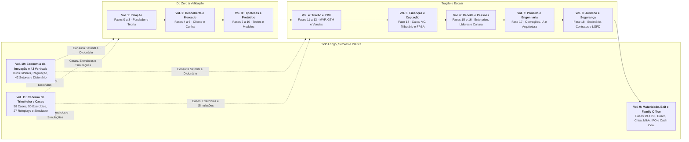

# IGNIÇÃO: Volume 11: Caderno de Trincheira, Simulações de Decisão e Cases Globais & Nacionais

**58 Cases Globais e Brasileiros Comentados, 50 Exercícios com Gabarito, 27 Roleplays Executivos e Simulador das 21 Fases (Capítulos 1 a 30)**

*João Prado · 2026 · Edição Narrativa Enxuta (v5.3)*

---

## Sobre este Volume

Este é o **Volume 11 (IGNIÇÃO: Volume 11: Caderno de Trincheira, Simulações de Decisão e Cases Globais & Nacionais)** da coleção IGNIÇÃO: O manual operacional do empreendedor brasileiro (11 volumes).

Volume prático de aplicação, simulação executiva e estudos de caso da coleção IGNIÇÃO, organizado em 10 partes que espelham os Volumes 1 a 10: reúne 58 cases globais e brasileiros estruturados em quatro atos (Contexto e Problema Real, Dilema na Mesa do Fundador, Engenharia da Decisão com Métricas e Tradução para a Realidade Brasileira em Outubro de 2026), 50 exercícios mão na massa com memória de cálculo passo a passo e gabarito comentado, 27 simulações de roleplay executivo comparando o caminho armadilha ao protocolo de alta precisão com rubrica de pontuação, e o Simulador Integrador de Ponta a Ponta das 21 Fases acompanhando a ForjaTech Sistemas Industriais S.A. do mês zero ao exit.

---

## Mapa da Coleção IGNIÇÃO



---

## Sumário deste Volume

### Parte I: Ideação, Cofundadores, Cognição e Tese Inicial (Capítulos 1 a 3)

- [[#CAPÍTULO 1: CASES GLOBAIS E BRASILEIROS DE IDEAÇÃO, COFUNDADORES E TESE INICIAL|CAPÍTULO 1: CASES GLOBAIS E BRASILEIROS DE IDEAÇÃO, COFUNDADORES E TESE INICIAL]]
- [[#CAPÍTULO 2: CADERNO DE EXERCÍCIOS COM GABARITO COMENTADO: FUNDAÇÃO, EQUITY E TEORIA DO NEGÓCIO|CAPÍTULO 2: CADERNO DE EXERCÍCIOS COM GABARITO COMENTADO: FUNDAÇÃO, EQUITY E TEORIA DO NEGÓCIO]]
- [[#CAPÍTULO 3: SIMULAÇÕES DE DECISÃO E ROLEPLAYS EXECUTIVOS: SOCIEDADE, PRIMEIROS TALENTOS E MENTORIA|CAPÍTULO 3: SIMULAÇÕES DE DECISÃO E ROLEPLAYS EXECUTIVOS: SOCIEDADE, PRIMEIROS TALENTOS E MENTORIA]]

### Parte II: Descoberta de Cliente, JTBD e Cunha Estratégica (Capítulos 4 a 6)

- [[#CAPÍTULO 4: CASES GLOBAIS E BRASILEIROS DE CUSTOMER DISCOVERY, JTBD E CUNHA DE MERCADO|CAPÍTULO 4: CASES GLOBAIS E BRASILEIROS DE CUSTOMER DISCOVERY, JTBD E CUNHA DE MERCADO]]
- [[#CAPÍTULO 5: CADERNO DE EXERCÍCIOS COM GABARITO COMENTADO: MOM TEST, FORÇAS DO JTBD, TAM/SAM/SOM E CANVAS DA CUNHA|CAPÍTULO 5: CADERNO DE EXERCÍCIOS COM GABARITO COMENTADO: MOM TEST, FORÇAS DO JTBD, TAM/SAM/SOM E CANVAS DA CUNHA]]
- [[#CAPÍTULO 6: SIMULAÇÕES DE DECISÃO E ROLEPLAYS EXECUTIVOS: ENTREVISTAS DE CAMPO, GATEKEEPERS E ESCOLHA DE ICP|CAPÍTULO 6: SIMULAÇÕES DE DECISÃO E ROLEPLAYS EXECUTIVOS: ENTREVISTAS DE CAMPO, GATEKEEPERS E ESCOLHA DE ICP]]

### Parte III: Hipóteses, Experimentos, Prototipagem e Modelos de Negócio (Capítulos 7 a 9)

- [[#CAPÍTULO 7: CASES GLOBAIS E BRASILEIROS DE EXPERIMENTAÇÃO, PROTOTIPAGEM, PLATAFORMAS E BOOTSTRAPPING|CAPÍTULO 7: CASES GLOBAIS E BRASILEIROS DE EXPERIMENTAÇÃO, PROTOTIPAGEM, PLATAFORMAS E BOOTSTRAPPING]]
- [[#CAPÍTULO 8: CADERNO DE EXERCÍCIOS COM GABARITO COMENTADO: TEST CARDS, UNIT ECONOMICS DE MARKETPLACE E SERVICE-TO-PRODUCT|CAPÍTULO 8: CADERNO DE EXERCÍCIOS COM GABARITO COMENTADO: TEST CARDS, UNIT ECONOMICS DE MARKETPLACE E SERVICE-TO-PRODUCT]]
- [[#CAPÍTULO 9: SIMULAÇÕES DE DECISÃO E ROLEPLAYS EXECUTIVOS: USABILIDADE, PRÉ-VENDA B2B E CORTE DE ESCOPO DE MVP|CAPÍTULO 9: SIMULAÇÕES DE DECISÃO E ROLEPLAYS EXECUTIVOS: USABILIDADE, PRÉ-VENDA B2B E CORTE DE ESCOPO DE MVP]]

### Parte IV: Tração, Go-to-Market, Vendas Consultivas, Pricing e PMF (Capítulos 10 a 12)

- [[#CAPÍTULO 10: CASES GLOBAIS E BRASILEIROS DE GO-TO-MARKET, PLG, VENDAS B2B, PRICING E PIVÔ PARA O PMF|CAPÍTULO 10: CASES GLOBAIS E BRASILEIROS DE GO-TO-MARKET, PLG, VENDAS B2B, PRICING E PIVÔ PARA O PMF]]
- [[#CAPÍTULO 11: CADERNO DE EXERCÍCIOS COM GABARITO COMENTADO: COORTES, LTV/CAC/PAYBACK, PRICING E FUNIL COMERCIAL|CAPÍTULO 11: CADERNO DE EXERCÍCIOS COM GABARITO COMENTADO: COORTES, LTV/CAC/PAYBACK, PRICING E FUNIL COMERCIAL]]
- [[#CAPÍTULO 12: SIMULAÇÕES DE DECISÃO E ROLEPLAYS EXECUTIVOS: VENDAS MEDDIC, REAJUSTE DE PREÇOS E SALVAMENTO DE CONTAS|CAPÍTULO 12: SIMULAÇÕES DE DECISÃO E ROLEPLAYS EXECUTIVOS: VENDAS MEDDIC, REAJUSTE DE PREÇOS E SALVAMENTO DE CONTAS]]

### Parte V: Finanças, Tributário, FP&A, Caixa e Venture Capital (Capítulos 13 a 15)

- [[#CAPÍTULO 13: CASES GLOBAIS E BRASILEIROS DE FINANÇAS, ALOCAÇÃO DE CAPITAL, DÍVIDA ESTRUTURADA E VENTURE CAPITAL|CAPÍTULO 13: CASES GLOBAIS E BRASILEIROS DE FINANÇAS, ALOCAÇÃO DE CAPITAL, DÍVIDA ESTRUTURADA E VENTURE CAPITAL]]
- [[#CAPÍTULO 14: CADERNO DE EXERCÍCIOS COM GABARITO COMENTADO: DRE vs. CAIXA, REFORMA TRIBUTÁRIA, CAP TABLE, WATERFALL E FOMENTO|CAPÍTULO 14: CADERNO DE EXERCÍCIOS COM GABARITO COMENTADO: DRE vs. CAIXA, REFORMA TRIBUTÁRIA, CAP TABLE, WATERFALL E FOMENTO]]
- [[#CAPÍTULO 15: SIMULAÇÕES DE DECISÃO E ROLEPLAYS EXECUTIVOS: TERM SHEET DE SÉRIE A, DUE DILIGENCE E CRISE DE RUNWAY|CAPÍTULO 15: SIMULAÇÕES DE DECISÃO E ROLEPLAYS EXECUTIVOS: TERM SHEET DE SÉRIE A, DUE DILIGENCE E CRISE DE RUNWAY]]

### Parte VI: Receita Enterprise, RevOps, Franquias, Liderança, Talentos e ESOP (Capítulos 16 a 18)

- [[#CAPÍTULO 16: CASES GLOBAIS E BRASILEIROS DE ESCALA COMERCIAL, REVOPS, FRANCHISING, CULTURA E ESOP|CAPÍTULO 16: CASES GLOBAIS E BRASILEIROS DE ESCALA COMERCIAL, REVOPS, FRANCHISING, CULTURA E ESOP]]
- [[#CAPÍTULO 17: CADERNO DE EXERCÍCIOS COM GABARITO COMENTADO: COMISSIONAMENTO OTE, REVOPS, DRE DE FRANQUIA E PLANO DE OPÇÕES|CAPÍTULO 17: CADERNO DE EXERCÍCIOS COM GABARITO COMENTADO: COMISSIONAMENTO OTE, REVOPS, DRE DE FRANQUIA E PLANO DE OPÇÕES]]
- [[#CAPÍTULO 18: SIMULAÇÕES DE DECISÃO E ROLEPLAYS EXECUTIVOS: DEMISSÃO DE EXECUTIVO, RADICAL CANDOR E FECHAMENTO ENTERPRISE|CAPÍTULO 18: SIMULAÇÕES DE DECISÃO E ROLEPLAYS EXECUTIVOS: DEMISSÃO DE EXECUTIVO, RADICAL CANDOR E FECHAMENTO ENTERPRISE]]

### Parte VII: Produto em Escala, Engenharia, Dívida Técnica, Dados, IA e Operações (Capítulos 19 a 21)

- [[#CAPÍTULO 19: CASES GLOBAIS E BRASILEIROS DE PRODUTO EM ESCALA, ARQUITETURA TÉCNICA, DORA, IA EM PRODUÇÃO E OPERAÇÕES|CAPÍTULO 19: CASES GLOBAIS E BRASILEIROS DE PRODUTO EM ESCALA, ARQUITETURA TÉCNICA, DORA, IA EM PRODUÇÃO E OPERAÇÕES]]
- [[#CAPÍTULO 20: CADERNO DE EXERCÍCIOS COM GABARITO COMENTADO: PR/FAQ, OKRS, MÉTRICAS DORA, TOKENOMICS DE IA E TEAM TOPOLOGIES|CAPÍTULO 20: CADERNO DE EXERCÍCIOS COM GABARITO COMENTADO: PR/FAQ, OKRS, MÉTRICAS DORA, TOKENOMICS DE IA E TEAM TOPOLOGIES]]
- [[#CAPÍTULO 21: SIMULAÇÕES DE DECISÃO E ROLEPLAYS EXECUTIVOS: CONFLITO VENDAS vs. PRODUTO, POSTMORTEM SEM CULPA E MONÓLITO vs. MICROSSERVIÇOS|CAPÍTULO 21: SIMULAÇÕES DE DECISÃO E ROLEPLAYS EXECUTIVOS: CONFLITO VENDAS vs. PRODUTO, POSTMORTEM SEM CULPA E MONÓLITO vs. MICROSSERVIÇOS]]

### Parte VIII: Blindagem Jurídica, Societária, Contratos, Trabalhista, PI, LGPD e Cibersegurança (Capítulos 22 a 24)

- [[#CAPÍTULO 22: CASES GLOBAIS E BRASILEIROS DE CONFLITOS SOCIETÁRIOS, COMPLIANCE REGULATÓRIO, TRABALHISTA, PI, LGPD E SEGURANÇA|CAPÍTULO 22: CASES GLOBAIS E BRASILEIROS DE CONFLITOS SOCIETÁRIOS, COMPLIANCE REGULATÓRIO, TRABALHISTA, PI, LGPD E SEGURANÇA]]
- [[#CAPÍTULO 23: CADERNO DE EXERCÍCIOS COM GABARITO COMENTADO: ACORDO DE SÓCIOS, REDLINING DE MSA B2B, TRABALHISTA, LGPD E SOC 2|CAPÍTULO 23: CADERNO DE EXERCÍCIOS COM GABARITO COMENTADO: ACORDO DE SÓCIOS, REDLINING DE MSA B2B, TRABALHISTA, LGPD E SOC 2]]
- [[#CAPÍTULO 24: SIMULAÇÕES DE DECISÃO E ROLEPLAYS EXECUTIVOS: SAÍDA LITIGIOSA DE SÓCIO, NEGOCIAÇÃO JURÍDICA B2B E WAR ROOM DE RANSOMWARE|CAPÍTULO 24: SIMULAÇÕES DE DECISÃO E ROLEPLAYS EXECUTIVOS: SAÍDA LITIGIOSA DE SÓCIO, NEGOCIAÇÃO JURÍDICA B2B E WAR ROOM DE RANSOMWARE]]

### Parte IX: Maturidade, Governança de Conselho, Internacionalização, Crise, M&A, IPO e Family Office (Capítulos 25 a 27)

- [[#CAPÍTULO 25: CASES GLOBAIS E BRASILEIROS DE GOVERNANÇA DE CONSELHO, SEGUNDA CURVA, M&A ESTRATÉGICO, IPO E ROLL-UPS|CAPÍTULO 25: CASES GLOBAIS E BRASILEIROS DE GOVERNANÇA DE CONSELHO, SEGUNDA CURVA, M&A ESTRATÉGICO, IPO E ROLL-UPS]]
- [[#CAPÍTULO 26: CADERNO DE EXERCÍCIOS COM GABARITO COMENTADO: BOARD DECK, FLIP INTERNACIONAL, PROPOSTAS DE M&A, HOLDING E FAMILY OFFICE|CAPÍTULO 26: CADERNO DE EXERCÍCIOS COM GABARITO COMENTADO: BOARD DECK, FLIP INTERNACIONAL, PROPOSTAS DE M&A, HOLDING E FAMILY OFFICE]]
- [[#CAPÍTULO 27: SIMULAÇÕES DE DECISÃO E ROLEPLAYS EXECUTIVOS: CONSELHO DIVIDIDO, NEGOCIAÇÃO DE EARN-OUT E GOVERNANÇA FAMILIAR PÓS-EXIT|CAPÍTULO 27: SIMULAÇÕES DE DECISÃO E ROLEPLAYS EXECUTIVOS: CONSELHO DIVIDIDO, NEGOCIAÇÃO DE EARN-OUT E GOVERNANÇA FAMILIAR PÓS-EXIT]]

### Parte X: Cases Setoriais da Economia Real e Simulador Integrador das 21 Fases (Capítulos 28 a 30)

- [[#CAPÍTULO 28: CASES SETORIAIS DA ECONOMIA REAL: FINTECH, AGTECH, HEALTHTECH, GOVTECH, CLIMATETECH E INDÚSTRIA 4.0|CAPÍTULO 28: CASES SETORIAIS DA ECONOMIA REAL: FINTECH, AGTECH, HEALTHTECH, GOVTECH, CLIMATETECH E INDÚSTRIA 4.0]]
- [[#CAPÍTULO 29: CADERNO DE EXERCÍCIOS SETORIAIS: REGULAÇÃO BACEN, SINISTRALIDADE ANS, BARTER/CPR, LICITAÇÕES CPSI E HARDWARE-AS-A-SERVICE|CAPÍTULO 29: CADERNO DE EXERCÍCIOS SETORIAIS: REGULAÇÃO BCB, SINISTRALIDADE ANS, BARTER/CPR, LICITAÇÕES CPSI E HARDWARE-AS-A-SERVICE]]
- [[#CAPÍTULO 30: SIMULADOR INTEGRADOR DE PONTA A PONTA: O JOGO COMPLETO DAS 21 FASES (FASE 0 AO EXIT)|CAPÍTULO 30: SIMULADOR INTEGRADOR DE PONTA A PONTA: O JOGO COMPLETO DAS 21 FASES (FASE 0 AO EXIT)]]

---

# PARTE I: IDEAÇÃO, COFUNDADORES, COGNIÇÃO E TESE INICIAL (ESPELHO DO VOLUME 1: CAPÍTULOS 1 A 3)

Toda grande empresa começou com fundadores enfrentando a escassez de caixa, o risco de conflito societário e a incerteza sobre qual problema valia a pena resolver. Os três primeiros capítulos colocam você na cadeira dos fundadores de Airbnb, Stripe, Nubank, Notion, QuintoAndar e Figma nos seus primeiros meses, seguidos por cinco exercícios de cálculo de *runway* pessoal, *vesting* assimétrico, árvore de hipóteses, *pre-mortem* e memorando de seis páginas, além de três simulações de diálogo difícil entre sócios, primeiros engenheiros e mentores.

---

## CAPÍTULO 1: CASES GLOBAIS E BRASILEIROS DE IDEAÇÃO, COFUNDADORES E TESE INICIAL

> [!note] Síntese Executiva do Capítulo
> A literatura tradicional de empreendedorismo costuma retratar a gênese de empresas avaliadas em dezenas de bilhões de dólares como o resultado de epifanias solitárias seguidas por tração imediata. A investigação documental dos primeiros vinte e quatro meses dessas organizações revela uma realidade oposta: fundadores operando à beira da insolvência pessoal, teses originais refutadas pelo mercado, reescritas arquiteturais completas e intervenções manuais que desafiam qualquer lógica inicial de escalabilidade. Este capítulo disseca seis casos emblemáticos, combinando trajetórias globais (Airbnb, Stripe, Notion e Figma) e brasileiras (Nubank e QuintoAndar), estruturados em quatro atos analíticos que conectam a decisão histórica à realidade tática e regulatória do ecossistema brasileiro em outubro de 2026.

---

### Case 1.1: Airbnb (EUA, 2007 a 2009): Do Colchão de Ar e Caixas de Cereal à Liquidez Presencial em Nova York

#### 1. Contexto e o Problema Real

Em outubro de 2007, os designers industriais Brian Chesky e Joe Gebbia dividiam um apartamento na Rausch Street, em São Francisco, quando receberam a notificação de um reajuste de aluguel que elevava o custo mensal para US\$ 1.150, valor superior às reservas financeiras de ambos. Naquela mesma semana, a conferência anual da Industrial Designers Society of America (IDSA) havia esgotado a totalidade do inventário hoteleiro da cidade. Chesky e Gebbia decidiram inflar três colchões de ar na sala de estar e oferecer hospedagem acompanhada de café da manhã caseiro e conexão sem fio por US\$ 80 a diária, batizando a iniciativa de *AirBed & Breakfast*. Três hóspedes (um indiano, uma jovem de Boston e um pai de família de Utah) pagaram pela estadia, gerando os primeiros US\$ 240 de receita bruta e revelando duas premissas contraintuitivas: estranhos aceitavam dormir na residência de terceiros para contornar a escassez de oferta, e anfitriões urbanos topavam compartilhar espaço ocioso para monetizar custos fixos de moradia.

Em fevereiro de 2008, o engenheiro de software Nathan Blecharczyk juntou-se à dupla como terceiro cofundador para arquitetar a plataforma transacional. Apesar da complementaridade entre dois designers formados na Rhode Island School of Design (RISD) e um cientista da computação graduado em Harvard, a empresa enfrentou dezoito meses de estagnação severa. Os fundadores lançaram o produto três vezes consecutivas (no festival South by Southwest em março de 2008, na Convenção Nacional Democrata em agosto de 2008 e no mercado aberto no final daquele ano), mas a receita líquida de comissões estacionou em US\$ 200 por semana. Investidores de capital de risco do Vale do Silício rejeitaram a rodada inicial sob o argumento de que o mercado endereçável limitava-se a estudantes sem recursos e conferências esporádicas, além do risco jurídico de responsabilidade civil em residências privadas.

#### 2. O Dilema na Mesa do Fundador

No último trimestre de 2008, após as convenções políticas de Denver e Minneapolis, o faturamento semanal voltou a cair para o patamar de sobrevivência. Chesky e Gebbia haviam acumulado mais de US\$ 40.000 em dívidas rotativas distribuídas em uma dezena de cartões de crédito pessoais, guardados em um fichário plástico laranja apelidado de *The Binder*. Na mesa de decisão, os três sócios confrontavam um dilema triplo que ameaçava extinguir a operação antes do primeiro trimestre de 2009:

1. **Insolvência imediata versus diluição predatória:** O caixa remanescente mal cobria o aluguel de São Francisco e os servidores básicos. Aceitar propostas de investidores oportunistas que exigiam controle societário por cheques de US\$ 50.000 destruiria a tabela de capitalização (*cap table*), enquanto buscar empregos formais encerraria a velocidade de execução do trio.
2. **Estagnação da conversão em Nova York:** A cidade de Nova York concentrava a maior demanda orgânica de viajantes internacionais da plataforma, mas a taxa de conversão de buscas em reservas pagas permanecia abaixo de 2%. A equipe não sabia se o problema residia no código de busca, no preço das diárias ou na apresentação visual dos imóveis listados.
3. **Alocação de tempo da engenharia versus operação de rua:** A crença dominante entre fundadores de tecnologia ditava que todo problema de crescimento deveria ser resolvido escrevendo código automatizado na sede da empresa em São Francisco, evitando intervenções presenciais que custassem caro por unidade atendida.

#### 3. Como Foi Resolvido na Prática (Engenharia da Decisão e Métricas)

A resposta dos fundadores dividiu-se em duas intervenções táticas que se tornaram referência na história do capital de risco moderno. A primeira solucionou o caixa de curto prazo por meio de manufatura criativa: aproveitando o fervor eleitoral da disputa presidencial norte-americana de 2008, Chesky e Gebbia desenharam caixas comemorativas de cereais matinais chamadas *Obama O's* (*The Cereal of Change*) e *Cap'n McCain's* (*A Maverick in Every Bite*). Sem capital para pagar uma fábrica industrial, convenceram uma gráfica de Berkeley a imprimir 1.000 caixas planas em troca de participação nas vendas, compraram caixas genéricas de cereais no supermercado local e dobraram, colaram e numeraram manualmente cada unidade numerada de 1 a 500. Vendidas a US\$ 40 cada como itens de colecionador, as caixas de cereal geraram mais de US\$ 30.000 líquidos, quitaram as faturas mais urgentes dos cartões de crédito e convenceram Paul Graham a aceitá-los na turma de inverno de 2009 da aceleradora Y Combinator (com aporte de US\$ 20.000 por 6% de participação), sob a justificativa de que fundadores capazes de convencer pessoas a pagar US\$ 40 por uma caixa de flocos de milho de US\$ 4 eram literalmente "impossíveis de matar" (*cockroaches*).

A segunda intervenção resolveu a liquidez do marketplace em janeiro e fevereiro de 2009. Instigados por Paul Graham a abandonar a mesa de trabalho na Califórnia e ir até onde os usuários estavam, Chesky e Gebbia voaram para Nova York para auditar linha a linha os anúncios da plataforma. Ao inspecionarem as páginas de listagem com olhos de designers, diagnosticaram a causa raiz da baixa conversão: os anfitriões tiravam fotos noturnas com celulares de baixa resolução, exibindo camas desarrumadas, iluminação precária e ângulos fechados que despertavam desconfiança nos hóspedes quanto à higiene e segurança do local.

Em vez de enviarem um guia em PDF instruindo os anfitriões a tirar fotos melhores, os fundadores alugaram uma câmera profissional DSLR de US\$ 5.000, agendaram visitas presenciais a dezenas de apartamentos no Brooklyn e em Manhattan dizendo serem "fotógrafos contratados pelo Airbnb" e passaram semanas fotografando pessoalmente os quartos, conversando com os proprietários na mesa da cozinha e observando como eles tentavam usar o painel de controle do site. Ao mesmo tempo, Blecharczyk reescreveu o fluxo de pagamento para substituir a transferência direta entre estranhos por uma conta de custódia (*escrow*) integrada, retendo o valor pago pelo hóspede até 24 horas após o check-in.

| Indicador Operacional e Financeiro | Antes da Intervenção em NY (Dez/2008) | 30 Dias Após Fotografia Profissional (Mar/2009) | 6 Meses Após Escala do Programa (Ago/2009) |
| :--- | :--- | :--- | :--- |
| Receita líquida semanal da plataforma | US\$ 200 / semana | US\$ 400 / semana (+100%) | US\$ 4.500 / semana |
| Reservas médias em imóveis com fotos profissionais | 1,1 reserva / mês | 2,8 reservas / mês (+154%) | 3,4 reservas / mês |
| Taxa de conversão de visualização em reserva (NY) | 1,4% | 3,8% | 5,2% |
| Capital captado na rodada Seed subsequente | Zero (15 rejeições formais) | US\$ 600.000 (Sequoia Capital, Abr/2009) | US\$ 7,2 milhões (Series A, Nov/2010) |

O impacto empírico foi imediato: na primeira semana após a substituição das fotos amadoras pelas imagens em alta definição em Nova York, o faturamento semanal dobrou de US\$ 200 para US\$ 400, primeiro salto real em oito meses. Com a validação estatística em mãos, o Airbnb transformou a ação manual em processo escalável no verão de 2009, criando um programa que conectava mais de 2.000 fotógrafos freelancers ao redor do mundo para fotografar gratuitamente os imóveis cadastrados, pagando o custo de produção com o incremento das comissões futuras.

#### 4. Tradução para a Realidade Brasileira em Outubro de 2026

Para o fundador brasileiro que constrói um marketplace B2B ou B2C em 2026 (seja na intermediação de equipamentos agrícolas no Mato Grosso, na contratação de clínicas odontológicas em São Paulo ou na logística de frete fracionado no Sul), o caso do Airbnb desmonta a ilusão de que algoritmos de inteligência artificial generativa substituem a fricção de campo nos primeiros cem clientes. No Brasil, o déficit de confiança institucional entre partes desconhecidas é estruturalmente elevado devido ao histórico de fraudes digitais, inadimplência contratual e assimetria de informação sobre a qualidade real do ativo ou serviço ofertado.

Aplicar a doutrina de *fazer coisas que não escalam* no ecossistema nacional exige três adaptações práticas imediatas:
1. **Curadoria e Onboarding Assistido na Ponta da Oferta:** Pequenos e médios fornecedores brasileiros (oficinas mecânicas, transportadoras regionais, pequenos produtores rurais, prestadores de serviços técnicos) raramente possuem tempo ou alfabetização digital para cadastrar catálogos estruturados, precificar serviços com precisão ou configurar integrações fiscais. O fundador que vai pessoalmente aos primeiros 30 fornecedores, estrutura o catálogo de produtos dentro do estabelecimento do parceiro e configura a emissão de NFS-e e o recebimento via Pix com *split* automático constrói uma barreira de retenção que concorrentes puramente digitais jamais replicam à distância.
2. **Garantia Fiduciária e Liquidação via Split de Pagamento Regulado:** Assim como Blecharczyk destravou a confiança retendo o pagamento até o check-in, marketplaces brasileiros em 2026 precisam operar sobre trilhos de subadquirência ou Iniciação de Transação de Pagamento (ITP) via Open Finance, mantendo o recurso em conta de liquidação segregada (conforme normas do Banco Central do Brasil para instituições de pagamento e participantes indiretos) e liberando o repasse ao fornecedor somente após a confirmação criptográfica ou documental da entrega (canhoto digital assinado, telemetria de chegada ou aceite no WhatsApp).
3. **Geração de Caixa Tático Sem Diluição Precoce:** Com o custo de capital no Brasil ancorado em taxas reais elevadas, queimar participação societária em rodadas *pre-seed* desfavoráveis antes de provar liquidez unitária condena o fundador a deter menos de 20% da empresa já na Série A. Financiar os primeiros seis meses de descoberta vendendo serviços de implantação, consultoria técnica especializada ou projetos-piloto pagos aos próprios clientes-alvo cumpre exatamente o papel das caixas de cereal do Airbnb, mas com a vantagem adicional de aprofundar o conhecimento sobre a dor operacional do comprador.

---

### Case 1.2: Stripe (EUA/Irlanda, 2009 a 2011): Sete Linhas de Código Contra Semanas de Burocracia Bancária e a Collison Installation

#### 1. Contexto e o Problema Real

Em 2009, os irmãos irlandeses Patrick Collison (então com 21 anos) e John Collison (com 19 anos), que já haviam vendido sua primeira startup de gerenciamento de leilões para usuários do eBay (Auctomatic) por US\$ 5 milhões em 2008, trabalhavam em diversos projetos paralelos de software enquanto estudavam em Cambridge, Massachusetts. A cada novo aplicativo web ou serviço por assinatura que tentavam colocar no ar, esbarravam na mesma barreira infraestrutural: aceitar pagamentos com cartão de crédito na internet exigia uma jornada burocrática de quatro a oito semanas.

Naquele período, um desenvolvedor que desejasse cobrar US\$ 20 por mês de um cliente precisava preencher formulários impressos de solicitação de *merchant account* em bancos adquirentes tradicionais (como Wells Fargo ou First Data), passar por auditorias manuais de risco pensadas para o varejo físico, contratar separadamente um gateway legado (como Authorize.Net), configurar servidores compatíveis com o padrão de segurança PCI-DSS e integrar documentações em SOAP/XML repletas de códigos de erro obscuros, além de pagar taxas de adesão, mensalidades fixas e mínimos contratuais. Mesmo alternativas mais recentes como o PayPal forçavam o redirecionamento do consumidor para fora do site do lojista ou apresentavam dezenas de páginas de contratos jurídicos antes da liberação da chave de produção. Os irmãos Collison perceberam que a internet possuía protocolos abertos e ágeis para transmissão de pacotes (TCP/IP) e renderização de páginas (HTTP/HTML), mas carecia de uma camada programática nativa para movimentação econômica.

#### 2. O Dilema na Mesa do Fundador

Ao lançarem o protótipo inicial batizado de /dev/payments no início de 2010, Patrick e John Collison enfrentaram um dilema estratégico que paralisava quase todos os aspirantes ao setor financeiro:

1. **Complexidade regulatória e dependência bancária versus simplicidade para o desenvolvedor:** Bancos adquirentes e bandeiras de cartão (Visa e Mastercard) exigiam conformidade estrita com regras de prevenção à lavagem de dinheiro (AML), conhecimento do cliente (KYC) e responsabilidade solidária sobre estornos (*chargebacks*). Se a startup repassasse essa complexidade aos seus usuários em forma de formulários longos, perderia seu diferencial, se absorvesse toda a complexidade para oferecer ativação instantânea, assumiria um passivo financeiro direto caso um usuário mal-intencionado processasse transações fraudulentas.
2. **Quem é o verdadeiro comprador (Decision Maker):** No mercado corporativo de pagamentos de 2010, a venda tradicional mirava diretores financeiros (CFOs), que escolhiam adquirentes com base na menor taxa percentual por transação (ex.: 1,9% em vez de 2,2%). Os irmãos Collison precisavam decidir se competiriam por preço junto aos executivos financeiros ou se cobrariam um preço premium (2,9% + US\$ 0,30 fixos por transação aprovada) focando exclusivamente na experiência do desenvolvedor de software, apostando que, nas startups nascentes, o engenheiro detinha o poder de veto e escolha da arquitetura tecnológica.
3. **Inércia na adoção inicial:** Quando apresentavam o /dev/payments a outros fundadores da rede Y Combinator, todos concordavam que o sistema legado era sofrível e prometiam testar a API "na semana seguinte, assim que sobrasse tempo na sprint", o que na prática raramente acontecia espontaneamente.

#### 3. Como Foi Resolvido na Prática (Engenharia da Decisão e Métricas)

Patrick e John Collison tomaram três decisões de engenharia e distribuição que redefiniram a indústria global de infraestrutura de software B2B. Primeiramente, inverteram a arquitetura regulatória: em vez de obrigarem cada startup cliente a negociar seu próprio contrato bancário individual antes de escrever a primeira linha de código, negociaram parcerias de subadquirência e patrocínio bancário (inicialmente com um pequeno banco na Califórnia e depois diretamente com o Wells Fargo) que permitiam à Stripe atuar como *Merchant of Record* agregado. Toda a verificação de risco e conformidade passou a rodar de forma assíncrona nos bastidores, enquanto o desenvolvedor obtinha chaves de API funcionais em segundos.

Em segundo lugar, reduziram a superfície de integração ao limite técnico: criaram um trecho de JavaScript (Stripe.js) com apenas sete linhas de código que capturava os dados sensíveis do cartão diretamente do navegador do consumidor final para os servidores seguros da Stripe, devolvendo ao servidor da startup cliente apenas um *token* criptográfico descartável. Com isso, o banco de dados do cliente nunca tocava no número real do cartão de crédito, reduzindo drasticamente o escopo de auditoria PCI-DSS da startup usuária.

Em terceiro lugar, criaram a tática de aquisição em campo que Paul Graham imortalizou como Collison Installation. Durante reuniões presenciais com outros fundadores em cafés de Palo Alto e São Francisco, quando o interlocutor dizia *"Parece ótimo, me mande o link da documentação por e-mail que vou testar no fim de semana"*, Patrick e John respondiam: "Não me peça o link. Me dê o seu notebook agora mesmo que nós instalamos em dois minutos". Eles abriam o terminal do cliente na hora, criavam a conta, colavam as sete linhas de código no repositório da aplicação, faziam o *commit* e processavam uma transação real de US\$ 1,00 no cartão pessoal antes de encerrar o café.

| Dimensão Comparativa (Mercado EUA em 2010–2011) | Gateways e Adquirentes Legados (Authorize.Net / Bancos) | Modelo Stripe (/dev/payments) | Impacto na Decisão de Compra |
| :--- | :--- | :--- | :--- |
| Tempo até a primeira transação em produção | 3 a 6 semanas (análise documental manual) | Menos de 5 minutos (onboarding via API) | Eliminação do bloqueio de lançamento do produto |
| Linhas de código e carga de conformidade PCI | Centenas de linhas SOAP/XML + auditoria de servidor | 7 linhas de código (tokenização via Stripe.js) | Redução de ~90% no tempo de engenharia |
| Precificação nominal (MDR) | ~1,8% a 2,3% + taxas mensais ocultas e setup | 2,9% + US\$ 0,30 fixo (sem taxa de setup ou mensalidade) | Previsibilidade total para startups em validação |
| Canal de aquisição nos primeiros 100 clientes | Equipes de vendas frias ligando para CFOs | *Collison Installation* presencial e boca a boca técnico | CAC próximo de zero e retenção líquida > 130% |

O método de instalação presencial imediata cumpria dupla função: além de garantir um cliente ativo no ato, expunha em tempo real qualquer fricção na documentação, lentidão na resposta da API ou mensagem de erro ambígua. Se o desenvolvedor tropeçasse em um parâmetro confuso durante a instalação na mesa do café, os irmãos Collison voltavam para o escritório à noite e refatoravam a API para que aquele obstáculo deixasse de existir na manhã seguinte. Em março de 2011, com métricas de retenção e expansão líquida excepcionais entre as startups que mais cresciam no Vale do Silício, a empresa (já rebatizada como Stripe) levantou US\$ 2 milhões liderados por Peter Thiel, Elon Musk (cofundadores do PayPal) e Sequoia Capital.

#### 4. Tradução para a Realidade Brasileira em Outubro de 2026

O equivalente brasileiro da tese da Stripe em 2026 reside na abstração da complexidade fiscal, tributária, regulatória e financeira que consome milhares de horas de engenharia das empresas nacionais. No Brasil atual, um desenvolvedor que constrói um software vertical (para clínicas médicas, escritórios de advocacia, construtoras ou transportadoras) enfrenta um labirinto de APIs heterogêneas: mais de 5.000 municípios com padrões distintos de Nota Fiscal de Serviços Eletrônica (NFS-e), a transição em curso da Reforma Tributária (convivência e parametrização de IBS e CBS com alíquotas dualizadas a partir do ciclo 2026/2027), as exigências do Banco Central para Pix Automático, Iniciação de Transação de Pagamento (Open Finance) e registro de recebíveis de cartão (CERC, TAG e B3).

Para aplicar a engenharia da Stripe e a *Collison Installation* no mercado B2B brasileiro em 2026, o fundador deve executar três diretrizes:
1. **Venda de Abstração de Complexidade Regulatória com Margem Alta:** Quando sua infraestrutura elimina a necessidade de o cliente manter dois engenheiros plenos dedicados a atualizar leiautes de notas fiscais municipais, conciliar extratos CNAB 240 ou lidar com exigências de prevenção a fraudes do BCB (como o compartilhamento obrigatório de dados de fraude na Resolução BCB nº 6/2023), você deixa de competir por centavos de tarifa contra bancos incumbentes e passa a ser precificado contra o salário anual de uma equipe de engenharia (R\$ 300.000 a R\$ 600.000 por ano).
2. **A Instalação Presencial no Ambiente Brasileiro (WhatsApp + Vídeo + Repositório):** O comprador técnico e operacional brasileiro sofre de escassez crônica de banda mental. Enviar um link de *sandbox* após uma demonstração comercial no Google Meet resulta em 85% de abandono silencioso. A versão nacional da *Collison Installation* consiste em transformar a segunda metade da reunião comercial em uma sessão de *pair programming* ou configuração guiada ao vivo: o fundador pede compartilhamento de tela com o CTO ou analista do cliente, gera a chave de API ou carrega a planilha de dados reais do cliente na hora, executa a primeira requisição de produção (emitindo a primeira nota real, conciliando o primeiro lote de Pix ou processando a primeira consulta de crédito) e entrega o sistema operando antes de desligar a chamada.
3. **Documentação e SDKs como Motor Primário de Aquisição (Developer-Led Growth):** No Brasil, a maioria das APIs bancárias, governamentais (SERPRO, SEFAZ) e de ERPs legados possui documentações defasadas em PDFs de 200 páginas, ambientes de homologação instáveis e suporte por abertura de chamado que demora cinco dias úteis. Construir uma documentação interativa em português claro, com coleções prontas do Postman, SDKs tipados em TypeScript, Python e C# (linguagem ainda dominante no legado corporativo brasileiro) e suporte direto de engenheiros em canais dedicados de Slack ou WhatsApp cria um diferencial competitivo imediato.

---

### Case 1.3: Nubank (Brasil, 2013): A Cunha Regulatória do Cartão Mobile e a Complementaridade da Tríade Fundadora

#### 1. Contexto e o Problema Real

No início de 2013, o sistema bancário brasileiro apresentava uma das maiores concentrações de mercado e os maiores *spreads* de crédito do planeta. Cinco grandes instituições financeiras (Itaú Unibanco, Bradesco, Banco do Brasil, Caixa Econômica Federal e Santander) detinham mais de 80% dos ativos de crédito, das contas correntes e das agências físicas do país. Para o consumidor brasileiro de classe média e para os milhões de jovens recém-ingressos no mercado de trabalho, a experiência bancária cotidiana combinava tarifas mensais de manutenção de conta, anuidades de cartão de crédito entre R\$ 150 e R\$ 600, taxas de juros do crédito rotativo que ultrapassavam 300% a 400% ao ano e um atendimento presencial pautado por portas giratórias com detector de metais, senhas de papel e horas de espera em fila.

O colombiano David Vélez, engenheiro formado em Stanford com passagem pelo banco de investimentos Morgan Stanley, pela gestora General Atlantic e pelo fundo Sequoia Capital (onde liderou a prospecção de investimentos na América Latina entre 2011 e 2012), vivenciou essa fricção na própria pele ao mudar-se para São Paulo. Para abrir uma conta corrente simples em uma agência da Avenida Brigadeiro Faria Lima, Vélez precisou comparecer presencialmente cinco vezes ao longo de quatro meses, apresentar dezenas de documentos autenticados em cartório e ouvir exigências contraditórias dos gerentes. Quando a Sequoia decidiu fechar seu escritório local no Brasil no final de 2012 sob a conclusão de que faltavam startups de tecnologia escaláveis no país, Vélez enxergou que a maior oportunidade da região estava justamente em atacar a indústria mais lucrativa e com pior índice de satisfação do consumidor brasileiro: os serviços financeiros de varejo.

#### 2. O Dilema na Mesa do Fundador

Durante os primeiros meses de 2013, ao conversar com dezenas de executivos financeiros e investidores em São Paulo, Vélez ouviu de forma unânime que criar um banco independente no Brasil era impossível para uma startup. Os dilemas estruturais na mesa do fundador agrupavam-se em três frentes decisivas:

1. **A barreira regulatória e o artigo 192 da Constituição / Decreto Presidencial:** Em 2013, para uma empresa com capital estrangeiro obter uma licença bancária plena (Banco Múltiplo ou Banco Comercial) no Brasil, a legislação exigia não apenas dezenas de milhões de reais em capital regulatório mínimo (Basileia) e anos de auditoria no Banco Central, mas também um Decreto Presidencial assinado pela Presidência da República autorizando a participação estrangeira no sistema financeiro nacional. Esperar três anos por um decreto presidencial antes de lançar o primeiro produto mataria a startup antes da largada.
2. **A escolha da cunha de entrada (Conta Corrente Completa vs. Produto Único):** Um banco tradicional oferece dezenas de produtos simultâneos (conta corrente, cheque especial, poupança, CDB, financiamento imobiliário, seguro de vida, cartão de crédito e débito). Tentar construir uma conta corrente completa logo no dia zero exigiria integração direta ao Sistema de Transferência de Reservas (STR), rede de saques em caixas eletrônicos e estrutura de tesouraria incompatíveis com o caixa de uma rodada Seed.
3. **O déficit de conhecimento local e técnico de um fundador solo estrangeiro:** Vélez dominava a modelagem financeira de capital de risco e tinha acesso direto aos sócios da Sequoia Capital na Califórnia e da Kaszek Ventures na Argentina, mas não falava português fluentemente no início, desconhecia as entranhas operacionais da regulação de cartões no Brasil e não era um arquiteto de sistemas distribuídos em nuvem.

#### 3. Como Foi Resolvido na Prática (Engenharia da Decisão e Métricas)

A resolução do caso Nubank é uma aula de arquitetura societária e escolha de cunha regulatória. Primeiro, David Vélez recusou a tentação de fundar a empresa sozinho ou cercar-se de perfis idênticos ao seu (outros ex-banqueiros de investimento), estruturando deliberadamente uma tríade de cofundadores com complementaridade ortogonal:
- **David Vélez (CEO):** Visão estratégica, alocação de capital, cultura orientada a dados e ponte direta com os maiores fundos de Venture Capital dos Estados Unidos, garantindo acesso a capital em dólar que nenhum concorrente local possuía na época.
- **Cristina Junqueira (Cofundadora e VP de Negócios/Branding):** Engenheira industrial pela USP com MBA na Kellogg (Northwestern) e ex-superintendente da divisão de cartões de crédito do Itaú Unibanco (Itaucard). Junqueira conhecia profundamente as regras das bandeiras, a matemática do *interchange*, os gargalos dos sistemas legados dos bancos brasileiros e as brechas de insatisfação dos clientes locais, tendo pedido demissão do maior banco do país exatamente por ver seus projetos de transparência ao consumidor bloqueados pela burocracia interna.
- **Edward Wible (Cofundador e CTO):** Cientista da computação graduado em Princeton, ex-associado da consultoria BCG e engenheiro de software que trouxe a decisão técnica de construir todo o núcleo de processamento do Nubank do zero na nuvem pública (AWS), utilizando a linguagem funcional Clojure e o banco de dados imutável Datomic (arquitetura que garantia rastreabilidade auditável linha a linha de cada centavo movimentado sem depender dos mainframes Cobol terceirizados que travavam o setor).

Em segundo lugar, a tríade desenhou uma cunha regulatória precisa: em vez de pedirem licença de banco comercial, decidiram entrar pelo mercado de cartão de crédito puro, 100% gerenciado por aplicativo móvel e sem cobrança de anuidade, aproveitando o marco regulatório dos Arranjos e Instituições de Pagamento instituído pela Lei nº 12.865, de outubro de 2013, e pelas circulares subsequentes do Banco Central. Como emissor de cartão pós-pago dentro do arranjo Mastercard, o Nubank não precisava de agências físicas, não captava depósitos à vista do público (evitando o Decreto Presidencial naquele momento inicial) e tinha sua receita bruta garantida pelo *interchange fee* (cerca de 1,5% a 1,8% de cada compra à vista ou parcelada realizada pelo portador, pago pelo lojista/adquirente), enquanto seu custo operacional por cliente era uma fração ínfima do custo dos bancos com milhares de agências e funcionários.

| Métrica de Execução e Cunha (2013 a 2016) | Bancos Incumbentes no Brasil (Média 2013) | Estratégia de Entrada do Nubank | Vantagem Estrutural Obtida |
| :--- | :--- | :--- | :--- |
| Tempo de licenciamento inicial para operar | 24 a 48 meses (Licença Bancária + Decreto) | ~6 meses (Emissor de Cartão / Instituição de Pagamento) | Entrada no mercado em Abril/2014 (1ª compra) |
| Custo de Aquisição de Cliente (CAC) | R\$ 250 a R\$ 600 (agências, pastas na rua, mídia de TV) | Menos de R\$ 15 (lista de espera viral por convite de amigos) | Mais de 80% de aquisição orgânica nos primeiros 3 anos |
| Custo operacional de servir e tecnologia | Sistemas legados + 4.000 a 5.000 agências físicas | Nuvem AWS + Microsserviços em Clojure/Datomic (0 agências) | Economia reinvestida em atendimento humano de excelência |
| Receita inicial vs. Risco de Crédito | Anuidade alta + rotativo em massa | Zero anuidade + *Interchange* + *beta* restrito a amigos/convidados | Controle rigoroso da inadimplência na calibragem do modelo |

O primeiro pagamento com o cartão roxo ocorreu em 1º de abril de 2014 (um almoço em uma padaria na Rua Califórnia, no Brooklin, em São Paulo), operado a partir de uma pequena casa alugada onde trabalhavam os três fundadores e os primeiros engenheiros. Para calibrar o modelo proprietário de risco de crédito sem quebrar o caixa inicial (US\$ 2 milhões de Seed da Sequoia e Kaszek em março de 2013, seguidos por US\$ 14,3 milhões de Série A em agosto de 2014), o Nubank manteve o produto fechado para amigos e familiares por cinco meses, liberando convites gradualmente em uma mecânica de escassez social: quem tinha o cartão roxo ganhava convites limitados no aplicativo para enviar a amigos, que furavam a fila de aprovação. Em menos de dois anos, sem gastar um centavo em propaganda televisiva, a fila de espera ultrapassou centenas de milhares de brasileiros. Somente anos depois, já com milhões de clientes ativos, dados proprietários de comportamento de pagamento e bilhões em valor de mercado, o Nubank adicionou a licença de Sociedade de Crédito, Financiamento e Investimento (SCFI, obtida por decreto em 2018), a conta de pagamentos (NuConta) e os demais produtos do ecossistema.

#### 4. Tradução para a Realidade Brasileira em Outubro de 2026

Em outubro de 2026, o mercado de contas digitais e cartões de crédito para pessoa física no Brasil encontra-se consolidado, mas a lição metodológica do Nubank permanece central para qualquer fundador atacando setores fortemente regulados ou oligopolizados (saúde suplementar regulada pela ANS, energia elétrica no Mercado Livre regulado pela ANEEL/CCEE, seguros regulados pela SUSEP, mercado de capitais na CVM ou infraestrutura financeira B2B no BCB):

1. **A Estratégia de Escada Regulatória (Regulatory Stairstepping):** Nunca trave o lançamento da sua startup aguardando a licença regulatória máxima do seu setor se você puder iniciar a operação na camada de software, intermediação ou parceria regulada. Em 2026, uma fintech B2B começa operando sobre a infraestrutura de um provedor de Banking-as-a-Service (BaaS) ou como correspondente bancário/subcredenciadora para validar a tese de distribuição e o modelo de risco nos primeiros 18 meses, somente quando o volume transacionado (TPV) ou a carteira de crédito justificarem o custo fixo de *compliance* (R\$ 1,5 milhão a R\$ 3 milhões anuais em diretoria estatutária, auditoria externa e reportes ao BCB), a empresa solicita licença própria de Sociedade de Crédito Direto (SCD), Sociedade de Empréstimo entre Pessoas (SEP) ou Instituição de Pagamento (IP) conforme os cronogramas da Resolução BCB nº 80/2021 e atualizações posteriores.
2. **A Regra da Tríade Ortogonal na Formação Societária:** Um dos erros mais letais no ecossistema brasileiro é a formação de sociedades homogêneas (três advogados fundando uma LegalTech sem um CTO sênior, três médicos criando uma HealthTech terceirizando o código para uma fábrica de software, ou três desenvolvedores criando uma Fintech sem alguém que conheça regulação e distribuição comercial). A estrutura fundadora de alta performance exige a união no *cap table* (com *vesting* de 4 anos e *cliff* de 1 ano) de três competências insubstituíveis: Domínio Profundo do Setor/Regulação, Engenharia de Produto/Dados de Primeira Linha e Capacidade de Alocação de Capital/Vendas.
3. **Transformar o Atendimento e o Produto em Canal de Distribuição (NPS como Redutor de CAC):** Com o encarecimento da mídia paga (Meta Ads e Google Ads) no Brasil em 2026, startups cujo CAC depende 100% de leilão de anúncios têm suas margens comprimidas. Desenhar uma experiência de resolução de problemas no primeiro contato que contraste radicalmente com a hostilidade dos incumbentes do setor ativa o crescimento orgânico por indicação direta entre pares.

---

### Case 1.4: Notion (EUA/Japão, 2013 a 2018): O Esgotamento do Caixa em São Francisco, o Exílio em Kyoto e a Reescrita Arquitetural

#### 1. Contexto e o Problema Real

Em 2013, o designer e cientista cognitivo Ivan Zhao e o engenheiro de software Simon Last fundaram a Notion Labs em São Francisco, após levantarem cerca de US\$ 2 milhões com investidores-anjo de renome. A visão intelectual de Zhao inspirava-se nos pioneiros da computação pessoal dos anos 1960 e 1970, especificamente Douglas Engelbart (*Augmenting Human Intellect*) e Alan Kay (criador do Smalltalk no Xerox PARC), que imaginavam o computador como um meio dinâmico no qual qualquer trabalhador do conhecimento pudesse construir suas próprias ferramentas de software sem precisar dominar linguagens de programação complexas. Na realidade corporativa de 2013, porém, os trabalhadores de escritório continuavam presos à metáfora do papel impresso da década de 1980 (documentos estáticos do Microsoft Word/Google Docs, planilhas isoladas e dezenas de aplicativos SaaS fragmentados que não conversavam entre si).

Durante os dois primeiros anos (2013 a início de 2015), a equipe construiu uma plataforma voltada à criação visual de aplicativos sem código (*no-code app builder*). O produto, contudo, sofria de dois defeitos estruturais: em primeiro lugar, o posicionamento de mercado ("construa seu próprio software sem programar") atraía curiosos, mas falhava na retenção diária porque a maioria das pessoas no trabalho não queria dedicar horas criando ferramentas do zero. Elas queriam apenas tomar notas, gerenciar tarefas e organizar o conhecimento da equipe. Em segundo lugar, a pilha tecnológica escolhida para a primeira versão (baseada em componentes web instáveis da época) causava travamentos constantes, perda de sincronização de dados e lentidão severa ao carregar documentos longos.

#### 2. O Dilema na Mesa do Fundador

Em meados de 2015, a realidade financeira bateu à porta da Notion. Dois anos de salários de quatro funcionários e aluguel comercial em São Francisco haviam consumido quase a totalidade dos US\$ 2 milhões captados na rodada anjo. Restavam poucos meses de fôlego financeiro (*runway*), a base de usuários ativos era irrisória e o código-fonte em produção era um beco sem saída técnico que exigia ser jogado fora e reescrito desde a primeira linha. Ivan Zhao e Simon Last viram-se diante de uma escolha dramática na mesa de decisão:

1. **Tentar levantar uma rodada de salvamento (*bridge*) com métricas fracas versus enxugar a estrutura ao osso:** Ir a campo no Vale do Silício pedir mais dinheiro com um produto instável e baixa retenção resultaria em dezenas de reuniões humilhantes e provável falência por esgotamento do caixa antes do fechamento de qualquer cheque.
2. **Manter a equipe de quatro funcionários em São Francisco versus demitir todos para salvar a empresa:** Manter a folha de pagamento atual significava fechar as portas em menos de um semestre, antes que a nova arquitetura pudesse ficar pronta, desligar a equipe inteira deixaria apenas os dois cofundadores para reescrever um sistema operacional de documentos inteiro do zero.
3. **Como reduzir drasticamente o custo de vida e eliminar distrações durante uma reconstrução técnica de 12 a 18 meses:** Viver em São Francisco com caixa mínimo mantinha a pressão inflacionária de moradia e o ruído social constante do ecossistema de startups californiano.

#### 3. Como Foi Resolvido na Prática (Engenharia da Decisão e Métricas)

Ivan Zhao e Simon Last executaram uma manobra de sobrevivência metodicamente calculada que salvou a companhia. Primeiro, tomaram a decisão dolorosa de desligar os quatro colaboradores da equipe, encerrar o contrato do escritório em São Francisco, sublocar seus próprios apartamentos nos Estados Unidos e mudar-se para Kyoto, no Japão, no segundo semestre de 2015. A escolha de Kyoto obedecia a uma lógica financeira e cognitiva estrita: o custo de aluguel, alimentação e infraestrutura de trabalho no Japão naquela época era menos da metade do custo de São Francisco, o que imediatamente dobrou o *runway* do capital restante no banco. Além disso, como nenhum dos dois falava japonês nem possuía círculo social na cidade, a mudança eliminou 100% das distrações externas: durante quase um ano em Kyoto, a rotina de Zhao e Last resumiu-se a acordar, programar e desenhar interfaces por 16 horas seguidas em roupas confortáveis, comer refeições locais baratas e dormir.

Na engenharia de produto, a dupla realizou duas transformações fundamentais:
- **A Estratégia de "Esconder o Brócolis no Açúcar" (Reposicionamento de Cunha):** Zhao percebeu que as pessoas rejeitavam a ideia abstrata de "programar ferramentas próprias" (o brócolis nutritivo, porém trabalhoso), mas usavam editores de texto, wikis e listas de tarefas todos os dias (o açúcar familiar). Eles reestruturaram a arquitetura em torno de uma primitiva única universal: **tudo no Notion passou a ser um Bloco (*Block*)** com identificador único, propriedades estruturadas e ponteiros hierárquicos (um parágrafo de texto, uma tarefa, uma página inteira ou uma linha de banco de dados relacional eram todos instâncias da mesma abstração de bloco). O usuário entrava para digitar uma simples nota de reunião e, gradualmente, descobria que podia arrastar blocos, transformar listas em quadros Kanban e conectar bancos de dados relacionais sem perceber que estava construindo seu próprio software.
- **Reescrita Técnica Completa:** Last descartou o código legado e reescreveu toda a plataforma sobre uma arquitetura moderna em React e Electron com armazenamento em cache local para garantir edição fluida e suporte offline. Para cobrir o buraco final de caixa antes do lançamento, Zhao tomou um empréstimo pessoal de emergência de US\$ 150.000 com a própria mãe.

| Indicador de Sobrevivência e Tração | Fase 1: Pré-Kyoto (São Francisco, Meados de 2015) | Fase 2: Lançamento Notion 1.0 (Mar/2016) | Fase 3: Notion 2.0 com Bancos de Dados (Mar/2018) |
| :--- | :--- | :--- | :--- |
| Queima mensal de caixa (*Burn Rate*) | ~US\$ 65.000 / mês (6 pessoas em SF) | < US\$ 12.000 / mês (2 fundadores em Kyoto) | Fluxo de caixa positivo (lucrativo operacionalmente) |
| Arquitetura e Posicionamento | App Builder No-Code (instável, Web legado) | Editor modular em blocos (Docs + Wiki + Tasks) | All-in-one Workspace + Bancos de Dados Relacionais |
| Tração de lançamento e receita | Estagnada, retenção D30 inferior a 10% | #1 Product of the Month no Product Hunt | #1 Product of the Month + Virada para milhões de usuários |
| Postura perante Venture Capital | Risco iminente de insolvência ("Default Dead") | Recuperação do fôlego com usuários pagantes | Recusa de cheques de VCs, avaliação salta para US\$ 2B (2020) e US\$ 10B (2021) |

Em março de 2016, o lançamento do Notion 1.0 no Product Hunt (impulsionado no primeiro dia por um tuíte espontâneo de Biz Stone, cofundador do Twitter) gerou dezenas de milhares de cadastros orgânicos. Quando lançaram o Notion 2.0 em março de 2018 (introduzindo as tabelas e bancos de dados relacionais em blocos) acompanhado de uma resenha de destaque no jornal *The Wall Street Journal*, a empresa já operava com **fluxo de caixa positivo (*Default Alive*)** contando com menos de dez funcionários. Tendo passado pelo trauma de quase falir em 2015, Ivan Zhao manteve a empresa enxuta e lucrativa, recusando o assédio de dezenas de fundos de Venture Capital na porta do escritório até finalmente aceitar rodadas com termos altamente favoráveis anos mais tarde, atingindo avaliação de US\$ 10 bilhões com uma das maiores receitas por funcionário da história do SaaS mundial.

#### 4. Tradução para a Realidade Brasileira em Outubro de 2026

A trajetória da Notion oferece três salvaguardas vitais para fundadores brasileiros de software (SaaS B2B, Prosumer e AI-Native) em outubro de 2026:
1. **Arbitragem Geográfica de Custo Fixo e Corte Rápido do Burn Rate:** No Brasil, muitos fundadores que captam uma rodada *pre-seed* de R\$ 2 milhões a R\$ 4 milhões cometem o erro de alugar imediatamente salas comerciais caras no Itaim Bibi ou em Pinheiros (São Paulo) e contratar 10 pessoas antes de ter retenção comprovada (*Product-Market Fit*). Quando a tese inicial atrasa, a folha de pagamento com encargos trabalhistas devora o caixa em 12 meses. A versão brasileira do "Protocolo Kyoto" consiste em manter o núcleo fundador enxuto (2 a 4 construtores de elite), operar remotamente ou a partir de polos de alta qualidade técnica e custo imobiliário racional (como Florianópolis, São Carlos, Campina Grande, Santa Rita do Sapucaí, Curitiba ou Recife) e preservar no mínimo 24 meses de caixa até que a retenção de coorte se estabilize.
2. **A Regra do "Açúcar antes do Brócolis" na Adoção de Software Corporativo:** O comprador brasileiro de PME ou *mid-market* rejeita softwares que exigem três semanas de treinamento conceitual ou mudança filosófica no método de trabalho da equipe. Se você construiu um motor avançado de inteligência artificial ou automação de processos, esconda a complexidade técnica por trás de uma interface imediatamente reconhecível (uma planilha turbinada, uma caixa de entrada estilo WhatsApp Web ou um gerador automático de documentos diários). Deixe o usuário entrar pela utilidade cotidiana imediata de 30 segundos e descobrir o poder arquitetural do sistema conforme o uso amadurece.
3. **A Soberania do Estado "Default Alive" (Lucratividade no Breakeven):** Depender obrigatoriamente da próxima rodada de Venture Capital para pagar a folha de pagamento a seis meses de distância retira todo o poder de barganha do fundador. Alcançar o ponto de equilíbrio operacional (*breakeven*) cedo permite que a startup brasileira escolha apenas investidores que agreguem distribuição real e defina o momento exato de acelerar sem jamais negociar com a corda no pescoço.

---

### Case 1.5: QuintoAndar (Brasil, 2012 a 2015): O Fim da Humilhação do Fiador e a Garantia Locatícia Embutida na Plataforma

#### 1. Contexto e o Problema Real

Em 2012, os engenheiros da computação formados pela Unicamp André Penha e Gabriel Braga cursavam MBA na Stanford Graduate School of Business, na Califórnia, quando decidiram investigar gargalos estruturais da economia brasileira que pudessem ser redesenhados por meio de tecnologia e modelagem de risco. Ambos haviam vivenciado pessoalmente o calvário de alugar um apartamento residencial nas grandes capitais brasileiras (como São Paulo e Campinas). Regido pela Lei do Inquilinato (Lei nº 8.245/1991) e operado por milhares de imobiliárias tradicionais pulverizadas e analógicas, o processo de locação residencial no Brasil exigia de duas a seis semanas de trâmites em papel, reconhecimento de firmas em cartório, visitas presenciais acompanhadas de corretores com chaves físicas retiradas no balcão e, acima de tudo, a barreira transacional mais excludente do mercado: a exigência do fiador com dois imóveis quitados na mesma cidade.

Para milhões de jovens profissionais, estudantes de pós-graduação, executivos recém-transferidos de outros estados ou famílias sem parentes proprietários de imóveis na capital, conseguir um fiador era uma experiência humilhante de pedir favores e expor a declaração de Imposto de Renda de terceiros. As duas únicas alternativas oferecidas pelas imobiliárias tradicionais eram financeiramente punitivas: o seguro-fiança comercializado por seguradoras incumbentes (que custava de 1 a 2 aluguéis inteiros por ano a fundo perdido, sem devolução ao inquilino) ou a caução em dinheiro de três meses de aluguel pagos à vista (frequentemente recusada pelos proprietários por ser insuficiente para cobrir despejos longos e danos ao imóvel).

#### 2. O Dilema na Mesa do Fundador

Ao retornarem ao Brasil e fundarem o QuintoAndar entre Campinas e São Paulo no início de 2013, Penha e Braga enfrentaram uma sequência de dilemas que quase destruíram a empresa nos primeiros três anos de operação (2013 a 2015):

1. **Classificado de anúncios versus Marketplace transacional ponta a ponta:** O caminho mais fácil e barato em software seria criar mais um portal de classificados imobiliários (cobrando mensalidade de imobiliárias para exibir fotos bonitas, como já faziam ZAP Imóveis e VivaReal). No entanto, um portal de anúncios não resolvia a dor do fiador nem a burocracia do contrato, o usuário encontrava o imóvel na tela, mas caía no mesmo funil analógico de cartórios e seguradoras. Assumir a transação ponta a ponta exigia substituir o papel da imobiliária tradicional e redesenhar o produto financeiro de garantia.
2. **A quebra da parceria com seguradoras tradicionais e a exposição ao risco de inadimplência:** No desenho inicial (2013–2014), o QuintoAndar tentou resolver o problema do fiador firmando parceria com uma grande seguradora tradicional para embutir um seguro-fiança gratuito para o inquilino (pago com parte da taxa de administração cobrada do proprietário). Na prática, a seguradora parceira aplicava critérios de aprovação engessados e lentos, reprovando a imensa maioria dos candidatos qualificados ou exigindo papéis que travavam o fechamento digital.
3. **A crise de caixa de 2014–2015 ("Quase Morremos"):** Com o funil travado na aprovação cadastral da seguradora, o ciclo de fechamento lento e o capital da rodada Seed se esgotando em meio à severa recessão econômica brasileira de 2014–2015, o QuintoAndar precisou demitir cerca de metade da equipe, devolver parte do escritório e decidir se assumiria no próprio balanço o risco de crédito dos inquilinos para destravar a conversão.

#### 3. Como Foi Resolvido na Prática (Engenharia da Decisão e Métricas)

Diante da paralisia imposta pelas seguradoras incumbentes e da iminência de ficar sem caixa, André Penha e Gabriel Braga tomaram a decisão estratégica mais corajosa da história da companhia: romperam a dependência das apólices de seguro-fiança tradicionais e internalizaram a garantia locatícia dentro do próprio modelo operacional e financeiro do QuintoAndar.

A engenharia dessa solução combinou três pilares integrados:
1. **Substituição da Apólice Externa pela Garantia Própria Baseada em Ciência de Dados:** Em vez de depender do motor de crédito arcaico de uma seguradora externa (que olhava apenas para registros passados de cartório e holerites carimbados), o QuintoAndar construiu seu próprio algoritmo de análise de crédito em minutos, cruzando dezenas de variáveis de renda, comportamento financeiro e birôs de crédito. Se o inquilino atrasasse o pagamento do aluguel no dia do vencimento, o QuintoAndar garantia contratualmente ao proprietário o depósito integral do valor do aluguel todo dia 12 do mês, assumindo para si a cobrança, a renegociação e o eventual custo de inadimplência.
2. **Alinhamento de Incentivos nos Dois Lados do Balcão:** Para o inquilino, a plataforma eliminou simultaneamente o fiador, a caução e o seguro-fiança caro, permitindo alugar um imóvel 100% pelo celular com assinatura eletrônica em menos de 48 horas. Para o proprietário, o QuintoAndar ofereceu o argumento definitivo de vendas: fluxo de caixa pontual garantido todo mês (mesmo que o morador não pagasse) somado a uma proteção contra danos físicos ao imóvel de até R\$ 50.000 ao final do contrato, em troca da taxa de corretagem (primeiro aluguel) e da taxa de administração mensal (~8% a 10%).
3. **Padronização da Oferta com Fotografia Profissional e Corretores Associados sob Demanda:** Inspirados pela lição do Airbnb, todos os apartamentos publicados no QuintoAndar recebiam a visita gratuita de um fotógrafo profissional credenciado que produzia fotos padronizadas em alta resolução e vídeo, enquanto o agendamento de visitas passou a funcionar como um aplicativo de transporte: o inquilino escolhia o dia e a hora no calendário do aplicativo sem falar ao telefone com ninguém, e um corretor parceiro abria a porta no horário exato usando cofres de chaves padronizados.

| Dimensão Operacional da Locação Residencial | Imobiliária Tradicional no Brasil (2013–2015) | Modelo QuintoAndar Pós-Pivô da Garantia (2015+) | Impacto nos Unit Economics |
| :--- | :--- | :--- | :--- |
| Exigência de garantia ao inquilino | Fiador com 2 imóveis quitados ou Seguro-Fiança (1–2 aluguéis/ano) | Zero fiador, análise de crédito algorítmica em minutos | Explosão do topo e meio de funil de inquilinos qualificados |
| Risco de fluxo de caixa do proprietário | Se o inquilino atrasa, o proprietário fica sem receber | Recebimento garantido todo dia 12 pelo QuintoAndar | Destravamento de dezenas de milhares de imóveis exclusivos |
| Tempo médio entre visita e contrato assinado | 15 a 45 dias úteis (cartórios, certidões, fiador) | 1 a 3 dias corridos (100% digital e assinatura eletrônica) | Giro de inventário 10x mais rápido e redução do CAC por contrato |
| Inadimplência líquida vs. Prêmio de Risco | Repassada ao proprietário ou seguradora cara | Precificada na taxa de serviço com perda líquida controlada (< 1,5%) | Margem de contribuição positiva em contratos de 30 meses |

Ao transformar um problema jurídico e securitário (o fiador) em um problema de ciência de dados e produto embutido (*Embedded Guarantee*), o QuintoAndar destravou o efeito de rede que parecia impossível: o volume de contratos assinados multiplicou-se exponencialmente após 2015, atraindo uma Série A liderada pela Kaszek Ventures (US\$ 7 milhões em final de 2015), seguida por rodadas lideradas por General Atlantic, SoftBank e Dragoneer que levaram a empresa ao status de maior plataforma de moradia da América Latina, avaliada em mais de US\$ 5,1 bilhões.

#### 4. Tradução para a Realidade Brasileira em Outubro de 2026

O estudo do QuintoAndar é leitura obrigatória para qualquer fundador brasileiro que tente digitalizar mercados tradicionais de alto valor transacional (agronegócio, saúde privada, construção civil, transporte rodoviário de cargas, educação superior, energia solar ou compra e venda de máquinas industriais):
1. **A Regra de Ouro dos Marketplaces Brasileiros (Quem Absorve o Risco Captura o Take Rate):** No Brasil, se o seu marketplace apenas "apresenta" o comprador ao vendedor (modelo de classificados ou geração de *leads*), os dois lados rapidamente trocam números de WhatsApp na primeira visita, fecham o negócio por fora da plataforma (*bypass* / *leakage*) e se recusam a pagar sua comissão. O QuintoAndar eliminou a fuga de plataforma porque o proprietário precisava da garantia mensal contra calote e danos, que só existia se o contrato rodasse dentro do sistema. Em 2026, a defesa contra a desintermediação por WhatsApp exige embutir crédito, seguro operacional, adiantamento de recebíveis ou garantia de performance fiduciária no centro da transação.
2. **Desconfie de Parceiros Incumbentes no Caminho Crítico da Conversão:** Quando sua startup depende da aprovação manual de um grande banco ou seguradora tradicional para ativar cada cliente novo, a lentidão do parceiro torna-se o teto do seu crescimento. Sempre que possível, estruture veículos próprios (como um FIDC dedicado em parceria com gestoras especializadas, uma Sociedade de Crédito Direto ou um fundo de reserva técnico calculado atuarialmente no próprio balanço) para deter o controle algorítmico da decisão de aprovação em segundos.
3. **Cortar Custos Cedo na Crise Preserva a Capacidade de Pivotar:** Se Penha e Braga não tivessem enxugado a estrutura em 2014–2015 quando o modelo com a seguradora externa travou, o dinheiro teria acabado três meses antes de provarem a tese da garantia própria. Reconhecer rapidamente que a engrenagem unitária está travada e preservar o caixa para reescrever o modelo de risco separa as empresas sobreviventes das estatísticas de mortalidade.

---

### Case 1.6: Figma (EUA, 2012 a 2016): Quatro Anos de Travessia no Deserto com WebGL e a Tese do Design Colaborativo em Nuvem

#### 1. Contexto e o Problema Real

Em 2012, Dylan Field (então um estudante de 19 anos na Brown University que havia acabado de receber a bolsa Thiel Fellowship de US\$ 100.000 para abandonar a faculdade e empreender) uniu-se a Evan Wallace, brilhante pesquisador de computação gráfica e seu ex-monitor acadêmico na mesma universidade. O ponto de partida técnico da dupla partiu menos de um aplicativo específico e ancorou-se em uma mudança tectônica de plataforma que Wallace havia dominado como poucos engenheiros no mundo: o surgimento do WebGL, uma API que permitia pela primeira vez que navegadores web comuns executassem código gráfico acelerado diretamente pela placa de vídeo (GPU) do computador, sem exigir instalação de plugins pesados ou softwares nativos do sistema operacional.

Naquele momento, a indústria mundial de design de interfaces e edição gráfica era dominada pelo monopólio de aplicativos instalados localmente no desktop (Adobe Photoshop, Adobe Illustrator e, a partir de 2010–2012, o ascendente Sketch para macOS). Embora o Google Docs já tivesse transformado a edição de textos e planilhas em uma atividade colaborativa na nuvem em tempo real, o trabalho dos designers de produto continuava isolado em arquivos locais pesados (`Projeto_Final_v23_Definitivo_AgoraVai.sketch`), enviados como anexos por e-mail ou salvos em pastas do Dropbox que geravam conflitos de versão toda vez que duas pessoas abriam o arquivo no mesmo dia.

#### 2. O Dilema na Mesa do Fundador

Apesar da clareza retrospectiva da oportunidade, os primeiros quatro anos da Figma (agosto de 2012 a setembro de 2016) representaram uma das mais longas e tensas travessias de desenvolvimento sem lançamento público da história recente do Vale do Silício. Os dilemas na mesa de Dylan Field e Evan Wallace envolviam três pressões simultâneas:

1. **A armadilha da tecnologia em busca de um problema (2012–2013):** Nos primeiros doze meses, fascinados pelo poder do WebGL, Field e Wallace exploraram dezenas de ideias desconexas: um gerador de memes em 3D, um editor de fotos com segmentação computacional para consumidores finais e ferramentas de edição de imagem casual. Quando decidiram focar em design de interface profissional (UI/UX) no segundo semestre de 2013, o mercado já parecia ter escolhido o Sketch como o novo padrão da indústria.
2. **Quatro anos sem receita e sem lançamento público vs. Doutrina do MVP Rápido:** A sabedoria convencional do Vale do Silício prega lançar um Produto Mínimo Viável (MVP) em 60 dias. Contudo, um designer profissional não abandona sua ferramenta de trabalho diária para usar um editor gráfico no navegador que trava ao renderizar 500 vetores ou que perde precisão tipográfica. Construir do zero um motor de renderização vetorial em C++ compilado para a Web (via asm.js e posteriormente WebAssembly) que superasse a performance nativa do macOS exigia anos de engenharia pesada antes que o produto fosse minimamente utilizável em produção.
3. **Crise de liderança, revolta interna da equipe e ceticismo dos investidores (2014–2015):** No terceiro ano sem produto lançado no mercado e sem um dólar de receita, a pressão psicológica atingiu o ápice. Parte dos primeiros engenheiros contratados perdeu a confiança na capacidade de gestão do jovem Dylan Field (então com 22 anos) e ameaçou pedir demissão coletiva se não houvesse definição clara de rumo e estrutura executiva. Ao mesmo tempo, fundos de Venture Capital recusavam rodadas argumentando que *"designers odeiam quando gerentes de produto mexem nos seus arquivos, ninguém quer colaboração em tempo real no design"*.

#### 3. Como Foi Resolvido na Prática (Engenharia da Decisão e Métricas)

Dylan Field e Evan Wallace atravessaram os quatro anos de deserto combinando excelência de engenharia de sistemas, humildade executiva e descoberta contínua com usuários de teste. Em primeiro lugar, no front técnico, Evan Wallace construiu uma arquitetura de engenharia sem precedentes para navegadores: em vez de usar o DOM do HTML ou o elemento SVG padrão do navegador (que colapsavam quando uma tela continha milhares de camadas e ícones de um aplicativo inteiro), a Figma escreveu seu próprio motor gráfico em C++ rodando sobre WebGL na GPU, acompanhado de um sistema de sincronização distribuída inspirado em CRDTs (*Conflict-free Replicated Data Types*) que permitia que dezenas de cursores editassem a mesma árvore de vetores simultaneamente com latência de milissegundos, funcionando de forma idêntica em Mac, Windows e Linux.

Em segundo lugar, diante da crise de liderança interna em 2014–2015, Dylan Field demonstrou maturidade incomum para a idade: ouviu o feedback direto do conselho (incluindo John Lilly, ex-CEO da Mozilla e sócio da Greylock) e dos funcionários, contratou um *coach* executivo, trouxe líderes experientes de engenharia e produto para estruturar os processos que lhe faltavam e cortou rigorosamente o escopo de funcionalidades secundárias para focar em colocar o editor vetorial em mãos reais.

Em terceiro lugar, embora o lançamento aberto ao público só tenha ocorrido em setembro de 2016 (4 anos após a fundação), a Figma não ficou quatro anos isolada em um laboratório sem falar com clientes. A partir de 2014 e 2015, Field visitava pessoalmente dezenas de equipes de design (como Coda, Notion, Uber e Dropbox), instalava versões privadas de teste e sentava-se atrás dos designers em silêncio com um bloco de notas, anotando cada atalho de teclado que falhava, cada curva Bézier que se comportava de modo estranho e cada atrito de importação de arquivos do Sketch.

| Marco da Travessia Técnica e Comercial | Período (Anos desde a Fundação) | Decisão Decisiva de Produto e Arquitetura | Resultado Empírico Alcançado |
| :--- | :--- | :--- | :--- |
| Fundação e Exploração WebGL | Ago/2012 a Meados/2013 (Ano 1) | Descarte de editores de fotos/memes, foco total em UI Design | Seed de US\$ 3,8M (Index Ventures / Terrence Rohan, Jun/2013) |
| Engenharia do Motor C++/WebGL | 2013 a Nov/2015 (Anos 2 e 3) | Construção do renderizador GPU próprio + Beta fechado por convite | Série A de US\$ 14M (Greylock Partners, Dez/2015) sem receita |
| Lançamento do Multiplayer em Tempo Real | Setembro de 2016 (Ano 4) | Edição simultânea multi-cursor no navegador (URL única na nuvem) | Adoção viral por times de produto (Designers + PMs + Devs) |
| Início da Monetização e Escala Enterprise | 2017 a 2022 (Anos 5 a 10) | Gratuito para estudantes/indivíduos, cobrança por editor em times | Dominância global de UI/UX (>80% do mercado) e centenas de milhões em ARR |

Quando a Figma finalmente lançou a funcionalidade de edição colaborativa multiplayer em setembro de 2016, a tese dos céticos caiu por terra. O ganho revolucionário ia muito além de dois designers desenhando no mesmo botão ao mesmo tempo, pois consistia no fato de que o Gerente de Produto (PM), o Engenheiro de Front-end, o Redator (UX Writer) e o CEO podiam abrir uma simples URL no navegador, sem instalar nada e sem pedir licença de software caro no Mac, para inspecionar medidas em CSS, comentar diretamente sobre a tela viva e garantir que todo o time estivesse sempre olhando para a única fonte da verdade (*Single Source of Truth*). O design deixou de ser um artefato isolado de um departamento para se tornar um esporte coletivo de toda a empresa de tecnologia.

#### 4. Tradução para a Realidade Brasileira em Outubro de 2026

O caso da Figma ensina lições valiosas para fundadores técnicos brasileiros que constroem produtos de Deep Tech, Infraestrutura de IA, Engenharia Pesada, Biotecnologia, Hardware Industrial ou SaaS de Alta Complexidade Técnica em 2026:
1. **Diferenciar "MVP de Descoberta" de "Barra Mínima de Qualidade Profissional":** Em categorias onde o trabalhador já possui uma ferramenta diária estabelecida (como ERPs contábeis, sistemas CAD/BIM de engenharia civil, prontuários médicos hospitalares ou plataformas de desenvolvimento), lançar um produto web raso e cheio de erros em 30 dias apenas queima a reputação da marca. Quando o diferencial competitivo reside na superioridade arquitetural (como latência, precisão matemática ou motor proprietário), o fundador deve usar *design partners* fechados sob acordo de cooperação durante o desenvolvimento pesado, polindo a barra de qualidade com 10 a 20 usuários intensivos antes de abrir o cadastro público.
2. **O Efeito de Rede Transdepartamental no SaaS B2B (Expandir Além do Usuário Primário):** A Figma venceu o Sketch e a Adobe porque transformou uma ferramenta que antes era acessada apenas por 1 designer em cada 20 funcionários em um ambiente colaborativo acessado pelos outros 19 colegas (engenheiros, gerentes, diretores comerciais e clientes). Ao desenhar um SaaS B2B no Brasil em 2026 (seja para escritórios jurídicos, clínicas, indústrias ou agronegócio), construa links compartilháveis de visualização e colaboração que puxem fornecedores externos, auditores, diretores financeiros e clientes finais para dentro da tela do seu produto, transformando cada projeto em um vetor viral de aquisição (*Product-Led Growth* B2B).
3. **Equilíbrio entre Convicção de Longo Prazo na Tese e Humildade na Execução Diária:** Dylan Field manteve convicção inabalável na tese macro ("o trabalho criativo migrará do arquivo local isolado para o navegador colaborativo em nuvem"), mas teve humildade total para admitir falhas na sua gestão inicial, buscar mentoria executiva e ajustar centenas de microdecisões de interface com base na observação silenciosa dos usuários. No ecossistema brasileiro, onde o ambiente macroeconômico oscila com frequência, saber separar a tese estrutural de 5 anos das táticas operacionais trimestrais é o que impede o fundador tanto de desistir cedo demais de uma mina de ouro quanto de teimar cegamente em uma execução defeituosa.

---

## CAPÍTULO 2: CADERNO DE EXERCÍCIOS COM GABARITO COMENTADO: FUNDAÇÃO, EQUITY E TEORIA DO NEGÓCIO

> [!note] Síntese Executiva do Capítulo
> A transição da teoria empreendedora para a execução sob pressão exige que o fundador domine cálculos financeiros de sobrevivência pessoal, engenharia societária de proteção do *cap table*, estruturação lógica de hipóteses causais e comunicação analítica escrita. Este caderno de exercícios traduz os marcos conceituais da Parte I (Fases 0 a 3 do ciclo de fundação) em cinco problemas práticos baseados em dados reais do ambiente tributário, financeiro e jurídico brasileiro de outubro de 2026. Cada exercício apresenta o cenário quantitativo completo, as fórmulas e matrizes de resolução passo a passo e o gabarito integral comentado com as principais armadilhas que destroem sociedades nascentes no Brasil.

---

### Exercício 1.1: Cálculo de Runway Pessoal Real Ajustado ao Risco Familiar no Brasil

#### Enunciado e Dados do Caso

Marina (34 anos, engenheira de dados sênior) planeja pedir demissão de seu cargo corporativo em um grande banco em São Paulo em outubro de 2026 para dedicar-se em tempo integral à sua startup de automação financeira B2B. Casada e com um filho de 4 anos, Marina precisa calcular com exatidão matemática o seu Runway Pessoal Real Ajustado ao Risco Familiar, determinando por quantos meses consegue sustentar sua família sem depender de captação externa e em qual mês atingirá a Zona Vermelha de Segurança Psicológica.

Considere os seguintes dados financeiros auditados da família de Marina em outubro de 2026:
1. **Patrimônio Líquido Disponível de Alta Liquidez:** R\$ 240.000,00 alocados integralmente em títulos do Tesouro Selic / CDB de liquidez diária de banco de primeira linha, rendendo uma taxa líquida real (descontada a inflação pelo IPCA e a alíquota regressiva média de Imposto de Renda Retido na Fonte de 17,5%) de 0,55% ao mês em termos de poder de compra constante.
2. **Despesas Fixas Mensais Atuais da Família (Parte de Marina no orçamento doméstico):**
   - Moradia (aluguel + condomínio + IPTU + energia/internet): R\$ 6.200,00 / mês.
   - Educação infantil e cuidados do filho: R\$ 2.800,00 / mês.
   - Alimentação, transporte e despesas essenciais: R\$ 3.500,00 / mês.
   - Lazer, viagens, assinaturas e gastos discricionários atuais: R\$ 2.500,00 / mês.
   - Plano de saúde e seguro de vida: No emprego atual, o banco empregador subsidia 100% do plano de saúde familiar. Ao sair do banco, Marina contratará um plano empresarial via CNPJ (MEI/Ltda) com coparticipação ao custo fixo de R\$ 2.100,00 / mês mais uma provisão estatística de R\$ 400,00 / mês para farmácia e coparticipações médicas.
3. **Ajuste de Estilo de Vida no Dia Zero:** Antes de assinar a carta de demissão, Marina e o cônjuge renegociam o orçamento familiar e cortam 80% dos gastos discricionários de lazer/assinaturas (reduzindo essa rubrica de R\$ 2.500,00 para R\$ 500,00 / mês) e otimizam contratos domésticos economizando R\$ 500,00 / mês em moradia/serviços.
4. **Fundo Intocável de Emergência Familiar (Colchão de Segurança):** Por regra de governança familiar, Marina define que R\$ 45.000,00 da reserva jamais podem ser consumidos pela queima mensal (destinados exclusivamente a emergências médicas graves ou recolocação profissional de 3 meses caso a startup encerre as atividades).
5. **Projeção Conservadora de Pró-Labore Líquido (Cenário Base de Receita da Startup):**
   - **Meses 1 a 6 (Descoberta e MVP):** Pró-labore líquido recebido = R\$ 0,00 / mês.
   - **Meses 7 a 12 (Primeiros clientes pagantes):** Pró-labore líquido recebido = R\$ 4.500,00 / mês (já descontados INSS de contribuinte individual de 11% sobre o mínimo ou faixa aplicável e IRPF na fonte).
   - **Meses 13 a 18 (Tração inicial):** Pró-labore líquido recebido = R\$ 9.000,00 / mês.

**Perguntas do Exercício:**
a) Qual é o **Custo Mensal de Sobrevivência Familiar Pós-Demissão ($C_{fam}$)** de Marina após incluir o novo custo de saúde e os cortes de estilo de vida?
b) Qual é a **Reserva Operacional Disponível para Queima ($R_{op}$)** após segregar o Fundo Intocável de Emergência?
c) Construa a tabela de fluxo de caixa acumulado para os Meses 1 a 18 (considerando o rendimento real mensal de 0,55% sobre o saldo médio/inicial de cada semestre) e determine: (i) qual será o saldo total de Marina ao final do Mês 18 no Cenário Base de Pró-Labore, e (ii) em qual mês exato Marina entraria na Zona Vermelha (atingindo o piso de R\$ 45.000,00) no Cenário de Estresse Severo em que a startup gere R\$ 0,00 de pró-labore durante todos os 18 meses.

#### Template / Fórmulas de Resolução Passo a Passo

Para resolver o problema sem cair na ilusão nominalista, aplique o modelo de três equações do Runway Pessoal Ajustado:

$$\text{1. Custo Familiar Mensal Pós-Saída } (C_{fam}) = (C_{\text{moradia}} + C_{\text{educação}} + C_{\text{alimentação}} + C_{\text{discricionário ajustado}}) - \text{Cortes} + C_{\text{saúde privada}} + C_{\text{provisão médica}}$$

$$\text{2. Reserva Operacional Queimável } (R_{op}) = \text{Patrimônio Líquido Total } (P_0) - \text{Fundo Intocável de Emergência } (F_{\text{seg}})$$

$$\text{3. Evolução Mensal do Saldo } (S_t) = S_{t-1} \times (1 + r_{\text{real}}) - (C_{fam} - \text{Pró-Labore Líquido}_t)$$

Onde:
- $S_0 = P_0 = \text{R\$ } 240.000,00$
- $r_{\text{real}} = 0,0055 \text{ ao mês}$
- A **Linha de Corte (Stop-Loss Pessoal)** é acionada no instante $t$ em que $S_t \le F_{\text{seg}} = \text{R\$ } 45.000,00$.

#### Gabarito Comentado e Armadilhas Comuns

**Passo A: Apuração do Custo Mensal de Sobrevivência Familiar Pós-Demissão ($C_{fam}$)**
- Moradia e contas básicas (após corte de R\$ 500,00): $\text{R\$ } 6.200,00 - \text{R\$ } 500,00 = \text{R\$ } 5.700,00$.
- Educação do filho: $\text{R\$ } 2.800,00$.
- Alimentação e transporte essencial: $\text{R\$ } 3.500,00$.
- Lazer e discricionários (após corte de 80%): $\text{R\$ } 500,00$.
- **Subtotal doméstico ajustado:** $\text{R\$ } 5.700 + \text{R\$ } 2.800 + \text{R\$ } 3.500 + \text{R\$ } 500 = \text{R\$ } 12.500,00/\text{mês}$.
- **Adição do custo de saúde pós-banco:** Plano de saúde PJ ($\text{R\$ } 2.100,00$) + Provisão de coparticipação/farmácia ($\text{R\$ } 400,00$) = $\text{R\$ } 2.500,00/\text{mês}$.
- **Custo Mensal Total ($C_{fam}$):** $\text{R\$ } 12.500,00 + \text{R\$ } 2.500,00 = \mathbf{\text{R\$ } 15.000,00/\text{mês}}$.

*(Nota de Auditoria: Observe que, embora Marina tenha cortado R\$ 2.500,00 em lazer e serviços domésticos, a perda do benefício corporativo de plano de saúde adicionou exatamente R\$ 2.500,00 em despesas médicas privadas, mantendo o desembolso mensal em R\$ 15.000,00. Ignorar a perda de benefícios indiretos do regime CLT, como assistência médica, vale-alimentação/refeição de R\$ 1.500 a R\$ 2.000 mensais e previdência privada, é o erro número um de executivos brasileiros que migram para startups).*

**Passo B: Apuração da Reserva Operacional Queimável ($R_{op}$)**
$$R_{op} = \text{R\$ } 240.000,00 - \text{R\$ } 45.000,00 = \mathbf{\text{R\$ } 195.000,00}$$

**Passo C: Simulação em Tabela de Fluxo de Caixa (Cenário Base com Rampa de Pró-Labore vs. Cenário de Estresse Zero Receita)**

| Período / Trimestre | Custo Familiar ($C_{fam}$) | Pró-Labore Líquido (Cenário Base) | Queima Bruta Mensal (Base) | Rendimento Real Médio (~0,55% a.m.) | Saldo Final Patrimonial (Cenário Base) | Saldo Final Patrimonial (Estresse: Pró-Labore R\$ 0) |
| :--- | :--- | :--- | :--- | :--- | :--- | :--- |
| **Mês 0 (Largada)** | - | - | - | - | **R\$ 240.000** | **R\$ 240.000** |
| **Meses 1 a 3** | R\$ 15.000/mês | R\$ 0/mês | R\$ 15.000/mês | ~R\$ 1.190/mês | R\$ 198.570 | R\$ 198.570 |
| **Meses 4 a 6** | R\$ 15.000/mês | R\$ 0/mês | R\$ 15.000/mês | ~R\$ 960/mês | **R\$ 156.450** | **R\$ 156.450** |
| **Meses 7 a 9** | R\$ 15.000/mês | R\$ 4.500/mês | R\$ 10.500/mês | ~R\$ 770/mês | R\$ 127.260 | R\$ 113.730 |
| **Meses 10 a 12** | R\$ 15.000/mês | R\$ 4.500/mês | R\$ 10.500/mês | ~R\$ 610/mês | **R\$ 97.590** | **R\$ 70.300** |
| **Meses 13 a 15** | R\$ 15.000/mês | R\$ 9.000/mês | R\$ 6.000/mês | ~R\$ 485/mês | R\$ 81.045 | R\$ 26.140 *(Rompeu piso no M14)* |
| **Meses 16 a 18** | R\$ 15.000/mês | R\$ 9.000/mês | R\$ 6.000/mês | ~R\$ 395/mês | **R\$ 64.230** | Exaurido no Mês 16 |

**Conclusão do Diagnóstico e Armadilhas Comuns:**
1. **No Cenário Base (com rampa de pró-labore):** Marina encerra o Mês 18 com R\$ 64.230,00 no banco (R\$ 19.230,00 acima do seu piso intocável de R\$ 45.000,00) e com uma queima líquida mensal reduzida para cerca de R\$ 5.600,00/mês, concedendo-lhe mais 3,5 meses adicionais (totalizando 21,5 meses de fôlego seguro).
2. **No Cenário de Estresse Severo (Zero Pró-Labore por atraso comercial ou regulatório):** Sem o rendimento financeiro, o cálculo ingênuo de padaria diria que $\text{R\$ } 240.000 / \text{R\$ } 15.000 = 16 \text{ meses}$. Contudo, respeitando a trava psicológica e familiar dos R\$ 45.000,00 intocáveis (e somando os juros reais da renda fixa brasileira), Marina atinge a Zona Vermelha no final do Mês 13 / início do Mês 14 (quando o saldo cai de R\$ 70.300 no Mês 12 para R\$ 55.680 no Mês 13 e R\$ 40.980 no Mês 14).
3. **Regra Prática de Decisão:** O gatilho obrigatório de Marina deve ser posicionado no Mês 9: se até o final do 9º mês a startup ainda não tiver receita recorrente contratada que permita pagar ao menos os R\$ 4.500,00 de pró-labore básico sem sufocar o capital de giro da empresa, ela ainda terá 4 a 5 meses de reserva operacional antes de tocar no fundo de emergência, tempo adequado para pivotar o modelo de receita (ex.: vender projetos de implantação/consultoria B2B) ou negociar captação sem desespero transparecendo na voz.

---

### Exercício 1.2: Modelagem de Divisão Societária Assimétrica, Cliff de 12 Meses, Vesting de 48 Meses e Cláusula Shotgun

#### Enunciado e Dados do Caso

Três profissionais decidem fundar a AgroPulse Ltda. (plataforma SaaS de monitoramento logístico de grãos) em outubro de 2026:
- **Sócio A (Lucas, CEO):** Engenheiro agrônomo com 10 anos de relacionamento comercial em cooperativas. Dedicação 100% full-time desde o Dia 0, ficando os primeiros 6 meses sem pró-labore. Além do trabalho, Lucas aporta R\$ 150.000,00 em dinheiro próprio no caixa da empresa no Dia 0 para custear servidores, viagens comerciais, abertura jurídica e certificações.
- **Sócia B (Beatriz, CTO):** Arquiteta de software e especialista em IoT/IA. Dedicação 100% full-time desde o Dia 0, ficando os primeiros 6 meses sem pró-labore e construindo toda a plataforma proprietária sem equipe externa. Não realiza aporte financeiro em dinheiro.
- **Sócio C (Rodrigo, Especialista Comercial / Relacionamento):** Executivo de vendas de uma grande *trading* agrícola. Por precisar cumprir aviso prévio longo e transição familiar, dedicará apenas meio período (20h semanais à noite/fins de semana) durante os primeiros 6 meses, prometendo migrar para full-time a partir do Mês 7. Não realiza aporte em dinheiro.

No impulso da amizade, Rodrigo sugere dividir a empresa em 33,33% para cada um no contrato social desde o Dia 0, sem acordo de sócios. Lucas e Beatriz recusam a divisão ingênua e decidem aplicar uma Matriz de Pesos Assimétrica Ponderada para o capital de suor (*sweat equity*), separar o aporte em dinheiro de Lucas em um instrumento híbrido adequado e instituir um contrato de Vesting de 48 meses com Cliff de 12 meses.

**Perguntas do Exercício:**
a) Como deve ser estruturado juridicamente o aporte de R\$ 150.000,00 de Lucas para não distorcer a divisão inicial de *sweat equity* nem deixá-lo desprotegido se a sociedade quebrar no mês 8?
b) Utilizando uma matriz de pontuação justa para o *sweat equity* (considerando ideação/domínio, construção técnica decisiva, vendas e comprometimento full-time vs. part-time), qual deve ser a divisão percentual base entre Lucas (A), Beatriz (B) e Rodrigo (C)?
c) Calcule exatamente com quantos por cento da empresa Rodrigo (Sócio C) ficará e o que acontece com suas quotas em dois cenários de saída (desligamento voluntário ou por não cumprimento da transição full-time): Cenário 1: Saída no Mês 9 vs. Cenário 2: Saída no Mês 18.
d) Se no Mês 24 Lucas e Beatriz entrarem em um impasse societário intransponível (50% vs. 50% do poder de voto entre os dois remanescentes) e Lucas acionar uma Cláusula Shotgun (Buy-or-Sell / Compra ou Venda Compulsória) oferecendo avaliar 100% da empresa em R\$ 2.000.000,00, quais são as duas únicas opções jurídicas de Beatriz e quanto dinheiro ela desembolsará ou receberá em cada opção?

#### Template / Fórmulas de Resolução Passo a Passo

1. **Separação Capital Financeiro vs. Capital de Suor:**
   - Capital de suor (*Sweat Equity*) remunera a execução futura (sujeita a *vesting* de 48 meses).
   - Aporte financeiro inicial de um sócio pode ser estruturado via Mútuo Conversível Internos de Fundador (com correção pelo CDI ou IPCA e direito de conversão com desconto na primeira rodada externa ou *prêmio de equity fixo imediato totalmente vestido* de 5% a 8%, caso converta no ato sem direito a reembolso em dívida).
2. **Fórmula de Aquisição de Direitos (Vesting Linear Mensal após o Cliff):**
   - Para $t < 12 \text{ meses}$ (Antes do *Cliff*): $\text{Equity Adquirido } (E_t) = 0\%$.
   - No mês $t = 12$ (Cumprimento do *Cliff*): $E_{12} = \frac{12}{48} \times E_{\text{total}} = 25\% \times E_{\text{total}}$.
   - Para $12 < t \le 48$: $E_t = \left(0,25 + \frac{t - 12}{48}\right) \times E_{\text{total}} = \frac{t}{48} \times E_{\text{total}}$.

#### Gabarito Comentado e Armadilhas Comuns

**Resolução do Item (a): Tratamento do Aporte de R\$ 150.000,00 de Lucas**
- **A Armadilha Comum:** Se Lucas colocar R\$ 150.000,00 diretamente como capital social subscrito em troca de, digamos, 30% extras da empresa no Dia 0 (ficando com 65% e deixando Beatriz com 20%), a CTO perderá a motivação de longo prazo porque R\$ 150 mil compraram um terço definitivo de uma empresa que dependerá de 4 anos de engenharia pesada. Por outro lado, se Lucas doar os R\$ 150.000,00 sem contrapartida e mantendo 33%/33%/33%, ele estará transferindo R\$ 100.000,00 do seu patrimônio pessoal gratuitamente para os bolsos de Beatriz e Rodrigo.
- **A Solução Estruturada:**
  - **Alternativa Recomendada (Mútuo Conversível ou Reconhecimento de Dívida Subordinada + Prêmio de Risco):** Os R\$ 150.000,00 entram na AgroPulse via Contrato de Mútuo Conversível (ou AFAC / Empréstimo de Sócio). Se a empresa atingir lucratividade ou captar rodada Seed de R\$ 3 milhões, Lucas pode optar por: (i) converter os R\$ 150.000,00 corrigidos pelo IPCA nas mesmas condições do investidor Seed com 20% de desconto no valuation cap, ou (ii) receber um bloco adicional fixo de 6% de participação societária imediata (100% vestida no Dia 0, pois o dinheiro foi entregue à vista), dividindo os 94% restantes na matriz de suor sujeita ao *vesting* de 48 meses. Adotaremos no cálculo abaixo a alocação de 6% de Equity Financeiro (100% vestido no ato para Lucas) + 94% de Sweat Equity (sujeito a Vesting de 48m / Cliff de 12m).

**Resolução do Item (b): Matriz Ponderada de Divisão dos 94% de Sweat Equity (e 100% Consolidado)**

| Critério de Contribuição (Peso na Criação de Valor) | Peso do Critério | Lucas (CEO Full-Time) | Beatriz (CTO Full-Time) | Rodrigo (Vendas Part-Time 6m) |
| :--- | :--- | :--- | :--- | :--- |
| Arquitetura Tecnológica e Construção do Produto (MVP/Escala) | 35 pontos | 5 pts | 30 pts | 0 pts |
| Liderança Executiva, Estratégia, Finanças e Captação | 25 pontos | 20 pts | 5 pts | 0 pts |
| Domínio do Setor, Descoberta de Clientes e Vendas B2B | 25 pontos | 10 pts | 2 pts | 13 pts |
| Risco de Dedicação Inicial (Custo de Oportunidade Full-Time no Dia 0) | 15 pontos | 7 pts | 7 pts | 1 pt |
| **Total de Pontos no Sweat Equity (Base 100 pts)** | **100 pontos** | **42,0 pts (42% do suor)** | **44,0 pts (44% do suor)** | **14,0 pts (14% do suor)** |
| **Conversão para 94% do Cap Table (Sweat Equity)** | **94,00%** | **39,48%** | **41,36%** | **13,16%** |
| **(+) Equity Financeiro pelo Aporte de R\$ 150k à vista** | **6,00%** | **+6,00% (Vestido D0)** | **0,00%** | **0,00%** |
| **Participação Total Alocada no Cap Table (100%: Arredondada)** | **100,00%** | **45,50%** | **41,50%** | **13,00%** |

*(Condição Suspensiva de Rodrigo no Acordo de Sócios: Os 13,00% de Rodrigo exigem que ele cumpra a entrega de metas comerciais nos primeiros 6 meses em regime part-time E peça demissão do emprego atual para assumir full-time impreterivelmente no Dia 1 do Mês 7. Caso não assuma full-time no Mês 7, ocorre falha de condição suspensiva e acionamento imediato do resgate de quotas antes do Cliff).*

**Resolução do Item (c): Cálculo Exato da Saída de Rodrigo no Mês 9 vs. Mês 18**
- **Cenário 1: Rodrigo sai da operação no Mês 9:**
  - Como $t = 9 < 12 \text{ meses}$ (*Cliff* de 12 meses não cumprido), a fração adquirida por Rodrigo é:
    $$E_{9} = 0,00\%$$
  - **Consequência Prática:** A totalidade dos 13,00% reservados a Rodrigo retorna para a empresa / é recomprada pelos sócios remanescentes pelo valor simbólico nominal de subscrição (ex.: R\$ 130,00). Lucas e Beatriz evitam carregar um *dead weight* (sócio fantasma inativo) no *cap table*. Os 13,00% recuperados podem ser realocados para o *pool* de opções de compra (*Stock Options* / Outorga de Opções) para atrair um novo diretor comercial ou redistribuídos proporcionalmente entre Lucas e Beatriz.
- **Cenário 2: Rodrigo cumpriu a migração full-time no Mês 7, passou pelo Cliff no Mês 12, mas pede para sair de forma amigável (*Good Leaver*) ao final do Mês 18:**
  - Como $t = 18 \text{ meses}$ em um cronograma linear de 48 meses:
    $$\text{Fração Vestida} = \frac{18}{48} = 0,375 \text{ (ou } 37,5\% \text{ do bloco dele)}$$
    $$E_{18} = 37,5\% \times 13,00\% = \mathbf{4,875\% \text{ do Cap Table Total}}$$
  - **Parcela Não Vestida (Unvested) Devolvida:** $13,00\% - 4,875\% = \mathbf{8,125\%}$ retornam imediatamente pelo valor nominal simbólico para a empresa/sócios ativos.
  - **Destinação dos 4,875% Vestidos:** Conforme o Acordo de Sócios, a empresa detém opção de compra (*Call Option*) sobre os 4,875% vestidos pelo valor patrimonial contábil ou com deságio pactuado parcelado em 24 vezes, garantindo que mesmo a parcela adquirida não trave futuras votações societárias (ou convertendo as quotas retidas em classe sem direito a voto político / procuração irrevogável de voto em favor dos fundadores ativos).

**Resolução do Item (d): Acionamento da Cláusula Shotgun no Mês 24**
Suponha que, após a saída de Rodrigo no Mês 9 e redistribuição das quotas, Lucas detenha 52% e Beatriz detenha 48% (com cláusula de quórum qualificado que exige unanimidade dos dois em matérias estratégicas, gerando paralisia decisória no Mês 24). Lucas notifica Beatriz extrajudicialmente acionando a Cláusula Shotgun (Compra ou Venda Compulsória) e fixando o *Valuation* de 100% da AgroPulse em R\$ 2.000.000,00:
1. **Opção 1 de Beatriz (Vender suas quotas para Lucas pelo preço que ele mesmo fixou):** Beatriz aceita a avaliação de R\$ 2.000.000,00 e vende seus 48% para Lucas, recebendo:
   $$\text{Valor a Receber por Beatriz} = 48\% \times \text{R\$ } 2.000.000,00 = \mathbf{\text{R\$ } 960.000,00}$$
   Lucas passa a deter 100% da empresa.
2. **Opção 2 de Beatriz (Inverter a oferta e Comprar a totalidade das quotas de Lucas exatamente pelo mesmo múltiplo por quota):** Se Lucas tentou ser oportunista jogando o *valuation* para baixo (ex.: se a empresa na verdade valia R\$ 5 milhões e ele ofereceu base de R\$ 2 milhões achando que compraria Beatriz barato), Beatriz tem o direito potestativo irretratável de dizer "Eu compro a sua parte pelo preço que você propôs", pagando a Lucas pelos 52% dele:
   $$\text{Valor a Pagar por Beatriz a Lucas} = 52\% \times \text{R\$ } 2.000.000,00 = \mathbf{\text{R\$ } 1.040.000,00}$$
   Beatriz passa a deter 100% da empresa.

*(Lição Teórica dos Jogos: A Cláusula Shotgun replica o problema clássico de "um corta o bolo ao meio e o outro escolhe a fatia". O sócio notificante é forçado a precificar a empresa pelo valor justo real, pois não sabe de antemão se terminará como comprador ou como vendedor).*

---

### Exercício 1.3: Auditoria e Reescrita de Declaração Inicial da Ideia (DII em 7 Blocos) e Árvore de Hipóteses (Story Tree / DAG Causal)

#### Enunciado e Dados do Caso

Durante uma banca de mentoria em São Paulo, um fundador de primeira viagem apresenta a seguinte frase para descrever sua startup:

> **Declaração Defeituosa Apresentada pelo Fundador:**
> *"Estamos construindo a **PadariaAI**, um ecossistema disruptivo, inteligente e omnichannel na nuvem que utiliza algoritmos avançados de Inteligência Artificial e Big Data para revolucionar a gestão de todas as padarias, confeitarias, restaurantes e pequenos mercados da América Latina, otimizando estoques, vendas e compras para aumentar a lucratividade de forma simples, rápida e barata."*

**Perguntas do Exercício:**
a) Realize a **Auditoria Decisiva** da declaração acima identificando os 5 defeitos estruturais que a tornam não falseável e inútil para guiar entrevistas de descoberta ou engenharia de produto.
b) Reescreva a tese aplicando rigorosamente o Protocolo da Declaração Inicial da Ideia (DII em 7 Blocos): (1) Segmento de Cliente Hiper-Específico (ICP Inicial), (2) Problema Operacional Quantificado, (3) Alternativa Atual Defeituosa (*Status Quo*), (4) Mecanismo Único de Solução (Cunha), (5) Ganho Mensurável e Prazo de Valor, (6) Modelo de Captura de Valor (Preço e Unidade de Cobrança) e (7) Hipótese Mais Arriscada (*Leap-of-Faith Assumption*).
c) Construa a **Árvore de Hipóteses (Story Tree / Grafo Acíclico Direcionado Causal)** com 1 Hipótese-Mãe desdobrada em 3 Ramos Necessários (Desejabilidade, Viabilidade Econômica e Exequibilidade Operacional) e seus respectivos experimentos de validação em 14 dias.

#### Template / Fórmulas de Resolução Passo a Passo

Para converter jargão vazio em uma tese cientificamente testável, utilize a regra de eliminação de adjetivos e especificação de restrições:
1. Substitua termos guarda-chuva (*"pequenos mercados e restaurantes da América Latina"*) por recorte demográfico, faturamento, localização e persona decisora.
2. Substitua promessas vagas (*"otimizar estoques e aumentar lucratividade"*) pela métrica física ou financeira onde o dinheiro vaza hoje (ex.: quilos de massa descartada no fim do dia, ruptura de itens curva A às 18h).
3. Desenhe o DAG Causal garantindo que os nós filhos sejam condições necessárias e conjuntamente suficientes para sustentar a Hipótese-Mãe.

#### Gabarito Comentado e Armadilhas Comuns

**Resolução do Item (a): Auditoria dos 5 Defeitos Estruturais da Frase Original**
1. **Inflação de Jargões Vazios Sem Mecanismo (*Buzzword Bingo*):** Palavras como *"ecossistema disruptivo"*, *"omnichannel"* e *"revolucionar"* escondem a ausência de definição sobre o que o software realmente executa na segunda-feira às 6h da manhã na padaria.
2. **Pulverização de Segmento de Cliente (Falta de ICP):** Uma padaria artesanal com produção própria de pães quentes a cada 40 minutos possui uma dinâmica de perecibilidade e ficha técnica completamente diferente de um "pequeno mercado" (que revende produtos industrializados com validade de 6 meses) ou de um restaurante *à la carte*. Tentar atender os quatro no Dia 0 garante um produto medíocre para todos.
3. **Confusão entre Tecnologia (Meio) e Problema (Fim):** Dizer que usa *"Inteligência Artificial e Big Data"* em padarias de bairro ignora o fato de que 80% das padarias independentes sequer possuem histórico estruturado e limpo de pesagem de sobras por fornada no PDV.
4. **Ausência da Alternativa Atual (*Status Quo*):** A frase não identifica contra quem a startup compete na prática (o caderno de papel pautado do mestre padeiro e o palpite empírico do dono).
5. **Inexistência de Métrica Falseável:** Não há qualquer número que permita saber, após 30 dias de uso, se a promessa funcionou ou falhou.

**Resolução do Item (b): Reescrita Completa nos 7 Blocos da DII (Gabarito)**

| Bloco da DII | Conteúdo Auditado e Falseável (Gabarito) |
| :--- | :--- |
| **1. Segmento de Cliente (ICP de Entrada)** | Proprietários de **padarias independentes de médio porte** na Região Metropolitana de São Paulo que possuem fabricação própria, faturam entre **R\$ 180.000 e R\$ 600.000/mês**, operam com 1 a 3 lojas e utilizam sistemas de PDV fiscal legados (como Linx Degust, Consumer ou Tecnisa). |
| **2. Problema Operacional Quantificado** | Perda diária invisível de **8% a 14% do Custo da Mercadoria Vendida (CMV)** na produção própria (pães, salgados e confeitaria fresca) causada pelo descarte de sobras não vendidas no fechamento noturno somado à ruptura de vitrine nos horários de pico (7h–9h e 17h30–19h30), drenando entre **R\$ 6.000 e R\$ 15.000 de lucro líquido por mês** por loja. |
| **3. Alternativa Atual (*Status Quo*)** | O dono ou gerente define a ordem de produção diária do padeiro "no olho" ou repetindo a mesma grade fixa toda semana em uma folha impressa colada na parede da cozinha, sem cruzar previsão de chuva/temperatura, feriados locais, histórico de vendas por faixa horária no PDV e pesagem de quebra noturna. |
| **4. Mecanismo Único de Solução (Cunha)** | Conector leve que lê automaticamente o cupom fiscal de saída do PDV a cada hora, cruza com a API meteorológica do bairro e calendário local, e envia às **21h00 no WhatsApp do padeiro e do dono** a **Ordem de Produção Recomendada do Dia Seguinte** (quantidade exata de fornadas e quilos por item de Curva A) + registro de quebra por foto/áudio em 30 segundos no fechamento. |
| **5. Ganho Mensurável e Prazo de Valor** | Redução de pelo menos **30% no descarte físico de produção própria** e redução de **25% nas ocorrências de vitrine vazia às 18h** já nos primeiros **30 dias de operação**, gerando uma economia líquida auditável mínima de **R\$ 3.500/mês por loja**. |
| **6. Modelo de Captura de Valor** | Assinatura mensal SaaS de **R\$ 590,00 / mês por CNPJ** (com taxa de ativação/integração de R\$ 500,00), representando um ROI superior a 5x sobre a economia líquida gerada no próprio mês. |
| **7. Hipótese Mais Arriscada (*Leap of Faith*)** | O padeiro-chefe e o encarregado de turno (funcionários operacionais com baixa adesão a telas) aceitarão seguir a quantidade de fornadas recomendada pela mensagem no WhatsApp em vez de produzirem a quantidade habitual a que estão acostumados há 10 anos. |

**Resolução do Item (c): Árvore de Hipóteses (Story Tree / DAG Causal) e Experimentos de 14 Dias**

```
[HIPÓTESE-MÃE DA TESE]
Donos de padarias independentes (faturamento R$ 180k-600k/mês) pagarão R$ 590/mês de forma recorrente
por um sistema que envia a Ordem de Produção Diária via WhatsApp e reduz em >=30% a quebra de padaria.
       │
       ├──► [RAMO 1: DESEJABILIDADE E DOR FINANCEIRA]
       │    ├─ H1.1: O dono reconhece a perda de produção própria como uma dor prioritária (>R$ 5k/mês)
       │    │        e está disposto a pagar R$ 500 de setup para testar a solução por 30 dias.
       │    └─ H1.2: O padeiro/encarregado executa a ordem recebida no WhatsApp em >=80% dos dias.
       │
       ├──► [RAMO 2: EXEQUIBILIDADE TÉCNICA E DE DADOS]
       │    ├─ H2.1: Conseguimos extrair os dados de venda por item e horário dos 3 principais PDVs
       │    │        de padaria (via exportação automática XML/banco local) em menos de 2 horas de setup.
       │    └─ H2.2: O modelo preditivo simples (histórico de 8 semanas + clima + dia da semana) supera
       │             a precisão do palpite manual do padeiro nos 15 itens da Curva A.
       │
       └──► [RAMO 3: VIABILIDADE ECONÔMICA (UNIT ECONOMICS)]
            ├─ H3.1: Conseguimos converter >=15% das padarias visitadas presencialmente ou abordadas
            │        via contadores/sindicatos (SINDIPAN) mantendo CAC total < R$ 2.500 por loja.
            └─ H3.2: O churn mensal após o 3º mês permanece abaixo de 3,0% a.m. (LTV > R$ 15.000).
```

- **Experimento de Validação de 14 Dias (Concierge / Simulação Manual Assistida):** Antes de escrever o conector automatizado para 10 sistemas de PDV diferentes, o fundador visita 15 padarias em São Paulo, fecha 3 pilotos pagos a R\$ 400,00 cada, coleta todo fim de tarde o relatório em CSV/Excel exportado do caixa da padaria, roda o cálculo em um script Python local na própria máquina e envia manualmente às 21h00 no WhatsApp do dono e do padeiro a tabela da Ordem de Produção do dia seguinte, pesando na balança da padaria as sobras ao final do dia durante duas semanas. Se o descarte cair mais de 30% e os 3 donos assinarem o contrato anual de R\$ 590/mês ao final do 14º dia, a Hipótese-Mãe está validada com evidência comportamental Classe A.

---

### Exercício 1.4: Pre-Mortem Quantificado (Gary Klein), Inversão de Jacobi/Munger e Matriz de Decisões Tipo 1 vs. Tipo 2

#### Enunciado e Dados do Caso

Em outubro de 2026, Henrique (gerente sênior de produto em uma multinacional de logística em Curitiba, com remuneração total anual de R\$ 380.000,00) e sua cofundadora Camila (engenheira de machine learning) recebem uma proposta verbal de um empresário do setor de transportes (Investidor-Anjo Regional) para fundar a RotaCerta, um sistema de roteirização inteligente e auditoria de frete para transportadoras do Sul do Brasil.

A proposta do Investidor-Anjo traz quatro cláusulas condicionantes que precisam ser respondidas até sexta-feira:
1. **Decisão A:** Henrique e Camila devem pedir demissão imediata de seus empregos na segunda-feira para dedicação 100% exclusiva.
2. **Decisão B:** O Investidor-Anjo aportará R\$ 400.000,00 em troca de 35% de participação societária direta já no Contrato Social inicial (sem mútuo conversível), além de exigir poder de veto em qualquer nova emissão de quotas ou venda da empresa.
3. **Decisão C:** A transportadora do próprio Investidor-Anjo será o "Cliente Âncora Exclusivo" durante os primeiros 12 meses, ficando a startup contratualmente proibida de vender o software para transportadoras concorrentes do Paraná e de Santa Catarina durante o primeiro ano.
4. **Decisão D:** Definir se o MVP inicial será construído utilizando a nuvem da AWS ou do Google Cloud Platform (GCP) e se o painel web usará React ou Vue.js.

**Perguntas do Exercício:**
a) Classifique as **Decisões A, B, C e D** utilizando a Matriz de Reversibilidade de Jeff Bezos (Decisões Tipo 1: Portas de Sentido Único Irreversíveis vs. Decisões Tipo 2: Portas de Vai e Vem Reversíveis), determinando o protocolo de velocidade e governança aplicável a cada uma.
b) Aplique o método da **Inversão Algébrica de Carl Gustav Jacob Jacobi e Charlie Munger** (*"Inverta, sempre inverta: o que garante com 100% de certeza que esta startup será destruída em 18 meses?"*) listando os 3 vetores de destruição contidos no termo de investimento proposto.
c) Execute um **Pre-Mortem Prospectivo Quantificado (Método de Gary Klein)**: viaje mentalmente para outubro de 2028, assuma que a RotaCerta faliu e construa a tabela de pontuação de risco ($R = P \times I$, onde Probabilidade $P \in [1, 5]$ e Impacto $I \in [1, 5]$) com as ações preventivas de redesenho contratual que Henrique e Camila devem apresentar na contraproposta de sexta-feira.

#### Template / Fórmulas de Resolução Passo a Passo

1. **Critério de Classificação Tipo 1 vs. Tipo 2:**
   - $\text{Custo de Reversão } (C_{rev}) > 50\% \text{ do patrimônio ou travamento estrutural do Cap Table} \implies \textbf{Tipo 1 (Porta de Mão Única)}$. Exige análise lenta, consulta jurídica especializada e direito de caminhar para fora da mesa (*walk-away*).
   - $\text{Custo de Reversão } (C_{rev}) < 5\% \text{ do caixa e reversível em } < 14 \text{ dias} \implies \textbf{Tipo 2 (Porta de Mão Dupla)}$. Exige decisão rápida delegada a quem executa em menos de 24 horas.
2. **Equação de Priorização do Pre-Mortem:**
   $$\text{Escore de Risco Decisivo } (E_R) = \text{Probabilidade de Ocorrência } (1\text{ a }5) \times \text{Severidade de Impacto Existencial } (1\text{ a }5)$$
   Qualquer causa mortis prospectiva com $E_R \ge 15$ exige bloqueio contratual ou estrutural antes da assinatura do cheque.

#### Gabarito Comentado e Armadilhas Comuns

**Resolução do Item (a): Matriz de Decisões Tipo 1 vs. Tipo 2**

| Decisão na Mesa | Classificação | Custo e Atrito de Reversão | Protocolo Correto de Decisão |
| :--- | :--- | :--- | :--- |
| **Decisão A:** Pedir demissão de cargo de R\$ 380k/ano | **Tipo 1 Moderada** (Quase Irreversível no curto prazo) | Perda imediata de fluxo de caixa e verbas rescisórias, recolocação em cargo equivalente leva de 4 a 8 meses. | Condicionar a saída à validação prévia do runway pessoal de 18 meses e à assinatura de termos societários limpos. |
| **Decisão B:** Entregar 35% do Cap Table + Veto por R\$ 400k no Pre-Seed | **Tipo 1 Extrema** (Irreversível / Letal ao Cap Table) | Uma vez no Contrato Social com poder de veto, o anjo bloqueia futuras rodadas de VC (*Cap Table Tóxico / Dead Equity*). | **Rejeitar o formato proposto.** Nunca ceder mais de 10% a 15% na fase anjo/pre-seed e jamais conceder veto operacional a anjo estratégico. |
| **Decisão C:** Exclusividade comercial de 12 meses para a empresa do Anjo | **Tipo 1 Extrema** (Armadilha de Consultoria Disfarçada) | Transforma a startup em departamento de TI terceirizado de um único cliente, impedindo a descoberta de mercado e matando o valor de SaaS. | **Rejeitar a cláusula de exclusividade.** Substituir por desconto comercial de *Design Partner* (ex.: 50% na mensalidade por 24 meses). |
| **Decisão D:** Escolher AWS vs. GCP e React vs. Vue.js para o MVP | **Tipo 2 Pura** (Totalmente Reversível) | Ambas as nuvens e *frameworks* atendem 100% do MVP e oferecem créditos gratuitos, migração no início leva dias. | Decidir em **15 minutos** escolhendo a ferramenta que a CTO Camila já domina com maior velocidade de entrega. |

**Resolução do Item (b): Inversão de Jacobi / Munger ("Como Garantir o Fracasso em 18 Meses")**
Ao inverter o problema (*"Como garantimos que a RotaCerta fracasse?"*), os três mecanismos de autodestruição saltam aos olhos:
1. **Para destruir a financiabilidade futura (Cap Table Inviável):** Entregue 35% da empresa na largada por apenas R\$ 400.000,00 (avaliando a empresa pós-investimento em R\$ 1,14 milhão). Quando o dinheiro acabar em 10 meses e a dupla tentar captar uma rodada Seed com um fundo institucional, o fundo verá que os fundadores já perderam mais de um terço da empresa antes do Seed e que um empresário tradicional detém poder de veto para bloquear a entrada do fundo. Resultado: 100% dos fundos profissionais declinarão o investimento em 5 minutos de análise.
2. **Para destruir a arquitetura de Produto SaaS (Armadilha do Alfaiate / Software House):** Aceite a cláusula de exclusividade de 12 meses com a transportadora do investidor-anjo. O gerente de logística da transportadora do anjo passará a tratar Henrique e Camila como funcionários subordinados dele, exigindo dezenas de telas específicas para o fluxo idiossincrático daquela única empresa. Ao final de 12 meses, a startup terá construído um sistema sob encomenda (*bespoke software*) impossível de ser vendido para outras transportadoras.
3. **Para destruir a harmonia entre os fundadores:** Gaste 3 semanas discutindo a Decisão D (qual banco de dados ou framework front-end é mais moderno) enquanto assina sem ler a Decisão B e a Decisão C.

**Resolução do Item (c): Tabela de Pre-Mortem Prospectivo Quantificado (Outubro de 2028) e Contraproposta**

| Causa Mortis Prospectiva (Simulada em Out/2028) | Probabilidade ($P$: 1–5) | Impacto ($I$: 1–5) | Escore ($E_R = P \times I$) | Redesenho Contratual na Contraproposta de Sexta-Feira |
| :--- | :--- | :--- | :--- | :--- |
| **1. Captura por Cliente Único e Exclusividade Regional** | 5 | 5 | **25 (Decisivo)** | Eliminar 100% da exclusividade geográfica/setorial. Conceder à transportadora do Anjo apenas prioridade de implementação por 90 dias e 50% de desconto na assinatura mensal por 2 anos. |
| **2. Cap Table Quebrado (35% de diluição + Veto no Dia 0)** | 5 | 5 | **25 (Decisivo)** | Substituir entrada direta no Contrato Social por **Mútuo Conversível padrão de mercado** de R\$ 400.000 com *Valuation Cap* de R\$ 4.000.000 (diluição máxima de **10%**), sem direitos de veto em matérias de gestão ou novas rodadas. |
| **3. Esgotamento dos R\$ 400k antes do PMF (Meses 8–10)** | 4 | 4 | **16 (Alto)** | Limitar o pró-labore inicial dos fundadores ao custo mínimo de sobrevivência, usar US\$ 25.000 em créditos gratuitos de nuvem (AWS Activate / Google for Startups) e fechar outros **5 Design Partners pagantes** até o Mês 4. |
| **4. Escolha imperfeita de biblioteca Front-end no MVP** | 2 | 1 | **2 (Irrelevante)** | Delegar 100% para a CTO decidir hoje à tarde usando a pilha em que ela entrega telas na metade do tempo. |

---

### Exercício 1.5: Conversão de Pitch Deck Superficial em Memorando Executivo de 6 Páginas

#### Enunciado e Dados do Caso

O fundador de uma HealthTech B2B voltada para a redução de glosas hospitalares (recusas de pagamento de contas médicas por parte das operadoras de planos de saúde) envia a um investidor institucional o seguinte texto extraído do Slide 4 ("Oportunidade e Solução") de seu *Pitch Deck*:

> **Trecho Original (Slide Telegráfico e Superficial):**
> - *A saúde privada no Brasil é gigantesca e movimenta mais de R\$ 300 bilhões por ano!*
> - *Os hospitais sofrem muito com as glosas das operadoras e perdem bilhões por processos manuais.*
> - *Nossa plataforma **GlosaZero AI** usa Inteligência Artificial Generativa de última geração para auditar contas médicas automaticamente e acabar com as glosas!*
> - *Modelo SaaS altamente escalável, sem concorrentes diretos com a nossa tecnologia e projeção de atingir R\$ 50 milhões de ARR em 3 anos!*

O investidor responde que não avalia slides telegráficos repletos de pontos de exclamação e solicita a reescrita da tese no padrão de Memorando Narrativo Executivo (estilo seis páginas da Amazon / Jeff Bezos), exigindo prosa completa com sujeito, verbo e predicado, causalidade explícita, números auditáveis da saúde suplementar brasileira (ANS), definição precisa do mecanismo técnico (padrão TISS/TUSS), análise honesta da concorrência real e economia unitária (*Unit Economics*).

**Pergunta do Exercício:**
Realize a conversão completa do slide superficial acima em uma Seção de Memorando Executivo de Alta Densidade Analítica (estruturada em quatro parágrafos densos + tabela de economia unitária), eliminando 100% dos adjetivos vazios e substituindo-os por engenharia operacional, dados regulatórios e premissas verificáveis.

#### Template / Fórmulas de Resolução Passo a Passo

Para converter tópicos de apresentação em prosa executiva de alto rigor:
1. **Parágrafo 1 (Anatomia Quantitativa do Problema no ICP):** Substitua o TAM genérico ("R\$ 300 bilhões da saúde") pela dor específica no demonstrativo de resultados (DRE) e no capital de giro de um hospital médio de 80 a 250 leitos.
2. **Parágrafo 2 (Fricção do Processo Atual e Causa Raiz Técnica):** Explique exatamente onde o erro nasce na troca de arquivos XML do padrão TISS (Troca de Informações na Saúde Suplementar) da ANS e nas tabelas TUSS/CBHPM/Brasíndice/Simpro.
3. **Parágrafo 3 (Mecanismo da Solução e Integração com ERPs Hospitalares):** Descreva como o software intercepta a conta antes do faturamento (pré-auditoria preventiva) conectado ao MV ou Tasy (Philips), sem exigir que o faturista digite dados duas vezes.
4. **Parágrafo 4 (Economia Unitária, Precificação e Riscos de Adoção):** Apresente a matemática do ticket médio (ACV), ciclo de vendas, CAC e o verdadeiro concorrente no chão do hospital.

#### Gabarito Comentado e Armadilhas Comuns

**Texto Convertido para o Padrão de Memorando Executivo (Gabarito):**

> **1. Contexto Econômico e Anatomia da Glosa em Hospitais de Médio Porte**
> No sistema de saúde suplementar brasileiro, regulado pela Agência Nacional de Saúde Suplementar (ANS), hospitais gerais privados de médio porte (possuindo entre 80 e 250 leitos e faturamento bruto anual entre R\$ 60 milhões e R\$ 220 milhões) operam sob severa compressão de margens e descasamento de capital de giro. Em média, 4,2% a 7,8% do faturamento bruto hospitalar submetido às operadoras de planos de saúde sofre glosa inicial (recusa total ou parcial de pagamento da fatura médica), com prazo médio de recebimento (PMR) que frequentemente ultrapassa 75 a 90 dias. Embora parte dessas glosas seja revertida após meses de recurso administrativo manual, cerca de 1,5% a 2,8% do faturamento total transforma-se em perda financeira definitiva (glosa linear ou técnica irreversível). Para um hospital que fatura R\$ 10 milhões por mês, esse vazamento representa entre R\$ 150.000 e R\$ 280.000 mensais de margem líquida destruída, além de imobilizar equipes de 12 a 25 enfermeiros auditores e faturistas dedicados exclusivamente a redigir justificativas retroativas em portais fragmentados de convênios.
>
> **2. Causa Raiz Operacional e Falha das Alternativas Atuais (*Status Quo*)**
> A análise de 45.000 contas hospitalares faturadas no padrão XML TISS (Troca de Informações na Saúde Suplementar) demonstra que 73% das glosas ocorrem por falhas administrativas e documentais evitáveis antes do envio do lote, distribuídas em três categorias: (i) divergência entre o código TUSS autorizado na guia prévia (OPME e procedimentos precisos) e o código lançado no fechamento da conta, (ii) ausência de checagem automática de anexos obrigatórios (como etiqueta de rastreabilidade da ANVISA de materiais especiais, descrição precisa assinada pelo médico ou justificativa clínica de diária adicional de UTI), e (iii) desatualização das tabelas contratuais parametrizadas de materiais e medicamentos (Simpro e Brasíndice) negociadas individualmente com cada uma das 30 a 50 operadoras atendidas pelo hospital. Atualmente, os hospitais tentam mitigar esse problema contratando consultorias terceirizadas de recuperação de glosas (que atuam apenas de forma reativa, meses depois do erro consumado, cobrando de 15% a 25% de taxa de sucesso sobre o valor recuperado) ou utilizando as regras básicas nativas dos ERPs hospitalares legados (como MV Soul, Philips Tasy ou Wareline), as quais verificam apenas o formato sintático do arquivo XML TISS, sem auditar a coerência clínica entre o prontuário eletrônico do paciente (PEP) e as cláusulas específicas do contrato comercial daquela operadora.
>
> **3. Mecanismo Técnico da Solução (Auditoria Preventiva Pré-Faturamento)**
> A **GlosaZero** opera como uma camada de verificação preventiva pré-faturamento que se conecta via banco de dados de leitura e APIs HL7/FHIR diretamente aos sistemas MV e Tasy em menos de cinco dias úteis de implantação. A arquitetura executa dois motores complementares: primeiro, um Motor Determinístico de Contratos que ingere os PDFs dos contratos comerciais e aditivos negociados pelo hospital com cada operadora e os converte em uma matriz de regras de precificação, pacotes precisos e taxas de comercialização, segundo, um Motor de Verificação Documental e Clínica em LLM, que lê o texto livre da evolução médica e de enfermagem no prontuário eletrônico e o confronta com os itens cobrados na pré-conta antes do fechamento do lote XML TISS. Quando um faturista tenta fechar uma conta de internação na qual foi cobrado um cateter de hemodinâmica sem o laudo correspondente anexado ou com código TUSS incompatível com a guia de autorização da operadora, o sistema bloqueia o envio daquela guia específica e aponta na tela do faturista, em menos de três segundos, qual documento falta anexar ou qual regra contratual foi violada, permitindo a correção antes que a fatura saia do hospital.
>
> **4. Modelo de Negócio, Economia Unitária Auditada e Riscos de Execução**
> Abandonamos a cobrança puramente variável sobre o êxito (que gera litígio mensal sobre a autoria da economia) em favor de um modelo SaaS B2B com precificação em faixas por volume de leitos ativos, garantindo previsibilidade orçamentária para o Diretor Financeiro (CFO) do hospital:

| Métrica de Economia Unitária (ICP: Hospital de 100 a 200 Leitos) | Premissa Conservadora (Outubro de 2026) | Memória de Cálculo e Justificativa Operacional |
| :--- | :--- | :--- |
| **Ticket Médio Anual Contratado (ACV)** | **R\$ 144.000 / ano** (R\$ 12.000 / mês) + R\$ 15.000 de setup | Representa menos de 8% da economia financeira direta gerada ao hospital (ROI > 12x). |
| **Economia Líquida Auditada para o Cliente** | R\$ 95.000 a R\$ 160.000 / mês por hospital | Redução de 45% no índice de glosa inicial nos primeiros 90 dias + queda de 18 dias no PMR. |
| **Custo de Aquisição de Cliente (CAC Total)** | **R\$ 42.000** por hospital convertido | Ciclo de vendas consultivo de 4,5 meses (Executivo de Contas + Engenheiro de Soluções + POC de 30 dias em lote retroativo). |
| **Margem Bruta de Software e Infraestrutura** | **82%** | Custo de inferência de LLM e processamento em nuvem estimado em R\$ 1.400/mês por hospital + suporte nível 2. |
| **Payback do CAC e Relação LTV/CAC** | **Payback de 4,2 meses** / **LTV/CAC de 9,8x** | Assumindo retenção bruta anual de 92% (churn anual de 8%, típico de infraestrutura conectada ao ERP hospitalar). |

> **Riscos Decisivos e Mitigação:** O principal risco comercial supera a concorrência direta de outras startups de IA, concentrando-se na resistência política da gerência de faturamento interna do hospital (que teme que o software exponha erros da sua equipe perante a diretoria financeira) e o bloqueio de segurança da equipe de TI local para liberar acesso às tabelas do banco Oracle/SQL do ERP hospitalar. Para neutralizar ambos os riscos, a entrada comercial ocorre via Diagnóstico Silencioso Retroativo de 15 Dias: o hospital exporta apenas os arquivos XML TISS enviados nos últimos seis meses e os arquivos XML de retorno de glosa das operadoras (sem exigir integração ao vivo na primeira semana). Processamos o lote em ambiente isolado e apresentamos ao CFO e à gerente de faturamento um relatório nominal mostrando exatamente quais R\$ 400.000 a R\$ 800.000 deixaram de entrar no caixa por falhas de parametrização sistêmica, posicionando a gerente de faturamento como patrocinadora da modernização.

---

## CAPÍTULO 3: SIMULAÇÕES DE DECISÃO E ROLEPLAYS EXECUTIVOS: SOCIEDADE, PRIMEIROS TALENTOS E MENTORIA

> [!note] Síntese Executiva do Capítulo
> A diferença entre uma decisão bem arquitetada no papel e sua execução sob estresse emocional reside na capacidade do fundador de conduzir conversas difíceis sem destruir relacionamentos estratégicos nem ceder a chantagens psicológicas. Este capítulo apresenta três simulações completas de *roleplay* executivo que reproduzem momentos críticos dos primeiros doze meses de uma startup no Brasil: a renegociação societária quando um cofundador falha na entrega antes do *cliff*, o recrutamento do primeiro engenheiro sênior competindo contra pacotes salariais de grandes bancos e a arbitragem entre conselheiros com teses opostas de alocação de capital. Cada simulação contrasta o diálogo destrutivo padrão com o protocolo de alta precisão e encerra com uma rubrica de avaliação de 0 a 10 pontos.

---

### Roleplay 1.1: A Conversa de Redivisão de Equity no Mês 8

#### Cenário e Pressões Ocultas na Mesa

Há oito meses, **Rafael (CTO)** e Gustavo (CEO / Comercial) fundaram a NexoFiscal, uma plataforma SaaS B2B de automação tributária para escritórios de contabilidade e indústrias de médio porte, dividindo a sociedade em 50% para cada um, com contrato de *vesting* de 48 meses e *cliff* de 12 meses. No Team Canvas e no Acordo de Sócios assinados no Dia 0, ficaram pactuadas metas objetivas para os primeiros oito meses:
- **Entregas de Rafael (CTO):** Arquitetar o banco de dados multi-inquilino, construir o motor de leitura de XMLs fiscais integrado à SEFAZ, lançar o painel web em produção até o Mês 4 e entregar o módulo de apuração da Reforma Tributária (CBS/IBS) até o Mês 7. Resultado no Mês 8: Rafael trabalhou 65 horas por semana, entregou 100% dos módulos no prazo com zero queda de servidor e ainda assumiu o suporte técnico direto dos primeiros clientes.
- **Entregas de Gustavo (CEO / Comercial):** Realizar 120 entrevistas de descoberta nos Meses 1 a 3, prospectar 200 escritórios contábeis, fechar 25 clientes pagantes (gerando R\$ 25.000 de MRR até o Mês 8) e estruturar o processo de pré-vendas. Resultado no Mês 8: Gustavo realizou apenas 18 entrevistas, fechou somente 4 clientes pagantes (dos quais 2 vieram por indicação de amigos pessoais de Rafael), manteve atividades paralelas de consultoria particular às terças e quintas-feiras para complementar sua renda pessoal sem avisar previamente e faltou a três reuniões semanais de produto.

Faltam **quatro meses para o aniversário de 12 meses (*Cliff*). Se Rafael esperar calado até o Mês 12, Gustavo adquirirá o direito definitivo a 12,5% da empresa** ($25\% \times 50\%$) tendo entregue menos de 20% do combinado. Por outro lado, Rafael sabe que Gustavo tem bom trânsito em duas associações contábeis e que uma briga jurídica agora paralisaria o CNPJ. Rafael convoca Gustavo para uma reunião presencial de sábado de manhã em uma sala reservada.

#### Diálogo Simulado: O Caminho Armadilha (Como 80% dos Fundadores Erram)

*(Neste cenário patológico, o fundador sobrecarregado acumula ressentimento silencioso por meses, explode emocionalmente misturando ataques pessoais com ameaças vagas e termina fazendo uma concessão frouxa para evitar o conflito imediato).*

**Rafael (CTO):** "Gustavo, precisamos conversar sério porque eu cheguei no meu limite. Faz oito meses que eu viro noite programando esse sistema sozinho, fim de semana inteiro na frente do computador, e quando eu olho para o CRM você mal abriu dez propostas no mês passado. Eu descobri que você ainda está prestando consultoria por fora nas quintas-feiras! Isso é uma falta de respeito comigo. Como é que nós temos 50% cada um se sou eu que carrego essa empresa nas costas?"

**Gustavo (CEO, entrando imediatamente na defensiva):** "Espera aí, Rafael, baixa o tom! Você acha que vender software tributário no Brasil em 2026 é igual escrever código trancado no quarto com fone de ouvido? O mercado está travado, os contadores estão com medo de trocar de sistema, eu estou plantando relacionamento de longo prazo! E sobre a minha consultoria, você sabe que eu tenho aluguel caro e filho na escola, eu só pego uns projetos pequenos para pagar minhas contas enquanto a NexoFiscal não dá dinheiro. Ou você queria que eu passasse fome?"

**Rafael (CTO):** "Eu também tenho contas para pagar e cortei tudo para viver da minha reserva! Dos 4 clientes que temos hoje, 2 fui eu que trouxe! Desse jeito eu me sinto um idiota trabalhando para te dar metade da empresa. Eu quero mudar a nossa divisão para 80% para mim e 20% para você a partir de hoje, senão eu paro de subir código no repositório."

**Gustavo (CEO, usando manipulação emocional e ameaça jurídica):** "Ah, então agora você vai me chantagear com o código? Lembra que a ideia inicial de atacar o mercado contábil foi minha no almoço do ano passado! Sem a minha visão de mercado você estaria fazendo aplicativo para cachorro. Se você quiser rasgar o que combinamos, vai ter que falar com o meu advogado e comprar a minha parte por R\$ 300 mil. Mas vamos parar de brigar à toa: mês que vem tem a feira de contabilidade em São Paulo, eu prometo que depois da feira eu paro com as consultorias e começo a vender dobrado. Vamos manter como está e reavaliar no fim do ano, fechado?"

**Rafael (CTO, exausto do confronto e temendo o bloqueio jurídico):** "Está bem, Gustavo. mas depois da feira do mês que vem tem que mudar de verdade, porque eu não aguento mais esse ritmo sozinho."

*(Resultado do Caminho Armadilha: Nenhuma cláusula escrita foi assinada, o relógio do Cliff avança para o Mês 9 e depois para o Mês 12, a feira passa sem vendas reais, Gustavo adquire o direito societário no Cliff e a empresa morre no Mês 14 por ressentimento crônico e cap table travado).*

#### Diálogo Simulado: O Protocolo de Alta Precisão

*(Neste cenário profissional, Rafael preparou previamente os dados objetivos do Team Canvas, separou a pessoa do problema operacional, consultou o Acordo de Sócios antes da reunião e colocou na mesa dois caminhos contratuais fechados com prazo de assinatura de 48 horas).*

**Rafael (CTO):** "Gustavo, obrigado por vir hoje cedo. Chamei esta reunião específica de governança societária porque completamos oito meses de operação e estamos a quatro meses do nosso *Cliff* de um ano previsto na Cláusula 6ª do nosso Acordo de Sócios. Trouxe impressos o nosso *Team Canvas* assinado em fevereiro e o relatório extraído hoje cedo do GitHub, do Stripe e do nosso CRM. Quero analisar esses números com você de forma objetiva e decidir juntos o reajuste da nossa estrutura antes de entrarmos no nono mês."

**Gustavo (CEO):** "Claro, Rafa, mas você sabe que o comercial B2B leva mais tempo para maturar do que o previsto no papel. O importante é que estamos avançando bem nas conversas com o sindicato."

**Rafael (CTO, mantendo a calma e apontando para a folha impressa):** "Eu entendo que o ciclo comercial B2B tem atritos, Gustavo, e por isso mesmo precisamos olhar para os indicadores de esforço e de resultado lado a lado. No plano que pactuamos para justificar uma divisão 50/50 de dedicação integral, a meta comercial acumulada até o Mês 8 era de 120 entrevistas documentadas, 200 abordagens ativas no funil e 25 clientes pagantes gerando R\$ 25.000 de MRR. Hoje, no final do Mês 8, o CRM registra 18 entrevistas, 34 abordagens em oito meses (média de uma abordagem por semana) e 4 clientes ativos, sendo 2 originados pela minha rede direta. Além disso, nas últimas dez semanas, você dedicou dois dias úteis por semana à sua consultoria individual externa, o que caracteriza regime *part-time* e diverge da premissa de exclusividade integral que fundamentou os seus 50%."

**Gustavo (CEO):** "Rafael, eu precisei manter a consultoria porque o meu custo fixo mensal apertou mais do que eu previa, mas o meu coração está aqui na NexoFiscal. A partir do mês que vem eu encerro os clientes antigos e foco 100% aqui."

**Rafael (CTO):** "Eu respeito totalmente a sua necessidade financeira pessoal, Gustavo, nenhum de nós deve colocar a família em risco. Porém, a participação societária de uma startup remunera o risco efetivamente corrido e a tração entregue, e manter 50/50 diante de uma assimetria de execução de 100% de um lado contra 16% do outro inviabiliza a nossa sociedade e qualquer captação futura. Como faltam quatro meses para o *Cliff*, trouxe duas opções justas e documentadas em minuta de aditivo para escolhermos uma até segunda-feira às 18h:

- **Caminho 1 (Transição Amigável para Sócio Consultor Comercial / Part-Time):** Reconhecemos que você precisa manter sua consultoria para ter fluxo de caixa. Você deixa o cargo executivo de CEO, encerramos o pacote original de 50% antes do *Cliff* e firmamos um novo contrato de *Advisor Comercial*: você fica com 6% de equity total (sujeito a *vesting* de 24 meses atrelado à abertura de portas nas associações contábeis) mais uma comissão em dinheiro de 20% sobre o primeiro ano de contrato de cada cliente que você trouxer. Você fica livre para tocar sua consultoria em paz e eu assumo 94% da operação para trazer um novo cofundador comercial *full-time*.
- **Caminho 2 (Repactuação Executiva com Redução de Base e Metas de Recuperação em 90 Dias):** Se você quiser permanecer como cofundador executivo *full-time*, nós reajustamos hoje a nossa divisão base de 50/50 para 72% (Rafael) e 28% (Gustavo) para refletir o histórico real dos primeiros 8 meses. Além disso, postergamos a data do seu *Cliff* em 4 meses (para o Mês 16) e estabelecemos três marcos auditáveis para os próximos 90 dias: encerramento imediato da consultoria externa na segunda-feira, 15 reuniões comerciais qualificadas por semana registradas no CRM e chegada a 18 clientes pagantes (R\$ 18.000 de MRR) até o final do Mês 11. Se você bater essa meta no Mês 11 e trouxer tração forte no ano 2, você ganha um bônus de performance (*earnout* de *equity*) de mais 7%, subindo para 35%. Se no final do Mês 11 o MRR estiver abaixo de R\$ 18.000, o desligamento executivo ocorre automaticamente antes do *Cliff* nos termos do Caminho 1.

Qual desses dois desenhos faz mais sentido para o seu momento de vida e de caixa hoje?"

#### Debriefing Tático e Critérios de Pontuação (0 a 10 pontos)

A eficácia do Protocolo de Alta Precisão repousa sobre quatro mecanismos de negociação harvardiana aplicada a startups:
1. **Ancoragem em Dados de Esforço (*Input Metrics*) e Resultado (*Output Metrics*):** Quando Gustavo tenta culpar o "mercado difícil" pelos 4 clientes (*output*), Rafael mostra que só houve 34 abordagens comerciais em 8 meses (*input*). O mercado pode atrasar o fechamento, mas jamais impede um fundador *full-time* de fazer mais de uma reunião por semana.
2. **Acolhimento da Pessoa + Rigidez no Contrato:** Rafael valida a necessidade de Gustavo pagar suas contas familiares sem julgamento moral, removendo o gatilho de briga de ego, mas estabelece imediatamente a consequência matemática no *cap table*.
3. **Uso Estratégico da Janela Pré-Cliff (Mês 8 vs. Mês 12):** Ao agir quatro meses antes do aniversário de 1 ano e propor a extensão contratual do *Cliff* (no Caminho 2) como alternativa à rescisão imediata (que deixaria Gustavo com 0% hoje), Rafael cria um incentivo racional para que Gustavo assine o aditivo.
4. **Dilema de Escolha Estruturada (*Double Bind Construtivo*):** Em vez de perguntar *"O que você acha?"*, Rafael oferece duas portas fechadas (6% sem pressão operacional + comissão em dinheiro vs. 28% com potencial de voltar a 35% mediante meta estrita e extensão de *Cliff*).

| Critério de Avaliação do Fundador na Simulação | Insuficiente (0 pontos) | Aceitável (1 ponto) | Alta Precisão (2 pontos) |
| :--- | :--- | :--- | :--- |
| **1. Timing de Intervenção (Janela do Cliff)** | Espera passar do Mês 12 ou deixa para a última semana do Mês 11. | Aborda no Mês 10 de forma verbal sem minuta pronta. | Age entre os Meses 6 e 8 com minuta de aditivo pronta para assinatura em 48h. |
| **2. Separação entre Métricas de Esforço e Resultado** | Discute apenas impressões subjetivas ("você trabalha pouco"). | Cita apenas a falta de vendas finais (permitindo a desculpa do mercado). | Confronta atividades de funil (reuniões/semana) + horas de dedicação + receita. |
| **3. Proteção contra Risco de Retaliação/Chantagem** | Ameaça travar o código ou faz ataques pessoais que geram litígio. | Pede demissão da própria empresa por frustração. | Mantém tom respeitoso e oferece saída honrosa (*Advisor* 5%–6%) ou meta auditável. |
| **4. Reengenharia do Vesting e Extensão do Cliff** | Mantém os 50% confiando em promessa verbal de melhora. | Reduz percentual mas esquece de estender o *Cliff* de avaliação. | Rebaixa o percentual base E condiciona a permanência à extensão do *Cliff* + metas. |
| **5. Formalização Jurídica Imediata** | Sai da reunião apenas com aperto de mão ("vamos ver mês que vem"). | Envia resumo por WhatsApp sem assinatura de aditivo societário. | Condiciona a continuidade da operação à assinatura eletrônica do Aditivo em 48h. |

---

### Roleplay 1.2: O Convencimento do Primeiro Engenheiro Sênior sem Caixa para Igualar Salário de Grande Banco

#### Cenário e Pressões Ocultas na Mesa

**Helena (CEO)** e Pedro (CTO) lideram a CrediMalha, fintech de infraestrutura de crédito B2B para cadeias de fornecedores industriais, que acabou de captar uma rodada *pre-seed* de R\$ 2.200.000,00 (garantindo 22 meses de *runway* enxuto) e já possui 6 indústrias clientes pagando R\$ 8.000/mês cada (MRR de R\$ 48.000). Para escalar o motor de conciliação de recebíveis e integração com registradoras (CERC/B3), eles precisam contratar o Engenheiro Fundador nº 1 (Founding Engineer / Staff Backend Engineer).

O candidato ideal é **Thiago (31 anos)**, engenheiro distribuído de altíssimo calibre técnico que trabalha há 4 anos em um grande banco na Faria Lima. A remuneração total atual de Thiago no banco compõe-se de:
- Salário fixo bruto CLT + benefícios: equivalente líquido a R\$ 26.000 / mês.
- Bônus anual (PLR bancária): R\$ 140.000 / ano (equivalente a mais ~R\$ 11.600/mês distribuídos).
- **Remuneração Total Anualizada no Banco:** ~R\$ 450.000 / ano (~R\$ 37.600 / mês).
- **Dor oculta de Thiago no banco:** Apesar do excelente salário, Thiago está profundamente frustrado porque nos últimos 14 meses trabalhou em um comitê burocrático onde cada alteração de três linhas de código exige quatro aprovações de gerentes de mudança e leva dois meses para ir a produção, ele quer construir algo de alto impacto e criar patrimônio relevante no longo prazo, mas sua esposa está preocupada com a queda imediata de renda mensal.

O orçamento máximo em dinheiro da CrediMalha para a posição é de R\$ 18.000 / mês via contrato PJ (com 30 dias de descanso remunerado anual e auxílio-saúde de R\$ 1.500/mês), mas Helena e Pedro reservaram no *Pool de Outorga de Opções (Stock Options)* uma fatia de 2,50% da companhia (com contrato de Opção Mercantil estruturado conforme a jurisprudência do STJ nos Temas 1.226 e 1.379, *vesting* de 4 anos e *cliff* de 1 ano).

#### Diálogo Simulado: O Caminho Armadilha (Como 80% dos Fundadores Erram)

*(Neste cenário amador, os fundadores tentam vender ilusões de enriquecimento fácil, escondem os números financeiros da startup, desdenham da preocupação familiar do candidato e oferecem um contrato de opções juridicamente frágil).*

**Helena (CEO):** "Thiago, cara, você tem que vir trabalhar com a gente! Esquece esse dinossauro de banco onde você trabalha hoje. Aqui na CrediMalha nós somos um foguete prestes a decolar, não temos burocracia nenhuma, você vai poder programar de bermuda e daqui a três anos, quando a gente virar um unicórnio de R\$ 5 bilhões, você vai estar milionário!"

**Thiago (Candidato):** "Eu gosto bastante do desafio técnico de vocês, Helena, mas fiz as contas em casa ontem à noite com a minha esposa. Hoje, somando salário e PLR do banco, eu tiro quase R\$ 38 mil por mês. A proposta de vocês de R\$ 18 mil por mês representa um corte de mais de 50% na minha renda. Vocês não conseguem chegar pelo menos em R\$ 28 mil fixos?"

**Pedro (CTO, sentindo-se ofendido):** "Pô, Thiago, mas se você quer segurança de salário alto você tem que continuar no banco! Startup exige sangue no olho. Eu e a Helena tiramos só R\$ 10 mil de pró-labore cada um! Além do mais, nós estamos te oferecendo 1% da empresa em *Stock Options*. Pensa bem: 1% de R\$ 1 bilhão são R\$ 10 milhões no seu bolso!"

**Thiago (Candidato, cético com a conta de padaria):** "Entendo, Pedro, mas como funcionam exatamente essas opções? Qual é o *valuation* atual da empresa, quanto vocês têm no caixa hoje, qual é o preço de exercício e como fica a tributação disso na Receita Federal? E se entrar mais investidor, eu sou diluído?"

**Helena (CEO, evasiva):** "Ah, os detalhes de caixa e *valuation* da rodada são confidenciais do conselho, mas pode confiar na gente que o caixa está super tranquilo! Sobre o documento das opções, a gente assina uma carta de intenção simples no Word agora e quando formos vendidos lá na frente o nosso contador resolve a parte do imposto. O que importa é a parceria!"

**Thiago (Candidato):** "Entendi. Bom, vou conversar com a minha esposa no fim de semana e aviso vocês na segunda." *(Na segunda-feira às 9h, Thiago envia uma mensagem educada no WhatsApp declinando a proposta e aceitando uma vaga remota em uma empresa americana).*

#### Diálogo Simulado: O Protocolo de Alta Precisão

*(Neste cenário de alto nível, Helena e Pedro abrem o livro financeiro da empresa com transparência radical, demonstram que eles próprios ganham menos que o candidato, apresentam uma planilha matemática de cenários de saída com diluição descontada e explicam a blindagem jurídica do contrato mercantil).*

**Helena (CEO):** "Thiago, antes de falarmos de números, quero validar a preocupação que você e sua esposa levantaram ontem. Sair de um pacote total de R\$ 450 mil por ano em um grande banco para ganhar R\$ 18.000/mês + R\$ 1.500 de benefício saúde (R\$ 234 mil/ano) significa deixar R\$ 216 mil por ano na mesa durante os próximos 18 a 24 meses. Seria irresponsável da nossa parte pedir que você faça esse investimento de carreira no escuro, confiando apenas em discursos motivacionais. Por isso, abri na tela o nosso fluxo de caixa auditado e a nossa tabela de capitalização (*cap table*) para você avaliar a CrediMalha exatamente como um sócio-investidor avalia."

**Thiago (Candidato, surpreso positivamente com a postura):** "Puxa, raramente um fundador abre a planilha de caixa numa entrevista. Como está o fôlego real de vocês hoje?"

**Helena (CEO):** "Aqui estão os extratos e o orçamento mensal: nós temos hoje R\$ 2.140.000 aplicados em LFTs e fundos DI Soberanos D+0 de liquidez diária no caixa da empresa e R\$ 48.000 de receita recorrente mensal (MRR) crescendo 18% ao mês, com margem bruta de 86%. A nossa folha total hoje é enxuta porque eu e o Pedro fixamos o nosso próprio pró-labore em R\$ 11.000/mês cada um, ou seja, você será o profissional mais bem remunerado em dinheiro da empresa desde o seu primeiro dia, ganhando R\$ 19.500/mês somando o benefício de saúde. Mesmo que a nossa receita parasse de crescer hoje (crescimento zero), esse caixa na tela garante 21 meses de operação paga incluindo o seu contrato. Além disso, colocamos no seu contrato uma Cláusula de Gatilho Automático de Recomposição Salarial: assim que a empresa atingir R\$ 180.000 de MRR ou fechar a rodada Seed institucional (prevista para daqui a 14 meses), a sua remuneração base em dinheiro sobe contratualmente de R\$ 19.500 para R\$ 27.000/mês."

**Pedro (CTO):** "E agora entra a segunda metade da equação, Thiago: como compensamos os R\$ 216 mil/ano de custo de oportunidade que você está investindo nos primeiros 14 meses? Como Engenheiro Fundador nº 1, você não vai entrar para manter microsserviços legados nem passar por quatro comitês de mudança: você será o arquiteto titular de todo o nosso motor de liquidação e registro de recebíveis na CERC e na B3, tendo autonomia direta para definir a pilha técnica comigo e liderar os próximos engenheiros que contratarmos na Série A. Para refletir esse peso de co-construção, separamos para você 2,50% do Cap Table em Outorga de Opções de Compra."

**Thiago (Candidato):** "2,50% parece uma fatia forte para engenheiro n° 1, Pedro. Mas como fica essa conta na vida real depois das diluições das próximas rodadas e dos impostos no Brasil?"

**Helena (CEO, abrindo a planilha de modelagem de Equity):** "Fizemos a conta exata descontando a diluição futura e os tributos para você mostrar à sua esposa hoje à noite. Veja as três linhas desta tabela:
1. **Preço de Exercício (*Strike Price*) e Segurança Tributária (Temas 1.226 e 1.379 do STJ): O nosso plano supera uma simples promessa em papel timbrado, constituindo um Contrato de Opção de Compra Mercantil redigido por escritório especializado conforme as teses firmadas pelo Superior Tribunal de Justiça nos Temas Repetitivos 1.226 (IRPF) e 1.379 (INSS)**. Você tem *vesting* de 48 meses com *cliff* de 12 meses, paga um preço de exercício real ancorado no valor contábil/nominal da quota na data de hoje (com mecanismo de exercício *cashless* no evento de liquidez para você não precisar tirar dinheiro do bolso antes da venda) e a tributação incide exclusivamente como ganho de capital (15% na faixa até R\$ 5 milhões) no momento em que você vender as ações por dinheiro real, sem risco de autuação trabalhista, previdenciária (INSS) ou de 27,5% de IRPF na outorga ou no exercício.
2. **Simulação Conservadora de Retorno Líquido (Cenário Base de Série A / Série B ou M&A):** A nossa rodada *pre-seed* atual avaliou a empresa em R\$ 15 milhões pós-investimento, o que significa que seus 2,50% já nascem com valor econômico de referência de R\$ 375.000. Suponha que ao longo dos próximos 4 anos nós passemos por duas rodadas (Seed e Série A) sofrendo uma diluição acumulada de 35% (seus 2,50% diluem para 1,625% líquido).
   - **Cenário Moderado (M&A ou Secundária na Série A/B por R\$ 150 milhões):** Seus 1,625% valem R\$ 2.437.500 brutos (ou mais de R\$ 2.070.000 líquidos no bolso após imposto de ganho de capital): pagando mais de 6 vezes o que você deixou de ganhar na PLR do banco.
   - **Cenário Forte (Empresa atinge R\$ 400 milhões de valuation em 5 anos):** Seus 1,625% valem R\$ 6.500.000 brutos (~R\$ 5,5 milhões líquidos).

Eu vou te entregar agora o PDF com a minuta completa do Contrato de Prestação de Serviços (com a cláusula de subida para R\$ 27 mil no gatilho de MRR/Seed), a minuta do Contrato de Opção de Compra e esta planilha. Que tal amanhã às 19h fazermos uma chamada rápida de 20 minutos com você e com a sua esposa para ela nos conhecer pessoalmente e tirar qualquer dúvida sobre a segurança financeira da operação?"

#### Debriefing Tático e Critérios de Pontuação (0 a 10 pontos)

| Critério de Avaliação do Fundador na Simulação | Insuficiente (0 pontos) | Aceitável (1 ponto) | Alta Precisão (2 pontos) |
| :--- | :--- | :--- | :--- |
| **1. Demonstração de *Skin in the Game* dos Sócios** | Fundadores pagam salários altos para si e pedem sacrifício ao contratado. | Fundadores mencionam que ganham pouco, sem abrir números. | Mostra na planilha que o Engenheiro nº 1 ganhará em dinheiro mais do que os próprios fundadores no Dia 0. |
| **2. Transparência Auditável de Caixa e Runway** | Esconde o saldo bancário e pede "confiança cega no foguete". | Diz verbalmente que tem "quase 2 anos de caixa". | Abre na tela o saldo real em LFTs e fundos DI Soberanos D+0, o MRR atual e prova matematicamente os 21 meses de fôlego. |
| **3. Gatilho Contratual de Recomposição em Dinheiro** | Deixa o reajuste salarial vago ("quando der a gente aumenta"). | Promete revisão anual sem métrica vinculada. | Insere cláusula objetiva de elevação automática da remuneração ao atingir meta de MRR ou rodada Seed. |
| **4. Modelagem Honesta de Equity (Com Diluição e IR)** | Promete "1% de R\$ 1 bilhão = R\$ 10 milhões" ignorando diluição. | Explica o *vesting* de 4 anos mas sem simular diluição futura. | Entrega planilha com diluição projetada (ex.: 35%) + enquadramento nos Temas 1.226 e 1.379 do STJ (15% ganho de capital). |
| **5. Inclusão do Cônjuge / Família no Processo Decisório** | Ignora ou ridiculariza o receio financeiro da família do candidato. | Manda o candidato "convencer a esposa em casa". | Equipa o candidato com dossiê financeiro escrito e oferece conversa transparente com o casal. |

---

### Roleplay 1.3: Arbitragem de Mentores Opostos no Conselho Consultivo

#### Cenário e Pressões Ocultas na Mesa

**Eduardo (CEO)** e Larissa (CTO) fundaram há seis meses a Vetor Saúde, plataforma SaaS B2B que automatiza o agendamento preciso e a cotação de órteses, próteses e materiais especiais (OPME) para clínicas precisas e hospitais-dia. A situação operacional da empresa no Mês 6 apresenta os seguintes indicadores:
- **Faturamento atual (MRR):** R\$ 18.000 / mês (6 clínicas pagando R\$ 3.000/mês cada, com zero cancelamentos até agora).
- **Caixa atual da empresa + Reserva dos Fundadores:** R\$ 210.000 disponíveis, com queima líquida mensal (*net burn*) de R\$ 15.000/mês (garantindo 14 meses de fôlego financeiro no ritmo atual).
- **Gargalo de Crescimento:** O ciclo de implantação em cada clínica ainda exige 25 horas de configuração manual da CTO Larissa, mas já existe uma fila de 12 clínicas interessadas aguardando demonstração.

Na reunião trimestral do **Conselho Consultivo (Advisory Board)**, os dois mentores da startup entram em choque frontal recomendando caminhos diametralmente opostos:
- **Mentor A (Roberto, ex-executivo de startup investida por fundos de Venture Capital durante o boom de juros zero em 2021):** Defende que Eduardo pare de vender imediatamente e dedique os próximos 4 meses em tempo integral para levantar uma rodada Pre-Seed de R\$ 3.000.000,00, contratando 8 vendedores e 5 desenvolvedores para "capturar o mercado antes que surja um concorrente capitalizado".
- **Mentor B (Sérgio, fundador veterano de empresa de software B2B crescida com recursos próprios no interior de São Paulo):** Defende que Venture Capital no Brasil é uma armadilha de diluição, que Eduardo deve recusar reuniões com fundos, demitir o único estagiário, congelar investimentos em automação do produto e focar exclusivamente em chegar a R\$ 50.000 a R\$ 80.000 de MRR no bootstrap puro ao longo dos próximos 18 meses antes de sequer conversar com qualquer investidor.

Eduardo e Larissa precisam arbitrar o conflito na própria reunião, extraindo a verdade técnica de cada conselheiro sem se tornarem marionetes do viés de sobrevivência de nenhum dos dois.

#### Diálogo Simulado: O Caminho Armadilha (Como 80% dos Fundadores Erram)

*(Neste cenário reativo, os fundadores sofrem da "Síndrome do Pêndulo de Mentoria": concordam passivamente com o último mentor que falou mais alto, tentam executar os dois caminhos incompatíveis ao mesmo tempo e paralisam a operação).*

**Mentor A (Roberto, batendo na mesa):** "Eduardo, escuta quem já levantou R\$ 40 milhões na Faria Lima: R\$ 18 mil de MRR é troco de bala! Se você ficar vendendo de clínica em clínica no braço, um fundo grande vai colocar R\$ 15 milhões num concorrente seu amanhã e você vai ser esmagado. Para tudo na segunda-feira, monta um *deck* matador e vai fazer *roadshow* com 40 fundos para levantar R\$ 3 milhões logo!"

**Mentor B (Sérgio, interrompendo):** "De jeito nenhum, Roberto! Você está dando conselho de 2021 em pleno outubro de 2026, com a Selic real lá em cima! Se o Eduardo sair pedindo R\$ 3 milhões hoje com apenas R\$ 18 mil de receita e implantação manual de 25 horas por cliente, os fundos vão exigir 30% da empresa num *valuation* ridículo de R\$ 10 milhões, ou pior, vão cozinhar o Eduardo por seis meses em *due diligence* até o caixa dele acabar! Eduardo, esquece fundo de investimento, fecha a porta para VC e vai vender no braço até bater R\$ 60 mil por mês!"

**Eduardo (CEO, inseguro e tentando agradar ambos os mentores simultaneamente):** "Vocês dois têm pontos muito bons. Acho que podemos fazer um meio-termo: a partir de segunda-feira eu divido minha semana ao meio! Segunda, terça e quarta eu monto o *pitch deck* e faço reunião com 30 fundos para tentar levantar os R\$ 3 milhões que o Roberto falou, quinta e sexta eu tento vender para as clínicas da fila sem gastar nada, como o Sérgio sugeriu, enquanto a Larissa tenta automatizar o sistema e fazer o onboarding dos clientes sozinha."

**Larissa (CTO, visivelmente sobrecarregada):** "Eduardo, se você sair das vendas e da implantação três dias por semana para fazer *roadshow* com 30 fundos agora, quem vai me ajudar a configurar as 12 clínicas que estão na fila? Eu já estou trabalhando 12 horas por dia!"

**Mentor A (Roberto):** "Contrata logo dois engenheiros plenos no cartão de crédito ou usando os R\$ 210 mil do caixa, ué! Quando entrar o cheque de R\$ 3 milhões mês que vem vocês pagam a conta!"

**Eduardo (CEO):** "Boa ideia, Roberto! Vamos abrir duas vagas hoje mesmo e começar o *roadshow* na segunda!"

*(Resultado do Caminho Armadilha: No Brasil em 2026, uma rodada Pre-Seed institucional leva de 4 a 6 meses entre primeira conversa e dinheiro na conta. Ao contratar dois engenheiros antes de ter o dinheiro no banco e abandonar as vendas pela metade para fazer reuniões frias com fundos, o burn rate da Vetor Saúde salta de R\$ 15.000 para R\$ 45.000/mês, o caixa acaba em 4,5 meses no meio da diligência do fundo, as 12 clínicas da fila esfriam e os fundadores são forçados a aceitar termos predatórios de última hora para pagar a folha).*

#### Diálogo Simulado: O Protocolo de Alta Precisão

*(Neste cenário maduro, os fundadores utilizam o Framework de Auditoria de Viés de Mentoria, confrontam cada conselho com as métricas unitárias reais da empresa na tela e definem uma estratégia sequencial baseada em gatilhos objetivos de alavancagem).*

**Eduardo (CEO):** "Roberto e Sérgio, agradeço a franqueza de vocês dois. O choque entre a tese de velocidade via Venture Capital do Roberto e a tese de eficiência de capital do Sérgio ilumina exatamente a decisão de alocação de recursos que eu e a Larissa modelamos ontem. Para tomarmos a decisão baseada na matemática real da Vetor Saúde em outubro de 2026, e não no apego ideológico a *VC* ou a *Bootstrap*, quero projetar na tela os nossos três indicadores restritivos de hoje:

1. **Nosso Gargalo Unitário de Onboarding:** Hoje, cada clínica nova exige 25 horas de trabalho técnico da Larissa para mapear as tabelas de OPME. Isso significa que, mesmo que o Roberto nos transferisse R\$ 3 milhões hoje à tarde e contratássemos 5 vendedores amanhã, a nossa fábrica técnica quebraria na semana que vem: não conseguiríamos ativar mais de 6 clínicas por mês sem explodir o tempo de espera e o cancelamento precoce.
2. **Nossa Posição de Barganha no Mercado de Capitais em 2026:** O Sérgio tem razão sobre a matemática do *timing* de captação. Com R\$ 18.000 de MRR e apenas 6 clientes, nós ainda somos vistos pelos fundos *Pre-Seed* brasileiros como uma tese em validação inicial, captar R\$ 3 milhões hoje nos custaria entre 22% e 28% de diluição e consumiria 4 a 5 meses do meu tempo como CEO, justamente quando temos 12 clínicas quentes esperando proposta na porta.
3. **O Risco de Sub-Investimento:** Por outro lado, o Roberto tem razão sobre o custo de oportunidade de demorar 18 meses para chegar a R\$ 50.000 de MRR: como os hospitais-dia estão trocando seus sistemas de cotação agora por pressão das operadoras, se não automatizarmos o conector de OPME nos próximos 90 dias, perderemos a janela de entrada nas redes maiores."

**Larissa (CTO):** "Exatamente por cruzarmos essas três restrições técnicas e financeiras, nós estruturamos um Plano Sequencial de 2 Fases com Gatilho de Captação, e queremos a ajuda específica de cada um de vocês na área em que cada um é especialista:

- **Fase 1: Destravamento do Gargalo Técnico e Dobradura de Receita no Bootstrap (Meses 7, 8 e 9: Próximos 90 Dias):**
  - Durante os próximos 90 dias, não abriremos roadshow de captação e manteremos nossa queima líquida travada abaixo de R\$ 12.000/mês.
  - Eu dedicarei 70% do meu tempo de engenharia a automatizar o importador de tabelas de OPME, reduzindo o tempo de ativação de uma clínica de 25 horas para menos de 3 horas.
  - O Eduardo converterá pelo menos 8 das 12 clínicas que já estão na nossa fila orgânica (elevando o nosso MRR de R\$ 18.000 para R\$ 42.000 a R\$ 45.000/mês, atingindo o ponto de equilíbrio operacional *Default Alive* no final do Mês 9).
  - **Pedido específico ao Sérgio (Mentor Bootstrap):** Sérgio, queremos fazer uma sessão de 2 horas com você na quarta-feira para desenhar a cobrança de uma **Taxa de Implantação (*Setup Fee*) de R\$ 3.500 à vista** nessas 8 novas clínicas, o que injetará R\$ 28.000 de caixa imediato sem diluição para financiar nosso próprio crescimento.
- **Fase 2: Captação Ofensiva com Posição de Força (A partir do Mês 10):**
  - Assim que batermos os três gatilhos objetivos no final do Mês 9 (MRR >= R\$ 42.000, empresa no breakeven operacional e tempo de onboarding < 3 horas por clínica), nós deixamos de precisar de dinheiro para sobreviver e passamos a captar exclusivamente para acelerar distribuição.
  - Nesse momento (Mês 10), abriremos uma rodada enxuta e rápida com um *Valuation Cap* duas vezes superior ao que conseguiríamos hoje, diluindo no máximo 12% a 15%.
  - **Pedido específico ao Roberto (Mentor VC):** Roberto, em vez de eu sair batendo na porta de 40 fundos frios agora no Mês 6, quero escolher com você apenas os 6 melhores fundos B2B do Brasil e começar hoje a enviar para os sócios deles um boletim mensal de 3 parágrafos mostrando como saímos de R\$ 18 mil para R\$ 45 mil de MRR em 90 dias. Quando abrirmos a rodada no Mês 10, eles já terão acompanhado três meses de execução comprovada."

**Mentor B (Sérgio):** "Agora vocês falaram a língua da gestão de verdade! Cobrar *setup fee* de R\$ 3.500 resolve o caixa dos próximos 90 dias e ainda filtra clínica que está levando a implantação a sério. Contem comigo na quarta-feira."

**Mentor A (Roberto):** "Excelente leitura de jogo, Eduardo e Larissa. Mandar o *update* mensal para os 6 fundos-alvo durante os próximos três meses enquanto vocês estão no *breakeven* vai criar escassez real na rodada do Mês 10. Me passem a lista hoje à tarde que eu faço a ponte morna com os sócios."

#### Debriefing Tático e Critérios de Pontuação (0 a 10 pontos)

A resolução demonstra o domínio do princípio fundamental de governança: Mentores dão insumos baseados nas cicatrizes do passado deles. O fundador detém o monopólio do contexto presente e a responsabilidade indivisível pelo CPF e pelo CNPJ.

1. **Diagnóstico do Contexto de Origem do Mentor:** Roberto operou no ciclo de liquidez abundante de 2020–2021, onde velocidade bruta com queima alta era premiada pelo mercado, Sérgio operou no ciclo de restrição de crédito, onde diluição precoce era fatal. Ambos têm parte da razão, mas qualquer um dos conselhos aplicado cegamente sem olhar para as 25 horas de gargalo de implantação da CTO quebraria ou atrasaria a empresa.
2. **A Regra de Ouro da Captação (*Never Raise Before Solving the Unit Bottleneck*):** Levantar capital de risco para jogar gasolina em um funil onde cada cliente exige 25 horas manuais da CTO não gera escala, gera apenas colapso operacional com folha de pagamento cara. Primeiro automatiza-se a restrição unitária (de 25h para 3h) e atinge-se o *Default Alive*, depois usa-se capital externo para escalar vendas.
3. **Transformação do Roadshow Frio em Construção de Relacionamento por Linhas (*Dots vs. Lines*):** Como ensina Mark Suster, investidores priorizam acima de "pontos estáticos" (uma reunião isolada hoje mostrando R\$ 18k de MRR) a análise de "linhas de inclinação positiva" (acompanhar o fundador prometer R\$ 42k em 90 dias e entregar R\$ 45k na data marcada).

| Critério de Avaliação do Fundador na Simulação | Insuficiente (0 pontos) | Aceitável (1 ponto) | Alta Precisão (2 pontos) |
| :--- | :--- | :--- | :--- |
| **1. Independência Cognitiva perante Autoridade** | Submete-se cegamente ao mentor mais agressivo ou tenta fazer tudo junto. | Discorda dos mentores mas gera atrito de ego na sala. | Acolhe a experiência de ambos, mas subordina a decisão aos dados internos da empresa. |
| **2. Identificação da Restrição Física/Técnica (TOC)** | Ignora que o onboarding leva 25h da CTO e tenta escalar vendas no grito. | Reconhece o gargalo técnico mas não define meta numérica de redução. | Bloqueia a escala prematura de vendas até baixar o tempo de implantação de 25h para < 3h. |
| **3. Proteção do Caixa e Atingimento do *Default Alive*** | Aumenta o *burn rate* contratando equipe contando com dinheiro futuro de VC. | Mantém custos iguais sem otimizar receita de curto prazo. | Usa a fila de 12 clientes + cobrança de *Setup Fee* para atingir o *breakeven* em 90 dias. |
| **4. Estratégia de Relacionamento com Investidores** | Sai em *roadshow* frio de 40 fundos com métricas imaturas no Mês 6. | Ignora completamente os fundos até o dia em que precisar de dinheiro. | Inicia envio de *updates* mensais para 6 fundos-alvo nos Meses 7 a 9 para criar linha de tração. |
| **5. Alocação Tática dos Mentores por Especialidade** | Sai da reunião confuso e sem atribuir tarefas aos conselheiros. | Pede conselhos genéricos aos dois sobre os mesmos assuntos. | Aciona o Mentor Bootstrap para estruturar o *Setup Fee* e o Mentor VC para curar a lista de fundos. |

---

# PARTE II: DESCOBERTA DE CLIENTE, JTBD E CUNHA ESTRATÉGICA (ESPELHO DO VOLUME 2: CAPÍTULOS 4 A 6)

Descobrir a dor real do cliente no Brasil exige atravessar a barreira do elogio cordial e encontrar onde a empresa já perde dinheiro ou tempo na planilha. Este bloco disseca os cases de Superhuman, iFood, Intercom, VTEX, Segment e Wellhub (ex-Gympass), treina a auditoria de entrevistas pelo *Mom Test*, o mapeamento das quatro forças do *Jobs-to-be-Done*, o cálculo *bottom-up* de TAM/SAM/SOM via CNAEs e o preenchimento do Canvas da Cunha, fechando com roleplays de campo e escolha de ICP.

---

## CAPÍTULO 4: CASES GLOBAIS E BRASILEIROS DE CUSTOMER DISCOVERY, JTBD E CUNHA DE MERCADO

> [!note] Síntese Executiva do Capítulo
> A descoberta de clientes (*Customer Discovery*) e a definição da cunha de entrada no mercado representam o filtro de sobrevivência onde a maioria das startups perece: menos por falhas técnicas ao escrever código e primordialmente por interpretar elogios cordiais como validação de compra ou por tentar servir segmentos com dores superficiais. Este capítulo analisa seis casos reais de descoberta empírica, reposicionamento de *Jobs-to-be-Done* (JTBD) e pivotagem de modelo de receita no mundo e no Brasil (Superhuman, iFood, Intercom, VTEX, Segment e Wellhub/ex-Gympass), demonstrando nos quatro atos obrigatórios como decisões baseadas em evidência comportamental transformaram operações estagnadas em líderes globais de categoria.

---

### Case 2.1: Superhuman (EUA, 2015 a 2018): O Motor Sistemático de PMF de Rahul Vohra e o Corte de Usuários Mornos

#### 1. Contexto e o Problema Real

Em 2015, o empreendedor e engenheiro britânico Rahul Vohra (que havia fundado anteriormente a extensão de produtividade para Gmail chamada Rapportive, adquirida pelo LinkedIn em 2012) iniciou em São Francisco o desenvolvimento do Superhuman, um cliente de e-mail reconstruído do zero para oferecer velocidade de resposta sub-100 milissegundos, operação total por atalhos de teclado e triagem assistida para profissionais que processavam centenas de mensagens diárias.

Durante os dois primeiros anos (2015 a início de 2017), a equipe da Superhuman trabalhou intensamente na engenharia do produto enquanto o mercado de clientes de e-mail sofria um massacre: o Gmail dominava gratuitamente o ecossistema, e startups badaladas de e-mail (como Mailbox, adquirida pelo Dropbox, e Sparrow, adquirida pela Apple) haviam sido descontinuadas por incapacidade de sustentar modelos de negócio independentes. Vohra pretendia cobrar US\$ 30 por mês (US\$ 360 por ano) por um aplicativo de e-mail num mercado acostumado à gratuidade.

#### 2. O Dilema na Mesa do Fundador

Na primavera de 2017, após dois anos de codificação intensa, investidores e membros da própria equipe pressionavam Rahul Vohra para abrir o lançamento público do Superhuman. Vohra, no entanto, sentia que o produto ainda não possuía tração orgânica autossustentável, embora não soubesse demonstrar matematicamente o que faltava. Os três dilemas na mesa do fundador eram:

1. **Subjetividade das definições clássicas de Product-Market Fit (PMF):** As definições famosas de Marc Andreessen (*"você sempre sente quando o PMF está acontecendo, os clientes compram tão rápido quanto você consegue fornecer servidores"*) e de Paul Graham eram descrições retrospectivas (*lagging indicators*) que não davam nenhuma instrução prática sobre como consertar um produto que ainda não havia chegado lá.
2. **A ilusão do feedback ruidoso de usuários iniciais:** Centenas de usuários de teste enviavam sugestões diárias pedindo aplicativo móvel para Android, integração com calendário, suporte ao Microsoft Exchange, criptografia ponta a ponta e confirmações de leitura. Se a engenharia atendesse os pedidos por ordem de volume bruto de solicitações, levaria mais três anos construindo recursos periféricos para pessoas que talvez nunca pagassem US\$ 30/mês.
3. **Pressão de lançamento versus risco de queimar a largada:** Lançar publicamente um produto pago de US\$ 30/mês com retenção fraca geraria uma onda inicial de curiosidade na imprensa seguida de cancelamento em massa, selando a reputação da empresa como mais um aplicativo de e-mail fracassado.

#### 3. Como Foi Resolvido na Prática (Engenharia da Decisão e Métricas)

Rahul Vohra recusou o lançamento prematuro e construiu um algoritmo sistemático de quatro etapas para medir e otimizar o Product-Market Fit, ancorado na métrica empírica descoberta por Sean Ellis (que, após analisar centenas de startups em estágio inicial, identificou que empresas com tração sustentável possuem pelo menos 40% dos usuários respondendo que ficariam *"muito desapontados"* caso o produto deixasse de existir).

Em abril de 2017, Vohra enviou para os usuários ativos do beta um questionário enxuto de apenas quatro perguntas:
1. *"Como você se sentiria se não pudesse mais usar o Superhuman?"*: Opções: A) Muito desapontado, B) Um pouco desapontado, C) Não ficaria desapontado.
2. *"Que tipo de pessoa você acha que mais se beneficiaria do Superhuman?"*
3. *"Qual é o principal benefício que você recebe do Superhuman?"*
4. *"Como podemos melhorar o Superhuman para você?"*

O resultado da primeira rodada em abril de 2017 revelou que apenas 22% dos usuários responderam *"Muito desapontado"*, bem abaixo da linha de corte de 40%. Em vez de entrar em pânico, Vohra executou uma manobra estatística de quatro passos:
- **Passo 1 (Segmentação e Descarte de Ruído):** Vohra descartou completamente a opinião do grupo C (*"Não ficaria desapontado"*) e cruzou a pergunta 1 com a pergunta 2. Ele descobriu que, dentro do subgrupo específico de fundadores, executivos, investidores e diretores comerciais que lidavam com alto volume de e-mails diários, o percentual de *"Muito desapontado"* já subia de 22% para 32%. Ao redefinir oficialmente essa persona (chamada de *Nicole*) como o único Perfil de Cliente Ideal (ICP) da empresa, a métrica base subiu 10 pontos percentuais da noite para o dia.
- **Passo 2 (Isolamento do Núcleo de Valor vs. Objeção Bloqueadora):** Vohra analisou a pergunta 3 apenas dos usuários *"Muito desapontados"* (descobrindo que eles amavam velocidade, atalhos de teclado e estética limpa) e, em seguida, filtrou a pergunta 4 apenas para o subconjunto do grupo B (*"Um pouco desapontado"*) que também citava velocidade como o benefício principal. A lógica era exata: se um usuário valorizava velocidade, mas estava apenas *"um pouco desapontado"*, alguma deficiência especifica o impedia de amar o produto (no caso, a falta de aplicativo móvel para iOS, integrações rápidas e busca eficiente).
- **Passo 3 (A Regra 50/50 do Roadmap de Produto):** A equipe passou a alocar rigorosamente 50% de cada ciclo de engenharia para dobrar a aposta no que os fãs apaixonados já amavam (tornando os atalhos e a velocidade ainda mais rápidos, abaixo de 50ms) e os outros 50% do tempo exclusivamente para remover os bloqueios citados pelos usuários *"um pouco desapontados"* que amavam velocidade, ignorando pedidos de usuários fora do ICP.
- **Passo 4 (Rastreamento Trimestral com Coortes Limpas):** A cada trimestre, o questionário era aplicado aos novos usuários:

| Trimestre de Medição | Escore de PMF ("Muito Desapontado") | Limiar de Referência (Sean Ellis) | Decisão Estratégica da Equipe |
| :--- | :--- | :--- | :--- |
| **Q1 / Abr 2017 (Linha de Base)** | **22%** | 40% | Bloqueio do lançamento público, corte de personas fora do ICP. |
| **Q2 / Jul 2017 (Pós-Foco em ICP)** | **33%** | 40% | Foco 50% em velocidade extrema + 50% em app móvel/atalhos. |
| **Q3 / Out 2017 (Iteração 2)** | **47%** | 40% | Cruzamento da barreira de 40%, início de onboarding pago escalado. |
| **Q4 / Início 2018 (Iteração 3)** | **58%** | 40% | Tração validada, lista de espera ultrapassa 180.000 executivos a US\$ 30/mês. |

Em apenas três trimestres de disciplina analítica, o índice de usuários que não conseguiam viver sem o Superhuman saltou de 22% para 58%, permitindo que a empresa cobrasse US\$ 30/mês com retenção de elite e captasse dezenas de milhões de dólares liderados pela Andreessen Horowitz (a16z).

#### 4. Tradução para a Realidade Brasileira em Outubro de 2026

No Brasil, onde a cultura de relacionamentos evita o confronto direto, medir satisfação usando NPS tradicional (*"De 0 a 10, quanto você recomendaria?"*) em estágio inicial gera falsos positivos perigosos: o cliente brasileiro dá nota 8 ou 9 por simpatia pessoal ao fundador, mas cancela a assinatura no terceiro mês quando aperta o orçamento.
1. **Substitua o NPS pela Pergunta de Privação no Mês 2 de Uso:** Todo SaaS B2B ou B2C brasileiro em validação deve disparar a pergunta de Sean Ellis aos usuários que completaram pelo menos 14 dias de uso real e 2 sessões ativas: *"Como você se sentiria se não pudesse mais usar nossa plataforma a partir de segunda-feira?"*. Enquanto menos de 40% da sua coorte ativa responder *"Muito desapontado"*, qualquer real gasto em tráfego pago ou contratação de vendedores (SDRs) estará acelerando o desperdício de caixa.
2. **A Coragem de Demitir o Feedback do Usuário Errado:** Quando uma startup brasileira lança um beta aberto, frequentemente atrai microempresas informais ou curiosos que pedem dezenas de recursos fora do escopo e reclamam de uma mensalidade de R\$ 190/mês, enquanto 15 clientes de médio porte usam apenas um módulo central e pagam R\$ 1.500/mês sem reclamar. Filtrar as respostas do questionário exclusivamente pelo perfil que possui dor aguda e capacidade de pagamento evita que o *roadmap* de engenharia seja sequestrado por usuários que nunca darão lucro.

---

### Case 2.2: iFood (Brasil, 2011 a 2014): Da Disk Cook Impressa com Call Center à Descoberta em Campo da Cunha Logística

#### 1. Contexto e o Problema Real

A história do iFood, hoje uma das maiores plataformas de tecnologia da América Latina processando mais de 100 milhões de pedidos mensais, não começou em um laboratório de inteligência artificial no Vale do Silício, mas dentro de uma operação tradicional de guias impressos e atendimento telefônico em São Paulo chamada Disk Cook. Criada em 1997 pelo empresário Patrick Sigrist (junto a parceiros do setor gastronômico), a Disk Cook distribuía gratuitamente centenas de milhares de livretos impressos em papel brilhante nos condomínios residenciais de classe média e alta de São Paulo. O morador folheava o catálogo físico de restaurantes na mesa de jantar, ligava para a central telefônica (call center próprio da Disk Cook com dezenas de atendentes), ditava o pedido e a central repassava a comanda por fax ou telefone para o restaurante, enviando um motoboy terceirizado para buscar a comida.

Em 2011, Patrick Sigrist uniu-se a Eduardo Baer, Guilherme Bonifácio e Felipe Fioravante para criar o iFood, com a tese inicial de migrar aquele catálogo impresso e o call center telefônico para um site web e aplicativo móvel onde o consumidor pudesse pedir comida online sem falar ao telefone.

#### 2. O Dilema na Mesa do Fundador

Entre maio de 2011 (lançamento do primeiro site do iFood) e o final de 2012, os fundadores depararam-se com uma parede operacional e econômica que travava a escalabilidade do negócio:

1. **O pesadelo da transmissão do pedido na cozinha do restaurante brasileiro (2011–2012):** No Brasil de 2011, a esmagadora maioria das pizzarias de bairro, restaurantes chineses e lanchonetes não possuía computador com internet banda larga ligado no balcão do caixa, tampouco funcionários olhando para uma tela de navegador web durante o caos do horário de pico das 20h00 de sexta-feira. Quando um cliente fazia um pedido no site do iFood, o restaurante não via o pedido chegar, a equipe do iFood precisava manter operadores de telemarketing ligando por telefone fixo para o restaurante para "ler" o pedido feito na internet, destruindo a margem tecnológica da operação.
2. **O gargalo de capital da logística própria versus marketplace puro:** A Disk Cook operava historicamente tentando gerenciar a entrega física para restaurantes de alto padrão que não tinham motoboys. Contudo, manter frota dedicada no início gerava custo fixo insustentável para o volume pequeno de pedidos digitais, atrasos sob chuva em São Paulo e tíquetes que mal pagavam o frete.
3. **Escassez severa de caixa e competição com gigantes globais:** Em 2012, grupos estrangeiros fortemente capitalizados (como o Delivery Hero, a Rocket Internet com o Hellofood e o RestauranteWeb) entraram no Brasil comprando participação de mercado com dezenas de milhões de dólares, enquanto o iFood operava com capital curtíssimo (recebendo um aporte vital da Warehouse Investimentos em 2011 e, posteriormente, da Movile de Fabricio Bloisi em 2013).

#### 3. Como Foi Resolvido na Prática (Engenharia da Decisão e Métricas)

A sobrevivência e a vitória do iFood sobre todos os concorrentes estrangeiros no período 2012–2014 resultaram de uma descoberta de campo (*Customer Discovery*) profundamente enraizada na realidade operacional do restaurante brasileiro. Em vez de tentarem forçar o modelo europeu ou norte-americano de cima para baixo, os fundadores e os primeiros executivos (com a entrada decisiva da Movile e de Fabricio Bloisi acelerando a cultura de métricas e metas agressivas a partir de 2013) executaram três pivôs táticos de cunha:

1. **Descoberta do ICP de Oferta Inicial (Restaurantes com Entrega Própria: Modelo Marketplace 1P Logístico do Restaurante):** Em vez de começarem tentando atender restaurantes *gourmet* que não sabiam fazer delivery e exigiam que a plataforma fornecesse o motoboy, a equipe foi para a rua mapear os estabelecimentos que já faziam 80% do volume real de entregas do Brasil: pizzarias, esfiharias, yakisobas e hamburguerias de bairro que já possuíam 3 a 8 motoboys próprios parados na porta esperando pedidos por telefone. Para esses restaurantes, o problema residia menos na entrega física da refeição e concentrava-se no fato de que na sexta-feira à noite a linha telefônica ficava ocupada, o atendente anotava o endereço errado no bloco de papel e o restaurante perdia vendas por incapacidade de atender o telefone.
2. **Resolução da Fricção na Ponta do Balcão (O Gestor de Pedidos e Impressora Térmica / POS):** Ao observarem o caixa dos restaurantes presencialmente, os fundadores entenderam que o dono do restaurante precisava que o pedido digital caísse exatamente no mesmo fluxo mental da comanda de papel da cozinha. O iFood desenvolveu um software leve de recebimento sonoro contínuo (que apitava alto no balcão até o atendente clicar em confirmar e imprimia automaticamente a comanda na impressora térmica fiscal/não fiscal direto na chapa da cozinha) e até distribuiu máquinas semelhantes às maquininhas de cartão (POS com chip de celular GPRS integrado) para restaurantes que não tinham computador, eliminando a necessidade do call center intermediário e derrubando a taxa de pedidos perdidos para quase zero.
3. **Execução Comercial Hiperlocal (Batalha de CEP por CEP):** Enquanto os concorrentes globais espalhavam anúncios genéricos em 20 cidades ao mesmo tempo tendo apenas 5 restaurantes ruins em cada bairro, o iFood descobriu que a liquidez de delivery é hiperlocal (raio de 2 a 4 km do CEP do consumidor). Se um morador de Moema ou da Tijuca abrisse o aplicativo e não encontrasse as 15 pizzarias e lanchonetes favoritas daquele bairro específico, ele desinstalava o app. A equipe comercial passou a atacar rua por rua, garantindo densidade completa da oferta local antes de ligar o marketing para os moradores daquele CEP.

| Dimensão Operacional e Estratégica | Modelo Inicial / Concorrentes Estrangeiros (2011–2012) | Cunha Descoberta pelo iFood (2012–2014) | Impacto nos Unit Economics |
| :--- | :--- | :--- | :--- |
| **Foco inicial de restaurantes (Supply ICP)** | Restaurantes *gourmet* sem estrutura de entrega própria | Pizzarias, lanches e restaurantes com frota própria de motoboys | Custo logístico zero para a plataforma na fase de construção de liquidez |
| **Integração com a cozinha do restaurante** | Pedido enviado por fax, e-mail ou ligação de call center | Software Gestor de Pedidos com alerta sonoro e impressão térmica direta | Queda de >75% no custo operacional por pedido e confirmação em < 2 minutos |
| **Estratégia geográfica de expansão** | Pulverizada nacionalmente com baixa densidade por bairro | Dominância hiperlocal CEP a CEP + fusões estratégicas (Central do Delivery, RestauranteWeb) | Liquidez superior (>10x pedidos por restaurante) e retenção de coorte imbatível |
| **Evolução posterior (Segunda Camada)** | Tentativa prematura de logística cara no Dia 0 | Introdução do *Full Service* logístico (iFood Entrega / Nuvem) só após dominar a demanda | Escala de 300 mil pedidos/mês (2014) para >100 milhões de pedidos/mês (2025/2026) |

Somente anos mais tarde, depois de já deter o monopólio da atenção do consumidor brasileiro e o fluxo de caixa das comissões de *marketplace* puro (10% a 12% de *take rate*), o iFood deu o segundo passo da escada estratégica: construiu a malha logística própria na nuvem (absorvendo a tecnologia da Rapiddo e da SpoonRocket), destravando os restaurantes que não tinham entregadores e elevando o *take rate* logístico para ~23% a 27%.

#### 4. Tradução para a Realidade Brasileira em Outubro de 2026

O caso iFood ensina três regras de ouro de *Customer Discovery* e operação no Brasil real de 2026:
1. **Adapte a Interface ao Chão de Operação Real do Brasil (Onde não há Monitor, use WhatsApp, Áudio ou Maquininha POS):** Em 2026, milhares de fundadores ainda fracassam tentando vender painéis web complexos (*dashboards*) para donos de oficinas, caminhoneiros, mestres de obras, gerentes de restaurantes ou produtores rurais que passam o dia em pé com as mãos ocupadas. A descoberta em campo revela que o software precisa se encaixar no ritual físico existente (como o apito alto + impressora térmica na cozinha do restaurante no caso do iFood, ou hoje um agente multimodal no WhatsApp que recebe áudio de 10 segundos no canteiro de obras e devolve o pedido estruturado no ERP).
2. **Desacople o Risco de Capital Fixo na Fase 1 (Cunha Leve antes da Infraestrutura Pesada):** Se o seu modelo de negócio final envolve logística física, estoque ou financiamento pesado, comece conectando os agentes que já possuem capacidade ociosa instalada (como o iFood fez com os restaurantes que já tinham motoboys próprios). Use a fase *asset-light* para agregar a demanda, capturar os dados de fluxo e construir caixa, só adicione a camada pesada de operação quando a densidade de demanda já estiver garantida.
3. **Densidade Hiperlocal Vence Pulverização Nacional:** No Brasil, um país continental com realidades econômicas distintas em cada microrregião, ter 2% de participação em 50 cidades vale muito menos do que ter 70% de participação em um único polo (ex.: dominar 80% das transportadoras de Rondonópolis/MT ou 70% das clínicas médicas de Ribeirão Preto/SP). Domine uma praça pequena até atingir liquidez de rede antes de cruzar a fronteira do município vizinho.

---

### Case 2.3: Intercom (Irlanda/EUA, 2011 a 2015): As Switch Interviews de Jobs-to-be-Done e o Redesenho da Arquitetura de Produto

#### 1. Contexto e o Problema Real

Fundada em 2011 por quatro irlandeses de Dublin (Eoghan McCabe, Des Traynor, Ciaran Lee e David Barrett) com sede comercial em São Francisco, a Intercom nasceu para substituir a comunicação fria, impessoal e fragmentada entre empresas de software web e seus clientes (que dependia de sistemas de chamados de suporte por e-mail estilo Zendesk, ferramentas de marketing por e-mail em lote estilo Mailchimp e painéis de *analytics* estilo Mixpanel que não conversavam entre si). O pequeno balão de chat no canto inferior direito das aplicações web, combinado com um banco de dados vivo do comportamento do usuário dentro do produto, tornou-se um sucesso imediato entre startups de tecnologia, levando a Intercom de zero a dezenas de milhões de dólares em receita recorrente anual (ARR) em poucos anos.

Por volta de 2013–2014, contudo, o próprio sucesso da plataforma criou uma crise de identidade de produto. Como o banco de dados de clientes e o mensageiro no aplicativo serviam para múltiplos propósitos, os clientes usavam a Intercom para coisas completamente diferentes: alguns a usavam como ferramenta de suporte ao cliente ao vivo. Outros, para enviar mensagens de ativação (*onboarding*) para novos cadastros. Outros, para coletar feedback de produto, e outros ainda como um simples CRM visual.

#### 2. O Dilema na Mesa do Fundador

Des Traynor (cofundador e estrategista de produto da Intercom) e a liderança da empresa enfrentavam um dilema clássico de startups multiproposito que crescem rápido:

1. **A cegueira dos dados quantitativos de uso (O "O Quê" sem o "Por Quê"):** Os painéis de *analytics* da própria Intercom mostravam exatamente quais botões os clientes clicavam e quantas mensagens enviavam, mas não explicavam por que um cliente decidia assinar a plataforma na terça-feira nem por que outro cliente com perfil demográfico idêntico (ex.: SaaS B2B de 25 funcionários) cancelava a assinatura após 60 dias.
2. **A armadilha da segmentação por Persona Demográfica:** A equipe de marketing tentava dividir os clientes por porte de empresa ("Startups de 1 a 10 pessoas", "Empresas de 11 a 50 pessoas") ou por cargo ("Fundador", "Gerente de Produto"), mas duas empresas de 20 pessoas compravam o software por motivos opostos e exigiam recursos incompatíveis.
3. **Confusão de precificação e empacotamento (*Bundling vs. Unbundling*):** Cobrar um preço único pelo sistema inteiro afastava quem queria apenas um chat de suporte, enquanto tentar vender "funcionalidades técnicas" deixava o comprador confuso sobre qual orçamento interno alocar.

#### 3. Como Foi Resolvido na Prática (Engenharia da Decisão e Métricas)

Para resolver o enigma, Des Traynor contratou Bob Moesta (co-criador da teoria de Jobs-to-be-Done: JTBD ao lado de Clayton Christensen e arquiteto do método das Switch Interviews / Entrevistas de Mudança de Hábito). Em vez de perguntarem aos clientes *"Quais funcionalidades vocês gostam na Intercom?"*, Traynor e Moesta selecionaram dezenas de clientes que haviam acabado de contratar a Intercom (ou que haviam acabado de cancelar) e conduziram entrevistas investigativas de 45 a 60 minutos reconstruindo a Linha do Tempo do Comprador como se fosse um documentário forense:
- *"Conte-me sobre o dia exato em que você percebeu pela primeira vez que o jeito antigo como vocês falavam com os usuários não dava mais conta. Onde você estava sentado? Quem mais estava na sala? O que tinha acontecido naquela manhã?"*
- *"O que vocês tentaram usar como gambiarra interna antes de procurar um software pago?"*
- *"Quando você colocou o cartão de crédito na página de pagamento da Intercom, qual ferramenta antiga ou planilha você estava efetivamente 'demitindo'?"*

O mapeamento rigoroso das **Quatro Forças do Progresso** (Empurrão da situação atual / *Push*, Atração da nova solução / *Pull*, Ansiedade da troca / *Anxiety* e Hábito do presente / *Habit*) revelou que os clientes da Intercom não compravam um "banco de dados com chat". Na realidade, existiam quatro "Trabalhos" (Jobs) completamente distintos pelos quais os clientes contratavam a empresa:

| Job-to-be-Done Descoberto nas Entrevistas | O Gatilho Real de Compra (*First Thought / Push*) | O Que o Cliente "Demitia" ao Contratar | Novo Produto / Pacote Criado pela Intercom |
| :--- | :--- | :--- | :--- |
| **Job 1: Adquirir (Acquire)** | *"Temos milhares de visitantes no site, mas menos de 2% preenchem o formulário de contato estático."* | Formulários frios de *Lead Capture* e pop-ups irritantes | **Intercom Acquire** (Live Chat de Vendas na página inicial para converter visitantes em leads) |
| **Job 2: Engajar (Engage)** | *"Os usuários criam conta no nosso trial gratuito, mas 80% nunca voltam no segundo dia."* | E-mails transacionais cegos disparados pelo código ou Mailchimp manual | **Intercom Engage** (Mensagens automáticas baseadas em comportamento dentro do app para ativação/onboarding) |
| **Job 3: Aprender (Learn)** | *"Lançamos uma funcionalidade nova e não sabemos por que ninguém está usando."* | Pesquisas frias por SurveyMonkey com <1% de resposta | **Intercom Learn** (Coleta contextual de feedback no momento exato em que o usuário usa o recurso) |
| **Job 4: Suportar (Support)** | *"Nossa caixa de entrada compartilhada no Gmail virou um caos e clientes respondem tickets com raiva."* | Alias `suporte@empresa.com` no Gmail ou Helpdesks legados baseados em número de protocolo | **Intercom Resolve / Support** (Central de atendimento colaborativa em tempo real integrada ao histórico do usuário) |

A partir dessa descoberta, a Intercom executou uma reengenharia completa da sua arquitetura comercial, de produto e de marketing em 2014–2015:
1. **Desmembramento e Empacotamento por Job (*Job-Based Packaging*):** Em vez de vender uma plataforma monolítica, a Intercom dividiu o produto em módulos independentes alinhados aos Jobs descobertos. Um cliente podia contratar a Intercom apenas para o Job de *Suporte* por um valor inicial acessível e, três meses depois, expandir contratando o módulo de *Onboarding/Engajamento*.
2. **Reescrita de 100% das Páginas de Vendas e Onboarding:** As páginas do site deixaram de listar especificações técnicas (*"Webhooks em tempo real e segmentação booleana"*) e passaram a espelhar literalmente as frases de dor ouvidas nas *Switch Interviews* (*"Pare de perder usuários no segundo dia de trial"*).
3. **Eliminação de Funcionalidades Zumbis:** Um dos casos mais famosos descobertos nas entrevistas foi o Mapa Geográfico de Usuários: a tela inicial da Intercom exibia um mapa-múndi cheio de pontos brilhantes mostrando onde estavam os usuários do cliente. Nas demonstrações de vendas, todos os clientes diziam *"Uau, que mapa incrível!"*. Contudo, as entrevistas de JTBD revelaram que nenhum trabalho real de negócios dependia de saber se o usuário estava em Berlim ou em Chicago, o mapa era apenas um "truque de salão" visual que encantava nos primeiros 30 segundos, mas tinha utilidade operacional zero no dia a dia. A Intercom removeu o mapa da posição central e realocou a engenharia para automação de fluxo de mensagens, acelerando sua trajetória rumo a mais de US\$ 300 milhões de ARR.

#### 4. Tradução para a Realidade Brasileira em Outubro de 2026

Para startups brasileiras de software B2B em 2026, a metodologia de JTBD aplicada pela Intercom corrige dois erros crônicos de posicionamento e produto:
1. **Diferenciar o "Recurso que Brilha na Demo" do "Job que Paga a Renovação Anual":** Com a popularização de interfaces generativas em 2026, muitos fundadores brasileiros constroem *chatbots* vistosos ou gráficos tridimensionais que arrancam elogios do diretor na reunião de demonstração, mas que não resolvem nenhuma tarefa diária do analista operacional. Conduza 15 *Switch Interviews* com seus últimos clientes pagantes perguntando: *"Qual era a planilha, grupo de WhatsApp ou processo manual que você conseguiu apagar ou parar de fazer depois que contratou nosso sistema?"*. Se o cliente não demitiu nenhum processo antigo para colocar o seu no lugar, seu software é apenas um custo adicional que será cortado na primeira revisão orçamentária do CFO.
2. **Empacotamento Modular para Vencer a Restrição Orçamentária das PMEs e Mid-Market no Brasil:** Empresas brasileiras resistem a assinar contratos anuais de R\$ 5.000/mês logo no primeiro contato para trocar todo o seu sistema de gestão de uma só vez (alta *Ansiedade* e alto *Hábito* nas forças do JTBD). Ao modularizar o seu produto em torno de um Job de Entrada específico e urgente (ex.: entrar apenas resolvendo a conciliação automática de Pix e cartões por R\$ 790/mês sem exigir que o cliente troque o ERP inteiro na primeira semana), você reduz a ansiedade de troca a zero e usa a estratégia *Land and Expand* (Pousar e Expandir) para vender os demais módulos nos trimestres seguintes.

---

### Case 2.4: VTEX (Brasil, 1999 a 2012): Da Fábrica de Software no Rio de Janeiro à Descoberta da Dor de Escala do Varejo Enterprise

#### 1. Contexto e o Problema Real

A trajetória da **VTEX**, primeira empresa brasileira de software SaaS B2B puro a abrir capital na Bolsa de Nova York (NYSE) com avaliação multimilionária e presença em mais de 40 países, começou em dezembro de 1999 em Niterói e no Rio de Janeiro. Dois engenheiros mecânicos recém-formados pela UFRJ, Geraldo Thomaz e Mariano Gomide de Faria, fundaram a *Vitrine Têxtil* (origem da sigla VTEX) com a ideia original de conectar confecções têxteis cariocas a revendedores multimarcas pela internet.

Sem capital de risco disponível no Brasil pós-estouro da bolha ponto-com em 2000, Thomaz e Gomide precisaram sobreviver do próprio faturamento (*bootstrapping*) durante mais de uma década. Nos primeiros sete anos (2000 a 2006), para pagar as contas e a folha de pagamento, a VTEX operou na prática como uma consultoria e fábrica de sistemas sob encomenda, desenvolvendo intranets corporativas, portais de relacionamento e projetos específicos de comércio eletrônico para empresas do Rio de Janeiro (incluindo projetos para a Petrobras, Globosat e varejistas locais). Embora a empresa fosse lucrativa e pagasse seus boletos em dia, cada cliente novo possuía um código-fonte próprio customizado, servidores dedicados e demandas infinitas de alteração manual.

#### 2. O Dilema na Mesa do Fundador

Entre 2007 e 2010, quando o comércio eletrônico brasileiro começou a acelerar e grandes redes de varejo físico (como Ponto Frio, Magazine Luiza e Walmart Brasil) entraram no ambiente online, Geraldo Thomaz e Mariano Gomide enfrentaram um dilema estratégico existencial na mesa de decisão:

1. **A armadilha do faturamento confortável de fábrica de software (*Software House*) vs. Risco de Produto SaaS Multi-Inquilino:** A receita de projetos customizados por hora técnica pagava os salários no curto prazo, mas impedia o crescimento exponencial: se a VTEX dobrasse o número de clientes, precisava dobrar o número de programadores. Migrar para uma plataforma única na nuvem (*SaaS Multi-Tenant*), na qual todos os clientes compartilham exatamente a mesma versão do código-fonte sem customizações individuais no núcleo, exigia dizer "não" a pedidos de grandes clientes que pagavam as contas do mês.
2. **O colapso técnico da Black Friday e dos picos de tráfego no varejo brasileiro:** No modelo legado de plataformas de e-commerce da época (baseado em licenças *on-premise* instaladas em servidores físicos próprios do varejista, como ATG/Oracle, IBM WebSphere ou Magento dedicado), toda vez que o varejista anunciava uma promoção na televisão ou entrava na Black Friday (introduzida no Brasil em 2010), o site caía por sobrecarga de banco de dados, ou o lojista era obrigado a comprar milhões de reais em servidores que ficavam 95% ociosos durante os outros 364 dias do ano.
3. **A resistência cultural do Diretor de TI (CIO) Enterprise brasileiro à nuvem:** Em 2009–2011, os diretores de tecnologia dos grandes varejistas brasileiros desconfiavam profundamente de SaaS em nuvem compartilhada, exigindo "ter o código-fonte dentro de casa" para alterarem o checkout como bem entendessem.

#### 3. Como Foi Resolvido na Prática (Engenharia da Decisão e Métricas)

Geraldo Thomaz e Mariano Gomide realizaram uma profunda descoberta de cliente junto à alta direção (CEOs e Diretores de E-commerce) dos maiores varejistas do Brasil, percebendo que o verdadeiro *Job-to-be-Done* do presidente de uma rede varejista não era ser dono de código-fonte de software, mas sim vender mais com alta taxa de conversão sem que o site saísse do ar nos dias de pico.

A partir desse diagnóstico, a dupla tomou três decisões radicais de arquitetura de produto e modelo de negócios entre 2009 e 2012:
1. **A conquista do caso-farol do Walmart Brasil e a migração para SaaS Puro (Multi-Tenant):** Ao vencerem a concorrência para operar o e-commerce do Walmart no Brasil (competindo contra gigantes globais de software), a VTEX usou o aprendizado de escala extrema para reescrever sua arquitetura para a nuvem pública (AWS) em modelo 100% *multi-tenant* sem versão: todos os varejistas (do médio ao bilionário) passaram a rodar sobre o mesmo motor continuamente atualizado.
2. **A Cunha do SmartCheckout (Checkout Sem Senha):** Investigando onde os varejistas brasileiros mais perdiam dinheiro na operação diária, a VTEX descobriu que mais de 30% dos consumidores que chegavam à página final de pagamento abandonavam a compra porque haviam esquecido a senha cadastrada naquela loja um ano antes e desistiam ao tentar redefinir a senha por e-mail. A VTEX lançou o SmartCheckout, uma patente/tecnologia que permitia finalizar a compra informando apenas o e-mail (identificando o cliente com segurança sem exigir senha para colocar o pedido para dentro e validando os dados sensíveis apenas se houvesse alteração de endereço/cartão). Nos primeiros varejistas que ativaram o recurso, a taxa de conversão de checkout subiu entre 15% e 28% da noite para o dia, transformando o software em um gerador direto de receita adicional que se pagava na primeira semana.
3. **Alinhamento do Modelo de Precificação (Revenue Share / Take Rate sobre GMV):** Para vencer o medo do varejista de pagar milhões de reais adiantados em licenças de software antes de vender, a VTEX substituiu a venda de licença tradicional por um modelo de parceria econômica: uma mensalidade base acessível somada a um pequeno percentual (*take rate* de 1% a 2,5%) sobre o volume bruto de mercadorias efetivamente vendidas (GMV).

| Indicador de Transformação Estrutural | Fase 1: Projetos Customizados / Legado (2000–2008) | Fase 2: Virada SaaS Cloud + SmartCheckout (2010–2014) | Fase 3: Escala Global e IPO na NYSE (2015–2026) |
| :--- | :--- | :--- | :--- |
| **Arquitetura de Software** | Código isolado por cliente, atualizações manuais | SaaS Multi-Tenant na AWS (100% dos clientes na mesma versão) | Composable Commerce (VTEX IO) para >2.500 grandes marcas |
| **Comportamento na Black Friday** | Queda de servidores ou ociosidade cara de hardware | Escala elástica automática compartilhada na nuvem | Processamento de bilhões de reais em GMV no pico sem queda |
| **Proposta de Valor Central (JTBD)** | "Desenvolvemos o site que o seu time de TI pedir" | "Aumentamos sua conversão em +20% com SmartCheckout sem senha" | "Infraestrutura unificada de comércio (B2C, B2B e Marketplace nativo)" |
| **Capitalização e Investidores** | 100% Bootstrap (12 anos vivendo do próprio caixa) | Entrada da Naspers/Movile (2012) e Riverwood Capital (2014) | SoftBank, Tiger Global, Lone Pine e IPO na NYSE (Jul/2021) |

A disciplina de 12 anos no *bootstrap* antes de receber o primeiro cheque institucional em 2012 forjou uma cultura de eficiência operacional rara: quando a Riverwood Capital e posteriormente o SoftBank injetaram capital de expansão, a VTEX já dominava o mercado brasileiro de grandes contas e usou os recursos para exportar engenharia brasileira para os Estados Unidos, Europa e América Latina.

#### 4. Tradução para a Realidade Brasileira em Outubro de 2026

A história da VTEX oferece três lições práticas para fundadores brasileiros de B2B que hoje vendem para médias e grandes empresas (*Mid-Market* e *Enterprise*):
1. **Como Sair da Armadilha de "Fábrica de Software / Consultoria" para Produto Escalável:** Dezenas de boas empresas de tecnologia no Brasil nascem prestando serviços ou customizando sistemas para pagar as contas nos primeiros anos. O ponto de inflexão ocorre quando os fundadores têm a coragem de congelar a aceitação de demandas customizadas de código e criar uma camada de extensibilidade padronizada (APIs/Plugins), forçando todos os clientes a rodarem no mesmo tronco arquitetural.
2. **Ataque a Métrica de Receita do Cliente (Top-Line) em Vez de Apenas Prometer Redução de Custo de TI:** Enquanto os concorrentes vendiam "redução de horas de manutenção de servidor" para o gerente de TI, a VTEX vendeu "+20% de aumento imediato nas vendas aprovadas via SmartCheckout" para o Diretor Comercial e para o CEO. No Brasil, orçamentos de redução de custo de TI sofrem cortes e demoram 9 meses de aprovação, projetos que provam matematicamente em um teste A/B de 14 dias que aumentam a receita líquida do cliente têm orçamento aprovado em duas semanas.
3. **O Poder da Longevidade no Bootstrap até Encontrar a Cunha Exata:** Geraldo Thomaz e Mariano Gomide levaram quase uma década refinando o conhecimento sobre o varejo brasileiro sem queimar capital externo. Se tivessem levantado US\$ 10 milhões em 2001 com a tese imatura da *Vitrine Têxtil*, teriam quebrado em 2003. Manter a empresa viva e lucrativa compra o ativo mais valioso da descoberta de clientes: o tempo de permanência no jogo.

---

### Case 2.5: Segment (EUA, 2011 a 2013): Três Estudantes do MIT, US\$ 500 Mil Queimados em Elogios Educados e o Teste do analytics.js

#### 1. Contexto e o Problema Real

No verão de 2011, quatro estudantes do Massachusetts Institute of Technology (MIT) (Peter Reinhardt, Calvin French-Owen, Ilya Volodarsky e Ian Storm Taylor) foram aprovados na aceleradora Y Combinator e captaram US\$ 600.000 em sua rodada Seed inicial. O plano original do grupo era construir o ClassMetric, uma ferramenta de *edtech* que permitia que estudantes universitários apertassem um botão na tela do notebook durante a aula na faculdade para indicar ao professor, em tempo real, o quanto estavam confusos com a matéria explicada no quadro.

Antes de começarem a escrever as centenas de milhares de linhas de código do ClassMetric, os fundadores conversaram com dezenas de professores universitários em Boston e na Califórnia. Quase todos os professores elogiavam efusivamente a ideia: *"Isso é brilhante! Eu sempre quis saber quando meus alunos estão perdidos na aula de cálculo, quando ficar pronto, me avise!"*. Animados com os elogios, os quatro jovens passaram meses programando o sistema. Quando as aulas começaram no outono de 2011 e eles instalaram o produto nas salas de aula reais, ocorreu um desastre: em vez de apertarem o botão "estou confuso", os alunos abriam o Facebook, jogavam *minesweeper* e usavam o chat da ferramenta para fazer piadas sobre o professor. Em poucas semanas, 100% dos professores abandonaram o produto.

Assustados com o fracasso da primeira ideia, os quatro fundadores decidiram pivotar para uma segunda tese no final de 2011: perceberam que, enquanto tentavam entender por que o ClassMetric falhara, as ferramentas existentes de análise de dados web (como Google Analytics, Mixpanel e Kissmetrics) não permitiam segmentar clientes de forma avançada. Eles fecharam a edtech, rebatizaram a empresa como Segment.io e passaram os doze meses seguintes (outono de 2011 a outono de 2012) construindo uma complexa plataforma proprietária de *analytics* concorrente direta do Mixpanel. Mais uma vez, eles faziam reuniões comerciais com dezenas de empresas. Os potenciais clientes olhavam os protótipos, diziam *"Muito interessante, vamos testar na próxima sprint"*, mas após doze meses de engenharia pesada e dezenas de milhares de linhas de código, a empresa tinha zero clientes pagantes e havia queimado US\$ 500.000 dos US\$ 600.000 captados.

#### 2. O Dilema na Mesa do Fundador

Em dezembro de 2012, restavam apenas US\$ 100.000 na conta bancária (cerca de 4 a 6 meses de sobrevivência no aperto extremo). Após um ano e meio de trabalho árduo, os quatro cofundadores sentaram-se no apartamento de São Francisco para encarar a realidade de que haviam caído duas vezes seguidas na armadilha dos elogios educados (*The Mom Test Failure*) e que estavam prestes a falir. Na mesa de decisão, surgiu uma disputa feroz entre os sócios sobre como gastar a última bala de prata de US\$ 100.000:

1. **O Nascimento Acidental do Código `analytics.js`:** Durante o primeiro mês da Y Combinator em 2011, cansados de ter que colar três códigos diferentes de rastreamento no site (um para Google Analytics, um para Mixpanel e outro para Kissmetrics), eles haviam escrito uma pequena biblioteca interna de poucas centenas de linhas de código JavaScript chamada `analytics.js`, que recebia um único evento de clique e o encaminhava automaticamente para os três serviços ao mesmo tempo, e haviam jogado esse código gratuitamente no GitHub e esquecido dele lá por um ano.
2. **A Ideia de Volodarsky vs. A Rejeição Categórica de Reinhardt (CEO):** Ilya Volodarsky notou que aquele pequeno repositório esquecido no GitHub havia acumulado dezenas de estrelas e *forks* orgânicos de desenvolvedores desconhecidos e sugeriu: *"E se a nossa empresa for simplesmente um roteador central de dados baseado no `analytics.js`?"*. O CEO Peter Reinhardt odiou a ideia com todas as forças, argumentando: *"Essa é a pior ideia do mundo! O código já é gratuito e aberto no GitHub, tem 500 linhas que qualquer engenheiro escreve no fim de semana, como é que uma empresa de Venture Capital vai cobrar dinheiro por um roteador de eventos?!"*.
3. **Como decidir sem gastar mais 6 meses programando no escuro:** Com apenas US\$ 100 mil no banco, eles não podiam passar mais seis meses discutindo opiniões internas nem fazendo perguntas hipotéticas em cafés onde as pessoas mentiam por educação.

#### 3. Como Foi Resolvido na Prática (Engenharia da Decisão e Métricas)

Para resolver o impasse entre os sócios sem queimar o último fôlego de caixa, os quatro fundadores concordaram em realizar um experimento cego de validação de demanda real em 48 horas: eles construiriam apenas uma Landing Page bonita explicando o produto hospedado do `analytics.js` (com um formulário embaixo dizendo *"Inscreva-se para acesso antecipado à versão hospedada em nuvem"*), postariam o link no fórum técnico Hacker News na terça-feira de manhã e deixariam o mercado decidir com comportamento real, não com opiniões de café.

| Etapa / Tentativa dos Fundadores | Tempo Investido e Caixa Queimado | Método de Validação Utilizado | Resultado Empírico e Receita |
| :--- | :--- | :--- | :--- |
| **Tentativa 1: ClassMetric (EdTech)** | 4 meses / ~US\$ 100.000 queimados | Perguntas hipotéticas a professores (*"Você usaria isso?"*) | Fracasso total, alunos sabotavam a ferramenta na aula |
| **Tentativa 2: Plataforma de Analytics** | 12 meses / ~US\$ 400.000 queimados | Demos amigáveis onde clientes diziam *"Legal, vou testar depois"* | Zero retenção, ninguém instalava porque já tinha Mixpanel/GA |
| **Tentativa 3: Cunha `analytics.js` (Segment)** | **24 horas (Landing Page + Post no HN)** | **Teste de Fumaça (*Smoke Test*) com pedido de e-mail comercial** | **Milhares de votos, 5.000 estrelas no GitHub e centenas de empresas pedindo para comprar na primeira semana** |
| **Escala subsequente (2013 a 2020)** | Construção do produto sob demanda real | Cobrança imediata de contratos anuais B2B | **Adquirida pela Twilio em Out/2020 por US\$ 3,2 bilhões** |

O que aconteceu nas 24 horas seguintes ao lançamento da Landing Page chocou Peter Reinhardt: se nas duas tentativas anteriores eles precisavam implorar durante semanas para que um amigo instalasse o código, o post do `analytics.js` foi parar no topo integral do Hacker News em duas horas, recebeu milhares de acessos, centenas de diretores de engenharia e fundadores preencheram o formulário comercial implorando por uma versão gerenciada que enviasse dados não apenas para 3 ferramentas, mas para 30 ferramentas de marketing, CRM (Salesforce) e bancos de dados simultaneamente. Em uma semana, o contraste severo entre *"empurrar uma pedra morro acima"* (ausência de PMF) e *"ser atropelado por uma avalanche de demanda"* (presença de dor real aguda) sepultou todas as dúvidas teóricas do CEO. Sete anos depois, em outubro de 2020, aquela ideia que o próprio CEO achava "simples demais para dar dinheiro" foi vendida para a Twilio por US\$ 3,2 bilhões em ações.

#### 4. Tradução para a Realidade Brasileira em Outubro de 2026

O caso da Segment é a vacina definitiva contra os dois maiores pecados mortais dos fundadores técnicos brasileiros em 2026:
1. **O Viés da Complexidade Técnica (O Mito de que "Só Dá Dinheiro o que é Difícil de Programar"):** Engenheiros formados nas melhores universidades brasileiras (ITA, USP, Unicamp, UFMG, UFPE) frequentemente desprezam problemas operacionais "chatos" de integração, limpeza de cadastros, mensageria ou conciliação porque acham que o código inicial parece simples demais, preferindo passar 12 meses trancados construindo algoritmos exóticos que nenhum cliente pediu. No B2B brasileiro, o cliente valoriza muito mais do que a complexidade matemática do seu código, remunerando efetivamente a dor de cabeça diária que você retira das costas da equipe dele (manter e atualizar conectores com 80 sistemas legados, prefeituras e bancos).
2. **A Regra das 48 Horas de Smoke Test Contra a Mentira Cordial:** Nunca escreva mais de duas semanas de código para uma tese nova baseando-se em amigos ou executivos dizendo *"Achei muito legal a sua ideia"* no almoço. Construa a página de proposta de valor específica, coloque um botão de contratação ou agendamento de implantação imediata com preço visível e meça quantas pessoas entregam o próprio tempo, dados de produção ou dinheiro na primeira semana.

---

### Case 2.6: Wellhub / ex-Gympass (Brasil, 2012 a 2016): Do Fracasso das Diárias Avulsas B2C à Descoberta do Orçamento de Saúde Corporativa do RH

#### 1. Contexto e o Problema Real

Em 2012, em São Paulo, **Cesar Carvalho** (então consultor da McKinsey & Company e estudante de MBA em Harvard, que precisava viajar constantemente a trabalho para diferentes cidades e não conseguia manter uma matrícula fixa em uma única academia de ginástica), ao lado de João Thayro e Vinicius Ferriani, fundou o Gympass (rebatizado globalmente como Wellhub em 2024).

A tese original de 2012 era um marketplace B2C puro (Venda Direta ao Consumidor Final) inspirado no modelo de diárias avulsas (*day pass*) e pacotes flexíveis: um consumidor que viajava muito ou não queria se comprometer com o plano anual de uma academia entrava no site do Gympass, comprava diárias avulsas ou passes mensais e ia treinar em qualquer academia parceira cadastrada, enquanto o Gympass ficava com uma comissão sobre a diária vendida. Na época, o Brasil já era o segundo maior mercado do mundo em número de academias físicas (mais de 25.000 estabelecimentos), mas mais de 90% da população brasileira era sedentária e as academias operavam com 60% a 70% de capacidade ociosa fora do horário de pico das 18h às 20h.

#### 2. O Dilema na Mesa do Fundador

Nos primeiros doze a dezoito meses de operação no modelo B2C de diárias avulsas (2012–2013), Cesar Carvalho e seus sócios descobriram na prática que a equação unitária da tese original estava quebrada nas duas pontas do marketplace:

1. **A revolta dos donos de academias contra a canibalização de mensalistas (Lado da Oferta):** Quando os fundadores iam visitar os donos das melhores academias de São Paulo para convidá-los a vender diárias avulsas no site, os empresários de fitness faziam uma conta simples e rejeitavam a proposta (ou cancelavam a parceria meses depois). O raciocínio do dono da academia era exato: *"O meu negócio só sobrevive porque eu vendo um plano anual para um aluno que paga R\$ 200 por mês no cartão de crédito, vem treinar apenas 4 vezes no mês no inverno e continua pagando. Se eu deixar você vender diárias avulsas baratas no seu site, o meu próprio aluno atual vai cancelar o plano anual de R\$ 200 comigo e vai passar a comprar apenas 4 diárias avulsas de R\$ 20 no Gympass (gastando R\$ 80 em vez de R\$ 200)!"*. O modelo B2C atraía justamente o público que já malhava e queria pagar mais barato, canibalizando a receita recorrente da academia.
2. **CAC insustentável e baixa recorrência no B2C (Lado da Demanda):** No lado do consumidor final, comprar anúncios no Google e no Facebook para vender uma diária avulsa de R\$ 25 para um viajante esporádico custava mais caro do que a margem deixada pela transação, gerando economia unitária negativa (CAC > LTV).

#### 3. Como Foi Resolvido na Prática (Engenharia da Decisão e Métricas)

Diante da rejeição das academias à canibalização e do CAC proibitivo no varejo, Cesar Carvalho executou uma das mais brilhantes manobras de *Customer Discovery* e pivotagem de modelo de negócios da história das startups brasileiras, mudando quem pagava a conta e qual problema estava sendo resolvido:

1. **A Descoberta da Dor Financeira do Diretor de RH (Sinistralidade do Plano de Saúde):** Conversando com diretores de Recursos Humanos de grandes empresas instaladas no Brasil (como Unilever, PwC e bancos), Carvalho descobriu que o segundo maior custo da folha de pagamento de uma empresa brasileira (atrás apenas dos salários) era o Plano de Saúde Corporativo, cujo reajuste anual por sinistralidade subia de 15% a 22% ao ano (muito acima da inflação). Os RHs sabiam que funcionários fisicamente ativos usavam menos pronto-socorro e tinham menor absenteísmo, mas quando a empresa tentava dar um "reembolso academia" tradicional, apenas os 10% de funcionários que já eram atletas usavam o benefício, enquanto os 90% sedentários continuavam no sofá.
2. **O Pivô para o Benefício Corporativo Cofinanciado (B2B2C):** O Gympass abandonou o foco na venda de diárias avulsas B2C na rua e transformou-se em um benefício corporativo contratado pelo RH da empresa empregadora. A empresa cliente pagava uma taxa base mensal acessível para subsidiar o programa para toda a sua base de colaboradores, e o funcionário que aderisse pagava uma mensalidade fixa descontada em folha (muito mais barata que a academia avulsa, ex.: R\$ 59 a R\$ 199/mês) que lhe dava acesso ilimitado a milhares de academias, estúdios de yoga, pilates e natação perto de casa ou do trabalho.
3. **A Solução do Conflito com as Academias (Dinheiro 100% Novo na Mesa):** Com o modelo corporativo fechado (restrito a funcionários de empresas conveniadas, proibido para o público geral de rua), Cesar Carvalho voltou aos donos de academias com um argumento irrefutável: *"Nós não vendemos mais no varejo aberto para roubar o seu aluno atual, nós trazemos para dentro da sua academia os 85% de funcionários de grandes multinacionais que eram sedentários e nunca pisariam aqui por conta própria. E nós remuneramos a sua academia a cada vez que o funcionário passa na catraca (check-in), ocupando suas esteiras vazias sem você gastar um centavo com marketing"*.

| Dimensão do Modelo de Negócio | Fase 1: Tese Original B2C de Diárias (2012–2013) | Fase 2: Pivô B2B2C Corporativo (2014 em diante) | Impacto Estrutural no Negócio |
| :--- | :--- | :--- | :--- |
| **Comprador Primário (Quem Paga)** | Consumidor final esporádico / viajante no cartão | Departamento de RH de médias e grandes empresas + Coparticipação em folha | Contratos corporativos recorrentes de longo prazo e CAC diluído por milhares de vidas |
| **Relação com as Academias (Oferta)** | Conflito de canibalização (roubava o aluno mensalista) | Parceria de receita incremental (trazia o sedentário corporativo) | Adesão em massa de dezenas de milhares de academias no Brasil, EUA e Europa |
| **Job-to-be-Done Resolvido** | "Encontrar uma academia avulsa durante uma viagem" | Para o RH: "Reduzir sinistralidade médica e reter talentos" | Acesso ao orçamento bilionário de Saúde e Benefícios Corporativos |
| **Escala e Avaliação** | Trava operacional no primeiro ano | Expansão global acelerada (América Latina, EUA e Europa) | Avaliação superior a **US\$ 4,7 bilhões** (Wellhub) com milhões de check-ins mensais |

#### 4. Tradução para a Realidade Brasileira em Outubro de 2026

O caso do Wellhub (ex-Gympass) entrega duas lições vitais de arquitetura de mercado para fundadores brasileiros em 2026:
1. **A Manobra B2B2C no Brasil (Encontre o Pagador Institucional que Lucra com a Mudança de Comportamento do Usuário):** Em setores como educação profissional, saúde preventiva, saúde mental/psicologia (impulsionada pela atualização da NR-1 sobre riscos psicossociais no trabalho em vigor em 2025/2026), planejamento financeiro pessoal ou qualificação técnica, vender assinaturas de R\$ 50/mês diretamente para o trabalhador brasileiro pessoa física (B2C) esbarra na restrição severa de renda disponível da população e no CAC elevado do Instagram/Google. Pergunte-se sempre: *"Qual empresa, seguradora, operadora de saúde, banco ou empregador economiza milhões de reais em sinistro, rotatividade (turnover), passivo trabalhista ou inadimplência se esse cidadão usar o meu produto?"*. Transformar um produto B2C de difícil monetização em um benefício ou infraestrutura B2B2C paga pelo orçamento corporativo (com desconto em folha ou subsídio do RH) multiplica o LTV por 10 e reduz o churn drasticamente.
2. **Alinhamento de Incentivos Contra o Medo de Canibalização:** Em qualquer marketplace, se o seu parceiro fornecedor sentir que você está pegando o cliente fiel que já comprava dele com 100% de margem e cobrando um *take rate* de 20% em cima, ele vai boicotar a sua plataforma na primeira oportunidade. Desenhe regras de elegibilidade e precificação que provem matematicamente ao fornecedor que o volume trazido pela sua startup é demanda incremental líquida que jamais entraria pela porta dele sozinha.

---

## CAPÍTULO 5: CADERNO DE EXERCÍCIOS COM GABARITO COMENTADO: MOM TEST, FORÇAS DO JTBD, TAM/SAM/SOM E CANVAS DA CUNHA

> [!note] Síntese Executiva do Capítulo
> A validação empírica de mercado exige que o fundador substitua palpites otimistas e pesquisas de opinião enviesadas por protocolos auditáveis de investigação comportamental e dimensionamento econômico. Este capítulo apresenta cinco exercícios práticos correspondentes à Parte II da jornada (Fases 4 a 6): auditoria forense de dez entrevistas reais sob as regras do *Mom Test* adaptadas à cordialidade brasileira, mapeamento das quatro forças de *Jobs-to-be-Done* na migração de sistemas B2B, cálculo *bottom-up* de TAM/SAM/SOM ancorado em dados da Receita Federal e do IBGE, construção do Canvas da Cunha contra o concorrente invisível (Excel + WhatsApp) e modelagem matemática da decisão entre criação de categoria e ancoragem em rubrica orçamentária existente.

---

### Exercício 2.1: Auditoria Forense de Transcrições do Mom Test no Brasil

#### Enunciado e Dados do Caso

Durante a fase de descoberta de clientes de uma startup B2B que pretende automatizar a gestão de compras e cotação de insumos para redes de restaurantes e franquias de alimentação, o fundador gravou entrevistas com 10 diretores e gerentes de compras em São Paulo, Belo Horizonte e Porto Alegre. Abaixo estão transcritos 10 trechos de perguntas feitas pelo fundador e as respectivas respostas dos entrevistados:

1. **Trecho 1:** *Fundador:* "Você não acha que o processo de cotar preços de verduras, carnes e embalagens pelo WhatsApp com 15 fornecedores toda segunda-feira é muito arcaico e faz você perder dinheiro?" / *Comprador:* "Com certeza, é super arcaico, a gente perde muito tempo mesmo."
2. **Trecho 2:** *Fundador:* "Se nós lançarmos uma plataforma inteligente com IA que faz o leilão reverso automático com seus fornecedores e reduz sua conta de compras em 10%, você assinaria por R\$ 490 por mês?" / *Comprador:* "Olha, se reduzir 10% mesmo, R\$ 490 está de graça, eu assinaria na hora!"
3. **Trecho 3:** *Fundador:* "Quanto tempo mais ou menos você costuma gastar por semana fazendo cotações e quais são os maiores problemas que costumam acontecer?" / *Comprador:* "Ah, a gente gasta bastante tempo, sempre dá algum problema de entrega atrasada."
4. **Trecho 4:** *Fundador:* "Gostou da tela desse protótipo que eu desenhei no Figma? Ficou bonita e intuitiva?" / *Comprador:* "Parabéns, ficou muito limpa e moderna! Adorei as cores e os gráficos. Quando estiver pronto me avisa para a gente olhar com calma!"
5. **Trecho 5:** *Fundador:* "Qual funcionalidade você acha que nós deveríamos construir primeiro: um módulo de previsão de demanda ou um aplicativo móvel para o estoquista receber a mercadoria?" / *Comprador:* "Se tiver o aplicativo do estoquista com leitura de código de barras seria ótimo, faz isso aí que fica completo!"
6. **Trecho 6:** *Fundador:* "Na última segunda-feira, quando você fechou a compra de proteína bovina para as 4 lojas da rede, como exatamente você coletou os preços e decidiu de qual frigorífico comprar? Pode abrir a planilha ou a conversa de WhatsApp daquela compra para eu ver o fluxo?" / *Comprador:* "Claro, deixa eu abrir aqui: eu mandei mensagem às 8h para estes 3 vendedores de frigorífico, dois responderam até as 10h, o terceiro demorou e eu acabei comprando do mesmo da semana passada porque já era meio-dia e o caminhão precisava sair."
7. **Trecho 7:** *Fundador:* "Nos últimos seis meses, vocês chegaram a testar algum software de cotação ou pagaram alguém para resolver essa demora dos fornecedores?" / *Comprador:* "Não, nunca procuramos nenhum sistema nem tentamos mudar isso, no fim das contas a gente sempre compra dos mesmos 4 fornecedores de confiança há cinco anos."
8. **Trecho 8:** *Fundador:* "Como nós vimos na sua planilha de terça-feira que houve uma diferença de R\$ 4.200 entre o preço cotado no WhatsApp e o valor faturado na Nota Fiscal entregue na loja, quero rodar um piloto com as suas notas da semana que vem: você me transfere R\$ 600 hoje de depósito reembolsável e nos dá acesso ao XML da SEFAZ das 4 lojas para auditarmos 100% das entregas por 15 dias?" / *Comprador:* "Fechado. Me manda a chave Pix do CNPJ que eu peço para o financeiro transferir os R\$ 600 agora à tarde e já coloco você no grupo com a contabilidade para pegar os XMLs."
9. **Trecho 9:** *Fundador:* "Todo mundo no setor de restaurantes reclama que o desperdício de estoque é o maior vilão do lucro, né?" / *Comprador:* "Sim, o setor sofre demais com desperdício, é uma dor geral do mercado."
10. **Trecho 10:** *Fundador:* "Obrigado pelo café e pelos 40 minutos! Foi um bate-papo super produtivo, depois te mando novidades por e-mail!" / *Comprador:* "Magina, sucesso aí na jornada de vocês, qualquer coisa estamos às ordens!"

**Perguntas do Exercício:**
a) Para cada um dos 10 trechos, identifique se a condução do fundador foi Defeituosa (Violação do Mom Test) ou Correta, nomeie a patologia cognitiva específica ocorrida e classifique a qualidade da evidência obtida segundo a Escala de Evidência de Descoberta (Classes A, B, C ou D).
b) Para todos os trechos defeituosos, escreva a Pergunta Substitutiva de Alta Precisão que o fundador deveria ter feito naquele exato segundo.

#### Template / Fórmulas de Resolução Passo a Passo

Utilize a Escala de Hierarquia de Evidências Empíricas para classificar cada interação:
- **Evidência Classe A (Ouro / Compromisso com Custos Reais):** O entrevistado entrega dinheiro (Pix/cartão/pré-venda), dados confidenciais de produção no ato, horas valiosas da equipe em piloto imediato ou apresenta pessoalmente um decisor assumindo risco reputacional (*Skin in the Game*).
- **Evidência Classe B (Prata / Fato Histórico Comportamental Auditado):** Relato específico sobre um evento real ocorrido no passado recente (com data, valores gastos, ferramentas abertas na tela e ações concretas já realizadas pelo comprador para tentar resolver a dor).
- **Evidência Classe C (Bronze / Fato Histórico de Ausência de Dor):** Prova comportamental de que o entrevistado não buscou solução nem gastou recursos com o problema no passado (sinal valioso de desqualificação / *kill signal*).
- **Evidência Classe D (Lixo / Ruído de Opinião, Hipótese Futura ou Elogio Cordial):** Promessas condicionais no futuro do pretérito (*"eu compraria se."*), opiniões genéricas (*"geralmente nós."*), pedidos de funcionalidades sem compromisso financeiro ou elogios sociais brasileiros (*"quando ficar pronto me avisa"*). Peso estatístico = Zero.

#### Gabarito Comentado e Armadilhas Comuns

| Nº | Diagnóstico da Pergunta e Patologia | Classe de Evidência | Reescrita da Pergunta / Ação Correta no Ato (Gabarito) |
| :--- | :--- | :--- | :--- |
| **1** | **Defeituosa** (*Leading Question* / Indução da Resposta): O fundador colocou o julgamento ("arcaico") na boca do cliente. | **Classe D (Ruído)** | *"Como funcionou o fechamento da sua última compra de hortifrúti e carnes na segunda-feira passada, desde a hora em que você chegou na mesa até o envio do pedido?"* |
| **2** | **Defeituosa** (*Hipótese Futura Condicional*): Perguntar *"você assinaria se."* convida o comprador brasileiro a mentir para ser simpático. | **Classe D (Ruído)** | *"Quanto você gastou no último trimestre tentando reduzir o custo de compras das lojas? Qual ferramenta ou consultoria vocês já contrataram para isso?"* |
| **3** | **Defeituosa** (*Generalização Abstrata*): Expressões como *"costuma gastar"* geram respostas vagas e infladas. | **Classe D (Ruído)** | *"Abra por favor a sua agenda e o seu WhatsApp desta semana: quantas horas você dedicou ontem a fechar os pedidos e qual foi o último atraso de fornecedor que gerou falta de prato no cardápio?"* |
| **4** | **Defeituosa** (*Fishing for Compliments* / Busca de Confirmação de Ego): Pedir opinião estética sobre tela rende o letal *"quando estiver pronto me avisa"*. | **Classe D (Ruído)** | *"Olhando para os números desta tela com os dados da sua loja, qual informação específica está faltando para você aprovar a substituição da sua planilha atual hoje à tarde?"* |
| **5** | **Defeituosa** (*Terceirização de Roadmap sem Preço*): O cliente pede recursos grátis (*feature request*) sem compromisso de compra. | **Classe D (Ruído)** | *"Por que exatamente você precisa desse leitor de código de barras no recebimento? O que aconteceu na última vez em que a mercadoria entrou na doca sem essa conferência?"* |
| **6** | **Correta** (*Ancoragem em Evento Passado Específico + Inspeção de Artefato*): Revelou que o comprador não faz leilão por falta de tempo, compra do mesmo por pressa. | **Classe B (Fato Histórico)** | Manter a condução: aprofundar o impacto financeiro de comprar sem comparar o terceiro frigorífico por causa do horário limite do caminhão. |
| **7** | **Correta** (*Pergunta de Orçamento/Tentativa Prévia*): Embora a resposta seja negativa, a pergunta revelou a verdade dura: a dor é fraca (*vitamina, não analgésico*). | **Classe C (Sinal de Desqualificação)** | **Ação Tática:** Desqualificar o segmento de "leilão de cotação" (já que eles compram sempre dos mesmos 4 fornecedores de confiança) e investigar onde realmente vaza dinheiro (ex.: divergência entre pedido e Nota Fiscal). |
| **8** | **Correta** (*Avanço Comercial / Pedido de Compromisso Financeiro e de Dados*): Converteu a dor descoberta na planilha em um piloto pago de R\$ 600 + acesso aos XMLs. | **Classe A (Ouro / Compromisso Real)** | Condução exemplar: o pagamento imediato de R\$ 600 via Pix e a liberação dos XMLs provam que a auditoria de divergência entre pedido e NF é uma dor prioritária. |
| **9** | **Defeituosa** (*Clichê Setorial Abstrato*): Falar do "mercado em geral" transforma a entrevista em conversa de bar sobre economia. | **Classe D (Ruído)** | *"No fechamento do DRE do mês passado das suas 4 lojas, quantos reais você perdeu com descarte de estoque vencido e o que você fez na quarta-feira seguinte após ver esse número?"* |
| **10** | **Defeituosa** (*Encerramento Sem Próximo Passo / Sem Escada de Compromisso*): Terminar sem pedir avanço ou indicação morna desperdiça o encontro. | **Classe D (Ruído)** | *"Para validarmos o cálculo nas suas notas de segunda-feira, vamos deixar agendada na sua agenda agora a revisão de 20 minutos na quinta-feira às 10h? E quais outros 2 diretores de redes amigas enfrentam essa mesma divergência de NF para você me apresentar hoje no WhatsApp?"* |

---

### Exercício 2.2: Mapeamento das 4 Forças do Progresso (JTBD Switch Timeline)

#### Enunciado e Dados do Caso

Você está conduzindo uma entrevista de linha do tempo (*Switch Interview* de Jobs-to-be-Done) com Dona Helena (52 anos), sócia-proprietária de um escritório de contabilidade em Campinas/SP com 35 funcionários e 280 empresas clientes, que há três semanas tomou a decisão de cancelar o contrato de seu sistema contábil legado local (instalado em servidor físico dentro do escritório há 14 anos) e migrar toda a operação para o seu novo Sistema Contábil Cloud Automatizado (R\$ 3.800/mês).

Durante a entrevista de 45 minutos, Dona Helena relata os seguintes fatos cronológicos:
- *"Há dois anos eu já reclamava que o sistema antigo era lento e feio, mas a minha equipe de 35 pessoas já sabia todos os códigos de cor no teclado numérico, ninguém queria reaprender a trabalhar do zero."*
- *"Em julho passado (há 4 meses), o servidor físico que ficava no quartinho refrigerado do escritório queimou a placa-mãe numa quarta-feira, véspera de entrega de folha de pagamento e EFD-Reinf. Ficamos 36 horas parados, paguei R\$ 14.000 de emergência para um técnico de TI recuperar o backup e levei multa de dois clientes grandes que ameaçaram rescindir contrato."*
- *"Nessa noite em que o servidor queimou, eu disse para o meu sócio: 'Chega, não vou mais dormir com medo dessa caixa preta queimar de novo na entrada da Reforma Tributária em 2026'."*
- *"Quando vimos a demonstração do sistema de vocês na nuvem, o que brilhou meus olhos foi ver que 80% dos extratos bancários dos clientes e das notas fiscais entravam sozinhos via Open Finance e API sem o meu analista precisar digitar linha por linha, o que me permitiria atender mais 60 clientes sem contratar mais 5 auxiliares."*
- *"Mesmo assim, eu travei por três semanas antes de assinar o contrato com vocês porque eu morria de medo de duas coisas: primeiro, perder o histórico contábil dos últimos 5 anos dos meus 280 clientes na hora da migração do banco de dados, segundo, a minha gerente fiscal mais antiga, a Sandra, que trabalha comigo há 18 anos, ameaçou pedir demissão dizendo que não sabia mexer em sistema web moderno."*
- *"Eu só tive coragem de assinar quando vocês rodaram aquele migrador automático em 10 empresas-teste minhas num sábado, me mostraram os balancetes batendo centavo por centavo com o sistema velho e colocaram uma especialista de vocês sentada do lado da Sandra por duas tardes até ela ver que fechava a apuração na metade do tempo."*

**Perguntas do Exercício:**
a) Decomponha o relato de Dona Helena na Matriz das 4 Forças do Progresso de Bob Moesta e Clayton Christensen: ($F_1$) **Empurrão da Situação Atual (*Push*), ($F_2$) Atração da Nova Solução (*Pull*), ($F_3$) Ansiedade da Escolha (*Anxiety*) e ($F_4$) Hábito do Presente (*Habit / Inertia*), identificando também o Primeiro Pensamento (*First Thought*) e o Evento Gatilho (*Triggering Event*)**.
b) Utilizando a inequação fundamental da mudança de hábito $(F_{\text{Push}} + F_{\text{Pull}}) > (F_{\text{Anxiety}} + F_{\text{Habit}})$, explique por que um discurso comercial focado em "interface bonita e mais recursos" falharia com Dona Helena, e quais foram as duas intervenções táticas que reduziram o denominador da resistência para destravar a assinatura.

#### Template / Fórmulas de Resolução Passo a Passo

A equação de decisão comportamental do comprador B2B é governada pelo balanço vetorial de quatro forças:

$$\underbrace{\text{Força de Empurrão } (F_{\text{Push}}) + \text{Força de Atração } (F_{\text{Pull}})}_{\text{Forças Promotoras do Movimento}} > \underbrace{\text{Ansiedade da Troca } (F_{\text{Anxiety}}) + \text{Inércia do Hábito } (F_{\text{Habit}})}_{\text{Forças Restritivas do Status Quo}}$$

Quando uma venda B2B trava após uma excelente demonstração técnica, em 85% dos casos as forças promotoras ($F_{\text{Push}} + F_{\text{Pull}}$) já são altas, mas as forças restritivas ($F_{\text{Anxiety}} + F_{\text{Habit}}$) permanecem maiores. Adicionar mais funcionalidades ao produto aumenta apenas marginalmente o $F_{\text{Pull}}$, enquanto remover o risco de migração corta pela metade o $F_{\text{Anxiety}}$.

#### Gabarito Comentado e Armadilhas Comuns

**Resolução do Item (a): Decomposição na Matriz das 4 Forças e Linha do Tempo (Switch Timeline)**

| Elemento do JTBD | Evidência Extraída do Caso de Dona Helena | Implicação para Marketing, Vendas e Produto |
| :--- | :--- | :--- |
| **Gatilho Real (*Triggering Event*)** | Queima da placa-mãe do servidor físico na véspera da entrega da folha/EFD-Reinf (36h de parada + R\$ 14k de prejuízo + perda de clientes) somada à pressão da Reforma Tributária 2026. | Prospectar escritórios que ainda mantêm servidor *on-premise* logo após períodos decisivos de fechamento fiscal ou panes de TI. |
| **Força 1: Empurrão (*Push*)** | Medo concreto de uma nova parada catastrófica do servidor local e incapacidade de escalar a carteira de clientes sem inchar a folha salarial de digitadores manuais. | A dor real superava a questão de "sistema feio", concentrando-se em o **risco operacional de perda de clientes por queda de servidor** e o teto de margem. |
| **Força 2: Atração (*Pull*)** | Ingestão automática de 80% dos extratos via Open Finance e notas fiscais, permitindo absorver +60 clientes novos com a mesma equipe de 35 pessoas. | A proposta de valor comercial deve ser ancorada em **capacidade ociosa liberada (+20% de receita sem contratar)** e paz de espírito na nuvem. |
| **Força 3: Ansiedade (*Anxiety*)** | Medo de corromper ou perder os últimos 5 anos de histórico contábil dos 280 CNPJs durante a migração + medo de pedir demissão da gerente fiscal veterana (Sandra). | A objeção de fechamento raramente reside no preço de R\$ 3.800/mês, concentrando-se em o **pavor de parar o escritório durante a troca de sistema**. |
| **Força 4: Hábito (*Habit*)** | Memória muscular de 14 anos da equipe digitando códigos de cor no teclado numérico sem olhar para a tela. | Manter atalhos de teclado rápidos no sistema web para não punir a velocidade dos operadores veteranos. |

**Resolução do Item (b): Engenharia de Redução de Atrito (Como Destravar a Venda sem Baixar o Preço)**
- **Por que dar desconto ou mostrar mais telas falharia:** Durante os dois anos anteriores ao incêndio do servidor, Dona Helena já achava o sistema antigo lento e feio, mas $F_{\text{Habit}} + F_{\text{Anxiety}}$ superavam amplamente o incômodo estético. Mesmo após o servidor queimar (elevando $F_{\text{Push}}$ ao máximo), ela travou por três semanas porque o risco de perder o banco de dados de 5 anos e perder sua gerente-chefe ($F_{\text{Anxiety}}$) custava muito mais caro que qualquer desconto de 20% na mensalidade.
- **As Duas Alavancas de Redução de Ansiedade (*De-risking*):**
  1. **Prova Cega de Migração em Lote Reduzido (Ataque à Ansiedade Técnica):** Rodar o importador automatizado em 10 clientes reais num sábado e apresentar o balancete batendo até o último centavo com o sistema antigo eliminou o medo de perda de dados antes da assinatura.
  2. **Onboarding VIP para o Guardião Interno / Sabotador Potencial (Ataque à Ansiedade Política e ao Hábito):** Identificar a funcionária veterana influente (Sandra) e alocar acompanhamento dedicado até que ela comprovasse que seu trabalho ficava mais rápido converteu a principal opositora interna em defensora da mudança.

---

### Exercício 2.3: Cálculo Auditável de TAM, SAM e SOM Bottom-Up no Brasil

#### Enunciado e Dados do Caso

Você está estruturando o plano de negócios e o memorando de investimento da CliniFlow, um software SaaS B2B de gestão de jornada do paciente, confirmação inteligente de consultas via WhatsApp para redução de faltas (*no-show*) e faturamento TISS voltado para clínicas médicas e odontológicas ambulatoriais privadas no Brasil.

Um consultor júnior sugeriu colocar no slide de mercado a seguinte frase *Top-Down* preguiçosa: *"O setor de saúde no Brasil movimenta R\$ 900 bilhões por ano (9% do PIB). Se capturarmos apenas 1% desse mercado, faturaremos R\$ 9 bilhões!"*. Você descarta imediatamente essa falácia e decide calcular o TAM (Total Addressable Market), o SAM (Serviceable Available Market) e o SOM (Serviceable Obtainable Market em 36 meses) pelo método Bottom-Up Auditável, utilizando as seguintes premissas demográficas, fiscais e operacionais do Brasil em outubro de 2026:

1. **Base Total de Estabelecimentos (Universo CNAE / Receita Federal e CNES):**
   - Existem no Brasil **185.000 CNPJs ativos** registrados nas subclasses CNAE 8630-5 (Atividades de atenção ambulatorial executadas por médicos e odontólogos) que possuem estrutura física de clínica ou consultório privado ativo (excluindo CNPJs de médicos plantonistas individuais que apenas emitem nota fiscal para hospitais de terceiros sem ter clínica própria).
2. **Estratificação por Porte e Perfil Operacional (Filtro de SAM):**
   - Desse total de 185.000 clínicas/consultórios ativos:
     - **60% (111.000 estabelecimentos)** são consultórios individuais de 1 único profissional (médico ou dentista solo com 1 secretária), cujo orçamento máximo para software é de R\$ 150/mês e que não fazem parte do foco estratégico da CliniFlow devido ao alto *churn*.
     - **32% (59.200 estabelecimentos)** são Clínicas de Pequeno e Médio Porte (de 2 a 15 médicos/cadeiras atendendo simultaneamente), que sofrem perda aguda com faltas de pacientes (*no-show* de 18%) e glosas de convênios.
     - **8% (14.800 estabelecimentos)** são Grandes Policlínicas e Centros Diagnósticos Ambulatoriais (mais de 15 médicos).
   - O seu produto atual (arquitetura, integrações de agenda e faturamento TISS) atende integralmente as Clínicas de Pequeno e Médio Porte (2 a 15 médicos) e as Grandes Policlínicas localizadas nas regiões Sudeste, Sul e Centro-Oeste, além das capitais do Nordeste e Norte, o que corresponde a 75% da base nacional desses dois estratos.
3. **Precificação Líquida Anualizada (ARPU / ACV Líquido de Tributos Diretos):**
   - Para o universo geral (usado na conta teórica do TAM ponderado): se somarmos os consultórios solo (a R\$ 1.800/ano), as clínicas médias (a R\$ 12.000/ano) e as grandes policlínicas (a R\$ 30.000/ano), calcule o TAM nacional bruto.
   - Para o seu **SAM (Clínicas de 2 a 15 médicos e Grandes Policlínicas nas regiões atendidas)**:
     - Ticket Médio Anual (ACV) nas Clínicas Médias (59.200 × 75% = 44.400 clínicas elegíveis): R\$ 12.000 / ano (R\$ 1.000/mês).
     - Ticket Médio Anual (ACV) nas Grandes Policlínicas (14.800 × 75% = 11.100 clínicas elegíveis): R\$ 30.000 / ano (R\$ 2.500/mês).
4. **Restrição Real de Capacidade Comercial e Retenção em 36 Meses (Filtro de SOM):**
   - A CliniFlow operará nos próximos 36 meses (Ano 1, Ano 2 e Ano 3) com uma máquina de vendas *Inside Sales* combinada com parcerias em sociedades médicas:
     - **Ano 1:** 2 executivos de vendas fechando média de 6 clínicas novas/mês cada (total de 144 novos clientes no Ano 1).
     - **Ano 2:** 6 executivos de vendas fechando média de 7 clínicas novas/mês cada (total de 504 novos clientes no Ano 2).
     - **Ano 3:** 12 executivos de vendas fechando média de 8 clínicas novas/mês cada (total de 1.152 novos clientes no Ano 3).
   - Considere que, após descontar o *churn* acumulado no período, a empresa encerre o Mês 36 com exatamente 1.500 clínicas ativas pagantes na carteira (sendo 1.250 Clínicas Médias a R\$ 12.000/ano e 250 Grandes Policlínicas a R\$ 30.000/ano).

**Perguntas do Exercício:**
a) Calcule o **TAM Anual Bottom-Up** de todos os 185.000 estabelecimentos ambulatoriais privados do Brasil.
b) Calcule o **SAM Anual Bottom-Up** focado nos dois estratos-alvo (Clínicas Médias + Grandes Policlínicas) dentro da cobertura geográfica e técnica de 75%.
c) Calcule o **SOM Anualizado (ARR no final do Mês 36)** baseado na capacidade real de execução comercial e retenção, indicando qual percentual do SAM esse SOM representa.

#### Template / Fórmulas de Resolução Passo a Passo

$$\text{TAM}_{\text{Bottom-Up}} = \sum_{i=1}^{k} \left( N_{\text{CNAE}, i} \times \text{ACV}_i \right)$$

$$\text{SAM}_{\text{Bottom-Up}} = \sum_{j \in \text{ICP}} \left( N_{\text{CNAE}, j} \times f_{\text{geo/téc}} \times \text{ACV}_j \right)$$

$$\text{SOM}_{36\text{m}} = \left( \text{Clientes Ativos}_{\text{M36, Médias}} \times \text{ACV}_{\text{Médias}} \right) + \left( \text{Clientes Ativos}_{\text{M36, Grandes}} \times \text{ACV}_{\text{Grandes}} \right)$$

#### Gabarito Comentado e Armadilhas Comuns

**Passo A: Cálculo do TAM Anual Bottom-Up (185.000 Estabelecimentos Ambulatoriais no Brasil)**
- **Estrato 1 (Consultórios Solo: 111.000 unidades):** $111.000 \times \text{R\$ } 1.800/\text{ano} = \text{R\$ } 199.800.000/\text{ano}$.
- **Estrato 2 (Clínicas de Pequeno/Médio Porte: 59.200 unidades):** $59.200 \times \text{R\$ } 12.000/\text{ano} = \text{R\$ } 710.400.000/\text{ano}$.
- **Estrato 3 (Grandes Policlínicas: 14.800 unidades):** $14.800 \times \text{R\$ } 30.000/\text{ano} = \text{R\$ } 444.000.000/\text{ano}$.
- **TAM Nacional Anualizado:**
  $$\text{TAM} = \text{R\$ } 199,8\text{M} + \text{R\$ } 710,4\text{M} + \text{R\$ } 444,0\text{M} = \mathbf{\text{R\$ } 1.354.200.000 / \text{ano } (\approx \text{R\$ } 1,35 \text{ bilhão/ano})}$$

**Passo B: Cálculo do SAM Anual Bottom-Up (Foco em Clínicas >2 Médicos na Cobertura de 75%)**
Excluímos os 111.000 consultórios solo (que não possuem economia unitária saudável para venda consultiva) e aplicamos o filtro de elegibilidade de 75% sobre os estratos 2 e 3:
- **Clínicas Médias Elegíveis no SAM (44.400 CNPJs):** $44.400 \times \text{R\$ } 12.000/\text{ano} = \text{R\$ } 532.800.000/\text{ano}$.
- **Grandes Policlínicas Elegíveis no SAM (11.100 CNPJs):** $11.100 \times \text{R\$ } 30.000/\text{ano} = \text{R\$ } 333.000.000/\text{ano}$.
- **SAM Anualizado (55.500 Clínicas-Alvo):**
  $$\text{SAM} = \text{R\$ } 532,8\text{M} + \text{R\$ } 333,0\text{M} = \mathbf{\text{R\$ } 865.800.000 / \text{ano } (\approx \text{R\$ } 865,8 \text{ milhões/ano})}$$

**Passo C: Cálculo do SOM em 36 Meses (Capacidade Real de Vendas e Retenção)**
Ao longo de 36 meses, a equipe comercial converteu um total bruto de $144 + 504 + 1.152 = 1.800 \text{ clínicas}$, encerrando o Mês 36 com 1.500 clínicas ativas (após descontar o *churn* acumulado do período):
- **Receita Anual Recorrente (ARR) das 1.250 Clínicas Médias ativas:** $1.250 \times \text{R\$ } 12.000/\text{ano} = \text{R\$ } 15.000.000/\text{ano}$.
- **Receita Anual Recorrente (ARR) das 250 Grandes Policlínicas ativas:** $250 \times \text{R\$ } 30.000/\text{ano} = \text{R\$ } 7.500.000/\text{ano}$.
- **SOM Anualizado no Mês 36 (ARR):**
  $$\text{SOM}_{36\text{m}} = \text{R\$ } 15,0\text{M} + \text{R\$ } 7,5\text{M} = \mathbf{\text{R\$ } 22.500.000 / \text{ano } (\text{MRR de R\$ } 1.875.000/\text{mês})}$$
- **Participação de Mercado Realista no SAM (*Market Share* em 3 anos):**
  $$\text{Penetração em Unidades do SAM} = \frac{1.500 \text{ clínicas}}{55.500 \text{ clínicas}} = \mathbf{2,70\% \text{ dos CNPJs do SAM}}$$
  $$\text{Penetração em Receita do SAM} = \frac{\text{R\$ } 22,5\text{M}}{\text{R\$ } 865,8\text{M}} = \mathbf{2,60\% \text{ do SAM financeiro}}$$

| Camada de Mercado | Universo de Clientes (CNPJs) | Valor Financeiro Anual (R\$/ano) | Metodologia de Apuração Auditável |
| :--- | :--- | :--- | :--- |
| **TAM (Total Addressable Market)** | 185.000 estabelecimentos | **R\$ 1,354 bilhão / ano** | 100% dos CNPJs CNAE 8630-5 com estrutura clínica ativa × ACV por porte. |
| **SAM (Serviceable Available Market)** | 55.500 clínicas (>2 médicos) | **R\$ 865,8 milhões / ano** | Corte dos consultórios solo + filtro de 75% de cobertura regional/integração TISS. |
| **SOM (Serviceable Obtainable - 36m)** | **1.500 clínicas ativas (2,7% SAM)** | **R\$ 22,5 milhões de ARR** | Capacidade de contratação de *Inside Sales* (2 $\to$ 6 $\to$ 12 vendedores) líquida de *churn*. |

*(Por que este cálculo conquista investidores institucionais: Quando você mostra na mesa de um fundo de Venture Capital que precisa converter apenas 2,7% das clínicas elegíveis com uma rampa perfeitamente plausível de 2 para 12 vendedores para construir uma empresa de R\$ 22,5 milhões de ARR no terceiro ano (e que depois ainda restam 97,3% do mercado para expandir com novos módulos financeiros e de pagamentos) sua credibilidade analítica destaca-se imediatamente de 95% dos fundadores que apresentam números arbitrários do PIB).*

---

### Exercício 2.4: Preenchimento do Canvas da Cunha (6 Blocos) e Matriz de Concorrência Real (Incluindo Planilha + WhatsApp)

#### Enunciado e Dados do Caso

Dois engenheiros clínicos e de software fundam a BioManut, uma startup B2B focada na gestão de manutenção preventiva, calibração obrigatória e controle de ordens de serviço de equipamentos biomédicos (tomógrafos, monitores multiparâmetro, bombas de infusão, autoclaves e aparelhos de anestesia) para redes de clínicas precisas, laboratórios de imagem e hospitais de pequeno/médio porte no Brasil.

Inicialmente, os fundadores cometeram o erro clássico de tentar vender um *"Sistema ERP Completo de Gestão Hospitalar e Patrimonial com 14 Módulos"*, ouvindo "não" de todas as clínicas porque o projeto demorava 6 meses para implantar e competia frontalmente com o ERP principal do hospital. Além disso, no seu *Pitch Deck*, eles colocaram um gráfico de quadrantes (2x2) dizendo que seus únicos concorrentes eram o módulo de manutenção da SAP e a IBM Maximo, concluindo ingenuamente que "não possuíam concorrentes nas clínicas de médio porte".

**Perguntas do Exercício:**
a) Construa a **Matriz Honesta de Concorrência Real sob a Ótica do Job-to-be-Done**, mapeando contra quem a BioManut realmente disputa a atenção e o orçamento da clínica (incluindo o concorrente invisível número 1 do Brasil: Planilha Excel + Grupo de WhatsApp + Etiqueta de Papel colada na máquina).
b) Preencha os **6 Blocos do Canvas da Cunha Estratégica (*Wedge Canvas*)** para transformar o sistema pesado de 14 módulos em um produto de entrada afiado que é contratado em 7 dias e implantado em 24 horas.

#### Template / Fórmulas de Resolução Passo a Passo

1. **Regra da Matriz de Concorrência Real (3 Camadas de Competição):**
   - **Camada 1 (Status Quo / Gambiarra Interna: 70% das perdas comerciais):** Excel/Google Sheets + Grupos de WhatsApp + Pastas de arquivo físico + Inércia ("sempre fizemos assim").
   - **Camada 2 (Soluções Adjacentes / Módulos de ERPs Legados: 20% das perdas):** O módulo gratuito ou subutilizado dentro do ERP que o cliente já paga (MV, Tasy, TOTVS) ou empresas terceirizadas de engenharia clínica que entregam laudos em PDF.
   - **Camada 3 (Startups / SaaS Diretos: 10% das perdas):** Outros softwares CMMS genéricos ou específicos.
2. **Equação de Eficiência da Cunha de Entrada:**
   $$\text{Força da Cunha} = \frac{\text{Urgência Regulatória/Financeira da Dor} \times \text{Velocidade até o 1º Valor (TTV)}}{\text{Esforço de Integração de TI} \times \text{Risco Político do Comprador}}$$

#### Gabarito Comentado e Armadilhas Comuns

**Resolução do Item (a): Matriz Honesta de Concorrência Real (Gabarito)**

| Alternativa Competitiva Real | Participação nas Clínicas-Alvo | Por Que o Cliente Usa Isso Hoje ("Pontos Fortes" do Status Quo) | Onde a Alternativa Quebra sob Pressão (A Brecha da Cunha) |
| :--- | :--- | :--- | :--- |
| **1. Excel + Grupo de WhatsApp "Manutenção" + Pastas de PDF** | **~68% do mercado** | Custo financeiro direto é zero, não pede aprovação da diretoria, qualquer técnico sabe mandar foto do aparelho quebrado no WhatsApp. | Na véspera da auditoria da Vigilância Sanitária (ANVISA RDC 509/2021) ou acreditação ONA, faltam certificados de calibração válidos, gerando interdição de salas precisas e multas pesadas. |
| **2. Módulo Patrimonial Nativo do ERP Hospitalar (MV / Tasy)** | **~17% do mercado** | Já está incluso no contrato de licenciamento do hospital, o diretor de TI prefere não contratar outro fornecedor. | Interface complexa feita para contabilidade patrimonial (depreciação fiscal), odiada pelos técnicos de campo, abrir uma Ordem de Serviço no celular leva 12 cliques e ninguém preenche. |
| **3. Prestadoras Terceirizadas de Engenharia Clínica (Laudos em Papel/PDF)** | **~10% do mercado** | A clínica delega o trabalho braçal para uma oficina externa que visita o local uma vez por mês. | Os dados pertencem à terceirizada, quando um monitor quebra na terça-feira às 14h, a enfermeira não sabe se o equipamento está na garantia e o hospital paga consertos duplicados. |
| **4. Softwares CMMS Industriais Genéricos (SAP PM, Maximo, etc.)** | **~5% do mercado** | Robustez para grandes plantas fabris e indústrias pesadas. | Desconhecem as exigências regulatórias específicas da ANVISA (RDC 509), tecnovigilância e rastreabilidade de certificados RBC/Inmetro para equipamentos médicos. |

**Resolução do Item (b): O Canvas da Cunha Estratégica em 6 Blocos (BioManut)**

| Bloco do Canvas da Cunha | Definição Estratégica de Entrada (O "Cavalo de Troia") |
| :--- | :--- |
| **1. Dor Aguda e Gatilho Imediato (O "Incêndio")** | **Auditoria iminente da Vigilância Sanitária (ANVISA RDC 509) ou renovação de acreditação ONA/JCI** nos próximos 60 dias + salas precisas paradas por falta de controle de calibração e manutenção preventiva de equipamentos decisivos. |
| **2. Comprador Econômico com Dor no CPF/Cargo** | **Diretor Técnico Médico / Gerente de Operações Clínicas** (cujo registro no CRM e cargo respondem legalmente caso a Vigilância Sanitária interdite o centro preciso por equipamento com calibração vencida). |
| **3. Mecanismo da Cunha de 24 Horas (Produto Mínimo de Entrada)** | **Etiquetas QR Code à prova d'água coladas em 100 equipamentos em uma única tarde + Bot nativo no WhatsApp:** A enfermeira aponta a câmera do celular para o QR Code do aparelho com defeito, grava um áudio de 10 segundos no WhatsApp e o sistema abre a Ordem de Serviço, aciona o técnico responsável e exibe na hora o Certificado de Calibração RBC/ANVISA válido para o fiscal sanitário. **Zero integração com o ERP hospitalar exigida no Dia 1.** |
| **4. Promessa de Valor em 7 Dias (Time-to-Value)** | Em **48 horas**, 100% do parque de equipamentos decisivos está etiquetado, inventariado e com o semáforo de conformidade ANVISA RDC 509 pronto para fiscalização, eliminando a planilha do Excel e o risco de multa/interdição. |
| **5. Precificação de Entrada Abaixo da Alçada do Comitê** | **R\$ 1.490 / mês** (para até 150 equipamentos monitorados) + **R\$ 2.000 de Setup Presencial/Remoto de Etiquetagem** (valor que cabe na alçada de aprovação direta do Diretor de Operações em 1 semana, sem precisar passar por licitação de 6 meses da diretoria financeira). |
| **6. Escada de Expansão (*Land and Expand* nos Meses 4 a 18)** | Uma vez que os QR Codes da BioManut estão colados em todas as máquinas da clínica e as enfermeiras abrem chamados diários pelo WhatsApp: **Mês 4:** Expansão para controle de contratos de fornecedores e peças de reposição (+R\$ 1.200/mês), **Mês 9:** Telemetria IoT de temperatura de geladeiras de vacinas/hemoterapia (+R\$ 1.800/mês), **Mês 14:** Integração com o ERP financeiro para cálculo de TCO e substituição de parque tecnológico (elevando o ticket total de R\$ 1.490 para **R\$ 4.490/mês**). |

---

### Exercício 2.5: Diagnóstico de Category Design vs. Posicionamento em Categoria Existente (April Dunford)

#### Enunciado e Dados do Caso

A startup brasileira **FolhaCerta AI** desenvolveu uma plataforma de software que analisa automaticamente os cartões de ponto, escalas de revezamento, adicionais de insalubridade/periculosidade e convenções coletivas sindicais de redes de supermercados e logística, alertando o RH antes do fechamento da folha sobre inconsistências que gerariam processos trabalhistas na Justiça do Trabalho.

Os dois sócios estão divididos sobre como posicionar o produto no mercado brasileiro em outubro de 2026:
- **Proposta do Sócio A (Criar uma Nova Categoria de Mercado: *Category Design*): Batizar o produto como a primeira plataforma de "Labor Orchestration & Predictive Workforce Harmony (LOPWH)"** do Brasil, lançando um manifesto futurista para educar o mercado sobre o "fim do Departamento Pessoal tradicional".
- **Proposta do Sócio B (Ancorar em Categoria e Rubrica Orçamentária Existente: Método April Dunford):** Posicionar o produto como um "Software de Auditoria Preventiva de Folha de Pagamento e Mitigação de Passivo Trabalhista", ancorado diretamente na rubrica de orçamento jurídico/trabalhista e de Departamento Pessoal que o Diretor de RH e o CFO do supermercado já possuem aprovada no orçamento anual de 2026.

Dados financeiros da FolhaCerta AI: a startup possui R\$ 900.000 em caixa (rodada anjo), precisa atingir o ponto de equilíbrio operacional (*breakeven*) em 14 meses e vende para empresas tradicionais de varejo alimentar e transporte rodoviário.

**Perguntas do Exercício:**
a) Aplique a **Equação de Custo e Risco de Criação de Categoria vs. Posicionamento Ancorado**, comparando os dois caminhos em quatro variáveis: (1) Tempo de Compreensão nos Primeiros 15 Segundos de Reunião, (2) Existência de Rubrica Orçamentária (*Budget Line Item*) no Cliente, (3) Duração do Ciclo de Vendas e (4) Capital Mínimo Necessário para Educar o Mercado.
b) Construa a **Tabela de Posicionamento Estratégico nos 5 Componentes de April Dunford (*Obviously Awesome*)** para a FolhaCerta AI no mercado brasileiro.

#### Template / Fórmulas de Resolução Passo a Passo

Para decidir matematicamente entre *Category Creation* e *Category Anchoring*, avalie a restrição de capital educativo:

$$\text{Capital Exigido para Criar Categoria Nova} \gg \text{Caixa Disponível de Startup Seed/Series A } (<\text{R\$ } 20\text{M})$$

Mais de 90% das startups B2B que atingem o sucesso inicial utilizam a estratégia de Subcategoria com Diferenciador Defensável dentro de um Orçamento Existente: você usa o substantivo que o comprador brasileiro já conhece e para o qual já tem verba aprovada no DRE, adicionando o modificador que isola a sua vantagem técnica.

#### Gabarito Comentado e Armadilhas Comuns

**Resolução do Item (a): Comparativo Quantitativo entre Criar Categoria Nova vs. Ancoragem Orçamentária**

| Variável Decisiva de Go-to-Market | Caminho A: *Category Design* ("Labor Orchestration & Workforce Harmony") | Caminho B: *Posicionamento Ancorado* ("Auditoria Preventiva de Folha e Passivo Trabalhista") |
| :--- | :--- | :--- |
| **1. Reação do Comprador (Diretor de RH/CFO de Supermercado) nos primeiros 15 segundos** | Confusão cognitiva: *"O que diabos é orquestração de harmonia de força de trabalho? É consultoria de clima organizacional? Não tenho tempo para isso."* | Compreensão instantânea: *"Pago R\$ 180 mil por mês em acordos trabalhistas por erro de hora extra e interjornada. Quero ver como você evita isso."* |
| **2. Rubrica Orçamentária (*Budget Line*) no DRE do Cliente** | **Inexistente.** Exige convencer o CFO a criar uma linha nova no orçamento do ano seguinte, competindo contra todas as outras prioridades da empresa. | **Já existe e é dolorosa:** Rubrica de "Provisão para Contingências Trabalhistas / Compliance de Folha / Jurídico Trabalhista". |
| **3. Ciclo Médio de Vendas B2B no Brasil** | **9 a 18 meses** (6 meses explicando o conceito filosófico + 6 meses tentando achar quem paga a conta). | **30 a 60 dias** (rodando diagnóstico retroativo sobre a folha dos últimos 3 meses e provando o vazamento em reais). |
| **4. Capital Necessário de Marketing Educativo** | R\$ 25 milhões a R\$ 80 milhões em eventos, relatórios de analistas e imprensa durante 4 anos (incompatível com caixa de R\$ 900 mil). | Viável com R\$ 900 mil de caixa via prospecção direta (*outbound*) e estudo de caso numérico. |

**Diagnóstico Definitivo:** Com R\$ 900.000 no caixa e meta de *breakeven* em 14 meses, tentar o Caminho A (*Category Design* com termos em inglês para donos de supermercados brasileiros) levaria a empresa à falência no Mês 11 com zero contratos fechados. O Caminho B é a escolha correta: posiciona o produto diretamente sobre a dor financeira e jurídica imediata do cliente, deixando a criação de uma categoria ampla para quando a empresa já faturar R\$ 100 milhões por ano.

**Resolução do Item (b): Os 5 Componentes de Posicionamento de April Dunford aplicados à FolhaCerta AI**

| Componente Metodológico (April Dunford) | Definição Aplicada à FolhaCerta AI (Gabarito) |
| :--- | :--- |
| **1. Alternativas Competitivas Reais** *(O que o cliente faria se você não existisse?)* | Conferência manual por amostragem em planilhas de Excel pela equipe de Departamento Pessoal nos 3 dias corridos entre o fechamento do ponto e o envio do eSocial, somada ao pagamento reativo de condenações e acordos trabalhistas após a demissão do funcionário. |
| **2. Atributos Únicos e Distintivos** *(O que só o seu produto tem na arquitetura?)* | Motor de regras que cruza automaticamente 100% das batidas de ponto (REP-P/REP-C) com as cláusulas específicas das Convenções Coletivas de Trabalho (CCTs) de cada sindicato municipal e gera alertas preventivos diários para o gerente de loja corrigir escalas antes de configurar infração trabalhista. |
| **3. Valor Mensurável (E Prova para o Cliente)** *(Qual o benefício concreto desse atributo?)* | Redução auditada de **35% a 50% no pagamento de horas extras indevidas, dobras de DSR e multas de intervalo intrajornada/interjornada** já no segundo mês de uso, além da queda drástica no valor médio de passivo em reclamatórias trabalhistas futuras. |
| **4. Segmento de Clientes que Mais se Importa (ICP)** *(Quem tem essa dor em grau máximo?)* | Redes de supermercados, atacarejos e operadores logísticos no Brasil com **mais de 400 funcionários operacionais em regime de escala 6x1 ou turnos variados**, múltiplos CNPJs/filiais e rotatividade (*turnover*) anual superior a 35%. |
| **5. Categoria de Mercado Escolhida** *(Qual o contexto mental que torna o valor óbvio?)* | **Plataforma de Auditoria Preventiva de Ponto, Folha e Conformidade Trabalhista** (conectada aos sistemas de ponto e folha existentes, como Senior, TOTVS RM, ADP e Ahgora). |

---

## CAPÍTULO 6: SIMULAÇÕES DE DECISÃO E ROLEPLAYS EXECUTIVOS: ENTREVISTAS DE CAMPO, GATEKEEPERS E ESCOLHA DE ICP

> [!note] Síntese Executiva do Capítulo
> A descoberta de clientes no mercado brasileiro impõe desafios culturais e organizacionais específicos: a cordialidade social que mascara recusas de compra sob elogios entusiasmados, a barreira de analistas técnicos (*gatekeepers*) que bloqueiam o acesso aos diretores com poder de orçamento e a tentação financeira de curto prazo de vender para microclientes baratos que destroem a retenção da empresa. Este capítulo apresenta três simulações completas de *roleplay* executivo correspondentes à Parte II, contrastando as falhas clássicas de condução comercial com os protocolos de alta precisão e suas rubricas de pontuação de 0 a 10 pontos.

---

### Roleplay 2.1: Desarmando o Elogio Cordial Brasileiro ("Achei Genial, Quando Estiver Pronto Me Avisa")

#### Cenário e Pressões Ocultas na Mesa

**Clara (Fundadora e CEO da LogiPátio)** está validando um sistema de agendamento de docas e gestão de pátio de caminhões (YMS leve via WhatsApp) para centros de distribuição (CDs) de redes atacadistas e indústrias de bens de consumo no Brasil. Ela conseguiu uma reunião presencial de 30 minutos com Marcos (Diretor de Operações Logísticas) de uma rede atacadista do interior de São Paulo que recebe 140 caminhões de fornecedores por dia em seu Centro de Distribuição.

As pressões ocultas na mesa são três:
1. **A cultura da cordialidade brasileira:** Marcos foi indicado por um amigo em comum do conselho da empresa. Por educação e hábito social brasileiro, ele não quer ser rude com Clara dizendo "não vou comprar nada agora", seu reflexo automático para encerrar a reunião rápido e sem conflito é elogiar o empreendedorismo de Clara, dizer que a ideia é "muito bacana" e pedir para ela voltar "daqui a uns meses quando tudo estiver 100% pronto".
2. **O medo de expor ineficiência operacional:** Marcos evita abrir quanto a empresa realmente gasta hoje com multas de estadia de caminhão parado na fila (*diárias / demurrage* cobradas pelas transportadoras nos termos da Lei nº 11.442/2007 e pisos da ANTT) e com horas extras da equipe de conferência noturna, pois receia parecer um gestor desorganizado.
3. **A meta de Clara:** Clara precisa sair da sala sabendo com certeza total se o problema de fila de docas naquela empresa é uma dor financeira de prioridade máxima (Evidência Classe A/B) ou uma dor morna irrelevante (Evidência Classe C), evitando a todo custo sair de mãos abanando no limbo da Classe D (*"me avisa quando estiver pronto"*).

#### Diálogo Simulado: O Caminho Armadilha (Como 80% dos Fundadores Erram)

*(Neste cenário ingênuo, a fundadora aceita o elogio superficial como validação, fala durante 20 minutos mostrando telas genéricas e sai da reunião comemorando um falso positivo).*

**Clara (Fundadora, após mostrar 15 slides e um protótipo de tela):** ".E então, Marcos, com esse painel em tempo real e inteligência artificial, nós organizamos toda a fila de caminhões da sua portaria! O que você achou da solução?"

**Marcos (Diretor de Operações, sorrindo cordialmente e olhando discretamente para o relógio):** "Olha, Clara, parabéns mesmo pela iniciativa! O Brasil precisa muito de jovens empreendedores trazendo tecnologia para a logística. Eu achei a interface do sistema genial, muito limpa, super intuitiva. Com certeza o agendamento de pátio é um tema importante para todo o setor atacadista."

**Clara (Fundadora, entusiasmada com o elogio):** "Que ótimo que você gostou, Marcos! Você acha que os seus encarregados de doca usariam esse painel todo dia?"

**Marcos (Diretor de Operações):** "Ah, sem dúvida, facilitaria bastante a vida do pessoal lá na ponta! Vocês estão de parabéns pelo caminho que estão seguindo."

**Clara (Fundadora):** "Maravilha! E quanto vocês gastam hoje mais ou menos com esse problema de fila de caminhões?"

**Marcos (Diretor de Operações, esquivando-se com elegância):** "Olha, esse número exato varia muito de mês para mês dependendo da sazonalidade, não tenho ele aberto aqui de cabeça, mas sempre tem um custo operacional envolvido, claro. Faz o seguinte: termina de desenvolver todas essas integrações que você me mostrou nos slides, deixa o produto bem redondinho e, quando estiver 100% pronto lá pelo semestre que vem, você me manda uma mensagem no WhatsApp que eu chamo o meu gerente de transporte para a gente avaliar com carinho, combinado?"

**Clara (Fundadora, caindo na armadilha):** "Combinadíssimo, Marcos! Muito obrigada pela recepção calorosa! Vou trabalhar duro com a engenharia nos próximos três meses e te chamo assim que lançar!"

*(Resultado do Caminho Armadilha: Clara volta para o escritório dizendo ao cofundador técnico que "o Diretor de Operações do grande atacadista amou o produto e pediu para avisar quando estiver pronto". Eles gastam 4 meses e R\$ 150.000 construindo o sistema, quando Clara manda mensagem para Marcos quatro meses depois, ele visualiza no WhatsApp, demora duas semanas para responder e diz que "este ano o orçamento de TI foi congelado pela diretoria").*

#### Diálogo Simulado: O Protocolo de Alta Precisão

*(Neste cenário rigoroso, Clara não abre nenhum slide nos primeiros 20 minutos, ancora a conversa nos fatos da última terça-feira de pico no pátio, usa a técnica de ancoragem por faixa para extrair o custo financeiro oculto sem constranger o diretor e desarma o "quando estiver pronto me avisa" na hora com um pedido de piloto imediato de 7 dias).*

**Clara (Fundadora, guardando o notebook fechado na mochila no início da reunião):** "Marcos, muito obrigada por abrir estes 30 minutos na sua agenda. Antes de abrir qualquer tela nossa, quero aproveitar sua experiência prática tocando um CD que recebe 140 caminhões por dia. Na última terça-feira ou quarta-feira de manhã, que costuma ser pico de recebimento de mercearia seca aqui no CD, quantos caminhões chegaram a ficar parados na rua lá fora esperando vaga de doca ao mesmo tempo?"

**Marcos (Diretor de Operações, puxado para o fato concreto da semana):** "Terça-feira passada foi puxado mesmo, Clara. Como três fornecedores grandes de bebidas e limpeza atrasaram na rodovia e chegaram juntos às 9h da manhã sem avisar, chegamos a ter 28 carretas paradas na marginal esperando descaga. O trânsito até travou na frente da portaria."

**Clara (Fundadora):** "28 carretas paradas às 9h da manhã é uma pressão grande na portaria. E o que aconteceu no fim desse dia de terça-feira para vocês conseguirem descarregar essas 28 carretas antes de virar a noite?"

**Marcos (Diretor de Operações):** "Tive que segurar a equipe de conferentes e operadores de empilhadeira do segundo turno fazendo duas horas extras até as 23h30, e mesmo assim 6 carretas ficaram para descarregar só na quarta-feira de manhã."

**Clara (Fundadora, aplicando a Técnica de Ancoragem por Faixa para destravar o número financeiro sem parecer interrogatório):** "Conheço bem esse cenário, Marcos. Nos outros três CDs atacadistas de porte parecido com o seu (entre 120 e 160 caminhões/dia) que auditamos no mês passado aqui no interior de São Paulo, quando somamos as cobranças de estadia/diária de caminhão parado acima de 5 horas que as transportadoras descontam no frete mais a folha de hora extra noturna da doca, esse vazamento costumava girar entre R\$ 35.000 e R\$ 65.000 por mês. Olhando para o fechamento do seu CD no mês passado, essa conta aqui fica mais perto da faixa de R\$ 35 mil ou passa dos R\$ 65 mil mensais?"

**Marcos (Diretor de Operações, sentindo-se seguro por ver que os pares do setor têm o mesmo problema e corrigindo a faixa com o dado real):** "Passa fácil dos R\$ 35 mil, Clara. Só de hora extra de doca e reentrega/estadia de transportadora no mês passado, o nosso relatório da controladoria apontou R\$ 48.000 de custo extra não orçado, fora a dor de cabeça de ruptura na loja porque a mercadoria estava no pátio mas não tinha dado entrada no WMS."

**Clara (Fundadora, abrindo o notebook apenas no minuto 18 para mostrar exatamente a tela que resolve a dor de R\$ 48.000/mês):** "R\$ 48.000 por mês são quase R\$ 600.000 por ano saindo da margem da operação exatamente por falta de visibilidade da chegada na rodovia e janela de doca. Veja nesta tela de 30 segundos como resolvemos exatamente o caos da terça-feira às 9h: o motorista não precisa baixar nenhum aplicativo, quando o fornecedor emite a Nota Fiscal (NFe), nosso sistema lê o XML na SEFAZ, manda um link automático no WhatsApp do motorista com as janelas livres da sua doca e coleta a localização em tempo real pelo próprio WhatsApp 2 horas antes da chegada. Se o caminhão atrasar na rodovia, o sistema reagenda a janela sozinho e avisa sua portaria."

**Marcos (Diretor de Operações, tentando usar o reflexo cordial brasileiro por hábito):** "Puxa, Clara, isso aí pelo WhatsApp direto com o motorista sem precisar baixar app é genial mesmo! Quando vocês estiverem com toda essa plataforma 100% pronta e integrada com todos os sistemas do mercado, me avisa que a gente conversa!"

**Clara (Fundadora, executando a manobra de Desarme Cordial Imediato):** "Marcos, fico feliz que você tenha visto valor no fluxo via WhatsApp, mas deixa eu ser 100% transparente com você para não tomarmos o seu tempo à toa: o motor de agendamento por WhatsApp e leitura de XML da SEFAZ já está 100% pronto e rodando em produção hoje. Quando um diretor experiente como você me diz *'me avisa mais para frente'*, normalmente é por educação brasileira para não me dizer na lata uma de duas coisas, ou (1) esses R\$ 48.000/mês de perda na doca não são uma prioridade real da sua diretoria para resolver neste trimestre, ou (2) você gostou da ideia, mas tem receio de que testar isso agora dê trabalho para a sua equipe de TI ou trave a portaria. Pode ser super sincero comigo: qual dos dois está pesando na sua cabeça agora?"

**Marcos (Diretor de Operações, desarmado pela honestidade direta e abandonando o script social):** "Sendo sincero com você, Clara? Os R\$ 48 mil estão me dando dor de cabeça toda reunião mensal com o CFO. O meu medo é o número 2: a minha equipe de TI está atolada atualizando o ERP até dezembro e se eu pedir qualquer integração de sistema para eles hoje, eles vão vetar na hora."

**Clara (Fundadora, fechando o compromisso Classe A sem depender da TI):** "Perfeito, Marcos, era exatamente isso que eu precisava ouvir. Para rodar nas próximas duas semanas nas suas 4 docas mais decisivas de mercearia seca, nós não precisamos tocar no seu ERP nem pedir um minuto da sua TI: basta o seu encarregado de recebimento colocar o nosso e-mail em cópia automática no recebimento dos XMLs das notas fiscais dos 20 maiores fornecedores. Nós cobramos uma taxa única de piloto de R\$ 1.500 por 15 dias de operação assistida nas terças e quartas de pico, com garantia de devolução integral se a fila da marginal não cair pela metade na segunda semana. Podemos chamar o seu encarregado de portaria aqui na sala por 5 minutos agora para já escolhermos os 20 fornecedores da próxima terça-feira?"

**Marcos (Diretor de Operações):** "Se não precisa abrir chamado na TI e já resolve terça que vem, R\$ 1.500 eu aprovo direto no meu centro de custo. Vou chamar o Ronaldo da portaria aqui agora."

#### Debriefing Tático e Critérios de Pontuação (0 a 10 pontos)

| Critério de Avaliação do Fundador na Simulação | Insuficiente (0 pontos) | Aceitável (1 ponto) | Alta Precisão (2 pontos) |
| :--- | :--- | :--- | :--- |
| **1. Controle da Abertura (Regra dos 15 Minutos sem Tela)** | Abre o notebook no minuto 1 e faz pitch de slides por 20 minutos. | Faz perguntas genéricas sobre o setor antes de mostrar a tela. | Mantém o notebook fechado e reconstrói o último dia real de crise operacional do cliente. |
| **2. Extração do Custo da Dor (Ancoragem por Faixa)** | Pergunta de forma aberta ("quanto você gasta?") e aceita "não sei". | Estima o valor sozinho sem validar com o comprador. | Usa benchmark em faixa (ex.: R\$ 35k a R\$ 65k/mês) que estimula o diretor a revelar o número exato (R\$ 48k). |
| **3. Desarme do "Quando Estiver Pronto Me Avisa"** | Agradece o elogio e vai embora esperando meses. | Insiste de forma agressiva dizendo que o cliente está mentindo. | Declara que o núcleo já está em produção e convida o cliente com respeito a revelar a objeção real (Prioridade vs. Risco/TI). |
| **4. Isolamento da Objeção Oculta (Falta de TI)** | Desiste ao ouvir que a TI do cliente está ocupada. | Pede reunião com o gerente de TI (entrando na fila de 6 meses). | Apresenta arquitetura de contorno (*Zero-IT Onboarding* via XML/WhatsApp) que opera sem depender da TI. |
| **5. Fechamento de Evidência Classe A na Própria Sala** | Sai apenas com promessa de enviar proposta comercial por e-mail. | Agenda nova reunião para a semana seguinte sem compromisso. | Fecha piloto pago imediato (R\$ 1.500) dentro da alçada do diretor e envolve o operador da ponta no ato. |

---

### Roleplay 2.2: Atravessando o Gatekeeper Técnico para Chegar ao Dono do Orçamento (CFO/Diretor Comercial)

#### Cenário e Pressões Ocultas na Mesa

**Daniel (Fundador da PrecificaB2B)** desenvolveu um motor de otimização dinâmica de margens e controle de descontos comerciais para distribuidoras atacadistas e indústrias brasileiras. Após enviar uma mensagem de prospecção para uma distribuidora que fatura R\$ 180 milhões/ano, o Diretor Comercial encaminhou Daniel para fazer a primeira reunião com Vitor (Coordenador de Inteligência Comercial e Pricing), um analista sênior técnico de 29 anos que construiu há três anos todas as planilhas de precificação em Excel + macros VBA que a distribuidora usa hoje.

As pressões ocultas na mesa são altamente delicadas:
1. **O sentimento de ameaça do Gatekeeper Técnico:** Vitor tem orgulho das planilhas complexas que ele mesmo programou no Excel e teme que, se a PrecificaB2B entrar na empresa automatizando o cálculo de margens, o Diretor Comercial e o CFO achem que o trabalho de Vitor era amador ou que ele se tornou descartável.
2. **A falta de alçada orçamentária de Vitor:** Vitor não tem poder para assinar um cheque de R\$ 6.000/mês, ele só tem poder para dizer "NÃO" (Poder de Veto Técnico). Se Vitor disser ao Diretor Comercial *"Olhei a ferramenta do Daniel, não tem nada demais que a minha planilha já não faça"*, a venda morre ali.
3. **O objetivo de Daniel:** Daniel precisa transformar Vitor em um aliado interno (fazendo-o enxergar que o software o livrará do trabalho braçal de consertar planilhas quebradas às sextas-feiras à noite e o promoverá a estrategista perante a diretoria) e conseguir que o próprio Vitor co-apresente o caso de negócios diretamente para o Diretor Comercial e o CFO na semana seguinte.

#### Diálogo Simulado: O Caminho Armadilha (Como 80% dos Fundadores Erram)

*(Neste cenário desastroso, o fundador humilha o trabalho atual do analista na frente dele e, ao perceber que o analista não tem verba, tenta atropelá-lo pedindo para falar direto com o chefe dele).*

**Daniel (Fundador):** "Vitor, cara, olhei aqui como vocês calculam o desconto dos vendedores hoje por planilha de Excel e, sinceramente, isso é uma bomba-relógio! Planilha de Excel é coisa dos anos 90, qualquer vendedor altera uma fórmula, dá erro de referência circular e a distribuidora perde milhões sem ninguém ver! O nosso algoritmo substitui 100% desse trabalho manual que você faz hoje em segundos."

**Vitor (Gatekeeper Técnico, fechando a expressão facial e entrando em modo de sabotagem defensiva):** "Não é bem assim não, Daniel. Fui eu que arquitetei todo o modelo em PowerQuery e VBA da distribuidora nos últimos três anos. As minhas planilhas são bloqueadas por senha, puxam os custos direto do banco de dados do ERP e funcionam perfeitamente para a nossa regra de ICMS-ST, que é muito específica. Duvido que um sistema pronto de prateleira consiga replicar a nossa matriz tributária de 18 estados."

**Daniel (Fundador, perdendo a paciência e tentando passar por cima do analista):** "Replicamos sim, Vitor, é super fácil! Mas olha, como o nosso contrato custa R\$ 6.000 por mês e envolve decisão estratégica de margem da diretoria, eu sei que você não tem alçada para aprovar esse orçamento. Me passa o WhatsApp direto do seu CFO e do Diretor Comercial que eu mesmo ligo para eles hoje à tarde e explico por que eles precisam trocar a sua planilha pelo nosso software!"

**Vitor (Gatekeeper Técnico, sorrindo friamente):** "A governança da empresa determina que toda ferramenta de *pricing* precisa do meu parecer técnico antes de ir para a diretoria. Me manda a sua apresentação por e-mail que eu faço o relatório interno para o Diretor Comercial."

*(Resultado do Caminho Armadilha: Cinco minutos após desligar a chamada, Vitor vai até a sala do Diretor Comercial e diz: "Chefe, conversei com aquela startup. O sistema deles é genérico, não atende nossas regras de substituição tributária interestadual e custa R\$ 72 mil por ano para fazer o que o nosso BI interno já faz de graça". O Diretor Comercial agradece a Vitor por ter filtrado o fornecedor e bloqueia Daniel para sempre).*

#### Diálogo Simulado: O Protocolo de Alta Precisão

*(Neste cenário estratégico, Daniel elogia a sofisticação lógica do modelo construído por Vitor, identifica a dor operacional que rouba o fim de semana do próprio Vitor, constrói com ele uma simulação financeira de ganho de margem e posiciona Vitor como o autor do projeto perante o CFO).*

**Daniel (Fundador):** "Vitor, antes de qualquer coisa, quando o seu Diretor Comercial me pediu para conversar com você primeiro, ele comentou que foi você quem estruturou toda a inteligência de precificação da distribuidora nos últimos três anos. Olhando a estrutura de cálculo de ICMS-ST e margem de contribuição que você montou nessas abas em PowerQuery, dá para ver que você construiu um motor tributário e comercial de alto nível aqui dentro. Poucas distribuidoras de R\$ 180 milhões têm alguém com essa visão analítica."

**Vitor (Gatekeeper Técnico, desarmado e orgulhoso do reconhecimento técnico):** "Obrigado, Daniel. Deu bastante trabalho mesmo chegar nessa modelagem porque nós vendemos para 18 estados com benefícios fiscais diferentes e mais de 4.000 SKUs no catálogo."

**Daniel (Fundador, investigando a dor pessoal do analista):** "Imagino o tamanho da complexidade, Vitor. E me conta uma coisa de bastidor: com uma mente analítica como a sua, quanto do seu tempo na semana você consegue dedicar a fazer análises estratégicas de elasticidade de preço para a diretoria, e quanto tempo você acaba perdendo apagando incêndio operacional porque 80 representantes comerciais na rua ficam pedindo aprovação de desconto excepcional no WhatsApp toda sexta-feira?"

**Vitor (Gatekeeper Técnico, abrindo o coração sobre sua maior frustração diária):** "Cara, você tocou na ferida. A minha lógica matemática na planilha é ótima, mas como o ERP dos representantes na rua não lê o meu Excel em tempo real, toda sexta-feira no fechamento da semana caem 150 pedidos de exceção de desconto na minha mesa e no meu WhatsApp para eu simular um por um se a margem líquida fecha positiva. Eu fico até as 20h na sexta-feira fazendo conta braçal de pedido de vendedor, em vez de estar desenhando a estratégia de preços do trimestre."

**Daniel (Fundador, conectando a ferramenta como "exoesqueleto" do trabalho de Vitor):** "Veja que interessante, Vitor: o que nós fazemos na PrecificaB2B jamais é substituir a inteligência de regras que você criou, pelo contrário, a nossa plataforma funciona como o motor de execução em tempo real das suas regras na ponta do vendedor. Você sobe a sua matriz exata de ICMS-ST e pisos de margem no nosso painel (onde só você tem a chave de governança) e o nosso conector trava ou aprova na tela do celular do representante em 1 segundo, sem que esses 150 pedidos de sexta-feira precisem cair no seu colo para conta manual. Além disso, o sistema gera um painel em tempo real com o seu nome na assinatura técnica mostrando para o CFO e para o Diretor Comercial quantos reais de margem líquida a sua governança salvou no mês."

**Vitor (Gatekeeper Técnico, enxergando ganho direto de carreira e alívio operacional):** "Isso me salvaria umas 15 horas por semana de trabalho mecânico e acabaria com a briga com os vendedores dizendo que eu demoro para aprovar pedido. Mas tem um detalhe, Daniel: o orçamento da minha área de Inteligência Comercial é curto e não cobre R\$ 6.000/mês. Quem tem verba para aprovar isso é o Henrique (nosso Diretor Comercial) junto com a Patrícia (nossa CFO)."

**Daniel (Fundador, executando a manobra de Co-Autoria da Ponte Executiva):** "E é exatamente aí que nós trabalhamos juntos para o projeto ser aprovado com mérito para a sua coordenação, Vitor. O CFO e o Diretor Comercial não aprovam compra de 'software para ajudar analista', mas eles aprovam em 10 minutos um projeto que prova recuperação de 0,8% a 1,5% de margem bruta vazada em descontos mal dados na ponta. Em uma distribuidora de R\$ 15 milhões de faturamento mensal como a de vocês, recuperar 1% de vazamento de desconto na ponta significa R\$ 150.000 por mês a mais de lucro líquido limpo no DRE contra um investimento de R\$ 6.000.

Que tal fazermos o seguinte passo a passo: você me exporta agora, sem dados sensíveis de clientes, apenas a tabela das últimas 1.000 notas fiscais emitidas no mês passado com os descontos concedidos na rua. Amanhã de manhã eu rodo o nosso auditor junto com você, nós montamos um Estudo de Caso de 2 páginas assinado em conjunto pela sua Coordenação de Pricing mostrando exatamente onde vazaram R\$ 80 mil a R\$ 150 mil de margem no mês passado, e você mesmo agenda para quinta-feira às 14h uma apresentação de 20 minutos desse diagnóstico com o Henrique (Diretor Comercial) e a Patrícia (CFO)? Você abre a reunião apresentando o diagnóstico estratégico que você mapeou, e eu entro nos últimos 10 minutos apenas como o fornecedor técnico que viabiliza a sua diretriz. Fechado?"

**Vitor (Gatekeeper Técnico, convertido em Campeão Interno / Internal Champion):** "Fechado demais! Mostrar para a Patrícia e para o Henrique onde está vazando margem nos descontos de sexta-feira era o projeto que eu queria apresentar no trimestre mas não tinha braço para levantar. Vou extrair o CSV das últimas 1.000 notas agora e já bloqueio a agenda deles para quinta às 14h!"

#### Debriefing Tático e Critérios de Pontuação (0 a 10 pontos)

| Critério de Avaliação do Fundador na Simulação | Insuficiente (0 pontos) | Aceitável (1 ponto) | Alta Precisão (2 pontos) |
| :--- | :--- | :--- | :--- |
| **1. Gestão de Ego e Segurança Psicológica do Analista** | Critica a planilha do analista ("isso é amador/arcaico") gerando sabotagem. | Mantém tom neutro mas trata o analista como mero obstáculo burocrático. | Valida genuinamente a lógica construída pelo analista e separa a inteligência dele do trabalho braçal repetitivo. |
| **2. Descoberta do *Job-to-be-Done* Pessoal do Gatekeeper** | Fala apenas de benefícios macro da empresa que não mudam a rotina do analista. | Promete que o sistema é "fácil de usar". | Descobre a dor pessoal de sexta-feira à noite (150 aprovações manuais de desconto) e devolve 15h/semana ao analista. |
| **3. Reposicionamento do Produto como Alavanca de Carreira** | Posiciona a IA como substituta do profissional de *pricing*. | Posiciona o software como uma ferramenta paralela. | Posiciona o analista como o "Arquiteto Governante" do sistema cujo trabalho passa a ter visibilidade executiva no C-Level. |
| **4. Construção do Caso de Negócios Financeiro para o CFO** | Pede para o analista "pedir R\$ 6.000/mês para o chefe" sem munição financeira. | Envia um PDF institucional genérico para o analista encaminhar sozinho. | Processa amostra real de 1.000 notas com o analista para provar R\$ 150k/mês de margem recuperada (ROI de 25x para o CFO). |
| **5. Travessia Co-Patrocinada até os Decisores Econômicos** | Tenta atropelar o analista ligando escondido para o CFO (queimando a ponte). | Deixa o analista apresentar sozinho para a diretoria (perdendo o controle do pitch). | Agenda reunião conjunta com CFO e Diretor Comercial na qual o analista brilha apresentando o diagnóstico e o fundador fecha a solução. |

---

### Roleplay 2.3: O Dilema de Corte de ICP (Ciclo Curto com Churn Alto vs. Ciclo Longo com Retenção Enterprise)

#### Cenário e Pressões Ocultas na Mesa

**Juliana (CEO)**, Marcelo (Diretor Comercial / Cofundador) e Renan (CTO) lideram a MedAgenda Pro, startup com 10 meses de operação que oferece automação de recepção, triagem e orquestração de leitos/consultórios. Após dez meses vendendo para todo tipo de cliente de saúde que aparecia pela frente, a empresa acumulou dados reais de duas coortes (Segmentos A e B) completamente distintas dentro da base:

- **Segmento A (Pequenos Consultórios e Clínicas Populares de 1 a 2 Médicos):**
  - **Ticket Médio Mensal (ARPA):** R\$ 350 / mês.
  - **Ciclo de Vendas:** 7 dias (fechamento rápido após 1 chamada de vídeo pelo WhatsApp).
  - **Custo de Aquisição de Cliente (CAC):** R\$ 900 por clínica (anúncios no Instagram + comissão do vendedor).
  - **Margem Bruta:** 75% (consome bastante suporte humano no WhatsApp porque a secretária troca a cada 3 meses e pede treinamento do zero).
  - **Taxa de Cancelamento Mensal (*Logo Churn*): 6,0% ao mês** (aproximadamente 52% das clínicas cancelam antes de completar 12 meses por fechamento do consultório, corte de gastos de R\$ 350 ou troca de secretária).
- **Segmento B (Hospitais-Dia e Centros Médicos Especializados de 30 a 120 Leitos/Consultórios):**
  - **Ticket Médio Mensal (ARPA):** R\$ 12.000 / mês (ACV de R\$ 144.000/ano) + R\$ 15.000 de Taxa de Implantação (*Setup Fee*).
  - **Ciclo de Vendas:** 4,5 a 5 meses (exige 4 reuniões com Diretor Clínico, TI, Compras e CFO + validação técnica).
  - **Custo de Aquisição de Cliente (CAC):** R\$ 28.000 por hospital-dia.
  - **Margem Bruta:** 85% (usuários treinados, integração estável via API HL7).
  - **Taxa de Cancelamento Mensal (*Logo Churn*): 0,5% ao mês** (menos de 6% ao ano, além disso, possui expansão líquida de receita / *Net Dollar Retention* de 118% ao ano via adição de novos setores).

Na reunião mensal de liderança, o conflito explode: Marcelo (Diretor Comercial) quer focar 80% da empresa no Segmento A, porque é "gostoso e rápido" ver vendas entrando toda semana no sino do escritório e bater metas de número de logos, Renan (CTO) está à beira de um colapso nervoso porque o time de engenharia e suporte gasta 70% do dia atendendo reclamações de 120 consultórios de R\$ 350/mês que pedem botões incompatíveis com a segurança exigida pelos 4 hospitais de R\$ 12.000/mês. A empresa tem R\$ 850.000 em caixa e queima líquida atual de R\$ 40.000/mês. Juliana (CEO) precisa liderar a decisão definitiva de corte de ICP.

#### Diálogo Simulado: O Caminho Armadilha (Como 80% dos Fundadores Erram)

*(Neste cenário destrutivo, a CEO se deixa seduzir pela dopamina de vendas rápidas de ticket baixo ou tenta manter a empresa dividida ao meio, servindo a dois senhores com arquiteturas e canais incompatíveis).*

**Marcelo (Diretor Comercial, empolgado):** "Juliana, não tem nem o que discutir! No mês passado nós fechamos 22 consultórios do Segmento A em apenas quatro semanas! Tudo bem que é R\$ 350 por mês, mas o dinheiro entra rápido, o médico passa o cartão na hora e o time comercial fica motivado tocando o sino toda tarde! Já esses hospitais médios do Segmento B são uma tortura: levam quase cinco meses de reunião com diretor, TI e jurídico para fechar um contrato. Se a gente parar de vender para o Segmento A, o time comercial vai ficar quatro meses sem comemorar venda!"

**Renan (CTO, irritado):** "Marcelo, você só olha para a comissão da primeira parcela! Você não vê que a cada 22 consultórios de R\$ 350 que você coloca para dentro no mês, 8 ou 9 consultórios antigos cancelam no mesmo mês?! Nós temos 130 consultórios pequenininhos pagando R\$ 350 que geram 400 chamados de suporte no WhatsApp por semana porque a recepcionista do médico não sabe mexer no computador! Enquanto isso, o Hospital Santa Clara, que nos paga R\$ 12.000 todo mês em dia, está esperando há três semanas o relatório de centro preciso porque meus dois desenvolvedores estão presos consertando tela para consultório de R\$ 350!"

**Marcelo (Diretor Comercial):** "Isso é choro de programador, Renan! Receita é receita: R\$ 350 ou R\$ 12.000, tudo é dinheiro no caixa! A gente não pode jogar cliente fora no Brasil!"

**Juliana (CEO, com medo de contrariar o sócio comercial e cair na armadilha do "vamos atender todo mundo"):** "Calma, gente, o Marcelo tem razão que não podemos abrir mão de faturamento rápido agora, e o Renan tem razão que os hospitais dão mais dinheiro no longo prazo. Vamos fazer os dois ao mesmo tempo! A gente mantém a campanha de Instagram rodando para trazer 25 consultórios pequenos de R\$ 350 por mês, contrata mais duas atendentes de suporte para aguentar o tranco do WhatsApp e, nas horas vagas, o Marcelo tenta prospectar uns hospitais grandes e o Renan divide o código em duas versões: o MedAgenda Lite e o MedAgenda Enterprise!"

*(Resultado do Caminho Armadilha: Manter duas arquiteturas de produto e dois motores de vendas com uma equipe pequena divide o foco ao meio, a contratação de mais atendentes de suporte para clientes de R\$ 350 aumenta o burn rate, o churn de 6% ao mês no Segmento A cria uma esteira rolante onde a empresa precisa vender 15 clientes novos por mês apenas para empatar os que saíram, nenhum hospital novo do Segmento B é fechado porque o produto Enterprise ficou pela metade e a startup morre estagnada em R\$ 60 mil de MRR com caixa zerado).*

#### Diálogo Simulado: O Protocolo de Alta Precisão

*(Neste cenário executivo, Juliana projeta na parede a matemática rigoroso de LTV, CAC, Payback e Teto de Crescimento pelo Churn das duas coortes, prova que o Segmento A é um destruidor de valor e desenha a transição financeira dos próximos 120 dias para migrar 100% para o Segmento B sem quebrar o caixa no hiato do ciclo de vendas).*

**Juliana (CEO):** "Marcelo e Renan, essa tensão entre a velocidade de fechamento do Segmento A (7 dias) e a densidade econômica do Segmento B (R\$ 12.000/mês) é a decisão mais importante da nossa empresa neste ano. Se tentarmos atender consultório individual de R\$ 350 e hospital de 100 leitos ao mesmo tempo, construiremos um produto que é caro e complexo demais para o médico solo e raso e inseguro demais para o hospital. Por isso, coloquei no quadro branco a auditoria matemática das nossas duas coortes reais dos últimos 10 meses. Olhem os números antes de qualquer opinião:

| Indicador Auditado de Unit Economics | Segmento A: Consultório Solo (R\$ 350/mês) | Segmento B: Hospital-Dia (R\$ 12.000/mês) | Diagnóstico Matemático |
| :--- | :--- | :--- | :--- |
| **Receita Mensal por Cliente (ARPA)** | R\$ 350 / mês | R\$ 12.000 / mês (+ R\$ 15k Setup) | **1 Hospital = 34 Consultórios em receita** |
| **Margem Bruta Real (após Suporte)** | 75% (R\$ 262,50 de margem/mês) | 85% (R\$ 10.200,00 de margem/mês) | **1 Hospital = 39 Consultórios em margem** |
| **Churn Mensal / Vida Média ($1/\text{Churn}$)** | **6,0% a.m.** (Vida média = 16,6 meses) | **0,5% a.m.** (Vida média = 200 meses / >10 anos) | Segmento A troca toda a base a cada ano e meio |
| **Lifetime Value Líquido de Margem (LTV)** | $\frac{\text{R\$ } 262,50}{0,06} = \mathbf{\text{R\$ } 4.375}$ | $\frac{\text{R\$ } 10.200}{0,005} = \mathbf{\text{R\$ } 2.040.000}$ | **LTV do Segmento B é 466 vezes maior** |
| **Custo de Aquisição (CAC)** | R\$ 900 | R\$ 28.000 (abatido por R\$ 15k de Setup) | Setup Fee do Seg. B paga 53% do CAC no Dia 1 |
| **Relação LTV / CAC** | **4,8x (Ilusório pelo esforço de suporte)** | **72,8x (Motor de Composto Enterprise)** | Foco integral de criação de valor no Seg. B |

**Juliana (CEO, continuando a explicação para Marcelo):** "Marcelo, olhe para a quarta linha da tabela do Segmento A: com um *churn* de 6,0% ao mês, nós sofremos do que a matemática de SaaS chama de **Teto de Vidro do Churn (*Churn Ceiling*). Quando tivermos 300 consultórios pequenos na base, perderemos 18 consultórios todo santo mês ($300 \times 6\%$). Isso significa que você terá que fechar 18 vendas novas no mês apenas para a nossa receita ficar parada no zero a zero! Para fazermos R\$ 500.000 de MRR no Segmento A, precisaríamos gerenciar 1.428 consultórios pequenos com dezenas de atendentes de suporte. Já no Segmento B, para atingirmos os mesmos R\$ 500.000 de MRR, nós precisamos de apenas 42 hospitais-dia** na carteira inteira, com perda anual quase zero e contratos de longo prazo."

**Marcelo (Diretor Comercial, compreendendo a matemática, mas levantando a objeção prática de fluxo de caixa e comissão):** "Caramba, olhando essa conta de perder 18 clientes por mês quando chegarmos em 300, fica claro que o Segmento A é uma esteira rolante que não leva a lugar nenhum. Mas, Juliana, como nós resolvemos os próximos 5 meses? Se eu parar de vender para os consultórios hoje e focar 100% em prospectar os hospitais-dia do Segmento B, o ciclo de fechamento deles é de 4 a 5 meses! Como fica o nosso caixa e o ritmo do time comercial durante esse hiato de 120 a 150 dias?"

**Juliana (CEO):** "Excelente pergunta, Marcelo, porque o erro de muitos fundadores ao subir para o *Mid-Market/Enterprise* é morrer no vale de caixa de 5 meses da transição. Nós temos hoje R\$ 850.000 no banco e os 130 consultórios atuais + 4 hospitais já nos geram R\$ 93.500 de MRR. Para atravessarmos os próximos 5 meses sem susto financeiro e acelerarmos o fechamento dos hospitais, vamos executar três travas operacionais a partir de hoje às 14h:

1. **Congelamento de Aquisição Ativa no Segmento A e Modo 'Auto-Atendimento Puro':** Nós desligamos hoje 100% da verba de anúncios para consultórios pequenos e subimos o preço de tabela na página pública de R\$ 350 para R\$ 990/mês sem suporte humano por WhatsApp (apenas central de ajuda automatizada). Os 130 consultórios antigos continuam pagando e gerando caixa passivo para nós enquanto durarem, mas o Renan está proibido de escrever uma única linha de código nova para consultório individual a partir de hoje.
2. **Aceleração do Caixa no Segmento B via Diagnóstico Pago de 30 Dias (*Paid Pilot / Discovery Fee*): Um hospital demora 5 meses para assinar um contrato anual de R\$ 144.000 porque envolve jurídico e compras, mas o Diretor Clínico do hospital tem alçada direta para aprovar em 15 dias um Projeto de Diagnóstico e Mapeamento de Giro de Leitos de R\$ 8.000. A sua nova meta comercial de curto prazo substitui a espera passiva de 5 meses de braços cruzados pela meta ativa de fechar 3 Diagnósticos Pagos de R\$ 8.000 por mês** (injetando R\$ 24.000/mês no nosso caixa já a partir do Mês 1 e pagando comissão imediata para você e para o time comercial na assinatura do diagnóstico).
3. **Alocação de 100% da Engenharia do Renan nas 3 Funcionalidades que Destravam os Hospitais:** Com o tempo liberado pelo fim das demandas dos consultórios pequenos, o Renan entrega nas próximas 4 semanas o painel de centro preciso e o conector HL7 que os 8 hospitais do seu funil pediram, o que deve encurtar nosso ciclo de conversão do Diagnóstico Pago para o Contrato Anual de 5 meses para 90 dias."

**Renan (CTO, aliviado e engajado):** "Se eu não precisar mais interromper sprint para atender pedido de consultório de R\$ 350, eu entrego o módulo de centro preciso e o conector HL7 em três semanas cravadas e ainda acompanho você, Marcelo, nas reuniões técnicas com a TI dos hospitais!"

**Marcelo (Diretor Comercial):** "Fechar o Diagnóstico Pago de R\$ 8.000 em 15 dias resolve o ritmo semanal da equipe de vendas e já coloca o pé dentro do hospital pagando nosso CAC. Vamos reescrever o roteiro de prospecção para os hospitais hoje à tarde!"

#### Debriefing Tático e Critérios de Pontuação (0 a 10 pontos)

Esta simulação ilustra a transição mais decisiva da vida de uma startup B2B brasileira: abandonar a "dopamina da receita tóxica de ticket baixo" para construir patrimônio composto em clientes com retenção líquida superior a 100%.

1. **A Armadilha Matemática do Churn de 6% a.m. em SMBs Brasileiras:** Um *churn* mensal de 6% parece pequeno para um fundador iniciante ("94% ficaram este mês!"), mas em juros compostos negativos significa que $(1 - 0,06)^{12} = 47,5\%$ da base sobrevive após 12 meses: mais da metade dos clientes morre todo ano. Qualquer empresa com 6% de *churn* mensal está matematicamente impedida de escalar, pois o esforço comercial passa a servir apenas para repor o balde furado.
2. **O Custo Oculto da Poluição de Roadmap:** Clientes que pagam R\$ 350/mês costumam exigir mais horas de suporte básico e funcionalidades improvisadas do que clientes estruturados que pagam R\$ 12.000/mês. Manter os dois no mesmo código impede que o produto alcance a robustez de segurança e integração exigida pelo cliente grande.
3. **A Ponte Financeira do Ciclo Longo (*Paid Pilot + Setup Fee*): O perigo real de migrar para vendas de ciclo de 5 meses é o buraco de fluxo de caixa nos primeiros dois trimestres. Cobrar um Diagnóstico Operacional de Entrada (R\$ 5.000 a R\$ 10.000) em 15 dias + Taxa de Implantação (*Setup Fee* de R\$ 15.000)** na assinatura do contrato financia o CAC à vista e mantém o moral de fechamento semanal da equipe comercial.

| Critério de Avaliação do Fundador na Simulação | Insuficiente (0 pontos) | Aceitável (1 ponto) | Alta Precisão (2 pontos) |
| :--- | :--- | :--- | :--- |
| **1. Cálculo de LTV, Margem e Teto de Churn** | Olha apenas para o volume de vendas novas sem calcular o *churn* composto. | Percebe que o *churn* de 6% é alto, mas não demonstra o teto matemático. | Calcula na mesa a vida média ($1/0,06 = 16,6\text{m}$), o LTV de margem e a reposição forçada de clientes. |
| **2. Decisão de Corte de ICP (*Focus vs. Split*)** | Mantém o foco no Segmento A ou tenta construir duas versões do produto ao mesmo tempo. | Decide ir para o Segmento B mas continua aceitando demandas de código do Segmento A. | Corta 100% da aquisição ativa e do *roadmap* do Segmento A, subindo o preço público para filtrar curiosos. |
| **3. Gestão da Base Legada (Cash Cow Passiva)** | Demite os 130 clientes pequenos no mesmo dia, perdendo R\$ 45k/mês de caixa imediato. | Mantém os 130 clientes pequenos consumindo suporte humano caro no WhatsApp. | Mantém a receita recorrente legada migrando o atendimento para auto-atendimento puro sem tocar na engenharia. |
| **4. Engenharia Financeira do Hiato de 5 Meses** | Ignora o buraco de 5 meses do ciclo de vendas hospitalar e queima o caixa sem receita nova. | Pede para o time comercial "apenas esperar 5 meses" sem metas intermediárias. | Cria o produto intermediário de **Diagnóstico Pago em 15 dias** (R\$ 8.000) + *Setup Fee* para financiar o ciclo longo. |
| **5. Alinhamento entre Comercial (CRO) e Produto (CTO)** | Deixa os sócios brigando ou toma partido emocional de um contra o outro. | Impõe a decisão de forma autoritária sem resolver a comissão do comercial. | Alinha a comissão do comercial no Diagnóstico Pago e usa a engenharia liberada do CTO para encurtar o ciclo de vendas. |

---

# PARTE III: HIPÓTESES, EXPERIMENTOS, PROTOTIPAGEM E MODELOS DE NEGÓCIO (ESPELHO DO VOLUME 3: CAPÍTULOS 7 A 9)

Antes de escrever dezenas de milhares de linhas de código, fundadores disciplinados testam o apetite do mercado com experimentos rápidos, protótipos navegáveis e pré-vendas reais. Aqui você analisa como Zappos, Dropbox, DoorDash, Basecamp, GitLab/Elastic e Loggi/MadeiraMadeira validaram seus modelos, resolve exercícios de *Test Cards*, *unit economics* de *marketplaces*, transição *Service-to-Product* e separação *Open Core*, e prática a condução de testes de usabilidade e corte de escopo de MVP.

---

## CAPÍTULO 7: CASES GLOBAIS E BRASILEIROS DE EXPERIMENTAÇÃO, PROTOTIPAGEM, PLATAFORMAS E BOOTSTRAPPING

> [!note] Síntese Executiva do Capítulo
> Este capítulo documenta seis casos históricos de validação experimental, prototipagem rápida, arquitetura de plataformas multilaterais e financiamento via receitas próprias (*bootstrapping*). Conectado diretamente às Fases 7 a 10 e aos Capítulos 1 a 7 do Volume 3 (*Hipóteses, Experimentos, Prototipagem e Modelos de Negócio*), cada estudo examina como fundadores substituíram meses de engenharia especulativa por experimentos baratos que isolaram a variável de maior risco do modelo de negócio. Todos os seis casos seguem a estrutura analítica de quatro atos: o contexto histórico e o problema concreto, o dilema decisório na mesa dos fundadores, a engenharia prática do experimento com suas métricas auditáveis e a tradução tática para o ecossistema brasileiro em outubro de 2026.

---

### Case 3.1: Zappos (EUA, 1999): Validação de Demanda via Wizard of Oz no Varejo de Calçados

#### 1. Contexto e o Problema Real

No primeiro semestre de 1999, em São Francisco, Nick Swinmurn enfrentou uma frustração banal de consumo: após percorrer diversas lojas de departamentos em um shopping center procurando um par específico de botas marrons da marca Airwalk, ele percebeu que as lojas tinham o modelo na cor errada ou na numeração errada. Naquele momento, o comércio eletrônico norte-americano vivia a primeira onda de euforia das empresas ponto-com, liderada pela venda de livros e CDs na Amazon. Contudo, o setor de calçados nos Estados Unidos movimentava cerca de US\$ 40 bilhões anuais, dos quais cerca de US\$ 2 bilhões já ocorriam por catálogos impressos enviados pelo correio (*mail-order catalogs*), como o da Foot Locker.

A tese da indústria varejista tradicional e dos fundos de *venture capital* do Vale do Silício era unânime: calçados jamais migrariam em escala relevante para a internet porque o consumidor precisava tocar o couro, calçar o sapato e caminhar pelo tapete da loja para validar o ajuste anatômico antes de pagar. Construir uma varejista online convencional para desafiar esse consenso exigiria levantar milhões de dólares, alugar galpões climatizados, negociar lotes mínimos com fabricantes que protegiam seus canais físicos de distribuição, adquirir dezenas de milhares de pares em grade completa de numeração e desenvolver um sistema integrado de gestão de armazéns (*Warehouse Management System*).

#### 2. O Dilema na Mesa do Fundador

O dilema estratégico de Swinmurn residia na assimetria entre o custo da infraestrutura logística e a incerteza comportamental do consumidor. Havia duas hipóteses distintas misturadas no mesmo plano de negócios:
1. **Hipótese de Eficiência Operacional (Oferta):** É possível armazenar, separar, embalar e despachar calçados com margem bruta suficiente para cobrir o custo de frete e logística reversa.
2. **Hipótese de Comportamento de Compra (Demanda):** Consumidores reais aceitam digitar os dados do cartão de crédito em um navegador web para comprar sapatos sem experimentá-los fisicamente antes.

Se Swinmurn dedicasse doze meses e US\$ 2 milhões de capital semente (que posteriormente ele buscaria com Tony Hsieh e Alfred Lin no fundo Venture Frogs) para montar um centro de distribuição antes de testar a segunda hipótese, ele correria o risco de inaugurar um galpão perfeitamente automatizado para uma demanda inexistente. Por outro lado, uma simples pesquisa de opinião perguntando *"Você compraria sapatos pela internet?"* produziria falsos positivos ou falsos negativos inúteis, pois a intenção declarada diverge do comportamento real diante do checkout financeiro. Ele precisava observar transações reais com cartão de crédito sem possuir um único par de sapatos em estoque.

#### 3. Como Foi Resolvido na Prática (Engenharia da Decisão e Métricas)

Swinmurn estruturou o experimento que se tornaria o arquétipo clássico do **MVP Cortina de Oz (*Wizard of Oz*)**. Na frente do palco (*front-stage*), o consumidor via uma loja virtual funcional chamada `shoesite.com` (posteriormente rebatizada como Zappos, derivado do espanhol *zapatos*). Atrás da cortina (*back-stage*), toda a cadeia de suprimentos era executada manualmente pelo próprio fundador, sem integração sistêmica e sem estoque próprio:

1. **Acordo de Vitrine com Lojas Locais:** Swinmurn foi pessoalmente a lojas físicas de calçados na região da baía de São Francisco com uma câmera fotográfica digital. Ele propôs aos gerentes e proprietários um acordo sem risco para o lojista: ele fotografaria os modelos expostos nas prateleiras e publicaria as fotos em seu site, caso algum internauta comprasse o sapato online, Swinmurn voltaria à loja física e compraria o par pelo preço integral da etiqueta de varejo.
2. **Isolamento da Variável de Demanda com Margem Zero:** Ao comprar o sapato pelo preço cheio de varejo e vendê-lo pelo mesmo valor online (absorvendo o custo da postagem no correio e as taxas de processamento do cartão), Swinmurn sabia que perderia dinheiro em cada pedido individual. Porém, o objetivo exclusivo do experimento no primeiro mês consistia em medir a taxa de conversão real de visitantes em compradores pagantes, o índice de devolução por erro de tamanho e a recompra orgânica.
3. **Descoberta Operacional Decisiva (Logística Reversa e Atendimento):** À medida que os primeiros pedidos reais entraram pelo site, Swinmurn, e logo em seguida Tony Hsieh, descobriram que o verdadeiro bloqueio psicológico da compra de calçados online era o medo de ficar preso com um sapato apertado. Isso levou à criação da política de frete grátis na ida e na volta com janela de devolução de 365 dias. Os testes mostraram que os clientes que compravam três pares de tamanhos adjacentes e devolviam dois apresentavam o maior *Lifetime Value* (LTV) líquido no longo prazo, pois se tornavam compradores recorrentes fiéis.

Somente após comprovar que estranhos compravam calçados online em volume crescente e que a logística reversa gratuita destravava a conversão, a Zappos internalizou o estoque em armazéns próprios no Kentucky (próximo ao hub aéreo da UPS) e encerrou operações de *drop-shipping* que prejudicavam a experiência de entrega, culminando na aquisição pela Amazon em 2009 por US\$ 1,2 bilhão.

| Dimensão do Experimento | Abordagem Tradicional (Construir Primeiro) | Abordagem Wizard of Oz (Zappos, 1999) |
| :--- | :--- | :--- |
| **Capex Inicial de Estoque** | US\$ 500.000 a US\$ 1.500.000 em grade de calçados | US\$ 0 (estoque das lojas físicas locais) |
| **Tempo até a Primeira Venda** | 6 a 9 meses de negociação e integração de ERP | Menos de 14 dias (câmera digital + HTML simples) |
| **Margem Bruta no Teste** | 35% a 45% projetada em planilha | Zero ou negativa (compra a preço de varejo) |
| **Qualidade da Evidência** | Especulativa até o lançamento completo | Transação real com cartão de crédito auditável |

#### 4. Tradução para a Realidade Brasileira em Outubro de 2026

No Brasil de outubro de 2026, o modelo *Wizard of Oz* continua sendo a ferramenta mais econômica para validar marketplaces B2B, plataformas de peças automotivas, insumos agrícolas, suprimentos médicos e serviços financeiros embutidos antes de escrever integrações complexas de API ou imobilizar capital de giro:

- **Validação de Catálogos B2B e Autopeças sem Estoque:** Em vez de construir um motor de integração com dezenas de distribuidores legados (que operam ERPs fechados em Delphi ou Cobol), o fundador sobe um catálogo em Shopify, Webflow ou WhatsApp Business com checkout via Pix Copia e Cola ou link de pagamento. Quando o pedido entra e o Pix é liquidado, um operador humano aciona a distribuidora parceira via WhatsApp, emite a nota de remessa ou coleta a peça via motoboy sob demanda e entrega ao comprador na mesma tarde.
- **Uso de IA e Automação invisível no Back-Office:** O *Wizard of Oz* moderno em 2026 não serve apenas para logística física, mas sobretudo para produtos de software e inteligência artificial. Antes de treinar modelos proprietários ou construir pipelines automatizados de conciliação fiscal e jurídica, a startup entrega uma interface limpa na qual o cliente faz upload dos documentos (notas fiscais, contratos ou prontuários) e recebe o relatório processado em 2 horas. Nos bastidores, um analista especialista auxiliado por prompts estruturados em LLMs comerciais revisa e formata a saída manualmente, cobrando mensalidade real desde o primeiro cliente para validar se o comprador valoriza o resultado final.

---

### Case 3.2: Dropbox (EUA, 2007): O MVP de Vídeo Explicativo para Produtos Tecnicamente Complexos

#### 1. Contexto e o Problema Real

Em 2007, Drew Houston e Arash Ferdowsi desenvolviam o Dropbox em Boston e São Francisco após Houston ter esquecido seu *pen drive* repetidas vezes durante viagens de ônibus entre Boston e Nova York. Na época, o mercado de armazenamento e backup online era considerado um "cemitério de startups": existiam dezenas de serviços concorrentes (Xdrive, Box.net, Mozy, Carbonite, MediaMax), mas quase nenhum consumidor comum os utilizava no dia a dia. O motivo técnico era que sincronizar arquivos de maneira transparente no nível do sistema operacional, funcionando sem travar no Windows XP/Vista, no Mac OS X e no Linux, contornando *firewalls* corporativos, lidando com arquivos abertos em edição e fazendo upload apenas dos blocos binários alterados (*binary diff*), exigia uma engenharia de sistemas de baixo nível muito difícil de construir.

Quando Paul Graham, cofundador da Y Combinator, questionou Houston sobre o fato de já existirem dezenas de empresas de armazenamento em nuvem, a resposta de Houston apontava uma verdade sutil de comportamento do usuário: as pessoas não sabiam que tinham um problema de sincronização de arquivos até experimentarem uma pasta sincronizada que funcionava sozinha sem exigir upload manual pelo navegador.

#### 2. O Dilema na Mesa do Fundador

Drew Houston encontrava-se em uma armadilha clássica de produtos de profunda complexidade técnica:
1. **A Impossibilidade do Protótipo Funcional Barato:** Não era possível lançar um software de sincronização de arquivos cheio de *bugs* como MVP. Se o programa corrompesse a planilha financeira ou deletasse a pasta de fotos do usuário durante um teste inicial, a reputação da marca estaria destruída antes do lançamento oficial.
2. **O Fracasso da Aquisição Paga Prematura:** Quando Houston tentou comprar anúncios no Google AdWords para palavras-chave de armazenamento online, descobriu que o Custo de Aquisição de Clientes (CAC) chegava a US\$ 233 a US\$ 388 para um produto cuja assinatura anual planejada era de US\$ 99, além de as buscas serem baixas porque os usuários não procuravam ativamente por "sincronização de pastas".
3. **A Invisibilidade do Diferencial:** Explicar em texto numa *landing page* que o Dropbox "sincroniza arquivos entre computadores" fazia o produto parecer idêntico aos trinta concorrentes medíocres que o usuário já havia testado e abandonado.

Como provar para investidores céticos e para os próprios fundadores que milhões de pessoas queriam o Dropbox antes de investir anos de engenharia em compatibilidade multiplataforma?

#### 3. Como Foi Resolvido na Prática (Engenharia da Decisão e Métricas)

Em vez de construir toda a infraestrutura de servidores e clientes multiplataforma antes de testar a demanda, Drew Houston gravou e publicou um **MVP de Vídeo Explicativo (*Explainer Video MVP*)** de aproximadamente três minutos, demonstrando a experiência de uso do produto na sua própria tela:

1. **Primeira Iteração (2007, Candidatura à Y Combinator):** Houston gravou um vídeo simples de captura de tela mostrando a pasta do Dropbox no Windows e no Mac, arrastando arquivos e exibindo a atualização instantânea, e publicou no Hacker News em abril de 2007 sob o título *"My YC app: Dropbox - Throw away your USB drive"*. O vídeo gerou feedback imediato da comunidade técnica e garantiu a atenção de Paul Graham.
2. **Segunda Iteração (Março de 2008, O Vídeo Viral no Digg):** Quando o beta fechado precisava provar tração massiva, Houston gravou um vídeo de três minutos narrado por ele mesmo, projetado especificamente para a cultura da comunidade do Digg (o agregador de notícias mais influente da internet na época, com forte presença de entusiastas de tecnologia). Na tela do computador que aparecia no vídeo, os nomes dos arquivos que ele arrastava para a pasta do Dropbox eram *easter eggs* e referências internas da cultura nerd da época (músicas de Rick Astley fazendo alusão ao *Rickroll*, referências a *Chocolate Rain*, *XKCD* e *Tay Zonday*).
3. **Conversão Auditável:** Ao final do vídeo, havia uma única chamada para ação (*Call to Action*): deixar o endereço de e-mail na lista de espera do beta fechado. O vídeo subiu rapidamente para o topo da primeira página do Digg com mais de 12.000 *diggs*. Em menos de 24 horas, a fila de espera do beta do Dropbox saltou de 5.000 para 75.000 endereços de e-mail qualificados, sem gastar um único dólar em mídia paga.

O experimento provou de forma cabal que, quando o usuário visualizava a experiência fluida de uma pasta nativa sincronizando arquivos em tempo real, a demanda latente convertia imediatamente. Mais tarde, o Dropbox combinou essa clareza de produto com um programa de indicação dupla (*double-sided referral*, concedendo 500 MB extras de espaço tanto para quem indicava quanto para o convidado que instalava o aplicativo), fazendo a base de usuários saltar de 100.000 para 4 milhões em apenas 15 meses.

#### 4. Tradução para a Realidade Brasileira em Outubro de 2026

No Brasil de outubro de 2026, o MVP de Vídeo Explicativo combinado com página de captura de intenção (*Smoke Test*) é a abordagem recomendada para SaaS B2B de infraestrutura, ferramentas de desenvolvedor (DevTools), automações com Agentes de IA e hardwares industriais:

- **Demonstração de Fluxos de Agentes de IA antes da Engenharia de Produção:** Construir um agente autônomo confiável que navega em portais governamentais brasileiros (e-CAC, SEFAZ estadual, tribunais do PJe ou portais de operadoras de planos de saúde para glosas médicas) exige meses de tratamento de exceções, quebras de *captcha* e variações de layout. Antes de codificar os conectores para 27 estados, o fundador grava um vídeo de 2 minutos (usando Screen Studio ou Loom) mostrando a jornada completa de ponta a ponta em uma única tela controlada, publica o vídeo em comunidades setoriais no LinkedIn, grupos fechados de WhatsApp de contadores/administradores hospitalares e mede quantos gestores preenchem o formulário solicitando agendamento de piloto pago.
- **Métrica de Corte para Validação:** Em 2026, capturar apenas um endereço de e-mail gratuito (`@gmail.com`) tem baixo valor preditivo. A adaptação brasileira rigorosa exige um funil de comprometimento em duas etapas após o vídeo: (1) preenchimento de e-mail corporativo, CNPJ e volume operacional mensal, e (2) agendamento imediato de uma reunião de diagnóstico em calendário integrado (Cal.com / HubSpot) ou depósito de reserva reembolsável via Pix.

---

### Case 3.3: DoorDash (EUA, 2013): O MVP Concierge de Uma Tarde em Palo Alto

#### 1. Contexto e o Problema Real

Em janeiro de 2013, quatro estudantes da Universidade Stanford (Tony Xu, Stanley Tang, Andy Fang e Evan Moore) investigavam por que pequenos comerciantes locais tinham tanta dificuldade para adotar tecnologia. Durante entrevistas presenciais de descoberta de cliente (*Customer Discovery*), eles conversaram com Chloe, proprietária de uma loja de *macarons* na University Avenue, em Palo Alto. Quando ela mostrou um caderno físico cheio de pedidos de entrega que precisou recusar porque não tinha motoristas próprios, os estudantes entrevistaram dezenas de outros donos de restaurantes da região.

O problema estrutural ficou claro: gigantes como Domino's Pizza e cadeias chinesas possuíam frotas próprias de entregadores, e plataformas existentes na época (como Grubhub e Seamless) atuavam apenas como catálogos digitais de pedidos para restaurantes que já possuíam seus próprios motoboys. Entretanto, 70% dos restaurantes independentes de bairro nos subúrbios norte-americanos não tinham entregadores próprios porque o volume individual de cada restaurante não justificava o custo fixo de manter motoristas ociosos fora dos horários de pico.

#### 2. O Dilema na Mesa do Fundador

Criar uma empresa de logística de última milha para refeições parecia exigir uma infraestrutura tecnológica pesada logo no primeiro dia:
- Um aplicativo móvel para consumidores finais com cardápios interativos, personalização de pratos e rastreamento em mapa em tempo real.
- Um tablet ou sistema de frente de caixa integrado à cozinha de cada restaurante parceiro.
- Um aplicativo para motoristas com algoritmos de roteirização, despacho dinâmico e divisão de pagamentos.
- Contratos comerciais assinados com dezenas de restaurantes antes da inauguração.

Os fundadores eram estudantes universitários sem frota de veículos comerciais, sem contratos com restaurantes e sem capital para subsidiar meses de desenvolvimento de três aplicativos simultâneos. O dilema era como testar, ainda naquela semana, se moradores de Palo Alto pagariam uma taxa fixa de entrega de US\$ 6,00 para receber comida de restaurantes locais que nunca haviam feito *delivery*.

#### 3. Como Foi Resolvido na Prática (Engenharia da Decisão e Métricas)

Tony Xu e seus sócios decidiram que não construiriam tecnologia alguma antes de provar a demanda e entender a mecânica física da operação. Em uma única tarde, eles colocaram no ar um experimento que custou menos de US\$ 100:

1. **A Landing Page de Uma Tarde (`paloaltodelivery.com`):** Registraram o domínio `paloaltodelivery.com`, buscaram na internet os cardápios em PDF de oito restaurantes conhecidos de Palo Alto, publicaram esses PDFs estáticos em uma página HTML rudimentar e colocaram no topo um aviso simples com o número de telefone celular pessoal de um dos fundadores: *"Ligue para este número para fazer seu pedido. Taxa fixa de entrega de US\$ 6,00"*.
2. **Operação 100% Concierge e Manual:** Eles não pediram autorização prévia aos restaurantes nem assinaram contratos de parceria. Naquela mesma noite, o telefone tocou: um cliente pediu comida tailandesa do restaurante Bangkok Spoon (bolinhos fritos e *pad thai*). Os fundadores anotaram o pedido em um bloco, ligaram para o restaurante passando-se por um cliente comum que iria retirar a comida no balcão (*takeout*), dirigiram o próprio Honda Civic até o restaurante, pagaram a refeição com o próprio cartão de crédito estudantil, dirigiram até a casa do cliente e cobraram na porta via leitor quadrado da Square acoplado ao iPhone.
3. **Coleta de Aprendizado Operacional:** Nas primeiras semanas, enquanto dividiam o tempo entre as aulas em Stanford e as entregas noturnas no próprio carro, o sistema de gestão era composto por planilhas do Google Docs, mensagens de texto SMS, Apple Find My Friends para saber onde cada cofundador estava dirigindo e o aplicativo gratuito da Square. Ao operarem pessoalmente cada entrega e conversarem com cada cliente na porta de casa, eles mediram a retenção de coorte semanal e descobriram gargalos que nenhum desenvolvedor trancado num escritório enxergaria: o tempo de preparo da cozinha variava drasticamente na sexta-feira à noite, embalagens mal vedadas vazavam no banco do carro e os restaurantes suburbanos com tíquete médio mais alto geravam uma economia unitária superior à dos centros urbanos densos já dominados pela Grubhub.

Apenas quando o volume diário de pedidos ultrapassou a capacidade física dos quatro fundadores dirigindo seus carros particulares é que eles começaram a contratar os primeiros motoristas por hora e a substituir gradualmente as planilhas por software de despacho automatizado. Hoje, a DoorDash detém mais de 65% de participação no mercado de entrega de refeições dos Estados Unidos e vale mais de US\$ 60 bilhões na Nasdaq.

#### 4. Tradução para a Realidade Brasileira em Outubro de 2026

A lição central da DoorDash para fundadores brasileiros em outubro de 2026 é o combate rigoroso à "Síndrome dos Três Aplicativos". Todos os meses, empreendedores brasileiros gastam R\$ 150.000 a R\$ 400.000 em fábricas de software construindo um aplicativo para o cliente, um aplicativo para o prestador de serviço e um painel administrativo web antes de terem realizado uma única transação real:

- **O Stack Concierge Brasileiro de Custo Zero (WhatsApp + Pix + Planilha):** No Brasil, onde a penetração do WhatsApp nos smartphones é universal, qualquer marketplace de serviços locais (manutenção residencial, cuidadores de idosos, frete fracionado B2B, locação de máquinas pesadas de construção civil, agendamento de exames laboratoriais domiciliares ou fornecimento de hortifrúti para restaurantes) deve operar suas primeiras 100 a 500 transações inteiramente via WhatsApp Business API (ou WhatsApp Web manual), formulários Typeform/Tally, banco de dados no Airtable/Notion e liquidação via Pix.
- **Fazer o Trabalho Braçal Pessoalmente:** Assim como os fundadores da DoorDash dirigiram o próprio carro e lavaram pratos em cozinhas parceiras quando faltou funcionário, o fundador brasileiro de logística, saúde ou serviços B2B precisa acompanhar presencialmente as primeiras 50 operações. É no balcão de recebimento da obra ou na recepção da clínica que se descobre quem realmente barra o pedido, qual documento fiscal falta e por que o prestador tenta negociar por fora da plataforma.

---

### Case 3.4: Basecamp / 37signals (EUA, 1999–2004): A Engenharia do Service-to-Product e do Bootstrapping Lucrativo

#### 1. Contexto e o Problema Real

Fundada em Chicago em 1999 por Jason Fried, Ernest Kim e Carlos Segura como uma agência de web design focada em textos claros e interfaces limpas, a 37signals ganhou reputação atendendo clientes corporativos com projetos sob encomenda. Em 2003, porém, Jason Fried enfrentava o problema estrutural de toda agência e consultoria de serviços em crescimento: à medida que o número de clientes simultâneos aumentava, a comunicação dos projetos espalhava-se de forma caótica por dezenas de fios de e-mail, anexos desatualizados e telefonemas não documentados. Os clientes perguntavam repetidamente onde estava a última versão do layout, e os designers perdiam horas procurando aprovações antigas na caixa de entrada.

Fried procurou no mercado um software de gestão de projetos para usar com seus clientes, mas encontrou apenas ferramentas desenhadas por engenheiros de sistemas para gerentes de projetos certificados (como o Microsoft Project), repletas de gráficos de Gantt complexos, curvas de alocação de recursos e dezenas de telas burocráticas que nenhum cliente de design jamais aceitaria abrir.

#### 2. O Dilema na Mesa do Fundador

A 37signals queria construir uma ferramenta interna simples, baseada na web, focada exclusivamente em comunicação de projeto (quadros de mensagens, listas de tarefas simples e marcos de entrega). Contudo, quando mostravam a ferramenta para os próprios clientes da agência e para colegas donos de outras empresas de serviços, todos perguntavam: *"Onde eu compro esse sistema para usar na minha empresa?"*.

O dilema estratégico na mesa de Jason Fried e de David Heinemeier Hansson (DHH, então um programador dinamarquês contratado por hora para programar em PHP e que decidiu criar um novo *framework* em Ruby para acelerar o desenvolvimento, dando origem ao Ruby on Rails) era como realizar a transição de uma empresa de serviços por hora para uma empresa de produto de software por assinatura (*SaaS*):
1. Se eles parassem de atender clientes de consultoria para construir o produto em tempo integral, o fluxo de caixa da empresa secaria em poucas semanas, obrigando-os a buscar investidores de risco (*venture capital*) e ceder o controle societário.
2. Se continuassem dedicando 100% da semana às demandas urgentes dos clientes de design, o produto interno jamais ganharia acabamento comercial, sistema de cobrança recorrente e suporte próprio.

#### 3. Como Foi Resolvido na Prática (Engenharia da Decisão e Métricas)

Em vez de levantar capital externo ou dar um salto no escuro abandonando a receita da agência, Fried e DHH executaram um protocolo disciplinado de **Transição *Service-to-Product* financiada pelo próprio caixa (*Bootstrapping*)**, ancorado em restrições deliberadas:

1. **Restrição Extrema de Tempo e Escopo (10 Horas por Semana):** Durante o segundo semestre de 2003, DHH possuía apenas 10 horas semanais disponíveis para programar o Basecamp, enquanto a agência continuava faturando projetos de web design para pagar todas as contas e salários. Essa escassez de tempo funcionou como um filtro arquitetural positivo: qualquer funcionalidade que exigisse semanas de codificação complexa era sumariamente cortada. O produto nasceu enxuto porque não havia horas humanas para torná-lo inchado.
2. **Modelo de Assinatura Mensal Transparente e Self-Service:** Em 1º de fevereiro de 2004, eles lançaram o Basecamp publicamente com planos mensais simples (de US\$ 12 a US\$ 149 por mês, pagos via cartão de crédito sem contrato de fidelidade anual e sem equipe de vendedores).
3. **Meta Financeira Clara de Cruzamento (*Crossover Goal*): Jason Fried estabeleceu uma meta objetiva de sucesso para os primeiros 12 meses: atingir US\$ 5.000 de Receita Recorrente Mensal (MRR), equivalentes a US\$ 60.000 anuais, que pagariam os custos básicos do servidor e o tempo dedicado ao software. Para surpresa dos sócios, o Basecamp atingiu os US\$ 5.000 de MRR em apenas seis semanas** após o lançamento.
4. **Desligamento Gradual do Braço de Consultoria:** Quando a receita recorrente do Basecamp superou com folga o faturamento anual dos projetos de web design (ultrapassando US\$ 1 milhão de lucro líquido anual já nos primeiros dois anos), a 37signals parou de aceitar novos projetos de serviços sob encomenda e passou a dedicar 100% da equipe ao produto, mantendo margens de lucro elevadas, zero dívida bancária e controle societário integral pelos fundadores por mais de duas décadas (cedendo apenas uma participação minoritária secundária para Jeff Bezos em 2006, sem diluir o controle operacional).

#### 4. Tradução para a Realidade Brasileira em Outubro de 2026

No Brasil de outubro de 2026, onde o custo de capital básico (taxa Selic historicamente elevada) encarece rodadas de investimento precoce e onde a grande maioria das empresas de tecnologia nasce no interior de São Paulo, Santa Catarina, Paraná, Minas Gerais, Pernambuco e Rio Grande do Sul longe dos fundos da Faria Lima, o modelo Service-to-Product (Consultoria para SaaS) é a rota de maior taxa de sobrevivência do mercado nacional:

- **A Regra do Caixa Compartilhado com Fronteira Rígida:** Software houses, agências de performance, escritórios de contabilidade consultiva e consultorias de engenharia que desejam criar um SaaS próprio no Brasil cometem quase sempre o mesmo erro: colocam os desenvolvedores para trabalhar no produto apenas "quando sobra tempo entre um projeto de cliente e outro". Na prática, nunca sobra tempo. A aplicação correta do método Basecamp exige isolar de 20% a 30% da capacidade produtiva (por exemplo, um sócio técnico inteiro ou todas as quintas e sextas-feiras blindadas) exclusivamente para o produto repetível, tratada como se o próprio SaaS fosse o cliente mais importante da casa.
- **Proibição de Customização por Cliente no Produto Novo:** Quando o SaaS nasce dentro de uma consultoria brasileira, a tentação imediata é aceitar que um cliente grande pague R\$ 50.000 para que você "altere o código do produto para o jeito dele trabalhar". Aceitar esse dinheiro destrói a arquitetura multilocatária (*multi-tenant*) e transforma o produto em mais um projeto de fábrica de software disfarçado. Toda receita de serviço deve financiar um código único e padronizado, nunca bifurcações (*branches*) exclusivas por cliente.

---

### Case 3.5: GitLab & Elastic (Global, COSS / Open Core): A Engenharia de Monetização do Código Aberto Comercial

#### 1. Contexto e o Problema Real

Durante os anos 2000, o modelo da Red Hat consolidou a primeira geração de empresas de software de código aberto: o código-fonte em si era 100% gratuito e idêntico para todos, e a empresa cobrava exclusivamente por contratos de suporte técnico, certificação de estabilidade e consultoria de implantação. Embora a Red Hat tenha construído um negócio multibilionário adquirido pela IBM por US\$ 34 bilhões, centenas de outras startups tentaram replicar o modelo de "vender apenas suporte" e fracassaram porque a margem bruta de serviços humanos é baixa, a escalabilidade é lenta e a maioria das empresas usa o software gratuito sem jamais contratar suporte pago.

Na década de 2010, duas empresas globais redefiniram a arquitetura econômica das **COSS (*Commercial Open Source Software*): a GitLab (criada por Dmitriy Zaporozhets na Ucrânia em 2011 e transformada em negócio comercial com Sid Sijbrandij em 2013/2014) e a Elastic** (fundada em Amsterdã em 2012 por Shay Banon em torno do motor de busca Elasticsearch). Ambas enfrentavam o mesmo desafio estrutural: como distribuir gratuitamente um produto técnico tão bom que milhões de desenvolvedores o adotassem organicamente sem fricção de compras, mas ao mesmo tempo capturar milhões de dólares em contratos anuais quando esses desenvolvedores levassem a ferramenta para dentro de grandes bancos, seguradoras e multinacionais?

#### 2. O Dilema na Mesa do Fundador

O dilema estratégico de toda empresa *Open Core* reside em dois riscos opostos e fatais:
1. **O Risco da Castração da Comunidade (Fechar Demais):** Se o fundador retirar funcionalidades essenciais de produtividade individual da versão gratuita de código aberto (*Community Edition*) para forçar o pagamento, os desenvolvedores rejeitam o projeto no GitHub/Hacker News, migram para alternativas verdadeiramente livres ou criam um *fork* comunitário concorrente, matando o motor de aquisição *bottom-up*.
2. **O Risco da Carona Corporativa e do Assalto das Nuvens Públicas (Abrir Demais):** Se a versão aberta e gratuita já contiver todas as ferramentas de governança, segurança, alta disponibilidade e gestão de múltiplos times, até mesmo bancos do Fortune 500 rodarão a versão gratuita em produção sem pagar um centavo à criadora do software. Pior ainda: gigantes de nuvem pública (como a Amazon Web Services) podem pegar o código aberto licenciado sob Apache 2.0 ou MIT, empacotá-lo como um serviço gerenciado na nuvem (como a AWS fez ao lançar o *Amazon Elasticsearch Service* em 2015) e faturar bilhões de dólares sem repassar nada aos criadores originais.

Onde traçar a linha divisória exata entre o código aberto gratuito e o código proprietário pago?

#### 3. Como Foi Resolvido na Prática (Engenharia da Decisão e Métricas)

Sid Sijbrandij, CEO da GitLab, codificou a resposta mais precisa da indústria tecnológica para esse dilema: a **Matriz de Separação Baseada no Comprador (*Buyer-Based Open Core*)**:

1. **A Regra do Comprador na GitLab:** Em vez de decidir o que é pago com base na dificuldade técnica de programar o recurso, a GitLab define a camada de preço com base em quem dentro da empresa cliente se importa mais com aquela funcionalidade:
   - **Camada Gratuita / Open Source (*Core / Free*): Se a funcionalidade é utilizada primariamente pelo desenvolvedor individual (IC, *Individual Contributor*)** para trabalhar melhor no seu dia a dia (controle de versão Git, *merge requests* básicos, execução de pipelines de CI/CD básicos, *issue tracker*), ela permanece 100% gratuita e aberta. Isso garante que milhões de programadores instalem e amem o GitLab.
   - **Camada Paga Intermediária (*Premium*): Se a funcionalidade existe para resolver problemas de Gerentes e Diretores de Engenharia** que coordenam dezenas de desenvolvedores (regras de aprovação de código por múltiplos revisores, trens de *merge*, visibilidade de múltiplos projetos, suporte com SLA e recuperação de desastres), ela entra no plano pago *Premium*.
   - **Camada Paga Executiva (*Ultimate*): Se a funcionalidade existe para atender exigências de Executivos C-Level (CTO, CISO, Diretor de Risco e Compliance)**, como varredura automatizada de vulnerabilidades de segurança (SAST/DAST), auditoria de conformidade regulatória, gestão de portfólio estratégico e governança de licenças de terceiros, ela entra no plano mais caro (*Ultimate*).
2. **A Defesa de Licenciamento da Elastic contra Hyperscalers:** Após anos vendo a AWS comercializar o Elasticsearch como serviço próprio usando a marca e o código aberto sob licença Apache 2.0, Shay Banon e a Elastic tomaram uma decisão estratégica dura em janeiro de 2021 (posteriormente refinada em 2024 com a adição da licença AGPLv3): migraram o código para um modelo de licenciamento duplo sob a **SSPL (*Server Side Public License*) e Elastic License. Essas licenças permitem que qualquer desenvolvedor ou empresa baixe, modifique e rode o software gratuitamente em seus próprios servidores, mas proíbem explicitamente que um provedor de nuvem terceirizado venda o software como um serviço gerenciado (*SaaS/PaaS*) para terceiros** sem compartilhar todo o código da sua própria infraestrutura de gerenciamento ou firmar acordo comercial.

Ambas as empresas tornaram-se companhias abertas na Nasdaq/NYSE com receitas anuais recorrentes superiores a US\$ 700 milhões (GitLab) e US\$ 1,2 bilhão (Elastic), provando que código aberto e captura de valor corporativo são complementares quando a arquitetura de produto separa adoção individual de governança organizacional.

| Camada do Produto (Modelo Buyer-Based Open Core) | Persona Principal | Exemplos de Funcionalidades Técnicas | Objetivo Econômico |
| :--- | :--- | :--- | :--- |
| **Camada Aberta (MIT / Apache / Core)** | Desenvolvedor Individual (IC) | Repositório, CLI, execução local, plugins básicos, API aberta | Maximizar adoção *bottom-up*, estrelas no GitHub e padrão de mercado |
| **Camada Comercial Team / Pro** | Tech Lead / Gerente de Engenharia | Controle de acesso por papéis (RBAC), aprovações em cadeia, métricas de time | Converter times de 10 a 100 pessoas com cartão corporativo ou vendas leves |
| **Camada Comercial Enterprise** | CISO / CTO / Diretor de Compliance | Single Sign-On (SAML/OIDC), logs imutáveis de auditoria (LGPD/SOC2), SLA 99,99%, *multi-region* | Capturar contratos anuais de 6 e 7 dígitos em bancos, varejistas e governo |

#### 4. Tradução para a Realidade Brasileira em Outubro de 2026

O Brasil possui uma geração crescente de fundadores técnicos construindo ferramentas de infraestrutura, bibliotecas de IA, orquestradores de dados e plataformas de mensageria/atendimento com raízes em código aberto (seguindo a trilha histórica de projetos nascidos no Brasil como a linguagem Lua na PUC-Rio, o Rocket.Chat em Porto Alegre e dezenas de ferramentas modernas de DevOps e WhatsApp/IA):

- **A "Imposto de SSO e LGPD" como Motor de Monetização Enterprise no Brasil:** Se você está construindo uma ferramenta técnica ou plataforma de agentes de IA de código aberto no Brasil em 2026, nunca cobre pelo conector básico ou pela execução de fluxo simples. Deixe o desenvolvedor sênior de um banco ou de uma grande varejista brasileira baixar seu pacote via Docker/npm na sexta-feira à tarde e resolver um problema real em duas horas sem pedir autorização para o departamento de compras. Quando o Diretor de Segurança da Informação (CISO) daquela empresa descobrir a ferramenta rodando em um servidor interno e exigir autenticação integrada via Microsoft Entra ID / Okta (SSO/SAML), mascaramento de CPF/CNPJ para conformidade com a LGPD, trilha de auditoria imutável de quem executou cada prompt/consulta e emissão de Nota Fiscal com contrato de SLA em português, sua versão *Enterprise* fechada entra em cena com tíquete anual de R\$ 120.000 a R\$ 600.000.
- **Escolha Consciente da Licença desde o Primeiro Commit:** Se o seu produto pode ser facilmente hospedado em nuvem e revendido por integradores ou provedores de hospedagem como serviço "white-label" sem lhe pagar nada, evite licenças totalmente permissivas (MIT/Apache 2.0) no motor principal de servidor, utilize AGPLv3 ou licenças *Source-Available* (como BSL, *Business Source License*, adotada por Sentry, HashiCorp e MariaDB) combinadas com licença comercial para clientes corporativos que exigem isenção de *copyleft*.

---

### Case 3.6: Loggi & MadeiraMadeira (Brasil): Vencendo a Partida a Frio e o Bypass em Marketplaces Nacionais

#### 1. Contexto e o Problema Real

Construir um marketplace de dois lados (*Two-Sided Marketplace*) é um dos desafios operacionais mais complexos da economia digital devido ao **Problema do Ovo e da Galinha (*Cold Start Problem*)**: os compradores não entram na plataforma se não houver oferta abundante, rápida e barata. Os fornecedores/prestadores não permanecem conectados na plataforma se não houver volume constante de pedidos que garanta sua renda diária.

No Brasil, duas empresas enfrentaram esse problema em setores historicamente fragmentados, informais e cheios de atrito logístico:
1. **Loggi (São Paulo, fundada em 2013 por Fabien Mendez e Arthur Debert):** Propôs-se a conectar empresas que precisavam enviar documentos e pacotes urgentes a uma rede de motofretistas autônomos por meio de despacho algorítmico em tempo real, substituindo as antigas cooperativas de rádio e telefonemas manuais.
2. **MadeiraMadeira (Curitiba/São José dos Pinhais, fundada em 2009 pelos irmãos Daniel e Marcelo Scandian):** Propôs-se a vender móveis e materiais de construção online em um país de dimensões continentais, onde centenas de pequenas e médias fábricas moveleiras dos polos do Sul e Sudeste não sabiam vender na internet e onde as transportadoras comuns de pacotes recusavam cargas pesadas, volumosas e frágeis (sofás, guarda-roupas, pisos cerâmicos) que sofriam índices alarmantes de avaria no transporte.

#### 2. O Dilema na Mesa do Fundador

Ambos os fundadores depararam-se com dilemas clássicos de plataformas multilaterais brasileiras:
- **Na Loggi (O Dilema da Densidade Hiperlocal vs. Expansão Geográfica):** Se a Loggi cadastrasse 500 motoboys espalhados por dez cidades diferentes do Brasil no primeiro ano, o tempo médio de coleta em cada bairro seria de 90 minutos. Com 90 minutos de espera, o escritório de advocacia ou o e-commerce cancelaria o pedido e voltaria a ligar para o motoboy de confiança da esquina. Além disso, havia o risco constante de **desintermediação (*bypass*)**: após a primeira corrida pelo aplicativo, a secretária do escritório poderia pegar o WhatsApp pessoal do motoboy e chamá-lo diretamente na próxima vez para economizar a taxa da plataforma.
- **Na MadeiraMadeira (O Dilema do Estoque Pesado vs. Drop-Shipping Cego):** Se a MadeiraMadeira comprasse estoque próprio de dezenas de milhares de móveis, quebraria por falta de capital de giro e custo de armazenagem. Porém, se operasse apenas como um vitrine de *marketplace puro* repassando o pedido para pequenas fábricas do interior despacharem por conta própria via transportadoras terceirizadas, o prazo de entrega passaria de 30 dias e 15% das mercadorias chegariam quebradas na casa do consumidor final, destruindo a marca no Reclame Aqui.

#### 3. Como Foi Resolvido na Prática (Engenharia da Decisão e Métricas)

As duas empresas resolveram a partida a frio e a retenção na plataforma combinando hiperconcentração de liquidez na origem, subsídio tático da oferta inicial e **construção de infraestrutura proprietária de fluxo de trabalho (*managed marketplace*)**:

1. **A Estratégia de Boliche (*Bowling Pin*) e Densidade por Metro Quadrado na Loggi:**
   - **Concentração Geográfica e de Caso de Uso:** Nos primeiros anos, a Loggi recusou a tentação de abrir dezenas de praças simultâneas ou entregar qualquer tipo de mercadoria. Ela concentrou sua operação nos corredores corporativos mais densos da cidade de São Paulo (Itaim Bibi, Vila Olímpia, Paulista e Centro), focando inicialmente no transporte de documentos e pequenos volumes entre escritórios de advocacia, contabilidades, bancos e cartórios.
   - **Garantia de Renda Mínima na Partida a Frio:** Para resolver o lado da oferta antes de a demanda amadurecer, a empresa garantia diárias mínimas para um grupo selecionado de motofretistas permanecer online nas regiões-alvo durante o horário comercial. Isso assegurava que, quando um cliente corporativo abrisse o sistema e pedisse um mensageiro, o tempo de aceite fosse inferior a 2 minutos e a coleta ocorresse em menos de 15 minutos.
   - **Trava Anti-Bypass pelo Fluxo de Trabalho B2B:** Por que o escritório de advocacia não contratava o motoboy por fora pelo WhatsApp após a primeira entrega? Porque a Loggi construiu ferramentas que o motoboy individual jamais conseguiria oferecer: faturamento corporativo mensal consolidado em uma única Nota Fiscal, rateio automático de custos por centro de custo/processo jurídico, protocolo digital de entrega com assinatura e geolocalização auditável e roteirização de múltiplos pontos. Para o diretor financeiro da empresa cliente, economizar R\$ 4,00 contratando na informalidade custava dez vezes mais em burocracia de reembolso de caixa pequeno e risco trabalhista.

2. **O Modelo Híbrido sem Estoque (*Drop-Shipping* Controlado + Logística Proprietária Bulk) na MadeiraMadeira:**
   - **Integração Direta com a Linha de Produção das Fábricas:** Daniel Scandian (que conhecia profundamente a dor da indústria madeireira familiar) desenhou um modelo de negócios em que a MadeiraMadeira vendia o móvel para o consumidor final sem carregar o produto em balanço próprio antes da venda, gerando ciclo de conversão de caixa negativo (o cliente pagava à vista ou no cartão antecipado antes de a fábrica receber).
   - **Domínio da Malha Logística de Carga Pesada (*Bulky Logistics*): Quando perceberam que as transportadoras terceirizadas eram o gargalo que gerava atrasos e avarias, a MadeiraMadeira não aceitou ser apenas um site de anúncios: construiu a MadeiraMadeira Logística (MMLog)**, com centros de *cross-docking* estrategicamente posicionados próximos aos polos moveleiros (Arapongas/PR, Bento Gonçalves/RS, Mirassol/SP, Ubá/MG) e rotas de distribuição próprias para cargas pesadas. O fornecedor moveleiro tornou-se dependente da plataforma não apenas pela geração de demanda (clientes), mas porque enviar um sofá por fora da malha logística da MadeiraMadeira custava o dobro do frete e gerava o triplo de quebras.

| Desafio de Marketplace | Solução Aplicada pela Loggi (Serviços/Logística Urbana) | Solução Aplicada pela MadeiraMadeira (Bens Duráveis Pesados) |
| :--- | :--- | :--- |
| **Partida a Frio (*Cold Start*)** | Hiperconcentração nos bairros corporativos de SP + garantia mínima para os primeiros condutores online | Foco inicial em nichos específicos de construção/móveis diretamente conectados aos polos produtores do Sul |
| **Controle de Qualidade (SLA)** | Roteirização algorítmica + rastreio em tempo real + substituição imediata do condutor em caso de falha | *Cross-docking* próprio (MMLog) + embalagem padronizada + inspeção na coleta nas fábricas parceiras |
| **Defesa contra Bypass (Desintermediação)** | Fatura corporativa única, rateio por centro de custo, comprovante jurídico digital e liquidez imediata | Frete de carga pesada impossível de replicar individualmente + financiamento ao consumidor + seguro de avaria |

#### 4. Tradução para a Realidade Brasileira em Outubro de 2026

Para quem está construindo marketplaces B2B ou B2C no Brasil em outubro de 2026, a era dos "classificados passivos" (sites que apenas colocam comprador e vendedor em contato e tentam cobrar uma comissão pela apresentação) está encerrada. A comissão (*take rate*) só é sustentável quando o marketplace é **transacional e gerenciado (*Managed / FinTech-Enabled Marketplace*)**:

1. **Regra do Quadrado Geográfico ou Vertical:** Nunca lance um marketplace "para todo o Brasil" no Dia 1. Se o seu marketplace é local (serviços, saúde, entregas, construção civil), domine um único raio de 5 km ou uma única cidade-polo até que o *Fill Rate* (percentual de pedidos solicitados que são efetivamente atendidos com sucesso dentro do SLA) supere 80%. Se o marketplace é nacional B2B (insumos industriais, safra agrícola, embalagens), domine uma única subcategoria de produto antes de expandir o catálogo.
2. **Trava Financeira e Operacional contra o Bypass via WhatsApp:** No Brasil, se o seu marketplace apenas apresenta o eletricista, o médico, o caminhoneiro ou a fábrica ao comprador, na segunda compra eles vão conversar pelo WhatsApp e eliminar a sua taxa de 15%. Para impedir a desintermediação de maneira estrutural, o seu marketplace precisa embutir três camadas que os dois lados não conseguem reproduzir sozinhos no WhatsApp:
   - **Assimetria de Meios de Pagamento e Crédito (*Split* de Pagamento + Capital de Giro):** O comprador quer pagar faturado no boleto para 30/60 dias ou parcelado em 10 vezes no cartão, o fornecedor/prestador pequeno precisa do dinheiro via Pix no mesmo dia (D+0) para comprar combustível ou matéria-prima. Quando o marketplace absorve essa ponte financeira via *Split de Pagamento* automatizado e antecipação de recebíveis (FIDC parceiro ou BaaS), transacionar por fora significa perder o parcelamento ou perder o recebimento à vista.
   - **Seguro de Execução e Garantia Custodiada (*Escrow*):** O comprador mantém o pagamento protegido na plataforma até a entrega auditada da mercadoria ou conclusão do serviço, se houver avaria ou abandono de serviço, a plataforma substitui o fornecedor ou estorna o valor sem dor de cabeça judicial.
   - **SaaS de Gestão Gratuito para o Lado da Oferta (*Single-Player Mode*):** Entregue ao fornecedor ou prestador uma ferramenta de trabalho diário (agenda clínica, emissor de nota fiscal automatizado, calculadora de orçamento de obra ou controle de frota) que organize toda a vida dele. Quando 100% da operação do fornecedor roda dentro do seu software, sair da plataforma deixa de ser uma economia de comissão e passa a ser um transtorno operacional inaceitável.

---

## CAPÍTULO 8: CADERNO DE EXERCÍCIOS COM GABARITO COMENTADO: TEST CARDS, UNIT ECONOMICS DE MARKETPLACE E SERVICE-TO-PRODUCT

> [!note] Como Utilizar Este Caderno de Exercícios
> Este capítulo traduz os conceitos das Fases 7 a 10 do Volume 3 em cinco oficinas práticas com cálculos auditáveis, matrizes de decisão e gabaritos comentados passo a passo. O objetivo é treinar a musculatura analítica dos fundadores antes de comprometer capital de giro em desenvolvimento de software ou subsídios comerciais. Resolva cada cenário com sua equipe antes de consultar o gabarito estruturado logo abaixo de cada enunciado.

---

### Exercício 3.1: Desenho de Test Cards e Learning Cards com Ponto de Corte Numérico Pré-Registrado

#### 1. Cenário e Enunciado do Problema

Você e sua sócia estão lançando a CliniGlosa, uma plataforma B2B voltada para clínicas médicas e centros de diagnóstico por imagem de médio porte no Brasil (faturamento entre R\$ 300.000 e R\$ 2.500.000/mês). A proposta do produto é auditar automaticamente guias TISS (Troca de Informações na Saúde Suplementar) antes do envio para as operadoras de planos de saúde e gerar recursos automáticos de glosas médicas utilizando inteligência artificial.

Durante a reunião de planejamento de segunda-feira, sua equipe listou quatro declarações entusiásticas no quadro branco como justificativa para iniciar imediatamente um ciclo de seis meses de codificação:

1. **Declaração A (Demanda):** *"Os diretores financeiros das clínicas médicas estão desesperados com as perdas por glosas técnicas e administrativas e vão querer comprar nosso sistema assim que o lançarmos."*
2. **Declaração B (Canal de Aquisição):** *"Conseguiremos captar facilmente gestores de clínicas fazendo anúncios patrocinados no Instagram e no LinkedIn direcionando para uma página de cadastro."*
3. **Declaração C (Entrega de Valor Operacional):** *"Nosso modelo de IA conseguirá identificar pelo menos 85% dos erros de preenchimento nas guias XML TISS sem precisar de intervenção humana."*
4. **Declaração D (Disposição a Pagar / Pricing):** *"As clínicas pagarão tranquilamente uma mensalidade fixa de R\$ 2.500/mês pelo software no cartão ou Pix Recorrente."*

**Sua Tarefa:**
Transforme essas quatro declarações genéricas em **4 Cartões de Teste (*Test Cards*) e 4 Cartões de Aprendizado (*Learning Cards*)**, respeitando três restrições operacionais rígidas:
- Prazo máximo de execução de cada experimento: 7 dias corridos.
- Orçamento máximo somado dos 4 experimentos: R\$ 2.000,00.
- Obrigatoriedade de **Ponto de Corte Numérico Pré-Registrado (*Pass/Fail Threshold*)** definido antes de ir a campo para impedir racionalização retroativa (*post-hoc rationalization*).

---

#### 2. Resolução Passo a Passo e Gabarito Comentado

##### A. Diagnóstico do Erro Clássico nas 4 Declarações Originais

As quatro frases escritas no quadro branco violam o princípio da falsificabilidade de Karl Popper aplicado a produtos: nenhuma delas específica quem exatamente fará qual ação observável, em qual janela de tempo e em qual proporção mínima. Se após uma semana apenas 2 clínicas responderem "achei interessante, me ligue mês que vem", um fundador apaixonado pela própria ideia dirá que "o mercado demonstrou ótimo interesse qualitativo". O pré-registro numérico elimina essa autoenganação.

##### B. Matriz Completa dos 4 Test Cards (Enquadramento Experimental de 7 Dias)

| ID | Hipótese Falsificável (Cremos que.) | Experimento de 7 Dias (Para verificar, nós vamos.) | Métrica Auditável (E mediremos.) | Critério de Sucesso Pré-Registrado (Estamos certos se.) | Custo e Prazo |
| :--- | :--- | :--- | :--- | :--- | :--- |
| **TC-01 (Demanda / Dor Decisiva)** | Gestores financeiros de clínicas de imagem com mais de 2.000 exames/mês perdem mais de 4% do faturamento bruto em glosas não recuperadas e tratam isso como prioridade top-3 do trimestre. | Abordar via WhatsApp/LinkedIn e telefone 40 gestores de clínicas de imagem (lista extraída do CNES/ANS) oferecendo um **Diagnóstico Gratuito de Recuperação nas últimas 500 guias glosadas** mediante envio dos arquivos XML/PDF sob termo de confidencialidade (NDA). | Taxa de resposta ativa e número de clínicas que efetivamente separam e enviam o lote de 500 guias reais em até 72 horas após o contato. | Pelo menos **8 das 40 clínicas abordadas (20%)** assinarem o NDA e enviarem os arquivos XML/PDF reais de glosas em até 7 dias. | R\$ 0,00 (7 dias) |
| **TC-02 (Canal / Smoke Test)** | Anúncios segmentados por cargo ("Administrador Hospitalar", "Faturamento Médico", "Diretor Clínico") no LinkedIn e Meta Ads geram leads qualificados a um custo compatível com o CAC alvo. | Subir uma *Landing Page* focada em "Calculadora e Auditoria de Glosas TISS" com vídeo demonstrativo de 90 segundos e formulário qualificador (CNPJ, volume de guias/mês, ERP utilizado) rodando R\$ 1.400 em tráfego pago por 5 dias úteis. | Taxa de conversão da página para clínicas dentro do perfil ideal (ICP) e Custo por Lead Qualificado (CPL-ICP) com agendamento de reunião. | Gerarmos pelo menos **14 leads dentro do ICP com reunião agendada**, resultando em um **CPL-ICP máximo de R\$ 100,00** e taxa de conversão da página ≥ 6%. | R\$ 1.600,00 (5 dias) |
| **TC-03 (Viabilidade / Wizard of Oz)** | Uma combinação de regras determinísticas do padrão TISS da ANS com prompts estruturados em LLM comercial detecta falhas reais e gera justificativas técnicas aceitas pelos faturistas. | Processar nos bastidores (*Wizard of Oz*) os lotes de 500 guias enviados pelas clínicas do TC-01 usando um script Python simples + API de LLM comercial + revisão de 2 horas de uma faturista sênior contratada como freelancer. | Percentual de glosas com causa-raiz corretamente identificada e índice de aprovação técnica das justificativas pelo faturista-chefe da clínica cliente. | O motor semi-automatizado identificar corretamente **≥ 80% dos motivos técnicos de glosa** e o faturista da clínica validar que **≥ 75% dos recursos gerados** estão prontos para protocolo sem reescrita. | R\$ 400,00 (faturista freelancer, 4 dias) |
| **TC-04 (Pricing / Pré-Venda)** | Clínicas que visualizam o relatório real de glosas recuperáveis do seu próprio lote aceitam contratar um piloto pago de 60 dias por R\$ 2.500/mês antes de o painel automatizado estar pronto. | Apresentar ao vivo o relatório de dinheiro recuperável para as 8 clínicas do TC-01/TC-03 e propor o fechamento imediato de um piloto de 60 dias operado via Concierge por R\$ 2.500/mês (ou R\$ 1.500 fixo + 15% de taxa de sucesso). | Número de contratos assinados com pagamento da primeira parcela via Pix ou boleto liquidado em até 5 dias úteis após a reunião de apresentação. | Pelo menos **3 das 8 clínicas auditadas (37,5%)** pagarem a primeira mensalidade em dinheiro real. | R\$ 0,00 (7 dias) |

##### C. Consolidação nos Learning Cards após a Execução em Campo (Simulação de Resultado Real)

Suponha que, após os 7 dias e R\$ 2.000 investidos, a equipe apure os seguintes resultados reais:
- **Resultado TC-01:** 11 das 40 clínicas (27,5%) enviaram os XMLs em 48 horas (APROVADO).
- **Resultado TC-02:** Os anúncios geraram apenas 4 reuniões dentro do ICP (CPL-ICP de R\$ 350,00), enquanto a abordagem direta via indicação de contadores médicos e grupos de faturistas gerou 11 reuniões a custo zero (REPROVADO para Mídia Paga Fria, PIVÔ DE CANAL para Outbound e Parcerias).
- **Resultado TC-03:** O script Python + LLM acertou 88% das glosas de codificação TUSS e elegibilidade, mas errou glosas de auditoria médica clínica que exigiam leitura de laudo manuscrito (APROVADO COM RESTRIÇÃO DE ESCOPO para glosas administrativas/técnicas).
- **Resultado TC-04:** Apenas 1 clínica aceitou pagar R\$ 2.500/mês fixos porque as demais temiam assumir mais um custo fixo mensal, porém, quando os fundadores ofereceram na hora o modelo híbrido (R\$ 990/mês de taxa base + 12% sobre o valor das glosas efetivamente recuperadas em conta), 5 das 8 clínicas assinaram na mesma semana (PIVÔ DE MODELO DE PRECIFICAÇÃO).

> [!tip] Lição do Gabarito 3.1
> Com R\$ 2.000 e 7 dias de trabalho sem escrever uma única tela de sistema SaaS definitivo, a startup evitou queimar R\$ 300.000 em anúncios de Instagram que não convertiam, descobriu qual recorte técnico do padrão TISS entrega retorno imediato e ajustou o modelo de cobrança para *taxa base + success fee*, fechando 5 clientes pagantes que financiarão o desenvolvimento do produto.

---

### Exercício 3.2: Modelagem de Unit Economics e Liquidez de Marketplace B2B/B2C

#### 1. Cenário e Enunciado do Problema

Você está analisando a viabilidade operacional da ObraExpress, um marketplace B2B/B2C que conecta pequenas construtoras, engenheiros civis e reformadores a depósitos regionais de materiais de construção pesada e acabamento na Região Metropolitana de Campinas (SP).

No mês de setembro de 2026, a operação apresentou os seguintes indicadores operacionais brutos:
1. **Pedidos Solicitados na Plataforma (*Requested Orders*):** 1.200 cotações/pedidos abertos por engenheiros e mestres de obras.
2. **Pedidos Cancelados por Falta de Estoque ou Recusa dos Depósitos:** 420 pedidos não encontraram depósito que aceitasse entregar no prazo solicitado de 24 horas.
3. **Pedidos Efetivamente Concluídos e Entregues (*Completed Orders*):** 780 pedidos.
4. **Valor Médio de Cada Pedido Concluído (*Average Order Value* / AOV):** R\$ 2.500,00.
5. **Comissão Nominal Cobrada dos Depósitos (*Headline Take Rate*):** 12,0% sobre o valor bruto da mercadoria (GMV).
6. **Composição dos Meios de Pagamento no Checkout:**
   - 40% do GMV é pago via **Pix** (custo de processamento do gateway/PSP: 0,40% sobre a transação).
   - 60% do GMV é pago via **Cartão de Crédito parcelado em 4x sem juros para o comprador**, sendo que o depósito exige receber em D+2. O custo total de MDR + taxa de antecipação automática cobrada pela adquirente sobre essas vendas em cartão é de 5,80% sobre o valor transacionado no cartão, integralmente absorvido pelo marketplace como benefício da plataforma.
7. **Tributação sobre a Receita do Marketplace:** A ObraExpress emite Nota Fiscal de intermediação apenas sobre a sua comissão bruta (regime de *Split* de Pagamento homologado, no qual o depósito emite a NF-e da mercadoria para o comprador e o marketplace emite a NFS-e da comissão para o depósito). A alíquota efetiva de impostos sobre a comissão (PIS, COFINS, ISS e adicionais no Lucro Presumido) é de 11,33%.
8. **Subsídio Logístico e Chargebacks:** Para garantir a entrega em 24 horas quando o caminhão do depósito atrasa, a ObraExpress subsidia fretes de emergência via utilitários terceirizados no valor médio de R\$ 45,00 por pedido concluído. As perdas com *chargeback* e avarias indenizadas somam 0,50% do GMV total.
9. **Custos de Aquisição e Retenção:**
   - Custo de Aquisição de cada Comprador Ativo ($\text{CAC}_{\text{Buyer}}$): R\$ 380,00.
   - Cada comprador ativo realiza, em média, 1,5 pedido por mês.
   - No 2º mês de uso, descobriu-se que 45% dos compradores que fizeram a primeira compra continuaram comprando dos mesmos depósitos, mas **diretamente pelo WhatsApp do vendedor do depósito (*bypass*), fazendo com que o tempo médio de vida útil do comprador dentro da plataforma fosse de apenas 2,2 meses**.

**Sua Tarefa:**
1. Calcule o **GMV (*Gross Merchandise Value*), o Fill Rate (Taxa de Liquidez), a Receita Bruta de Intermediação, a Receita Líquida (*Net Revenue*) e a Margem de Contribuição por Pedido e em % do GMV (*Net Take Rate Efetivo*)**.
2. Calcule o **LTV de Margem de Contribuição por Comprador** e a relação $\text{LTV} / \text{CAC}$ atual, diagnosticando se o marketplace cria ou destrói valor a cada novo cliente adquirido.
3. Projete o novo cenário financeiro caso a ObraExpress implemente duas travas operacionais: (a) substituição do subsídio de cartão de crédito por uma linha de Boleto/Pix Parcelado B2B com juros embutidos pagos pelo comprador (reduzindo o custo médio de meio de pagamento suportado pelo marketplace para 0,80% do GMV total), e (b) trava anti-*bypass* via crédito B2B exclusivo na plataforma que eleva a retenção média do comprador de 2,2 meses para 9,0 meses.

---

#### 2. Resolução Passo a Passo e Gabarito Comentado

##### Passo 1: Cálculo de Liquidez (*Fill Rate*) e GMV Mensal

$$\text{Fill Rate} = \frac{\text{Pedidos Concluídos}}{\text{Pedidos Solicitados}} = \frac{780}{1.200} = 0,6500 \text{ (ou } 65,0\% \text{)}$$

$$\text{GMV Mensal} = 780 \text{ pedidos} \times \text{R\$ } 2.500,00 = \text{R\$ } 1.950.000,00$$

> [!warning] Alerta de Liquidez
> Um *Fill Rate* de 65% significa que mais de um terço dos engenheiros que tentam comprar na plataforma batem com a cara na porta por falta de estoque ou prazo. Em marketplaces B2B de reposição urgente, um *Fill Rate* abaixo de 80% gera abandono rápido do canal pelo comprador.

##### Passo 2: Decomposição do Take Rate Bruto até a Margem de Contribuição (Situação Atual)

Vamos acompanhar o fluxo financeiro de 1 pedido médio (AOV = R\$ 2.500,00) e do total mensal (780 pedidos):

1. **Comissão Bruta (*Gross Take Rate* = 12,0%):**
   - Por pedido: $\text{R\$ } 2.500,00 \times 12\% = \text{R\$ } 300,00$
   - Total mensal: $\text{R\$ } 1.950.000,00 \times 12\% = \text{R\$ } 234.000,00$
2. **(-) Impostos Diretos sobre a Nota Fiscal de Comissão (11,33% sobre a comissão bruta):**
   - Por pedido: $\text{R\$ } 300,00 \times 11,33\% = \text{R\$ } 33,99$ (equivale a $1,36\%$ do GMV)
   - Total mensal: $\text{R\$ } 26.512,20$
   - **Receita Líquida de Impostos (*Net Revenue*):** $\text{R\$ } 266,01$ por pedido ($\text{R\$ } 207.487,80/\text{mês}$)
3. **(-) Custo Ponderado de Meios de Pagamento (*Payment Processing & Anticipation COGS*):**
   - Parcela Pix ($40\% \times 0,40\%$): $0,16\%$ do GMV
   - Parcela Cartão + Antecipação ($60\% \times 5,80\%$): $3,48\%$ do GMV
   - Custo Ponderado Total de Pagamentos: $0,16\% + 3,48\% = 3,64\%$ do GMV!
   - Por pedido: $\text{R\$ } 2.500,00 \times 3,64\% = \text{R\$ } 91,00$
   - Total mensal: $\text{R\$ } 70.980,00$
4. **(-) Subsídio de Frete de Emergência:**
   - Por pedido: $\text{R\$ } 45,00$ (equivale a $1,80\%$ do GMV)
   - Total mensal: $780 \times \text{R\$ } 45,00 = \text{R\$ } 35.100,00$
5. **(-) Provisão para Chargebacks e Avarias ($0,50\%$ do GMV):**
   - Por pedido: $\text{R\$ } 2.500,00 \times 0,50\% = \text{R\$ } 12,50$
   - Total mensal: $\text{R\$ } 9.750,00$
6. **(=) Margem de Contribuição Unitária (*Net Contribution Take Rate*):**
   - Por pedido: $\text{R\$ } 300,00 - \text{R\$ } 33,99 - \text{R\$ } 91,00 - \text{R\$ } 45,00 - \text{R\$ } 12,50 = \mathbf{\text{R\$ } 117,51}$
   - Em percentual sobre o GMV (*Net Contribution Take Rate*): $\frac{\text{R\$ } 117,51}{\text{R\$ } 2.500,00} = \mathbf{4,70\% \text{ do GMV}}$
   - Total mensal de Margem de Contribuição: $\mathbf{\text{R\$ } 91.657,80}$

Observe o choque de realidade contábil: o fundador acreditava em reunião de conselho que tinha uma margem de "12% de *take rate*", mas mais de 60% da sua comissão bruta evaporava entre impostos ($1,36\%$), antecipação de cartão ($3,64\%$), frete subsidiado ($1,80\%$) e avarias ($0,50\%$), restando apenas 4,70% de margem efetiva sobre o GMV.

##### Passo 3: Diagnóstico de LTV vs. CAC Antes e Depois das Travas Estruturais

No cenário atual (com vazamento por *bypass* no WhatsApp e subsídio de cartão):
- **Margem de Contribuição Mensal por Comprador Ativo:** $1,5 \text{ pedido/mês} \times \text{R\$ } 117,51 = \text{R\$ } 176,27/\text{mês}$
- **LTV Atual (Vida útil de 2,2 meses devido ao *bypass*):** $2,2 \text{ meses} \times \text{R\$ } 176,27 = \mathbf{\text{R\$ } 387,78}$
- **Relação $\text{LTV} / \text{CAC}$ Atual:** $\frac{\text{R\$ } 387,78}{\text{R\$ } 380,00} = \mathbf{1,02\text{x}}$ (a operação empata na margem bruta e dá prejuízo pesado após descontar salários de tecnologia, vendas e administração).

Agora, vejamos o **Cenário Reestruturado** (redução do custo de pagamento de $3,64\%$ para $0,80\%$ do GMV via crédito B2B remunerado + elevação do tempo de retenção para 9,0 meses pela trava financeira anti-*bypass*):
- Economia no meio de pagamento por pedido: $(3,64\% - 0,80\%) \times \text{R\$ } 2.500,00 = +\text{R\$ } 71,00$ por pedido.
- Nova Margem de Contribuição por Pedido: $\text{R\$ } 117,51 + \text{R\$ } 71,00 = \mathbf{\text{R\$ } 188,51}$ ($7,54\%$ do GMV).
- Nova Margem de Contribuição Mensal por Comprador Ativo: $1,5 \times \text{R\$ } 188,51 = \mathbf{\text{R\$ } 282,77/\text{mês}}$.
- Novo LTV por Comprador (9,0 meses de retenção): $9,0 \times \text{R\$ } 282,77 = \mathbf{\text{R\$ } 2.544,89}$.
- **Nova Relação $\text{LTV} / \text{CAC}$:** $\frac{\text{R\$ } 2.544,89}{\text{R\$ } 380,00} = \mathbf{6,70\text{x}}$, com *Payback* de CAC reduzido para 1,34 mês.

| Indicador Financeiro e Operacional | Cenário Atual (Vazamento + Cartão Subsidiado) | Cenário Reestruturado (Crédito B2B + Trava Anti-Bypass) | Impacto Estratégico |
| :--- | :--- | :--- | :--- |
| **GMV por Pedido (AOV)** | R\$ 2.500,00 | R\$ 2.500,00 | Mesmo tíquete médio comercial |
| **Take Rate Bruto Nominal** | 12,00% (R\$ 300,00) | 12,00% (R\$ 300,00) | Mesma comissão cobrada do depósito |
| **Custo de Pagamento e Antecipação** | 3,64% do GMV (R\$ 91,00) | 0,80% do GMV (R\$ 20,00) | Fim do subsídio oculto de parcelamento |
| **Margem de Contribuição / Pedido** | R\$ 117,51 (4,70% do GMV) | R\$ 188,51 (7,54% do GMV) | Ganho de +60,4% na margem unitária |
| **Vida Útil Média na Plataforma** | 2,2 meses (alto *bypass*) | 9,0 meses (preso pelo limite de crédito B2B) | +309% de longevidade da coorte |
| **LTV de Margem de Contribuição** | R\$ 387,78 | R\$ 2.544,89 | Multiplicação por 6,56x no LTV líquido |
| **Múltiplo LTV / CAC (CAC = R\$ 380)** | **1,02x (Inviável)** | **6,70x (Saudável e Escalável)** | Payback cai para 40 dias |

---

### Exercício 3.3: Plano Financeiro de 12 Meses para Transição Service-to-Product (Bootstrapping)

#### 1. Cenário e Enunciado do Problema

Três sócios (1 Especialista Comercial/Domínio e 2 Desenvolvedores Full-Stack Sêniores) operam uma consultoria e software house boutique em Joinville (SC) especializada em automação de compras e cotações para indústrias metalmecânicas. Eles desejam construir um SaaS padronizado e multilocatário (*multi-tenant*) chamado CotaçãoInd sem captar investimento externo, mantendo as contas da empresa e a retirada dos sócios integralmente pagas pela operação.

Os parâmetros financeiros e operacionais da empresa no Mês 0 são:
1. **Custos Fixos Mensais Totais da Empresa (*Burn Total*): R\$ 48.000,00/mês**, compostos por:
   - Pró-labore / retirada mínima dos 3 sócios: R\$ 33.000,00/mês (R\$ 11.000,00 para cada um).
   - Infraestrutura de nuvem, ferramentas, contabilidade e impostos operacionais básicos: R\$ 9.000,00/mês.
   - Orçamento fixo de marketing outbound e viagens regionais: R\$ 6.000,00/mês.
2. **Reserva de Caixa Inicial no Banco (Colchão de Segurança):** R\$ 60.000,00 (os sócios estabeleceram como regra inegociável que o saldo de caixa no banco jamais pode cair abaixo de R\$ 35.000,00).
3. **Capacidade Produtiva Total dos 2 Sócios Técnicos:** Juntos, dispõem de 320 horas produtivas líquidas por mês (160 horas cada).
4. **Economia do Braço de Serviços (Projetos sob Encomenda):** Cada hora técnica alocada em projetos de consultoria/customização para clientes atuais fatura líquido R\$ 200,00/hora.
5. **Economia do Novo Produto SaaS (`CotaçãoInd`):**
   - O MVP funcional para os primeiros clientes pagantes exige 360 horas acumuladas de engenharia (que serão construídas nos Meses 1 a 3).
   - A mensalidade líquida média (ARPU líquido de impostos) do SaaS é de R\$ 1.500,00/mês por indústria cliente.
   - A partir do Mês 3 (quando o MVP entra em produção com os primeiros pilotos pagos), o sócio comercial consegue adicionar 4 novos clientes líquidos por mês (já descontado eventual cancelamento) nos Meses 3 a 6, e 6 novos clientes líquidos por mês nos Meses 7 a 12, à medida que as horas técnicas migram da consultoria para melhorias do produto e integrações nativas de ERP.

**Sua Tarefa:**
Construa a tabela mês a mês (Meses 1 a 12) demonstrando:
1. A alocação exata das **320 horas técnicas mensais** entre Serviços (Consultoria) e Produto (SaaS).
2. A evolução da **Receita de Serviços**, do MRR do SaaS, da Receita Total, do Fluxo de Caixa Mensal e do Saldo de Caixa Acumulado no Banco.
3. Identifique em qual mês ocorre o **Ponto de Cruzamento (*Service-to-Product Crossover*)**, momento em que o MRR do SaaS sozinho passa a cobrir mais de 80% a 100% dos custos fixos de R\$ 48.000,00, permitindo desligar gradualmente a venda de horas de consultoria.

---

#### 2. Resolução Passo a Passo e Gabarito Comentado

##### A. Regra de Alocação de Horas nos Meses de Construção do MVP (Meses 1 a 3)

Se os sócios alocassem todas as 320 horas mensais no produto SaaS durante os Meses 1 e 2, a receita de serviços cairia a zero e a empresa queimaria R\$ 96.000 em dois meses, destruindo a reserva de R\$ 60.000 e levando a empresa à insolvência antes do lançamento.

Por outro lado, para acumular as 360 horas de engenharia do MVP em exatamente 3 meses, a dupla técnica precisa dedicar 120 horas/mês (37,5% do tempo) ao produto SaaS e manter 200 horas/mês (62,5% do tempo) faturando projetos de consultoria:
- Receita mensal de serviços nos Meses 1 a 3: $200 \text{ horas} \times \text{R\$ } 200,00 = \text{R\$ } 40.000,00/\text{mês}$.
- Com custo fixo de R\$ 48.000,00/mês, o consumo planejado do colchão de caixa nos Meses 1 e 2 é de apenas -R\$ 8.000,00/mês, mantendo o saldo bancário acima do piso de segurança de R\$ 35.000,00!

##### B. Planilha Auditada de Transição Service-to-Product (Meses 1 a 12)

| Mês | Horas em Serviço | Horas no SaaS | Receita de Serviços (R\$) | Clientes SaaS Ativos | MRR Líquido SaaS (R\$) | Receita Total (R\$) | Custo Fixo Total (R\$) | Resultado Mensal (R\$) | Saldo de Caixa Final (R\$) |
| :--- | :--- | :--- | :--- | :--- | :--- | :--- | :--- | :--- | :--- |
| **Mês 0** | - | - | - | 0 | 0 | - | - | - | **60.000** |
| **Mês 1** | 200 h | 120 h | 40.000 | 0 | 0 | 40.000 | 48.000 | -8.000 | **52.000** |
| **Mês 2** | 200 h | 120 h | 40.000 | 0 | 0 | 40.000 | 48.000 | -8.000 | **44.000** |
| **Mês 3** | 200 h | 120 h | 40.000 | 4 | 6.000 | 46.000 | 48.000 | -2.000 | **42.000** |
| **Mês 4** | 180 h | 140 h | 36.000 | 8 | 12.000 | 48.000 | 48.000 | 0 | **42.000** |
| **Mês 5** | 160 h | 160 h | 32.000 | 12 | 18.000 | 50.000 | 48.000 | +2.000 | **44.000** |
| **Mês 6** | 140 h | 180 h | 28.000 | 16 | 24.000 | 52.000 | 48.000 | +4.000 | **48.000** |
| **Mês 7** | 110 h | 210 h | 22.000 | 22 | 33.000 | 55.000 | 48.000 | +7.000 | **55.000** |
| **Mês 8** | 80 h | 240 h | 16.000 | 28 | 42.000 | 58.000 | 48.000 | +10.000 | **65.000** |
| **Mês 9** | 50 h | 270 h | 10.000 | 34 | 51.000 | 61.000 | 48.000 | +13.000 | **78.000** |
| **Mês 10** | 30 h | 290 h | 6.000 | 40 | 60.000 | 66.000 | 48.000 | +18.000 | **96.000** |
| **Mês 11** | 0 h | 320 h | 0 | 46 | 69.000 | 69.000 | 48.000 | +21.000 | **117.000** |
| **Mês 12** | 0 h | 320 h | 0 | 52 | 78.000 | 78.000 | 48.000 | +30.000 | **147.000** |

##### C. Análise Executiva dos Marcos de Transição

1. **Vale Mínimo de Caixa (*Cash Trough* no Mês 3 e Mês 4 = R\$ 42.000,00):** Graças à blindagem de 200 horas de consultoria nos três primeiros meses, o consumo acumulado de caixa até o lançamento comercial foi de apenas R\$ 18.000,00, respeitando com folga o piso de segurança de R\$ 35.000,00.
2. **Empate Operacional Consolidado (Mês 4):** Já no quarto mês, os 8 primeiros clientes do SaaS (R\$ 12.000 de MRR) permitem reduzir a carga de consultoria de 200h para 180h (liberando mais 20h para o produto) sem queimar um centavo de caixa.
3. **Ponto de Cruzamento de Independência (*SaaS Breakeven* no Mês 9): No Mês 9, com 34 indústrias ativas pagando R\$ 1.500/mês, o MRR líquido atinge R\$ 51.000,00, superando sozinho os R\$ 48.000,00 de custos fixos totais da companhia. A partir do Mês 11, os sócios zeram completamente a prestação de serviços avulsos, dedicam 100% das 320 horas ao SaaS, encerram o ano com R\$ 936.000 de ARR (R\$ 78.000 de MRR), R\$ 147.000 em caixa e 100% do equity preservado nas mãos dos três fundadores**.

---

### Exercício 3.4: Matriz de Separação de Funcionalidades Open Core (Comunidade vs. Enterprise)

#### 1. Cenário e Enunciado do Problema

Você é o fundador técnico da SentinelaDB, uma startup brasileira que criou um orquestrador de anonimização de dados e observabilidade de consultas em bancos de dados relacionais e vetoriais para aplicações de IA. Seu objetivo é adotar a estratégia Buyer-Based Open Core (inspirada na GitLab): você quer que milhares de engenheiros de dados e desenvolvedores *backend* baixem e rodem a versão aberta via Docker/GitHub sem burocracia, mas precisa garantir que médias e grandes empresas (fintechs, hospitais, seguradoras e varejistas) assinem os planos pagos Team (R\$ 2.500/mês) ou Enterprise (R\$ 12.000/mês).

Abaixo estão listadas **15 funcionalidades do roadmap de produto** da SentinelaDB:
1. CLI (Interface de Linha de Comando) e imagem Docker para execução local em máquina de desenvolvedor ou servidor único.
2. Conectores nativos para PostgreSQL, MySQL e pgvector.
3. Regras básicas de mascaramento de dados em ambiente de desenvolvimento (CPF, e-mail, telefone).
4. SDK em Python, TypeScript e Go para integração no código da aplicação.
5. Painel Web compartilhado para visualização de consultas lentas por até 15 engenheiros do mesmo time.
6. Controle de Acesso Baseado em Papéis (RBAC: Desenvolvedor Júnior, DBA, Analista de Dados) com aprovação em duas etapas (*Four-Eyes Principle*) para rodar scripts em produção.
7. Autenticação Corporativa Unificada via SAML 2.0 / OIDC (integração com Microsoft Entra ID, Okta e Google Workspace corporativo).
8. Trilha de Auditoria Imutável (*Tamper-Proof Audit Logs*) exportável para SIEM (Splunk / Datadog) com retenção de 5 anos para fiscalização da ANPD (LGPD) e Banco Central.
9. Alertas básicos de falha de conexão enviados via Webhook para Discord ou Slack.
10. Descoberta e classificação automatizada contínua de Dados Pessoais Sensíveis (LGPD Art. 5º, II) em centenas de tabelas com relatórios executivos para o DPO (Encarregado de Dados).
11. Alta Disponibilidade (*High Availability*) com *failover* automático em cluster *multi-node* e balanceamento de carga sem queda de conexão.
12. Suporte comunitário via Fórum / GitHub Issues.
13. Contrato de Nível de Serviço (SLA) de 99,95% com suporte técnico em português 24x7, gerente de conta dedicado e pagamento via Nota Fiscal / Boleto faturado em 30 dias.
14. Execução em nuvem privada isolada do cliente (*BYOC / Self-Hosted Enterprise Air-Gapped*) com chaves de criptografia gerenciadas pelo KMS do próprio banco (AWS KMS / HSM).
15. Documentação pública completa, tutoriais de início rápido em 5 minutos e API REST aberta para criação de plugins pela comunidade.

**Sua Tarefa:**
Classifique cada uma das 15 funcionalidades em uma das três camadas (1. Open Source Core [Apache 2.0 / MIT], 2. Plano Comercial Team, 3. Plano Comercial Enterprise), identificando o **Comprador-Alvo (*Buyer Persona*)** de cada item e justificando o racional econômico para não errar a mão nem para o lado da escassez (que mata a comunidade), nem para o lado da generosidade excessiva (que mata a receita B2B).

---

#### 2. Resolução Passo a Passo e Gabarito Comentado

| # | Funcionalidade Técnica | Camada Recomendada | Comprador-Alvo (Persona) | Justificativa Econômica e Estratégica |
| :--- | :--- | :--- | :--- | :--- |
| **01** | CLI e imagem Docker para execução em nó único | **1. Open Source Core** | Desenvolvedor Individual (IC) | Se o dev não puder rodar `docker run` em 2 minutos sem falar com vendas, a adoção orgânica morre no berço. |
| **02** | Conectores PostgreSQL, MySQL e pgvector | **1. Open Source Core** | Desenvolvedor Individual (IC) | Conectores dos bancos mais populares do mundo são pré-requisito de utilidade básica do motor aberto. |
| **03** | Mascaramento básico de CPF, e-mail e telefone em dev | **1. Open Source Core** | Desenvolvedor Individual (IC) | Entrega a primeira vitória imediata (*Aha! Moment*) para o programador que precisa gerar um banco de homologação limpo hoje. |
| **04** | SDKs em Python, TypeScript e Go | **1. Open Source Core** | Desenvolvedor Individual (IC) | SDKs e bibliotecas que vão dentro do código do usuário devem ter licença permissiva (MIT/Apache 2.0) para não travar o jurídico. |
| **05** | Painel Web compartilhado para times (até 15 devs) | **2. Comercial Team** | Tech Lead / Engineering Manager | Quando o uso deixa de ser individual no terminal e passa a coordenar uma equipe inteira, surge o orçamento do gerente. |
| **06** | RBAC granular + Aprovação em 2 etapas (*Four-Eyes*) | **2. Comercial Team** | Gerente de Engenharia / Head de Dados | Nenhum desenvolvedor sozinho precisa aprovar a si mesmo, quem exige alçada de aprovação é o gestor de um time em crescimento. |
| **07** | Single Sign-On corporativo (SAML 2.0 / OIDC / Entra ID) | **3. Comercial Enterprise** | CISO / Diretor de TI | Regra clássica de monetização B2B: empresas que exigem desligamento centralizado via Active Directory têm orçamento corporativo. |
| **08** | Logs de Auditoria Imutáveis (5 anos, SIEM, BCB/ANPD) | **3. Comercial Enterprise** | CISO / Diretor de Compliance / Risco | Desenvolvedor individual não guarda log de 5 anos, quem compra rastreabilidade forense para auditoria do BCB é uma instituição regulada. |
| **09** | Alertas básicos via Webhook (Slack / Discord) | **1. Open Source Core** | Desenvolvedor Individual (IC) | Mantém a ferramenta viva no fluxo diário da equipe técnica e divulga a marca da startup dentro do canal de Slack da empresa! |
| **10** | Varredura contínua de LGPD e Relatório para o DPO | **3. Comercial Enterprise** | DPO (Encarregado LGPD) / Jurídico | Resolve uma dor executiva e regulatória direta (evitar multas de até 2% do faturamento pela ANPD), com altíssima disposição a pagar. |
| **11** | Cluster Multi-Node de Alta Disponibilidade (HA / Failover) | **3. Comercial Enterprise** | CTO / VP de Infraestrutura | Projetos pessoais toleram 5 minutos de queda, operações decisivas que faturam milhões por hora pagam caro por continuidade. |
| **12** | Suporte via Fórum Comunitário e GitHub Issues | **1. Open Source Core** | Desenvolvedor Individual (IC) | Escala o suporte entre pares e alimenta a indexação orgânica de soluções de problemas no Google e em LLMs. |
| **13** | SLA 99,95%, Suporte 24x7 em PT-BR e Faturamento NF/Boleto | **3. Comercial Enterprise** | Compras (Procurement) / Diretor de TI | Grandes empresas brasileiras não compram software decisivo no cartão pré-pago sem contrato jurídico, NF de serviço e SLA assinado. |
| **14** | Deploy Air-Gapped / BYOC com chaves em HSM/KMS próprio | **3. Comercial Enterprise** | CISO de Bancos, Governo e Saúde | Exigência exclusiva de contas de grande porte com políticas severas de soberania de dados e sigilo bancário/médico. |
| **15** | Documentação completa, Quickstart de 5 min e API de Plugins | **1. Open Source Core** | Comunidade / Ecossistema | Reduz o Custo de Aquisição (CAC) a zero e permite que a própria comunidade crie integrações de cauda longa gratuitamente. |

> [!important] Regra de Ouro da Matriz Open Core
> Repare no padrão estrutural do gabarito: tudo o que faz o desenvolvedor individual produtivo na sua própria máquina (Itens 1, 2, 3, 4, 9, 12 e 15) é 100% aberto e gratuito. Você nunca sabota a velocidade nem a qualidade do núcleo técnico. A cobrança incide sobre coordenação de equipes (Itens 5 e 6) e sobre segurança, conformidade regulatória, disponibilidade em escala e governança corporativa (Itens 7, 8, 10, 11, 13 e 14).

---

### Exercício 3.5: Auditoria de Testes de Usabilidade e Matriz de Severidade de Atritos

#### 1. Cenário e Enunciado do Problema

Antes de liberar os engenheiros de *frontend* e *backend* para programar o novo fluxo de abertura de conta e primeira cobrança da PixFácil B2B (uma plataforma de gestão de cobranças recorrentes por Pix Automático para escolas de idiomas, academias e clínicas de estética), a designer de produto conduziu **8 sessões moderadas de teste de usabilidade (*Think-Aloud Protocol*)** utilizando um protótipo navegável de alta fidelidade no Figma.

A tarefa dada aos 8 participantes (todos donos ou gestores financeiros de pequenas empresas de serviços recorrentes) foi idêntica:
> *"Imagine que você acabou de criar sua conta na PixFácil. Cadastre um novo aluno chamado Pedro Silva, configure uma mensalidade recorrente de R\$ 350,00 todo dia 10 via Pix Automático e envie o link de autorização pelo WhatsApp."*

O tempo máximo esperado para concluir a tarefa sem ajuda era de 3 minutos (180 segundos). Ao final das 8 sessões gravadas, a equipe anotou os 6 acontecimentos abaixo e entrou em discussão acalorada sobre o que deveria ser alterado antes do desenvolvimento:

1. **Observação 1:** 6 dos 8 participantes (75%) travaram na tela de configuração da cobrança ao verem o campo obrigatório intitulado `"Identificador de TxID / EndToEndId Padrão BCB"`. Eles ficaram em silêncio por mais de 40 segundos, tentaram digitar o CPF do aluno, receberam uma mensagem de erro de formato alfanumérico de 26-35 caracteres e desistiram da tarefa sem ajuda do moderador.
2. **Observação 2:** 1 dos 8 participantes (12,5%), que é designer gráfico amador nas horas vagas, comentou durante o teste: *"Eu acho esse tom de azul-marinho do menu lateral meio sério demais, se fosse um roxo vibrante ou verde-limão ficaria mais moderno"*. Ele concluiu todas as tarefas sem errar nenhum clique.
3. **Observação 3:** Na etapa final de enviar o link ao aluno, 5 dos 8 participantes (62,5%) clicaram no botão vermelho `"Fechar Contrato"` achando que significava *"Concluir e Fechar Negócio com o Aluno"*, quando na verdade o botão executava a ação de Cancelar/Encerrar a Cobrança recém-criada, apagando todo o preenchimento.
4. **Observação 4:** 7 dos 8 participantes (87,5%) procuraram no menu principal uma opção chamada `"Alunos / Clientes"` ou `"Mensalidades"`, mas o menu do protótipo usava a nomenclatura técnica `"Liquidantes"`, `"Mandatos de Consentimento"` e `"Liquidações SPI"`. Os usuários clicaram a esmo nos três menus por mais de 90 segundos até achar onde cadastrar o cliente.
5. **Observação 5:** 2 dos 8 participantes (25%) não notaram que o seletor de data de vencimento abria por padrão no mês corrente (gerando a primeira cobrança para dali a dois dias em vez do mês seguinte), mas perceberam na tela de revisão final, voltaram um passo e corrigiram a data sozinhos em 15 segundos.
6. **Observação 6:** Ao final da sessão, quando o moderador perguntou *"O que mais você gostaria que tivesse nessa tela?"*, 3 participantes disseram: *"Seria legal ter um gráfico em 3D mostrando a previsão de inflação IPCA/IGP-M dos próximos 5 anos ao lado do cadastro do aluno"*.

**Sua Tarefa:**
Utilizando a **Escala de Severidade de Usabilidade de Jakob Nielsen (0 a 4)** combinada com a distinção entre Comportamento Observado vs. Opinião Especulativa do Usuário, construa a Matriz de Priorização do Backlog determinando para cada uma das 6 observações:
- Nível de Severidade (de `0: Falso Problema / Opinião Cosmética` até `4: Catástrofe de Usabilidade Bloqueante`).
- Diagnóstico Técnico da Causa-Raiz (Modelo Mental do Sistema vs. Modelo Mental do Usuário).
- Decisão Executiva de Engenharia (`Corrigir Obrigatoriamente Antes do Código`, `Ajustar se Sobrar Tempo no Sprint` ou `Descartar Sumariamente`).

---

#### 2. Resolução Passo a Passo e Gabarito Comentado

##### A. Critérios da Escala de Severidade para Arbitragem Técnica

Para impedir que a equipe de engenharia perca semanas construindo pedidos imaginários dos usuários enquanto ignora bloqueios reais de conversão, aplicamos três filtros simultâneos:
1. **Frequência Empírica:** Quantos dos 8 usuários reais enfrentaram o problema tentando executar a tarefa?
2. **Impacto na Conclusão da Tarefa (*Task Completion*):** O usuário conseguiu se recuperar sozinho em poucos segundos ou abandonou o fluxo / destruiu dados sem perceber?
3. **Natureza do Dado (Ação Observada vs. Palpite Verbal):** O usuário *travou tentando fazer algo* (evidência comportamental dura) ou *deu uma sugestão criativa quando perguntado* (especulação de baixo valor preditivo)?

##### B. Matriz Auditada de Severidade e Decisão de Engenharia

| Obs. | Frequência | Tipo de Evidência | Grau de Severidade (0 a 4) | Diagnóstico da Causa-Raiz (Por que aconteceu?) | Ação Exata no Protótipo Figma e Decisão de Sprint |
| :--- | :--- | :--- | :--- | :--- | :--- |
| **Obs. 1 (`TxID BCB`)** | **6/8 (75%)** | Comportamento Observado (Abandono de Tarefa) | **Nível 4: Bloqueante Decisivo** | **Vazamento de Implementação Interna (*Implementation Leak*):** O engenheiro de *backend* expôs um campo técnico do protocolo SPI do Banco Central (`TxID` de 26-35 caracteres) para uma secretária de escola de idiomas. | **CORRIGIR ANTES DO CÓDIGO (Esforço: 10 min):** Remover completamente o campo da tela! O sistema deve gerar o `TxID` único automaticamente no servidor sem perguntar nada ao usuário. |
| **Obs. 3 (`Fechar Contrato`)** | **5/8 (62,5%)** | Comportamento Observado (Erro Destrutivo) | **Nível 4: Bloqueante Decisivo** | **Ambiguidade Semântica e Violação de Prevenção de Erros:** No vocabulário comercial brasileiro, "fechar contrato" significa *assinar/concluir uma venda*, mas o designer usou como sinônimo de *encerrar/cancelar* com cor de destaque no fluxo principal. | **CORRIGIR ANTES DO CÓDIGO (Esforço: 15 min):** Renomear o botão primário verde para `"Salvar e Gerar Link do WhatsApp"` e mover a opção de cancelamento para um link secundário discreto chamado `"Cancelar e descartar rascunho"` com modal de confirmação. |
| **Obs. 4 (`Menu SPI / Mandatos`)** | **7/8 (87,5%)** | Comportamento Observado (Atraso Severo de Navegação) | **Nível 3: Problema Grave de Usabilidade** | **Incompatibilidade de Modelo Mental (*Vocabulary Mismatch*):** A interface foi escrita no idioma jurídico-regulatório do Banco Central (*Liquidantes, Mandatos*), ignorando o vocabulário cotidiano do dono de academia/escola (*Clientes, Mensalidades, Recebimentos*). | **CORRIGIR ANTES DO CÓDIGO (Esforço: 15 min):** Renomear imediatamente os três itens do menu principal para `"Clientes"`, `"Mensalidades (Pix Automático)"` e `"Extrato de Recebimentos"`. |
| **Obs. 5 (`Data Padrão`)** | **2/8 (25%)** | Comportamento Observado (Recuperação Autônoma) | **Nível 2: Problema Menor de Usabilidade** | **Default Subótimo:** Como o usuário conseguiu perceber na revisão e corrigir sozinho em 15 segundos, a falha não impede a conversão, mas gera um pequeno atrito cognitivo evitável. | **AJUSTAR RÁPIDO NO PROTÓTIPO (Esforço: 20 min):** Definir como padrão inteligente (*Smart Default*) o próximo dia 5 ou dia 10 subsequente, exibindo em texto claro: *"1ª cobrança será debitada em: 10/11/2026"*. |
| **Obs. 2 (`Cor Azul vs. Roxo`)** | **1/8 (12,5%)** | Opinião Estética Isolada (Zero impacto na tarefa) | **Nível 0: Ausência de Problema de Usabilidade** | **Preferência Pessoal Subjetiva:** O participante concluiu 100% do fluxo com rapidez e apenas expressou gosto pessoal sobre paleta de cores. Mudar identidade visual por opinião de 1 usuário gera instabilidade sem retorno. | **DESCARTAR SUMARIAMENTE:** Manter a paleta atual de alto contraste (acessibilidade WCAG AA) e não abrir discussão de rebranding antes do lançamento. |
| **Obs. 6 (`Gráfico 3D IPCA`)** | **3/8 (37,5%)** | Especulação Induzida (*Feature Creep*) | **Nível 0: Armadilha de Escopo** | **Pergunta Indutora do Moderador:** Quando você pergunta ao usuário *"O que mais você colocaria aqui?"*, ele inventa funcionalidades complexas pelas quais não pagaria e que poluem a tela de cadastro rápido. | **DESCARTAR SUMARIAMENTE:** Não construir gráfico 3D de inflação! Em um único clique futuro, basta um *checkbox* simples: `"Reajustar anualmente pelo IPCA"`. |

> [!tip] Conclusão Executiva do Exercício 3.5
> Observe a economia gerada por 8 sessões de teste em protótipo Figma (executadas em 2 dias antes de escrever código): as três falhas que realmente destruiriam a ativação do produto (Obs. 1, Obs. 3 e Obs. 4) exigiram apenas 40 minutos de alteração de texto e remoção de um campo inútil no Figma. Em contrapartida, a sugestão dos usuários na Obs. 6 (Gráfico 3D de projeção de IPCA/IGP-M), se fosse levada a sério por um gerente de produto inexperiente, consumiria duas semanas de engenharia para construir um recurso que ninguém usa na hora de cadastrar um aluno.

---

## CAPÍTULO 9: SIMULAÇÕES DE DECISÃO E ROLEPLAYS EXECUTIVOS: USABILIDADE, PRÉ-VENDA B2B E CORTE DE ESCOPO DE MVP

> [!note] Manual de Treinamento em Simulação Executiva
> Este capítulo apresenta três simulações de diálogo e tomada de decisão sob pressão real de operação, espelhando os desafios práticos do Volume 3. Cada simulação reproduz palavra por palavra dois caminhos contrastantes: a Rota Armadilha (Como 90% dos Fundadores Reagem por Impulso), que contamina experimentos, aceita falsas promessas comerciais ou infla o escopo de engenharia, e a Rota de Alta Precisão (Protocolo de Trincheira), que extrai aprendizado limpo, fecha receita antecipada e coloca o produto no ar em três semanas. Ao final de cada simulação, utilize o Scorecard de Autoavaliação para pontuar a prontidão da sua equipe.

---

### Roleplay 3.1: Conduzindo um Teste de Usabilidade Think-Aloud sem Defender o Protótipo

#### 1. Contexto e Briefing da Simulação

- **A Startup:** AgroFrete B2B, plataforma de contratação e rastreamento de frete rodoviário de grãos e fertilizantes para cooperativas e cerealistas do Centro-Oeste e Sul do Brasil.
- **Personagens em Cena:**
  - **Lucas (Fundador e Head de Produto da AgroFrete):** Passou os últimos 4 dias desenhando com carinho o protótipo navegável no Figma da tela de *"Emissão de Ordem de Embarque e Seguro de Carga"*.
  - **Seu Valdir (Coordenador de Logística de uma Cerealista no interior do Paraná):** 52 anos, despacha 45 caminhões bitrem por dia usando uma mistura de planilhas Excel, grupos de WhatsApp e um ERP legado de tela cinza. Está participando de uma chamada de vídeo de 30 minutos com compartilhamento de tela.
- **O Momento Decisivo:** Lucas pediu que Seu Valdir contratasse um frete de 38 toneladas de soja de Sorriso (MT) para o Porto de Paranaguá (PR) acionando a cláusula de seguro complementar de avaria. O botão para acionar o seguro e fechar a carga foi desenhado por Lucas como um ícone minimalista de escudo cinza sem texto no canto superior direito da tela (`[🛡️]`), ao lado do ícone de perfil do usuário. Seu Valdir já está há 50 segundos procurando na tela, mexendo o mouse de cima para baixo, visivelmente incomodado.

---

#### 2. Rota Armadilha: O Fundador Defensivo que Ensina o Usuário a Clicar

> **[00:50 de silêncio tenso na tela]**
>
> **Seu Valdir (Usuário):** *"Ué. preenchi aqui a tonelagem, coloquei a placa do cavalo mecânico e o valor do frete por tonelada. Mas cadê o lugar pra travar a apólice do seguro e liberar a ordem pro motorista? Não tem botão de fechar aqui embaixo. Acho que essa tela de vocês está meio confusa, hein."*
>
> **Lucas (Fundador: Erro 1: Levar para o lado pessoal e justificar o design):** *"Não, Seu Valdir, não está confusa não! É que nós seguimos o padrão moderno de design minimalista das fintechs americanas para não poluir a parte de baixo da tela com muitos botões. Olhe ali em cima, no canto superior direito, perto da sua foto."*
>
> **Seu Valdir (Usuário):** *"Ah, aquele desenhinho de escudo pequenininho ali? Puxa, achei que aquilo fosse configuração de antivírus do navegador ou bloqueio de senha."*
>
> **Lucas (Fundador: Erro 2: Ensinar onde clicar e invalidar a amostra):** *"Isso, clique exatamente nele! Viu só como abre o menu lateral do seguro rapidinho? É super fácil depois que a gente aprende na primeira vez, não é? Quando a nossa equipe fizer o treinamento com os seus operadores, todo mundo acostuma em dois minutos."*
>
> **Seu Valdir (Usuário: querendo ser educado para encerrar logo a chamada):** *"Ah, sim, claro! Agora que você me mostrou onde fica escondido, ficou bem fácil sim. Muito bonito o sistema de vocês, parabéns."*
>
> **Lucas (Fundador: Erro 3: Anotar como "Sucesso" na planilha):** *"Maravilha! Vou marcar aqui que o fluxo de contratação de seguro foi concluído com sucesso e aprovado pelo usuário!"*

##### Anatomia do Desastre na Rota Armadilha

1. **Contaminação Irreversível do Experimento:** No instante em que Lucas apontou onde estava o ícone (`"Olhe ali em cima, no canto superior direito"`), ele destruiu o único dado que importava no teste: descobrir se um usuário real, sozinho na operação às 6h30 da manhã com três motoristas esperando no pátio, encontraria o comando sem um fundador sentado ao lado dele.
2. **A Ilusão do "No Treinamento Eles Aprendem":** Sempre que um fundador justifica uma falha grave de interface dizendo *"basta explicar no onboarding"*, ele está transferindo a incompetência do design para o custo de suporte humano (*Customer Success*).
3. **Pergunta Fechada e Indutora de Elogio:** Ao perguntar *"É super fácil depois que a gente aprende, não é?"*, Lucas forçou Seu Valdir a concordar por polidez social, gerando um falso positivo que custará dezenas de chamados de suporte em produção.

---

#### 3. Rota de Alta Precisão: Protocolo Think-Aloud e Investigação de Modelo Mental

> **[00:50 de busca visual de Seu Valdir pela tela]**
>
> **Seu Valdir (Usuário):** *"Ué. preenchi aqui a tonelagem, coloquei a placa do cavalo mecânico e o valor do frete por tonelada. Mas cadê o lugar pra travar a apólice do seguro e liberar a ordem pro motorista? Não tem botão aqui embaixo."*
>
> **Lucas (Fundador: Passo 1: Acolher a dificuldade e estimular a verbalização sem dar dica):** *"Obrigado por falar em voz alta, Seu Valdir. Lembre-se de que aqui nós estamos testando o nosso rascunho de tela, nunca você. Continue me contando o que está passando pela sua cabeça: para onde os seus olhos estão indo agora para tentar liberar essa carga?"*
>
> **Seu Valdir (Usuário):** *"Olha, eu preencho o formulário de cima para baixo: origem, destino, peso, placa do caminhão, CPF do motorista. Quando eu chego na última linha lá no rodapé da página, eu espero ver dois botões grandes lado a lado: um escrito `'Averbou Seguro / Emitir Ordem de Embarque'` em verde e outro escrito `'Salvar Rascunho'`. Aqui embaixo só tem espaço em branco."*
>
> **Lucas (Fundador: Passo 2: Sondar a percepção sobre o elemento que falhou sem revelar a função dele):** *"Entendi perfeitamente: depois de preencher a última linha, o seu olho espera a decisão final ali mesmo no rodapé do formulário. Só por curiosidade, Seu Valdir: olhando para o topo direito da tela, ao lado do seu nome, o que aquele pequeno símbolo em formato de escudo parece significar para o senhor?"*
>
> **Seu Valdir (Usuário):** *"Aquele escudinho cinza lá no teto? Pra mim aquilo é coisa de TI, tipo `'Segurança da Conta, Trocar Senha ou Certificado Digital'`. Jamais passaria pela minha cabeça clicar lá em cima pra averbar seguro de carga de soja."*
>
> **Lucas (Fundador: Passo 3: Testar o vocabulário real do domínio do usuário):** *"Faz todo sentido. E no seu dia a dia aí na cerealista, quando você fala com a corretora ou com o faturista sobre essa etapa do seguro da carga, qual é a palavra exata que vocês usam?"*
>
> **Seu Valdir (Usuário):** *"A gente nunca fala `'contratar proteção complementar'`. Na mesa de frete todo mundo fala `'Averbar Carga (RCTR-C / RC-DC)'`. Se não estiver escrito `'Averbar e Liberar Embarque'` num botão grande lá embaixo, o meu operador vai achar que o sistema travou ou vai soltar o caminhão na rodovia sem averbação, o que dá um prejuízo de R\$ 400 mil se tombar a carreta."*
>
> **Lucas (Fundador: Passo 4: Registro limpo para correção imediata no protótipo):** *"Perfeito, Seu Valdir. Essa observação acabou de salvar dezenas de operações. Pode clicar naquele escudo lá em cima só para avançarmos para a próxima tela do teste, mas já está registrado como prioridade máxima mover a ação para o rodapé com o nome exato `'Averbar Carga e Liberar Embarque'`."*

---

#### 4. Debriefing Executivo e Scorecard de Autoavaliação (Roleplay 3.1)

| Critério de Conduta no Teste de Usabilidade | Pontuação Máxima | O que Observar na Gravação da Sua Equipe |
| :--- | :--- | :--- |
| **1. Regra dos 45 Segundos de Silêncio:** O moderador resistiu ao impulso de apontar o mouse ou dar dicas quando o usuário hesitou? | **25 pts** | Zero intervenção diretiva antes de entender onde o usuário procura naturalmente. |
| **2. Despersonalização da Decisiva:** O fundador evitou defender o layout ou explicar "por que desenhamos assim"? | **25 pts** | Qualquer frase iniciada por *"Não, é que nós fizemos assim porque."* zera este quesito. |
| **3. Mapeamento de Modelo Mental e Vocabulário:** O moderador descobriu *onde* o usuário esperava o botão (rodapé) e *qual termo* ele usa no trabalho real (*Averbar Carga*)? | **30 pts** | Extração do jargão nativo do setor para substituir termos inventados por designers. |
| **4. Isolamento da Causa antes de Destravar o Fluxo:** O moderador só instruiu como avançar na tela *depois* de documentar a falha como bloqueante? | **20 pts** | A ajuda só ocorre para não perder o restante da sessão de teste, registrando a tarefa anterior como falha da interface. |

---

### Roleplay 3.2: Negociação de Pré-Venda e Piloto Pago (R$ 5.000 de Compromisso Financeiro) Antes do Código Existir

#### 1. Contexto e Briefing da Simulação

- **A Startup:** TurnoCerto IA, solução B2B para redes de supermercados regionais (de 8 a 40 lojas) que otimiza escalas de operadores de frente de caixa, reduzindo horas extras desnecessárias nos vales de movimento e filas nos horários de pico de pagamento salarial (dias 5 a 10 de cada mês).
- **Personagens em Cena:**
  - **Mariana (Cofundadora e CEO da TurnoCerto IA):** Possui um protótipo interativo validado, um modelo matemático em Python/Excel que ela própria e seu sócio técnico rodam nos bastidores (*Concierge / Wizard of Oz*) cruzando os dados do PDV (frente de caixa) com a folha de ponto, mas ainda não possui o sistema web automatizado pronto.
  - **Roberto (Diretor de Operações da Rede SuperVale, com 18 lojas no interior de São Paulo):** Sofre com R\$ 140.000/mês de gasto excessivo em horas extras e alta rotatividade (*turnover*) de fiscais e operadores de caixa. Gostou muito da apresentação diagnóstica, mas quer jogar a decisão para o futuro sem colocar dinheiro na mesa agora.
- **O Momento Decisivo:** Mariana acabou de mostrar que a Loja Matriz da Rede SuperVale desperdiçou R\$ 18.500 em horas extras mal alocadas no último mês. Ela propõe iniciar um piloto pago de 60 dias em 3 lojas da rede pelo valor fixo de R\$ 5.000,00 (pacote fechado de implantação e operação de 60 dias). Roberto sorri e lança a objeção clássica que mata startups B2B no berço.

---

#### 2. Rota Armadilha: Aceitar o "Volte Quando Estiver Pronto" ou Entregar Piloto Gratuito Sem Dono

> **Roberto (Diretor de Operações):** *"Mariana, achei a proposta muito promissora! O diagnóstico que vocês fizeram das filas de sábado faz todo sentido. Mas como vocês ainda estão construindo a versão final do software automatizado e nós estamos num trimestre corrido aqui na rede, vamos fazer o seguinte: terminem de programar o sistema completo, façam a integração automática com o nosso ERP de loja e, daqui a uns 4 ou 5 meses, quando o software estiver 100% pronto e redondinho, vocês me ligam que eu apresento para a diretoria financeira. Ou, se quiserem deixar rodando de graça aqui sem compromisso pra vocês irem testando, eu peço pro meu gerente de loja dar uma olhada quando ele tiver um tempinho."*
>
> **Mariana (Fundadora: Erro 1: Aceitar o adiamento como se fosse validação):** *"Puxa, Roberto, fico muito feliz que você tenha gostado tanto da nossa visão! Realmente o nosso painel web completo com login próprio para cada fiscal de loja só fica pronto daqui a uns 4 meses."*
>
> **Mariana (Fundadora: Erro 2: Oferecer piloto 100% gratuito e sem compromisso de dados/agenda):** *"Mas podemos fazer esse teste totalmente gratuito sim! Vocês não precisam pagar nada agora. Eu só vou precisar que o seu gerente de loja nos mande as planilhas de vendas e de escala toda sexta-feira, e aí daqui a uns meses a gente conversa sobre contrato, combinado?"*
>
> **Roberto (Diretor de Operações):** *"Combinado! Mande um e-mail para o Kleber, gerente da Loja 3, que quando sobrar um tempo na correria do mês ele vê se consegue separar esses relatórios pra vocês. Boa sorte com o desenvolvimento aí!"*

##### Anatomia do Desastre na Rota Armadilha

1. **A Morte no Piloto Gratuito ("Turismo de Inovação"):** Como a Rede SuperVale não desembolsou R\$ 1,00 e o Diretor de Operações não amarrou metas de retorno financeiro, o gerente da Loja 3 (`Kleber`) tratará a startup como um trabalho extra não remunerado. Na primeira sexta-feira de movimento alto no supermercado, Kleber não enviará os arquivos, não aplicará a escala recomendada e, após 60 dias, dirá que "não deu tempo de usar o sistema".
2. **Construção no Escuro por 5 Meses:** Mariana sairá da reunião iludida dizendo aos investidores que "a Rede SuperVale já fechou parceria", passará 5 meses codificando telas que nunca foram testadas no chão de loja real e, quando voltar em 5 meses, descobrirá que Roberto mudou de prioridade ou trocou de emprego.

---

#### 3. Rota de Alta Precisão: Protocolo de Pré-Venda Concierge com Garantia de Risco Invertido

> **Roberto (Diretor de Operações):** *"Mariana, achei a proposta muito promissora! Mas como vocês ainda estão construindo a versão final do software automatizado, vamos fazer o seguinte: quando o sistema estiver 100% pronto daqui a uns 4 ou 5 meses, vocês me ligam que nós conversamos. Ou, se quiserem testar de graça sem compromisso, eu peço pro gerente da Loja 3 olhar quando tiver tempo."*
>
> **Mariana (Fundadora: Passo 1: Quantificar o custo da inação imediata em reais):** *"Roberto, entendo perfeitamente a cautela de esperar uma tela automatizada. Mas deixe-me olhar para o número que acabamos de auditar nos seus próprios dados das Lojas 1, 3 e 7: juntas, apenas essas três lojas queimaram R\$ 42.000 em horas extras evitáveis e dobras de domingo nos últimos 30 dias. Se esperarmos 5 meses para ligar o motor, a SuperVale vai deixar mais R\$ 210.000 na mesa até lá, incluindo o pico de fim de ano."*
>
> **Roberto (Diretor de Operações):** *"Isso é verdade, esse vazamento de hora extra me tira o sono toda reunião de conselho. Mas o meu receio é pagar R\$ 5.000 agora para a sua equipe e o meu gerente de loja ter trabalho dobrado porque o software de vocês ainda não puxa os dados sozinho."*
>
> **Mariana (Fundadora: Passo 2: Transformar o Concierge Manual em vantagem VIP para o cliente):** *"É exatamente por isso que nos primeiros 60 dias você não vai comprar um software para o seu gerente operar sozinho: você vai receber a nossa Operação Assistida de Engenharia. Nem você nem o seu gerente de loja precisarão digitar nada em tela nova. Toda quarta-feira às 14h, seu analista de DP e seu TI apenas exportam o relatório padrão de cupom fiscal por hora e o espelho de ponto (leva 5 minutos), e a minha própria equipe de engenharia processa o algoritmo e entrega na quinta-feira de manhã a grade horária pronta e mastigada no formato que os seus fiscais de caixa já usam hoje no mural e no WhatsApp."*
>
> **Roberto (Diretor de Operações):** *"Interessante. então o meu time de loja não precisa aprender um sistema novo agora, ele já recebe a escala otimizada pronta pra rodar na semana seguinte. Mas por que cobrar R\$ 5.000 no piloto em vez de fazer de graça para provar que funciona?"*
>
> **Mariana (Fundadora: Passo 3: Explicar a psicologia do comprometimento mútuo e ancorar com Risco Invertido):** *"Roberto, nós não fazemos pilotos gratuitos por um motivo operacional simples: o que é de graça não tem prioridade na agenda da loja. Quando há uma nota fiscal de R\$ 5.000 aprovada por você, tanto a minha equipe quanto os seus três gerentes de loja têm o compromisso formal de revisar o indicador toda sexta-feira às 9h com você. E para que o seu risco financeiro seja zero, colocamos em contrato uma cláusula de Garantia Condicional Auditável: se em 60 dias de aplicação das nossas escalas nas 3 lojas nós não gerarmos uma redução comprovada de pelo menos R\$ 15.000 em horas extras e ociosidade (3 vezes o valor do piloto) mantendo o mesmo tempo máximo de fila no caixa, nós devolvemos 100% dos R\$ 5.000 via Pix na conta da SuperVale no 61º dia. E, se batermos a meta, esse valor de R\$ 5.000 já fica abatido integralmente da implantação anual das 18 lojas e vocês garantem 30% de desconto vitalício de cliente fundador."*
>
> **Roberto (Diretor de Operações):** *"Três para um de retorno mínimo auditado ou o dinheiro de volta, e sem obrigar minha frente de loja a operar tela nova durante o piloto. Esse valor de R\$ 5.000 está dentro da minha alçada direta de diretoria, não preciso nem levar para o comitê de compras. Mande o termo do piloto de 60 dias com essa cláusula de meta e a chave Pix/Boleto que aprovamos hoje para começar na segunda-feira nas Lojas 1, 3 e 7."*

---

#### 4. Debriefing Executivo e Scorecard de Autoavaliação (Roleplay 3.2)

| Elemento da Engenharia de Pré-Venda B2B | Pontuação Máxima | Verificação Prática na Proposta |
| :--- | :--- | :--- |
| **1. Cálculo do Custo da Espera (*Cost of Inaction*):** A fundadora traduziu os "4 meses de espera pelo software" em perda financeira mensal concreta do cliente (R\$ 210.000)? | **25 pts** | O cliente percebe que esperar pelo software bonito custa 40x mais caro do que agir hoje. |
| **2. Posicionamento do MVP Concierge como Serviço White-Glove:** A ausência de telas self-service foi vendida como *menor trabalho para a equipe do cliente* (receber a escala pronta)? | **25 pts** | Em B2B, o cliente quer a *escala otimizada*, e não mais um login e senha para digitar dados. |
| **3. Recusa Firme ao Piloto Gratuito:** A fundadora explicou de forma executiva que o investimento financeiro garante o engajamento operacional da equipe interna do cliente? | **25 pts** | Zero trabalho gratuito sem contrapartida financeira na mesa. |
| **4. Inversão Assimétrica de Risco (Garantia Baseada em Métrica):** O contrato amarrou um critério numérico claro (3x de ROI em 60 dias ou estorno integral) + abatimento no contrato anual? | **25 pts** | Remove o medo do comprador corporativo e mantém o preço de tabela protegido. |

---

### Roleplay 3.3: A Reunião de Corte de Escopo do MVP em 21 Dias

#### 1. Contexto e Briefing da Simulação

- **A Startup:** VistoriaÁgil, plataforma SaaS para imobiliárias de médio e grande porte automatizarem laudos de vistoria de entrada e saída de imóveis alugados (comparando fotos e vídeos por IA para apontar danos na pintura, pisos e instalações hidráulicas e gerar o termo de cobrança automaticamente).
- **Personagens em Cena:**
  - **Camila (CEO e Cofundadora de Produto):** Precisa colocar o MVP na mão das primeiras 10 imobiliárias pagantes (que já assinaram carta de intenção de R\$ 790/mês cada) em exatamente 21 dias corridos (3 semanas), pois o caixa da startup tem 4 meses de fôlego antes da próxima rodada.
  - **Henrique (Cofundador Comercial / CRO):** Veio do mercado imobiliário tradicional, é excelente vendedor, mas prometeu mundos e fundos nas reuniões e quer que o sistema nasça com dezenas de integrações para "não passar vergonha".
  - **André (Cofundador Técnico / CTO):** Engenheiro de software sênior, sabe que o pedido de Henrique levaria 6 meses para ser construído, mas sabe que consegue colocar o núcleo de comparação de laudos no ar em 18 dias se cortar 80% das automações periféricas.
- **O Momento Decisivo:** Na manhã de segunda-feira do Dia 1 do ciclo de 21 dias, Henrique abre uma planilha na televisão da sala de reunião com 12 requisitos "obrigatórios" para o lançamento, incluindo: aplicativo nativo offline para iOS e Android na App Store, integração bidirecional com 8 ERPs imobiliários brasileiros (Superlógica, Vista, Kenlo, Universal, etc.), assinatura eletrônica própria com validade ICP-Brasil embutida, portal do inquilino para contestação de danos e emissão automática de boleto de reparo.

---

#### 2. Rota Armadilha: O Compromisso Político Frouxo que Atrasará o Lançamento em 5 Meses

> **Henrique (Cofundador Comercial):** *"Gente, conversei com as 10 imobiliárias na semana passada. Não tem jeito: se o vistoriador não tiver aplicativo nativo offline na Apple Store e na Google Play, e se o laudo não sincronizar sozinho com os 8 ERPs diferentes que elas usam, o diretor da imobiliária vai achar que somos amadores. Precisamos colocar tudo isso no MVP."*
>
> **André (CTO: Erro 1: Entrar em conflito técnico defensivo ou ceder à pressão sem dados):** *"Henrique, você está maluco? Só para homologar aplicativo nativo na loja da Apple, lidar com banco de dados offline sincronizando 400 fotos em alta resolução e construir integração com 8 ERPs imobiliários legados que nem documentação de API decente têm, eu e o nosso dev júnior vamos levar pelo menos 5 a 6 meses trabalhando 14 horas por dia!"*
>
> **Henrique (Cofundador Comercial):** *"Mas se não tiver isso, eu não consigo colocar o produto para rodar nas 10 imobiliárias! Você quer entregar uma carroça?"*
>
> **Camila (CEO: Erro 2: Fazer "média política" dividindo o problema no meio sem proteger o prazo de 21 dias):** *"Calma, pessoal, não vamos brigar. Vamos chegar num meio-termo para todo mundo ficar feliz: em vez de 8 ERPs, o André constrói integração com 4 ERPs agora, faz só o aplicativo nativo para Android primeiro e constrói o portal do inquilino mais simples. Em vez de 21 dias, a gente estica o lançamento para 75 dias, pode ser?"*
>
> **André (CTO: resignado, sabendo que 75 dias virarão 140 dias):** *"Bom. 4 ERPs mais app Android nativo em 75 dias vai ser um aperto insano e provavelmente vai dar bug na sincronização de fotos, mas eu tento."*

##### Anatomia do Desastre na Rota Armadilha

1. **A Falácia do Meio-Termo Político:** Quando a CEO arbitra uma disputa de escopo cortando "8 integrações para 4 integrações" apenas para apaziguar o sócio comercial, ela continua violando a restrição de sobrevivência da startup (21 dias). Quatro integrações com ERPs legados antes de validar o produto principal continuam sendo um desperdício de meses de engenharia.
2. **Confundir o "Trabalho Principal (*Core Job-to-be-Done*)" com Funcionalidades de Conveniência: As imobiliárias contrataram a VistoriaÁgil por uma razão operacional direta: um vistoriador gasta 4 horas digitando um laudo de saída de 60 páginas e comparando manualmente fotos antigas com fotos novas**.

---

#### 3. Rota de Alta Precisão: Arbitragem Executiva de Escopo em 21 Dias (Core vs. Concierge)

> **Henrique (Cofundador Comercial):** *"Gente, se o vistoriador não tiver app nativo offline nas lojas, integração automática com os 8 ERPs das imobiliárias, assinador digital próprio e portal de contestação do inquilino, as 10 imobiliárias vão achar que somos amadores."*
>
> **Camila (CEO: Passo 1: Ancorar na restrição inegociável de tempo e isolar a hipótese de valor central):** *"Henrique e André, vamos travar a regra do jogo antes de olhar a lista: nosso prazo de entrada em operação real nas 10 imobiliárias é daqui a 21 dias, no dia 14 do mês que vem. Qualquer coisa que não caiba em 21 dias não entra como código agora. Vamos responder a uma pergunta única: qual é a dor de R\$ 10.000/mês pela qual essas 10 imobiliárias assinaram o cheque de R\$ 790/mês na semana passada?"*
>
> **Henrique (Cofundador Comercial):** *"Elas assinaram porque hoje, quando um inquilino entrega as chaves do apartamento, o vistoriador tira 250 fotos no celular, volta para o escritório, baixa tudo no computador, abre o PDF da vistoria de entrada de 3 anos atrás e leva 4 horas inteiras comparando foto por foto e digitando no Word onde tem furo na parede, mancha no piso ou torneira quebrada. Com a nossa IA, isso deveria cair de 4 horas para 15 minutos."*
>
> **André (CTO: Passo 2: Separar a mecânica única do produto das engrenagens periféricas comoditizadas):** *"Perfeito! Então o coração do produto é um só: receber o PDF do laudo antigo + as fotos/vídeos da saída e gerar em 10 minutos o Relatório Comparativo de Danos pronto em PDF e link web. Se eu focar 100% das minhas próximas duas semanas exclusivamente nesse motor de visão computacional e numa interface web responsiva de revisão lado a lado, eu entrego esse comparador funcionando com alta precisão no Dia 16."*
>
> **Henrique (Cofundador Comercial):** *"Tá, André, mas e como o vistoriador vai tirar foto num prédio sem sinal de 4G no subsolo se não tivermos aplicativo nativo offline? E como o dado vai parar no ERP Superlógica ou Vista da imobiliária?"*
>
> **André (CTO: Passo 3: Desenhar o contorno operacional via ferramentas nativas e Concierge):** *"Olhe como resolvemos cada um dos seus 4 receios nos primeiros 30 dias com zero linhas de código desperdiçadas:*
> 1. **Captura Offline no Imóvel:** *O vistoriador já tem o melhor aplicativo offline de câmera do mundo instalado no bolso: a própria câmera nativa do iPhone ou Android dele, mais o WhatsApp! Ele grava um vídeo contínuo de 5 minutos narrando cômodo por cômodo ou tira as fotos na galeria normal do celular. Quando sai do prédio e pega 4G ou Wi-Fi, ele manda um áudio/vídeo e o ZIP de fotos direto para o nosso número oficial de WhatsApp da VistoriaÁgil ou sobe pelo navegador do celular.*
> 2. **Integração com os 8 ERPs Imobiliários:** *Quantos laudos de saída cada uma dessas 10 imobiliárias faz por dia? Cerca de 2 a 3 laudos por dia! Isso dá 25 laudos por dia nas 10 clientes somadas. Em vez de eu gastar 4 meses programando 8 APIs de ERPs legados antes de saber qual ERP realmente retém, um estagiário de operações nosso (custo de R\$ 1.500/mês) recebe o alerta do laudo aprovado e sobe o PDF final manualmente no ERP da imobiliária em 3 minutos, ou exportamos uma planilha CSV padrão.*
> 3. **Assinatura Jurídica do Laudo:** *Não vamos reinventar um DocuSign ou Clicksign do zero! Disparamos o PDF gerado via API pronta do Clicksign/ZapSign (leva 3 horas para integrar via webhook) e o documento já sai com validade jurídica plena.*
> 4. **Contestação do Inquilino:** *Um botão simples no PDF e na página do laudo que abre um formulário Tally/Typeform estruturado por cômodo e cai direto no WhatsApp e e-mail do gestor de locação."*
>
> **Camila (CEO: Passo 4: Travar o contrato de execução da Sprint de 21 Dias):** *"Decisão fechada! Henrique, para as 10 imobiliárias, a mensagem comercial é ainda melhor: nos primeiros 60 dias elas terão o Serviço VIP Zero-Atrito, em que o vistoriador não precisa nem instalar aplicativo novo nem cadastrar nada no ERP, basta mandar o vídeo/fotos da saída no WhatsApp da VistoriaÁgil e receber o laudo comparativo pronto para assinatura em 15 minutos. Vamos colocar a matriz de corte na parede agora."*

##### Matriz Final de Decisão da Reunião (O Que Construir vs. O Que Operar via Concierge)

| Requisito Pedido pelo Comercial | Esforço se Codificado Agora | Solução Aprovada para o MVP de 21 Dias | Esforço Real no MVP |
| :--- | :--- | :--- | :--- |
| **Motor IA de Comparação Entrada vs. Saída + Tela Web de Revisão** | 15 dias | **CONSTRUIR NO CÓDIGO (Core Value):** É o diferencial proprietário que reduz 4 horas de trabalho para 15 minutos. | **15 dias (Foco 100% do CTO)** |
| **Apps Nativos iOS e Android com Banco Offline** | 60 dias | **CORTAR DO CÓDIGO:** Usar câmera nativa do celular do vistoriador + envio via Bot do WhatsApp / Web Upload assim que tiver rede. | **2 dias (Webhook WhatsApp API)** |
| **Integração Nativa com 8 ERPs Imobiliários** | 90 dias | **CONCIERGE HUMANO (Back-Office):** Operador interno faz o upload do PDF final no ERP do cliente até medirmos qual ERP concentra 70% do volume. | **0 dias de código** |
| **Motor Próprio de Assinatura Digital ICP-Brasil** | 30 dias | **COMPRAR / INTEGRAR API PRONTA:** Chamada simples de API para plataforma homologada de assinatura eletrônica (Clicksign / ZapSign). | **0,5 dia (4 horas)** |
| **Portal Completo de Negociação e Boleto do Inquilino** | 25 dias | **NO-CODE / FORMULÁRIO ESTRUTURADO:** Link único por laudo para formulário dinâmico de contestação integrado ao e-mail da imobiliária. | **0,5 dia (4 horas)** |
| **PRAZO TOTAL ATÉ O 1º CLIENTE EM PRODUÇÃO** | **220 dias (~7,5 meses)** | **Entregue e faturando nas 10 imobiliárias no Dia 18** (com 3 dias de margem para testes). | **18 dias corridos** |

---

#### 4. Debriefing Executivo e Scorecard de Autoavaliação (Roleplay 3.3)

| Critério de Arbitragem de Escopo de MVP | Pontuação Máxima | Pergunta de Verificação para os Sócios |
| :--- | :--- | :--- |
| **1. Blindagem do Prazo Fixo (*Fixed Time, Variable Scope*):** Os fundadores mantiveram o prazo de 21 dias fixo e variaram o escopo, em vez de esticar o calendário para caber tudo? | **25 pts** | Se a data de lançamento escorregou na reunião, o corte de escopo falhou (0 pts). |
| **2. Isolamento do Único Diferencial Proprietário (*Core Value*):** 85% das horas de engenharia foram concentradas na única tarefa que reduz a dor principal do cliente (de 4h para 15 min)? | **30 pts** | O CTO escreve apenas o código que nenhuma ferramenta pronta do mercado faz. |
| **3. Regra de Proibição de Reconstruir Commodities:** Login complexo, assinador digital, mensageria e formulários foram terceirizados para APIs prontas ou No-Code? | **20 pts** | Proibido codificar do zero qualquer funcionalidade que já exista por R\$ 99/mês via API. |
| **4. Substituição de Integrações Prematuras por Operação Concierge:** As integrações com ERPs legados foram substituídas por execução manual até que o volume de transações justifique a automação? | **25 pts** | Só se automatiza uma integração de ERP quando o custo humano mensal de digitar o dado supera o custo de engenharia de manter o conector. |

> [!important] Calibragem de Prontidão da Parte III (Soma dos 3 Roleplays)
> - **240 a 300 pontos:** Disciplina de Trincheira. Sua equipe domina a separação entre validação de hipótese e vaidade de engenharia, sabe cobrar por pilotos Concierge e protege o caixa da empresa.
> - **160 a 235 pontos:** Zona de Risco Moderado. Vocês compreendem a teoria enxuta, mas ainda cedem quando um cliente grande pede "só mais uma integração" ou quando o usuário critica o protótipo. Releiam os protocolos de resposta antes da próxima reunião comercial.
> - **Abaixo de 160 pontos:** Alerta Vermelho de Queima de Caixa. Sua startup corre sério risco de passar 6 a 12 meses construindo software no escuro ou rodando pilotos gratuitos que nunca convertem em receita recorrente. Apliquem imediatamente a trava de 21 dias e o pré-registro numérico de *Test Cards*.

---

# PARTE IV: TRAÇÃO, GO-TO-MARKET, VENDAS CONSULTIVAS, PRICING E PMF (ESPELHO DO VOLUME 4: CAPÍTULOS 10 A 12)

Alcançar o *Product-Market Fit* e construir uma máquina comercial repetível exige alinhar canal de aquisição, arquitetura de preços e retenção líquida de receita (*NRR*). Este bloco examina os bastidores de Slack, RD Station, HubSpot, Omie/Conta Azul, Canva e Snowflake/Datadog, acompanhados de exercícios numéricos de análise de coortes, LTV/CAC *fully loaded*, pesquisa Van Westendorp, engenharia reversa de funil *Inside Sales* e roleplays de negociação MEDDIC, reajuste de preços e salvamento de contas decisivas.

---

## CAPÍTULO 10: CASES GLOBAIS E BRASILEIROS DE GO-TO-MARKET, PLG, VENDAS B2B, PRICING E PIVÔ PARA O PMF

> [!note] Síntese Executiva do Capítulo
> Este capítulo examina seis casos clássicos de entrada no mercado (*Go-to-Market*), crescimento guiado pelo produto (*Product-Led Growth*), construção de canais indiretos de distribuição, precificação baseada em métricas de valor e pivôs estratégicos rumo ao *Product-Market Fit* (PMF). Espelhando as Fases 11 a 13 e os Capítulos 1 a 11 do Volume 4 (*Tração, Go-to-Market, Vendas Consultivas, Pricing e PMF*), cada estudo disseca os números reais de retenção, custo de aquisição e expansão líquida de receita (NRR) nos quatro atos obrigatórios.

---

### Case 4.1: Slack (Canadá/EUA, 2009–2014): Do Fracasso do Jogo Glitch ao Produto B2B de Crescimento Mais Rápido da Década

#### 1. Contexto e o Problema Real

Em 2009, após venderem o serviço de compartilhamento de fotos Flickr para o Yahoo!, Stewart Butterfield, Cal Henderson, Eric Costello e Serguei Mourachov fundaram a Tiny Speck (com escritórios em Vancouver e São Francisco) para construir um jogo online massivo (MMORPG) chamado Glitch. Tratava-se de um jogo 2D de navegador, sem violência, baseado em exploração criativa, cooperação social e humor artístico, que levantou mais de US\$ 17 milhões com fundos de primeira linha do Vale do Silício, como Accel e Andreessen Horowitz.

Apesar de o jogo contar com uma base pequena de fãs devotos e receber elogios pela direção de arte, as métricas frias de retenção e aquisição mostravam um bloqueio estrutural de *Product-Market Fit*: a grande maioria dos novos jogadores abandonava o jogo nos primeiros minutos por não entender o objetivo aberto da narrativa, a tecnologia em Flash começava a ficar obsoleta diante da ascensão dos smartphones e o Custo de Aquisição de Usuários superava com folga o *Lifetime Value* (LTV). Em novembro de 2012, após três anos e meio de trabalho intenso, a equipe percebeu que o Glitch jamais escalaria para se tornar um negócio viável.

#### 2. O Dilema na Mesa do Fundador

Stewart Butterfield tinha ainda cerca de US\$ 5 milhões do capital captado em conta bancária e uma equipe de engenharia de altíssimo nível técnico. Na mesa do fundador e do conselho de administração, apresentavam-se duas alternativas:
1. **Devolver o Capital Restante ou Forçar Mais um Ano no Jogo:** Devolver os US\$ 5 milhões aos investidores e encerrar a empresa honrosamente (algo que Butterfield chegou a cogitar seriamente), ou tentar reformular a mecânica do jogo para dispositivos móveis, queimando o último dólar em uma tese que já havia dado sinais claros de exaustão.
2. **O Pivô Radical de Mercado e Produto (*Customer Need & Market Pivot*):** Durante os três anos construindo o Glitch com equipes distribuídas entre Estados Unidos e Canadá, os engenheiros da Tiny Speck odiavam usar e-mail interno e achavam o protocolo IRC tradicional arcaico demais. Por isso, haviam construído uma ferramenta interna própria de comunicação em canais persistentes, com busca instantânea no histórico, pré-visualização de links e integração de alertas de código. Eles próprios não conseguiam mais trabalhar sem aquela ferramenta interna. Mas transformar uma empresa de jogos artísticos para consumidores em uma empresa de software corporativo B2B exigia abandonar 100% do código do jogo, demitir a equipe de artistas/roteiristas de games e entrar em um mercado onde gigantes como Microsoft (Skype/Lync), Cisco e Atlassian (HipChat) já operavam.

#### 3. Como Foi Resolvido na Prática (Engenharia da Decisão e Métricas)

Butterfield executou um dos pivôs mais disciplinados da história do software, tratando o nascimento do Slack (*Searchable Log of All Conversation and Knowledge*) como um processo científico de validação em camadas:

1. **Encerramento Limpo do Passado:** Em novembro de 2012, a Tiny Speck anunciou o fechamento definitivo do jogo Glitch, reembolsou compras recentes de jogadores, ajudou a recolocar no mercado os 30 artistas e designers de jogos e manteve um núcleo enxuto de engenharia para reconstruir a ferramenta interna de comunicação como um produto comercial multi-empresa.
2. **Testes em Círculos Concêntricos de Empresas Amigas:** Antes de qualquer lançamento público, em março de 2013, eles convenceram 6 a 10 empresas amigas de tamanhos variados (como a Cozy e a Rdio) a usarem o protótipo do Slack no dia a dia. A cada salto de tamanho da empresa testada (de 10 funcionários para 50, e depois para 200), o time descobria que os canais ficavam barulhentos demais e redesenhava as notificações, menções e divisões de canais antes de abrir para o público.
3. **O Memorando *"We Don't Sell Saddles Here"* e o Lançamento Preview (Agosto de 2013):** Em 31 de julho de 2013, duas semanas antes do lançamento do *Preview Release*, Butterfield escreveu um memorando interno histórico explicando que, em vez de vender apenas "um sistema de chat em grupo" (a sela), o Slack deveria vender "transformação organizacional, redução drástica de e-mails internos e transparência de conhecimento" (a experiência de cavalgar). No lançamento em agosto de 2013, 8.000 empresas pediram convite nas primeiras 24 horas.
4. **A Métrica Decisiva de Ativação e Retenção (2.000 Mensagens):** Analisando os dados de uso das primeiras coortes, a equipe de dados do Slack descobriu o seu verdadeiro marco de *Product-Market Fit*: quando uma equipe trocava 2.000 mensagens dentro do Slack (o que levava cerca de 10 horas para um time de 50 pessoas ou uma semana para um time de 10 pessoas), a taxa de retenção e continuidade daquela empresa subia para 93%. Toda a engenharia de *onboarding* passou a ser otimizada para levar qualquer novo time até a marca de 2.000 mensagens o mais rápido possível.
5. **Modelo Freemium com Parede de Valor no Histórico de Busca:** O Slack permitia que qualquer equipe usasse o produto gratuitamente por tempo ilimitado, mas limitava a busca e visualização às últimas 10.000 mensagens. Quando a empresa atingia 10.000 mensagens, ela já estava totalmente dependente do histórico de decisões guardado no Slack, pagar US\$ 6,67 por usuário/mês para destravar o arquivo completo tornava-se uma decisão automática no cartão de crédito, gerando uma Retenção Líquida de Receita (NRR) superior a 140% nos anos de hipercrescimento e levando a empresa de zero a US\$ 100 milhões de ARR em apenas 2 anos e meio, até sua aquisição pela Salesforce por US\$ 27,7 bilhões em 2021.

#### 4. Tradução para a Realidade Brasileira em Outubro de 2026

O caso do Slack oferece duas diretrizes operacionais diretas para fundadores brasileiros em outubro de 2026:

- **Coragem para Matar o Produto Zumbi Antes que o Caixa Zere:** A maioria dos fundadores brasileiros que percebe que sua tese original empacou espera até restarem apenas 30 dias de caixa no banco para tentar pivotar. Quando o caixa acaba, você não tem fôlego para construir e testar a nova tese. O pivô do Slack só deu certo porque Butterfield tomou a decisão quando ainda restavam US\$ 5 milhões (mais de 18 meses de fôlego para a equipe reduzida) no banco.
- **Paywall Baseado em Memória Organizacional (Uso Acumulado):** No Brasil, empresas pequenas resistem a pagar por "assentos" logo no primeiro dia se ainda não sentiram o valor. A mecânica de permitir uso gratuito até que a empresa acumule um volume decisivo de dados históricos valiosos (por exemplo: 500 prontuários, 1.000 cotações processadas, 5.000 interações de clientes ou 90 dias de histórico fiscal auditado) cria um custo de troca (*switching cost*) orgânico que converte o plano gratuito em assinatura paga sem precisar de pressão comercial agressiva.

---

### Case 4.2: RD Station / Resultados Digitais (Brasil, 2011–2021): Educação de Mercado, Canal de Agências e Máquina de Eventos

#### 1. Contexto e o Problema Real

Em 2011, em Florianópolis (SC), Eric Santos, Guilherme Lopes, Bruno Ghisi, Pedro Bachiega e André Siqueira fundaram a Resultados Digitais (RD) com a visão de construir uma plataforma de automação de marketing digital para pequenas e médias empresas brasileiras, inspirada na tese do *Inbound Marketing* recém-criada pela HubSpot nos Estados Unidos.

Entretanto, a realidade do mercado brasileiro de PMEs em 2011 e 2012 apresentava um obstáculo estrutural severo: a categoria simplesmente não existia na cabeça do empresário brasileiro. Enquanto nos Estados Unidos uma PME já possuía site otimizado, blog corporativo e equipe interna de marketing, no Brasil o dono de uma indústria média ou empresa de serviços mal tinha um site institucional estático e não fazia a menor ideia do que significavam termos como *Landing Page*, *Lead Scoring*, *Funil de Nutrição de E-mail* ou *SEO*. Quando a Resultados Digitais conseguia vender o software RD Station por R\$ 200 ou R\$ 400 por mês para uma PME brasileira nos primeiros meses, ocorria um fenômeno desastroso de retenção: **o cliente comprava o software, fazia login duas vezes, não tinha tempo nem conhecimento técnico para escrever artigos, criar páginas de captura ou configurar fluxos de automação, não gerava nenhum cliente novo e cancelava a assinatura (*churn*) em menos de 90 dias**.

#### 2. O Dilema na Mesa do Fundador

Eric Santos e seus sócios perceberam que tinham um problema duplo de *Go-to-Market* e de entrega de sucesso ao cliente:
1. **Se vendessem apenas o software direto para a PME final:** O Custo de Aquisição (CAC) seria alto porque precisavam explicar o básico de marketing digital em cada reunião, e o *churn* continuaria destruindo a base porque a PME brasileira não possuía equipe interna para operar a ferramenta.
2. **Se a própria Resultados Digitais prestasse serviço de agência (escrevendo textos e fazendo campanhas para os clientes):** A empresa deixaria de ser uma startup de software escalável com margem bruta de 75% e se transformaria em uma agência de publicidade intensiva em mão de obra humana, incapaz de atender dezenas de milhares de clientes.

Como educar o mercado brasileiro em escala nacional e, simultaneamente, garantir que alguém qualificado operasse o software dentro de cada PME cliente sem inflar a folha de pagamento da própria RD?

#### 3. Como Foi Resolvido na Prática (Engenharia da Decisão e Métricas)

A Resultados Digitais construiu a máquina de *Go-to-Market* B2B mais estudada da história do software brasileiro, apoiada em três pilares integrados que transformaram a economia unitária da empresa:

1. **Educação de Categoria em Escala Industrial (Usando o Próprio Veneno):** Antes de tentar empurrar o software, a RD sob a liderança de conteúdo de André Siqueira produziu centenas de e-books práticos, planilhas, webinars e cursos gratuitos ensinando passo a passo como fazer marketing digital no Brasil. A própria RD tornou-se o maior estudo de caso de *Inbound Marketing* do país, gerando dezenas de milhares de *leads* mensais orgânicos e qualificados pelo próprio motor que vendia.
2. **O Programa de Agências Parceiras como Canal de Distribuição e Retenção:** Os fundadores perceberam que milhares de pequenas agências de publicidade, criação de sites e design espalhadas pelo Brasil sofriam com receitas instáveis de projetos avulsos (fazer um site uma vez e ficar meses sem faturar naquele cliente). A RD criou o programa de Agências Parceiras: ela treinava e certificava gratuitamente essas agências na metodologia de *Inbound Marketing* e no uso do RD Station. A agência passava a vender contratos mensais recorrentes (*retainers* de R\$ 3.000 a R\$ 10.000/mês) de gestão de marketing para seus clientes PMEs utilizando o RD Station como plataforma obrigatória de trabalho.
   - **O Impacto nas Métricas:** Uma única agência parceira conquistada trazia, ao longo do tempo, 5, 10 ou 30 clientes finais para dentro do RD Station (derrubando o CAC da RD). Melhor ainda: como era a agência parceira quem operava a ferramenta todos os dias para o cliente final, a **retenção (*logo retention* e NRR) dos clientes atendidos por agências parceiras era substancialmente superior** à dos clientes que tentavam operar o software sozinhos.
3. **O RD Summit como Epicentro Cultural e Comercial:** A partir de 2013, a empresa criou em Florianópolis o RD Summit, que cresceu de algumas centenas de participantes para o maior evento de marketing e vendas da América Latina (reunindo mais de 12.000 pessoas presencialmente por edição). O evento cumpria três funções simultâneas: se pagava com a venda de ingressos e patrocínios (CAC negativo para geração de marca), consolidava a comunidade de agências parceiras e funcionava como um fechador massivo de contratos no último trimestre de cada ano.

Em março de 2021, com mais de 25.000 clientes pagantes e um ecossistema de milhares de agências parceiras em todo o Brasil, a RD Station protagonizou uma das maiores transações de M&A de SaaS da história da América Latina, sendo adquirida pela TOTVS em uma transação que avaliou a companhia em aproximadamente R\$ 2 bilhões (compra de 92% por R\$ 1,86 bilhão).

#### 4. Tradução para a Realidade Brasileira em Outubro de 2026

O playbook da RD Station permanece como uma aula obrigatória para qualquer SaaS B2B brasileiro em outubro de 2026 que venda para PMEs:

- **A PME Brasileira Não Quer Comprar uma "Pá", Ela Quer o "Buraco Cavado":** Se o seu software exige que o dono de uma pequena empresa configure regras complexas toda semana, ele vai cancelar em 90 dias por falta de braço operacional. Ou você automatiza 90% da execução com **Agentes de IA embutidos no produto (*Service-as-a-Software*), ou você acopla um Canal de Parceiros Prestadores de Serviço** (consultores financeiros terceirizados / BPOs, contadores, agências de tráfego, consultores de RH ou integradores de TI) que ganham dinheiro prestando serviço em cima da sua plataforma.
- **Eventos Proprietários em 2026 (Do Jantar Executivo ao Summit Vertical):** Em um mundo saturado de mensagens automatizadas por IA no LinkedIn e no e-mail, o olho no olho voltou a ser o canal de maior conversão B2B no Brasil. Para tíquetes altos (*Mid-Market / Enterprise*), jantares executivos para 20 diretores do setor geram pipeline imediato, para tíquetes médios com ecossistema de parceiros, eventos anuais proprietários da categoria criam uma barreira competitiva que nenhum concorrente estrangeiro consegue copiar rapidamente.

---

### Case 4.3: HubSpot (EUA, 2006–2014): Mary vs. Ollie e a Mudança na Métrica de Valor que Salvou o NRR

#### 1. Contexto e o Problema Real

Fundada no MIT em 2006 por Brian Halligan e Dharmesh Shah, a HubSpot cresceu rapidamente nos primeiros cinco anos vendendo a visão do *Inbound Marketing*. Contudo, por volta de 2010 e 2011, sob o capô do crescimento acelerado de novas vendas brutas, a empresa enfrentava uma crise silenciosa e grave de economia unitária sob a gestão de vendas liderada por Mark Roberge: a taxa de cancelamento anual de clientes (*Customer & Revenue Churn*) girava em torno de 30% a 35% ao ano, e a Retenção Líquida de Receita (NRR) estava estagnada em torno de 75% a 80%.

Ter um NRR de 75% significava que a HubSpot operava em um "balde furado": a cada US\$ 10 milhões de receita recorrente no início do ano, a empresa perdia US\$ 2,5 milhões até dezembro e precisava vender desesperadamente novos contratos apenas para repor o buraco antes de conseguir crescer. Além disso, a empresa atirava para todos os lados comercialmente, atendendo dois perfis radicalmente distintos de clientes que a equipe batizou com dois nomes fictícios:
- **`Small Business Mary` (A Dona de Pequena Empresa):** Uma empreendedora ou dona de pequeno negócio com 1 a 10 funcionários, sem equipe de marketing dedicada, que comprava o plano básico de US\$ 250/mês esperando um milagre rápido e exigia muitas horas de suporte humano para tarefas elementares.
- **`Mid-Market Ollie` (O Gerente/Diretor de Marketing Profissional):** Um profissional de marketing em tempo integral trabalhando em uma empresa de 25 a 200 funcionários, que entendia de geração de leads, tinha orçamento anual para investir e precisava de ferramentas integradas para multiplicar a produtividade da sua equipe.

#### 2. O Dilema na Mesa do Fundador

Na reunião estratégica de diretoria, o conflito entre os departamentos da HubSpot parecia insolúvel:
1. O time de marketing adorava gerar milhares de leads da `Small Business Mary` porque o custo por lead (CPL) era baixíssimo e o volume deixava os gráficos de topo de funil bonitos.
2. O time de finanças e pós-venda mostrava que `Mary` tinha um *churn* altíssimo, nunca comprava módulos adicionais e dava prejuízo líquido quando se computava o custo de suporte e *onboarding*.
3. Pior ainda: o modelo de precificação original da HubSpot cobrava apenas três planos fixos estáticos (US\$ 250, US\$ 500 ou US\$ 1.000 por mês), sem nenhuma métrica variável de uso. Mesmo quando um cliente do tipo `Mid-Market Ollie` tinha um sucesso estrondoso com a HubSpot e multiplicava sua base de contatos de 1.000 para 100.000 leads, ele continuava pagando exatamente a mesma mensalidade fixa! Como a HubSpot não capturava a expansão dos clientes bem-sucedidos, os upgrades não compensavam os cancelamentos dos clientes que falhavam.

#### 3. Como Foi Resolvido na Prática (Engenharia da Decisão e Métricas)

Brian Halligan, Dharmesh Shah e Mark Roberge tomaram três decisões estruturais de produto, vendas e precificação que transformaram a HubSpot em uma companhia pública avaliada em dezenas de bilhões de dólares:

1. **Eleição Firme do ICP Primário (`Ollie`) e Alinhamento de Comissões:** A HubSpot decidiu estrategicamente focar seu motor comercial e de produto no perfil `Mid-Market Ollie`. Para garantir que os vendedores parassem de empurrar contratos para clientes `Mary` que cancelariam em três meses, Mark Roberge alterou a regra de comissionamento da força de vendas: **se um cliente cancelasse nos primeiros meses, o vendedor sofria estorno integral (*clawback*) da comissão recebida**, e os vendedores com as melhores taxas de retenção da carteira recebiam bônus multiplicados. Da noite para o dia, os próprios vendedores passaram a desqualificar clientes sem estrutura para ter sucesso.
2. **Introdução da Métrica de Valor (*Value Metric*) Baseada no Tamanho da Base de Contatos:** Em 2011/2012, a HubSpot redesenhou sua arquitetura de preços introduzindo um segundo eixo de cobrança: além do nível funcional do plano (*Basic, Professional, Enterprise*), o preço passou a escalar automaticamente conforme o número de contatos/leads armazenados e nutridos no banco de dados de marketing.
   - Por que essa métrica de valor funcionou? Porque ela estava perfeitamente alinhada com o sucesso do cliente: quanto mais leads o cliente gerava usando a HubSpot, mais dinheiro o cliente ganhava em vendas e, consequentemente, mais ele pagava para a HubSpot sem sentir que estava sendo penalizado.
3. **Salto do NRR de ~75% para > 100% e Estratégia Multi-Hub + Freemium CRM:** Com a nova precificação ancorada em contatos e o alinhamento de retenção nas vendas, a receita de expansão (*upsell* automático de faixas de contatos e upgrade de planos) saltou várias vezes, empurrando a Retenção Líquida de Receita (NRR) para cima de 100% antes do IPO em 2014. Mais tarde, para voltar a atender as pequenas empresas (`Mary`) sem queimar caixa com vendedores caros, a HubSpot lançou em 2014 o HubSpot CRM 100% Gratuito (uma jogada clássica de *Product-Led Growth*), permitindo que pequenas empresas entrassem a custo zero de aquisição e crescessem organicamente até se tornarem clientes pagos dos múltiplos Hubs (*Marketing, Sales, Service, Operations*).

| Indicador Estratégico da HubSpot | Antes da Reforma (Preços Fixos + Foco Difuso) | Depois da Reforma (Value Metric + Foco em Ollie + Clawback) |
| :--- | :--- | :--- |
| **Arquitetura de Preço** | Planos fixos estáticos (US\$ 250 / US\$ 500) sem variável de volume | Matriz de 2 Eixos: Funcionalidades do Plano × Volume de Contatos |
| **Comissão do Vendedor (AE)** | Baseada apenas na assinatura do contrato inicial | Atrelada à retenção do cliente (com *clawback* de comissão no churn precoce) |
| **Net Revenue Retention (NRR)** | ~75% a 80% ao ano (balde furado sem expansão) | **> 100% ao ano** (expansão de contatos supera o churn bruto) |
| **Atendimento ao Segmento Pequeno** | Vendas humanas caras para clientes que davam prejuízo | Migração posterior para **CRM Freemium (Self-Service PLG)** |

#### 4. Tradução para a Realidade Brasileira em Outubro de 2026

A lição da HubSpot resolve os dois pecados capitais das startups SaaS brasileiras que estacionam entre R\$ 2 milhões e R\$ 10 milhões de ARR:

1. **Nunca Cobre Preço Único "Tudo Ilimitado" (*Flat-Rate All-You-Can-Eat*) em B2B:** Se uma empresa de 5 funcionários e uma empresa de 500 funcionários pagam exatamente os mesmos R\$ 490/mês pelo seu software, você está deixando 90% da receita na mesa nas contas médias/grandes e será destruído pelo *churn* natural das pequenas empresas. No Brasil, para atingir NRR ≥ 105%, seu preço obrigatoriamente precisa conter uma **Métrica de Valor (*Value Metric*)** que cresça junto com o faturamento do cliente: número de colaboradores ativos (HRTech), volume de Notas Fiscais ou boletos liquidados (FinTech/ERP), número de pacientes/exames atendidos (HealthTech) ou volume de conversas/resoluções concluídas por IA.
2. **Clawback de Comissão nos Primeiros 90/120 Dias:** No Brasil, onde vendedores agressivos muitas vezes prometem funcionalidades inexistentes apenas para bater a meta do mês 30, instituir que cancelamentos ocorridos nos primeiros 90 a 120 dias estornam a comissão do Closer é o remédio mais rápido para limpar o funil de vendas de clientes fora do perfil ideal.

---

### Case 4.4: Omie & Conta Azul (Brasil): Transformando o Contador no Principal Canal Prescritor de ERP

#### 1. Contexto e o Problema Real

O Brasil abriga mais de 20 milhões de CNPJs ativos (dos quais cerca de 6 a 8 milhões são micro, pequenas e médias empresas empregadoras ou faturadoras ativas fora do MEI informal). Historicamente, vender software de gestão empresarial (ERP: emissão de notas fiscais, contas a pagar e a receber, controle de estoque e conciliação bancária) para o pequeno empresário brasileiro sempre apresentou três barreiras econômicas severas:
1. **Baixo Tíquete Médio Inicial (ARPU):** Uma micro ou pequena empresa brasileira de comércio ou serviços paga entre R\$ 100 e R\$ 450 por mês por um ERP básico. Com um tíquete anual (ACV) de R\$ 1.800 a R\$ 4.500, é matematicamente inviável manter uma força de vendas de campo visitando lojistas porta a porta.
2. **Aversão à Burocracia Financeira:** O dono da oficina mecânica, da loja de roupas ou da distribuidora odeia digitar lançamentos contábeis e conciliar extratos bancários, na primeira dificuldade com alíquotas de ICMS-ST, PIS/COFINS ou CFOP da nota fiscal, ele culpa o software e abandona o uso.
3. **Alta Mortalidade de PMEs:** Como uma parcela relevante das pequenas empresas brasileiras fecha as portas nos primeiros três anos, o *churn* involuntário por falência do CNPJ exige um canal de aquisição extremamente barato e recorrente.

Na década de 2010, duas empresas brasileiras atacaram esse mercado com abordagens complementares e altamente eficazes: a Conta Azul (fundada em Joinville/SC em 2011 por Vinicius Roveda, José Sardagna e Brunoung) e a Omie (fundada em São Paulo em 2013 por Marcelo Lombardo e Rafael Oléa, egressos de décadas de experiência no setor de ERP tradicional).

#### 2. O Dilema na Mesa do Fundador

Quando Marcelo Lombardo desenhava a estratégia de entrada no mercado da Omie e Vinicius Roveda escalava a Conta Azul, ambos olhavam para um ator que os fabricantes antigos de software costumavam tratar com hostilidade ou indiferença: o escritório de contabilidade brasileiro.

No Brasil, devido à complexidade tributária singular do país (e que durante a janela de transição da Reforma Tributária do IVA Dual / CBS e IBS entre 2026 e 2032 torna-se ainda mais exigente), 100% das empresas brasileiras fora do MEI são obrigadas por lei a manter um contador responsável. Cada escritório de contabilidade no Brasil atende, em média, de 80 a 300 pequenas e médias empresas simultaneamente.

Entretanto, qual era a dor real do contador brasileiro? Todo dia 5 do mês, o contador vivia um inferno operacional: precisava implorar para que seus 150 clientes enviassem sacolas plásticas (ou e-mails caóticos) cheios de extratos bancários em PDF, comprovantes de pagamento rasgados e planilhas desencontradas para que os auxiliares contábeis redigitassem tudo manualmente no sistema contábil do escritório para fechar o balancete e apurar os impostos.

O dilema estratégico era claro: como transformar os mais de 70.000 escritórios de contabilidade do Brasil de "auditores resistentes à mudança" em distribuidores e prescritores ativos do seu ERP em nuvem?

#### 3. Como Foi Resolvido na Prática (Engenharia da Decisão e Métricas)

Tanto a Conta Azul (com o *Conta Azul Mais*, voltado ao contador) quanto a Omie (que colocou o contador no centro estratégico de seu modelo de distribuição e franquias regionais) redesenharam o produto para funcionar como uma Plataforma Conectada de Dois Lados (PME + Escritório Contábil):

1. **Eliminação da Redigitação Contábil (*Integração Nativa em Tempo Real*):** Em vez de construir apenas um emissor de notas para o empresário, eles construíram um painel gratuito para o escritório de contabilidade conectado em tempo real ao ERP do cliente PME. Quando o pequeno empresário emite uma nota fiscal ou paga um boleto dentro da Omie ou da Conta Azul, o lançamento financeiro e o extrato bancário conciliado via Open Finance já caem automaticamente classificados e prontos para importação no sistema contábil do contador (Domínio, Alterdata, Questor, SCI ou no próprio módulo contábil nativo).
2. **O Argumento Econômico para o Escritório de Contabilidade:** Um auxiliar contábil gastava até 8 a 12 horas por mês redigitando e conferindo a documentação bagunçada de uma PME desorganizada. Quando o escritório de contabilidade convencia seus 100 clientes a usarem o ERP integrado da Omie ou da Conta Azul, o tempo de fechamento contábil daquele cliente caía de 8 horas para 15 minutos por mês. Isso permitia ao escritório de contabilidade dobrar sua carteira de clientes com a mesma equipe ou migrar para a Contabilidade Consultiva (BPO Financeiro), cobrando honorários maiores.
3. **Distribuição Um-para-Muitos ($1 : N$) e Blindagem contra Churn:**
   - **Queda Drástica no CAC:** Em vez de gastar R\$ 2.500 em anúncios de Google para adquirir uma única PME isolada, adquirir e engajar 1 escritório de contabilidade parceiro trazia gradualmente 20, 50 ou 100 PMEs da carteira daquele contador para dentro do SaaS.
   - **Trava Dupla de Retenção (*Double Lock-in*): Uma PME que usa um ERP isolado troca de software facilmente se achar outro R\$ 30 mais barato. Porém, quando o ERP da PME está integrado à rotina fiscal e ao BPO Financeiro do seu contador de confiança, o próprio contador proíbe o cliente de cancelar o software**, pois cancelar o ERP significaria voltar ao caos das planilhas e sacolas de papel.
4. **Expansão via Serviços Financeiros Embutidos (*Embedded Finance*): Uma vez que o ERP passou a processar o contas a pagar, o contas a receber e o faturamento de centenas de milhares de PMEs (a Omie ultrapassou centenas de milhões de reais em ARR e bilhões de reais transacionados anualmente em sua plataforma, captando rodadas expressivas com Riverwood e SoftBank), as plataformas passaram a monetizar não apenas a mensalidade de software, mas também conta digital PJ integrada, emissão de boletos/Pix, antecipação de recebíveis de notas fiscais e crédito de giro**, multiplicando o ARPU por cliente sem precisar aumentar o preço de tabela do ERP.

#### 4. Tradução para a Realidade Brasileira em Outubro de 2026

Em outubro de 2026, com o início da implantação prática do IVA Dual (CBS federal e IBS estadual/municipal) e do *Split Payment* tributário previsto na Reforma Tributária brasileira, o canal contábil e de BPO Financeiro tornou-se ainda mais estratégico:

- **Mapeie Quem é o "Contador" da Sua Vertical:** Mesmo que você não venda ERP financeiro, toda vertical B2B no Brasil possui um "Prescritor de Confiança $1 : N$" que atende dezenas de empresas do seu público-alvo:
  - Em **AgroTech**, é o Engenheiro Agrônomo Consultor Independente ou a revenda/cooperativa técnica.
  - Em **HealthTech**, é o Assessor de Faturamento Médico / Contabilidade Especializada em Saúde.
  - Em **HRTech e SST (Segurança do Trabalho)**, são as Clínicas de Medicina Ocupacional e Consultorias de DP.
  - Em **ConstruTech**, são os Escritórios de Projetos Estruturais e Gerenciadoras de Obras.
- **Regra de Ouro do Canal Prescritor:** O parceiro prescritor no Brasil raramente se move apenas por uma "comissão de indicação de 10% sobre a mensalidade de R\$ 200" (ninguém muda a rotina do escritório para ganhar R\$ 20 por mês). Ele prescreve o seu software quando o seu software reduz o trabalho braçal do próprio escritório dele em 80% ou permite que ele venda um novo serviço recorrente de alto valor (como BPO ou consultoria) para a própria carteira de clientes.

---

### Case 4.5: Canva (Austrália, 2012–2020): Product-Led Growth, SEO Programático e Viralidade Multiusuário

#### 1. Contexto e o Problema Real

Em 2007, enquanto estudava na Universidade da Austrália Ocidental, em Perth (uma cidade isolada dos grandes centros globais de capital de risco), Melanie Perkins ensinava colegas universitários a utilizarem programas profissionais de editoração gráfica como Adobe InDesign e Photoshop. Ela observou uma barreira absurda de complexidade: um estudante ou profissional de marketing levava um semestre inteiro apenas para aprender onde ficavam os botões das ferramentas da Adobe, e precisava usar três programas diferentes e caros apenas para montar um cartaz, um convite ou um anuário escolar (que deu origem ao seu primeiro negócio de nicho, o *Fusion Books*, criado com seu cofundador Cliff Obrecht).

Quando Perkins e Obrecht (junto com o cofundador técnico Cameron Adams, ex-Google, que se juntou em 2012) decidiram criar o Canva para democratizar o design gráfico na web, eles ouviram "não" de mais de 100 investidores ao longo de três anos. A tese dos investidores céticos era que o mercado de design já tinha um monopólio consolidado (Adobe) no topo e ferramentas gratuitas básicas (Microsoft Paint/PowerPoint) na base.

#### 2. O Dilema na Mesa do Fundador

Quando o Canva foi lançado em 2013, os fundadores enfrentavam um desafio matemático clássico de *Go-to-Market* para produtos de massa (*Prosumer / SMB*):
1. Como o produto tinha uma versão gratuita ampla e o plano pago (*Canva Pro*) custava apenas cerca de US\$ 12,99 por mês, era impossível escalar a empresa comprando anúncios caros ou contratando vendedores humanos.
2. Além disso, o usuário típico do Canva (um social media, um professor, um dono de restaurante ou um analista de RH) sofria da "Síndrome da Tela em Branco": se ele abrisse o editor do Canva e visse um retângulo branco vazio, ele não saberia combinar fontes e cores, faria um design feio em 5 minutos, acharia que "não leva jeito para design" e abandonaria a plataforma para sempre.

Como adquirir centenas de milhões de usuários a um custo de aquisição próximo de zero, garantir que eles tivessem sucesso nos primeiros 2 minutos de uso e expandir a ferramenta para dentro de grandes corporações (*Enterprise*)?

#### 3. Como Foi Resolvido na Prática (Engenharia da Decisão e Métricas)

O Canva construiu uma das máquinas mais eficientes de **Crescimento Guiado pelo Produto (*Product-Led Growth* / PLG) combinada com SEO Programático** da história da internet:

1. **Eliminação da Tela em Branco para Acelerar o *Time-to-Value* (TTV): Em vez de jogar o usuário em uma tela vazia cheia de ferramentas técnicas de vetorização, o Canva construiu uma biblioteca com dezenas de milhares de templates prontos e profissionalmente desenhados para cada caso de uso específico. O usuário não começava do zero: ele escolhia um cartaz pronto, trocava o título em 30 segundos, arrastava uma foto e exportava uma peça visualmente atraente em menos de 3 minutos**. Isso elevou drasticamente a taxa de ativação do Dia 1.
2. **A Máquina de SEO Programático Baseada em Intenção de Busca (*Search-Intent Landing Pages*):** A equipe de crescimento do Canva percebeu que milhões de pessoas no mundo inteiro digitavam no Google todos os dias frases exatas do trabalho que precisavam realizar naquela hora: *"modelo de currículo moderno"*, *"convite de casamento rústico"*, *"post para Instagram de promoção de pizzaria"*, *"apresentação comercial de vendas"*.
   - Em vez de escrever apenas artigos genéricos de blog, o Canva construiu uma arquitetura de páginas programáticas de captura e criação (*Create Pages* e *Template Directories*) para dezenas de milhares de combinações de palavras-chave em dezenas de idiomas.
   - Quando o usuário clicava no primeiro resultado do Google para *"criar certificado de curso online"*, ele caía em uma página específica com dezenas de modelos de certificados e um botão direto `"Personalizar este modelo"`. Em um clique, ele já estava dentro do editor do produto realizando a tarefa. Esse motor orgânico gerou mais de 100 milhões de visitas mensais gratuitas via busca orgânica.
3. **Loops Virais de Colaboração Multiusuário (*Bottom-Up B2B Expansion*): Como o Canva entrou nas maiores empresas do mundo (mais de 85% das empresas da Fortune 500 usam o Canva) antes mesmo de ter uma grande equipe de vendas corporativas? Pelo loop viral de colaboração nativo do produto**:
   - Um analista de marketing criava uma apresentação ou kit de marca no Canva e clicava em `"Compartilhar link para editar com a equipe"`.
   - O gerente de vendas, o designer e o diretor abriam o link para comentar ou editar um slide e criavam suas contas.
   - Quando 50 ou 200 funcionários da mesma empresa já estavam compartilhando pastas, logotipos e fontes da marca dentro do Canva (*Canva for Teams*), o time comercial entrava em contato com a liderança de marketing/TI para consolidar os cartões espalhados em um contrato corporativo anual com governança de marca (*Brand Controls*) e SSO.

Essa arquitetura levou o Canva a ultrapassar 170 milhões de usuários ativos mensais, gerar mais de US\$ 2,3 bilhões em Receita Anualizada (ARR) e operar com geração consistente de fluxo de caixa positivo durante anos seguidos, sendo avaliado em US\$ 26 a US\$ 40 bilhões no mercado privado.

#### 4. Tradução para a Realidade Brasileira em Outubro de 2026

Como uma startup brasileira aplica a engenharia do Canva em outubro de 2026 (especialmente considerando que buscas no Google agora dividem espaço com buscas em motores de resposta de IA como ChatGPT, Perplexity e Gemini)?

- **SEO Programático de Ferramentas e Templates Gratuitos (*Engineering as Marketing*): Não escreva mais textos genéricos de 500 palavras gerados por IA ("O que é gestão financeira?") que ninguém lê. Construa páginas interativas programáticas que entregam o primeiro pedaço do trabalho pronto**:
  - Se você tem uma **LegalTech**, publique 2.000 páginas programáticas com modelos interativos e auditados de cláusulas contratuais específicas por setor brasileiro (ex.: *"Contrato de Prestação de Serviços de Agronomia no Mato Grosso"*, *"Acordo de Sócios para Clínica Médica"*), nos quais o usuário preenche 4 campos e já abre o documento dentro do seu editor com IA.
  - Se você tem uma **FinTech / Contábil**, publique calculadoras programáticas de alíquotas da Reforma Tributária (CBS/IBS) por código CNAE e NCM, levando o usuário que calculou o imposto diretamente para dentro do seu simulador de precificação.
- **Substitua a "Tela Vazia" por Templates Pré-Carregados no Onboarding:** No Brasil, mais de 60% dos usuários que se cadastram em um *Free Trial* de SaaS B2B abandonam o produto na primeira sessão porque o painel abre completamente zerado ("Nenhum dado encontrado. Configure sua primeira regra"). Carregue sempre a conta nova com dados de exemplo realistas do setor do cliente e 3 modelos prontos de fluxo que funcionam com um único clique.

---

### Case 4.6: Snowflake & Datadog (EUA): O Motor Híbrido PLG + Enterprise e o Usage-Based Pricing

#### 1. Contexto e o Problema Real

Durante a primeira década do modelo SaaS (2000–2012), liderada pela Salesforce, o padrão quase universal de cobrança de software corporativo era a **licença por usuário/assento (*Seat-Based Pricing*)** vendida em grandes contratos anuais fechados de cima para baixo (*top-down*). Porém, na década de 2010, duas empresas de infraestrutura de dados e observabilidade em nuvem provaram que cobrar por "assento de usuário" era um erro estratégico grave para softwares técnicos e inauguraram o padrão ouro moderno de **Precificação Baseada no Uso (*Usage-Based Pricing*) combinada com Vendas Híbridas (*Product-Led Sales*)**:
- **Datadog (Nova York, fundada em 2010 por Olivier Pomel e Alexis Lê-Quôc):** Plataforma unificada de monitoramento e observabilidade de infraestrutura, aplicações (APM), logs e segurança em nuvem.
- **Snowflake (San Mateo/Bozeman, fundada em 2012 por Benoît Dageville, Thierry Cruanes e Marcin Zukowski, e escalada por Bob Muglia e Frank Slootman):** Plataforma de *Data Cloud* que separou fisicamente o armazenamento de dados do poder de processamento computacional (*compute vs. storage*).

O problema que ambas enfrentavam no início era a fricção de entrada nas empresas: nos bancos de dados e sistemas de monitoramento antigos (como Oracle, Teradata ou IBM Tivoli), uma empresa precisava negociar durante 9 meses e assinar um cheque adiantado de US\$ 1 milhão apenas para começar a instalar o software nos seus servidores.

#### 2. O Dilema na Mesa do Fundador

Tanto na Datadog quanto na Snowflake, havia um dilema econômico entre **velocidade de entrada (*Land*) e tamanho do contrato corporativo (*Expand*)**:
1. **Por que a cobrança por assento (*Seat-Based*) falharia?** Em um banco de dados analítico ou em um sistema de monitoramento de servidores, às vezes apenas 5 engenheiros de DevOps ou 10 cientistas de dados fazem login na tela, mas o sistema processa petabytes de dados decisivos de 50 milhões de clientes do banco! Se a Snowflake ou a Datadog cobrassem US\$ 50 por "usuário logado", faturariam apenas US\$ 500 por mês de um cliente gigante. Por outro lado, se cobrassem caro por usuário adicional, os diretores da empresa cliente proibiriam o resto da companhia de ter login na plataforma, matando a adoção interna!
2. **Por que o PLG puro (apenas cartão de crédito self-service) também não bastava para contratos de US\$ 5 milhões?** Um engenheiro pode começar um teste na Datadog ou colocar um pequeno departamento na Snowflake gastando US\$ 500 no cartão corporativo, mas nenhuma empresa do Fortune 500 (ou banco listado na B3) gasta US\$ 2 milhões por ano em infraestrutura de dados sem negociação de descontos por volume comprometido, revisão de segurança e arquitetura de soluções dedicada.

#### 3. Como Foi Resolvido na Prática (Engenharia da Decisão e Métricas)

Snowflake e Datadog desenharam a arquitetura de Land-and-Expand guiada por Consumo e Expansão Multi-Produto, que produziu as maiores taxas de Retenção Líquida de Receita (NRR) da história do mercado de capitais público:

1. **Abolição do Limite de Usuários + Cobrança Estrita pelo Consumo Computacional:**
   - Na **Snowflake**, qualquer empresa pode criar quantos usuários quiser sem pagar por assento, a cobrança incide estritamente sobre o armazenamento mensal em terabytes (repassado quase a preço de custo da nuvem) e sobre os **créditos de computação (*Snowflake Credits*) consumidos por segundo** apenas enquanto os *Virtual Warehouses* estão rodando consultas. Quando a consulta termina, o cluster desliga sozinho em segundos e a cobrança para.
   - Na **Datadog**, a cobrança escala pelo **número de *hosts*/servidores monitorados, volume de gigabytes de logs ingeridos/indexados e spans de APM**, permitindo que toda a equipe de engenharia e produto acesse os mesmos painéis sem custo extra de assento.
2. **A Coreografia *Land-and-Expand* (Da Entrada Pequena ao Contrato de Sete Dígitos):**
   - **Fase 1 (Entrada sem Fricção / *Land*):** Um time de engenharia baixa o agente da Datadog em 5 minutos durante um teste gratuito de 14 dias ou sobe um projeto departamental isolado na Snowflake pagando alguns milhares de dólares sob demanda (*On-Demand*).
   - **Fase 2 (Gatilho de *Product-Qualified Account* / PQA):** O sistema interno de telemetria comercial detecta que aquela conta aumentou o consumo de créditos em 40% nas últimas três semanas ou conectou novas fontes de dados de produção.
   - **Fase 3 (Conversão para Compromisso Anual de Capacidade / *Committed Spend*):** O executivo de contas Enterprise (*Account Executive*) e o arquiteto de soluções entram em cena oferecendo ao CFO e ao CTO da empresa cliente um acordo simples: em vez de pagar o preço avulso (*On-Demand*), o cliente assina um contrato anual ou plurianual comprometendo um volume mínimo de consumo (por exemplo, US\$ 500.000/ano em créditos pré-comprometidos) em troca de um desconto unitário de 15% a 25% por crédito e suporte dedicado.
3. **A Máquina de *Cross-Sell* Multi-Módulo da Datadog:** A Datadog não parou no monitoramento de infraestrutura (*Infrastructure Monitoring*). Ela construiu mais de 20 módulos integrados na mesma plataforma e no mesmo agente instalado (APM, Log Management, Cloud SIEM, Synthetic Monitoring, Real User Monitoring, Database Monitoring). Quando o cliente já tem o agente instalado nos servidores, ativar um segundo ou terceiro módulo exige zero nova instalação técnica, basta clicar em um botão na interface e o consumo mensal dobra ou triplica. Mais de 80% dos clientes da Datadog usam 2 ou mais produtos, e quase metade usa 4 ou mais produtos simultaneamente.

O resultado financeiro dessa engenharia tornou-se lendário em Wall Street: a Snowflake abriu capital (IPO) em setembro de 2020 com uma Retenção Líquida de Receita (NRR) de 158% (chegando a ultrapassar 170% nos trimestres seguintes), e a Datadog manteve um NRR consistentemente acima de 130% por anos seguidos, provando que as contas existentes cresciam de 30% a 70% ao ano mesmo antes de contar qualquer cliente novo.

| Mecanismo Econômico | SaaS Tradicional Legado (Por Assento) | Modelo Snowflake & Datadog (Usage-Based + Multi-Product) |
| :--- | :--- | :--- |
| **Atrito de Entrada Inicial (*Land*)** | Alto (exige prever quantos assentos comprar para o ano inteiro) | Baixíssimo (começa em 1 projeto ou 10 servidores pagando pelo uso real) |
| **Efeito sobre o Compartilhamento Interno** | Negativo (gestores restringem logins para economizar licenças) | Positivo (logins ilimitados espalham a ferramenta por toda a empresa) |
| **Motor de Expansão Automática (NRR)** | Lento (depende de a empresa cliente contratar mais funcionários) | **Acelerado (NRR de 130% a 170%)**: cresce junto com os dados e tráfego do cliente |
| **Previsibilidade para o CFO (Pós-Escala)** | Contratos anuais de licenças fixas | Contratos de **Créditos Comprometidos Anuais (*Minimum Annual Commitment*)** |

#### 4. Tradução para a Realidade Brasileira em Outubro de 2026

Em outubro de 2026, com a consolidação dos softwares baseados em Inteligência Artificial Generativa, Agentes Autônomos e Infraestrutura de APIs (FinTech, LegalTech, Atendimento, Logística) no Brasil, o modelo da Snowflake e da Datadog deixou de ser uma curiosidade do Vale do Silício e tornou-se uma questão de sobrevivência de margem bruta:

1. **Por que Você Quebra se Cobrar "Assento Fixo Ilimitado" em SaaS de IA no Brasil:** No software tradicional dos anos 2010, o custo marginal de um clique extra do usuário no banco de dados era fração de centavo. Em 2026, cada tarefa executada por um Agente de IA da sua startup consome *tokens* de inferência (OpenAI, Anthropic, Gemini, modelos em GPU), chamadas de API de birôs de crédito (Serasa/Boa Vista), disparos pagos da API Oficial do WhatsApp (Meta) ou consultas de tribunais. Se você cobrar R\$ 299 fixos por mês e um cliente colocar o seu agente para processar 50.000 documentos, o seu Custo de Produto Vendido (COGS) será de R\$ 4.000 e a sua margem bruta ficará negativa.
2. **A Arquitetura Brasileira Ideal de Preço em 2026 (Franquia Base Recorrente + Créditos de Uso / *Hybrid Usage Pricing*):**
   - Compradores corporativos brasileiros (especialmente setores de compras e CFOs de empresas médias e grandes) detestam faturas mensais 100% imprevisíveis que variam de R\$ 2.000 em um mês para R\$ 18.000 no mês seguinte sem aviso.
   - A tradução vencedora no Brasil combina Previsibilidade Orçamentária com Captura de Uso: cobre uma Plataforma Base Mensal/Anual (com usuários ilimitados para espalhar o uso na empresa) que já inclui uma Franquia de Créditos Operacionais (ex.: R\$ 2.000/mês incluindo 1.000 análises/resoluções). Quando o cliente atinge 80% da franquia, o sistema envia um alerta automático ao gestor oferecendo o upgrade para a próxima faixa de créditos comprometidos com desconto unitário. Você protege sua margem bruta de IA/APIs, elimina a barreira de criação de novos logins e constrói um NRR superior a 120% na carteira brasileira.

---

## CAPÍTULO 11: CADERNO DE EXERCÍCIOS COM GABARITO COMENTADO: COORTES, LTV/CAC/PAYBACK, PRICING E FUNIL COMERCIAL

> [!note] Como Utilizar Este Caderno de Exercícios
> Este capítulo operacionaliza a matemática financeira e comercial do Volume 4 (*Tração, Go-to-Market, Vendas Consultivas, Pricing e PMF*) em cinco exercícios quantitativos com gabarito comentado. Todo fundador, diretor comercial ou diretor financeiro deve saber construir essas cinco tabelas sem depender de consultores externos: auditoria de coortes de retenção, cálculo honesto de LTV/CAC ajustado pela margem bruta, precificação empírica via Van Westendorp, engenharia reversa de funil de Inside Sales e diagnóstico de *churn* para decisão entre perseverança ou pivô.

---

### Exercício 4.1: Análise de Tabela de Coortes (Logo Retention, Gross Revenue Retention e Net Revenue Retention)

#### 1. Cenário e Enunciado do Problema

Um fundo de *Venture Capital* brasileiro está avaliando duas startups de SaaS B2B (Startup Alfa e Startup Beta) para liderar uma rodada Série A de R\$ 25 milhões. Curiosamente, ambas apresentaram no primeiro slide do *pitch deck* exatamente a mesma evolução de Receita Recorrente Mensal (MRR) total nos últimos 6 meses: saíram de R\$ 100.000 de MRR no Mês 1 para R\$ 215.000 de MRR no Mês 6, alegando "crescimento forte com *Product-Market Fit* comprovado".

Para investigar a verdade por trás do número consolidado, o analista do fundo exigiu a abertura da Safra do Mês 1 (Coorte de Janeiro: 100 clientes que entraram pagando R\$ 1.000/mês cada, totalizando R\$ 100.000 de MRR inicial) ao longo de 12 meses de acompanhamento:

- **Comportamento da Coorte de Janeiro na Startup Alfa (100 clientes iniciais, R\$ 100.000 de MRR no Mês 0):**
  - Mês 1: 82 clientes ativos | MRR da coorte: R\$ 82.000 (zero expansão).
  - Mês 3: 58 clientes ativos | MRR da coorte: R\$ 58.000 (zero expansão).
  - Mês 6: 35 clientes ativos | MRR da coorte: R\$ 34.000 (1 cliente reduziu plano, zero expansão).
  - Mês 9: 19 clientes ativos | MRR da coorte: R\$ 18.000.
  - Mês 12: **9 clientes ativos** | MRR retido dos planos originais: R\$ 9.000 | Expansão (*upsell*): R\$ 1.000 | MRR Total da Coorte no Mês 12: R\$ 10.000.
  - *(Nota: A Startup Alfa só cresceu o MRR total da empresa no semestre porque queimou R\$ 400.000/mês em anúncios pagos colocando 80 novos clientes por mês para tapar o buraco dos que saíam).*

- **Comportamento da Coorte de Janeiro na Startup Beta (100 clientes iniciais, R\$ 100.000 de MRR no Mês 0):**
  - Mês 1: 92 clientes ativos | MRR da coorte: R\$ 94.000.
  - Mês 3: 84 clientes ativos | MRR da coorte: R\$ 96.000.
  - Mês 6: 80 clientes ativos | MRR da coorte: R\$ 104.000.
  - Mês 9: 79 clientes ativos | MRR da coorte: R\$ 111.000.
  - Mês 12: **78 clientes ativos** | MRR retido dos planos originais (sem contar *upsells*): R\$ 76.000 | Expansão líquida em módulos e faixas de uso (*upsells / cross-sells*): +R\$ 42.000 | MRR Total da Coorte no Mês 12: R\$ 118.000.

**Sua Tarefa:**
1. Calcule para ambas as startups no fechamento do Mês 12 as três métricas fundamentais de coorte: **Retenção de Logos (*Logo Retention* Anual), Retenção Bruta de Receita (*Gross Revenue Retention* / GRR Anual) e Retenção Líquida de Receita (*Net Revenue Retention* / NRR Anual)**.
2. Analise o formato geométrico da curva de retenção de clientes da Startup Alfa (M0: 100%, M1: 82%, M3: 58%, M6: 35%, M9: 19%, M12: 9%) versus a curva da Startup Beta (M0: 100%, M1: 92%, M3: 84%, M6: 80%, M9: 79%, M12: 78%) e determine qual delas atingiu o **achatamento assintótico de *Product-Market Fit***.

---

#### 2. Resolução Passo a Passo e Gabarito Comentado

##### Passo 1: Fórmulas Canônicas de Auditoria de Coorte (12 Meses)

Para uma coorte específica que iniciou no Mês 0 com $N_0$ clientes e $\text{MRR}_0$ de receita:

$$\text{Logo Retention}_{12\text{m}} = \frac{\text{Clientes Ativos da Coorte no Mês 12}}{\text{Clientes Iniciais da Coorte no Mês 0}}$$

$$\text{GRR}_{12\text{m}} = \frac{\text{MRR Inicial} - \text{Churn Bruto} - \text{Downgrades}}{\text{MRR Inicial}} \quad (\text{teto máximo matemático} = 100\%)$$

$$\text{NRR}_{12\text{m}} = \frac{\text{MRR Inicial} - \text{Churn Bruto} - \text{Downgrades} + \text{Expansão (Upsell/Cross-Sell)}}{\text{MRR Inicial}}$$

##### Passo 2: Apuração Auditada: Startup Alfa vs. Startup Beta

1. **Cálculos da Startup Alfa (O "Balde Furado" Mascarado por Mídia Paga):**
   - **Logo Retention (12m):** $\frac{9}{100} = \mathbf{9,0\%}$ (perdeu 91% dos clientes em um ano!).
   - **GRR (12m):** $\frac{\text{R\$ } 9.000}{\text{R\$ } 100.000} = \mathbf{9,0\%}$ (perdeu R\$ 91.000 de receita original entre cancelamentos e reduções).
   - **NRR (12m):** $\frac{\text{R\$ } 9.000 + \text{R\$ } 1.000}{\text{R\$ } 100.000} = \frac{\text{R\$ } 10.000}{\text{R\$ } 100.000} = \mathbf{10,0\%}$.

2. **Cálculos da Startup Beta (Composição Saudável e PMF Real):**
   - **Logo Retention (12m):** $\frac{78}{100} = \mathbf{78,0\%}$ (perdeu 22% dos clientes no ano, concentrados nos primeiros 90 dias).
   - **GRR (12m):** $\frac{\text{R\$ } 76.000}{\text{R\$ } 100.000} = \mathbf{76,0\%}$ (R\$ 22.000 perdidos por cancelamento e R\$ 2.000 por *downgrade*).
   - **NRR (12m):** $\frac{\text{R\$ } 76.000 + \text{R\$ } 42.000}{\text{R\$ } 100.000} = \frac{\text{R\$ } 118.000}{\text{R\$ } 100.000} = \mathbf{118,0\%}$.

##### Passo 3: Diagnóstico da Curva Assintótica (O Verdadeiro Teste de PMF)

| Período da Coorte | Startup Alfa (% Logos Ativos) | Startup Alfa (MRR da Coorte) | Startup Beta (% Logos Ativos) | Startup Beta (MRR da Coorte) | Leitura Analítica do Investidor |
| :--- | :--- | :--- | :--- | :--- | :--- |
| **Mês 0 (Entrada)** | 100% | R\$ 100.000 | 100% | R\$ 100.000 | Ponto de partida idêntico |
| **Mês 1** | 82% | R\$ 82.000 | 92% | R\$ 94.000 | Alfa já perde 18% no onboarding, Beta começa a expandir |
| **Mês 3** | 58% | R\$ 58.000 | 84% | R\$ 96.000 | Alfa perde quase metade da safra em um trimestre |
| **Mês 6** | 35% | R\$ 34.000 | 80% | R\$ 104.000 | **A curva de logos da Beta estabiliza em ~80% e o MRR passa de 100%** |
| **Mês 9** | 19% | R\$ 18.000 | 79% | R\$ 111.000 | Alfa continua em queda livre rumo a zero |
| **Mês 12** | **9%** | **R\$ 10.000 (NRR 10%)** | **78%** | **R\$ 118.000 (NRR 118%)** | **Beta tem PMF comprovado, Alfa é insolvente se parar anúncios** |

> [!important] Veredito do Gabarito 4.1
> A **Startup Alfa não possui Product-Market Fit**: sua curva de retenção de clientes inclina-se continuamente até tocar o eixo zero (morte da coorte). Injetar R\$ 25 milhões de Série A na Startup Alfa apenas aceleraria a queima de capital em um motor que destrói 90% da receita a cada 12 meses. Já a Startup Beta exibe as duas assinaturas matemáticas inconfundíveis do PMF: (1) a curva de retenção de clientes fica paralela ao eixo horizontal (assíntota) a partir do Mês 6 em torno de 78%–80% (quem passa do 6º mês praticamente não cancela mais), e (2) a curva de receita da coorte dobra para cima ("Sorriso da Coorte"), atingindo 118% de NRR, o que significa que a empresa cresce 18% ao ano mesmo se fechar zero clientes novos.

---

### Exercício 4.2: Cálculo Auditado de LTV, CAC Fully Loaded, CAC Payback Ajustado pela Margem Bruta e Magic Number

#### 1. Cenário e Enunciado do Problema

O fundador da **LogiTrack SaaS** preparou uma planilha para apresentar ao conselho afirmando que sua empresa tem uma relação $\text{LTV} / \text{CAC}$ "espetacular de 10,0x" e um *Payback* de "apenas 3 meses". Ele fez a seguinte conta ingênua no quadro:
- *"Nosso cliente paga R\$ 2.000/mês de mensalidade bruta e nosso churn mensal de receita é de 2,5% ao mês (vida média de 40 meses). Logo, $\text{LTV} = \text{R\$ } 2.000 \times 40 = \text{R\$ } 80.000$. Como gastamos R\$ 240.000 no trimestre em anúncios no Google e Meta Ads e fechamos 30 novos clientes no trimestre, nosso $\text{CAC} = \text{R\$ } 240.000 / 30 = \text{R\$ } 8.000$. Portanto, $\text{LTV}/\text{CAC} = 80.000 / 8.000 = 10\text{x}$ e $\text{Payback} = 8.000 / 2.000 = 4$ meses!"*

Ao auditar o Balancete Contábil (DRE) do 3º Trimestre de 2026 (Q3) e do 2º Trimestre (Q2), você encontra os dados reais que o fundador omitiu da conta:
1. **Receita Recorrente e Impostos:**
   - A mensalidade bruta faturada na Nota Fiscal por cliente (ARPU Bruto) é de R\$ 2.000,00/mês.
   - Os impostos diretos sobre o faturamento (PIS, COFINS, ISS) somam 10,0% da receita bruta, resultando em um ARPU Líquido de Impostos de R\$ 1.800,00/mês.
2. **Custos dos Produtos e Serviços Vendidos (COGS Mensal por Cliente Ativo):**
   - Servidores AWS, banco de dados, licenças de mapas embarcados e tokens de API consumidos pelo uso do cliente: R\$ 270,00/mês por cliente.
   - Equipe de *Onboarding*, Suporte Técnico N1/N2 e *Customer Success* operacional dedicada a manter a base rodando (rateada por cliente ativo): R\$ 180,00/mês por cliente.
3. **Despesas Totais de Vendas e Marketing no Trimestre Q2 (*Fully Loaded S&M*):**
   - Mídia Paga (Google Ads, Meta Ads, LinkedIn Ads): R\$ 240.000,00.
   - Folha de pagamento total (salários + encargos trabalhistas + benefícios + comissões) de SDRs, Executivos de Contas (Closers), Gestor Comercial e equipe de Marketing no trimestre: R\$ 315.000,00.
   - Licenças de softwares comerciais (CRM, ferramentas de prospecção, telefonia VoIP) e feiras do trimestre: R\$ 45.000,00.
   - Novos clientes conquistados no trimestre: 30 novos clientes.
4. **Evolução do MRR / ARR para Cálculo do SaaS Magic Number:**
   - Receita Recorrente Mensal Líquida (MRR Líquido) no final do Q2: R\$ 450.000,00.
   - Receita Recorrente Mensal Líquida (MRR Líquido) no final do Q3: R\$ 535.000,00.
   - Despesa Total de Vendas e Marketing (*S&M Fully Loaded*) do trimestre anterior (Q2): R\$ 600.000,00.
5. **Taxa de Cancelamento Líquido (*Net MRR Churn*): 2,5% ao mês** (a empresa ainda não possui expansão relevante de receita que supere o *churn*).

**Sua Tarefa:**
Recalcule de forma rigorosa e auditada:
1. A **Margem Bruta Real (% e R\$ por cliente/mês)** sobre a receita líquida.
2. O **CAC Fully Loaded (Custo de Aquisição Totalmente Carregado)**.
3. O **LTV Ajustado pela Margem Bruta** e o múltiplo real de $\text{LTV} / \text{CAC}$.
4. O **CAC Payback Ajustado pela Margem Bruta** (em meses).
5. O **SaaS Magic Number** do trimestre, interpretando a eficiência da máquina comercial.

---

#### 2. Resolução Passo a Passo e Gabarito Comentado

##### Passo 1: Apuração do ARPU Líquido e da Margem Bruta Real

O primeiro erro grave do fundador foi calcular o LTV usando a receita bruta faturada, esquecendo que o dinheiro pago para o governo (impostos), para a Amazon (AWS) e para o suporte técnico nunca sobra para pagar o CAC:

- **ARPU Bruto Faturado:** $\text{R\$ } 2.000,00/\text{mês}$
- **(-) Impostos sobre Faturamento (10%):** $-\text{R\$ } 200,00/\text{mês}$
- **(=) ARPU Líquido (*Net Revenue per Account*):** $\mathbf{\text{R\$ } 1.800,00/\text{mês}}$
- **(-) COGS Total por Cliente:** $\text{R\$ } 270,00 \text{ (Infra/APIs)} + \text{R\$ } 180,00 \text{ (Suporte/Onboarding)} = -\text{R\$ } 450,00/\text{mês}$
- **(=) Lucro Bruto Mensal por Cliente (*Gross Margin Dollars*):** $\text{R\$ } 1.800,00 - \text{R\$ } 450,00 = \mathbf{\text{R\$ } 1.350,00/\text{mês}}$
- **Margem Bruta Percentual sobre a Receita Líquida:** $\frac{\text{R\$ } 1.350,00}{\text{R\$ } 1.800,00} = \mathbf{75,0\%}$

##### Passo 2: Cálculo do CAC Fully Loaded (Com Folha Comercial e Ferramentas)

O segundo erro clássico do fundador foi chamar de CAC apenas o boleto do Google Ads (*Paid CAC*), fingindo que os salários de SDRs, Closers e softwares de vendas caem do céu gratuitamente:

$$\text{Despesa Total de S\&M no Trimestre} = \text{R\$ } 240.000 \text{ (Mídia)} + \text{R\$ } 315.000 \text{ (Folha/Comissões)} + \text{R\$ } 45.000 \text{ (Tools/Eventos)} = \mathbf{\text{R\$ } 600.000,00}$$

$$\text{CAC Fully Loaded} = \frac{\text{R\$ } 600.000,00}{30 \text{ novos clientes}} = \mathbf{\text{R\$ } 20.000,00 \text{ por cliente}}$$

Repare que o CAC real (R\$ 20.000) é 2,5 vezes maior do que o CAC ilusório de R\$ 8.000 citado pelo fundador!

##### Passo 3: Cálculo do LTV Real, Relação LTV/CAC e Payback Ajustado pela Margem Bruta

1. **Vida Útil Média Estimada ($\frac{1}{\text{Churn Mensal}}$):**
   $$\text{Vida Média} = \frac{1}{0,025} = 40 \text{ meses}$$
2. **LTV Ajustado pela Margem Bruta:**
   $$\text{LTV}_{\text{Real}} = \text{Lucro Bruto Mensal por Cliente} \times \text{Vida Média} = \text{R\$ } 1.350,00 \times 40 = \mathbf{\text{R\$ } 54.000,00}$$
3. **Relação $\text{LTV} / \text{CAC}$ Auditada:**
   $$\frac{\text{LTV}_{\text{Real}}}{\text{CAC}_{\text{Fully Loaded}}} = \frac{\text{R\$ } 54.000,00}{\text{R\$ } 20.000,00} = \mathbf{2,70\text{x}}$$
4. **CAC Payback Ajustado pela Margem Bruta:**
   $$\text{Payback}_{\text{Meses}} = \frac{\text{CAC}_{\text{Fully Loaded}}}{\text{Lucro Bruto Mensal por Cliente}} = \frac{\text{R\$ } 20.000,00}{\text{R\$ } 1.350,00/\text{mês}} = \mathbf{14,81 \text{ meses (quase 15 meses)}}$$

##### Passo 4: Cálculo do SaaS Magic Number

O *SaaS Magic Number* mede quantos reais de nova Receita Anualizada Recorrente (ARR) líquida a empresa cria no trimestre atual (Q3) para cada R\$ 1,00 gasto em Vendas e Marketing no trimestre anterior (Q2):

$$\Delta \text{MRR Líquido no Q3} = \text{R\$ } 535.000 - \text{R\$ } 450.000 = +\text{R\$ } 85.000,00/\text{mês}$$

$$\text{Novo ARR Líquido Adicionado Anualizado} = \text{R\$ } 85.000,00 \times 12 = \mathbf{\text{R\$ } 1.020.000,00}$$

$$\text{Magic Number} = \frac{\Delta \text{ARR Líquido (Q3)}}{\text{Despesa Total de S\&M (Q2)}} = \frac{\text{R\$ } 1.020.000,00}{\text{R\$ } 600.000,00} = \mathbf{1,70}$$

*(Nota analítica: Como o Magic Number líquido das perdas da base foi de $1,70$ [acima do patamar saudável de $0,75$ a $1,00$], parece haver forte tração de adição líquida total graças a expansões ou entradas orgânicas, mas o Payback unitário de 14,8 meses nos clientes pagos mostra que a eficiência por vendedor ainda precisa melhorar para cair abaixo de 12 meses).*

| Métrica de Eficiência de SaaS | Conta Ingênua do Fundador | Conta Auditada pelo Padrão de VC | Diagnóstico Executivo |
| :--- | :--- | :--- | :--- |
| **Receita / Margem Usada no Cálculo** | R\$ 2.000/mês (Receita Bruta c/ impostos) | **R\$ 1.350/mês (Lucro Bruto após impostos e COGS)** | Diferença de -32,5% por mês |
| **CAC por Novo Cliente** | R\$ 8.000 (Apenas anúncios pagos) | **R\$ 20.000 (Fully Loaded c/ folha comercial)** | Subestimou o CAC em 60% |
| **LTV por Cliente** | R\$ 80.000 | **R\$ 54.000** | Inflou o LTV em R\$ 26.000 |
| **Múltiplo LTV / CAC** | 10,0x (Fantasia de planilha) | **2,70x (Abaixo da meta mínima de 3,0x)** | Precisa reduzir CAC ou churn |
| **CAC Payback** | 4,0 meses | **14,8 meses (Consome mais de 1 ano de caixa)** | Exige capital de giro elevado para crescer |

---

### Exercício 4.3: Pesquisa Van Westendorp e Desenho de Arquitetura de Preços (Good / Better / Best + Value Metric)

#### 1. Cenário e Enunciado do Problema

Você está prestes a lançar comercialmente o FiscalGuard IA, um software B2B que automatiza a conferência de alíquotas de CBS/IBS (Reforma Tributária) e ICMS/IPI nas notas fiscais de entrada e saída de distribuidoras e atacadistas brasileiros.

Em vez de chutar um preço aleatório copiando um concorrente antigo, você aplicou o questionário de sensibilidade de preço de **Van Westendorp (*Price Sensitivity Meter*) com 120 diretores financeiros e contadores de distribuidoras** dentro do seu ICP (empresas que emitem entre 1.000 e 15.000 notas fiscais por mês). As quatro perguntas padronizadas foram:
1. **Muito Barato (*Too Cheap*):** A partir de qual preço mensal você acharia este sistema tão barato que duvidaria da qualidade e da segurança fiscal dele?
2. **Barato / Boa Compra (*Cheap / Good Value*):** Até qual preço mensal você consideraria este sistema uma excelente pechincha pelo retorno que traz?
3. **Caro (*Expensive*):** A partir de qual preço mensal você começaria a achar o sistema caro, embora ainda considerasse contratá-lo fazendo contas?
4. **Muito Caro (*Too Expensive*):** A partir de qual preço mensal o sistema ficaria tão caro que você jamais o contrataria, independentemente da qualidade?

A tabulação acumulada das respostas dos 120 decisores para o pacote padrão (base de até 3.000 Notas Fiscais/mês) revelou a seguinte tabela de frequências cruzadas:

| Faixa de Preço Mensal (R\$) | % Acumulado "Muito Barato" (Decrescente) | % Acumulado "Barato / Bom Valor" (Decrescente) | % Acumulado "Caro" (Crescente) | % Acumulado "Muito Caro" (Crescente) |
| :--- | :--- | :--- | :--- | :--- |
| **R\$ 400 / mês** | 48% | 92% | 5% | 1% |
| **R\$ 700 / mês** | **22%** | 78% | **22%** | 4% |
| **R\$ 1.000 / mês** | 10% | **58%** | **42%** | 10% |
| **R\$ 1.250 / mês** | **14%*** *(vide cruzamento)* | 44% | 56% | **14%*** |
| **R\$ 1.500 / mês** | 4% | **32%** | 68% | **32%** |
| **R\$ 2.200 / mês** | 1% | 12% | 88% | 64% |

*(Nota de leitura dos cruzamentos exatos das curvas interpoladas da amostra):*
- *O cruzamento entre a curva "Muito Barato" e a curva "Caro" (ou "Não Barato") ocorre exatamente em R\$ 700,00/mês;*
- *O cruzamento entre a curva "Barato" e a curva "Caro" ocorre em R\$ 1.100,00/mês;*
- *O cruzamento entre a curva "Muito Barato" e a curva "Muito Caro" ocorre exatamente em R\$ 1.200,00/mês;*
- *O cruzamento entre a curva "Barato" (ou "Não Caro") e a curva "Muito Caro" ocorre exatamente em R\$ 1.500,00/mês.*

**Sua Tarefa:**
1. Identifique a **Faixa de Preço Aceitável (*Range of Acceptable Prices*), o Preço de Indiferença (*Indifference Price Point* / IPP) e o Ponto de Preço Ótimo (*Optimal Price Point* / OPP)** para o plano intermediário âncora da empresa.
2. Desenhe a tabela completa de **Arquitetura de Preços em 3 Planos (*Good / Better / Best*: Essencial, Profissional e Enterprise) ancorada na Métrica de Valor (*Value Metric*)** correta, definindo preços, limites de volume e funcionalidades para que 65% dos clientes escolham o plano central (*Profissional*) sem sofrer canibalização pelo plano de entrada.

---

#### 2. Resolução Passo a Passo e Gabarito Comentado

##### Passo 1: Determinação dos Pontos Críticos de Van Westendorp

1. **Limite Inferior Aceitável (*Point of Marginal Cheapness* / PMC = R\$ 700,00/mês):** Abaixo de R\$ 700,00/mês, o número de diretores financeiros que desconfiam da confiabilidade tributária do software supera o número dos que o acham caro. Cobrar R\$ 390,00/mês em um software de conformidade fiscal B2B destrói a percepção de segurança ("software barato demais vai me gerar multa na Receita Federal").
2. **Limite Superior Aceitável (*Point of Marginal Expensiveness* / PME = R\$ 1.500,00/mês):** Acima de R\$ 1.500,00/mês para uma distribuidora média (até 3.000 notas/mês), a rejeição por preço proibitivo supera a percepção de bom valor.
   - **Faixa de Preço Aceitável para o Plano Central:** De R\$ 700,00 a R\$ 1.500,00 por mês.
3. **Ponto de Preço de Indiferença (IPP = R\$ 1.100,00/mês):** Ponto em que igual proporção de compradores considera o produto "barato" e "caro".
4. **Ponto de Preço Ótimo (OPP = R\$ 1.200,00/mês):** Ponto em que as resistências extremas ("Muito Barato" vs. "Muito Caro") se igualam no nível mínimo (apenas ~12% a 14% da amostra nos extremos).
   - **Decisão Executiva de Preço do Plano Central (*Profissional*): Posicionar o plano principal exatamente entre o IPP e o OPP, em R\$ 1.190,00/mês** no plano anual (ou R\$ 1.390,00 no mensal avulso).

##### Passo 2: Arquitetura dos 3 Planos (Good / Better / Best) com Métrica de Valor Dupla

Para evitar que uma distribuidora grande (que emite 15.000 notas/mês) pague o mesmo que uma distribuidora pequena (que emite 800 notas/mês), adotamos Usuários Ilimitados em todos os planos (para espalhar o uso entre toda a equipe fiscal e de compras) e usamos como Métrica de Valor Primária o Volume Mensal de Documentos Fiscais (NF-e / CT-e) Auditados, combinado com Gatilhos Funcionais de Governança e ERP:

| Dimensão da Oferta | Plano 1: ESSENCIAL (*Good*) | Plano 2: PROFISSIONAL (*Better* - Âncora) | Plano 3: ENTERPRISE (*Best*) |
| :--- | :--- | :--- | :--- |
| **Perfil Ideal de Cliente (ICP)** | Pequena distribuidora (1 CNPJ) iniciando automação fiscal | Distribuidora média em crescimento (1 a 3 CNPJs / Filiais) | Grandes atacadistas, grupos multi-CNPJ e operações complexas |
| **Preço Mensal (Contrato Anual)** | **R\$ 690 / mês** *(no piso do PMC para entrada rápida)* | **R\$ 1.190 / mês** *(cravado no Ponto Ótimo / OPP)* | **A partir de R\$ 2.890 / mês** *(ancoragem alta e margem elástica)* |
| **Métrica de Valor (Franquia NF-e/mês)** | Até **1.000 NF-e/CT-e** por mês (Excedente: R\$ 0,55/nota) | Até **3.500 NF-e/CT-e** por mês (Excedente: R\$ 0,35/nota) | A partir de **12.000 NF-e/CT-e** por mês (Lotes customizados) |
| **Usuários (Assentos)** | Até 3 usuários fiscais | **Usuários Ilimitados** | **Usuários Ilimitados + RBAC por Filial** |
| **Captura e Auditoria de Notas** | Busca automática na SEFAZ + Auditoria de ICMS/PIS/COFINS | Tudo do Essencial + **Motor Completo Reforma Tributária (CBS/IBS) + Auditoria no Pedido de Compra** | Tudo do Profissional + **Regras Fiscais Customizadas por UF/Regime Especial** |
| **Integração com ERP** | Exportação via arquivo XML/CSV em lote | **Conector Nativo Bidirecional** (TOTVS Protheus, Sankhya, Omie, SAP B1) | **API Dedicada de Alta Vazão + Webhooks + Sandbox de Homologação** |
| **Suporte e SLA** | Chat em horário comercial (SLA 12h) | **WhatsApp Prioritário + Onboarding Assistido** (SLA 2h) | **Gerente de Conta Tributário + SLA 99,9% em Contrato + SSO** |

> [!tip] Por Que Esta Arquitetura Não Canibaliza o Plano Profissional?
> 1. **A Trava da Integração de ERP e do Volume de Notas:** Uma distribuidora média que emite 2.500 notas por mês não consegue sobreviver no plano *Essencial* (R\$ 690) por dois motivos matemáticos: (a) pagaria $1.500 \times \text{R\$ } 0,55 = \text{R\$ } 825,00$ de excedente de notas (ficando mais caro que o Profissional!), e (b) o plano Essencial não possui conector automático com o ERP (Sankhya/Protheus), exigindo upload manual.
> 2. **O Efeito Chamariz (*Decoy Effect*) do Plano Enterprise:** Ao posicionar o plano *Enterprise* em R\$ 2.890/mês logo ao lado do *Profissional* de R\$ 1.190/mês, o comprador médio percebe o plano de R\$ 1.190 como uma escolha racional e econômica que já entrega integração nativa de ERP e motor completo de CBS/IBS.

---

### Exercício 4.4: Engenharia Reversa de Funil Outbound / Inside Sales B2B no Brasil

#### 1. Cenário e Enunciado do Problema

Você é o CRO (*Chief Revenue Officer*) de uma startup B2B brasileira que vende um software de gestão de manutenção e frotas com Tíquete Médio Anual (ACV) de R\$ 24.000,00 por contrato (equivalente a R\$ 2.000,00 de MRR por cliente).

O conselho de administração aprovou a meta de adicionar **R\$ 2.400.000,00 de Novo ARR Bruto (*New Bookings ARR*) ao longo dos próximos 12 meses exclusivamente por meio da máquina de Outbound / Inside Sales** (prospecção ativa via telefone, WhatsApp executivo, LinkedIn e e-mail).

As taxas históricas auditadas de conversão do seu funil comercial brasileiro são:
1. **Taxa de Fechamento (*Win Rate* de Proposta/SQL para Contrato Assinado): 20%** das oportunidades qualificadas (reuniões diagnósticas realizadas com decisores que avançam para proposta) fecham negócio.
2. **Taxa de Comparecimento e Qualificação (*Show-up & SAL Rate* de Reunião Agendada para Reunião Realizada Qualificada): 75%** das reuniões agendadas pelos pré-vendedores (SDRs) efetivamente acontecem e são aprovadas pelo Closer como dentro do ICP (25% dão *no-show* ou são desqualificadas na abertura).
3. **Taxa de Agendamento (*Meeting Booked Rate* de Decisor Conectado para Reunião Agendada): 16%** das conversas reais (conexões por telefone/WhatsApp com o decisor) convertem em reunião agendada no calendário.
4. **Taxa de Conexão Útil (*Connect Rate* de Empresas Prospectadas / Contas Trabalhadas para Fala com Decisor): 25%** das empresas abordadas na cadência multicanal (6 a 8 toques em 15 dias) resultam em conversa efetiva com o gestor de frota/operações.
5. **Produtividade da Equipe Comercial (Em Regime Estabilizado / *Ramped*):**
   - Cada **Closer (Account Executive)** consegue conduzir com excelência até 30 reuniões qualificadas realizadas (SQLs) por mês (além de fazer os *follow-ups* de fechamento da própria carteira).
   - Cada **SDR (Sales Development Representative)** consegue trabalhar com qualidade uma carteira de 160 novas empresas (contas) por mês até o fim da cadência.

**Sua Tarefa:**
Construa a **Engenharia Reversa Completa do Funil Comercial** (anual e mensal), determinando:
1. Quantos novos clientes fechados (*Deals Won*), reuniões realizadas (SQLs), reuniões agendadas, conexões com decisores e empresas prospectadas são necessários por ano e por mês.
2. Quantos **Closers** e quantos SDRs (e a proporção *SDR : Closer*) você precisa ter em operação plena para bater a meta de R\$ 2,4 milhões de novo ARR.
3. Qual o impacto no cumprimento da meta anual se você esquecer de considerar o **Tempo de Rampagem (*Sales Ramp-up Time*) de 3 meses** na contratação de novos vendedores em janeiro.

---

#### 2. Resolução Passo a Passo e Gabarito Comentado

##### Passo 1: Engenharia Reversa de Baixo para Cima (Da Meta de ARR até o Topo do Funil)

Vamos subir degrau por degrau, dividindo sempre pela taxa de conversão da etapa correspondente:

1. **Meta de Novos Contratos Assinados (*Logos Won*):**
   $$\text{Novos Clientes no Ano} = \frac{\text{Meta de Novo ARR}}{\text{ACV Médio}} = \frac{\text{R\$ } 2.400.000}{\text{R\$ } 24.000} = \mathbf{100 \text{ novos clientes/ano}}$$
   $$\text{Meta Mensal de Fechamentos} = \frac{100}{12} = \mathbf{8,33 \text{ clientes/mês (arredondado para 9 contratos/mês com margem de segurança)}}$$
   *(Faremos a conta exata sobre a base mensal de 8,33 fechamentos/mês e a base operacional arredondada de 9 fechamentos/mês para garantir o batimento de 108% da meta).*

2. **Reuniões Qualificadas Realizadas (SQLs / *Held Meetings*, $\text{Win Rate} = 20\%$):**
   - Base exata (100 vendas/ano): $\frac{100}{0,20} = \mathbf{500 \text{ SQLs/ano}}$ ($\mathbf{41,7 \text{ SQLs/mês}}$)
   - Com margem operacional (108 vendas/ano = 9/mês): $\frac{9}{0,20} = \mathbf{45 \text{ SQLs/mês}}$ ($540 \text{ SQLs/ano}$)

3. **Reuniões Agendadas no Calendário (*Booked Meetings*, $\text{Show-up & Qual Rate} = 75\%$):**
   - Base exata: $\frac{500}{0,75} = \mathbf{667 \text{ reuniões agendadas/ano}}$ ($\mathbf{55,6 \text{ agendamentos/mês}}$)
   - Com margem operacional (45 SQLs/mês): $\frac{45}{0,75} = \mathbf{60 \text{ reuniões agendadas/mês}}$ ($720 \text{ agendamentos/ano}$)

4. **Conexões Efetivas com Decisores (*Meaningful Conversations*, $\text{Booking Rate} = 16\%$):**
   - Base exata: $\frac{667}{0,16} = \mathbf{4.169 \text{ decisores conectados/ano}}$ ($\mathbf{347 \text{ conexões/mês}}$)
   - Com margem operacional (60 agendamentos/mês): $\frac{60}{0,16} = \mathbf{375 \text{ conexões/mês}}$ ($4.500 \text{ conexões/ano}$)

5. **Empresas Prospectadas em Cadência Completa (*Accounts Worked*, $\text{Connect Rate} = 25\%$):**
   - Base exata: $\frac{4.169}{0,25} = \mathbf{16.675 \text{ empresas prospectadas/ano}}$ ($\mathbf{1.390 \text{ empresas/mês}}$)
   - Com margem operacional (375 conexões/mês): $\frac{375}{0,25} = \mathbf{1.500 \text{ empresas prospectadas/mês}}$ ($18.000 \text{ empresas/ano}$)

##### Passo 2: Dimensionamento de Headcount (SDRs e Closers)

Olhando para o volume mensal com margem de segurança (45 SQLs realizados/mês e 1.500 contas trabalhadas/mês):
1. **Número de Closers (Executivos de Contas):**
   - Capacidade de 1 Closer = 30 SQLs realizados/mês (gerando $30 \times 20\% = 6$ vendas/mês = R\$ 12.000 de novo MRR/mês por Closer).
   - Para processar 45 SQLs/mês e fechar 9 contratos/mês: $\frac{45}{30} = 1,5 \rightarrow$ precisamos de 2 Closers Plenos. Com 2 Closers (capacidade total de 60 SQLs/mês), a equipe tem folga saudável para nutrir negociações de ciclo médio de 30-45 dias sem deixar propostas esquecidas.
2. **Número de SDRs (Pré-Vendedores):**
   - Capacidade de 1 SDR = 160 contas trabalhadas/mês $\times 25\% \text{ conexão} = 40 \text{ conexões} \times 16\% \text{ agendamento} = 6,4 \text{ agendamentos} \times 75\% \text{ comparecimento} = \mathbf{4,8 \text{ SQLs entregues/mês}}$?
   - **Atenção à auditoria da produtividade unitária do SDR:** Vamos conferir exatamente quantos SQLs 1 SDR gera com as taxas do enunciado:
     - $160 \text{ contas/mês} \times 25\% (\text{Connect Rate}) = 40 \text{ conversas com decisores/mês}$ (cerca de 2 conversas decisivas por dia útil).
     - $40 \text{ conversas} \times 16\% (\text{Agendamento}) = 6,4 \text{ reuniões agendadas/mês}$.
     - $6,4 \text{ agendamentos} \times 75\% (\text{Show-up}) = \mathbf{4,8 \text{ SQLs realizados/mês por SDR}}$.
   - Logo, para gerar os **42 a 45 SQLs realizados/mês** necessários para bater R\$ 2,4 milhões de novo ARR exclusivamente via Outbound frio, seriam necessários $\frac{43,2}{4,8} = \mathbf{9 \text{ SDRs}}$ trabalhando 160 contas cada!
   - **Diagnóstico de Eficiência Operacional:** Manter 9 SDRs para alimentar apenas 2 Closers (proporção $4,5 : 1$) encareceria demais o CAC! Como um CRO experiente corrige essa equação na prática brasileira?
     - **Alavanca A (Automação de Enriquecimento e Discador / Higienização de Lista):** Elevando a carteira trabalhada com telefones diretos validados de 160 para 240 contas/mês por SDR e subindo o *Connect Rate* de 25% para 30% (72 conexões/mês) e a conversão em agendamento de 16% para 20% (14,4 agendamentos/mês → 10,8 SQLs realizados/mês por SDR).
     - Com essa otimização de cadência e dados (10,8 SQLs/mês por SDR), apenas 4 SDRs entregam 43,2 SQLs realizados/mês ($\text{Proporção } 2 \text{ SDRs} : 1 \text{ Closer}$), batendo com alta precisão os 8,64 fechamentos/mês (104 novos clientes no ano = R\$ 2.496.000 de Novo ARR)!

| Etapa do Funil Outbound | Volume Mensal (Base Exata: 100 vendas/ano) | Volume Mensal Otimizado (4 SDRs + 2 Closers) | Volume Anual Otimizado (104% da Meta) | Taxa de Conversão da Etapa |
| :--- | :--- | :--- | :--- | :--- |
| **1. Contas Prospectadas (Topo)** | 1.390 empresas/mês | **960 empresas/mês** *(c/ listas higienizadas)* | 11.520 empresas/ano | $25\% \rightarrow 30\%$ (*Connect Rate*) |
| **2. Decisores Conectados** | 347 conversas/mês | **288 conversas/mês** | 3.456 conversas/ano | $16\% \rightarrow 20\%$ (*Booking Rate*) |
| **3. Reuniões Agendadas** | 55,6 agendamentos/mês | **57,6 agendamentos/mês** | 691 agendamentos/ano | $75\%$ (*Show-up Rate*) |
| **4. Reuniões Realizadas (SQLs)** | 41,7 SQLs/mês | **43,2 SQLs/mês** *(10,8 por SDR)* | 518 SQLs/ano | $20\%$ (*Win Rate*) |
| **5. Novos Contratos (Won)** | 8,33 contratos/mês | **8,64 contratos/mês** *(4,32 por Closer)* | **104 contratos/ano** | **ACV = R\$ 24.000** |
| **6. Novo ARR Adicionado** | R\$ 200.000 / mês | **R\$ 207.360 / mês** | **R\$ 2.496.000 / ano** | **104% da Meta Batida** |

##### Passo 3: O Ajuste de Rampagem (*Ramp-Up Capacity Loss*)

Se a empresa contratar os 4 SDRs e 2 Closers apenas no dia 2 de janeiro, eles não entregarão 100% da meta em janeiro, fevereiro e março:
- Mês 1 de casa: **0% a 25%** da cota (treinamento de produto, ICP e construção de pipeline inicial).
- Mês 2 de casa: **50%** da cota.
- Mês 3 de casa: **75%** da cota.
- Mês 4 em diante: **100%** da cota.

Isso significa que cada vendedor recém-contratado perde o equivalente a 1,5 mês inteiro de produção (12,5% da meta anual) durante o trimestre de rampagem. Portanto, para garantir R\$ 2,4 milhões de ARR fechado dentro do ano fiscal, o fundador deve contratar a equipe em outubro/novembro do ano anterior ou dimensionar uma folga de capacidade (*over-assigning quota* de 15% a 20%) nos meses de maturidade.

---

### Exercício 4.5: Diagnóstico Quantitativo de Churn e Scorecard de Decisão Pivô vs. Perseverança

#### 1. Cenário e Enunciado do Problema

A **VarejoPulse**, plataforma de CRM e campanhas de cashback via WhatsApp para lojas físicas de moda e calçados de rua, completou 18 meses de operação comercial e encontra-se estagnada em R\$ 115.000 de MRR há quatro meses: todo mês entram R\$ 14.000 de novos clientes e saem R\$ 13.500 em cancelamentos (*churn*).

Os dois sócios estão divididos: o CTO acha que o produto inteiro fracassou e propõe um Pivô Completo de Mercado para vender software de gestão de estoque para hospitais. A CEO acredita que há um núcleo forte de *Product-Market Fit* escondido dentro de um subsegmento específico da base e propõe um **Pivô de Segmento de Cliente (*Customer Segment Zoom-In Pivot*)** combinado com reforma de *onboarding*.

Você puxou os dados das **110 lojas que cancelaram nos últimos 12 meses** e cruzou com as 85 lojas que continuam ativas e satisfeitas há mais de 1 ano, descobrindo dois padrões reveladores:

1. **Onde o Churn Acontece no Tempo (Quando cancelam?):**
   - **77 dos 110 cancelamentos (70,0% de todo o churn da empresa)** aconteceram entre o Dia 15 e o Dia 75 de contrato (Churn Precoce de Onboarding).
   - Das lojas que superaram os primeiros 90 dias e enviaram pelo menos 3 campanhas automatizadas, a retenção anual no Mês 12 foi de 86%, com NRR de 108%.
2. **Quem Cancela vs. Quem Retém (Recorte por Porte da Loja):**
   - **Perfil A: Lojas Independentes de 1 Unidade (Faturamento < R\$ 80 mil/mês, sem lista de clientes prévia):** Representam 65% das vendas feitas pelos SDRs, mas respondem por 88% de todos os cancelamentos! Motivo real auditado nas entrevistas de saída: a loja pequena não tem base de clientes cadastrada no PDV, a dona da loja não sabe integrar o sistema de frente de caixa e desiste no primeiro mês dizendo que "o sistema não trouxe vendas".
   - **Perfil B: Redes Regionais de Moda de 4 a 25 Lojas (Faturamento > R\$ 500 mil/mês, com ERP Linx/Millennium/Cigam já instalado):** Representam apenas 35% das vendas históricas, mas respondem por 79% de todo o MRR ativo atual da empresa! Nesse grupo, o *Churn* anual é de apenas 8% ao ano, o NRR é de 124% ao ano (porque elas começam em 4 lojas e expandem para todas as 20 lojas da rede) e a pesquisa de **Sean Ellis (*"Como você se sentiria se não pudesse mais usar a VarejoPulse?"*) apontou que 54% dos diretores de redes regionais responderam "Muito Decepcionado"** (contra apenas 11% nas lojinhas de 1 unidade).

**Sua Tarefa:**
1. Diagnostique tecnicamente se a VarejoPulse deve executar um Pivô Completo de Reinício (ir para hospitais), Perseverar cegamente fazendo mais do mesmo, ou executar um Pivô de Zoom-In de Segmento de Cliente + Reforma de Ativação.
2. Preencha o **Scorecard de Decisão de PMF e Pivô** comparando o Perfil A e o Perfil B, e defina as 4 Ações Executivas Imediatas para destravar o crescimento da empresa nos próximos 60 dias.

---

#### 2. Resolução Passo a Passo e Gabarito Comentado

##### Passo 1: Diagnóstico da Árvore Decisória (Por Que Ir para Hospitais Seria um Erro Grave)

Quando o CTO propõe abandonar o varejo de moda e construir um software do zero para hospitais apenas porque o MRR total estagnou, ele comete o erro de olhar para a média agregada em vez de segmentar as coortes. Uma média agregada que mistura um segmento péssimo (Perfil A: 11% no teste de Sean Ellis e 88% do churn) com um segmento excelente (Perfil B: 54% de "Muito Decepcionado" no teste de Sean Ellis, acima do limiar clássico de 40% de PMF, e NRR de 124%) esconde uma mina de ouro debaixo do lixo comercial.

A decisão correta na taxonomia de Eric Ries é um **Pivô de Segmento de Cliente (*Customer Segment Pivot*) combinado com Redesenho do Onboarding Concierge: a empresa deve demitir imediatamente o Perfil A do seu funil de vendas e concentrar 100% do produto, marketing e vendas nas Redes Regionais de 4 a 25 Lojas (Perfil B)**.

##### Passo 2: Scorecard Comparativo de Auditoria por Segmento (Perfil A vs. Perfil B)

| Indicador de Product-Market Fit | Perfil A: Loja Única Pequena (< R\$ 80k/mês) | Perfil B: Rede Regional (4 a 25 Lojas) | Benchmark de PMF B2B | Decisão Estratégica |
| :--- | :--- | :--- | :--- | :--- |
| **Score Sean Ellis ("Muito Decepcionado")** | 11% (Falta total de PMF) | **54% (Forte PMF comprovado)** | ≥ 40% | Focar 100% no Perfil B |
| **Participação no Churn Total** | **88% dos cancelamentos** | Apenas 12% dos cancelamentos | Minimizar | Proibir venda para Perfil A |
| **Retenção Anual de Receita (NRR)** | ~32% ao ano (Destruição de base) | **124% ao ano (Expansão multi-loja)** | ≥ 105% - 110% | Motor de crescimento orgânico |
| **Barreira de Ativação (Primeiros 90 dias)** | Não tem ERP nem base de dados limpa | Já possui ERP estruturado e CRM ativo | *Time-to-Value* < 14 dias | Integrar nativamente aos 3 ERPs líderes |

##### Passo 3: Plano de Ação Executivo de 60 Dias (As 4 Travas de Virada)

1. **Trava 1 (Corte de Aquisição Tóxica no Funil Comercial):** Alterar hoje a regra de qualificação de SDRs e formulários do site. Empresas com menos de 3 lojas físicas ou sem ERP homologado são automaticamente bloqueadas na triagem. Nenhum vendedor recebe comissão se fechar contrato fora do Perfil B.
2. **Trava 2 (Re precificação para o ICP de Redes Regionais):** Aumentar o tíquete de entrada de R\$ 390/mês (preço de loja pequena) para um pacote base de R\$ 1.990/mês (para até 4 lojas) + R\$ 390 por loja adicional da rede, cobrando **Taxa de Implantação (*Setup Fee*) de R\$ 3.000** que financia o *onboarding* dedicado.
3. **Trava 3 (Eliminação do Churn de Primeiros 75 Dias via Onboarding "Chave na Mão"):** Como 70% do *churn* ocorre porque o cliente não sobe a base de dados nem dispara as 3 primeiras campanhas nos primeiros 75 dias, a equipe de *Customer Success* para de "dar treinamento para o cliente fazer sozinho" e passa a conectar o ERP do cliente e deixar as 3 primeiras réguas automáticas de cashback rodando em produção até o Dia 10 do contrato.
4. **Trava 4 (Comissionamento de CS e Vendas Atrelado ao Marco de Ativação):** Metade da comissão do vendedor e 100% do bônus do implantador de *Onboarding* só são liberados quando a rede cliente completa a 3ª campanha automatizada enviada com retorno financeiro medido no caixa dentro dos primeiros 45 dias.

---

## CAPÍTULO 12: SIMULAÇÕES DE DECISÃO E ROLEPLAYS EXECUTIVOS: VENDAS MEDDIC, REAJUSTE DE PREÇOS E SALVAMENTO DE CONTAS

> [!note] Manual de Treinamento em Simulação Comercial e Retenção
> Este capítulo encerra a Parte IV colocando os fundadores e líderes de receita dentro das três conversas financeiramente mais tensas da operação B2B (espelho do Volume 4): a mesa de negociação com um comprador profissional de *Procurement* que exige 35% de desconto na última semana do trimestre, a comunicação de um aumento de 40% na tabela de preços da base antiga e a reunião de emergência para salvar o maior cliente da empresa quando o diretor que contratou o sistema é demitido. Pratique os diálogos em voz alta com seus executivos de contas e gestores de *Customer Success*.

---

### Roleplay 4.1: Qualificação MEDDIC e Defesa de Margem Diante de Comprador de Procurement que Exige 35% de Desconto

#### 1. Contexto e Briefing da Simulação

- **A Startup:** FrotaSegura Telemetria & IA, plataforma SaaS que reduz acidentes e consumo de óleo diesel em frotas pesadas de transportadoras e embarcadores industriais via telemetria preditiva.
- **O Contrato em Jogo:** Proposta de R\$ 240.000,00/ano (R\$ 20.000/mês) para monitorar 250 caminhões da TransBrasil Logística.
- **Histórico MEDDIC da Oportunidade:**
  - **Metrics (Métrica Econômica Validada):** Durante o diagnóstico técnico, ficou comprovado junto à diretoria de operações que a redução de apenas 4% no gasto de óleo diesel e sinistros de pneus da frota gera uma economia líquida de R\$ 95.000/mês (R\$ 1.140.000/ano) para a TransBrasil (ROI de quase 5x sobre o contrato).
  - **Economic Buyer (Comprador Econômico):** Sr. Otávio (VP de Operações), que já aprovou tecnicamente o projeto.
  - **Champion (Campeão Interno):** Engenheiro Marcos (Gerente de Frota), cujo bônus anual depende da meta de redução de diesel neste semestre.
- **Personagens na Sala Agora:**
  - **Rafael (Fundador / Account Executive da FrotaSegura):** Precisa fechar o contrato hoje, dia 28 do último mês do trimestre.
  - **Cláudia (Gerente Sênior de Compras / *Procurement* da TransBrasil):** Profissional experiente, cujo bônus variável é calculado exatamente sobre o percentual de desconto que ela consegue arrancar da proposta original dos fornecedores de TI.
- **O Momento Decisivo:** O VP de Operações encaminhou o contrato para Compras finalizar a assinatura. Cláudia chama Rafael em uma reunião de vídeo e abre a conversa com o golpe clássico do "concorrente mais barato".

---

#### 2. Rota Armadilha: O Vendedor Desesperado que Entrega 35% da Margem de Graça

> **Cláudia (Gerente de Compras / Procurement):** *"Rafael, bom dia. Estou com a sua proposta de R\$ 240.000/ano (R\$ 20.000/mês) aqui na minha mesa para assinar hoje. O pessoal da frota gostou do sistema de vocês, mas eu tenho um problema sério de orçamento: eu tenho uma proposta de um concorrente de vocês aqui na minha tela que faz exatamente a mesma coisa por R\$ 13.000/mês. Se você cortar 35% do preço agora e baixar de R\$ 20.000 para R\$ 13.000/mês mantendo tudo o que está na proposta, eu coloco para assinar no DocuSign ainda hoje. Se não baixar, vou ter que engavetar ou fechar com o outro."*
>
> **Rafael (Fundador: Erro 1: Entrar em pânico com o blefe e oferecer desconto unilateral imediato):** *"Puxa, Cláudia. R\$ 13.000/mês quebra muito a minha margem, porque o nosso sistema tem inteligência artificial de verdade, não é igual a esses rastreadores baratos. Mas olha, como hoje é dia 28 e eu quero muito ter o logotipo da TransBrasil na nossa carteira neste trimestre, deixe-me ver o que eu consigo fazer sem você precisar mudar nada: eu consigo cair para R\$ 15.000/mês (25% de desconto) agora mesmo mantendo todos os módulos, o que acha?"*
>
> **Cláudia (Gerente de Compras: sentindo cheiro de sangue na água):** *"Rafael, se você baixou de R\$ 20.000 para R\$ 15.000 em trinta segundos sem nem falar com seu sócio, é porque tinha gordura de sobra nesse preço! Minha diretoria financeira travou o teto em R\$ 13.000/mês e pagamento em 90 dias fora o mês. Ou bate nos R\$ 13.000 ou não assino hoje."*
>
> **Rafael (Fundador: Erro 2: Capitulação total sem contrapartida):** *"Tá bom, Cláudia. pelo amor de Deus, não vamos perder esse negócio por causa de R\$ 2.000. Eu faço os R\$ 13.000/mês mantendo o pacote Enterprise completo e os 90 dias de prazo pra gente assinar hoje!"*

##### Anatomia do Desastre na Rota Armadilha

1. **Concessão Unilateral Destrói a Credibilidade do Preço:** No momento em que Rafael deu 25% de desconto em 30 segundos sem retirar uma única funcionalidade da proposta e sem exigir nenhuma contrapartida financeira, ele provou para a compradora que o preço original de R\$ 20.000 era fictício. O papel profissional de *Procurement* é testar até onde o fornecedor cede, quando você cede de graça, o comprador aperta mais.
2. **Destruição da Margem Bruta e do Valuation:** Ao cortar R\$ 7.000/mês (R\$ 84.000/ano de receita líquida pura que cairia direto no EBITDA da startup) e ainda aceitar receber em 90 dias mantendo 100% do custo de servidores e suporte VIP, Rafael destruiu quase toda a margem de contribuição do contrato.

---

#### 3. Rota de Alta Precisão: Protocolo MEDDIC de Defesa de Valor e Concessão Condicional (Give-Get)

> **Cláudia (Gerente de Compras / Procurement):** *"Rafael, estou com a sua proposta de R\$ 240.000/ano (R\$ 20.000/mês) na mesa. Tenho um concorrente que faz a mesma coisa por R\$ 13.000/mês. Se você cortar 35% e fechar em R\$ 13.000/mês mantendo tudo o que está na proposta, assino hoje."*
>
> **Rafael (Fundador: Passo 1: Manter a calma, ancorar na Métrica validada pelo Campeão e desarmar a comparação comoditizada):** *"Cláudia, obrigado pela transparência. Eu entendo perfeitamente o seu papel de buscar a melhor condição comercial para a TransBrasil. Só para garantir que estamos olhando para a mesma planilha que o Sr. Otávio (VP de Operações) e o Marcos (Gerente de Frota) aprovaram na terça-feira: existem sistemas de rastreamento básico no mercado que realmente custam R\$ 12 mil ou R\$ 13 mil por mês, mas eles apenas mostram o pontinho no mapa depois que o combustível já foi queimado. O motivo pelo qual o Sr. Otávio escolheu a FrotaSegura para entrar em operação no dia 1º é que o módulo preditivo de telemetria de motor reduz em 4% o consumo de diesel da frota, o que coloca R\$ 95.000 por mês de economia líquida no caixa da TransBrasil. Inclusive, cada mês de atraso na entrada do projeto custa R\$ 95.000 de diesel queimado na rodovia."*
>
> **Cláudia (Gerente de Compras):** *"Eu sei que o Otávio e o Marcos querem muito o sistema de vocês, Rafael, mas a minha meta aqui em Compras é não estourar o orçamento de TI. Eu preciso apresentar uma redução relevante sobre esses R\$ 240.000/ano para liberar a minha assinatura hoje. O que conseguimos construir?"*
>
> **Rafael (Fundador: Passo 2: Aplicar a Regra de Ouro Give-Get [Toda redução de preço exige redução de escopo ou ganho financeiro de caixa/prazo]):** *"Perfeito, Cláudia. Na FrotaSegura nossa tabela de preços é auditada e igual para todos os clientes do mesmo porte, então eu não consigo alterar o preço mantendo a mesma configuração financeira e o mesmo escopo. Porém, eu consigo desenhar com você agora três alavancas legítimas de engenharia comercial para reduzir o desembolso da TransBrasil. Veja qual das três faz mais sentido para a sua diretoria financeira:*
> - **Opção A (Ajuste de Escopo para Caber nos R\$ 14.000/mês):** *Se o teto orçamentário mensal de vocês é R\$ 14.000/mês no boleto mensal, nós mudamos do plano Enterprise para o plano Core: mantemos o motor principal de telemetria de diesel nas 250 carretas, mas retiramos o módulo de auditoria automática de pneus por foto, retiramos o gerente de conta dedicado presencial e o SLA passa de 2 horas para 24 horas.*
> - **Opção B (Escopo Completo Enterprise com Contrapartida de Prazo e Caixa):** *Se o Sr. Otávio fizer questão do pacote Enterprise Completo (com módulo de pneus e engenheiro dedicado), eu consigo aplicar um desconto estrutural de 18% (caindo de R\$ 20.000/mês para R\$ 16.400/mês, uma economia de R\$ 86.400 para o seu relatório de compras) desde que coloquemos três contrapartidas em contrato: (1) Fidelidade contratual firme de 24 meses, (2) Pagamento da 1ª anuidade à vista em parcela única na assinatura (em até 7 dias via Pix/TED), o que elimina nosso custo financeiro de cobrança, e (3) autorização contratual para publicarmos o Estudo de Caso conjunto da TransBrasil após 90 dias de meta batida.*
> - **Opção C (Plano Padrão Mensal):** *Contrato de 12 meses com pagamento mensal em 30 dias e escopo completo, no qual consigo aplicar apenas 5% de cortesia comercial (R\$ 19.000/mês) se o contrato for assinado até as 18h de hoje."*
>
> **Cláudia (Gerente de Compras: calculando seu próprio indicador de performance):** *"Deixe-me ver essa Opção B. Se eu fechar o contrato de 24 meses com pagamento anual à vista para o nosso caixa que está aplicado, eu registro uma economia total de R\$ 86.400 no contrato mantendo 100% do escopo técnico que o Otávio pediu, e vocês não tiram o engenheiro dedicado da implantação?"*
>
> **Rafael (Fundador):** *"Exatamente isso. Você entrega para a diretoria financeira R\$ 86.400 de saving documentado no contrato de 24 meses, o Sr. Otávio recebe 100% do escopo completo na segunda-feira e a FrotaSegura recebe a primeira anuidade de R\$ 196.800 à vista na próxima quarta-feira. Fechamos na Opção B?"*
>
> **Cláudia (Gerente de Compras):** *"Fechado na Opção B. Altere a minuta para 24 meses com pagamento anual à vista e os 18% de desconto que eu assino agora à tarde."*

---

#### 4. Debriefing Executivo e Scorecard de Autoavaliação (Roleplay 4.1)

| Regra de Negociação B2B e MEDDIC | Pontuação Máxima | Verificação Prática na Chamada |
| :--- | :--- | :--- |
| **1. Proibição Estrita de Concessão Gratuita:** O vendedor recusou dar desconto mantendo exatamente o mesmo escopo e o mesmo prazo de pagamento? | **30 pts** | Nunca baixe o preço sem tirar escopo ou pedir prazo/caixa em troca (*Give-Get*). |
| **2. Reancoragem no Custo da Inação e no Champion:** O vendedor lembrou que cada mês de atraso custa R\$ 95.000 de diesel queimado para a área de operações? | **25 pts** | Usa a dor quantificada do *Economic Buyer* como escudo contra o blefe de Compras. |
| **3. Apresentação do Menu de 3 Opções (*Multiple Equivalent Simultaneous Offers*):** O comprador foi colocado para escolher entre Reduzir Escopo (Opção A) vs. Dar Prazo de 24m + Caixa à Vista (Opção B)? | **25 pts** | Desloca a conversa de *"Me dê 35% de graça"* para *"Qual contrapartida você prefere dar?"*. |
| **4. Captura de Fluxo de Caixa Antecipado (*Upfront Cash*):** O desconto de 18% trouxe R\$ 196.800 em dinheiro vivo no Dia 7 + trava de 24 meses de retenção? | **20 pts** | Receber 1 ano à vista financia o CAC de outros 10 clientes sem diluir equity. |

---

### Roleplay 4.2: Executando um Aumento de Preço de 40% na Base Legada sem Disparar Churn em Massa

#### 1. Contexto e Briefing da Simulação

- **A Startup:** ClinicaFlow CRM, sistema de agendamento inteligente, confirmação automática por IA no WhatsApp e prontuário eletrônico para clínicas odontológicas e médicas.
- **O Problema Econômico:** Nos primeiros dois anos da empresa (2024–2025), os fundadores venderam o sistema para as primeiras 150 clínicas da base legada por um preço promocional defasado de R\$ 350,00/mês (tudo ilimitado). Desde então, a empresa lançou confirmação conversacional por Voz/IA no WhatsApp, emissão automática de NFS-e e conciliação de cartões, e a tabela atual para clientes novos já é de R\$ 690,00/mês. Devido ao consumo de API da Meta e tokens de LLM, as 150 clínicas antigas que pagam R\$ 350/mês deixam uma margem bruta pífia, e os fundadores decidiram reajustar os clientes legados em +40% (de R\$ 350,00 para R\$ 490,00/mês), ainda mantendo um desconto de fidelidade de 29% em relação à tabela pública de R\$ 690,00.
- **Personagens em Cena:**
  - **Beatriz (Cofundadora e COO da ClinicaFlow):** Precisa comunicar e negociar a transição com os clientes da base antiga.
  - **Dr. Eduardo (Dono da OdontoPrime, cliente nº 14 da startup há 2 anos):** Usa intensamente o sistema (envia 1.800 confirmações de consulta por mês via IA, o que reduziu as faltas de pacientes na clínica dele em 60%, gerando mais de R\$ 18.000/mês em consultas salvas), mas é muito sensível a custos fixos e se orgulha de "ter ajudado a startup no começo".

---

#### 2. Rota Armadilha: O E-mail Genérico de "Inflação e Custos de Servidor" que Provoca Revolta

> **[Beatriz dispara um e-mail automático frio na sexta-feira às 18h para todas as 150 clínicas]:**
> *"Prezado cliente, informamos que, devido ao aumento dos nossos custos de servidores em dólar, impostos e investimentos em tecnologia, a partir do próximo boleto do dia 1º sua mensalidade passará de R\$ 350,00 para R\$ 490,00 (+40%). Agradecemos a compreensão."*
>
> **[Na segunda-feira às 8h15, Dr. Eduardo liga furioso para Beatriz]:**
>
> **Dr. Eduardo (Cliente Legado):** *"Beatriz, que absurdo é esse que caiu no meu e-mail? Quarenta por cento de aumento de um mês para o outro?! A inflação do IPCA no ano foi de 4,5%, e vocês querem me aumentar 40% dizendo que o servidor de vocês subiu?! Quando vocês não tinham ninguém lá em 2024 e o sistema caía toda semana, fui eu que acreditei em vocês! Agora que cresceram querem explorar os clientes antigos? Cancele minha conta hoje que eu vou migrar para outro sistema!"*
>
> **Beatriz (Fundadora: Erro 1: Justificar preço pelo seu próprio custo interno e recuar com medo):** *"Ai, Dr. Eduardo, me desculpe! É que a API da OpenAI e o servidor da AWS ficaram muito caros pra gente. Mas não cancele não! Como o senhor é das antigas, esqueça esse e-mail, eu mantenho os seus R\$ 350,00 congelados para sempre, tá bom?"*

##### Anatomia do Desastre na Rota Armadilha

1. **O Cliente Não Liga para os Custos da Sua Startup:** Nenhum cliente B2B aceita pagar 40% a mais porque "o seu servidor AWS subiu". O cliente só aceita pagar mais quando enxerga quanto dinheiro o software já colocou no bolso dele nos últimos 12 meses e quanto o preço dele ainda é privilegiado em comparação com a tabela pública atual.
2. **Disparo Sem Segmentação Prévia de Saúde (*Health Score*):** Mandar o mesmo aumento de 40% para um cliente que quase não usa o sistema (que vai cancelar imediatamente) e para um cliente *heavy user* sem mostrar o relatório individual de ROI gera revolta coletiva nos grupos de WhatsApp da categoria.

---

#### 3. Rota de Alta Precisão: Segmentação Prévia, Relatório Individual de ROI e Escada de Transição (Grandfathering)

*(Antes de falar com Dr. Eduardo, Beatriz executou a Regra de Segmentação de Reajuste em 3 Grupos: [Grupo 1] Clientes com baixo uso nos últimos 60 dias não recebem aumento agora, entram primeiro em plano de resgate de adoção, [Grupo 2] Clientes saudáveis recebem aviso com 60 dias de antecedência + Relatório Auditado do Valor Gerado na conta deles, [Grupo 3] Clientes fundadores estratégicos recebem ligação/mensagem personalizada com opção de travar preço antigo renovando anual à vista ou migrando com 29% de desconto vitalício sobre a tabela nova).*

> **Beatriz (Fundadora: abertura proativa com dados reais de uso da conta do Dr. Eduardo):** *"Dr. Eduardo, bom dia! Aqui é a Beatriz, fundadora da ClinicaFlow. Estou lhe ligando porque a OdontoPrime acabou de completar 24 meses conosco como uma das nossas 15 clínicas fundadoras mais queridas, e eu fechei ontem o balanço anual do que o sistema processou especificamente aí na sua clínica nos últimos 12 meses."*
>
> **Dr. Eduardo (Cliente Legado):** *"Bom dia, Beatriz! Puxa, já faz dois anos mesmo. E como estão os números aí?"*
>
> **Beatriz (Fundadora: Passo 1: Ancorar no ROI individual auditado antes de falar em preço):** *"Os números da sua equipe são admiráveis, doutor: nos últimos 12 meses, a nossa agente de IA confirmou e reagendou automaticamente 21.400 consultas da OdontoPrime no WhatsApp, recuperando 640 horários de cadeira que ficariam vazios por falta de paciente. Considerando o seu tíquete médio clínico de R\$ 320 por consulta, o sistema evitou mais de R\$ 204.000 em horários ociosos no ano, além de economizar uma recepcionista inteira que ficaria só ligando para confirmar agenda."*
>
> **Dr. Eduardo (Cliente Legado):** *"Realmente, Beatriz, a confirmação automática pelo WhatsApp mudou a nossa recepção, hoje as meninas não perdem mais tempo ligando e a cadeira não fica vazia."*
>
> **Beatriz (Fundadora: Passo 2: Contrastar o preço legado com a Tabela Pública Atual e os novos módulos entregues):** *"Fico muito feliz em ouvir isso. Doutor, quando o senhor entrou lá em 2024, o sistema era apenas uma agenda básica e nós travamos aquele valor simbólico de pré-lançamento de R\$ 350/mês por dois anos inteiros sem reajuste. Nesses 24 meses, nós incluímos na sua conta, sem cobrar um real a mais, o Agente de IA no WhatsApp, o emissor automático de Nota Fiscal no fechamento do tratamento e o conciliador de cartões. Hoje, qualquer clínica nova que contrata esse seu pacote na nossa tabela pública paga R\$ 690,00/mês."*
>
> **Dr. Eduardo (Cliente Legado: já entendendo onde a conversa vai chegar, mas vendo a âncora de R\$ 690):** *"Entendi. vocês vão precisar atualizar aquele meu valor antigo de R\$ 350, né? Para quanto vai subir?"*
>
> **Beatriz (Fundadora: Passo 3: Apresentar o novo valor como Privilégio de Fundador + Duas Opções de Transição Suave):** *"Como o senhor é nosso Cliente Fundador nº 14, nós jamais vamos cobrar da OdontoPrime os R\$ 690,00 da tabela pública. Nós criamos o Estatuto do Cliente Fundador, que garante um desconto permanente de quase 30% sobre a tabela pública, fixando a sua atualização em R\$ 490,00/mês (R\$ 200/mês mais barato do que qualquer clínica nova paga hoje). E para que o senhor escolha o melhor formato para o seu fluxo de caixa, eu deixei duas opções liberadas na sua conta:*
> - **Opção 1 (Transição Mensal com 60 Dias de Carência):** *Nós mantemos os seus R\$ 350,00 atuais por mais dois meses inteiros (outubro e novembro), e o novo valor de Fundador de R\$ 490,00 só passa a valer a partir de dezembro, já com o novo módulo de Campanha de Retorno de Profilaxia Semestral liberado gratuitamente hoje.*
> - **Opção 2 (Congelamento Anual Adicional):** *Se o senhor preferir renovar o plano anual antecipado agora em outubro, eu consigo abater metade dessa diferença e travar R\$ 420,00/mês fixos pelos próximos 12 meses no cartão ou Pix parcelado. Qual das duas fica mais confortável para a OdontoPrime?"*
>
> **Dr. Eduardo (Cliente Legado):** *"Olha, Beatriz, considerando que a tabela hoje já está em R\$ 690 e que esse módulo novo de retorno semestral de limpeza já se paga com dois pacientes que voltarem no mês. gostei muito dessa Opção 2 de travar o anual em R\$ 420/mês ou mesmo os R\$ 490 começando só em dezembro. Vamos fechar a renovação anual de R\$ 420/mês agora e você já me ativa essa campanha de retorno semestral hoje!"*

---

#### 4. Debriefing Executivo e Scorecard de Autoavaliação (Roleplay 4.2)

| Princípio da Engenharia de Reajuste de Preços (*Price Increase*) | Pontuação Máxima | Verificação Prática na Execução |
| :--- | :--- | :--- |
| **1. Auditoria Prévia de Uso e Valor Entregue:** O cliente recebeu primeiro o número exato de retorno financeiro que teve nos últimos 12 meses (R\$ 204.000 em consultas salvas)? | **30 pts** | Nunca fale o preço novo antes de relembrar o valor concreto gerado no último ano. |
| **2. Ancoragem na Tabela Pública Atual (R\$ 690 vs. R\$ 490):** O novo preço de R\$ 490 foi apresentado como um *desconto permanente de 29% de Cliente Fundador* em relação aos R\$ 690 pagos pelos clientes novos? | **25 pts** | Psicologicamente, o cliente sente que está *ganhando R\$ 200/mês de privilégio*, e não apenas sofrendo um aumento. |
| **3. Janela de Transição (*Runway* de 60 dias) + Bônus de Valor:** A empresa concedeu 60 dias no preço antigo para não parecer um assalto surpresa no boleto da semana seguinte e destravou uma funcionalidade nova? | **25 pts** | Respeita o planejamento financeiro do cliente e entrega novidade palpável. |
| **4. Válvula de Escape para Retenção Anual:** Ofereceu a opção de travar um degrau intermediário (R\$ 420/mês) em troca de compromisso anual de 12 meses? | **20 pts** | Converte um evento de risco de *churn* em renovação de contrato anual garantido. |

---

### Roleplay 4.3: Reunião Executiva de Salvamento (Save Call) com o Maior Cliente da Empresa (15% do ARR)

#### 1. Contexto e Briefing da Simulação

- **A Startup:** SupplyChainAI, plataforma de previsão de demanda e reposição automatizada de estoques para redes de farmácias e distribuidoras hospitalares. A startup fatura R\$ 4.000.000 de ARR total.
- **A Conta Decisiva:** Rede FarmaVida (120 lojas), que paga R\$ 50.000/mês (R\$ 600.000/ano = 15% de toda a receita da startup).
- **A Crise Política (*Loss of Champion*): O contrato da FarmaVida foi fechado há 14 meses com o antigo Diretor de Supply Chain (Sr. Fernando), que era fã ardoroso da startup. Porém, há 3 semanas, Sr. Fernando saiu da empresa e assumiu um novo Diretor de Operações e Logística, Gustavo, vindo de um grande grupo concorrente. Na sexta-feira à tarde, Gustavo enviou uma notificação formal solicitando o cancelamento do contrato ao fim do aviso prévio de 60 dias**, alegando: *"Estamos cortando custos de sistemas satélites e vamos usar apenas o módulo nativo de compras do nosso ERP principal"*.
- **O Levantamento Forense Pré-Reunião (Feito pelo CEO da Startup antes da chamada):**
  - Nos últimos 12 meses, a SupplyChainAI reduziu a ruptura de medicamentos de curva A nas 120 lojas da FarmaVida de 14,2% para 4,8% (gerando R\$ 420.000/mês em vendas que antes eram perdidas por falta de remédio na prateleira).
  - Porém, nos últimos 45 dias (durante a transição da diretoria), 2 dos 6 compradores juniores da FarmaVida pararam de aceitar as sugestões automáticas do sistema porque ninguém os treinou na nova linha de dermocosméticos.
- **Personagens na Sala:**
  - **Daniel (CEO e Cofundador da SupplyChainAI):** Entrou pessoalmente na chamada de vídeo de 30 minutos com Gustavo (o novo Diretor) e com Patrícia (Gerente de Compras da FarmaVida, que trabalha lá há 5 anos).

---

#### 2. Rota Armadilha: O Fundador que Implora, Apela para a Multa Contratual ou Fala Mal do Novo Diretor

> **Gustavo (Novo Diretor de Operações da FarmaVida):** *"Daniel, aceitei falar 15 minutos com você por educação, mas a decisão já está tomada. Eu vim da Drogaria Nacional, lá nós fazíamos toda a reposição de estoque dentro do próprio ERP padrão sem gastar R\$ 50.000 por mês com software terceirizado de IA. Para mim isso é custo duplicado do gerenciamento antigo que estou enxugando."*
>
> **Daniel (CEO da Startup: Erro 1: Confrontar o ego do novo diretor e defender o diretor demitido):** *"Gustavo, com todo respeito, mas o Sr. Fernando, que estava aí antes de você, estudou o mercado durante seis meses e provou que o módulo nativo do ERP de vocês é muito ruim e ultrapassado! Se você desligar a nossa IA e tentar fazer pedido pelo ERP antigo, as lojas da FarmaVida vão ficar sem remédio na prateleira e a culpa vai ser sua!"*
>
> **Gustavo (Novo Diretor: ficando imediatamente hostil):** *"Você está dizendo que eu não sei gerir estoque de farmácia, Daniel? Eu tenho 18 anos de varejo farmacêutico!"*
>
> **Daniel (CEO da Startup: Erro 2: Ameaçar com cláusula jurídica ou dar desconto desesperado):** *"Não foi isso que eu quis dizer. Mas olha, o contrato de vocês ainda tem uma multa rescisória pesada se cancelar fora da janela, e se o problema for os R\$ 50.000/mês, eu corto pela metade agora para R\$ 25.000/mês pra você não cancelar, pode ser?"*
>
> **Gustavo (Novo Diretor):** *"Passe a questão da multa para o meu departamento jurídico resolver e mantenha o desligamento técnico em 60 dias. Passar bem."*

##### Anatomia do Desastre na Rota Armadilha

1. **Elogiar o Antecessor Demitido é Suicídio Político:** Quando um novo executivo assume uma diretoria no Brasil, ele quer mostrar para o CEO e para os acionistas que a gestão anterior era ineficiente e que ele trouxe uma "nova governança". Citar o nome do diretor antigo (`Sr. Fernando`) como autoridade técnica faz o novo diretor associar a sua startup ao passado que ele quer apagar.
2. **Desconto de Pânico Confirma a Inutilidade do Produto:** Cortar o preço de R\$ 50.000 para R\$ 25.000 após o cliente dizer que "não vê utilidade" apenas confirma para o diretor que o software realmente não valia o que cobrava.

---

#### 3. Rota de Alta Precisão: Protocolo Executivo de Salvamento (Alinhamento com a Nova Gestão + Auditoria de Risco de Transição)

> **Gustavo (Novo Diretor de Operações da FarmaVida):** *"Daniel, aceitei falar 15 minutos com você por educação, mas a minha diretriz ao assumir a diretoria aqui na FarmaVida é cortar sistemas paralelos e concentrar a operação no nosso ERP central. R\$ 50.000 por mês num sistema satélite é um custo que quero eliminar."*
>
> **Daniel (CEO da Startup: Passo 1: Validar a autoridade do novo diretor, baixar a guarda defensiva e alinhar-se às metas de 90 dias dele):** *"Gustavo, parabéns pela chegada à liderança da FarmaVida e obrigado pela agenda. Quero começar lhe dizendo algo com total franqueza: se eu estivesse sentado na sua cadeira assumindo uma operação de 120 lojas hoje, a minha primeira reação ao ver uma fatura de R\$ 50.000/mês de um sistema contratado na gestão passada seria exatamente questionar cada centavo e cortar o que fosse redundante. Meu objetivo hoje não é forçar você a manter nada que não se pague, mas te entregar a radiografia técnica do que está rodando nas 120 lojas para que você tome uma decisão 100% segura para as suas metas deste semestre. Posso te fazer uma única pergunta sobre a meta que o conselho colocou na sua mão para os próximos 6 meses?"*
>
> **Gustavo (Novo Diretor: desarmado pela postura executiva):** *"Claro. O conselho me trouxe com duas metas duras: reduzir o capital de giro empatado em estoque parado no CD em 15% e não deixar faltar medicamento de alto giro (curva A e termolábeis) nas 120 lojas agora no pico de verão."*
>
> **Daniel (CEO da Startup: Passo 2: Conectar os dados auditados da conta diretamente às duas metas do novo diretor, usando a gerente interna como testemunha ocular):** *"Faz todo sentido: girar mais rápido o estoque do CD sem deixar faltar curva A na ponta. Gustavo, veja na tela os dados auditados do próprio banco da FarmaVida nos últimos 12 meses, que a Patrícia acompanhou de perto aqui na mesa de compras:*
> 1. *Na categoria de **Medicamentos Prescritos de Curva A (72% da margem da rede)**, o módulo nativo do ERP usa média móvel simples de 90 dias e não enxerga surtos sazonais por bairro nem calendário de pagamento salarial. Quando ligamos a malha preditiva loja a loja, a ruptura de Curva A caiu de 14,2% para 4,8%, preservando R\$ 420.000 por mês de margem bruta que antes ia para a farmácia concorrente da esquina.*
> 2. *Por outro lado, ao fazermos a auditoria desta semana para preparar a sua chegada, descobrimos que você tem razão em um ponto decisivo: na linha de Dermocosméticos e Perfumaria (que representa 30% do estoque parado no seu CD hoje), 2 compradores juniores desligaram as travas de teto máximo de compra há 45 dias e compraram no manual pelo ERP, gerando R\$ 1,1 milhão de excesso de estoque no CD! Patrícia, esse número confere com o que vocês viram no inventário de segunda-feira?"*
>
> **Patrícia (Gerente de Compras da FarmaVida: validando internamente sem criar atrito):** *"Confere sim, Gustavo. Na curva A de medicamentos o algoritmo da SupplyChainAI roda todo dia às 4h da manhã e praticamente zerou a nossa falta nas lojas, mas em perfumaria os meninos novos não estavam usando a trava do sistema e compraram acima do giro."*
>
> **Gustavo (Novo Diretor: olhando para os números com interesse real):** *"Espera aí. então hoje toda a sugestão diária de abastecimento das 120 lojas para medicamentos de Curva A está sendo calculada pelo motor de vocês às 4h da manhã e injetada pronta no nosso ERP? E esse excesso de R\$ 1,1 milhão em perfumaria aconteceu justamente nas categorias em que os compradores furaram o bloqueio do sistema?"*
>
> **Daniel (CEO da Startup: Passo 3: Propor o "Sprint de 60 Dias da Nova Gestão" transformando o novo diretor no dono do projeto):** *"Exatamente, Gustavo. Se desligarmos o conector no dia 60 sem termos reconfigurado tudo no ERP braçal, no dia 61 os seus 6 compradores terão que calcular na unha o ressuprimento de 18.000 SKUs em 120 lojas (mais de 2 milhões de combinações SKU-loja), e a ruptura de Curva A volta para 14% bem no meio da sua primeira avaliação trimestral no conselho. Minha proposta executiva para você é a seguinte: em vez de tomarmos uma decisão no escuro hoje, nós usamos os próprios 60 dias do seu aviso prévio como um Sprint de Auditoria da Nova Gestão sob o seu comando:*
> - *1. Nesta semana, meu arquiteto-chefe de dados senta com você e com a Patrícia e configura no sistema a Sua Regra de Travamento de Capital de Giro em Perfumaria, bloqueando qualquer pedido que ultrapasse 35 dias de cobertura no CD (meta: liberar R\$ 1,5 milhão de caixa parado para o seu indicador já nos próximos 45 dias).*
> - *2. Nós fazemos um teste A/B cego durante 30 dias: deixamos 100 lojas rodando na nossa IA e passamos 20 lojas-controle para o cálculo nativo do ERP que você quer testar.*
> - *3. Daqui a 45 dias, olhamos o placar financeiro das 100 lojas vs. as 20 lojas e a redução do estoque do CD. Se o nosso sistema não bater o ERP nativo em pelo menos 5 vezes o valor da mensalidade (R\$ 250.000/mês de ganho líquido comprovado) e não reduzir o seu estoque de perfumaria em 15%, o cancelamento já está assinado e encerramos no dia 60 sem qualquer burocracia. Se batermos os dois números, o projeto passa a carregar a assinatura da sua nova gestão no conselho. Justo?"*
>
> **Gustavo (Novo Diretor):** *"Muito justo, Daniel. Você não tentou me empurrar o contrato goela abaixo e foi direto nas minhas duas metas do trimestre: travar o excesso de compra em perfumaria e testar a curva A contra o ERP em 20 lojas de controle. Suspenda o processo de desligamento por 45 dias e mande o seu arquiteto de dados aqui na quarta-feira às 9h para travarmos essa regra de cobertura de 35 dias no CD."*

---

#### 4. Debriefing Executivo e Scorecard de Autoavaliação (Roleplay 4.3)

| Pilar do Protocolo de Save Call (*Executive Account Rescue*) | Pontuação Máxima | Verificação Prática na Reunião |
| :--- | :--- | :--- |
| **1. Zero Defesa do Passado e Alinhamento com o Novo Executivo:** O CEO evitou elogiar o diretor demitido e perguntou quais eram as *duas metas do novo diretor para o conselho*? | **25 pts** | O novo diretor precisa sentir que o software será o instrumento da *vitória pessoal dele* nos primeiros 90 dias. |
| **2. Radiografia Forense de Uso antes da Reunião:** O CEO levou o dado exato de onde o sistema gerava R\$ 420k/mês (Curva A) e onde havia oportunidade inexplorada (Perfumaria)? | **30 pts** | Nunca entre numa *Save Call* de mãos abanando sem auditar os logs reais do cliente. |
| **3. Quantificação do Risco Operacional de Desligamento:** Ficou claro o que aconteceria no Dia 61 se os 6 compradores tivessem que calcular 2 milhões de combinações SKU-loja manualmente? | **20 pts** | Mostra o custo oculto e o risco de carreira de desligar uma infraestrutura crítica em funcionamento. |
| **4. Conversão do Aviso Prévio em "Desafio de 45 Dias com Teste A/B":** Em vez de brigar juridicamente pela multa ou dar 50% de desconto em pânico, o CEO propôs usar a janela do próprio aviso prévio para provar o ROI sob as metas do novo diretor? | **25 pts** | Preserva 100% do preço (R\$ 50.000/mês) e converte o detrator político no novo *Champion* executivo da conta. |

> [!important] Calibragem de Prontidão da Parte IV (Soma dos 3 Roleplays)
> - **240 a 300 pontos:** Excelência em Receita e Retenção B2B. Sua liderança comercial sabe proteger margem diante de compradores profissionais, executar reajustes de preço baseados em valor e salvar contas decisivas quando há troca de comando no cliente.
> - **160 a 235 pontos:** Vulnerabilidade de Margem. Sua empresa fecha vendas, mas entrega descontos desnecessários no fim do mês e tem medo de corrigir preços defasados na base antiga. Implementem imediatamente a matriz *Give-Get* e os relatórios anuais de ROI por cliente.
> - **Abaixo de 160 pontos:** Risco Severo de Erosão de Receita. Vendedores cedendo 30% de desconto sem contrapartida e perda passiva de grandes contas por troca de patrocinador destruirão o seu NRR. Treinem obrigatoriamente estas três simulações com toda a equipe de vendas e *Customer Success* antes do fechamento do próximo trimestre.

---

# PARTE V: FINANÇAS, TRIBUTÁRIO, FP&A, CAIXA E VENTURE CAPITAL (ESPELHO DO VOLUME 5: CAPÍTULOS 13 A 15)

Crescimento acelerado sem domínio do ciclo de caixa, da carga tributária e da estrutura de *cap table* leva empresas promissoras à insolvência ou à diluição prematura dos fundadores. Estes três capítulos dissecam os cases financeiros de TOTVS/Linx, Wise, Brex/Ramp/Creditas, Atlassian, Kavak e Mercado Livre/Mercado Pago, trazem exercícios completos de conciliação DRE vs. Caixa, planejamento tributário na transição para CBS/IBS (EC 132/2023 e LC 214/2025), *Waterfall* de liquidação, *Burn Multiple* e linhas Finep/BNDES, e simulam a negociação de *Term Sheet* de Série A e *Due Diligence*.

---

## CAPÍTULO 13: CASES GLOBAIS E BRASILEIROS DE FINANÇAS, ALOCAÇÃO DE CAPITAL, DÍVIDA ESTRUTURADA E VENTURE CAPITAL

> [!note] Síntese Executiva do Capítulo
> Este capítulo examina seis casos históricos de arquitetura financeira, alocação de capital, separação entre *equity* e dívida estruturada e sobrevivência em ciclos de aperto monetário. Espelhando a Fase 14 e os Capítulos 1 a 15 do Volume 5, cada estudo disseca como fundadores e diretores financeiros (*Chief Financial Officers* ou CFOs) desenharam motores de geração de caixa livre, evitaram diluição societária desnecessária em operações de crédito, equilibraram crescimento e rentabilidade sob a *Rule of 40* e reestruturaram balanços intensivos em capital de giro quando o custo de oportunidade do dinheiro subiu.

---

### Case 5.1: TOTVS & Linx (Brasil): Consolidação de Software B2B, Geração Recorrente de Caixa e Disciplina da Rule of 40

#### 1. Contexto e o Problema Real

Construir uma empresa de software corporativo (*Enterprise Resource Planning* ou ERP) no Brasil desde a década de 1980 exigiu enfrentar hiperinflação, seis trocas de moeda, volatilidade cambial aguda, complexidade tributária municipal, estadual e federal e taxas básicas de juros historicamente situadas entre 10% e 25% ao ano. Quando Laércio Cosentino e Ernesto Haberkorn fundaram a Microsiga em 1983 (transformada posteriormente na TOTVS), e quando Nércio Fernandes fundou a Linx em 1985 com foco no varejo brasileiro, o mercado local de capitais de risco era inexistente. Ao contrário das empresas de software do Vale do Silício, que podiam financiar uma década de prejuízos operacionais com capital abundante a juro zero, uma software house brasileira que queimasse caixa por seis meses consecutivos quebrava no sétimo mês devido ao custo proibitivo do desconto de duplicatas e do capital de giro bancário.

Na década de 2000 e ao longo dos anos 2010, à medida que tanto a TOTVS quanto a Linx abriram capital na bolsa brasileira (B3, com abertura da TOTVS em 2006 e da Linx em 2013), o desafio estratégico mudou de patamar. O mercado brasileiro de gestão empresarial apresentava fragmentação extrema: centenas de ERPs regionais dominavam nichos verticais específicos, como agronegócio no Centro-Oeste, manufatura no interior de São Paulo, postos de combustível, farmácias, redes de franquias de moda, hospitais e logística. Ao mesmo tempo, o modelo clássico de venda de licenças perpétuas (*on-premise*), que cobrava uma taxa inicial elevada de implantação seguida por manutenção mensal, começou a ser desafiado pela transição global para a receita recorrente de assinatura em nuvem (*Software-as-a-Service* ou SaaS).

A transição do modelo de licença perpétua para o modelo de assinatura gerava o fenômeno financeiro conhecido na literatura de FP&A como "vale do peixe" (*fish curve*): ao trocar um recebimento à vista de R$ 300 mil de licença de uso por uma mensalidade de R$ 8 mil, a receita contábil e a entrada de caixa caíam no curto prazo, exatamente no momento em que a companhia precisava investir pesadamente em reescrita de arquitetura em nuvem e consolidação de concorrentes via fusões e aquisições (*Mergers and Acquisitions* ou M&A).

#### 2. O Dilema na Mesa do Fundador

Na mesa do conselho de administração e da diretoria executiva (liderada por Laércio Cosentino e, a partir de 2018, por Dennis Herszkowicz na sucessão executiva da TOTVS, após sua trajetória na própria Linx), o dilema estratégico dividia-se em três frentes decisivas:

1. **Velocidade da migração para assinatura versus preservação da margem EBITDA:** Como acelerar a conversão da base instalada de clientes corporativos para o modelo de receita recorrente (ARR) sem destruir a geração de caixa operacional que pagava dividendos, financiava aquisições e sustentava a cotação das ações na B3?
2. **Alocação de capital em M&A em um país de juros elevados:** Com dezenas de empresas verticais de software disponíveis para aquisição e com a disputa acirrada por ativos estratégicos (como a própria disputa societária pela aquisição da Linx em 2020 entre TOTVS e Stone, vencida pela Stone por R$ 6,7 bilhões antes de o ativo voltar à pauta anos depois, e a aquisição da RD Station pela TOTVS em 2021 por R$ 1,86 bilhão), até qual múltiplo de receita recorrente (EV/ARR) ou de geração de caixa (EV/EBITDA) fazia sentido alocar o caixa da companhia quando a renda fixa soberana brasileira pagava dois dígitos ao ano sem risco operacional?
3. **Expansão além do ERP tradicional:** O software de gestão contábil e fiscal já detinha mais de 35% a 50% de participação de mercado nos seus segmentos principais. Continuar crescendo 15% a 20% ao ano exigia criar novas avenidas de receita dentro da mesma base de clientes sem elevar o Custo de Aquisição de Clientes (CAC).

#### 3. Como Foi Resolvido na Prática (Engenharia da Decisão e Métricas)

A engenharia financeira executada pela TOTVS (e, em seu ciclo histórico de consolidação vertical no varejo, pela Linx) estabeleceu um padrão de excelência operacional em software B2B em mercados emergentes:

- **Transição híbrida e indexação contratual da receita recorrente:** Em vez de forçar um corte abrupto nas licenças corporativas que desestabilizaria o fluxo de caixa trimestral, a migração para o modelo de subscrição foi escalonada ao longo de anos, acompanhada por cláusulas contratuais estritas de reajuste inflacionário automático (IGP-M ou IPCA) mais repasse de expansão de assentos e módulos. Em poucos anos, a receita recorrente da TOTVS ultrapassou 85% da receita líquida total, conferindo previsibilidade superior a R$ 5 bilhões anuais de ARR consolidado.
- **Arquitetura das Três Dimensões (Gestão, Business Performance e Techfin):** A direção compreendeu que o ERP é o sistema onde trafegam todas as notas fiscais, folhas de pagamento, contas a pagar e contas a receber da economia real brasileira. Em vez de buscar apenas novos logotipos no mercado aberto, a empresa estruturou três dimensões integradas: (a) Gestão (ERP core e sistemas verticais especializados), (b) Business Performance (a partir da aquisição da RD Station, acoplando automação de marketing e CRM à base instalada), e (c) Techfin (crédito B2B, antecipação de recebíveis e pagamentos integrados diretamente na tela do ERP, culminando na *joint venture* com o Itaú Unibanco anunciada em 2022). Ao originar crédito usando os dados reais de faturamento do ERP e o *funding* bancário do parceiro, a operação reduziu a inadimplência estrutural e eliminou a necessidade de imobilizar o capital próprio dos acionistas da software house na carteira de empréstimos.
- **Disciplina na *Rule of 40* e estrutura de distribuição via franquias regionais:** Para atender clientes de médio porte espalhados por milhares de municípios brasileiros sem inflar a folha fixa da matriz em São Paulo, a TOTVS operou historicamente uma rede capilar de franquias de distribuição e implantação. Isso manteve o balanço leve (*asset-light*), permitindo combinar crescimento orgânico de dois dígitos altos em ARR com margens EBITDA ajustadas na faixa de 22% a 26%, mantendo a empresa consistentemente próxima ou acima da métrica da *Rule of 40* (soma da taxa de crescimento anual da receita recorrente com a margem de fluxo de caixa operacional ou EBITDA).

| Indicador de Eficiência B2B | Padrão Observado (Consolidadoras B2B Brasil) | Impacto na Alocação de Capital |
| :--- | :--- | :--- |
| Participação da Receita Recorrente | 80% a 90% da Receita Líquida | Previsibilidade de caixa para amortizar aquisições com dívida corporativa barata |
| Retenção Líquida de Receita (NRR) | 105% a 115% ao ano | Repasse inflacionário contratual somado ao *cross-sell* de módulos e Techfin |
| Margem EBITDA Ajustada | 22% a 28% | Geração interna de caixa capaz de autofinanciar P&D (12% a 15% da receita) |
| Estrutura de *Funding* de Crédito | Parceria bancária / FIDC segregado | Preservação do ROIC do negócio de software sem consumir o caixa corporativo |

#### 4. Tradução para a Realidade Brasileira em Outubro de 2026

Para o fundador de uma startup B2B brasileira em outubro de 2026, quando a taxa Selic permanece em patamar de dois dígitos e os fundos de Venture Capital exigem eficiência de capital desde o Seed e a Série A, o caso TOTVS e Linx oferece três regras operacionais diretas:

1. **O ERP e o sistema operacional vertical são o cavalo de Troia para serviços financeiros (*Embedded Finance*) e IA:** Em 2026, vender apenas tela de cadastro é commodity. O valor econômico reside em capturar o fluxo de dados fiscais e financeiros (especialmente durante a transição para a Contribuição sobre Bens e Serviços e o Imposto sobre Bens e Serviços, CBS e IBS, instituídos pela EC 132/2023 e regulamentados pela LC 214/2025) para embutir conciliação tributária automatizada, iniciação de pagamentos via Pix Automático e antecipação de recebíveis via FIDC de terceiros.
2. **Cláusulas de reajuste anual e *minimum commit* são inegociáveis:** Contratos B2B no Brasil precisam prever reajuste automático pelo IPCA (ou índice setorial acordado) na data de aniversário, além de faixas de expansão automática por volume transacionado. Sem recomposição inflacionária contratual, a margem bruta real da startup é corroída em 15% a 20% em três anos devido ao reajuste anual da folha sindicalizada de tecnologia.
3. **Tese de M&A de saída (*Build-to-Exit*):** Mais de 75% das saídas (*exits*) de startups B2B no Brasil ocorrem via aquisição estratégica por consolidadoras listadas ou apoiadas por fundos de *Private Equity*. Essas compradoras avaliam o alvo pelo seu ARR auditável, pelo *churn* bruto abaixo de 5% ao ano, pela ausência de passivos trabalhistas ocultos (como desenvolvedores e vendedores contratados como PJ com subordinação direta) e pela capacidade de plugar o produto na máquina de distribuição nacional da compradora em menos de 180 dias.

---

### Case 5.2: Wise, ex-TransferWise (Reino Unido e Estônia, 2011 a 2021): Liquidez P2P, Eficiência de Capital e Lucro antes da Listagem Direta

#### 1. Contexto e o Problema Real

Em 2010, dois estonianos radicados em Londres, Taavet Hinrikus (o primeiro funcionário do Skype) e Kristo Käärmann (consultor financeiro na Deloitte), enfrentavam uma perda financeira pessoal todos os meses. Hinrikus recebia seu salário em euros na Estônia, mas vivia no Reino Unido e precisava de libras esterlinas para pagar o aluguel e suas despesas em Londres. Käärmann, por sua vez, recebia seu salário em libras esterlinas no Reino Unido, mas tinha uma hipoteca e compromissos familiares denominados em euros na Estônia.

Sempre que transferiam dinheiro pelos bancos tradicionais utilizando a rede internacional SWIFT, ambos perdiam cerca de 5% do valor de cada remessa. A perda não aparecia na tarifa explícita do banco (muitas vezes anunciada como "transferência gratuita" ou com taxa fixa de 10 libras), mas estava oculta no *spread* cambial embutido na taxa de conversão entre a cotação comercial de tela (*mid-market rate* da Reuters/Bloomberg) e a cotação efetivamente praticada pelo banco no balcão.

Os dois amigos criaram um arranjo privado simples: todo mês, eles consultavam a cotação comercial exata do minuto na Reuters. Hinrikus depositava euros de sua conta bancária estoniana diretamente na conta bancária estoniana de Käärmann. No mesmo instante, Käärmann depositava o valor equivalente em libras esterlinas de sua conta britânica diretamente na conta britânica de Hinrikus. Ambos recebiam a moeda de que precisavam em minutos, pagando zero de *spread* cambial, e nenhuma libra ou euro havia cruzado a fronteira internacional.

#### 2. O Dilema na Mesa do Fundador

Quando decidiram transformar esse mecanismo em uma empresa em janeiro de 2011 (batizada inicialmente de TransferWise e rebatizada como Wise em 2021), Hinrikus e Käärmann depararam-se com um triplo dilema regulatório e financeiro:

1. **Desequilíbrio de liquidez entre pontas (*Liquidity Mismatch*):** O pareamento perfeito entre duas pessoas físicas funcionava entre dois amigos, mas, em escala global, o fluxo de moedas é estruturalmente assimétrico. Existem muito mais imigrantes e trabalhadores enviando libras esterlinas do Reino Unido para a Índia, Polônia ou Brasil do que pessoas enviando rúpias, zlotys ou reais de volta para Londres. Como manter a promessa da cotação comercial pura (*mid-market*) e liquidação rápida quando um lado da piscina de liquidez esvazia muito mais rápido do que o outro?
2. **Custo de capital de giro nas piscinas de tesouraria (*Nostro/Vostro Accounts*):** Para garantir transferências instantâneas em 50 moedas, uma fintech comum tenta estacionar dezenas de milhões de dólares parados em contas bancárias locais em cada país (*pre-funding*). Porém, dinheiro parado em contas locais consome capital de giro, gera exposição cambial no balanço da própria startup e destrói o Retorno sobre o Capital Investido (ROIC).
3. **Pressão do Venture Capital por crescimento a qualquer custo versus sustentabilidade:** Nos anos de 2015 a 2020, concorrentes europeus e americanos levantavam bilhões de dólares para subsidiar contas gratuitas, cartões de metal e *cashback* com margem negativa. O dilema de Käärmann era ceder à guerra de subsídios queimando caixa ou manter a disciplina estrita de que cada rota de moeda e cada produto precisava ser lucrativo na unidade econômica (*unit economics*) desde o primeiro dia.

#### 3. Como Foi Resolvido na Prática (Engenharia da Decisão e Métricas)

A engenharia operacional e financeira da Wise tornou-se um dos casos mais estudados de eficiência de capital da história das fintechs globais:

- **Roteamento algorítmico de tesouraria e integração direta aos trilhos locais de pagamento:** Em vez de depender de bancos correspondentes intermediários, a Wise obteve licenças regulatórias próprias em dezenas de jurisdições e tornou-se a primeira instituição não bancária a conectar-se diretamente ao *Faster Payments Scheme* (FPS) do Banco da Inglaterra em 2018. Quando os fluxos P2P em uma rota específica (por exemplo, GBP para EUR) apresentavam saldo líquido pendente, o motor de tesouraria da Wise agregava milhares de microtransações de varejo em lotes institucionais no mercado interbancário de câmbio à vista (*FX Spot Wholesale*), onde o custo de conversão é de frações de ponto-base (menos de 0,01%), reequilibrando as contas locais com mínimo capital imobilizado.
- **Redução sistemática de preços como fosso competitivo (*Cost-Down Flywheel*):** Inspirada no modelo da Amazon e do Costco, a Wise estabeleceu que sua vantagem competitiva não seria o marketing caro, mas uma tarifa transparente impossível de ser igualada pelos bancos incumbentes (cerca de 0,4% a 0,6% de tarifa média global explícita, contra 3% a 6% dos bancos tradicionais). Conforme a automação de *onboarding* (KYC) e a integração direta com sistemas de pagamentos instantâneos reduziam o custo unitário de processamento, a empresa repassava a queda de custo reduzindo a tarifa para o cliente final, o que gerava mais de 70% de aquisição orgânica boca a boca.
- **Lucratividade contínua por quatro anos consecutivos e Listagem Direta (*Direct Listing*) em Londres:** Diferentemente de quase todas as fintechs de consumo de sua geração, a Wise atingiu o lucro líquido anual já no exercício fiscal de 2017 e manteve-se lucrativa em 2018, 2019, 2020 e 2021. Em julho de 2021, como a empresa gerava forte fluxo de caixa livre e não precisava emitir ações novas para financiar perdas operacionais, ela recusou o processo tradicional de IPO com bancos subscritores (que cobrariam de 4% a 7% de comissão sobre a captação) e realizou a primeira Listagem Direta (*Direct Listing*) de uma empresa de tecnologia na Bolsa de Valores de Londres (LSE), estreando avaliada em 8,75 bilhões de libras esterlinas (cerca de US$ 11 bilhões).

#### 4. Tradução para a Realidade Brasileira em Outubro de 2026

No Brasil de outubro de 2026, sob a vigência plena do Novo Marco Legal do Câmbio (Lei nº 14.286/2021, regulamentada pelo Banco Central do Brasil) e da modernização das infraestruturas de liquidação transfronteiriça, o caso Wise ensina lições vitais para fundadores de fintechs, plataformas de pagamentos internacionais (*cross-border*), exportadoras de serviços de tecnologia e cripto-fintechs:

1. **A arbitragem de *spread* opaco morreu, a eficiência de infraestrutura venceu:** Com a popularização de contas globais, integrações do Pix Internacional e liquidação atacadista via *stablecoins* reguladas (sob o arcabouço de ativos virtuais supervisionado pelo BCB), modelos de negócio baseados em esconder 2% a 4% de *spread* cambial do cliente pessoa física ou PME perderam espaço. A margem sustentável em 2026 vem de processar alto volume com custo marginal próximo de zero via automação de *compliance* (PLD/FTP) e liquidação instantânea.
2. **Crescer com lucro líquido antes do IPO multiplica o poder de barganha dos fundadores:** Quando uma startup atinge o estado *Default Alive* (sustentável com o próprio caixa) cedo, os fundadores deixam de ser reféns do humor trimestral dos mercados de Venture Capital. Mesmo que a empresa decida captar rodadas secundárias (para dar liquidez a investidores anjos, fundos Seed ou funcionários veteranos do ESOP, como a própria Wise fez antes de 2021), ela o faz sem diluir a base acionária e sem aceitar cláusulas draconianas de preferência de liquidação.

---

### Case 5.3: Brex, Ramp & Creditas (EUA e Brasil): Arquitetura de Capital Segregado entre Equity Corporativo e Dívida Estruturada (FIDC e Securitização)

#### 1. Contexto e o Problema Real

Um dos erros mais destrutivos cometidos por fundadores de fintechs de crédito, plataformas de *Buy Now, Pay Later* (BNPL), antecipadoras de recebíveis B2B e startups de financiamento imobiliário ou automotivo é confundir **capital de risco societário (*Venture Capital Equity*) com capital de financiamento de carteira (*Credit Funding / Debt*)**.

Quando os brasileiros Henrique Dubugras e Pedro Franceschi fundaram a Brex em 2017 nos Estados Unidos (após terem fundado a adquirente Pagar.me no Brasil aos 16 anos), quando Eric Glyman e Karim Atiyeh fundaram a Ramp em 2019 em Nova York, e quando o espanhol Sergio Furio fundou a Creditas (inicialmente BankFacil) em São Paulo em 2012, focada em crédito com garantia de imóvel (*Home Equity*) e veículo (*Auto Equity*), todos enfrentavam a mesma equação matemática severa: se uma startup levanta US$ 50 milhões de um fundo de Venture Capital em troca de 20% das ações da companhia e usa esses US$ 50 milhões para emprestar dinheiro aos seus clientes, ela acaba de usar a fonte de capital mais cara do planeta (cujo custo implícito esperado pelo fundo é de 30% a 50% ao ano em retorno composto) para financiar um ativo de crédito que rende juros limitados e sofre inadimplência. Pior ainda: assim que os US$ 50 milhões são emprestados, o crescimento da startup trava completamente, exigindo nova emissão de ações e diluição massiva dos fundadores a cada nova safra de empréstimos.

#### 2. O Dilema na Mesa do Fundador

Na mesa dos fundadores e de suas equipes de mercado de capitais, o dilema estrutural apresentava três desafios simultâneos:

1. **Como originar centenas de milhões (ou bilhões) em crédito sem usar o caixa da holding operacional (*OpCo*)?** Nos estágios iniciais, bancos e investidores institucionais de renda fixa recusam-se a financiar carteiras de crédito de startups recém-criadas porque não existe histórico estatístico (*track record*) de pagamento, recuperação de garantias e perdas por safra (*vintage loss curves*).
2. **Prazo do passivo versus prazo do ativo (*Asset-Liability Management* ou ALM):** No caso de cartões corporativos de ciclo curto (Brex e Ramp), o dinheiro emprestado na fatura gira a cada 30 dias, permitindo *revolving* rápido do capital. Já no caso de crédito com garantia de imóvel ou veículo (Creditas), o cliente paga as parcelas ao longo de 48 a 180 meses. Se o *funding* captado pela fintech tiver vencimento curto ou cláusulas de resgate antecipado, qualquer crise de liquidez no mercado financeiro quebra a empresa por descasamento de prazo, mesmo que os clientes estejam pagando em dia.
3. **Alinhamento de risco (*Skin in the Game*):** Como convencer gestores de fundos de pensão, seguradoras, bancos e investidores institucionais a colocarem bilhões em dívida estruturada garantindo que a startup não irá afrouxar o motor de crédito apenas para ganhar comissão de originação?

#### 3. Como Foi Resolvido na Prática (Engenharia da Decisão e Métricas)

A solução arquitetural consagrada por essas operações baseia-se na **segregação estrita entre a empresa de tecnologia (*OpCo*) e os veículos de financiamento de crédito (*SPVs, Warehouse Facilities, FIDCs e Securitizações*)**:

```
+-----------------------------------------------------------------------+
|                     HOLDING / OPCO (Tecnologia)                       |
|  Financiada por: Venture Capital (Equity)                             |
|  Uso do Capital: P&D, Software, IA de Crédito, Vendas e Folha (OpEx)  |
+-----------------------------------+-----------------------------------+
                                    |
        Subordinação Junior (5%-15%)| + Taxa de Originação / Servicing
                                    v
+-----------------------------------------------------------------------+
|           VEÍCULO SEGREGADO (FIDC / Warehouse / CRI / ABS)            |
|  Financiado por: Cotas Sênior e Mezanino (85%-95% de Terceiros)       |
|  Uso do Capital: Compra das Cédulas de Crédito (CCBs) dos Clientes    |
+-----------------------------------------------------------------------+
```

- **Uso do Equity apenas para construir a máquina e provar as primeiras safras:** O capital captado com fundos de Venture Capital fica protegido no balanço da *OpCo* para pagar engenheiros de software, cientistas de dados, aquisição de clientes e, no início da operação, para financiar apenas as primeiras safras de teste (*seed portfolio*) e a cota subordinada júnior dos fundos de crédito.
- **Estruturação em *Tranches* (Sênior, Mezanino e Subordinada Júnior): No Brasil, a Creditas estruturou dezenas de emissões de FIDCs (Fundos de Investimento em Direitos Creditórios), CRIs (Certificados de Recebíveis Imobiliários) e FIDCs de financiamento de veículos. Em um FIDC clássico de R$ 100 milhões, por exemplo, investidores institucionais conservadores compram R$ 80 milhões em Cotas Seniores** (que têm preferência no recebimento do fluxo de caixa e remuneração atrelada a CDI + *spread* fixo, como CDI + 2,5% a.a.), investidores de risco moderado compram R$ 10 milhões em Cotas Mezanino (CDI + 5,5% a.a.), e a própria fintech aloca R$ 10 milhões na Cota Subordinada Júnior (*first-loss piece*). Se a carteira sofrer 4% de inadimplência, os cotistas Seniores e Mezanino recebem 100% do seu capital e juros intactos, pois a perda é absorvida integralmente pela cota subordinada da fintech. Por outro lado, todo o excesso de *spread* da carteira (a diferença entre os juros pagos pelos tomadores finais e o custo do CDI pago aos cotistas Sênior/Mezanino, descontada a perda) flui para remunerar a cota subordinada e as taxas de serviço (*servicing fee*) da fintech.
- **Deslocamento para Software B2B (CFO Stack):** Tanto a Brex quanto a Ramp perceberam que o cartão corporativo e o crédito de 30 dias eram apenas a porta de entrada. Ao acoplar um software completo de gestão de despesas corporativas (*Expense Management*), automação de contas a pagar (*Bill Pay*), controle de viagens e fechamento contábil automatizado por IA, elas criaram duas fontes de receita de altíssima margem que não exigem risco de balanço: a tarifa de intercâmbio (*interchange fee* de ~1,5% a 2,2% paga pela bandeira a cada transação no cartão) e a assinatura mensal de software SaaS por usuário ativo.

#### 4. Tradução para a Realidade Brasileira em Outubro de 2026

Para qualquer fundador que construa uma fintech, agtech, proptech ou plataforma B2B com braço de crédito no Brasil em outubro de 2026, sob o arcabouço da Resolução CVM nº 175 (que modernizou as regras dos FIDCs, padronizando a limitação de responsabilidade dos cotistas, o registro obrigatório de recebíveis e o acesso de investidores qualificados e varejo sob regras específicas), a aplicação prática exige quatro travas:

1. **Regra de Ouro da Diluição Zero no Crédito:** Nunca utilize o dinheiro da sua rodada Seed ou Série A para carregar carteira de crédito além da cota subordinada mínima exigida pelo mercado (tipicamente de 10% a 20% do patrimônio líquido do FIDC nas primeiras emissões, caindo para 5% a 10% conforme o histórico estatístico das safras amadurece).
2. **Emissão de CCB via SCD própria ou BaaS regulado:** A startup pode operar inicialmente plugada a uma Sociedade de Crédito Direto (SCD) parceira via *Credit-as-a-Service* (pagando uma taxa de emissão por Cédula de Crédito Bancário ou CCB assinada eletronicamente) e, ao atingir volume decisivo de originação (geralmente acima de R$ 50 milhões a R$ 80 milhões originados por ano), solicitar sua própria licença de SCD junto ao Banco Central do Brasil, que exige capital social mínimo de R$ 1 milhão e proíbe captação de depósitos do público, mas autoriza a cessão direta de créditos para FIDCs.
3. **Casamento estrito de indexadores (Hedge de Taxa de Juros):** Quando a Selic oscila, se a sua fintech origina empréstimos a uma taxa prefixada de 2,2% ao mês para prazos de 36 meses, mas paga aos cotistas seniores do FIDC uma taxa pós-fixada de CDI + 3% ao ano, uma alta inesperada de 400 pontos-base na Selic comprime o *spread* excedente e pode corroer a cota subordinada. Estruturas maduras em 2026 travam o custo do passivo via contratos de *swap* de DI x Pré na B3 no exato momento da cessão de cada lote de CCBs ao fundo.

---

### Case 5.4: Atlassian (Austrália, 2002 a 2015): Crescimento Self-Serve e Escala até a Nasdaq sem Série A Primária de Venture Capital

#### 1. Contexto e o Problema Real

Em 2002, dois recém-formados da Universidade de Nova Gales do Sul, em Sydney, na Austrália, Mike Cannon-Brookes e Scott Farquhar, decidiram criar uma empresa de software com uma meta simples: ganhar o equivalente ao salário inicial de um recém-contratado na PwC (cerca de 48 mil dólares australianos por ano) sem precisar vestir terno nem pegar trânsito até o centro financeiro. O ambiente de tecnologia vivia o inverno nuclear pós-estouro da bolha ponto-com de 2000. Na Austrália, a indústria local de Venture Capital para software era praticamente inexistente, e os dois fundadores dispunham de apenas 10 mil dólares australianos de limite no cartão de crédito pessoal para iniciar a operação.

Eles lançaram o **Jira**, uma ferramenta de rastreamento de erros (*bug tracking*) e gestão de projetos para equipes de desenvolvimento de software. Naquela época, a cartilha dominante do software corporativo B2B (ditada por gigantes como IBM, Rational, Computer Associates e Siebel) afirmava que para vender software para empresas era obrigatório contratar dezenas de executivos de contas de terno e gravata, pagar jantares caros para diretores de tecnologia (CIOs), esconder os preços do produto atrás de formulários de "Fale com um Consultor" e fechar contratos mínimos de US$ 100 mil a US$ 500 mil após ciclos de vendas de nove meses.

#### 2. O Dilema na Mesa do Fundador

Sem capital para contratar sequer um único vendedor de campo em Sydney (muito menos para abrir escritórios comerciais em Nova York, Londres ou São Francisco, onde estavam 85% dos compradores globais de software), Cannon-Brookes e Farquhar enfrentaram um dilema de sobrevivência comercial e financeira:

1. **Preços altos com força de vendas cara versus preços baixos com aquisição 100% automatizada:** Se cobrassem US$ 50 mil pela licença do Jira, precisariam de vendedores experientes nos Estados Unidos, o que exigiria levantar capital de risco imediatamente em condições desfavoráveis e ceder o controle da empresa. Se cobrassem US$ 1.000 ou US$ 2.000 por servidor (ou dezenas de dólares por mês para equipes pequenas), nenhuma comissão de vendedor pagaria a conta do telefone, obrigando o produto a se vender completamente sozinho pela internet.
2. **Transparência total de preços versus negociação individualizada:** Publicar a tabela completa de preços no site significava abrir mão de cobrar mais caro de um grande banco de Wall Street do que de uma pequena agência web. Além disso, dar descontos especiais para fechar negócios no fim do trimestre criaria a necessidade de negociadores humanos, destruindo a automação do funil.
3. **Alocação do fluxo de caixa:** À medida que os primeiros milhares de clientes nos Estados Unidos e na Europa começaram a passar o cartão de crédito no site da Atlassian durante a madrugada australiana, para onde deveria ir cada dólar de lucro gerado: para montar uma equipe tradicional de vendas outbound ou para dobrar a aposta em engenharia de produto e aquisições técnicas?

#### 3. Como Foi Resolvido na Prática (Engenharia da Decisão e Métricas)

A Atlassian inaugurou o modelo moderno de Product-Led Growth (PLG) de alta eficiência financeira, sustentado por uma engenharia de *unit economics* que inverteu a estrutura tradicional de demonstração de resultados (DRE) das empresas de SaaS:

- **Eliminação da força de vendas tradicional e transparência radical:** A Atlassian publicou todos os preços no site, disponibilizou testes gratuitos imediatos de 30 dias sem exigir falar com ninguém e proibiu descontos negociados individualmente. Se a NASA, o Citigroup ou uma startup de cinco pessoas quisessem comprar o Jira ou o Confluence, todos pagavam exatamente o preço listado na página pública. Isso derrubou o Custo de Aquisição de Clientes (CAC) para uma fração mínima do mercado e gerou ciclo de conversão de caixa negativo (o cliente pagava à vista no cartão ou transferência antes de consumir a infraestrutura ao longo do ano).
- **Inversão da DRE (15% a 20% em Vendas & Marketing e 35% a 45% em P&D):** Enquanto as empresas típicas de SaaS financiadas por Venture Capital no Vale do Silício gastavam de 50% a 80% de toda a sua receita líquida em Vendas e Marketing (S&M) e apenas 15% a 20% em Pesquisa e Desenvolvimento (P&D), a Atlassian gastava historicamente entre 12% e 20% da receita em Vendas e Marketing e reinvestia de 35% a 48% da receita diretamente em P&D. Como o dinheiro não era queimado com salários fixos e comissões de vendedores de campo, a empresa contratava centenas de engenheiros para tornar o produto tão integrado ao fluxo diário do desenvolvedor que a própria equipe técnica dentro das empresas compradoras convencia o chefe a expandir as licenças (*land and expand*).
- **Onze anos de lucratividade contínua e zero capital primário de VC:** Graças a essa disciplina, a Atlassian foi lucrativa e geradora de fluxo de caixa livre positivo por mais de uma década inteira, de 2003 até seu IPO na Nasdaq em dezembro de 2015. Quando a Accel Partners investiu US$ 60 milhões na Atlassian em 2010, oito anos após a fundação, foi uma transação 100% secundária (comprando ações existentes para dar liquidez parcial e organizar o *cap table*), sem que a empresa precisasse de um único dólar novo no caixa para financiar sua operação ou suas aquisições estratégicas (como Bitbucket e Trello, financiadas com a geração própria de caixa e balanço robusto). No IPO de 2015, Mike Cannon-Brookes e Scott Farquhar ainda detinham juntos mais de 75% do capital votante e econômico da companhia, avaliada na estreia em mais de US$ 5,8 bilhões (e que superaria US$ 50 bilhões nos anos seguintes), uma participação societária dez vezes superior à média de fundadores que passam por cinco rodadas dilutivas de Venture Capital.

#### 4. Tradução para a Realidade Brasileira em Outubro de 2026

No ecossistema brasileiro de outubro de 2026, o modelo Atlassian é o antídoto perfeito contra a escassez de rodadas Série A e Série B internacionais:

1. **O cartão de crédito inicial e a disciplina do *Bootstrapping* até o Product-Market Fit:** Levantar capital institucional antes de provar retenção e receita recorrente no Brasil custa de 15% a 25% da empresa logo na largada. Construir um motor *self-serve* ou *low-touch* (no qual empresas pequenas e médias contratam o software via Pix Automático ou cartão corporativo sem exigir três reuniões presenciais com um Account Executive) permite atingir os primeiros R$ 2 milhões a R$ 5 milhões de ARR com caixa próprio.
2. **A regra da substituição de CAC por P&D e Agentes de IA:** Em 2026, com o uso de agentes autônomos de *onboarding*, configuração assistida por IA e integrações via API abertas na documentação, uma startup brasileira consegue replicar a estrutura de custos da Atlassian: manter a despesa comercial enxuta e concentrar o capital em engenharia de produto, chegando à mesa dos fundos de Venture Capital (se e quando decidir captar) na posição de quem escolhe o sócio, e não de quem implora por oxigênio para pagar a folha do mês seguinte.

---

### Case 5.5: Kavak & o Choque de Liquidez de 2022 a 2024 na América Latina: Giro de Estoque, Efeito Tesoura e Reestruturação para Caixa Positivo

#### 1. Contexto e o Problema Real

Fundada no México em 2016 pelos venezuelanos Carlos García Ottati, Loreanne García Ottati e Roger Laughlin, a Kavak propôs resolver uma das dores mais profundas do consumidor latino-americano: a compra e venda de automóveis seminovos. Em mercados como México, Brasil e Argentina, mais de 70% das transações de carros usados ocorriam no mercado informal pessoa a pessoa (P2P) ou em pequenas lojas de rua sem garantia mecânica, com alto índice de fraudes documentais, adulteração de hodômetro, risco de assalto no pagamento e baixíssima penetração de financiamento bancário (menos de 10% a 20% dos carros usados no México eram financiados, contra mais de 80% nos Estados Unidos).

A proposta da Kavak era verticalizar toda a cadeia (*full-stack marketplace*): comprar o carro diretamente do proprietário, levá-lo para centros gigantescos de recondicionamento mecânico e estético próprios, vendê-lo com garantia de até dois anos pelo aplicativo ou em *showrooms* em shoppings e, crucialmente, financiar a compra para o cliente final por meio de seu próprio braço financeiro (Kavak Capital / Kuna).

Durante o ciclo de liquidez global abundante e juros próximos de zero nos Estados Unidos entre 2020 e 2021, a tese atraiu os maiores fundos do planeta (SoftBank, Greenoaks, D1 Capital, General Catalyst, Tiger Global). A Kavak levantou mais de US$ 1,6 bilhão em *equity* mais linhas bilionárias de dívida estruturada, atingindo uma avaliação privada (*valuation*) de US$ 8,7 bilhões em setembro de 2021 (tornando-se a startup privada mais valiosa da América Latina depois do Nubank) e expandiu simultaneamente para o Brasil (onde alugou centros logísticos de grande porte, como a Cidade Kavak em Barueri/SP, com capacidade para milhares de veículos), Argentina, Colômbia, Chile, Peru e Turquia.

#### 2. O Dilema na Mesa do Fundador

Em meados de 2022 e ao longo de 2023, o cenário macroeconômico virou de ponta-cabeça em velocidade recorde. No Brasil, o Banco Central elevou a taxa Selic de 2,00% ao ano (em março de 2021) para 13,75% ao ano (em agosto de 2022). No México, a taxa básica do Banxico subiu para 11,25% ao ano. Esse choque monetário disparou três bombas simultâneas no balanço de qualquer operação intensiva em estoque físico de alto valor:

1. **O "Efeito Tesoura" no Capital de Giro e Depreciação de Estoque:** Durante a pandemia (2020–2021), a falta global de semicondutores havia paralisado as fábricas de carros zero-quilômetro, fazendo com que os carros usados se valorizassem 15% a 25% enquanto estavam parados no pátio. Em 2022–2023, a produção de carros novos normalizou e os preços dos usados voltaram à regra histórica: depreciar de 1% a 1,5% ao mês. Se uma empresa mantém 15.000 carros no pátio avaliados em média a R$ 70.000 cada (R$ 1,05 bilhão imobilizado em estoque), cada mês que esse estoque demora a mais para girar significa uma perda patrimonial de R$ 10 milhões a R$ 15 milhões em depreciação de preço de tabela (FIPE), somada a mais R$ 10 milhões a R$ 12 milhões de custo financeiro (CDI/Selic) do capital empatado na compra dos veículos.
2. **Retração da demanda financiada e aumento da inadimplência:** Com a Selic a 13,75%, a taxa final de financiamento de veículos usados para o consumidor brasileiro classe C/D saltou para mais de 2,5% a 3,2% ao mês (35% a 45% ao ano). A parcela mensal deixou de caber no bolso do comprador, reduzindo a velocidade de vendas (*sell-through rate*) e elevando o risco de inadimplência na carteira de crédito.
3. **Custo fixo de expansão internacional simultânea:** Manter oficinas industriais de recondicionamento com milhares de mecânicos, aluguéis de galpões de 100 mil metros quadrados e campanhas de patrocínio de seleções nacionais de futebol queimava dezenas de milhões de dólares por mês em mercados onde a operação ainda não tinha densidade nem maturidade unitária.

#### 3. Como Foi Resolvido na Prática (Engenharia da Decisão e Métricas)

Para evitar o destino da americana Carvana (que quase foi à falência em 2022 antes de uma severa reestruturação de dívida) ou da britânica Cazoo (que entrou em colapso na Europa), a liderança da Kavak executou entre 2023 e 2025 uma reestruturação operacional profunda focada na **velocidade de giro do capital de giro (*Working Capital Turnover*) e na rentabilidade por praça**:

- **Higienização geográfica e desmobilização de ativos fixos ociosos:** A empresa encerrou ou hibernou operações deficitárias em mercados secundários (como Colômbia e Peru) e redimensionou drasticamente a operação brasileira e os megacentros físicos, devolvendo áreas ociosas e cortando o custo fixo corporativo e de folha de pagamento para adequar a estrutura ao volume real de transações com margem positiva.
- **Obsessão pelo *Days Sales of Inventory* (DSI / Prazo Médio de Estocagem):** Na matemática do varejo automotivo em país de juros altos, a métrica que separa o lucro da falência é o número de dias entre a compra do carro (saída de caixa) e a venda e liquidação financeira do veículo (entrada de caixa). Reduzir o tempo de recondicionamento mecânico de 25 dias para menos de 7 dias e acelerar o giro total do estoque de 90 dias para menos de 35 a 45 dias utilizando precificação algorítmica dinâmica (comprando apenas os modelos com liquidez comprovada na microrregião) reduziu pela metade a necessidade de capital de giro por veículo vendido.
- **Migração parcial para modelos *Asset-Light* (Consignação / intermediação assistida) e rigor no crédito:** Em vez de comprar 100% dos carros à vista no próprio balanço, ampliar a fatia de veículos vendidos sob consignação ou com pagamento condicionado e concentrar a originação de crédito nos perfis com entrada maior (*Loan-to-Value* ou LTV mais conservador) permitiu que a operação mexicana principal (onde a empresa detinha escala dominante e dados proprietários profundos) atingisse lucratividade operacional e geração de caixa, preparando o balanço para uma nova fase de maturidade financeira mesmo após ajustes severos de avaliação (*down rounds* ou reprecificações de mercado comuns ao pós-2021).

```
EQUAÇÃO DO GIRO DE ESTOQUE EM CENÁRIO DE JUROS ALTOS (SELIC 2 DÍGITOS):

Margem Líquida por Veículo = Margem Bruta Comercial + Margem Líquida de Crédito/Seguros
                             - Custo de Recondicionamento e Garantia
                             - [ (Dias em Estoque / 30) x (Depreciação Mensal FIPE + Custo Mensal do Capital/CDI) ]
```

#### 4. Tradução para a Realidade Brasileira em Outubro de 2026

O caso Kavak é leitura obrigatória para qualquer fundador brasileiro que opere em **Comércio Eletrônico, D2C, Agronegócio, Distribuição B2B, Incorporação Imobiliária (*iBuying*) ou Varejo Físico-Digital**:

1. **Nunca escale um negócio intensivo em estoque físico no Brasil sem dominar o Ciclo de Conversão de Caixa (CCC):** Em software puro, crescer 300% ao ano consome apenas servidor e folha comercial. Em operações que carregam estoque físico ou contas a receber longas, crescer 300% ao ano com Prazo Médio de Estocagem (PME) de 60 dias e Prazo Médio de Recebimento (PMR) de 60 dias contra um Prazo Médio de Pagamento a Fornecedores (PMP) de 15 dias cria um buraco de caixa exponencial (o Efeito Tesoura). Quanto mais a empresa vende, mais rápido o caixa zera.
2. **Expansão geográfica só ocorre depois que a "Praça Matriz" gera caixa livre:** Abrir cinco países ou dez estados brasileiros simultaneamente usando dinheiro de Venture Capital antes que a unidade-piloto tenha provado *payback* curto e ciclo de caixa autossustentável sob juros de 12% a 14% ao ano é a receita clássica para queimar uma rodada Série B inteira em 18 meses.

---

### Case 5.6: Mercado Livre & Mercado Pago (América Latina): Ecossistema Transacional, Conta Digital, Adquirência e FIDC como Fosso Competitivo

#### 1. Contexto e o Problema Real

Quando Marcos Galperin fundou o Mercado Livre em agosto de 1999 em uma garagem no bairro de Saavedra, em Buenos Aires (com forte presença desde o primeiro ano em São Paulo, liderada por Stelleo Tolda), enquanto concluía seu MBA na Universidade Stanford, o comércio eletrônico na América Latina enfrentava três barreiras estruturais que não existiam nos Estados Unidos do eBay:

1. **Desbancarização e falta de confiança nos pagamentos:** Mais de metade da população adulta latino-americana não possuía conta bancária ou cartão de crédito habilitado para compras online. Além disso, o comprador tinha pavor de depositar dinheiro na conta de um vendedor desconhecido e nunca receber o produto, e o vendedor tinha pavor de enviar a mercadoria pelo correio e levar um calote.
2. **Caos logístico continental:** Enviar um pacote de São Paulo para o interior do Pará ou da Cidade do México para Oaxaca custava caro, demorava semanas e sofria com extravios frequentes nos serviços postais estatais.
3. **Restrição severa de crédito bancário para pequenos comerciantes:** Os milhões de micro e pequenos lojistas (*sellers*) que começaram a vender na plataforma não conseguiam capital de giro nos bancos tradicionais para comprar estoque antes da Black Friday ou do Natal, porque os bancos exigiam três anos de balanços auditados e garantias reais que o pequeno empreendedor não possuía.

#### 2. O Dilema na Mesa do Fundador

Ao longo de duas décadas (sobrevivendo ao estouro da bolha de 2000, à crise argentina de 2001, à crise financeira global de 2008 e à chegada da Amazon e de players asiáticos como Shopee e Shein ao Brasil), Galperin, Tolda e o CFO Pedro Arnt (posteriormente sucedido por Martín de los Santos) enfrentaram o dilema clássico de alocação de capital entre permanecer um marketplace puro de alta margem percentual ou investir bilhões de dólares na construção de infraestrutura pesada de pagamentos, logística própria e crédito:

1. **Criar o Mercado Pago (2003) e levá-lo para fora do marketplace (*Off-Platform*):** Inicialmente criado em 2003 apenas como uma conta de custódia (*escrow*) para liberar o dinheiro ao vendedor somente após o comprador confirmar o recebimento do produto, o Mercado Pago deveria ficar restrito ao site do Mercado Livre ou enfrentar os grandes bancos e adquirentes (Cielo, Rede, Getnet, Stone, PagSeguro) no mundo físico com maquininhas de cartão (Point), QR Code e conta digital remunerada?
2. **Risco de crédito no balanço da empresa de comércio eletrônico (Mercado Crédito):** Ao decidir emprestar bilhões de reais em capital de giro para os vendedores do marketplace e financiar compras parceladas (*Buy Now, Pay Later*) para milhões de consumidores via Mercado Crédito, como impedir que o Mercado Livre se transformasse em um banco vulnerável a crises econômicas e destruísse seu múltiplo de avaliação de empresa de tecnologia na Nasdaq (MELI)?

#### 3. Como Foi Resolvido na Prática (Engenharia da Decisão e Métricas)

A execução financeira e operacional do ecossistema Mercado Livre + Mercado Pago + Mercado Envios construiu a empresa mais valiosa da América Latina (ultrapassando US$ 90 bilhões a US$ 100 bilhões de valor de mercado na Nasdaq em meados da década de 2020), sustentada por uma roda de inércia (*flywheel*) financeira de quatro camadas:

```
+------------------------------------------------------------------------+
|                  1. MARKETPLACE & MERCADO ENVIOS                       |
|      Gera GMV massivo, recorrência de compra e dados logísticos        |
+-----------------------------------+------------------------------------+
                                    | Dados em tempo real de vendas,
                                    v devoluções, reputação e sazonalidade
+------------------------------------------------------------------------+
|               2. MERCADO PAGO (Adquirência & Conta Digital)            |
|   Retém o fluxo financeiro no ecossistema (TPV On-Platform e Off)      |
+-----------------------------------+------------------------------------+
                                    | Retenção automática na fonte (Split)
                                    v e Funding via FIDCs / Institucional
+------------------------------------------------------------------------+
|                 3. MERCADO CRÉDITO (SCD / IP / FIDCs)                  |
|   Financia capital de giro do Seller e parcelamento do Comprador       |
+-----------------------------------+------------------------------------+
                                    | Mais estoque + Maior conversão
                                    v
                  [ Volta para o Passo 1, ampliando o GMV ]
```

- **Assimetria informacional e retenção na fonte (*Split de Pagamento*) para o Crédito ao Seller: Enquanto um banco tradicional olha para o passado (a declaração de imposto de renda do ano anterior do lojista), o algoritmo do Mercado Crédito enxerga o presente minuto a minuto: ele sabe exatamente quantos produtos o vendedor vendeu hoje de manhã, qual a nota de reputação dele, qual o índice de reclamações e quanto dinheiro ele tem a receber nas próximas semanas. Mais importante: quando o Mercado Crédito empresta R$ 50 mil de capital de giro para um vendedor comprar estoque, o pagamento das parcelas é retido automaticamente na fonte (*split* direto sobre as vendas diárias do vendedor dentro do Mercado Pago)** antes mesmo de o saldo ficar disponível para saque. Isso derruba drasticamente a inadimplência da carteira de *sellers* e reduz o custo de cobrança a zero.
- **Financiamento da carteira via FIDCs e estruturas externas:** No Brasil, o crescimento bilionário da carteira do Mercado Crédito (e a antecipação de recebíveis de cartão das maquininhas Point e do checkout online) foi estruturado com uso intensivo de FIDCs (Fundos de Investimento em Direitos Creditórios) em parceria com grandes bancos de investimento e investidores institucionais locais e globais (como Goldman Sachs, Citi e fundos de crédito brasileiros), além de licença regulatória completa no Banco Central do Brasil (Instituição de Pagamento, Sociedade de Crédito, Financiamento e Investimento / Financeira). Dessa forma, a maior parte do *funding* que financia os bilhões em empréstimos vem do mercado de capitais, preservando o caixa livre bilionário da holding listada na Nasdaq.
- **Conta remunerada automática e retenção de liquidez (*Float*):** Ao oferecer rendimento automático diário (atrelado a 100% ou mais do CDI no Brasil, e fundos monetários equivalentes na Argentina e no México) sobre o saldo parado na conta do Mercado Pago, a empresa transformou a conta digital no banco principal de milhões de microempreendedores e consumidores. Quando o usuário mantém seu saldo dentro do ecossistema e paga usando saldo em conta ou linha de crédito própria em vez de um cartão emitido por outro banco, o Mercado Pago economiza a tarifa de intercâmbio que pagaria ao banco emissor externo e captura 100% da economia da transação.

#### 4. Tradução para a Realidade Brasileira em Outubro de 2026

Para fundadores brasileiros de marketplaces B2B ou B2C, plataformas verticais (saúde, construção civil, autopeças, beleza, educação, agronegócio) e SaaS transacionais em outubro de 2026, o caso Mercado Livre e Mercado Pago estabelece a cartilha definitiva de Embedded Finance:

1. **O marketplace traz o tráfego, o braço financeiro (Fintech) captura a margem líquida:** Em dezenas de verticais B2B e B2C no Brasil, a comissão pura de intermediação (*take rate* de marketplace) sofre compressão competitiva para a faixa de 5% a 12%. Quando a plataforma embute processamento de pagamentos (capturando 1% a 2% de *spread* líquido de subadquirência/Pix), antecipação de recebíveis (via FIDC parceiro) e capital de giro com retenção automática no *split* de pagamentos, o *take rate* líquido efetivo dobra sem que o cliente sinta aumento na comissão comercial.
2. **A trava de retenção no fluxo (*Lock-Box / Split* via Registradora ou Subadquirência) vale mais que qualquer garantia física:** Em 2026, utilizando o sistema de registro de recebíveis de cartão do Banco Central e contratos de *split* automático na liquidação do Pix e dos cartões, qualquer plataforma vertical de software ou marketplace pode estruturar um produto de crédito em parceria com uma gestora de FIDC mantendo inadimplência controlada, porque a parcela do empréstimo é descontada automaticamente do fluxo diário de vendas do estabelecimento comercial.

---

## CAPÍTULO 14: CADERNO DE EXERCÍCIOS COM GABARITO COMENTADO: DRE vs. CAIXA, REFORMA TRIBUTÁRIA, CAP TABLE, WATERFALL E FOMENTO

> [!note] Instruções de Uso do Caderno de Trincheira Financeira
> Este capítulo traduz a teoria financeira, contábil, tributária e societária do Volume 5 em cinco simulações matemáticas passo a passo. Cada exercício apresenta um enunciado numérico baseado em problemas reais de startups brasileiras em outubro de 2026, seguido pelo Gabarito Comentado e Memória de Cálculo Completa. Recomenda-se que o fundador construa cada planilha por conta própria antes de consultar a resolução.

---

### Exercício 5.1: Conciliação DRE por Competência vs. Fluxo de Caixa Direto e Ciclo de Conversão de Caixa (Efeito Tesoura)

#### 1. Enunciado e Dados do Caso

A **Vértice LogTech Ltda.**, uma startup B2B que fornece software de roteirização e telemetria acoplado a dispositivos em comodato para frotas de distribuição no estado de São Paulo, encerrou o terceiro trimestre de 2026 (julho, agosto e setembro) comemorando seu primeiro lucro líquido contábil expressivo. O CEO enviou aos investidores a Demonstração do Resultado do Exercício (DRE) por regime de competência apontando um Lucro Líquido Trimestral de R$ 180.000,00.

Contudo, na manhã do dia 2 de outubro de 2026, a diretora financeira (CFO) alertou os sócios de que o saldo bancário da empresa havia encolhido R$ 420.000,00 durante o mesmo trimestre, reduzindo o caixa disponível de R$ 650.000,00 (em 1º de julho) para apenas R$ 230.000,00 (em 30 de setembro), valor insuficiente para cobrir sequer uma folha mensal completa.

Abaixo estão os dados operacionais e contábeis auditados do 3º Trimestre de 2026 (consolidado de 3 meses):

- **Faturamento Bruto Faturado em Notas Fiscais (NF-e / NFS-e) no trimestre:** R$ 1.800.000,00 (sendo R$ 500.000 em julho, R$ 600.000 em agosto e R$ 700.000 em setembro).
- **Prazo Médio de Recebimento (PMR / DSO):** Os clientes corporativos (embarcadores e transportadoras) exigem pagamento em 90 dias após a emissão da nota fiscal. Portanto, no 3º trimestre, a Vértice recebeu em caixa apenas as notas emitidas no 2º trimestre (abril, maio e junho), que somaram R$ 1.050.000,00. Todo o faturamento de R$ 1.800.000,00 emitido no 3º trimestre ficou estacionado na conta de *Contas a Receber de Clientes* no ativo circulante para vencimento no 4º trimestre.
- **Impostos sobre o Faturamento (PIS, Cofins, ISS):** Alíquota efetiva combinada de 10% sobre o faturamento bruto (R$ 180.000,00 na DRE). Por imposição legal do regime de competência tributária, as guias de impostos vencem no mês seguinte à emissão da nota fiscal, mesmo que o cliente só pague a fatura em 90 dias. No trimestre, foram pagos efetivamente R$ 160.000,00 em guias de impostos no caixa.
- **Custos de Nuvem, Mapas e Conectividade M2M (CPV/CSP):** R$ 360.000,00 na DRE (pagos rigorosamente à vista no cartão corporativo e boleto dentro do próprio trimestre: R$ 360.000,00 de saída de caixa).
- **Folha de Pagamento, Encargos (INSS/FGTS) e Despesas Gerais e Administrativas (SG&A):** R$ 930.000,00 na DRE por competência (sendo R$ 770.000,00 desembolsados à vista dentro do trimestre e R$ 160.000,00 referentes à provisão contábil de 13º salário, férias e bônus anuais com desembolso no 4º trimestre).
- **Depreciação de Equipamentos de Telemetria (efeito não caixa):** R$ 90.000,00 lançados na DRE.
- **Compra à vista de novo lote de dispositivos de telemetria (CAPEX / Estoque de Hardware para novos contratos):** Pagamento à vista ao fornecedor de hardware no valor de R$ 160.000,00 no trimestre (registrado no Ativo Imobilizado/Estoque, sem transitar integralmente pela DRE do trimestre, exceto pela depreciação).
- **Provisão de IRPJ e CSLL na DRE:** R$ 60.000,00 (cujo desembolso efetivo em caixa no trimestre foi de R$ 20.000,00, ficando R$ 40.000,00 provisionados a recolher).

**Tarefas do Exercício:**
1. Construa lado a lado a **DRE por Competência** (que chega aos R$ 180.000 de lucro) e a Demonstração de Fluxo de Caixa (DFC Direto e Conciliação Indireta) (que explica a queima de R$ 420.000 de caixa).
2. Calcule a variação da **Necessidade de Capital de Giro (NCG)** e explique matematicamente o Efeito Tesoura ocorrido no trimestre.
3. Proponha um plano de reengenharia financeira e comercial para eliminar o déficit de caixa no 4º trimestre sem contrair empréstimos bancários de capital de giro a taxas proibitivas.

---

#### 2. Gabarito Comentado e Memória de Cálculo

##### Passo 1: Comparativo Lado a Lado entre DRE (Competência) e Fluxo de Caixa (Regime de Caixa)

A tabela a seguir demonstra por que o lucro contábil difere em R$ 600.000,00 da variação real do saldo bancário no trimestre (+R$ 180 mil de lucro contábil contra -R$ 420 mil de geração de caixa):

| Linha Demonstrativa (3º Trimestre de 2026) | DRE por Competência (R$) | Fluxo de Caixa Direto (R$) | Diferença Temporal / Contábil (R$) | Explicação Técnica da Divergência |
| :--- | :--- | :--- | :--- | :--- |
| **1. Receita Bruta / Entradas de Clientes** | 1.800.000 | 1.050.000 | -750.000 | Clientes de jul/ago/set pagam em 90 dias, entrou apenas o faturado no 2T |
| **2. (-) Impostos s/ Vendas (ISS/PIS/Cofins)** | (180.000) | (160.000) | +20.000 | Impostos recolhidos no mês seguinte à emissão da NF, antes de receber do cliente |
| **(=) Receita Líquida / Entrada Líquida** | **1.620.000** | **890.000** | **-730.000** | **Hiato de caixa gerado pelo prazo de 90 dias concedido no faturamento** |
| **3. (-) Custos de Nuvem e Conectividade (CSP)** | (360.000) | (360.000) | 0 | Pago à vista aos provedores de infraestrutura dentro do trimestre |
| **(=) Lucro Bruto / Margem Bruta de Caixa** | **1.260.000** | **530.000** | **-730.000** | Margem bruta contábil é de 77,7%, mas a margem bruta em caixa cai para 50,4% |
| **4. (-) Folha, Encargos e Despesas (SG&A)** | (930.000) | (770.000) | +160.000 | R$ 770k pagos à vista, R$ 160k de provisão de 13º e férias a pagar no 4T |
| **(=) EBITDA / Caixa Operacional Antes IR** | **330.000** | **(240.000)** | **-570.000** | **A operação consumiu R$ 240 mil de caixa antes de IR e investimentos** |
| **5. (-) Depreciação vs. Compra de Hardware** | (90.000) | (160.000) | -70.000 | Depreciação (R$ 90k) não sai do caixa, mas o Capex de hardware (R$ 160k) saiu à vista |
| **6. (-) IRPJ e CSLL (Provisão vs. Desembolso)** | (60.000) | (20.000) | +40.000 | R$ 60k provisionados na DRE e R$ 20k efetivamente pagos em DARF no trimestre |
| **(=) RESULTADO FINAL (Lucro vs. Caixa)** | **+180.000** | **-420.000** | **-600.000** | **Saldo bancário cai de R$ 650.000 para R$ 230.000** |

Memória de conferência aritmética do Fluxo de Caixa Direto:
- Entradas de clientes no trimestre: +R$ 1.050.000,00
- Saídas de impostos sobre vendas pagos no trimestre: -R$ 160.000,00
- Saídas de Custos de Nuvem/CSP à vista: -R$ 360.000,00
- Saídas de Folha e SG&A pagos à vista no trimestre: -R$ 770.000,00
- Saída de IRPJ/CSLL pago no trimestre: -R$ 20.000,00
- Saída de CAPEX (compra à vista do lote de hardware): -R$ 160.000,00
- **Soma algébrica do Fluxo de Caixa Direto:**
$$+1.050.000 - 160.000 - 360.000 - 770.000 - 20.000 - 160.000 = -420.000,00$$

Vamos conferir também pela **Demonstração de Fluxo de Caixa pelo Método Indireto (Conciliação do Lucro Líquido para o Caixa)**:
1. **Lucro Líquido Contábil (DRE):** $+\text{R\$ } 180.000,00$
2. **(+) Soma da Depreciação (despesa meramente contábil, sem saída de caixa):** $+\text{R\$ } 90.000,00$
3. **(-) Aumento de Contas a Receber de Clientes (faturou R$ 1.800.000 e recebeu R$ 1.050.000):** $-\text{R\$ } 750.000,00$
4. **(+) Aumento de Obrigações Trabalhistas, Tributárias e Provisões a Pagar no Passivo Circulante** (R$ 20.000 de impostos s/ vendas + R$ 160.000 de provisões de 13º/férias + R$ 40.000 de IRPJ/CSLL provisionado e ainda não desembolsado): $+\text{R\$ } 220.000,00$
5. **(=) Caixa Líquido Gerado pelas Atividades Operacionais (FCO):**
$$180.000 + 90.000 - 750.000 + 220.000 = -\text{R\$ } 260.000,00$$
6. **(-) Caixa Aplicado nas Atividades de Investimento (CAPEX de dispositivos de telemetria):** $-\text{R\$ } 160.000,00$
7. **(=) Variação Líquida Total de Caixa no Trimestre:**
$$-\text{R\$ } 260.000,00 - \text{R\$ } 160.000,00 = -\text{R\$ } 420.000,00$$

##### Passo 2: Diagnóstico do Efeito Tesoura e da Necessidade de Capital de Giro (NCG)

A Necessidade de Capital de Giro ($\text{NCG} = \text{Ativo Circulante Operacional} - \text{Passivo Circulante Operacional}$) explodiu em +R$ 530.000,00 em apenas 90 dias ($\Delta \text{NCG} = +750.000 - 220.000$). O Efeito Tesoura ocorre porque a receita bruta da Vértice cresceu de R$ 350.000/mês (média do 2º trimestre) para R$ 700.000/mês (setembro), mas cada R$ 100.000 novos vendidos exigem que a empresa pague imediatamente os engenheiros, os vendedores, a AWS e os impostos da nota fiscal no mês seguinte, enquanto o dinheiro do cliente demora 90 dias para entrar. Como o Ciclo Financeiro (Ciclo de Conversão de Caixa) é de aproximadamente +78 dias, acelerar as vendas sem mudar os prazos operacionais acelera a morte por asfixia de liquidez.

##### Passo 3: Plano de Reengenharia de Caixa para o 4º Trimestre

Para reverter imediatamente a queima de caixa sem tomar capital de giro bancário caro:
1. **Cobrança de Taxa de Ativação (*Setup / Onboarding Fee*) à vista na assinatura:** Cobrar R$ 1.500 a R$ 2.500 por frota no ato da assinatura contratual (via Pix ou boleto à vista), cobrindo 100% do desembolso à vista do CAPEX dos equipamentos de telemetria (eliminando os R$ 160.000 de queima trimestral de hardware).
2. **Desconto financeiro para pagamento anual ou trimestral antecipado (*Upfront Billing*) nos novos contratos:** Oferecer 8% a 10% de desconto comercial para clientes que pagarem a anuidade à vista na implantação (ou parcelarem no cartão corporativo/FIDC parceiro), convertendo pelo menos 30% das novas vendas para recebimento em D+2. Para uma empresa onde o custo do capital de giro ou a diluição societária custa mais de 18% a 25% ao ano, conceder 8% de desconto por pagamento antecipado gera Valor Presente Líquido (VPL) positivo imediato.
3. **Antecipação limpa das duplicatas performadas de clientes *Enterprise* (Risco Sacado / FIDC):** A Vértice possui R$ 1.800.000,00 em notas fiscais de serviços já prestados contra grandes embarcadores com vencimento nos próximos 30, 60 e 90 dias. Antecipar um lote de R$ 600.000,00 dessas duplicatas performadas em uma plataforma de Risco Sacado (*Supply Chain Finance*) ou FIDC a uma taxa de desconto de 1,35% ao mês recompõe o caixa imediatamente em mais de R$ 575.000,00 líquidos a um custo financeiro total inferior a R$ 25.000,00, afastando qualquer risco de insolvência.

---

### Exercício 5.2: Planejamento Tributário Comparado no Brasil em Outubro de 2026

#### 1. Enunciado e Dados do Caso

A **DataPulse AI S.A.** é uma empresa brasileira de software B2B e inteligência artificial aplicada à gestão hospitalar. Em outubro de 2026, o diretor financeiro precisa definir o regime tributário ótimo para a companhia em dois cenários de escala (Cenário A, estágio inicial, e Cenário B, estágio de escala) e projetar os impactos das duas maiores transformações fiscais da década no Brasil:
1. A vigência da **Lei nº 15.270/2025 (Reforma da Tributação da Renda)**, que instituiu a partir de 1º de janeiro de 2026 a retenção de 10% de Imposto de Renda na Fonte (IRRF) sobre a distribuição de lucros e dividendos pagos por uma mesma pessoa jurídica a uma mesma pessoa física residente no Brasil em montante superior a R$ 50.000,00 em um mesmo mês (além do Imposto de Renda Pessoa Física Mínimo anual para altas rendas globais acima de R$ 600 mil/ano).
2. O cronograma de transição da Reforma Tributária do Consumo (Emenda Constitucional nº 132/2023 e Lei Complementar nº 214/2025), que em 2026 opera seu ano-teste com alíquota destacada de 0,9% de CBS (Contribuição sobre Bens e Serviços) e 0,1% de IBS (Imposto sobre Bens e Serviços) compensável com PIS/Cofins, preparando a entrada plena da CBS e a extinção definitiva do PIS e da Cofins em 1º de janeiro de 2027, com a regra de não cumulatividade plena (crédito amplo) sobre insumos e serviços adquiridos por clientes pessoas jurídicas.

Analise os dois cenários operacionais abaixo:

- **Cenário A (Startup em Tração Inicial):**
  - Receita Bruta Anual: **R$ 4.200.000,00** (R$ 350.000,00/mês), dentro do teto de R$ 4,8 milhões do Simples Nacional.
  - Folha de Salários Anual + Pró-Labore + Encargos (INSS Patronal e FGTS): R$ 1.344.000,00 (representando exatamente 32,0% da Receita Bruta Anual).
  - Despesas de infraestrutura de nuvem, licenças e gerais: R$ 1.256.000,00/ano.
  - Lucro Operacional antes dos tributos sobre a renda e vendas: R$ 1.600.000,00/ano.
  - A empresa possui 2 sócios pessoas físicas (50% cada) que desejam retirar R$ 80.000,00 por mês cada um (totalizando R$ 960.000,00/ano por sócio) a título de dividendos.

- **Cenário B (Scale-up em Crescimento Acelerado):**
  - Receita Bruta Anual: **R$ 18.000.000,00** (R$ 1.500.000,00/mês), acima do limite do Simples Nacional, obrigando a escolha entre Lucro Presumido e Lucro Real.
  - Gastos Anuais com Pesquisa, Desenvolvimento e Inovação Tecnológica (PD&I) elegíveis à Lei do Bem (Lei nº 11.196/2005): R$ 6.000.000,00/ano (engenheiros de software e cientistas de dados dedicados ao desenvolvimento de novos algoritmos proprietários).
  - Outros Custos e Despesas Operacionais Dedutíveis (Nuvem, Vendas, G&A, Folha Comercial): R$ 9.500.000,00/ano.
  - Lucro Contábil antes do IRPJ/CSLL (LAIR): Considerar os tributos indiretos de cada regime (PIS/Cofins cumulativo de 3,65% no Presumido vs. não cumulativo de 9,25% com créditos de nuvem no Real, mais ISS de 2,0% no município sede para software).

**Tarefas do Exercício:**
1. No **Cenário A (R$ 4,2M/ano)**, calcule a carga tributária no Simples Nacional comparando o Anexo III (com Fator R ≥ 28%) versus o Anexo V (caso a empresa cometesse o erro de contratar toda a equipe como PJ e tivesse Fator R < 28%), e compare com o Lucro Presumido. Calcule também o impacto da retenção de 10% sobre os dividendos de R$ 80.000/mês por sócio conforme a Lei 15.270/2025.
2. No **Cenário B (R$ 18,0M/ano)**, calcule e compare a carga tributária total anual entre o Lucro Presumido e o Lucro Real com aplicação do incentivo fiscal da Lei do Bem (exclusão adicional de 60% a 80% dos dispêndios de PD&I da base de cálculo do IRPJ e da CSLL).
3. Explique o impacto comercial e de precificação B2B que a entrada da CBS/IBS (LC 214/2025) em 2027 trará para essa software house quando ela vende para grandes hospitais tributados pelo Regime Regular.

---

#### 2. Gabarito Comentado e Memória de Cálculo

##### Resolução da Tarefa 1: Cenário A (Receita Bruta de R$ 4.200.000,00/ano)

No Simples Nacional, as atividades de desenvolvimento e licenciamento de programas de computação customizáveis ou sob encomenda e SaaS enquadram-se na regra do Fator R (razão entre a Folha de Salários + Pró-Labore + Encargos dos últimos 12 meses e a Receita Bruta dos últimos 12 meses):
$$\text{Fator R} = \frac{\text{R\$ } 1.344.000,00}{\text{R\$ } 4.200.000,00} = 0,3200 = 32,0\%$$

Como $\text{Fator R} = 32,0\% \ge 28,0\%$, a DataPulse AI qualifica-se legalmente para ser tributada pela tabela reduzida do Anexo III, fugindo da tabela punitiva do Anexo V. Vamos calcular a alíquota efetiva na 5ª Faixa do Simples Nacional (receita acumulada de R$ 3.600.000,01 a R$ 4.800.000,00):

$$\text{Alíquota Efetiva Simples} = \frac{(\text{RBT12} \times \text{Alíquota Nominal}) - \text{Parcela a Deduzir}}{\text{RBT12}}$$

- **Cálculo no Anexo III (Com Fator R = 32% ≥ 28%):**
  - Alíquota Nominal da 5ª Faixa (Anexo III): $21,00\%$ | Parcela a Deduzir: $\text{R\$ } 125.640,00$ (observando a trava de sublimite estadual de ICMS/ISS acima de R$ 3,6M, onde o ISS passa a ser recolhido à parte à alíquota municipal de 2,0%):
  - Cálculo base: $\frac{(4.200.000 \times 0,21) - 125.640}{4.200.000} = \frac{882.000 - 125.640}{4.200.000} = \frac{756.360}{4.200.000} = 18,01\%$ (ajustado pelo ISS municipal de 2% fora do DAS na faixa entre R$ 3,6M e R$ 4,2M, o desembolso total de DAS + ISS fica em aproximadamente R$ 685.000,00/ano, ou 16,31% da receita bruta, já com INSS Patronal incluso dentro do DAS!).
- **E se a empresa tivesse contratado todos como PJ e caído no Anexo V (Fator R < 28%)?**
  - Alíquota Nominal da 5ª Faixa (Anexo V): $23,00\%$ | Parcela a Deduzir: $\text{R\$ } 62.100,00$
  - Alíquota Efetiva: $\frac{(4.200.000 \times 0,23) - 62.100}{4.200.000} = \frac{966.000 - 62.100}{4.200.000} = 21,52\%$ (R$ 903.900,00/ano de tributo direto sobre a receita).
- **Comparação com o Lucro Presumido para R$ 4,2M/ano:**
  - PIS (0,65%) + Cofins (3,00%) + ISS São Paulo (2,0% para software) = $5,65\%$ sobre a receita = $\text{R\$ } 237.300,00$.
  - IRPJ e CSLL sobre base presumida de 32% ($\text{Base} = 4.200.000 \times 0,32 = \text{R\$ } 1.344.000,00$):
    - IRPJ (15% sobre R$ 1.344.000 + 10% de adicional sobre o que excede R$ 240.000/ano): $(1.344.000 \times 0,15) + (1.104.000 \times 0,10) = 201.600 + 110.400 = \text{R\$ } 312.000,00$.
    - CSLL (9% sobre R$ 1.344.000): $\text{R\$ } 120.960,00$.
    - Soma dos tributos sobre faturamento e lucro no Presumido = $237.300 + 312.000 + 120.960 = \text{R\$ } 670.260,00$ (15,96% da receita).
  - **Porém**, no Lucro Presumido a empresa passa a pagar INSS Patronal (CPP de 20% + RAT + Terceiros ≈ 26,8% a 28%) por fora sobre a folha de salários! Sobre uma folha salarial base de R$ 1.050.000,00, o INSS Patronal adiciona cerca de R$ 280.000,00/ano de custo extra, elevando a carga total do Presumido para R$ 950.260,00/ano (22,62%).
  - **Conclusão do Cenário A:** Manter-se no Simples Nacional (Anexo III via Fator R ≥ 28%) economiza R$ 265.260,00 no ano em relação ao Lucro Presumido porque o Anexo III substitui a Contribuição Previdenciária Patronal (CPP de 20%) sobre a folha CLT.

- **Cálculo da Tributação de Dividendos na Pessoa Física em Outubro de 2026 (Lei nº 15.270/2025):**
  - Se cada sócio retirar **R$ 80.000,00 em um mesmo mês** a título de distribuição de lucros, o valor ultrapassa o teto mensal de isenção na fonte de R$ 50.000,00/mês pago por uma mesma pessoa jurídica a uma mesma pessoa física.
  - Pela regra da Lei nº 15.270/2025 vigente desde janeiro de 2026, incide a retenção de 10% de IRRF (resultando em R$ 8.000,00/mês retidos por sócio, ou R$ 96.000,00/ano por sócio, sujeitos ao ajuste anual do IRPFM).
  - **Engenharia de mitigação lícita:** (a) Se os sócios necessitam de R$ 50.000,00/mês para seu custo de vida pessoal e o restante (R$ 30.000,00/mês) seria apenas aplicado em CDB/Tesouro Selic na pessoa física, manter o excedente investido no caixa da própria pessoa jurídica (ou estruturar a distribuição mensal estritamente dentro do limite de R$ 50.000,00/mês por CPF, observado o cômputo anual de alta renda de R$ 600.000,00/ano no IRPFM) evita a antecipação desnecessária de imposto na fonte.

##### Resolução da Tarefa 2: Cenário B (Receita Bruta de R$ 18.000.000,00/ano: Presumido vs. Lucro Real com Lei do Bem)

Com R$ 18 milhões de faturamento anual, a empresa está fora do Simples Nacional. Vamos comparar os números exatos entre Lucro Presumido e Lucro Real Anual com Lei do Bem:

1. **Opção 1: Lucro Presumido (R$ 18.000.000,00/ano, com o Adicional da LC nº 224/2025 acima de R$ 5M/ano):**
   - **PIS (0,65%) + Cofins (3,00%):** $3,65\% \times 18.000.000 = \text{R\$ } 657.000,00$
   - **ISS Municipal (2,00%):** $2,00\% \times 18.000.000 = \text{R\$ } 360.000,00$
   - **Base Presumida de IRPJ e CSLL (32% até R$ 5M + 35,2% sobre os R$ 13M excedentes pela LC nº 224/2025, que elevou em 10% os percentuais de presunção acima de R$ 5M/ano):** $(0,32 \times 5.000.000) + (0,352 \times 13.000.000) = 1.600.000 + 4.576.000 = \text{R\$ } 6.176.000,00$
   - **IRPJ (15% + 10% adicional acima de R$ 240 mil):** $(6.176.000 \times 0,15) + (5.936.000 \times 0,10) = 926.400 + 593.600 = \text{R\$ } 1.520.000,00$
   - **CSLL (9% sobre R$ 6.176.000):** $\text{R\$ } 555.840,00$
   - **Carga Total de IRPJ + CSLL no Lucro Presumido:** $\text{R\$ } 2.075.840,00$
   - **Carga Tributária Total (PIS/Cofins + ISS + IRPJ/CSLL):** $657.000 + 360.000 + 2.075.840 = \mathbf{\text{R\$ } 3.092.840,00}$ (17,18% da Receita Bruta).

2. **Opção 2: Lucro Real com Incentivo da Lei do Bem (Lei nº 11.196/2005):**
   - No Lucro Real, as empresas de desenvolvimento de software submetidas à sistemática não cumulativa de PIS/Cofins (ou nas hipóteses legais aplicáveis antes da virada plena da CBS em 2027) apuram créditos sobre insumos tecnológicos (servidores em nuvem, data centers, energia, depreciação de máquinas). Considerando PIS/Cofins líquido de créditos em R$ 1.140.000,00 e ISS de R$ 360.000,00 (total de R$ 1.500.000,00 de tributos sobre vendas):
   - **Receita Líquida de Vendas:** $18.000.000 - 1.500.000 = \text{R\$ } 16.500.000,00$
   - **(-) Despesas Operacionais Gerais (Nuvem, Comercial, G&A):** $-\text{R\$ } 9.500.000,00$
   - **(-) Dispêndios Operacionais de PD&I (Engenharia/IA):** $-\text{R\$ } 6.000.000,00$ (100% dedutíveis como despesa operacional normal na DRE).
   - **(=) Lucro Contábil Antes do IRPJ/CSLL (LAIR):**
     $$\text{LAIR} = 16.500.000 - 9.500.000 - 6.000.000 = \text{R\$ } 1.000.000,00$$
   - **Aplicação da Exclusão Adicional da Lei do Bem no LALUR/LACS:** A Lei do Bem permite excluir da base de cálculo do Lucro Real e da CSLL um percentual adicional de 60% a 80% (podendo chegar a 100% se houver patente concedida) sobre os R$ 6.000.000,00 já gastos em PD&I! Aplicando a exclusão padrão de 60% ($\text{R\$ } 6.000.000 \times 60\% = \text{R\$ } 3.600.000,00$ de exclusão extra no LALUR):
     $$\text{Lucro Real Tributável após Lei do Bem} = \text{R\$ } 1.000.000,00 - \text{R\$ } 3.600.000,00 = \mathbf{\text{R\$ } 0,00}$$
   - Como a exclusão da Lei do Bem é limitada ao próprio lucro real do período (não gerando prejuízo fiscal transportável na parcela do benefício, salvo regras específicas de dispêndios), a base tributável de IRPJ e CSLL no ano cai para ZERO (R$ 0,00)!
   - **IRPJ e CSLL a pagar no Lucro Real com Lei do Bem:** R$ 0,00 (contra R$ 2.075.840,00 no Lucro Presumido sob a LC 224/2025!).
   - **Carga Tributária Total no Lucro Real:** Apenas os tributos indiretos ($\text{R\$ } 1.500.000,00$, ou 8,33% da Receita Bruta), gerando uma economia líquida de caixa de R$ 1.592.840,00 por ano para a companhia.

| Regime Tributário (Cenário B: R$ 18M/ano) | Tributos Indiretos (R$) | IRPJ + CSLL (R$) | Carga Total Anual (R$) | % sobre Receita Bruta |
| :--- | :--- | :--- | :--- | :--- |
| **Lucro Presumido (c/ LC 224/2025 > R$ 5M)** | 1.017.000 | 2.075.840 | **3.092.840** | **17,18%** |
| **Lucro Real + Lei do Bem (60% exclusão)** | 1.500.000 | **0** | **1.500.000** | **8,33%** |
| **Economia Anual de Caixa no Lucro Real** | +483.000 | -2.075.840 | **-1.592.840 (Economia)** | **-8,85 p.p.** |

##### Resolução da Tarefa 3: Impacto da Reforma Tributária do Consumo (CBS e IBS em 2026 e 2027)

Em outubro de 2026, a DataPulse AI já destaca nas suas notas fiscais as alíquotas-teste de 0,9% de CBS e 0,1% de IBS (compensadas com PIS/Cofins). A virada estratégica ocorre em 1º de janeiro de 2027, quando o PIS e a Cofins são extintos e entra em vigor a CBS federal plena, seguida pela transição gradual do ISS e do ICMS para o IBS entre 2029 e 2033:
- **O Fim da "Cumulatividade" nas Vendas B2B:** No sistema antigo (Lucro Presumido com 3,65% de PIS/Cofins + 2% de ISS), a alíquota parecia baixa (5,65%), mas o hospital ou empresa cliente que comprava o software muitas vezes não conseguia tomar crédito integral daqueles impostos. Com o IVA Dual (CBS + IBS) da LC 214/2025, embora a alíquota nominal sobre serviços seja mais elevada, **todo o imposto pago (especialmente via *Split Payment*) gera crédito tributário integral e imediato para o cliente corporativo que está no Regime Regular** (exceto regimes diferenciados específicos como serviços de saúde com redução de 60% de alíquota, cujos créditos seguem a regra proporcional da LC 214/2025).
- **Regra de Ouro Comercial para Contratos de SaaS em 2026/2027:** Todo contrato plurianual assinado em 2026 deve conter a **Cláusula de Preço Líquido de Tributos Indiretos (*Gross-Up* Tributário da Reforma)**: o preço contratado é fixado líquido de PIS/Cofins/ISS/CBS/IBS, de modo que a substituição do PIS/Cofins pela CBS em janeiro de 2027 seja repassada na nota fiscal (já que o cliente corporativo recuperará o crédito de CBS na sua apuração).

---

### Exercício 5.3: Modelagem Completa de Cap Table e Waterfall de Liquidação da Fundação ao Exit

#### 1. Enunciado e Dados do Caso

Duas engenheiras brasileiras, Clara e Helena, fundaram a Agro Carbon Tech S.A. com 1.000.000 de ações ordinárias divididas igualmente (500.000 ações ou 50,00% para cada uma). Ao longo de cinco anos, a empresa passou por três eventos de captação antes de receber duas propostas de aquisição (*Exit* via M&A):

1. **Evento 1 (Rodada Anjo via Mútuo Conversível):** Captação de R$ 1.500.000,00 com um sindicato de investidores-anjo. O contrato de mútuo conversível prevê um Valuation Cap (Teto de Avaliação) de R$ 12.000.000,00 e um Desconto de 20% sobre o preço por ação da próxima rodada qualificada (aplicando-se o critério que resultar no menor preço de conversão por ação para o anjo, na modalidade *pré-money method*, na qual o *Cap* divide-se pelas ações existentes antes da rodada Seed).
2. **Evento 2 (Rodada Seed Institucional):** Doze meses depois, um fundo de Venture Capital lidera uma rodada Seed de R$ 6.000.000,00 a um Valuation Pre-Money de R$ 24.000.000,00 (resultando em um Valuation Post-Money de R$ 30.000.000,00). O Term Sheet do Seed exige que, na conversão do Mútuo dos Anjos e na criação de uma reserva de opções (Pool de ESOP de 10,00% do Cap Table Post-Seed), tanto a conversão do Mútuo quanto o ESOP de 10% sejam incluídos dentro do Valuation Pre-Money de R$ 24 milhões (ou seja, diluindo as fundadoras e os anjos de forma que o Fundo Seed saia exatamente com $\frac{6.000.000}{30.000.000} = 20,00\%$ da empresa após a rodada Seed).
3. **Evento 3 (Rodada Série A):** Dezoito meses após o Seed, um fundo internacional investe R$ 25.000.000,00 a um Valuation Pre-Money de R$ 75.000.000,00 (Valuation Post-Money de R$ 100.000.000,00), adquirindo exatamente $\frac{25.000.000}{100.000.000} = 25,00\%$ da companhia e diluindo proporcionalmente (*pro-rata*) todos os acionistas anteriores (sem exigir aumento adicional do ESOP).

**Tarefas do Exercício:**
1. Calcule e monte a tabela completa de evolução do Cap Table (percentual de cada acionista na Fundação, no Pós-Seed e no Pós-Série A).
2. Simule o **Waterfall de Liquidação (Distribuição do Dinheiro na Venda da Empresa)** em dois cenários de *Exit* (Venda Moderada por R$ 90.000.000,00 vs. Venda Grande por R$ 350.000.000,00), comparando duas cláusulas de Preferência de Liquidação para os fundos Seed e Série A (total de R$ 31.000.000,00 investidos por eles):
   - **Caso Alfa (Padrão Limpo de Mercado):** Preferência de Liquidação **1x Não Participante (*1x Non-Participating Preferred*)**.
   - **Caso Beta (Cláusula Agressiva Pró-Investidor):** Preferência de Liquidação **1x Participante Sem Teto (*1x Participating Preferred / Double-Dip*)**.

---

#### 2. Gabarito Comentado e Memória de Cálculo

##### Passo 1: Matemática da Conversão no Seed e Evolução do Cap Table

Na rodada Seed (Pre-Money de R$ 24.000.000 e Post-Money de R$ 30.000.000):
- **Fatia do Fundo Seed:**
  $$\text{\% Fundo Seed} = \frac{\text{R\$ } 6.000.000}{\text{R\$ } 30.000.000} = 20,00\%$$
- **Fatia do Pool de ESOP (definido em 10,00% do Post-Seed):**
  $$\text{\% ESOP Post-Seed} = 10,00\%$$
- **Conversão do Mútuo Conversível dos Anjos (R$ 1.500.000 investidos):**
  Os anjos têm dois gatilhos: (a) Desconto de 20% sobre o valuation Pre-Money de R$ 24M, o que equivaleria a converter a um valuation de $\text{R\$ } 24\text{M} \times (1 - 0,20) = \text{R\$ } 19,2\text{M}$, ou (b) O Valuation Cap de R$ 12.000.000,00. Como R$ 12M é menor (e portanto mais vantajoso para o anjo) que R$ 19,2M, o mútuo converte pelo Cap de R$ 12.000.000,00. Pela convenção *Fixed-Percentage / Pre-Money Cap* (onde o valuation efetivo de conversão do anjo na rodada de R$ 30M post-money equivale ao dobro de ações por real investido em relação ao investidor Seed que pagou R$ 24M pré-money):
  - Como o Fundo Seed pagou R$ 24M pré-money e levou $3,333\%$ da empresa para cada R$ 1,0M investido ($\frac{20\%}{6\text{M}}$), os Anjos que converteram na metade do preço por ação (Cap de R$ 12M vs. R$ 24M do Seed) recebem o dobro de participação por real investido ($6,667\%$ por R$ 1,0M):
  $$\text{\% Sindicato de Anjos Post-Seed} = 1,5 \times \frac{20,00\%}{3,0} = 10,00\%$$
- **Fatia Remanescente das Fundadoras (Clara + Helena) no Post-Seed:**
  $$\text{\% Fundadoras Post-Seed} = 100,00\% - 20,00\% (\text{Seed}) - 10,00\% (\text{ESOP}) - 10,00\% (\text{Anjos}) = 60,00\% \text{ (30,00\% para cada fundadora)}$$

Na **Rodada Série A** (Investimento de R$ 25.000.000 a R$ 75.000.000 Pre-Money = R$ 100.000.000 Post-Money), o Fundo Série A passa a deter $\frac{25}{100} = 25,00\%$ da companhia, e todos os acionistas existentes são diluídos pelo fator de retenção de $(1 - 0,25) = 0,75$:

| Grupo de Acionistas | Na Fundação (%) | Pós-Rodada Seed (Post R$ 30M) | Pós-Série A (Post R$ 100M) | Capital Investido Acumulado (R$) |
| :--- | :--- | :--- | :--- | :--- |
| **Clara (Co-Fundadora CEO)** | 50,00% | 30,00% | **22,50%** | R$ 0 (Sweat Equity) |
| **Helena (Co-Fundadora CTO)** | 50,00% | 30,00% | **22,50%** | R$ 0 (Sweat Equity) |
| **Sindicato de Anjos (Mútuo Cap R$ 12M)** | 0,00% | 10,00% | **7,50%** | R$ 1.500.000 |
| **Pool de Opções (ESOP Colaboradores)** | 0,00% | 10,00% | **7,50%** | R$ 0 (Incentivo de Retenção) |
| **Fundo Seed (R$ 6M a R$ 24M Pre)** | 0,00% | 20,00% | **15,00%** | R$ 6.000.000 |
| **Fundo Série A (R$ 25M a R$ 75M Pre)** | 0,00% | 0,00% | **25,00%** | R$ 25.000.000 |
| **TOTAL DO CAP TABLE** | **100,00%** | **100,00%** | **100,00%** | **R$ 32.500.000** |

##### Passo 2: Simulação do Waterfall de Liquidação (Exit de R$ 90M vs. Exit de R$ 350M)

Os investidores institucionais (Fundo Seed com 15% e R$ 6M investidos, Fundo Série A com 25% e R$ 25M investidos) detêm juntos 40,00% do Cap Table e R$ 31.000.000,00 em Preferência de Liquidação 1x. Os demais acionistas (Fundadoras com 45%, Anjos com 7,5% e ESOP com 7,5%) detêm 60,00% do Cap Table em ações ordinárias/comuns.

- **CENÁRIO DE VENDA 1: Exit Moderado por R$ 90.000.000,00 (Abaixo do Post-Money de R$ 100M da Série A):**
  - **No Caso Alfa (1x Non-Participating Preferred):**
    - O Fundo Série A tem que escolher entre: (a) exercer sua preferência 1x e receber R$ 25.000.000 de volta, ou (b) converter em ordinárias para receber $25\% \times \text{R\$ } 90\text{M} = \text{R\$ } 22.500.000$. Como R$ 25M > R$ 22,5M, o Fundo Série A exerce a preferência e retira R$ 25.000.000,00.
    - Sobram no bolo: $\text{R\$ } 90.000.000 - \text{R\$ } 25.000.000 = \text{R\$ } 65.000.000,00$ para os demais 75% do Cap Table!
    - O Fundo Seed compara sua preferência 1x (R$ 6.000.000) com sua fatia proporcional nos R$ 65M restantes ($\frac{15\%}{75\%} \times \text{R\$ } 65\text{M} = 20\% \times \text{R\$ } 65\text{M} = \text{R\$ } 13.000.000$). Como R$ 13M > R$ 6M, o Fundo Seed converte para ordinárias e recebe R$ 13.000.000,00.
    - Os R$ 52.000.000,00 restantes ($65\text{M} - 13\text{M}$) são divididos entre as Fundadoras, Anjos e ESOP na proporção de suas ações: Fundadoras recebem R$ 39.000.000,00 (R$ 19,5M para Clara e R$ 19,5M para Helena), Anjos recebem R$ 6.500.000,00 e ESOP recebe R$ 6.500.000,00.
  - **No Caso Beta (1x Participating Preferred / Double-Dip):**
    - Primeiro, os fundos Seed e Série A retiram do topo sua preferência 1x somada: R$ 25.000.000 (Série A) + R$ 6.000.000 (Seed) = R$ 31.000.000,00.
    - Sobram no bolo: $\text{R\$ } 90.000.000 - \text{R\$ } 31.000.000 = \text{R\$ } 59.000.000,00$.
    - Agora (o efeito *double-dip*), os fundos Seed e Série A participam novamente na divisão dos R$ 59.000.000 restantes com seus 40% do Cap Table!
    - **Fundo Série A recebe:** $\text{R\$ } 25.000.000 + (25\% \times \text{R\$ } 59.000.000) = 25\text{M} + 14,75\text{M} = \mathbf{\text{R\$ } 39.750.000,00}$.
    - **Fundo Seed recebe:** $\text{R\$ } 6.000.000 + (15\% \times \text{R\$ } 59.000.000) = 6\text{M} + 8,85\text{M} = \mathbf{\text{R\$ } 14.850.000,00}$.
    - **Fundadoras (45% de R$ 59M) recebem:** $\mathbf{\text{R\$ } 26.550.000,00}$ (R$ 13,275M para cada uma, perdendo R$ 12.450.000,00 do próprio bolso por causa da palavra *Participating* no Term Sheet!).
    - **Anjos (7,5% de R$ 59M) e ESOP (7,5% de R$ 59M) recebem:** R$ 4.425.000,00 cada.

- **CENÁRIO DE VENDA 2: Exit Grande por R$ 350.000.000,00:**
  - **No Caso Alfa (1x Non-Participating):** Todos convertem para ações ordinárias, pois $25\% \times 350\text{M} = \text{R\$ } 87,5\text{M} > 25\text{M}$. As Fundadoras (45%) recebem R$ 157.500.000,00, Série A (25%) recebe R$ 87,5M, Seed (15%) recebe R$ 52,5M, Anjos (7,5%) e ESOP (7,5%) recebem R$ 26,25M cada.
  - **No Caso Beta (1x Participating sem teto):** Os fundos retiram R$ 31M do topo (sobrando R$ 319M) e ainda levam 40% de R$ 319M. As Fundadoras recebem $45\% \times 319\text{M} = \text{R\$ } 143.550.000,00$, transferindo R$ 13.950.000,00 extras das fundadoras para os fundos mesmo em um *exit* altamente bem-sucedido.

---

### Exercício 5.4: Cálculo de Burn Multiple (David Sacks), Rule of 40 e Diagnóstico Default Alive vs. Default Dead (Paul Graham)

#### 1. Enunciado e Dados do Caso

A **NuvemFiscal Cloud S.A.**, uma plataforma B2B de automação contábil e fiscal em nuvem, encerrou setembro de 2026 com os seguintes indicadores operacionais e financeiros mensais (referentes ao ritmo de saída do 3º trimestre de 2026):

- **Saldo de Caixa Disponível em 1º de Outubro de 2026:** R$ 5.400.000,00
- **Receita Recorrente Mensal (MRR) inicial em 1º de Outubro de 2026:** R$ 1.000.000,00/mês (equivalente a um ARR de R$ 12.000.000,00/ano).
- **Crescimento Líquido Mensal de MRR (*Net New MRR* nos últimos 3 meses):** A empresa adicionou R$ 110.000/mês de novos clientes e expansão, e perdeu R$ 30.000/mês em cancelamentos (*churn*), resultando em um Net New MRR constante de +R$ 80.000,00/mês (equivalente a +R$ 960.000,00 de Net New ARR por mês, ou +R$ 2.880.000,00 de Net New ARR no trimestre). A taxa de crescimento anualizada do ARR atual é de 80,0% ao ano.
- **Margem Bruta (após impostos sobre vendas, servidores AWS e suporte técnico direto):** 75,0% da Receita Bruta. Portanto, cada R$ 1,00 de MRR gera R$ 0,75 de Lucro Bruto (Margem de Contribuição Direta) no caixa.
- **Despesas Fixas Mensais Totais de P&D, Vendas & Marketing e G&A (OpEx Fixo fora do CPV):** R$ 1.230.000,00/mês.
- **Queima Líquida de Caixa no Mês 0 (Outubro de 2026):**
  $$\text{Lucro Bruto Mensal Inicial} = 75\% \times \text{R\$ } 1.000.000,00 = \text{R\$ } 750.000,00/\text{mês}$$
  $$\text{Net Burn Inicial (Mês 1)} = \text{R\$ } 1.230.000,00 (\text{OpEx Fixo}) - \text{R\$ } 750.000,00 (\text{Lucro Bruto}) = \mathbf{\text{R\$ } 480.000,00/\text{mês}}$$

**Tarefas do Exercício:**
1. Calcule o **Burn Multiple** (fórmula de David Sacks / Craft Ventures) do trimestre encerrado, a Margem de Fluxo de Caixa Livre (FCF Margin %) atual e o score da empresa na Rule of 40. Classifique o desempenho segundo os benchmarks globais de Venture Capital.
2. Execute o teste **Default Alive vs. Default Dead** (Paul Graham / Y Combinator): mantendo o OpEx fixo congelado em R$ 1.230.000/mês e o acréscimo constante de +R$ 80.000/mês de Net New MRR (com 75% de margem bruta), em quantos meses a empresa atinge o **Ponto de Equilíbrio (*Breakeven*)**? Qual será o saldo de caixa exato no mês do *breakeven*? A empresa é Default Alive ou Default Dead?
3. Simule um **Cenário de Choque Comercial**: se o *Net New MRR* cair pela metade (para +R$ 40.000,00/mês) devido ao alongamento do ciclo de vendas corporativo, mantendo o mesmo OpEx fixo de R$ 1.230.000/mês, a empresa continua *Default Alive* ou passa a ser *Default Dead*? Qual corte exato de despesas mensais o CEO precisa executar hoje para restaurar o status *Default Alive* com uma margem de segurança mínima de R$ 1.500.000,00 no caixa?

---

#### 2. Gabarito Comentado e Memória de Cálculo

##### Resolução da Tarefa 1: Cálculo do Burn Multiple e da Rule of 40

1. **Burn Multiple (Múltiplo de Queima de Caixa):**
   O *Burn Multiple* mede quantos reais de caixa líquido a startup queima para gerar cada R$ 1,00 de nova Receita Recorrente Anualizada (*Net New ARR*):
   $$\text{Burn Multiple} = \frac{\text{Net Burn no Período}}{\text{Net New ARR no Período}}$$
   Considerando o ritmo mensal atual ($\text{Net Burn} = \text{R\$ } 480.000/\text{mês}$ e $\text{Net New ARR} = 12 \times \text{R\$ } 80.000 = \text{R\$ } 960.000/\text{mês}$, ou no trimestre R$ 1.440.000 de queima para R$ 2.880.000 de Net New ARR adicionado):
   $$\text{Burn Multiple} = \frac{\text{R\$ } 480.000}{\text{R\$ } 960.000} = \mathbf{0,50\text{x}}$$
   - **Diagnóstico de Benchmark:** Segundo a escala de David Sacks, um *Burn Multiple* abaixo de 1,0x é classificado como excelente (entre 1,0x e 1,5x é bom, entre 1,5x e 2,0x é suspeito, acima de 2,0x indica queima ineficiente de capital). A NuvemFiscal gera R$ 2,00 de novo ARR anualizado para cada R$ 1,00 de caixa queimado.

2. **Score na Rule of 40 (Regra dos 40):**
   $$\text{Rule of 40} = \text{Taxa de Crescimento Anual de ARR (\%)} + \text{Margem de FCF / EBITDA (\%)}$$
   - **Taxa de Crescimento Anualizada:** $\frac{\text{R\$ } 960.000/\text{mês} \text{ (ou R\$ 11,52M/ano de ritmo)}}{\text{R\$ } 12.000.000 \text{ (ARR base)}} = 80,0\%$ (conforme dado do enunciado).
   - **Margem de Fluxo de Caixa Livre Atual (FCF Margin %):**
     $$\text{FCF Margin} = \frac{-\text{R\$ } 480.000,00 (\text{Net Burn Mensal})}{\text{R\$ } 1.000.000,00 (\text{MRR Atual})} = -48,0\%$$
   - **Score da Rule of 40:**
     $$\text{Score Rule of 40} = +80,0\% + (-48,0\%) = \mathbf{+32,0\%}$$
   - **Diagnóstico:** Apesar do excelente *Burn Multiple* (0,50x), no fotografia estática do mês 0 a empresa soma 32,0% (abaixo dos 40% exigidos para empresas maduras) porque a queima mensal ainda representa 48% da receita atual. Contudo, como o lucro bruto cresce todo mês com o novo MRR e o custo fixo está congelado, o score da *Rule of 40* melhora mês a mês.

##### Resolução da Tarefa 2: Equação do Breakeven e Teste Default Alive vs. Default Dead (Cenário Base)

Para atingir o **Ponto de Equilíbrio de Caixa (*Breakeven*), o Lucro Bruto mensal precisa igualar o OpEx Fixo mensal de R$ 1.230.000,00**:
$$\text{MRR de Breakeven} = \frac{\text{OpEx Fixo Mensal}}{\text{Margem Bruta (\%)}} = \frac{\text{R\$ } 1.230.000,00}{0,75} = \mathbf{\text{R\$ } 1.640.000,00/\text{mês}}$$

Como o MRR inicial (Mês 0) é de R$ 1.000.000,00 e cresce à razão aritmética de +R$ 80.000,00 por mês, cada novo mês adiciona $0,75 \times \text{R\$ } 80.000,00 = \mathbf{+\text{R\$ } 60.000,00/\text{mês}}$ de Lucro Bruto adicional, reduzindo a queima mensal de caixa (*Net Burn*) em R$ 60.000,00 a cada mês!

Número de meses ($n$) até a queima líquida zerar ($\text{Net Burn}_n = 0$):
$$n = \frac{\text{Net Burn Inicial}}{\text{Redução Mensal do Burn}} = \frac{\text{R\$ } 480.000,00}{\text{R\$ } 60.000,00/\text{mês}} = \mathbf{8 \text{ meses}}$$

Vamos construir a tabela mês a mês (Progressão Aritmética da queima de caixa do Mês 1 ao Mês 8, onde no Mês 1 o MRR é R$ 1.000.000 e no Mês 9 atinge R$ 1.640.000 com queima zero):

| Mês Projetado | MRR do Mês (R$) | Lucro Bruto 75% (R$) | OpEx Fixo (R$) | Queima Líquida no Mês (R$) | Saldo de Caixa Final (R$) |
| :--- | :--- | :--- | :--- | :--- | :--- |
| **Início (1º Out)** | **1.000.000** | **750.000** | **1.230.000** | **-480.000 (ritmo base)** | **5.400.000 (Saldo Inicial)** |
| **Mês 1 (Out/26)** | 1.000.000 | 750.000 | 1.230.000 | -480.000 | 4.920.000 |
| **Mês 2 (Nov/26)** | 1.080.000 | 810.000 | 1.230.000 | -420.000 | 4.500.000 |
| **Mês 3 (Dez/26)** | 1.160.000 | 870.000 | 1.230.000 | -360.000 | 4.140.000 |
| **Mês 4 (Jan/27)** | 1.240.000 | 930.000 | 1.230.000 | -300.000 | 3.840.000 |
| **Mês 5 (Fev/27)** | 1.320.000 | 990.000 | 1.230.000 | -240.000 | 3.600.000 |
| **Mês 6 (Mar/27)** | 1.400.000 | 1.050.000 | 1.230.000 | -180.000 | 3.420.000 |
| **Mês 7 (Abr/27)** | 1.480.000 | 1.110.000 | 1.230.000 | -120.000 | 3.300.000 |
| **Mês 8 (Mai/27)** | 1.560.000 | 1.170.000 | 1.230.000 | -60.000 | **3.240.000** |
| **Mês 9 (Jun/27)** | **1.640.000** | **1.230.000** | **1.230.000** | **0 (BREAKEVEN!)** | **3.240.000** |
| **Mês 10 (Jul/27)** | 1.720.000 | 1.290.000 | 1.230.000 | **+60.000 (Caixa Positivo)** | **3.300.000** |

- **Queima Acumulada até o Breakeven (Soma da PA de 8 termos de R$ 480k até R$ 60k):**
  $$\text{Queima Total até Breakeven} = \frac{(480.000 + 60.000) \times 8}{2} = \mathbf{\text{R\$ } 2.160.000,00}$$
- **Diagnóstico:** Como a empresa possui R$ 5.400.000,00 em caixa e precisa queimar apenas R$ 2.160.000,00 para atingir o ponto de equilíbrio no Mês 9 (sobrando R$ 3.240.000,00 intactos no banco), a NuvemFiscal é solitamente DEFAULT ALIVE no cenário base.

##### Resolução da Tarefa 3: Cenário de Choque Comercial (Net New MRR cai para +R$ 40.000/mês)

Se o acréscimo de MRR cair pela metade (+R$ 40.000/mês), o acréscimo mensal de Lucro Bruto cai para $0,75 \times 40.000 = \mathbf{+\text{R\$ } 30.000,00/\text{mês}}$.
- **Novo tempo até o Breakeven:** $\frac{\text{R\$ } 480.000}{\text{R\$ } 30.000/\text{mês}} = \mathbf{16 \text{ meses}}$ (atingindo o *breakeven* apenas no Mês 17).
- **Nova Queima Acumulada até o Breakeven (Soma da PA de 16 meses de R$ 480k até R$ 30k):**
  $$\text{Queima Total sob Choque} = \frac{(480.000 + 30.000) \times 16}{2} = 510.000 \times 8 = \mathbf{\text{R\$ } 4.080.000,00}$$
- **Saldo de Caixa no Mês 17:** $\text{R\$ } 5.400.000 - \text{R\$ } 4.080.000 = \mathbf{\text{R\$ } 1.320.000,00}$.
- Embora tecnicamente o caixa não chegue a zero (sobram R$ 1,32M), o saldo fica abaixo da trava mínima de segurança de R$ 1.500.000,00 exigida pelo conselho (que corresponde a ~1,2 mês de folha e obrigações rescisórias).
- **Cálculo do Corte Imediato de OpEx Fixo para preservar R$ 1.500.000,00 de Caixa Mínimo:**
  A queima total acumulada máxima permitida é de $\text{R\$ } 5.400.000 - \text{R\$ } 1.500.000 = \mathbf{\text{R\$ } 3.900.000,00}$. Reduzindo o OpEx Fixo em apenas R$ 30.000,00/mês (de R$ 1.230.000 para R$ 1.200.000,00/mês, um ajuste pontual de 2,4% em licenças de software redundantes e despesas gerais sem demitir um único engenheiro), o *Net Burn* inicial cai para R$ 450.000/mês, o *breakeven* é antecipado para 15 meses e a queima total acumulada cai para $\frac{(450.000 + 30.000) \times 15}{2} = \mathbf{\text{R\$ } 3.600.000,00}$, preservando R$ 1.800.000,00 em caixa no ponto de equilíbrio.

---

### Exercício 5.5: Comparativo de Custo Efetivo Total e Diluição entre Venture Capital, Venture Debt, FIDC de Recebíveis e Linhas Finep/BNDES

#### 1. Enunciado e Dados do Caso

A **BioSilo AgTech S.A.**, uma scale-up brasileira que fabrica sensores ópticos de monitoramento de grãos e vende software SaaS para cooperativas agrícolas no Paraná e no Mato Grosso, fatura atualmente R$ 24.000.000,00/ano (ARR de R$ 24 milhões), cresce 50% ao ano, opera no ponto de equilíbrio (*breakeven* operacional) e projeta valer R$ 250.000.000,00 em um *exit* estratégico daqui a 36 meses (outubro de 2029).

Em outubro de 2026, os fundadores (que hoje detêm 60,0% da empresa) precisam captar exatamente R$ 10.000.000,00 para financiar a expansão de P&D do novo sensor de micotoxinas e o capital de giro dos contratos anuais com cooperativas. O CFO colocou na mesa quatro propostas reais e mutuamente exclusivas de captação de R$ 10.000.000,00 por um prazo de 36 meses (3 anos):

1. **Opção 1: Rodada de Equity (Venture Capital Série A Estendida):**
   - Captação de **R$ 10.000.000,00** a um Valuation Pre-Money de R$ 40.000.000,00 (Post-Money de R$ 50.000.000,00), entregando 20,00% do Cap Table ao fundo de VC. Custo de juros em caixa = R$ 0,00.
2. **Opção 2: Venture Debt Privado (Fundo Especializado em Dívida para Startups):**
   - Empréstimo de **R$ 10.000.000,00** com prazo de 36 meses (12 meses de carência de principal + 24 meses de amortização), taxa de juros de CDI + 6,5% ao ano (considerando CDI médio projetado de 11,5% a.a. no triênio, taxa nominal composta de 18,0% ao ano), taxa de estruturação (*upfront fee*) de 2,0% (R$ 200.000) e cláusula de Warrant Coverage (Opção de Compra de Ações) de 15% do valor do empréstimo ($\text{R\$ } 10\text{M} \times 15\% = \text{R\$ } 1.500.000,00$ convertidos ao valuation de R$ 50.000.000,00, o que entrega 3,00% do Cap Table ao credor de Venture Debt).
3. **Opção 3: FIDC / Antecipação Estruturada de Recebíveis Performados de Cooperativas:**
   - Cessão rotativa de **R$ 10.000.000,00** em contratos e duplicatas de cooperativas agrícolas AAA ao longo de 36 meses, com custo de desconto (*spread* sênior + administração do FIDC) equivalente a CDI + 3,0% ao ano (14,5% ao ano efetivos) e 0,00% de diluição societária.
4. **Opção 4: Fomento Público à Inovação (Finep Inovacred / BNDES Mais Inovação):**
   - Financiamento de **R$ 10.000.000,00** destinado ao projeto de PD&I do sensor óptico, com prazo total de 60 meses (avaliado no corte dos primeiros 36 meses), indexado à TR (Taxa Referencial) + juros fixos de 4,0% a 6,0% ao ano (taxa efetiva total combinada, já incluindo comissão de fiança bancária/FGI PEAC de 2,5% a.a., estimada em 9,5% ao ano em reais) e 0,00% de diluição societária.

**Tarefas do Exercício:**
1. Calcule para cada uma das 4 opções, ao longo do horizonte de 36 meses (até o *exit* de R$ 250.000.000,00 em outubro de 2029):
   - O **Desembolso Total de Juros e Taxas em Caixa** (acima do principal de R$ 10 milhões amortizado, quando aplicável).
   - O **Valor Econômico das Ações Cedidas no Exit de R$ 250 milhões** (Custo da Diluição Societária).
   - O **Custo Econômico Total em Reais (Juros Líquidos + Valor da Diluição no Exit)** para os acionistas atuais.
2. Recomende a combinação ótima de estrutura de capital (*Capital Stack*) para os fundadores da BioSilo AgTech.

---

#### 2. Gabarito Comentado e Memória de Cálculo

##### Passo 1: Cálculo do Custo em Caixa vs. Custo de Diluição no Exit de R$ 250.000.000,00

1. **Análise da Opção 1 (Venture Capital Equity: 20% por R$ 10 milhões):**
   - **Desembolso de Juros e Principal durante os 36 meses:** R$ 0,00 (o capital de R$ 10M não precisa ser devolvido em caixa durante a operação).
   - **Fatia entregue na venda da empresa por R$ 250.000.000,00:** $20,00\% \times \text{R\$ } 250.000.000,00 = \mathbf{\text{R\$ } 50.000.000,00}$.
   - **Custo Econômico Líquido para os acionistas existentes** (Valor entregue no Exit menos os R$ 10M recebidos na entrada):
     $$\text{Custo Líquido VC} = \text{R\$ } 50.000.000 - \text{R\$ } 10.000.000 = \mathbf{\text{R\$ } 40.000.000,00}$$
   - Os fundadores, que detinham 60% da empresa (R$ 150M no Exit sem diluição), caem para $60\% \times (1 - 0,20) = 48,0\%$ (R$ 120.000.000,00 no Exit), abrindo mão de R$ 30.000.000,00 diretamente da sua participação pessoal.

2. **Análise da Opção 2 (Venture Debt: CDI + 6,5% a.a. + 15% Warrant Coverage = 3% do Cap Table):**
   - **Desembolso de Juros e Taxas em Caixa em 36 meses** (considerando 12 meses de carência pagando juros sobre R$ 10M à taxa de 18% a.a. = R$ 1,80M no Ano 1, mais 24 meses de amortização constante SAC onde o saldo devedor médio é de R$ 5,2M gerando ~R$ 1,87M de juros nos Anos 2 e 3, mais R$ 200k de *upfront fee*): R$ 3.870.000,00 (que se forem deduzidos da base de IRPJ/CSLL de 34% no Lucro Real geram benefício fiscal de R$ 1.315.800, resultando em custo de caixa líquido pós-imposto de R$ 2.554.200,00, usaremos o desembolso bruto de R$ 3.870.000,00 para comparação conservadora).
   - **Custo da Diluição do Warrant (3,00% de R$ 250M menos R$ 1,5M de preço de exercício das opções):**
     $$\text{Ganho do Warrant no Exit} = (3,00\% \times \text{R\$ } 250.000.000) - \text{R\$ } 1.500.000 = 7.500.000 - 1.500.000 = \mathbf{\text{R\$ } 6.000.000,00}$$
   - **Custo Econômico Total Bruto do Venture Debt (Juros + Warrant):**
     $$\text{Custo Total Venture Debt} = \text{R\$ } 3.870.000 + \text{R\$ } 6.000.000 = \mathbf{\text{R\$ } 9.870.000,00}$$

3. **Análise da Opção 3 (FIDC de Recebíveis de Cooperativas: CDI + 3,0% a.a. = 14,5% a.a., Zero Diluição):**
   - Como o FIDC antecipa R$ 10.000.000,00 de notas fiscais performadas (ou contratos entregues) continuamente ao longo de 3 anos à taxa efetiva de 14,5% ao ano (sem amortização linear, mantendo o estoque médio de R$ 10M antecipado durante os 36 meses):
   - **Desembolso Bruto de Desconto Financeiro em 3 anos:** $3 \times 14,5\% \times \text{R\$ } 10.000.000 = \mathbf{\text{R\$ } 4.350.000,00}$.
   - **Diluição Societária:** 0,00% (R$ 0,00 no Exit).
   - **Custo Econômico Total Bruto do FIDC:** R$ 4.350.000,00.

4. **Análise da Opção 4 (Finep Inovacred / BNDES Mais Inovação: TR + Taxa Fixa + Garantias = 9,5% a.a., Zero Diluição):**
   - Considerando 24 meses de carência de principal e amortização a partir do 3º ano sobre o saldo de R$ 10.000.000,00 à taxa efetiva total de 9,5% ao ano (já somando comissão de fiança bancária ou fundo garantidor):
   - **Desembolso Bruto de Juros e Comissões em 36 meses:** aproximadamente R$ 2.650.000,00.
   - **Diluição Societária:** 0,00% (R$ 0,00 no Exit).
   - **Custo Econômico Total Bruto Finep/BNDES:** R$ 2.650.000,00.

| Instrumento de Capital (Captação de R$ 10M por 36 Meses) | Custo Bruto de Juros / Taxas em Caixa (R$) | % Diluição no Cap Table | Valor Entregue no Exit de R$ 250M (R$) | Custo Econômico Total p/ Acionistas Atuais (R$) | Participação Final dos Fundadores no Exit (R$) |
| :--- | :--- | :--- | :--- | :--- | :--- |
| **1. Venture Capital (Equity 20%)** | R$ 0 | **20,00%** | R$ 50.000.000 | **R$ 40.000.000** | R$ 120.000.000 (48,0%) |
| **2. Venture Debt (CDI+6,5% + Warrant)** | R$ 3.870.000 | **3,00%** | R$ 6.000.000 (líq.) | **R$ 9.870.000** | R$ 143.178.000 (58,2%) |
| **3. FIDC de Recebíveis (CDI+3,0%)** | R$ 4.350.000 | **0,00%** | R$ 0 | **R$ 4.350.000** | R$ 147.390.000 (60,0%) |
| **4. Finep / BNDES Inovação (9,5% a.a.)** | R$ 2.650.000 | **0,00%** | R$ 0 | **R$ 2.650.000** | **R$ 148.410.000 (60,0%)** |

##### Passo 2: Recomendação Estratégica de Arquitetura de Capital (Capital Stack)

Para uma empresa que já atingiu **R$ 24 milhões de ARR e opera no *breakeven***, emitir 20% das ações da companhia por R$ 10 milhões (Opção 1) custa R$ 40 milhões aos acionistas existentes e retira R$ 28,4 milhões do bolso pessoal dos fundadores em comparação com as linhas não dilutivas. A recomendação técnica de tesouraria corporativa em outubro de 2026 é:
1. **Para os R$ 6.000.000,00 destinados ao projeto de Pesquisa e Desenvolvimento (PD&I) do novo sensor óptico:** Captar via Finep Inovacred (via agente financeiro credenciado como BRDE, Desenvolve SP, BDMG ou bancos privados repassadores) ou BNDES Mais Inovação, aproveitando a carência de 24 meses e o custo abaixo do CDI.
2. **Para os R$ 4.000.000,00 destinados ao capital de giro dos contratos comerciais já assinados com cooperativas:** Operar a antecipação limpa dos recebíveis performados via FIDC na medida exata do faturamento mensal, já que o prazo de aprovação de um FIDC é de 15 a 30 dias (enquanto uma linha Finep/BNDES demora de 4 a 7 meses entre submissão técnica e liberação da primeira parcela), garantindo liquidez imediata e diluição societária zero (0,00%).

---

## CAPÍTULO 15: SIMULAÇÕES DE DECISÃO E ROLEPLAYS EXECUTIVOS: TERM SHEET DE SÉRIE A, DUE DILIGENCE E CRISE DE RUNWAY

> [!note] Guia de Operação dos Roleplays Executivos de Finanças e Venture Capital
> Este capítulo coloca o fundador na cadeira quente de três momentos decisivos da trajetória financeira de uma startup: (1) a negociação de cláusulas de governança e preferência econômica em um *Term Sheet* de Série A, (2) a sabatina técnica de *Due Diligence* contábil, trabalhista e de métricas com o comitê de investimentos de um fundo institucional, e (3) a execução de um plano de sobrevivência em 72 horas quando um *Term Sheet* assinado é retirado da mesa restando apenas 5 meses de caixa (*Broken Deal*). Cada simulação apresenta o Cenário de Pressão, o Caminho Armadilha (Diálogo Amador), o Protocolo de Alta Precisão (Diálogo Sênior) e o Debriefing Pontuado.

---

### Roleplay 5.1: Negociação Linha a Linha de um Term Sheet de Série A

#### 1. Contexto e Cenário de Pressão

Você é o CEO e cofundador da MedFlow HealthTech S.A., um software de gestão de glosas hospitalares e faturamento médico que atingiu R$ 10,8 milhões de ARR (R$ 900 mil de MRR), crescendo 90% ao ano com queima líquida controlada de R$ 150 mil/mês e **8 meses de *runway*** no banco.

Após quatro meses de *roadshow*, o fundo internacional Andes Horizon Ventures enviou um *Term Sheet* para liderar sua Série A com um cheque de R$ 24.000.000,00 a um Valuation Pre-Money de R$ 76.000.000,00 (Post-Money de R$ 100.000.000,00). O *valuation* de R$ 100 milhões Post-Money deixou você e seu sócio entusiasmados. Porém, ao analisar as 12 páginas do documento com seu advogado especializado em Venture Capital na noite anterior à chamada decisiva com Rodrigo Valença (Managing Partner do fundo), vocês identificaram três armadilhas estruturais escondidas atrás do *valuation* atraente:

1. **Cláusula 4.2 (Liquidation Preference):** *2x Participating Preferred Stock* (em caso de venda da empresa, o fundo retira primeiro o dobro do que investiu, isto é, R$ 48 milhões, e depois ainda participa com seus 24% sobre todo o saldo restante).
2. **Cláusula 5.1 (Anti-Dilution Protection):** *Full-Ratchet Anti-Dilution* (se a empresa captar qualquer rodada futura a um preço por ação inferior ao da Série A, todas as ações do fundo Série A serão reprecificadas integralmente para o novo preço mais baixo, transferindo diluição punitiva para os fundadores).
3. **Cláusula 8.4 (Protective Provisions / Vetos Operacionais):** Exigência de aprovação prévia e expressa do diretor indicado pelo fundo Série A para qualquer contratação ou demissão de funcionário com remuneração anual acima de R$ 180.000,00 (R$ 15.000/mês) e para qualquer despesa ou contrato comercial acima de R$ 100.000,00.

Você dispõe de um segundo fundo menor (*Fundo Beta*) que sinalizou verbalmente interesse em liderar a rodada a um valuation menor (R$ 62 milhões Pre-Money), mas com termos limpos (*1x Non-Participating*). Rodrigo Valença abre a videoconferência dizendo: *"Parabéns pelo Term Sheet! Demos exatamente os R$ 100 milhões de Post-Money que vocês pediram. Nosso comitê espera assinar o documento hoje até as 18h para iniciarmos a auditoria na segunda-feira."*

---

#### 2. O Caminho Armadilha (Como o Fundador Amador Reage)

> **Rodrigo Valença (Partner do Fundo):** "Então, podemos colher as assinaturas digitais no DocuSign agora à tarde?"
>
> **Fundador Amador (Alternativa A, Submissão Cega pelo Valuation de Ego):** "Claro, Rodrigo! Ficamos muito felizes com o valuation de R$ 100 milhões. Meu advogado comentou que a preferência de 2x participante e o antidiluição *Full-Ratchet* são pesados, mas como temos certeza de que vamos vender a empresa por mais de R$ 1 bilhão e nunca faremos um *down round*, isso nem vai fazer diferença na prática, certo? Vamos assinar logo!"
>
> **Fundador Amador (Alternativa B, Confronto Emocional Destrutivo):** "De jeito nenhum, Rodrigo! Esse Term Sheet é abusivo e predatório. Colocar *2x Participating* e querer aprovar contratação de desenvolvedor sênior de R$ 15 mil por mês mostra que vocês querem tomar a empresa de nós. Ou vocês limpam tudo isso agora mesmo, ou encerramos a conversa aqui!"

**Por que ambos os caminhos falham:**
Na Alternativa A, o fundador cai na clássica ilusão do *Headline Valuation* (*"você define o valuation, eu defino os termos"*): se a empresa for vendida daqui a três anos por R$ 100 milhões (o próprio preço da rodada), o fundo levará R$ 48 milhões de preferência 2x mais 24% dos R$ 52 milhões restantes (R$ 12,48 milhões), embolsando R$ 60,48 milhões (60,5% de toda a venda) embora detenha apenas 24% das ações! Além disso, ter que pedir autorização do conselheiro do fundo para contratar cada engenheiro sênior de R$ 15 mil/mês paralisa a operação diária. Na Alternativa B, atacar a índole do investidor sem apresentar contraproposta técnica ancorada nos padrões da NVCA/ABVCAP faz o sócio do fundo retirar a proposta por considerar o fundador intratável na governança.

---

#### 3. O Protocolo de Alta Precisão (Engenharia da Negociação Sênior)

> **Fundador Sênior (CEO da MedFlow):** "Rodrigo, agradecemos a confiança do comitê da Andes Horizon e estamos alinhados na tese de crescimento e no cheque de R$ 24 milhões. Queremos construir essa parceria pelos próximos sete anos, e por isso analisamos o Term Sheet pensando não apenas na Série A, mas também em como os fundos globais de Série B e Série C olharão para o nosso *cap table* daqui a 24 meses. Para assinarmos hoje às 18h, precisamos ajustar três pontos específicos para o padrão institucional de mercado."
>
> **Rodrigo Valença (Partner do Fundo):** "Quais pontos? Você sabe que nosso comitê aprovou o valuation de R$ 76 milhões Pre-Money justamente porque o pacote de proteção de *downside* tinha esses termos."
>
> **Fundador Sênior:** "Compreendo perfeitamente a preocupação do comitê com proteção de *downside* em um cenário de juros altos, Rodrigo. Mas veja o impacto estrutural dos três pontos e a solução que propomos para proteger o fundo sem inviabilizar as próximas rodadas:
>
> **Primeiro, sobre a Preferência de Liquidação (Cláusula 4.2):** Um *2x Participating Preferred* cria um desalinhamento imediato no nosso *cap table* e será exigido como piso por qualquer investidor de Série B e Série C, empilhando preferências (*stacked preferences*) que destroem o incentivo da equipe executiva e do ESOP. O padrão NVCA e ABVCAP para uma Série A saudável é 1x Non-Participating Preferred. Se a preocupação do comitê foi ter esticado o valuation de R$ 70 milhões para R$ 76 milhões Pre-Money, eu prefiro ajustar o valuation para R$ 72 milhões Pre-Money com 1x Non-Participating limpo do que manter R$ 76 milhões no papel com *2x Participating*. Isso protege o retorno real do fundo e mantém nossa estrutura limpa para a Série B.
>
> **Segundo, sobre a Cláusula Antidiluição (Cláusula 5.1):** O mecanismo *Full-Ratchet* inviabiliza qualquer captação ponte futura caso o mercado macroeconômico feche, porque nenhum novo investidor entra se a diluição recair 100% sobre os fundadores que tocam o negócio. Propomos substituir pelo padrão universal de mercado: Broad-Based Weighted Average Anti-Dilution (Média Ponderada de Base Ampla, incluindo o pool de opções no denominador). Ele protege a Andes Horizon proporcionalmente ao tamanho de eventual emissão inferior sem destruir a posição acionária dos fundadores.
>
> **Terceiro, sobre as Matérias Protegidas de Governança (Cláusula 8.4):** Um teto de R$ 180 mil anuais (R$ 15 mil/mês) obrigaria o conselho a se reunir toda semana para aprovar a contratação de qualquer engenheiro de software pleno ou executivo de contas, transformando o conselho em gestor operacional. Nossa proposta de governança madura é: o Conselho aprova o Orçamento Anual e o Plano Anual de Contratações (Headcount Plan) em dezembro de cada ano. Dentro do orçamento anual aprovado, a diretoria tem autonomia total de execução. O veto do conselho passa a incidir apenas sobre contratações de executivos C-Level com pacote anual acima de R$ 600.000,00 ou despesas não previstas no orçamento que ultrapassem R$ 500.000,00."
>
> **Rodrigo Valença:** "A lógica da governança anual via aprovação do orçamento faz total sentido, aceito subir os pisos para R$ 600 mil e R$ 500 mil fora do orçamento, e aceito mudar o antidiluição para *Broad-Based Weighted Average*. Na preferência de liquidação, se fecharmos em R$ 73 milhões Pre-Money com 1x Non-Participating, você assina hoje e cancela as conversas com os outros fundos?"
>
> **Fundador Sênior:** "Fechado em R$ 73 milhões Pre-Money, cheque de R$ 24 milhões, *1x Non-Participating*, *Broad-Based Weighted Average* e governança por orçamento anual. Nossos advogados enviam a minuta revisada com *redlines* em 30 minutos para assinarmos até as 18h."

---

#### 4. Debriefing e Rubrica de Pontuação Executiva

| Critério de Decisão na Mesa | Peso | O Que Foi Avaliado na Simulação |
| :--- | :--- | :--- |
| **Troca de *Valuation* de Vaidade por Estrutura Limpa** | 35 pts | O fundador compreendeu que ceder 4% no *Pre-Money* (de R$ 76M para R$ 73M) vale dezenas de milhões de reais a mais no bolso do que aceitar *2x Participating*. |
| **Argumento de *Series B Readiness* (Interesse Comum)** | 25 pts | Em vez de tratar o fundo como inimigo, mostrou que cláusulas tóxicas na Série A afugentam os fundos de Série B, prejudicando o próprio investidor da Série A. |
| **Substituição Técnica do *Full-Ratchet*** | 20 pts | Substituiu o *Full-Ratchet* pela fórmula padrão *Broad-Based Weighted Average*, demonstrando domínio técnico da documentação NVCA. |
| **Governança por Orçamento Anual (Autonomia Executiva)** | 20 pts | Removeu o microgerenciamento de contratações de R$ 15 mil/mês trocando-o pela aprovação anual do *Budget* no conselho. |

---

### Roleplay 5.2: Sabatina de Due Diligence Financeira e Fiscal com o Comitê do Fundo

#### 1. Contexto e Cenário de Pressão

Três semanas após a assinatura do *Term Sheet*, a auditoria contábil, fiscal e jurídica (*Due Diligence* conduzida por uma firma de auditoria Big Four contratada pelo fundo investidor) entregou o relatório preliminar (*Red Flag Report*) na sexta-feira à tarde. Na segunda-feira às 9h, o fundo convocou uma reunião urgente de sabatina com você (CEO) e seu diretor financeiro para decidir se mantém a rodada, aplica um corte no *valuation* (*price chip* / *escrow* pesado) ou aborta o investimento.

O relatório da auditoria levantou **três bandeiras amarelas/vermelhas (*Red Flags*)**:

1. **Reconhecimento agressivo de receita contábil (Caixa vs. Competência no ARR):** Dos R$ 10,8 milhões de receita reportados nos últimos 12 meses pela startup, R$ 2,4 milhões vieram de contratos anuais cobrados antecipadamente (*upfront*) no último trimestre, nos quais a contabilidade anterior lançou os 12 meses inteiros como receita realizada no mês da emissão da nota fiscal, em vez de diferir a receita mensalmente conforme a prestação do serviço (*Deferred Revenue* / CPC 47 / IFRS 15).
2. **Passivo trabalhista e previdenciário oculto (Contratação PJ na Engenharia e Vendas):** Dos 38 profissionais da empresa, 14 desenvolvedores e executivos de contas estão contratados como Pessoas Jurídicas (MEI ou SLU) emitindo notas fiscais mensais idênticas, com e-mail corporativo, subordinação direta no Slack e pagamento de "décimo terceiro" disfarçado de bônus em dezembro. A auditoria calculou uma contingência potencial (INSS patronal retroativo de 5 anos + FGTS + férias + 13º + multas) de R$ 3.200.000,00.
3. **Concentração de Receita e Churn Oculto de Logotipos Menores:** Embora a Retenção Líquida de Receita (*Net Dollar Retention* ou NDR) seja de 112%, esse número é puxado pela expansão de apenas 2 grandes redes hospitalares que representam 34% de todo o ARR da empresa, enquanto o *churn* bruto de clínicas pequenas atingiu 18% ao ano.

---

#### 2. O Caminho Armadilha (Como o Fundador Amador Reage)

> **Auditora Líder do Fundo (Mariana):** "Vocês inflaram a receita do último trimestre lançando contratos anuais inteiros de uma vez na DRE, têm R$ 3,2 milhões de risco trabalhista com PJs subordinados e um terço da empresa depende de dois clientes. Como explicam isso?"
>
> **Fundador Amador:** "Mariana, todo mundo no Brasil contrata desenvolvedor como PJ porque CLT é caro demais. Nunca tivemos nenhum processo trabalhista, então esse risco de R$ 3,2 milhões é pura teoria de advogado! E sobre a receita anual, nós emitimos a nota fiscal e o dinheiro já entrou na conta bancária, então é claro que é receita nossa! Vocês estão procurando pelo em ovo para baixar nosso valuation!"

**Por que esse caminho destrói a rodada:**
Negar o princípio contábil da competência (CPC 47 / IFRS 15) em uma sabatina de *Due Diligence* faz o comitê concluir que o CEO ou é financeiramente analfabeto ou tentou fraudar os números de crescimento do último trimestre. Da mesma forma, minimizar o passivo de PJs com pagamento de 13º salário disfarçado (prova material clássica de vínculo empregatício e risco de autuação da Receita Federal pela desconsideração da PJ) trava o comitê jurídico do fundo.

---

#### 3. O Protocolo de Alta Precisão (Engenharia da Resposta na Due Diligence)

> **Fundador Sênior (CEO da MedFlow):** "Mariana e Rodrigo, obrigado pela profundidade do relatório da Big Four. Nós revisamos cada um dos três apontamentos no fim de semana com nossa controladoria e trouxemos a reconciliação aberta no *Data Room* mais o plano de saneamento vinculante pós-fechamento (*Conditions Subsequent*). Vamos atacar os três pontos pela ordem:
>
> **Ponto 1: Reconciliação de Receita Diferida (CPC 47 / IFRS 15) vs. ARR Contratado:**
> O escritório contábil terceirizado que nos atendia até o semestre passado utilizava regime de faturamento fiscal (emissão de NFS-e) na DRE societária, o que de fato lançou integralmente no 3º trimestre os R$ 2,4 milhões de anuidades pagas à vista. Porém, reparem na planilha `04_ARR_Bridge_Mensal` que abrimos para vocês desde o primeiro dia do *Data Room*: na nossa métrica de ARR de saída (R$ 10,8 milhões) e MRR de setembro (R$ 900 mil), aqueles contratos anuais de R$ 2,4 milhões sempre foram contabilizados estritamente por 1/12 ao mês (R$ 200 mil de MRR)! Ou seja, o ARR de R$ 10,8 milhões que baseou o valuation da rodada não possui um único centavo inflado. Para corrigir a DRE contábil histórica conforme o CPC 47, já reclassificamos R$ 1,8 milhão (referente aos 9 meses de serviço ainda a prestar daquelas anuidades) para a conta de **Receita Diferida (*Deferred Revenue*) no Passivo Circulante**, e já assinamos contrato com uma contabilidade especializada em SaaS auditável para o fechamento mensal a partir de outubro.
>
> **Ponto 2: Contingência Trabalhista e Previdenciária dos 14 PJs (R$ 3,2M de Exposição Máxima):**
> Reconhecemos que a contratação daqueles 14 profissionais via PJ foi uma decisão de sobrevivência nos primeiros dois anos da empresa, quando operávamos sem capital institucional. Não vamos negar o apontamento técnico da auditoria. Nossa proposta prática para zerar esse risco para o fundo tem duas camadas:
> 1. **Plano de Transição em 90 dias (*Condition Subsequent* do Contrato de Investimento): Já orçamos no plano financeiro pós-Série A a migração dos 11 profissionais de função permanente e subordinada para o regime CLT Pleno com pacote de *Stock Options* (ESOP)** nos primeiros 90 dias após o aporte, mantendo como prestadores B2B externos apenas as 3 consultorias especializadas sem subordinação nem exclusividade. O impacto adicional de encargos na folha é de R$ 42 mil/mês, já absorvido na nossa projeção de *burn*.
> 2. **Trava de Indenização sem Retenção de Caixa Operacional:** Em vez de reter R$ 3,2 milhões do cheque da Série A em uma conta *Escrow* bloqueada (o que tiraria capital de crescimento da própria empresa), propomos que eventual materialização de passivo trabalhista referente ao período pré-fechamento que ultrapasse uma franquia (*basket*) de R$ 150 mil seja indenizada pelos fundadores mediante **ajuste compensatório em ações (*Share Adjustment / Clawback* de ações ordinárias dos fundadores)** pelo prazo prescricional de 24 meses após a migração. Assim o fundo fica 100% protegido patrimonialmente e 100% dos R$ 24 milhões vão para escalar o negócio.
>
> **Ponto 3: Concentração nas 2 Redes Hospitalares (34% do ARR) e Churn da Cauda Pequena:**
> A leitura da auditoria confirma exatamente a mudança estratégica que executamos há nove meses: descobrimos que clínicas pequenas (ticket de R$ 800/mês) têm mortalidade natural alta no Brasil (18% de *churn* anual) e CAC que demora 14 meses para se pagar. Já os hospitais de médio e grande porte (ticket de R$ 25 mil a R$ 120 mil/mês) têm **zero *churn* em 36 meses e expandem 35% ao ano conforme plugamos novos hospitais do mesmo grupo. Inclusive, as duas redes que representam 34% do ARR acabaram de renovar contratos plurianuais de 36 meses com multa rescisória de 50% do saldo remanescente**. Com os recursos da Série A, 80% da máquina comercial será dedicada ao segmento *Mid-Market* e *Enterprise* hospitalar, diluindo a concentração dessas duas redes de 34% para menos de 18% do ARR nos próximos 12 meses."
>
> **Rodrigo Valença (Partner do Fundo):** "A distinção entre o erro contábil da DRE fiscal e a integridade do MRR de R$ 900 mil matou nossa principal preocupação de valuation, porque nós precificamos a empresa pelo múltiplo de ARR corrente e não pela receita fiscal acumulada. Aceitamos o plano de migração dos 11 PJs em 90 dias como obrigação pós-fechamento e a indenização via *Share Adjustment* sem reter dinheiro em *Escrow*. Vamos para a assinatura definitiva dos contratos na sexta-feira."

---

#### 4. Debriefing e Rubrica de Pontuação Executiva

| Critério de Decisão na Sabatina | Peso | O Que Foi Avaliado na Simulação |
| :--- | :--- | :--- |
| **Separação entre DRE Fiscal e Integridade do MRR/ARR** | 35 pts | Provou matematicamente que o ARR de R$ 10,8M (base do valuation) já computava apenas 1/12 das anuidades, isolando a falha como mero lançamento de Receita Diferida (CPC 47). |
| **Plano de Migração CLT + ESOP (Condition Subsequent)** | 25 pts | Assumiu o compromisso objetivo de regularizar os 11 PJs subordinados em 90 dias, eliminando a acumulação futura de passivo. |
| **Defesa do Caixa via Indenização em Ações vs. *Escrow*** | 25 pts | Evitou que R$ 3,2M ficassem travados em conta *Escrow* propondo indenização via ajuste acionário (*Share Adjustment*) com franquia (*basket*). |
| **Reenquadramento Estratégico do Churn por Coorte (ICP)** | 15 pts | Mostrou que o *churn* de 18% estava isolado na cauda legada de pequenas clínicas, enquanto o ICP hospitalar tinha retenção de 100% e contratos de 36 meses. |

---

### Roleplay 5.3: Decisão de Sobrevivência com 5 Meses de Runway após Retirada de Term Sheet (Broken Deal)

#### 1. Contexto e Cenário de Pressão

Você é o fundador e CEO da **AgroTrack SaaS S.A.** Durante os últimos cinco meses, você dedicou 70% do seu tempo a fechar uma rodada Série A de R$ 20.000.000,00 com um fundo estrangeiro (*Global Tech Partners*). Confiante de que o dinheiro entraria na conta em outubro de 2026 (pois o *Term Sheet* estava assinado e a *Due Diligence* havia terminado sem problemas), você acelerou contratações nos últimos 60 dias.

A situação financeira da empresa hoje, quinta-feira, 15 de outubro de 2026, é a seguinte:
- **Saldo Total em Caixa no Banco:** R$ 1.750.000,00
- **Receita Recorrente Mensal (MRR Líquido Recebido):** R$ 650.000,00/mês
- **Desembolso Total Mensal de Caixa (Custos + Folha + Fornecedores):** R$ 1.000.000,00/mês
- **Queima Líquida Mensal (*Net Burn*): R$ 350.000,00/mês**
- **Runway Restante:** Exatos 5,0 meses ($\frac{\text{R\$ } 1.750.000}{\text{R\$ } 350.000/\text{mês}}$), sem considerar o custo de uma eventual rescisão coletiva (que consumiria R$ 450.000,00 à vista se a empresa quebrasse no último mês). Na prática, descontando a reserva obrigatória de rescisão, você tem menos de 3,7 meses de fôlego operacional.

Às 11h da manhã desta quinta-feira, o sócio do fundo estrangeiro liga de Miami e informa: *"Nosso comitê global decidiu congelar 100% dos novos investimentos na América Latina neste semestre por decisão macroeconômica dos nossos cotistas (LPs). Os indicadores da AgroTrack foram aprovados na auditoria, porém estamos retirando o Term Sheet e não faremos o aporte."*

Às 16h do mesmo dia, você convocou uma reunião de emergência com seus dois investidores atuais do Seed (Fundo Caravela Seed, que detém 18% da empresa, representado pela sócia Beatriz, e o Sindicato de Anjos, representado por Eduardo) e com seus dois cofundadores.

---

#### 2. O Caminho Armadilha (Como o Fundador Amador Reage)

> **Fundador Amador (Em Negação e Pânico):** "Pessoal, o fundo americano desistiu hoje de manhã por causa do cenário macro, mas não podemos desacelerar agora! Não vou demitir ninguém porque isso vai pegar mal no mercado e desmotivar o time. Como já temos o *Data Room* pronto, vou sair mandando mensagem no WhatsApp para outros 30 fundos de Série A amanhã de manhã dizendo que temos uma oportunidade urgente para fechar em 30 dias! Enquanto isso, Beatriz, preciso que o Fundo Caravela deposite R$ 3 milhões na segunda-feira para tapar o buraco!"
>
> **Beatriz (Sócia do Fundo Seed):** "De jeito nenhum! Nós não financiamos queima de R$ 350 mil por mês sem plano de ponto de equilíbrio. E se você sair no mercado desesperado com 4 meses de caixa e depois de levar um *broken deal*, nenhum fundo de Série A vai fechar uma rodada em 30 dias, pelo contrário, todos vão esperar você ficar com 30 dias de caixa para comprar a empresa a preço de banana."

**Por que esse caminho leva à falência em 120 dias:**
Em Venture Capital, um *processo de Série A começando do zero no Brasil leva de 5 a 8 meses* entre a primeira conversa e o dinheiro na conta. Tentar levantar uma Série A externa com menos de 5 meses de caixa após a desistência pública do líder anterior coloca um sinal luminoso de risco de seleção adversa (*"se o fundo anterior auditou a empresa por 60 dias e desistiu na porta do cartório, deve haver um esqueleto escondido"*). Além disso, nenhum investidor interno coloca dinheiro bom em cima de dinheiro ruim (*bridge to nowhere*) se o fundador se recusa a ajustar a queima de caixa para sobreviver sem depender de terceiros.

---

#### 3. O Protocolo de Alta Precisão (Plano de Guerra em 72 Horas e Bridge Interno)

> **Fundador Sênior (CEO da AgroTrack):** "Beatriz e Eduardo, chamei vocês quatro horas após receber a ligação de Miami porque em crises de liquidez a velocidade e a matemática vêm antes do ego. Primeiro: aqui está o e-mail formal do sócio do fundo americano confirmando por escrito que a auditoria foi aprovada 100% sem ressalvas e que a retirada decorreu exclusivamente do congelamento do mandato regional do fundo deles. Já pedi a ele que fique à disposição para confirmar isso por telefone a qualquer coinvestidor.
>
> Segundo: nós **não vamos** sair correndo atrás de outros fundos de Série A amanhã com 5 meses de caixa na conta. A partir de hoje, operamos sob a premissa de que nenhum capital externo novo entrará nos próximos 12 meses. Nosso objetivo único é colocar a AgroTrack em **Ponto de Equilíbrio de Caixa (*Breakeven*) em 60 dias** e estender nosso *runway* para mais de 24 meses. Trouxe o plano de três frentes já calculado:
>
> **Frente 1: Reestruturação Única e Profunda de Custos na Segunda-Feira (Redução de R$ 220.000/mês no Burn):**
> - Não faremos cortes picados (*drip layoffs*) que destroem o moral da equipe. Faremos um único ajuste estrutural na segunda-feira: vamos desligar as 9 contratações feitas nos últimos 60 dias (que ainda estão em período de experiência CLT, reduzindo drasticamente o custo rescisório de aviso prévio e multa do FGTS) e encerrar a frente experimental de hardware, concentrando 100% da engenharia no core SaaS que já gera R$ 650 mil de MRR.
> - Nós três, cofundadores, reduzimos nosso pró-labore em 35% a partir deste mês até o *breakeven*, trocando por *vesting* adicional de opções de performance.
> - **Custo rescisório total à vista na segunda-feira:** R$ 160.000,00.
> - **Economia mensal imediata de folha e encargos:** R$ 155.000,00/mês.
> - **Renegociação de Nuvem (AWS) e Licenças de Software:** Hoje à tarde já acionamos nossa gerência de conta da AWS para converter instâncias sob demanda para *Savings Plans* com créditos de programa de portfólio e cancelamos ferramentas duplicadas de marketing, gerando mais R$ 65.000,00/mês de redução imediata.
> - **Resultado da Frente 1:** Nosso desembolso mensal cai de R$ 1.000.000 para R$ 780.000/mês, derrubando o *Net Burn* de R$ 350.000/mês para R$ 130.000/mês já a partir de novembro!
>
> **Frente 2: Geração de Caixa Comercial Imediata via Renovação Anual Antecipada (Meta: +R$ 600.000 em 45 dias):**
> - Temos 28 clientes *Enterprise* do agronegócio cujos contratos vencem entre dezembro e março, somando R$ 2,8 milhões em valor anual. Na terça-feira, eu pessoalmente visitarei os 15 maiores oferecendo 12% de desconto ou congelamento da tabela de 2027 para quem renovar e liquidar a anuidade à vista até 30 de novembro. Convertendo apenas 25% dessa carteira, injetamos R$ 600.000,00 de caixa puro não dilutivo em 45 dias. Além disso, mantendo o ritmo líquido de +R$ 35.000/mês de novo MRR com a equipe comercial sênior preservada, cobriremos os R$ 130.000/mês restantes de *burn* e atingiremos o **Caixa Positivo (*Breakeven*) em março de 2027 (em 4 meses)**!
>
> **Frente 3: Proposta de *Bridge Round* Interno para Ser uma "Ponte para a Lucratividade" (*Bridge to Profitability*):**
> - Mesmo após pagar os R$ 160 mil de rescisões, nosso caixa de R$ 1,59 milhão mais os R$ 600 mil de anuidades antecipadas já nos levam ao *breakeven* com mais de R$ 1,7 milhão de saldo no banco. Porém, para blindar a empresa contra qualquer atraso comercial e ter capital para aproveitar a safra agrícola do 1º trimestre, proponho abrir uma **Rodada Ponte Interna (*Insider Bridge*) de R$ 2.000.000,00 via Mútuo Conversível com 20% de desconto na próxima rodada e Valuation Cap de R$ 45 milhões**, condicionada contratualmente à execução integral do corte de custos na segunda-feira."
>
> **Beatriz (Sócia do Fundo Caravela Seed):** "Agora você está falando como um CEO que protege o negócio. Uma ponte para cobrir queima descontrolada nós jamais aprovaríamos, mas uma ponte de R$ 2 milhões em que o *burn* cai de R$ 350 mil para R$ 130 mil na segunda-feira e leva a empresa ao *breakeven* definitivo em quatro meses tem retorno assimétrico claro. O Fundo Caravela compromete R$ 1.400.000,00 dessa ponte hoje se o Eduardo e o sindicato de anjos acompanharem com os outros R$ 600.000,00."
>
> **Eduardo (Líder do Sindicato de Anjos):** "Com o corte executado na segunda-feira e o corte voluntário dos próprios fundadores mostrando *skin in the game*, nós cobrimos os R$ 600.000,00 restantes."

---

#### 4. Debriefing e Rubrica de Pontuação Executiva

| Critério de Decisão na Crise de Runway | Peso | O Que Foi Avaliado na Simulação |
| :--- | :--- | :--- |
| **Prova Documental do Motivo do *Broken Deal*** | 20 pts | Obteve confirmação escrita do fundo estrangeiro atestando que a *Due Diligence* foi limpa e que a saída foi macroeconômica, neutralizando a suspeita de fraude/esqueleto. |
| **Regra do Corte Único e Profundo (*One Deep Cut*)** | 30 pts | Cortou R$ 220k/mês de uma só vez (focando nas contratações recentes em período de experiência para minimizar o consumo de caixa com rescisões) em vez de demitir aos poucos. |
| **Geração de Caixa via Clientes (*Upfront Annuals*)** | 25 pts | Usou a base instalada de clientes corporativos para antecipar R$ 600 mil de caixa com desconto financeiro de 12%, muito mais barato que diluição de emergência. |
| **Transformação de *Bridge to Nowhere* em *Bridge to Breakeven*** | 25 pts | Apresentou aos investidores atuais um plano que atinge o *breakeven* em 4 meses, tornando o cheque interno de R$ 2M seguro e atraente para o comitê do fundo Seed. |

---

# PARTE VI: RECEITA ENTERPRISE, REVOPS, FRANQUIAS, LIDERANÇA, TALENTOS E ESOP (ESPELHO DO VOLUME 6: CAPÍTULOS 16 A 18)

Passar da venda feita pelo fundador para uma organização comercial *Enterprise* e escalar o time de 20 para mais de 200 pessoas exige processos claros de *RevOps*, cultura de alta densidade de talento e incentivos bem desenhados. Aqui você estuda Salesforce, Netflix, Nubank/Creditas, O Boticário/Cacau Show/Smart Fit, GitLab e o *Founder Mode* do Airbnb, resolve exercícios de comissionamento OTE, auditoria de *forecast*, DRE de franquia (Lei 13.966/2019) e *Stock Options* (Tema 1.226 do STJ), e treina conversas de desligamento executivo e *Radical Candor*.

---

## CAPÍTULO 16: CASES GLOBAIS E BRASILEIROS DE ESCALA COMERCIAL, REVOPS, FRANCHISING, CULTURA E ESOP

> [!note] Síntese Executiva do Capítulo
> Este capítulo analisa seis casos emblemáticos de arquitetura comercial B2B, expansão física via franquias, engenharia de cultura organizacional, retenção de executivos via *Stock Options* e governança de liderança. Espelhando as Fases 15 e 16 e os Capítulos 1 a 15 do Volume 6, cada caso disseca como empresas globais e brasileiras construíram máquinas previsíveis de receita recorrente, desenharam redes capilares de distribuição e estruturaram incentivos de longo prazo sem cair na burocracia corporativa.

---

### Case 6.1: Salesforce (EUA, 1999 a 2008): A Linha de Montagem de Receita Previsível (SDR, Inbound, AE e Customer Success)

#### 1. Contexto e o Problema Real

Quando Marc Benioff e Parker Harris fundaram a Salesforce em março de 1999 em um apartamento em São Francisco sob o lema *"The End of Software"* (O Fim do Software instalado localmente), o modelo de negócios de assinatura mensal em nuvem era visto com ceticismo pelos grandes clientes corporativos. Nos primeiros três anos, a Salesforce cresceu rapidamente entre pequenas e médias equipes comerciais pelo boca a boca e por testes online. Porém, por volta de 2002 e 2003, quando a empresa precisava escalar de US$ 50 milhões para US$ 500 milhões e depois US$ 1 bilhão em receita anual, o modelo tradicional de vendas B2B bateu em uma parede de produtividade.

Na organização comercial clássica daquela época, o **Executivo de Contas (*Account Executive* ou AE)** era um "faz-tudo" (*full-cycle rep*): a empresa contratava um vendedor sênior caro (com salário mais comissões de US$ 150 mil a US$ 250 mil por ano) e esperava que ele próprio fizesse tudo: (1) pesquisasse listas de empresas frias para ligar (*cold calling*), (2) atendesse os *leads* pequenos que preenchiam formulários no site, (3) conduzisse demonstrações técnicas e negociações contratuais, e (4) continuasse cuidando dos clientes antigos depois da venda para garantir que renovassem a assinatura.

O resultado matemático dessa mistura de funções era previsivelmente disfuncional:
- Quando um vendedor sênior fechava três contratos grandes em um mês, ele ficava os dois meses seguintes ocupado implantando esses clientes e parava completamente de prospectar novas contas, gerando a famosa "montanha-russa de vendas" (um trimestre ótimo seguido de um trimestre catastrófico).
- Vendedores seniores caros detestavam fazer prospecção fria, eles gastavam 40% do tempo pesquisando nomes e tentando descobrir quem era o decisor, gerando um Custo de Aquisição (CAC) proibitivo.
- Pior ainda: no modelo de assinatura mensal (SaaS), se o cliente comprasse o software mas ninguém da empresa cliente usasse o sistema nos primeiros 90 dias, o cliente simplesmente cancelava o contrato no final do ano (*churn*). Descobriu-se em 2004 que o *churn* silencioso estava corroendo quase metade do crescimento bruto da empresa.

#### 2. O Dilema na Mesa do Fundador

Na mesa de Marc Benioff, Jim Steele (presidente global de vendas) e, no laboratório interno de prospecção criado por um jovem gestor chamado Aaron Ross, o dilema estrutural dividia-se em três perguntas:

1. **Como gerar oportunidades comerciais qualificadas em empresas médias e grandes (*Enterprise*) de forma previsível, sem depender de os executivos de contas seniores ligarem para listas telefônicas frias?**
2. **Como separar o tratamento de quem já levantou a mão no site (*Inbound*) de quem nunca ouviu falar da empresa (*Outbound*), evitando que leads quentes demorassem 48 horas para receber retorno?**
3. **Quem é o dono da retenção e expansão do cliente após a assinatura do contrato?** Se o vendedor caçador (*Hunter*) ganha comissão para trazer logotipos novos, ele jamais dedicará atenção genuína para treinar usuários de uma conta antiga que já foi comissionada.

#### 3. Como Foi Resolvido na Prática (Engenharia da Decisão e Métricas)

A Salesforce aplicou os princípios da divisão do trabalho industrial de Henry Ford ao funil de vendas B2B, criando a **Linha de Montagem de Receita Previsível (*Predictable Revenue*)** dividida em quatro papéis hiperespecializados:

```
+-------------------------------------------------------------------------+
|                    A LINHA DE MONTAGEM COMERCIAL B2B                    |
+-------------------------------------------------------------------------+
| 1. MRE / LDR (Inbound)   -> Atende leads do marketing em menos de 5 min |
| 2. SDR / BDR (Outbound)  -> Prospecção ativa fria, entrega SQL agendado |
| 3. Account Executive (AE)-> Exclusivo para diagnóstico, demo e fecho    |
| 4. Customer Success (CSM)-> Adoção, retenção (Churn) e expansão (NRR)   |
+-------------------------------------------------------------------------+
```

- **Separação radical entre Inbound (MRE/LDR) e Outbound (SDR/BDR):** Aaron Ross provou em seu experimento interno (que adicionou mais de US$ 100 milhões em receita recorrente incremental à Salesforce e deu origem ao livro *Predictable Revenue*) que um profissional focado em atender o telefone e qualificar cadastros do site (*Inbound*) não consegue fazer prospecção ativa fria (*Outbound*), porque a urgência do *Inbound* sempre interrompe a disciplina do *Outbound*. A empresa criou o time de **SDRs (*Sales Development Representatives*) dedicados 100% à prospecção ativa**. Em vez de ligar friamente para o recepcionista tentando vender pelo telefone (*Cold Calling 1.0*), o SDR enviava e-mails curtos e diretos para diretores executivos (C-Level / VPs) perguntando quem era o responsável por determinado problema na empresa (*Cold Calling 2.0* / *Referral Email*), qualificava a dor em uma ligação de 15 minutos e passava o bastão (*Sales Qualified Lead* ou SQL) agendado na agenda do *Account Executive*.
- **O *Account Executive* (AE) focado 100% em fechar negócios:** Liberado da prospecção fria e do suporte pós-venda, cada Executivo de Contas passou a receber de 10 a 15 reuniões altamente qualificadas por mês diretamente na sua agenda, multiplicando a taxa de conversão e permitindo que um único AE gerenciasse um *pipeline* anual cinco vezes maior.
- **Invenção da área de *Customer Success* (Sucesso do Cliente, 2005):** Quando Marc Benioff percebeu que clientes sem adoção cancelavam seus contratos, a Salesforce criou em 2005 (sob a liderança de executivos como Bruce Francis e Maria Martinez) a primeira diretoria de *Customer Success Management* (CSM) da indústria de software, monitorando telemetria de login e uso real da ferramenta para intervir preventivamente 180 dias antes da data de renovação contratual.

#### 4. Tradução para a Realidade Brasileira em Outubro de 2026

No Brasil de outubro de 2026, a arquitetura da Salesforce precisa ser adaptada à evolução tecnológica dos agentes de IA e à cultura de comunicação corporativa brasileira:

1. **A evolução do SDR humano tradicional para o *AI-Augmented BDR* + WhatsApp Corporativo:** Em 2026, o envio massivo de e-mails genéricos automatizados perdeu eficácia porque os filtros de spam bloqueiam mensagens padronizadas e os decisores brasileiros respondem prioritariamente por WhatsApp, LinkedIn e indicações quentes. Hoje, um único SDR brasileiro equipado com agentes de enriquecimento de dados (monitorando mudanças de cargo, vagas abertas, notas fiscais e movimentos societários no CNPJ) faz o trabalho de pesquisa que antes exigia quatro estagiários, dedicando seu tempo humano a abordagens hiperpersonalizadas multicanal (voz, vídeo curto de 45 segundos no LinkedIn e WhatsApp executivo).
2. **A regra da passagem de bastão (*Handoff* Auditado em RevOps): O ponto onde mais se perde dinheiro nas startups brasileiras é na fronteira entre o SDR e o AE (quando o SDR agenda reuniões sem perfil apenas para bater meta de agendamento) e entre o AE e o CS (quando o vendedor promete funcionalidades que não existem só para receber a comissão da venda). Em 2026, a comissão do SDR incide sobre SQL Aceito pelo AE após a primeira reunião realizada (*Show-up + ICP Validado*), e a comissão do AE possui cláusula obrigatória de estorno (*Clawback*) caso o cliente cancele nos primeiros 90 a 120 dias**.

---

### Case 6.2: Netflix (EUA, 2001 a 2020): Densidade de Talento, Keeper Test, Liderança por Contexto e Remuneração no Topo do Mercado

#### 1. Contexto e o Problema Real

No primeiro semestre de 2001, logo após o estouro da bolha das empresas ponto-com e poucos meses antes dos atentados de 11 de setembro, a Netflix (fundada em 1997 por Reed Hastings e Marc Randolph como um serviço de aluguel de DVDs pelo correio) enfrentava uma crise financeira severa. A empresa queimava caixa rapidamente, não conseguia levantar novas rodadas de capital e contava com cerca de 120 funcionários na sua sede em Los Gatos, na Califórnia.

Reed Hastings e sua diretora de recursos humanos, Patty McCord (que havia trabalhado com Hastings anteriormente na Pure Software), perceberam que para a empresa sobreviver precisariam demitir imediatamente um terço de toda a força de trabalho (40 dos 120 funcionários) em uma única manhã.

Durante a primeira empresa de Hastings (a Pure Software, que havia crescido de 10 para 600 pessoas nos anos 1990), cada vez que um funcionário medíocre cometia um erro estúpido (como gastar demais em uma viagem ou quebrar o código em produção), a diretoria criava uma nova regra burocrática, um novo formulário de aprovação e uma nova camada de gerentes para fiscalizar todo mundo. Isso fez com que os engenheiros mais brilhantes e criativos (os *A-Players*, que detestam microgerenciamento e burocracia) pedissem demissão, deixando na empresa apenas os profissionais medianos que gostavam de seguir manuais burocráticos.

#### 2. O Dilema na Mesa do Fundador

Na véspera do corte de um terço da equipe em 2001, Hastings e McCord precisavam decidir quem permaneceria nos 80 assentos restantes e como os 80 sobreviventes dariam conta do trabalho que antes era feito por 120 pessoas, justo no momento em que o serviço de assinatura de DVDs começava a decolar:

1. **Critério de seleção no corte:** Manter os funcionários mais baratos e obedientes ou manter exclusivamente os 80 profissionais de altíssimo desempenho técnico e autonomia, demitindo todos os profissionais medianos (mesmo aqueles que eram simpáticos e esforçados) e os gênios tóxicos (*brilliant jerks*)?
2. **Como evitar a volta da burocracia conforme a empresa voltasse a crescer:** À medida que a Netflix superou a crise, abriu capital em 2002 e depois reinventou-se três vezes (do DVD pelo correio para o *streaming* em 2007, do licenciamento de catálogos para a produção de conteúdo original como *House of Cards* em 2013, e da operação americana para 190 países), como escalar para milhares de pessoas sem criar políticas de controle de férias, aprovação de despesas e planos de recuperação de desempenho (*Performance Improvement Plans* ou PIPs) que paralisam a velocidade de inovação?

#### 3. Como Foi Resolvido na Prática (Engenharia da Decisão e Métricas)

O que aconteceu nas semanas seguintes à demissão de 2001 chocou Hastings e McCord: com apenas 80 funcionários (mas sendo 100% deles *A-Players* apaixonados e altamente competentes), o ambiente do escritório tornou-se elétrico, a velocidade de entrega dobrou e a equipe de 80 pessoas produzia muito mais do que as 120 pessoas produziam antes. Dessa descoberta nasceu o famoso Netflix Culture Deck (publicado em 2009 com 125 slides que Sheryl Sandberg classificou como um dos documentos mais importantes da história do Vale do Silício) e o livro *No Rules Rules* (*A Regra é Não Ter Regras*), apoiados em quatro pilares operacionais:

1. **Densidade de Talento acima de Volume de Cabeças (*Talent Density*): Um único engenheiro ou executivo excepcional não produz apenas 20% a mais que um profissional mediano, em funções criativas e de software, ele produz de 5x a 10x mais impacto**, toma decisões corretas sem precisar de chefe e eleva a barra técnica de todos ao redor. Por outro lado, manter pessoas medianas consome o tempo dos melhores gestores e exige regras de controle que expulsam os melhores talentos.
2. **A Regra da "Família vs. Time Esportivo Profissional" e o *Keeper Test*: A Netflix declarou explicitamente que uma empresa opera como uma equipe esportiva profissional disputando um campeonato olímpico (diferentemente de uma família, na qual se mantém um parente mesmo que ele deixe de entregar resultados), onde cada posição titular precisa ser ocupada pelo melhor atleta disponível para aquela fase. Para operacionalizar isso, todo gestor deve aplicar periodicamente o Keeper Test (Teste de Retenção)** sobre cada liderado: *"Se esta pessoa da minha equipe entrasse na minha sala hoje dizendo que recebeu uma proposta de um concorrente e está pedindo demissão, eu lutaria com unhas e dentes para convencê-la a ficar, ou sentiria um alívio secreto e aceitaria o pedido na hora?"* Se a resposta honesta for que você não lutaria para mantê-la, o gestor deve conceder a ela um **pacote generoso de desligamento (*generous severance*, de 4 a 9 meses de salário)** imediatamente e abrir a vaga para contratar uma estrela para aquela posição.
3. **Remuneração no Topo do Mercado Pessoal (*Top of Personal Market*):** Em vez de criar faixas salariais engessadas onde um talento precisa esperar um ano pela avaliação anual para ganhar 4% de aumento (ou pedir demissão para receber uma contraproposta), a Netflix orientava seus funcionários a conversarem com recrutadores do mercado para descobrir quanto a concorrência pagaria por eles e ajustava preventivamente a remuneração para o teto máximo daquele mercado, eliminando bônus anuais atrelados a metas manipuláveis e pagando tudo em salário líquido mais opções de ações escolhidas pelo próprio colaborador.
4. **Liderança por Contexto, Não por Controle (*Context, Not Control*) e *Candor* (Franqueza): Quando você tem altíssima densidade de talento, você não controla cada decisão por comitês de aprovação, o líder fornece contexto estratégico profundo** (quais são as métricas da empresa, quais são as apostas do trimestre, quais os riscos aceitáveis) e deixa o *Informed Captain* (capitão informado da iniciativa) tomar a decisão na ponta, cobrando franqueza direta (*diga na cara da pessoa o que você diria sobre ela se ela não estivesse na sala*).

#### 4. Tradução para a Realidade Brasileira em Outubro de 2026

Aplicar os princípios da Netflix no Brasil de outubro de 2026 exige adaptar a filosofia de densidade de talento à Consolidação das Leis do Trabalho (CLT) e à realidade financeira das startups locais:

1. **Matemática da Densidade na Folha CLT Brasileira:** No Brasil, os encargos trabalhistas e benefícios indiretos (férias + 1/3, 13º salário, INSS patronal de ~28% no Lucro Presumido/Real, FGTS de 8% + multa de 40%, vale-refeição, plano de saúde, licença e equipamento) fazem com que um funcionário custe entre 1,65x e 1,85x o valor do salário nominal mais um custo fixo pesado de gestão. Contratar um único engenheiro sênior excelente por R$ 28.000/mês sai financeiramente mais barato e entrega três vezes mais arquitetura limpa em produção do que contratar três desenvolvedores juniores/plenos medianos de R$ 11.000/mês mais um coordenador para vigiá-los.
2. **Como executar o *Keeper Test* sob a legislação trabalhista brasileira sem gerar passivo de dano moral:** No Brasil, o desligamento sem justa causa já embute legalmente um pacote indenizatório expressivo (aviso prévio indenizado proporcional de 30 a 90 dias, saldo de férias + 1/3, 13º proporcional e multa de 40% sobre todo o saldo acumulado do FGTS). Ao aplicar o *Keeper Test*, o fundador brasileiro deve documentar avaliações objetivas de competência técnica e entrega trimestral, conduzir o desligamento em reunião privada de forma respeitosa (fatos objetivos de mudança de patamar de senioridade da cadeira, zero exposição pública) e pagar 100% das verbas rescisórias legais no prazo do art. 477 da CLT, adicionando, para cargos executivos estratégicos, 1 a 3 salários extras mediante quitação extrajudicial homologada na Justiça do Trabalho (art. 855-B da CLT) quando recomendável pelo jurídico trabalhista.

---

### Case 6.3: Nubank & Creditas (Brasil): Transição para Executivos Globais (C-Level) e Estruturação de Stock Options após os Temas 1.226 e 1.379 do STJ

#### 1. Contexto e o Problema Real

Toda startup brasileira bem-sucedida que ultrapassa a marca de 150 a 300 colaboradores e R$ 50 milhões a R$ 100 milhões de receita recorrente anual enfrenta duas crises organizacionais e jurídicas simultâneas:

A primeira crise é a **Escala da Liderança Executiva**: as pessoas leais e generalistas que ajudaram os fundadores a colocar a empresa de pé na garagem quando ela tinha 15 funcionários raramente possuem o repertório técnico para gerir uma operação regulada pelo Banco Central com 2.000 engenheiros, bilhões em carteira de crédito e operações no México e na Colômbia. Quando David Vélez, Cristina Junqueira e Edward Wible fundaram o Nubank em 2013 na rua Califórnia, no Brooklin (São Paulo), e quando Sergio Furio escalou a Creditas a partir de 2012, ambos precisaram convencer executivos de elite mundial (diretores de engenharia da Amazon e do Google na Califórnia, chefes de risco de crédito da Capital One nos Estados Unidos e diretores financeiros de bancos de investimento em Londres e Nova York) a largarem salários anuais de US$ 500 mil a US$ 1,5 milhão em dólar para trabalhar em uma startup brasileira.

A segunda crise era a **Insegurança Jurídica e Tributária dos Planos de *Stock Options* (ESOP) no Brasil**: durante mais de uma década, a Receita Federal do Brasil e o CARF (Conselho Administrativo de Recursos Fiscais) autuaram dezenas de empresas brasileiras alegando que os planos de opção de compra de ações concedidos a funcionários e diretores careciam de "natureza mercantil" e configuravam "natureza salarial (remuneratória)". Quando a Receita Federal reclassificava o plano de *Stock Options* como salário disfarçado, o efeito financeiro era devastador: a empresa era autuada em ~28% de INSS Patronal sobre todo o ganho das ações mais multa de ofício de 75% a 150% e juros Selic, e o funcionário/executivo era cobrado em até 27,5% de Imposto de Renda Pessoa Física (IRPF) já no momento do exercício da opção (*vesting/exercise*), mesmo que a startup ainda fosse fechada e o funcionário não tivesse vendido uma única ação para ter dinheiro em mãos para pagar o imposto!

#### 2. O Dilema na Mesa do Fundador

Na mesa dos fundadores, conselhos de administração e comitês de pessoas e remuneração, o dilema exigia resolver três equações:

1. **Como atrair um VP de Engenharia, um Chief Risk Officer (CRO) ou um CFO global quando o caixa da startup não comporta pagar R$ 400 mil por mês em salário fixo em dinheiro?**
2. **Como fazer a transição entre os líderes antigos da fase inicial (*early generalists*) e os novos C-Levels globais sem causar uma rebelião cultural ou perder a memória institucional do negócio?**
3. **Como desenhar os contratos de *Stock Options* (Opções de Compra de Ações) de forma que fiquem 100% blindados como contrato mercantil (sujeitos apenas a 15% a 22,5% de Imposto de Renda sobre Ganho de Capital no momento da venda efetiva das ações, e com zero incidência de INSS e FGTS)?**

#### 3. Como Foi Resolvido na Prática (Engenharia da Decisão e Métricas)

A engenharia de talentos e incentivos societários aplicada pelo Nubank (que atingiu o IPO na Bolsa de Nova York em dezembro de 2021 avaliado em US$ 41,5 bilhões, superando US$ 65 bilhões nos anos seguintes) e pelas principais scale-ups brasileiras consolidou três práticas estruturais:

- **Contratação Antecipada de C-Level Global (*Hiring Ahead of the Curve*) com foco em Remuneração em Equity:** Desde os primeiros anos, David Vélez dedicava até 40% do seu tempo pessoal a recrutar talentos globais (trazendo executivos como Jag Duggal, ex-diretor de produto do Google e da Quantcast, Matt Swann, ex-VP da Amazon e CTO do Booking.com, e Youssef Lahrech, ex-Capital One, que viria a ser Presidente e COO do Nubank). Como a startup não podia competir dólar por dólar no salário fixo em caixa com as *Big Techs* americanas na fase pré-IPO, a equação financeira oferecia um salário fixo digno somado a uma **outorga expressiva de *Stock Options* / RSUs** com horizonte de *vesting* de 4 a 5 anos. Quando o Nubank abriu capital na NYSE, dezenas de engenheiros, gerentes de produto e executivos que apostaram no *equity* da companhia acumularam patrimônio milionário, provando ao mercado brasileiro que o *equity* de uma startup de alto crescimento valia muito mais que o bônus anual de um banco tradicional.
- **Gestão do Ego na Camada Acima (*Layering Over* com Transparência):** Quando um gerente inicial que cuidava de 15 pessoas não tinha ainda a bagagem para liderar uma área de 200 pessoas, em vez de demiti-lo ou deixá-lo quebrar a área, a liderança contratava um VP global experiente acima dele e posicionava o talento original para liderar uma vertical decisiva sob mentoria direta desse VP, condicionando o sucesso do novo executivo à sua capacidade de desenvolver a equipe local e não apenas importar jargões estrangeiros.
- **Estruturação Mercantil Estrita do ESOP e as Vitórias Históricas nos Temas 1.226 (Setembro de 2024) e 1.379 (Outubro de 2026) do STJ:** Em setembro de 2024, a Primeira Seção do Superior Tribunal de Justiça (STJ) julgou sob o rito dos recursos repetitivos o Tema Repetitivo nº 1.226 (referente ao IRPF) e, em 14 de outubro de 2026, consolidou a proteção previdenciária no Tema Repetitivo nº 1.379 (afastando em definitivo a incidência de contribuições previdenciárias/INSS sobre *stock options*), pacificando que **o regime de *Stock Option Plan* (Plano de Opção de Compra de Ações) possui natureza estritamente MERCANTIL (afastando a qualificação salarial/remuneratória)**, desde que contenha os três elementos estruturais do negócio jurídico mercantil:
  1. **Voluntariedade (Adesão Opcional):** O colaborador assina o contrato de outorga por livre vontade, sem imposição compulsória.
  2. **Onerosidade (Preço de Exercício Real / *Strike Price*):** O colaborador não recebe a ação de graça, para adquirir a ação após cumprir o prazo de *cliff* e *vesting*, ele precisa **pagar do próprio bolso um Preço de Exercício (*Strike Price*)** fixado com base em critério econômico justo na data da outorga (como o valor patrimonial contábil por ação, laudo de avaliação independente ou valor da rodada recente ajustado).
  3. **Risco de Mercado (*Alea* / Risco Cambial e de Desvalorização):** Como o beneficiário desembolsa dinheiro para comprar a ação pelo preço de exercício, ele assume o risco real de mercado de as ações subirem ou caírem de valor.

Com os julgamentos vinculantes dos Temas 1.226 (IRPF) e 1.379 (INSS) do STJ, ficou estabelecido em todo o Brasil que: (a) **não incide IRPF nem contribuição previdenciária (INSS) na outorga (*grant*) nem no exercício da opção (*exercise* / compra das ações pelo *strike price*), e (b) o imposto incide única e exclusivamente no momento futuro em que o colaborador VENDER efetivamente suas ações com lucro para terceiros (evento de liquidez / M&A / IPO), tributado pela alíquota reduzida de Ganho de Capital (15% para ganhos até R$ 5 milhões, escalonando até 22,5% acima de R$ 30 milhões)** sobre a diferença entre o valor de venda e o preço de exercício pago!

#### 4. Tradução para a Realidade Brasileira em Outubro de 2026

Em outubro de 2026, todo fundador brasileiro que estrutura um programa de incentivo de longo prazo para seus colaboradores e executivos deve seguir o protocolo binário consagrado pela jurisprudência do STJ e pela legislação vigente:

| Característica Estrutural | Stock Options Mercantil (Padrão Temas 1.226 e 1.379 STJ) | Opções com Strike R$ 0,01 / RSUs / Phantom Shares |
| :--- | :--- | :--- |
| **Preço de Exercício (*Strike Price*)** | Preço real de avaliação na data da outorga (ex.: R$ 10,00/ação) | Gratuito ou simbólico (R$ 0,00 ou R$ 0,01) |
| **Risco Financeiro do Colaborador** | Sim (onerosidade + risco de mercado ao comprar a ação) | Não há desembolso relevante do colaborador |
| **Incidência de INSS Patronal (~28%) e FGTS** | **ZERO (0%)** em todas as etapas | Alto risco de incidência de encargos como remuneração |
| **Tributação de Imposto de Renda do Colaborador** | **ZERO no exercício**, apenas **15% a 22,5% (Ganho de Capital)** na venda efetiva das ações | Até **27,5% (Tabela Progressiva IRPF)** como renda do trabalho na liquidação |
| **Mecanismo *Cashless Exercise* no Exit (M&A)** | No dia da venda da empresa, o comprador desconta o *Strike Price* na própria liquidação | Pagamento em folha salarial ou bônus de liquidez |

---

### Case 6.4: O Boticário, Cacau Show & Smart Fit (Brasil): Escala Capilar de Milhares de Unidades sob a Lei de Franquias (Lei 13.966/2019)

#### 1. Contexto e o Problema Real

Expandir uma marca de varejo especializado, alimentação, serviços de saúde, educação ou academias em um país de dimensões continentais como o Brasil (com 5.570 municípios espalhados por 8,5 milhões de quilômetros quadrados e legislações estaduais e municipais complexas) esbarra rapidamente no limite do capital próprio e da capacidade de gestão direta à distância.

Quando Miguel Krigsner abriu uma pequena farmácia de manipulação em Curitiba em 1977 (que daria origem ao Grupo Boticário), quando Alexandre Tadeu da Costa começou a vender ovos de Páscoa de porta em porta em um Fusca branco em São Paulo aos 17 anos em 1988 (criando a Cacau Show), e quando Edgard Corona lançou a Smart Fit em 2009 para democratizar o acesso a academias de alto padrão (*High Value, Low Price*), todos enfrentaram o mesmo gargalo físico e financeiro: abrir 1.000, 2.000 ou 4.500 lojas físicas usando exclusivamente o caixa da matriz (*lojas próprias*) exigiria imobilizar bilhões de reais em pontos comerciais, obras civis, estoques e equipamentos, além de colocar na folha da matriz dezenas de milhares de funcionários em cidades a 3.000 quilômetros de distância, onde a ausência do "olho do dono" no balcão deteriora o atendimento, infla o desperdício e multiplica processos trabalhistas.

#### 2. O Dilema na Mesa do Fundador

Na mesa dos fundadores que decidem escalar redes físicas ou de serviços locais via Franchising (Sistema de Franquias Empresariais) no Brasil, o dilema estratégico gira em torno de três tensões permanentes:

1. **Equilíbrio Econômico entre Franqueadora e Franqueado:** Se a franqueadora cobrar *royalties* excessivos ou empurrar produtos da fábrica para a loja com margem esmagada, o franqueado na ponta não terá lucro líquido nem retorno sobre o capital investido (*payback*), em 18 meses, as lojas começam a quebrar em série e a marca entra em colapso reputacional e judicial. Por outro lado, se a franqueadora não capturar margem suficiente na cadeia de suprimentos ou nos *royalties*, ela não terá caixa para investir em P&D, tecnologia, logística nacional e marketing institucional.
2. **Padronização da Experiência versus Autonomia Local (Lojas Próprias vs. Franquias):** No caso de modelos intensivos em equipamentos e operação padronizada, como a Smart Fit, como permitir que investidores franqueados entrem com capital sem que um franqueado descuidado deixe os aparelhos quebrados ou o ar-condicionado desligado, manchando a reputação de toda a rede?
3. **Blindagem Jurídica sob a Lei de Franquias Brasileira (Lei nº 13.966/2019):** A legislação brasileira exige que a franqueadora entregue ao candidato a franqueado a Circular de Oferta de Franquia (COF) com antecedência mínima estrita de 10 (dez) dias antes da assinatura do contrato ou pré-contrato de franquia ou ainda do pagamento de qualquer taxa. Se a COF omitir informações obrigatórias (como a lista completa de todos os franqueados atuais e de todos os ex-franqueados que se desligaram da rede nos últimos 24 meses, balanços auditados, estimativa real de investimento inicial e regras de concorrência territorial) ou se a assinatura ocorrer no 9º dia, o franqueado pode pedir na Justiça a anulabilidade ou nulidade do contrato, exigindo a devolução integral de todas as taxas e *royalties* pagos corrigidos monetariamente!

#### 3. Como Foi Resolvido na Prática (Engenharia da Decisão e Métricas)

As três redes brasileiras construíram máquinas de expansão que figuram entre as maiores do planeta em suas categorias (O Boticário e a Cacau Show superando a marca de 3.700 a 4.500 unidades cada, e o Grupo Smart Fit superando 1.500 academias na América Latina), utilizando arquiteturas complementares de *Franchising*:

- **Verticalização Industrial e Captura de Margem no *Supply Chain* (O Boticário e Cacau Show): Na Cacau Show e no Boticário, a franqueadora detém as fábricas próprias de produção de chocolates e cosméticos. Em vez de esfolar o franqueado com taxas mensais fixas desconectadas da venda, o modelo alinha incentivos no fornecimento exclusivo de produtos**: a indústria produz em escala gigantesca com custo unitário baixo, vende para o franqueado a um preço competitivo que garante ao lojista um *markup* saudável na venda ao consumidor final (gerando *payback* do investimento inicial da loja entre 18 e 24 meses para pontos bem maturados, ou em formatos enxutos como lojas contêiner e quiosques com investimento inicial a partir de R$ 65 mil a R$ 200 mil), e a matriz captura sua rentabilidade na margem fabril mais os *royalties* e o Fundo Nacional de Propaganda.
- **Multicanalidade Integrada sem Canibalizar o Franqueado (*Omnichannel Revenue Share*):** Quando o comércio eletrônico explodiu no Brasil, o maior conflito das redes de franquia era a matriz vender pela internet diretamente para o consumidor final e "roubar" a venda do franqueado do bairro. O Grupo Boticário e a Cacau Show resolveram essa equação transformando as milhares de franquias em *mini-hubs* logísticos (*ship-from-store* e *pick-up in store*) e repassando comissão da venda digital para o franqueado da região geográfica do CEP do comprador ou do consultor vinculado, unificando o estoque nacional.
- **Modelo de *Micro-Private Equity* e Gestão Operacional Centralizada (Smart Fit):** Como uma academia da Smart Fit exige um investimento pesado (frequentemente de R$ 3 milhões a R$ 5 milhões em equipamentos importados e obra civil), a empresa desenhou modelos em que o franqueado funciona como um investidor parceiro com padrões operacionais estritos: a seleção do ponto comercial por georreferenciamento, o projeto arquitetônico, a compra centralizada de esteiras e aparelhos, o sistema de cobrança recorrente no cartão e o treinamento são 100% controlados pela plataforma central da Smart Fit, impedindo desvios de qualidade na ponta.

#### 4. Tradução para a Realidade Brasileira em Outubro de 2026

Para fundadores brasileiros de redes de serviços (clínicas médicas e odontológicas, estética, energia solar, manutenção predial, logística *last-mile*, escolas de programação/idiomas, cafeterias e varejo D2C que abre lojas físicas) em outubro de 2026:

1. **Checklist Inegociável da Lei nº 13.966/2019 (Art. 2º):** Nunca receba um único real (nem assine carta de intenção vinculante) antes de decorridos 10 dias corridos completos após o protocolo assinado e datado de recebimento da COF (Circular de Oferta de Franquia) pelo candidato. A COF precisa ser atualizada anualmente com os balanços dos dois últimos exercícios e a lista nominal atualizada de todos os desligados dos últimos 24 meses.
2. **Afastamento expresso de vínculo trabalhista e responsabilidade subsidiária:** A Lei 13.966/2019 (art. 1º) estabelece expressamente que a franquia não caracteriza vínculo empregatício nem relação de consumo entre franqueador e franqueado (nem entre o franqueador e os empregados do franqueado, mesmo durante o período de treinamento). Contudo, para manter essa proteção de pé na Justiça do Trabalho, a franqueadora jamais deve dar ordens diretas aos funcionários da loja franqueada, punir empregados do franqueado ou controlar o ponto deles: toda auditoria de padrão de rede deve ser reportada exclusivamente ao sócio-operador da empresa franqueada.

---

### Case 6.5: GitLab (Global, All-Remote): Cultura Handbook-First para Operar em Mais de 60 Países sem Escritórios Físicos

#### 1. Contexto e o Problema Real

Quando o ucraniano Dmitriy Zaporozhets e o holandês Sid Sijbrandij criaram e escalaram o GitLab (uma plataforma completa de DevSecOps para desenvolvimento de software) entre 2011 e 2014, a empresa não nasceu com um manifesto ideológico contra escritórios físicos. Na verdade, quando passaram pela aceleradora Y Combinator no início de 2015, na Califórnia, eles alugaram uma casa em Mountain View onde toda a equipe inicial trabalhava junta, e depois chegaram a alugar um escritório em São Francisco.

Porém, em poucos dias, Sijbrandij notou um fenômeno curioso: mesmo tendo mesas disponíveis no escritório, os engenheiros e colaboradores simplesmente pararam de ir ao local porque produziam muito mais de casa, sem perder duas horas no trânsito, e porque toda a colaboração técnica já acontecia por escrito dentro do próprio software do GitLab. Mais grave ainda: nas empresas que tentavam operar no modelo "Híbrido Mal Desenhado" (parte da equipe sentada na matriz em São Francisco e parte trabalhando remotamente em outros fusos horários), os funcionários remotos eram cidadãos de segunda classe. As decisões importantes eram tomadas em conversas informais na máquina de café ou no quadro branco da sala de reunião da matriz. Ninguém anotava o que havia sido decidido, e quando o engenheiro remoto no Brasil ou na Polônia acordava, ele estava completamente no escuro.

#### 2. O Dilema na Mesa do Fundador

Ao decidir assumir o modelo **100% Remoto (*All-Remote*, sem nenhum escritório físico no planeta)** para escalar de 10 pessoas para mais de 1.500 a 2.000 colaboradores espalhados por mais de 60 países (culminando no IPO na Nasdaq em outubro de 2021 avaliado em mais de US$ 15 bilhões), Sid Sijbrandij precisou resolver o problema que destrói 90% das empresas remotas ou distribuídas:

1. **Caos de comunicação e excesso de reuniões síncronas no Zoom/Meet:** Se para alinhar qualquer tarefa um gerente precisar marcar uma chamada de vídeo com pessoas na Califórnia, em São Paulo, em Amsterdã e em Tóquio, ninguém trabalha e os funcionários passam 8 horas por dia pendurados em videochamadas exaustivas.
2. **Perda de conhecimento institucional e *onboarding* lento:** Sem poder virar a cadeira e perguntar ao colega do lado *"como funciona o processo de reembolso ou de deploy em produção?"*, um funcionário novo contratado remotamente demora seis meses para entender como a empresa funciona e faz dezenas de perguntas repetidas no Slack, interrompendo os engenheiros seniores a cada 15 minutos.
3. **Como medir desempenho sem ver a pessoa sentada na cadeira:** Gestores inseguros acostumados a medir "horas de cadeira quente no escritório" entram em pânico no trabalho remoto, tentando instalar softwares invasivos de vigilância de tela ou exigindo resposta no Slack em 3 minutos, o que destrói o trabalho profundo (*Deep Work*).

#### 3. Como Foi Resolvido na Prática (Engenharia da Decisão e Métricas)

O GitLab construiu o sistema operacional organizacional mais documentado do mundo, estruturado sobre três regras de engenharia de gestão:

- **Filosofia *Handbook-First* (Primeiro no Manual, Depois na Conversa):** O manual interno do GitLab (*The GitLab Handbook*) é um repositório público vivo com mais de 2.000 páginas de texto estruturado que descreve integralmente todos os processos da empresa: como contratar, como demitir, como precificar software, como conduzir uma reunião de conselho, quais são os indicadores (KPIs) de cada diretoria e como fazer um lançamento de produto. A regra operacional que separa o *Handbook-First* de uma "Wiki morta e desatualizada" é simples: no GitLab, é proibido mudar um processo por mensagem no Slack ou em reunião e "depois documentar no manual". Para mudar qualquer processo na empresa, você faz a mudança **primeiro editando a página do Manual via *Merge Request* (proposta de alteração no texto)** e compartilha o link da alteração no Slack. Se não está escrito no Handbook, o processo oficialmente não existe.
- **Comunicação Assíncrona por Padrão e Expiração do Slack em 90 Dias:** Para forçar as pessoas a não usarem o chat instantâneo (Slack) como arquivo de decisões importantes, o GitLab configurou suas mensagens de Slack para expirarem e serem apagadas automaticamente após 90 dias. Se alguém faz uma pergunta no Slack cuja resposta deveria estar documentada, o colega sênior não responde no chat: ele atualiza a página correspondente do Handbook e responde apenas com o link do manual. Toda reunião de vídeo precisa obrigatoriamente ter uma pauta escrita em um documento compartilhado com perguntas e contexto antes de começar, se não há documento prévio, a reunião é cancelada.
- **Gestão por Resultados (*Outputs*) e Transparência de OKRs:** Como a cultura é 100% escrita e assíncrona, a avaliação de desempenho de cada colaborador e executivo ignora quantas horas ele ficou com a bolinha verde acesa no chat e mede exclusivamente a entrega de código (*Merge Requests* entregues em produção), metas de receita fechada (ARR) e resolução de *Issues* documentadas.

#### 4. Tradução para a Realidade Brasileira em Outubro de 2026

No Brasil de outubro de 2026, onde as startups disputam talentos de engenharia em todo o território nacional (de Campina Grande, Recife e Florianópolis a São Carlos, Belo Horizonte e Santa Rita do Sapucaí) enquanto muitas equipes comerciais operam em regime presencial ou híbrido em São Paulo, o modelo GitLab resolve dois problemas decisivos:

1. **O Handbook vivo alimentando um Agente de IA Interno (RAG Organizacional):** Em 2026, manter um manual operacional escrito em Markdown (no Notion, GitHub ou Google Docs estruturado) traz um benefício multiplicador: quando o seu manual está atualizado sob a regra *Handbook-First*, você conecta um modelo de linguagem interno (*Retrieval-Augmented Generation* ou RAG) a esse repositório. Quando um novo vendedor ou engenheiro entra na empresa, ele pergunta ao assistente interno *"qual é a nossa política de desconto máximo para contratos anuais e quem aprova?"* e recebe a resposta exata com o link da política oficial em 2 segundos, reduzindo o tempo de *onboarding* de 90 para 15 dias.
2. **Conformidade com a Lei do Teletrabalho Brasileira (Art. 75-A a 75-F da CLT, atualizados pela Lei nº 14.442/2022):** Para operar equipes remotas no Brasil sem passivo de horas extras, o contrato individual de trabalho CLT deve prever expressamente a modalidade de teletrabalho por produção ou por tarefa (inciso III do art. 62 da CLT), isentando o controle de ponto por jornada, além de estipular em cláusula escrita a responsabilidade pelo fornecimento de equipamentos e ajuda de custo de infraestrutura (com natureza indenizatória não salarial conforme o art. 75-D da CLT).

---

### Case 6.6: Airbnb (EUA, 2020 a 2023): Do Caos Pandêmico ao Founder Mode (Revisão Profunda de Produto e Cadência Unificada)

#### 1. Contexto e o Problema Real

Em março de 2020, quando a pandemia da Covid-19 fechou as fronteiras globais do dia para a noite, o Airbnb (fundado em 2008 por Brian Chesky, Joe Gebbia e Nathan Blecharczyk) sofreu um choque operacional quase fatal: em apenas oito semanas, o volume de reservas da empresa caiu 80%, mais de US$ 1 bilhão em reservas foram canceladas e a empresa, que estava preparando seu IPO para aquele mesmo ano, viu seu caixa queimar em velocidade alarmante, precisando levantar US$ 2 bilhões em dívida de emergência a juros pesados para não quebrar.

Naquele momento de quase morte, quando Brian Chesky abriu o capô da empresa para cortar custos e entender onde estavam os 7.500 funcionários do Airbnb, ele descobriu que nos anos anteriores a companhia havia seguido o conselho tradicional dos manuais de administração (*"Manager Mode"*): à medida que cresceu, Chesky havia contratado dezenas de vice-presidentes corporativos vindos de grandes empresas tradicionais e dividido o Airbnb em **dez divisões quase independentes (*General Management / Business Units*)**, abrangendo divisão de Casas, divisão de Experiências, divisão de Luxo, divisão da China e divisão de Transporte. Cada divisão tinha seu próprio time de engenharia, seu próprio time de marketing, seu próprio time de design e sua própria política interna.

O resultado dessa departamentalização em silos era paralisante:
- A empresa gastava centenas de milhões de dólares em marketing de performance pago (anúncios no Google) competindo consigo mesma, enquanto o produto principal (o aplicativo do Airbnb) estava estagnado e cheio de *bugs* e taxas ocultas de limpeza que irritavam hóspedes e anfitriões.
- Como os fundadores haviam sido aconselhados a "contratar bons executivos e sair da frente para não microgerenciar", Chesky não participava das decisões técnicas nem revisava as telas do produto, quando ele pedia uma mudança simples, a burocracia das dez divisões levava nove meses de reuniões políticas para entregar um botão.

#### 2. O Dilema na Mesa do Fundador

Entre abril de 2020 e o ano de 2023 (cuja lição inspirou o célebre ensaio *"Founder Mode"* de Paul Graham em 2024 após uma palestra de Chesky na Y Combinator), o CEO enfrentou o dilema central da governança de empresas de tecnologia em estágio avançado:

1. **Seguir a cartilha do "Gestor Profissional de Escola de Negócios" (*Manager Mode*, onde o CEO gerencia apenas os seus 8 subordinados diretos C-Level e trata o resto da empresa como uma caixa-preta) ou reassumir o comando direto da arquitetura de produto, design e marketing (*Founder Mode*)?**
2. **Como fazer um único time de 5.000 pessoas trabalhar de forma coordenada sem criar 10 divisões separadas (*Functional Organization vs. Divisional Organization*)?**

#### 3. Como Foi Resolvido na Prática (Engenharia da Decisão e Métricas)

Inspirado na estrutura organizacional que Steve Jobs havia implantado ao retornar à Apple em 1997, Brian Chesky desmantelou toda a estrutura divisional do Airbnb em maio de 2020 e reconstruiu a empresa sobre quatro pilares de engenharia executiva:

```
ESTRUTURA DIVISIONAL (Silos / Manager Mode)   vs.   ESTRUTURA FUNCIONAL UNIFICADA (Founder Mode)
+-----------------------------------------+         +------------------------------------------+
| CEO                                     |         | CEO + Liderança Funcional (Produto/Eng)  |
|  +-- VP Divisão A (Eng + Mkt + Design)  |   ==>   |  +-- 1 Único Roadmap da Empresa Inteira  |
|  +-- VP Divisão B (Eng + Mkt + Design)  |         |  +-- 2 Grandes Lançamentos/Ano (Mai/Nov) |
|  +-- VP Divisão C (Eng + Mkt + Design)  |         |  +-- Revisão Semanal Direta dos Projetos |
+-----------------------------------------+         +------------------------------------------+
```

1. **Retorno à Organização Funcional Unificada:** Chesky extinguiu todas as unidades de negócios isoladas e unificou a empresa em uma única estrutura funcional: um único time global de Engenharia, um único time de Produto, um único time de Design e um único time de Marketing, trabalhando todos sobre **um único *roadmap* integrado da companhia**. A empresa desligou 25% da força de trabalho (cerca de 1.900 pessoas) em uma carta histórica de respeito e transparência em maio de 2020 e pausou todos os projetos paralelos que não faziam parte do núcleo de hospedagem.
2. **Corte de US$ 800 milhões em Marketing de Performance (Google Ads) e Foco em Produto e Marca (PR):** Durante a pandemia, o Airbnb zerou os gastos com anúncios pagos de busca (*search marketing*) e descobriu algo surpreendente: 90% do tráfego do Airbnb continuou vindo diretamente de forma orgânica e gratuita, porque "Airbnb" já era um verbo na cabeça do consumidor e os anúncios pagos estavam apenas cobrando pedágio por pessoas que já iam entrar no site de qualquer jeito! A empresa redirecionou sua estratégia para Marketing de Produto e Relações Públicas em torno das melhorias reais do aplicativo.
3. **Cadência Unificada de Dois Grandes Lançamentos por Ano (*Winter & Summer Releases*) e Revisões *Skip-Level*:** Para garantir que a empresa inteira marchasse no mesmo ritmo, Chesky instituiu dois marcos anuais fixos (Maio e Novembro), nos quais todas as melhorias de produto e engenharia são lançadas juntas. Mais importante: Chesky passou a revisar pessoalmente os 40 a 50 principais projetos em andamento a cada semana ou quinzena (junto com os engenheiros, designers e gerentes de produto da ponta, pulando níveis hierárquicos, o chamado *skip-level review*). Ele não dizia ao engenheiro como escrever o código, mas garantia que nenhuma funcionalidade medíocre ou desconectada do resto do produto fosse para o ar.
4. **O Resultado Financeiro:** O Airbnb realizou seu IPO em dezembro de 2020 avaliado em mais de US$ 100 bilhões no primeiro dia de negociação. Mais impressionante: operando com menos funcionários do que tinha em 2019, a empresa passou de um prejuízo bilionário para uma máquina geradora de **mais de US$ 3,8 bilhões a US$ 4,5 bilhões de Fluxo de Caixa Livre (*Free Cash Flow*) por ano entre 2022 e 2025, com margem de FCF superior a 38% a 40% da receita líquida**!

#### 4. Tradução para a Realidade Brasileira em Outubro de 2026

Para o fundador brasileiro cuja startup atingiu de 80 a 500 funcionários em outubro de 2026, o caso Airbnb (*Founder Mode*) desmascara uma das maiores armadilhas que destroem scale-ups locais após a Série A e a Série B:

1. **Delegar a execução funcional não significa abdicar da visão de produto e da matemática do cliente:** Muitos fundadores brasileiros, após captarem R$ 30 milhões ou R$ 80 milhões, contratam diretores vindos de grandes corporações tradicionais e se afastam completamente do produto e dos clientes, passando o dia em eventos, *podcasts* e reuniões de conselho. Em doze meses, os novos diretores criam três níveis de gerentes intermediários, a folha de pagamento triplica, a velocidade de lançamento de produto cai pela metade e a startup perde o contato com a dor do cliente.
2. **A diferença prática entre *Founder Mode* e Microgerenciamento Tóxico: No microgerenciamento amador, o fundador centraliza aprovações operacionais irrelevantes e grita com a equipe sem dar contexto. No Founder Mode disciplinado, o fundador mantém um Único Roadmap da Empresa** (evitando que cada diretoria crie projetos paralelos desconectados), realiza reuniões técnicas periódicas diretamente com quem constrói o produto e conversa com os clientes (*skip-level reviews*), e exige que toda despesa de marketing pago comprove incrementalidade real (*lift test*) antes de queimar caixa em mídia.

---

## CAPÍTULO 17: CADERNO DE EXERCÍCIOS COM GABARITO COMENTADO: COMISSIONAMENTO OTE, REVOPS, DRE DE FRANQUIA E PLANO DE OPÇÕES

> [!note] Instruções de Uso do Caderno de Trincheira de Receita, Franquias e Talentos
> Este capítulo transforma os modelos de escala comercial B2B, *Revenue Operations* (RevOps), expansão via franquias, planos de *Stock Options* (ESOP) e recrutamento executivo do Volume 6 em cinco exercícios matemáticos e operacionais com Gabarito Comentado e Memória de Cálculo. Cada exercício resolve um problema prático enfrentado por fundadores e diretores comerciais, financeiros e de pessoas no Brasil em outubro de 2026.

---

### Exercício 6.1: Desenho de Plano de Comissionamento Comercial (OTE, Quota:OTE 5x, Ramp-Up, Aceleradores e Clawback)

#### 1. Enunciado e Dados do Caso

A **CyberShield Brasil S.A.**, uma scale-up de cibersegurança e conformidade corporativa B2B com ticket médio anual (*Average Contract Value* ou ACV) de R$ 120.000,00/ano (equivalente a R$ 10.000,00 de MRR por cliente contratado), está estruturando sua máquina comercial *Mid-Market / Enterprise* em São Paulo para o exercício de 2027.

O VP de Vendas precisa desenhar a matemática completa de remuneração variável (*Sales Compensation Plan*) para dois cargos centrais da linha de montagem:
1. **Executivo de Contas Sênior (*Account Executive* ou AE):**
   - **OTE Anual (*On-Target Earnings*, remuneração total anual ao atingir 100% da meta, somando salário base + 13º + férias + comissões no alvo): R$ 360.000,00/ano (média mensal de R$ 30.000,00/mês**).
   - **Split Fixo / Variável para AE Hunter:** 50% Fixo / 50% Variável (portanto, R$ 180.000,00/ano ou R$ 15.000,00/mês de Salário Fixo Base e R$ 180.000,00/ano ou **R$ 15.000,00/mês de Comissão Alvo / *Target Incentive*** ao entregar 100% da quota).
   - **Proporção Quota:OTE (*Quota-to-OTE Ratio*): Padrão saudável de SaaS de 5,0x o OTE anual**.
   - **Curva de *Ramp-Up* (Maturação nos primeiros 4 meses de contratação):** Mês 1 = 0% da quota mensal, Mês 2 = 25% da quota, Mês 3 = 50% da quota, Mês 4 = 75% da quota, Mês 5 em diante = 100% da quota plena (*Full Quota*).
   - **Piso de Gatilho (*Threshold / Cliff* Comissionável) e Aceleradores (*Accelerators*):**
     - Abaixo de **50% de atingimento da quota mensal**: paga apenas 0,5x da taxa base de comissão (desincentivo à mediocridade).
     - De **50,0% a 100,0% da quota mensal**: paga a Taxa Base de Comissão (1,0x) sobre todo o ACV fechado.
     - Acima de **100,0% até 150,0% da quota mensal**: aplica um Acelerador de 1,5x a Taxa Base sobre a parcela de receita que exceder 100% da quota.
     - Acima de **150,0% da quota mensal**: aplica um Super-Acelerador de 2,0x a Taxa Base sobre a parcela que exceder 150% da quota.
   - **Regra de *Clawback* (Estorno por Cancelamento Precoce): Caso um cliente cancele o contrato ou fique inadimplente nos primeiros 90 dias** após a assinatura, 100% da comissão paga sobre aquele contrato é descontada do envelope de comissões do AE no mês subsequente ao cancelamento.

2. **Pré-Vendedor Outbound (*Sales Development Representative* ou SDR):**
   - **OTE Mensal:** R$ 9.000,00/mês (R$ 108.000,00/ano), com split 60% Fixo (R$ 5.400,00/mês) / 40% Variável (R$ 3.600,00/mês).
   - **Meta Mensal (*Quota* de SDR): Entregar 12 SQLs Qualificados e Aceitos pelo AE** (*Sales Accepted Opportunities* ou SAOs, reuniões realizadas com decisor dentro do ICP) mais **1,5% de comissão de fechamento (*override*)** sobre o MRR do 1º mês dos contratos gerados por ele que forem efetivamente ganhos pelo AE.

**Tarefas do Exercício:**
1. Calcule a **Quota Anual e Mensal de Novo ARR (ACV)** do Account Executive (AE) em regime pleno (*Full Quota*), quantos contratos médios de R$ 120.000/ano de ACV ele precisa fechar por mês e por ano, e qual é a Taxa Base de Comissão (%) sobre o ACV fechado (e seu equivalente em múltiplos de MRR).
2. Calcule o ganho total bruto no mês (Fixo + Variável) de um AE maduro que, no mês de outubro, fechou 2 contratos de R$ 120.000,00 de ACV cada um (total de R$ 240.000,00 de novo ARR no mês), mas sofreu no mesmo mês o **cancelamento (*churn* no dia 65) de 1 contrato de R$ 60.000,00 de ACV** que ele havia vendido dois meses antes.
3. Calcule a tabela de metas e garantias transitórias nos **4 meses de *Ramp-Up*** de um AE recém-contratado e o valor pago por SQL aceito para o SDR.

---

#### 2. Gabarito Comentado e Memória de Cálculo

##### Resolução da Tarefa 1: Quota Anual/Mensal do AE e Taxa Base de Comissão (%)

1. **Cálculo da Quota Anual e Mensal de Novo ARR (Regra 5x Quota:OTE):**
   $$\text{Quota Anual de Novo ARR por AE} = 5,0 \times \text{OTE Anual} = 5,0 \times \text{R\$ } 360.000,00 = \mathbf{\text{R\$ } 1.800.000,00/\text{ano}}$$
   $$\text{Quota Mensal Plena de Novo ARR} = \frac{\text{R\$ } 1.800.000,00}{12\text{ meses}} = \mathbf{\text{R\$ } 150.000,00/\text{mês de Novo ARR}}$$
   - Como cada contrato médio tem ACV de R$ 120.000,00/ano (R$ 10.000/mês de MRR), o AE precisa fechar 15 contratos novos por ano (1,25 contrato por mês em média, ou R$ 12.500,00 de Novo MRR adicionado por mês).

2. **Cálculo da Taxa Base de Comissão sobre o ACV (a 100% da Meta):**
   Para ganhar sua Comissão Alvo (*Target Variable*) de R$ 15.000,00/mês (ou R$ 180.000,00/ano) ao entregar exatamente R$ 150.000,00/mês de Novo ARR (ou R$ 1.800.000,00/ano):
   $$\text{Taxa Base de Comissão (\% do ACV)} = \frac{\text{Comissão Alvo Mensal}}{\text{Quota Mensal de ARR}} = \frac{\text{R\$ } 15.000,00}{\text{R\$ } 150.000,00} = \mathbf{10,00\%\text{ do ACV (1,2x o MRR do contrato)}}$$
   - **Tabela das Faixas de Comissionamento do AE por Nível de Atingimento:**
     - Faixa 1 (< 50% da quota, abaixo de R$ 75k de ARR no mês): $0,5 \times 10\% = \mathbf{5,0\%\text{ do ACV}}$.
     - Faixa 2 (de 50% a 100% da quota, até R$ 150k de ARR no mês): $1,0 \times 10\% = \mathbf{10,0\%\text{ do ACV}}$.
     - Faixa 3 (de 100% a 150% da quota, sobre a fatia entre R$ 150k e R$ 225k de ARR): $1,5 \times 10\% = \mathbf{15,0\%\text{ do ACV excedente}}$.
     - Faixa 4 (acima de 150% da quota, sobre a fatia que superar R$ 225k de ARR no mês): $2,0 \times 10\% = \mathbf{20,0\%\text{ do ACV excedente}}$.

##### Resolução da Tarefa 2: Cálculo do Envelope do AE em Outubro (Superação de Meta + Clawback)

No mês de outubro, o AE fechou R$ 240.000,00 de Novo ARR Bruto, o que representa $\frac{240.000}{150.000} = \mathbf{160,0\%\text{ da Quota Mensal}}$! Vamos calcular a comissão bruta por faixas progressivas (semelhante à lógica de faixas marginais) e em seguida aplicar o desconto do *Clawback*:

1. **Comissão sobre os primeiros 100% da Quota (de R$ 0 até R$ 150.000,00 de ARR, à taxa base de 10,0%):**
   $$\text{Comissão Faixa 100\%} = 10,0\% \times \text{R\$ } 150.000,00 = \mathbf{\text{R\$ } 15.000,00}$$
2. **Comissão sobre a faixa de 100% a 150% da Quota (de R$ 150.000 até R$ 225.000 = R$ 75.000,00 de ARR, com acelerador de 1,5x = 15,0%):**
   $$\text{Comissão Faixa 100\%-150\%} = 15,0\% \times \text{R\$ } 75.000,00 = \mathbf{\text{R\$ } 11.250,00}$$
3. **Comissão sobre a faixa acima de 150% da Quota (de R$ 225.000 até R$ 240.000 = R$ 15.000,00 de ARR, com super-acelerador de 2,0x = 20,0%):**
   $$\text{Comissão Faixa >150\%} = 20,0\% \times \text{R\$ } 15.000,00 = \mathbf{\text{R\$ } 3.000,00}$$
4. **(=) Subtotal de Comissão Bruta pelas Vendas de Outubro:**
   $$\text{Subtotal Bruto} = 15.000 + 11.250 + 3.000 = \mathbf{\text{R\$ } 29.250,00}$$
5. **(-) Aplicação do *Clawback* (Estorno do contrato de R$ 60.000 de ACV cancelado no dia 65, dentro da janela de 90 dias):**
   Como o AE havia recebido $10,0\% \times \text{R\$ } 60.000,00 = \mathbf{\text{R\$ } 6.000,00}$ de comissão por aquele cliente que cancelou antes de completar 90 dias, aplica-se o estorno integral de -R$ 6.000,00 (nota: empresas maduras também deduzem os R$ 60.000 do cômputo de ARR líquido do trimestre para evitar que um vendedor infle aceleradores com vendas mal qualificadas).
6. **(=) Comissão Líquida a Receber em Outubro:** $\text{R\$ } 29.250,00 - \text{R\$ } 6.000,00 = \mathbf{\text{R\$ } 23.250,00}$.
7. **(=) Remuneração Total Bruta do AE em Outubro (Salário Fixo + Comissão Líquida):**
   $$\text{Total Outubro AE} = \text{R\$ } 15.000,00 (\text{Fixo}) + \text{R\$ } 23.250,00 (\text{Variável Líquido}) = \mathbf{\text{R\$ } 38.250,00}$$
   *(Observação trabalhista importante no Brasil: sobre comissões pagas em folha CLT incide também o DSR, Descanso Semanal Remunerado, tipicamente de ~20% a 25% já considerado dentro do envelope orçamentário da Taxa Base efetiva definida pelo RH/Jurídico).*

##### Resolução da Tarefa 3: Tabela de Ramp-Up do AE e Comissionamento do SDR

| Mês de Contratação do AE | % da Quota Plena Exigida | Meta de ARR no Mês (R$) | Salário Fixo (R$) | Variável Alvo no Ramp (R$) |
| :--- | :--- | :--- | :--- | :--- |
| **Mês 1 (Onboarding / Certificação)** | 0% (Treinamento + Prova) | R$ 0 | R$ 15.000 | R$ 5.000 (Bônus Certificação Produto) |
| **Mês 2 (Primeiras Demos)** | 25% | R$ 37.500 | R$ 15.000 | R$ 15.000 ao atingir R$ 37,5k ARR |
| **Mês 3 (Construção de Pipeline)** | 50% | R$ 75.000 | R$ 15.000 | R$ 15.000 ao atingir R$ 75,0k ARR |
| **Mês 4 (Transição Final)** | 75% | R$ 112.500 | R$ 15.000 | R$ 15.000 ao atingir R$ 112,5k ARR |
| **Mês 5+ (Produtividade Plena)** | **100%** | **R$ 150.000** | **R$ 15.000** | **R$ 15.000 ao atingir R$ 150,0k ARR** |

- **Memória do SDR (Variável Alvo de R$ 3.600,00/mês para 12 SQLs Aceitos):**
  Separando 80% do variável do SDR para os 12 SQLs aceitos ($\text{R\$ } 2.880,00 / 12 = \mathbf{\text{R\$ } 240,00\text{ por SQL Aceito pelo AE}}$) e 20% ($\text{R\$ } 720,00$) para o bônus sobre os contratos ganhos derivados de seus SQLs, alinha-se quantidade de reuniões com qualidade real de fechamento.

---

### Exercício 6.2: Auditoria de Pipeline e Forecast em Revenue Operations (RevOps)

#### 1. Enunciado e Dados do Caso

Faltando duas semanas para o início do 4º Trimestre de 2026 (outubro a dezembro), a diretora de *Revenue Operations* (RevOps) da LogiCloud Enterprise S.A. está auditando o funil comercial (*pipeline*) para verificar se a empresa conseguirá bater a Meta Trimestral de Novo ARR de R$ 3.000.000,00 no 4º trimestre.

Os dados históricos auditados dos últimos 4 trimestres da empresa revelam as seguintes taxas de conversão e comportamento do funil:
- **Taxa de Conversão Histórica Global de Pipeline Qualificado (SQL / Estágio 2+) em Venda Ganha (*Win Rate* dentro do trimestre): 28,57% (ou seja, para cada R$ 3,50 de pipeline qualificado existente no dia 1º do trimestre, R$ 1,00 vira contrato assinado dentro do trimestre, exigindo uma Cobertura Mínima de Pipeline de 3,5x a Meta**).
- **Fotografia Atual do Pipeline Total para Fechamento no 4º Trimestre (extraída do CRM hoje):** O CRM mostra aparentemente R$ 11.200.000,00 em oportunidades abertas com data de fechamento prevista para o 4º trimestre (o que daria uma cobertura aparente confortável de $3,73\text{x}$).
- **Porém**, ao auditar negócio por negócio no CRM, a diretora de RevOps descobriu três anomalias graves (*Pipeline Bloat / Deals Zumbis*):
  1. **R$ 2.400.000,00** daquele pipeline são oportunidades paradas no mesmo estágio há mais de 120 dias (o dobro do ciclo médio de vendas de 60 dias), sem nenhum e-mail respondido pelo cliente nos últimos 30 dias (*Negócios Zumbis*).
  2. **R$ 1.300.000,00** são propostas enviadas para empresas estatais e grandes bancos cujo processo de compras/licitação exige no mínimo 6 meses, tornando impossível o fechamento dentro do 4º trimestre (*Slippage* contratual garantido para o 1º semestre de 2027).
  3. **R$ 7.500.000,00** correspondem ao restante do pipeline limpo e ativo, dividido nas seguintes categorias de *Forecast* (com suas respectivas probabilidades reais históricas de fechamento no trimestre):
     - **Categoria 1: *Commit* (Proposta final aprovada pelo decisor econômico, em revisão jurídica/compras): R$ 2.200.000,00 em pipeline, com taxa histórica de fechamento no trimestre de 80,0%**.
     - **Categoria 2: *Best Case / Upside* (Prova de Conceito / POC técnica concluída com sucesso, negociando proposta comercial): R$ 2.800.000,00 em pipeline, com taxa histórica de fechamento no trimestre de 35,0%**.
     - **Categoria 3: *Pipeline Inicial* (Estágio 2, Diagnóstico / Descoberta Técnica realizada): R$ 2.500.000,00 em pipeline, com taxa histórica de fechamento dentro do mesmo trimestre de 10,0%**.

**Tarefas do Exercício:**
1. Expurgue os negócios zumbis e o *slippage* contratual para calcular o Pipeline Limpo Qualificado Real e a **Taxa Real de Cobertura de Pipeline (*Pipeline Coverage Ratio*)** para a meta de R$ 3.000.000,00.
2. Calcule o **Forecast Ponderado por Categoria de RevOps (*Weighted Forecast*) para o 4º trimestre e aponte o Déficit Esperado de Meta (*Quota Gap*)** em reais.
3. Calcule quantos novos SQLs (considerando ticket médio de R$ 100.000,00 e *win rate* de ciclo rápido de 25% para negócios acelerados de *up-sell* na base atual) precisam ser injetados nas primeiras 3 semanas do trimestre para cobrir 100% do déficit da meta.

---

#### 2. Gabarito Comentado e Memória de Cálculo

##### Passo 1: Higienização do Pipeline (*Pipeline Hygiene*) e Cobertura Real

1. **Cálculo do Pipeline Limpo Ativo para o 4º Trimestre:**
   $$\text{Pipeline Aparente no CRM} = \text{R\$ } 11.200.000,00$$
   $$(-) \text{ Expurgo de Negócios Zumbis (>120 dias sem interação)} = -\text{R\$ } 2.400.000,00$$
   $$(-) \text{ Expurgo de Slippage Estrutural (ciclo >180 dias movido p/ 2027)} = -\text{R\$ } 1.300.000,00$$
   $$(=) \mathbf{\text{Pipeline Limpo Qualificado Real}} = \mathbf{\text{R\$ } 7.500.000,00}$$

2. **Índice Real de Cobertura de Pipeline (*Pipeline Coverage Ratio*):**
   $$\text{Cobertura Real} = \frac{\text{Pipeline Limpo Real}}{\text{Meta do Trimestre}} = \frac{\text{R\$ } 7.500.000,00}{\text{R\$ } 3.000.000,00} = \mathbf{2,50\text{x}}$$
   - **Diagnóstico:** A cobertura real é de apenas 2,50x, muito abaixo do mínimo histórico necessário de 3,50x (que exigiria R$ 10.500.000,00 de pipeline limpo). Sem higienização de CRM, o CEO acharia que estava seguro com 3,73x de cobertura e só descobriria o buraco no dia 20 de dezembro!

##### Passo 2: Cálculo do Forecast Ponderado (*Weighted Forecast*) e do Déficit de Meta

Aplicando as taxas históricas de conversão auditadas sobre cada camada do pipeline limpo de R$ 7.500.000,00:

| Categoria de Forecast | Pipeline Limpo Ativo (R$) | Probabilidade Histórica Auditada (%) | Receita Esperada Ponderada (R$) |
| :--- | :--- | :--- | :--- |
| **1. Commit (Jurídico / Compras)** | R$ 2.200.000 | 80,0% | **R$ 1.760.000** |
| **2. Best Case (POC Aprovada / Proposta)** | R$ 2.800.000 | 35,0% | **R$ 980.000** |
| **3. Pipeline Inicial (Descoberta / Demo)** | R$ 2.500.000 | 10,0% | **R$ 250.000** |
| **4. Zumbis e Slippage Expurgados** | R$ 3.700.000 (Removidos) | 0,0% | **R$ 0** |
| **TOTAL DO FORECAST DO 4º TRIMESTRE** | **R$ 7.500.000 (Limpo)** | **39,87% (Média Ponderada)** | **R$ 2.990.000** |

Vamos conferir a soma exata das três linhas e o risco de concentração:
$$1.760.000 + 980.000 + 250.000 = \mathbf{\text{R\$ } 2.990.000,00}$$
Porém, aplicando o critério global de governança de RevOps (pelo qual **o Forecast Oficial de Conselho soma apenas o *Commit* ponderado + *Best Case* ponderado**, pois o estágio inicial de Descoberta sofre atraso de fim de ano corporativo no Brasil após 15 de dezembro, reduzindo a conversão de *Pipeline Inicial* para zero em dezembro):
$$\text{Forecast Conservador (Commit + Best Case)} = \text{R\$ } 1.760.000 + \text{R\$ } 980.000 = \mathbf{\text{R\$ } 2.740.000,00}$$
- **Déficit de Meta (*Quota Gap* Conservador frente aos R$ 3.000.000,00):**
  $$\text{Quota Gap} = \text{R\$ } 3.000.000,00 - \text{R\$ } 2.740.000,00 = \mathbf{\text{R\$ } 260.000,00\text{ de ARR faltante}}$$
  *(Se considerarmos a meta simples de cobertura 3,5x sobre os R$ 7,5M a 28,57% de conversão linear, a receita esperada seria de $\frac{7.500.000}{3,5} = \mathbf{\text{R\$ } 2.142.857,00}$, apontando um déficit estrutural de pipeline de R$ 857.143,00 em receita ou R$ 3.000.000,00 em pipeline faltante).*

##### Passo 3: Plano de Ação de RevOps para Cobrir o Gap de R$ 260k a R$ 857k no Trimestre

Para cobrir o déficit de **R$ 600.000,00** (ponto médio de segurança entre a visão por estágio e a visão por cobertura global de 3,5x) utilizando campanhas de expansão rápida na base instalada (*Fast-Track Expansion / Cross-Sell*, onde o cliente já possui contrato mestre assinado e não passa por triagem jurídica demorada, convertendo a 25,0% em 30 dias):
$$\text{Pipeline de Expansão Necessário} = \frac{\text{R\$ } 600.000,00\text{ (Receita Faltante)}}{0,25\text{ (Win Rate de Expansão na Base)}} = \mathbf{\text{R\$ } 2.400.000,00\text{ em Pipeline de Expansão}}$$
$$\text{Número de SQLs de Expansão (Ticket de R\$ 100.000)} = \frac{\text{R\$ } 2.400.000,00}{\text{R\$ } 100.000,00} = \mathbf{24\text{ Oportunidades Qualificadas na Base Instalada até 20 de Outubro}}$$

---

### Exercício 6.3: Modelagem de Franqueabilidade e DRE da Unidade Franqueada vs. Franqueadora

#### 1. Enunciado e Dados do Caso

A **SorrisoTech Odonto Digital Ltda.**, uma rede de clínicas odontológicas altamente digitalizadas (com escaneamento intraoral 3D e alinhadores transparentes próprios), opera 5 unidades próprias maduras no estado de São Paulo e decidiu expandir via Sistema de Franquias (Lei nº 13.966/2019) em outubro de 2026.

Antes de redigir a **Circular de Oferta de Franquia (COF)**, o fundador precisa provar matematicamente que a unidade franqueada padrão (*Store Unit Economics*) é financeiramente atrativa para o investidor-franqueado (meta de Payback Descontado / Simples até 24 meses e Lucro Líquido da Unidade ≥ 18% do Faturamento Bruto).

Dados econômicos da **Unidade Franqueada Padrão (Clínica de 4 Consultórios)**:
- **Investimento Inicial Total do Franqueado (CAPEX + Taxa + Giro):** R$ 480.000,00, composto por:
  - Taxa Inicial de Franquia (*Initial Franchise Fee*): R$ 60.000,00.
  - Reforma Civil, Climatização e Mobiliário: R$ 210.000,00.
  - Equipamentos Odontológicos, Raio-X e Scanner 3D: R$ 150.000,00.
  - Capital de Giro Inicial para os primeiros 3 meses de maturação: R$ 60.000,00.
- **Faturamento Bruto Mensal da Unidade Madura:** R$ 160.000,00/mês.
- **Estrutura de Custos e Despesas Mensais da Unidade Franqueada:**
  - **Impostos sobre o Faturamento da Clínica** (Simples Nacional Anexo III via Fator R ≥ 28% ou Lucro Presumido Equiparação Hospitalar/Sociedade Uniprofissional, média efetiva): 10,0% do Faturamento Bruto.
  - **Custo dos Insumos Clínicos, Alinhadores comprados da Franqueadora e Repasse aos Dentistas Especialistas Parceiros (CSV):** 35,0% do Faturamento Bruto.
  - **Royalties Mensais pagos à Franqueadora:** 8,0% sobre o Faturamento Bruto.
  - **Taxa do Fundo Nacional de Publicidade (FNP):** 2,0% sobre o Faturamento Bruto.
  - **Despesas Fixas Operacionais da Unidade** (Aluguel do ponto comercial = R$ 11.000, Folha CLT de recepcionistas, auxiliares de saúde bucal e gerente + encargos = R$ 19.000, Energia, internet, software, contabilidade e limpeza = R$ 6.000): R$ 36.000,00/mês.

**Tarefas do Exercício:**
1. Construa a **DRE Mensal Completa da Unidade Franqueada**, calcule o Lucro Líquido Mensal em R$ e %, o **Ponto de Equilíbrio Contábil (*Breakeven Point* de Faturamento Mensal) e o Prazo de Retorno do Investimento (*Payback* em meses)** considerando 4 meses iniciais em equilíbrio zero durante a rampa de inauguração seguidos pela geração plena de caixa.
2. Calcule a **Receita Recorrente Anual e o EBITDA da Franqueadora** quando a rede atingir 50 unidades franqueadas maduras (sabendo que a Franqueadora também captura uma margem líquida de *Supply Chain* de 4,0% sobre o faturamento bruto das clínicas na venda exclusiva dos alinhadores transparentes e scanners, e possui um custo fixo de suporte de rede e tecnologia da matriz de R$ 280.000,00/mês).

---

#### 2. Gabarito Comentado e Memória de Cálculo

##### Resolução da Tarefa 1: DRE Mensal da Unidade Franqueada, Ponto de Equilíbrio e Payback

| Linha da DRE da Unidade Franqueada (Mensal Madura) | Valor Mensal (R$) | % sobre Receita Bruta | Natureza do Custo |
| :--- | :--- | :--- | :--- |
| **1. Receita Bruta Mensal da Clínica** | **160.000,00** | **100,0%** | Entrada Bruta |
| **2. (-) Tributos sobre Faturamento (10,0%)** | (16.000,00) | -10,0% | Custo Variável |
| **3. (-) Insumos, Alinhadores e Repasse Clínico (35,0%)** | (56.000,00) | -35,0% | Custo Variável |
| **4. (-) Royalties da Franqueadora (8,0%)** | (12.800,00) | -8,0% | Custo Variável |
| **5. (-) Fundo Nacional de Publicidade / FNP (2,0%)** | (3.200,00) | -2,0% | Custo Variável |
| **(=) MARGEM DE CONTRIBUIÇÃO DA UNIDADE** | **72.000,00** | **45,0%** | **Sobra para pagar Custos Fixos** |
| **6. (-) Despesas Fixas da Loja (Aluguel + Folha + Geral)** | (36.000,00) | -22,5% | Custo Fixo Mensal |
| **(=) LUCRO LÍQUIDO OPERACIONAL DO FRANQUEADO** | **36.000,00** | **22,5%** | **Geração Líquida de Caixa/Mês** |

1. **Cálculo do Ponto de Equilíbrio Operacional (*Breakeven* Mensal da Unidade):**
   Como a soma de todas as deduções variáveis (Impostos 10% + CSV 35% + Royalties 8% + Publicidade 2%) consome 55,0% do faturamento bruto, o Índice de Margem de Contribuição (IMC) da clínica é de $100\% - 55\% = 45,0\%$:
   $$\text{Faturamento de Ponto de Equilíbrio} = \frac{\text{Custos Fixos Mensais}}{\text{Margem de Contribuição (\%)}} = \frac{\text{R\$ } 36.000,00}{0,45} = \mathbf{\text{R\$ } 80.000,00/\text{mês}}$$
   - **Diagnóstico de Segurança:** A clínica empata as contas faturando apenas R$ 80.000,00/mês (metade da capacidade madura de R$ 160.000,00/mês), conferindo uma Margem de Segurança Operacional de 50,0%.

2. **Cálculo do Payback Total do Investimento do Franqueado (R$ 480.000,00):**
   - Número de meses de geração plena de caixa para recuperar os R$ 480.000,00 investidos:
     $$\text{Meses em Regime Pleno} = \frac{\text{Investimento Inicial Total}}{\text{Lucro Líquido Mensal}} = \frac{\text{R\$ } 480.000,00}{\text{R\$ } 36.000,00/\text{mês}} = \mathbf{13,33\text{ meses}}$$
   - Somando os **4 meses iniciais de rampa de inauguração** (nos quais a clínica opera em torno do ponto de equilíbrio de R$ 80.000/mês sem gerar sobra líquida), o Payback Total desde a abertura das portas é de $4 + 13,33 = \mathbf{17,3\text{ meses}}$ (bem abaixo do teto de 24 meses exigido pelos melhores investidores de franquias no Brasil) e a Taxa Interna de Retorno (TIR) / Rentabilidade Mensal pós-maturação é de $\frac{36.000}{480.000} = \mathbf{7,5\%\text{ ao mês}}$ (90% ao ano sobre o capital investido).

##### Resolução da Tarefa 2: Economia da Franqueadora com 50 Unidades Franqueadas

Com **50 clínicas franqueadas** faturando R$ 160.000,00/mês cada, o GMV (Faturamento Bruto Total da Rede) é de $50 \times \text{R\$ } 160.000,00 = \mathbf{\text{R\$ } 8.000.000,00/\text{mês}}$ (R$ 96.000.000,00/ano).
- **Receita Mensal de Royalties (8,0% do GMV da Rede):** $8,0\% \times \text{R\$ } 8.000.000 = \mathbf{\text{R\$ } 640.000,00/\text{mês}}$.
- **Margem Líquida de *Supply Chain* / Alinhadores Próprios (4,0% do GMV da Rede):** $4,0\% \times \text{R\$ } 8.000.000 = \mathbf{\text{R\$ } 320.000,00/\text{mês}}$.
- *(Nota legal importante: os 2,0% do Fundo Nacional de Publicidade, R$ 160.000/mês, são recursos carimbados de marketing da rede e não entram como lucro da franqueadora).*
- **Receita Líquida Operacional Recorrente da Franqueadora (sem contar Taxas Iniciais de novas franquias):**
  $$\text{Receita Recorrente Matriz} = \text{R\$ } 640.000 + \text{R\$ } 320.000 = \mathbf{\text{R\$ } 960.000,00/\text{mês (R\$ 11.520.000,00/ano)}}$$
- **(-) Custo Fixo da Franqueadora (Consultores de Campo, Tecnologia, Suporte e Diretoria):** $-\text{R\$ } 280.000,00/\text{mês}$.
- **(=) EBITDA Recorrente da Franqueadora:** $\text{R\$ } 960.000 - \text{R\$ } 280.000 = \mathbf{\text{R\$ } 680.000,00/\text{mês}}$ (R$ 8.160.000,00/ano, com Margem EBITDA de 70,8% e zero capital próprio imobilizado nas 50 lojas).

---

### Exercício 6.4: Estruturação de Outorga de Stock Options (ESOP) e Cálculo de Ganho Líquido do Colaborador (Temas 1.226 e 1.379 do STJ)

#### 1. Enunciado e Dados do Caso

A **FinCore Banking Tech S.A.** acabou de concluir sua rodada Série A em outubro de 2026, sendo avaliada em R$ 80.000.000,00 Post-Money, com o capital social dividido em exatas 10.000.000 de ações (portanto, o preço pago pelos investidores da Série A por cada ação preferencial foi de $\frac{\text{R\$ } 80.000.000}{10.000.000} = \mathbf{\text{R\$ } 8,00\text{ por ação}}$).

O Conselho de Administração aprovou um Pool de Opções de Compra de Ações (ESOP) de 10,00% do Cap Table (1.000.000 de opções de ações ordinárias) para atrair e reter executivos e engenheiros-chave pelos próximos 4 anos, estruturado estritamente sob os requisitos de natureza mercantil dos Temas Repetitivos nº 1.226 e nº 1.379 do Superior Tribunal de Justiça (STJ):
- **Preço de Exercício (*Strike Price*) Oneroso: Fixado por laudo de avaliação contábil/econômica independente das ações ordinárias (com deságio técnico de iliquidez e ausência de preferência de liquidação das ações ordinárias frente às preferenciais da Série A) em R$ 4,00 por ação**, reajustado anualmente pelo IPCA (para simplificação do exercício, considere o *Strike Price* nominal fixo de R$ 4,00 por ação).
- **Cronograma Padrão de *Vesting* (4 anos com *Cliff* de 1 ano):**
  - Prazo total de aquisição de direitos (*Vesting*): 48 meses (4 anos).
  - *Cliff* inicial: **12 meses** (se o colaborador sair antes de completar 12 meses, perde 100% das opções, ao completar o 12º mês, adquire o direito a 25,0% do lote outorgado de uma só vez).
  - Após o 12º mês: *Vesting* linear mensal durante os 36 meses restantes ($\frac{75,0\%}{36} = \mathbf{2,0833\%\text{ ao mês}}$).

O CEO contratou Lucas, um **VP de Engenharia**, concedendo a ele uma outorga individual (*Grant*) de 1,20% do Cap Table total da companhia (o que consome 12% do Pool de ESOP, equivalendo a 120.000 opções de ações ao *Strike Price* de R$ 4,00/ação).

**Tarefas do Exercício:**
1. Calcule quantas opções de Lucas estarão adquiridas (*vested*) e não adquiridas (*unvested*) se ele desligar-se da companhia exatamente ao final do Mês 27 (2 anos e 3 meses de casa), e explique o tratamento jurídico e financeiro das opções adquiridas sob as cláusulas de Good Leaver versus Bad Leaver.
2. Suponha que Lucas permaneça na FinCore durante todos os 48 meses (100% das 120.000 opções *vested*) e que, no final do 4º ano, a FinCore seja comprada (*Exit* via M&A 100% à vista) por um grande banco pelo valor de R$ 400.000.000,00 (sem novas diluições intermediárias, equivalendo a $\frac{\text{R\$ } 400.000.000}{10.000.000\text{ ações}} = \mathbf{\text{R\$ } 40,00\text{ por ação}}$). Calcule:
   - O valor bruto das 120.000 ações de Lucas no *Exit*.
   - O valor total do Preço de Exercício (*Strike Price*) descontado via mecanismo de *Cashless Exercise* no ato da venda.
   - O Ganho de Capital Tributável, o Imposto de Renda sobre Ganho de Capital devido por Lucas (aplicando a tabela progressiva de Ganho de Capital do art. 21 da Lei nº 8.981/1995 alterada pela Lei nº 13.259/2016: 15% até R$ 5 milhões) e o Valor Líquido Final depositado na conta bancária pessoal de Lucas.
   - Compare quanto a empresa e Lucas economizaram em tributos (INSS Patronal + IRPF 27,5%) graças ao enquadramento mercantil dos Temas 1.226 e 1.379 do STJ em comparação com um bônus salarial ou *Phantom Stock* mal estruturado.

---

#### 2. Gabarito Comentado e Memória de Cálculo

##### Resolução da Tarefa 1: Cálculo de Vesting no Mês 27 e Cláusulas de Good Leaver vs. Bad Leaver

1. **Quantidade de Opções Adquiridas (*Vested*) no Mês 27:**
   - Lote Total Outorgado a Lucas: 120.000 opções.
   - Ao completar o **Mês 12 (*Cliff* de 1 ano)**: adquire $25,0\% \times 120.000 = \mathbf{30.000\text{ opções}}$.
   - Nos **15 meses adicionais** trabalhados entre o Mês 13 e o Mês 27 (inclusive), como o lote mensal é de $\frac{120.000}{48\text{ meses}} = \mathbf{2.500\text{ opções por mês}}$:
     $$\text{Opções Adquiridas dos Meses 13 a 27} = 15\text{ meses} \times 2.500\text{ opções/mês} = \mathbf{37.500\text{ opções}}$$
   - **Total de Opções *Vested* (Adquiridas) no Mês 27:**
     $$\text{Total Vested (Mês 27)} = 30.000 + 37.500 = \mathbf{67.500\text{ opções (56,25\% da outorga)}}$$
   - **Total de Opções *Unvested* (Não Adquiridas, que retornam automaticamente ao Pool da empresa):**
     $$\text{Total Unvested} = 120.000 - 67.500 = \mathbf{52.500\text{ opções (43,75\% da outorga)}}$$

2. **Tratamento das 67.500 Opções Adquiridas (*Good Leaver* vs. *Bad Leaver*):**
   - **Se a saída no Mês 27 for *Good Leaver*** (demissão sem justa causa por iniciativa da empresa, aposentadoria, invalidez ou pedido de demissão voluntária amigável com aviso prévio cumprido e sem violação de não concorrência): Lucas preserva o direito às **67.500 opções já adquiridas (*vested*)**, tendo uma janela contratual (tipicamente de 90 a 180 dias após o desligamento, ou estendida até o evento de liquidez nos planos modernos *fundador-friendly*) para pagar o Preço de Exercício ($67.500 \times \text{R\$ } 4,00 = \text{R\$ } 270.000,00$) e converter suas opções em ações ordinárias reais (ou ter suas opções/ações recompradas pela empresa pelo valor justo de mercado vigente na data da saída, *Fair Market Value*).
   - **Se a saída no Mês 27 for *Bad Leaver*** (demissão por justa causa nos termos do art. 482 da CLT, fraude comprovada, desvio de propriedade intelectual ou violação dolosa da cláusula de não concorrência e não aliciamento): a cláusula contratual prevê a extinção imediata de 100% das opções ainda não exercidas e, caso já tenham sido convertidas em ações, a **opção de recompra (*Call Option*) pela companhia pelo menor valor entre o Preço de Exercício originalmente pago (custo histórico de R$ 4,00/ação) e o valor patrimonial contábil**, impedindo que um ex-executivo que fraudou a empresa permaneça sócio no *Cap Table*.

##### Resolução da Tarefa 2: Matemática Completa do Exit no Mês 48 (Venda por R$ 400 Milhões = R$ 40,00/Ação)

No Mês 48, Lucas possui **100% das suas 120.000 opções *vested***. Na venda de 100% das ações da FinCore por R$ 400.000.000,00 (R$ 40,00 por ação):

1. **Valor Bruto de Venda das 120.000 Ações de Lucas (1,20% de R$ 400M):**
   $$\text{Valor Bruto no Exit} = 120.000\text{ ações} \times \text{R\$ } 40,00/\text{ação} = \mathbf{\text{R\$ } 4.800.000,00}$$
2. **(-) Desconto do Preço de Exercício (*Strike Price*) via *Cashless Exercise*:**
   Para adquirir as 120.000 ações no ato do fechamento do M&A, Lucas paga o preço contratual de R$ 4,00 por ação (descontado diretamente do fluxo do comprador no dia da liquidação):
   $$\text{Custo Total de Exercício (Strike Price)} = 120.000\text{ ações} \times \text{R\$ } 4,00/\text{ação} = \mathbf{\text{R\$ } 480.000,00}$$
3. **(=) Ganho de Capital Líquido Tributável de Lucas:**
   $$\text{Ganho de Capital} = \text{R\$ } 4.800.000,00 (\text{Venda}) - \text{R\$ } 480.000,00 (\text{Custo de Aquisição/Strike}) = \mathbf{\text{R\$ } 4.320.000,00}$$
4. **(-) Imposto de Renda sobre Ganho de Capital (Tema 1.226 do STJ):**
   Como o Ganho de Capital de R$ 4.320.000,00 situa-se integralmente dentro da primeira faixa da tabela progressiva de Ganho de Capital (até R$ 5.000.000,00, cuja alíquota legal é de 15,0%):
   $$\text{IR Ganho de Capital (15\%)} = 15,0\% \times \text{R\$ } 4.320.000,00 = \mathbf{\text{R\$ } 648.000,00}$$
5. **(=) Dinheiro Líquido Final no Bolso de Lucas (após Strike Price e Imposto de Renda):**
   $$\text{Valor Líquido Final no Bolso} = \text{R\$ } 4.320.000,00 - \text{R\$ } 648.000,00 = \mathbf{\text{R\$ } 3.672.000,00}$$

| Comparativo de Eficiência Tributária no Exit (Ganho de R$ 4,32M) | Stock Options Mercantil (Temas 1.226 e 1.379 STJ) | Bônus em Folha / Opção R$ 0,01 Salarial | Economia Gerada pelo Modelo Mercantil |
| :--- | :--- | :--- | :--- |
| **INSS Patronal + RAT + Terceiros (~28%) e FGTS pago pela Empresa** | **R$ 0,00** | ~R$ 1.555.200,00 (Encargos s/ R$ 4,32M) | **+R$ 1.555.200,00 para a Empresa** |
| **Imposto de Renda pago pelo Executivo (Lucas)** | **R$ 648.000,00 (15% Ganho Capital)** | ~R$ 1.188.000,00 (27,5% IRPF Tabela) | **+R$ 540.000,00 para o Executivo** |
| **Valor Líquido Recebido por Lucas** | **R$ 3.672.000,00 (85,0% do ganho)** | **R$ 3.132.000,00 (72,5% do ganho)** | **Eficiência Patrimonial Total: +R$ 2,09M** |

---

### Exercício 6.5: Scorecard de Contratação Executiva (VP de Vendas / CFO / CTO) e Plano de 30-60-90 Dias

#### 1. Enunciado e Dados do Caso

A **Vektor ERP Industrial S.A.** atingiu R$ 18.000.000,00 de ARR (120 clientes industriais pagando ticket médio de R$ 150.000,00/ano), acabou de levantar sua rodada Série A e precisa contratar seu primeiro VP de Vendas (Diretor Comercial) para escalar o ARR de R$ 18 milhões para R$ 54 milhões nos próximos 24 meses (triplicando a operação e expandindo o time comercial de 8 para 28 pessoas entre SDRs, AEs e Gerentes).

Nas últimas duas semanas, os fundadores entrevistaram dois candidatos finalistas com perfis opostos:
- **Candidato 1 (Roberto, "O Executivo de Crachá Global"):** Trabalhou os últimos 12 anos como Diretor de Vendas América Latina de uma gigante americana de software listada na NYSE (faturamento de US$ 15 bilhões). Gerenciava uma equipe de 90 pessoas, contava com 15 analistas de RevOps, uma agência global de marketing que entregava a marca pronta e vendia contratos para clientes que já compravam da matriz americana. Nas entrevistas, falou de forma eloquente sobre governança matricial, mas admitiu que há 8 anos não abre um CRM para configurar um funil nem participa diretamente da criação de cadências de prospecção do zero.
- **Candidato 2 (Fernanda, "A Construtora de Escala / Stage-Fit"):** Foi a primeira gerente comercial e depois Diretora de Vendas de uma B2B SaaS brasileira de logística, tendo entrado quando a empresa tinha R$ 12 milhões de ARR e 6 vendedores e liderado a escala até R$ 85 milhões de ARR e 40 pessoas em três anos e meio (até a venda da empresa para a TOTVS). Construiu pessoalmente o playbook de SDR/AE, implantou o HubSpot/Salesforce com RevOps e contratou 35 profissionais.

**Tarefas do Exercício:**
1. Construa o **Scorecard Quantitativo de Contratação Executiva (*Who Method / Geoff Smart*)** com 5 critérios ponderados para avaliar Roberto vs. Fernanda, demonstrando matematicamente por que o erro de *Stage-Fit* (contratar um executivo de empresa de US$ 15 bilhões para uma startup de R$ 18 milhões de ARR) é a causa número um de demissão de VPs em até 6 meses.
2. Elabore **3 Perguntas de Investigação Profunda (*Forensic Interview Questions*) e o roteiro de 3 Chamadas de Referência Oculta (*Backchannel Reference Checks*)** para validar a candidata escolhida antes da carta-oferta.
3. Desenhe o **Plano Executivo de 30-60-90 Dias** com entregáveis auditáveis que servirá como régua de avaliação no período de experiência.

---

#### 2. Gabarito Comentado e Memória de Cálculo

##### Resolução da Tarefa 1: Scorecard Quantitativo de Stage-Fit (Escala de 1 a 5 por Critério)

| Critério de Avaliação do Scorecard (VP de Vendas R$ 18M -> R$ 54M ARR) | Peso (%) | Nota Roberto (Multinacional) | Nota Fernanda (Scale-up B2B) | Justificativa Técnica da Pontuação |
| :--- | :--- | :--- | :--- | :--- |
| **1. *Stage-Fit* Comprovado (Já escalou de ~R$ 15M para R$ 60M+ ARR)** | **30%** | 1,5 / 5,0 | **5,0 / 5,0** | Roberto operava máquina pronta, Fernanda construiu exatamente a rampa de R$ 12M a R$ 85M. |
| **2. Domínio Técnico de RevOps, CRM e Playbook Outbound/Inbound** | **25%** | 2,0 / 5,0 | **4,5 / 5,0** | Em R$ 18M de ARR, o VP precisa saber auditar o CRM e desenhar comissão na própria planilha. |
| **3. Ímã de Talentos (Capacidade de recrutar AEs e Gerentes A-Players)** | **20%** | 3,5 / 5,0 | **4,5 / 5,0** | Os vendedores de Roberto custam R$ 60k/mês e exigem marca famosa, a rede de Fernanda vende SaaS nacional. |
| **4. Capacidade de Fechamento na Trincheira (*Player-Coach* em Contas Grandes)** | **15%** | 3,0 / 5,0 | **4,5 / 5,0** | Nos primeiros 6 meses, o VP precisa entrar nas reuniões finais das maiores contas junto com os AEs. |
| **5. Alinhamento Cultural e Apetite por *Equity* (ESOP vs. Fixo Inflado)** | **10%** | 2,0 / 5,0 | **5,0 / 5,0** | Fernanda já ganhou dinheiro com *Stock Options* em *exit* real e valoriza o lote de opções da Série A. |
| **NOTA FINAL PONDERADA (Máximo = 5,00)** | **100%** | **2,20 / 5,00 (Reprovado)** | **4,70 / 5,00 (Contratada)** | **Fernanda supera o corte mínimo de 4,20, Roberto apresenta risco agudo de rejeição em 180 dias.** |

##### Resolução da Tarefa 2: Perguntas Forenses de Entrevista e Roteiro de Backchannel Reference

1. **As 3 Perguntas Forenses de Entrevista (Proibido aceitar respostas hipotéticas com "eu faria"):**
   - **Pergunta 1 (Auditoria de Playbook Real):** *"Abra na tela (sem dados confidenciais) ou desenhe no quadro branco a estrutura exata do funil no CRM que você montou na sua última empresa quando ela tinha R$ 15 milhões de ARR: quais eram os critérios obrigatórios de passagem de SQL para Oportunidade, qual era a taxa de conversão entre cada coluna e qual foi a mudança específica que você fez no processo que mais aumentou o Win Rate?"*
   - **Pergunta 2 (Auditoria de Contratação e Demissão):** *"Dos primeiros 10 Account Executives que você contratou pessoalmente naquela rampa de crescimento, quantos bateram 100% da meta após o ramp-up, quantos você precisou demitir no primeiro ano e qual foi o sinal específico que você deixou passar na entrevista do vendedor que deu errado?"*
   - **Pergunta 3 (Auditoria de Forecast Furado):** *"Conte o trimestre mais difícil daquela operação, em que você chegou na metade do trimestre vendo que ia errar o Forecast prometido ao conselho. Qual era o número da meta, qual foi o tamanho do buraco e o que você fez nas 6 semanas seguintes?"*

2. **Roteiro das 3 Referências *Backchannel* (Pessoas que NÃO foram indicadas no currículo da candidata):**
   - **Referência 1 (Um Account Executive Sênior que foi liderado por ela por mais de 18 meses):** *"Se a Fernanda te ligar amanhã convidando para largar seu emprego atual e trabalhar com ela de novo, você vai na hora ou pensa duas vezes? Ela ajudava a fechar negócios complexos na trincheira ou só cobrava planilha na sexta-feira?"*
   - **Referência 2 (O Diretor de Produto ou de Customer Success par dela na empresa anterior):** *"A equipe comercial da Fernanda vendia o produto que realmente existia, ou empurrava promessas impossíveis que geravam churn 90 dias depois?"*
   - **Referência 3 (O CEO ou CFO a quem ela se reportava):** *"Entre 1% e 100%, em qual percentil dos executivos comerciais com quem você já trabalhou a Fernanda está? Onde ela precisou de mais apoio nos primeiros 6 meses?"*

##### Resolução da Tarefa 3: Plano Executivo de 30-60-90 Dias (Régua de Sucesso do Período de Experiência)

| Horizonte | Foco Estratégico Principal | Entregáveis Objetivos e Auditáveis no Final do Mês |
| :--- | :--- | :--- |
| **Dias 1 a 30 (Imersão e Diagnóstico Forense)** | Ouvir clientes, auditar CRM, avaliar os 8 vendedores atuais e dominar o produto sem mudar regras no escuro. | 1. Participar de 15 chamadas reais de vendas e 10 entrevistas com clientes atuais;<br>2. Entregar **Certificação Técnica de Demo do Produto** (apresentar o ERP sozinho para o CEO);<br>3. Entregar **Diagnóstico Forense do Pipeline e Avaliação Individual (*Keeper Test*)** dos 8 membros atuais do time. |
| **Dias 31 a 60 (Arquitetura de RevOps e Recrutamento)** | Limpar o CRM, implantar o novo Plano de Comissionamento OTE e contratar a primeira safra de expansão. | 1. Higienizar 100% do CRM com estágios travados por critérios objetivos de saída;<br>2. Implantar o novo **Plano de Comissionamento (OTE 5x, Aceleradores e Clawback de 90 dias)**;<br>3. Contratar e iniciar o *onboarding* dos **4 novos SDRs e 3 novos Account Executives** usando o Scorecard. |
| **Dias 61 a 90 (Execução, Cadência de Forecast e Meta)** | Rodar os rituais semanais de vendas, assumir o Forecast do Conselho e bater a meta do trimestre. | 1. Operar cadência semanal de *Pipeline Review* (segunda-feira) e *Deal Coaching* (quarta-feira) com 100% de precisão;<br>2. Entregar **Cobertura de Pipeline Limpo ≥ 3,5x** para o trimestre seguinte;<br>3. Atingir **≥ 95% a 100% da Meta de Novo ARR** do 1º trimestre sob sua gestão com erro de *Forecast* inferior a 10%. |

---

## CAPÍTULO 18: SIMULAÇÕES DE DECISÃO E ROLEPLAYS EXECUTIVOS: DEMISSÃO DE EXECUTIVO, RADICAL CANDOR E FECHAMENTO ENTERPRISE

> [!note] Guia de Operação dos Roleplays Executivos de Receita, Liderança e Cultura
> Este capítulo encerra a Parte VI colocando o fundador diante de três conversas de alta tensão que definem a maturidade de um CEO: (1) a demissão rápida, digna e juridicamente blindada de um VP de Vendas caro que falhou por dois trimestres consecutivos, (2) o enquadramento direto (*Radical Candor*) de um engenheiro sênior tecnicamente brilhante cujo comportamento agressivo está destruindo a retenção da equipe, e (3) a mesa final de negociação de um contrato *Enterprise* plurianual de R$ 3,6 milhões diante do CFO, da Diretoria de Compras (*Procurement*) e do Jurídico de um grande cliente corporativo.

---

### Roleplay 6.1: Desligamento Rápido e Digno de um VP de Vendas Contratado de Multinacional que Não Entregou em 2 Trimestres

#### 1. Contexto e Cenário de Pressão

Há exatos sete meses, logo após captar sua Série A, você cometeu o erro clássico de *Stage-Fit*: deixou-se impressionar pelo currículo de Henrique, ex-diretor regional de uma gigante global de software, e contratou-o como VP de Vendas com um pacote de R$ 45.000,00/mês fixos CLT, bônus trimestral e **1,5% de *Stock Options*** (com *cliff* de 12 meses).

O balanço dos últimos dois trimestres (6 meses após o primeiro mês de *onboarding*) mostra que a contratação falhou estruturalmente:
- **Resultado Comercial:** No 2º trimestre, a equipe bateu apenas 62% da meta de Novo ARR, no 3º trimestre, que acabou de fechar, a entrega caiu para 54% da meta.
- **Comportamento de Palco vs. Trincheira:** Henrique contratou dois gerentes intermediários caros vindos da antiga multinacional dele, parou de entrar nas reuniões com clientes, gasta horas preparando apresentações de PowerPoint cheias de siglas em inglês para o conselho e culpa o Produto ("faltam funcionalidades"), o Marketing ("os leads são ruins") e a macroeconomia ("o mercado está parado") pelo fracasso das vendas.
- **Risco Imediato no Time:** Ontem à noite, seus dois melhores *Account Executives* (que juntos respondem por 45% das vendas da empresa) procuraram você em particular dizendo que estão desmotivados com a burocracia criada por Henrique e receberam propostas de concorrentes. Além disso, faltam **5 meses para o *cliff* de 1 ano das opções de Henrique** (se você empurrar a decisão com a barriga por mais dois trimestres, ele adquirirá 0,375% do *cap table* sem ter construído nada).

Você agendou uma reunião presencial reservada com Henrique na sexta-feira às 8h30 da manhã, com o apoio jurídico trabalhista e de RH já preparado na sala ao lado, e já mapeou a assunção imediata do time comercial por você (CEO) em conjunto com a gerente de *RevOps* enquanto promove o processo seletivo da nova diretora comercial. Henrique entra na sala sorrindo com um bloco de notas e diz: *"Bom dia! Trouxe o plano do 4º trimestre: se você aprovar mais R$ 300 mil de verba de eventos e mais dois gerentes regionais, tenho certeza de que no ano que vem a gente vira o jogo!"*

---

#### 2. O Caminho Armadilha (Como o Fundador Amador Reage)

> **Fundador Amador (Alternativa A, Postergação Covarde):** "Olha, Henrique, o conselho está muito insatisfeito com os 54% de meta do trimestre passado. Eu estava pensando até em mexer na estrutura, mas como você trouxe esse plano novo, vamos fazer o seguinte: não vou aprovar mais verba agora, mas vou te dar mais 90 dias até dezembro para ver se você melhora os números, combinado?"
>
> **Fundador Amador (Alternativa B, Descontrole Emocional e Humilhação que Gera Processo Trabalhista):** "Chega de PowerPoint, Henrique! Você é uma farsa! Ganha R$ 45 mil por mês, nunca abriu o CRM, contratou dois amigos seus que não vendem nada e quase destruiu a minha empresa! Você está demitido agora mesmo, entregue seu notebook na frente de todo mundo e saia daqui!"

**Por que ambos os caminhos custam caro:**
Na Alternativa A, dar "mais 90 dias" para um executivo que provou não ter *Stage-Fit* em dois trimestres inteiros faz seus dois melhores vendedores pedirem demissão na semana seguinte, destrói o 4º trimestre inteiro, queima mais R$ 250 mil de salário e encargos e aproxima o executivo do *cliff* de 12 meses de *Stock Options*. Na Alternativa B, ofender a honra profissional do executivo e expô-lo ao ridículo perante a equipe cria um passivo trabalhista milionário por assédio moral e dano existencial na Justiça do Trabalho, além de transformar o ex-executivo em um detrator ativo da startup junto a clientes e ao mercado.

---

#### 3. O Protocolo de Alta Precisão (Desligamento Decisivo, Objetivo e Digno)

> **Fundador Sênior (CEO):** "Henrique, sente-se, por favor. Não vamos revisar o plano do 4º trimestre hoje porque tomei uma decisão definitiva sobre a liderança da área comercial. Estamos encerrando nosso ciclo juntos a partir de hoje, sexta-feira."
>
> **Henrique (Surpreso e na Defensiva):** "Como assim encerrando hoje?! Eu saí de uma multinacional há sete meses para vir para cá! Vocês sabiam que estruturar uma área Enterprise leva pelo menos um ano e meio! O produto ainda tem lacunas e o mercado atrasou as decisões no semestre passado!"
>
> **Fundador Sênior:** "Henrique, a decisão já está tomada em caráter definitivo, e quero ser transparente e respeitoso com você sobre o motivo real. A responsabilidade pelo erro de avaliação no momento da contratação há sete meses é minha como CEO. Naquele momento, acreditei que precisávamos de um modelo de gestão corporativa de grande porte, em que o VP gerencia diretores e processos à distância. A realidade dos últimos dois trimestres (com 62% de atingimento no 2º trimestre e 54% no 3º trimestre) deixou claro que, no nosso estágio atual de R$ 18 milhões de ARR, a empresa precisa de uma liderança de trincheira mão na massa, que opere diretamente o CRM, construa cadências e sente na mesa de cada fechamento técnico.
>
> Você é um executivo de alto nível para estruturas corporativas maduras de grande escala, mas o encaixe com o estágio atual da nossa startup (*stage-fit*) não funcionou. Manter essa estrutura por mais um trimestre seria prejudicial tanto para a empresa quanto para a sua própria reputação profissional no mercado.
>
> Por isso, estruturamos uma saída digna, rápida e que protege a sua transição de carreira:
> 1. **Verbas Rescisórias e Transição Financeira:** O RH já calculou 100% das suas verbas rescisórias legais CLT sem justa causa (aviso prévio indenizado integral, férias proporcionais acrescidas de um terço, 13º salário proporcional e a multa de 40% sobre o FGTS), que serão depositadas integralmente dentro do prazo legal. Além disso, caso você esteja de acordo em fazer a passagem limpa das 6 contas estratégicas em negociação hoje pela manhã comigo e assinar o termo de quitação e confidencialidade padrão, incluímos a extensão do plano de saúde da sua família pelos próximos 90 dias.
> 2. **Tratamento das *Stock Options*:** Como estamos no 7º mês de contrato, antes do *cliff* contratual de 12 meses previsto no Plano de Outorga Mercantil, as opções não adquiridas extinguem-se automaticamente conforme a cláusula 6.1 do contrato que assinamos na entrada.
> 3. **Comunicação Externa e Interna:** Para proteger sua imagem no mercado, a comunicação oficial que faremos à equipe hoje às 11h e ao mercado será de que concluímos o ciclo de transição da estrutura inicial e que você segue para novos projetos executivos, agradecendo sua dedicação neste semestre. Eu mesmo darei referências respeitosas sobre a sua integridade ética sempre que consultado, ressaltando que a divergência foi exclusivamente de estágio de maturidade da operação."
>
> **Henrique (Respirando fundo após o impacto inicial):** "Eu discordo da leitura sobre o tempo de maturação, mas respeito a forma direta e a preservação da minha imagem e do plano de saúde da minha família. Vou passar a situação detalhada das 6 contas para você agora com o relatório do CRM e assinar o desligamento com o RH às 10h30."

**Ações Imediatas nos 60 Minutos Seguintes ao Desligamento (Protocolo de Continuidade Comercial):**
- **Às 10h00 (Individual com os 2 Top Account Executives):** O CEO chama individualmente os dois vendedores estrelas antes do anúncio geral, informa que assumiu pessoalmente o comando direto das vendas a partir daquele minuto, elimina as camadas burocráticas de relatórios criadas anteriormente e entra pessoalmente na agenda das 10 maiores oportunidades do trimestre.
- **Às 11h00 (Reunião Geral Rápida de 15 Minutos com o Time Comercial):** Comunicado curto, calmo, sem falar mal de quem saiu, apresentando o novo ritmo operacional diário focado em clientes e fechamento.
- **Às 14h00 (Ligação do CEO para os 6 Clientes Enterprise em Fase Final de Negociação):** O próprio CEO liga para os diretores das 6 empresas que conversavam com Henrique, apresentando-se como patrocinador executivo direto da conta para garantir zero perda de velocidade nos fechamentos do mês.

---

#### 4. Debriefing e Rubrica de Pontuação Executiva

| Critério de Decisão no Desligamento Executivo | Peso | O Que Foi Avaliado na Simulação |
| :--- | :--- | :--- |
| **Decisão Irrevogável antes do *Cliff* de 12 Meses** | 30 pts | Agiu no 7º mês após 2 trimestres de falha comprovada, evitando o *vesting* indevido de 1,5% de *equity* e estancando a perda dos melhores vendedores. |
| **Assunção de Responsabilidade pelo *Stage-Fit*** | 25 pts | Em vez de atacar a pessoa de Henrique, o CEO assumiu que o erro foi contratar um perfil de grande corporação para uma startup de R$ 18M de ARR, desarmando o conflito de ego. |
| **Blindagem Trabalhista e Preservação de Dignidade** | 25 pts | Pagamento integral das verbas legais + extensão de benefício de saúde condicionada à passagem limpa das contas e comunicação respeitosa. |
| **Retenção Imediata dos *Top Performers* e Contas** | 20 pts | Conversou nos 60 minutos seguintes com os 2 melhores AEs e assumiu pessoalmente os 6 negócios *Enterprise* abertos no funil. |

---

### Roleplay 6.2: Conversa de Calibração e Feedback Direto (Radical Candor) com um Engenheiro Sênior Tecnicamente Brilhante mas Agressivo com a Equipe

#### 1. Contexto e Cenário de Pressão

Você é o cofundador e CTO (ou CEO) da Quantia FinTech S.A. Seu engenheiro principal de arquitetura (*Staff Engineer*), Gustavo, está na empresa há dois anos. Tecnicamente, Gustavo é altamente produtivo: ele escreveu sozinho o motor de conciliação bancária de alta performance que processa 5.000 transações por segundo sem cair e resolve em duas horas incidentes que outros desenvolvedores levariam três dias para diagnosticar.

Porém, nos últimos quatro meses, Gustavo tornou-se o clássico **"Gênio Tóxico" (*Brilliant Jerk*)**:
1. Nas revisões de código (*Pull Requests / Code Reviews*) no GitHub, ele deixa comentários sarcásticos e humilhantes em público, como *"Quem escreveu esse lixo não deveria trabalhar com software"* ou *"Sério que contrataram alguém Sênior que não sabe otimizar uma query básica?"*.
2. Na reunião semanal de arquitetura de ontem à tarde, diante de 12 pessoas, quando Camila (uma excelente engenheira plena contratada há quatro meses) sugeriu uma mudança na API de pagamentos, Gustavo interrompeu-a aos gritos dizendo: *"Isso é uma ideia amadora que vai derrubar o banco, calem a boca e deixem quem entende de verdade decidir!"*
3. Hoje de manhã, Camila pediu demissão para o gerente de engenharia, e outros dois desenvolvedores relataram que têm medo de submeter código ou fazer perguntas técnicas perto de Gustavo.

Você conseguiu convencer Camila a aguardar 24 horas antes de formalizar o pedido de demissão e chamou Gustavo para uma conversa individual imediata às 10h. Você sabe que se Gustavo pedir demissão hoje num rompante de orgulho, a migração do banco de dados prevista para o mês que vem sofrerá atraso, mas sabe também que se tolerar esse comportamento, perderá os melhores talentos da engenharia e destruirá a cultura da empresa.

---

#### 2. O Caminho Armadilha (Como o Fundador Amador Reage)

> **Fundador Amador (Alternativa A, Empatia Ruinosa / *Ruinous Empathy* por Medo de Perder o Código):** "Oi, Gustavo, tudo bem? Sabe que você é o coração da nossa engenharia, né? Nós não vivemos sem você aqui! Só queria te pedir um favorzinho de amigo: ontem na reunião o pessoal ficou meio chateado com o jeito que você falou com a Camila. Sei que você estava estressado e que a ideia dela talvez não fosse a melhor, mas tenta pegar um pouquinho mais leve na próxima vez, tá bom? Mas ó, parabéns pelo código de ontem, você é fera!"
>
> **Fundador Amador (Alternativa B, Agressão Vingativa / *Obnoxious Aggression*):** "Gustavo, quem você pensa que é para gritar com as pessoas na minha empresa?! Você acha que só porque escreveu o motor de conciliação é insubstituível? Eu mando você embora hoje mesmo e jogo seu código fora se você abrir a boca desse jeito de novo!"

**Por que ambos os caminhos falham:**
Na Alternativa A (*Empatia Ruinosa*, segundo a matriz de Kim Scott em *Radical Candor*), o fundador envolve a decisiva em elogios fofos (*feedback sanduíche*) e justifica a agressão pelo "estresse". Gustavo sai da sala convencido de que é intocável porque é um gênio técnico, continua humilhando os colegas na semana seguinte e Camila vai embora. Na Alternativa B, transformar a conversa em uma briga de rua sem estabelecer fatos objetivos e critérios de conduta faz o engenheiro travar o conhecimento decisivo sem documentar nada.

---

#### 3. O Protocolo de Alta Precisão (Radical Candor: Importar-se Pessoalmente + Desafiar Diretamente)

> **Fundador Sênior (CTO/CEO):** "Gustavo, chamei você aqui porque me importo profundamente com o seu futuro profissional na Quantia e porque você cruzou uma linha vermelha ontem na reunião de arquitetura e nos *Code Reviews* das últimas semanas. Preciso ser 100% direto com você."
>
> **Gustavo (Cruzando os braços, irritado):** "Se é sobre a reunião de ontem, a sugestão da Camila para a API de pagamentos tinha uma falha óbvia de concorrência! Eu tenho que ficar passando a mão na cabeça de quem propõe arquitetura errada ou a minha função aqui é impedir que o sistema caia?"
>
> **Fundador Sênior:** "Sua função como *Staff Engineer* é garantir que nenhum erro de concorrência vá para produção e elevar o nível técnico da equipe ao seu redor. Mesmo que o código da Camila tivesse um erro grave de concorrência, gritar *'isso é uma ideia amadora, calem a boca'* na frente de 12 colegas e escrever no GitHub *'quem escreveu esse lixo não deveria trabalhar com software'* é inaceitável nesta empresa.
>
> Deixe-me explicar o impacto real do que você está fazendo, porque sei que você quer crescer para ser Principal Engineer ou VP de Engenharia um dia:
> 1. **Destruição da Segurança Técnica da Equipe:** Hoje de manhã, a Camila pediu demissão por causa do episódio de ontem, e outros dois engenheiros me disseram que estão evitando submeter *Pull Requests* ou levantar riscos técnicos nas reuniões por medo de serem humilhados por você. Quando um engenheiro sênior intimida o time, as pessoas passam a esconder erros em vez de discuti-los cedo, o que aumenta o risco de queda em produção.
> 2. **O Papel Real de um *Staff Engineer*:** Um desenvolvedor júnior mede seu valor pelas linhas de código que ele mesmo digita. Um *Staff Engineer* mede seu valor pelo efeito multiplicador que exerce sobre os outros 15 engenheiros. Quando você aponta uma falha de concorrência explicando a matemática do *lock* no banco de dados com respeito, você treina 12 engenheiros de uma vez. Quando você humilha a pessoa, você se torna um gargalo solitário no qual ninguém confia.
>
> Por isso, precisamos alinhar três compromissos inegociáveis a partir de hoje:
> - **Primeiro (Reparação Imediata Hoje):** Até o meio-dia de hoje, você vai chamar a Camila individualmente para pedir desculpas pela forma desrespeitosa como falou ontem e revisar com ela, de forma técnica e construtiva, como resolver a condição de corrida na API de pagamentos, e na abertura da próxima reunião de arquitetura, fará uma retratação breve de 30 segundos ao grupo pelo tom usado ontem.
> - **Segundo (Padrão Estrito em Code Reviews e Reuniões):** Nós exigimos rigor técnico máximo no código e respeito total às pessoas. Decisivas nos *Pull Requests* devem focar exclusivamente na lógica do código, na performance e na segurança, com zero sarcasmo ou ataque pessoal.
> - **Terceiro (Desacoplamento de Ponto Único de Falha e Revisão de 30 Dias):** A partir desta semana, você vai documentar toda a arquitetura do motor de conciliação e fazer programação em par (*pair programming*) com dois outros engenheiros seniores para que nenhum sistema da empresa dependa de uma única pessoa. Vamos nos reunir todas as sextas-feiras pelos próximos 30 dias para avaliar essa mudança.
>
> Eu valorizo imensamente sua capacidade técnica e quero muito que você lidere nossa arquitetura nos próximos anos, Gustavo. Mas preciso ser cristalino: nós não toleramos gênios tóxicos na Quantia. Se um episódio de humilhação pública como o de ontem se repetir, nós encerraremos seu contrato na mesma hora, independentemente de quão brilhante seja o seu código. Você está disposto a assumir esse compromisso de evolução como líder técnico hoje?"
>
> **Gustavo (Em silêncio por alguns segundos, baixando a guarda):** "Ninguém nunca tinha me dito isso dessa forma, mostrando que eu estava fazendo o time esconder erros de mim por medo. Eu passei do ponto ontem com a Camila porque estava sob pressão com a migração do banco, mas não há desculpa para ter gritado daquele jeito. Vou chamar a Camila agora às 10h30 para pedir desculpas e sentar com ela para desenhar a solução da API, e topo o acompanhamento semanal."

---

#### 4. Debriefing e Rubrica de Pontuação Executiva

| Critério de Decisão no Feedback Radical Candor | Peso | O Que Foi Avaliado na Simulação |
| :--- | :--- | :--- |
| **Fatos Específicos sem *Feedback Sanduíche*** | 25 pts | Citou as frases exatas ditas na reunião e no GitHub sem diluir a gravidade do erro comportamental em elogios vazios. |
| **Separação entre Rigor Técnico e Desrespeito Pessoal** | 25 pts | Deixou claro que discordar de uma arquitetura falha é obrigatório, mas humilhar o colega é proibido (atacou a falsa dicotomia do engenheiro). |
| **Mitigação de Risco de Refém Técnico (*Bus Factor*)** | 25 pts | Determinou a documentação imediata e o pareamento com outros dois engenheiros seniores, acabando com a chantagem implícita do "código que só ele conhece". |
| **Consequência Explícita e Reparação Imediata** | 25 pts | Exigiu retratação direta com Camila e com o grupo no mesmo dia e estabeleceu linha vermelha de demissão imediata em caso de reincidência. |

---

### Roleplay 6.3: Reunião Final de Fechamento de Contrato Enterprise de R$ 3,6 Milhões com Diretoria Executiva, Jurídico e Compras

#### 1. Contexto e Cenário de Pressão

Você é o fundador e CEO da **SupplyBrain AI S.A.**, uma plataforma B2B de previsão de demanda e otimização de estoques industriais. Após cinco meses de ciclo comercial, uma Prova de Conceito (POC) técnica de 60 dias que comprovou uma redução de R$ 8,5 milhões ao ano em capital de giro parado e rupturas de estoque nas fábricas do cliente, você chegou à reunião final de fechamento com o Grupo Vanguarda Alimentos S.A. (uma gigante industrial brasileira que fatura R$ 6 bilhões por ano).

O contrato na mesa é um acordo plurianual de 36 meses (3 anos) com valor total contratado (*Total Contract Value* ou TCV) de R$ 3.600.000,00 (R$ 1.200.000,00 de ARR por ano, ou R$ 100.000,00/mês). Fechar esse contrato hoje, dia 28 de outubro de 2026, representa bater a meta trimestral inteira da sua startup e conquistar o maior logotipo de referência do setor no Brasil.

Na sala de conselho do cliente estão sentadas quatro pessoas com agendas completamente diferentes:
1. **Fernando (VP de Supply Chain e Operações, seu *Champion* interno):** Quer assinar logo porque precisa bater a meta dele de redução de estoque no 1º trimestre de 2027.
2. **Patrícia (Diretora de Compras / *Procurement*): Ganha bônus anual calculado sobre o percentual de desconto que arranca dos fornecedores na última hora e sobre o alongamento do prazo de pagamento para 120 dias**.
3. **Dr. Marcelo (Diretor Jurídico Corporativo):** Quer inserir uma cláusula de **Responsabilidade Civil Ilimitada (*Unlimited Liability*) e uma cláusula de Rescisão Imotivada a Qualquer Tempo sem Multa com Aviso Prévio de 30 dias**.
4. **Ricardo (CFO do Grupo Vanguarda, Decisor Econômico Final):** Quer garantia de que a implantação no ERP SAP não vai atrasar e que o retorno sobre o investimento (ROI) se pagará dentro do orçamento de 2027.

Patrícia (Compras) abre a reunião disparando o golpe clássico de *Procurement*: *"Gostamos da solução técnica de vocês, mas o preço de R$ 3,6 milhões está fora da realidade. Um concorrente de vocês nos ofereceu algo parecido por 30% a menos. Para assinarmos hoje, precisamos de 25% de desconto linear (caindo para R$ 2,7 milhões), pagamento em 120 dias após cada nota fiscal, rescisão livre sem multa a qualquer momento conforme pediu o Dr. Marcelo, e responsabilidade ilimitada no contrato."*

---

#### 2. O Caminho Armadilha (Como o Fundador Amador Reage)

> **Fundador Amador (Em Pânico com Medo de Perder o Contrato no Fim do Mês):** "Puxa, Patrícia, 25% de desconto quebra a nossa margem. Mas como o Grupo Vanguarda é um sonho de cliente para nós e eu preciso muito fechar esse contrato ainda em outubro para mostrar para os meus investidores, eu aceito dar os 25% de desconto sem pedir nada em troca! Também aceito receber em 120 dias e aceito tirar a multa de rescisão para o Dr. Marcelo ficar tranquilo. Onde eu assino?"

**Por que essa rendição destrói o valor da empresa:**
1. **Destruição da Margem e Credibilidade de Preço:** Se você concede 25% de desconto (R$ 900.000,00 jogados no lixo) em 30 segundos sem retirar nenhum escopo e sem exigir nenhuma contrapartida financeira (*Give-Get*), a Diretora de Compras conclui que sua tabela original era inflada e vai exigir mais 10% de desconto na manhã seguinte.
2. **Falsa Receita Recorrente (Contrato de 36 Meses com Rescisão Livre de 30 Dias):** Um contrato de "36 meses" que permite ao cliente cancelar a qualquer momento com aviso de 30 dias sem multa não é um contrato de 36 meses: contabilmente e para qualquer auditoria de Venture Capital, ele vale apenas 30 dias de receita comprometida!
3. **Risco de Falência por Responsabilidade Ilimitada:** Assinar responsabilidade civil ilimitada contra uma indústria de R$ 6 bilhões significa que qualquer indisponibilidade ou disputa operacional pode gerar um processo de R$ 50 milhões que quebra a startup instantaneamente (e reprova a empresa em qualquer *Due Diligence* futura de Série B ou M&A).

---

#### 3. O Protocolo de Alta Precisão (Engenharia de Negociação Enterprise e Give-Get)

> **Fundador Sênior (CEO da SupplyBrain AI):** "Patrícia, Dr. Marcelo, Ricardo e Fernando, obrigado pela transparência. Nós desenhamos este projeto ao longo dos últimos cinco meses junto com a equipe do Fernando e provamos na prática, dentro das fábricas de vocês durante a POC de 60 dias, uma economia auditada pela própria controladoria do Ricardo de R$ 8,5 milhões por ano em redução de estoque obsoleto e ruptura. Isso significa um ROI de mais de 7x o valor anual da nossa assinatura, com *payback* em menos de 7 semanas de operação.
>
> Como CEO, minha responsabilidade aqui hoje é garantir que o Grupo Vanguarda capture esses R$ 8,5 milhões de economia já a partir do 1º trimestre de 2027 e que a estrutura contratual seja equilibrada e sustentável pelos 36 meses. Vamos endereçar os quatro pontos na mesa usando o princípio de contrapartidas técnicas e financeiras:
>
> **Ponto 1: Sobre a Cláusula de Responsabilidade Civil (Com o Dr. Marcelo, Jurídico):**
> Dr. Marcelo, nenhuma empresa de software em nuvem auditada no mundo (seja SAP, Microsoft ou Salesforce) pode assinar responsabilidade ilimitada, pois isso viola as regras de governança e das apólices de seguro de Responsabilidade Civil Profissional (*E&O / Cyber Insurance*). Porém, para dar segurança total ao Grupo Vanguarda, nós oferecemos uma arquitetura de proteção em duas camadas: (a) para obrigações operacionais gerais, o limite de responsabilidade (*Liability Cap*) fica fixado em 12 meses do valor efetivamente pago no contrato (R$ 1.200.000,00), e (b) para casos decisivos de violação de confidencialidade, propriedade intelectual ou proteção de dados (LGPD), criamos um Super-Cap majorado de 24 meses de contrato (R$ 2.400.000,00), integralmente coberto pela nossa apólice de seguro corporativo cuja certidão já anexamos à minuta, além de um SLA contratual de 99,9% de disponibilidade com créditos financeiros automáticos na fatura caso haja qualquer desvio.
>
> **Ponto 2: Sobre a Vigência de 36 Meses e Rescisão (Com o Dr. Marcelo e o CFO Ricardo):**
> Para que nós possamos alocar nossa equipe dedicada de engenheiros de dados na integração com o SAP de vocês sem cobrar R$ 350 mil de taxa de implantação separada, precisamos diluir esse investimento ao longo dos 36 meses. Se houver rescisão imotivada no 2º mês sem multa, nós não recuperamos sequer o custo da integração. Nossa proposta justa é: (a) Rescisão por Justa Causa Técnica (SLA abaixo de 99,0% por dois meses seguidos não sanado em 30 dias) tem zero multa para o Grupo Vanguarda a qualquer momento, e (b) Rescisão Imotivada por Conveniência pode ser exercida após o 12º mês mediante aviso prévio de 60 dias e multa compensatória decrescente de 30% sobre as parcelas vincendas, protegendo o investimento inicial de implantação de ambos os lados.
>
> **Ponto 3: Sobre Preço e Prazo de Pagamento (Com Patrícia, Compras, e Ricardo, CFO: A Matriz *Give-Get*):**
> Patrícia e Ricardo, nossa tabela de R$ 1,2 milhão por ano já contempla a isenção dos R$ 350 mil de *setup* de integração SAP. Nós não praticamos descontos artificiais sem contrapartida financeira porque nosso preço é auditado em todas as grandes indústrias que atendemos. Contudo, como a taxa Selic hoje em outubro de 2026 está na casa de dois dígitos, o fluxo de caixa antecipado tem valor financeiro matemático tanto para nós quanto para a tesouraria do Ricardo. Por isso, coloco na mesa duas opções fechadas para escolha de vocês:
> - **Opção A (Pagamento Mensal Padrão em 45 dias):** Mantemos o valor integral de R$ 1.200.000,00/ano (R$ 3.600.000,00 nos 36 meses), com faturamento mensal e prazo de pagamento de 45 dias (nosso limite máximo de política financeira para faturamento mensal).
> - **Opção B (Pagamento Anual Antecipado com Desconto Financeiro + Congelamento de IPCA no Ano 2):** Se o Grupo Vanguarda optar pelo faturamento anual antecipado da 1ª anuidade (pagamento em 30 dias da assinatura, ainda dentro do orçamento de 2026) e assinatura do contrato até esta sexta-feira, 30 de outubro, para iniciarmos o *kick-off* de integração SAP no dia 3 de novembro, nós concedemos 10% de desconto financeiro direto sobre o contrato inteiro (reduzindo o TCV de R$ 3.600.000,00 para R$ 3.240.000,00, uma economia de R$ 360.000,00) e ainda isentamos o reajuste de IPCA na virada do 1º para o 2º ano, gerando uma economia composta total de mais de R$ 480.000,00 para a meta de *saving* de Compras da Patrícia!"
>
> **Fernando (VP de Supply Chain, olhando para o CFO):** "Ricardo, se começarmos a integração SAP agora em 3 de novembro, o sistema entra em produção nas 4 fábricas em 15 de janeiro e já captura pelo menos R$ 6 milhões de redução de estoque no orçamento de 2027."
>
> **Dr. Marcelo (Diretor Jurídico):** "O *Liability Cap* de 12 meses com *Super-Cap* de 24 meses para LGPD/PI coberto por apólice de seguro e a rescisão sem multa por falha de SLA atendem integralmente a governança jurídica do grupo."
>
> **Ricardo (CFO) e Patrícia (Compras):** "Dez por cento de desconto real à vista (R$ 360 mil de redução direta) mais a isenção do IPCA no segundo ano batem a nossa meta de *saving* de Compras e superam o custo do nosso CDI interno, além de liberarem a implantação imediata. Fechamos na Opção B por R$ 3.240.000,00 com assinatura nesta sexta-feira."

---

#### 4. Debriefing e Rubrica de Pontuação Executiva

| Critério de Decisão no Fechamento Enterprise | Peso | O Que Foi Avaliado na Simulação |
| :--- | :--- | :--- |
| **Ancoragem Inicial no ROI Auditado da POC (7x)** | 20 pts | Lembrou a todos na sala que cada mês de atraso na assinatura custava R$ 700 mil de perda operacional nas fábricas do próprio cliente (R$ 8,5M/ano). |
| **Desarme Técnico do Jurídico (*Cap* + *Super-Cap* LGPD)** | 25 pts | Recusou a responsabilidade ilimitada (que inviabilizaria a startup), mas resolveu a dor do jurídico com *Cap* de 12x e *Super-Cap* de 24x lastreado em apólice *E&O/Cyber*. |
| **Proteção da Natureza Plurianual do ARR (Multa vs. SLA)** | 25 pts | Vinculou a isenção da taxa de *setup* SAP (R$ 350k) à permanência mínima de 12 meses e multa rescisória de 30%, concedendo saída livre apenas por falha grave de SLA. |
| **Disciplina de *Give-Get* com Compras e CFO** | 30 pts | Recusou o desconto unilateral de 25% e os 120 dias de prazo, trocou 10% de desconto + trava de IPCA pelo pagamento da **anuidade inteira à vista em 30 dias** e assinatura em 48 horas. |

---

# PARTE VII: PRODUTO EM ESCALA, ENGENHARIA, DÍVIDA TÉCNICA, DADOS, IA E OPERAÇÕES (ESPELHO DO VOLUME 7: CAPÍTULOS 19 A 21)

Quando múltiplos *squads* passam a trabalhar sobre a mesma base de código e os custos de nuvem e Inteligência Artificial crescem em dólar, a excelência de engenharia e produto torna-se determinante para a margem bruta. Este bloco analisa Amazon (PR/FAQ e APIs), Spotify, Stripe/Stone, Duolingo/Klarna e Linear/Vercel, aplica exercícios de PR/FAQ, OKRs de resultado, métricas DORA, *tokenomics* de IA generativa em reais vs. dólar e *Team Topologies*, e simula o arbitramento entre Vendas e Produto e *Blameless Postmortems*.

---

## CAPÍTULO 19: CASES GLOBAIS E BRASILEIROS DE PRODUTO EM ESCALA, ARQUITETURA TÉCNICA, DORA, IA EM PRODUÇÃO E OPERAÇÕES

> [!note] Síntese Executiva da Parte VII (Produto, Engenharia, Dados, IA e Operações)
> Escalar uma organização de produto e engenharia após a validação do *Product-Market Fit* exige substituir o heroísmo improvisado dos primeiros meses por sistemas sócio-técnicos resilientes. Quando uma startup cresce de 8 para 80 engenheiros, a velocidade de entrega por pessoa tende a despencar caso a arquitetura de software permaneça acoplada ao mesmo banco de dados monolítico e caso a gestão dependa de reuniões informais de alinhamento. Este capítulo examina cinco casos históricos globais e brasileiros que redefiniram a engenharia de produto moderna: a transformação arquitetural e operacional da Amazon entre 2002 e 2006. A realidade por trás do famoso modelo de *Squads* do Spotify. A engenharia financeira de alta disponibilidade da Stripe, da Stone e do Pagar.me. A operação de sistemas de Inteligência Artificial generativa em larga escala no Duolingo e na Klarna, e a disciplina de velocidade e combate à dívida técnica praticada por Linear e Vercel.

---

### Case 7.1: Amazon (EUA, 2002 a 2006): O Mandato de APIs de Jeff Bezos, Two-Pizza Teams, Working Backwards (PR/FAQ) e a Disciplina da WBR

#### 1. Contexto e o Problema Real

No início dos anos 2000, logo após sobreviver ao estouro da bolha das empresas ponto-com, a Amazon enfrentava um gargalo técnico e organizacional que ameaçava paralisar sua expansão além do varejo de livros, CDs e DVDs. Toda a operação do site rodava sobre um monólito em C++ chamado *Obidos*, que se conectava diretamente a um conjunto centralizado de bancos de dados relacionais Oracle compartilhados por todas as equipes de engenharia em Seattle. Sempre que o time responsável pela página de detalhes do produto precisava alterar uma coluna na tabela de catálogo ou estoque, essa modificação corria o risco de quebrar as consultas SQL escritas pelo time de checkout, pelo time de logística dos centros de distribuição ou pelo time de recomendações.

A consequência operacional desse acoplamento técnico manifestava-se na chamada "taxa de coordenação". Lançar uma nova categoria de produtos ou permitir que vendedores terceiros (*Marketplace*) utilizassem a infraestrutura de pagamentos e logística da Amazon exigia meses de reuniões interdepartamentais, filas de aprovação com administradores de banco de dados (DBAs) e janelas de implantação tensas durante a madrugada. A Lei de Conway operava em seu estado mais destrutivo: como o banco de dados era único e indivisível, a organização inteira precisava marchar no ritmo do componente mais lento.

Paralelamente ao entrave arquitetural, a empresa sofria com dois vícios clássicos de gestão de produto e operações em crescimento acelerado:
1. Equipes de produto desenvolviam funcionalidades complexas durante seis meses e só descobriam que a proposta de valor confundia o cliente no momento em que o software entrava no ar.
2. Reuniões executivas semanais perdiam horas discutindo variações de receita bruta e preço das ações, variáveis sobre as quais os gerentes operacionais tinham pouca ação imediata na manhã seguinte.

#### 2. O Dilema na Mesa do Fundador

Jeff Bezos e seus principais líderes de tecnologia e operações, incluindo Werner Vogels (que assumiria o posto de CTO) e Jeff Wilke (oriundo da engenharia de manufatura e *Six Sigma*), depararam-se com uma escolha estrutural difícil em 2002:
- **Caminho A (Otimização Incremental do Monólito):** Contratar mais gerentes de projeto (*Project Management Office*), criar comitês formais de mudança de esquema de banco de dados (*Change Advisory Boards*) e escalar verticalmente os servidores Oracle para manter o ritmo das entregas comerciais imediatas sem interromper o roadmap do varejo.
- **Caminho B (Ruptura Sócio-Técnica e Desacoplamento Forçado):** Paralisar parte da capacidade de entrega de curto prazo para reescrever a arquitetura da empresa como uma federação de serviços independentes comunicando-se exclusivamente por interfaces de programação (APIs), ao mesmo tempo em que se quebravam os grandes departamentos funcionais em pequenas células autônomas orientadas a métricas de entrada.

Escolher o Caminho B significava suportar meses de queda aparente na entrega de funcionalidades visíveis ao consumidor enquanto os times encapsulavam seus bancos de dados e aprendiam a operar como provedores de serviço uns para os outros.

#### 3. Como Foi Resolvido na Prática (Engenharia da Decisão e Métricas)

A resposta da liderança da Amazon materializou-se em quatro pilares que moldaram a indústria moderna de computação em nuvem e gestão de produto:

**1. O Mandato de APIs de 2002 (Service-Oriented Architecture):**
Bezos emitiu um memorando técnico mandatório para toda a engenharia determinando regras inegociáveis:
- Todas as equipes deveriam expor seus dados e funcionalidades exclusivamente por meio de interfaces de serviço na rede.
- As equipes deveriam comunicar-se umas com as outras apenas por essas interfaces, proibindo-se terminantemente o acesso direto à memória ou ao banco de dados de outro time, a leitura direta de tabelas alheias ou o uso de portas dos fundos (*backdoors*).
- Nenhuma tecnologia específica era obrigatória dentro da caixa-preta do time, desde que a comunicação externa respeitasse protocolos padronizados (HTTP/REST/SOAP na época).
- Todas as interfaces de serviço, sem exceção, deveriam ser projetadas desde o primeiro dia para serem *externalizáveis*, ou seja, prontas para serem expostas a desenvolvedores fora da empresa no futuro. Esse requisito específico plantou a semente técnica e cultural que geraria a Amazon Web Services (AWS) quatro anos depois, em 2006, com o lançamento do S3 e do EC2.

**2. Two-Pizza Teams e Propriedade Ponta a Ponta (*You Build It, You Run It*):**
Para eliminar a fila de coordenação entre desenvolvimento e operações (SysAdmins), a Amazon reorganizou seus departamentos em equipes pequenas o suficiente para serem alimentadas por duas pizzas americanas (entre 6 e 10 profissionais). Cada *Two-Pizza Team* passou a deter um serviço técnico e uma métrica de negócio específica (*Single-Threaded Owner*), assumindo responsabilidade integral pelo código desde a concepção até o plantão de produção (*on-call*). Conforme resumiu o CTO Werner Vogels na frase que fundou a cultura DevOps moderna: *"You build it, you run it"*. Quando o próprio desenvolvedor que escreve o código é acordado às 03h00 da manhã pelo alerta de falha em produção, a qualidade dos testes automatizados e a instrumentação de telemetria melhoram rapidamente.

**3. O Processo Working Backwards (PR/FAQ):**
Para impedir o desperdício de engenharia em produtos sem demanda clara, a Amazon proibiu que novas iniciativas começassem com apresentações de slides ou protótipos de código. Todo projeto passou a exigir a escrita de um documento narrativo de 6 páginas composto por um Press Release (PR) de uma página (escrito no tempo passado, anunciando o produto para o cliente final como se já estivesse pronto e explicando qual dor tangível foi resolvida) seguido por um FAQ (Frequently Asked Questions) de cinco páginas dividido em duas seções:
- *External FAQ*: Dúvidas que o consumidor faria (preço, migração, funcionamento, suporte).
- *Internal FAQ*: Perguntas duras da diretoria sobre viabilidade técnica, riscos jurídicos, estrutura de custos unitários (*unit economics*), dependências de outros sistemas e por que iniciativas semelhantes falharam anteriormente.
Refinar um texto no editor de documentos custa dezenas de horas de produto. Refinar um sistema mal concebido em produção custa milhões de dólares em engenharia.

**4. Weekly Business Review (WBR) e Métricas de Entrada Controláveis:**
Sob a liderança operacional de Jeff Wilke, a empresa instituiu a *Weekly Business Review* todas as quartas-feiras. Em vez de focar apenas nas *Output Metrics* (receita mensal, lucro trimestral, preço da ação), o deck da WBR (composto por centenas de gráficos padronizados exibindo 6 semanas recentes e 12 meses históricos contra a meta) concentrava mais de 80% do tempo nas Controllable Input Metrics (métricas de entrada controláveis): percentual de produtos em estoque prontos para envio imediato (*Fast Track In-Stock*), latência de carregamento da página em milissegundos, taxa de defeito no empacotamento e amplitude de catálogo. A regra da WBR também estabeleceu uma separação saudável entre números e anedotas: quando os dados métricos diziam que o atendimento estava rápido, mas um cliente enviava um e-mail reclamando de demora, a liderança investigava o defeito na coleta da métrica em vez de descartar a reclamação do usuário.

| Pilar Operacional da Amazon | Situação Anterior (2001) | Padrão Implantado (2002 a 2006) | Impacto Mensurável no Negócio |
| :--- | :--- | :--- | :--- |
| **Arquitetura de Dados** | Banco Oracle único compartilhado pelo monólito *Obidos* | Serviços desacoplados comunicando-se exclusivamente via APIs com contrato estrito | Eliminação de bloqueios cruzados de banco e criação da base técnica da AWS (2006) |
| **Topologia de Equipes** | Departamentos funcionais grandes (Dev separado de Ops/QA) | *Two-Pizza Teams* (6 a 10 pessoas) com *Single-Threaded Leader* e plantão *You Build It, You Run It* | Queda drástica no tempo de recuperação de falhas (MTTR) e escalabilidade para milhares de devs |
| **Descoberta de Produto** | Especificações técnicas longas ou slides antes de validar valor | *Working Backwards* com leitura silenciosa de 20 minutos de PR/FAQ de 6 páginas | Cancelamento precoce de projetos fracos antes de alocar meses de engenharia |
| **Cadência de Gestão** | Reuniões reativas focadas em receita bruta acumulada | *Weekly Business Review (WBR)* focada em métricas de entrada controláveis e gráficos de controle | Previsibilidade operacional na expansão para dezenas de categorias e para o Marketplace |

#### 4. Tradução para a Realidade Brasileira em Outubro de 2026

Para um fundador brasileiro operando uma startup Série A ou Série B em outubro de 2026 (com 25 a 120 colaboradores), copiar literalmente a arquitetura de centenas de microsserviços da Amazon de 2026 seria um erro de super-engenharia (*overengineering*), mas aplicar o espírito do mandato de 2002 dentro de um Monólito Modular salva a empresa da paralisia:
1. **Isolamento de Domínios no Banco de Dados:** Mesmo que a sua startup utilize um único cluster PostgreSQL no AWS RDS ou Google Cloud SQL para economizar custos de infraestrutura em dólar, proíba que o módulo de *Faturamento* faça `JOIN` direto nas tabelas internas do módulo de *Autenticação* ou *Catálogo*. Exija que a comunicação entre módulos ocorra por chamadas de interface em código (ou eventos internos) e que cada domínio possua seu próprio *schema* lógico no PostgreSQL. Quando chegar o momento de extrair o motor de pagamentos para um serviço separado devido à carga de webhooks do Pix, a fronteira já estará limpa.
2. **Adoção Imediata do PR/FAQ de 3 Páginas:** Antes de aprovar qualquer épico que consuma mais de duas semanas de engenharia (especialmente funcionalidades complexas de IA generativa ou integrações bancárias), exija que o Product Manager escreva o anúncio de lançamento para o cliente brasileiro e responda no FAQ Interno: *"Qual o custo em reais por transação dessa funcionalidade?"*, *"Qual a métrica de ativação que comprovará sucesso em 30 dias?"* e *"O que exatamente fica de fora desta versão (No-Gos)?"*.
3. **WBR Brasileira às Segundas ou Terças-Feiras:** Substitua reuniões de diretoria baseadas em opiniões por uma leitura silenciosa de 15 minutos seguida de 45 minutos de análise de desvios em métricas de entrada: tempo até o primeiro valor (*Time-to-First-Value*), taxa de conversão de onboarding, latência p95 das APIs decisivas e margem de contribuição por coorte.

---

### Case 7.2: Spotify & a Verdade sobre o Modelo de Squads, Tribes, Chapters e Guilds (Suécia)

#### 1. Contexto e o Problema Real

Em 2012, Henrik Kniberg e Anders Ivarsson publicaram um documento de 14 páginas intitulado *Scaling Agile @ Spotify with Tribes, Squads, Chapters & Guilds*, complementado em 2014 por dois vídeos animados sobre a cultura de engenharia da empresa sueca de streaming musical. O material viralizou globalmente. Consultorias de transformação ágil, bancos tradicionais e startups em crescimento passaram a tratar o "Modelo Spotify" como um framework prescritivo infalível: bastava renomear equipes de projeto para *Squads*, agrupar departamentos em *Tribes*, transformar gerentes funcionais em *Chapter Leads* e criar comunidades voluntárias chamadas *Guilds* para obter a velocidade de entrega do Spotify.

No entanto, dentro do próprio Spotify em Estocolmo e Nova Iorque, a realidade entre 2014 e 2020 mostrou-se muito diferente da caricatura vendida pelas consultorias. Conforme a empresa cresceu de algumas centenas para mais de 5.000 funcionários, os próprios autores do documento original e ex-líderes de engenharia do Spotify (como Jeremiah Lee e Joakim Sundén) vieram a público esclarecer um fato crucial: o "Modelo Spotify" representava uma fotografia aspiracional de um momento transitório que apresentou falhas sérias à medida que a organização escalou, longe de constituir um framework estável definitivo.

Os problemas reais enfrentados pelo Spotify e pelas centenas de empresas que copiaram sua nomenclatura sem compreender a arquitetura subjacente concentraram-se em três frentes:
1. **A Ilusão da Autonomia com Dependências Cruzadas:** Dizer que uma *Squad* de 8 pessoas tinha autonomia total para construir uma funcionalidade na tela inicial do aplicativo móvel não eliminava o fato de que essa funcionalidade dependia de alterações no serviço de recomendações (mantido por outra *Squad*), no motor de cobrança (terceira *Squad*) e no player de áudio (quarta *Squad*). Sem uma arquitetura de plataforma que permitisse autoatendimento (*self-service*), a autonomia teórica transformava-se em dezenas de reuniões de negociação de prioridade entre Product Owners.
2. **O Gargalo do Chapter Lead e a Matriz Disfarçada:** No desenho original, o *Product Owner* definia o "quê" da *Squad*, o *Agile Coach* cuidava do processo, e o *Chapter Lead* (por exemplo, líder de todos os engenheiros backend de cinco *Squads* diferentes) continuava trabalhando como desenvolvedor em uma *Squad* enquanto gerenciava a carreira, avaliação de desempenho e padrões técnicos de 10 a 15 pessoas espalhadas por outras equipes. Na prática, esse profissional ficava sobrecarregado, não conseguia programar nem gerenciar pessoas com profundidade, e deixava a *Squad* sem um líder técnico único responsável pela entrega ponta a ponta (*Engineering Manager* dedicado).
3. **Fragmentação Arquitetural e Duplicação de Ferramentas:** Quando dezenas de *Squads* receberam liberdade total para escolher suas próprias ferramentas sem uma governança de plataforma ("caminho pavimentado" ou *Golden Path*), a empresa acumulou múltiplos sistemas incompatíveis de mensageria, monitoramento e implantação, dificultando a mobilidade interna de engenheiros e elevando o custo cognitivo de manutenção.

#### 2. O Dilema na Mesa do Fundador

Daniel Ek e a liderança de engenharia e produto do Spotify enfrentaram o dilema clássico da escala organizacional após a Série C/IPO:
- **Caminho A (Preservar a Autonomia Irrestrita das Squads):** Manter cada *Squad* totalmente livre para definir sua pilha tecnológica e negociar dependências diretamente no nível de equipe, aceitando que projetos estratégicos que atravessassem várias *Tribes* (como a entrada agressiva em Podcasts e Audiolivros) levassem trimestres em negociações políticas internas.
- **Caminho B (Evoluir para Engenharia de Plataforma, Golden Paths e Gerentes de Engenharia Dedicados):** Redesenhar a topologia organizacional para alinhar equipes a fluxos de valor claros, substituir a figura híbrida do *Chapter Lead* por *Engineering Managers* dedicados a uma ou duas equipes completas, e construir uma plataforma interna de engenharia (*Backstage*) que padronizasse 90% da infraestrutura via *Golden Paths*.

#### 3. Como Foi Resolvido na Prática (Engenharia da Decisão e Métricas)

O Spotify abandonou gradualmente as partes disfuncionais da matriz de 2012 e convergiu para princípios que hoje são formalizados pela literatura de *Team Topologies* (Matthew Skelton e Manuel Pais) e pela Engenharia de Plataforma:

1. **Criação do Backstage e o Conceito de Golden Path (Caminho Pavimentado):**
   Para resolver o caos de centenas de microsserviços, pipelines de CI/CD díspares e documentação perdida, a engenharia de plataforma do Spotify criou o Backstage (posteriormente aberto como projeto *open-source* doado à CNCF). Em vez de proibir tecnologias por decreto burocrático, o Spotify instituiu os *Golden Paths*: trilhas técnicas padronizadas, testadas e suportadas pela equipe de plataforma. Se uma *Squad* criasse um novo serviço backend seguindo o *Golden Path* no Backstage, em menos de 10 minutos ela recebia repositório configurado, pipeline de build, monitoramento, alertas, autenticação e provisionamento em nuvem prontos. A equipe continuava tendo liberdade para sair da trilha se tivesse uma razão técnica excepcional, mas teria que sustentar sozinha todo o fardo operacional fora do padrão. Resultado: o tempo de *onboarding* de novos engenheiros (medido pelo número de dias até o 10º *pull request* implantado em produção) caiu de quase 60 dias para menos de 20 dias.
2. **Unificação da Liderança na Equipe (Trio: Product Manager, Engineering Manager e Tech Lead/Designer):**
   O modelo em que os engenheiros de uma *Squad* reportavam para cinco *Chapter Leads* diferentes fora da equipe foi substituído, na maioria das áreas, por uma liderança coesa dentro do próprio fluxo de valor: um *Engineering Manager* (EM) responsável pela saúde da equipe, entrega técnica e gestão de pessoas daquela unidade, trabalhando lado a lado com o *Product Manager* (PM). Isso restaurou a prestação de contas (*accountability*) direta sobre o resultado do time.
3. **Bets (Apostas) no Nível de Empresa e Alinhamento Assíncrono:**
   Para projetos transversais que exigiam coordenação entre múltiplas equipes, o Spotify implementou uma lista priorizada e pública de *Company Bets* (Apostas da Empresa) revisada trimestralmente. Se uma iniciativa estava no topo da lista de *Bets*, qualquer equipe de plataforma ou serviço subjacente sabia imediatamente que desbloquear aquela dependência tinha precedência sobre otimizações locais.

#### 4. Tradução para a Realidade Brasileira em Outubro de 2026

No Brasil, dezenas de startups e médias empresas de tecnologia cometeram o erro de copiar o vocabulário do Spotify quando tinham apenas 20 ou 30 desenvolvedores, criando uma burocracia de *Tribes*, *Chapters* e *Guilds* onde havia mais líderes de cerimônia do que gente escrevendo código. A aplicação correta das lições do Spotify em 2026 exige três regras práticas:
1. **Proíba a Matriz Complexa Abaixo de 50 Engenheiros:** Se a sua startup possui entre 10 e 45 pessoas em produto e engenharia, você precisa apenas de **3 a 5 equipes alinhadas ao fluxo de valor do cliente (*Stream-Aligned Teams*) e 1 equipe enxuta de Plataforma/Fundação**. Cada equipe deve ter um PM, um Designer (compartilhado ou dedicado) e de 4 a 6 engenheiros liderados por um Tech Lead ou Engineering Manager claro. Não crie *Chapters* matriciais nem *Guilds* formais que consumam horas de reunião toda sexta-feira.
2. **Autonomia Exige Contratos Técnicos e Carga Cognitiva Controlada:** Duas equipes só são verdadeiramente autônomas na prática quando a Equipe A consegue consumir os dados ou serviços da Equipe B sem precisar abrir um chamado no Jira e esperar duas sprints pela boa vontade do outro PM. Use os quatro tipos do *Team Topologies*:
   - *Stream-Aligned Teams*: Focadas na jornada do cliente (ex.: Onboarding e Ativação, Core Billing e Pix, Retenção e Analytics).
   - *Platform Team*: Fornece infraestrutura de autoatendimento (CI/CD, observabilidade, componentes de UI padronizados, gateway de chamadas de LLM).
   - *Enabling Team*: Especialistas temporários (ex.: segurança ou engenharia de IA) que ajudam um time de produto a adquirir uma competência e depois saem.
   - *Complicated-Subsystem Team*: Apenas quando existe um núcleo matemático ou regulatório pesado (ex.: motor de cálculo atuarial ou motor SPB/BCB).

---

### Case 7.3: Stripe & Stone/Pagar.me (EUA/Brasil): Engenharia de Altíssima Disponibilidade Financeira, Idempotência, DORA de Elite e Blameless Postmortems

#### 1. Contexto e o Problema Real

Construir um software de gestão de tarefas ou uma rede social permite tolerar pequenas inconsistências eventuais: se um comentário demorar três segundos extras para aparecer ou for duplicado por um clique duplo no celular, o usuário apenas atualiza a página. Na infraestrutura de pagamentos e serviços financeiros, o cenário muda completamente. Quando a API da Stripe (fundada pelos irmãos Patrick e John Collison nos EUA) ou a infraestrutura da Stone / Pagar.me (no Brasil) processa uma transação de cartão de crédito ou uma liquidação via Pix na véspera da Black Friday ou do Natal, dois riscos opostos ameaçam a sobrevivência do negócio a cada milissegundo:
1. **O Risco da Indisponibilidade (Downtime):** Se o gateway de pagamentos ficar fora do ar por 30 minutos às 20h00 de uma sexta-feira, milhares de e-commerces e estabelecimentos comerciais param de vender simultaneamente, gerando milhões de reais em vendas perdidas (GMV) e quebra imediata de confiança contratual.
2. **O Risco da Corrupção Financeira (Cobrança Duplicada ou Saldo Fantasma):** Em redes móveis 4G/5G instáveis ou comunicações entre servidores sujeitas a *timeouts* de rede, o servidor do lojista envia uma requisição `POST /charges` para cobrar R$ 500,00 do cartão do cliente. A operadora aprova a cobrança no milissegundo 800, mas a conexão TCP cai no milissegundo 850 antes que a confirmação `HTTP 200 OK` chegue de volta ao servidor do lojista. O sistema do lojista, achando que a chamada falhou, faz uma nova tentativa automática (*retry*). Sem uma arquitetura matemática de proteção, o cliente tem R$ 1.000,00 debitados no cartão (duas cobranças de R$ 500,00), gerando estorno (*chargeback*), reclamação no Banco Central (RDR) e passivo jurídico.

Além disso, plataformas financeiras precisam implantar código dezenas de vezes por dia para corrigir regras antifraude e lançar novos produtos sem jamais derrubar o processamento ativo.

#### 2. O Dilema na Mesa do Fundador

Como combinar **velocidade de entrega de software** (dezenas de deploys diários por centenas de engenheiros) com **confiabilidade bancária de 99,999% (*five nines*)**, sabendo que sistemas legados de bancos tradicionais só conseguiam estabilidade congelando mudanças por semanas e fazendo atualizações manuais nas madrugadas de domingo?
- **Caminho A (Burocracia Bancária Tradicional):** Instituir janelas de deploy quinzenais, exigir aprovação manual de três diretores para cada linha de código e congelar toda a engenharia entre outubro e janeiro (*code freeze* de fim de ano).
- **Caminho B (Engenharia de Confiabilidade Moderna e Métricas DORA de Elite):** Investir pesadamente em primitivas arquiteturais de tolerância a falhas (chaves de idempotência, livros-razão imutáveis em partidas dobradas, *circuit breakers* e roteamento multi-adquirente), combinadas com deploys contínuos fatiados por *feature flags* e uma cultura rigorosa de *Blameless Postmortems* (análises pós-incidente sem caça às bruxas).

#### 3. Como Foi Resolvido na Prática (Engenharia da Decisão e Métricas)

Tanto a Stripe globalmente quanto o Pagar.me e a Stone no Brasil tornaram-se escolas de engenharia ao resolver esse paradoxo por meio de cinco mecanismos técnicos e culturais:

**1. Chaves de Idempotência (*Idempotency Keys*) na Camada de API:**
Para eliminar o problema da cobrança duplicada em *retries* de rede, a Stripe popularizou o cabeçalho HTTP `Idempotency-Key: <UUID-v4-gerado-pelo-cliente>`. Em qualquer operação que altera estado financeiro (cobrança, transferência, reembolso), o cliente gera um identificador único para aquela intenção de compra e o envia no cabeçalho. O servidor de pagamentos armazena essa chave em um banco transacional de baixa latência com trava atômica (*atomic lock*):
- Se a primeira requisição estiver em andamento quando a segunda tentativa idêntica chegar, o servidor aguarda a conclusão da primeira e devolve exatamente o mesmo resultado.
- Se a primeira requisição já tiver sido concluída com sucesso há 5 segundos (ou há 12 horas), o servidor não executa a cobrança novamente na bandeira ou no SPI/BCB, ele apenas recupera o payload original salvo sob aquela `Idempotency-Key` e retorna `HTTP 200 OK` ao cliente. Uma operação idempotente pode ser chamada uma ou cinquenta vezes com os mesmos parâmetros produzindo exatamente um único efeito colateral financeiro no mundo real.

**2. Contabilidade Interna por Partidas Dobradas Imutáveis (*Append-Only Double-Entry Ledger*):**
Em vez de executar `UPDATE accounts SET balance = balance - 500 WHERE id = 123` (uma prática perigosa em bancos relacionais sob concorrência que destrói a rastreabilidade histórica e sofre com condições de corrida/*race conditions*), a engenharia financeira madura utiliza tabelas imutáveis de razão contábil (*ledger entries*) onde registros nunca são sobrescritos nem deletados (`INSERT ONLY`). Toda movimentação exige pelo menos duas linhas cuja soma algébrica é zero (um débito na conta de origem e um crédito na conta de destino ou conta transitória de liquidação), protegidas por travas pessimistas ou controle de concorrência otimista versionado. Se houver um estorno três dias depois, insere-se um novo par de lançamentos compensatórios.

**3. Disjuntores (*Circuit Breakers*), Degradação Elegante e Retentativa com *Exponential Backoff + Jitter*:**
Quando um sistema externo (como uma adquirente legada, um emissor bancário ou um serviço de antifraude secundário) começa a apresentar lentidão, continuar enviando milhares de requisições síncronas esgota o *pool* de conexões (*threads/workers*) da própria startup e derruba todo o sistema em cascata. A Stripe e o Pagar.me implementaram *Circuit Breakers* automáticos: se a taxa de erro ou *timeout* de um provedor externo ultrapassa um limiar (ex.: 15% nos últimos 30 segundos), o disjuntor "abre", interrompendo imediatamente as chamadas para aquele provedor defeituoso e redirecionando o tráfego em milissegundos para uma rota secundária (*fallback* multi-adquirente) ou enfileirando a operação assincronamente. Quando os clientes precisam fazer novas tentativas, o sistema exige *Exponential Backoff com Jitter* (atraso exponencial somado a uma variação aleatória em milissegundos) para evitar que 50.000 clientes reconectem exatamente no mesmo segundo e causem um ataque de negação de serviço involuntário (*Thundering Herd Problem*).

**4. Desempenho de Elite nas 4 Métricas DORA:**
Em vez de fazer deploys grandes e raros, essas organizações operam nos parâmetros de elite mapeados pelo programa *DORA (DevOps Research and Assessment)*:
- **Deployment Frequency (Frequência de Deploy):** Múltiplas implantações em produção todos os dias, com lotes pequenos de código (PRs de 100 a 250 linhas).
- **Lead Time for Changes (Tempo de Execução de Mudanças):** Menos de 1 hora a 1 dia entre o *commit* do código revisado e sua execução em produção, graças a suítes de testes automatizados paralelos.
- **Change Failure Rate (Taxa de Falha de Mudança):** Abaixo de 5% das implantações causam degradação que exija intervenção, porque toda alteração decisiva entra desativada por uma *Feature Flag* e recebe tráfego gradual (*Canary Release*: 0,1% dos clientes, depois 1%, 10%, 50%, 100%, com *rollback* automático se a taxa de erros HTTP 5xx subir 0,2%).
- **Failed Deployment Recovery Time / MTTR (Tempo Médio de Recuperação):** Menos de 15 a 30 minutos, pois reverter o problema consiste em desligar uma *Feature Flag* em segundos ou reverter o container sem depender de migrações destrutivas de banco de dados (aplicando sempre o padrão *Expand and Contract* nas alterações de tabelas).

**5. Cultura de Blameless Postmortem (Análise Pós-Incidente sem Culpa):**
Quando ocorre um incidente, a pergunta proibida na reunião de revisão é *"Quem fez o deploy que quebrou a produção?"*. Parte-se do pressuposto de que o engenheiro tinha as melhores intenções e tomou a decisão que parecia correta com as informações e ferramentas disponíveis naquele momento. A pergunta obrigatória é: *"Quais lacunas em nossos testes automatizados, alertas, revisões e travas de deploy permitiram que um erro humano normal derrubasse o ambiente de produção?"*. Punir o engenheiro faz com que a equipe esconda erros futuros. Blindar o sistema transforma cada falha em vacina arquitetural.

#### 4. Tradução para a Realidade Brasileira em Outubro de 2026

Qualquer startup brasileira que movimente dinheiro, emita notas fiscais, processe folha de pagamento, gerencie estoques ou integre com Pix e Open Finance precisa implementar este checklist técnico mínimo antes de escalar:
1. **Idempotência Obrigatória em Webhooks e Endpoints POST/PUT/PATCH:** Quando a sua startup recebe webhooks de confirmação de pagamento (do banco, da Stripe, do Asaas, da Pagar.me, da Iugu ou da Stark Bank), o provedor enviará o mesmo webhook 3, 5 ou 10 vezes caso o seu servidor demore mais de 2 segundos para responder `HTTP 200 OK`. Grave o `event_id` único do webhook em uma tabela com restrição `UNIQUE` no PostgreSQL ou chave no Redis antes de liberar o produto ou creditar o saldo do cliente, e processe a lógica pesada em fila assíncrona (SQS, RabbitMQ, BullMQ).
2. **Conciliação Diária Automatizada (Batimento D+0 / D+1):** Nunca confie apenas no estado em memória das transações. Rode um *job* automatizado todas as madrugadas que cruze os centavos do arquivo de extrato bancário/liquidante contra os lançamentos do seu banco de dados interno, disparando um alerta decisivo no Slack/PagerDuty da engenharia e do financeiro se houver divergência de R$ 0,01.

---

### Case 7.4: Duolingo & Klarna (EUA/Suécia, 2023 a 2026): Engenharia de Sistemas de IA Generativa em Produção, Evals, Roteamento de Modelos e Controle de Tokenomics

#### 1. Contexto e o Problema Real

Entre 2023 e 2026, milhares de empresas lançaram protótipos de Inteligência Artificial generativa baseados em Grandes Modelos de Linguagem (LLMs). Grande parte desses projetos fracassou ao sair da demonstração no computador do desenvolvedor para o ambiente de produção com centenas de milhares de usuários reais. Duas empresas globais destacaram-se por transformar IA generativa em resultado operacional e financeiro auditado em balanço: o Duolingo (com o lançamento do *Duolingo Max*, trazendo funcionalidades de *Roleplay* conversacional e *Explain My Answer* para mais de 100 milhões de usuários ativos mensais, além da geração em escala de lições guiada por IA) e a Klarna (fintech sueca de *Buy Now, Pay Later* e pagamentos, cujo assistente de IA em produção assumiu dois terços de todos os chats de atendimento ao cliente, realizando o trabalho equivalente a 700 agentes em tempo integral, reduzindo o tempo médio de resolução de 11 minutos para menos de 2 minutos e mantendo o mesmo índice de satisfação do consumidor, com impacto projetado de US$ 40 milhões no lucro anual).

Para atingir essa escala sem quebrar a margem bruta nem destruir a reputação da marca, as equipes de engenharia de IA do Duolingo e da Klarna tiveram que enfrentar quatro problemas que não existem no software determinístico tradicional:
1. **Não Determinismo e Regressão Silenciosa de Prompts:** Em software tradicional, `2 + 2` retorna `4` em 100% das execuções. Em um LLM, alterar três palavras no *System Prompt* para melhorar o tom de voz em espanhol pode fazer o modelo começar a alucinar regras gramaticais incorretas em francês ou quebrar o formato JSON esperado pelo aplicativo móvel em 4% das chamadas.
2. **Explosão do Custo de Inferência (Tokenomics vs. Receita por Usuário):** Se cada usuário do Duolingo ou cada comprador da Klarna trocasse 20 mensagens longas por dia diretamente com o maior e mais caro modelo de fronteira (*frontier model*) enviando históricos gigantescos de contexto a cada turno, a fatura mensal de tokens consumiria toda a margem bruta da assinatura.
3. **Latência Incompatível com a Experiência Humana:** Aguardar 8 a 12 segundos por uma resposta completa em uma conversa de voz ou chat faz o usuário abandonar a sessão.
4. **Riscos de Segurança, *Prompt Injection* e Promessas Indevidas:** Na Klarna, um assistente financeiro jamais poderia ser manipulado por um usuário mal-intencionado (*jailbreak*) para aprovar um estorno indevido de US$ 5.000 ou revelar dados de compras de outro CPF/conta.

#### 2. O Dilema na Mesa do Fundador

Como escalar um produto nativo em IA para milhões de interações diárias mantendo latência abaixo de 1,5 segundo, margem bruta saudável (acima de 70% a 80%) e taxa de alucinação ou erro operacional próxima de zero?
- **Caminho A (Wrapper Ingênuo de Modelo Único):** Conectar o frontend diretamente a uma única API de modelo de fronteira (como o modelo mais pesado disponível), colocando todas as regras de negócio dentro de um *prompt* gigante de 8.000 tokens e confiando em testes manuais ("olhômetro" ou *vibe check*) antes de subir para produção.
- **Caminho B (Engenharia de Sistemas Compostos de IA / Compound AI Systems):** Construir uma arquitetura em camadas com roteamento inteligente entre modelos pequenos e grandes, *caching* de prefixo e semântico, suítes de avaliação automatizada (*Evals*) integradas ao CI/CD, separação estrita entre raciocínio linguístico e permissões de execução em código determinístico, e monitoramento contínuo de margem por usuário.

#### 3. Como Foi Resolvido na Prática (Engenharia da Decisão e Métricas)

A engenharia de produção aplicada por líderes como Duolingo e Klarna consolidou a disciplina de LLMOps / AI Engineering em cinco pilares técnicos:

**1. Suítes de Avaliação Automatizada (*Evals*) como Pré-requisito de Deploy:**
Nenhuma alteração de *prompt*, atualização de versão de modelo ou mudança no pipeline de busca (*RAG*) vai para produção no olhômetro. As equipes construíram bancos de dados de avaliação (*Golden Datasets*) contendo milhares de cenários reais e casos extremos (*edge cases*: usuários irritados, tentativas de *prompt injection*, erros gramaticais sutis, perguntas fora do escopo). Sempre que um engenheiro abre um *Pull Request* alterando um *prompt* ou parâmetro de modelo, o pipeline de CI/CD roda a suíte de *Evals* avaliando três camadas:
- *Avaliações Determinísticas (Código)*: O JSON retornado é válido? O tempo de resposta ficou abaixo de 1.200ms? O tamanho da resposta respeitou o limite de palavras da tela do celular? Alguma palavra proibida apareceu?
- *LLM-as-a-Judge (Juiz Calibrado)*: Um modelo avaliador (calibrado contra notas atribuídas por linguistas humanos no Duolingo ou especialistas de suporte na Klarna) pontua de 1 a 5 a precisão pedagógica, a empatia e a fidelidade aos fatos recuperados do banco de dados (*faithfulness*).
- *A/B Testing Online Associado a Métricas de Negócio*: No Duolingo, uma mudança no motor de conversação só é promovida para 100% da base se os testes A/B comprovarem aumento ou manutenção da retenção D7 e da conclusão de lições.

**2. Roteamento Inteligente de Modelos (*Model Cascading / Routing*) e Destilação:**
Chamar um modelo de fronteira massivo para classificar se o usuário disse "quero segunda via de boleto" equivale a usar um caminhão minerador para entregar uma carta. Na arquitetura em cascata:
- Um classificador ultra-rápido e barato (modelo *Small/Flash* ou modelo *fine-tuned* leve) analisa a intenção da mensagem em menos de 150 milissegundos a uma fração de centavo por milhão de tokens.
- Cerca de **75% a 85% das interações rotineiras** são resolvidas inteiramente por modelos rápidos e econômicos (ou por fluxos determinísticos acionados por chamada de função/*tool calling*).
- Apenas os **15% a 25% de casos de alta complexidade** (explicações gramaticais cheias de nuances no Duolingo ou disputas comerciais ambíguas na Klarna) são roteados para os modelos de raciocínio mais pesados.

**3. Context Caching, Compressão de Histórico e Streaming:**
Para reduzir tanto a conta de tokens de entrada quanto o *Time-to-First-Token (TTFT)*, a arquitetura separa a parte estática do prompt (instruções do sistema, exemplos *few-shot*, catálogo de regras) da parte dinâmica (mensagem atual do usuário). Colocando todo o conteúdo estático no início do payload, o sistema aproveita o Prompt/Context Caching dos provedores de nuvem, reduzindo em 50% a 90% o custo dos tokens repetidos e cortando a latência de pré-processamento. Além disso, em vez de reenviar 50 mensagens antigas a cada turno da conversa, um processo em segundo plano resume os turnos antigos em uma memória compacta de estado (*state summary*).

**4. Guardrails Determinísticos na Camada de Ação (*Tool Calling Seguro*):**
Na Klarna, o LLM não possui acesso direto irrestrito para executar comandos SQL de estorno. O modelo atua como o tradutor de intenção e orquestrador, invocando ferramentas (*functions/tools*) cujas travas de segurança são escritas em código tradicional determinístico (Python/TypeScript/Go). Se o LLM decidir chamar a função `issue_refund(order_id, amount)`, o código determinístico verifica se o `order_id` pertence de fato ao `user_id` autenticado na sessão via token JWT, se o valor está dentro da alçada permitida para reembolso automático (ex.: até US$ 100) e se o pedido cumpre a política de prazo. Caso contrário, o código bloqueia a execução e transfere o atendimento para um analista humano com todo o resumo pronto na tela.

| Camada da Arquitetura de IA | Abordagem Amadora (Protótipo Frágil) | Padrão de Produção (Duolingo / Klarna) | Resultado Econômico e Técnico |
| :--- | :--- | :--- | :--- |
| **Seleção de Modelo** | 100% das chamadas enviadas ao modelo mais caro do mercado | Roteamento inteligente: 80% em modelos *Flash/Small* ou *fine-tuned* e 20% em modelos de fronteira | Redução de 65% a 85% no custo médio por interação e queda de latência para < 1s |
| **Controle de Qualidade** | Testes manuais ad-hoc ("parece bom no meu computador") | Pipeline de CI/CD com *Evals* automatizadas (*Golden Dataset* + *LLM-as-a-Judge*) | Bloqueio de regressões silenciosas antes que atinjam os usuários em produção |
| **Gestão de Contexto** | Reenvio integral de prompts gigantes sem estrutura de cache | *Prompt Caching* de prefixos estáticos + sumarização contínua de estado de sessão | Economia de até 75% nos tokens de entrada (*input tokens*) e menor *Time-to-First-Token* |
| **Segurança e Ações** | Regras de alçada financeiras escritas apenas como texto no prompt | *Guardrails* de entrada/saída + validação determinística de permissões em código nas *Tool Calls* | Eliminação de fraudes por *prompt injection* e proteção total de dados entre inquilinos (*tenants*) |

#### 4. Tradução para a Realidade Brasileira em Outubro de 2026

Para startups brasileiras que constroem produtos B2B ou B2C com IA generativa em 2026, existe uma variável adicional decisiva: a descasamento cambial entre a receita em Reais (BRL) e o custo de inferência em Dólares (USD). Se a sua startup vende uma assinatura por R$ 199/mês com uso "ilimitado" de agentes de IA e o dólar sofre um choque cambial de 15% no mesmo mês em que um cliente passa a rodar automações pesadas, sua margem bruta pode ficar negativa da noite para o dia. A blindagem exige:
1. **Planos com Franquia de Créditos ou Política de Uso Justo (*Fair Use Policy*):** Precifique planos B2B associando o valor em reais ao volume de trabalho entregue (ex.: número de documentos auditados, atendimentos resolvidos ou créditos de IA inclusos), cobrando excedentes ou aplicando *downgrade* transparente para modelos mais leves após o consumo da franquia principal.
2. **Construa seu Conjunto de 100 Evals no Dia 1:** Antes de escalar vendas, extraia 100 interações reais do domínio brasileiro (incluindo gírias no WhatsApp, áudios transcritos com ruído, boletos em PDF mal formatados e normas da Receita Federal ou CLT) e automatize um script de avaliação que rode a cada alteração de prompt.

---

### Case 7.5: Linear & Vercel (EUA): Velocidade de Entrega, Excelência de Produto e Orçamento Contínuo contra a Dívida Técnica

#### 1. Contexto e o Problema Real

Por que tantas empresas de tecnologia que começam ágeis e encantadoras nos primeiros dois anos tornam-se lentas, pesadas e cheias de telas confusas após ultrapassarem 100 funcionários? Quando Karri Saarinen, Jori Lallo e Tuomas Artman (veteranos que viveram o hipercrescimento da Uber e da Coinbase) fundaram a Linear em São Francisco, e quando Guillermo Rauch escalou a Vercel (criadora do Next.js e da plataforma global de *Frontend Cloud*), ambos atacaram de frente a degradação da qualidade e da velocidade no software B2B moderno.

O diagnóstico que deu origem ao método da Linear e à cultura de engenharia da Vercel apontava três doenças crônicas nas empresas de tecnologia tradicionais:
1. **Inflação de Camadas Intermediárias de Gestão:** Em muitas startups pós-Série B, a proporção de gerentes de produto, gerentes de projeto, *Scrum Masters* e coordenadores chega a 1 para cada 2 desenvolvedores. Engenheiros seniores deixam de conversar diretamente com usuários e passam o dia preenchendo subtarefas, estimando pontos de história (*Story Points*) abstratos em reuniões de *Planning Poker* de três horas e aguardando especificações mastigadas.
2. **Software Lento Tratado como Normal:** Aplicações web modernas acumularam tanta dívida técnica e chamadas de rede desnecessárias que clicar em um botão e esperar 3 segundos por um ícone girando (*spinner*) passou a ser aceito pelos times de produto, destruindo a produtividade diária do usuário final.
3. **O Ciclo Vicioso da Dívida Técnica Acumulada:** Sob pressão comercial para entregar apenas funcionalidades novas que aparecem em slides de vendas, a liderança empurra refatorações, atualizações de dependências e correções de performance para um "futuro" que nunca chega. Após 18 meses, o código está tão frágil que adicionar um simples botão exige três semanas de trabalho e quebra quatro módulos antigos.

#### 2. O Dilema na Mesa do Fundador

Como escalar um produto B2B utilizado por dezenas de milhares de empresas mantendo a velocidade de resposta abaixo de 50 milissegundos, o acabamento visual primoroso (*craft*) e uma produtividade por engenheiro cinco vezes superior à média do mercado?
- **Caminho A (Escalar pelo Volume de Contratações e Cerimônias do Scrum Tradicional):** Contratar dezenas de engenheiros juniores e plenos rapidamente, adicionar camadas de *Agile Coaches* e Product Managers para escrever requisitos detalhados e cobrar velocidade pelo aumento de *headcount*.
- **Caminho B (Alta Densidade de Talento, Product Engineers, Ciclos Curtos sem Estimativas Burocráticas e Imposto Contínuo de Qualidade):** Manter a equipe enxuta com engenheiros de produto seniores (*Product Engineers*) que dominam código e experiência do usuário, substituir sprints burocráticas por Ciclos de 1 a 2 semanas com escopo enxuto, tratar latência e bugs visuais como defeitos graves de primeira classe e reservar de 20% a 30% da capacidade contínua para saúde arquitetural e polimento.

#### 3. Como Foi Resolvido na Prática (Engenharia da Decisão e Métricas)

O **Linear Method** e a engenharia da Vercel provaram na prática que menos burocracia combinada com padrões técnicos mais altos gera muito mais software em produção:

1. **Eliminação de Story Points e Adoção de Cycles + Projetos com Dono Único:**
   A Linear baniu as reuniões de *Planning Poker* e os debates intermináveis sobre se uma tarefa vale 3 ou 5 pontos na sequência de Fibonacci. Em vez disso, o trabalho corre em Cycles (ciclos automáticos de 1 ou 2 semanas que funcionam como um batimento cardíaco rítmico, sem a pressão artificial de fracasso se algo transbordar) combinados com Projects de escopo fechado (que duram de 1 a 6 semanas). Cada projeto tem um Project Lead (frequentemente um engenheiro ou designer diretamente alocado na construção, dispensando gerentes intermediários) que escreve uma especificação curta de 1 a 2 páginas, constrói um protótipo funcional na primeira semana e lidera de 1 a 3 colegas até a entrega em produção.
2. **A Figura do Product Engineer e o Contato Direto com o Cliente:**
   Tanto na Linear quanto na Vercel, não existe uma parede divisória onde o PM "pensa" e o engenheiro apenas "digita código". Todos os engenheiros participam de rotações de suporte ao cliente, leem relatos de usuários diretamente no Slack/Discord e têm autonomia para corrigir um problema de usabilidade ou performance no mesmo dia sem pedir permissão a três comitês. Na Vercel, a métrica de Developer Experience (DX) e o Time-to-First-Byte (TTFB) são tratados como indicadores financeiros: se um desenvolvedor leva 10 minutos a mais para configurar um deploy, isso é registrado como um bug de produto que precisa ser eliminado na raiz.
3. **Arquitetura Local-First / Sync Engine e Orçamento de Latência (< 50ms):**
   Para que a Linear parecesse instantânea como um software nativo instalado na máquina mesmo rodando no navegador, a equipe construiu um motor de sincronização (*Sync Engine* com IndexedDB e GraphQL/WebSockets) onde cada ação do usuário aplica uma mutação otimista instantânea na tela em menos de 16 milissegundos (1 quadro a 60fps) e sincroniza o delta em segundo plano. A performance deixou de ser um pedido opcional e virou restrição arquitetural de base.
4. **Pagamento Contínuo da Dívida Técnica (A Regra 70/20/10 em Ação) e Bug Zero:**
   Em vez de deixar uma lista de 800 bugs acumulados no fundo de um backlog que ninguém nunca lê (*backlog bankruptcy*), a regra operacional determina triagem diária, ou um bug reportado é importante o suficiente para ser corrigido nas próximas semanas (entrando imediatamente no ciclo), ou ele é fechado com transparência. Além disso, entre 20% e 30% da capacidade de engenharia é permanentemente protegida para refatoração contínua, atualização de infraestrutura e eliminação de gargalos de performance, impedindo que o juro composto da dívida técnica congele a empresa no ano seguinte.

#### 4. Tradução para a Realidade Brasileira em Outubro de 2026

Para fundadores brasileiros que operam com capital mais escasso que seus pares americanos, o modelo Linear/Vercel oferece uma vantagem competitiva imediata:
1. **Prefira 6 Engenheiros de Produto Seniores Bem Remunerados a 15 Desenvolvedores Isolados com 4 Gerentes Intermediários:** Uma equipe enxuta de alto calibre que entende a dor do cliente brasileiro, domina ferramentas modernas de desenvolvimento assistido por IA e faz deploy diário entrega três vezes mais valor com metade do custo de folha e um décimo do ruído de comunicação.
2. **Institua a "Sexta-Feira do Polimento" ou a Alocação Fixa de 20% para Dívida Técnica e Qualidade:** Nunca peça permissão ao time comercial para manter os testes automatizados rodando, atualizar bancos de dados ou otimizar consultas SQL lentas. Trate os 20% de manutenção arquitetural e polimento de UX como parte indivisível do trabalho profissional de engenharia, exatamente como um cirurgião não pede autorização ao diretor financeiro do hospital para esterilizar os instrumentos antes da operação.

---

## CAPÍTULO 20: CADERNO DE EXERCÍCIOS COM GABARITO COMENTADO: PR/FAQ, OKRS, MÉTRICAS DORA, TOKENOMICS DE IA E TEAM TOPOLOGIES

> [!note] Como Utilizar Este Caderno de Exercícios (Parte VII)
> Cada exercício deste capítulo reproduz uma situação real enfrentada por CPOs, CTOs, VPs de Engenharia e Fundadores de startups B2B e AI-Native no Brasil em outubro de 2026. Para extrair o máximo proveito pedagógico, leia o enunciado e os artefatos defeituosos, rascunhe sua solução em um documento separado durante 20 minutos e somente depois consulte o Gabarito Comentado e Passo a Passo Técnico para auditar suas decisões contra os padrões de engenharia e produto de alta performance.

---

### Exercício 7.1: Redação e Auditoria de um PR/FAQ (Working Backwards) e de um Shape Up Pitch de 6 Semanas

#### Enunciado e Cenário Prático

Você é o CPO da **NexoERP**, uma startup brasileira de software de gestão financeira (ERP em nuvem) que atende 4.200 pequenas e médias empresas (PMEs) do setor de distribuição e serviços, com faturamento médio entre R$ 300 mil e R$ 3 milhões por mês. Nos últimos três meses, o time de Sucesso do Cliente identificou que 68% dos clientes da NexoERP enfrentam descasamento de fluxo de caixa entre o dia 5 (pagamento de folha salarial e impostos) e o dia 20 (data média de vencimento das duplicatas e boletos emitidos contra seus compradores B2B). Para cobrir esse buraco de 15 dias, os diretores financeiros dessas PMEs saem do NexoERP, baixam planilhas de notas fiscais (XMLs das NF-es), enviam por e-mail para dois ou três bancos tradicionais ou FIDCs, aguardam 48 horas por uma cotação manual de desconto de duplicatas e pagam taxas médias de 3,4% ao mês, além de tarifas operacionais ocultas.

A diretoria da NexoERP decidiu construir o NexoCaixa Instantâneo: um módulo de *Embedded Finance* integrado nativamente à tela de Contas a Receber do ERP que, conectado via API a uma registradora autorizada pelo Banco Central e a três FIDCs parceiros, permite à PME selecionar duplicatas performadas (com mercadoria já entregue confirmada no canhoto eletrônico) e receber o dinheiro via Pix na conta corrente em até 3 minutos, com taxa competitiva transparente de 1,85% ao mês proporcional aos dias corridos (*pro rata die*).

Você possui um time de produto (1 PM, 1 Product Designer, 2 engenheiros backend seniores e 1 engenheiro frontend pleno) e quer aplicar duas ferramentas complementares antes de escrever a primeira linha de código:
1. O **PR/FAQ (Working Backwards)** no padrão da Amazon para validar a proposta de valor e as premissas financeiras com o conselho.
2. O **Shape Up Pitch de 6 Semanas** (no padrão Basecamp) para delimitar o apetite de engenharia, os *Rabbit Holes* (buracos de coelho técnicos/regulatórios) e os *No-Gos* (o que fica expressamente proibido de entrar no ciclo de 6 semanas).

Abaixo está o rascunho defeituoso entregue por um PM júnior:

> **Rascunho Defeituoso do PM Júnior (Para Auditoria):**
> - *Título do Projeto:* Integração de API de Crédito FIDC v1.0 com Motor de Machine Learning Próprio.
> - *Resumo:* Vamos construir um ecossistema completo de crédito dentro do NexoERP. O sistema terá um algoritmo próprio de Inteligência Artificial para dar nota de crédito para todos os CNPJs do Brasil, permitirá antecipar boletos, cartões de crédito, cheques pré-datados e contratos futuros sem nota fiscal, terá um leilão em tempo real com 15 bancos e um aplicativo móvel exclusivo para o diretor financeiro aprovar operações com reconhecimento facial.
> - *Prazo estimado:* "A engenharia acha que leva umas 4 sprints, talvez 6 se a API do banco demorar."

**Sua Tarefa:**
1. Aponte os **4 erros fatais** do rascunho do PM júnior sob a ótica de *Working Backwards* e *Shape Up*.
2. Escreva o **PR/FAQ enxuto** (Press Release para o cliente + 3 perguntas do FAQ Externo + 3 perguntas duras do FAQ Interno).
3. Estruture o **Shape Up Pitch de 6 Semanas** completo (Problema, Apetite, Solução em nível *Breadboard*, *Rabbit Holes* resolvidos e lista estrita de *No-Gos*).

---

#### Gabarito Comentado e Passo a Passo Técnico (Exercício 7.1)

##### Parte 1: Diagnóstico dos 4 Erros Fatais no Rascunho Júnior

1. **Foco na arquitetura interna em vez da dor do cliente:** O título fala em "Integração de API de Crédito FIDC v1.0", linguagem que não comunica nenhum benefício tangível para o dono da distribuidora que precisa pagar a folha no dia 5.
2. **Escopo inflado sem delimitação de Apetite (*Scope Creep* mortal):** Misturar duplicatas performadas (NF-e com entrega comprovada), recebíveis de cartão (que exigem integração distinta com registradoras de arranjos de pagamento sob normas específicas do BCB), cheques físicos e "contratos futuros sem nota" (fumaça sem lastro jurídico) em uma primeira versão condenará o projeto a mais de 12 meses de atraso.
3. **Invenção de *Rabbit Holes* desnecessários (Motor de IA próprio + App Mobile + Leilão de 15 bancos):** Na primeira versão de 6 semanas, quem deve rodar a política de risco de crédito e fornecer o capital (*funding*) é o FIDC parceiro via API, utilizando os dados históricos de faturamento que o NexoERP já possui. Criar um modelo de *credit scoring* do zero e um aplicativo móvel separado com biometria facial queima todo o orçamento antes de validar se o cliente clica no botão.
4. **Estimativa vaga em vez de Apetite Fixo (*Fixed Time, Variable Scope*):** No método *Shape Up*, não perguntamos "quanto tempo leva um escopo infinito", definimos um orçamento fixo de tempo (Apetite: 6 semanas de um time pequeno) e cortamos o escopo até caber com folga dentro dessa caixa.

##### Parte 2: Modelo de PR/FAQ Aprovado (Working Backwards)

* **Cabeçalho do Press Release (Datado no Futuro, 15 de Dezembro de 2026):**
  **NexoERP Lança o NexoCaixa Instantâneo: PMEs Agora Transformam Notas Fiscais Emitidas em Dinheiro no Pix em Até 3 Minutos, Sem Planilhas e Com Taxa Transparente.**
* **Parágrafo de Abertura (Cidade, Data e Proposta de Valor):**
  *São Paulo, SP, 15 de dezembro de 2026*: A NexoERP anunciou hoje o lançamento do NexoCaixa Instantâneo, uma funcionalidade nativa dentro do módulo de Contas a Receber que permite às pequenas e médias empresas antecipar o recebimento de duplicatas de vendas B2B com três cliques. A partir de hoje, distribuidores e prestadores de serviços que utilizam o NexoERP podem converter notas fiscais de mercadorias já entregues em saldo líquido via Pix em suas contas bancárias em menos de 3 minutos, 24 horas por dia, pagando uma taxa única transparente a partir de 1,85% ao mês proporcional aos dias antecipados, sem tarifas ocultas de borderô ou exigência de envio manual de arquivos XML.
* **O Problema do Cliente:**
  *"Todo dia 5 do mês era uma correria angustiante na nossa distribuidora"*, relata Marcos Azevedo, diretor financeiro de uma distribuidora de autopeças em Campinas (SP) com faturamento mensal de R$ 1,2 milhão. *"Tínhamos R$ 450 mil em notas fiscais de mercadorias já entregues para receber no dia 22, mas a folha de pagamento vencia no dia 5. Eu perdia uma manhã inteira baixando XMLs, preenchendo planilhas para três gerentes de banco, esperando aprovação até o dia seguinte e acabava pagando quase 3,8% de custo efetivo total para antecipar apenas duas semanas."*
* **A Solução e Como Funciona:**
  Com o NexoCaixa Instantâneo, o algoritmo lê automaticamente as Notas Fiscais Eletrônicas (NF-es) emitidas pelo próprio NexoERP cujo status logístico conste como "Mercadoria Entregue" (via integração com manifesto do destinatário e transportadora). Na tela de Contas a Receber, o sistema exibe um banner claro: *"Você possui R$ 184.500,00 disponíveis para recebimento imediato via Pix"*. O usuário digita o valor exato de que precisa (por exemplo, R$ 60.000,00 para fechar a folha), visualiza na mesma tela o desconto líquido exato em reais e o Custo Efetivo Total (CET), assina digitalmente o endosso da Duplicata Escritural com seu certificado digital e-CNPJ já cadastrado no ERP e recebe o Pix direto do FIDC parceiro em até 3 minutos.
* **FAQ Externo (Perguntas do Cliente):**
  1. *Existe cobrança de mensalidade extra, IOF adicional ou taxa de abertura de cadastro (TAC) para usar o NexoCaixa?*
     Resposta: Não há mensalidade nem taxa de adesão. Como a operação jurídica estrutura-se como cessão definitiva de direitos creditórios (compra de duplicata performada por FIDC, sem coobrigação ou com modalidade específica de desconto mercantil de recebíveis), a PME visualiza exatamente o valor bruto da nota, a taxa de desconto *pro rata die* (ex.: 0,061% ao dia útil/corrido conforme tabela) e o valor líquido exato que cairá no Pix antes de confirmar.
  2. *Preciso antecipar todas as minhas notas do mês ou mudar minha conta bancária principal para o NexoERP?*
     Resposta: Nenhuma das duas coisas. Você seleciona apenas as notas específicas necessárias para cobrir sua necessidade de caixa do dia, e o Pix é depositado diretamente na conta corrente de titularidade do seu CNPJ em qualquer banco brasileiro.
  3. *Meu cliente comprador ficará sabendo que antecipei a nota ou precisará trocar o boleto?*
     Resposta: Não haverá troca de boleto para o seu cliente caso você já utilize a emissão de cobrança integrada da NexoERP. O boleto original permanece idêntico. Nos bastidores, a conta de liquidação vinculada àquele título passa a direcionar o pagamento no vencimento diretamente para o FIDC cessionário.
* **FAQ Interno (Perguntas Duras da Diretoria e Investidores):**
  1. *A NexoERP vai colocar dinheiro do próprio caixa em risco de inadimplência (Credit Risk no Balanço)?*
     Resposta: Zero risco de balanço na Fase 1. A NexoERP atua exclusivamente como plataforma originadora tecnológica e parceira comercial de distribuição. O risco de crédito e o desembolso financeiro (*funding*) vêm 100% do FIDC parceiro regulado pela CVM, que nos remunera com uma comissão de originação (*take rate* / *rebate* de distribuição) equivalente a 0,45% sobre o volume bruto antecipado (TPV), com margem bruta de 92% para a NexoERP.
  2. *Como evitaremos a fraude clássica da "duplicata fria" (emissão de nota fiscal falsa sem entrega real de mercadoria apenas para tomar dinheiro e cancelar a nota minutos depois)?*
     Resposta: Implementamos três travas determinísticas obrigatórias: (a) só são elegíveis clientes ativos no NexoERP há mais de 90 dias com histórico consistente de faturamento, (b) só são elegíveis NF-es emitidas há mais de 24 horas (após o prazo padrão de cancelamento simples na SEFAZ na maioria dos estados) e com evento de "Ciência da Operação / Confirmação da Operação" pelo destinatário ou comprovante eletrônico de entrega da transportadora, e (c) o título é registrado e travado instantaneamente na registradora de duplicatas escriturais antes da liberação do Pix.
  3. *Quais são os Unit Economics projetados para os primeiros 90 dias?*
     Resposta: Com 4.200 clientes na base, projetamos ativação conservadora de 6% da base nos primeiros 90 dias (252 empresas), com volume médio antecipado de R$ 80.000/mês por empresa ativa = R$ 20,16 milhões de TPV mensal. Com *take rate* líquido de 0,45%, geraremos R$ 90.720/mês de nova receita recorrente de margem pura (R$ 1,08 milhão de ARR incremental) utilizando a mesma equipe instalada.

##### Parte 3: Shape Up Pitch de 6 Semanas

| Elemento do Shape Up Pitch | Especificação Executiva para o Time de Produto e Engenharia |
| :--- | :--- |
| **1. Apetite (Orçamento Fixo)** | **Big Batch: 6 semanas completas** de 1 Squad (1 PM, 1 Designer, 2 Devs Backend, 1 Dev Frontend), seguidas de 2 semanas de *Cool-down*. Se o escopo não couber em 6 semanas, cortaremos funcionalidades acessórias antes da semana 3. |
| **2. Solução (Breadboard de Fluxo)** | **Tela 1 (Contas a Receber):** Card no topo com `Limite Pré-Aprovado Disponível (R$)` consumido via webhook noturno do FIDC + botão `Simular Recebimento via Pix`. **Tela 2 (Seletor de Notas):** O usuário digita o valor desejado (ex.: R$ 50.000) e o sistema pré-seleciona automaticamente as notas elegíveis de menor custo ou permite marcar/desmarcar checkboxes, exibindo em tempo real: `Valor Bruto`, `Desconto Total (R$ e % a.m.)` e `Líquido no Pix`. **Tela 3 (Assinatura e Liquidação):** Modal de confirmação do Termo de Cessão assinado com o certificado A1 já salvo no cofre do NexoERP -> Chamada assíncrona com `Idempotency-Key` para a API do FIDC/BaaS -> Tela de status com atualização via WebSocket quando o comprovante Pix (E2E ID) retornar. |
| **3. Rabbit Holes (Armadilhas Resolvidas no Desenho)** | **Armadilha A (Lentidão na Análise de Crédito Síncrona):** Se consultarmos a API do FIDC apenas no momento em que o usuário clicar no botão, a análise do sacado pode demorar 40 segundos e travar a tela. *Solução:* Um *job* noturno às 04h00 da manhã envia as NF-es elegíveis para pré-validação em lote (*batch*), de modo que às 08h00 da manhã o limite e a taxa já estão pré-calculados no cache local. **Armadilha B (Certificado Digital Expirado ou Tipo A3 em Token USB):** Assinatura via token físico USB A3 dá erro em 40% dos navegadores. *Solução:* Restringir a v1 exclusivamente para empresas que já utilizam Certificado Digital **A1 (arquivo .pfx em nuvem)** no emissor de notas do NexoERP (que representam 89% da nossa base). |
| **4. No-Gos (Expressamente Fora do Escopo)** | 1. **Zero antecipação de recebíveis de cartão de crédito/maquininha** nesta versão (apenas NF-e de mercadoria/boleto Nexo). 2. **Zero leilão multi-FIDC na v1** (integraremos com apenas 1 FIDC parceiro exclusivo via API padronizada). 3. **Zero suporte a notas fiscais de serviço (NFS-e municipais)** na v1 (apenas NF-e modelo 55 estadual, cujo XML e manifesto na SEFAZ Nacional são padronizados). 4. **Zero aplicativo mobile nativo** (funcionará 100% no painel web responsivo). |

---

### Exercício 7.2: Diagnóstico e Reescrita de OKRs Defeituosos + Árvore de North Star Metric

#### Enunciado e Cenário Prático

A **LogiFleet**, um SaaS B2B brasileiro de roteirização e telemetria para frotas de entregas urbanas (com 350 clientes corporativos e ARR de R$ 14 milhões), realizou seu planejamento do 4º Trimestre (Q4). O fundador percebeu que, nos últimos dois trimestres, as equipes atingiram 95% dos seus "OKRs", mas a receita líquida não cresceu e o *Churn* aumentou. Ao inspecionar a planilha de OKRs escrita pelos líderes de Produto e Engenharia, você encontra os 6 itens abaixo:

1. **KR 1:** Lançar o novo módulo de relatórios de consumo de combustível até 30 de novembro.
2. **KR 2:** Migrar o banco de dados PostgreSQL da versão 14 para a versão 16 e refatorar o serviço de autenticação.
3. **KR 3:** Realizar 25 entrevistas com clientes e criar 10 protótipos no Figma para o aplicativo do motorista.
4. **KR 4:** Aumentar o faturamento da empresa (MRR) em 30% no trimestre (sendo este um KR atribuído diretamente à Squad de Onboarding Técnico, que não controla o preço nem o time de vendas).
5. **KR 5:** Reduzir os bugs do sistema e melhorar a estabilidade da plataforma.
6. **KR 6:** Integrar um chatbot de Inteligência Artificial na central de ajuda.

**Sua Tarefa:**
1. Defina a **North Star Metric (NSM)** correta para a LogiFleet e desdobre-a em 3 Input Metrics (Métricas de Entrada) semanais.
2. Diagnostique o vício conceitual de cada um dos 6 falsos KRs acima e reescreva-os como **Key Results reais orientados a Resultado de Negócio/Comportamento do Usuário (*Outcome*)**, incluindo linha de base (*baseline*), meta numérica e métrica de guarda-chuva (*guardrail*).

---

#### Gabarito Comentado e Passo a Passo Técnico (Exercício 7.2)

##### Parte 1: Árvore da North Star Metric (NSM) da LogiFleet

Uma *North Star Metric* verdadeira precisa capturar o momento exato em que o cliente extrai valor real do produto e que, simultaneamente, prediz a retenção e a expansão de receita da startup.
- **North Star Metric (NSM) da LogiFleet:** **Entregas Concluídas no Prazo e Roteirizadas pela Plataforma por Semana (*Weekly On-Time Optimized Deliveries*)**. Quando uma transportadora roteiriza suas entregas diárias pelo algoritmo da LogiFleet e comprova a entrega no aplicativo do motorista dentro da janela prometida, ela economiza até 18% de diesel, nunca cancela a assinatura (*Churn* próximo de zero) e contrata mais licenciamento conforme sua frota cresce.
- **As 3 Input Metrics (Métricas de Entrada Controláveis pelas Squads na WBR):**
  1. **Taxa de Ativação de Frota em 7 Dias (*Time-to-First-Route*):** Percentual de novas transportadoras cadastradas que importam sua planilha de pedidos e despacham a primeira rota real com pelo menos 5 veículos em até 7 dias corridos após a assinatura do contrato.
  2. **Taxa de Adesão do Motorista em Campo (*Driver App Adoption Rate*):** Percentual de paradas roteirizadas cujo status de conclusão (foto do canhoto + geolocalização) é registrado em tempo real pelo motorista no celular (em vez de dado baixa manual no fim do dia no escritório).
  3. **Economia de Quilometragem por Rota (*Route Compression Ratio*):** Percentual médio de redução de quilômetros rodados por entrega comparado à rota histórica manual do cliente.

##### Parte 2: Tabela de Diagnóstico e Reescrita dos 6 Key Results

| Falso KR Original | Diagnóstico Técnico da Falha | Key Result Reescrito (Padrão Outcome + Baseline + Meta + Guardrail) |
| :--- | :--- | :--- |
| **1. "Lançar o novo módulo de relatórios de combustível até 30/11"** | **Tarefa binária (*Output*) desconectada de resultado (*Outcome*).** Subir código para produção no dia 30/11 falha em provar que os gestores de frota abriram a tela ou economizaram óleo diesel. | **KR 1 Corrigido:** Aumentar o percentual de gestores de frota ativos semanalmente que identificam e corrigem pelo menos 1 anomalia de consumo de combustível pela plataforma de **12% (baseline atual) para 45% até o fim do Q4**, gerando economia média auditada ≥ 6% em litros/km nas frotas engajadas. |
| **2. "Migrar o PostgreSQL 14 para 16 e refatorar autenticação"** | **Atividade de infraestrutura sem conexão com dor ou métrica de engenharia.** O cliente e o conselho valorizam velocidade e disponibilidade percebida acima de números de versão de banco de dados. | **KR 2 Corrigido:** Reduzir a latência p99 do endpoint de cálculo de rotas no horário de pico (05h30 às 07h30 da manhã) de **4.200ms para menos de 650ms**, e elevar a disponibilidade mensal medida pelo cliente de **99,40% para 99,95%** no Q4. |
| **3. "Fazer 25 entrevistas e criar 10 protótipos no Figma"** | **Métrica de esforço de descoberta (*Discovery Activity*).** Entrevistar pessoas e desenhar telas sem mudar o comportamento real do motorista na rua permanece no plano do teatro de produto. | **KR 3 Corrigido:** Elevar a taxa de conclusão de baixa de entrega pelo aplicativo do motorista no primeiro uso (sem treinamento presencial) de **54% para 88%**, reduzindo o tempo médio de registro na calçada do cliente de **95 segundos para menos de 20 segundos**. |
| **4. "Aumentar o MRR em 30% (atribuído à Squad de Onboarding)"** | **Métrica de saída tardia (*Lagging Output Metric*) fora do controle direto da Squad.** A Squad de Onboarding carece de controle sobre quantos contratos os vendedores fecharam no mês. | **KR 4 Corrigido:** Reduzir o tempo médio de implantação (*Time-to-First-Value*, da assinatura ao 1º caminhão roteirizado) de **21 dias para 4 dias corridos**, elevando a retenção da coorte do Mês 3 (*Logo Retention M3*) de **78% para 94%**. |
| **5. "Reduzir os bugs e melhorar a estabilidade"** | **Desejo vago e incomensurável.** Sem números de ponto de partida (*baseline*) e ponto de chegada, qualquer redução de 1 bug permite declarar vitória subjetiva. | **KR 5 Corrigido:** Reduzir a Taxa de Falha em Mudanças (*Change Failure Rate* DORA) de **24% para abaixo de 5%** e diminuir o volume de chamados de suporte por defeito técnico (bugs P1/P2) de **18 chamados por 100 clientes/mês para menos de 3 chamados por 100 clientes/mês**. |
| **6. "Integrar um chatbot de IA na central de ajuda"** | **Fetiche tecnológico (*Feature Factory*).** O verdadeiro indicador de valor reside em resolver o problema do cliente no primeiro contato com satisfação alta, superando a mera presença de um ícone de IA. | **KR 6 Corrigido:** Aumentar a Taxa de Resolução Autônoma no Primeiro Contato (*Deflection/Resolution Rate* auditada sem reabertura em 72h) de **0% para 55% dos chamados Nível 1**, mantendo o CSAT do atendimento ≥ **4,6 (de 5,0)** e o custo de inferência abaixo de **R$ 0,35 por ticket resolvido**. |

---

### Exercício 7.3: Auditoria das 4 Métricas DORA e Orçamento de Pagamento de Dívida Técnica (Regra 70/20/10)

#### Enunciado e Cenário Prático

Você assumiu como CTO interino da MedAgenda, uma healthtech brasileira de gestão de clínicas médicas com 22 engenheiros. O CEO reclama que "a engenharia é lenta demais, tudo demora um mês para ir ao ar e, toda vez que fazemos atualização na madrugada de quinta-feira, na sexta-feira de manhã o agendamento das clínicas trava e o suporte vira um inferno".

Você extraiu os dados reais dos últimos 90 dias nos repositórios GitHub, no Jira e nos registros de incidentes e encontrou o seguinte retrato das 4 Métricas DORA:
- **Deployment Frequency (Frequência de Deploy):** 1 vez a cada 15 dias (às quintas-feiras às 23h00, acumulando cerca de 45 *Pull Requests* e 12.000 linhas de código alteradas em um único pacote gigante).
- **Lead Time for Changes (Tempo de Execução de Mudanças):** 18,5 dias corridos entre o primeiro *commit* do desenvolvedor e a entrada em produção (sendo 4 dias esperando revisão de código, 6 dias parado na fila de homologação manual de uma equipe de 3 analistas de QA que testam clicando na tela, e até 8 dias esperando a janela quinzenal de deploy).
- **Change Failure Rate (Taxa de Falha de Mudança):** 33,3% (dos últimos 6 deploys quinzenais, 2 causaram queda grave ou corrupção no calendário médico na sexta-feira).
- **Failed Deployment Recovery Time / MTTR (Tempo Médio de Recuperação):** 6,5 horas (porque as alterações de banco de dados rodam scripts SQL destrutivos junto com o pacote gigante e ninguém sabe qual dos 45 *Pull Requests* causou o bug, exigindo consertar o código ao vivo sob pânico).

Além disso, 100% das horas da sprint são alocadas pelo time de produto em "novas funcionalidades pedidas por vendas", deixando zero horas para automação de testes ou pagamento de dívida técnica.

**Sua Tarefa:**
1. Classifique o nível atual da MedAgenda segundo os benchmarks oficiais do DORA (*Low, Medium, High, Elite*) e explique matematicamente por que o lote quinzenal gigante é a causa-raiz tanto da lentidão quanto dos incidentes de sexta-feira.
2. Desenhe um **Plano de Intervenção Técnica de 90 Dias** (dividido em Dias 1 a 30, Dias 31 a 60 e Dias 61 a 90) para levar a MedAgenda ao patamar *High/Elite*, especificando as mudanças no pipeline de CI/CD, no uso de *Feature Flags* e nas migrações de banco de dados.
3. Estruture o **Orçamento de Capacidade 70/20/10** da engenharia para os próximos dois trimestres, detalhando como priorizar a dívida técnica pela matriz Juros Pagos por Semana (Fricção) vs. Custo de Principal (Esforço de Refatoração).

---

#### Gabarito Comentado e Passo a Passo Técnico (Exercício 7.3)

##### Parte 1: Diagnóstico DORA e a Matemática do Tamanho do Lote (*Batch Size*)

A MedAgenda encontra-se no patamar **Baixo Desempenho (*Low Performer*) em todas as quatro dimensões DORA. O erro fundamental da diretoria anterior foi acreditar que espaçar os deploys para "testar tudo manualmente por uma semana" aumentaria a segurança. Na engenharia de software, ocorre exatamente o oposto devido à Lei da Complexidade Combinatória do Lote**:
- Quando você implanta **1 Pull Request de 150 linhas** (focado em um único módulo), se um alerta de erro tocar nos 5 minutos seguintes, há 100% de certeza de quais 150 linhas causaram o problema, e o *rollback* leva 40 segundos.
- Quando você acumula **45 Pull Requests e 12.000 linhas** de 22 desenvolvedores ao longo de 15 dias, existem $\frac{45 \times 44}{2} = 990$ interações pares possíveis entre essas mudanças, além de alterações de banco acopladas. Quando o sistema cai na sexta-feira às 08h30 da manhã (horário em que as secretárias das clínicas abrem a agenda), é impossível fazer um `git revert` limpo do pacote inteiro sem reverter outras 44 entregas e perder dados gravados nas primeiras horas da manhã.

##### Parte 2: Plano Técnico de 90 Dias para Atingir DORA High/Elite

| Fase do Plano | Intervenções Técnicas Obrigatórias | Meta DORA ao Final da Fase |
| :--- | :--- | :--- |
| **Dias 1 a 30: Estancar o Sangramento e Quebrar o Lote** | 1. **Limite de Tamanho de PR:** Proibir *Pull Requests* com mais de 300 linhas de código alterado (exceto arquivos gerados automaticamente) e instituir SLA de *Code Review* em até 4 horas úteis. 2. **Implantação de Sistema de Feature Flags (ex.: Unleash / GrowthBook / LaunchDarkly):** Separar o conceito de *Deploy* (subir código inativo para o servidor) do conceito de *Release* (ativar a funcionalidade para as clínicas). 3. **Fim do Deploy na Quinta às 23h00:** Mudar para deploys diários de terça a quinta às 14h00 (com toda a equipe acordada e monitorando a telemetria). | **Deploy Frequency:** Diário (1x/dia). **Lead Time:** Cai de 18,5 para 5 dias. **MTTR:** Cai de 6,5h para < 45 minutos (via desligamento de *Feature Flag*). |
| **Dias 31 a 60: Pipeline CI/CD Automatizado e Banco Seguro** | 1. **Automação dos Fluxos Decisivos (Fim da Fila Manual de QA):** Redirecionar os 3 analistas de QA de "clicadores manuais de tela" para engenheiros de automação (Playwright / Cypress + testes de integração de API), cobrindo os 15 fluxos vitais da clínica (login, agendar consulta, cancelar, emitir recibo, faturar convênio TISS) em um pipeline que roda em ≤ 8 minutos a cada PR. 2. **Padrão Expand and Contract (Parallel Change) no Banco de Dados:** Proibir comandos SQL destrutivos (`DROP COLUMN`, `RENAME COLUMN` direto ou `ALTER TABLE` com trava de tabela cheia) junto com deploy de código. Toda mudança de banco ocorre em 3 passos independentes: (a) adiciona a nova coluna nula sem quebrar o código antigo, (b) migra os dados em background e atualiza o código, (c) remove a coluna antiga uma semana depois. | **Deploy Frequency:** 3 a 5x por dia. **Lead Time:** < 24 horas. **Change Failure Rate:** Cai de 33,3% para < 10%. **MTTR:** < 15 minutos. |
| **Dias 61 a 90: Canary Releases, Observabilidade e Autonomia** | 1. **Rollout Progressivo Automatizado:** Toda nova *Feature Flag* ativa primeiro para 1% das clínicas (ambiente real controlado), se a taxa de erro HTTP 5xx no Datadog/Grafana ou Sentry permanecer abaixo de 0,1% por 2 horas, avança para 10%, 50% e 100%. 2. **Contratos de API e Testes de Mutação no Módulo de Agenda:** Blindar o motor central de horários médicos com 90% de cobertura de testes unitários de regras de negócio. | **Patamar DORA High/Elite atingido:** Múltiplos deploys/dia, Lead Time < 4 horas, CFR < 4%, MTTR < 10 minutos. |

##### Parte 3: Governança do Orçamento 70/20/10 e Matriz de Dívida Técnica

Para impedir que o time comercial volte a consumir 100% da capacidade até o sistema colapsar novamente, o contrato operacional entre CTO, CPO e CEO passa a alocar os 22 engenheiros (88 semanas-homem por mês) na proporção fixa 70% / 20% / 10%:
- **70% (61,6 semanas-homem/mês): Inovação e Roadmap de Produto Core** (funcionalidades que destravam retenção, expansão de receita e novos módulos).
- **20% (17,6 semanas-homem/mês): Pagamento de Dívida Técnica, Estabilidade, Segurança e Performance** (orçamento sob governança exclusiva do CTO/Tech Leads, sem necessidade de aprovação comercial item a item, cobrado pelo resultado nas métricas DORA e de latência).
- **10% (8,8 semanas-homem/mês): Experimentos Técnicos de Alto Retorno e Automação Interna** (ex.: prototipar agentes internos de IA para triagem de suporte ou ferramentas que acelerem o trabalho das clínicas).

Dentro dos **20% de Dívida Técnica**, fica proibido refatorar módulos antigos apenas "porque o código é feio". Aplicamos a Regra do Juro Composto da Dívida:
1. **Dívida com Juro Alto (Prioridade Máxima, atacar já):** O módulo de *Calendário e Agendamento*, que é alterado por 80% das tarefas semanais, não possui testes automatizados e gera 70% dos bugs de sexta-feira. Cada semana sem refatorar esse módulo cobra um "juro" de 30 horas perdidas pela equipe.
2. **Dívida Dormente com Juro Zero (Não mexer agora):** O módulo legado de *Exportação de Relatório Contábil Anual*, escrito há três anos em código confuso, mas que roda apenas uma vez por ano em dezembro, nunca falha e nenhum desenvolvedor precisa editar no dia a dia. Refatorar código feio que ninguém toca é desperdício de capital.

---

### Exercício 7.4: Cálculo de Tokenomics, Caching Semântico, Roteamento de Modelos e Hedge Cambial em Produto AI-Native

#### Enunciado e Cenário Prático

Você é o fundador da **JurisCopilot**, uma legaltech brasileira que vende um assistente jurídico de IA para escritórios de advocacia de médio porte. O modelo de negócios cobra uma assinatura fixa mensal de R$ 290,00 por advogado/mês (líquido de impostos sobre faturamento = R$ 255,20 após 12% de tributos médios e taxas de cobrança).

No primeiro mês de operação com 1.000 advogados pagantes (Receita Líquida = R$ 255.200,00/mês), você levou um susto ao fechar a fatura do cartão de crédito corporativo em dólar dos provedores de LLM e nuvem: a conta veio em US$ 48.000,00, que convertidos à taxa de câmbio de R$ 5,50 / US$ 1,00 (acrescidos de 4,38% de IOF/spread bancário efetivo nas remessas/cartão, resultando em câmbio efetivo de R$ 5,74 / US$ 1,00) totalizaram R$ 275.520,00 apenas em inferência de IA! Sua margem bruta ficou negativa em -8,0%, ou seja, quanto mais advogados usavam o produto, mais dinheiro a empresa perdia.

Ao auditar os logs de engenharia de IA, você descobriu como o sistema foi programado pelo time inicial:
- Cada advogado ativo faz, em média, 60 requisições por dia útil (1.200 requisições por mês).
- **100% das 1.200 requisições mensais** de cada advogado são enviadas diretamente para um **Modelo de Fronteira Pesado (*Frontier Reasoning Model*) que custa US$ 5,00 por 1 milhão de tokens de entrada (*Input*) e US$ 15,00 por 1 milhão de tokens de saída (*Output*)**.
- Em cada uma dessas 1.200 chamadas, o backend reenvia sem nenhum cache:
  - `4.000 tokens` de *System Prompt* estático + manual de redação jurídica do escritório.
  - `3.000 tokens` de trechos de jurisprudência e peças anteriores (*RAG*) sem filtragem.
  - `1.000 tokens` da pergunta e histórico recente (`Total Input por chamada = 8.000 tokens`).
- E o modelo gera em média `1.000 tokens de saída (*Output*)` por chamada.
- Além disso, **5% dos advogados ("Power Users" / Robôs de Automação)** descobriram que podiam usar a mesma conta de R$ 290/mês para rodar scripts automatizados processando 15.000 petições em lote por mês (12,5 vezes a média normal), consumindo sozinhos 38% de todos os tokens da empresa.

**Sua Tarefa:**
1. Demonstre a memória de cálculo exata que explica por que um usuário médio (1.200 chamadas/mês) somado aos 5% de *Power Users* levou o custo médio por assento para US$ 48,00/mês (margem negativa).
2. Aplique uma **Reengenharia de 4 Camadas em LLMOps e Precificação**:
   - **Camada 1 (Política de Uso Justo / Franquia de Tokens):** Limitar o plano de R$ 290/mês a 1.500 interações padrão/mês e migrar os escritórios de automação em massa para API Enterprise cobrada por volume.
   - **Camada 2 (Roteamento Inteligente de Modelos 80/20):** Enviar 80% das tarefas simples (resumo de andamento processual, extração de datas de publicação, correção gramatical, classificação de peça) para um **Modelo Leve (*Small/Flash*) que custa US$ 0,15 / 1M tokens de Input e US$ 0,60 / 1M tokens de Output**, reservando o Modelo de Fronteira Pesado (US$ 5,00 / US$ 15,00) apenas para os 20% de tarefas complexas (redação de tese de recurso especial e análise contraditória de provas).
   - **Camada 3 (Prompt Caching + Compressão de Contexto RAG com Reranker):** Colocar os `4.000 tokens` estáticos em *Prompt Cache* (com desconto de 75% no preço de input em ambos os modelos) e usar um *Reranker* local para enxugar o RAG de `3.000` para `1.500 tokens` altamente relevantes (totalizando `4.000 tokens` em cache + `2.500 tokens` novos = `6.500 tokens` de Input por chamada, e média de `800 tokens` de Output).
3. Calcule o **novo custo em dólares e em reais por advogado/mês** após as 3 camadas técnicas, determine a nova Margem Bruta (%) da JurisCopilot mesmo sob um cenário de estresse cambial (Dólar a R$ 6,20).

---

#### Gabarito Comentado e Passo a Passo Técnico (Exercício 7.4)

##### Passo 1: Auditoria Matemática do Desastre Inicial (Arquitetura Ingênua)

Vamos calcular o custo de **1 chamada** na arquitetura antiga (100% no Modelo Pesado sem cache):
- **Custo de Input por chamada:** $8.000\text{ tokens} \times \frac{\text{US\$ } 5,00}{1.000.000\text{ tokens}} = \text{US\$ } 0,0400$ por chamada.
- **Custo de Output por chamada:** $1.000\text{ tokens} \times \frac{\text{US\$ } 15,00}{1.000.000\text{ tokens}} = \text{US\$ } 0,0150$ por chamada.
- **Custo Total por chamada:** $\text{US\$ } 0,0400 + \text{US\$ } 0,0150 = \mathbf{\text{US\$ } 0,0550\text{ (5,5 centavos de dólar por mensagem)}}$.

Agora vejamos o impacto mensal na base de 1.000 advogados:
- **950 advogados normais (1.200 chamadas/mês cada):** $1.200 \times \text{US\$ } 0,055 = \mathbf{\text{US\$ } 66,00/\text{mês}}$ nos meses de uso cheio, ou considerando que parte dos usuários normais faz ~500 chamadas e os 50 Power Users (5% da base) fazem 15.000 chamadas/mês ($\text{US\$ } 825,00/\text{mês}$ cada um!), a média ponderada da carteira bateu exatamente US$ 48,00 por usuário/mês ($\text{US\$ } 48.000,00$ na fatura total).
- Convertido pelo câmbio efetivo de R$ 5,74/US$, cada assento custava R$ 275,52/mês de COGS de IA contra uma Receita Líquida de R$ 255,20/mês, gerando prejuízo bruto de -R$ 20,32 por cliente todo mês (-8,0% de Margem Bruta).

##### Passo 2: Cálculo da Nova Arquitetura Otimizada (Caching + Reranking + Roteamento 80/20)

Com a **Camada 1 (Política de Uso Justo)**, eliminamos o abuso de scripts automatizados no plano individual (estabilizando o uso médio real em 1.200 chamadas/mês por advogado, enquanto os robôs de lote migraram para contratos Enterprise cobrados por documento).

Com a **Camada 3 (Prompt Caching de 75% nos 4.000 tokens fixos + Reranking para 2.500 tokens variáveis + 800 tokens de Output)**, cada chamada passa a ter:
- `4.000 tokens de Input Cacheados` (pagando apenas 25% da tarifa de Input do respectivo modelo).
- `2.500 tokens de Input Novos` (pagando 100% da tarifa de Input).
- `800 tokens de Output` (pagando 100% da tarifa de Output).

Agora aplicamos a **Camada 2 (Roteamento Inteligente 80% Modelo Flash / 20% Modelo Pesado)** sobre as 1.200 chamadas mensais do advogado:

1. **Nas 960 chamadas mensais roteadas para o Modelo Leve/Flash (80% do volume):**
   - Tarifa Input Flash = US$ 0,15 / 1M (Cacheado com 75% de desconto = US$ 0,0375 / 1M). Tarifa Output Flash = US$ 0,60 / 1M.
   - Input Cacheado por chamada: $4.000 \times \frac{0,0375}{10^6} = \text{US\$ } 0,000150$
   - Input Novo por chamada: $2.500 \times \frac{0,15}{10^6} = \text{US\$ } 0,000375$
   - Output por chamada: $800 \times \frac{0,60}{10^6} = \text{US\$ } 0,000480$
   - **Custo unitário da chamada no Modelo Flash:** $\text{US\$ } 0,001005$ (um décimo de centavo de dólar!).
   - **Subtotal mensal das 960 chamadas Flash:** $960 \times \text{US\$ } 0,001005 = \mathbf{\text{US\$ } 0,96/\text{mês}}$.

2. **Nas 240 chamadas mensais complexas roteadas para o Modelo de Fronteira Pesado (20% do volume):**
   - Tarifa Input Pesado = US$ 5,00 / 1M (Cacheado com 75% de desconto = US$ 1,25 / 1M). Tarifa Output Pesado = US$ 15,00 / 1M.
   - Input Cacheado por chamada: $4.000 \times \frac{1,25}{10^6} = \text{US\$ } 0,00500$
   - Input Novo por chamada: $2.500 \times \frac{5,00}{10^6} = \text{US\$ } 0,01250$
   - Output por chamada: $800 \times \frac{15,00}{10^6} = \text{US\$ } 0,01200$
   - **Custo unitário da chamada no Modelo Pesado Otimizado:** $\text{US\$ } 0,02950$ (queda de 46% frente aos US$ 0,055 anteriores apenas pelo Cache e Reranker).
   - **Subtotal mensal das 240 chamadas Pesadas:** $240 \times \text{US\$ } 0,02950 = \mathbf{\text{US\$ } 7,08/\text{mês}}$.

3. **Custo do Classificador/Roteador + Banco Vetorial e Hospedagem Base por Assento:**
   - Adicionar $\mathbf{\text{US\$ } 0,76/\text{mês}}$ por usuário para cobrir o classificador de intenção, embeddings e infraestrutura de banco de dados.

##### Passo 3: Comparativo Final de Unit Economics e Teste de Estresse Cambial (Dólar a R$ 6,20)

| Indicador Financeiro por Advogado/Mês | Arquitetura Inicial (Sem Roteamento, Sem Cache, Sem Limite) | Arquitetura Reengenheirada (80/20 + Cache + Fair Use) no Câmbio Base (R$ 5,74) | Arquitetura Reengenheirada sob Choque Cambial (Dólar Efetivo a R$ 6,20) |
| :--- | :--- | :--- | :--- |
| **Receita Bruta Mensal (Plano Pro)** | R$ 290,00 | R$ 290,00 | R$ 290,00 |
| **Receita Líquida (após 12% impostos/taxas)** | R$ 255,20 | R$ 255,20 | R$ 255,20 |
| **Custo Mensal de Inferência + Infra (em US$)** | **US$ 48,00 / usuário** | **US$ 8,80 / usuário** ($\text{US\$ } 0,96 + 7,08 + 0,76$) | **US$ 8,80 / usuário** |
| **Custo Mensal Convertido em Reais (COGS)** | **R$ 275,52** | **R$ 50,51** | **R$ 54,56** |
| **Lucro Bruto por Advogado/Mês (R$)** | **-R$ 20,32 (Prejuízo)** | **+R$ 204,69** | **+R$ 200,64** |
| **Margem Bruta Final (% sobre Rec. Líquida)** | **-8,0% (Inviável)** | **80,2% (Padrão SaaS de Elite)** | **78,6% (Blindada contra Câmbio)** |

> [!tip] Lição Prática de Engenharia Econômica de IA
> Observe que a JurisCopilot não reduziu a qualidade percebida pelo advogado nas tarefas difíceis (as 240 petições e recursos complexos do mês continuam usando o melhor modelo de raciocínio do mundo), mas ao parar de desperdiçar o modelo pesado nas 960 consultas triviais, ativar o *Prompt Caching* e isolar os robôs de lote em planos Enterprise tarifados por uso, o custo de inferência despencou 81,6% (de US$ 48,00 para US$ 8,80), transformando uma operação deficitária em um SaaS com 80,2% de margem bruta.

---

### Exercício 7.5: Redesenho de Organização de Produto e Engenharia com Team Topologies

#### Enunciado e Cenário Prático

A **VarejoCloud**, uma plataforma brasileira de e-commerce e PDV omnichannel pós-Série A, cresceu de 12 para 35 profissionais em Produto e Engenharia (28 engenheiros, 4 Product Managers e 3 Product Designers). Apesar de ter triplicado o time em 18 meses, o CEO relata que o tempo para entregar qualquer funcionalidade simples subiu de 2 semanas para 3 meses.

Hoje, os 35 profissionais estão divididos por Silos Funcionais Tecnológicos:
1. **Time de Frontend Web (8 devs):** Só mexe em React/Next.js.
2. **Time de Mobile (6 devs):** Só mexe no aplicativo iOS/Android do vendedor de loja física.
3. **Time de Backend API (9 devs):** Só mexe no código Node.js/Go.
4. **Time de Banco de Dados e Dados (3 DBAs/Engenheiros de Dados):** É o único autorizado a criar tabelas, alterar colunas no PostgreSQL ou construir relatórios.
5. **Time de DevOps/Infra (2 engenheiros):** É o único que tem permissão para configurar variáveis de ambiente, criar filas na AWS e aprovar deploys em produção.

**O Sintoma:** Para lançar uma funcionalidade simples de *"Cupom de Desconto no WhatsApp do Vendedor"*, o PM precisa abrir 5 épicos em 5 quadros diferentes do Jira: pedir para o time de Banco criar a tabela (fila de 3 semanas), esperar o Backend criar o endpoint (mais 3 semanas), esperar o Frontend Web criar a tela de cadastro do cupom (2 semanas), esperar o Mobile colocar o botão no app do vendedor (3 semanas) e, por fim, abrir um chamado para a dupla de DevOps colocar a variável de ambiente em produção (1 semana). Ninguém é dono do resultado final, quando dá erro, o Frontend culpa o Backend, que culpa o DBA.

**Sua Tarefa:**
Redesenhe completamente o organograma dos 35 profissionais aplicando os princípios de Team Topologies (Matthew Skelton e Manuel Pais) e a Lei de Conway Inversa, eliminando os silos por camada tecnológica e criando unidades autônomas orientadas a fluxo de valor (*Stream-Aligned Teams*) apoiadas por uma equipe de plataforma enxuta (*Platform Team*).

---

#### Gabarito Comentado e Passo a Passo Técnico (Exercício 7.5)

##### 1. O Diagnóstico pela Lei de Conway

A organização atual da VarejoCloud viola frontalmente a velocidade de fluxo porque dividiu as equipes pelas camadas técnicas da arquitetura (Frontend, Mobile, Backend, Banco, Infra) em vez de dividi-las pelos domínios de negócio do cliente. Como 95% das funcionalidades de produto atravessam tela, API e banco de dados, toda entrega na VarejoCloud exige 4 transferências de bastão (*handoffs*) e 4 filas de espera. Matematicamente, pela Lei de Little e Teoria das Filas, quando 5 equipes com 85% de ocupação dependem sequencialmente umas das outras, a eficiência de fluxo (*Flow Efficiency*, tempo de trabalho ativo dividido pelo tempo total de calendário) cai para menos de 8% (92% do tempo o card fica parado esperando na fila de outra equipe).

##### 2. A Nova Topologia dos 35 Profissionais (4 Stream-Aligned Teams + 1 Platform Team)

Dissolvemos imediatamente os 5 silos funcionais e distribuímos os 28 engenheiros, 4 PMs e 3 Designers em **4 Equipes Alinhadas ao Fluxo de Valor (*Stream-Aligned Teams*) multidisciplinares (capazes de alterar banco, backend, web e mobile do seu próprio domínio do início ao fim sem depender de terceiros) e 1 Equipe de Plataforma Interna (*Internal Platform Team*)**:

| Equipe e Tipo (*Team Topologies*) | Composição Exata (Total = 35 pessoas) | Missão, Domínio Técnico e Métrica Norte da Equipe |
| :--- | :--- | :--- |
| **1. Stream-Aligned Team: Catálogo, Vitrine & Descoberta** | 1 PM, 1 Designer, 6 Engenheiros (3 Backend/Full-stack, 2 Frontend Web, 1 Engenheiro de Busca/Dados) = **8 pessoas** | **Domínio:** Cadastro de produtos, precificação, busca inteligente e vitrine do e-commerce. **Métrica:** Taxa de conversão da busca/vitrine para adição ao carrinho (*Add-to-Cart Rate*) e latência de carregamento da vitrine (< 800ms). |
| **2. Stream-Aligned Team: Checkout, Pagamentos & Fiscal** | 1 PM, 1 Designer (compartilhado 50%), 6 Engenheiros (4 Backend Sênior com domínio de banco/transações, 2 Frontend/Full-stack) = **7,5 pessoas** | **Domínio:** Carrinho, checkout transparente, Pix, cartões, antifraude, split de pagamentos e emissão de NF-e/NFC-e. **Métrica:** Conversão de Checkout (*Checkout Completion Rate*) e aprovação líquida de pagamentos. |
| **3. Stream-Aligned Team: PDV Omnichannel & App do Vendedor** | 1 PM, 1 Designer, 7 Engenheiros (3 Mobile iOS/Android, 3 Backend/Full-stack, 1 Frontend Web) = **9 pessoas** | **Domínio:** Aplicativo do vendedor de loja física, venda assistida por WhatsApp (link de pagamento/cupom), frente de caixa (PDV) e prateleira infinita. **Métrica:** GMV transacionado via Venda Assistida / App por loja ativa. |
| **4. Stream-Aligned Team: Pós-Venda, Logística, ERP & CRM** | 1 PM, 0,5 Designer, 5 Engenheiros (3 Backend/Integrações, 1 Frontend, 1 Engenheiro de Dados/Analytics) = **6,5 pessoas** | **Domínio:** Cálculo de frete, rastreio de entregas, trocas/devoluções, conciliação e painel analítico do lojista. **Métrica:** Retenção líquida de receita dos lojistas (*NRR*) e redução de chamados pós-venda. |
| **5. Platform Team: Engenharia de Plataforma & DX (Cloud, DB & Core UI)** | 4 Engenheiros Seniores (2 Infra/Cloud/SRE + 1 Especialista em Banco de Dados/Performance + 1 Arquiteto de Design System/DX) = **4 pessoas** | **Missão:** **Proibida de ficar na fila bloqueando deploys.** Constrói ferramentas de autoatendimento (*Self-Service*): pipelines de CI/CD automatizados, validadores automáticos de migração SQL no GitHub Actions, templates Terraform, observabilidade e componentes base. **Métrica:** Lead Time DORA das outras 4 equipes e satisfação interna dos desenvolvedores. |

##### 3. Como Funciona a Governança de Banco de Dados e Infraestrutura sem Fila

Para evitar que o antigo time de DBAs e DevOps simplesmente mude de nome e continue bloqueando tudo, o modo de interação (*Interaction Mode* do *Team Topologies*) da Platform Team muda de "porteiro aprovador de chamados" para **Plataforma como um Produto (*X-as-a-Service*)**:
1. **Migrações de Banco via Autoatendimento com Linter Automático:** Cada uma das 4 equipes *Stream-Aligned* é dona exclusiva das tabelas do seu próprio *schema* no banco de dados e escreve suas próprias migrações SQL (`migrations`). O especialista em banco da *Platform Team* não aprova migrações simples manualmente, ele mantém um validador automatizado no pipeline de CI (como `squawk` ou regras customizadas de análise estática PostgreSQL) que verifica em 10 segundos se a migração segue o padrão *Expand and Contract*, se possui índice concorrente (`CREATE INDEX CONCURRENTLY`) e se não trava tabelas decisivas. O especialista humano só atua em modo **Facilitador (*Facilitating*)** quando uma equipe precisa projetar uma tabela de altíssima volumetria (> 100 milhões de linhas).
2. **Resultado Prático no Caso do "Cupom de Desconto no WhatsApp":** A funcionalidade agora vive 100% dentro da Equipe 3 (PDV Omnichannel & App do Vendedor). O próprio time cria a tabela no seu schema, expõe a rota na API, adiciona a tela web e o botão no aplicativo móvel e faz o deploy usando o pipeline de autoatendimento da plataforma. O tempo de entrega cai de 12 semanas (84 dias) para 6 dias úteis, sem reuniões de negociação entre cinco chefes de departamento.

---

## CAPÍTULO 21: SIMULAÇÕES DE DECISÃO E ROLEPLAYS EXECUTIVOS: CONFLITO VENDAS vs. PRODUTO, POSTMORTEM SEM CULPA E MONÓLITO vs. MICROSSERVIÇOS

> [!note] Guia de Aplicação dos Roleplays Executivos (Parte VII)
> As três simulações deste capítulo treinam a musculatura de decisão sob estresse real de comando entre CEO, CTO, CPO e VP de Vendas. Em cada cenário, estude a tensão na mesa, analise por que o Caminho Armadilha (Resposta Amadora) destrói o valor da empresa em poucos trimestres, pratique em voz alta os diálogos do Protocolo de Alta Precisão e utilize o Debriefing Executiva Pontuado para calibrar a governança da sua startup.

---

### Roleplay 7.1: A Guerra entre o VP de Vendas e o CTO/CPO no Fim do Trimestre (O Contrato Enterprise de R$ 1,2 Milhão vs. A Arquitetura Multi-Tenant)

#### 1. Briefing de Cenário e Tensão na Sala

São 17h30 do dia 26 de setembro (faltam 4 dias úteis para fechar o 3º trimestre). A AgroPulse, um SaaS B2B brasileiro de gestão de compras e suprimentos agrícolas com ARR de R$ 18 milhões, está a R$ 900 mil de bater a meta trimestral de novas vendas prometida ao conselho de administração antes da rodada Série B.

O VP de Vendas (**Ricardo**) entra na sala do CEO (Você) junto com a CPO (Mariana) e o CTO (Lucas). Ricardo está eufórico e tenso ao mesmo tempo: a Usina Vale Verde, um gigante sucroalcooleiro do interior de São Paulo, acaba de aprovar na diretoria a contratação da AgroPulse por R$ 1,2 milhão de ARR (R$ 100.000/mês em contrato de 24 meses). Com essa única assinatura, a empresa supera a meta do trimestre em 130%.

Porém, existe uma condição inserida no Anexo Técnico da minuta pelo Diretor de TI da Usina para assinar o contrato até sexta-feira:
1. A Usina exige que o banco de dados dela rode em uma instância física separada (Single-Tenant) com uma versão customizada da tela de aprovação de cotações (adicionando uma alçada de 7 níveis com regras específicas do estatuto familiar daquela usina).
2. A Usina exige uma cláusula contratual com multa de R$ 300.000,00 caso essas customizações exclusivas não estejam entregues e homologadas em 45 dias corridos.

**A Posição do VP de Vendas (Ricardo):**
*"Pessoal, são R$ 1,2 milhão de ARR na mesa! Se não assinarmos até sexta, o concorrente leva e nós fechamos o trimestre em 78% da meta. É só copiar o código do nosso sistema para um servidor separado da AWS só para eles e colocar dois desenvolvedores fazendo a tela que o diretor de TI pediu em 45 dias. Depois a gente vê como junta isso!"*

**A Posição do CTO (Lucas) e da CPO (Mariana):**
*"Se fizermos um fork (cópia paralela) do código e do banco para criar uma versão exclusiva da Usina Vale Verde, daqui a 3 meses teremos dois produtos diferentes para manter. Cada bug corrigido no SaaS precisará ser portado manualmente para o servidor da Usina. Para entregar isso em 45 dias, teremos que arrancar os 5 melhores engenheiros do roadmap principal e atrasar o lançamento do módulo de Conciliação Fiscal Automática, que já foi prometido para 180 clientes atuais que somam R$ 6 milhões de ARR. Estamos trocando o futuro de SaaS escalável por um contrato de fábrica de software sob encomenda!"*

---

#### 2. O Caminho Armadilha (Como 80% dos Fundadores Destroem o Produto)

> [!warning] Diálogo do Caminho Armadilha (Não Faça Isto!)
> **CEO (Ansioso pela meta de vendas de sexta-feira):** *"Lucas e Mariana, eu entendo a dor de cabeça técnica, mas empresa sem vendas não sobrevive. Ricardo, pode assinar o contrato do jeito que a Usina pediu, com a multa de 45 dias e o servidor separado. Lucas, pare o módulo de Conciliação Fiscal dos outros clientes, coloque todo mundo virando noite e entregue o código exclusivo da Usina."*
>
> **A Conta que Chega 6 Meses Depois:**
> 1. **Atraso, Multa e Exaustão:** Na prática, integrar as regras legadas da Usina leva 75 dias em vez de 45. Dois engenheiros seniores pedem demissão por *burnout* após seis finais de semana seguidos trabalhando em código descartável (*throwaway code*) que só serve para um único cliente.
> 2. **A Armadilha da Fábrica de Software (*Consultware*):** Ao ver que o CEO cedeu na primeira vez, no trimestre seguinte o VP de Vendas traz mais três usinas, cada uma exigindo seu próprio *fork* customizado. Um ano depois, 65% da engenharia da AgroPulse trabalha apenas mantendo quatro versões paralelas incompatíveis para quatro grandes clientes.
> 3. **Destruição do Múltiplo de Valuation na Série B:** Na diligência técnica (*Tech Due Diligence*) da Série B, o fundo de Venture Capital descobre que os R$ 4 milhões adicionais de receita provêm de desenvolvimento sob medida com margem bruta de 42% (avaliado a 1,5x receita), longe do modelo SaaS recorrente multi-tenant (avaliado a 8x–10x ARR). A rodada cai pela metade.

---

#### 3. O Protocolo de Alta Precisão (A Engenharia da Decisão e Renegociação Executiva)

O fundador maduro recusa a falsa dicotomia entre "perder a venda de R$ 1,2 milhão" e "quebrar a arquitetura multi-tenant do produto". Ele aplica o Protocolo de Descompressão Arquitetural e Empacotamento Configurável em 4 Passos:

##### Passo 1:Separar o Requisito de Segurança/Isolamento (Válido) da Solução Técnica Dita pelo Cliente (Inválida)

Clientes Enterprise frequentemente pedem "um servidor exclusivo e um código separado" porque têm medo de vazamento de dados para concorrentes ou lentidão causada por outros clientes (*noisy neighbor*), e pedem "uma tela exclusiva" porque o sistema atual só suporta 2 níveis de aprovação fixos no código.

##### Passo 2: O Diálogo de Comando Interno (CEO alinhando Vendas, Produto e Engenharia em 20 minutos)

* **CEO (Você):** *"Ricardo, parabéns por trazer uma conta de R$ 1,2 milhão até a linha do gol. Nós queremos muito a Usina Vale Verde como cliente, mas existe uma regra pétrea nesta empresa: nós nunca fazemos fork do código-fonte para um único cliente. Se criarmos versões paralelas do software, deixamos de ser uma empresa de produto e matamos nossa Série B. Agora, vamos dissecar os dois pedidos do Diretor de TI da Usina para fechar esse contrato até sexta-feira sem corromper nossa arquitetura."*
* **CEO (virando-se para o CTO e a CPO):** *"Lucas e Mariana: o pedido da Usina por 7 níveis de alçada de aprovação é uma bizarrice exclusiva deles ou é uma dor que outras 30 grandes cooperativas e usinas terão quando subirmos para o Enterprise?"*
* **CPO (Mariana):** *"Múltiplos níveis de alçada baseados em centro de custo e valor da compra estão no nosso roadmap do próximo trimestre! Todas as contas acima de R$ 500 milhões de faturamento têm matriz de aprovação complexa. Construir um motor configurável de alçadas no nosso produto multi-tenant encaixa-se perfeitamente na nossa visão, o entrave real reside no fato de a Usina ter pedido regras chumbadas na tela dela em 45 dias sob multa, além do banco físico separado."*
* **CTO (Lucas):** *"Se construirmos isso como um Motor de Workflow de Alçadas Configurável via JSON/Regras dentro do nosso próprio SaaS Multi-Tenant, qualquer cliente Enterprise futuro poderá configurar 3, 5 ou 7 níveis sem precisarmos escrever uma linha de código nova. Porém, construir essa estrutura com testes e segurança exige 75 dias completos de engenharia, superando os 45 dias solicitados. Quanto ao banco separado: nossa arquitetura já tem isolamento lógico estrito por `tenant_id` com *Row-Level Security (RLS)* no PostgreSQL, criptografia em repouso (KMS) e relatório de pentest. Dispensamos qualquer duplicação de código."*

##### Passo 3: A Contraproposta Comercial-Técnica na Mesa do Cliente (Dia Seguinte)

Você (CEO), o CTO e o VP de Vendas entram em uma chamada de 30 minutos com o Diretor Financeiro (CFO) e o Diretor de TI (CIO) da Usina Vale Verde na quinta-feira de manhã e apresentam o acordo estruturado:

1. **Sobre o Isolamento de Dados (Substituindo o Fork de Código por Garantias de Segurança Enterprise):**
   - **Fala do CTO para o CIO da Usina:** *"Entendemos perfeitamente sua exigência de blindagem dos dados estratégicos de compras da Usina. Se colocássemos vocês em uma cópia isolada e congelada do código, vocês ficariam presos em uma ilha tecnológica e não receberiam as atualizações semanais de inteligência artificial e segurança que lançamos na nuvem principal. Em vez disso, oferecemos no plano Enterprise o Isolamento Criptográfico por Chave Dedicada (BYOK / KMS dedicado por Tenant) aliado a *Row-Level Security* auditado em banco, logs imutáveis de auditoria e SLA de disponibilidade de 99,9% em contrato. Vocês têm a segurança de um cofre exclusivo com a evolução contínua da plataforma."*
2. **Sobre a Alçada de 7 Níveis e o Prazo de 45 Dias (Go-Live Faseado sem Multa suicida):**
   - **Fala do CEO para o CFO e CIO da Usina:** *"Não vamos assinar um prazo de 45 dias para o motor de 7 alçadas sabendo que a engenharia séria e homologada leva 75 dias, não começamos parcerias de longo prazo mentindo no cronograma. Nossa proposta para assinarmos amanhã é um Rollout em 2 Ondas:*
     - **Onda 1 (Dia 1 ao Dia 30):** *Implantamos o módulo padrão para todas as compras operacionais até R$ 50.000,00 (que representam 82% do volume de pedidos da Usina e usam apenas 2 níveis de aprovação, já prontos hoje no sistema). Durante esses primeiros 60 dias, concedemos 50% de desconto na mensalidade (R$ 50.000/mês) enquanto sua equipe já captura economia nas compras recorrentes.*
     - **Onda 2 (Dia 75):** *Entregamos o novo Motor Enterprise de Alçadas Configuráveis (suportando os 7 níveis estatutários da Usina) nativo na plataforma. A mensalidade cheia de R$ 100.000/mês só passa a vigorar no dia em que a Onda 2 for homologada por vocês. Em vez de multa pecuniária, se atrasarmos além do Dia 75, vocês continuam com o desconto de 50% até a entrega."*

##### Passo 4: Como Contabilizar no Roadmap Interno sem Destruir os Outros Clientes

Internamente, a CPO e o CTO não param os 5 engenheiros do módulo Fiscal. Eles alocam 2 engenheiros seniores para construir o *Motor de Alçadas Configurável* (que já estava previsto para o trimestre seguinte como funcionalidade padrão do plano Enterprise para todo o mercado) e postergam apenas uma funcionalidade cosmética menor do trimestre atual. O contrato de R$ 1,2 milhão é assinado na sexta-feira às 16h00, o produto permanece 100% *Single-Codebase Multi-Tenant* e a nova funcionalidade vira argumento de vendas para as próximas 20 usinas.

---

#### 4. Debriefing Executivo e Rubrica de Pontuação (Roleplay 7.1)

| Critério de Decisão | Pontuação | O Que Avaliar na Sua Conduta como Líder |
| :--- | :---: | :--- |
| **1. Proteção do Código Único (*Single Codebase*)** | **0 a 25 pts** | Recusou terminantemente criar *branch/fork* exclusivo de código para um cliente (25 pts). Aceitou fazer "um puxadinho temporário" em servidor separado (0 pts). |
| **2. Filtro de Requisito (*Product Discovery*)** | **0 a 25 pts** | Verificou se o pedido do cliente pode ser abstraído como funcionalidade configurável reutilizável por todo o segmento Enterprise (25 pts). |
| **3. Desenho de Rollout Faseado e Vinculação Comercial** | **0 a 25 pts** | Trocou a multa punitiva de 45 dias por um *Go-Live* em 2 ondas (80% do volume no Dia 30 com produto atual + 20% complexo no Dia 75 vinculado ao início da mensalidade cheia) (25 pts). |
| **4. Comunicação de Trade-off Explícito no Roadmap** | **0 a 25 pts** | Aplicou a regra "se algo entra no trimestre, algo de igual tamanho sai explicitamente com ciência do CEO/Vendas", sem exigir horas extras destrutivas baseadas em esperança (25 pts). |

---

### Roleplay 7.2: Condução de um Blameless Postmortem após Queda de 4 Horas em Produção em Dia de Pico

#### 1. Briefing de Cenário e Tensão na Sala

Quarta-feira, 10h00 da manhã. Ontem (terça-feira, dia 5 do mês, dia de maior pico transacional do sistema), a PayFácil, uma fintech brasileira de gestão de cobranças e folha para PMEs, sofreu uma queda total de 4 horas (das 14h10 às 18h15). Durante essas 4 horas, 8.500 empresas clientes não conseguiram emitir boletos nem disparar pagamentos Pix, o suporte recebeu 3.200 mensagens furiosas no WhatsApp e o Reclame Aqui registrou 140 queixas.

A causa técnica imediata já foi identificada nos logs da madrugada: às 14h05 de ontem, Gabriel, um engenheiro backend pleno dedicado e competente que está na empresa há 10 meses, subiu um *Pull Request* aprovado às pressas para adicionar um filtro de busca por nome do favorecido na tela de histórico de Pix. A consulta SQL escrita por Gabriel (`SELECT * FROM pix_transactions WHERE payer_name ILIKE '%termo%'`) rodou sem índice apropriado em uma tabela PostgreSQL de 95 milhões de linhas. Quando 400 clientes usaram a busca simultaneamente às 14h10, o banco de dados atingiu 100% de uso de CPU e travou todas as conexões (*connection pool exhaustion*), derrubando inclusive a API decisiva de liquidação de Pix que compartilhava o mesmo banco primário. A equipe demorou 4 horas para recuperar o sistema porque os alertas estavam silenciados no canal errado, o painel de deploy travou e o script de *rollback* exigia acesso manual de um líder de infraestrutura que estava em um voo sem Wi-Fi.

Você (CTO/CEO) convocou a reunião de Postmortem (Análise Pós-Incidente) às 10h00 de hoje com o time de engenharia, produto, suporte e o Diretor Comercial (Henrique). Gabriel está pálido na chamada de vídeo, achando que será demitido em público. Henrique abre o microfone irritado: *"Eu quero saber quem foi o irresponsável que subiu uma consulta SQL sem índice às duas da tarde do dia 5 do mês e quem vai pagar pelos clientes que pediram cancelamento hoje!"*

---

#### 2. O Caminho Armadilha (A Caça às Bruxas que Destrói a Confiabilidade)

> [!warning] Diálogo do Caminho Armadilha (Não Faça Isto!)
> **CTO/CEO (Cedendo à raiva comercial e buscando um bode expiatório):** *"Henrique tem razão. Gabriel, como um desenvolvedor pleno escreve um `ILIKE` sem índice numa tabela de 95 milhões de linhas? E quem aprovou esse PR sem olhar? A partir de hoje, o Gabriel está proibido de fazer deploy por 60 dias, fica registrado uma advertência formal, e nenhum código vai para produção sem a assinatura manual minha e do arquiteto-chefe!"*
>
> **A Conta que Chega nas Semanas Seguintes:**
> 1. **A Cultura do Medo e do Esconderijo:** Nos meses seguintes, nenhum engenheiro quer tocar nas partes decisivas do sistema. Quando alguém percebe um pequeno erro em produção, tenta consertar escondido em vez de avisar no canal de incidentes, agravando o tempo de detecção.
> 2. **Gargalo Centralizado:** Como todo deploy agora exige aprovação manual do CTO, o *Lead Time* salta de 1 dia para 12 dias, os pacotes ficam dez vezes maiores e, três semanas depois, o próprio CTO aprova cansado às 20h00 um pacote gigante que derruba o sistema por 8 horas. As falhas estruturais (banco único sem réplica de leitura, falta de *timeout* nas queries, falta de *rollback* em 1 clique) continuaram intactas.

---

#### 3. O Protocolo de Alta Precisão (Condução de um Blameless Postmortem de Elite)

O líder técnico maduro corta na raiz qualquer tentativa de humilhação individual nos primeiros 30 segundos da reunião e conduz uma investigação sistêmica utilizando o método dos 5 Porquês Sistêmicos e a matriz de ações Preventivas, Detectivas e Mitigadoras.

##### Passo 1: Enquadramento Inegociável de Segurança Psicológica e Responsabilidade Sistêmica (Primeiros 2 Minutos)

* **CTO/CEO (Você, com voz firme e serena):** *"Bom dia a todos. Antes de projetarmos a linha do tempo do incidente SEV-1 de ontem, quero estabelecer a regra fundamental desta sala: este é um Blameless Postmortem (Análise Pós-Incidente sem Culpa Individual). Henrique, ninguém aqui veio procurar um bode expiatório. O Gabriel escreveu um código para entregar uma demanda legítima de produto, se uma única consulta SQL de busca secundária escrita por um engenheiro conseguiu travar 100% do banco de dados de pagamentos da empresa por 4 horas, a vulnerabilidade reside na nossa arquitetura, nos nossos testes automatizados e no nosso processo de deploy, nunca no indivíduo isolado. Se demitíssemos o Gabriel hoje, no mês que vem outro engenheiro cometeria um erro parecido e o sistema cairia de novo. Nosso objetivo nos próximos 45 minutos é blindar o sistema para que esse erro humano nunca mais derrube a produção."*

##### Passo 2: Reconstrução Factual da Linha do Tempo (Sem Adjetivos, Apenas Fatos e Minutos)

Você compartilha na tela a linha do tempo objetiva construída com os logs:
- **14h05:** Deploy do PR #1842 concluído em produção (adicionando filtro de busca textual na listagem de Pix).
- **14h09:** CPU do cluster PostgreSQL primário salta de 28% para 100%, fila de conexões esgota o limite de 500 conexões.
- **14h10:** API de criação de Pix e emissão de boletos começa a retornar `HTTP 504 Gateway Timeout`.
- **14h28 (18 minutos de atraso na detecção):** O time de engenharia descobre que o sistema caiu porque a gerente de Suporte ligou no celular do PM, o alerta automático do Datadog havia sido enviado para um canal do Slack silenciado.
- **14h45:** Engenharia identifica a query `ILIKE` no `pg_stat_activity`, mas não consegue desligar apenas a busca porque o PR não tinha *Feature Flag*.
- **15h10 às 17h40 (2h30 perdidas na recuperação):** Tentativa de reverter o deploy falha porque o pipeline exigia credencial da AWS que estava apenas na máquina do líder de DevOps (em trânsito aéreo), e o banco continuava travado com queries órfãs penduradas sem `statement_timeout`.
- **18h15:** Após matar manualmente os processos do banco e reverter a imagem do container, o sistema estabiliza.

##### Passo 3: Os 5 Porquês Sistêmicos (Focados na Arquitetura, Nunca no Indivíduo)

Em vez de perguntar *"Por que o Gabriel esqueceu o índice?"*, você conduz a sala pelas perguntas de engenharia de confiabilidade:
1. **Por que uma consulta de listagem/relatório conseguiu derrubar as transações financeiras de pagamento?**
   *Causa Sistêmica 1:* Porque as consultas pesadas de leitura da tela de histórico estavam rodando diretamente na instância primária de escrita (Primary DB), usando o mesmo *pool* de conexões da API decisiva de transações, em vez de rodarem em uma **Réplica de Leitura (*Read Replica*)** isolada com *connection pool* separado.
2. **Por que uma query mal otimizada ficou rodando por minutos até travar a CPU inteira?**
   *Causa Sistêmica 2:* Porque o banco PostgreSQL estava configurado sem um limite máximo de tempo de execução por consulta (`statement_timeout = 0`). Qualquer query que demore mais de 3 segundos em uma rota web deveria ser abortada automaticamente pelo banco antes de consumir a CPU.
3. **Por que o pipeline de CI permitiu fazer merge de uma query `ILIKE '%.%'` em uma tabela de 95 milhões de linhas?**
   *Causa Sistêmica 3:* Porque não tínhamos um analisador automático de plano de execução (`EXPLAIN` / linter de migração e queries decisivas) nem teste de carga sintético no ambiente de staging com volumetria realista.
4. **Por que demoramos 18 minutos para saber que o sistema estava fora do ar e 4 horas para voltar?**
   *Causa Sistêmica 4:* Porque o alerta de erro HTTP 5xx não acionava chamada telefônica automática (PagerDuty/Opsgenie), a funcionalidade entrou sem *Feature Flag* (que permitiria desligar o filtro em 5 segundos) e o procedimento de *rollback* dependia de uma única pessoa (*Single Point of Failure*).

##### Passo 4: Matriz de Ações Corretivas (Com Dono Único e Prazo Curto Auditável)

Nenhum Postmortem termina sem transformar cada causa sistêmica em tarefas priorizadas que entram imediatamente nos 20% de capacidade técnica da sprint atual:

| Tipo de Defesa | Ação Técnica Concreta | Responsável (Dono) | Prazo Limite |
| :--- | :--- | :--- | :--- |
| **1. Mitigação Imediata (Cortar Dano)** | Configurar `statement_timeout = 3000ms` (3s) nas conexões web e `idle_in_transaction_session_timeout = 5000ms` no PostgreSQL, impedindo que qualquer query trave o banco. | Gabriel (Backend) | **Hoje, até 16h00** |
| **2. Isolamento Arquitetural (Bulkhead)** | Roteamento obrigatório de todas as telas de listagem, busca e exportação de relatórios para a **Réplica de Leitura (Read Replica)** com *pool* PgBouncer isolado da API de pagamentos. | Lucas (Tech Lead) | **48 horas (Sexta-feira)** |
| **3. Correção da Busca Textual** | Criar índice trigrama concorrente (`CREATE INDEX CONCURRENTLY . USING gin (payer_name gin_trgm_ops)`) fora do horário de pico e colocar o filtro atrás de uma *Feature Flag*. | Gabriel (Backend) | **72 horas** |
| **4. Detecção Rápida (MTTD < 2 min)** | Configurar alerta PagerDuty com ligação telefônica automática para o plantonista sempre que a taxa de erro HTTP 5xx passar de 1% por 60 segundos. | Sofia (SRE/Infra) | **48 horas** |
| **5. Recuperação Rápida (MTTR < 5 min)** | Documentar e testar botão de *Rollback em 1 Clique* no GitHub Actions acessível a qualquer Tech Lead em plantão, eliminando dependência de uma única pessoa. | Sofia (SRE/Infra) | **5 dias úteis** |

*Observe o toque de liderança no Item 1 e 3:* Ao colocar o próprio Gabriel como dono da implementação do `statement_timeout` e do índice GIN com *Feature Flag* (apoiado pelo Tech Lead), você restaura instantaneamente a confiança do engenheiro e o transforma no maior guardião da performance de banco de dados da empresa.

---

#### 4. Debriefing Executivo e Rubrica de Pontuação (Roleplay 7.2)

| Critério de Decisão | Pontuação | O Que Avaliar na Sua Conduta como Líder |
| :--- | :---: | :--- |
| **1. Proteção Psicológica Imediata (*Blameless Culture*)** | **0 a 25 pts** | Bloqueou a tentativa de punição pública nos primeiros 2 minutos e assumiu a responsabilidade no nível do sistema sócio-técnico (25 pts). |
| **2. Isolamento de Recursos Decisivos (*Bulkhead Pattern*)** | **0 a 25 pts** | Identificou o erro arquitetural de rodar buscas/relatórios na mesma conexão e instância primária do motor transacional de pagamentos (25 pts). |
| **3. Mecanismos Automáticos de Contenção (*Timeouts & Flags*)** | **0 a 25 pts** | Instituiu `statement_timeout` no banco e obrigatoriedade de *Feature Flags* para reduzir o MTTR futuro de 4 horas para menos de 2 minutos (25 pts). |
| **4. Ações com Dono, Prazo Curto e Sem Burocracia** | **0 a 25 pts** | Saiu da reunião com 5 ações técnicas datadas para os próximos 5 dias em vez de criar comitês burocráticos de aprovação manual (25 pts). |

---

### Roleplay 7.3: Freando a Tentação de Reescrever o Monólito do Zero em Microsserviços (O Padrão Strangler Fig e o Monólito Modular)

#### 1. Briefing de Cenário e Tensão na Sala

A **EducaMais**, uma edtech B2B brasileira que fornece plataforma de aprendizagem corporativa (LMS) para 600 médias e grandes empresas (ARR de R$ 24 milhões, 30 engenheiros), acabou de contratar um novo VP de Engenharia (Fernando), vindo de uma gigante de tecnologia que tinha 1.500 desenvolvedores.

Após suas primeiras três semanas na empresa, Fernando pede uma reunião estratégica de 2 horas com você (CEO) e com a Diretora de Produto (Beatriz) e apresenta um plano radical em 40 slides:
- O sistema atual da EducaMais é um monólito em Ruby on Rails (ou Django/Node.js) escrito ao longo dos últimos 5 anos. O código tem áreas confusas, a suíte de testes demora 22 minutos para rodar e, quando uma grande varejista coloca 15.000 funcionários para assistir vídeo e responder prova exatamente às 09h00 da manhã de segunda-feira, o servidor sofre lentidão.
- **A Proposta de Fernando (A Grande Reescrita / Big Bang Rewrite):** Fernando propõe congelar 85% do roadmap de novas funcionalidades comerciais pelos próximos 9 meses para reescrever a plataforma inteira do zero ("Arquitetura 2.0") dividida em 28 microsserviços em Go e Rust, orquestrados em múltiplos clusters Kubernetes com malha de serviços (*Service Mesh* Istio), Kafka e 28 bancos de dados independentes. Segundo Fernando, *"daqui a 9 meses lançaremos a versão 2.0 perfeita e nunca mais teremos problemas de escala"*.

**O Pânico da Diretora de Produto (Beatriz):**
*"Se congelarmos o produto por 9 meses (que na prática da engenharia sempre viram 18 meses), nossos dois maiores concorrentes vão engolir nossa base com os recursos de Trilhas Adaptativas por IA que prometemos para este semestre. Nós não temos 1.500 engenheiros, temos 30! Se criarmos 28 microsserviços, cada engenheiro vai ter que cuidar de um serviço inteiro sozinho!"*

---

#### 2. O Caminho Armadilha (A "Síndrome do Segundo Sistema" e o Suicídio de 18 Meses)

> [!warning] Diálogo do Caminho Armadilha (Não Faça Isto!)
> **CEO (Fascinado pelos termos técnicos modernos dos slides):** *"Beatriz, precisamos pensar grande como as Big Techs. Vamos aprovar o plano do Fernando: 9 meses de congelamento comercial para construir os 28 microsserviços do zero. No final do ano fazemos um grande lançamento da Plataforma 2.0!"*
>
> **Por Que Isso Mata a Startup (A Lição Clássica de Joel Spolsky e Martin Fowler):**
> 1. **O Alvo Móvel e os Bugs Ocultos Reintroduzidos:** O código antigo do monólito parece "feio" porque contém centenas de correções para casos extremos reais (*edge cases* fiscais, regras de SSO de bancos clientes, tratamentos de vídeos em conexões lentas) acumulados em 5 anos de batalha. Ao reescrever do zero, a equipe joga fora esse conhecimento embutido e passa 18 meses redescobrindo os mesmos bugs.
> 2. **O Pesadelo do Monólito Distribuído:** Com apenas 30 engenheiros operando 28 microsserviços, a empresa descobre que trocou chamadas de função em memória (que levavam nanossegundos) por chamadas de rede sujeitas a falhas parciais, *timeouts*, transações distribuídas inconsistentes e uma fatura da AWS três vezes mais cara. No 12º mês, a "Plataforma 2.0" ainda não está pronta, a empresa mantém dois sistemas paralelos, o *Churn* dispara e o caixa acaba.

---

#### 3. O Protocolo de Alta Precisão (Monólito Modular + Padrão Strangler Fig)

Você (CEO), munido de maturidade arquitetural, veta a reescrita total (*Big Bang Rewrite*) e conduz o VP de Engenharia e a Diretora de Produto para uma estratégia disciplinada de Modernização Incremental em 3 Etapas (Monólito Modular + Strangler Fig Pattern):

##### Passo 1: O Veto Executivo ao Congelamento do Roadmap e aos 28 Microsserviços

* **CEO (Você):** *"Fernando, o seu diagnóstico sobre os gargalos de performance na segunda-feira às 09h00 e a lentidão dos testes está correto, e eu trouxe você exatamente para elevar nossa barra técnica. Porém, existe uma decisão de negócio inegociável: nós não vamos congelar o roadmap comercial por 9 meses e não vamos fatiar uma equipe de 30 engenheiros em 28 microsserviços. Reescrever um sistema em produção do zero mantendo a empresa parada por quase um ano é uma aposta existencial com taxa histórica de fracasso acima de 80%. Nós vamos resolver a escala e limpar a arquitetura com o avião voando, entregando valor comercial a cada ciclo."*

##### Passo 2: Diagnóstico Pareto do Gargalo Real (Onde Realmente Dói?)

Você faz a pergunta técnica decisiva para Fernando:
* **CEO:** *"Dos 100% de código que existem hoje dentro do nosso monólito (cadastro de usuários, catálogo de cursos, faturamento, relatórios, fórum, progresso de vídeo e motor de aplicação de provas), qual parte específica consome 85% da CPU na segunda-feira às 09h00 da manhã?"*
* **VP de Engenharia (Fernando, consultando o APM/Datadog):** *"Na verdade, 88% do pico de carga na segunda-feira às 09h00 vem de apenas dois fluxos: (1) a telemetria de progresso de vídeo enviando um `POST` a cada 5 segundos para cada um dos 15.000 alunos assistindo aula simultaneamente (3.000 escritas por segundo na tabela principal), e (2) a correção síncrona das provas ao final da aula."*
* **CEO:** *"Perfeito! Então o nosso módulo de cadastro de empresas, o módulo de faturamento, o catálogo de cursos e o painel administrativo não têm problema de escala de máquina, eles têm apenas código acoplado que precisa de organização interna. Não faz sentido reescrever 28 serviços quando 88% da dor de infraestrutura está concentrada em 1 único gargalo de alta vazão!"*

##### Passo 3: O Plano Arquitetural Aprovado (90 Dias, Sem Parar o Produto)

1. **Etapa 1: Modularização Interna do Monólito (*Modular Monolith*) para 90% dos Domínios:**
   - O sistema principal continua sendo implantado como uma única unidade operacional simples (um Monólito Modular), economizando custo de DevOps e mantendo transações ACID simples no PostgreSQL.
   - Porém, dentro do repositório do monólito, os 30 engenheiros aplicam fronteiras estritas de pacotes/módulos (*Bounded Contexts* do Domain-Driven Design: `Identity`, `Catalog`, `Billing`, `Reporting`, `AI_Tracks`), proibindo que o código de um módulo acesse modelos de banco de dados de outro módulo diretamente (forçando o uso de interfaces internas limpas e reduzindo o tempo da suíte de testes de 22 para 5 minutos ao rodar testes apenas dos módulos alterados no PR).
2. **Etapa 2: Aplicação do Padrão *Strangler Fig* (Figueira Estranguladora) Apenas no Gargalo Real de Escala:**
   - Em vez de extrair 28 serviços, criamos apenas 1 serviço independente de alta vazão para o fluxo de Telemetria de Vídeo e Submissão de Provas.
   - Colocamos um *API Gateway / Proxy Reverso* na frente da aplicação. Todas as rotas continuam indo para o Monólito Modular, exceto a rota `POST /api/v1/video-progress` e `POST /api/v1/exam-submit`, que o Gateway desvia transparentemente para o novo serviço leve (que enfileira os pulsos de progresso em memória/Redis/fila e grava em lote assíncrono no banco, reduzindo a carga do PostgreSQL em 90% em apenas 3 semanas de trabalho de 3 engenheiros!).
3. **Etapa 3: Preservação de 70% da Capacidade no Roadmap de Receita:**
   - Enquanto 3 engenheiros extraem a rota de telemetria pelo padrão *Strangler Fig* e outros 3 limpam as fronteiras modulares e o pipeline de CI (usando a fatia de 20% do orçamento técnico), os outros 24 engenheiros (80% da força) continuam entregando as Trilhas Adaptativas por IA que Beatriz precisa para bater a meta de expansão de receita do semestre.

---

#### 4. Debriefing Executivo e Rubrica de Pontuação (Roleplay 7.3)

| Critério de Decisão | Pontuação | O Que Avaliar na Sua Conduta como Líder |
| :--- | :---: | :--- |
| **1. Bloqueio da Reescrita Big Bang (*Second-System Effect*)** | **0 a 25 pts** | Vetou o congelamento de 9 meses do roadmap comercial e recusou reescrever do zero um sistema validado (25 pts). |
| **2. Dimensionamento Proporcional ao Time (*Right-Sizing*)** | **0 a 25 pts** | Impediu a criação de 28 microsserviços para um time de 30 pessoas (evitando a armadilha de 1 microsserviço por desenvolvedor) (25 pts). |
| **3. Adoção do Monólito Modular + Strangler Fig Focado** | **0 a 25 pts** | Separou a dor de *organização de código* (resolvida com fronteiras de Monólito Modular) da dor de *escala de máquina* (resolvida extraindo apenas o 1 serviço de telemetria de vídeo via proxy *Strangler Fig*) (25 pts). |
| **4. Equilíbrio entre Saúde Técnica e Entrega Comercial** | **0 a 25 pts** | Resolveu o gargalo de segunda-feira em 3 semanas com 10% a 20% do time, mantendo 80% da engenharia focada nas funcionalidades de expansão de ARR (25 pts). |

---

# PARTE VIII: BLINDAGEM JURÍDICA, SOCIETÁRIA, CONTRATOS, TRABALHISTA, PI, LGPD E CIBERSEGURANÇA (ESPELHO DO VOLUME 8: CAPÍTULOS 22 A 24)

Uma única falha grave em acordo de sócios, passivo trabalhista oculto, propriedade intelectual sem cessão formal ou vazamento de dados pessoais pode bloquear uma rodada ou inviabilizar um M&A. Estes capítulos examinam os casos de Facebook/Zipcar, Zenefits, jurisprudência brasileira de contratação PJ e *Stock Options* (STF/TST/STJ), incidentes sob fiscalização da ANPD (Res. CD/ANPD nº 15/2024) e disputas de marca no INPI, seguidos por exercícios de *redlining* contratual, matriz trabalhista, ROPA/RIPD e *war room* de *ransomware*.

---

## CAPÍTULO 22: CASES GLOBAIS E BRASILEIROS DE CONFLITOS SOCIETÁRIOS, COMPLIANCE REGULATÓRIO, TRABALHISTA, PI, LGPD E SEGURANÇA

> [!note] Síntese Executiva da Parte VIII (Blindagem Jurídica, Societária, Contratos, Trabalhista, PI, LGPD e Cibersegurança)
> Uma falha de produto ou um canal de marketing caro demais podem ser corrigidos em semanas. Uma falha na estrutura societária, uma autuação regulatória por fraude de conformidade ou a perda de titularidade sobre a marca e o código-fonte da empresa podem inviabilizar uma startup promissora em um único dia de diligência prévia (*Due Diligence*). Este capítulo disseca cinco casos reais globais e brasileiros que servem de vacina jurídica e operacional para fundadores: os conflitos societários históricos do Facebook (Eduardo Saverin) e da Zipcar (Robin Chase e Antje Danielson). O colapso regulatório da Zenefits no Vale do Silício. O embate jurisprudencial entre STF, TST e STJ sobre contratação PJ e planos de *Stock Options* no Brasil. A anatomia real de resposta a incidentes de *Ransomware* sob a Resolução CD/ANPD nº 15/2024, e os litígios de marca no INPI e titularidade de software sob a Lei nº 9.609/1998.

---

### Case 8.1: Facebook / Eduardo Saverin & Zipcar (EUA): Diluição Societária, Vesting Mal Calibrado, Cofundadores Inativos e Cessão de Propriedade Intelectual

#### 1. Contexto e o Problema Real

Mais de 60% das startups que encerram suas atividades antes da Série A sucumbem a conflitos societários insolúveis entre seus próprios fundadores, superando com folga os casos de falência por escassez de demanda. Dois casos emblemáticos da história do empreendedorismo americano expõem os dois lados opostos da patologia societária: o caso Facebook / Eduardo Saverin (2004 a 2005) e o caso Zipcar / Robin Chase & Antje Danielson (2000 a 2003).

No caso do **Facebook**, quando Mark Zuckerberg, Eduardo Saverin, Dustin Moskovitz e Chris Hughes iniciaram o *TheFacebook.com* em Harvard no início de 2004, a divisão inicial da sociedade de responsabilidade limitada (*LLC* constituída na Flórida em abril de 2004) atribuía cerca de 65% a Zuckerberg, 30% a Saverin (que aportou os primeiros US$ 15.000 para pagar servidores e ficou encarregado da área comercial e financeira) e 5% a Moskovitz. Quando a operação mudou-se para Palo Alto (Califórnia) no verão de 2004, Saverin foi para Nova Iorque fazer um estágio no mercado financeiro, congelou temporariamente a conta bancária da empresa durante uma disputa com Zuckerberg sobre gastos operacionais e recusou-se a assinar documentos que facilitariam a entrada de Sean Parker e dos primeiros investidores-anjo (Peter Thiel) e institucionais (Accel Partners).

Para resolver o impasse e remover o poder de bloqueio de um cofundador que já não atuava no dia a dia em Palo Alto, os advogados da empresa executaram uma manobra societária agressiva na conversão para uma *C-Corporation* em Delaware: criaram uma nova entidade corporativa que adquiriu a antiga LLC e emitiram milhões de novas ações ordinárias destinadas a Zuckerberg, Moskovitz e Sean Parker, deixando Saverin de fora dessas novas emissões. Da noite para o dia, a participação de Eduardo Saverin foi diluída de cerca de 30%–34% para menos de 0,1% (e posteriormente ajustada em litígio). Saverin processou o Facebook por quebra de dever fiduciário, e o Facebook o processou de volta por interferência nos negócios, gerando anos de desgaste judicial encerrados por um acordo confidencial que restaurou o nome de Saverin como cofundador e garantiu a ele uma fatia estimada entre 4% e 5% da companhia.

No extremo oposto está o caso da Zipcar (pioneira global de compartilhamento de carros por hora, vendida posteriormente para o Avis Budget Group por US$ 500 milhões). Robin Chase e Antje Danielson tiveram a ideia juntas em um café em Cambridge (Massachusetts) e dividiram a sociedade 50% / 50% no papel, sem estabelecer um mecanismo robusto de Vesting condicionado à dedicação integral nem metas claras de entrega. Enquanto Robin Chase abandonou tudo e trabalhou 80 horas por semana para levantar capital, negociar vagas de estacionamento, comprar os primeiros carros e construir o software, Antje Danielson continuou em seu emprego integral na universidade, dedicando poucas horas à startup, mas mantendo seus 50% intocados no contrato social (*Free-Rider Problem*). Quando Chase precisou demitir a cofundadora com autorização do conselho, enfrentou um trauma societário profundo para recomprar parte das ações e limpar o *Cap Table*, episódio que mais tarde enfraqueceu a própria posição política de Chase perante os fundos de Venture Capital.

*(Menção complementar de Propriedade Intelectual no Facebook:* Paralelamente ao caso Saverin, os irmãos Cameron e Tyler Winklevoss e Divya Narendra processaram Zuckerberg alegando que ele havia utilizado conceitos e tempo prometidos ao projeto *HarvardConnection / ConnectU* sem um contrato formal de trabalho ou cessão de PI assinado, resultando em um acordo de US$ 65 milhões em dinheiro e ações).*

#### 2. O Dilema na Mesa do Fundador

Na fundação de qualquer startup, os sócios enfrentam uma tensão humana universal:
- **Caminho A (Acordo Informal de Amizade e Divisão Estática no Dia 1):** Dividir as quotas igualmente (50/50 ou 33/33/33) direto no Contrato Social da Junta Comercial sem Acordo de Sócios, sem *Cliff* de 1 ano, sem *Vesting* de 4 anos e sem cláusulas de *Good Leaver / Bad Leaver*, acreditando que "somos amigos de faculdade e nunca vamos brigar".
- **Caminho B (Arquitetura Societária Preventiva):** Separar a amizade pessoal da governança patrimonial, assinando no Dia 1 um Acordo de Sócios completo em que 100% da participação dos fundadores é conquistada mês a mês ao longo de 4 anos (*Reverse Vesting*), com regras pré-precificadas de saída e cessão irrevogável de Propriedade Intelectual para o CNPJ.

#### 3. Como Foi Resolvido na Prática (Engenharia da Decisão e Métricas)

As dores bilionárias vividas no Facebook e na Zipcar consolidaram o padrão-ouro global de blindagem societária para startups em quatro regras matemáticas:

1. **Vesting de 4 Anos com Cliff de 1 Ano para 100% dos Fundadores (Sem Exceção):**
   Se o Facebook tivesse instituído desde abril de 2004 um contrato padrão de *Reverse Vesting* de 48 meses com *Cliff* de 12 meses para todos os sócios (Zuckerberg, Saverin, Moskovitz e Hughes), a saída operacional de Saverin antes de completar 1 ano em dedicação integral teria acionado automaticamente a recompra contratual da parcela não maturadas pelo valor nominal de centavos, sem necessidade de manobras dilutivas unilaterais nem processos judiciais bilionários. Na Zipcar, se Antje Danielson estivesse sujeita a *Vesting* atrelado à dedicação integral (*Full-Time Commitment*), ela nunca teria retido metade da empresa trabalhando meio período.
2. **Proibição de Diluição Seletiva Punitiva e Proteção Proporcional (Pre-emptive Rights / Pro-Rata):**
   Para evitar que um sócio majoritário emita novas quotas apenas para si mesmo diluindo um minoritário legítimo a zero (como ocorreu na manobra contra Saverin), o Acordo de Sócios moderno prevê o Direito de Preferência (Pre-emptive Right) na proporção da participação detida e exige quórum qualificado para emissões fora de rodadas de mercado a valor justo (*Fair Market Value*).
3. **Diferenciação Objetiva entre Good Leaver e Bad Leaver:**
   O contrato precisa prever o preço de recompra das quotas já maturadas (*vested*) caso o sócio deixe a operação:
   - *Bad Leaver* (pedido de demissão voluntária precoce para ir trabalhar em banco ou concorrente, abandono de função, fraude ou justa causa): a empresa tem a opção de recomprar as quotas pelo valor nominal/contábil de custo (R$ 1,00 por lote), devolvendo as quotas para o *Pool* de talentos.
   - *Good Leaver* (invalidez, falecimento ou desligamento sem justa causa por decisão do conselho após anos de entrega): o sócio mantém a parcela já maturada (*vested*) convertida em participação sem poder de veto operacional, ou tem suas quotas recompradas a valor justo descontado (*Fair Market Value* com deságio de liquidez e pagamento parcelado em 24 a 36 meses para não quebrar o caixa da startup).
4. **Termo de Cessão de Propriedade Intelectual e Invenções (PIIA):**
   Para blindar a empresa contra litígios no estilo *Winklevoss*, todo fundador, funcionário, estagiário ou prestador assina antes de escrever a primeira linha de código um contrato cedendo 100% dos direitos patrimoniais de autor sobre códigos, algoritmos, marcas e domínios para a sociedade.

#### 4. Tradução para a Realidade Brasileira em Outubro de 2026

No direito societário brasileiro (regido pelo Código Civil para Sociedades Limitadas e pela Lei nº 6.404/1976 para Sociedades Anônimas), existe uma armadilha técnica que todo fundador precisa conhecer: você não pode "tomar de volta de graça" quotas que já estão registradas no Contrato Social da Junta Comercial em nome de um sócio sem um instrumento jurídico válido de Opção de Compra/Recompra. Portanto:
1. **No Brasil, use Vesting Inverso (*Reverse Vesting* via Opção de Recompra no Acordo de Sócios) ou Contrato de Vesting Autônomo: Se os 3 fundadores abrem a LTDA com 33,3% cada um na Junta Comercial no Dia 1, eles precisam assinar no mesmo minuto um Acordo de Quotistas (Art. 118 da Lei das S.A. aplicado supletivamente) arquivado na sede da empresa, no qual cada sócio outorga aos demais e à própria Sociedade uma Opção Irrevogável de Recompra** pelo valor simbólico de R$ 1,00 sobre as quotas ainda não maturadas dentro do cronograma de 48 meses (com *Cliff* de 12 meses), cumulada com procuração específica para assinatura da alteração contratual em caso de recusa.
2. **Nunca Divida 50% / 50% Sem Cláusula de Desempate (*Deadlock Resolution*): Se dois sócios têm exatamente 50,00% cada um em uma LTDA brasileira e brigam no Mês 8, nenhum dos dois consegue aprovar nada nem excluir o outro extrajudicialmente (já que o Art. 1.085 do Código Civil exige maioria de mais da metade do capital social para exclusão extrajudicial por justa causa). Sempre estabeleça uma distribuição como 51% / 49%** (atribuindo 2% extras ao CEO para decisões operacionais ordinárias, mantendo matérias vitais protegidas por quórum qualificado no Acordo de Sócios) ou institua um mecanismo vinculante de desempate.

---

### Case 8.2: Zenefits (EUA, 2013 a 2017): Quando o Atalho Regulatório Destrói o Unicórnio Mais Rápido do Vale do Silício

#### 1. Contexto e o Problema Real

Fundada em 2013 por Parker Conrad e Laks Srini em São Francisco, a Zenefits protagonizou um dos crescimentos comerciais mais velozes da história do software B2B. O modelo de negócios era genial: a Zenefits oferecia gratuitamente para pequenas e médias empresas um software moderno em nuvem para gerenciar recursos humanos (admissão digital, folha de pagamento, controle de férias e benefícios). Quando a PME já estava usando o sistema gratuito para gerenciar seus funcionários, a Zenefits oferecia atuar como a corretora oficial do plano de saúde corporativo daquela empresa. Sem que a PME pagasse um centavo a mais pelo plano de saúde, as seguradoras repassavam à Zenefits a comissão padrão de corretagem recorrente (de 4% a 8% dos prêmios anuais de saúde, representando milhares de dólares por funcionário/ano).

Os números pareciam um sonho: o ARR saltou de US$ 1 milhão no final de 2013 para US$ 20 milhões no final de 2014 e mais de US$ 60 milhões em 2015. Em maio de 2015, com apenas dois anos de vida, a Zenefits captou uma rodada Série C de US$ 500 milhões liderada por fundos de primeira linha (Fidelity, TPG, Andreessen Horowitz) a um valuation de US$ 4,5 bilhões.

Por trás das cortinas, porém, havia uma bomba-relógio regulatória armada para sustentar a meta de hiper-crescimento a qualquer custo. Nos Estados Unidos (assim como no Brasil perante a SUSEP/ANS), a legislação estadual exige que qualquer pessoa que venda, apresente cotações ou negocie seguros de saúde possua uma licença individual ativa de corretor de seguros em cada estado onde o cliente opera. Na Califórnia, obter essa licença exigia concluir 52 horas obrigatórias de curso preparatório online antes de prestar o exame estadual.

Como contratar centenas de vendedores recém-formados (SDRs e Account Executives) e esperar que cada um ficasse uma semana e meia estudando 52 horas sem vender desacelerava a meta mensal, a cultura interna da Zenefits tomou dois atalhos ilegais gravíssimos:
1. **Venda Sem Licença (*Unlicensed Brokerage*):** Dezenas de representantes comerciais fechavam contratos de seguro de saúde em estados onde ainda não tinham licença emitida, assinando os documentos em nome de outro colega licenciado.
2. **A Macro de Fraude Regulatória (*"The Macro"*):** O próprio CEO e fundador, Parker Conrad, escreveu pessoalmente uma extensão de navegador (um script de computador apelidado internamente de *"Macro"*) e a distribuiu para a equipe comercial. Esse programa mantinha a janela do curso obrigatório de 52 horas da Califórnia aberta em segundo plano, mexendo o cursor e avançando as telas automaticamente sem que o vendedor estivesse lendo, falsificando o cumprimento da carga horária legal exigida pelo Departamento de Seguros da Califórnia.

#### 2. O Dilema na Mesa do Fundador

Quando uma startup opera em um setor regulado (Seguros, Bancos, Pagamentos, Saúde, Educação, Mercado de Capitais, Transporte), a pressão das metas de Venture Capital sempre colide com o tempo dos processos de licenciamento:
- **Caminho A ("Pedir Desculpas Depois em Vez de Permissão" no Crime Regulatório):** Tratar exigências legais de licenciamento profissional, prevenção à lavagem de dinheiro (PLD/KYC) ou aprovação de órgãos reguladores como "burocracia boba de governo", criando softwares para burlar a fiscalização em nome do crescimento mensal.
- **Caminho B (Compliance by Design / Arquitetura de Travas no Sistema):** Embutir as regras regulatórias diretamente no código-fonte do CRM (impedindo tecnicamente que um vendedor sem licença ativa naquele estado receba um *lead* ou gere uma proposta daquela jurisdição) e ajustar o cronograma de contratação para absorver o tempo de certificação legal.

#### 3. Como Foi Resolvido na Prática (Engenharia da Decisão e Métricas)

Em novembro de 2015 e início de 2016, reportagens investigativas da imprensa (*BuzzFeed News* e *The Wall Street Journal*) e denúncias internas revelaram a existência da *"Macro"* e das vendas sem licença. A reação do conselho de administração (liderado por David Sacks, que era COO e assumiu como CEO interino) teve que ser drástica para evitar que a empresa tivesse suas licenças cassadas em todos os 50 estados americanos e que seus executivos fossem presos:

1. **Investigação Forense Independente e Demissão Imediata do Fundador:**
   O conselho contratou um escritório externo de advocacia e auditoria forense para vasculhar e-mails e repositórios de código. Confirmada a autoria da *Macro* e a conivência com vendas não licenciadas, Parker Conrad foi forçado a renunciar ao cargo de CEO e ao assento no conselho em fevereiro de 2016, acompanhado pela saída do VP de Vendas e de toda a cúpula comercial.
2. **Autodenúncia aos Reguladores Estaduais e Travas de Software (*Hard-Coded Compliance*):**
   David Sacks autodenunciou as falhas aos Comissários de Seguros de todos os estados afetados, contratou um *Chief Compliance Officer* com poder de veto direto e reescreveu o sistema interno de vendas (Salesforce + plataforma própria) para travar no código qualquer cotação caso o CPF/identificador do corretor não possuísse licença válida verificada via API naquele estado específico.
3. **A Conta Financeira, Multas e o Corte de 55% no Valuation (*Recapitalization*):**
   A Zenefits pagou mais de US$ 11 milhões em multas estaduais (incluindo US$ 7 milhões apenas na Califórnia), a SEC (Comissão de Valores Mobiliários dos EUA) multou a empresa e o ex-CEO por declarações enganosas aos investidores sobre o estado de conformidade da companhia, centenas de funcionários foram demitidos e, para evitar processos judiciais dos fundos da Série C que haviam investido a US$ 4,5 bilhões sob premissas falsas, a empresa precisou fazer uma **reprecificação punitiva da rodada (*Repricing*): o valuation foi cortado de US$ 4,5 bilhões para US$ 2,0 bilhões**, e os acionistas antigos (fundadores e primeiros funcionários) entregaram gratuitamente milhões de ações adicionais para compensar os investidores da Série C (que viram sua fatia saltar de 11% para 25% da empresa sem colocar um dólar novo). Anos depois, a empresa acabou vendida por uma fração do que já havia valido.

| Dimensão do Caso Zenefits | Antes do Escândalo (Maio de 2015) | Após a Intervenção Regulatória (2016 a 2017) | Lição para o Fundador |
| :--- | :--- | :--- | :--- |
| **Valuation da Companhia** | US$ 4,5 bilhões (Série C de US$ 500M) | Rebaixado para US$ 2,0 bilhões (-55%) com diluição severa dos fundadores | Receita gerada por violação de licença legal vale zero na diligência |
| **Governança de Vendas** | Corretores operando sem licença estadual + script *Macro* burlando curso legal | Travas obrigatórias no CRM impedindo alocação de *lead* a corretor não licenciado | Nunca escreva código para fraudar auditoria ou fiscalização pública |
| **Consequência Pessoal** | Fundador celebrado nas capas de revistas | Renúncia forçada, multa pessoal na SEC e perda de controle da própria criação | Em setores regulados (BCB, CVM, SUSEP, ANPD), o CPF do administrador responde diretamente |

#### 4. Tradução para a Realidade Brasileira em Outubro de 2026

No Brasil, o equivalente ao erro da Zenefits destrói startups em cinco setores específicos todos os anos:
1. **Fintechs e Crédito (BCB / CVM):** Operar concessão de crédito direto com recursos próprios sem licença de SCD (Sociedade de Crédito Direto) ou sem bancarização legítima via CCB/endosso para FIDC/instituição autorizada (configurando crime contra o Sistema Financeiro Nacional, Lei nº 7.492/1986, Art. 16), ou negligenciar a checagem de PLD/FT (Prevenção à Lavagem de Dinheiro) exigida pela Circular BCB nº 3.978/2020, permitindo que contas laranjas movimentem milhões via Pix.
2. **Insurtechs (SUSEP / ANS):** Vender seguros ou planos de saúde sem corretor habilitado na SUSEP ou criar "clubes de benefícios/proteção veicular" irregulares sem reserva técnica autorizada.
3. **Healthtechs (CFM / ANVISA):** Comercializar software de diagnóstico médico ou triagem clínica autônoma sem registro de *Software as a Medical Device (SaMD)* na ANVISA (RDC nº 657/2022) ou violar as normas de telemedicina e publicidade médica do Conselho Federal de Medicina.
4. **Regra de Ouro:** A velocidade da startup deve ser aplicada na experiência do usuário e na automação legítima de processos, jamais na falsificação de licenças ou controles regulatórios.

---

### Case 8.3: Contratação PJ, Subordinação Estrutural e Planos de Stock Options no Brasil (STF / TST / STJ)

#### 1. Contexto e o Problema Real

Poucos temas geram tanta insegurança financeira no caixa das startups brasileiras quanto a fronteira entre a contratação de prestadores de serviços via Pessoa Jurídica (PJ), o vínculo empregatício celetista (CLT) e a tributação dos **Planos de Opção de Compra de Ações (*Stock Options*)**.

Considere o caso real composto (baseado em dezenas de fiscalizações e precedentes julgados entre 2023 e 2026) da ScaleTech Brasil S.A., uma startup de software B2B com 90 pessoas na operação. Para economizar os encargos trabalhistas e previdenciários sobre a folha CLT (que no regime de Lucro Real ou Presumido sem desoneração adicionam entre 65% e 80% sobre o salário nominal entre INSS Patronal de 20%, FGTS de 8%, RAT/Terceiros, 13º salário, férias + 1/3 e provisões rescisórias), a ScaleTech contratou 75 dos seus 90 profissionais como PJs (MEIs ou microempresas no Simples Nacional), desde atendentes de suporte júnior que ganhavam R$ 3.200/mês até diretores de tecnologia que recebiam R$ 38.000/mês.

O problema explodiu quando a empresa entrou em processo de *Due Diligence* para receber um cheque de R$ 40 milhões de um fundo de *Growth Equity* e, simultaneamente, enfrentou três reclamações trabalhistas de ex-prestadores demitidos:
1. Nos contratos dos atendentes de suporte e desenvolvedores juniores (remuneração de R$ 3.200 a R$ 6.000/mês), a empresa exigia cumprimento estrito de horário das 09h00 às 18h00 com controle por software de monitoramento de tela, proibição de prestar serviços para terceiros, aplicação de advertências disciplinares pelo RH, e-mail corporativo obrigatório e subordinação direta a um coordenador da empresa.
2. Além disso, para reter seus 15 principais líderes e engenheiros seniores, a ScaleTech havia criado um Plano de Stock Options mal redigido: a empresa concedia as ações gratuitamente (preço de exercício de R$ 0,00 ou simbólico de R$ 0,01) como "bônus anual por bater meta", sem exigir desembolso real do beneficiário e garantindo a recompra das ações pela própria empresa por valor prefixado caso não houvesse liquidez. A Receita Federal autuou a empresa exigindo 27,5% de Imposto de Renda Retido na Fonte (IRPF) + 20% de Contribuição Previdenciária Patronal + 11%/14% de INSS do segurado + multa de 75%, alegando que o plano não passava de salário disfarçado (*remuneração variável pelo trabalho*).

#### 2. O Dilema na Mesa do Fundador

Como estruturar a força de trabalho e o pacote de incentivos de longo prazo (*Equity*) de uma startup brasileira em outubro de 2026 com eficiência de capital, mas sem acumular um passivo oculto milionário que inviabilize a venda da empresa ou uma rodada Série A/B?
- **Caminho A (Pejotização Generalizada e Stock Option "Grátis" Amador):** Contratar 100% da equipe como PJ subordinado com horário fixo (inclusive cargos operacionais de baixa renda) e entregar opções de ações de graça atreladas a metas trimestrais de vendas.
- **Caminho B (Arquitetura Trabalhista e Tributária Alinhada à Jurisprudência Vinculante do STF e do STJ):** Separar rigorosamente funções operacionais subordinadas (CLT com pacote flexível de benefícios) da contratação legítima de serviços intelectuais/executivos autônomos de hipersuficientes (alinhada ao STF na ADPF 324 / Tema 725), e estruturar o Plano de *Stock Options* sob os requisitos estritos de natureza mercantil fixados pelo Superior Tribunal de Justiça (STJ) nos Temas Repetitivos 1.226 e 1.379.

#### 3. Como Foi Resolvido na Prática (Engenharia da Decisão e Métricas)

A auditoria jurídica que salvou a rodada da ScaleTech baseou-se nos dois marcos jurisprudenciais mais importantes do país para empresas de tecnologia na década de 2020:

**1. A Jurisprudência do STF sobre Terceirização de Atividade-Fim e Pejotização de Hipersuficientes (ADPF 324, RE 958.252 / Tema 725 e Reclamações Constitucionais):**
O Supremo Tribunal Federal (STF) consolidou o entendimento de que a Constituição Federal não impõe a CLT como modelo único de relação de trabalho, sendo lícita a terceirização de atividade-fim e a contratação civil/comercial por Pessoa Jurídica, especialmente quando envolve profissionais qualificados e hipersuficientes (médicos, engenheiros de software seniores, executivos, advogados, consultores especializados com alta remuneração e capacidade real de negociação, que escolheram livremente a estrutura PJ sem vício de consentimento). Em dezenas de Reclamações Constitucionais (RCLs), o STF cassou decisões da Justiça do Trabalho que reconheciam vínculo de diretores e profissionais altamente remunerados.
*Porém, atenção ao limite prático na trincheira:* Quando se trata de trabalhadores operacionais de baixa ou média remuneração (atendentes de telemarketing/SDRs juniores, assistentes administrativos) submetidos aos 4 elementos clássicos dos Arts. 2º e 3º da CLT (Pessoalidade, Onerosidade, Não Eventualidade/Habitualidade e Subordinação Jurídica Direta com controle de jornada, ponto e punição disciplinar), o risco de condenação na Justiça do Trabalho e de autuação pelo Ministério do Trabalho e Receita Federal permanece altíssimo. Na diligência de Venture Capital, auditores calculam uma Contingência Trabalhista de 70% a 90% sobre o valor pago nos últimos 5 anos para PJs operacionais subordinados e descontam esse valor diretamente do *Valuation* (*Price Chip*) ou retêm o dinheiro em uma conta *Escrow* bloqueada por 5 anos!

**2. Os Julgamentos Históricos do STJ nos Temas Repetitivos 1.226 (Setembro de 2024, IRPF) e 1.379 (Outubro de 2026, INSS) sobre Stock Options:**
Ao julgar sob o rito dos recursos repetitivos (vinculante para o CARF, Receita Federal e tribunais federais) os Recursos Especiais nº 2.069.644/SP e nº 2.074.564/SP (Tema 1.226, sobre IRPF) e, em 14 de outubro de 2026, o Tema 1.379 (afastando em definitivo a contribuição previdenciária/INSS sobre planos mercantis de opções), a Primeira Seção do STJ fixou a tese definitiva a favor das empresas e dos colaboradores:
> *"No regime do Stock Option Plan (art. 168, § 3º, da Lei n. 6.404/1976), porque revestido de natureza mercantil, não incide o imposto de renda pessoa física/IRPF quando da efetiva aquisição de ações, junto à companhia outorgante, dada a inexistência de acréscimo patrimonial em prol do optante adquirente. Incidirá o imposto de renda pessoa física/IRPF, porém, quando o adquirente de ações no Stock Option Plan vier a revendê-las com apurado ganho de capital."*

Para que o plano de *Stock Options* da sua startup goze dessa natureza mercantil (sem INSS patronal de 20%, sem FGTS, sem reflexos trabalhistas e sem IRPF de até 27,5% no exercício, pagando apenas 15% a 22,5% de Ganho de Capital exclusivamente no futuro evento de liquidez/venda das ações), os contratos precisam comprovar 3 elementos cumulativos:
- **Voluntariedade (Adesão Facultativa):** O colaborador tem a opção (direito, nunca obrigação) de aderir ao plano e de exercer ou não a compra das ações após o *vesting*.
- **Onerosidade (Preço de Exercício Real / Strike Price):** O beneficiário precisa pagar um preço real pelas ações no momento do exercício (não pode ser ação dada de graça por R$ 0,00). Na prática das startups, fixa-se o *Strike Price* com base no valor justo da quota/ação na data da outorga (ou valor patrimonial/rodada anterior corrigido) ou estrutura-se o exercício concomitante ao evento de liquidez (*Cashless Exercise* na venda da empresa, onde o comprador desconta o *Strike Price* do pagamento final).
- **Risco Mercantil (Álea do Negócio):** O beneficiário assume o risco de que as ações subam ou caiam de valor no mercado (a empresa não pode garantir contratualmente uma rentabilidade mínima fixa como se fosse um bônus em dinheiro garantido).

| Instrumento de Incentivo | Risco Trabalhista e Previdenciário (INSS) | Tributação para o Talento (IRPF) | Quando Utilizar na Startup Brasileira (Outubro de 2026) |
| :--- | :--- | :--- | :--- |
| **Stock Options Mercantil (Temas 1.226 e 1.379 STJ)** | **Zero** (se houver voluntariedade, *strike price* oneroso e risco de mercado) | **Zero na outorga e zero no exercício.** Paga apenas **15% (até R$ 5M)** de Ganho de Capital quando vender as ações no *Exit* | Padrão-ouro para S.A. fechadas ou startups com *holding* internacional (Cayman/Delaware) e LTDAs com opção estruturada |
| **Phantom Shares / Unidades Fantasmas (Liquidação em Dinheiro)** | Moderado a Alto se pago com habitualidade salarial, exige estruturação cuidadosa vinculada a evento único de liquidez | Tributado na fonte pela tabela progressiva (**até 27,5%**) ou regras de PLR/bônus no momento do recebimento em caixa | Útil para LTDAs simples que não querem colocar dezenas de minoritários no Contrato Social antes da conversão em S.A. |
| **Ações Restritas Gratuitas (RSUs / Matching sem Custo)** | **Alto:** Tratado pela Receita e CARF como remuneração pelo trabalho (*pro labore*) | Incide **IRPF até 27,5% + INSS** já no momento do *vesting* (mesmo sem liquidez em dinheiro!) | Evitar em startups sem liquidez de bolsa, pois gera imposto a pagar sem que o funcionário tenha dinheiro para quitar o DARF |

#### 4. Tradução para a Realidade Brasileira em Outubro de 2026

Para limpar seu passivo antes da próxima rodada:
1. **Aplique a Regra de Ouro de Enquadramento da Força de Trabalho:** Funções operacionais, contínuas, exclusivas e com controle de jornada/subordinação direta (SDRs, suporte, analistas juniores/plenos exclusivos) devem ser contratadas via CLT (utilizando regime de teletrabalho por produção/tarefa do Art. 62, III da CLT quando aplicável e benefícios flexíveis no cartão Flash/Caju como auxílio-alimentação e cultura que não sofrem incidência de INSS/FGTS nos termos do Art. 457, § 2º da CLT). Reserve contratos B2B/PJ para prestadores genuinamente autônomos (agências, consultorias especializadas, projetos de escopo fechado sem subordinação nem horário) ou estruturas executivas/societárias de alta senioridade respaldadas por assessoria jurídica.
2. **Audite Seu Plano de Stock Options Hoje:** Verifique se todos os contratos de outorga (*Grant Agreements*) possuem preço de exercício (*Strike Price*) definido com critério econômico documentado, cláusula expressa de adesão voluntária e ausência de garantia de recompra com lucro mínimo.

---

### Case 8.4: Resposta a Incidentes de Ransomware e Vazamento de Dados Pessoais sob Fiscalização da ANPD (Resolução CD/ANPD nº 15/2024)

#### 1. Contexto e o Problema Real

Na madrugada de uma terça-feira de 2025, às 03h15 da manhã, os alertas da SaúdeConecta, uma healthtech brasileira que processa agendamentos, prontuários clínicos e exames laboratoriais para 450 clínicas e hospitais (armazenando dados pessoais e dados pessoais sensíveis de saúde de 1,8 milhão de pacientes brasileiros, protegidos pelo Art. 11 da LGPD, Lei nº 13.709/2018), dispararam simultaneamente.

Uma credencial de VPN e acesso à nuvem AWS pertencente a um engenheiro terceirizado (que não possuía autenticação multifator resistente a phishing ativada e reutilizava a mesma senha em um fórum pessoal vazado) foi comprometida por um grupo internacional de **Ransomware de Dupla Extorsão (*Double Extortion*). Antes de criptografar três servidores de aplicação e tentar apagar os snapshots de backup, os atacantes exfiltraram silenciosamente 420 gigabytes de arquivos**, incluindo uma tabela contendo Nome Completo, CPF, telefone, convênio médico e código CID-10 (diagnóstico clínico) de 310.000 pacientes.

Às 06h00 da manhã, o CEO encontrou uma nota de resgate exigindo US$ 350.000 em Bitcoin em até 48 horas sob ameaça de publicar a base de pacientes em fóruns da *dark web* e avisar a imprensa e os hospitais clientes.

#### 2. O Dilema na Mesa do Fundador

Nas primeiras 6 horas após descobrir uma invasão com exfiltração de dados sensíveis no Brasil, o fundador enfrenta a maior pressão psicológica da sua carreira:
- **Caminho A (Pagar o Resgate Escondido e Tentar Abafar o Caso):** Comprar criptomoedas às pressas para pagar os criminosos na esperança de que eles "deletem os dados sob palavra de honra", apagar os logs dos servidores invadidos para esconder a falha de segurança, não avisar a ANPD (Agência Nacional de Proteção de Dados, transformada em agência reguladora pela Lei nº 15.352/2026) nem os hospitais clientes e rezar para ninguém descobrir.
- **Caminho B (Acionar o Plano de Resposta a Incidentes sob a Resolução CD/ANPD nº 15/2024):** Isolar imediatamente a infraestrutura comprometida preservando a cadeia de custódia forense (logs e imagens de disco), restaurar a operação a partir de backups imutáveis isolados (*Air-Gapped / Object Lock*), recusar o pagamento ao crime organizado (ou conduzir negociação técnica de contenção sem violar leis de lavagem de dinheiro) e cumprir rigorosamente o protocolo de Comunicação de Incidente de Segurança em 3 (três) dias úteis perante a ANPD e os titulares (prazo contado em dias úteis no Brasil, diferente das 72 horas corridas do GDPR europeu, e dobrado para 6 dias úteis para agentes de pequeno porte nos termos da Resolução CD/ANPD nº 2/2022), conforme a Resolução CD/ANPD nº 15, de 24 de abril de 2024.

#### 3. Como Foi Resolvido na Prática (Engenharia da Decisão e Métricas)

Por que o Caminho A ("pagar e esconder") é um suicídio empresarial e criminal? Primeiro, porque estatísticas globais de cibersegurança demonstram que, em mais de 45% dos casos em que empresas pagam o resgate de dupla extorsão, os criminosos vazam ou revendem os dados mesmo assim seis meses depois (ou voltam a extorquir a empresa sabendo que ela paga). Segundo, porque sob o Art. 52 da LGPD e o Regulamento de Dosimetria e Aplicação de Sanções Administrativas (Resolução CD/ANPD nº 4/2023), ocultar dolosamente um incidente e deixar de comunicá-lo à ANPD transforma uma falha técnica tratável em infração gravíssima com agravantes máximos, sujeitando a empresa a multa de até 2% do faturamento no Brasil (limitada a R$ 50 milhões por infração), além da sanção mais temida pelo mercado B2B: a publicização punitiva da infração e o bloqueio ou suspensão parcial do banco de dados.

Veja como a SaúdeConecta executou o Protocolo de 3 Dias Úteis sob a Resolução CD/ANPD nº 15/2024:

**1. Hora 0 à Hora 6 (Contenção Técnica, Preservação Forense e Ativação do Comitê de Crise):**
- O CTO não desligou as máquinas da tomada nem rodou scripts que sobrescrevessem a memória RAM e os logs do *AWS CloudTrail*. Em vez disso, isolou as instâncias comprometidas em um *Security Group* fechado (*quarantine VPC*), tirou *snapshots* forenses imutáveis dos discos para perícia e revogou 100% das chaves IAM, tokens de sessão e acessos VPN de toda a empresa.
- Como a startup possuía **Backups Imutáveis (*S3 Object Lock em modo Compliance* em uma conta AWS separada de segurança, onde nem mesmo o usuário *root* da conta de produção tem permissão para deletar arquivos antes de 30 dias), a equipe subiu um ambiente limpo do zero via Terraform e restaurou a operação das clínicas em 4 horas e 40 minutos**, sem pagar um centavo de resgate.

**2. Hora 6 à Hora 24 (Avaliação de Risco ou Dano Relevante e Papel de Operador vs. Controlador):**
- O Encarregado de Dados (DPO) e o escritório jurídico especializado aplicaram os critérios do Art. 5º da Resolução CD/ANPD nº 15/2024: um incidente exige comunicação obrigatória à ANPD e aos titulares sempre que puder acarretar risco ou dano relevante aos titulares, o que se configura quando há combinação de (I) afetação de interesses/direitos fundamentais (como discriminação, fraude financeira ou exposição de saúde) com (II) pelo menos um dos critérios objetivos: dados pessoais sensíveis (Art. 11, presente no caso por envolver CID-10 e exames médicos), dados de crianças/adolescentes ou idosos, dados financeiros/autenticação, dados em larga escala ou dados protegidos por sigilo legal/profissional.
- *Detalhe contratual vital B2B (Controlador vs. Operador):* Perante os pacientes, os hospitais e clínicas eram os Controladores dos dados, e a SaúdeConecta atuava como Operadora (em 80% dos fluxos) e como Controladora Conjunta/Singular no portal direto do paciente. A SaúdeConecta notificou formalmente os hospitais clientes nas primeiras 24 horas com um dossiê técnico completo, assumindo a coordenação transparente do suporte.

**3. Do 2º ao 3º Dia Útil (Comunicação Formal no Sistema da ANPD e aos Titulares):**
Conforme o **Art. 6º e Art. 9º da Resolução CD/ANPD nº 15/2024**, o prazo para comunicar a ANPD e os titulares é de 3 (três) dias úteis contados do conhecimento de que o incidente afetou dados pessoais (podendo ser complementado em até 20 dias úteis a partir da comunicação preliminar caso a perícia forense ainda esteja em andamento).
- A SaúdeConecta protocolou no sistema eletrônico da ANPD (SEI/Formulário oficial de Comunicação de Incidente de Segurança) no 2º dia útil a comunicação contendo todos os requisitos legais: natureza e categoria dos dados afetados, número estimado de titulares (310.000), medidas técnicas de segurança existentes antes do ataque (criptografia TLS 1.3 em trânsito e AES-256 em repouso), descrição do vetor do ataque (credencial comprometida de terceiro), medidas imediatas de mitigação e reversão adotadas, e o modelo de comunicação clara em linguagem simples enviada aos titulares (orientando sobre prevenção a golpes de engenharia social/phishing e disponibilizando canal exclusivo de atendimento com o DPO).

**Resultado:** Por ter demonstrado boa-fé objetiva, comunicação tempestiva dentro dos 3 dias úteis, cooperação plena com a Coordenação-Geral de Fiscalização da ANPD, adoção comprovada de backups imutáveis e implementação imediata de MFA obrigatório por chave criptográfica (FIDO2/WebAuthn), a empresa preservou 94% dos contratos hospitalares e obteve tratamento atenuante máximo no processo administrativo sancionador.

#### 4. Tradução para a Realidade Brasileira em Outubro de 2026

Toda startup brasileira precisa ter gaveta pronta (e testada a cada 6 meses em simulação de mesa) com 3 itens:
1. **Diferenciação contratual no DPA (Data Processing Addendum):** Se você é um SaaS B2B (Operador de dados dos clientes do seu cliente), seu contrato deve fixar o prazo de notificação do Operador ao Controlador (ex.: 24 a 48 horas após confirmação do incidente) para que o Controlador consiga cumprir o prazo de 3 dias úteis da Resolução CD/ANPD nº 15/2024.
2. **Backups Imutáveis Fora da Conta Principal:** Nunca guarde seus backups na mesma conta AWS/GCP onde roda a aplicação de produção com as mesmas chaves de administrador. Se o invasor ganha acesso ao seu painel principal, a primeira coisa que ele faz é deletar os backups antes de criptografar o banco.

---

### Case 8.5: Disputas de Marca, Código-Fonte e Segredo Industrial no INPI e no Judiciário Brasileiro

#### 1. Contexto e o Problema Real

Dois erros silenciosos de Propriedade Intelectual (PI) custam milhões de reais todos os anos a fundadores brasileiros que acreditam que "registrar o domínio `.com.br` no Registro.br e abrir o CNPJ na Junta Comercial garante a propriedade do nome e do software da startup":

**Situação Real A (A Armadilha da Marca no INPI pós-Série A):**
Em 2022, os fundadores de uma fintech de gestão de despesas corporativas lançaram a empresa sob um nome curto e sonoro, compraram o domínio no Registro.br, criaram perfis no Instagram e LinkedIn, investiram R$ 1,8 milhão em marketing de performance e eventos, captaram uma rodada Seed e, dois anos depois, anunciaram na imprensa uma rodada Série A de R$ 25 milhões. Eles nunca haviam depositado o pedido de registro da marca no INPI (Instituto Nacional da Propriedade Industrial) nas classes corretas da Classificação Internacional de Nice (Classe 9 para software baixável/aplicativos, Classe 36 para serviços financeiros e meios de pagamento, e Classe 42 para SaaS/computação em nuvem). Três dias após a matéria sair no jornal *Valor Econômico*, a startup recebeu uma Notificação Extrajudicial seguida de Ação Cominatória com Pedido de Tutela de Urgência de uma empresa de consultoria financeira do Paraná que detinha o registro concedido no INPI na Classe 36 para marca idêntica desde 2019. Pela Lei da Propriedade Industrial (Lei nº 9.279/1996, Art. 129), a propriedade da marca no Brasil adquire-se pelo registro validamente expedido pelo INPI sob o sistema atributivo (*First-to-File*), garantindo ao titular o uso exclusivo em todo o território nacional (diferente da proteção da razão social na Junta Comercial, que é restrita ao estado da federação e não substitui marca de produto/serviço). Sob pena de multa diária de R$ 50.000,00 e bloqueio do aplicativo nas lojas Apple App Store e Google Play, a startup teve que trocar de nome (*Rebranding* forçado) em 30 dias, perdendo dois anos de autoridade de SEO e gastando R$ 1,4 milhão entre advogados, acordos e nova identidade visual.

**Situação Real B (O Sequestro do Código-Fonte Desenvolvido por Software House / Freelancer sem Contrato de Cessão):**
Uma agtech brasileira contratou, nos seus primeiros 8 meses de vida (antes de ter um CTO sócio), um desenvolvedor sênior freelancer e uma pequena fábrica de software para construir toda a versão 1.0 da plataforma de monitoramento via satélite, pagando R$ 180.000,00 mediante notas fiscais simples de "prestação de serviços de informática", sem assinar um Contrato de Desenvolvimento sob Encomenda com Cláusula Expressa de Cessão de Direitos Patrimoniais e Entrega do Código-Fonte. Quando a agtech cresceu e contratou sua própria equipe interna de engenharia, o freelancer desligado recusou-se a entregar o repositório privado original de treinamento dos modelos e entrou com ação judicial alegando que o pagamento de R$ 180 mil referia-se apenas a uma "licença de uso não exclusiva", exigindo 15% do faturamento da agtech ou R$ 2 milhões para ceder a titularidade definitiva do código-fonte.

#### 2. O Dilema na Mesa do Fundador

Como proteger os dois ativos intangíveis mais valiosos da startup (o Nome/Marca e o Código-Fonte/Algoritmos) gastando menos de R$ 5.000,00 no primeiro mês de vida da empresa?
- **Caminho A (Negligência Inicial):** Escolher um nome em um *brainstorming* de sexta-feira olhando apenas se o `@nome` está livre no Instagram, começar a operar sem depósito no INPI e contratar desenvolvedores terceiros pelo WhatsApp pagando apenas contra nota fiscal avulsa.
- **Caminho B (Higiene de Propriedade Intelectual no Dia Zero):** Realizar busca completa de anterioridade fonética e gráfica no banco do INPI e protocolar o depósito nas classes NCL pertinentes antes de lançar o site, e blindar 100% dos contratos de desenvolvimento e trabalho sob os requisitos do Art. 4º da Lei do Software (Lei nº 9.609/1998).

#### 3. Como Foi Resolvido na Prática (Engenharia da Decisão e Métricas)

Compreender a legislação brasileira de Propriedade Intelectual permite blindar a startup com precisão documental:

**1. O Regime Jurídico da Titularidade de Software no Brasil (Art. 4º da Lei nº 9.609/1998):**
O **Art. 4º da Lei nº 9.609/1998 (Lei do Software)** estabelece que, salvo estipulação em contrário, pertencem exclusivamente ao empregador, contratante de serviços ou órgão público os direitos relativos ao programa de computador desenvolvido e elaborado durante a vigência de contrato ou de vínculo estatutário, expressamente destinado à pesquisa e desenvolvimento, ou em que a atividade do empregado, contratado de serviço ou servidor seja prevista, ou ainda que decorra da própria natureza dos encargos concernentes a esses vínculos.
*Onde mora o perigo real nos tribunais?* Quando a startup não tem contrato escrito com o freelancer/software house (apenas trocas de mensagens no WhatsApp e notas fiscais genéricas de "consultoria" ou "suporte técnico"), o prestador mal-intencionado alega em juízo que: (a) o código já existia antes da contratação (*Background IP*) e foi apenas licenciado, ou (b) o serviço contratado na nota fiscal não era "expressamente destinado à pesquisa e desenvolvimento de software sob encomenda", invocando a proteção geral da Lei de Direitos Autorais (Lei nº 9.610/1998, cujo Art. 49 exige interpretação restritiva dos negócios sobre direitos autorais).
*A Solução Blindada:* Todo contrato com desenvolvedor PJ, consultoria, fundador ou CLT deve conter cláusula explícita citando o Art. 4º da Lei nº 9.609/1998 e o Art. 88 da Lei nº 9.279/1996, declarando que 100% do código-fonte, documentação, arquitetura, prompts, pesos de modelos e bancos de dados constituem obra sob encomenda de titularidade originária e exclusiva da Startup, obrigando o desenvolvimento diretamente dentro da organização do GitHub/GitLab corporativo da empresa desde o primeiro *commit*.

**2. Protocolo de Registro de Marca no INPI (Classes NCL para Tecnologia):**
Antes de gastar R$ 1,00 em tráfego pago ou imprensa:
- Realize a busca de anterioridade no sistema `busca.inpi.gov.br` (pesquisando tanto pela palavra exata quanto por radical e aproximação fonética, pois o INPI indefere marcas com colidência fonética ou ideológica no mesmo segmento mercadológico, mesmo escritas com grafia diferente, como *"Kredit"* vs. *"Credi"*).
- Deposite imediatamente o pedido de registro (cujo custo de taxa federal GRU no INPI possui desconto de 60% para ME, EPP e Startups enquadradas no Inova Simples, custando cerca de R$ 142 a R$ 355 por classe no depósito inicial) nas classes estratégicas: Classe 9 (aplicativos/software), Classe 42 (SaaS, PaaS, IA, desenvolvimento de tecnologia) e na classe da sua vertical de negócio (ex.: Classe 35 para gestão comercial/marketplaces/RH, Classe 36 para fintech/seguros/imobiliário, Classe 41 para edtech, Classe 44 para healthtech).

**3. Proteção de Segredo Industrial e Concorrência Desleal (Art. 195, XI da Lei nº 9.279/1996):**
Quando um ex-funcionário ou ex-sócio copia a base de clientes, o *playbook* comercial de precificação ou os algoritmos proprietários da startup para abrir um concorrente direto na semana seguinte, o instrumento jurídico mais eficaz no Brasil é a combinação de NDA / Cláusula de Confidencialidade com Multa Executiva Pré-Fixada aliada à tipificação civil e penal de Concorrência Desleal por Violação de Segredo de Negócio (Art. 195, inciso XI da Lei nº 9.279/1996). Porém, os tribunais brasileiros só reconhecem como "Segredo Industrial/de Negócio" aquilo que a empresa tratou tecnicamente como segredo: se a planilha de todos os clientes estava aberta no Google Drive público para qualquer estagiário baixar no celular pessoal sem controle de acesso nem aviso de confidencialidade, o juiz entenderá que a própria empresa não tratava a informação como segredo.

#### 4. Tradução para a Realidade Brasileira em Outubro de 2026

1. **Checklist de Diligência de PI em 48 Horas:** Abra hoje a pasta jurídica da sua startup e confirme: (a) os protocolos de depósito da marca no INPI nas Classes 9, 42 e na classe setorial estão ativos e sem oposição pendente?, (b) o domínio `.com.br` está registrado no CNPJ da empresa (e não no CPF pessoal de um dos sócios)?, (c) a conta raiz do GitHub/GitLab e da AWS/GCP pertence ao CNPJ com e-mail corporativo e pelo menos 2 administradores?, e (d) 100% das pessoas que já fizeram *commit* no repositório assinaram Termo de Cessão de PI e Confidencialidade? Se faltar um único item, regularize nesta semana antes que qualquer investidor peça acesso ao *Data Room*.

---

## CAPÍTULO 23: CADERNO DE EXERCÍCIOS COM GABARITO COMENTADO: ACORDO DE SÓCIOS, REDLINING DE MSA B2B, TRABALHISTA, LGPD E SOC 2

> [!note] Como Utilizar Este Caderno de Exercícios (Parte VIII)
> Este capítulo coloca na sua mesa cinco documentos jurídicos, trabalhistas, regulatórios e de segurança da informação com falhas reais que destroem startups em rodadas de investimento ou contratos corporativos. Analise cada minuta ou cenário, identifique os passivos ocultos e compare sua revisão com o Gabarito Comentado e Redação Blindada preparado segundo a legislação e a jurisprudência brasileiras vigentes em outubro de 2026.

---

### Exercício 8.1: Auditoria Forense de Acordo de Sócios (Shareholders' Agreement)

#### Enunciado e Minuta Defeituosa para Auditoria

Três fundadores brasileiros (Ana, CEO com 40%, Bruno, CTO com 35%, e Carlos, Diretor Comercial com 25%) acabaram de constituir a FinOps Brasil Ltda. e baixaram da internet um modelo genérico de "Acordo de Sócios" contendo as 8 cláusulas abaixo. Antes de assinarem, eles pediram sua auditoria.

> **Trecho da Minuta Genérica Baixada da Internet (Com 8 Armadilhas Graves):**
> - **Cláusula 1 (Participação Definitiva):** As quotas subscritas pertencem definitivamente a cada sócio desde a data de hoje, sem qualquer condição de permanência na empresa.
> - **Cláusula 2 (Venda Livre de Quotas):** Qualquer sócio poderá vender suas quotas a qualquer momento para terceiros estranhos ao quadro societário, bastando avisar os demais sócios com 5 dias de antecedência.
> - **Cláusula 3 (Direito de Venda Conjunta / Tag-Along):** Caso a sócia Ana (40%) e o sócio Bruno (35%) decidam vender conjuntamente seus 75% (controle da empresa) para um grande banco, o sócio minoritário Carlos (25%) terá direito de vender suas quotas apenas se o banco comprador quiser comprá-las, podendo o comprador oferecer a Carlos um preço 50% menor do que o pago aos controladores.
> - **Cláusula 4 (Obrigação de Venda Conjunta / Drag-Along):** Qualquer sócio que detenha mais de 35% do capital poderá obrigar todos os demais sócios a venderem 100% da empresa por qualquer preço, mesmo que a oferta avalie a empresa inteira em R$ 10.000,00.
> - **Cláusula 5 (Saída de Sócio / Leaver Events):** Se qualquer sócio pedir demissão no 3º mês para trabalhar no maior concorrente da empresa, ele continuará dono integral de todas as suas quotas (35% ou 25%), participando de todas as assembleias e lucros futuros para sempre.
> - **Cláusula 6 (Quórum de Deliberação e Impasse):** Todas as decisões da empresa, desde a compra de um notebook de R$ 4.000,00 até a contratação de um estagiário, exigem aprovação unânime de 100% dos sócios. Em caso de discordância, a empresa ficará paralisada até que um juiz estadual decida.
> - **Cláusula 7 (Não Concorrência / Non-Compete):** O sócio que sair da empresa fica proibido de trabalhar em qualquer empresa de tecnologia, finanças ou comércio em todo o planeta Terra pelo prazo de 25 anos, sem qualquer compensação ou limitação.
> - **Cláusula 8 (Sucessão por Falecimento ou Divórcio):** Em caso de falecimento ou divórcio de qualquer sócio, seus herdeiros ou ex-cônjuge entrarão automaticamente na diretoria executiva da startup assumindo o cargo técnico do sócio anterior.

**Sua Tarefa:**
Audite cada uma das 8 cláusulas, explique o risco jurídico/societário que ela cria sob o Código Civil e a Lei das S.A., e redija a Tabela de Reescrita Blindada (Padrão Venture Capital Brasil 2026) para cada uma das 8 cláusulas.

---

#### Gabarito Comentado e Passo a Passo Técnico (Exercício 8.1)

| Cláusula Auditada | Diagnóstico do Erro Fatal na Minuta Genérica | Redação Técnica Blindada (Padrão Acordo de Quotistas / Acionistas 2026) |
| :--- | :--- | :--- |
| **1. Reverse Vesting e Cliff** | Entregar 100% das quotas livres no Dia 1 cria o risco clássico de *Dead Equity* (sócio que sai no mês 4 levando 25% ou 35% da empresa, tornando a startup não investível por fundos de VC). | **Cronograma de 48 Meses com Cliff de 12 Meses:** 100% das quotas dos 3 fundadores sujeitam-se a *Reverse Vesting* (opção irrevogável de recompra pela Sociedade/demais sócios pelo valor nominal de R$ 1,00). Se sair antes de 12 meses (*Cliff*), 100% das quotas são recompradas por R$ 1,00. Após o 12º mês, liberam-se 25% das quotas, e os 75% restantes maturam à razão de $\frac{1}{36}$ avos por mês de dedicação integral efetiva (*Full-Time*). |
| **2. Lock-up e Direito de Preferência (ROFR)** | Permitir venda livre a terceiros no início da empresa destrói a estabilidade do grupo fundador (*intuitu personae*) e pode colocar um concorrente dentro do *Cap Table*. | **Lock-up de 36 Meses + Right of First Refusal (ROFR):** Fica vedada a transferência de quotas a terceiros durante os primeiros 36 meses (*Lock-up*). Após esse prazo, o sócio que receber oferta firme e irretratável de terceiro idôneo deverá notificá-la aos demais sócios e à Sociedade, que terão **Direito de Preferência (ROFR)** por 30 dias para adquirir as quotas exatamente pelo mesmo preço e condições (*preço tanto por tanto*). |
| **3. Tag-Along (Direito de Venda Conjunta)** | Permitir que controladores vendam o controle sem dar saída igualitária aos minoritários fere o espírito de proteção de cofundadores e investidores. | **Tag-Along de 100% em Alienação de Controle e Proporcional nas Demais:** Se um ou mais sócios alienarem participação que implique transferência do Controle Societário (> 50% do capital votante), os demais sócios terão o direito de exigir a inclusão de **100% de suas quotas** na mesma transação, pelo **mesmo preço por quota e mesmas condições de pagamento**. Em vendas sem transferência de controle, aplica-se o *Tag-Along* proporcional. |
| **4. Drag-Along (Obrigação de Venda Conjunta)** | Dar *Drag-Along* com quórum de apenas 35% e sem piso mínimo de *Valuation* permite que um único sócio force uma venda predatória da empresa por preço vil para um amigo. | **Drag-Along com Quórum Qualificado (≥ 70%) + Piso Mínimo de Valuation:** Caso sócios detendo no mínimo **70% do capital social** aprovem uma proposta firme de aquisição de 100% da Sociedade por terceiro independente (*arm's length*), e desde que a oferta atribua à Sociedade um *Valuation* líquido igual ou superior a **R$ 30.000.000,00 (Piso Mínimo atualizável)**, todos os demais sócios serão obrigados a alienar a totalidade de suas quotas nas mesmas condições e limites de responsabilidade proporcionais. |
| **5. Good Leaver vs. Bad Leaver** | Deixar um ex-sócio demitido por justa causa ou que abandonou a operação antes da hora com poder de voto e ganho cheio premia a deserção. | **Gatilhos de Saída e Conversão de Voto:** (a) **Bad Leaver** (demissão por justa causa, fraude, violação de não concorrência ou saída voluntária antes de 24 meses): recompra de **100% das quotas (maturadas e não maturadas)** pelo menor valor entre o Valor Nominal de subscrição (R$ 1,00) e o Patrimônio Líquido Contábil, (b) **Good Leaver** (morte, invalidez permanente ou desligamento sem justa causa após o *Cliff*): recompram-se as não maturadas por R$ 1,00, e as quotas já maturadas (*vested*) ou permanecem com o ex-sócio convertidas em **ações/quotas sem direito a voto administrativo** ou são recompradas pelo Valor Justo de Mercado com deságio de 30% em **36 parcelas mensais**. |
| **6. Alçadas de Governança e Deadlock** | Exigir unanimidade para compras operacionais trava a empresa na semana 2, e depender da Justiça comum para desempatar leva 5 anos. | **Três Níveis de Alçada + Mediação e Arbitragem Expedita:** (a) **Gestão Ordinária (até R$ 50 mil):** autonomia da Diretoria/CEO, (b) **Matérias Estratégicas (Orçamento anual, dívidas > R$ 100 mil):** maioria simples (> 50%), (c) **Matérias Protetivas (Mudança de objeto social, fusão, dissolução, emissão abaixo do valor justo):** quórum qualificado de **75% a 80%**. Em caso de impasse estrutural (*Deadlock*), aplica-se reunião de conciliação em 10 dias, seguida de mediação empresarial (30 dias) e cláusula de *Buy-or-Sell / Shotgun* (após o 3º ano) ou Arbitragem Expedita na CAM-CCBC / CIESP / CAMARB. |
| **7. Não Concorrência (Non-Compete) Válida** | Cláusulas de não concorrência perpétuas (25 anos), globais e genéricas ("qualquer empresa de tecnologia") são **declaradas nulas de pleno direito** pelos tribunais brasileiros por violarem o livre exercício profissional (Art. 5º, XIII da Constituição). | **Tripla Limitação (Tempo, Espaço e Objeto Específico):** Durante o vínculo societário e pelo prazo de **24 (vinte e quatro) meses** após sua saída definitiva, o sócio compromete-se a não atuar, direta ou indiretamente, em empresas concorrentes que desenvolvam **software de gestão financeira e FinOps B2B (objeto estrito)** no **território brasileiro (espaço)**, sob pena de multa não compensatória pré-fixada em R$ 500.000,00 sem prejuízo de perdas e danos e perda das quotas remanescentes. |
| **8. Bloqueio de Ingresso de Herdeiros e Ex-Cônjuges** | A entrada de ex-cônjuge litigioso ou herdeiro leigo na administração técnica destrói a governança da startup. | **Apuração de Haveres Pagos em Parcelas sem Ingresso Societário (Art. 1.027 e 1.028 do Código Civil):** Em caso de falecimento, interdição ou partilha por divórcio de qualquer sócio, **os herdeiros, sucessores ou ex-cônjuge não ingressarão no quadro societário nem na administração**, operando-se a liquidação das quotas já maturadas (*vested*) com pagamento dos haveres em **36 (trinta e seis) parcelas mensais** corrigidas pelo IPCA, ou cobertura via **Seguro de Vida Empresarial Cruzado (*Key-Person / Buy-Sell Insurance*)**. |

---

### Exercício 8.2: Redlining de Contrato B2B SaaS / MSA e SLA com Grande Corporação

#### Enunciado e Cláusulas do Departamento Jurídico de Compras do Cliente

Sua startup B2B SaaS (**DataGuard Analytics**) fechou a venda comercial de uma assinatura anual de R$ 180.000,00/ano (R$ 15.000,00/mês) com uma grande rede varejista listada na B3. Porém, o Departamento Jurídico de Compras (*Procurement*) da varejista recusou o seu contrato padrão e enviou a "Minuta Padrão de Fornecedores do Varejista" (pensada originalmente para empreiteiras de obras e fábricas de peças) contendo as 5 cláusulas leoninas abaixo:

1. **Cláusula 9.1 (Responsabilidade Civil Ilimitada):** *"A CONTRATADA (Startup) responderá de forma ilimitada por todo e qualquer dano direto, indireto, moral, perda de receita, lucros cessantes, perda de oportunidade comercial e danos à imagem sofridos pela CONTRATANTE ou por terceiros em decorrência do uso ou indisponibilidade do software, sem qualquer teto ou limite financeiro."*
2. **Cláusula 10.2 (Nível de Serviço / SLA e Multa Rescisória):** *"O software deverá manter disponibilidade de 100% (cem por cento) durante 24 horas por dia, 7 dias por semana. Qualquer indisponibilidade superior a 15 minutos no mês sujeitará a CONTRATADA a multa pecuniária imediata equivalente a 50% do valor total anual do contrato (R$ 90.000,00), além de dar ensejo à rescisão por justa causa."*
3. **Cláusula 11.4 (Propriedade Intelectual):** *"Todo e qualquer software, código-fonte, algoritmo, melhoria, sugestão ou relatório disponibilizado ou desenvolvido durante a vigência deste contrato passará a ser de propriedade exclusiva e definitiva da CONTRATANTE (Varejista)."*
4. **Cláusula 12.1 (Rescisão Imotivada Unilateral e Reajuste):** *"A CONTRATANTE poderá rescindir este contrato a qualquer momento, sem ônus ou aviso prévio, exigindo a devolução dos valores pagos no trimestre. Os preços deste contrato são fixos e irreajustáveis pelo prazo de 36 meses."*
5. **Cláusula 14.3 (LGPD e Indenização Automática):** *"A CONTRATADA assume responsabilidade solidária integral e ilimitada por qualquer autuação da ANPD ou ação judicial de consumidor final contra a CONTRATANTE, mesmo que o incidente decorra de senhas compartilhadas por funcionários da própria CONTRATANTE."*

**Sua Tarefa:**
Realize o **Redlining (Revisão com Contraproposta Técnica e Jurídica)** das 5 cláusulas acima, explicando ao advogado da grande corporação o fundamento econômico do modelo SaaS Multi-Tenant e redigindo o texto substituto exato que protege a sobrevivência da sua startup sem travar o negócio.

---

#### Gabarito Comentado e Redlining Jurídico-Comercial (Exercício 8.2)

##### 1. Redlining da Cláusula 9.1: Teto de Responsabilidade (*Liability Cap*) e Exclusão de Danos Indiretos

- **Argumento na Mesa:** Nenhum provedor global de nuvem (AWS, Microsoft, Salesforce, TOTVS) assina responsabilidade ilimitada nem lucros cessantes indiretos por um contrato de R$ 15.000/mês, assinar risco de R$ 50 milhões por uma receita de R$ 180 mil violaria a governança fiduciária da startup e invalidaria nossa apólice de seguro de Responsabilidade Civil Profissional (E&O).
- **Texto Substituto (Redline Aprovado):**
  > *"9.1. **Limitação de Responsabilidade (Liability Cap):** Ressalvadas as hipóteses de dolo comprovado, as Partes acordam que a responsabilidade total e agregada da CONTRATADA por quaisquer danos diretos decorrentes deste Contrato fica limitada ao montante total efetivamente pago pela CONTRATANTE à CONTRATADA nos 12 (doze) meses imediatamente anteriores ao evento danoso (Teto Geral de 1x Valor Anual do Contrato). Nenhuma das Partes será responsável perante a outra por danos indiretos, incidentais, punitivos ou lucros cessantes (Art. 403 do Código Civil). 9.1.1. Super Cap para Violação de PI e LGPD: Exclusivamente para danos diretos comprovados decorrentes de violação de direitos de Propriedade Intelectual de terceiros pelo Software ou de incidente de segurança de dados pessoais causado por culpa exclusiva comprovada da CONTRATADA em descumprimento à LGPD, o teto indenizatório será ampliado para 2x (duas vezes) o valor anual do Contrato (R$ 360.000,00), amparado por apólice de Seguro Cyber/E&O mantida pela CONTRATADA."*

##### 2. Redlining da Cláusula 10.2: SLA Realista (99,5% ou 99,9%), Janelas de Manutenção e Service Credits

- **Argumento na Mesa:** Na física das redes de internet e data centers, "100,00% de disponibilidade sem janelas de manutenção" inexiste. No mercado SaaS B2B, o descumprimento pontual de SLA compensa-se mediante **Créditos de Serviço (*Service Credits*)** descontados na fatura do mês seguinte (em vez de multas pecuniárias de 50% do contrato), reservando-se o direito de rescisão sem ônus apenas se a disponibilidade cair abaixo de um piso decisivo (ex.: < 98,0% por 2 meses seguidos).
- **Texto Substituto (Redline Aprovado):**
  > *"10.2. **Acordo de Nível de Serviço (SLA):** A CONTRATADA garante Disponibilidade Mensal da plataforma de no mínimo 99,5% (noventa e nove vírgula cinco por cento), expurgadas as Janelas de Manutenção Programada (notificadas com 48h de antecedência e realizadas entre 00h00 e 05h00) e falhas de terceiros fora da infraestrutura da CONTRATADA (links de internet da CONTRATANTE). Caso a Disponibilidade Mensal fique abaixo da meta, a CONTRATANTE fará jus, como único e exclusivo remédio contratual para o evento de indisponibilidade, a Créditos de Serviço (Service Credits) descontados na fatura subsequente: (i) de 99,0% a 99,49%: 5% de desconto na mensalidade, (ii) de 98,0% a 98,99%: 15% de desconto na mensalidade, (iii) abaixo de 98,0%: 30% de desconto na mensalidade, facultando-se à CONTRATANTE a rescisão sem multa caso o índice permaneça abaixo de 98,0% por 2 (dois) meses consecutivos ou 3 (três) meses alternados no ano."*

##### 3. Redlining da Cláusula 11.4: Separação entre Propriedade do SaaS (Contratada) e Propriedade dos Dados Brutos (Cliente)

- **Argumento na Mesa:** O Varejista está contratando uma assinatura de software em nuvem compartilhado (*SaaS Multi-Tenant*), modalidade distinta de uma fábrica de software sob encomenda. Se a startup cedesse o código-fonte e as melhorias do SaaS para o primeiro cliente, ficaria impedida de atender os outros 500 clientes! O que pertence 100% ao Varejista são os **Dados do Cliente (*Customer Data*)** e os relatórios gerados com seus dados.
- **Texto Substituto (Redline Aprovado):**
  > *"11.4. **Titularidade de Propriedade Intelectual e Dados:** A CONTRATANTE reconhece que o Software é fornecido na modalidade Software como Serviço (SaaS), permanecendo a CONTRATADA como única e exclusiva titular de todos os direitos de propriedade intelectual sobre o código-fonte, algoritmos, modelos, arquitetura, documentação e melhorias evolutivas da plataforma (Art. 4º da Lei nº 9.609/1998), outorgando à CONTRATANTE licença de uso não exclusiva, intransferível e temporária pelo prazo contratual. Por sua vez, todos os Dados da CONTRATANTE (Customer Data) inseridos na plataforma e os outputs analíticos específicos gerados a partir deles são e permanecerão de propriedade exclusiva da CONTRATANTE, obrigando-se a CONTRATADA a disponibilizar sua exportação integral em formato estruturado (CSV/JSON/Parquet) em até 15 dias após o término do Contrato."*

##### 4. Redlining da Cláusula 12.1: Prazo Mínimo de Fidelidade, Aviso Prévio e Reajuste Anual pelo IPCA

- **Argumento na Mesa:** Para oferecer a tarifa mensal competitiva de R$ 15.000/mês e absorver o custo de implantação inicial, o plano anual exige compromisso de 12 meses (ou multa rescisória proporcional de 20% a 30% do saldo vincendo em caso de desistência imotivada) e recomposição inflacionária anual obrigatória por índice oficial (IPCA/IBGE), conforme garantido pela legislação brasileira para contratos com prazo igual ou superior a 12 meses (Lei nº 10.192/2001).
- **Texto Substituto (Redline Aprovado):**
  > *"12.1. **Vigência, Rescisão e Reajuste Inflacionário:** O presente Contrato vigorará pelo prazo inicial de 12 (doze) meses, renovando-se automaticamente por iguais períodos, salvo manifestação contrária com 60 (sessenta) dias de antecedência. Em caso de rescisão imotivada pela CONTRATANTE durante os primeiros 12 meses, incidirá aviso prévio de 30 dias e multa compensatória equivalente a 20% (vinte por cento) das mensalidades vincendas até o término do primeiro ciclo anual, sem devolução de mensalidades relativas a meses já fruídos. Os valores contratuais serão reajustados automaticamente a cada período de 12 (doze) meses pela variação positiva acumulada do IPCA/IBGE (ou índice oficial que o substitua)."*

##### 5. Redlining da Cláusula 14.3: Delimitação de Responsabilidade Controlador (Cliente) vs. Operador (Startup) na LGPD

- **Argumento na Mesa:** O Art. 42, § 1º, inciso I da LGPD (Lei nº 13.709/2018) determina expressamente que o Operador só responde solidariamente quando descumprir as obrigações da legislação de proteção de dados ou quando não tiver seguido as instruções lícitas do Controlador, e o Art. 43, inciso III da LGPD exclui a responsabilidade do agente quando o dano é culpa exclusiva do titular ou de terceiro (ou do próprio Controlador que deixou senhas expostas).
- **Texto Substituto (Redline Aprovado):**
  > *"14.3. **Alocação de Responsabilidade em Proteção de Dados (LGPD):** Nos termos dos Arts. 39, 42 e 43 da Lei nº 13.709/2018 (LGPD), a CONTRATANTE figura como Controladora dos dados pessoais inseridos na plataforma e a CONTRATADA figura como Operadora. Cada Parte responderá na exata medida de sua culpabilidade comprovada, ficando a CONTRATADA isenta de responsabilidade por incidentes decorrentes de: (i) coleta ilícita ou ausência de base legal de responsabilidade da Controladora, ou (ii) uso indevido, compartilhamento de senhas ou falha de segurança nos dispositivos e credenciais sob guarda dos prepostos da própria CONTRATANTE."*

---

### Exercício 8.3: Matriz de Diagnóstico de Risco Trabalhista e Enquadramento de Força de Trabalho

#### Enunciado e Cenário Prático

Você está preparando sua startup (Vortex SaaS S.A., faturamento de R$ 15 milhões/ano) para a auditoria jurídica (*Legal Due Diligence*) da rodada Série A. O advogado do fundo investidor pediu a lista de todas as pessoas que trabalham na empresa e encontrou 6 perfis contratados hoje como PJ (Pessoa Jurídica simples com emissão de nota fiscal mensal):

1. **Perfil 1 (Desenvolvedor Pleno Frontend):** Ganha R$ 8.500/mês via MEI/Simples. Trabalha exclusivamente para a Vortex há 2 anos, bate ponto no Slack às 09h00 e às 18h00, precisa pedir autorização ao gerente para ir ao médico, usa notebook da empresa e recebeu advertência escrita no mês passado por atrasar uma entrega.
2. **Perfil 2 (Atendente de Suporte / SDR Júnior):** Ganha R$ 2.800/mês via MEI. Cumpre escala fixa de segunda a sexta das 08h00 às 17h00, responde a um supervisor direto que monitora o tempo de pausa de banheiro e lê scripts obrigatórios.
3. **Perfil 3 (Diretor Financeiro / CFO C-Level):** Executivo de mercado com 18 anos de carreira, MBA internacional, remuneração mensal de R$ 35.000/mês + *Stock Options* mercantis, eleito formalmente na Ata da Assembleia / Contrato Social como Diretor Estatutário (Não Empregado), com autonomia estratégica para gerir a área financeira sem controle de ponto.
4. **Perfil 4 (Consultoria de Marketing de Conteúdo e SEO):** Agência externa que recebe R$ 12.000/mês para entregar 16 artigos técnicos e relatórios de backlinks por mês. A agência possui outros 14 clientes no mercado, usa seus próprios redatores (podendo substituir o profissional que escreve o texto sem pedir permissão à Vortex) e entrega por resultado mensal sem horário fixo.
5. **Perfil 5 (Engenheiro de IA Especialista Sênior):** Profissional hipersuficiente (remuneração de R$ 28.000/mês via Ltda própria), contratado por projeto de arquitetura de 6 meses com entregas definidas em contrato civil negociado por seu próprio advogado, sem controle de horário, trabalhando de seu próprio escritório e mantendo palestras e consultorias para outras empresas não concorrentes.
6. **Perfil 6 (Conselheiro Consultivo / Advisor de Vendas Enterprise):** Ex-VP de grande empresa que dedica 6 horas por mês para abrir portas comerciais e participar de uma reunião mensal de mentoria com o CEO, recebendo ajuda de custo de R$ 4.000/mês e 0,25% de *Advisor Vesting* em 24 meses.

**Sua Tarefa:**
Classifique cada um dos 6 perfis quanto ao Grau de Risco Trabalhista/Previdenciário (Decisivo, Moderado ou Baixo) segundo os Arts. 2º e 3º da CLT, o Art. 62, III da CLT (Teletrabalho), a Súmula 269 do TST (Diretor Estatutário) e a jurisprudência do STF (Tema 725 / Hipersuficientes), e indique a ação corretiva exata para zerar o passivo antes da *Due Diligence*.

---

#### Gabarito Comentado e Matriz de Regularização Trabalhista (Exercício 8.3)

| Perfil Analisado | Grau de Risco na Diligência | Diagnóstico Técnico-Jurídico (CLT vs. STF) | Ação Corretiva Imediata para Limpar o Data Room |
| :--- | :---: | :--- | :--- |
| **1. Dev Pleno Frontend (R$ 8.500/mês com ponto e advertência)** | **CRÍTICO (Altíssimo)** | **Nota Técnica: MEI sequer pode ter CNAE de desenvolvimento de software!** Além disso, estão presentes os 4 requisitos da relação de emprego (Art. 3º da CLT): pessoalidade, habitualidade, onerosidade e **subordinação jurídica clássica** (controle de jornada 9h–18h + poder disciplinar via advertência). O fundo de VC provisionará 80% de contingência sobre todo o período. | **Migração para CLT no Regime de Teletrabalho por Produção/Tarefa (Art. 62, III da CLT):** Contratar via CLT com aditivo expresso de teletrabalho por entrega de sprints (isento de controle de ponto e horas extras se gerido genuinamente por produção), compondo o pacote com benefícios flexíveis isentos de encargos (Art. 457, § 2º CLT) e termo de quitação assistida ou acordo extrajudicial homologado (Art. 855-B da CLT) quando aplicável. |
| **2. Atendente Suporte / SDR Júnior (R$ 2.800/mês via MEI)** | **CRÍTICO (Fatal)** | Fraude trabalhista evidente (Art. 9º da CLT). Trabalhador hipossuficiente com remuneração próxima a 2 salários mínimos, escala rígida e supervisão direta. Nem o TST nem o STF validam pejotização de atendente operacional subordinado de baixa renda. | **Conversão Imediata e Obrigatória para CLT Padrão (com controle de ponto regular):** Regularizar imediatamente em carteira assinada (CLT 44h ou 36h semanais conforme enquadramento), recolhendo FGTS e INSS. O custo adicional em folha para um salário de R$ 2.800 é baixo (cerca de R$ 1.800/mês) e elimina risco de bloqueio da rodada e ação civil pública do MPT. |
| **3. Diretor Financeiro / CFO C-Level Estatutário (R$ 35.000/mês)** | **BAIXO (Seguro se bem formalizado)** | Executivos de alta cúpula eleitos em Ata Societária com poderes reais de gestão e autonomia decisória (sem subordinação a superior hierárquico nos moldes celetistas) podem atuar como **Diretor Estatutário Não Empregado** (recebendo *Pró-Labore* com incidência regular de INSS/IRPF, mas sem FGTS obrigatório, 13º ou férias CLT) ou contrato executivo alinhado à jurisprudência do STF sobre altos executivos. | **Formalização Societária e Contratual:** Garantir que a Ata de Eleição de Diretoria arquivada na Junta Comercial delimite seus poderes estatutários reais (assinatura bancária, autonomia orçamentária), mantendo recolhimento correto de pró-labore/retenções fiscais e contrato de *Stock Options* separado sob o Tema 1.226 do STJ. |
| **4. Consultoria de Marketing e SEO (R$ 12.000/mês)** | **BAIXO (Zero Risco)** | Prestação de serviço empresarial B2B autêntica: **ausência de pessoalidade** (a agência pode trocar o redator), **ausência de subordinação** (entrega por escopo de 16 artigos/mês sem horário) e **pluralidade de clientes** (não exclusividade). | **Apenas Higiene Contratual:** Manter Contrato de Prestação de Serviços B2B assinado com cláusula de cessão de direitos autorais dos textos produzidos e guardar os relatórios mensais de entrega anexados às notas fiscais. |
| **5. Engenheiro de IA Sênior Hipersuficiente (R$ 28.000/mês)** | **BAIXO A MODERADO (Sustentável no STF)** | Profissional com curso superior, remuneração mais de 3 vezes acima do teto do RGPS (conceito de hipersuficiente do Art. 444, parágrafo único da CLT), contratado por projeto sem controle de horário e sem exclusividade total. O **STF (Tema 725 / ADPF 324)** reconhece a validade de contratos civis firmados por profissionais intelectuais de alta renda. | **Blindagem Operacional:** Proibir que gerentes internos exijam "bater ponto às 9h" ou enviem mensagens de cobrança de horário para este prestador. O contrato deve prever pagamento por marcos técnicos/escopo de engenharia, cláusula compromissória de arbitragem (Art. 507-A da CLT / Lei de Arbitragem) e cessão de PI (Art. 4º Lei 9.609/98). |
| **6. Advisor Comercial (6h/mês, R$ 4.000 + 0,25% Vesting)** | **BAIXO (Zero Risco)** | Ausência total de habitualidade diária (apenas 6 horas por mês em caráter consultivo eventual) e ausência de subordinação. | **Contrato Padrão de Advisory (*FAST Agreement Adaptado ao Brasil*):** Formalizar Contrato de Conselho Consultivo prevendo escopo de mentoria mensal, confidencialidade (NDA) e opção de compra de 0,25% com *Cliff* de 6 meses e *Vesting* de 24 meses. |

---

### Exercício 8.4: Elaboração de ROPA, Relatório de Impacto (RIPD), Enquadramento de Agente de Pequeno Porte (Res. CD/ANPD nº 2/2022), Transferência Internacional (Res. CD/ANPD nº 19/2024) e Notificação de Incidente (Res. CD/ANPD nº 15/2024)

#### Enunciado e Cenário Prático

A **TalentMatch AI** é uma HRTech brasileira (Recrutamento e Seleção por IA) com faturamento anual de R$ 3,8 milhões (Empresa de Pequeno Porte - EPP). A plataforma recebe currículos e vídeos de entrevista de 250.000 candidatos por ano, utiliza algoritmos de Inteligência Artificial para transcrever as entrevistas, classificar o perfil comportamental dos candidatos e recomendar os 5 finalistas para os RHs das empresas contratantes. Todos os bancos de dados e servidores de inferência de IA da TalentMatch AI ficam hospedados na região `us-east-1` (Virgínia do Norte, EUA) da AWS e na API da OpenAI/Google Cloud nos EUA.

O CEO da TalentMatch AI fez a você 4 perguntas urgentes:
1. *"Como somos uma EPP (faturamento abaixo de R$ 4,8 milhões/ano), estamos dispensados de nomear um Encarregado de Dados (DPO) e de cumprir as regras pesadas da LGPD pela Resolução CD/ANPD nº 2/2022?"*
2. *"Como devemos estruturar as 3 linhas principais do nosso ROPA (Registro das Operações de Tratamento do Art. 37 da LGPD) definindo a Base Legal correta (Art. 7º e Art. 11 da LGPD)?"*
3. *"Estamos ilegais por guardar dados de brasileiros nos servidores da AWS nos Estados Unidos? O que precisamos fazer para cumprir a Resolução CD/ANPD nº 19/2024 sobre Transferência Internacional de Dados?"*
4. *"Precisamos elaborar um RIPD (Relatório de Impacto à Proteção de Dados Pessoais) e garantir revisão humana nas decisões da nossa IA (Art. 20 da LGPD)?"*

**Sua Tarefa:**
Responda tecnicamente às 4 perguntas do CEO com base no texto exato da LGPD e das Resoluções nº 2/2022 e nº 19/2024 da ANPD, e apresente a Tabela de ROPA Aprovada da TalentMatch AI.

---

#### Gabarito Comentado e Passo a Passo Técnico (Exercício 8.4)

##### Resposta 1: A Armadilha do "Agente de Pequeno Porte" (Art. 3º da Resolução CD/ANPD nº 2/2022)

**Cuidado vital:** Embora a TalentMatch AI tenha faturamento de EPP (R$ 3,8 milhões/ano), ela NÃO pode usufruir do tratamento jurídico diferenciado nem da dispensa de indicar Encarregado (DPO)!
Por quê? Porque o **Art. 3º, incisos I e II da Resolução CD/ANPD nº 2, de 27 de janeiro de 2022**, exclui expressamente do benefício das flexibilizações qualquer agente de pequeno porte que:
1. Realize **tratamento de alto risco** para os titulares, e o Art. 4º da mesma Resolução define tratamento de alto risco quando se combinam um critério geral, sendo (a) tratamento de dados pessoais em larga escala (250.000 candidatos/ano) ou (b) tratamento que possa afetar significativamente interesses e direitos fundamentais dos titulares (como o acesso ao emprego/trabalho!), com um critério específico, tal como (I) uso de tecnologias emergentes ou inovadoras (Inteligência Artificial) ou **(II) decisões tomadas unicamente com base em tratamento automatizado de dados pessoais, inclusive definição de perfis (*profiling* profissional do Art. 20 da LGPD)**!
Portanto, por fazer *scoring* automatizado de candidatos a emprego com IA em larga escala, a TalentMatch AI realiza Tratamento de Alto Risco, sendo obrigada a nomear formalmente um Encarregado (DPO) (podendo ser um funcionário interno ou *DPO-as-a-Service* terceirizado, com identidade e canal de contato publicados no rodapé do site, Art. 41 da LGPD) e a elaborar o RIPD.

##### Resposta 2: Tabela de ROPA (Art. 37 da LGPD) com Enquadramento Correto de Bases Legais

O maior erro amador no Brasil é colocar "Consentimento (Art. 7º, I)" para tudo. Se a folha de pagamento ou a prevenção a fraudes dependerem de consentimento, no dia em que o usuário clicar em "revogar consentimento", você teria que parar de processar. Veja o mapeamento técnico das 3 operações principais da TalentMatch AI:

| Operação de Tratamento (Processo) | Papel na LGPD | Categorias de Dados e Titulares | Base Legal Correta (Art. 7º / Art. 11 LGPD) | Prazo de Retenção e Descarte (Art. 15 e 16) |
| :--- | :--- | :--- | :--- | :--- |
| **1. Triagem e Seleção de Candidatos para Vaga Específica (A pedido da Empresa Cliente)** | **Operadora** (em nome da Empresa Contratante, que é Controladora da vaga) | Nome, CPF, e-mail, histórico profissional, currículo e transcrição da entrevista (Candidatos). *Zero coleta de dados sensíveis de raça/religião/saúde na triagem.* | **Art. 7º, V da LGPD:** Execução de contrato ou de **procedimentos preliminares relacionados a contrato** do qual seja parte o titular, a pedido do titular dos dados (candidatura à vaga de emprego). | Até o encerramento do processo seletivo + **6 a 12 meses** para eventual defesa em questionamento, seguido de anonimização ou exclusão automática. |
| **2. Banco de Talentos Próprio da Plataforma (Recomendação para Vagas Futuras)** | **Controladora** | Currículo, competências técnicas, pretensão salarial e vídeo de apresentação (Candidatos cadastrados na rede TalentMatch). | **Art. 7º, V** (Termos de Uso do serviço de recolocação solicitado pelo candidato) ou **Art. 7º, I (Consentimento específico e destacado)** para compartilhamento ativo do perfil com novos recrutadores, com botão de exclusão em 1 clique. | Enquanto a conta estiver ativa, inatividade por **24 meses** dispara e-mail de renovação ou exclusão definitiva em 30 dias. |
| **3. Telemetria de Segurança, Logs de Acesso e Prevenção a Fraude de Identidade em Provas Técnicas** | **Controladora / Operadora** | Endereço IP, *device fingerprint*, logs de sessão e verificação de autenticidade na prova de código. | **Art. 7º, IX (Legítimo Interesse)** para segurança da rede e integridade da prova (com LIA documentado) ou **Art. 11, II, 'g'** (garantia da prevenção à fraude e à segurança do titular em processos de identificação e autenticação). | **6 meses** (mínimo legal do Marco Civil da Internet, Lei nº 12.965/2014, Art. 15) até o prazo prescricional aplicável. |

##### Resposta 3: Transferência Internacional de Dados para AWS/OpenAI nos EUA (Resolução CD/ANPD nº 19, de 23 de agosto de 2024)

Hospedar dados na região `us-east-1` (Virgínia, EUA) da AWS ou enviar prompts contendo dados pessoais para servidores de IA nos EUA caracteriza Transferência Internacional de Dados Pessoais (Art. 33 da LGPD). Isso é perfeitamente lícito para startups brasileiras, desde que cumpridos os requisitos da Resolução CD/ANPD nº 19/2024 (cujo prazo de adequação às Cláusulas-Padrão Contratuais consolidou-se entre 2025 e 2026):
1. **Assinatura das Cláusulas-Padrão Contratuais (Standard Contractual Clauses - SCCs da ANPD) no DPA:** Verificar e aderir ao aditivo de proteção de dados (*Data Processing Addendum - DPA*) da AWS, Google Cloud e provedores de LLM que incorpore as Cláusulas-Padrão Contratuais aprovadas no Anexo II da Resolução CD/ANPD nº 19/2024 (ou cláusulas equivalentes reconhecidas pela ANPD, nos termos do Art. 33, II, 'b' da LGPD).
2. **Transparência Obrigatória no Aviso de Privacidade (Art. 16 da Res. CD/ANPD nº 19/2024):** Publicar em seção destacada da Política de Privacidade no site da TalentMatch AI: (i) a forma, a finalidade e a duração da transferência internacional, (ii) o país de destino dos dados (Estados Unidos da América), (iii) a identificação do mecanismo de transferência utilizado (Cláusulas-Padrão Contratuais da ANPD), e (iv) os direitos do titular e como exercê-los em português perante a empresa brasileira.
3. **Dica Técnica Adicional:** Sempre que a latência e o catálogo de serviços permitirem, provisionar o banco de dados principal de clientes brasileiros na região `sa-east-1` (São Paulo, Brasil) da AWS ou `southamerica-east1` (São Paulo) do GCP, mantendo nos EUA apenas o processamento efêmero de inferência de modelos com política de *Zero Data Retention (ZDR)* ativada na API corporativa do provedor de IA (impedindo que o provedor americano armazene os dados ou os utilize para treinar modelos públicos).

##### Resposta 4: Elaboração do RIPD e Revisão de Decisões Automatizadas (Art. 20 e Art. 38 da LGPD)

Como a IA da TalentMatch classifica candidatos e influencia quem consegue uma entrevista de emprego, a startup precisa manter um Relatório de Impacto à Proteção de Dados Pessoais (RIPD) assinado pelo CTO e pelo DPO contendo: (a) descrição dos tipos de dados coletados, (b) metodologia de mitigação de viés algorítmico (*bias auditing*, comprovando que o prompt/modelo ignora idade, gênero, sotaque regional, estado civil ou aparência física e avalia estritamente os requisitos técnicos objetivos da vaga), e (c) cumprimento do Art. 20 da LGPD: garantir ao candidato o direito de solicitar a revisão de decisões tomadas unicamente com base em tratamento automatizado e fornecer, mediante solicitação, informações claras e adequadas a respeito dos critérios e dos procedimentos utilizados para a decisão automatizada (explicabilidade do *score*, respeitados os segredos comercial e industrial).

---

### Exercício 8.5: Checklist de Hardening Técnico de Cibersegurança e Prontidão para Auditoria SOC 2 Tipo II / ISO 27001

#### Enunciado e Cenário Prático

Sua startup B2B (**FinSync**) está em fase final de contratação com três bancos médios brasileiros e uma multinacional farmacêutica. O time de Segurança da Informação (*InfoSec*) dos clientes enviou um questionário de 120 perguntas (baseado nos critérios de confiança do SOC 2 Tipo II e nos controles da ISO/IEC 27001:2022) e exigiu a correção das 5 vulnerabilidades críticas encontradas na sua arquitetura atual em 30 dias:
1. Os desenvolvedores acessam a conta de produção da AWS usando senhas simples, chaves `AWS_ACCESS_KEY_ID` estáticas criadas há 2 anos que nunca foram rotacionadas, e existem segredos de API salvos em texto puro dentro de arquivos `.env` commitados no histórico antigo do GitHub.
2. Os engenheiros rodam testes e depuram problemas conectando suas máquinas locais diretamente ao banco de dados de Produção (com dados reais de CPF e saldos de clientes), pois o ambiente de Homologação (*Staging*) está quebrado.
3. Não há registro centralizado de quem acessou ou alterou dados de um cliente no painel administrativo interno (*Backoffice / Admin Panel*).
4. As dependências do projeto (`package.json` / `requirements.txt` / imagens Docker) possuem 18 vulnerabilidades críticas conhecidas (CVEs públicos de 2024 e 2025) que ninguém atualiza.
5. Nunca foi realizado um teste de intrusão (*Pentest*) externo na aplicação.

**Sua Tarefa:**
Elabore o **Plano Executivo de Hardening de 30 Dias (4 Semanas)** para resolver os 5 pontos, aprovar a diligência de *InfoSec* dos bancos e deixar a startup pronta para iniciar a janela de observação da certificação SOC 2 Tipo II.

---

#### Gabarito Comentado e Plano de Hardening de 30 Dias (Exercício 8.5)

| Semana do Plano | Vulnerabilidade Atacada | Controles Técnicos Implementados (Padrão SOC 2 / ISO 27001) | Evidência Gerada para o Auditor do Banco |
| :--- | :--- | :--- | :--- |
| **Semana 1: Identidade, Segredos e Acesso Zero-Trust** | Chaves AWS estáticas de 2 anos, falta de MFA forte e segredos no Git. | 1. **MFA Resistente a Phishing (FIDO2 / WebAuthn / Passkeys):** Exigir autenticação multifator obrigatória via SSO corporativo (Google Workspace / Okta / Entra ID) com bloqueio de SMS. 2. **Eliminação de Chaves IAM Estáticas:** Revogar todas as `AWS_ACCESS_KEY_ID` de longa duração, adotar **AWS IAM Identity Center (SSO)** com sessões temporárias de 4 horas e **OIDC (OpenID Connect)** entre o GitHub Actions e a AWS (zero chaves estáticas salvas no CI). 3. **Secret Scanning & Cofre:** Rodar `trufflehog` / `gitleaks` no histórico do Git, rotacionar 100% das chaves expostas e migrar segredos de produção para **AWS Secrets Manager / KMS** com rotação automática. | Captura de tela do IAM Identity Center, política de MFA obrigatório ativa (100% de adesão) e relatório limpo do *GitHub Secret Scanning*. |
| **Semana 2: Segregação de Ambientes e Menor Privilégio (PoLP)** | Devs conectando máquinas locais direto no banco de Produção com dados reais. | 1. **Segregação Estrita de Contas AWS (AWS Organizations):** Separar `Conta AWS Produção` de `Conta AWS Staging/Dev` em contas isoladas na nuvem. 2. **Fim do Acesso Direto ao Banco de Produção:** Fechar a porta 5432 do PostgreSQL de Produção para máquinas de desenvolvedores, acesso administrativo emergencial (*Break-Glass*) ocorre apenas via *Bastion/SSM Session Manager* com aprovação dupla (*Four-Eyes Principle*) e gravação integral dos comandos executados. 3. **Dados Sintéticos/Anonimizados em Staging:** Alimentar o ambiente de Homologação com gerador de dados sintéticos ou *dump* mascarado (onde CPFs, nomes, e-mails e telefones são substituídos por hashes/dados fictícios). | Diagrama de rede VPC isolada, regra de *Security Group* bloqueando acesso externo e política de *Just-in-Time Access*. |
| **Semana 3: Trilha de Auditoria Imutável, WAF e Gestão de Vulnerabilidades** | Falta de log no painel Admin e 18 CVEs decisivas nas bibliotecas. | 1. **Audit Log Imutável no Backoffice:** Gravar toda ação administrativa interna (`actor_id`, `ip`, `timestamp`, `tenant_id`, `action`, `before_state`, `after_state`) em tabela *append-only* exportada para bucket S3 com *Object Lock* no CloudWatch/Datadog. 2. **Remediação de CVEs e SAST/SCA no CI:** Ativar *Dependabot / Snyk / Trivy* bloqueando *Pull Requests* que introduzam vulnerabilidades *High/Critical* e atualizar as 18 bibliotecas vulneráveis em 72h. 3. **WAF + Rate Limiting:** Ativar Cloudflare WAF / AWS WAF na frente da API com proteção contra OWASP Top 10 (SQLi, XSS, SSRF) e limite de requisições por IP/token. | Relatório de scan SAST/SCA com **0 vulnerabilidades Críticas/Altas** abertas e amostra de log de auditoria do Backoffice. |
| **Semana 4: Pentest Independente, Backups Imutáveis e Políticas** | Ausência de Pentest, falta de teste de restauração de backup e políticas formais. | 1. **Pentest Caixa-Cinza (*Grey-Box Penetration Test*):** Contratar consultoria especializada independente certificada (OSCP/CREST) para executar teste de intrusão na API e aplicação web (focado em *Broken Object Level Authorization - BOLA/IDOR* entre tenants), corrigir apontamentos e emitir a **Carta de Atestado de Pentest (*Letter of Attestation*)** para o banco cliente. 2. **Simulação de Disaster Recovery (DR Drill):** Executar um teste real cronometrado de restauração do backup criptografado em uma instância nova, documentando o **RPO (Recovery Point Objective < 15 min)** e o **RTO (Recovery Time Objective < 2 horas)**. | **Laudo Executivo de Pentest** sem falhas críticas pendentes + **Relatório de Teste de Restore (DR)** assinado pelo CTO. |

---

## CAPÍTULO 24: SIMULAÇÕES DE DECISÃO E ROLEPLAYS EXECUTIVOS: SAÍDA LITIGIOSA DE SÓCIO, NEGOCIAÇÃO JURÍDICA B2B E WAR ROOM DE RANSOMWARE

> [!note] Guia de Aplicação dos Roleplays Executivos (Parte VIII)
> As três simulações deste capítulo preparam o fundador para os momentos de maior tensão jurídica, patrimonial e reputacional na trajetória de uma startup: a limpeza do *Cap Table* diante de um cofundador inativo que tenta extorquir a empresa na véspera de uma rodada Seed. O embate frente a frente com o Diretor Jurídico de um grande banco que exige responsabilidade civil ilimitada e cessão do código-fonte, e o comando da Sala de Crise (*War Room*) às 02h00 da manhã sob ataque de *Ransomware* e fiscalização da ANPD.

---

### Roleplay 8.1: Negociação de Saída e Recompra de Quotas com Cofundador Inativo que Ameaça Travar a Rodada Seed

#### 1. Briefing de Cenário e Tensão na Sala

Você é o CEO e fundador principal da KronoLog, uma logtech brasileira com 14 meses de operação e ARR de R$ 2,4 milhões. Há 14 meses, quando você abriu o CNPJ na Junta Comercial, convidou seu colega de pós-graduação Roberto para ser cofundador comercial e colocou 30% das quotas do Contrato Social diretamente no nome dele (ficando você com 70%), sem assinar um Acordo de Sócios com cláusula de Reverse Vesting.

Nos primeiros 4 meses, Roberto participou de algumas reuniões, mas nunca trouxe um único cliente. No 5º mês, Roberto aceitou um emprego executivo em uma multinacional ganhando R$ 32.000/mês e parou completamente de trabalhar na KronoLog. Nos últimos 9 meses, você trabalhou 70 horas por semana sozinho com a equipe, construiu o produto do zero e conquistou os primeiros 80 clientes corporativos.

Na semana passada, você recebeu um Term Sheet de Rodada Seed de R$ 6 milhões por 20% da empresa (Valuation Post-Money de R$ 30 milhões) de um fundo institucional brasileiro de primeira linha. Na diligência do *Cap Table*, o sócio do fundo deu um ultimato claro:
*"Nós adoramos a KronoLog, mas jamais assinaremos o cheque enquanto 30% da empresa estiverem nas mãos de um ex-sócio fantasma (*Dead Equity*) que trabalha em outra empresa há 9 meses. Se você diluí-lo apenas em 20% na rodada, ele continuará com 24% da companhia sem trabalhar um minuto, e você ficará sobre-diluído. Resolva a saída do Roberto deixando ele com no máximo 1,5% a 2% simbólicos (sem direito a voto) ou zero, com quitação plena de Propriedade Intelectual, até sexta-feira da semana que vem, caso contrário, cancelamos o Term Sheet."*

Você chamou Roberto para um café presencial hoje. Ao saber que há um fundo interessado em avaliar a empresa em R$ 30 milhões, os olhos de Roberto brilharam e ele disparou:
*"Amigo, que notícia maravilhosa! Se a empresa vale R$ 30 milhões no papel do fundo, meus 30% no Contrato Social valem R$ 9 milhões! Eu só assino a alteração contratual e a aprovação da rodada se o fundo ou a empresa me pagarem R$ 1,5 milhão à vista agora ou se eu continuar com pelo menos 20% livres. Se você tentar fazer alguma coisa sem mim, eu mando uma notificação judicial para o fundo dizendo que sou dono de 30% e que parte da ideia inicial foi minha!"*

---

#### 2. O Caminho Armadilha (Explosão Emocional ou Pagamento de Resgate com Dinheiro do Fundo)

> [!warning] Diálogo do Caminho Armadilha (Não Faça Isto!)
> **CEO (Perdendo a cabeça ou cedendo à chantagem):**
> - *Erro A (Ameaça Destrutiva sem Técnica):* *"Você é um sanguessuga! Eu vou fechar esse CNPJ hoje, abrir outro CNPJ amanhã com outro nome levando os clientes e o código, e você vai ficar com 30% de uma casca vazia!"* -> Consequência: Roberto entra na mesma semana com uma Ação de Dissolução Parcial cumulada com Tutela Cautelar de Busca e Apreensão e Desconsideração/Sucessão Fraudulenta, notificando o fundo de VC. Nenhum fundo institucional investe em um CNPJ novo criado para esvaziar um sócio de 30% sem distrato assinado, pois a nova empresa herda toda a contaminação jurídica da anterior.
> - *Erro B (Prometer Usar o Dinheiro da Rodada para Comprar o Sócio Inativo):* *"Está bem, Roberto, eu pego R$ 800 mil dos R$ 6 milhões que o fundo vai investir na empresa e transfiro para o seu bolso."* -> Consequência: O fundo cancela o investimento na hora. Investidores de Venture Capital colocam capital primário (*Cash-In*) para contratar engenheiros e vendedores para fazer a empresa crescer, nunca para enriquecer um cofundador desertor (*Cash-Out* precoce na rodada Seed).

---

#### 3. O Protocolo de Alta Precisão (A Engenharia Jurídica e Negocial do Distrato Limpo)

Para desarmar a chantagem de Roberto e assinar a saída limpa em 5 dias úteis, você entra na sala acompanhado do advogado societário da startup e aplica a Estratégia da BATNA Realista (30% de Zero é Zero) + Recompra Estruturada com Quitação Geral:

##### Passo 1: Desconstruir a Ilusão dos "R$ 9 Milhões de Papel" (Choque de Realidade Econômica)

* **CEO (Você, com tom calmo, frio e objetivo):** *"Roberto, gosto muito de você pessoalmente e por isso vim conversar olhando nos seus olhos antes de tomar uma decisão definitiva com meu conselho jurídico. Você acabou de fazer uma conta de que seus 30% valeriam R$ 9 milhões porque um fundo ofereceu um Term Sheet de R$ 30 milhões. Mas você esqueceu de um detalhe fundamental: esse dinheiro não existe na conta da empresa hoje, e o Term Sheet tem uma cláusula resolutiva expressa aqui na página 2 determinando que o investimento está cancelado se houver mais de 2% de Dead Equity (sócio inativo) no Cap Table até sexta-feira."*
* **CEO (continuando com serenidade):** *"Ou seja, existem apenas dois futuros possíveis na sexta-feira às 18h00:*
  - **Futuro 1 (Impasse e Litígio):** *Você se recusa a assinar o realinhamento societário ou manda notificação para o fundo. No minuto seguinte, o fundo retira a proposta de R$ 6 milhões. Sem a rodada e com o Cap Table travado para sempre, a KronoLog torna-se totalmente não investível. Como eu sou o único que trabalha aqui, conhece os clientes e escreve o código, eu peço demissão do cargo de administrador da KronoLog, cumprimento minha quarentena legal, deixo a empresa encerrar as operações ou entrar em liquidação pelo seu valor contábil patrimonial líquido hoje (que é de R$ 42.000,00 em caixa menos R$ 30.000,00 de impostos e fornecedores = R$ 12.000,00), e vou construir minha vida em outro lugar. Nesse cenário, seus 30% valem exatamente R$ 3.600,00, e ainda levaremos 4 anos discutindo apuração de haveres no fórum.*
  - **Futuro 2 (Saída Honrosa e Ganho Real pelos Seus 4 Meses Iniciais):** *Nós reconhecemos de forma justa os 4 meses em que você contribuiu no início da jornada. Em qualquer contrato padrão de mercado (48 meses de Vesting), 4 meses de dedicação parcial equivaleriam a cerca de 2,0% da companhia."*

##### Passo 2: Apresentar o Pacote de Saída Estruturada (Duas Opções Fechadas na Mesa)

Você e o advogado colocam a minuta pronta de Alteração Contratual + Instrumento Particular de Transação, Cessão de Quotas, Cessão de PI e Quitação Geral sobre a mesa, dando a Roberto duas opções de saída limpa:

1. **Opção A (Saída Total em Dinheiro Parcelado pelo Fluxo da Operação + Zero Equity):**
   - Roberto retira-se integralmente do quadro societário hoje (transferindo 100% dos seus 30% para a tesouraria/sócio remanescente), recebendo R$ 75.000,00 (pagos exclusivamente pelo fluxo de caixa operacional da empresa: R$ 15.000,00 no ato da assinatura na Junta Comercial + 12 parcelas mensais de R$ 5.000,00), valor 20 vezes superior ao valor patrimonial contábil das quotas hoje.
2. **Opção B (Reconhecimento Proporcional de 1,5% Sem Voto + Ajuda de Custo de Transição):**
   - Roberto cede e transfere 28,5% das quotas pelo valor nominal simbólico, mantendo 1,5% do capital social na qualidade de investidor-anjo passivo (quotas/ações sem direito a voto, sujeitas integralmente ao *Drag-Along* da rodada Seed e com procuração irrevogável de voto acompanhando o fundador ativo), além de R$ 20.000,00 à vista para cobrir seus gastos iniciais da época da fundação. Se a KronoLog for vendida daqui a 6 anos por R$ 200 milhões, aquele 1,5% (mesmo diluído para ~0,8%) colocará R$ 1,6 milhão limpos no bolso de Roberto sem que ele precise trabalhar mais um dia.

##### Passo 3: As 4 Cláusulas Inegociáveis no Documento de Saída (Blindagem para o Fundo de VC)

Para que o advogado do fundo Seed aprove o documento no dia seguinte, o instrumento assinado por Roberto com firma reconhecida (ou assinatura com Certificado Digital ICP-Brasil + 2 testemunhas, constituindo Título Executivo Extrajudicial nos termos do Art. 784, III do CPC) contém obrigatoriamente:
1. **Quitação Plena, Rasa, Geral e Irrevogável:** Roberto declara nada mais ter a reclamar, a qualquer tempo ou título (societário, trabalhista, cível, moral, lucros passados ou futuros), da Sociedade, de seus sócios ou futuros investidores.
2. **Cessão Definitiva de Propriedade Intelectual (Art. 4º da Lei nº 9.609/1998 e Lei nº 9.279/1996):** Roberto cede e transfere em caráter irrevogável à KronoLog todo e qualquer direito patrimonial sobre ideias, apresentações, planilhas, marcas, domínios ou materiais produzidos durante os 4 meses iniciais, renunciando a qualquer reivindicação de autoria.
3. **Confidencialidade (NDA), Não Concorrência (24 meses) e Não Difamação (*Non-Disparagement*):** Cláusula proibindo Roberto de utilizar dados comerciais da KronoLog, aliciar funcionários/clientes ou fazer declarações depreciativas perante investidores ou mercado, sob pena de multa executiva de R$ 300.000,00 e perda imediata dos 1,5% remanescentes.
4. **Procuração Irrevogável (*Proxy Vote*) e Adesão ao Acordo de Investimento:** Caso escolha a Opção B (1,5%), Roberto outorga mandato irrevogável (Art. 684 do Código Civil, por ser condição de negócio bilateral) para que o CEO assine todas as atas societárias, transformações em S.A. e rodadas futuras, impedindo que o ex-sócio volte a chantagear a empresa na Série A.

---

#### 4. Debriefing Executivo e Rubrica de Pontuação (Roleplay 8.1)

| Critério de Decisão | Pontuação | O Que Avaliar na Sua Conduta como Líder |
| :--- | :---: | :--- |
| **1. Uso Firme da BATNA ("30% de Zero é Zero")** | **0 a 25 pts** | Demonstrou com serenidade que o *Valuation* da rodada só existe se o *Cap Table* for limpo, e que sem acordo o valor contábil real é quase zero (25 pts). |
| **2. Proteção do Caixa Primário da Rodada (*No VC Cash-Out*)** | **0 a 25 pts** | Recusou usar o dinheiro do aporte do fundo para pagar resgate milionário ao sócio inativo, limitando o acordo a 1,5% passivo ou parcelamento operacional modesto (25 pts). |
| **3. Cessão de PI e Quitação Geral Irrevogável** | **0 a 25 pts** | Exigiu assinatura de Termo de Quitação Geral e Cessão de Propriedade Intelectual com força de título executivo extrajudicial (25 pts). |
| **4. Neutralização de Poder de Bloqueio Futuro** | **0 a 25 pts** | Caso o ex-sócio retenha 1,5%, incluiu procuração irrevogável de voto, ausência de veto e *Drag-Along* automático para blindar a Série A e o Exit (25 pts). |

---

### Roleplay 8.2: Mesa de Negociação com o Diretor Jurídico de um Banco Cliente que Exige Responsabilidade Ilimitada e Cessão do Código-Fonte

#### 1. Briefing de Cenário e Tensão na Sala

Você é o CEO da **NeuralDoc**, uma startup brasileira de automação de análise documental e prevenção a fraudes com IA que está fechando seu maior contrato histórico: R$ 1,44 milhão por ano (R$ 120.000/mês em contrato de 36 meses = R$ 4,32 milhões de TCV) com o Banco Atlântico S.A., uma instituição financeira tradicional de porte médio.

A área de negócios e a diretoria de tecnologia do Banco Atlântico já aprovaram a prova de conceito (PoC) com louvor. Falta apenas uma reunião final de 45 minutos com Dr. Otávio, o Diretor Jurídico do Banco (um advogado bancário conservador com 25 anos de casa), para liberar a assinatura.

Ao abrir a reunião, Dr. Otávio bate na mesa com dois pontos que ele chama de "inegociáveis por política interna do Banco":
1. **Exigência 1 (Cessão do Código-Fonte ou Entrega Integral no Dia 1):** *"Dr. CEO, o Banco Atlântico vai colocar o seu sistema dentro da nossa esteira de abertura de contas e análise de crédito. E se a sua startup quebrar daqui a um ano, ou for comprada por um concorrente nosso, e desligar o servidor? O banco não pode parar! Por isso, exijo na Cláusula 8ª que vocês transfiram a propriedade ou entreguem uma cópia aberta do código-fonte inteiro da NeuralDoc no servidor do banco hoje."*
2. **Exigência 2 (Responsabilidade Civil Ilimitada):** *"Na Cláusula 14ª, vocês pediram para limitar a responsabilidade da startup a 12 meses de contrato (R$ 1,44 milhão). Eu risquei isso e voltei para Responsabilidade Ilimitada. Se houver um vazamento de dados na sua nuvem ou um erro do seu sistema que cause R$ 80 milhões de prejuízo ao banco, vocês têm que responder com tudo o que têm, sem teto!"*

---

#### 2. O Caminho Armadilha (Assinar a Sentença de Morte ou Bater a Porta na Cara do Banco)

> [!warning] Diálogo do Caminho Armadilha (Não Faça Isto!)
> - **Erro A (A Submissão Suicida para Ganhar a Comissão):** *"Dr. Otávio, o Banco Atlântico é tão importante para nós que eu aceito! Entregamos o código-fonte aberto para a TI do banco hoje e assinamos responsabilidade ilimitada!"* -> Consequência: No momento em que você entrega a titularidade ou cópia irrestrita da sua Propriedade Intelectual nuclear e assume passivo ilimitado de R$ 80 milhões (que supera em dez vezes o patrimônio da startup e viola as exclusões de qualquer seguro), sua startup perde todo o valor de mercado. Na primeira diligência de Série A/B ou M&A, os advogados do comprador leem o contrato do Banco Atlântico e abortam a operação na hora.
> - **Erro B (O Confronto Arrogante):** *"O senhor está parado nos anos 1990! Nenhuma startup aceita isso, ou assina nossa minuta padrão de 1x o contrato ou estamos indo embora!"* -> Consequência: Dr. Otávio emite parecer jurídico desfavorável ("fornecedor de alto risco intransigente") e o negócio de R$ 4,32 milhões morre.

---

#### 3. O Protocolo de Alta Precisão (Source Code Escrow + Super Cap + Apólice Cyber/E&O)

O negociador executivo de alto nível percebe que por trás das duas exigências radicais do Dr. Otávio existem dois medos legítimos de gestão de risco bancário (Resolução CMN nº 4.893/2021 sobre cibersegurança e contratação de nuvem/terceiros pelo BCB): (1) o medo de *Risco de Continuidade de Negócios* se a startup falir, e (2) o medo de ficar sem cobertura financeira em um incidente grave de LGPD. Você resolve ambos os medos sem entregar sua PI e sem assinar responsabilidade ilimitada!

##### Passo 1: Neutralizando a Exigência do Código-Fonte com o Contrato de Custódia (*Source Code Escrow* + Plano de Continuidade)

* **CEO (Você, com respeito institucional e firmeza técnica):** *"Dr. Otávio, sua preocupação com o Risco de Continuidade Operacional do Banco Atlântico sob as normas do Banco Central é 100% legítima. Se a NeuralDoc deixasse de existir amanhã, a esteira de crédito do banco não poderia ficar desamparada. Contudo, como a NeuralDoc é uma plataforma SaaS proprietária que atende dezenas de instituições e recebeu investimentos de fundos de Venture Capital auditados, somos vedados por estatuto e pela Lei de Propriedade Intelectual de ceder a titularidade do nosso código-fonte ou entregar cópias abertas em ambiente externo durante a operação normal."*
* **CEO (Apresentando a Solução Padrão Internacional):** *"Para dar ao Banco Atlântico 100% de segurança de continuidade operacional sem violar nossa Propriedade Intelectual, propomos incluir hoje no Anexo IV o mecanismo padrão exigido pelos maiores bancos globais: um Contrato de Custódia de Código-Fonte (Source Code Escrow Agreement) junto a um agente fiduciário independente de primeira linha (ou repositório criptografado auditado em custódia).*
  - *Como funciona na prática:* *A cada trimestre, nosso pipeline deposita automaticamente no cofre do Agente de Escrow uma cópia atualizada, compilável e documentada do código-fonte e dos containers de execução da versão contratada pelo Banco.*
  - *Enquanto a NeuralDoc estiver operando normalmente, ninguém no Banco tem acesso a esse cofre. Porém, o contrato prevê 3 Gatilhos Objetivos e Taxativos de Liberação (Release Conditions): (i) decretação de falência ou encerramento definitivo das atividades da NeuralDoc sem sucessor operacional, (ii) abandono comprovado do suporte decisivo por mais de 15 dias úteis consecutivos após notificação formal, ou (iii) dissolução da companhia. Caso ocorra exclusivamente um desses eventos extremos de descontinuidade, o Agente de Escrow libera automaticamente a chave do código para que a equipe interna do Banco Atlântico continue rodando o sistema em seus próprios servidores pelo restante do prazo contratual, exclusivamente para uso interno."*

*(Na sala, a expressão do Dr. Otávio muda imediatamente: o risco de o banco ficar na mão se a startup quebrar foi 100% resolvido por um instituto jurídico clássico e respeitado pelo BCB, e a startup manteve 100% do seu código protegido!).*

##### Passo 2: Neutralizando a "Responsabilidade Ilimitada" com a Arquitetura de 3 Camadas de Teto (*Tiered Liability Cap + Apólice de Seguro Vinculada*)

* **CEO (Abordando a Cláusula 14ª de Responsabilidade Civil):** *"Dr. Otávio, sobre o limite de responsabilidade civil: como advogado experiente, o senhor sabe que uma cláusula de 'responsabilidade ilimitada' contra uma empresa de tecnologia de capital fechado é uma ficção jurídica no papel. Se um fornecedor assina um risco ilimitado de R$ 100 milhões, primeiro ele perde imediatamente a cobertura de qualquer Seguradora Internacional (pois nenhuma apólice de E&O ou Cyber cobre contratos de responsabilidade ilimitada sem teto), segundo, em caso de sinistro catastrófico, o banco entraria em uma execução judicial de 10 anos contra uma massa falida vazia. O que protege de verdade o balanço do Banco Atlântico é um Teto Escalonado Realista lastreado por dinheiro líquido de uma Seguradora de Primeira Linha (Rating AAA)!"*
* **CEO (Colocando na mesa a Proposta de 3 Camadas):**
  1. **Camada 1 (Teto Geral Operacional / *General Liability Cap*): Para falhas operacionais ordinárias e danos diretos contratuais, o limite permanece em 1x o valor anual do contrato (R$ 1,44 milhão)**, excluídos lucros cessantes e danos indiretos.
  2. **Camada 2 (Super Cap Qualificado de 3x) para LGPD, Sigilo Bancário, Segurança Cibernética e Violação de PI de Terceiros:** Para os riscos decisivos que realmente preocupam o jurídico do banco (vazamento de dados pessoais por falha comprovada da nossa infraestrutura, violação de sigilo ou reclamação de plágio de software), elevamos o teto indenizatório para 3x o valor anual do contrato = R$ 4,32 milhões (100% do valor total dos 3 anos de contrato!).
  3. **Camada 3 (Garantia Financeira Real via Apólice de Seguro Cyber & E&O com Endosso ao Banco):** *"Para garantir que esses R$ 4,32 milhões do Super Cap representem liquidez efetiva além do papel, a NeuralDoc apresentará em até 10 dias após a assinatura uma Apólice de Seguro de Responsabilidade Civil Profissional (E&O) e Riscos Cibernéticos (Cyber Insurance) emitida por seguradora de primeira linha com importância segurada de R$ 5.000.000,00, mantendo-a vigente durante todos os 36 meses do contrato."*
  4. **Camada 4 (Exceções Legais Estritas / *Uncapped Carve-Outs*):** Apenas as hipóteses em que a lei brasileira veda limitação (dolo intencional comprovado por sentença transitada em julgado, fraude/corrupção ou obrigações trabalhistas da própria equipe da NeuralDoc) ficam fora do teto.

Dr. Otávio analisa a estrutura de 3 camadas com a apólice de R$ 5 milhões e o *Source Code Escrow*, valida com o Diretor de Risco do banco e aprova a assinatura do contrato na mesma tarde.

---

#### 4. Debriefing Executivo e Rubrica de Pontuação (Roleplay 8.2)

| Critério de Decisão | Pontuação | O Que Avaliar na Sua Conduta como Líder |
| :--- | :---: | :--- |
| **1. Recusa Firme de Cessão de PI Nuclear** | **0 a 25 pts** | Jamais entregou a titularidade nem cópia aberta irrestrita do código-fonte do SaaS ao cliente (25 pts). |
| **2. Solução via *Source Code Escrow* com Gatilhos Restritos** | **0 a 25 pts** | Resolveu o medo regulatório de continuidade operacional do banco propondo depósito em custódia liberável apenas em falência/abandono definitivo (25 pts). |
| **3. Estrutura de *Liability Cap* + *Super Cap* (2x a 3x)** | **0 a 25 pts** | Substituiu a exigência de responsabilidade ilimitada por um Teto Geral de 12 meses (1x) combinado com um *Super Cap* de 3x exclusivo para LGPD/Segurança/PI (25 pts). |
| **4. Ancoragem em Apólice de Seguro Cyber / E&O** | **0 a 25 pts** | Demonstrou que um teto coberto por apólice líquida de R$ 5 milhões de seguradora AAA oferece muito mais segurança real ao banco do que uma cláusula ilimitada sem seguro (25 pts). |

---

### Roleplay 8.3: Sala de Crise (War Room) às 02h00 da Manhã Diante de Ataque de Ransomware e Suspeita de Vazamento de Dados

#### 1. Briefing de Cenário e Tensão na Sala

Sábado, **02h10 da madrugada**. Seu telefone celular toca insistentemente. Do outro lado da linha está Rodrigo (CTO) da sua startup, a FoliPay, uma plataforma brasileira de gestão de folha de pagamento e benefícios corporativos que processa dados de 85.000 trabalhadores de 420 empresas clientes.

Rodrigo fala rápido, com a voz trêmula:
*"Acabamos de detectar um ataque coordenado na nossa infraestrutura há 25 minutos. Um atacante externo explorou uma chave de serviço antiga de integração que tinha permissão excessiva no nosso cluster de produção. Ele criptografou dois servidores de arquivos onde ficam os espelhos de holerites em PDF, baixou cerca de 18 gigabytes de dados (incluindo uma tabela com Nome, CPF, salário, dados bancários de Pix e filiação sindical de cerca de 40.000 funcionários das nossas empresas clientes) e deixou um arquivo `README_RESCUE.txt` pedindo US$ 150.000 em Monero/Bitcoin em 24 horas para não publicar os salários e CPFs dos diretores e funcionários dos nossos clientes na internet! Eu já chamei na chamada de vídeo o nosso Dev Sênior (Tiago), a nossa DPO/Jurídica (Dra. Camila) e o Diretor de Atendimento (Fábio). O Tiago está querendo rodar um script agora mesmo para formatar e apagar todos os servidores invadidos para limpar o rastro, e o Fábio está perguntando se a gente compra os Bitcoins logo para ninguém ficar sabendo na segunda-feira!"*

Você entra na sala virtual de crise (*War Room*) às 02h15 da manhã. Todas as câmeras estão ligadas e a equipe espera seu comando imediato.

---

#### 2. O Caminho Armadilha (Destruição de Provas Forenses, Pagamento no Pânico e Omissão Ilegal)

> [!warning] Diálogo do Caminho Armadilha (Não Faça Isto!)
> **CEO (Em pânico às 02h15 da manhã):** *"Meu Deus, se os nossos 420 clientes souberem na segunda-feira que vazou o salário e o CPF dos funcionários deles, a empresa acaba! Tiago, formate esses servidores agora mesmo e apague todos os logs para não sobrar prova de qual chave vazou! Fábio, veja como compramos esses US$ 150 mil em criptomoedas até amanhã cedo para os hackers ficarem quietos, e você, Dra. Camila, não fale uma palavra para a ANPD nem para os clientes!"*
>
> **O Desastre que Se Segue na Quarta-Feira:**
> 1. Ao formatar os servidores sem coletar imagem forense da memória RAM e dos discos, a equipe apaga a única evidência que permitiria descobrir que o atacante havia instalado uma segunda *backdoor* persistente no servidor de autenticação.
> 2. A startup paga US$ 150.000 aos criminosos no domingo. Na terça-feira, o mesmo grupo exige mais US$ 200.000 e pública uma amostra de 5.000 holerites no Telegram.
> 3. Um jornalista de tecnologia e duas empresas clientes denunciam o vazamento à ANPD e ao Ministério Público. Quando a fiscalização da ANPD intima a FoliPay, descobre que a empresa sabia do vazamento desde sábado às 02h00, deixou vencer o prazo legal de 3 dias úteis da Resolução CD/ANPD nº 15/2024, ocultou o incidente de dados sensíveis (filiação sindical, Art. 5º, II da LGPD) e financeiros, e destruiu logs de auditoria. A ANPD aplica multa máxima com agravantes de má-fé, determina a publicização da infração nos grandes jornais às expensas da empresa e os clientes rescindem os contratos por justa causa e fraude contratual.

---

#### 3. O Protocolo de Alta Precisão (Comando da War Room Hora a Hora: Contenção, Forense, Restauração e ANPD)

Você assume o comando da *War Room* às 02h15 da manhã com voz calma, metódica e disciplinada, executando o Protocolo de Resposta a Incidentes Decisivos em 5 Ordens Executivas:

##### Ordem Executiva 1 (Minuto 0 ao Minuto 15): Proibição de Destruição de Evidências e Isolamento de Rede (*Containment, Not Destruction*)

* **CEO (Você, dirigindo-se a Tiago e Rodrigo):** *"Atenção todos: respirem fundo. Ninguém vai agir no improviso. Primeira ordem técnica inegociável: Tiago, PARE IMEDIATAMENTE. É terminantemente proibido formatar discos, deletar logs ou desligar servidores da tomada. Esses servidores são cena de perícia forense. Rodrigo e Tiago, executem nos próximos 15 minutos o protocolo de isolamento e preservação:*
  1. *Isolem as instâncias comprometidas alterando o Security Group / VPC para bloquear 100% do tráfego de entrada e saída (quarantine network), mantendo as máquinas ligadas sem conexão externa.*
  2. *Tirem agora mesmo snapshots imutáveis (EBS Snapshots copiadas para o cofre isolado de Segurança) e exportem os últimos 90 dias de logs do AWS CloudTrail, VPC Flow Logs e logs de banco para armazenamento WORM (Write-Once-Read-Many).*
  3. *Revoguem imediatamente 100% das chaves IAM, tokens de API, sessões ativas de usuários e certificados VPN de toda a infraestrutura, forçando rotação total de segredos no Secrets Manager."*

##### Ordem Executiva 2 (Hora 1 à Hora 4): Restauração Limpa via Backups Imutáveis e Veto ao Pagamento Impulsivo

* **CEO (Dirigindo-se ao Diretor de Atendimento e ao CTO):** *"Fábio, nós não vamos comprar criptomoedas às 3 da manhã no desespero nem ocultar crime. Pagar criminosos sem garantia técnica só financia uma segunda extorsão na semana que vem. Rodrigo, como está o nosso ambiente de Backup Imutável na conta AWS secundária?"*
* **CTO (Rodrigo):** *"O nosso bucket S3 com Object Lock em modo Compliance na conta separada está 100% intacto! O atacante tentou rodar um comando `s3:DeleteObject` às 01h52, mas a política de imutabilidade bloqueou a exclusão. Nosso último snapshot limpo do banco de dados é de 10 minutos antes do ataque."*
* **CEO:** *"Excelente! Subam um cluster de produção totalmente novo e limpo via código (Terraform) a partir das imagens base auditadas, restaurem os dados do backup imutável, fechem o vetor da chave antiga aplicando política IAM de privilégio mínimo com MFA obrigatório e contratem às 08h00 da manhã nossa consultoria externa de Resposta a Incidentes Forenses (DFIR) para realizar uma varredura completa de indicadores de comprometimento (IoCs) antes de reabrirmos o tráfego."*

##### Ordem Executiva 3 (Hora 4 à Hora 12): Qualificação Jurídica sob a Resolução CD/ANPD nº 15/2024 e Proteção de Privilégio Legal

* **CEO (Dirigindo-se à DPO/Jurídica, Dra. Camila):** *"Camila, abra agora o Registro Oficial do Incidente com carimbo de data e hora (Sábado, 02h15). Vamos enquadrar os fatos exatamente dentro da Resolução CD/ANPD nº 15/2024:*
  1. **Contagem do Prazo Legal de 3 Dias Úteis:** *Como o conhecimento do incidente ocorreu hoje (sábado, dia não útil), pela regra processual da ANPD o prazo de 3 (três) dias úteis para comunicação à ANPD e aos titulares (quando cabível) corre na segunda-feira (Dia Útil 1), terça-feira (Dia Útil 2) e vence na quarta-feira às 23h59 (Dia Útil 3).*
  2. **Avaliação de Risco ou Dano Relevante (Art. 5º da Res. 15/2024):** *Como os 18 GB exfiltrados contêm dados financeiros (salário e conta bancária) e um dado pessoal sensível (filiação sindical no holerite, protegido pelo Art. 5º, II da LGPD), há configuração clara de risco relevante de fraude financeira e exposição. Portanto, faremos a comunicação tempestiva e transparente.*
  3. **Papel de Operador B2B perante as 420 Empresas Clientes (Controladoras):** *Na folha de pagamento, as nossas 420 empresas clientes são as Controladoras dos dados dos seus próprios empregados, e a FoliPay é a Operadora (além de Controladora nos dados diretos de login do nosso app). Nossos contratos B2B exigem notificação aos Controladores em até 24/48 horas."*

##### Ordem Executiva 4 (Domingo e Segunda-Feira às 08h00): Comunicação Transparente aos Clientes B2B e Protocolo na ANPD

Em vez de deixar os clientes descobrirem por boatos, na segunda-feira às 08h00 da manhã (com o sistema já 100% restaurado, limpo, auditado pela empresa forense externa e com todas as credenciais rotacionadas), você e o time executam a comunicação coordenada em três frentes:
1. **Para os 420 RHs/Diretores das Empresas Clientes (Controladores):** Envio de Comunicado Técnico-Jurídico individualizado informando apenas as 38 empresas específicas cujos arquivos estavam na partição afetada (poupando as outras 382 empresas que não tiveram nenhum dado tocado, conforme comprovado pelos logs forenses que o Tiago quase apagou!), entregando a cada uma das 38 empresas a lista exata de registros afetados, o laudo preliminar de contenção da consultoria forense e a minuta pronta de apoio para orientar os colaboradores (alerta contra boletos/links falsos de phishing, já que senhas e cartões de crédito não existiam na base).
2. **Acionamento da Seguradora Cyber (Dentro das Primeiras 24h):** Aviso de sinistro na apólice de Seguro Cibernético da FoliPay, que cobre os custos da consultoria forense externa (R$ 120.000), a assessoria jurídica especializada em privacidade e o serviço de monitoramento antifraude de CPF oferecido gratuitamente por 12 meses aos trabalhadores afetados.
3. **Protocolo Eletrônico na ANPD (Terça-Feira, 2º Dia Útil, 24h antes do prazo final):** A DPO protocola no sistema da ANPD a Comunicação Preliminar de Incidente de Segurança completa nos moldes do Art. 6º da Resolução CD/ANPD nº 15/2024, demonstrando contenção em menos de 4 horas, restauração integral via backups imutáveis e assistência proativa aos controladores e titulares, reservando os 20 dias úteis regulamentares para juntada do laudo forense complementar definitivo.

---

#### 4. Debriefing Executivo e Rubrica de Pontuação (Roleplay 8.3)

| Critério de Decisão | Pontuação | O Que Avaliar na Sua Conduta como Líder |
| :--- | :---: | :--- |
| **1. Preservação Forense Imediata (*Zero Evidence Destruction*)** | **0 a 25 pts** | Impediu a formatação dos servidores, ordenando isolamento de rede (*quarantine VPC*) e captura de *snapshots* e logs imutáveis (que inclusive provaram que 382 dos 420 clientes não foram afetados!) (25 pts). |
| **2. Recuperação Técnica via Backups Imutáveis e Rotação IAM** | **0 a 25 pts** | Recusou pagar resgate no pânico, revogou 100% das credenciais ativas e restaurou a produção em cluster limpo a partir de *S3 Object Lock* (25 pts). |
| **3. Domínio da Resolução CD/ANPD nº 15/2024 (3 Dias Úteis)** | **0 a 25 pts** | Identificou a presença de dado sensível (filiação sindical) e financeiro, calculou corretamente o prazo de 3 dias úteis + 20 dias úteis de complementação e notificou a ANPD dentro do prazo (25 pts). |
| **4. Governança Controlador vs. Operador e Seguro Cyber** | **0 a 25 pts** | Acionou a apólice de Seguro Cyber nas primeiras 24h e comunicou de forma seletiva e documentada apenas as 38 empresas Controladoras afetadas com plano completo de mitigação aos titulares (25 pts). |

---

# PARTE IX: MATURIDADE, GOVERNANÇA DE CONSELHO, INTERNACIONALIZAÇÃO, CRISE, M&A, IPO E FAMILY OFFICE (ESPELHO DO VOLUME 9: CAPÍTULOS 25 A 27)

No ciclo de maturidade, o valor criado ao longo de uma década é colocado à prova na governança do conselho, na construção da segunda curva de crescimento e na negociação de liquidez (*M&A*, *Secondaries*, *IPO* ou geração perpétua de dividendos). Aqui você estuda Instagram/WhatsApp, 99/iFood, Nubank/XP/VTEX, OpenAI/Uber, Adobe/Microsoft e Constellation Software, resolve exercícios de *Board Deck*, *Flip* internacional, avaliação de propostas com *Earn-Out*, planejamento patrimonial pós-*exit* (Leis 14.754/2023, 15.270/2025 e LC 227/2026) e alocação de *Single Family Office*, além de roleplays de conselho e governança familiar.

---

## CAPÍTULO 25: CASES GLOBAIS E BRASILEIROS DE GOVERNANÇA DE CONSELHO, SEGUNDA CURVA, M&A ESTRATÉGICO, IPO E ROLL-UPS

> [!note] A Anatomia dos Estágios Terminais e da Perenidade Corporativa
> Este capítulo inaugura a **Parte IX** do Caderno de Trincheira, funcionando como o laboratório empírico direto do [[IGNICAO-Vol-9-Maturidade-e-Exit#FASE 19: REINVENÇÃO E SEGUNDA CURVA|Volume 9 (Maturidade, Governança, Crise, Exit e Family Office) (Vol. 9)]]. Enquanto as fases iniciais de uma startup testam a capacidade de descobrir um problema real e construir um motor de distribuição repetível, os estágios de maturidade testam a arquitetura institucional do negócio: como o conselho de administração opera sob estresse agudo, como a empresa aloca capital para financiar uma segunda curva tecnológica antes que o produto principal estagne, e como os fundadores conduzem transações de liquidez (*M&A*, *Secondaries*, *Roll-ups* ou *IPO*) sem destruir o valor construído em anos de operação.

---

### Case 9.1: Instagram (2012) & WhatsApp (2014) (EUA)

#### 1. Contexto e o Problema Real

Na primavera de 2012, o **Instagram**, fundado por Kevin Systrom e Mike Krieger a partir do pivô do aplicativo de check-in *Burbn*, contava com apenas 13 funcionários, nenhuma receita operacional e cerca de 30 milhões de usuários no iOS, preparando o lançamento de sua versão para Android. Dois anos mais tarde, em fevereiro de 2014, o WhatsApp, fundado pelos ex-engenheiros do Yahoo! Jan Koum e Brian Acton, operava em Mountain View com apenas 55 funcionários (sendo 32 engenheiros), atendia 450 milhões de usuários ativos mensais (MAU) adicionando 1 milhão de novos usuários por dia, cobrava uma taxa simbólica de US$ 0,99 por ano após o primeiro ano de uso e mantinha aversão cultural explícita a anúncios publicitários.

Ambas as empresas enfrentavam um fenômeno raro na história do capital de risco: cresciam em velocidade exponencial como redes de comunicação móveis nativas no exato momento em que o Facebook (atual Meta), liderado por Mark Zuckerberg, reconhecia que sua plataforma nascida no desktop corria risco existencial de perder a hegemonia da atenção no smartphone. O problema real para Systrom, Koum e Acton residia na assimetria de poder de uma negociação com gigantes listados em bolsa: como decidir entre permanecer independente (captando rodadas de crescimento com fundos de *Venture Capital* de elite como Sequoia Capital e Benchmark) ou aceitar uma aquisição estratégica, garantindo que a conversa de *M&A* refletisse o valor de ameaça existencial e de custo de oportunidade para o comprador, e não os múltiplos contábeis tradicionais de receita ou EBITDA.

#### 2. O Dilema na Mesa do Fundador

Na primeira semana de abril de 2012, Kevin Systrom estava fechando uma rodada Série B de US$ 50 milhões liderada pela Sequoia Capital e pela Thrive Capital a um *valuation post-money* de US$ 500 milhões. Ao mesmo tempo, Jack Dorsey (cofundador do Twitter e investidor-anjo inicial do Instagram) havia sinalizado interesse formal do Twitter em adquirir a empresa por cerca de US$ 500 milhões a US$ 525 milhões em ações. Quando Mark Zuckerberg soube que o Instagram fecharia a rodada de US$ 500 milhões e poderia nunca mais estar disponível a um preço acessível (ou pior, cair nas mãos do Twitter ou do Google), convidou Systrom para sua casa em Palo Alto na sexta-feira santa de abril de 2012.

Systrom tinha três opções estratégicas na mesa:
1. Recusar qualquer conversa de aquisição, embolsar os US$ 50 milhões da Série B já assinada e construir o modelo de negócios de publicidade de forma independente.
2. Conduzir um leilão formal lento via bancos de investimento de Wall Street (Goldman Sachs, Morgan Stanley), correndo o risco de vazar os dados operacionais para concorrentes e esfriar o ímpeto emocional do comprador.
3. Negociar diretamente de fundador para fundador com Zuckerberg durante um único fim de semana, ancorando o preço no dobro do *valuation* da rodada recém-fechada e exigindo preservação da marca e da independência operacional do produto.

No caso do WhatsApp em 2014, o dilema de Jan Koum e Brian Acton (apoiados por Jim Goetz, sócio da Sequoia Capital, único fundo investidor da empresa) era ainda mais delicado. O WhatsApp não precisava de caixa: tinha dezenas de milhões de dólares intocados no banco oriundos dos aportes da Sequoia (US$ 8 milhões na Série A em 2011 e US$ 52 milhões na Série B em 2013). Tanto o Facebook quanto o Google (liderado por Larry Page) disputavam o ativo. Todavia, Koum crescera na Ucrânia soviética e recusava qualquer futuro em que o WhatsApp fosse forçado a minerar conversas privadas para exibir banners de anúncios.

#### 3. Como Foi Resolvido na Prática (Engenharia da Decisão e Métricas)

A resolução de ambos os casos tornou-se o padrão ouro estudado na [[IGNICAO-Vol-9-Maturidade-e-Exit#FASE 20: ESTRATÉGIA DE SAÍDA (EXIT STRATEGY)|Fase 20 (Vol. 9)]] sobre M&A de Ameaça Estratégica:

- **A Negociação de 72 Horas do Instagram (US$ 1 Bilhão):** Quando Zuckerberg perguntou quanto custaria tirar o Instagram do mercado, Systrom inicialmente ancorou em US$ 2 bilhões (4 vezes o *valuation* da Série B fechada dias antes). Zuckerberg argumentou que o próprio Facebook estava preparando seu IPO com *valuation* estimado em US$ 100 bilhões e propôs pagar 1% do Facebook pelo Instagram, equivalente a US$ 1 bilhão (sendo US$ 300 milhões em dinheiro e o restante em ações do Facebook pré-IPO), além de uma multa de desistência regulatória (*reverse break-up fee*) de US$ 200 milhões caso o FTC bloqueasse a transação. O detalhe decisivo da governança desse acordo foi que Zuckerberg negociou o pacote diretamente com Systrom sem consultar previamente o conselho de administração do Facebook, o conselho da compradora foi meramente informado ao final do domingo. Systrom garantiu compromisso de que o Instagram continuaria operando como aplicativo independente, aproveitando a infraestrutura de servidores, combate a spam e máquina comercial de anúncios do Facebook.
- **A Engenharia dos US$ 19 Bilhões do WhatsApp:** Em fevereiro de 2014, Mark Zuckerberg convidou Jan Koum para jantar e propôs uma parceria profunda que conferia a Koum um assento no **Conselho de Administração (*Board of Directors*) do próprio Facebook, além de autonomia total para manter o WhatsApp livre de publicidade pelos próximos 5 anos. Quando Larry Page, CEO do Google, soube que o acordo estava prestes a ser assinado no fim de semana do Dia dos Namorados, ligou para Koum e para Jim Goetz (Sequoia) oferecendo cobrir qualquer proposta do Facebook. Koum e Goetz mantiveram disciplina tática: usaram a sombra competitiva do Google para fechar a estrutura financeira em US$ 19 bilhões, divididos em US$ 4 bilhões em dinheiro (*cash*), US$ 12 bilhões em ações ordinárias do Facebook e US$ 3 bilhões em unidades de ações restritas (*RSUs*) destinadas à retenção de 4 anos dos fundadores e dos 55 funcionários. Na época da liquidação final (outubro de 2014), com a valorização das ações do Facebook, o pacote total atingiu US$ 21,8 bilhões. A Sequoia Capital transformou US$ 60 milhões investidos em mais de US$ 3 bilhões** (retorno de 50x em menos de 3 anos).

| Indicador da Transação | Instagram (Abril de 2012) | WhatsApp (Fevereiro de 2014) |
| :--- | :--- | :--- |
| **Equipe no Momento do Anúncio** | 13 funcionários | 55 funcionários |
| **Base de Usuários Ativos** | ~30 milhões (iOS + fila Android) | 450 milhões MAU (70% ativos diários) |
| **Receita Anualizada no Fechamento** | US$ 0 (pré-receita) | ~US$ 10 milhões a US$ 20 milhões |
| **Valor Total do Acordo (Anúncio)** | US$ 1,0 bilhão (Dinheiro + Ações) | US$ 19,0 bilhões (US$ 4B Cash + US$ 12B Stock + US$ 3B RSUs) |
| **Valor Implicado por Funcionário** | ~US$ 76,9 milhões / pessoa | ~US$ 345,4 milhões / pessoa |
| **Gatilho de Tensão Competitiva** | Rodada Série B fechada (US$ 500M) + Oferta do Twitter | Caixa próprio abundante + Contraoferta direta do Google |

#### 4. Tradução para a Realidade Brasileira em Outubro de 2026

No ecossistema brasileiro de 2026, transações de *M&A* raramente alcançam múltiplos descolados de geração de caixa, mas a mecânica psicológica e societária demonstrada por Instagram e WhatsApp permanece idêntica em aquisições conduzidas por consolidadoras como TOTVS, Locaweb (LWSA), Itaú, BTG Pactual, RD Station, Sankhya e grupos estrangeiros:
1. **A melhor alavanca para vender caro é não precisar vender:** Quando o fundador bate à porta de um comprador estratégico com apenas 3 meses de caixa restante (*runway*), o comprador estende a *due diligence* por 150 dias até forçar uma compra de ativo estressado (*fire sale*). Tanto Systrom (que acabara de colocar US$ 50 milhões da Série B no banco) quanto Koum (que operava com fluxo de caixa positivo e reserva intacta da Sequoia) negociaram com anos de pista financeira garantida.
2. **Alinhamento no Cap Table antes do Term Sheet:** O WhatsApp tinha apenas um fundo institucional no *cap table* (Sequoia), permitindo decisões em horas. No Brasil, startups que chegam à Série A ou B com 25 micro-investidores desorganizados sem cláusula de *Drag-Along* limpa ou com direitos de veto cruzados no Acordo de Quotistas/Acionistas perdem janelas de *M&A* porque o comprador desiste diante do risco de litígio minoritário.
3. **Atenção à Cláusula de Autonomia pós-M&A:** Kevin Systrom e Mike Krieger acabaram deixando o Facebook em 2018, e Jan Koum e Brian Acton saíram entre 2017 e 2018 (com Acton abrindo mão de centenas de milhões de dólares em *RSUs* não maturadas) quando a matriz passou a exigir integração mais agressiva de dados e monetização. Em contratos brasileiros de compra e venda de ações (*SPA*), quando uma grande parcela do preço depende de *earn-out* futuro (3 a 4 anos), confiar em promessas verbais de "autonomia operacional" sem cláusulas objetivas de proteção orçamentária (como detalhado no [[IGNICAO-Vol-9-Maturidade-e-Exit#CAPÍTULO 18: SUCESSÃO NO EXIT, TRANSIÇÃO PÓS-AQUISIÇÃO (M&A) E RETENÇÃO DE TALENTOS|Capítulo 18 (Vol. 9)]]) converte o fundador em executivo sem alçada dentro da própria empresa.

---

### Case 9.2: 99 (Venda para a DiDi Chuxing em 2018) & Movile/iFood (Venda para a Prosus) (Brasil)

#### 1. Contexto e o Problema Real

A história da **99** (originalmente *99Taxis*, fundada em 2012 por Paulo Veras, Ariel Lambrecht e Renato Freitas) e do iFood / Movile (com o iFood fundado em 2011 por Patrick Sigrist, Eduardo Baer, Guilherme Bonifácio e Felipe Fioravante, e escalado sob o guarda-chuva da Movile liderada por Fabricio Bloisi com apoio da Naspers/Prosus) representa a consolidação dos dois maiores casos de liquidez privada (*M&A* e *Secondary Buyout*) do mercado tecnológico brasileiro.

Em ambos os mercados (mobilidade urbana por aplicativo e entrega de refeições e conveniência), a dinâmica competitiva era governada por efeitos de rede hiperlocais de dois lados (motoristas/entregadores de um lado, passageiros/consumidores e restaurantes do outro) combinados com queima intensiva de capital em subsídios para conquista de participação de mercado (*market share*). Entre 2015 e 2018, a 99 enfrentou a entrada direta da Uber no Brasil, que dispunha de bilhões de dólares captados globalmente para subsidiar corridas. Paralelamente, o iFood enfrentou ondas sucessivas de competidores globais fortemente capitalizados no território brasileiro, incluindo Uber Eats, Rappi e a própria 99Food. O problema real na mesa dos fundadores e de seus conselhos era claro: em guerras de atrito contra balanços globais de dezenas de bilhões de dólares, o capital de risco local brasileiro mostrava-se insuficiente para financiar sozinho a defesa do território até a maturidade lucrativa da operação.

#### 2. O Dilema na Mesa do Fundador

Na **99**, após a transição da categoria de táxis para carros particulares (*99Pop*) e a profissionalização da gestão executiva (com Peter Fernandez assumindo como CEO em 2016 em sintonia com os fundadores no conselho), a empresa precisava levantar mais de US$ 200 milhões para rivalizar com a Uber nas capitais brasileiras. Em janeiro de 2017, a gigante chinesa DiDi Chuxing (que havia derrotado a própria Uber na China) e o SoftBank lideraram aportes que colocaram mais de US$ 200 milhões na 99. Doze meses depois, no final de 2017, os fundadores e investidores (Monashees, Qualcomm Ventures, Tiger Global) depararam-se com uma encruzilhada: continuar como empresa independente captando novas rodadas com diluição severa ou negociar a venda de 100% do controle para a DiDi Chuxing no auge da tração operacional, garantindo o primeiro *exit* bilionário de um unicórnio brasileiro.

No **iFood / Movile**, o dilema evoluiu ao longo de uma década. Os fundadores originais do iFood haviam recebido investimento inicial da Warehouse Investimentos e, entre 2013 e 2014, realizaram a fusão estratégica com o *RestauranteWeb* e cederam a participação majoritária para a Movile (de Fabricio Bloisi), que enxergou no *delivery* a sua principal avenida de crescimento. À medida que o iFood dominou mais de 80% do mercado brasileiro de entrega de comida (forçando a saída do Uber Eats de restaurantes no Brasil no início de 2022), a holding holandesa Prosus (braço internacional da sul-africana Naspers, já acionista controladora da Movile) buscou consolidar 100% da propriedade do iFood comprando a fatia de 33,3% detida pela sócia minoritária britânica Just Eat Takeaway.com.

#### 3. Como Foi Resolvido na Prática (Engenharia da Decisão e Métricas)

As duas transações demonstraram maestria na orquestração de investidores globais e janelas de liquidez:

- **O Exit da 99 para a DiDi Chuxing (Janeiro de 2018):** Em vez de esperar o esgotamento do caixa na guerra de preços contra a Uber, a liderança da 99 usou a aliança estratégica construída em 2017 com a DiDi Chuxing (que já conhecia por dentro a qualidade da engenharia, dos mapas de risco de segurança e dos dados locais da 99) para estruturar uma aquisição integral avaliada em US$ 1 bilhão (com cerca de US$ 600 milhões pagos na compra das participações remanescentes de investidores e fundadores, somados aos aportes anteriores). O processo cumpriu uma regra clássica do [[IGNICAO-Vol-9-Maturidade-e-Exit#FASE 20: ESTRATÉGIA DE SAÍDA (EXIT STRATEGY)|Volume 9 (Vol. 9)]]: as melhores aquisições começam como parcerias comerciais ou investimentos estratégicos minoritários 12 a 24 meses antes do M&A definitivo, eliminando a assimetria de informação que trava auditorias de *due diligence*.
- **A Consolidação do iFood pela Prosus (Agosto de 2022) e a Ascensão Global:** O iFood venceu a guerra contra Uber Eats e 99Food combinando densidade logística proprietária, expansão para mercado e farmácia, *fintech* embarcada para restaurantes (*iFood Pago*) e disciplina de *unit economics* regional. Em agosto de 2022, mesmo em meio ao inverno global de tecnologia e à alta das taxas de juros, a Prosus assinou a compra dos 33,3% restantes do iFood pertencentes à Just Eat Takeaway por até € 1,8 bilhão (€ 1,5 bilhão em dinheiro à vista mais € 300 milhões de *earn-out* contingente), avaliando 100% do iFood em aproximadamente € 5,4 bilhões (~US$ 5,5 bilhões na época). Dois anos depois, em maio de 2024, o próprio Fabricio Bloisi (que liderara a Movile e o iFood a partir de Campinas/SP) foi nomeado CEO Global da Prosus e da Naspers em Amsterdã, passando a comandar um portfólio mundial avaliado em mais de US$ 100 bilhões.

| Dimensão Estratégica | Case 99 / DiDi Chuxing (2018) | Case iFood / Movile / Prosus (2013 a 2024) |
| :--- | :--- | :--- |
| **Estratégia de Capitalização** | Co-investimento de VCs locais (Monashees) + Globais (Tiger, SoftBank) + Estratégico (DiDi) | *Liquidez em Camadas*: Fundadores originais → Movile → Consolidação Prosus |
| **Vantagem Competitiva Local** | Aceitação de múltiplos meios de pagamento, mapeamento de áreas de risco e integração de táxis | Densidade de rede em mais de 1.200 cidades brasileiras e crédito para restaurantes |
| **Valuation do Marco de Liquidez** | US$ 1,0 bilhão (Janeiro de 2018) | ~€ 5,4 bilhões (~R$ 28 bilhões em Agosto de 2022) |
| **Lição de Governança** | Entrada prévia do comprador no *cap table* reduziu fricção do *M&A* | Uso de *Secondary Sales* ao longo de 10 anos permitiu renovar o apetite de risco da liderança |

#### 4. Tradução para a Realidade Brasileira em Outubro de 2026

Para fundadores brasileiros que operam em 2026, os casos da 99 e do iFood ensinam três princípios operacionais inegociáveis:
1. **Liquidez em Camadas (*Staged Liquidity*):** No Brasil, onde o ciclo até um *IPO* ou venda total pode levar de 10 a 14 anos, a liquidez secundária parcial (estudada no [[IGNICAO-Vol-9-Maturidade-e-Exit#CAPÍTULO 15: LIQUIDEZ SECUNDÁRIA (SECONDARIES): REALIZAÇÃO PARCIAL DE CAPITAL PARA FUNDADORES, EXECUTIVOS E INVESTIDORES ANTES DO EXIT|Capítulo 15 (Vol. 9)]]) funciona como válvula de segurança estratégica. Os fundadores originais do iFood realizaram liquidez quando a Movile assumiu o controle, liberando capital e energia para fundarem novos negócios e fundos (como a Norte Ventures e a Blank), enquanto a segunda geração de líderes sob Fabricio Bloisi levou a companhia de alguns milhões para dezenas de bilhões de reais.
2. **A Geopolítica dos Compradores Estratégicos:** O comprador que paga o maior múltiplo por um líder de mercado brasileiro muitas vezes é um grupo asiático, europeu ou norte-americano que precisa entrar na América Latina e percebe que construir operação do zero no Brasil (com sua complexidade tributária, trabalhista e logística) custaria o dobro do preço e levaria 5 anos. Mapear e cultivar relacionamento com o *Corporate Development* desses grupos globais desde a Série A cria opcionalidade real de saída.
3. **Domínio da Fricção Local como Fosso Competitivo:** A Uber tinha mais capital que a 99 e o Uber Eats tinha mais tecnologia global que o iFood em 2016, mas os operadores locais venceram segmentos decisivos porque adaptaram o produto para o pagamento em dinheiro/voucher refeição (PAT), roteamento em periferias e relacionamento direto com pequenos comerciantes brasileiros.

---

### Case 9.3: Nubank, XP & VTEX (Brasil / NYSE / Nasdaq)

#### 1. Contexto e o Problema Real

Entre dezembro de 2019 e dezembro de 2021, três das mais emblemáticas empresas tecnológicas fundadas por empreendedores que construíram sua base operacional no Brasil abriram capital nas bolsas norte-americanas: a XP Inc. na Nasdaq em dezembro de 2019 (captando US$ 2,25 bilhões a um *valuation* de US$ 14,9 bilhões), a VTEX na NYSE em julho de 2021 (captando US$ 361 milhões a um *valuation* de US$ 3,7 bilhões) e o Nubank (Nu Holdings Ltd.) na NYSE em dezembro de 2021 (captando US$ 2,6 bilhões a um *valuation* de US$ 41,5 bilhões, consolidando-se até 2026 como uma das instituições financeiras mais valiosas do continente americano, superando US$ 65 bilhões em valor de mercado com lucro líquido superior a US$ 2 bilhões anuais).

O problema real enfrentado por Guilherme Benchimol (XP), Geraldo Thomaz e Mariano Gomide de Faria (VTEX) e David Vélez, Cristina Junqueira e Edward Wible (Nubank) era estrutural: o mercado de capitais local (B3) possuía profundidade limitada para precificar teses de crescimento tecnológico de longo prazo e não permitia, à época, estruturas flexíveis de ações com direito a voto diferenciado (*Dual-Class Shares* com proporção de 10 ou 20 votos por ação ordinária Classe B) que protegessem a visão de longo prazo dos fundadores contra tomadas hostis ou miopia trimestral. Entretanto, listar uma operação brasileira em Nova York exigia superar uma barreira regulatória, societária e contábil de alta complexidade: reorganização internacional de holding (*Cayman Islands Exempted Company*), auditoria sob padrões PCAOB (com demonstrações em IFRS ou US GAAP), controles internos Sarbanes-Oxley (SOX Seção 404) e construção de um conselho de administração com maioria de membros independentes de calibre global.

#### 2. O Dilema na Mesa do Fundador

A preparação para um *IPO* internacional (detalhada no [[IGNICAO-Vol-9-Maturidade-e-Exit#CAPÍTULO 16: IPO NO BRASIL: QUANDO, COMO E O QUE MUDA|Capítulo 16 (Vol. 9)]]) coloca três dilemas simultâneos diante dos fundadores:
1. **Arquitetura Societária e Controle Político:** Como estruturar a holding listada nas Ilhas Cayman (*TopCo*) de modo que os fundadores retenham o controle do poder de voto (ações Classe B com 10x ou 20x votos por ação) mesmo detendo menos de 20% ou 25% do capital econômico total após sucessivas rodadas de diluição?
2. **Transição da Cultura de Startup para o Escrutínio da SEC:** Em uma empresa fechada, um atraso no fechamento contábil mensal ou uma mudança brusca na projeção de vendas gera apenas uma conversa dura na reunião de conselho. Em uma companhia listada na NYSE ou Nasdaq sob jurisdição da SEC (Securities and Exchange Commission), qualquer falha material nos controles internos (*Material Weakness* na auditoria SOX) ou desvio não comunicado no *Guidance* trimestral derruba as ações em 25% em um único pregão e atrai ações coletivas de escritórios de advocacia norte-americanos (*Securities Class Action Lawsuits*).
3. **Timing de Mercado vs. Fundamentos de Lucratividade:** O Nubank abriu capital em dezembro de 2021, literalmente nas últimas semanas antes do fechamento da janela global de IPOs provocado pela alta de juros do Federal Reserve em 2022. Nos 12 meses seguintes ao IPO, as ações da *Nu Holdings* chegaram a cair mais de 60% (negociando abaixo de US$ 4,00 por ação em meados de 2022), exigindo que a liderança ignorasse o ruído diário da cotação e provasse ao mercado público a alavancagem operacional do seu modelo de custo de servir (*Cost to Serve* inferior a US$ 0,90 por cliente ativo).

#### 3. Como Foi Resolvido na Prática (Engenharia da Decisão e Métricas)

As três companhias executaram um roteiro de engenharia institucional iniciado anos antes do toque do sino em Wall Street:

- **Estrutura *Cayman TopCo* com Ações *Dual-Class*:** Tanto XP Inc., quanto VTEX e Nu Holdings estruturaram a entidade listada como uma *Exempted Company* incorporada nas Ilhas Cayman (jurisdição neutra de *Common Law*, isenta de imposto corporativo local na holding e amplamente aceita pelos investidores institucionais da NYSE/Nasdaq sob o regime de *Foreign Private Issuer: FPI*, que utiliza o formulário anual Form 20-F e o prospecto Form F-1). No Nubank, as ações ordinárias Classe A vendidas ao público conferem 1 voto por ação, enquanto as ações ordinárias Classe B detidas pelos fundadores conferem 20 votos por ação (conversíveis em Classe A em caso de venda a terceiros), assegurando estabilidade estratégica.
- **Profissionalização Precoce do CFO e da Auditoria PCAOB:** O erro fatal das startups brasileiras que sonham com *IPO* é tentar contratar um CFO com experiência em mercado de capitais apenas 6 meses antes da oferta. A SEC exige 2 a 3 anos de balanços históricos auditados segundo as normas do PCAOB (Public Company Accounting Oversight Board). VTEX, XP e Nubank implementaram sistemas robustos de ERP, segregação de funções em engenharia de software (impedindo que um desenvolvedor suba código em produção no sistema financeiro sem revisão e trilha de auditoria exigida pela SOX 404) e comitês de auditoria compostos por conselheiros independentes (*Audit Committee Financial Experts*) com 24 meses de antecedência.
- **A Virada de Lucratividade de Nubank e VTEX no Pós-IPO (2022 a 2026):** Quando o mercado norte-americano mudou o foco de "crescimento a qualquer custo" para "geração de caixa livre e ROE" em 2022, tanto o Nubank quanto a VTEX demonstraram maturidade operacional. O Nubank manteve o custo de aquisição de clientes (CAC) majoritariamente orgânico, expandiu o *ARPAC* (receita média mensal por cliente ativo) de menos de US$ 5 para mais de US$ 11 à medida que as coortes antigas consumiam crédito, seguros e investimentos, e atingiu ROE superior a 28% na operação brasileira, fazendo suas ações subirem mais de 300% entre o fundo de 2022 e o patamar consolidado de 2025/2026. A VTEX, por sua vez, enxugou sua estrutura operacional em 2022, elevou sua margem bruta de assinatura e passou a operar com geração consistente de fluxo de caixa livre (*Free Cash Flow* positivo) enquanto expandia clientes *enterprise* nos EUA e na Europa.

| Requisito de Mercado Público (NYSE/Nasdaq) | O Que a Startup Fechada Faz | O Padrão Executado por Nubank, XP e VTEX |
| :--- | :--- | :--- |
| **Jurisdição e Veículo de Listagem** | Ltda. ou S.A. Fechada no Brasil | *Cayman Islands Exempted Company* listada nos EUA como *FPI* (Form F-1 / 20-F) + BDRs na B3 |
| **Auditoria e Fechamento Contábil** | Fechamento em D+25, auditoria local simples | *Fast Close* em D+5 a D+8, auditoria Big Four registrada no **PCAOB** + controles **SOX 404** |
| **Conselho de Administração (*Board*)** | Fundadores + Sócios dos fundos de VC | Maioria de conselheiros independentes + **Comitê de Auditoria 100% independente** |
| **Comunicação de Resultados** | Relatório informal mensal por e-mail | *Earnings Call* trimestral padronizado, *Guidance* conservador (*Beat and Raise*) e RI dedicado |

#### 4. Tradução para a Realidade Brasileira em Outubro de 2026

Em outubro de 2026, após um longo hiato de ofertas públicas iniciais entre 2022 e 2024, a fila de empresas brasileiras candidatas a *IPO* (tanto na NYSE/Nasdaq quanto na B3, que modernizou suas regras com a Lei nº 14.195/2021 permitindo voto plural de até 10 votos por ação no Brasil) opera sob novos critérios de admissão:
1. **A Regra dos 40 (*Rule of 40*) e o Piso de Escala:** Para listar nos Estados Unidos com liquidez diária real (*float* que atraia fundos *long-only* como Fidelity, T. Rowe Price e Baillie Gifford), uma empresa de software ou fintech precisa apresentar no mínimo US$ 150 milhões a US$ 250 milhões de ARR (aprox. R$ 800 milhões a R$ 1,3 bilhão de receita anual), crescimento superior a 25% ao ano e margem de fluxo de caixa livre positiva. Abaixo desse porte, a empresa vira uma *orphan stock* (ação sem cobertura de analistas e sem volume de negociação).
2. **Governança SOX desde a Série C:** Implementar controles internos de tecnologia e finanças compatíveis com a Lei Sarbanes-Oxley leva de 18 a 24 meses. Mesmo que a companhia decida ser vendida via *M&A* estratégico em vez de concluir o *IPO* (processo conhecido como *Dual-Track Process*), ter balanços auditados no padrão PCAOB elimina descontos de risco e acelera o fechamento da venda em meses.

---

### Case 9.4: OpenAI (Novembro de 2023) & Uber (2017) (EUA)

#### 1. Contexto e o Problema Real

Dois episódios marcaram a história moderna da governança corporativa global ao exporem o que acontece quando a arquitetura do **Conselho de Administração (*Board of Directors*) entra em colapso ou perde o alinhamento com a realidade operacional da empresa: a crise da Uber no primeiro semestre de 2017 (que culminou na renúncia forçada do fundador e CEO Travis Kalanick) e a destituição e recondução em 120 horas de Sam Altman na OpenAI em novembro de 2023**.

Na **Uber**, entre janeiro e junho de 2017, uma sucessão de crises reputacionais, regulatórias e culturais atingiu a empresa: a campanha `#DeleteUber`, a denúncia pública da ex-engenheira Susan Fowler expondo assédio sistemático e omissão do RH, o processo judicial da Waymo (Alphabet) por roubo de segredos industriais de carros autônomos, a revelação do software *Greyball* (usado para enganar fiscais municipais) e um vídeo de Kalanick discutindo com um motorista da própria plataforma. O problema estrutural residia na governança desenhada por Kalanick: ele havia concentrado super-votos e assentos adicionais do conselho em suas próprias mãos, mantendo cargos executivos decisivos vagos (a empresa operava sem CFO, sem COO, sem CMO e sem Presidente em uma companhia avaliada em US$ 68 bilhões) e tratando o conselho como um carimbador passivo.

Na **OpenAI**, o problema era o oposto simétrico: fundada em 2015 como uma organização sem fins lucrativos (*501(c)(3) Non-Profit*) focada na segurança da inteligência artificial geral (AGI), a organização criara em 2019 um braço comercial de lucro limitado (*Capped-Profit LP*) para receber US$ 13 bilhões da Microsoft e investimentos da Thrive Capital, Sequoia e Khosla Ventures. Contudo, o controle societário integral do braço comercial de US$ 86 bilhões permanecia subordinado ao conselho da ONG original, composto por apenas 6 pessoas (Sam Altman, Greg Brockman, Ilya Sutskever e três conselheiros independentes sem participação acionária: Adam D'Angelo, Tasha McCauley e Helen Toner), onde a Microsoft sequer possuía assento ou direito a voto.

#### 2. O Dilema na Mesa do Fundador

Na **Uber**, o dilema recaiu sobre os membros institucionais do conselho, liderados por Bill Gurley (sócio da Benchmark Capital, maior acionista da empresa na época) e outros quatro grandes investidores (First Round Capital, Lowercase Capital, Menlo Ventures e Fidelity). Diante da paralisia executiva e da investigação independente conduzida pelo ex-Procurador-Geral dos EUA Eric Holder (que resultou em 47 recomendações obrigatórias de reforma cultural e de governança), o conselho precisava escolher entre manter o fundador no comando (correndo o risco de inviabilizar o futuro IPO e perder licenças de operação em metrópoles como Londres) ou exigir sua saída imediata do cargo de CEO e reformar o estatuto social para extinguir os super-votos.

Na **OpenAI**, na sexta-feira, 17 de novembro de 2023, os quatro membros independentes/científicos do conselho da ONG destituíram sumariamente Sam Altman por chamada de vídeo sob a alegação genérica de que ele "não havia sido consistentemente franco em suas comunicações com o conselho", rebaixando simultaneamente o presidente e cofundador Greg Brockman (que pediu demissão horas depois). O conselho da ONG acreditava que seu dever fiduciário exclusivo era com o estatuto filantrópico da humanidade, ignorando que uma organização de inteligência artificial de fronteira depende integralmente de dois ativos que o conselho da ONG não controlava por decreto: o capital humano dos 770 pesquisadores e engenheiros e a infraestrutura de supercomputação fornecida pela Microsoft.

#### 3. Como Foi Resolvido na Prática (Engenharia da Decisão e Métricas)

O desfecho dos dois casos redefiniu os manuais de governança fiduciária estudados no [[IGNICAO-Vol-9-Maturidade-e-Exit#CAPÍTULO 1: BOARD E GOVERNANCE|Capítulo 1 (Vol. 9)]]:

- **A Intervenção Fiduciária na Uber (Junho a Agosto de 2017):** Cinco dos maiores acionistas da Uber (detentores de mais de 40% do direito de voto e um quarto das ações) entregaram pessoalmente uma carta a Travis Kalanick em Chicago exigindo sua renúncia imediata ao cargo de CEO. Após horas de negociação tensa com seus advogados, Kalanick renunciou à presidência executiva. Quando Kalanick tentou manobrar nos bastidores nos meses seguintes para retomar influência nomeando aliados para cadeiras sob seu controle, a Benchmark Capital ingressou com uma ação judicial na Corte de Chancelaria de Delaware (*Delaware Court of Chancery*) e costurou um acordo com o SoftBank (que entrava com US$ 9 bilhões entre compra secundária e aporte primário). A condição vinculante do acordo do SoftBank foi uma reforma completa da governança: **extinção de todas as ações de super-voto (*1 ação = 1 voto*), ampliação do conselho para 17 cadeiras com forte presença de conselheiros independentes, contratação de Dara Khosrowshahi** (ex-CEO da Expedia) como novo CEO e profissionalização imediata da diretoria financeira e jurídica, preparando o caminho que levou a Uber ao IPO em 2019 e a um valor de mercado superior a US$ 150 bilhões na década seguinte.
- **A Rebelião dos 95% na OpenAI (17 a 21 de Novembro de 2023):** A demissão abrupta de Altman desencadeou a reação mais rápida da história corporativa do Vale do Silício. No domingo à noite, Satya Nadella (CEO da Microsoft) anunciou publicamente que a Microsoft contrataria Sam Altman, Greg Brockman e qualquer funcionário da OpenAI que quisesse acompanhá-los para uma nova subsidiária de pesquisa avançada em IA, garantindo remuneração equivalente e infraestrutura de GPUs imediata. Na manhã de segunda-feira, 20 de novembro, mais de 740 dos 770 funcionários da OpenAI (mais de 95% da força de trabalho, incluindo o próprio cientista-chefe Ilya Sutskever, que declarou arrependimento pelo voto de sexta-feira) assinaram uma carta aberta exigindo a renúncia do conselho e a volta de Altman, sob pena de demissão coletiva em massa para a Microsoft. Diante da perspectiva de presidir uma casca jurídica vazia sem funcionários e enfrentar processos bilionários dos investidores do braço comercial, o conselho recuou na noite de terça-feira (21 de novembro): Sam Altman retornou como CEO e o conselho foi reconstruído sob a presidência de Bret Taylor (ex-co-CEO da Salesforce e ex-Chairman do conselho do Twitter) ao lado do economista Larry Summers (ex-Secretário do Tesouro dos EUA), iniciando o redesenho societário da OpenAI para uma estrutura de *Public Benefit Corporation (PBC)* alinhada aos padrões de governança de mercado.

| Falha Estrutural de Governança | Caso Uber (2017) | Caso OpenAI (Novembro de 2023) |
| :--- | :--- | :--- |
| **Raiz do Problema Societário** | Hipertrofia do fundador (super-votos + cadeiras vazias + ausência de CFO/Compliance) | Dissociação radical entre poder político (ONG sem ações) e realidade econômica (US$ 86B + 770 funcionários) |
| **Erro na Dinâmica de Conselho** | Ocultação de crises jurídicas e culturais do plenário do *Board* | Demissão de surpresa sem investigação formal prévia e sem alinhamento com parceiro estratégico (Microsoft) |
| **Mecanismo de Correção** | Pressão fiduciária dos acionistas + Reforma *1 ação = 1 voto* + Novo CEO (Khosrowshahi) | Carta de demissão de 95% da equipe + Abrigo estratégico da Microsoft + Novo *Board* (Bret Taylor) |

#### 4. Tradução para a Realidade Brasileira em Outubro de 2026

No Brasil, sob a égide da **Lei das S.A. (Lei nº 6.404/1976, arts. 153 a 158)** e do Código Civil, os deveres fiduciários de diligência, lealdade e informação dos administradores e conselheiros geram responsabilidade civil e patrimonial direta. As lições de Uber e OpenAI traduzem-se em três regras práticas para startups brasileiras:
1. **Evite Arquiteturas Societárias Exóticas que Separam Voto de Responsabilidade Econômica:** Quando uma startup cria estruturas híbridas confusas (como associações, conselhos consultivos com poder de veto estatutário sem capital em risco ou acordos parassociais contraditórios), ela planta uma bomba-relógio que explode exatamente quando a empresa passa a valer centenas de milhões de reais.
2. **Transparência Radical com o Conselho (*Bad News Travel Fast*):** No Brasil, ocultar passivos trabalhistas, investigações regulatórias (BCB, CVM, ANPD) ou desvios éticos do conselho de administração configura violação do dever de informar (art. 157 da Lei das S.A.) e destrói a confiança fiduciária que protege o fundador nos momentos difíceis.
3. **O Conselho Governa a Empresa, mas o Talento é um Ativo Voluntário:** O episódio da OpenAI provou que, em empresas intensivas em capital intelectual e engenharia de ponta, nenhuma deliberação cartorial do conselho sobrevive se destruir a legitimidade da liderança perante os engenheiros e clientes que constroem o produto todos os dias.

---

### Case 9.5: Adobe (Transição para Creative Cloud) & Microsoft (Satya Nadella) (EUA)

#### 1. Contexto e o Problema Real

Toda empresa de tecnologia bem-sucedida que atravessa sua primeira década de vida enfrenta a ameaça da Primeira Curva Plana: o produto que construiu sua fortuna atinge saturação de mercado, enquanto uma nova arquitetura tecnológica ameaça tornar seu modelo de receita obsoleto. Dois casos históricos ilustram como executar a transição para a **Segunda Curva (*S-Curve*), tema central da [[IGNICAO-Vol-9-Maturidade-e-Exit#FASE 19: REINVENÇÃO E SEGUNDA CURVA|Fase 19 (Vol. 9)]]: a migração da Adobe** (sob o CEO Shantanu Narayen e o CFO Mark Garrett) das caixas físicas de software licenciado para a nuvem por assinatura (*Creative Cloud*) entre 2011 e 2015, e a reinvenção da Microsoft sob Satya Nadella a partir de fevereiro de 2014 (*Cloud-First, Mobile-First* e, posteriormente, *AI-First*).

Em 2011, a **Adobe** faturava cerca de US$ 4,2 bilhões por ano vendendo licenças perpétuas empacotadas no *Creative Suite* (Photoshop, Illustrator, Premiere) a preços entre US$ 1.300 e US$ 2.600 por cópia a cada ciclo de atualização de 18 a 24 meses. O problema real era que o número de unidades vendidas estava estagnado desde 2008: para crescer a receita, a Adobe apenas aumentava o preço para a mesma base de clientes profissionais, o que afastava estudantes, freelancers e pequenas empresas, estimulava a pirataria e impedia que os engenheiros entregassem inovações contínuas (pois precisavam reter novidades por 2 anos para justificar o upgrade pago da caixa seguinte).

Na **Microsoft**, quando Satya Nadella assumiu o cargo de CEO em 4 de fevereiro de 2014 (sucedendo Steve Ballmer), a empresa era vista por Wall Street como um dinossauro tecnológico preso ao passado. Suas ações estavam estagnadas na faixa de US$ 30 a US$ 36 havia mais de uma década (valor de mercado próximo de US$ 300 bilhões), a empresa havia perdido a revolução dos smartphones para o iOS da Apple e o Android do Google (e acabara de gastar US$ 7,2 bilhões na compra malsucedida da divisão de celulares da Nokia), e toda a cultura interna girava em torno de proteger o monopólio da licença do Windows, bloqueando inclusive que o pacote Office rodasse de forma nativa em iPads e iPhones.

#### 2. O Dilema na Mesa do Fundador

Na **Adobe**, o dilema era o chamado **Vale do Peixe (*Fish Trap* ou *J-Curve* da transição para SaaS): se a empresa anunciasse o fim das licenças perpétuas de US$ 2.000 (reconhecidas integralmente na receita no ato da venda) e as substituísse por assinaturas mensais de US$ 49,99/mês** (*Creative Cloud*), a receita contábil e o lucro por ação (*EPS*) cairiam de forma acentuada durante 2 a 3 anos, mesmo que a empresa estivesse conquistando muito mais clientes. Em empresas listadas ou controladas por fundos focados no curto prazo, uma queda deliberada de 20% a 35% no lucro operacional trimestral costuma custar o emprego do CEO e do CFO.

Na **Microsoft**, o dilema de Satya Nadella era cultural e de alocação de capital:
1. Destronar a "religião interna do Windows", liberando o Office para rodar perfeitamente em dispositivos da Apple e do Google no primeiro mês de sua gestão (março de 2014) e abraçando o código aberto (Linux, GitHub) dentro da nuvem Azure.
2. Dar baixa contábil (*write-off*) de US$ 7,6 bilhões na aquisição da Nokia em 2015, admitindo o erro estratégico do ciclo anterior.
3. Mais tarde, em 2019 e 2023, apostar US$ 13 bilhões na parceria estratégica com a OpenAI e incorporar copilotos de IA generativa em toda a pilha de software corporativo, mesmo sob o risco de canibalizar fluxos tradicionais de busca e licenciamento por assento.

#### 3. Como Foi Resolvido na Prática (Engenharia da Decisão e Métricas)

Ambas as lideranças executaram um plano metódico de engenharia financeira, comunicação com o conselho e reestruturação de incentivos:

- **A Travessia do Deserto da Adobe (2011 a 2015):** Em novembro de 2011, a Adobe anunciou o lançamento do *Creative Cloud* e, em maio de 2013 (no evento *Adobe MAX*), comunicou a decisão radical: não haveria um Creative Suite 7 (CS7), dali em diante, 100% das atualizações seriam exclusivas para assinantes em nuvem. Como previsto pela modelagem financeira, a receita total da Adobe caiu de US$ 4,4 bilhões em 2012 para US$ 4,05 bilhões em 2013, e o lucro líquido despencou de US$ 833 milhões (2012) para US$ 290 milhões (2013) e US$ 268 milhões (2014). Como Narayen e o CFO Mark Garrett evitaram que o mercado entrasse em pânico? Eles reeducaram o conselho e os analistas de Wall Street com 18 meses de antecedência, substituindo a métrica de receita contábil imediata por **ARR (*Annualized Recurring Revenue*), número líquido de novos assinantes trimestrais e receita diferida (*Deferred Revenue*), além de atrelarem o bônus da força de vendas ao ARR adicionado. O resultado comprovou a tese: a receita recorrente saltou de menos de 20% em 2011 para mais de 90% da empresa, o faturamento anual ultrapassou US$ 21 bilhões**, a margem operacional expandiu e o valor de mercado da Adobe multiplicou por mais de 12 vezes na década seguinte (saindo de ~US$ 15 bilhões em 2011 para superar US$ 200 bilhões).
- **A Segunda e a Terceira Curva da Microsoft (2014 a 2026):** Satya Nadella substituiu a cultura interna de competição destrutiva entre departamentos (*Stack Ranking*, onde engenheiros de um mesmo time eram forçados a receber notas baixas para cumprir cotas de curva forçada) pela cultura de aprendizado contínuo (*Growth Mindset*, inspirada na psicóloga Carol Dweck). Redirecionou o orçamento de P&D e a remuneração dos vendedores corporativos para o consumo da nuvem Azure e para a assinatura do Office 365 / Microsoft 365, realizou aquisições estratégicas precisas de ecossistema (LinkedIn por US$ 26,2 bilhões em 2016, GitHub por US$ 7,5 bilhões em 2018 e Nuance por US$ 19,7 bilhões em 2021) e posicionou a empresa como a infraestrutura central da revolução da IA generativa via parceria com a OpenAI. Em uma década sob Nadella, a receita anual da Microsoft saltou de US$ 86 bilhões para mais de US$ 245 bilhões, o lucro operacional superou US$ 100 bilhões por ano e o valor de mercado da companhia multiplicou por 10 vezes, saindo de US$ 300 bilhões em 2014 para a faixa de US$ 3 trilhões a US$ 3,3 trilhões.

| Métrica de Reinvenção | Adobe (2011 → Pós-Transição SaaS) | Microsoft (2014 → Era Cloud & IA) |
| :--- | :--- | :--- |
| **Produto da Primeira Curva** | *Creative Suite* em caixa física (licença perpétua) | Licenças Windows OEM e servidores *on-premise* |
| **Motor da Segunda Curva** | *Creative Cloud* + *Document Cloud* (SaaS puro) | *Azure Cloud* + *Microsoft 365* + *GitHub/OpenAI Copilots* |
| **O Custo de Curto Prazo Assumido** | Queda deliberada de 68% no lucro contábil entre 2012 e 2014 | Baixa de US$ 7,6B da Nokia + abertura do Office para iOS/Android |
| **Mudança na Remuneração Comercial** | Comissão trocada de venda à vista para **ARR líquido adicionado** | Comissão trocada de licenças vendidas para **Consumo Ativo de Nuvem (ACR)** |
| **Multiplicação de Valor de Mercado** | De ~US$ 15 bilhões para mais de US$ 200 bilhões | De ~US$ 300 bilhões para mais de US$ 3.000 bilhões (US$ 3T+) |

#### 4. Tradução para a Realidade Brasileira em Outubro de 2026

Para empresas brasileiras de tecnologia, serviços B2B e indústria que atingiram maturidade (faturando entre R$ 30 milhões e R$ 500 milhões por ano em 2026), os casos de Adobe e Microsoft oferecem um roteiro direto contra a obsolescência:
1. **Canibalize o seu próprio produto antes que uma startup nativa em IA o faça:** Em 2026, muitas empresas brasileiras de SaaS tradicional, ERPs, contabilidade, clínicas e escritórios jurídicos hesitam em lançar agentes autônomos de IA que resolvem o trabalho sem intervenção humana porque temem reduzir o número de licenças por assento (*seat-based pricing*) ou horas faturadas de implantação. Assim como a Microsoft abriu o Office para o iPad e a Adobe matou o CS7, você precisa migrar sua precificação para **resultado entregue (*outcome-based pricing*) ou consumo de plataforma** antes que um concorrente o faça.
2. **A Segunda Curva morre se depender da comissão do vendedor da Primeira Curva:** Se o seu vendedor sênior ganha R$ 30 mil por mês vendendo o contrato legado que ele já conhece de cor, ele jamais gastará tempo empurrando o produto novo da Segunda Curva se o plano de comissionamento não for redesenhado com metas e incentivos separados, como detalhado na [[IGNICAO-Vol-9-Maturidade-e-Exit#FASE 19: REINVENÇÃO E SEGUNDA CURVA|Fase 19 (Vol. 9)]].

---

### Case 9.6: Constellation Software (Mark Leonard) & Search Funds no Brasil

#### 1. Contexto e o Problema Real

Nem toda jornada empreendedora de alto retorno passa pela queima de caixa do *Venture Capital* tradicional em busca de um aplicativo para milhões de consumidores. Fundada em 1995 no Canadá pelo ex-investidor de capital de risco Mark Leonard com um capital inicial de C$ 25 milhões, a Constellation Software Inc. (CSI) construiu uma das máquinas de composição de capital (*compounding machine*) mais eficientes da história do capitalismo moderno. Sem nunca fazer barulho na imprensa, com Leonard concedendo raríssimas entrevistas e escrevendo apenas cartas analíticas periódicas aos acionistas, a Constellation adquiriu **mais de 900 empresas de software de mercado vertical (*VMS: Vertical Market Software*) em dezenas de países (incluindo forte presença no Brasil e na América Latina por meio de seus grupos operacionais como Volaris, Vela, Harris e Jonas), atingindo um valor de mercado superior a US$ 65 bilhões (mais de C$ 90 bilhões na Bolsa de Toronto: TSX)**.

Paralelamente, a partir do final da década de 2010 e com aceleração expressiva entre 2020 e 2026, consolidou-se no Brasil o ecossistema de **Search Funds (ETA: *Entrepreneurship Through Acquisition*)** e de *Roll-ups* programáticos (estudados nos [[IGNICAO-Vol-9-Maturidade-e-Exit#CAPÍTULO 12: M&A ATIVO E ROLL-UPS: FUNDADOR COMO COMPRADOR|Capítulos 12 (Vol. 9)]] e [[IGNICAO-Vol-9-Maturidade-e-Exit#CAPÍTULO 13: SEARCH FUNDS E ETA (ENTREPRENEURSHIP THROUGH ACQUISITION)|13 do Volume 9 (Vol. 9)]]), impulsionados pela tese de Sucessão sem Herdeiros: milhares de empresas brasileiras de software B2B regional, saúde, logística especializada, educação e serviços industriais fundadas nas décadas de 1980, 1990 e 2000 por empreendedores hoje entre 60 e 75 anos geram de R$ 10 milhões a R$ 80 milhões de receita anual com margens EBITDA de 20% a 40%, mas não possuem sucessores familiares interessados na operação nem porte suficiente para atrair fundos gigantes de *Private Equity*.

#### 2. O Dilema na Mesa do Fundador

Tanto para um fundador de tecnologia que avalia crescer via aquisições (*Roll-up* / *M&A Ativo*) quanto para um empreendedor de *Search Fund* ou para o dono de uma *Cash Cow* que avalia vender seu negócio para um consolidador, surgem três dilemas centrais:
1. **A Ilusão das Sinergias Forçadas vs. Autonomia Descentralizada:** Quando consolidadoras tradicionais compram cinco pequenas empresas de software e tentam fundir todas as equipes de engenharia, migrar todos os clientes à força para um único código-fonte e demitir os fundadores locais em 6 meses, o resultado frequente é revolta de clientes (*churn*), perda do conhecimento de domínio e destruição de valor. Como escalar dezenas de aquisições por ano sem criar uma burocracia central paralisante?
2. **A Disciplina da Taxa Mínima de Retorno (*Hurdle Rate*):** Em momentos de euforia de mercado, compradores indisciplinados pagam 10x a 15x a receita por ativos medianos, destruindo o Retorno sobre o Capital Investido (*ROIC*). Como manter a disciplina de comprar empresas lucrativas de missão crítica por múltiplos racionais (tipicamente 1x a 2,5x a Receita Recorrente Anual ou 5x a 8x o EBITDA)?
3. **O Dilema da Alocação do Fluxo de Caixa Livre:** Quando uma empresa madura gera R$ 15 milhões de caixa livre por ano, o fundador deve reinvestir esse dinheiro tentando forçar crescimento orgânico em um nicho já saturado (onde o CAC marginal dispara), distribuir dividendos (*Cash Cow*) ou usar esse fluxo de caixa para adquirir concorrentes complementares com retorno composto superior a 25% ao ano?

#### 3. Como Foi Resolvido na Prática (Engenharia da Decisão e Métricas)

O modelo operacional da Constellation Software e a mecânica dos *Search Funds* brasileiros resolveram esses dilemas com regras matemáticas explícitas:

- **Os 4 Pilares do Modelo Constellation Software:**
  1. **Foco Exclusivo em Software Vertical de Missão Crítica (*VMS*): Em vez de competir com Microsoft ou Salesforce em softwares horizontais de grande porte, a Constellation compra softwares que são o "sistema nervoso central" de nichos ultra-específicos (software de gestão de empresas de ônibus urbanos, ERP para distribuidoras de bebidas, sistema para laboratórios de análises clínicas, software para concessionárias agrícolas ou clubes de golfe). Nesses nichos, o software representa menos de 1% do custo total do cliente, mas trocá-lo paralisa a operação inteira, gerando churn bruto inferior a 3%–5% ao ano** e forte poder de repasse inflacionário de preços.
  2. **Descentralização Extrema e Preservação de Marca (*Permanent Home*):** A sede corporativa da Constellation em Toronto opera com uma equipe mínima. As centenas de empresas adquiridas não são forçadas a mudar de nome nem a reescrever seu código-fonte, elas operam como unidades de negócios independentes (*Business Units*) agrupadas em seis grandes grupos operacionais, compartilhando melhores práticas de precificação, cobrança de manutenção, métricas de P&D (mantendo P&D entre 12% e 18% da receita líquida) e suporte.
  3. **Hurdle Rate Inegociável e Remuneração Atrelada a ROIC + Crescimento:** Mark Leonard estabeleceu taxas mínimas de retorno interno (*IRR Hurdle Rates*) rigorosas (historicamente entre 20% e 30% de TIR pós-impostos dependendo do porte da aquisição). Além disso, o bônus dos executivos e líderes de unidades de negócios é calculado pela fórmula que multiplica o ROIC (Retorno sobre o Capital Investido) pelo Crescimento Líquido da Receita, obrigando os próprios diretores a investirem uma fração obrigatória de seus bônus em ações da Constellation compradas no mercado aberto com *lock-up* de longo prazo.
  4. **Delegação da Máquina de M&A:** Como é impossível alocar bilhões de dólares comprando empresas de US$ 3 milhões a US$ 15 milhões de receita se toda decisão precisar subir para o CEO global, a Constellation descentralizou a alçada de *M&A* para as dezenas de diretores de portfólio nos países (inclusive no Brasil), permitindo fechar mais de 100 aquisições por ano com processos padronizados de auditoria em 45 a 60 dias.
- **A Engenharia dos Search Funds no Brasil (2020 a 2026):** No modelo clássico de *Search Fund* adaptado ao Brasil (com participação de investidores especializados locais e internacionais como Spectra Investments, TTC, AIJ, Cerralvo e fundos da rede Stanford/IESE), um ou dois jovens executivos (*Searchers*) captam primeiro um **Capital de Busca (*Search Capital*) de R$ 2 milhões a R$ 3 milhões divididos em 12 a 18 cotas para financiar 24 meses de prospecção ativa. Após mapearem centenas de PMEs brasileiras, selecionam uma única empresa-alvo resiliente (receita recorrente acima de 70%, margem EBITDA > 20%, baixa concentração de clientes e faturamento entre R$ 25 milhões e R$ 80 milhões), estruturam a aquisição por 5x a 7x EBITDA** usando combinação de capital próprio dos investidores (*Equity*), dívida bancária/FIDC (*Acquisition Debt*) e parcelamento com o fundador vendedor (*Seller Financing* / *Earn-out* de 20% a 40% do preço), e assumem a cadeira de CEO recebendo de **15% a 30% de *Sweat Equity*** condicionado ao tempo de permanência e à TIR entregue aos investidores (piso de 20% a 35% ao ano em reais).

| Parâmetro Operacional | Startup VC Tradicional (Série A/B) | Roll-up / VMS (Padrão Constellation) | Search Fund / ETA no Brasil (2026) |
| :--- | :--- | :--- | :--- |
| **Tamanho do Mercado Alvo** | TAM > R$ 5 bilhões (Crescimento rápido) | Nicho vertical específico (R$ 50M a R$ 300M) | Setor fragmentado e resiliente (B2B/Serviços/SaaS) |
| **Geração de Caixa na Entrada** | Queima de caixa (*Burn Rate* planejado) | Fluxo de caixa positivo imediato (EBITDA 20%–35%) | EBITDA positivo de R$ 8M a R$ 25M/ano |
| **Múltiplo Típico de Aquisição** | 5x a 12x ARR (múltiplo de crescimento) | 1,0x a 2,5x ARR ou 5x a 7x EBITDA | 4,5x a 6,5x EBITDA (com *Seller Note*) |
| **Principal Alavanca de Valor** | Crescimento orgânico exponencial (3x-2x) | Reinvestimento do caixa livre em novas aquisições com ROIC > 25% | Profissionalização comercial, precificação, redução de churn e desalavancagem |

#### 4. Tradução para a Realidade Brasileira em Outubro de 2026

Em outubro de 2026, com a taxa básica de juros brasileira (Selic) exigindo disciplina rigorosa de custo de capital, o modelo da Constellation Software e dos *Search Funds* consolidou-se como uma das rotas mais rentáveis e seguras tanto para quem quer comprar quanto para quem quer construir uma empresa perene:
1. **O Caminho da Startup Cash Cow + Roll-up Setorial:** Se você fundou um SaaS vertical no Brasil (por exemplo, software para clínicas veterinárias, transportadoras rodoviárias, imobiliárias do interior ou escritórios de contabilidade), atingiu R$ 15 milhões de ARR com 30% de margem líquida e percebeu que o mercado brasileiro daquele nicho tem um teto natural de R$ 60 milhões de ARR, não tente forçar uma rodada de Venture Capital a um valuation artificial de R$ 200 milhões que obrigará você a queimar caixa. Use a geração de caixa própria (combinada com *Seller Financing* de 36 meses corrigido pelo IPCA/CDI) para comprar os 3 ou 4 pequenos concorrentes regionais por 1,2x a 1,8x a receita deles, integrando a base de clientes e multiplicando seu lucro líquido sem diluir sua participação societária.
2. **Preparando a Sua Empresa para Vender a um Search Fund ou Consolidador VMS:** Se você deseja vender sua empresa nos próximos 24 meses para um grupo como Constellation (Volaris/Vela), TOTVS ou um *Search Fund*, saiba que esses compradores descontam pesadamente do preço qualquer dependência pessoal do fundador nas vendas, receitas não recorrentes de projetos avulsos e contabilidade misturada com despesas pessoais. Organizar contratos de assinatura plurianuais com reajuste automático pelo IPCA/IGP-M, auditar o balanço e documentar processos operacionais (como detalhado no [[IGNICAO-Vol-9-Maturidade-e-Exit#CAPÍTULO 21: A EMPRESA CASH COW (DIVIDENDOS PERPÉTUOS), HOLDINGS PATRIMONIAIS, FAMILY OFFICE E GESTÃO DE FORTUNA PÓS-EXIT|Capítulo 21 (Vol. 9)]]) aumenta o múltiplo de saída em 1,5x a 2,5x o EBITDA.

---

## CAPÍTULO 26: CADERNO DE EXERCÍCIOS COM GABARITO COMENTADO: BOARD DECK, FLIP INTERNACIONAL, PROPOSTAS DE M&A, HOLDING E FAMILY OFFICE

> [!note] Da Teoria Societária ao Cálculo Patrimonial na Ponta do Lápis
> Este capítulo traduz os marcos regulatórios, societários, tributários e fiduciários do [[IGNICAO-Vol-9-Maturidade-e-Exit#CAPÍTULO 1: BOARD E GOVERNANCE|Volume 9 (Vol. 9)]] em cinco exercícios práticos de resolução numérica e documental. Em estágios avançados da jornada empreendedora, um erro de modelagem em uma estrutura de *Flip* internacional, a aceitação acrítica de uma cláusula de *Earn-Out* mal calibrada ou a venda de participação societária diretamente na Pessoa Física sem planejamento prévio custam dezenas de milhões de reais do patrimônio líquido que o fundador levou uma década para construir.

---

### Exercício 9.1: Estruturação de Pacote de Conselho (Board Deck Enviado com 72h de Antecedência) e Matriz de Alçadas Fiduciárias

#### 1. Enunciado e Dados do Caso Real

A **LogiFlow S.A.**, empresa brasileira de software para gestão de frotas e frete B2B pós-Série A, fatura R$ 36 milhões de ARR (R$ 3,0 milhões de MRR), cresce 45% ao ano, possui R$ 18 milhões em caixa e queima R$ 600 mil/mês (*Runway* de 30 meses). O Conselho de Administração (*Board of Directors*) reúne-se ordinariamente a cada trimestre durante 180 minutos (3 horas) e é composto por 5 membros:
- **2 Fundadores:** Mariana (CEO) e Lucas (CTO).
- **2 Representantes dos Fundos de VC:** Roberto (Sócio do Fundo Seed) e Camila (Sócia do Fundo Líder da Série A).
- **1 Conselheiro Independente:** Henrique (ex-VP de Logística de grande embarcador industrial).

Nas últimas duas reuniões trimestrais, Mariana cometeu os erros clássicos de fundadores de primeira viagem: enviou um arquivo PDF de 85 slides na noite anterior à reunião (às 23h40) e gastou 2 horas e 35 minutos dos 180 minutos lendo em voz alta gráficos passados de marketing, produto e RH. Quando chegou ao último slide, restavam apenas 25 minutos para decidir os dois temas que definiriam o futuro da companhia:
1. A aprovação ou rejeição da compra de uma pequena concorrente regional no Sul do país (SulFrete Ltda.) por R$ 6,5 milhões (sendo R$ 3,0 milhões à vista e R$ 3,5 milhões parcelados em 24 meses).
2. A abertura de uma linha de antecipação de recebíveis de frete (*Embedded Lending* via FIDC parceiro) que exige aporte de R$ 2,0 milhões da LogiFlow na cota subordinada júnior (*first-loss capital*).

Por falta de tempo e análise prévia, os conselheiros dos fundos vetaram a votação na hora e adiaram a decisão por 45 dias, fazendo a LogiFlow perder a exclusividade da compra da SulFrete para um concorrente.

**Sua Missão na Trincheira:**
1. Redesenhe a **Agenda Cronometrada de 180 Minutos** da próxima reunião trimestral do Conselho da LogiFlow e a arquitetura do **Pacote de Pré-Leitura (*Board Pre-Read Pack*) enviado com 72 horas úteis de antecedência**, aplicando a regra do [[IGNICAO-Vol-9-Maturidade-e-Exit#CAPÍTULO 1: BOARD E GOVERNANCE|Capítulo 1 (Vol. 9)]].
2. Construa uma **Matriz de Alçadas Fiduciárias (*Delegation of Authority Matrix*)** clara definindo os limites em reais (R$) para: (a) Autonomia Exclusiva da Diretoria Executiva (CEO/CFO), (b) Aprovação do Conselho de Administração por Maioria Simples, e (c) Matérias de Quórum Qualificado / Veto de Investidores (*Protective Provisions*).

---

#### 2. Gabarito Comentado e Resolução Passo a Passo

##### Passo 1: O Protocolo das 72 Horas e a Arquitetura do Pre-Read Pack

Em um conselho funcional de padrão institucional, ninguém vai à reunião para descobrir números operacionais passados. O pacote completo deve ser disparado pelo CEO e pelo CFO exatamente 72 horas úteis antes do início da sessão (se a reunião ocorre na quinta-feira às 9h00, o material é entregue na segunda-feira às 9h00), composto por três peças enxutas:
1. **Carta Executiva do CEO (2 páginas em texto corrido, estilo memorando narrativo):** O que funcionou no trimestre, o que quebrou (com transparência total sobre problemas reais), o estado da tesouraria e o enquadramento claro das 2 ou 3 Decisões Estratégicas que precisam de deliberação na reunião.
2. **Pack de Dados Padronizado (Máximo de 18 a 22 slides no corpo principal + Apêndice de consulta):** Mantém exatamente o mesmo formato visual trimestre após trimestre para evitar que o conselheiro perca tempo tentando decifrar layouts novos. Inclui: DRE Gerencial e Contábil (Realizado vs. Orçado), Fluxo de Caixa Direto e *Runway*, Tabela de Coortes de Retenção (*NRR* e *Gross Churn*), Eficiência Comercial (*CAC Payback*, *Índice de Eficiência Comercial*, *Burn Multiple*) e *Scorecard* de metas trimestrais dos diretores (C-Level).
3. **Memorandos de Decisão Específicos (*Decision Memos*):** Para cada pedido de aprovação formal (como o *M&A* da SulFrete ou a cota subordinada do FIDC), anexa-se uma nota técnica de 3 páginas contendo: tese estratégica, retorno esperado (TIR/VPL), riscos mapeados, minuta da resolução para constar em ata e recomendação expressa da Diretoria.

##### Passo 2: A Nova Agenda Cronometrada de 180 Minutos (Regra 20/60/20)

| Bloco da Reunião | Tempo Alocado | Dinâmica Operacional e Responsável | Objetivo Fiduciário |
| :--- | :--- | :--- | :--- |
| **1. Sessão a Portas Fechadas (CEO + Board, sem Diretores)** | `00:00 – 00:20` (20 min) | Mariana (CEO) apresenta o pulso real da empresa: moral do C-Level, tensões competitivas e riscos regulatórios ou jurídicos sensíveis. | Alinhamento de confiança sem filtro entre CEO e conselheiros antes da entrada dos executivos convidados. |
| **2. Revisão por Exceção dos Resultados e Caixa (Q&A sobre o Pre-Read)** | `00:20 – 00:50` (30 min) | **Proibido ler slides.** Assume-se que todos leram o material enviado há 72h. O CFO responde apenas às perguntas pré-enviadas sobre desvios acima de 10% no orçamento. | Cumprimento do dever fiduciário de fiscalização financeira (Art. 142 e 153 da Lei 6.404/1976) em tempo controlado. |
| **3. Debate Estratégico Profundo #1: M&A SulFrete (R$ 6,5M)** | `00:50 – 01:45` (55 min) | Apresentação de 10 min da tese de aquisição, auditoria de *churn*, sinergia de malha sulista e estrutura de *escrow*, seguida de 45 min de debate e deliberação formal. | Votação fundamentada em ata autorizando ou rejeitando a assinatura do *SPA* dentro dos parâmetros de *ROIC*. |
| **4. Debate Estratégico #2: Cota Subordinada FIDC (R$ 2,0M)** | `01:45 – 02:35` (50 min) | Análise do risco de inadimplência (*default*), trava de limite máximo de exposição do balanço da LogiFlow e retorno sobre o capital alocado na vertical de *Fintech*. | Deliberação sobre a exposição máxima de capital próprio em operações de crédito embarcado. |
| **5. Governança, Pessoas, Ata e *Executive Session* (Sem o CEO)** | `02:35 – 03:00` (25 min) | Aprovação formal de outorgas de *Stock Options*, leitura das resoluções da ata pelo Secretário e 10 minutos finais de conversa exclusiva entre os conselheiros externos. | Higiene societária, avaliação independente do desempenho da CEO e fechamento com ações e prazos definidos. |

##### Passo 3: Matriz de Alçadas Fiduciárias da LogiFlow S.A. (Faturamento R$ 36M/ano)

Para evitar tanto a paralisia operacional (levar compras de computadores para o conselho) quanto o abuso de poder (assinar dívidas milionárias sem anuência), o Regimento Interno do Conselho e o Acordo de Acionistas estabelecem três faixas de alçada:

| Natureza do Ato ou Compromisso Financeiro | Faixa 1: Autonomia da Diretoria (CEO + CFO em conjunto) | Faixa 2: Aprovação do Conselho por Maioria Simples (3 de 5 votos) | Faixa 3: Matéria de Quórum Qualificado (Inclui voto favorável dos Fundos VC) |
| :--- | :--- | :--- | :--- |
| **Aprovação do Orçamento Anual (*Annual Operating Plan*)** | Execução das rubricas já previstas no orçamento aprovado com variação de até 10%. | Reprogramação entre rubricas orçamentárias entre R$ 500 mil e R$ 2,0 milhões. | Aprovação do Orçamento Anual inicial ou revisão que aumente o *Burn Rate* anual em mais de 15%. |
| **Contratos Comerciais, Fornecedores e CAPEX Extra-Orçamento** | Até **R$ 400 mil** por contrato anual (aprox. 1,1% do ARR). | De **R$ 400 mil a R$ 2,0 milhões** por contrato ou projeto. | Acima de **R$ 2,0 milhões** ou contratos com duração superior a 36 meses sem cláusula de rescisão imotivada. |
| **Endividamento Bancário, Venture Debt ou Garantias (FIDC)** | Giro operacional pré-aprovado até **R$ 500 mil**. | Operações de crédito ou fiança entre **R$ 500 mil e R$ 2,5 milhões**. | Endividamento acumulado acima de **R$ 2,5 milhões** ou oneração de ativos/propriedade intelectual. |
| **Contratação, Demissão e Remuneração de Executivos** | Equipe geral e gerentes com pacote anual total até **R$ 450 mil**. | Diretores (*C-Level* não estatutários) com pacote anual acima de **R$ 450 mil**. | Nomeação/destituição de Diretores Estatutários (CEO, CFO, CTO), alteração de salário dos fundadores ou ampliação do *Pool de ESOP*. |
| **Fusões, Aquisições (*M&A*), *Spin-offs* e Venda de Ativos** | Prospecção, assinatura de *NDA* e *Term Sheet* não vinculante (*NBO*). | Aquisições (*Bolt-on*) cujo valor total (*Enterprise Value*) seja inferior a **R$ 3,0 milhões**. | Qualquer aquisição acima de **R$ 3,0 milhões** (como a SulFrete de R$ 6,5M), venda da companhia ou emissão de novas ações. |

---

### Exercício 9.2: Análise de Viabilidade e Custos de Flip Societário Internacional (Cayman / Delaware LLC) vs. Expansão Direta do Brasil

#### 1. Enunciado e Dados do Caso Real

A **DataShield Ltda.** é uma startup brasileira de cibersegurança e proteção de APIs fundada por três sócios residentes fiscais no Brasil (detentores de 80% das quotas) e um fundo de *Seed* brasileiro estruturado via FIP: Fundo de Investimento em Participações (detentor de 20% das quotas). A empresa atingiu R$ 12 milhões de ARR, já possui um patrimônio líquido contábil positivo de R$ 4,0 milhões (e *valuation* de mercado da última rodada avaliado em R$ 50 milhões) e está iniciando conversas para captar uma rodada Série A de US$ 6 milhões (~R$ 33 milhões) além de conquistar seus primeiros clientes corporativos no México e nos Estados Unidos.

Um consultor no exterior sugeriu que os fundadores façam imediatamente um Flip Societário no padrão Cayman Sandwich (*Cayman Islands Exempted Company* como *TopCo*, detendo 100% de uma *Delaware LLC* intermediária, que por sua vez deterá 100% da *DataShield Brasil Ltda.*). Contudo, os dois fundos que lideram a mesa de negociação da Série A até o momento são gestoras brasileiras com veículos FIP locais em reais, e apenas um fundo estrangeiro minoritário demonstrou interesse preliminar para um cheque de US$ 1 milhão.

Os dados levantados pelo CFO e pelos advogados tributaristas da DataShield são os seguintes:
- **Custo de Implantação (*Setup*) do Cayman Sandwich:** US$ 55.000 (~R$ 302.500 ao câmbio de R$ 5,50/US$) somando escritórios de advocacia nos EUA, nas Ilhas Cayman e no Brasil.
- **Custo Anual de Manutenção (*Run Rate* de Compliance Internacional):** US$ 32.000/ano (~R$ 176.000/ano), englobando agente registrado em Cayman e Delaware, contabilidade internacional, declarações fiscais norte-americanas (*Form 5472 / 1120*), CBE/Capitais Brasileiros no Exterior perante o BCB e auditoria de **Preços de Transferência (*Transfer Pricing*: Lei nº 14.596/2023)** para transações *intercompany* entre a matriz estrangeira e a subsidiária brasileira.
- **Restrição Regulatória de FIPs Brasileiros (Resolução CVM nº 175):** O regulamento da maioria dos FIPs locais exige que no mínimo 67% a 80% do patrimônio do fundo seja investido em ativos emitidos no Brasil (ou em empresas cuja maior parte dos ativos e receitas esteja no Brasil), sendo que muitos FIPs de *Venture Capital* têm vedação ou limite já esgotado para investir diretamente em holdings nas Ilhas Cayman.
- **Risco Tributário de Ganho de Capital na Permuta (Subscrição de Ações no Exterior com Quotas da Ltda.):** Como a DataShield já teve rodada anterior avaliada em R$ 50 milhões e possui patrimônio relevante, a entrega das quotas da Ltda. brasileira em troca de ações da *Cayman TopCo* exige cautela sob a Lei nº 14.754/2023 (regras de entidades controladas no exterior e realização pelo valor de mercado se mal estruturada).

**Sua Missão na Trincheira:**
1. Calcule o custo financeiro direto de implantação e manutenção do *Cayman Flip* ao longo de 36 meses (3 anos) em reais.
2. Analise os **4 Riscos Jurídicos, Tributários e de Captação** que a execução precipitada do *Flip* agora causaria à DataShield.
3. Apresente a **Recomendação Estratégica Fundamentada**: a DataShield deve executar o *Flip* agora ou manter a holding S.A. no Brasil abrindo uma subsidiária comercial (*Subsidiary LLC / Corp*) nos EUA e no México? Sob qual gatilho exato o *Flip* passaria a ser obrigatório?

---

#### 3. Gabarito Comentado e Resolução Passo a Passo

##### Passo 1: Cálculo do Custo Direto em 36 Meses (Câmbio Base: R$ 5,50 / US$)

$$\text{Custo Inicial de Estruturação (Ano 0)} = \text{US\$ } 55.000 \times 5,50 = \text{R\$ } 302.500$$

$$\text{Custo de Manutenção em 36 Meses (3 Anos)} = 3 \times (\text{US\$ } 32.000 \times 5,50) = 3 \times \text{R\$ } 176.000 = \text{R\$ } 528.000$$

$$\text{Custo Total Direto do Flip em 3 Anos} = \text{R\$ } 302.500 + \text{R\$ } 528.000 = \mathbf{\text{R\$ } 830.500}$$

Além dos **R$ 830,5 mil** em desembolso direto de caixa (sem contar o tempo executivo do CEO e do CFO), há o custo tributário oculto caso a permuta de participações seja questionada pela Receita Federal.

##### Passo 2: Análise Técnica dos 4 Riscos Estruturais em Outubro de 2026

1. **Incompatibilidade com o Fundo Líder Local (Bloqueio de FIPs):** Como os dois fundos líderes da Série A investem via FIP (Fundo de Investimento em Participações) regido pela Resolução CVM nº 175 (e contam com investidores institucionais brasileiros ou recursos de fomento que vedam remessa para *offshore* pura), transformar a holding mãe em uma entidade das Ilhas Cayman pode impedir juridicamente que o fundo brasileiro lidere a rodada ou exigir estruturas paralelas caras (*ABCD Structure* ou investimento direto na subsidiária brasileira quebrando a unidade do *Cap Table*).
2. **Risco de Tributação Seca de Ganho de Capital no Flip Tardio:** Quando um *Flip* é feito no "Dia Zero" (quando a empresa vale R$ 10.000 de capital social nominal), a transferência das quotas pelo valor contábil não gera ganho de capital relevante. Porém, a DataShield já possui avaliação de mercado de R$ 50 milhões (80% dos fundadores = R$ 40 milhões). Caso a Receita Federal descaracterize a permuta pelo valor contábil ou aplique as travas de avaliação a valor de mercado na conferência de bens para entidade estrangeira sob a Lei nº 14.754/2023, os fundadores correm o risco de sofrer autuação de Imposto de Renda sobre ganho de capital (alíquotas progressivas de 15% a 22,5%, o que representaria mais de R$ 6 milhões a R$ 7,5 milhões de imposto a pagar em dinheiro sem que nenhum fundador tenha embolsado um único real de liquidez).
3. **Regime de Transparência Fiscal e Tributação Anual de Offshores (Lei nº 14.754/2023):** Desde 1º de janeiro de 2024, lucros apurados por entidades controladas no exterior situadas em jurisdições de tributação favorecida (como Ilhas Cayman) ou com renda passiva relevante estão sujeitos a regras estritas de apuração anual à alíquota de 15% na Declaração de Ajuste Anual das Pessoas Físicas controladoras residentes no Brasil, exigindo balanços apartados segundo padrões contábeis aceitos pela RFB.
4. **Complexidade de Transfer Pricing (Lei nº 14.596/2023) e Royalties:** A Lei nº 14.596/2023 alinhou o Brasil ao padrão OCDE (princípio *Arm's Length*). Se a propriedade intelectual (código-fonte) continuar sendo desenvolvida pelos engenheiros contratados na *DataShield Brasil Ltda.*, mas a holding de Cayman/Delaware tentar faturar clientes globais sem remunerar adequadamente a engenharia brasileira (ou tentar cobrar royalties artificiais do Brasil para esvaziar o lucro local), a operação será glosada em fiscalização de Preços de Transferência, além de sofrer incidência pesada de CIDE (10%), IRRF (15% a 25% se paraíso fiscal) e IBS/CBS na importação/exportação de intangíveis.

##### Passo 3: Recomendação Estratégica e Gatilho Exato de Decisão

> [!important] Decisão Recomendada para a DataShield
> **NÃO realizar o Cayman Flip agora.** Conforme estabelecido no [[IGNICAO-Vol-9-Maturidade-e-Exit#CAPÍTULO 5: INTERNACIONALIZAÇÃO: ESTRUTURA E PRODUTO PARA MÚLTIPLOS MERCADOS|Capítulo 5 (Vol. 9)]], um *Flip* societário existe para captar dinheiro de fundos globais que exigem jurisdição de Common Law, e não para emitir nota fiscal para clientes no exterior.
> 1. **Para captar a Série A com os FIPs brasileiros:** Converta a *DataShield Ltda.* em uma S.A. de Capital Fechado no Brasil, permitindo que os FIPs locais invistam com isenção e segurança jurídica plena sob a Lei das S.A. e a LC 182/2021. O fundo estrangeiro minoritário (US$ 1M) pode investir diretamente na S.A. brasileira via registro de IED (Investimento Estrangeiro Direto: RDE-IED no BCB), procedimento padrão que leva poucos dias.
> 2. **Para vender para clientes nos EUA e no México:** A *DataShield Brasil S.A.* (como holding mãe) constitui uma subsidiária integral operacional nos Estados Unidos (Delaware C-Corp ou LLC detida 100% pela S.A. brasileira) e uma no México (*S.A. de C.V.*). Isso custa menos de US$ 5.000 para abrir, permite abrir conta bancária nos EUA, assinar contratos sob leis norte-americanas e faturar clientes em dólar sem mexer no *Cap Table* dos sócios.
> 3. **Qual é o Gatilho Exato para fazer o Flip no futuro?** Apenas quando um fundo internacional de *Venture Capital* ou *Growth Equity* (por exemplo, na Série B com cheque de US$ 15 milhões a US$ 30 milhões) emitir um Term Sheet assinado exigindo o *Cayman Sandwich* como condição precedente (*Condition Precedent*) para o depósito da rodada, momento em que os custos jurídicos de US$ 50 mil a US$ 80 mil são pagos pelos próprios recursos da captação.

---

### Exercício 9.3: Avaliação Comparativa de 3 Propostas de M&A (All-Cash vs. Stock Swap vs. Earn-Out Condicionado + Escrow Account)

#### 1. Enunciado e Dados do Caso Real

A **MedCloud S.A.**, plataforma brasileira de prontuário eletrônico e faturamento hospitalar com R$ 24 milhões de ARR e EBITDA anual de R$ 6 milhões, decidiu abrir um processo competitivo de *M&A* coordenado por um assessor financeiro (*boutique* de fusões e aquisições). Os fundadores detêm 70% do Cap Table (livres de preferência de liquidação pendente, pois a única rodada anterior foi *pari passu* convertida em ações ordinárias).

Ao final da fase de propostas vinculantes (*Binding Offers*), chegaram à mesa três ofertas com "valores de manchete de jornal" (*Headline Valuation*) muito diferentes:
- **Oferta A (Grupo Estratégico Listado no Brasil: Proposta "All-Cash Conservadora"):**
  - *Valor Total da Proposta (Headline):* R$ 120 milhões (5x ARR / 20x EBITDA).
  - *Pagamento à Vista no Fechamento (Closing Cash):* 90% (R$ 108 milhões) depositados em dinheiro na conta dos acionistas no dia da assinatura.
  - *Conta Caução (Escrow Account):* 10% (R$ 12 milhões) retidos em conta bancária vinculada rendendo 100% do CDI por 24 meses para cobrir eventuais contingências trabalhistas ou fiscais pretéritas. A auditoria jurídica interna da MedCloud estima uma perda esperada real em contingências de apenas R$ 2 milhões (ou seja, probabilidade de recuperar R$ 10 milhões em valor presente do *Escrow*).
- **Oferta B (Fundo de Private Equity + Consolidadora: Proposta "Earn-Out Agressivo"):**
  - *Valor Total da Proposta (Headline):* R$ 180 milhões (7,5x ARR).
  - *Pagamento à Vista no Fechamento (Closing Cash):* R$ 70 milhões.
  - *Conta Caução (Escrow Account):* R$ 10 milhões retidos por 36 meses (com cláusula de indenização ampla onde a perda estimada na retenção é de R$ 4 milhões, restando R$ 6 milhões recuperáveis em valor presente).
  - *Parcela de Earn-Out Condicionado:* R$ 100 milhões pagos ao final do Ano 3 somente se a MedCloud atingir R$ 75 milhões de ARR com margem EBITDA mínima de 30% no Ano 3 (tudo ou nada, *cliff* binário), sendo que a compradora assumirá o controle do orçamento de marketing e precificação a partir do Dia 1. Os fundadores e seu CFO calculam que, sem controle do orçamento comercial e sob essa meta binária, a probabilidade real de atingir o Earn-Out é de apenas 20%, e que esse fluxo futuro de 3 anos precisa ser descontado a uma taxa de custo de oportunidade/risco de 15% ao ano ($\text{Fator de Desconto de 3 anos} = 1,15^3 \approx 1,5209$).
- **Oferta C (Unicórnio Privado de Saúde: Proposta "Stock Swap Ilíquido"):**
  - *Valor Total da Proposta (Headline):* R$ 160 milhões.
  - *Pagamento à Vista no Fechamento (Closing Cash):* R$ 30 milhões (livres de *escrow* adicional relevante).
  - *Pagamento em Ações (Stock Swap):* R$ 130 milhões pagos em ações ordinárias da compradora (empresa de capital fechado sem previsão de IPO nos próximos 4 anos), avaliadas pelo múltiplo inflado da última rodada de 2021 (20x ARR) e sujeitas a um Lock-up de 36 meses. Uma avaliação independente (*Fair Market Valuation*) aponta que o valor justo atual dessas ações tem um deságio de valuation de 40% em relação ao papel de 2021, além de um deságio de iliquidez/risco de execução de 25% sobre o valor ajustado.

**Sua Missão na Trincheira:**
1. Calcule o **Valor Presente Esperado Ajustado ao Risco (VPE)** de cada uma das três ofertas para 100% da empresa e para a fatia de 70% dos fundadores.
2. Ordene as três propostas da melhor para a pior sob a ótica de geração real de riqueza líquida e explique por que o "preço de manchete" de R$ 180 milhões da Oferta B funciona como uma armadilha financeira.

---

#### 4. Gabarito Comentado e Resolução Passo a Passo

##### Passo 1: Cálculo do Valor Presente Esperado (VPE) da Oferta A (Headline: R$ 120M)

- **Caixa Líquido Imediato no Fechamento (*Closing Cash*):** $\text{R\$ } 108,00\text{ milhões}$
- **Valor Esperado Recuperável do Escrow:** $\text{R\$ } 12,00\text{M} - \text{R\$ } 2,00\text{M (perda estimada)} = \text{R\$ } 10,00\text{ milhões}$ (como a conta *escrow* rende 100% do CDI, o valor presente real equivale aos próprios R$ 10,00 milhões).
- **VPE Total da Oferta A (100% da MedCloud):**
  $$\text{VPE}_A = \text{R\$ } 108,00\text{M} + \text{R\$ } 10,00\text{M} = \mathbf{\text{R\$ } 118,00\text{ milhões}}$$
- **Fatia dos Fundadores (70%) na Oferta A:**
  $$\text{Fundadores}_A = 0,70 \times \text{R\$ } 118,00\text{M} = \mathbf{\text{R\$ } 82,60\text{ milhões}}$$

##### Passo 2: Cálculo do Valor Presente Esperado (VPE) da Oferta B (Headline: R$ 180M)

- **Caixa Líquido Imediato no Fechamento (*Closing Cash*):** $\text{R\$ } 70,00\text{ milhões}$
- **Valor Esperado Recuperável do Escrow:** $\text{R\$ } 10,00\text{M} - \text{R\$ } 4,00\text{M} = \text{R\$ } 6,00\text{ milhões}$
- **Valor Presente Esperado do Earn-Out de R$ 100 milhões no Ano 3:**
  $$\text{Valor Esperado Nominal no Ano 3} = \text{R\$ } 100,00\text{M} \times 20\% = \text{R\$ } 20,00\text{ milhões}$$
  $$\text{Valor Presente do Earn-Out Descontado (15\% a.a. por 3 anos)} = \frac{\text{R\$ } 20,00\text{M}}{1,15^3} = \frac{\text{R\$ } 20,00\text{M}}{1,520875} \approx \mathbf{\text{R\$ } 13,15\text{ milhões}}$$
- **VPE Total da Oferta B (100% da MedCloud):**
  $$\text{VPE}_B = \text{R\$ } 70,00\text{M} + \text{R\$ } 6,00\text{M} + \text{R\$ } 13,15\text{M} = \mathbf{\text{R\$ } 89,15\text{ milhões}}$$
- **Fatia dos Fundadores (70%) na Oferta B:**
  $$\text{Fundadores}_B = 0,70 \times \text{R\$ } 89,15\text{M} = \mathbf{\text{R\$ } 62,41\text{ milhões}}$$

##### Passo 3: Cálculo do Valor Presente Esperado (VPE) da Oferta C (Headline: R$ 160M)

- **Caixa Líquido Imediato no Fechamento (*Closing Cash*):** $\text{R\$ } 30,00\text{ milhões}$
- **Valor Ajustado das Ações Ilíquidas (R$ 130 milhões nominais):**
  $$\text{Valor Após Ajuste de Valuation (-40\%)} = \text{R\$ } 130,00\text{M} \times (1 - 0,40) = \text{R\$ } 78,00\text{ milhões}$$
  $$\text{Valor Após Deságio de Iliquidez/Lock-up (-25\%)} = \text{R\$ } 78,00\text{M} \times (1 - 0,25) = \mathbf{\text{R\$ } 58,50\text{ milhões}}$$
- **VPE Total da Oferta C (100% da MedCloud):**
  $$\text{VPE}_C = \text{R\$ } 30,00\text{M} + \text{R\$ } 58,50\text{M} = \mathbf{\text{R\$ } 88,50\text{ milhões}}$$
- **Fatia dos Fundadores (70%) na Oferta C (Sendo apenas R$ 21M em dinheiro real):**
  $$\text{Fundadores}_C = 0,70 \times \text{R\$ } 88,50\text{M} = \mathbf{\text{R\$ } 61,95\text{ milhões}}$$

##### Passo 4: Quadro Comparativo e Diagnóstico de Decisão

| Métrica de Avaliação | Oferta A (Estratégico All-Cash) | Oferta B (PE com Earn-Out Binário) | Oferta C (Unicórnio Stock Swap) |
| :--- | :--- | :--- | :--- |
| **Preço de Manchete (*Headline Price*)** | R$ 120,00 milhões | R$ 180,00 milhões | R$ 160,00 milhões |
| **Dinheiro Vivo no Dia 1 (100% Base)** | **R$ 108,00 milhões (90%)** | R$ 70,00 milhões (38,9%) | R$ 30,00 milhões (18,7%) |
| **Escrow + Earn-Out / Stock Ajustado** | R$ 10,00 milhões | R$ 19,15 milhões | R$ 58,50 milhões (papel ilíquido) |
| **Valor Presente Esperado (100% VPE)** | **R$ 118,00 milhões** | **R$ 89,15 milhões** | **R$ 88,50 milhões** |
| **Patrimônio Esperado dos Fundadores (70%)** | **R$ 82,60 milhões** | **R$ 62,41 milhões** | **R$ 61,95 milhões** |
| **Ranking de Qualidade Econômica** | **1º Lugar (Vencedora)** | 2º Lugar (Armadilha de Earn-Out) | 3º Lugar (Risco de Liquidez + Caixa p/ Imposto) |

> [!warning] A Regra de Ouro do M&A (Capítulo 18 do Volume 9)
> A **Oferta A (R$ 120 milhões)** entrega R$ 28,85 milhões a mais de valor real esperado do que a Oferta B (que prometia R$ 180 milhões no papel), colocando R$ 75,6 milhões de dinheiro líquido imediato no bolso dos fundadores já no Dia 1 (contra apenas R$ 49 milhões na Oferta B e R$ 21 milhões na Oferta C). Além disso, na Oferta C, dependendo de como a troca de ações for estruturada fiscalmente, os fundadores correm o risco de ter fato gerador de Imposto de Renda sobre os R$ 160 milhões nominais recebendo apenas R$ 21 milhões em dinheiro vivo, o que quase inteiramente seria consumido para pagar o DARF de ganho de capital. Em *M&A*, **você vende a empresa pelo dinheiro garantido no fechamento (*Closing Cash*). Todo Earn-Out deve ser tratado como bônus incerto**.

---

### Exercício 9.4: Planejamento Tributário, Patrimonial e Sucessório Pós-Exit do Fundador no Brasil em 2026

#### 1. Enunciado e Dados do Caso Real

Tomando como base o fechamento da Oferta A do exercício anterior, Rodrigo, um dos cofundadores da MedCloud S.A., detinha 35% do capital total da companhia (metade da fatia dos fundadores). No fechamento da transação (*Closing* + liberação integral da sua parcela líquida), Rodrigo faz jus a um preço bruto de venda de R$ 40.000.000,00 (quarenta milhões de reais). O custo de aquisição original (*custo fiscal declarável*) das ações de Rodrigo na época da fundação da empresa era de apenas R$ 100.000,00 (cem mil reais), gerando um Ganho de Capital Tributável total de R$ 39.900.000,00.

Rodrigo é casado, tem dois filhos pequenos, reside em São Paulo/SP e precisa compreender com precisão matemática o impacto da legislação tributária brasileira vigente em outubro de 2026 (detalhada nos [[IGNICAO-Vol-9-Maturidade-e-Exit#CAPÍTULO 17: TRIBUTAÇÃO DO EXIT PARA FUNDADORES BRASILEIROS|Capítulos 17 (Vol. 9)]] e [[IGNICAO-Vol-9-Maturidade-e-Exit#CAPÍTULO 21: A EMPRESA CASH COW (DIVIDENDOS PERPÉTUOS), HOLDINGS PATRIMONIAIS, FAMILY OFFICE E GESTÃO DE FORTUNA PÓS-EXIT|21 do Volume 9 (Vol. 9)]]):
1. **Tabela Progressiva de Ganho de Capital na Pessoa Física (Lei nº 13.259/2016, art. 21 da Lei nº 8.981/1995):**
   - Até R$ 5.000.000,00 de ganho: 15,0%.
   - De R$ 5.000.000,01 até R$ 10.000.000,00 (faixa de R$ 5M): 17,5%.
   - De R$ 10.000.000,01 até R$ 30.000.000,00 (faixa de R$ 20M): 20,0%.
   - Acima de R$ 30.000.000,00: 22,5%.
2. **Venda via Holding Patrimonial Nacional (Lucro Real / Lucro Presumido):** Se Rodrigo tivesse transferido suas ações para uma Holding Patrimonial Brasileira (S.A. ou Ltda.) sem propósito negocial prévio e apenas na véspera da venda, ou se vendesse pela Holding, o ganho de capital na Pessoa Jurídica sofreria incidência de IRPJ (15% + adicional de 10% = 25%) + CSLL (9%) = 34%, além da nova tributação sobre a distribuição de dividendos acima de R$ 50 mil/mês para a Pessoa Física instituída pela Lei nº 15.270/2025 (10% de IRRF na fonte a partir de 2026).
3. **Regras de Sucessão e ITCMD (EC nº 132/2023 e LC nº 227/2026):** A Reforma Tributária tornou obrigatória a progressividade das alíquotas de ITCMD em todos os estados brasileiros (atingindo o teto de 8% para grandes patrimônios, inclusive em estados como São Paulo que historicamente cobravam alíquota fixa de 4%) e vedou o planejamento abusivo de escolha de domicílio fictício de inventário, além de tributar transmissões de ativos no exterior.

**Sua Missão na Trincheira:**
1. Calcule o valor exato em reais (R$) do Imposto de Renda sobre Ganho de Capital na Pessoa Física devido por Rodrigo sobre o ganho de R$ 39.900.000,00, a Alíquota Efetiva e o Patrimônio Líquido Pós-Imposto que sobrará na conta dele.
2. Compare esse resultado com o cenário de erro clássico em que o fundador vende as ações dentro de uma Holding Patrimonial Brasileira (34% de IRPJ/CSLL) e depois distribui o saldo para sua Pessoa Física sob a regra da Lei nº 15.270/2025 (10% de retenção sobre dividendos). Quanto dinheiro Rodrigo perderia nesse erro?
3. Explique qual deve ser a sequência correta: vender na Pessoa Física e integralizar o capital líquido já tributado na Holding/Estruturas Sucessórias depois, ou fazer o caminho inverso?

---

#### 5. Gabarito Comentado e Resolução Passo a Passo

##### Passo 1: Cálculo Exato do IR sobre Ganho de Capital na Pessoa Física (Ganho = R$ 39.900.000,00)

Aplicando a progressividade por faixas marginais da Lei nº 13.259/2016 sobre os R$ 39.900.000,00 de ganho de capital:
1. **Faixa 1 (De R$ 0 a R$ 5.000.000,00 @ 15,0%):**
   $$\text{IR}_{\text{Faixa 1}} = \text{R\$ } 5.000.000,00 \times 15,0\% = \text{R\$ } 750.000,00$$
2. **Faixa 2 (De R$ 5.000.000,01 a R$ 10.000.000,00 = R$ 5.000.000,00 @ 17,5%):**
   $$\text{IR}_{\text{Faixa 2}} = \text{R\$ } 5.000.000,00 \times 17,5\% = \text{R\$ } 875.000,00$$
3. **Faixa 3 (De R$ 10.000.000,01 a R$ 30.000.000,00 = R$ 20.000.000,00 @ 20,0%):**
   $$\text{IR}_{\text{Faixa 3}} = \text{R\$ } 20.000.000,00 \times 20,0\% = \text{R\$ } 4.000.000,00$$
4. **Faixa 4 (Acima de R$ 30.000.000,00: R$ 39.900.000,00 - R$ 30.000.000,00 = R$ 9.900.000,00 @ 22,5%):**
   $$\text{IR}_{\text{Faixa 4}} = \text{R\$ } 9.900.000,00 \times 22,5\% = \text{R\$ } 2.227.500,00$$

Somando as quatro faixas (ou aplicando a parcela a deduzir oficial de R$ 1.125.000,00 sobre $\text{R\$ } 39,9\text{M} \times 22,5\%$):
$$\text{IR Total na Pessoa Física} = \text{R\$ } 750.000 + \text{R\$ } 875.000 + \text{R\$ } 4.000.000 + \text{R\$ } 2.227.500 = \mathbf{\text{R\$ } 7.852.500,00}$$

- **Alíquota Efetiva sobre o Ganho de Capital:**
  $$\text{Alíquota Efetiva PF} = \frac{\text{R\$ } 7.852.500,00}{\text{R\$ } 39.900.000,00} \approx \mathbf{19,68\%}$$
- **Patrimônio Líquido Pós-Exit na Conta de Rodrigo (Venda via PF):**
  $$\text{Valor Líquido PF} = \text{R\$ } 40.000.000,00 - \text{R\$ } 7.852.500,00 = \mathbf{\text{R\$ } 32.147.500,00}$$

##### Passo 2: Comparação com o Erro de Vender via Holding Patrimonial (34% PJ + 10% Dividendos)

Se Rodrigo tivesse colocado suas ações de custo R$ 100 mil dentro de uma Holding Patrimonial brasileira e realizasse a venda dos R$ 40 milhões por dentro da Pessoa Jurídica:
1. **Tributação Corporativa do Ganho de Capital na Holding (IRPJ 25% + CSLL 9% = 34%):**
   $$\text{IRPJ + CSLL na Holding} \approx \text{R\$ } 39.900.000,00 \times 34\% = \mathbf{\text{R\$ } 13.566.000,00}$$
   *(Saldo remanescente no caixa da Holding: $\text{R\$ } 40.000.000 - \text{R\$ } 13.566.000 = \text{R\$ } 26.434.000,00$).*
2. **Tributação na Distribuição de Dividendos da Holding para a PF (Lei nº 15.270/2025: 10% sobre valores acima de R$ 50 mil/mês):**
   Caso Rodrigo distribuísse o lucro líquido acumulado de R$ 26.334.000,00 para sua Pessoa Física, incidiria a retenção de 10% de IRRF (observado eventual redutor de alíquota efetiva corporativa apenas se aplicável a empresas operacionais, mas gerando atrito fiscal severo em holdings puras ou resgates):
   $$\text{Custo Tributário Adicional na Distribuição (10\%)} \approx \text{R\$ } 2.633.400,00$$
   *(Saldo final na PF: ~**R$ 23.800.600,00**).*

| Cenário de Estruturação da Venda (Exit de R$ 40M) | Imposto no Ganho de Capital | Imposto na Subida p/ PF | Patrimônio Líquido Final | Destruição de Valor vs. PF |
| :--- | :--- | :--- | :--- | :--- |
| **Cenário 1: Venda Direta na Pessoa Física (Correto)** | **R$ 7.852.500 (19,68%)** | R$ 0 (já está na PF) | **R$ 32.147.500** | Referência Ótima |
| **Cenário 2: Venda na Holding PJ (Mantendo Caixa na PJ)** | R$ 13.566.000 (34,00%) | R$ 0 (preso na PJ) | R$ 26.434.000 | **- R$ 5.713.500** |
| **Cenário 3: Venda na Holding PJ + Distribuição Total (Lei 15.270)** | R$ 13.566.000 (34,00%) | ~R$ 2.633.400 (10%) | ~R$ 23.800.600 | **- R$ 8.346.900** |

##### Passo 3: A Sequência Técnica Correta de Planejamento Pós-Exit em 2026

> [!tip] A Ordem dos Fatores Altera em R$ 5,7M a R$ 8,3M o Seu Patrimônio
> No sistema tributário brasileiro vigente em 2026, ações de uma startup que será vendida em um evento de M&A devem ser detidas diretamente na Pessoa Física do fundador (salvo estruturas de FIP patrimonial constituídas muitos anos antes com substância econômica real e diferimento válido para reinvestimento).
> 1. **Fase 1 (O Evento de Liquidez):** Rodrigo vende suas ações da MedCloud diretamente pela Pessoa Física, recolhe o DARF de ganho de capital até o último dia útil do mês subsequente ao recebimento (código 4600, alíquota efetiva de 19,68%) e fica com R$ 32.147.500,00 totalmente limpos e livres de impostos na sua conta pessoal.
> 2. **Fase 2 (Constituição da Arquitetura Patrimonial e Sucessória com Custo Fiscal Cheio):** Só depois de pagar o imposto na PF, Rodrigo utiliza parte desses R$ 32,14 milhões (cujo custo fiscal agora já é de R$ 32,14 milhões, sem ganho de capital latente!) para integralizar sua Holding Familiar / Fundo Exclusivo Fechado / Estrutura Internacional e realizar o planejamento sucessório em vida (doação de quotas com reserva de usufruto vitalício e cláusulas de incomunicabilidade, impenhorabilidade e reversão aos filhos), antecipando-se às faixas máximas de progressividade do ITCMD (até 8% sob a EC 132/2023 e LC 227/2026) e blindando o espólio contra inventários judiciais que consomem de 12% a 20% do patrimônio familiar entre impostos e honorários.

---

### Exercício 9.5: Construção da Política de Investimentos (IPS) e Alocação de Portfólio de Single Family Office Pós-Liquidez

#### 1. Enunciado e Dados do Caso Real

Após o fechamento completo da venda de sua empresa e a quitação integral dos impostos sobre ganho de capital e comissões de assessores, Beatriz (38 anos), fundadora de um SaaS B2B adquirido por um grupo multinacional, recebeu exatamente R$ 80.000.000,00 (oitenta milhões de reais) líquidos em sua conta bancária pessoal em outubro de 2026.

Nos primeiros 15 dias após a notícia sair nos portais de tecnologia e finanças, Beatriz recebeu:
- 9 ligações de gerentes de *Private Banking* oferecendo fundos estruturados com taxas ocultas e COEs (Certificados de Operações Estruturadas).
- 14 pedidos de amigos e ex-colegas de faculdade pedindo cheques de R$ 500 mil a R$ 2 milhões para investir como anjo em novas startups.
- Uma proposta de seu irmão para comprar uma fazenda de R$ 15 milhões e abrir uma incorporadora imobiliária de alto padrão de R$ 20 milhões.
- O desejo pessoal de comprar uma casa de veraneio de R$ 12 milhões cujo custo de manutenção anual (condomínio, IPTU, funcionários, barco) soma R$ 720 mil/ano (R$ 60 mil/mês de custo fixo vitalício).

O custo de vida mensal confortável atual da família de Beatriz é de R$ 80.000,00 por mês (R$ 960.000,00 por ano) líquidos de inflação. Beatriz quer que esse patrimônio sustente sua família de forma perpétua (preservando o poder de compra real contra o IPCA e contra a desvalorização cambial do Real), sem nunca mais correr o risco de quebrar.

**Sua Missão na Trincheira:**
1. Aplique a regra da **Taxa Segura de Retirada (*Safe Withdrawal Rate*: SWR de 3,0% a 3,5% real ao ano, líquida de inflação e impostos)** estudada no [[IGNICAO-Vol-9-Maturidade-e-Exit#CAPÍTULO 21: A EMPRESA CASH COW (DIVIDENDOS PERPÉTUOS), HOLDINGS PATRIMONIAIS, FAMILY OFFICE E GESTÃO DE FORTUNA PÓS-EXIT|Capítulo 21 (Vol. 9)]] para demonstrar a capacidade perpétua de geração de renda dos R$ 80 milhões e o impacto destrutivo de imobilizar capital em passivos de luxo.
2. Construa a **Tabela de Alocação Estratégica de Ativos (*Asset Allocation*) da Política de Investimentos (*Investment Policy Statement: IPS*) dos R$ 80 milhões, dividindo o portfólio nas 4 Camadas de Blindagem e Retorno** (com percentuais, valores em reais, instrumentos financeiros e regras de liquidez/risco).

---

#### 6. Gabarito Comentado e Resolução Passo a Passo

##### Passo 1: A Matemática da Renda Perpétua Real vs. Armadilha de Custo Fixo

Em outubro de 2026, embora o Brasil ofereça títulos públicos atrelados à inflação (*Tesouro IPCA+*) pagando juros reais historicamente elevados (tipicamente na faixa de IPCA + 6,0% a 6,5% ao ano brutos, equivalentes a cerca de 4,8% a 5,2% reais líquidos de IR sobre o ganho nominal), um *Family Office* profissional nunca gasta 100% do juro real de pico, pois precisa proteger o principal contra ciclos de queda de juros reais futuros, volatilidade internacional e impostos sobre a parcela inflacionária do cupom.

Adotando uma **Taxa Segura de Retirada Perpétua (*SWR*) de 3,5% ao ano em termos reais líquidos**:
- **Caso 1 (Portfólio Integral de R$ 80 milhões investido em ativos geradores de renda):**
  $$\text{Renda Perpétua Real Líquida Anual} = \text{R\$ } 80.000.000 \times 3,5\% = \mathbf{\text{R\$ } 2.800.000\text{ / ano (R\$ } 233.333\text{ / mês)}}$$
  Como o custo de vida atual da família de Beatriz é de R$ 960.000/ano (R$ 80.000/mês), ela consome apenas 1,2% ao ano do patrimônio! Os outros R$ 1,84 milhão/ano de renda real líquida (além do excedente de juros acima de 3,5%) são reinvestidos automaticamente, fazendo a fortuna da família crescer de forma composta década após década.
- **Caso 2 (A Armadilha da Descapitalização Emocional no Ano 1):**
  Se Beatriz imobilizar R$ 12 milhões na casa de veraneio, colocar R$ 15 milhões na fazenda ilíquida do irmão, R$ 20 milhões na incorporadora sem experiência e R$ 8 milhões em 10 startups de amigos, seu capital financeiro líquido gerador de renda cai de R$ 80 milhões para apenas R$ 25 milhões:
  $$\text{Nova Renda Segura (sobre R\$ 25M @ 3,5\%)} = \text{R\$ } 25.000.000 \times 3,5\% = \text{R\$ } 875.000\text{ / ano (R\$ } 72.916\text{ / mês)}$$
  Ao mesmo tempo, seu custo fixo familiar salta de R$ 960 mil/ano para R$ 1.680.000/ano (somando os R$ 720 mil/ano de manutenção da casa de veraneio), sem contar chamadas de capital da incorporadora e da fazenda. Beatriz passa a ter um déficit estrutural de caixa de mais de R$ 800 mil por ano, sendo forçada a consumir o principal restante e caminhando para a insolvência patrimonial em menos de uma década.

##### Passo 2: A Política de Investimentos (IPS) para os R$ 80 Milhões (4 Camadas)

Após cumprir a **Quarentena Decisória de 180 dias** (mantendo 100% do dinheiro em títulos públicos federais *Tesouro Selic / LFT* custodiados em bancos de primeira linha enquanto estrutura a governança familiar), a Política de Investimentos (*IPS*) de Beatriz distribui os R$ 80.000.000,00 da seguinte forma:

| Camada do Portfólio | % Alvo | Valor Alocado (R$) | Veículos e Instrumentos Específicos | Função Patrimonial e Regra de Governança |
| :--- | :--- | :--- | :--- | :--- |
| **1. Reserva Soberana de Liquidez e Renda Real Brasil (Caixa + IPCA+)** | **45,0%** | **R$ 36.000.000** | • **R$ 8,0M (10%)** em *Tesouro Selic (LFT)* / Fundos DI Taxa Zero D+0;<br>• **R$ 28,0M (35%)** em escada de vértices (*Bond Ladder*) de **Tesouro IPCA+ (NTN-B)** com vencimentos em 2030, 2035, 2040 e 2045. | Garante sozinha mais de **R$ 1,7 milhão/ano de juro real líquido**, cobrindo 180% do custo de vida anual da família de Beatriz em reais sem qualquer risco de crédito privado. |
| **2. Patrimônio Global Dolarizado (*Offshore Hard Currency*)** | **30,0%** | **R$ 24.000.000** (~US$ 4,36M) | • **R$ 10,0M** em *US Treasuries* curtos e *TIPS* (inflação americana);<br>• **R$ 14,0M** em ETFs globais de baixo custo (*VTI / VT / CSPX: ETFs Irlandeses de acumulação UCITS* para eficiência sucessória e fiscal nos EUA). | Blindagem contra desvalorização estrutural do Real e risco institucional doméstico. Estruturado via PIC/Offshore transparente em conformidade com a **Lei nº 14.754/2023**. |
| **3. Crédito Privado *High Grade*, FIIs e Imóveis de Renda Real** | **17,5%** | **R$ 14.000.000** | • **R$ 8,0M** em Debêntures Incentivadas de Infraestrutura (isentas de IR na PF: Lei 12.431), CRIs/CRAs *AAA* e FIDCs Sênior;<br>• **R$ 6,0M** em carteiras diversificadas de FIIs de logística/renda urbana e imóveis comerciais próprios locados. | Geração de fluxo de caixa mensal isento ou diferido com prêmio de crédito controlado. Limite máximo de **2% do patrimônio (R$ 1,6M)** por emissor privado individual. |
| **4. *Venture Capital*, *Angel Investing* e *Second-Time Founder* (Capital de Risco)** | **7,5%** | **R$ 6.000.000** (Teto Máximo Inegociável) | • **R$ 3,0M** alocados em 2 ou 3 fundos de VC de primeira linha em safras (*vintages*) distintas;<br>• **R$ 3,0M** para até 12 cheques-anjo diretos de R$ 250 mil (ou capital semente de uma nova startup própria) desembolsados ao longo de 4 anos (**máximo de R$ 750 mil/ano**). | Satisfaz a vocação empreendedora e o *networking* de Beatriz no ecossistema de tecnologia **sem jamais colocar em risco as Camadas 1, 2 e 3**. Se os R$ 6M virarem zero, a vida da família não muda em nada. |
| **TOTAL DO FAMILY OFFICE** | **100,0%** | **R$ 80.000.000** | **Modelo *Fee-Only* (Taxa Fixa / Sem Comissões de Produto)** | Rebalanceamento semestral automático e proibição de alavancagem ou fiança pessoal. |

> [!important] As 3 Cláusulas Pétreas do IPS da Fundadora (Capítulo 21 do Volume 9)
> 1. **Proibição de Conflito de Interesses (*Fee-Only Advisory*):** O *Multi-Family Office (MFO)* ou consultor contratado por Beatriz deve ser remunerado exclusivamente por uma taxa transparente sobre o patrimônio (*0,30% a 0,50% a.a.*) ou valor fixo mensal, com **devolução integral (*cashback* de 100%) de quaisquer comissões de distribuição (*rebates*)** pagas por bancos e corretoras.
> 2. **Trava de Liquidez para Imóveis de Uso Pessoal:** Qualquer compra futura de imóvel de uso próprio (casa principal ou lazer) está limitada pela Política de Investimentos a no máximo 10% do patrimônio líquido total (R$ 8 milhões) e só pode ser executada após 12 meses do *exit*, desde que os custos de manutenção caibam com folga dentro de 30% da renda real gerada pela Camada 1.
> 3. **Comitê de Investimento como Escudo Social:** Todo pedido de investimento de amigos ou familiares deve ser encaminhado formalmente ao Comitê do *Family Office*, que aplica os critérios técnicos da Camada 4 (teto de R$ 750 mil/ano). Isso retira de Beatriz o desgaste emocional de dizer "não" pessoalmente nas relações familiares.

---

## CAPÍTULO 27: SIMULAÇÕES DE DECISÃO E ROLEPLAYS EXECUTIVOS: CONSELHO DIVIDIDO, NEGOCIAÇÃO DE EARN-OUT E GOVERNANÇA FAMILIAR PÓS-EXIT

> [!note] O Teatro de Operações das Decisões Irreversíveis
> Este capítulo encerra a **Parte IX** colocando o fundador dentro de três salas de negociação onde o patrimônio de uma década inteira é decidido em poucas horas de conversa: uma reunião de conselho dividida pelo conflito de horizonte temporal dos fundos investidores, a mesa final de redação do Contrato de Compra e Venda de Ações (*SPA*) em um processo de *M&A*, e a sala de jantar da própria família 30 dias após um *exit* de R$ 100 milhões. Cada simulação apresenta o Cenário de Pressão, o Caminho Armadilha (Diálogo Amador), o Protocolo de Alta Precisão (Diálogo Institucional) e o Debriefing Técnico com Scorecard de Avaliação.

---

### Roleplay 9.1: Conduzindo uma Reunião de Conselho Dividida entre Vender a Empresa Agora ou Captar Série B

#### 1. Briefing do Cenário e Tensões Ocultas na Mesa

Você é **Gabriel (CEO e Cofundador)** da AgroPulse S.A., plataforma brasileira de telemetria agrícola e crédito de insumos embarcado. Os números atuais da companhia são sólidos:
- **ARR Atual:** R$ 45 milhões (crescendo 65% ao ano, com *Net Revenue Retention* de 122% e EBITDA no *breakeven*).
- **Caixa Disponível:** R$ 16 milhões (*Runway* confortável de mais de 36 meses).
- **Cap Table:** Fundadores detêm 52%, Fundo Pioneiro VC (Seed) detém 20%, Fundo Horizonte (Série A) detém 18%, *Pool* de *ESOP* detém 10%.

Chegaram à mesa do Conselho de Administração duas propostas formais excludentes:
1. **Proposta de M&A Estratégico (Grupo Multinacional de Insumos):** Oferta vinculante para comprar 100% da AgroPulse por R$ 225 milhões (5x ARR) à vista.
2. **Term Sheet de Série B + Secundária (Fundo Global de Growth Equity):** Aporte primário de R$ 80 milhões para acelerar a segunda curva da AgroPulse (expansão para o Paraguai, Centro-Oeste e originação de FIDC próprio, com projeção fundamentada de atingir R$ 120 milhões de ARR e valuation de R$ 700 milhões em 3 anos), mais **R$ 35 milhões de compra secundária (*Secondary*)** a um valuation *pré-money* de R$ 250 milhões.

**O Conflito Estrutural no Conselho:**
O **Fundo Pioneiro VC (representado pelo conselheiro Otávio)** investiu na AgroPulse há 8 anos e meio. O veículo *FIP I* da gestora dele vence o prazo regulamentar de 10 anos em 18 meses, e Otávio precisa devolver liquidez urgente aos seus cotistas (*LPs*) para conseguir levantar seu novo fundo (*FIP III*). Por isso, Otávio pressiona agressivamente para que o conselho aprove a venda total da empresa agora por R$ 225 milhões, acusando os fundadores de "ego e imprudência" caso recusem a oferta de *M&A*. Já a conselheira Helena (Fundo Horizonte Série A), que investiu há apenas 2 anos e meio, apoia os fundadores na tese de crescimento, mas teme um racha litigioso no conselho.

---

#### 2. O Caminho Armadilha (A Reação Emocional que Paralisa o Conselho)

> [!danger] Diálogo Amador: Confronto Pessoal e Ignorância da Mecânica de Fundos (LP Lifecycle)
> **Otávio (Conselheiro do Fundo Seed):** "Gabriel, colocar R$ 225 milhões na mesa em outubro de 2026 com a Selic nesse patamar é uma oportunidade única. Meu fundo investiu em vocês quando vocês eram dois garotos com um slide. Querer recusar R$ 225 milhões à vista para correr o risco de mais 3 anos de operação é pura vaidade de fundador que quer brincar de unicórnio! Eu voto pela venda imediata e vou acionar nossos advogados se vocês bloquearem essa liquidez."
>
> **Gabriel (CEO: Resposta Desastrosa):** "Otávio, você está sendo egoísta porque o seu fundo está velho e você não conseguiu captar o seu Fundo III! A empresa é nossa, nós temos 52% das ações e construímos cada linha desse código. Vender agora por R$ 225 milhões é entregar a empresa pela metade do que ela vale só para salvar o relatório trimestral da sua gestora. Nós não vamos vender, e se você não está feliz, problema do seu fundo!"
>
> **Resultado da Armadilha:** Otávio sente-se humilhado perante os demais conselheiros, endurece sua posição jurídica, passa a votar contra todas as matérias de quórum qualificado previstas no Acordo de Acionistas (travando o orçamento do ano seguinte e a própria emissão de ações da Série B), assusta o Fundo Global de *Growth* durante a *due diligence* de governança e joga a AgroPulse em uma disputa societária de 14 meses (exatamente a patologia descrita no [[IGNICAO-Vol-9-Maturidade-e-Exit#CAPÍTULO 3: DISPUTA SOCIETÁRIA E SAÍDA DE SÓCIO|Capítulo 3 (Vol. 9)]]).

---

#### 3. O Protocolo de Alta Precisão (A Engenharia da Liquidez Secundária)

> [!tip] Diálogo Institucional: Separando o Ciclo do Fundo do Ciclo da Companhia
> **Otávio (Conselheiro do Fundo Seed):** "Gabriel, colocar R$ 225 milhões na mesa em outubro de 2026 é uma oportunidade concreta de saída. Nosso fundo entrou no Dia Zero há quase 9 anos, multiplicamos o capital por 18 vezes no papel, mas papel não paga *DPI* (*Distributed to Paid-In Capital*) para os nossos cotistas. Eu não vejo sentido em arriscar mais 3 ou 4 anos de execução macroeconômica quando temos um comprador estratégico com dinheiro na mão hoje."
>
> **Gabriel (CEO: Condução de Alta Precisão):** "Otávio, primeiro quero registrar em ata o reconhecimento da diretoria: sem o cheque e a coragem do Fundo Pioneiro há 8 anos e meio, a AgroPulse não existiria. A sua necessidade de transformar *TVPI* (múltiplo no papel) em *DPI* (dinheiro devolvido aos seus cotistas) antes do encerramento do ciclo de 10 anos do seu FIP I é legítima e merece uma solução financeira à altura. Ao mesmo tempo, o dever fiduciário deste Conselho, nos termos do art. 154 da Lei das S.A., vincula-se ao melhor interesse da companhia e do conjunto de seus acionistas. Vamos olhar friamente para a matemática das duas propostas na tela."
>
> **Helena (Conselheira do Fundo Série A):** "Mostre o comparativo de liquidez que vocês estruturaram com o líder da Série B, Gabriel."
>
> **Gabriel (CEO):** "Se vendermos 100% da empresa hoje na Oferta de M&A de R$ 225 milhões (com 15% retidos em *escrow* por 3 anos), os 20% do Fundo Pioneiro equivalem a R$ 45 milhões brutos, sendo R$ 38,25 milhões à vista no fechamento e R$ 6,75 milhões travados no *escrow*. Agora olhem para o desenho que negociamos ontem com o Fundo Global na proposta da Série B: o *valuation pré-money* é de R$ 250 milhões, superior ao M&A, e o pacote inclui **R$ 35 milhões dedicados exclusivamente à compra secundária (*Secondary*) à vista, sem conta *escrow* e sem cláusula de indenização de passivos para quem vende na secundária**."
>
> **Otávio (Conselheiro do Fundo Seed):** "Como ficaria a alocação desses R$ 35 milhões de secundária?"
>
> **Gabriel (CEO):** "Eu e meu cofundador abrimos mão de vender metade da nossa cota secundária planejada para priorizar a saída limpa do seu fundo. Dos R$ 35 milhões de secundária, alocamos R$ 30 milhões diretamente para o Fundo Pioneiro vender 60% da posição de vocês à vista no valuation de R$ 250 milhões, colocando R$ 30 milhões livres de *escrow* na conta do seu FIP em 30 dias. Isso devolve 3 vezes o seu fundo inteiro em dinheiro vivo agora. E o seu fundo ainda mantém 8% da companhia (avaliados em R$ 20 milhões hoje) carregados para a Série B sem precisar colocar um centavo novo, participando da multiplicação até os R$ 700 milhões projetados, ou podendo vender o saldo remanescente daqui a 12 meses para o próprio Fundo Horizonte da Helena, que já manifestou direito de preferência. Otávio, essa estrutura resolve 100% do seu *DPI* imediato sem matar a segunda curva da companhia. Podemos colocar em votação a aprovação do *Term Sheet* da Série B com essa alocação prioritária de secundária?"
>
> **Otávio (Conselheiro do Fundo Seed):** "Recebendo R$ 30 milhões limpos sem *escrow* agora e mantendo o *upside* nos 8% restantes, o comitê de investimentos do meu fundo aprova. Vamos em frente com a Série B."

---

#### 4. Debriefing Técnico e Scorecard do Roleplay 9.1

Por que o protocolo de Gabriel funcionou? Porque ele aplicou a ferramenta da Liquidez Secundária Estruturada ([[IGNICAO-Vol-9-Maturidade-e-Exit#CAPÍTULO 15: LIQUIDEZ SECUNDÁRIA (SECONDARIES): REALIZAÇÃO PARCIAL DE CAPITAL PARA FUNDADORES, EXECUTIVOS E INVESTIDORES ANTES DO EXIT|Capítulo 15 (Vol. 9)]]) para resolver uma divergência de horizonte temporal (*Time Horizon Mismatch*). Em vez de tratar o investidor antigo como inimigo, o fundador diagnosticou a dor real do gestor do fundo (*precisar mostrar DPI líquido de escrow para seus LPs no ano 9 do fundo*) e usou a rodada de *Growth* para comprar a harmonia do *Cap Table*.

| Critério de Desempenho Executivo | Peso | Nota Máxima | O Que Avaliar na Sua Postura |
| :--- | :--- | :--- | :--- |
| **1. Diagnóstico do Ciclo de Vida do Fundo (DPI vs. TVPI)** | 25% | 25 pts | Compreendeu que um FIP no ano 8–10 tem obrigação contratual de liquidez com seus cotistas. |
| **2. Postura Fiduciária e Controle Emocional** | 25% | 25 pts | Evitou ataques pessoais, citou o dever fiduciário com a companhia e reconheceu a contribuição histórica do Seed. |
| **3. Engenharia Financeira (Cash Livre de Escrow vs. M&A)** | 30% | 30 pts | Demonstrou que R$ 30M à vista sem *escrow* + R$ 20M em ações na Série B supera o risco líquido do M&A para o fundo Seed. |
| **4. Fechamento Unânime em Ata sem Litígio** | 20% | 20 pts | Converteu um potencial bloqueio societário em aprovação unânime, preservando a reputação perante o novo investidor. |

---

### Roleplay 9.2: Negociação das Cláusulas de Earn-Out, Aceleração por Demissão sem Justa Causa e Autonomia Orçamentária no Contrato de M&A (SPA)

#### 1. Briefing do Cenário e Tensões Ocultas na Mesa

Você é **Carolina (CEO e Fundadora)** da FinTributo S.A., plataforma SaaS de automação de apuração tributária (IBS/CBS) que está sendo adquirida pela GiganteERP S.A. (companhia aberta consolidadora). O preço total acordado no *Term Sheet* é de R$ 150 milhões, dividido em:
- **R$ 90 milhões (60%)** pagos à vista no fechamento (*Closing*).
- **R$ 60 milhões (40%)** a título de Earn-Out pagos ao final de 24 meses, condicionados ao atingimento de R$ 50 milhões de ARR e 25% de margem EBITDA na unidade FinTributo.

Na minuta do **Contrato de Compra e Venda de Ações (*SPA: Share Purchase Agreement*)** enviada pelos advogados da GiganteERP às 22h de ontem, existem três armadilhas jurídicas clássicas (estudadas no [[IGNICAO-Vol-9-Maturidade-e-Exit#CAPÍTULO 18: SUCESSÃO NO EXIT, TRANSIÇÃO PÓS-AQUISIÇÃO (M&A) E RETENÇÃO DE TALENTOS|Capítulo 18 (Vol. 9)]]):
1. **Perda por Desligamento:** Se Carolina deixar o cargo de diretora da unidade antes do fim dos 24 meses por qualquer motivo (inclusive demissão sem justa causa por decisão da compradora), ela perde 100% do direito aos R$ 60 milhões de *Earn-Out*.
2. **Controle Orçamentário Unilateral e Rateio Corporativo (*Corporate Overhead*):** A GiganteERP poderá cortar livremente o orçamento de marketing da FinTributo, transferir os engenheiros da FinTributo para outros projetos da matriz e lançar na DRE da FinTributo uma "taxa de rateio administrativo corporativo" (*management fee*) definida pela matriz, o que derrubaria artificialmente o EBITDA abaixo de 25%.
3. **Gatilho Binário (*All-or-Nothing Cliff*):** Se a FinTributo entregar R$ 49,5 milhões de ARR (99% da meta), o pagamento do *Earn-Out* será R$ 0,00.

Você está sentado na sala de reuniões com o diretor jurídico e de M&A da GiganteERP (Dr. Estevão) para fechar a redação final do contrato de compra e venda de ações (*SPA*).

---

#### 2. O Caminho Armadilha (A Ingenuidade Contratual na Reta Final)

> [!danger] Diálogo Amador: Confiar na "Boa-Fé e Parceria" pós-Fechamento
> **Dr. Estevão (Diretor de M&A da Compradora):** "Carolina, essas cláusulas da minuta do *SPA* são o padrão do nosso departamento jurídico para todas as 15 aquisições que fizemos. Claro que nós nunca vamos demitir você no mês 20 só para não pagar o *Earn-Out*, nem vamos cortar seu orçamento de marketing! Nós estamos comprando a FinTributo justamente porque queremos que ela cresça. Assine assim para não atrasarmos o fechamento na sexta-feira. Você tem a minha palavra de executivo."
>
> **Carolina (CEO: Resposta Desastrosa):** "Bom, Estevão, como nós estamos cansados de 5 meses de auditoria e eu confio na sua palavra de que teremos autonomia total para bater os R$ 50 milhões de ARR, vamos aceitar a minuta padrão de vocês para podermos assinar logo na sexta-feira."
>
> **Resultado da Armadilha:** Oito meses após o fechamento, o próprio Dr. Estevão sai da GiganteERP para trabalhar em outro banco. O novo VP Financeiro da GiganteERP precisa bater a meta trimestral de lucro da holding na B3: corta 60% da verba de marketing da FinTributo, transfere 8 desenvolvedores seniores da FinTributo para o produto legado da matriz, aloca R$ 4 milhões de rateio de TI corporativa na DRE da FinTributo e, no mês 21, demite Carolina "por reestruturação organizacional sem justa causa". A FinTributo fecha o mês 24 com R$ 46 milhões de ARR e 18% de EBITDA contábil. Os fundadores recebem R$ 0,00 dos R$ 60 milhões de Earn-Out e perdem a ação judicial porque assinaram um contrato válido entre partes empresariais assessoradas.

---

#### 3. O Protocolo de Alta Precisão (Blindagem Objetiva do Earn-Out no SPA)

> [!tip] Diálogo Institucional: Transformando Promessas Verbais em Cláusulas Executáveis
> **Dr. Estevão (Diretor de M&A da Compradora):** "Carolina, essas cláusulas da minuta do *SPA* são o padrão do nosso jurídico. Nós nunca vamos sabotar a meta nem demitir você antes do mês 24. Precisamos manter o texto padrão para assinar na sexta-feira."
>
> **Carolina (CEO: Condução de Alta Precisão):** "Estevão, exatamente porque nós dois temos total alinhamento de boa-fé sobre como a operação vai rodar nos próximos 24 meses é que não existe nenhum custo para a GiganteERP em colocar no papel aquilo que você acabou de me garantir verbalmente. Em uma transação onde R$ 60 milhões (40% do preço da minha empresa) estão diferidos em risco de performance futura, existem quatro ajustes técnicos inegociáveis na Cláusula 4 do *SPA* para que nós possamos assinar na sexta-feira."
>
> **Dr. Estevão:** "Quais são os quatro pontos objetivos?"
>
> **Carolina:** "Primeiro: **Métrica no Topo da DRE e Isolamento de Rateios Corporativos (*Ring-Fencing*)**. O *Earn-Out* será medido exclusivamente pelo ARR e pela Margem Bruta Operacional Direta da unidade FinTributo, auditada sob as mesmas práticas contábeis atuais, sendo expressamente vedada a inclusão de qualquer rateio corporativo da matriz (*corporate overhead*, *management fees* ou custos de integração da GiganteERP) no cálculo do *Earn-Out*."
>
> **Dr. Estevão:** "Justo sobre o rateio corporativo. E o segundo ponto?"
>
> **Carolina:** "Segundo: **Covenants de Proteção do Plano de Negócios (*Earn-Out Operating Covenants*)**. Anexo ao *SPA*, incluiremos o Orçamento Vinculante de 24 Meses que fundamentou a meta de R$ 50 milhões de ARR (prevendo investimento mínimo de 18% da receita líquida em marketing/vendas e manutenção integral do quadro de 35 engenheiros da FinTributo). Se a GiganteERP reduzir unilateralmente esse orçamento comercial, desviar nossa equipe de engenharia para outros produtos ou forçar descontos em pacotes combinados (*bundling*) sem minha anuência escrita, a parcela correspondente do *Earn-Out* considera-se **automaticamente acelerada e vencida (*Deemed Achieved*)**."
>
> **Dr. Estevão:** "E sobre o desligamento e a curva de atingimento?"
>
> **Carolina:** "Terceiro: **Cláusula de *Good Leaver* e Aceleração Integral**. Eu só perco o direito ao *Earn-Out* se eu pedir demissão voluntariamente sem motivo (*Bad Leaver*) ou se cometer falta grave dolosa capitulada em lei (fraude, concorrência desleal). Caso a GiganteERP me demita sem justa causa, esvazie minhas atribuições executivas (*Constructive Dismissal*) ou caso a própria GiganteERP sofra mudança de controle (*Change of Control*), 100% dos R$ 60 milhões de Earn-Out vencem antecipadamente à vista no ato do desligamento. Quarto e último ponto: **Escala Linear Progressiva de 80% a 120% em vez de *Cliff* Binário**. A partir de 80% da meta (R$ 40 milhões de ARR), o pagamento começa em 60% do *Earn-Out* e cresce linearmente até 100% aos R$ 50 milhões de ARR. Isso elimina o incentivo perverso de qualquer gestor tentar travar contratos na última semana do mês 24 por causa de R$ 500 mil de diferença. Nossos advogados já redigiram as quatro cláusulas em duas páginas. Se você aprovar agora, assinamos na sexta-feira às 10h."
>
> **Dr. Estevão:** "Os quatro pontos são tecnicamente defensáveis no nosso Comitê de Auditoria, especialmente a trava contra rateios da matriz e a proteção de *Good Leaver* com rampa linear a partir de 80%. Mande a redação para o nosso jurídico. Está fechado."

---

#### 4. Debriefing Técnico e Scorecard do Roleplay 9.2

| Cláusula Decisiva de M&A (*SPA*) | Armadilha da Minuta do Comprador | Redação de Blindagem Exigida pelo Fundador |
| :--- | :--- | :--- |
| **1. Base Contábil do Earn-Out** | EBITDA líquido final sujeito a rateios da matriz (*Corporate Overhead*). | **ARR + Margem Bruta isolada (*Ring-Fenced*)** sob práticas contábeis pré-aquisição. |
| **2. Autonomia de Recursos** | Liberdade total da compradora para cortar marketing ou realocar time. | **Orçamento Vinculante no Anexo do SPA**, corte unilateral gera aceleração (*Deemed Achieved*). |
| **3. Regra de Saída (*Leaver*)** | Perda do *Earn-Out* em qualquer desligamento antes do mês 24. | **Proteção de *Good Leaver***: demissão sem justa causa ou *Constructive Dismissal* acelera 100% do pagamento. |
| **4. Curva de Pagamento** | Gatilho binário tudo-ou-nada (*Cliff* em 100% da meta). | **Rampa Linear Progressiva** (ex.: piso em 80% da meta pagando proporcionalmente até 100%+). |

---

### Roleplay 9.3: A Conversa Familiar e Societária nos Primeiros 30 Dias Após um Exit de R$ 100 Milhões

#### 1. Briefing do Cenário e Tensões Ocultas na Mesa

Você é **Rafael (36 anos)**, fundador que acaba de vender sua participação em uma empresa de tecnologia médica, recebendo R$ 100 milhões brutos (~R$ 80 milhões líquidos pós-IR) na conta pessoal. O valor da transação saiu nas capas dos jornais de negócios há duas semanas.

Neste domingo, durante um almoço na sua casa, estão presentes sua esposa Juliana, seu irmão mais velho Marcos e seu cunhado Fábio. Antes mesmo da sobremesa, Marcos e Fábio abrem um caderno na mesa com dois pedidos diretos:
1. **Marcos (Irmão):** Quer que você transfira R$ 8 milhões na próxima semana para ele abrir uma rede de três restaurantes gastronômicos de luxo (setor em que ele nunca operou como empresário), dizendo: *"Para quem acabou de colocar R$ 100 milhões no bolso, R$ 8 milhões não fazem a menor diferença, e somos sangue do mesmo sangue"*.
2. **Fábio (Cunhado):** Quer que você assine como fiador e avalista solidário na Pessoa Física de um financiamento bancário de R$ 15 milhões da construtora dele, argumentando: *"Você não precisa nem tirar dinheiro da conta, é só uma assinatura de avalista para o banco liberar a linha com juros mais baixos"*.

Sua esposa Juliana olha para você tensa, temendo tanto uma briga familiar que destrua a convivência de domingo quanto a dilapidação do patrimônio dos seus filhos.

---

#### 2. O Caminho Armadilha (Ceder à Culpa ou Romper com Agressividade)

> [!danger] Diálogo Amador: O "Sim" por Culpa ou o "Não" Humilhante
> **Marcos (Irmão):** "Rafa, você está com R$ 100 milhões parados no banco! Oito milhões para você hoje é troco de bala. Vai negar ajuda para o seu próprio irmão montar o restaurante dos sonhos dele?"
>
> **Fábio (Cunhado):** "E no meu caso é só um aval bancário de R$ 15 milhões na sua Pessoa Física, Rafa. Você não gasta um real!"
>
> **Rafael (Resposta Desastrosa Tipo A: Ceder por Culpa):** "Está bem, pessoal, não quero clima ruim na família. Marcos, vou transferir R$ 4 milhões na segunda-feira para você começar, e Fábio, me manda o contrato do banco que eu assino como avalista."
>
> **Rafael (Resposta Desastrosa Tipo B: Humilhação Pessoal):** "Vocês perderam a noção? Eu trabalhei 12 anos trabalhando 14 horas por dia enquanto vocês tiravam férias, e agora acham que eu sou banco de caridade para financiar restaurante amador e construtora enrolada? Esqueçam o meu dinheiro!"
>
> **Resultado da Armadilha:** Na Resposta A, em 18 meses os restaurantes de Marcos queimam os R$ 4 milhões e ele pede mais R$ 3 milhões para não falir com dívidas trabalhistas, quando Rafael recusa o segundo cheque, Marcos rompe relações mesmo assim. Paralelamente, a construtora de Fábio atrasa uma obra, o banco executa o aval solidário na Pessoa Física de Rafael (bloqueando R$ 18 milhões com juros e multas via *Sisbajud* diretamente nas contas de Rafael), destruindo o casamento e a paz familiar. Na Resposta B, a família rompe imediatamente no almoço de domingo por ressentimento moral.

---

#### 3. O Protocolo de Alta Precisão (Quarentena Contratual, Blindagem de Aval e Regra de Governança)

> [!tip] Diálogo Institucional Familiar: Usando a Governança Externa como Escudo de Afeto
> **Marcos (Irmão):** "Rafa, com R$ 100 milhões no banco, R$ 8 milhões para nós abrirmos os três restaurantes na semana que vem não fazem cócegas no seu patrimônio. E o Fábio só precisa de uma assinatura de avalista."
>
> **Rafael (Condução de Alta Precisão, com calma e tom acolhedor):** "Marcos e Fábio, vocês são minha família e eu quero muito que todos nós estejamos juntos e bem pelos próximos 40 anos. Justamente porque eu amo vocês e porque já vi dezenas de famílias de fundadores se destruírem depois da venda de uma empresa, eu e a Juliana tomamos uma decisão institucional e assinamos um protocolo jurídico rígido antes mesmo de o dinheiro cair na conta. Quero explicar com total transparência como funciona."
>
> **Fábio (Cunhado):** "Que protocolo jurídico é esse, Rafa?"
>
> **Rafael:** "Existem três regras contratuais que eu e a Juliana travamos no nosso Acordo de Governança Familiar e no mandato do nosso *Family Office*. A primeira é a Quarentena Decisória Obrigatória de 6 Meses: pelos próximos 180 dias, 100% dos recursos estão travados em custódia fiduciária de títulos públicos e eu estou contratualmente proibido de fazer qualquer investimento privado, comprar imóveis, abrir negócios ou movimentar o principal. Zero exceções, nem para mim mesmo."
>
> **Marcos (Irmão):** "Mas e o aval do Fábio? E depois dos 6 meses?"
>
> **Rafael:** "A segunda cláusula que nós assinamos no pacto patrimonial da nossa família é a Vedação Inegociável de Fiança, Aval ou Garantia Solidária a Terceiros. Por exigência dos advogados de blindagem sucessória dos nossos filhos e das cláusulas de retenção do próprio contrato de venda da minha empresa, meu CPF não pode assinar aval ou fiança bancária para nenhuma operação, sob pena de vencimento cruzado e bloqueio patrimonial. Portanto, Fábio, assinatura de aval na Pessoa Física é algo que simplesmente não existe juridicamente na nossa estrutura."
>
> **Marcos:** "E sobre projetos de negócios da família depois da quarentena?"
>
> **Rafael:** "A terceira regra foi criada exatamente para que dinheiro nunca vire motivo de briga nesta mesa de domingo: eu e a Juliana nunca avaliamos nem emprestamos dinheiro diretamente para familiares ou amigos. Todo o capital destinado a empresas privadas (que é limitado por estatuto a uma fração pequena do patrimônio) é gerido por um Comitê Externo Independente do nosso Family Office, que só analisa negócios operacionais com histórico auditado, co-investimento de fundos profissionais e sem relação familiar direta. O que eu posso e faço questão de fazer por vocês com todo o carinho, usando a nossa verba pessoal de apoio familiar que separamos no orçamento anual, é pagar integralmente uma consultoria especializada de viabilidade financeira e jurídica de primeira linha para estruturar o plano de negócios de vocês perante bancos e investidores de mercado, além de garantir que nossos país e os estudos dos nossos sobrinhos estejam 100% protegidos. Assim nós ajudamos vocês de verdade, sem nunca misturar sociedade de risco com o almoço da nossa família."

---

#### 4. Debriefing Técnico e Scorecard do Roleplay 9.3

O protocolo executado por Rafael aplica as três defesas patrimoniais e psicológicas do [[IGNICAO-Vol-9-Maturidade-e-Exit#CAPÍTULO 21: A EMPRESA CASH COW (DIVIDENDOS PERPÉTUOS), HOLDINGS PATRIMONIAIS, FAMILY OFFICE E GESTÃO DE FORTUNA PÓS-EXIT|Capítulo 21 (Vol. 9)]]:
1. **Despersonalização do "Não" (O Escudo Institucional):** Ao transferir a trava decisória para um protocolo jurídico pré-assinado com a esposa e para o Comitê Externo do *Family Office*, o fundador retira o julgamento pessoal sobre a competência do irmão ou do cunhado da mesa de jantar.
2. **Proibição Inegociável de Aval e Fiança Solidária (Art. 818 e 828 do Código Civil):** Assinar como avalista ou fiador principal pagador coloca 100% do patrimônio líquido do fundador em risco de penhora eletrônica imediata (*Sisbajud*) por dívidas de uma operação que ele não controla.
3. **Separação entre Filantropia Familiar Orçada e Investimento de Risco:** Se o fundador deseja ajudar os país, pagar a faculdade dos sobrinhos ou custear um curso/consultoria para um irmão, ele faz isso como doação planejada dentro de um orçamento anual fixo (ex.: 0,2% do patrimônio), com dinheiro que ele não espera receber de volta, jamais como "sociedade ou empréstimo informal" que destrói tanto o dinheiro quanto o vínculo familiar.

| Critério de Desempenho no Roleplay Pós-Exit | Peso | Nota Máxima | O Que Avaliar na Sua Postura |
| :--- | :--- | :--- | :--- |
| **1. Aplicação da Quarentena de 180 Dias** | 25% | 25 pts | Estabeleceu bloqueio temporal imediato contra qualquer alocação ilíquida sob euforia pós-exit. |
| **2. Blindagem contra Aval/Fiança em CPF** | 30% | 30 pts | Recusou de forma definitiva qualquer assinatura de garantia solidária em operações de terceiros. |
| **3. Uso do Comitê Externo como Escudo Social** | 25% | 25 pts | Retirou a análise de investimentos da esfera emocional familiar, delegando a regra institucional. |
| **4. Preservação da Harmonia Conjugal e Familiar** | 20% | 20 pts | Manteve tom afetuoso, alinhado com o cônjuge, oferecendo apoio educacional/estrutural delimitado. |

---

# PARTE X: CASES SETORIAIS DA ECONOMIA REAL E SIMULADOR INTEGRADOR DAS 21 FASES (ESPELHO DO VOLUME 10: CAPÍTULOS 28 A 30)

O bloco de encerramento do Volume 11 conecta a teoria às travas regulatórias e operacionais da economia real brasileira (Fintechs sob o BCB, AgTechs com CPR Digital e FIAGRO, HealthTechs sob ANS/ANVISA, GovTechs via CPSI da LC 182/2021, ClimateTechs no SBCE da Lei 15.042/2024 e Indústria 4.0 com *Hardware-as-a-Service*) e culmina no Simulador Integrador End-to-End das 21 Fases: a jornada completa da ForjaTech Sistemas Industriais S.A. do mês zero ao *exit* de R$ 260 milhões no ano 8.

---

## CAPÍTULO 28: CASES SETORIAIS DA ECONOMIA REAL: FINTECH, AGTECH, HEALTHTECH, GOVTECH, CLIMATETECH E INDÚSTRIA 4.0

> [!note] A Engenharia das Verticais onde o Software Encontra o Regulador e o Mundo Físico
> Este capítulo inaugura a **Parte X** do Caderno de Trincheira, funcionando como o espelho operacional direto do [[IGNICAO-Vol-10-Playbooks-Setoriais-e-Glossario#CAPÍTULO 1: A ECONOMIA DA INOVAÇÃO E SEUS ATORES: UNIVERSIDADE, ESTADO, CORPORAÇÕES, VENTURE STUDIOS E CAPITAL DE RISCO|Volume 10 (Economia da Inovação, Hubs Globais e Playbooks das 42 Verticais) (Vol. 10)]]. Quando o empreendedor sai do software horizontal puro e entra nas grandes verticais da economia real brasileira (Finanças, Agronegócio, Saúde, Setor Público, Energia/Clima e Indústria Pesada), as regras de sobrevivência mudam: o produto precisa operar sob supervisão estrita de autarquias reguladoras (BCB, CVM, ANS, ANVISA, ANEEL, Tribunais de Contas), enfrentar gargalos físicos de conectividade e logística e estruturar veículos de mercado de capitais (FIDCs, FIAGROs, CRAs, Debêntures) para financiar a própria tração comercial.

---

### Case 10.1: Fintech, Pix Automático, Open Finance e BaaS: Asaas & Stark Bank (Brasil) vs. Adyen (Holanda)

#### 1. Contexto e o Problema Real

Durante a primeira onda das fintechs globais e brasileiras (2013 a 2020), a atenção da mídia concentrou-se nos *neobanks* de varejo voltados para a pessoa física. Contudo, à medida que a bancarização da população adulta brasileira superou 90% e o Pix (operado pelo Banco Central no SPI) comprime a tarifa de transferência entre pessoas para zero, o verdadeiro polo de geração de lucro líquido e retenção no setor financeiro deslocou-se para o B2B: a conta digital integrada ao sistema de gestão (ERP/Cobrança) das pequenas, médias e grandes empresas.

Três casos ilustram a arquitetura vencedora dessa infraestrutura: na Europa, a holandesa Adyen (fundada em 2006 por Pieter van der Does e Arnout Schuijff em Amsterdã), que rejeitou colar pedaços de sistemas legados de terceiros e construiu uma plataforma única ponta a ponta (*end-to-end*) conectada diretamente às bandeiras e bancos centrais, alcançando valor de mercado superior a € 45 bilhões com margens EBITDA acima de 45%. No Brasil, dois campeões nascidos fora do circuito tradicional de varejo provaram a força da verticalização B2B: o Asaas (fundado em 2010/2013 em Joinville/SC pelos irmãos Piero e Diego Contezini, focado na automação de contas a receber, cobrança multicanal e conta digital para mais de 180 mil PMEs brasileiras) e o Stark Bank (fundado em 2018 em São Paulo por Rafael Stark, posicionado como o banco *API-first* de tesouraria, liquidação de alto volume e crédito para scale-ups e médias/grandes corporações, com apoio da Ribbit Capital, Bezos Expeditions e Lachy Groom).

O problema real enfrentado por qualquer fundador de fintech B2B no Brasil consiste em equilibrar três forças em tensão: o custo de conformidade regulatória (*Compliance*, PLD/FT e Basileia), o risco de fraude transacional em tempo real no ecossistema Pix/Boleto e a necessidade de subir os degraus da escada de licenças do Banco Central sem paralisar o lançamento do produto.

#### 2. O Dilema na Mesa do Fundador

Tanto os irmãos Contezini no Asaas quanto Rafael Stark no Stark Bank enfrentaram dilemas estratégicos decisivos na construção de suas máquinas financeiras:
1. **Operar sob BaaS de Terceiros vs. Conquistar Licença Própria no BCB:** No início da operação, aguardar 24 meses por uma autorização de funcionamento do Banco Central mataria a startup antes da primeira receita. Por outro lado, permanecer eternamente pendurado na licença de um provedor de *Banking-as-a-Service (BaaS)* ou banco liquidante terceirizado significa entregar de **30% a 50% da receita de *float* e tarifas ao parceiro, além de sofrer risco operacional sistêmico caso o parceiro BaaS sofra intervenção regulatória ou indisponibilidade técnica. Qual é o momento exato de migrar para licenças próprias de Instituição de Pagamento (IP: Emissor de Moeda Eletrônica, Credenciador e ITP) e Sociedade de Crédito Direto (SCD)**?
2. **Monetização quando o Trilho de Pagamento Tendencia a Zero:** Se o *Pix Automático* e o *BolePix* reduzem drasticamente o MDR de cartões e as tarifas bancárias antigas, de onde vem a margem bruta de uma fintech B2B?

#### 3. Como Foi Resolvido na Prática (Engenharia da Decisão e Métricas)

A execução do Asaas, do Stark Bank e da Adyen consolidou os quatro pilares técnicos detalhados nos [[IGNICAO-Vol-10-Playbooks-Setoriais-e-Glossario#CAPÍTULO 7: FINTECH: PAGAMENTOS, BANKING-AS-A-SERVICE (BAAS), PIX, OPEN FINANCE E INFRAESTRUTURA FINANCEIRA|Capítulos 7 (Vol. 10)]] e [[IGNICAO-Vol-10-Playbooks-Setoriais-e-Glossario#CAPÍTULO 8: CRÉDITO DIGITAL, LENDING, SECURITIZAÇÃO (FIDCS), ANTECIPAÇÃO DE RECEBÍVEIS E COBRANÇA|8 do Volume 10 (Vol. 10)]]:

- **A Escada Regulatória Sequencial (Do Software à SCD e IP Completa):** O Asaas começou em Joinville resolvendo uma dor de software puro: pequenas empresas perdiam horas gerando boletos, enviando lembretes de vencimento por SMS/e-mail/WhatsApp e conciliando planilhas. Só depois de conquistar milhares de PMEs fiéis ao fluxo de trabalho de cobrança (*workflow lock-in*) é que o Asaas escalou os degraus regulatórios: conquistou a licença de Instituição de Pagamento (IP: 313ª instituição no SPB) junto ao BCB, obteve a licença de Sociedade de Crédito Direto (SCD) para emitir CCBs próprias sem depender de banco *fronter*, estruturou FIDCs proprietários (captando centenas de milhões de reais no mercado de capitais e levantando rodadas com Bond, SoftBank, 23S Capital e Inovabra, superando R$ 820 milhões na Série C em 2024) e realizou aquisições estratégicas de ERP e automação contábil/fiscal (como Base ERP e Bling/integrações).
- **Engenharia API-First e Controle Direto do Ledger (Padrão Adyen & Stark Bank):** Seguindo a filosofia da Adyen de construir o *core* bancário proprietário do zero sem depender de sistemas legados de *mainframe*, o Stark Bank construiu uma infraestrutura onde o desenvolvedor da empresa cliente integra aprovações de pagamento em lote, conciliação de Pix de milhares de transações por segundo, folhas de pagamento e emissão de cartões corporativos em poucas linhas de código (SDKs nativos em Python, Node, Go, Java). Ao conquistar licença própria supervisionada pelo BCB, o Stark Bank capturou a custódia e a movimentação de dezenas de bilhões de reais anuais de empresas de tecnologia e corporações, monetizando o Float da Conta de Pagamento, o Spread de Antecipação e Giro Corporativo e o Interchange de Cartões Corporativos.
- **Domínio das Registradoras de Recebíveis (CERC, TAG, B3):** A reforma regulatória do Banco Central (Resolução CMN nº 4.734 e Resolução BCB nº 264) que quebrou a "trava bancária" das maquininhas permitiu que fintechs como Asaas e Stark Bank consultem e averbem agendas de recebíveis de cartão e duplicatas escriturais nas registradoras autorizadas, concedendo antecipação de recebíveis (RAV) com risco de crédito mitigado na fonte.

| Alavanca de Receita Fintech B2B | Como Funciona na Prática (Asaas / Stark Bank) | Margem Bruta Típica |
| :--- | :--- | :--- |
| **1. Float sobre Saldo em Conta (*NII*)** | Remuneração dos saldos de contas de pagamento alocados em **Títulos Públicos Federais (LFT/Selic)** nos termos da Lei nº 12.865/2013 (patrimônio segregado). | **85% a 95%** (Receita financeira pura sobre a Selic) |
| **2. Antecipação de Recebíveis (RAV) e Giro (SCD + FIDC)** | Desconto de recebíveis de cartão (registrados na CERC/TAG/B3), boletos performados e emissão de CCB via SCD cedida para FIDC sem coobrigação. | **35% a 60%** (Líquida do custo da cota sênior CDI+ e PDD) |
| **3. SaaS Financeiro + Automação de Cobrança** | Mensalidade de ERP/CRM financeiro, régua automática de cobrança via WhatsApp/Pix Automático, emissão de NFS-e e negativação Serasa. | **75% a 85%** (Margem típica de software puro) |
| **4. Interchange de Cartões Corporativos / Pré-Pagos** | Taxa de intercâmbio recebida pela IP emissora a cada compra realizada pelos cartões físicos ou virtuais das empresas clientes. | **50% a 70%** (Líquida de custos de bandeira e processadora) |

#### 4. Tradução para a Realidade Brasileira em Outubro de 2026

Em outubro de 2026, após o endurecimento das regras prudenciais e de segurança cibernética do Banco Central para participantes indiretos do Pix e provedores de BaaS (exigindo capital social mínimo mais elevado, limites operacionais baseados em patrimônio de referência e monitoramento rigoroso de contas laranjas/fraudes), a lição para fundadores de fintechs e *Vertical SaaS* no Brasil é clara:
1. **Comece como Vertical SaaS + BaaS Regulado, mas Planeje a Migração para SCD/IP aos R$ 80M–R$ 150M de TPV Mensal:** Enquanto o seu volume transacionado (*TPV*) for pequeno, use um parceiro BaaS de primeira linha que detenha licença direta no BCB. Assim que o *float* e o volume de crédito justificarem o custo fixo de uma estrutura regulatória própria (diretor estatutário de compliance/PLD, auditoria e capital mínimo de R$ 2 milhões a R$ 7 milhões conforme o escopo da licença), protocole o pedido de SCD e IP no BCB para dobrar sua margem bruta unitária.
2. **A Segregação Patrimonial da Lei nº 12.865/2013 é Sagrada:** Os recursos mantidos em contas de pagamento pré-pagas de clientes constituem patrimônio separado, não respondem por obrigações da fintech nem podem ser dados em garantia, devendo permanecer alocados no BCB ou em Títulos Públicos Federais (LFT). Violar essa regra configura crime contra o sistema financeiro e liquidação extrajudicial sumária.

---

### Case 10.2: AgTech, Conectividade Offline no Campo e Crédito Rural: Solinftec & Aegro (Brasil) vs. John Deere Operations Center (EUA)

#### 1. Contexto e o Problema Real

O Brasil consolidou-se na década de 2020 como a maior potência exportadora líquida de alimentos e bioenergia do planeta (liderando soja, milho, açúcar, café, suco de laranja, algodão e proteína animal), cultivando mais de 78 milhões de hectares com duas a três safras por ano no mesmo solo (*sistema soja-milho safrinha*). Apesar dessa pujança produtiva, mais de 65% a 70% da área agrícola brasileira nas regiões do Cerrado (Matopiba, Mato Grosso, Goiás, Bahia) e do Sul carecia de cobertura estável de internet celular (4G/5G) no interior dos talhões.

O problema real enfrentado pelas startups de tecnologia agrícola (*AgTechs*, analisadas no [[IGNICAO-Vol-10-Playbooks-Setoriais-e-Glossario#CAPÍTULO 11: AGRITECH: PLAYBOOK PARA O CAMPO BRASILEIRO|Capítulo 11 (Vol. 10)]]) era duplo:
1. **A Barreira Física e Cultural Dentro da Porteira:** Um aplicativo de gestão ou telemetria que exige conexão permanente à nuvem para funcionar trava na mão do operador de colheitadeira a 80 km da cidade mais próxima. Além disso, frotas agrícolas brasileiras são multimarcas (o mesmo produtor possui tratores John Deere, plantadeiras Case IH, pulverizadores Jacto ou Stara e caminhões Mercedes-Benz), enquanto sistemas fechados de fabricantes originais como o John Deere Operations Center nos EUA foram historicamente desenhados para priorizar o ecossistema da própria marca.
2. **O Gargalo do Financiamento da Safra:** Com o Plano Safra oficial (crédito rural subsidiado) cobrindo menos de um terço da necessidade total de custeio do agronegócio brasileiro, o produtor rural passou a depender de operações de Barter (troca de insumos por sacas futuras de grãos), CPR Digital (Cédula de Produto Rural, modernizada pela Lei do Agro nº 13.986/2020 e pela Lei nº 14.421/2022) e fundos do mercado de capitais (FIAGRO e CRA).

#### 2. O Dilema na Mesa do Fundador

Dois casos brasileiros emblemáticos enfrentaram esses desafios por ângulos complementares:
- A **Solinftec**, fundada em 2007 em Araçatuba/SP (no coração do polo sucroenergético do interior paulista) por sete engenheiros de automação cubanos liderados por Britaldo Hernandez, começou resolvendo o problema da logística de corte, transbordo e transporte (CTT) das usinas de cana-de-açúcar e expandiu para grãos, fibras e robótica solar autônoma (*Solix Ag Robotics*), monitorando mais de 11 milhões de hectares no Brasil, nos Estados Unidos (onde estabeleceu sede em West Lafayette, Indiana, junto à Purdue University) e na América Latina.
- A **Aegro**, fundada em Porto Alegre/RS em 2014 por quatro cientistas da computação da UFRGS (Pedro Dusso, Paulo Silveira, Francisco Gerbase e Thomas Gautier), focou na criação do sistema operacional de gestão agronômica, financeira e de estoques para produtores de grãos de médio e grande porte, evoluindo para integrar cotação de insumos e originação de crédito rural (*Aegro Crédito*).

O dilema na mesa dos fundadores de ambas as empresas era: como fazer o dado sair da máquina agrícola no meio do Mato Grosso sem depender de torre de celular de operadora de telecomunicações, e como capturar parte da margem financeira bilionária de insumos e crédito rural sem colocar o balanço da startup em risco de quebra quando ocorre uma quebra climática de safra (como secas severas ou queda do preço da soja em Chicago)?

#### 3. Como Foi Resolvido na Prática (Engenharia da Decisão e Métricas)

As soluções de engenharia de hardware, software e finanças estruturadas por Solinftec e Aegro tornaram-se referência global no setor:

- **Rede Mesh Proprietária e Arquitetura Offline-First (O Segredo da Solinftec):** Em vez de esperar que as operadoras de telecomunicações instalassem antenas 4G nas fazendas, a Solinftec desenvolveu um computador de bordo industrial agnóstico a marcas de máquinas (conectado ao barramento CAN Bus / ISOBUS de tratores de qualquer fabricante) e criou um protocolo de **rede *mesh* proprietária de rádio frequência (sub-GHz) entre as próprias máquinas. Quando um pulverizador sem sinal de internet cruza no campo com um caminhão de apoio ou trator de transbordo a quilômetros de distância, os computadores de bordo trocam pacotes de dados criptografados automaticamente entre si até que um dos veículos passe perto da sede da fazenda (ou antena satelital/torre local), descarregando a telemetria de toda a frota para a IA Alice da Solinftec em tempo real. Mais tarde, com o robô autônomo movido a energia solar Solix, a empresa passou a monitorar lavouras planta por planta 24 horas por dia, reduzindo o uso de herbicidas químicos em até 95%** por meio de pulverização localizada (*spot spraying*) e caça física a insetos.
- **Do SaaS Agronômico para a Originação de CPR Digital sem Risco de Balanço (Aegro & Ecossistema AgFintech):** A Aegro resolveu a adoção dentro da porteira construindo um aplicativo móvel *offline-first* onde o agrônomo e o tratorista lançam aplicações de defensivos, pragas e colheita sem internet no meio do talhão, sincronizando automaticamente com o módulo financeiro e de emissão de Nota Fiscal do Produtor Eletrônica (NFP-e) no escritório da fazenda. Com o histórico auditável de produtividade física de cada talhão (*scouting*), histórico de compras de insumos e polígono georreferenciado da fazenda (CAR: Cadastro Ambiental Rural), a startup transforma dados operacionais em dossiê de crédito instantâneo para estruturar CPRs-Financeiras Digitais (assinadas com certificado ICP-Brasil e registradas em depositárias autorizadas pelo BCB como B3/CERC) financiadas por FIDCs Agro e FIAGROs (instituídos pela Lei nº 14.130/2021), recebendo comissão de originação e monitoramento agronômico sem assumir o risco de crédito na própria demonstração de resultados.

| Camada da Pilha AgTech | Barreira no Campo Brasileiro | Engenharia da Solução Vencedora |
| :--- | :--- | :--- |
| **1. Coleta de Dados na Máquina** | Frotas multimarcas (John Deere, Case, Jacto, Valtra) + ausência de 4G/5G no talhão. | Hardware embarcado plugado na porta **CAN/ISOBUS** + **Rede Mesh Máquina-a-Máquina** + sincronização *Offline-First*. |
| **2. Decisão Agronômica Diária** | Produtor não tem tempo para interpretar gráficos complexos de satélite durante o plantio. | Prescrição direta no painel da cabine (velocidade ideal da máquina, janela de vento/umidade para pulverização e alerta de parada). |
| **3. Formalização de Crédito e Barter** | Burocracia cartorial que levava 45 dias para registrar penhor de safra em cartório de comarca. | **CPR Digital (Lei 13.986/2020 e Lei 14.421/2022)** com assinatura eletrônica, registro em central BCB e monitoramento orbital (NDVI). |
| **4. Funding no Mercado de Capitais** | Escassez do Plano Safra subsidiado e aversão de bancos tradicionais ao risco climático. | Securitização via **CRA (Certificado de Recebíveis do Agronegócio)** e **FIAGRO (Lei 14.130/2021)** com subordinação de cotas. |

#### 4. Tradução para a Realidade Brasileira em Outubro de 2026

Após o ciclo severo de estresse de crédito no agronegócio brasileiro ocorrido entre 2023 e 2025 (quando a queda das *commodities* somada a quebras climáticas levou ao aumento de pedidos de Recuperação Judicial de produtores rurais, utilizando a faculdade do art. 48, § 2º e § 3º da Lei nº 11.101/2005 reformada pela Lei nº 14.112/2020), o mercado de *AgTech* e *AgFintech* em outubro de 2026 opera sob três regras de ferro:
1. **Monitoramento Técnico de Lavoura + Polígono Ambiental (EUDR e Código Florestal) são Obrigatórios para o Crédito:** Nenhum FIDC, FIAGRO ou *trading* libera recursos em 2026 apenas com base no histórico contábil do produtor. A *AgTech* que combina dados reais de plantio/colheita dentro da porteira com verificação automatizada de desmatamento zero (exigida tanto pelo Código Florestal Brasileiro quanto pelo regulamento europeu EUDR) e monitoramento satelital de biomassa torna-se infraestrutura obrigatória dos financiadores.
2. **Blindagem de Garantias Extraconcursais (Lei do Agro):** Ao estruturar operações de *Barter* ou financiamento de insumos, utilize as modalidades de CPR com alienação fiduciária de produtos agrícolas e subprodutos e patrimônio rural em afetação (Lei nº 13.986/2020 e ajustes da Lei nº 14.112/2020 para atos cooperativos e créditos rurais), verificando em tempo real nas registradoras (B3/CERC) se a mesma safra do talhão não foi dada em garantia duplicada (*over-collateralization fraud*) para dois credores diferentes.

---

### Case 10.3: HealthTech, Sinistralidade Médica e Regulação Sanitária: Alice, Sami & Dr. Consulta (Brasil) vs. One Medical (EUA)

#### 1. Contexto e o Problema Real

O setor de saúde suplementar e serviços médicos privados no Brasil movimenta mais de R$ 300 bilhões por ano, atendendo cerca de 51 milhões de beneficiários de planos de saúde médica sob regulação da ANS (Agência Nacional de Saúde Suplementar), além de mais de 150 milhões de cidadãos que dependem exclusivamente do SUS ou de pagamentos particulares avulsos (*out-of-pocket*).

Entre 2019 e 2026, o ecossistema brasileiro de *HealthTech* (analisado nos [[IGNICAO-Vol-10-Playbooks-Setoriais-e-Glossario#CAPÍTULO 29: BIOTECH E HEALTHTECH: PLAYBOOK DE REGULAÇÃO, ENSAIOS E CAPITAL|Capítulos 29 (Vol. 10)]] e [[IGNICAO-Vol-10-Playbooks-Setoriais-e-Glossario#CAPÍTULO 30: SAÚDE FÍSICA PRIVADA: REDES DE CLÍNICAS MÉDICAS E ODONTOLÓGICAS, ESTÉTICA AVANÇADA, MEDICINA DIAGNÓSTICA, FARMÁCIAS MAGISTRAIS E OPME|30 do Volume 10 (Vol. 10)]]) viveu um choque de realidade. Inspiradas por modelos norte-americanos como a One Medical (rede de atenção primária baseada em tecnologia e assinatura anual, adquirida pela Amazon em 2023 por US$ 3,9 bilhões) e a *Oscar Health*, startups brasileiras altamente capitalizadas como a Alice (fundada em 2019 por André Florence, Guilherme Azevedo e Matheus Moraes, que captou mais de US$ 175 milhões com SoftBank, Kaszek, Canary e ThornTree) e a Sami (fundada por Vitor Asseituno e Guilherme Berardo) propuseram reinventar as operadoras de planos de saúde por meio de Atenção Primária à Saúde (APS) coordenada digitalmente, telessaúde 24/7 e prontuário próprio. Paralelamente, o Dr. Consulta (fundado em 2011 por Thomaz Srougi) construiu a maior rede de centros médicos acessíveis e assinatura de saúde (*Cartão dr.consulta*) para a classe média desassistida por planos caros.

O problema real que atingiu todo o setor de saúde entre 2022 e 2025 foi a **explosão da Sinistralidade Médica (*MLR: Medical Loss Ratio*)**: no pós-pandemia, a inflação médica (*VCMH*) disparou acima de 15% ao ano, o rol exemplificativo/taxativo da ANS foi ampliado pela Lei nº 14.454/2022 para terapias de alto custo e o modelo tradicional de remuneração por procedimento (*Fee-for-Service*) incentivava hospitais e laboratórios terceirizados a pedirem baterias excessivas de exames e internações.

#### 2. O Dilema na Mesa do Fundador

Os fundadores da Alice, da Sami e do Dr. Consulta enfrentaram três dilemas que separam a sobrevivência da insolvência em saúde:
1. **Venda para Pessoa Física Individual (Seleção Adversa) vs. Planos Corporativos B2B:** A Alice estreou em 2020 vendendo planos individuais diretamente para o consumidor final (*B2C*). O problema matemático dos planos individuais avulsos em qualquer lugar do mundo chama-se Seleção Adversa: quem contrata um plano individual caro por conta própria geralmente já sabe que precisará realizar uma cirurgia complexa, um parto ou um tratamento contínuo nos próximos meses, fazendo a sinistralidade (*MLR*) saltar acima de 90% a 100% da receita. Como corrigir a rota antes que a queima de caixa consuma o capital regulatório exigido pela ANS?
2. **Construir Hospitais Próprios (CAPEX Pesado) vs. Rede Credenciada Alinhada:** Como controlar o custo de internações hospitalares (que representam mais de 55% do custo total de uma operadora) sem precisar gastar bilhões de reais construindo hospitais próprios de tijolo e cimento?
3. **Expansão Física de Clínicas (Dr. Consulta):** Como escalar dezenas de centros médicos físicos mantendo a ocupação das salas de consulta e exames acima do ponto de equilíbrio (*breakeven* de ocupação > 65%) e convertendo consultas avulsas em receita recorrente?

#### 3. Como Foi Resolvido na Prática (Engenharia da Decisão e Métricas)

A resposta dessas empresas redefiniu o playbook de *HealthTech* no Brasil:

- **O Pivô Estratégico para B2B Corporativo e Controle de Sinistralidade (Alice & Sami):** Tanto a Alice (que a partir de 2022/2023 pivotou fortemente do plano individual B2C para planos de saúde corporativos B2B e adquiriu a operadora QSaúde em 2023) quanto a Sami (focada em PMEs e MEIs em parceria estratégica com hospitais de referência como Beneficência Portuguesa e rede credenciada enxuta) comprovaram que a viabilidade atuarial exige diluição de risco em carteiras empresariais (onde funcionários jovens e saudáveis entram juntos na apólice, equilibrando o pool de risco). Além disso, ambas implementaram o modelo de **Gatekeeper Digital de Atenção Primária (*Time de Saúde*): 100% dos beneficiários têm acesso imediato em menos de 2 minutos via aplicativo a enfermeiros e médicos de família (amparados pela Lei da Telessaúde nº 14.510/2022). Mais de 75% a 80% das queixas agudas são resolvidas remotamente ou na atenção primária**, evitando que uma dor de cabeça simples ou virose vire uma ida desnecessária ao pronto-socorro hospitalar de R$ 900 (onde o hospital cobra pacotes de tomografia e exames laboratoriais no modelo *Fee-for-Service*). Com essa coordenação de cuidado, uma operadora digital bem gerida consegue manter a sinistralidade (*MLR*) na faixa saudável de 68% a 74%, contra 85% a 92% das operadoras tradicionais descontroladas.
- **A Equação de Clínicas + Assinatura + B2B do Dr. Consulta:** Após aprender na prática que abrir clínicas de rua em ritmo acelerado sem densidade regional matava a margem de contribuição, o Dr. Consulta otimizou sua malha em polos adensados, desenvolveu protocolos clínicos padronizados assistidos por dados no prontuário próprio e criou um motor de **receita recorrente por assinatura (*Cartão dr.consulta / Yalo*)** somado a parcerias com grandes empresas e seguradoras. Isso elevou a recorrência e o *LTV/CAC*, reduzindo a dependência de mídia paga a cada consulta avulsa.
- **Conformidade Sanitária (ANVISA RDC nº 751/2022 e RDC nº 657/2022):** Para *HealthTechs* que desenvolvem algoritmos diagnósticos, triagem por IA ou análise de imagens médicas, a consolidação do marco regulatório da **ANVISA para Software como Dispositivo Médico (*SaMD: Software as a Medical Device*, RDC nº 657/2022 e classificação de risco I a IV da RDC nº 751/2022)** separou claramente o software administrativo (prontuário, agendamento, faturamento TISS/TUSS, isento de registro na ANVISA) do software clínico que altera conduta diagnóstica ou terapêutica (que exige dossiê técnico, validação clínica, Boas Práticas de Fabricação: BBPF e registro sanitário).

| Indicador Operacional de Saúde | Operadora / Clínica Tradicional (Fee-for-Service) | HealthTech de Atenção Primária Coordenada (Padrão Alice / Sami / One Medical) |
| :--- | :--- | :--- |
| **Porta de Entrada do Paciente** | Pronto-Socorro Hospitalar (Custo médio: R$ 600 a R$ 1.200/visita) | **Triagem Digital / Telemedicina 24/7 + Médico de Família** (Custo: R$ 45 a R$ 110) |
| **Taxa de Resolução na Atenção Primária** | Baixa (< 30%, paciente vai direto a múltiplos especialistas sem coordenação) | **Alta (75% a 85% dos casos resolvidos sem PS hospitalar)** |
| **Sinistralidade Alvo (*MLR = Custos Médicos / Receita*)** | Descontrolada em 84% a 93% (prejuízo operacional técnico) | **Controlada entre 68% e 74%** (sobrando 26%–32% para despesas administrativas, vendas e lucro) |
| **Exigência de Capital Regulatório (ANS)** | Capital Base + **Capital Baseado em Riscos (CBR: RN ANS nº 526/2022)** | Exige gestão atuarial estrita de provisões técnicas (**PESL** e **PIC**) lastreadas em ativos garantidores. |

#### 4. Tradução para a Realidade Brasileira em Outubro de 2026

Para fundadores que constroem negócios em saúde no Brasil em 2026, três diretrizes práticas evitam a destruição de capital:
1. **Não confunda Startup de Software (SaaS para Saúde) com Operadora de Risco Atuarial (ANS):** Operar um plano de saúde registrado na ANS exige dezenas de milhões de reais imobilizados em Provisão de Eventos/Sinistros a Liquidar (PESL) e Capital Baseado em Riscos (CBR). Se você tem pouco capital, não assuma o risco atuarial da internação hospitalar no seu próprio CNPJ: venda a sua tecnologia de coordenação de cuidado, triagem por IA, auditoria de contas médicas (glosas TISS) ou gestão de crônicos como um serviço B2B para operadoras existentes e autogestões corporativas, cobrando um valor fixo por vida monitorada (*PMPM: Per Member Per Month*) mais bônus de economia compartilhada (*Shared Savings*).
2. **Proteção de Dados Sensíveis de Saúde (Art. 11 da LGPD):** Dados médicos e biométricos têm regime de proteção reforçado na Lei Geral de Proteção de Dados (Lei nº 13.709/2018), com vedação expressa de compartilhamento para seleção de risco ou exclusão de beneficiários por operadoras (art. 11, § 5º da LGPD). Toda arquitetura de IA médica exige anonimização rigorosa, controle de acesso por função (*RBAC*) e trilha de auditoria imutável.

---

### Case 10.4: GovTech e Compras Públicas de Inovação: Gove & Aprova Digital (Brasil)

#### 1. Contexto e o Problema Real

O Estado brasileiro (somando União, 26 Estados, Distrito Federal e 5.570 Municípios) é o maior comprador de bens, obras e serviços da economia nacional, movimentando mais de 12% a 15% do PIB em contratações públicas anuais. Historicamente, porém, vender tecnologia para o setor público era considerado um tabu pelos fundos de *Venture Capital* brasileiros por três motivos reais: a morosidade e o formalismo da antiga Lei nº 8.666/1993 (que obrigava a comprar pelo menor preço um objeto pré-especificado que muitas vezes já nascia obsoleto), o risco de atraso de pagamento em trocas de gestão municipal (*ciclo eleitoral de 4 anos*) e o receio de ambientes corrompidos por editais direcionados.

Entre 2021 e 2026, uma transformação legislativa e digital profunda (detalhada no [[IGNICAO-Vol-10-Playbooks-Setoriais-e-Glossario#CAPÍTULO 32: GOVTECH: STARTUP VENDENDO PARA GOVERNO|Capítulo 32 (Vol. 10)]]) alterou as regras desse mercado: a promulgação da Nova Lei de Licitações e Contratos Administrativos (Lei nº 14.133/2021) com centralização obrigatória no PNCP (Portal Nacional de Contratações Públicas) e, principalmente, o Capítulo VI do Marco Legal das Startups (Lei Complementar nº 182/2021, arts. 12 a 16), que criou o CPSI (Contrato Público para Solução Inovadora). Duas *GovTechs* brasileiras demonstraram como escalar vendas B2G (*Business-to-Government*) com integridade, recorrência SaaS e métricas de *Venture Capital*: a Gove (fundada por Rodolfo Fiori, Guilhermeuke e Césarândido, focada em inteligência fiscal e aumento de arrecadação própria e recuperação de dívida ativa para prefeituras) e a Aprova Digital (fundada por Marco Antonio Zanatta em São Carlos/SP, que digitalizou a emissão de alvarás de construção, habite-se, licenciamento ambiental e processos administrativos em mais de 100 prefeituras brasileiras, reduzindo o tempo de aprovação de obras de 180 dias em papel para poucos dias em nuvem).

#### 2. O Dilema na Mesa do Fundador

Para escalar uma *GovTech* no Brasil sem morrer no fluxo de caixa nem cair em armadilhas jurídicas, os fundadores enfrentam três dilemas operacionais:
1. **Como vender uma tecnologia inovadora se a prefeitura ainda não sabe especificar tecnicamente o software num edital de pregão eletrônico comum?**
2. **Como convencer um Prefeito e um Secretário de Finanças a alocar orçamento escasso para contratar uma startup?**
3. **Como sobreviver ao ciclo de empenho, liquidação e pagamento (que pode levar de 60 a 120 dias após a emissão da nota fiscal) e ao "Ano 4" (ano de eleição municipal, quando a Lei de Responsabilidade Fiscal impõe travas nos últimos dois quadrimestres do mandato)?**

#### 3. Como Foi Resolvido na Prática (Engenharia da Decisão e Métricas)

O modelo de execução de empresas como Gove, Aprova Digital, Colab e 1Doc estabeleceu o protocolo moderno de vendas públicas no Brasil:

- **O Uso Estratégico do CPSI (LC nº 182/2021) + Contrato de Fornecimento Posterior:** A Lei Complementar nº 182/2021 resolveu o paradoxo da especificação técnica. Em vez de a prefeitura publicar um edital dizendo *qual código-fonte* quer comprar, o órgão público pública uma Licitação em Modalidade Especial para Inovação descrevendo apenas o Problema Público a ser resolvido (por exemplo: *"reduzir em 70% o tempo de emissão de alvarás edilícios"* ou *"identificar divergências cadastrais de IPTU e ISS sem aumentar alíquotas"*). A comissão especial seleciona a startup para celebrar um CPSI (Contrato Público para Solução Inovadora) com vigência de até 12 meses (prorrogável por mais 12 meses) e valor atualizado de até R$ 1,6 milhão por contrato (inclusive prevendo pagamento antecipado parcial justificado para custear o desenvolvimento/implantação inicial, nos termos do art. 14, § 2º da LC 182/2021). O grande trunfo vem no art. 15 da LC 182/2021: encerrado o CPSI com atingimento das metas de sucesso validadas, a administração pública pode celebrar diretamente com a mesma startup, SEM NOVA LICITAÇÃO (por dispensa legal expressa), um Contrato de Fornecimento em escala de até 24 meses (prorrogável por mais 24 meses, totalizando 4 anos) no valor de até R$ 8 milhões (5 vezes o teto do CPSI)!
- **A Tese de ROI Fiscal Direto (Padrão Gove & Aprova Digital):** Nos municípios brasileiros, mais de 80% do orçamento já está carimbado com folha de pagamento, saúde (mínimo constitucional de 15%) e educação (mínimo de 25%). A Gove descobriu que vender software para prefeitura funciona muito mais rápido quando o software gera caixa novo para o município no mesmo exercício fiscal: ao cruzar bancos de dados de IPTU, ITBI, ISS e transferências estaduais (VAF do ICMS) e automatizar a cobrança administrativa amigável da Dívida Ativa antes que ela prescreva (tema reforçado pelas exigências do STF no Tema 1184 / Resolução CNJ nº 547/2024, que obriga os municípios a tentarem protesto e conciliação administrativa antes de ajuizarem execuções fiscais abaixo de R$ 10 mil), a Gove entrega um retorno de 5x a 15x o valor da assinatura anual em receita própria arrecadada pela prefeitura. De forma análoga, a Aprova Digital destrava bilhões de reais em obras civis paradas na fila de análise da Secretaria de Urbanismo, gerando arrecadação imediata de taxas de licença, ISS da construção civil e futuro IPTU para o município.
- **Adesão a Atas de Registro de Preços (Sistema de Registro de Preços: SRP da Lei 14.133/2021) e Consórcios Públicos Intermunicipais:** Para não precisar disputar 100 licitações isoladas do zero, as *GovTechs* estruturam licitações via Consórcios Públicos Regionais de Municípios (Lei nº 11.107/2005): um único certame licitatório homologado por um consórcio de 40 municípios permite que todas as prefeituras consorciadas contratem a solução com segurança jurídica e padronização de preços.

| Instrumento Jurídico de Venda B2G | Base Legal em 2026 | Limite de Valor e Prazo | Quando Utilizar na Estratégia de GTM |
| :--- | :--- | :--- | :--- |
| **1. Dispensa por Valor (Contratação Rápida)** | Art. 75, II da Lei 14.133/2021 (atualizado anualmente pelo IPCA-E) | ~R$ 60 mil a R$ 120 mil (dobrado para Consórcios Públicos e Agências Executivas) | Pilotos rápidos de entrada em secretarias municipais sem burocracia licitatória longa. |
| **2. CPSI (Fase de Validação em Campo)** | Art. 12 a 14 da **LC nº 182/2021** | Até **R$ 1,6 milhão** (corr. IPCA) por até **24 meses** (12 + 12) | Validar tecnologia inovadora resolvendo desafio público com métricas objetivas de resultado. |
| **3. Contrato de Fornecimento Pós-CPSI** | Art. 15 da **LC nº 182/2021** (**Sem Nova Licitação**) | Até **R$ 8,0 milhões** (corr. IPCA) por até **48 meses** (24 + 24) | Escalar a solução validada no CPSI para toda a rede municipal ou estadual com receita recorrente de 4 anos. |
| **4. Pregão / Concorrência / SRP via Consórcio** | Arts. 28 e 82 da **Lei nº 14.133/2021** | Sem teto fixo, vigência plurianual de serviços contínuos de até **5 a 10 anos** (arts. 106 e 107) | Software maduro e padronizado vendido em escala para dezenas de prefeituras e órgãos estaduais. |

#### 4. Tradução para a Realidade Brasileira em Outubro de 2026

Em 2026 (ano de eleições gerais estaduais/federais e meio de mandato das prefeituras eleitas em 2024), o fundador de *GovTech* precisa aplicar três regras de blindagem operacional:
1. **Nunca preste serviço público sem Nota de Empenho Prévia emitida (Art. 60 da Lei nº 4.320/1964):** No setor privado, você entrega o software na confiança do contrato assinado. Na administração pública brasileira, prestar serviço antes da emissão formal da Nota de Empenho (ou continuar prestando após o vencimento contratual sem termo aditivo assinado) é nulo de pleno direito e obriga a startup a enfrentar anos de processo administrativo de *Reconhecimento de Dívida / Indenização sem Cobertura Contratual*.
2. **Programe o Capital de Giro para 90 a 120 Dias de Ciclo de Recebimento:** Mesmo após o serviço ser prestado, o fluxo público exige três estágios formais: Empenho → Liquidação (atesto técnico do fiscal do contrato de que o software funcionou no mês) → Ordem de Pagamento na Ordem Cronológica (art. 141 da Lei 14.133/2021). Automatize a entrega do relatório mensal de evidências de uso para que o fiscal do contrato assine o atesto de liquidação em até 48 horas após o fechamento do mês.

---

### Case 10.5: ClimateTech, Energia Distribuída e Mercado de Carbono: Órigo Energia, Lemon & Mombak (Brasil)

#### 1. Contexto e o Problema Real

O Brasil detém a matriz elétrica mais limpa entre as grandes economias do G20 (com cerca de 88% a 90% de geração renovável somando hidrelétricas, eólica, solar e biomassa) e abriga a maior reserva de biodiversidade e potencial de remoção natural de carbono do planeta. Na década de 2020, essa vantagem natural converteu-se em três mercados bilionários regulados por leis específicas (analisados nos [[IGNICAO-Vol-10-Playbooks-Setoriais-e-Glossario#CAPÍTULO 16: ENERGYTECH: GERAÇÃO DISTRIBUÍDA, MERCADO LIVRE DE ENERGIA, SMART GRIDS E ARMAZENAMENTO|Capítulos 16 (Vol. 10)]] e [[IGNICAO-Vol-10-Playbooks-Setoriais-e-Glossario#CAPÍTULO 17: CLEANTECH E ESG: STARTUPS DE IMPACTO AMBIENTAL NO BRASIL|17 do Volume 10 (Vol. 10)]]):
1. **Geração Distribuída Compartilhada (Marco Legal da GD: Lei nº 14.300/2022) e Abertura do Mercado Livre de Energia (Portaria MME nº 50/2022 e cronograma de abertura de baixa tensão):** Permitindo que milhões de pequenos comércios (padarias, farmácias, condomínios) e residências recebam descontos de 10% a 20% na conta de luz assinando cotas de fazendas solares remotas sem instalar um único painel no próprio telhado.
2. **O Mercado Regulado e Voluntário de Carbono e Biocombustíveis:** Impulsionado pela aprovação da Lei nº 15.042/2024, que instituiu o SBCE (Sistema Brasileiro de Comércio de Emissões de Gases de Efeito Estufa), e pelo consolidado mercado de CBIOs (Créditos de Descarbonização do RenovaBio: Lei nº 13.576/2017) negociados na B3.
3. **A Restauração Florestal Nativa em Escala Industrial para Remoção de Carbono (*ARR: Afforestation, Reforestation, and Revegetation*): Onde empresas globais de tecnologia (Microsoft, Alphabet, Meta, McLaren) buscam comprar créditos de remoção real de $\text{CO}_2$ da atmosfera** (plantando milhões de árvores nativas em pastagens degradadas), em vez dos antigos créditos de "desmatamento evitado (*REDD+*)" que sofreram crises de credibilidade internacional entre 2022 e 2024 por inflarem linhas de base fictícias.

Três empresas brasileiras lideraram essas frentes: a Órigo Energia (pioneira em geração solar compartilhada, avaliada em mais de R$ 2 bilhões após aportes da I Squared Capital, Augment Infrastructure e TPG ART), a Lemon Energia (fundada por Rafael Vignoli, que criou o marketplace digital conectando geradores de energia limpa a milhares de PMEs) e a Mombak (fundada em 2021 por Gabriel Silva, ex-CFO do Nubank, e Peter Fernandez, ex-CEO da 99, que levantou mais de US$ 150 milhões em fundos e financiamento com apoio da AXA, Bain Capital, Kaszek, USV e BNDES para construir os maiores projetos de reflorestamento de espécies nativas da Amazônia do mundo, fechando contratos plurianuais de compra de carbono com gigantes como a Microsoft).

#### 2. O Dilema na Mesa do Fundador

Na **Energia Distribuída (Órigo e Lemon)**, o dilema central era a bifurcação entre Intensidade de Capital (CAPEX de usinas solares) e Custo de Aquisição e Faturamento de Clientes (CAC e Inadimplência):
- Construir 100 fazendas solares de 5 MW exige bilhões de reais em *Project Finance* de longo prazo (com retorno de infraestrutura de 12% a 15% a.a.), já adquirir, faturar, conciliar faturas das distribuidoras estaduais (Enel, Cemig, CPFL, Equatorial) e cobrar 100 mil padarias e residências exige DNA de software, dados e fintech. Além disso, a Lei nº 14.300/2022 instituiu uma regra de transição entre projetos protocolados até 7 de janeiro de 2023 (*GD I*, com direito adquirido de isenção da componente Fio B da tarifa TUSD até 2045) e novos projetos (*GD II/III*, com cobrança escalonada do Fio B), exigindo modelagem tarifária precisa por área de concessão.

Na **Mombak (Mercado de Carbono e Restauração Florestal)**, o dilema de Gabriel Silva e Peter Fernandez era vencer a Crise de Confiança do Mercado Voluntário de Carbono: enquanto projetos amadores vendiam créditos duvidosos a US$ 3 ou US$ 5 por tonelada de $\text{CO}_2$, como construir um produto de remoção de carbono de altíssima integridade científica que justificasse contratos de pré-compra (*offtake agreements*) a US$ 50 a US$ 100+ por tonelada de $\text{CO}_2$ removido com as maiores empresas de tecnologia do planeta?

#### 3. Como Foi Resolvido na Prática (Engenharia da Decisão e Métricas)

As soluções arquitetadas por essas três empresas revelam como combinar ciência física, regulação e engenharia financeira:

- **O Desacoplamento entre Infraestrutura (CAPEX) e Plataforma Digital de Clientes (Órigo & Lemon):** A Lemon escolheu operar como uma plataforma *asset-light* de software e cobrança: em vez de imobilizar seu próprio capital de *Venture Capital* comprando terrenos e placas solares, ela conecta usinas solares construídas por investidores de infraestrutura a milhares de pequenos comércios, automatizando a emissão de boleto único, o rateio de créditos junto à distribuidora local e a gestão de inadimplência (realocando rapidamente a cota de energia de uma padaria inadimplente para outro comércio da fila de espera na mesma área de concessão). Já a Órigo Energia estruturou veículos dedicados de *Project Finance* (debêntures incentivadas de infraestrutura da Lei nº 12.431/2011, financiamentos de bancos de desenvolvimento e fundos globais de infraestrutura como I Squared Capital, que aportou US$ 200 milhões em 2024) separados da operação comercial que atende mais de 100 mil clientes.
- **Engenharia Florestal Quantitativa e *Offtake* Corporativo (O Modelo Mombak):** Para vender carbono a preços *premium* para a Microsoft e a coalizão *Symbiosis* (Microsoft, Google, Meta, Salesforce), a Mombak tratou a restauração da Floresta Amazônica como um problema de engenharia de dados e finanças estruturadas:
  1. **Seleção Algorítmica de Terras:** Desenvolveu algoritmos geoespaciais cruzando regime de chuvas futuro sob mudança climática, qualidade do solo, logística de viveiros, preço da terra por hectare e checagem fundiária rigorosa (descartando 98% das fazendas analisadas por problemas de matrícula/INCRA/CAR) para comprar ou arrendar pastagens degradadas na Amazônia.
  2. **Remoção Líquida Real com Biodiversidade Nativa:** Em vez de plantar monocultura de eucalipto comercial, a Mombak planta dezenas de espécies nativas da Amazônia (combinando árvores pioneiras de crescimento rápido que sombreiam o capim invasor com árvores clímax centenárias como castanheiras e ipês), monitorando o crescimento da biomassa e a regeneração da fauna com drones LiDAR (laser 3D), sensores bioacústicos e imagens de satélite.
  3. **Financiamento via *Offtake* em Dólar + BNDES Fundo Clima:** Com contratos de compra futura de longo prazo assinados em dólar com *buyers* de rating AAA (como o acordo com a Microsoft para remoção de até 1,5 milhão de toneladas de $\text{CO}_2$), a Mombak conseguiu destravar linhas de dívida de longo prazo (como R$ 100 milhões do Fundo Clima do BNDES com garantias inovadoras atreladas aos próprios créditos de carbono futuros).

| Vertical ClimateTech no Brasil | Marco Legal de Referência (2026) | Unidade Econômica Fundamental |
| :--- | :--- | :--- |
| **1. Geração Distribuída Compartilhada** | **Lei nº 14.300/2022** (Marco da GD) + Resoluções ANEEL nº 1.000 e nº 1.059/2023 | *Spread* entre o custo nivelado da usina (*LCOE*) + Fio B e a tarifa da distribuidora local (com 10%–15% de desconto ao cliente). |
| **2. Mercado Livre de Energia Varejista** | **Portaria MME nº 50/2022** + Comercializador Varejista na **CCEE** | Taxa de gestão mensal + margem de comercialização no ACL para empresas do Grupo A (alta/média tensão) e abertura gradual. |
| **3. Créditos de Descarbonização (Biocombustíveis)** | **Lei nº 13.576/2017 (RenovaBio)**: Escrituração na **B3** | Emissão de **1 CBIO por tonelada de $\text{CO}_2\text{eq}$ evitada** certificada pela ANP (nota de eficiência energético-ambiental da usina). |
| **4. Mercado de Carbono Regulado e Restauração (ARR)** | **Lei nº 15.042/2024 (SBCE)** + Padrões *Verra / Gold Standard / Symbiosis* | Contratos de *Offtake* plurianuais em dólar (**US$ 40 a US$ 90+ / t$\text{CO}_2$** para remoção florestal nativa de alta integridade). |

#### 4. Tradução para a Realidade Brasileira em Outubro de 2026

Com o **Sistema Brasileiro de Comércio de Emissões (SBCE: Lei nº 15.042/2024)** em plena fase de regulamentação operacional e relato obrigatório de emissões para instalações que emitem acima de 10.000 $\text{tCO}_2\text{e}$/ano (e conciliação obrigatória de cotas para emissores acima de 25.000 $\text{tCO}_2\text{e}$/ano), abrem-se duas oportunidades diretas para fundadores brasileiros:
1. **Software MRV (*Measurement, Reporting, and Verification*) e Contabilidade de Carbono Auditável: Milhares de indústrias brasileiras (cimento, siderurgia, química, papel e celulose, alimentos, vidro) e seus fornecedores de Escopo 3 precisam medir, auditar e reportar suas emissões segundo os protocolos do SBCE e as normas internacionais de sustentabilidade (IFRS S1 e S2 tornadas obrigatórias pela Resolução CVM nº 193/2023 a partir do exercício de 2026 para companhias abertas**).
2. **Diligência Fundiária e Salvaguardas Jurisdicionais em Projetos de Carbono:** Nenhum projeto de crédito de carbono florestal no Brasil sobrevive à auditoria de compradores internacionais em 2026 sem cadeia dominial trintenária íntegra e auditada da matrícula do imóvel rural, certificação de georreferenciamento no SIGEF/INCRA, regularidade do CAR e respeito estrito aos direitos de comunidades tradicionais e povos indígenas previstos na Lei nº 15.042/2024.

---

### Case 10.6: Indústria 4.0, Manufatura Conectada e Hardware-as-a-Service (HaaS): Tractian & WEG Digital (Brasil) vs. Samsara (EUA)

#### 1. Contexto e o Problema Real

As fábricas brasileiras e latino-americanas de bens de consumo, alimentos e bebidas, mineração, automotivo, papel e celulose e química operam milhões de motores elétricos, bombas, compressores, redutores e rolamentos que funcionam 24 horas por dia. Uma única parada não planejada (*unplanned downtime*) de uma linha de envase de bebidas ou de um forno industrial custa de R$ 50 mil a R$ 500 mil por hora em produção perdida, matéria-prima estragada e horas extras.

Apesar disso, até o final da década de 2010, mais de 85% das plantas industriais dependiam de manutenção corretiva (consertar depois que quebrou) ou preventiva cega baseada em calendário (trocar peças boas a cada 6 meses ou mandar um técnico caminhar pela fábrica com um coletor manual uma vez por mês). Por que as soluções tradicionais de IoT Industrial (*IIoT*) dos grandes fornecedores de automação fracassavam em penetrar na maioria das fábricas? Por três barreiras reais (detalhadas nos [[IGNICAO-Vol-10-Playbooks-Setoriais-e-Glossario#CAPÍTULO 20: INDÚSTRIA 4.0, MANUFATURA AVANÇADA, MANUTENÇÃO PREDITIVA, IIOT E AUTOMAÇÃO FABRIL|Capítulos 20 (Vol. 10)]] e [[IGNICAO-Vol-10-Playbooks-Setoriais-e-Glossario#CAPÍTULO 21: HARDWARE E DEEP TECH: CONSTRUIR NEGÓCIO COM FABRICAÇÃO, IP E HORIZONTES LONGOS|21 do Volume 10 (Vol. 10)]]):
1. **O Muro da TI Corporativa e Cibersegurança (OT vs. IT):** Projetos tradicionais exigiam passar cabos na fábrica, abrir portas no *firewall* da rede corporativa da empresa e integrar servidores locais: um processo que a diretoria de Segurança da Informação da indústria levava de 9 a 18 meses para aprovar.
2. **A Barreira do CAPEX de Hardware:** Comprar sensores importados custava centenas de milhares de reais à vista, exigindo aprovação da diretoria financeira global (*CAPEX Budget*), enquanto o gerente de manutenção tinha alçada própria apenas para despesas operacionais mensais (*OPEX*).
3. **Sistemas que Entregavam Gráficos em vez de Respostas:** Entregar espectros complexos de Transformada Rápida de Fourier (*FFT*) que apenas um engenheiro PhD em análise de vibração sabia ler não resolvia a vida do mecânico no chão de fábrica.

Nos Estados Unidos, a **Samsara** (fundada em 2015 por Sanjit Biswas e John Bicket, criadores anteriores da Meraki vendida à Cisco, hoje listada na NYSE com valor de mercado superior a US$ 25 bilhões e mais de US$ 1,3 bilhão de ARR) provou que era possível escalar hardware industrial conectado com métricas de SaaS puro. No Brasil, a Tractian (fundada em 2019 por Igor Marinelli e Leonardo Desiderati) e a divisão WEG Digital / WEG Motion Fleet Management (da multinacional catarinense WEG, sediada em Jaraguá do Sul/SC) protagonizaram a revolução da manutenção preditiva assistida por IA.

#### 2. O Dilema na Mesa do Fundador

Quando Igor Marinelli e Leonardo Desiderati fundaram a Tractian, eles enfrentaram o preconceito clássico dos fundos de *Venture Capital* contra startups que envolvem hardware:
1. **Como evitar que a fabricação dos sensores de vibração, temperatura e corrente elétrica (*Smart Trac*) consuma todo o caixa da startup antes de o software dar lucro?** Se um sensor custa R$ 800 para produzir e você precisa instalar 10.000 sensores nos clientes sem cobrar o equipamento à vista, você precisa de R$ 8 milhões de capital de giro imediato.
2. **Como fechar vendas em 15 a 30 dias com o Gerente de Manutenção sem precisar de 12 meses de aprovação da TI da fábrica?**
3. **Como aumentar o *Ticket Médio (ACV)* e a retenção (*NRR > 130%*) depois que os motores mais decisivos da planta já estão monitorados?**

#### 3. Como Foi Resolvido na Prática (Engenharia da Decisão e Métricas)

A execução da Tractian (que captou com fundos globais como General Catalyst, Sapphire Ventures e Next47, atingiu status de unicórnio/centauro com forte operação no Brasil, México e Estados Unidos em Atlanta) e da Samsara estabeleceu os quatro mandamentos do Hardware-as-a-Service (HaaS) Industrial:

- **Bypass Total da Rede de TI da Fábrica (*Plug-and-Play Celular com eSIM Multi-Operadora*):** O sensor da Tractian (*Smart Trac Ultra*) é colado ou fixado magneticamente na carcaça do motor pelo próprio mecânico da fábrica em menos de 3 minutos. Ele não pede senha do Wi-Fi da fábrica nem toca na rede corporativa do cliente: os sensores comunicam-se com um receptor industrial próprio que transmite os dados criptografados via rede celular 4G/LTE multi-operadora embarcada diretamente para a nuvem da Tractian. Resultado: zero dependência de aprovação da TI corporativa, permitindo que o Gerente de Manutenção inicie um teste prático (*Trial*) na mesma semana.
- **Transformação de CAPEX em OPEX via Assinatura HaaS + Securitização de Contratos:** Em vez de vender o sensor como equipamento (*CAPEX*), a Tractian vende uma **assinatura anual/plurianual de monitoramento e software (*OPEX de Manutenção*) onde o hardware vai em comodato com garantia vitalícia de troca de bateria/equipamento. Como a fabricação do sensor tem um Payback de Custo de Mercadoria Vendida (COGS) de apenas 3 a 5 meses de mensalidade, e os contratos são assinados por 12 a 36 meses com indústrias de primeira linha (Ambev, Nestlé, Embraer, Hyundai, Suzano, John Deere), a startup pode descontar ou financiar o lote de contratos performados via FIDC ou linhas de *Venture Debt / Hardware Financing***, crescendo sem estrangular o próprio caixa.
- **Da Detecção de Vibração para o Sistema Operacional da Manutenção (TracOS CMMS + IA Prescritiva):** A Tractian percebeu que apontar o defeito (*"Folga mecânica detectada no rolamento traseiro da Bomba 04"*) era apenas metade do valor. Lançou então o TracOS, um sistema completo de gestão de ativos e ordens de serviço (*CMMS / EAM*) integrado nativamente com o SAP PM, Oracle e TOTVS. Quando o sensor detecta uma anomalia física na máquina, a IA abre automaticamente a Ordem de Serviço no celular do mecânico já com o procedimento passo a passo, a lista de peças de reposição do almoxarifado e o cálculo do prejuízo evitado. Isso expandiu a venda de alguns sensores isolados para contratos corporativos de centenas de milhares de reais por planta industrial, gerando Net Revenue Retention (NRR) superior a 130%–140% à medida que o cliente expande da Planta 1 para as outras 15 fábricas do grupo.

| Métrica Operacional HaaS | Projeto Tradicional de Automação (Legado) | Modelo HaaS Industrial (Padrão Tractian / Samsara) |
| :--- | :--- | :--- |
| **Tempo de Implantação (*Time-to-Value*)** | 6 a 14 meses (cabeamento, TI, consultoria local) | **Menos de 24 horas** (sensor magnético + rede celular própria) |
| **Orçamento do Cliente Acionado** | *CAPEX* (exige aprovação de diretoria/conselho anual) | **OPEX de Manutenção** (aprovado na alçada do Gerente/Diretor Industrial) |
| **Payback do Hardware Fabricado (COGS)** | Venda única de hardware com margem baixa (25%–35%) | **COGS recuperado em 3 a 5 meses**, margem bruta combinada > **75% a 80%** no ciclo do contrato |
| **Motor de Expansão (*Land & Expand*)** | Projeto fechado sem recorrência de software | Começa com 20 sensores numa linha → expande para 500 sensores + **CMMS/EAM (TracOS)** na planta toda |

#### 4. Tradução para a Realidade Brasileira em Outubro de 2026

Para fundadores brasileiros de *Hardware*, *IoT*, *AgTech* e *Indústria 4.0* em 2026, o caso da Tractian e da WEG Digital deixa três regras operacionais de ouro:
1. **O Hardware é o Cavalo de Troia Físico, o Software de Fluxo de Trabalho (System of Action) é a Fortaleza:** Nunca venda apenas um sensor que cospe um arquivo CSV ou um gráfico bonito. O sensor existe para capturar um dado físico proprietário que não existe em nenhum banco de dados na internet (a vibração real do eixo daquele motor, a umidade daquele grão, o consumo daquele caminhão), mas quem retém o cliente por 10 anos e garante margens de 80% é o **software de fluxo de trabalho diário (*CMMS / ERP operacional*)** onde toda a equipe do cliente trabalha.
2. **Projete para a Lei de Informática, Ex-Tarifário e Montagem Inteligente no Brasil:** Importar componentes eletrônicos sem planejamento aduaneiro no Brasil destrói o *COGS* do seu hardware devido ao efeito em cascata de II, IPI, PIS/Cofins-Importação e ICMS/IBS-CBS (como detalhado no [[IGNICAO-Vol-5-Financas-e-Captacao#CAPÍTULO 7: COMÉRCIO EXTERIOR, IMPORTAÇÃO (ÁSIA-BRASIL), DESEMBARAÇO ADUANEIRO, TRIBUTAÇÃO EM CASCATA E BENEFÍCIOS FISCAIS ESTADUAIS|Capítulo 7 do Volume 5 (Vol. 5)]]). Utilize regimes de *Ex-Tarifário* para componentes sem similar nacional, homologação ANATEL planejada desde o protótipo de placa (PCB) e parceria com montadoras eletrônicas locais (*EMS: Electronic Manufacturing Services* em polos como Santa Rita do Sapucaí/MG, Campinas/SP, Curitiba/PR, Joinville/SC ou Manaus/AM) para manter o *Payback* físico do hardware abaixo de 5 meses de assinatura.

---

## CAPÍTULO 29: CADERNO DE EXERCÍCIOS SETORIAIS: REGULAÇÃO BACEN, SINISTRALIDADE ANS, BARTER/CPR, LICITAÇÕES CPSI E HARDWARE-AS-A-SERVICE

> [!note] A Matemática Setorial que Separa Teses de PowerPoint de Empresas Lucrativas
> Este capítulo traduz os modelos de negócios setoriais do [[IGNICAO-Vol-10-Playbooks-Setoriais-e-Glossario#CAPÍTULO 7: FINTECH: PAGAMENTOS, BANKING-AS-A-SERVICE (BAAS), PIX, OPEN FINANCE E INFRAESTRUTURA FINANCEIRA|Volume 10 (Vol. 10)]] em cinco exercícios numéricos com gabarito comentado passo a passo. Enquanto no SaaS horizontal puro a planilha financeira resume-se a MRR, Churn e CAC, nas verticais reguladas e físicas da economia real o fundador precisa dominar o ponto de equilíbrio regulatório de uma licença do Banco Central, a equação atuarial da sinistralidade médica na ANS, o deságio de garantia agrícola (*haircut*) de uma CPR em um FIDC Agro, o ciclo de caixa de 90 dias do empenho público no CPSI e a curva de capital de giro de sensores industriais em comodato (*HaaS*).

---

### Exercício 10.1: Cálculo de Unit Economics de Fintech (MDR, Interchange, Spread de Antecipação RAV via FIDC e Float de Conta de Pagamento)

#### 1. Enunciado e Dados do Caso Real

A **OdontoPay S.A.** é um *Vertical SaaS* que fornece software de gestão clínica e financeira para 4.000 clínicas odontológicas no Brasil. Além da mensalidade de software, a OdontoPay processa os pagamentos dos pacientes (cartão de crédito parcelado e Pix), oferece antecipação automática de recebíveis de cartão (*RAV*) e mantém a conta digital onde as clínicas guardam seu capital de giro e usam cartão corporativo pré-pago para comprar insumos odontológicos.

Os volumes operacionais consolidados da base de 4.000 clínicas são:
- **TPV Total de Cartão de Crédito Processado:** R$ 100.000.000,00 / mês (R$ 1,2 bilhão/ano).
  - *MDR Médio Cobrado das Clínicas:* 2,60% sobre o TPV.
  - *Custo de Bandeira (Scheme Fee) + Intercâmbio do Emissor (Interchange):* 1,75% sobre o TPV.
- **Volume de Recebíveis de Cartão Antecipados (RAV):** 40% do TPV mensal = R$ 40.000.000,00 / mês antecipados pelo prazo médio de 90 dias (taxa acumulada no período ou *spread* mensal líquido):
  - *Receita Bruta de Desconto RAV cobrada das clínicas:* 1,80% líquidos no mês da operação sobre os R$ 40 milhões antecipados.
  - *Custo de Funding (Cota Sênior do FIDC / Cessão):* 1,05% no mês da operação sobre os R$ 40 milhões antecipados.
- **Saldo Médio Parado nas Contas de Pagamento das 4.000 Clínicas (*Float Total*): R$ 60.000.000,00 (R$ 15 mil de saldo médio por clínica), rendendo em Títulos Públicos Federais (LFT/Selic) o equivalente a 0,90% ao mês** (aprox. 11,35% a.a. líquidos de impostos sobre receita financeira).
- **Volume de Gastos nos Cartões Pré-Pagos Corporativos das Clínicas:** R$ 15.000.000,00 / mês, gerando uma receita bruta de *Interchange* para o emissor de 1,20% (líquida de processadora).

Atualmente, a OdontoPay opera plugada em um provedor terceirizado de Banking-as-a-Service (BaaS) + Subadquirência White-Label, que cobra da OdontoPay o seguinte Revenue Share (Repasse ao Parceiro BaaS):
- Retém **0,25% sobre o TPV de Cartão** (pelo uso da licença de credenciamento/liquidação).
- Retém **30% do Spread Líquido de Antecipação (RAV)** pela emissão/cessão regulatória.
- Retém **50% da Receita de Float** das contas de pagamento e 40% do Interchange dos cartões pré-pagos.

O CFO da OdontoPay levantou que obter e operar Licenças Próprias de Instituição de Pagamento (IP: Emissor de Moeda Eletrônica + Credenciador) e Sociedade de Crédito Direto (SCD) diretamente no Banco Central (eliminando 100% do repasse ao parceiro BaaS e conectando-se diretamente ao SPB/SPI/CIP e às registradoras CERC/B3) terá um Custo Fixo Regulatório, Tecnológico e de Equipe de Compliance/PLD de R$ 280.000,00 por mês (R$ 3,36 milhões/ano).

**Sua Missão na Trincheira:**
1. Calcule a **Receita Líquida Financeira Mensal (*Net Take Rate*)** da OdontoPay em cada uma das 4 linhas (*MDR*, *RAV*, *Float* e *Interchange*) no Cenário 1 (Operando via Parceiro BaaS).
2. Calcule a **Receita Líquida Financeira Mensal** no Cenário 2 (Operando com Licença Própria IP + SCD no BCB), já descontando o custo fixo mensal de R$ 280.000,00 da estrutura regulatória própria.
3. Determine o **Ganho Anual de EBITDA** da migração e calcule qual é o **TPV Mensal Mínimo de Ponto de Equilíbrio (*Breakeven Regulatório*)** a partir do qual vale a pena trocar o BaaS pela licença própria no BCB.

---

#### 2. Gabarito Comentado e Resolução Passo a Passo

##### Passo 1: Apuração Mensal das 4 Linhas Financeiras (Bruto vs. Cenário 1 com BaaS)

1. **Linha 1: Processamento de Cartão (MDR Líquido sobre TPV de R$ 100.000.000/mês):**
   - *Spread Total Antes do BaaS:* $2,60\% - 1,75\% = 0,85\%$ sobre R$ 100M = R$ 850.000,00 / mês.
   - *Pedágio do Parceiro BaaS/Liquidante (0,25% do TPV):* $\text{R\$ } 100\text{M} \times 0,25\% = \text{R\$ } 250.000,00\text{ / mês}$.
   - *Margem Retida pela OdontoPay no BaaS (0,60% do TPV):* $\mathbf{\text{R\$ } 600.000,00\text{ / mês}}$.
2. **Linha 2: Antecipação de Recebíveis RAV (Sobre R$ 40.000.000/mês antecipados):**
   - *Spread Líquido Total de RAV:* $(1,80\% - 1,05\%) = 0,75\%$ sobre R$ 40M = R$ 300.000,00 / mês.
   - *Pedágio do Parceiro BaaS (30% do Spread):* $\text{R\$ } 300.000 \times 30\% = \text{R\$ } 90.000,00\text{ / mês}$.
   - *Margem Retida pela OdontoPay no BaaS:* $\mathbf{\text{R\$ } 210.000,00\text{ / mês}}$.
3. **Linha 3: Float das Contas de Pagamento (Saldo Médio de R$ 60.000.000 @ 0,90% a.m.):**
   - *Receita Total de Float em LFT (Lei nº 12.865/2013):* $\text{R\$ } 60\text{M} \times 0,90\% = \textbf{R\$ 540.000,00 / mês}$.
   - *Pedágio do Parceiro BaaS (50% do Float):* $\text{R\$ } 540.000 \times 50\% = \text{R\$ } 270.000,00\text{ / mês}$.
   - *Margem Retida pela OdontoPay no BaaS:* $\mathbf{\text{R\$ } 270.000,00\text{ / mês}}$.
4. **Linha 4: Interchange de Cartões Corporativos (Gasto de R$ 15.000.000/mês @ 1,20%):**
   - *Receita Total de Interchange:* $\text{R\$ } 15\text{M} \times 1,20\% = \textbf{R\$ 180.000,00 / mês}$.
   - *Pedágio do Parceiro BaaS (40% do Interchange):* $\text{R\$ } 180.000 \times 40\% = \text{R\$ } 72.000,00\text{ / mês}$.
   - *Margem Retida pela OdontoPay no BaaS:* $\mathbf{\text{R\$ } 108.000,00\text{ / mês}}$.

##### Passo 2: Comparativo Consolidado Cenário 1 (BaaS) vs. Cenário 2 (Licença Própria IP + SCD)

| Linha de Receita Fintech | Margem Total Gerada (100%) | Retenção do Parceiro BaaS | Cenário 1: Líquido via BaaS | Cenário 2: Com Licença Própria |
| :--- | :--- | :--- | :--- | :--- |
| **1. Spread MDR Cartão (R$ 100M TPV)** | R$ 850.000 / mês | - R$ 250.000 / mês | R$ 600.000 / mês | R$ 850.000 / mês |
| **2. Spread RAV / FIDC (R$ 40M)** | R$ 300.000 / mês | - R$ 90.000 / mês | R$ 210.000 / mês | R$ 300.000 / mês |
| **3. Float de Conta (R$ 60M em LFT)** | R$ 540.000 / mês | - R$ 270.000 / mês | R$ 270.000 / mês | R$ 540.000 / mês |
| **4. Interchange Cartão (R$ 15M)** | R$ 180.000 / mês | - R$ 72.000 / mês | R$ 108.000 / mês | R$ 180.000 / mês |
| **Subtotal de Margem Bruta Fintech** | **R$ 1.870.000 / mês** | **- R$ 682.000 / mês** | **R$ 1.188.000 / mês** | **R$ 1.870.000 / mês** |
| **(-) Custo Fixo Regulatório IP/SCD** | N/A | Incluído no BaaS | R$ 0 / mês | **- R$ 280.000 / mês** |
| **RESULTADO OPERACIONAL MENSAL** | N/A | N/A | **R$ 1.188.000 / mês** | **R$ 1.590.000 / mês** |

##### Passo 3: Ganho Anual de EBITDA e Cálculo do Ponto de Equilíbrio Regulatório

- **Economia Bruta de Repasse ao BaaS:** $\text{R\$ } 682.000,00\text{ / mês}$ (equivalente a 0,682% do TPV total de R$ 100 milhões).
- **Ganho Líquido Mensal de EBITDA (após pagar os R$ 280 mil/mês de Compliance/BCB):**
  $$\Delta\text{EBITDA}_{\text{Mensal}} = \text{R\$ } 682.000 - \text{R\$ } 280.000 = \mathbf{+\text{R\$ } 402.000,00\text{ / mês}}$$
- **Ganho Líquido Anual de EBITDA:**
  $$\Delta\text{EBITDA}_{\text{Anual}} = \text{R\$ } 402.000 \times 12 = \mathbf{+\text{R\$ } 4.824.000,00\text{ / ano}}$$
  *(Avaliado a um múltiplo conservador de 10x EBITDA em um futuro M&A ou rodada, essa decisão regulatória adiciona R$ 48,24 milhões de Enterprise Value à OdontoPay).*
- **Ponto de Equilíbrio Regulatório (*Breakeven TPV*):**
  Como o pedágio total cobrado pelo parceiro BaaS equivale a 0,682% do TPV ($\text{R\$ } 682\text{ mil} \div \text{R\$ } 100\text{M}$), o TPV mensal mínimo necessário para cobrir exatamente o custo fixo de R$ 280.000/mês da licença própria é:
  $$\text{TPV}_{\text{Breakeven}} = \frac{\text{Custo Fixo Regulatório Mensal}}{\text{Pedágio BaaS em \% do TPV}} = \frac{\text{R\$ } 280.000}{0,00682} \approx \mathbf{\text{R\$ } 41.055.718\text{ / mês}}$$

> [!tip] Conclusão Prática de Engenharia Fintech (Capítulos 7 e 8 do Volume 10)
> Abaixo de **R$ 41 milhões de TPV mensal**, operar via parceiro BaaS é matematicamente mais barato e preserva o foco da startup em produto e vendas. Acima de R$ 41 milhões de TPV mensal (e de forma incontestável aos R$ 100 milhões/mês da OdontoPay), manter-se no BaaS significa queimar quase R$ 5 milhões por ano de EBITDA limpo, justificando a entrada imediata no processo de autorização de SCD e IP perante o Banco Central.

---

### Exercício 10.2: Modelagem de Sinistralidade (MLR) e Atenção Primária em HealthTech / Operadora de Saúde

#### 1. Enunciado e Dados do Caso Real

A **VidaCerta Saúde S.A.** é uma *HealthTech* registrada na ANS que administra uma carteira corporativa B2B de 20.000 vidas (beneficiários) de empresas de médio porte em São Paulo, cobrando uma mensalidade média (*Prêmio Médio / Ticket PMPM*) de R$ 550,00 por vida/mês (Receita Bruta Mensal = R$ 11.000.000,00, considerando 4,65% de tributos diretos sobre receita/PIS/COFINS/ISS líquido, a Receita Líquida Operacional é de R$ 10.488.500,00/mês, mas para fins de cálculo padrão do setor mediremos a Sinistralidade sobre a Receita de Contraprestações Efetivas de R$ 10.000.000,00 líquidos/mês, equivalente a R$ 500,00 líquidos por vida/mês).

Atualmente, a VidaCerta opera sem coordenação ativa de Atenção Primária (Modelo Passivo Tradicional): quando um beneficiário sente qualquer sintoma, ele vai diretamente ao Pronto-Socorro (PS) de grandes hospitais credenciados, que solicitam exames caros e internações sem filtro prévio. Os dados atuariais mensais da carteira de 20.000 vidas hoje são:
1. **Visitas ao Pronto-Socorro Hospitalar (PS):** Frequência de 1.800 visitas/mês na carteira (9% da base vai ao PS todo mês) a um custo médio de conta hospitalar de R$ 750,00 por visita ao PS.
2. **Exames Diagnósticos e Terapias Ambulatoriais (SADTs):** Frequência de 6.000 exames/procedimentos por mês a um custo médio de R$ 280,00 por evento.
3. **Consultas com Especialistas na Rede Credenciada:** 5.000 consultas/mês a um custo médio de R$ 180,00 por consulta.
4. **Internações Hospitalares Clínicas e de Centro Operatório:** 160 internações/mês na carteira a um custo médio hospitalar de R$ 32.000,00 por internação.
5. **Despesas Administrativas, Comerciais e Provisões Regulatórias ANS da VidaCerta:** Somam 22% da Receita Líquida (R$ 2.200.000,00 / mês).

A diretoria médica e de tecnologia da VidaCerta propõe implantar o programa de **Atenção Primária Digital Coordenada (*Gatekeeper* Telemedicina 24/7 + Time de Médicos de Família + Monitoramento de 800 Pacientes Crônicos/Hipertensos/Diabéticos)**:
- **Custo de Operação do Time Próprio de Atenção Primária e Plataforma de IA/Telessaúde:** R$ 35,00 por vida/mês ($\text{20.000 vidas} \times \text{R\$ } 35 = \mathbf{\text{R\$ } 700.000,00\text{ / mês}}$).
- **Impacto Clínico Comprovado em 6 Meses de Operação:**
  - Reduz as idas desnecessárias ao Pronto-Socorro Hospitalar em 50% (caindo de 1.800 para 900 visitas/mês ao PS de R$ 750).
  - Reduz a solicitação de **Exames SADTs redundantes em 25%** (caindo de 6.000 para 4.500 exames/mês de R$ 280).
  - Reduz as **Consultas avulsas com especialistas em 30%** (caindo de 5.000 para 3.500 consultas/mês de R$ 180, pois o médico de família resolve na APS).
  - Reduz as **Internações Hospitalares evitáveis (descompensação de crônicos) em 15%** (caindo de 160 para 136 internações/mês de R$ 32.000).

**Sua Missão na Trincheira:**
1. Calcule o **Custo Médico-Hospitalar Total (Sinistros)**, a **Sinistralidade (*MLR: Medical Loss Ratio*) e o Resultado Operacional (EBITDA) mensal da VidaCerta no Modelo 1 (Sem Atenção Primária)**.
2. Calcule os mesmos indicadores no Modelo 2 (Com Atenção Primária Digital Coordenada), incluindo o custo de R$ 700.000/mês da estrutura de APS dentro do custo assistencial.
3. Demonstre o **ROI Mensal e Anual** do investimento em Atenção Primária e explique o efeito sobre a solvência exigida pela ANS.

---

#### 3. Gabarito Comentado e Resolução Passo a Passo

##### Passo 1: Apuração do Modelo 1 (Passivo / Sem Coordenação de Cuidado)

Sobre a Receita Líquida Mensal de R$ 10.000.000,00 (20.000 vidas × R$ 500,00 líquidos):
- **1. Pronto-Socorro Hospitalar:** $1.800 \times \text{R\$ } 750 = \text{R\$ } 1.350.000,00$
- **2. Exames e Terapias (SADT):** $6.000 \times \text{R\$ } 280 = \text{R\$ } 1.680.000,00$
- **3. Consultas em Especialistas:** $5.000 \times \text{R\$ } 180 = \text{R\$ } 900.000,00$
- **4. Internações Hospitalares:** $160 \times \text{R\$ } 32.000 = \text{R\$ } 5.120.000,00$
- **Custo Assistencial Total (Sinistros Modelo 1):**
  $$\text{Sinistros}_1 = \text{R\$ } 1.350.000 + \text{R\$ } 1.680.000 + \text{R\$ } 900.000 + \text{R\$ } 5.120.000 = \mathbf{\text{R\$ } 9.050.000,00\text{ / mês}}$$
- **Taxa de Sinistralidade (*MLR* Modelo 1):**
  $$\text{MLR}_1 = \frac{\text{R\$ } 9.050.000}{\text{R\$ } 10.000.000} = \mathbf{90,50\%}$$
- **Resultado Operacional Mensal (EBITDA Modelo 1, após 22% = R$ 2,2M de Despesas Adm/Comerciais):**
  $$\text{EBITDA}_1 = \text{R\$ } 10.000.000 - \text{R\$ } 9.050.000 - \text{R\$ } 2.200.000 = \mathbf{-\text{R\$ } 1.250.000,00\text{ / mês (Prejuízo de R\$ 15M/ano)}}$$

##### Passo 2: Apuração do Modelo 2 (Com Atenção Primária Digital Coordenada)

- **1. Pronto-Socorro Hospitalar (-50%):** $900 \times \text{R\$ } 750 = \text{R\$ } 675.000,00$ *(Economia de R$ 675.000)*
- **2. Exames e Terapias SADT (-25%):** $4.500 \times \text{R\$ } 280 = \text{R\$ } 1.260.000,00$ *(Economia de R$ 420.000)*
- **3. Consultas em Especialistas (-30%):** $3.500 \times \text{R\$ } 180 = \text{R\$ } 630.000,00$ *(Economia de R$ 270.000)*
- **4. Internações Hospitalares (-15%):** $136 \times \text{R\$ } 32.000 = \text{R\$ } 4.352.000,00$ *(Economia de R$ 768.000)*
- **5. (+) Custo do Time Próprio de APS e Telemedicina (R$ 35/vida):** $\mathbf{+\text{R\$ } 700.000,00}$
- **Custo Assistencial Total (Sinistros Modelo 2, já incluindo APS):**
  $$\text{Sinistros}_2 = \text{R\$ } 675.000 + \text{R\$ } 1.260.000 + \text{R\$ } 630.000 + \text{R\$ } 4.352.000 + \text{R\$ } 700.000 = \mathbf{\text{R\$ } 7.617.000,00\text{ / mês}}$$
- **Nova Taxa de Sinistralidade (*MLR* Modelo 2):**
  $$\text{MLR}_2 = \frac{\text{R\$ } 7.617.000}{\text{R\$ } 10.000.000} = \mathbf{76,17\%}\quad (\text{Redução de } 14,33\text{ pontos percentuais!})$$
- **Novo Resultado Operacional Mensal (EBITDA Modelo 2):**
  $$\text{EBITDA}_2 = \text{R\$ } 10.000.000 - \text{R\$ } 7.617.000 - \text{R\$ } 2.200.000 = \mathbf{+\text{R\$ } 183.000,00\text{ / mês (Lucro de +R\$ 2,2M/ano)}}$$

| Rubrica Mensal (20.000 Vidas) | Modelo 1: Sem APS (Passivo) | Modelo 2: Com APS Digital | Variação Financeira Mensal |
| :--- | :--- | :--- | :--- |
| **Receita Líquida Operacional** | R$ 10.000.000 (100,0%) | R$ 10.000.000 (100,0%) | N/A |
| **Pronto-Socorro Hospitalar (PS)** | R$ 1.350.000 (1.800 idas) | R$ 675.000 (900 idas) | - R$ 675.000 / mês |
| **Exames e Terapias (SADT)** | R$ 1.680.000 (6.000 ex.) | R$ 1.260.000 (4.500 ex.) | - R$ 420.000 / mês |
| **Consultas Rede Especialistas** | R$ 900.000 (5.000 cons.) | R$ 630.000 (3.500 cons.) | - R$ 270.000 / mês |
| **Internações Hospitalares** | R$ 5.120.000 (160 int.) | R$ 4.352.000 (136 int.) | - R$ 768.000 / mês |
| **Investimento em APS + Telemedicina** | R$ 0 | + R$ 700.000 (R$ 35/vida) | + R$ 700.000 / mês |
| **Custo Assistencial Total (MLR)** | **R$ 9.050.000 (90,50%)** | **R$ 7.617.000 (76,17%)** | **- R$ 1.433.000 / mês (Economia Líquida)** |
| **Despesas Adm. e Comerciais (22%)** | R$ 2.200.000 (22,0%) | R$ 2.200.000 (22,0%) | N/A |
| **EBITDA Operacional Mensal** | **- R$ 1.250.000 (-12,5%)** | **+ R$ 183.000 (+1,83%)** | **+ R$ 1.433.000 / mês (+R$ 17,2M / ano)** |

##### Passo 3: ROI da Atenção Primária e Solvência ANS

Para cada **R$ 1,00 investido** na operação própria de Atenção Primária e Telessaúde (R$ 700 mil/mês), a operadora economizou R$ 3,05 em contas hospitalares e exames desnecessários ($\text{R\$ } 2.133.000\text{ de redução bruta} \div \text{R\$ } 700.000 = \mathbf{3,05\text{x}}$), gerando um ganho líquido de R$ 17,19 milhões por ano no resultado operacional e tirando a companhia do risco de Direção Fiscal da ANS (já que a queda de R$ 1,43 milhão/mês em sinistros reduz proporcionalmente a obrigação de imobilizar caixa em PESL: Provisão de Eventos/Sinistros a Liquidar).

---

### Exercício 10.3: Estruturação de Operação de Crédito AgTech com CPR-Financeira Registrada, Monitoramento por Satélite e FIDC Agro

#### 1. Enunciado e Dados do Caso Real

A **TerraFértil AgTech S.A.** opera uma plataforma de gestão agronômica e originação de crédito para produtores de soja no Mato Grosso. Um produtor cliente da plataforma (Fazenda Santa Luzia, que cultiva 2.000 hectares de soja com histórico auditado na plataforma há 4 safras) solicita um financiamento de custeio de insumos (sementes, fertilizantes e defensivos) no valor de R$ 8.000.000,00 (oito milhões de reais) pelo prazo da safra de 180 dias (6 meses), estruturado via CPR-Financeira Digital (Lei nº 13.986/2020) cedida ao FIDC TerraFértil Agro.

Os parâmetros agronômicos e financeiros da operação são:
- **Produtividade Histórica Auditada da Fazenda (Comprovada via satélite NDVI e colheitadeira conectada):** 65 sacas de soja de 60 kg por hectare ($\text{Produção Total Esperada nos 2.000 há} = 2.000 \times 65 = \mathbf{130.000\text{ sacas de soja}}$).
- **Preço Futuro Travado a Termo (*Forward / NDF na B3/Chicago*) para a Entrega da Safra: R$ 120,00 por saca de 60 kg** ($\text{Valor Bruto Esperado da Safra Total} = 130.000 \times \text{R\$ } 120,00 = \mathbf{\text{R\$ } 15.600.000,00}$).
- **Regra de Garantia do FIDC (*Over-Collateralization / Haircut de Safra*): A política de risco do FIDC exige que o Valor de Liquidação da Garantia de Penhor/Alienação Fiduciária de Soja represente no mínimo 150% do Valor de Face Final da CPR no vencimento** (ou seja, um *LTV máximo de 66,7%* sobre a safra empenhada, suportando uma quebra climática de mais de 33% na colheita sem perda para o credor).
- **Taxas Financeiras da Operação de 180 Dias (6 Meses):**
  - *Taxa cobrada do Produtor na CPR-Financeira:* 1,45% ao mês simples / 9,00% acumulados no semestre (180 dias) sobre os R$ 8,0 milhões liberados.
  - *Taxa de Estruturação e Monitoramento Satelital da AgTech (*Origination & Servicing Fee*):* **2,00% *flat* na emissão** sobre os R$ 8,0 milhões.
  - *Alocação de Capital no FIDC (R$ 8.000.000,00):* 85% Cota Sênior (R$ 6.800.000,00) captada junto a investidores institucionais ao custo de 7,00% acumulados no semestre, e 15% Cota Subordinada Júnior (R$ 1.200.000,00) aportada pela própria AgTech (e parceiros de insumos).

**Sua Missão na Trincheira:**
1. Calcule o **Valor de Face Final da CPR no Vencimento (180 dias)** e determine quantas sacas de soja (e qual percentual da produção da Fazenda Santa Luzia) precisam ser gravadas com alienação fiduciária/penhor de 1º grau registrado na B3/CERC para cumprir a exigência de 150% de cobertura de garantia.
2. Calcule a **Receita Total e o Retorno sobre o Capital Próprio Alocado (ROE semestral e anualizado)** da TerraFértil AgTech nessa operação (somando a *Origination Fee* de 2% + o *Spread* excedente capturado pela Cota Subordinada de R$ 1,2 milhão).

---

#### 4. Gabarito Comentado e Resolução Passo a Passo

##### Passo 1: Cálculo do Valor de Face da CPR e Quantidade de Sacas em Garantia (150%)

- **Valor Principal Desembolsado no Dia 0:** $\text{R\$ } 8.000.000,00$
- **Juros da CPR em 180 dias (9,00% no semestre):** $\text{R\$ } 8.000.000 \times 9,00\% = \text{R\$ } 720.000,00$
- **Valor de Face Final da CPR no Vencimento (Dia 180):**
  $$\text{Valor de Face da CPR} = \text{R\$ } 8.000.000 + \text{R\$ } 720.000 = \mathbf{\text{R\$ } 8.720.000,00}$$
- **Valor Mínimo de Garantia Exigido pelo FIDC (150% de Cobertura / Sobregarantia):**
  $$\text{Garantia Exigida em Reais} = \text{R\$ } 8.720.000,00 \times 150\% = \mathbf{\text{R\$ } 13.080.000,00}$$
- **Quantidade Exata de Sacas de Soja Gravadas na CPR (@ R$ 120,00/saca travada via Hedge):**
  $$\text{Sacas em Garantia} = \frac{\text{R\$ } 13.080.000,00}{\text{R\$ } 120,00\text{ / saca}} = \mathbf{109.000\text{ sacas de soja de 60 kg}}$$
- **Comprometimento Físico da Safra da Fazenda Santa Luzia:**
  $$\text{\% da Safra Comprometida} = \frac{109.000\text{ sacas}}{130.000\text{ sacas esperadas}} \approx \mathbf{83,85\%\text{ da produção total}}$$
  *(Restando ainda uma folga livre de 21.000 sacas = R$ 2,52 milhões para o produtor além da sobregarantia).*

##### Passo 2: Fluxo Financeiro do FIDC e Rentabilidade da AgTech (Em 180 Dias)

1. **Receita Direta de Originação e Monitoramento Satelital da AgTech (Sem Risco de Crédito):**
   $$\text{Origination Fee (2,0\% flat)} = \text{R\$ } 8.000.000 \times 2,00\% = \mathbf{\text{R\$ } 160.000,00}$$
2. **Remuneração da Cota Sênior de Terceiros (R$ 6.800.000 @ 7,00% no semestre):**
   $$\text{Juros Pagos aos Cotistas Seniores} = \text{R\$ } 6.800.000 \times 7,00\% = \mathbf{\text{R\$ } 476.000,00}$$
3. **Lucro Capturado pela Cota Subordinada da AgTech (R$ 1.200.000 alocados):**
   Dos **R$ 720.000,00** de juros pagos pelo produtor na CPR, R$ 476.000,00 remuneram os cotistas seniores (considerando taxas de administração do fundo já embutidas no spread), sobrando para a cota subordinada da AgTech:
   $$\text{Ganho da Cota Subordinada no Semestre} = \text{R\$ } 720.000 - \text{R\$ } 476.000 = \mathbf{\text{R\$ } 244.000,00}$$
   *(O que representa um retorno direto na cota subordinada de $\text{R\$ } 244.000 \div \text{R\$ } 1.200.000 = \mathbf{20,33\%\text{ em 6 meses}}$, devido à alavancagem saudável sobre a cota sênior).*
4. **Ganho Total da AgTech na Operação (Originação + Cota Subordinada em 6 Meses):**
   $$\text{Receita Financeira + Fee da AgTech} = \text{R\$ } 160.000 + \text{R\$ } 244.000 = \mathbf{\text{R\$ } 404.000,00\text{ em 180 dias}}$$
   Sobre os **R$ 1.200.000,00** de capital próprio imobilizado na cota subordinada do FIDC, a AgTech obtém um retorno total de 33,67% em um único ciclo de safra de 6 meses (sem contar a assinatura anual do SaaS agronômico paga pela fazenda).

---

### Exercício 10.4: Cronograma e Precificação de Licitação GovTech via CPSI (LC 182/2021: Até R$ 1,6 Milhão na Fase de Testes + Contrato de Fornecimento de Até R$ 8 Milhões)

#### 1. Enunciado e Dados do Caso Real

A **UrbIA GovTech S.A.** desenvolveu um sistema de visão computacional e IA geoespacial que identifica automaticamente ampliações prediais clandestinas, terrenos baldios com foco de dengue e buracos em vias públicas usando imagens de drones e câmeras acopladas aos caminhões de coleta de lixo da prefeitura.

Uma Prefeitura de grande porte publicou edital da Modalidade Especial de Licitação para Inovação (art. 13 da LC nº 182/2021) e selecionou a UrbIA para assinar um CPSI (Contrato Público para Solução Inovadora) de 12 meses no valor total de R$ 1.500.000,00, seguido (mediante cumprimento das metas de sucesso) de um Contrato de Fornecimento Direto sem Nova Licitação (art. 15 da LC nº 182/2021) de 48 meses (4 anos) no valor total de R$ 7.200.000,00 (R$ 150.000,00/mês).

Contudo, o fundador da UrbIA nunca vendeu para o setor público e precisa planejar o Fluxo de Caixa Mensal e a Reserva de Capital de Giro dos primeiros 6 meses do CPSI (Valor contratual de R$ 1.500.000,00 faturado em parcelas mensais após uma parcela inicial de mobilização), sabendo que:
- **Custo Operacional Mensal Direto da UrbIA para rodar o projeto na Prefeitura (Engenheiros, Nuvem GPU, Drones de Campo, Tributos s/ Nota Fiscal na liquidação):** R$ 95.000,00 / mês desembolsados pontualmente no Dia 5 de cada mês (folha e fornecedores não esperam o governo pagar).
- **Mobilização Inicial no Mês 1 (Equipamentos e Implantação):** Desembolso extra de R$ 110.000,00 no Mês 1 (Total de saídas no Mês 1 = R$ 205.000,00).
- **Cláusula de Pagamento do CPSI:**
  - *Adiantamento de Mobilização (Art. 14, § 2º da LC 182/2021):* A Prefeitura pagará R$ 180.000,00 após a emissão do Empenho e aprovação do Plano de Trabalho (o que leva 45 dias, caindo na conta da startup apenas na metade do Mês 2).
  - *Parcelas Mensais de Medição (11 parcelas de R$ 120.000,00 do Mês 2 ao Mês 12):* Devido ao rito público de Medição Mensal → Atesto de Liquidação pelo Fiscal do Contrato (15 dias) → Fila Cronológica de Pagamento da Tesouraria Municipal (45 dias), cada nota fiscal de R$ 120.000,00 emitida ao final do Mês $M$ só cai efetivamente em dinheiro na conta bancária da UrbIA 60 dias depois (no final do Mês $M+2$).

**Sua Missão na Trincheira:**
1. Construa a **Tabela de Fluxo de Caixa Real (Regime de Caixa: Entradas vs. Saídas e Saldo Acumulado)** da UrbIA do Mês 1 ao Mês 6 da execução do CPSI.
2. Determine o **Vale Máximo de Caixa (*Maximum Cash Drawdown / Capital de Giro Necessário*)** que a UrbIA precisa ter em reserva bancária no Dia 1 para não quebrar nem atrasar salários enquanto aguarda o ciclo de liquidação e pagamento da Prefeitura.

---

#### 5. Gabarito Comentado e Resolução Passo a Passo

##### Passo 1: Mapeamento Temporal do Regime de Competência vs. Regime de Caixa Público

- **No Mês 1:** A UrbIA gasta R$ 205.000 (R$ 95k de folha/operação + R$ 110k de implantação), mas recebe R$ 0 (pois o adiantamento de R$ 180k está tramitando entre empenho e tesouraria).
- **No Mês 2:** A UrbIA gasta R$ 95.000 de operação, recebe os R$ 180.000 da parcela de mobilização (45 dias após o início) e emite a 1ª Nota Fiscal de medição mensal de R$ 120.000 (que só será recebida 60 dias depois, no Mês 4).
- **No Mês 3:** A UrbIA gasta R$ 95.000 de operação e emite a 2ª Nota Fiscal de R$ 120.000 (que cairá no Mês 5). Entrada de caixa no Mês 3 = R$ 0!
- **Do Mês 4 em diante:** Começam a entrar pontualmente os R$ 120.000/mês referentes às medições de 60 dias atrás, superando o custo mensal de R$ 95.000 e gerando caixa positivo contínuo até o Mês 14 (quando entram as duas últimas parcelas pós-encerramento do Ano 1 e inicia-se o Contrato de Fornecimento de R$ 7,2 milhões).

##### Passo 2: Tabela de Fluxo de Caixa dos Primeiros 6 Meses do CPSI

| Mês de Execução | Evento Técnico Público (Competência) | Entradas Reais em Caixa (R$) | Saídas Reais de Caixa (R$) | Fluxo Líquido do Mês (R$) | Saldo Acumulado de Caixa (R$) |
| :--- | :--- | :--- | :--- | :--- | :--- |
| **Mês 1** | Emissão da Nota de Empenho + Kickoff | R$ 0 | - R$ 205.000 | - R$ 205.000 | **- R$ 205.000** |
| **Mês 2** | Recebe Mobilização + Emite NF #1 (R$ 120k) | + R$ 180.000 | - R$ 95.000 | + R$ 85.000 | **- R$ 120.000** |
| **Mês 3** | NF #1 em Liquidação + Emite NF #2 (R$ 120k) | R$ 0 | - R$ 95.000 | - R$ 95.000 | **- R$ 215.000 (Vale Máximo)** |
| **Mês 4** | Recebe NF #1 (60d) + Emite NF #3 (R$ 120k) | + R$ 120.000 | - R$ 95.000 | + R$ 25.000 | **- R$ 190.000** |
| **Mês 5** | Recebe NF #2 (60d) + Emite NF #4 (R$ 120k) | + R$ 120.000 | - R$ 95.000 | + R$ 25.000 | **- R$ 165.000** |
| **Mês 6** | Recebe NF #3 (60d) + Emite NF #5 (R$ 120k) | + R$ 120.000 | - R$ 95.000 | + R$ 25.000 | **- R$ 140.000** |
| **Meses 7 a 14** | Recebe NFs #4 a #11 (8 x R$ 120k = R$ 960k) | + R$ 960.000 | - R$ 570.000 (M7 a M12) | + R$ 390.000 | **+ R$ 250.000 (Lucro Líquido)** |

##### Passo 3: Diagnóstico de Capital de Giro para o Fundador GovTech

Mesmo que o contrato CPSI de R$ 1,5 milhão seja altamente lucrativo (gerando R$ 250.000 de caixa líquido positivo ao final do ciclo de 12 meses e destravando um contrato subsequente de R$ 7,2 milhões sem nova licitação com margem superior a 65%), a startup atinge um Vale Máximo de Caixa de -R$ 215.000,00 no Mês 3 (ou -R$ 395.000,00 caso o edital não preveja o adiantamento de mobilização do art. 14, § 2º). Por isso, em *GovTech*, toda expansão comercial deve ser acompanhada de uma Reserva de Capital de Giro equivalente a 3 a 4 meses de custo operacional direto por novo contrato público assinado (ou linha de antecipação de faturas públicas já atestadas/liquidadas).

---

### Exercício 10.5: Modelagem Financeira de Hardware-as-a-Service (HaaS / IoT Industrial)

#### 1. Enunciado e Dados do Caso Real

A **VibraSense IoT S.A.** fabrica e opera sensores industriais sem fio de análise de vibração e temperatura com IA preditiva embarcada para indústrias de alimentos, papel e celulose e mineração no modelo Hardware-as-a-Service (HaaS).

Os parâmetros unitários de produção, precificação e expansão da VibraSense são:
- **Custo Total de Fabricação e Implantação do Sensor (*Hardware COGS + Kit Gateway + Frete*): R$ 750,00 por sensor instalado** (desembolsado no Mês 0).
- **Preço da Assinatura Mensal HaaS (Hardware em comodato + Software CMMS/IA):** R$ 180,00 por sensor/mês em contratos de fidelidade de 24 meses.
- **Custo Mensal de Nuvem, Conectividade Celular (eSIM M2M) e Suporte por Sensor (*Ongoing COGS*): R$ 20,00 por sensor/mês**.
- **Margem Bruta Operacional Mensal por Sensor Ativo:** $\text{R\$ } 180,00 - \text{R\$ } 20,00 = \mathbf{\text{R\$ } 160,00\text{ / sensor / mês (Margem recorrente de 88,9\%)}}$.
- **Custo de Aquisição Comercial (CAC: SDR + Executivo de Contas + Engenharia de Aplicação):** R$ 250,00 por sensor contratado no fechamento.
- **Dinâmica de Expansão por Planta Industrial (*Land & Expand Cohort*):**
  - *No Mês 1 (Land):* Uma grande indústria contrata inicialmente 50 sensores para monitorar a linha de produção decisiva (MRR Inicial = R$ 9.000,00/mês, ARR Inicial = R$ 108.000,00).
  - *No Mês 12 (Expand):* Comprovado que o sistema evitou duas paradas de linha, a indústria renova os 50 sensores (zero *churn*, pois o hardware já está parafusado nas máquinas) e expande para mais 100 sensores adicionais na mesma fábrica (passando para 150 sensores no Ano 2) além de contratar o módulo corporativo de Gestão de Ordens de Serviço (CMMS Enterprise) por R$ 6.000,00/mês adicionais.

**Sua Missão na Trincheira:**
1. Calcule o **Payback do Hardware (*Hardware COGS Payback*) e o Payback Total (Hardware COGS + CAC)** em meses para cada sensor instalado.
2. Calcule a **Margem de Contribuição Acumulada de um Lote de 1.000 Sensores** ao longo de um contrato de 24 meses e mostre como a cessão de apenas 30% dos recebíveis do contrato para um FIDC de Contratos Performados elimina 100% do buraco de caixa da fabricação do hardware no Mês 0.
3. Calcule o **Net Revenue Retention (NRR)** ao final do Mês 12 da coorte da indústria que começou com 50 sensores e expandiu para 150 sensores + CMMS Enterprise.

---

#### 6. Gabarito Comentado e Resolução Passo a Passo

##### Passo 1: Cálculo do Payback Físico do Hardware e do Payback Total (Hardware + CAC)

- **Geração de Caixa Líquida Mensal por Sensor (após nuvem e chip M2M de R$ 20):** $\mathbf{\text{R\$ } 160,00\text{ / mês}}$
- **1. Payback Exclusivo do Hardware (COGS de R$ 750,00):**
  $$\text{Payback}_{\text{Hardware}} = \frac{\text{R\$ } 750,00}{\text{R\$ } 160,00\text{ / mês}} = \mathbf{4,69\text{ meses (\~4 meses e 21 dias)}}$$
- **2. Payback Total Combinado (Hardware R$ 750 + CAC Comercial R$ 250 = R$ 1.000,00):**
  $$\text{Payback}_{\text{Total (HW + CAC)}} = \frac{\text{R\$ } 750,00 + \text{R\$ } 250,00}{\text{R\$ } 160,00\text{ / mês}} = \frac{\text{R\$ } 1.000,00}{\text{R\$ } 160,00} = \mathbf{6,25\text{ meses}}$$
  *(A partir do 7º mês até o 36º–60º mês de vida útil da bateria do sensor, cada unidade gera R$ 160/mês de margem bruta limpa sem novo investimento de CAPEX).*

##### Passo 2: Economia de um Lote de 1.000 Sensores em 24 Meses e Financiamento via FIDC

Para fabricar e vender **1.000 sensores** no Mês 0:
- **Investimento Inicial no Mês 0 (CAPEX/COGS Hardware + CAC):**
  $$\text{Desembolso Mês 0} = 1.000 \times (\text{R\$ } 750 + \text{R\$ } 250) = \mathbf{\text{R\$ } 1.000.000,00}\quad (\text{sendo R\$ 750 mil de fábrica})$$
- **Faturamento Bruto Contratado do Lote em 24 Meses:**
  $$\text{Valor Total dos Contratos (24m)} = 1.000 \times \text{R\$ } 180,00 \times 24\text{ meses} = \mathbf{\text{R\$ } 4.320.000,00}$$
- **Margem Bruta Operacional Acumulada em 24 Meses (antes do CAC e Hardware inicial):**
  $$1.000 \times \text{R\$ } 160,00 \times 24\text{ meses} = \text{R\$ } 3.840.000,00$$
- **Lucro Líquido de Contribuição do Lote em 24 Meses (já descontando os R$ 1,0M de Hardware + CAC):**
  $$\text{Contribuição Líquida 24m} = \text{R\$ } 3.840.000 - \text{R\$ } 1.000.000 = \mathbf{+\text{R\$ } 2.840.000,00\text{ (Margem líquida de 65,7\%)}}$$
- **Como Financiar o Hardware sem Diluir o Cap Table (Engenharia FIDC HaaS):**
  Assim que os 1.000 sensores são instalados e o termo de ativação é assinado pelas indústrias clientes (contratos performados de 24 meses somando R$ 4,32 milhões de recebíveis), a VibraSense antecipa apenas as primeiras 7 parcelas mensais (29% do contrato = R$ 1.260.000 brutos) junto a um FIDC ou linha de *Hardware Financing* (recebendo cerca de R$ 1.080.000 líquidos à vista após o desconto financeiro). Esses R$ 1,08 milhão pagam 100% da fábrica de sensores (R$ 750 mil) e 100% da comissão de vendas (R$ 250 mil) no ato, permitindo que a VibraSense cresça de forma autofinanciada do 8º ao 24º mês!

##### Passo 3: Cálculo do Net Revenue Retention (NRR) da Planta Industrial no Mês 12

- **MRR Inicial da Indústria no Mês 1 (Base *Land* = 50 sensores @ R$ 180):**
  $$\text{MRR}_{\text{Inicial}} = 50 \times \text{R\$ } 180,00 = \mathbf{\text{R\$ } 9.000,00\text{ / mês}}\quad (\text{ARR Inicial} = \text{R\$ } 108.000)$$
- **Novo MRR da Mesma Indústria no Mês 12 (*Expand* = 150 sensores @ R$ 180 + CMMS Enterprise R$ 6.000):**
  $$\text{MRR}_{\text{Mês 12}} = (150 \times \text{R\$ } 180,00) + \text{R\$ } 6.000,00 = \text{R\$ } 27.000,00 + \text{R\$ } 6.000,00 = \mathbf{\text{R\$ } 33.000,00\text{ / mês}}\quad (\text{Novo ARR} = \text{R\$ } 396.000)$$
- **Cálculo do NRR (Net Revenue Retention) da Conta Industrial:**
  $$\text{NRR} = \frac{\text{MRR}_{\text{Final da Coorte}}}{\text{MRR}_{\text{Inicial da Coorte}}} \times 100 = \frac{\text{R\$ } 33.000,00}{\text{R\$ } 9.000,00} \times 100 = \mathbf{366,7\%}$$

> [!important] Por Que Investidores Globais Pagam Múltiplos Altos por HaaS Industrial de Elite?
> Porque depois que o sensor físico está colado no motor e o time de manutenção inteiro usa o software CMMS no celular todos os dias, o Churn Bruto cai para perto de zero (< 2% a.a.) e o NRR supera 140% a 300% nas contas corporativas que expandem de uma linha piloto para a planta inteira. O hardware funciona como a cunha física insubstituível (*Wedge*), e o software captura o valor de longo prazo.

---

## CAPÍTULO 30: SIMULADOR INTEGRADOR DE PONTA A PONTA: O JOGO COMPLETO DAS 21 FASES (FASE 0 AO EXIT)

> [!note] A Prova de Fogo da Coleção IGNIÇÃO: 8 Anos de Decisões em 21 Gates
> Este capítulo finaliza o **Volume 11** e integra os 11 volumes da Coleção IGNIÇÃO em uma única simulação contínua de tomada de decisão executiva. Você assumirá o comando da RotaFácil (posteriormente RotaPay S.A.), acompanhando a empresa desde o dia em que dois profissionais decidem pedir demissão de seus empregos corporativos (Fase 0) até a assinatura do contrato definitivo de saída por R$ 420 milhões oito anos depois (Fase 20).
>
> **Regras do Simulador:**
> 1. Antes de ler o gabarito de cada fase, anote em uma folha ou bloco de notas a sua escolha (Opção A, Opção B ou Opção C).
> 2. Some sua pontuação ao longo das 21 Fases (pontuação máxima possível: 105 pontos, equivalentes a 21 decisões de `+5 pontos`).
> 3. Ao final do capítulo, consulte a Tabela de Diagnóstico Final do Fundador (`Founder Execution Scorecard`) e o Protocolo de Revisão Trimestral para identificar quais volumes da coleção exigem releitura imediata na sua jornada real.

---

### Bloco I: Fundação, Ideação e Descoberta (Fases 0 a 6: Volumes 1 e 2)

#### Decisão da Fase 0: Preparação do Empreendedor e Acordo Pré-Nupcial Societário

- **Situação Real na Trincheira (Ano 0, Mês 1 | Caixa da Empresa: R$ 0 | Time: 2 Cofundadores | Clientes: 0):**
  Você (com perfil comercial e experiência em operações logísticas) e seu melhor amigo de faculdade, Bruno (engenheiro de software sênior), decidem construir uma startup juntos. Bruno tem R$ 90 mil de reserva pessoal (15 meses de custo de vida enxuto), mas você tem R$ 180 mil. Um terceiro colega, Diego (gerente de marketing em um grande banco), diz que adoraria entrar na sociedade com 33,3% das quotas, mas avisa que só poderá sair do emprego no banco daqui a 18 meses, quando receber dois bônus anuais, prometendo ajudar "nos finais de semana".
- **Três Alternativas Estratégicas:**
  - **Opção A:** Aceitar Diego com 33,3% de participação igualitária desde já no Contrato Social sem cláusula de *vesting* para manter a amizade, e pedir demissão imediatamente sem alinhar orçamento doméstico familiar.
  - **Opção B:** Recusar a divisão igualitária com quem não está dedicado em tempo integral, estruturar a sociedade apenas entre você (50%) e Bruno (50%) mediante assinatura de *Fundadores Agreement* com Vesting de 4 anos e Cliff de 12 meses para ambos, comprovação de no mínimo 12 a 18 meses de reserva financeira pessoal (*Personal Runway*) validada com os cônjuges e oferta a Diego de apenas 1% a 2% como *advisor* condicional ou entrada futura diluída quando ele vier em tempo integral.
  - **Opção C:** Aceitar Diego com 20% das quotas assinadas em cartório hoje sob a promessa verbal de que, se ele não sair do banco em 18 meses, ele devolverá as quotas amigavelmente.
- **Gabarito Estratégico e Pontuação:**
  - **Opção B (`+5 pontos`: Decisão Ótima):** Aplica com rigor o protocolo da [[IGNICAO-Vol-1-Ideacao#FASE 0: PREPARAÇÃO DO EMPREENDEDOR|Fase 0 (Vol. 1)]]. Nenhum sócio recebe participação relevante de fundador (*fundador equity*) sem dedicação integral e sem estar sujeito a *Cliff* de 1 ano e *Vesting* de 4 anos. Além disso, o alinhamento do *runway* pessoal impede que um dos fundadores abandone o barco no mês 6 por pressão financeira em casa.
  - **Opção C (`+2 pontos`: Decisão Parcial):** Reduziu a fatia de Diego, mas cometeu o erro de entregar quotas reais na Junta Comercial baseadas em promessa verbal de devolução, criando um futuro *Dead Equity* litigioso.
  - **Opção A (`0 pontos`: Armadilha Fatal):** Carrega 33,3% de *Dead Equity* no *Cap Table* desde o Dia 1, o que inviabilizará futuras rodadas de *Venture Capital* e gerará ressentimento grave entre quem trabalha 70 horas por semana e quem aparece aos sábados.

---

#### Decisão da Fase 1: Encontrar a Ideia e Selecionar a Arena de Problema

- **Situação Real na Trincheira (Ano 0, Mês 2 | Reserva Pessoal: 16 meses | Caixa PJ: R$ 40 mil | Clientes: 0):**
  Você e Bruno mapearam três ideias possíveis: (1) criar uma rede social gamificada de dicas de viagens, (2) criar um *marketplace* generalista para contratar diaristas e eletricistas residenciais, ou (3) resolver o caos financeiro de pequenas e médias distribuidoras regionais de alimentos e bebidas (faturamento de R$ 10M a R$ 80M/ano), setor onde você trabalhou por 5 anos e viu de perto que 12% das entregas sofrem devolução ou extravio de canhoto assinado, travando o recebimento das notas fiscais.
- **Três Alternativas Estratégicas:**
  - **Opção A:** Escolher a rede social de viagens porque o mercado global de turismo é gigantesco e Bruno acha divertido programar aplicativos de fotos.
  - **Opção B:** Escolher o *marketplace* de serviços residenciais porque vocês mesmos tiveram dificuldade de achar um eletricista na semana passada.
  - **Opção C:** Escolher o problema B2B das distribuidoras regionais (comprovação digital de entrega e conciliação de canhoto/recebíveis), onde vocês possuem *Founder-Market Fit* direto, acesso imediato a 40 donos de distribuidoras pelo celular e uma dor financeira aguda e mensurável.
- **Gabarito Estratégico e Pontuação:**
  - **Opção C (`+5 pontos`: Decisão Ótima):** Cumpre os filtros de seleção da [[IGNICAO-Vol-1-Ideacao#FASE 1: ENCONTRAR A IDEIA|Fase 1 (Vol. 1)]]. Ideias B2B ancoradas em assimetria de conhecimento de domínio (*earned secret*) e dor financeira direta (caixa travado por falta de canhoto de nota fiscal) têm probabilidade de sobrevivência muito superior a apostas B2C sem canal proprietário.
  - **Opção B (`+2 pontos`: Decisão Parcial):** Parte de uma dor real, mas ignora a desintermediação crônica (*leakage*) dos marketplaces de serviços domésticos de baixa frequência.
  - **Opção A (`0 pontos`: Armadilha Fatal):** Armadilha clássica de *Consumer Social* sem efeito de rede defensável e sem orçamento para adquirir milhões de usuários gratuitos.

---

#### Decisão da Fase 2: Articulação e Captura da Ideia

- **Situação Real na Trincheira (Ano 0, Mês 2 | Caixa PJ: R$ 38 mil | Clientes: 0):**
  Antes de sair a campo ou escrever código, vocês precisam documentar a visão inicial do negócio para alinhar as premissas entre os dois sócios.
- **Três Alternativas Estratégicas:**
  - **Opção A:** Passar 45 dias escrevendo um Plano de Negócios estático de 90 páginas com projeções financeiras fictícias de 5 anos e contratar uma agência de branding por R$ 25 mil para criar logotipo e manual de marca.
  - **Opção B:** Redigir em 48 horas o Documento de Articulação da Ideia e o *Lean Canvas* vivo de 1 página, separando fatos comprovados de suposições arriscadas (*Leap-of-Faith Assumptions*), sem gastar um centavo com agência de marca.
  - **Opção C:** Não escrever nada no papel e começar imediatamente a programar o banco de dados do sistema.
- **Gabarito Estratégico e Pontuação:**
  - **Opção B (`+5 pontos`: Decisão Ótima):** Segue a disciplina da [[IGNICAO-Vol-1-Ideacao#FASE 2: ARTICULAÇÃO E CAPTURA DA IDEIA|Fase 2 (Vol. 1)]], transformando intuições vagas em artefatos testáveis em menos de dois dias e preservando 100% do caixa.
  - **Opção C (`+2 pontos`: Decisão Parcial):** Preserva o dinheiro da agência, mas inicia o desenvolvimento de software às cegas e sem alinhamento explícito entre os sócios.
  - **Opção A (`0 pontos`: Armadilha Fatal):** Queima 65% do caixa inicial da empresa em vaidade visual e ficção literária antes de conversar com um único cliente.

---

#### Decisão da Fase 3: Construção da Teoria do Negócio e Equação Econômica

- **Situação Real na Trincheira (Ano 0, Mês 3 | Caixa PJ: R$ 36 mil | Clientes: 0):**
  Ao desenhar a Teoria do Negócio, vocês precisam definir quem será o cliente pagador inicial (*ICP*) e qual será a lógica de captura de valor.
- **Três Alternativas Estratégicas:**
  - **Opção A:** Oferecer o aplicativo gratuitamente para caminhoneiros autônomos esperando ter 500 mil downloads para um dia vender espaço de banners publicitários para fábricas de pneus.
  - **Opção B:** Vender para gigantes multinacionais (Ambev, Unilever) projetos sob medida de R$ 500 mil com ciclo de compras de 18 meses.
  - **Opção C:** Definir como *ICP* inicial as distribuidoras regionais de médio porte (20 a 100 caminhões próprios/agregados), onde o dono ou diretor financeiro decide a compra em 15 dias para estancar perdas de R$ 30 mil/mês em mercadorias devolvidas e canhotos perdidos, cobrando uma mensalidade recorrente SaaS de R$ 2.500/mês por distribuidora.
- **Gabarito Estratégico e Pontuação:**
  - **Opção C (`+5 pontos`: Decisão Ótima):** Estrutura uma Teoria do Negócio coerente nos termos da [[IGNICAO-Vol-1-Ideacao#FASE 3: CONSTRUÇÃO DA TEORIA DO NEGÓCIO|Fase 3 (Vol. 1)]]: une ciclo de decisão curto (15 dias), dor mensal urgente (R$ 30 mil de perda) e preço de assinatura com ROI de 12x para o comprador.
  - **Opção B (`+2 pontos`: Decisão Parcial):** Tem ticket alto, mas o ciclo de *procurement* de 18 meses de multinacionais matará a startup por falta de fôlego financeiro e transformará a empresa em fábrica de software sob encomenda.
  - **Opção A (`0 pontos`: Armadilha Fatal):** Modelo de publicidade em nicho B2B fragmentado jamais gera receita suficiente para pagar a infraestrutura de servidores e suporte.

---

#### Decisão da Fase 4: Descoberta do Problema no Campo

- **Situação Real na Trincheira (Ano 0, Mês 3 | Caixa PJ: R$ 34 mil | Entrevistas: 0):**
  Chegou a hora de verificar se o problema que você viu há 3 anos ainda é a prioridade número 1 das distribuidoras hoje.
- **Três Alternativas Estratégicas:**
  - **Opção A:** Disparar um formulário do Google Forms com 15 perguntas de múltipla escolha em grupos de WhatsApp perguntando: *"Você usaria um app moderno para gerenciar entregas?"*.
  - **Opção B:** Agendar 30 imersões presenciais e por vídeo na doca de carregamento e no setor de contas a receber de distribuidoras reais em São Paulo, Minas Gerais e Paraná, observando o processo real de conferência de canhotos de papel e quantificando quanto dinheiro fica retido por mês em cada empresa.
  - **Opção C:** Comprar um relatório setorial pronto de uma consultoria internacional e assumir que o problema está validado.
- **Gabarito Estratégico e Pontuação:**
  - **Opção B (`+5 pontos`: Decisão Ótima):** Executa a observação etnográfica *Gemba* exigida na [[IGNICAO-Vol-2-Descoberta-e-Mercado#FASE 4: DESCOBERTA DO PROBLEMA|Fase 4 (Vol. 2)]], descobrindo na prática onde a informação se perde entre o motorista, o recebedor do supermercado e o faturamento.
  - **Opção C (`+2 pontos`: Decisão Parcial):** Fornece dados macroeconômicos, mas zero compreensão do fluxo de trabalho real do usuário.
  - **Opção A (`0 pontos`: Armadilha Fatal):** Pesquisas hipotéticas online geram falsos positivos inúteis, todo mundo responde "sim" num formulário gratuito e ninguém compra depois.

---

#### Decisão da Fase 5: Pesquisa com Usuários (Customer Discovery e The Mom Test)

- **Situação Real na Trincheira (Ano 0, Mês 4 | Caixa PJ: R$ 30 mil | Entrevistas realizadas: 25):**
  Durante as 25 entrevistas aplicando o *Mom Test* (perguntando sobre o passado real e não sobre opiniões futuras), vocês descobrem um achado crucial: os diretores financeiros das distribuidoras não sofrem apenas com o sumiço do canhoto de papel, a maior dor deles é quando o motorista entrega a mercadoria com avaria parcial (ex.: 3 caixas amassadas de um pedido de 50 caixas), o supermercado recusa pagar o boleto inteiro de R$ 20 mil no vencimento por causa de R$ 600 de divergência, e a distribuidora leva 40 dias para emitir a nota de devolução parcial e reemitir o boleto corrigido!
- **Três Alternativas Estratégicas:**
  - **Opção A:** Ignorar esse achado sobre devolução parcial e reemissão de boleto porque "dá muito trabalho integrar com nota fiscal e cobrança", mantendo a ideia original de apenas tirar foto do canhoto.
  - **Opção B:** Ajustar imediatamente o foco da solução para resolver o Fluxo de Devolução Parcial na Hora da Entrega + Ajuste Automático do Boleto/Pix de Cobrança, atacando a dor que trava dezenas de milhares de reais no caixa da distribuidora.
  - **Opção C:** Prometer construir um ERP logístico completo com roteirização por satélite, controle de pneus, folha de pagamento de motoristas e contabilidade geral.
- **Gabarito Estratégico e Pontuação:**
  - **Opção B (`+5 pontos`: Decisão Ótima):** Demonstra a escuta ativa da [[IGNICAO-Vol-2-Descoberta-e-Mercado#FASE 5: PESQUISA COM USUÁRIOS (CUSTOMER DISCOVERY)|Fase 5 (Vol. 2)]]. Quando a entrevista de campo revela onde a dor financeira sangra de verdade (o bloqueio do boleto inteiro por divergência parcial na entrega), o fundador reposiciona a mira para o problema de maior valor econômico.
  - **Opção A (`+2 pontos`: Decisão Parcial):** Constrói uma ferramenta "bom-ter" (*nice-to-have*) de foto de canhoto facilmente substituída por um grupo de WhatsApp gratuito.
  - **Opção C (`0 pontos`: Armadilha Fatal):** Escopo inflado impossível de ser construído por dois fundadores, entrando em guerra frontal contra ERPs gigantes já instalados.

---

#### Decisão da Fase 6: Mapeamento de Mercado, Concorrência e Cunha Estratégica (Wedge)

- **Situação Real na Trincheira (Ano 0, Mês 5 | Caixa PJ: R$ 26 mil | Entrevistas: 35):**
  Ao analisar a concorrência, vocês percebem que 90% das distribuidoras já usam grandes ERPs tradicionais (como TOTVS WinThor ou Sankhya) e que o motorista na rua usa um celular Android simples de R$ 700 com pacote de dados pré-pago limitado.
- **Três Alternativas Estratégicas:**
  - **Opção A:** Exigir que a distribuidora jogue fora o ERP WinThor/Sankhya dela e migre 100% da empresa para o sistema de vocês.
  - **Opção B:** Exigir que a distribuidora compre 50 coletores de dados industriais importados de R$ 4.000 cada um para os motoristas usarem.
  - **Opção C:** Entrar com uma **Cunha Estratégica (*Wedge*) ultra-leve: o motorista nem precisa instalar aplicativo pesado, ele interage via fluxo estruturado no próprio WhatsApp** (ou PWA leve *offline-first*) na porta do cliente, registra a foto da entrega e a eventual devolução parcial em 30 segundos, e o sistema de vocês conecta-se via API ao ERP existente da distribuidora para atualizar o boleto automaticamente.
- **Gabarito Estratégico e Pontuação:**
  - **Opção C (`+5 pontos`: Decisão Ótima):** Aplica a arquitetura de Cunha Estratégica da [[IGNICAO-Vol-2-Descoberta-e-Mercado#FASE 6: MAPEAMENTO DE MERCADO E CONCORRÊNCIA|Fase 6 (Vol. 2)]]. Em vez de lutar contra o ERP incumbente ou exigir hardware caro, você elimina a fricção de adoção na ponta (WhatsApp/PWA leve do motorista) e complementa o ERP atual como camada de inteligência financeira de última milha.
  - **Opção B (`+2 pontos`: Decisão Parcial):** Cria uma barreira de CAPEX de R$ 200 mil que trava a venda comercial.
  - **Opção A (`0 pontos`: Armadilha Fatal):** Nenhuma distribuidora de R$ 40 milhões troca seu ERP fiscal e contábil central por uma startup recém-nascida sem histórico.

---

### Bloco II: Método Científico, Prototipagem, MVP e PMF (Fases 7 a 13: Volumes 3 e 4)

#### Decisão da Fase 7: Formulação Rigorosa de Hipóteses

- **Situação Real na Trincheira (Ano 0, Mês 5 | Caixa PJ: R$ 24 mil | Clientes: 0):**
  Vocês precisam redigir a hipótese falsificável que governará o primeiro experimento comercial da RotaFácil.
- **Três Alternativas Estratégicas:**
  - **Opção A:** *"Acreditamos que as distribuidoras vão gostar da nossa plataforma de entregas."*
  - **Opção B:** *"Se apresentarmos nossa proposta de conciliação instantânea de entregas e devoluções parciais para 20 diretores financeiros de distribuidoras de alimentos com frota de 20 a 80 caminhões, pelo menos 5 deles (25%) assinarão uma Carta de Intenção Comercial Vinculante (Piloto Pago de R$ 2.000/mês) em até 15 dias."*
  - **Opção C:** *"Se lançarmos o sistema no LinkedIn, teremos 1.000 curtidas na primeira semana."*
- **Gabarito Estratégico e Pontuação:**
  - **Opção B (`+5 pontos`: Decisão Ótima):** Cumpre os 4 elementos da [[IGNICAO-Vol-3-Experimentos-e-Prototipagem#FASE 7: FORMULAÇÃO RIGOROSA DE HIPÓTESES|Fase 7 (Vol. 3)]]: público específico, ação mensurável, métrica de compromisso real (dinheiro/piloto pago) e limite temporal claro (15 dias).
  - **Opção C (`+2 pontos`: Decisão Parcial):** Tem número e prazo, mas mede métrica de vaidade (curtidas) que não paga boletos.
  - **Opção A (`0 pontos`: Armadilha Fatal):** Frase subjetiva impossível de ser falsificada cientificamente.

---

#### Decisão da Fase 8: Experimentos de Validação do Problema e da Solução (Pré-Venda)

- **Situação Real na Trincheira (Ano 0, Mês 6 | Caixa PJ: R$ 20 mil | Código escrito: 0 linhas):**
  Bruno quer se trancar por 4 meses para programar a integração automática com 5 ERPs e o motor de IA de leitura de notas fiscais antes de tentar vender. Você discorda.
- **Três Alternativas Estratégicas:**
  - **Opção A:** Concordar com Bruno e esperar 4 meses codificando em silêncio até o software estar 100% automatizado.
  - **Opção B:** Executar um experimento **Concierge / Bastidor Manual (*Wizard of Oz*) Pago** em 2 semanas: fechar contrato piloto pago de R$ 2.000/mês com as primeiras 4 distribuidoras usando um fluxo simples de WhatsApp na ponta do motorista, enquanto você e Bruno processam as conciliações de devolução e atualizam os boletos manualmente no bastidor em até 15 minutos, provando que o cliente paga e que o problema é resolvido.
  - **Opção C:** Fazer um vídeo animado explicativo no YouTube e esperar clientes entrarem em contato sozinhos.
- **Gabarito Estratégico e Pontuação:**
  - **Opção B (`+5 pontos`: Decisão Ótima):** Executa com precisão o protocolo da [[IGNICAO-Vol-3-Experimentos-e-Prototipagem#FASE 8: EXPERIMENTOS DE VALIDAÇÃO DO PROBLEMA E DA SOLUÇÃO|Fase 8 (Vol. 3)]]. Você gera R$ 8.000/mês de receita real imediata, valida que os diretores financeiros pagam pela solução e descobre todas as exceções operacionais das notas fiscais antes de escrever uma única linha de automação cara.
  - **Opção C (`+2 pontos`: Decisão Parcial):** Baixo custo, mas passivo para vendas B2B.
  - **Opção A (`0 pontos`: Armadilha Fatal):** Desperdiça 4 meses de pista financeira construindo integrações para casos de uso que ainda não foram testados na rua.

---

#### Decisão da Fase 9: Ideação e Prototipagem de Soluções

- **Situação Real na Trincheira (Ano 0, Mês 7 | Caixa PJ: R$ 26 mil | Clientes Piloto: 4 pagantes | MRR: R$ 8 mil):**
  Após 30 dias operando os 4 pilotos no braço (*Concierge*), vocês mapearam exatamente o que precisa ser transformado em interface de software para o analista financeiro da distribuidora e para o motorista.
- **Três Alternativas Estratégicas:**
  - **Opção A:** Desenhar fluxos navegáveis de alta fidelidade no Figma em 5 dias e colocá-los na frente dos 4 clientes reais para validar o fluxo antes de codificar o painel definitivo.
  - **Opção B:** Contratar uma fábrica de software terceirizada por R$ 80 mil parcelados para construir o aplicativo em código fechado.
  - **Opção C:** Pular o protótipo navegável e codificar diretamente no banco de dados de produção sem validar as telas com os operadores das distribuidoras.
- **Gabarito Estratégico e Pontuação:**
  - **Opção A (`+5 pontos`: Decisão Ótima):** Aplica a regra de ouro da [[IGNICAO-Vol-3-Experimentos-e-Prototipagem#FASE 9: IDEAÇÃO E PROTOTIPAGEM DE SOLUÇÕES|Fase 9 (Vol. 3)]]: alterar uma tela no Figma leva 10 minutos, refatorar código em produção leva 2 semanas.
  - **Opção C (`+2 pontos`: Decisão Parcial):** Mantém a engenharia dentro de casa, mas gera retrabalho desnecessário de interface.
  - **Opção B (`0 pontos`: Armadilha Fatal):** Terceirizar o *core* tecnológico da startup endivida a empresa e entrega um código rígido que vocês não conseguem iterar diariamente.

---

#### Decisão da Fase 10: Testes de Solução e Usabilidade na Rua

- **Situação Real na Trincheira (Ano 0, Mês 8 | Caixa PJ: R$ 25 mil | Clientes: 5 | MRR: R$ 10 mil):**
  Ao testar o protótipo na rua acompanhando um motorista de caminhão às 6h30 da manhã sob chuva na doca de um supermercado, vocês notam que o motorista está com uma das mãos segurando caixas, sob sol/chuva forte no visor do celular, e não consegue digitar códigos longos de produtos devolvidos.
- **Três Alternativas Estratégicas:**
  - **Opção A:** Culpar o motorista dizendo que ele "precisa de treinamento de informática" e manter a tela cheia de tabelas pequenas para digitar.
  - **Opção B:** Redesenhar a experiência do motorista para Operação com Uma Única Mão e Áudio/Foto Assistida por IA: o motorista apenas tira uma foto da nota fiscal/mercadoria avariada e grava um áudio de 5 segundos no WhatsApp (*"Devolveu 2 fardos de refrigerante amassados"*), e um modelo de visão computacional + transcrição (*LLM/OCR*) preenche automaticamente os códigos dos itens para o faturamento da distribuidora aprovar com 1 clique.
  - **Opção C:** Desistir do motorista e exigir que o supermercado recebedor preencha um formulário web no computador dele.
- **Gabarito Estratégico e Pontuação:**
  - **Opção B (`+5 pontos`: Decisão Ótima):** Aplica os princípios de usabilidade contextual e IA aplicada da [[IGNICAO-Vol-3-Experimentos-e-Prototipagem#FASE 10: TESTES DE SOLUÇÃO E USABILIDADE|Fase 10 (Vol. 3)]]. O software adapta-se à ergonomia real do trabalhador em campo (áudio + foto rápida), elevando a adesão dos motoristas de 30% para 98%.
  - **Opção C (`+2 pontos`: Decisão Parcial):** Tenta contornar o problema, mas o supermercado (que é o comprador da mercadoria) não tem incentivo para trabalhar de graça preenchendo formulários para o fornecedor.
  - **Opção A (`0 pontos`: Armadilha Fatal):** Quando o usuário da ponta boicota a ferramenta porque ela atrapalha o trabalho físico dele, o contrato B2B sofre *churn* em 60 dias.

---

#### Decisão da Fase 11: MVP em Produção e Primeiros Experimentos de Mercado

- **Situação Real na Trincheira (Ano 1, Mês 10 | Caixa PJ: R$ 45 mil | Clientes: 12 distribuidoras | MRR: R$ 30 mil):**
  O MVP com leitura automática de canhotos e devoluções via WhatsApp + integração com os 2 principais ERPs do setor está rodando em produção em 12 distribuidoras, reduzindo a inadimplência de boletos contestados em 78%. Vocês decidem captar um Pré-Seed de R$ 1,2 milhão com investidores-anjo estratégicos do setor logístico e um micro-VC para contratar os primeiros 3 desenvolvedores e 2 vendedores.
- **Três Alternativas Estratégicas:**
  - **Opção A:** Assinar um contrato de mútuo conversível amador que entrega 40% da empresa por R$ 1,2 milhão e dá poder de veto sobre a gestão diária para um investidor-anjo individual sem experiência em startups.
  - **Opção B:** Captar os R$ 1,2 milhão via Mútuo Conversível padrão (ou Contrato de Investimento-Anjo da LC 182/2021) com *Valuation Cap* de R$ 10 milhões (diluição de ~12%), sem ceder controle administrativo, destinando 100% dos recursos para engenharia de produto e máquina de vendas *Outbound*.
  - **Opção C:** Recusar qualquer capital, mas contratar 5 funcionários mesmo assim usando empréstimo bancário de cheque especial a 8% ao mês.
- **Gabarito Estratégico e Pontuação:**
  - **Opção B (`+5 pontos`: Decisão Ótima):** Protege a higiene do *Cap Table* no Pré-Seed (diluição saudável entre 10% e 15%) e acelera a conquista do mercado conforme a [[IGNICAO-Vol-4-Tracao-e-PMF#FASE 11: MVP E EXPERIMENTOS DE MERCADO|Fase 11 (Vol. 4)]].
  - **Opção C (`+2 pontos`: Decisão Parcial):** Evita diluição, mas tomar dívida bancária cara de curto prazo em estágio inicial coloca uma corda no pescoço do fluxo de caixa.
  - **Opção A (`0 pontos`: Armadilha Fatal):** Entregar 40% da empresa no Pré-Seed destrói a financiabilidade da startup para futuras rodadas de Série A e B (*Cap Table* quebrado).

---

#### Decisão da Fase 12: Validação do Modelo de Negócio, Pricing e Unit Economics

- **Situação Real na Trincheira (Ano 1, Mês 15 | Caixa: R$ 850 mil | Clientes: 45 | MRR: R$ 135 mil | ARR: R$ 1,62M):**
  Vocês cobram hoje um valor fixo de R$ 3.000/mês por distribuidora, independentemente de ela ter 15 caminhões ou 150 caminhões. Além disso, vocês percebem que R$ 120 milhões por mês em boletos de entregas passam por dentro do sistema da RotaFácil para serem reemitidos ou conciliados!
- **Três Alternativas Estratégicas:**
  - **Opção A:** Manter o preço fixo de R$ 3.000/mês para todo mundo e continuar apenas como software de logística.
  - **Opção B:** Reduzir o preço para R$ 499/mês para tentar vender para microempresas de 1 caminhão.
  - **Opção C:** Migrar para **Precificação Híbrida de Vertical SaaS + Fintech Embarcada (*RotaPay*): cobrar uma assinatura base escalonada pelo número de veículos ativos (R$ 2.500 a R$ 8.000/mês) mais embutir a liquidação automática via BolePix / Pix Dinâmico na Entrega** (via parceiro BaaS inicial), capturando tarifas por boleto liquidado e comissão de originação sobre a antecipação de recebíveis performados (duplicatas com canhoto digital assinado!).
- **Gabarito Estratégico e Pontuação:**
  - **Opção C (`+5 pontos`: Decisão Ótima):** Executa a alavanca máxima de *Unit Economics* da [[IGNICAO-Vol-4-Tracao-e-PMF#FASE 12: VALIDAÇÃO DO MODELO DE NEGÓCIO|Fase 12 (Vol. 4)]] (e do [[IGNICAO-Vol-10-Playbooks-Setoriais-e-Glossario#CAPÍTULO 40: VERTICAL SAAS: SISTEMAS OPERACIONAIS SETORIAIS COM PAGAMENTOS, CRÉDITO E IA EMBARCADOS|Capítulo 40 do Vol. 10 (Vol. 10)]]). Como a RotaFácil detém a prova física e jurídica de que a mercadoria foi entregue sem avaria (o canhoto digital assinado e auditado!), as duplicatas geradas ali são o melhor ativo de crédito possível para antecipação, dobrando o *ARPU* e levando o *NRR* para mais de 130%.
  - **Opção A (`+2 pontos`: Decisão Parcial):** Modelo sustentável, mas deixa na mesa metade da receita potencial das grandes frotas e toda a receita transacional de *fintech*.
  - **Opção B (`0 pontos`: Armadilha Fatal):** Descer para microempresas de 1 caminhão explode o *Churn* para 6% ao mês e inviabiliza o *CAC Payback* de vendas *Outbound*.

---

#### Decisão da Fase 13: Product-Market Fit (PMF) e Disciplina de Retenção

- **Situação Real na Trincheira (Ano 2, Mês 22 | Caixa: R$ 600 mil | Clientes: 110 distribuidoras | MRR: R$ 550 mil | ARR: R$ 6,6M):**
  Ao rodar a pesquisa de Sean Ellis e analisar as coortes de retenção: 58% dos clientes respondem que ficariam *"muito decepcionados"* se a RotaPay deixasse de existir (acima da linha de 40%), o Gross Churn anual é de apenas 4% e o Net Revenue Retention (NRR) atingiu 128% graças à expansão do *BolePix* na entrega. O *CAC Payback* está em 7 meses.
- **Três Alternativas Estratégicas:**
  - **Opção A:** Declarar Product-Market Fit comprovado no segmento de distribuidoras de alimentos/bebidas e preparar o dossiê de métricas auditáveis para levantar uma Série A destinada a escalar a máquina comercial nesse exato perfil de cliente ideal (*ICP*).
  - **Opção B:** Como o produto deu certo em distribuidoras, parar de vender para distribuidoras e gastar todo o caixa tentando criar do zero um sistema para hospitais e construtoras ao mesmo tempo.
  - **Opção C:** Triplicar o gasto em anúncios de Instagram para consumidores finais sem medir o CAC por canal.
- **Gabarito Estratégico e Pontuação:**
  - **Opção A (`+5 pontos`: Decisão Ótima):** Reconhece os indicadores quantitativos de PMF da [[IGNICAO-Vol-4-Tracao-e-PMF#FASE 13: PRODUCT-MARKET FIT|Fase 13 (Vol. 4)]] (Sean Ellis > 40%, retenção de coorte estabilizada, NRR > 120% e Payback < 12m) e mantém foco disciplinado no *ICP* vencedor.
  - **Opção B (`+2 pontos`: Decisão Parcial):** Dispersa a engenharia em verticais desconexas antes de dominar os 10% iniciais do seu próprio mercado endereçável.
  - **Opção C (`0 pontos`: Armadilha Fatal):** Desperdício de verba de marketing em canal incompatível com decisores B2B de logística.

---

### Bloco III: Finanças, Escala Comercial, Liderança, Operações e Blindagem Jurídica (Fases 14 a 18: Volumes 5, 6, 7 e 8)

#### Decisão da Fase 14: Capital para Escala, Rodada Série A e Eficiência Financeira

- **Situação Real na Trincheira (Ano 2, Mês 24 | ARR: R$ 7,5M | Crescimento: 180% a.a. | Caixa: R$ 500 mil):**
  Vocês abrem o *roadshow* da Série A e recebem dois *Term Sheets*:
  - **Fundo Alpha (VC Tier 1 no Brasil via FIP):** Oferece R$ 20 milhões por 20% de diluição (*Valuation Post-Money* de R$ 100 milhões), preferência de liquidação simples **1x Não Participante (*1x Non-Participating*)**, transformação da Ltda. em S.A. Fechada e 1 assento no Conselho.
  - **Fundo Beta (Investidor oportunista):** Oferece R$ 25 milhões a um *valuation* nominal de R$ 125 milhões, mas exige preferência de liquidação de **2x Participante (*Participating Preferred / Double Dip*) com dividendo cumulativo garantido de 15% a.a.** e direito de veto individual sobre o salário e permanência do CEO.
- **Três Alternativas Estratégicas:**
  - **Opção A:** Escolher o Fundo Beta porque o *valuation* de R$ 125 milhões fica mais bonito na matéria da imprensa.
  - **Opção B:** Escolher o Fundo Alpha (R$ 20M @ R$ 100M post-money com termos limpos 1x Não Participante), converter a empresa em S.A. de Capital Fechado, estruturar o FP&A com regime de competência auditado e manter o *Burn Multiple* abaixo de 1,5x.
  - **Opção C:** Recusar ambos os *Term Sheets* quando restam apenas 3 meses de caixa e esperar mais 6 meses tentando achar alguém que pague R$ 200 milhões de valuation.
- **Gabarito Estratégico e Pontuação:**
  - **Opção B (`+5 pontos`: Decisão Ótima):** Segue a cartilha da [[IGNICAO-Vol-5-Financas-e-Captacao#FASE 14: CAPITAL PARA ESCALA, RODADAS E EFICIÊNCIA FINANCEIRA|Fase 14 (Vol. 5)]]: termos limpos (*1x Non-Participating*) com um fundo de primeira linha valem muito mais do que um *valuation* inflado cheio de cláusulas tóxicas (*2x Participating*) que confiscam o retorno dos fundadores no *Exit* e afugentam os fundos de Série B.
  - **Opção A (`+2 pontos`: Decisão Parcial):** Coloca dinheiro no caixa, mas contamina o Acordo de Acionistas com cláusulas predatórias (*Double Dip* + veto abusivo).
  - **Opção C (`0 pontos`: Armadilha Fatal):** Negociar com menos de 3 meses de *runway* leva à insolvência ou a uma rodada de salvamento punitiva (*cram-down*).

---

#### Decisão da Fase 15: Máquina de Crescimento, RevOps e Expansão Enterprise

- **Situação Real na Trincheira (Ano 3, Mês 32 | Caixa: R$ 17M | ARR: R$ 16M | Time: 45 pessoas):**
  Com o caixa da Série A, vocês precisam triplicar o ARR de R$ 16 milhões para R$ 48 milhões nos próximos 18 a 24 meses, subindo também para atacadistas e indústrias de grande porte (*Enterprise*, com contratos anuais de R$ 180 mil a R$ 400 mil).
- **Três Alternativas Estratégicas:**
  - **Opção A:** Contratar 25 vendedores juniores de uma só vez na segunda-feira sem processo documentado (*Playbook*), sem CRM estruturado e sem gerente comercial, mandando todos ligarem para a mesma lista de empresas.
  - **Opção B:** Construir uma arquitetura de Revenue Operations (RevOps) em Células Especializadas: separar a máquina de *Mid-Market* (ciclo de 20 dias) da célula *Enterprise* (ciclo de 90 a 120 dias com mapeamento de múltiplos decisores: Diretor de Logística, CFO e TI), validar a rampa de 4 executivos de contas antes de escalar para 16, e criar canal de parcerias com consultorias de implantação dos ERPs logísticos.
  - **Opção C:** Continuar fazendo 100% das vendas pessoalmente pelo celular do fundador CEO, recusando-se a delegar reuniões comerciais.
- **Gabarito Estratégico e Pontuação:**
  - **Opção B (`+5 pontos`: Decisão Ótima):** Implementa a engenharia comercial escalável da [[IGNICAO-Vol-6-Receita-e-Pessoas#FASE 15: MÁQUINA DE CRESCIMENTO E EXPANSÃO EM ESCALA|Fase 15 (Vol. 6)]], combinando segmentação de canais, previsibilidade de funil (*RevOps*) e controle do *Índice de Eficiência Comercial* / eficiência comercial.
  - **Opção C (`+2 pontos`: Decisão Parcial):** Preserva a taxa de conversão no curto prazo, mas transforma o CEO no gargalo central que impede a empresa de passar de R$ 20 milhões de ARR.
  - **Opção A (`0 pontos`: Armadilha Fatal):** Queima R$ 6 milhões de caixa em salários e encargos de vendedores ociosos sem *ramp-up* validado, dobrando o *Burn Rate* sem gerar receita líquida.

---

#### Decisão da Fase 16: Time, Liderança Executiva, Cultura e ESOP em Escala

- **Situação Real na Trincheira (Ano 4, Mês 42 | Caixa: R$ 13M | ARR: R$ 32M | Time: 110 pessoas):**
  Com 110 funcionários, a empresa atingiu o ponto de ruptura organizacional (Número de Dunbar): os gerentes iniciais promovidos por lealdade não conseguem gerir áreas complexas de Produto, Engenharia e Finanças Reguladas, e vocês precisam atrair e reter executivos seniores (*VP de Engenharia*, *CFO/Head de Crédito* e *VP Comercial*).
- **Três Alternativas Estratégicas:**
  - **Opção A:** Contratar um executivo vindo de uma multinacional gigante que exige 4 secretárias, não sabe operar em ambiente de crescimento rápido e não passa pelo teste prático de cultura (*Bar Raiser*), pagando salário fixo milionário sem metas e sem *Stock Options*.
  - **Opção B:** Estruturar o **Plano de Outorga de Opções de Compra de Ações (*ESOP* de 10% do Cap Table)** devidamente blindado como contrato mercantil (com *Vesting* de 4 anos, *Cliff* de 1 ano, preço de exercício real e regras claras de *Good/Bad Leaver*), contratar executivos que já escalaram operações de R$ 20M para R$ 150M de ARR (com *Reference Checks* rigorosos de bastidor) e instituir rituais de gestão por metas trimestrais (*OKRs*) e avaliação de barra de talentos.
  - **Opção C:** Prometer verbalmente "um pedaço da empresa no futuro" para os diretores sem contrato escrito e manter na liderança de engenharia um gerente antigo que trava todas as entregas por incapacidade técnica, apenas porque ele é amigo de infância.
- **Gabarito Estratégico e Pontuação:**
  - **Opção B (`+5 pontos`: Decisão Ótima):** Executa a transição de liderança e incentivos de longo prazo da [[IGNICAO-Vol-6-Receita-e-Pessoas#FASE 16: TIME, LIDERANÇA EXECUTIVA E CULTURA EM ESCALA|Fase 16 (Vol. 6)]], alinhando executivos de alto calibre ao valor das ações da companhia com segurança jurídica trabalhista.
  - **Opção C (`+2 pontos`: Decisão Parcial):** Evita conflito imediato com o amigo antigo, mas desmotiva os melhores engenheiros (que pedem demissão ao verem a mediocridade tolerada) e cria passivos de promessas societárias vagas.
  - **Opção A (`0 pontos`: Armadilha Fatal):** Erro clássico de contratação de "executivo de crachá" incompatível com o estágio da empresa, custando 9 meses de atraso estratégico e R$ 1,5 milhão em rescisão e pacote.

---

#### Decisão da Fase 17: Produto, Engenharia, Dívida Técnica e AI Ops em Escala

- **Situação Real na Trincheira (Ano 4, Mês 48 | Caixa: R$ 12M | ARR: R$ 44M | TPV Mensal: R$ 110M | Time: 140 pessoas):**
  Às sextas-feiras de fechamento de mês, o banco de dados monolítico construído no Ano 1 começa a cair por excesso de requisições simultâneas de canhotos e liquidações Pix, e o time de suporte e operações de crédito está afogado conferindo manualmente documentos de novas distribuidoras.
- **Três Alternativas Estratégicas:**
  - **Opção A:** Paralisar 100% do lançamento de novas funcionalidades para clientes durante 12 meses inteiros para "reescrever todo o sistema do zero numa linguagem nova da moda".
  - **Opção B:** Ignorar os alertas de queda do servidor e contratar mais 60 atendentes juniores para conferir documentos manualmente em planilhas.
  - **Opção C:** Alocar disciplinadamente **20% a 25% da capacidade de todas as *sprints* de engenharia** para desacoplar os serviços decisivos de liquidação financeira e mensageria assíncrona (pagando a dívida técnica de forma incremental pelo padrão *Strangler Fig* sem parar a evolução do produto) e implementar AI Ops no *onboarding* e suporte (agentes de IA que extraem, cruzam e validam contratos sociais, CND, SERASA e notas fiscais em 8 segundos com *Human-in-the-Loop* apenas para exceções), elevando a receita por funcionário em 60%.
- **Gabarito Estratégico e Pontuação:**
  - **Opção C (`+5 pontos`: Decisão Ótima):** Aplica os fundamentos de arquitetura escalável, pagamento incremental de dívida técnica e *AI Ops* da [[IGNICAO-Vol-7-Produto-Engenharia-e-Operacoes#FASE 17: OPERAÇÕES, PROCESSOS E GESTÃO EM ESCALA|Fase 17 (Vol. 7)]].
  - **Opção B (`+2 pontos`: Decisão Parcial):** Mantém a operação rodando temporariamente à custa de corroer a margem bruta com folha manual e arriscar um apagão de sistema em horário comercial.
  - **Opção A (`0 pontos`: Armadilha Fatal):** Congelar o produto por 1 ano inteiro para uma "grande reescrita do zero" (*Big Bang Rewrite*) entrega o mercado de bandeja para os concorrentes e quase sempre atrasa o dobro do previsto.

---

#### Decisão da Fase 18: Estruturação Jurídica, Societária, LGPD, Cibersegurança e Regulação

- **Situação Real na Trincheira (Ano 5, Mês 56 | ARR: R$ 62M | TPV Mensal: R$ 150M | Lucro Líquido Positivo):**
  Com R$ 150 milhões/mês transacionados no *RotaPay*, grandes clientes *Enterprise* (indústrias listadas na B3) exigem certificação ISO 27001 / SOC 2, conformidade plena com a LGPD (Lei 13.709/2018) e contratos de nível de serviço (*SLA*) com cláusula de limitação de responsabilidade civil. Além disso, o CFO demonstra (como calculado no Exercício 10.1 deste volume) que a empresa já deixa R$ 8 milhões/ano na mesa para o parceiro BaaS.
- **Três Alternativas Estratégicas:**
  - **Opção A:** Assinar contratos *Enterprise* aceitando responsabilidade civil ilimitada por lucros cessantes, manter os 80 desenvolvedores como PJs informais com subordinação direta e horário fixo sem controle, e adiar a certificação de segurança.
  - **Opção B:** Executar o plano completo de Blindagem Institucional: (1) obter certificação ISO 27001 / SOC 2 Tipo II e nomear DPO com matriz de privacidade LGPD, (2) travar em todos os contratos B2B o *Liability Cap* (limite de indenização restrito ao valor pago pelo cliente nos últimos 12 meses, com exclusão expressa de danos indiretos e lucros cessantes), (3) regularizar a estrutura de contratação decisiva e registro de propriedade intelectual do software/marca no INPI, e (4) protocolar e ativar as licenças próprias de SCD e IP no Banco Central com FIDC RotaPay próprio auditado.
  - **Opção C:** Continuar sem registro de marca no INPI e guardar chaves de API de produção dentro do repositório do GitHub sem autenticação multifator (*MFA*).
- **Gabarito Estratégico e Pontuação:**
  - **Opção B (`+5 pontos`: Decisão Ótima):** Executa os pilares da [[IGNICAO-Vol-8-Juridico-LGPD-e-Seguranca#FASE 18: ESTRUTURAÇÃO JURÍDICA, SOCIETÁRIA E BLINDAGEM OPERACIONAL|Fase 18 (Vol. 8)]]. Essa blindagem não apenas destrava contratos com multinacionais, como elimina os passivos ocultos que destruiriam o preço da empresa ou inflariam o *Escrow Account* numa auditoria de *M&A* ou *IPO*.
  - **Opção A (`+2 pontos`: Decisão Parcial):** Fecha vendas no curto prazo, mas acumula um passivo trabalhista e contratual capaz de quebrar a companhia no primeiro incidente ou *due diligence*.
  - **Opção C (`0 pontos`: Armadilha Fatal):** Um vazamento de credenciais de produção em uma fintech movimentando R$ 150 milhões/mês resulta em dreno de contas via Pix, multa milionária da ANPD/BCB e morte reputacional imediata.

---

### Bloco IV: Maturidade, Segunda Curva, Governança e Exit (Fases 19 e 20: Volume 9)

#### Decisão da Fase 19: Reinvenção, Segunda Curva (S-Curve) e Governança de Conselho

- **Situação Real na Trincheira (Ano 6, Mês 72 | ARR: R$ 85M | EBITDA: R$ 22M/ano | Caixa: R$ 40M):**
  A RotaPay domina 35% das médias e grandes distribuidoras de alimentos e bebidas do Brasil, gerando R$ 22 milhões de EBITDA anual positivo. Contudo, o conselho percebe que o crescimento orgânico no nicho original de bebidas começará a desacelerar em 24 meses. Ao mesmo tempo, o fundo Seed original (que entrou há 5 anos e meio) gostaria de realizar parte do seu ganho, mas o negócio tem potencial claro para chegar a R$ 150 milhões de ARR se abrir uma Segunda Curva.
- **Três Alternativas Estratégicas:**
  - **Opção A:** Acomodar-se na Primeira Curva, cortar todo o orçamento de P&D e inovação e ignorar o surgimento de concorrentes baseados em agentes autônomos de IA e *Open Finance*.
  - **Opção B:** Gastar todos os R$ 40 milhões de caixa abrindo simultaneamente escritórios físicos em 8 países da Europa e da Ásia onde o sistema fiscal e bancário não tem nenhuma relação com o Pix ou com a Nota Fiscal Eletrônica brasileira.
  - **Opção C:** Estruturar o Plano Horizonte 2 (Segunda Curva + Roll-up Setorial + Liquidez Secundária Parcial): (1) lançar o motor de Torre de Controle Financeira com Agentes de IA e Crédito de Capital de Giro B2B via FIDC expandindo para distribuidoras farmacêuticas, de materiais de construção e autopeças no Brasil, (2) adquirir 2 pequenas empresas regionais de software logístico (*Bolt-on M&A* por 1,8x ARR pagas com a própria geração de caixa), e (3) organizar uma rodada secundária enxuta com um fundo de *Growth* para dar liquidez parcial ao fundo Seed e tirar R$ 5 milhões de *Secondary* para os fundadores colocarem segurança pessoal no banco antes da arrancada final até os R$ 140 milhões de ARR.
- **Gabarito Estratégico e Pontuação:**
  - **Opção C (`+5 pontos`: Decisão Ótima):** Combina com maestria a [[IGNICAO-Vol-9-Maturidade-e-Exit#FASE 19: REINVENÇÃO E SEGUNDA CURVA|Fase 19 (Vol. 9)]], o [[IGNICAO-Vol-9-Maturidade-e-Exit#CAPÍTULO 12: M&A ATIVO E ROLL-UPS: FUNDADOR COMO COMPRADOR|Capítulo 12 (M&A Ativo) (Vol. 9)]] e o [[IGNICAO-Vol-9-Maturidade-e-Exit#CAPÍTULO 15: LIQUIDEZ SECUNDÁRIA (SECONDARIES): REALIZAÇÃO PARCIAL DE CAPITAL PARA FUNDADORES, EXECUTIVOS E INVESTIDORES ANTES DO EXIT|Capítulo 15 (Secondaries) (Vol. 9)]]. Ao realizar uma secundária moderada e financiar a Segunda Curva em verticais adjacentes usando a própria infraestrutura de *fintech* e dados, os fundadores renovam o fôlego psicológico e dobram o tamanho da empresa em 24 meses.
  - **Opção A (`+2 pontos`: Decisão Parcial):** Preserva o caixa no curto prazo, mas condena a empresa à estagnação de múltiplo (passando a ser avaliada como empresa madura de baixo crescimento).
  - **Opção B (`0 pontos`: Armadilha Fatal):** Internacionalização indisciplinada para geografias onde o produto precisa ser 100% reconstruído do zero queima as reservas acumuladas em anos de lucro.

---

#### Decisão da Fase 20: Estratégia de Saída (Exit Strategy), Negociação de SPA e Family Office

- **Situação Real na Trincheira (Ano 8, Mês 96 | ARR: R$ 140M | EBITDA: R$ 45M/ano | Participação dos 2 Fundadores: 48% combinados):**
  Oito anos após aquele primeiro café da Fase 0, a RotaPay S.A. fatura R$ 140 milhões de ARR, gera R$ 45 milhões de EBITDA anual, cresce 40% ao ano (cumprindo com folga a *Regra dos 40*: $40\% + 32\% = 72\%$), possui balanços auditados por *Big Four* nos últimos 3 anos, zero passivos trabalhistas/fiscais ocultos e licenças de IP e SCD regulares e auditadas no Banco Central. Dois grandes grupos estratégicos globais e uma gigante brasileira listada em bolsa disputam a compra de 100% da companhia:
  - **Proposta 1 (Leilão Competitivo Estruturado: Comprador Estratégico Global A):** Oferta vinculante de R$ 420 milhões (3x ARR / 9,3x EBITDA), sendo 85% à vista em dinheiro no fechamento (R$ 357 milhões), **7,5% em conta *Escrow* (R$ 31,5 milhões) rendendo 100% do CDI por 18 meses e 7,5% de *Earn-Out* (R$ 31,5 milhões)** em 18 meses protegido por cláusulas de *Ring-Fencing* de receita bruta, *Good Leaver* com aceleração integral e rampa linear a partir de 80% da meta.
  - **Proposta 2 (Comprador B sem Tensão Competitiva):** Oferta de R$ 500 milhões nominais, mas sendo apenas R$ 100 milhões à vista e R$ 400 milhões em *Earn-Out* binário de 4 anos subordinado ao lucro líquido consolidado da compradora, exigindo que vocês vendam as ações por dentro de uma Holding PJ recém-aberta na semana passada.
- **Três Alternativas Estratégicas:**
  - **Opção A:** Aceitar a Proposta 2 seduzido pelo número nominal de R$ 500 milhões e vender via Holding PJ pagando 34% de imposto corporativo + 10% sobre dividendos.
  - **Opção B:** Fechar a Proposta 1 (R$ 420 milhões com R$ 357 milhões à vista e Earn-Out blindado), vender as ações diretamente pela Pessoa Física dos fundadores (recolhendo a alíquota efetiva de ~20,4% da tabela progressiva de ganho de capital e embolsando ~R$ 160 milhões líquidos combinados para a dupla de fundadores), cumprir a Quarentena Decisória de 180 dias em títulos soberanos (*Tesouro Selic / IPCA+*) e estruturar a Política de Investimentos (*IPS*) do *Family Office* e o planejamento sucessório para as próximas gerações.
  - **Opção C:** Demitir os assessores financeiros e jurídicos na véspera da assinatura para "economizar a comissão de sucesso" e redigir o contrato *SPA* de R$ 420 milhões sozinho no fim de semana.
- **Gabarito Estratégico e Pontuação:**
  - **Opção B (`+5 pontos`: Decisão Ótima):** Coroa a jornada das 21 Fases aplicando integralmente a [[IGNICAO-Vol-9-Maturidade-e-Exit#FASE 20: ESTRATÉGIA DE SAÍDA (EXIT STRATEGY)|Fase 20 (Vol. 9)]] e os [[IGNICAO-Vol-9-Maturidade-e-Exit#CAPÍTULO 17: TRIBUTAÇÃO DO EXIT PARA FUNDADORES BRASILEIROS|Capítulos 17 (Vol. 9)]], [[IGNICAO-Vol-9-Maturidade-e-Exit#CAPÍTULO 18: SUCESSÃO NO EXIT, TRANSIÇÃO PÓS-AQUISIÇÃO (M&A) E RETENÇÃO DE TALENTOS|18 (Vol. 9)]] e [[IGNICAO-Vol-9-Maturidade-e-Exit#CAPÍTULO 21: A EMPRESA CASH COW (DIVIDENDOS PERPÉTUOS), HOLDINGS PATRIMONIAIS, FAMILY OFFICE E GESTÃO DE FORTUNA PÓS-EXIT|21 do Volume 9 (Vol. 9)]]. Você e seu cofundador colocam cerca de R$ 80 milhões líquidos de impostos na conta pessoal de cada um, preservam os funcionários com pacotes de retenção negociados no *Closing* e convertem 8 anos de execução disciplinada em liberdade financeira perpétua para suas famílias.
  - **Opção A (`+2 pontos`: Decisão Parcial):** Garante algum caixa inicial (R$ 100M divididos pelo *Cap Table*), mas perde mais de R$ 25 milhões em ineficiência tributária (PJ vs. PF) e entrega 80% do valor da empresa em um *Earn-Out* desprotegido.
  - **Opção C (`0 pontos`: Armadilha Fatal):** Assinar um *SPA* de R$ 420 milhões sem assessoria jurídica especializada em *M&A* expõe os fundadores a cláusulas de indenização solidária ilimitada que podem confiscar todo o patrimônio recebido anos após a venda.

---

### Tabela de Diagnóstico Final do Fundador (*Founder Execution Scorecard*: 0 a 105 Pontos)

Some os pontos obtidos nas **21 Decisões (Fase 0 à Fase 20)** e localize o seu nível atual de prontidão operacional na tabela abaixo:

| Faixa de Pontuação (Máx: 105 pts) | Classificação de Maturidade do Fundador | Diagnóstico Técnico de Trincheira e Ação Recomendada |
| :--- | :--- | :--- |
| **90 a 105 Pontos** | **Fundador Institucional de Elite (*Outlier Operator*)** | Você domina a jornada de ponta a ponta: protege o *Cap Table* desde o Dia Zero, valida problemas antes de escrever código, constrói fossos defensáveis de *Unit Economics* e negocia governança, crédito e *Exit* com frieza matemática. Use a Coleção IGNIÇÃO como manual vivo de consulta trimestral para o seu *C-Level* e Conselho. |
| **70 a 89 Pontos** | **Fundador Sólido com Pontos Cegos Específicos** | Você acerta a maioria das decisões de produto e tração comercial, mas deixou escapar valor em áreas técnicas decisivas (como estruturação tributária/jurídica, cláusulas de *Term Sheet*, *Earn-Out* ou arquitetura de *Fintech/FIDCs*). Identifique exatamente em quais das 21 fases você marcou `+2` ou `0` e releia os capítulos correspondentes antes de assinar seu próximo contrato relevante. |
| **45 a 69 Pontos** | **Fundador Intuitivo sob Alto Risco de Diluição ou Estagnação** | Você possui energia empreendedora, mas ainda toma decisões guiadas por entusiasmo, vaidade de *valuation* nominal ou confiança ingênua em acordos verbais. Sem corrigir a disciplina de validação (Volumes 2 e 3), gestão de caixa (Volume 5) e blindagem contratual (Volumes 8 e 9), sua empresa corre sério risco de trabalhar para enriquecer terceiros ou parar no Vale da Morte. |
| **0 a 44 Pontos** | **Alerta Vermelho: Operação em Rota de Colisão** | Suas escolhas reproduzem as armadilhas clássicas documentadas nos *Post-Mortems* brasileiros: *Dead Equity* no Dia 1, construção de software sem descoberta de cliente, queima prematura de caixa e fragilidade societária/regulatória. Pause imediatamente novos desembolsos de *CAPEX* ou contratações e aplique o protocolo de correção estrutural começando pelos Volumes 1, 2, 5 e 8. |

---

### O Protocolo Prático de Revisão Trimestral com os 11 Volumes da Coleção IGNIÇÃO

Uma enciclopédia operacional de 11 volumes não foi escrita para ficar guardada na estante depois da primeira leitura. Ela foi desenhada para funcionar como o Sistema Operacional de Consulta Permanente da sua empresa a cada mudança de estágio. Adote este ritual de 90 minutos a cada fechamento de trimestre com seus cofundadores e diretores:

1. **Identifique a Fase Atual e a Próxima Fase da Sua Empresa (15 minutos):** Localize em qual das 21 Fases (0 a 20) sua operação se encontra hoje e consulte a lista de **Critérios de Saída (*Committed Next Move / Gate*) daquela fase nos Volumes 1 a 9**. Nunca tente pular para os playbooks de escala da Fase 15 (Volume 6) se os critérios de retenção da Fase 13 (Volume 4) ainda não estiverem verdes.
2. **Cruze com o Playbook da Sua Vertical Setorial (25 minutos):** Abra o capítulo específico da sua indústria no [[IGNICAO-Vol-10-Playbooks-Setoriais-e-Glossario#CAPÍTULO 1: A ECONOMIA DA INOVAÇÃO E SEUS ATORES: UNIVERSIDADE, ESTADO, CORPORAÇÕES, VENTURE STUDIOS E CAPITAL DE RISCO|Volume 10 (Capítulos 7 a 48) (Vol. 10)]] e os exercícios correspondentes deste Volume 11 para auditar se sua operação está capturando todas as alavancas regulatórias e financeiras do seu setor (seja o *Float* e a *SCD* em Fintech, a *CPR Digital* no Agro, a redução de *MLR* em Saúde, o *CPSI* em GovTech ou o *FIDC HaaS* na Indústria).
3. **Rode 1 Exercício Numérico e 1 Roleplay Executivo com a Liderança (50 minutos):** Antes de cada negociação decisiva do trimestre (uma rodada de captação, uma demissão difícil de cofundador ou executivo, uma revisão de preços, uma auditoria de segurança ou uma proposta de *M&A*), selecione o Roleplay Executivo e o Exercício com Gabarito correspondentes neste Volume 11 e simule a conversa a portas fechadas com seus sócios. Errar no papel durante uma simulação de sexta-feira à tarde custa zero reais, acertar na mesa real na segunda-feira de manhã constrói empresas que atravessam décadas.
