# IGNIÇÃO — Volume 2: Descoberta de Cliente e Mapeamento de Mercado

**Customer Discovery, Pesquisa de Campo, Concorrência e Cunha Estratégica (Fases 4 a 6 e Capítulos 1 a 3)**

*João Prado · 2026 · Edição Narrativa Enxuta (v5.2)*

---

## Sobre este Volume

Este é o **Volume 2 (Descoberta de Cliente e Mapeamento de Mercado)** da coleção **IGNIÇÃO: O manual operacional do empreendedor brasileiro** (10 volumes).

Volume dedicado à descoberta profunda do cliente e do mercado antes de qualquer linha de código: Descoberta do Problema em campo com Mom Test (Fase 4), Pesquisa com Usuários e Jobs-to-be-Done (Fase 5) e Mapeamento de Mercado, Concorrência e Cunha (Fase 6): com seus frameworks passo a passo, canvases visuais preenchidos, templates/roteiros de entrevista e métricas integrados dentro de cada fase: , seguidos por 3 capítulos sobre psicologia do consumidor brasileiro, inteligência competitiva e Category Design e casos de fracasso brasileiros.

---

## Mapa da Coleção IGNIÇÃO

```mermaid
graph LR
    subgraph J1["Do Zero à Validação"]
        V1["<b>Vol. 1: Ideação</b><br/>Fases 0 a 3 · Fundador e Teoria"]
        V2["<b>Vol. 2: Descoberta e Mercado</b><br/>Fases 4 a 6 · Cliente e Cunha"]
        V3["<b>Vol. 3: Hipóteses e Protótipo</b><br/>Fases 7 a 10 · Testes e Modelos"]
        V1 --> V2 --> V3
    end
    subgraph J2["Tração e Escala"]
        V4["<b>Vol. 4: Tração e PMF</b><br/>Fases 11 a 13 · MVP, GTM e Vendas"]
        V5["<b>Vol. 5: Finanças e Captação</b><br/>Fase 14 · Caixa, VC, Tributário e FP&A"]
        V6["<b>Vol. 6: Receita e Pessoas</b><br/>Fases 15 e 16 · Enterprise, Líderes e Cultura"]
        V7["<b>Vol. 7: Produto e Engenharia</b><br/>Fase 17 · Operações, IA e Arquitetura"]
        V8["<b>Vol. 8: Jurídico e Segurança</b><br/>Fase 18 · Societário, Contratos e LGPD"]
        V3 --> V4 --> V5 --> V6 --> V7 --> V8
    end
    subgraph J3["Ciclo Longo e Setores"]
        V9["<b>Vol. 9: Maturidade, Exit e Family Office</b><br/>Fases 19 e 20 · Board, Crise, M&A, IPO e Cash Cow"]
        V10["<b>Vol. 10: Economia da Inovação e 42 Verticais</b><br/>Hubs Globais, Regulação, 42 Setores e Dicionário"]
        V8 --> V9
    end
    V10 -. "Consulta Setorial e Dicionário" .-> J1
    V10 -. "Consulta Setorial e Dicionário" .-> J2
    V10 -. "Consulta Setorial e Dicionário" .-> J3
```

---

## Sumário deste Volume

### Fases da Etapa (Fases 4 a 6)
- [[#FASE 4 — DESCOBERTA DO PROBLEMA|FASE 4: DESCOBERTA DO PROBLEMA]]
- [[#FASE 5 — PESQUISA COM USUÁRIOS (CUSTOMER DISCOVERY)|FASE 5: PESQUISA COM USUÁRIOS (CUSTOMER DISCOVERY)]]
- [[#FASE 6 — MAPEAMENTO DE MERCADO E CONCORRÊNCIA|FASE 6: MAPEAMENTO DE MERCADO E CONCORRÊNCIA]]
### Consumidor Brasileiro, Inteligência Competitiva e Design de Categoria (Capítulos 1 a 3)
- [[#CAPÍTULO 1 — PSICOLOGIA DO CONSUMIDOR BRASILEIRO — COMPORTAMENTO, DECISÃO E CONVERSÃO|CAPÍTULO 1: PSICOLOGIA DO CONSUMIDOR BRASILEIRO: COMPORTAMENTO, DECISÃO E CONVERSÃO]]
- [[#CAPÍTULO 2 — INTELIGÊNCIA COMPETITIVA, POSICIONAMENTO E CATEGORY DESIGN|CAPÍTULO 2: INTELIGÊNCIA COMPETITIVA, POSICIONAMENTO E CATEGORY DESIGN]]
- [[#CAPÍTULO 3 — CASOS DE FRACASSO BRASILEIROS E LIÇÕES|CAPÍTULO 3: CASOS DE FRACASSO BRASILEIROS E LIÇÕES]]

---

# FASES DA ETAPA — DESCOBERTA DE CLIENTE E MAPEAMENTO DE MERCADO (FASES 4 A 6)

Se o Volume 1 organizou sua hipótese no papel, as **[[#FASE 4 — DESCOBERTA DO PROBLEMA|Fases 4]]**, **[[#FASE 5 — PESQUISA COM USUÁRIOS (CUSTOMER DISCOVERY)|5]]** e **[[#FASE 6 — MAPEAMENTO DE MERCADO E CONCORRÊNCIA|6]]** jogam essa tese no choque com a rua. Aqui você aprende a ouvir a dor real do cliente sem ouvir elogios falsos (*The Mom Test*), dissecar o *Job to Be Done* que faz alguém trocar de fornecedor e escolher uma cunha de entrada (*wedge*) onde você consiga ser imbatível.

---

## FASE 4 — DESCOBERTA DO PROBLEMA

### A Mentira Educada do Café e o Risco de Construir para Fantasmas

– "Nossa, Lucas, a ideia é sensacional! Quando ficar pronto, me avisa que a gente testa aqui na distribuidora."

Lucas saiu da cafeteria na Paulista com um sorriso de orelha a orelha e ligou para Marina em Florianópolis. Era o sétimo diretor financeiro que elogiava o protótipo em slides do sistema de conciliação automática de boletos. Para Lucas, aquilo era validação; hora de trancar a porta do quarto e escrever trinta mil linhas de código em Python. Marina, que já havia quebrado uma startup de RH três anos antes, cortou a euforia do sócio em cinco segundos:

– "Lucas, quantos boletos ou cartas de intenção assinadas você trouxe na mochila hoje? Elogio em cafeteria não paga servidor da AWS. Esse cara não validou o seu produto; ele só usou um elogio barato para encerrar a reunião em vinte minutos sem parecer grosseiro."

Clientes inteligentes mentem com um sorriso porque, no Brasil, dizer "sua ideia é irrelevante para o meu orçamento deste trimestre" exige um desgaste social que ninguém quer ter com um fundador entusiasmado. É assim que nasce **A Mentira Educada do Café**: o ritual em que você apresenta sua solução, coleta tapinhas nas costas e confunde simpatia social com demanda econômica.

Se você mencionar a sua ideia durante uma entrevista de descoberta, acabou de contaminar o laboratório. Clientes não sabem projetar o que vão comprar no futuro, mas nunca mentem sobre onde perderam dinheiro, tempo ou reputação na terça-feira passada. A Fase 4 serve para provar que a dor do cliente já tem orçamento, urgência e dono antes da primeira linha de código.

---

> [!info] Stack mínimo da Fase 4
> Para fazer entrevistas com rigor, você não precisa de ferramenta cara. Gratuito ou de baixo custo: gravação em celular ou Google Meet (com permissão explícita do entrevistado), transcrição nativa do Google Meet ou do Zoom, Whisper (OpenAI) ou Fireflies (em plano gratuito para uso moderado), planilha simples (Google Sheets ou Notion) para armazenar entrevistas e extrair padrões, formulário de agendamento (Calendly free).
>
> Quando crescer: Dovetail ou EnjoyHQ para organização de pesquisa qualitativa, ferramentas como Grain para gravação integrada.
>
> Não confunda sofisticação de stack com qualidade de pesquisa. Entrevistador ruim com Dovetail extrai menos que entrevistador bom com Google Forms.

### Por que a descoberta vem antes do código (e por que "você compraria?" induz mentira)

A maioria das startups que falham, falham por construir algo que ninguém quer. Paul Graham articulou esse ponto em *18 Mistakes That Kill Startups* (2006): "num sentido, só há um erro que mata startups: não fazer algo que as pessoas querem". Marc Andreessen reforçou em ensaio sobre Product-Market Fit (2007). Análises agregadas como CB Insights também repetem o padrão. Na maioria dos casos, o empreendedor presumiu que o problema existia, sem verificar. A descoberta do problema é a vacina contra esse erro.

O custo de descobrir que o problema não existe antes de construir é uma conversa de café. O custo de descobrir depois de construir é meses ou anos de vida e todo o dinheiro investido.

> [!warning] Não construa uma ponte perfeita no meio do deserto
> Essa frase precisa ficar na sua cabeça em todas as etapas. É muito comum o empreendedor iniciante investir meses esculpindo uma solução elegante para um problema que ninguém realmente tem, ou tem mas não suficientemente. A descoberta do problema é onde você confirma que há gente do lado de lá da ponte.

### QUALIDADE DO PROBLEMA, o filtro que precede tudo

Antes de falar de execução, entenda o que faz um problema valer a pena perseguir. Empreendedores messiânicos, que querem "salvar o mundo em geral", tendem a quebrar. Empreendedores que miram um problema específico e agudo tendem a crescer. Use os filtros desta seção em conjunto.

> [!note] Hierarquia dos instrumentos de qualidade do problema
> Esta seção apresenta três instrumentos em ordem de aplicação. **Filtro 1 (cinco características heartfelt)** é o central, aplicado a cada candidato de problema. **Filtro 2 (poço profundo vs largo)** orienta priorização entre candidatos que passam no Filtro 1. O **Corolário** sobre clientes desesperados e Schlep Blindness é leitura conceitual de fundo, não checklist. O **Teste de Prioridade** que aparece logo depois desta seção é o instrumento de fechamento, aplicado a um único problema-candidato antes de comprometer tempo. Na prática, concentre-se na escala de Pain Level como instrumento central de triagem e no Teste de Prioridade como filtro de fechamento antes de avançar: várias se sobrepõem.

#### Filtro 1, as cinco características de um *heartfelt problem* (problema genuinamente sentido)

Um problema que mexe com o coração acende todas as cinco características abaixo. Visualização:

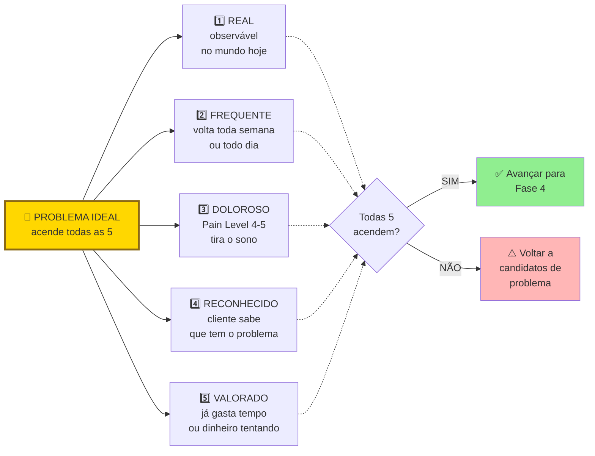

Para passar no filtro, o problema precisa atender a pelo menos quatro das cinco características, sendo obrigatório que seja Doloroso. Caso contrário, é apenas um tema curioso, que rende boa conversa mas não sustenta um negócio. Teste cada característica com entrevistas e observação direta, nunca com "acho que sim".

As cinco características em detalhe.

Real e Doloroso (alinhado aos cinco critérios do diagrama: Real, Frequente, Doloroso, Reconhecido e Valorado). O problema provoca perda concreta de tempo, dinheiro ou reputação e carrega frustração visível; sem dor reconhecida e valorada, não há urgência para sair da inércia.

Funcional. O problema impede o cliente de realizar uma tarefa concreta importante. Não é só um incômodo estético.

Frequente. Reforça o filtro YC. Quanto mais frequente, mais valor percebido na solução.

Urgente. Tem deadline implícito ou explícito. Algo vai dar errado se não resolver.

Inevitável (*unavoidable*). Não há jeito fácil de contornar. Se o cliente pode simplesmente ignorar ou desviar, ele não vai pagar.

#### Filtro 2: poço fundo ou poço largo (Paul Graham, 2012)

Poço largo significa que muita gente usa. "Todo mundo usa o Google."

Poço profundo significa que quem usa, usa várias vezes ao dia. "Usamos o Google múltiplas vezes por dia."

Negócios bilionários tendem a ser profundos *e* largos. Mas iniciantes devem priorizar profundo em um nicho estreito antes de perseguir largura. Um poço profundo em nicho restrito te dá quatro coisas: clientes que viram evangelistas, clareza sobre o que construir, dispensar capital intensivo, e defensabilidade natural contra concorrentes grandes que ignoram nichos.

> [!tip] Regra operacional do poço profundo
> Se a sua empresa sumisse amanhã, um grupo bem específico de pessoas deveria reclamar muito. Se ninguém reclamaria, você não tem poço. Tem uma poça.

#### Corolário: cliente desesperado aceita produto imperfeito

Em um mercado excelente, com clientes desesperados por solução, a primeira versão do produto não precisa ser incrível. Só precisa funcionar. Essa é a marca do produto bem-sucedido em fase inicial. Em um mercado morno, mesmo um produto excepcional tem dificuldade de ganhar tração.

O que isso significa na prática: se você está obcecado em polir o produto antes de lançar, há boa chance de que esteja mirando o mercado errado. Mercados quentes toleram (e recompensam) produtos capengas. Mercados frios exigem produtos polidos que ainda assim falham em engajar. A obsessão com perfeição técnica é frequentemente fuga de fundador evitando o veredito do mercado real.

Este corolário se conecta a dois conceitos.

O primeiro é o Limiar de Desespero. É o nível mínimo de dor que faz um cliente aceitar um produto imperfeito para resolver o problema. Abaixo desse limiar, ele vai reclamar de cada bug e cancelar. Acima, ele vai pagar mesmo com UI feia, fluxos quebrados, e atendimento via WhatsApp. Mapeie o Limiar de Desespero da sua cunha antes de investir em polimento. O Pain Level 5 (orçamento comprometido) é o indicador mais forte de que o cliente está acima do limiar.

O segundo é o "problema chato", também conhecido como Schlep Blindness (cegueira para trabalho árduo: Paul Graham, 2012). *Schlep* é palavra em iídiche, hoje de uso comum no inglês, que significa "tarefa tediosa e desagradável". Graham cunhou o termo para descrever o padrão pelo qual empreendedores (especialmente técnicos) sistematicamente evitam problemas que envolvem trabalho chato e sem glamour: regulação, negociação com bancos, operação manual, migração de dados legados, compliance, suporte trabalhoso. A mente descarta a ideia antes mesmo de ela chegar à consciência, com o rótulo de que aquilo não é problema de startup. Como quase ninguém quer assumir esse trabalho árduo, é justamente ali que se concentram as oportunidades mais valiosas.

A lógica é econômica antes de ser poética. Se todo mundo evita certa categoria de trabalho pesado, quem se dispõe a executá-la encontra um mercado inteiro com baixa concorrência. O empreendedor que ataca deliberadamente problemas operacionais árduos costuma encontrar menos competição, clientes mais leais (porque ninguém os atende bem) e margens melhores. Se o seu problema parece fácil demais de explicar num coquetel, desconfie: provavelmente você está disputando a mesma fatia com dezenas de outros fundadores.

##### Casos canônicos, schleps que viraram empresas bilionárias

Stripe resolveu pagamentos online. Os irmãos Patrick e John Collison atacaram o schlep que todo desenvolvedor da época reclamava mas ninguém queria consertar. Gateways de pagamento eram infernais de integrar, cheios de burocracia bancária, regulação complexa, KYC, PCI-DSS. A Stripe superou US$ 1 trilhão em volume anual processado e atingiu avaliação superior a US$ 70 bilhões em recompras privadas entre 2024 e 2025. Graham usa Stripe como exemplo arquetípico no próprio ensaio.

Scale AI resolveu *data labeling*, a rotulagem manual de dados de treino para IA. Alexandr Wang, fundador, mencionou em entrevista que o ensaio de Graham foi inspiração direta. Todo pesquisador de IA sabia que era tarefa necessária. Ninguém queria fazer. Em junho de 2025, a Meta investiu cerca de US$ 14,3 bilhões por 49% da Scale AI (avaliando a empresa em US$ 29 bilhões), movimento no qual Alexandr Wang deixou o cargo de CEO para liderar frentes de IA na Meta.

No Brasil, startups de conciliação fiscal e automação contábil como Arquivei e Contabilizei atacaram um schlep clássico que engenheiros evitavam: ler milhares de layouts municipais de notas fiscais, lidar com instabilidades da Receita Federal e traduzir obrigações acessórias. Era um trabalho árduo e sem glamour aparente, mas resolveu uma dor obrigatória de dezenas de milhares de empresas.

Uber enfrentou schleps regulatórios e batalhas com sindicatos de táxi que eram exatamente o que fazia concorrentes desistirem. Não era sexy. Era desgastante, caro, litigioso. Foi isso que abriu espaço.

No Brasil, a Stone construiu o moat justamente sobre schlep que concorrentes evitavam: vender maquininha porta-a-porta para pequenos comerciantes negligenciados pelos grandes bancos, com onboarding manual, suporte humano em cada cidade, e cobrança em segmentos que ninguém queria atender. Resultado, IPO na Nasdaq em 2018 e disputa direta com Cielo e Rede em segmento que parecia "saturado" antes da entrada delas.

##### Como usar Schlep Blindness como filtro mental para achar ideias

Em vez de perguntar "que problema eu quero resolver?", pergunte: *que problema eu gostaria que outra pessoa resolvesse para mim?* A resposta frequentemente revela um schlep escondido. Algo que te irrita e que você simplesmente aceitou como "jeito das coisas".

Escaneie o seu próprio dia a dia profissional. Onde você improvisa solução manual? Onde processos são lentos, caros, irritantes? Onde você diz "isso deveria ser automático mas não é"?

Para empreendedor iniciante, desconfie de ideias que pareceram óbvias e rápidas de construir. Se pareceu óbvio, duzentas pessoas tiveram a mesma ideia esta semana. Se pareceu difícil, chato, com hurdles regulatórios ou operacionais, pode ser exatamente a sua oportunidade.

> [!important] A regra combinada
> Persiga problemas chatos com clientes desesperados. Essa combinação, por mais deselegante, é a mais previsível fonte de tração em estágio inicial.

### TESTE DE PRIORIDADE, três perguntas rápidas (Priority Diagnostics)

Antes de avançar, submeta o seu problema a um teste de prioridade em três perguntas. É um diagnóstico operacional direto deste livro, inspirado na triagem de pré-aceleração de fundos de semente. Aplique sobre cada problema-candidato antes de comprometer tempo sério com ele.

> [!question] Pergunta 1, se este problema desaparecesse amanhã, quem notaria?
> Não "quem acharia bom". Quem notaria concretamente, em quarenta e oito horas, sem ninguém avisar. Se a resposta for "as pessoas em geral" ou "todo mundo", o problema não é prioritário para ninguém em específico. Resposta boa: um cargo ou pessoa nomeada, por exemplo "o gerente de operações do setor X", que usa o problema diariamente.

> [!question] Pergunta 2, qual métrica numérica e rastreada mudaria?
> Se o problema é real e prioritário, existe uma métrica que alguém já acompanha que se moveria. Tempo de ciclo. Custo por transação. Taxa de retrabalho. NPS interno. Faturamento por hora. Churn. Se nenhuma métrica rastreada se moveria, o problema pode até existir, mas ninguém tem caso de negócio para resolvê-lo. E portanto ninguém tem budget.

> [!question] Pergunta 3, alguém escalaria o problema para um nível acima?
> Problemas prioritários sobem na hierarquia. Alguém reporta ao chefe. Alguém pede recursos. Alguém marca uma reunião urgente. Se o problema existe mas ninguém o escala, ele está sendo absorvido silenciosamente. Significa que não é urgente o suficiente para forçar mudança de comportamento.

> [!warning] Regra operacional do Teste de Prioridade
> Se você não consegue responder às três perguntas com um nome de cargo, uma métrica específica, e um comportamento de escalada concreto, volte para entrevistas. Problemas que passam nas três perguntas geram urgência de compra. Os que não passam geram apenas interesse educado.

### O protocolo de interrogatório reverso: extraindo fatos contábeis em vez de opiniões gentis

Dez passos.

> [!tip] Empathy Map como complemento ao Mom Test
> Entrevistas Mom Test capturam comportamento passado e revelam onde a dor está. Para registrar o **universo emocional e contextual** que cerca esse comportamento, use o [[#Canvas: Empathy Map (Dave Gray / XPLANE, 2009)|Canvas: Empathy Map (Dave Gray / XPLANE, 2009)]] como artefato pós-entrevistas. Após 5 a 10 entrevistas com a mesma persona (no Passo 7 de síntese), reúna os cofundadores e quem já atende o cliente para preencher os seis quadrantes (Pensa & Sente, Vê, Ouve, Fala & Faz, Pains, Gains) com base em verbatim. Empathy Map preenchido sem entrevistas é projeção; com entrevistas é a primeira ferramenta que torna empatia auditável. O exemplo de Loggi com persona "Carlos motoboy" em Canvas: Empathy Map (Dave Gray / XPLANE, 2009) (Fase 4) mostra como mapear não clientes (parceiros, intermediários) frequentemente revela mais que mapear o cliente final.

#### Passo 1, perfil do entrevistado com precisão

Antes de sair entrevistando, escreva os critérios de inclusão e exclusão. Quem incluir: quem atende a tais e tais características. Quem excluir: quem atende a tal característica.

Exemplo ruim: "donos de restaurante". Exemplo bom: "donos ou donas, sócios ou sócias operacionais de restaurantes de uma a três unidades, localizados em capitais brasileiras, que oferecem delivery próprio (não apenas via iFood), com faturamento mensal entre R$ 50 mil e R$ 300 mil, há pelo menos dois anos no mercado".

Esse filtro é o que separa pesquisa útil de pesquisa "perdida no meio".

#### Passo 2, lista de quarenta a sessenta pessoas para abordar

Você precisará abordar três a quatro vezes o número de entrevistas que pretende realizar. Muita gente não responde, não tem tempo, ou não atende aos critérios. Fontes possíveis: LinkedIn com busca filtrada; grupos de WhatsApp e Telegram de nichos específicos; associações e entidades de classe (sindicatos, federações, coletivos); eventos presenciais do setor; introduções via conhecidos ("alguém que conhece alguém"); comunidades online (subreddits, fóruns, Discord); cold outreach estruturado (e-mail direto ou mensagem com proposta clara de trinta minutos).

#### Passo 3, escreva e teste o seu roteiro de entrevista

O roteiro tem dois princípios. Perguntas abertas, nunca fechadas. "Como você decide X?" em vez de "Você decide X dessa forma?". E perguntas sobre o passado, não sobre o futuro: as cinco perguntas canônicas abaixo aplicam esse princípio em detalhe.

Estrutura sugerida (método Mom Test, técnica de entrevista que evita respostas educadas, adaptado).

Aquecimento (dois minutos). Agradeça o tempo, explique que é pesquisa, não venda, peça permissão para gravar.

Contexto do entrevistado (cinco minutos). Quem é, o que faz, qual a rotina.

Exploração do domínio (dez minutos). Perguntas abertas sobre o território onde você imagina o problema, sem mencionar o problema. "Me conta como funciona o seu dia a dia com (atividade relacionada)." "Quais são as partes mais chatas disso?" "Me conta a última vez que você teve um problema com isso."

Aprofundamento (dez minutos). Sempre que algo interessante surgir, pergunte: "Me fala mais sobre isso." E: "Na última vez, como foi?"

Tentativas de solução (cinco minutos). "O que você já tentou fazer para resolver isso? Funcionou? Por que parou?" Se a pessoa nunca tentou resolver, isso é evidência forte de que o problema não é dolorido.

Encerramento (três minutos). "Tem mais alguém que você acha que passa por isso, que eu poderia conversar?" Pedido de indicação.

> [!note] O comportamento do consumidor brasileiro tem padrões que afetam como a dor se manifesta nas entrevistas
> Em entrevistas de campo com públicos das classes C e D (como apontam levantamentos do Instituto Locomotiva e do Data Favela), o incômodo cotidiano pode vir minimizado por hábito; por isso, pergunte pelo impacto concreto no bolso e no tempo, não apenas se algo incomoda; usuários mobile-first descrevem fluxos de forma diferente de quem usa desktop. O [[#CAPÍTULO 1 — PSICOLOGIA DO CONSUMIDOR BRASILEIRO — COMPORTAMENTO, DECISÃO E CONVERSÃO|Capítulo 1: Psicologia do Consumidor Brasileiro]] detalha esses padrões e ajuda a calibrar o que ouvir nas entrevistas: especialmente a diferença entre dor declarada e dor real.

##### As cinco perguntas de Eric Migicovsky (Y Combinator), compatíveis com o Mom Test (roteiro mínimo)

Estas cinco perguntas, adaptadas ao seu domínio, formam um núcleo mínimo para qualquer entrevista de problema. Foram desenhadas para revelar a dor real, focar em comportamento passado em vez de intenção futura, e evitar que você caia na armadilha de vender a sua ideia.

> [!example] Cinco perguntas para entrevista de descoberta de problema
>
> 1. Qual é a parte mais difícil de (fazer a tarefa)? Identifica a dor real na linguagem do cliente, não na sua.
> 2. Me conta sobre a última vez que você encontrou esse problema. Força o entrevistado a descrever comportamento passado, que é evidência, não especulação.
> 3. Por que isso foi tão difícil? Revela as causas raízes que o seu raciocínio de ponta a ponta não consegue supor sozinho.
> 4. O que você já fez para tentar resolver isso? Se o entrevistado não fez absolutamente nada, a dor não é forte o suficiente para gerar negócio.
> 5. O que você não gosta nas soluções que já tentou? A resposta é o rascunho inicial do seu roadmap de produto, com palavras do cliente.

Para separar na prática o Pain Level 4 do Pain Level 5 sem recorrer a perguntas hipotéticas sobre disposição a pagar, investigue sinais indiretos de orçamento já comprometido: pergunte quanto a empresa já desembolsou nos últimos seis meses com consultorias, horas extras, ferramentas paliativas ou retrabalho para conter o problema, e quem assinou essa despesa. Clientes no Nível 5 citam valores, fornecedores e prazos reais; no Nível 4, mostram a gambiarra interna, mas ainda não destinaram verba específica. Faça essa sondagem de custo histórico no fim da conversa, nunca na abertura, para não induzir a resposta.

> [!tip] A pergunta final que revela onde está a alavanca
> Fale menos, ouça mais. Você não está ali para vender o seu produto. Está ali para interrogar o problema. Se você falou mais de vinte por cento do tempo, fez errado.

##### A armadilha da validação, dado ruim e dado bom

Nem todo "sinal" obtido em entrevista vale igual. Há tipos de resposta que pesam muito diferente.

| Tipo de informação | Peso como evidência | Por quê |
|---|---|---|
| Elogios ("Nossa, que ideia legal!") | Quase zero | Pessoas mentem sobre interesse por educação ou para agradar |
| Hipóteses futuras ("Eu pagaria por isso") | Baixo | Promessas sobre o futuro não se traduzem em compra real |
| Ideias soltas ("Seria legal se tivesse tal funcionalidade") | Baixo a médio | Útil para brainstorm, não para validação |
| Comportamento passado ("Semana passada gastei 4 horas nisso") | Alto | Dado verificável; ações já tomadas são a melhor evidência |
| Tentativas anteriores de solução ("Eu usei X, Y e Z, nenhum resolveu") | Alto | Prova que a dor é forte o suficiente para o cliente já ter agido |
| Métricas de custo (tempo, dinheiro, energia já gastos) | Alto | Traduzem a intensidade real da dor em números |

> [!important] Princípio operacional sobre evidência
> Pessoas mentem sobre interesse, mas não mentem sobre dor. Foque em interrogar a dor, comportamento passado, tentativas de solução, custo atual. Ignore promessas futuras e elogios.

##### Escala de Pain Level (adaptada da régua de earlyvangelists de Steve Blank, *The Four Steps to the Epiphany*)

Ao final de cada entrevista, atribua ao entrevistado uma nota na escala de Pain Level, de um a cinco, que mede o estado dele em relação ao problema.

Nível 1. Tem o problema, mas nem sabe que tem. Não é cliente ainda. No máximo é foco de marketing educacional.

Nível 2. Sabe que tem o problema. Reconhece, mas tolera. Não vai pagar por solução sozinho.

Nível 3. Está ativamente procurando uma solução. Tem deadline na cabeça. É lead quente.

Nível 4. Já improvisou uma solução feia. Planilha Excel gigante, processo manual, Frankenstein de ferramentas. A existência dessa gambiarra é prova de que ele pagaria por algo melhor.

Nível 5. Tem orçamento comprometido ou facilmente acessível para comprar uma solução. Esse é o cliente ideal para a venda inicial e para o PSF (Problem-Solution Fit). Equivale ao Limiar de Desespero descrito na seção anterior: o cliente está acima do limiar e aceita produto imperfeito para resolver o problema.

> [!important] Meta de Pain Level desta fase
> Consiga entrevistar pelo menos cinco pessoas em Pain Level 4 ou 5. Se você não encontrar ninguém nesses níveis, você está testando um problema que o mercado ainda não sentiu o suficiente para pagar. É sinal vermelho. Volte para a Fase 3 (Teoria) e reconsidere o ICP ou a dor.

##### O que não fazer

Não pergunte "você acha que um app que faz X seria útil?". É hipotético, sobre o futuro.

Não pergunte "você pagaria R$ 99 por isso?". Inventa compromisso que a pessoa não vai cumprir.

Nunca diga "eu tive uma ideia de negócio que…". A partir daí, tudo vira cortesia.

Evite perguntas tendenciosas (*leading questions*). "Você não acharia melhor se…" ou "Seria incrível se existisse X, né?". Deixe o entrevistado dizer o que quer. Se você precisa sugerir, não é dor real.

Não misture apelos emocionais ou virtuosos (*virtue signalling*). "Você compraria um produto que doa parte da receita para uma ONG ambiental?" Quase ninguém vai dizer não. Mas isso não significa que vai pagar. Mantenha o foco no problema, não em apelos morais que enviesam a resposta.

Não ofereça "crack grátis". "Você gostaria de receber X de graça?" Quase todo mundo diz sim. Isso não valida negócio nenhum. Só valida que as pessoas gostam de coisas grátis.

#### Passo 4, primeiras três entrevistas como teste

Grave (com permissão), transcreva, releia. Identifique três coisas. Quais perguntas funcionaram (geraram respostas longas e ricas). Quais caíram no vazio (respostas curtas, secas). E onde você cedeu à tentação de apresentar a ideia.

Ajuste o roteiro antes de seguir com as próximas.

#### Passo 5, execute quinze a trinta entrevistas no total

Ritmo saudável: três a cinco por semana. Faça sozinho, ou com um parceiro que toma notas enquanto você conduz.

#### Passo 6, registro sistemático

Para cada entrevista, preencha a Parte B do Template de Entrevista de Problema com sete campos padronizados: (1) nome, papel, empresa e data; (2) citações literais (*verbatim*) entre aspas das frases mais reveladoras; (3) problemas efetivamente relatados pelo entrevistado; (4) soluções e gambiarras utilizadas hoje; (5) tempo e dinheiro gastos atualmente com o problema; (6) reações emocionais observadas (frustração, pressa, resignação); e (7) observações do entrevistador em itálico, separadas dos fatos.

> [!tip] Use o Template: Entrevista de Problema (Fase 4), Parte B
> O [[#Template: Entrevista de Problema|Template: Entrevista de Problema]] tem duas partes: a Parte A é o roteiro que você consulta durante a conversa; a Parte B é a síntese pós-entrevista, com 12 seções que estruturam exatamente o que este Passo 6 pede: metadados, aderência ao ICP, problemas, verbatim, vocabulário, hierarquia de sinais, Pain Level com justificativa, armadilhas (autoavaliação) e refinamento de ICP. Preencha nas 24h seguintes à entrevista, enquanto a memória está fresca. Entrevistas com a Parte B em branco contam como dado perdido.

#### Passo 7, análise depois de cada lote de cinco entrevistas

Não espere terminar tudo para analisar. A cada cinco entrevistas, faça uma síntese parcial. Quais problemas apareceram em mais de cinquenta por cento das entrevistas? Quais padrões de comportamento se repetem? Que hipóteses iniciais foram reforçadas e quais foram abaladas? Quais novos problemas apareceram que você não esperava?

> [!tip] Síntese parcial e final no Template: Síntese de Rodada de Entrevistas (decisão de avanço) (Fase 4)
> O [[#Template: Síntese de Rodada de Entrevistas (decisão de avanço)|Template: Síntese de Rodada de Entrevistas (decisão de avanço)]] é o artefato dessa síntese. Use uma versão "rascunho" a cada lote de cinco para checar padrões; consolide a versão final só quando a rodada inteira fechar: consolidar antes do fim viesa as entrevistas restantes. Template: Síntese de Rodada de Entrevistas (decisão de avanço) (Fase 4) é também o documento que registra a decisão de avanço da fase (perseverar / pivotar problema / pivotar cliente / abandonar).

> [!note] Registre nos templates dos Passos 6 e 7 a sequência cronológica das etapas que o entrevistado percorre hoje para contornar o problema
> Enquanto o Mom Test captura incidentes isolados, o [[IGNICAO-Vol-4-Tracao-e-PMF#CAPÍTULO 8 — CUSTOMER SUCCESS (CS) E CUSTOMER EXPERIENCE (CX): DA JORNADA AO CHURN ZERO E NRR POSITIVO|Capítulo 8: Customer Experience (Vol. 4)]] oferece a visão de jornada completa, do momento de consciência do problema ao pós-resolução, incluindo métricas de NPS e churn preditivo. Usar a jornada como mapa mental durante a síntese das entrevistas ajuda a localizar em qual etapa a dor é mais aguda.

> [!tip] Canvases Visuais: Value Proposition Canvas (Fase 5)
> Ao sintetizar as entrevistas, o **Customer Profile** do [[#Canvas: Value Proposition Canvas (Alexander Osterwalder, 2014)|Canvas: Value Proposition Canvas (Alexander Osterwalder, 2014)]], Jobs (o que o cliente está tentando fazer), Pains (frustrações no caminho), Gains (resultados desejados), é o frame visual exato para organizar o que as entrevistas Mom Test capturaram. Use depois da síntese qualitativa para preparar a [[#FASE 5 — PESQUISA COM USUÁRIOS (CUSTOMER DISCOVERY)|Fase 5]] (JTBD).

#### Passo 8, separe sintoma de causa raiz — entrevista de raiz causal

O erro mais comum em discovery é documentar sintomas como se fossem problemas. "Meu CRM é uma bagunça" é sintoma. A causa raiz pode ser: processo de vendas mal definido, equipe resistente à adoção de ferramentas, ou dados de entrada inconsistentes vindos de integrações quebradas. Cada causa raiz tem uma solução diferente. Tratar o sintoma sem entender a causa produz produto que não resolve o problema real.

A técnica de entrevista de raiz causal usa três camadas de aprofundamento.

**Camada 1: o sintoma declarado.** O entrevistado descreve o problema como ele aparece para ele. "Meu relatório de vendas demora três dias para ficar pronto." Anote literalmente: esse é o ponto de partida, não a conclusão.

**Camada 2: o mecanismo.** Para cada sintoma, pergunte: "Me conta como isso acontece na prática. Quando o relatório atrasa, o que está acontecendo especificamente?" Objetivo: entender o processo, não apenas o resultado. Frequentemente revela que o "problema de relatório" é, na verdade, um problema de input: os dados não chegam na qualidade certa.

**Camada 3: a causa raiz.** Para cada mecanismo, aplique a pergunta "por quê" até chegar ao elemento que, se resolvido, elimina o sintoma. "Por que os dados chegam inconsistentes?: Porque a equipe de vendas preenche o CRM diferente. Por que preenche diferente?: Porque não há template padrão e cada vendedor usa o que acha melhor. Por que não há template padrão?: Porque quando implementaram o CRM dois anos atrás, o gerente de vendas saiu logo depois e ninguém estabeleceu o processo." Causa raiz: falta de processo documentado e owner claro do CRM. Solução: não é um relatório melhor, é um playbook de uso do CRM com responsável.

**Protocolo prático de raiz causal em entrevista:**

1. Deixe o entrevistado descrever o problema livremente (2-3 minutos).
2. Repita o sintoma de volta e peça para detalhar o mecanismo: "Quando você diz X, me conta como isso acontece no dia a dia?"
3. Para cada elemento do mecanismo que parece ser causa, pergunte: "Por que isso acontece?", até a resposta ser "é como funciona aqui" ou "não sei, nunca perguntei."
4. No final da entrevista, pergunte: "Se você resolvesse esse problema hoje, o que mudaria primeiro, o sistema, o processo, ou a equipe?"

A resposta à última pergunta é ouro. Ela revela onde o entrevistado percebe a alavanca de solução: e frequentemente diverge do que você assumia como desenvolvedor de produto.

**Red flags que indicam sintoma não raiz:**

- A pessoa descreve uma solução ("precisamos de uma dashboard melhor") em vez de um problema. Pergunte: "O que você faria com a dashboard melhor que não consegue fazer agora?"
- O problema "desaparece" quando você pergunta sobre frequência. "Acontece de vez em quando" com dificuldade de quantificar sugere que o problema não é tão dolorido quanto parece.
- A pessoa cita o problema de outra pessoa ("meu chefe reclama que..."). A causa raiz pode estar na dinâmica organizacional, não no processo em si.

#### Passo 9, chegue à saturação

Saturação é o ponto em que entrevista nova deixa de trazer informação nova. Há dois testes complementares: um qualitativo (sentir) e um quantitativo (medir). Os dois apontam para o mesmo fenômeno; use ambos para reduzir o autoengano (aplicando contramedidas numa escuta semiestruturada e relendo as notas sem filtro).

**Teste qualitativo.** Você sente quando chegou. "Ah, é a mesma coisa que o anterior disse." Quando isso acontecer duas ou três vezes seguidas, você chegou.

**Teste quantitativo.** Para cada nova entrevista, conte quantas observações realmente novas (problemas, vocabulário, padrões de comportamento, workarounds) ela trouxe versus repetições do que já apareceu antes. Quando o percentual de novidade fica abaixo de quinze por cento por três entrevistas seguidas, é saturação confirmada.

Os dois critérios devem se confirmar mutuamente. Sentiu saturação mas o quantitativo ainda mostra trinta por cento de novidade? Você está sendo otimista: faça mais cinco. Quantitativo já abaixo de quinze por cento mas você ainda sente "tem coisa nova"? Provavelmente é gosto pelas conversas, não evidência. Pare.

#### Passo 10, produza o Mapa de Problemas

Esse é o entregável central da Fase 4. Estrutura visual:


Um ICP pode ter três a cinco problemas mapeados. O foco é em um, o mais agudo, o de melhor fit. Atualize o mapa conforme as entrevistas avançam. Não é documento morto.

O documento final tem cinco a dez páginas, com o seguinte conteúdo: perfil do entrevistado consolidado (ICP refinado); lista dos problemas identificados, ranqueados por frequência e intensidade; verbatim marcantes (citações literais) para cada problema; soluções atuais identificadas e suas deficiências; disposição emocional, ou seja, quanto as pessoas se importam com o problema; comparação com a Declaração Inicial v1: o que se confirmou, o que se refutou, o que emergiu que você não esperava; e versão dois da Declaração da Ideia, atualizada com o que foi aprendido.

> [!note] Mapa de Problemas e Template: Síntese de Rodada de Entrevistas (decisão de avanço) (Fase 4)
> O Mapa de Problemas é a saída visual da rodada: o entregável de comunicação. O [[#Template: Síntese de Rodada de Entrevistas (decisão de avanço)|Template: Síntese de Rodada de Entrevistas (decisão de avanço)]] é a planilha de decisão estruturada que sustenta o Mapa: cruza distribuição de Pain Level, padrões agregados de problema, workarounds dominantes, vocabulário recorrente e sub-segmentos para registrar a decisão de avanço com rastro à evidência. Use os dois: o Mapa para apresentar, Template: Síntese de Rodada de Entrevistas (decisão de avanço) (Fase 4) para defender.

### Os dez passos aplicados, roteiro de entrevista do PadariaPro

Para tornar o método concreto neste volume de forma autocontida, acompanhe o roteiro de entrevista de problema do **PadariaPro** (caso didático de um software B2B criado para reduzir desperdício de insumos e ruptura de estoque em pequenas redes de padarias artesanais em São Paulo, cuja hipótese inicial mirava estabelecimentos de duas a cinco lojas).

Abertura (dois minutos). "Oi, [Nome]. Obrigado pelo tempo. Antes de começar: não estou aqui para te vender nada. Estou pesquisando como padarias pequenas gerenciam compras e estoque, porque quero entender se tem um problema real antes de construir uma solução. Vou fazer umas perguntas abertas, sem respostas certas. A gravação fica privada, só para eu transcrever depois. Tudo bem?"

Perguntas de contexto (cinco minutos). Como você virou dono ou operador dessa padaria? Quantas lojas vocês têm hoje? Como a gestão é dividida entre elas? Quem cuida de compra de ingredientes?

Perguntas sobre dor (quinze minutos), sem mencionar produto ou solução. Como vocês decidem hoje quanto de farinha comprar por semana? Me lembra da última vez que sobrou ou faltou algum ingrediente importante. O que aconteceu? Quando isso acontece, qual o impacto, em dinheiro, em tempo, em estresse? Vocês já tentaram alguma ferramenta ou método para resolver? Funcionou? Por que sim, ou por que não? Qual problema operacional mais tomou o seu tempo no mês passado, e como você controlou o estoque de insumos na última semana?

Perguntas sobre comportamento (cinco minutos). Como vocês controlam estoque hoje? (peça para mostrar se possível, caderno, planilha, sistema). Em uma escala de zero a dez, quanto o problema de estoque incomoda?

Fechamento (três minutos). "Última coisa, posso te ligar em trinta dias para te mostrar algo que estou desenhando, e pegar a sua opinião?"

Análise depois de dez entrevistas:

| Entrevistado | Perda financeira/mês | Método atual | Dor real (0-10) | Já pagou para resolver? |
|---|---|---|---|---|
| Padaria A (Pinheiros) | R$ 3.500 | Caderno | 7 | Não, mas pensou em Excel avançado |
| Padaria B (Vila Madá) | R$ 8.000 | Planilha | 9 | Pagou consultor R$ 2k uma vez |
| Padaria C (Moema) | R$ 2.000 | Sistema antigo | 5 | Paga R$ 150/mês ERP que não serve |
| ... | | | | |

Padrão emergente ao cruzar o número de lojas com a escala de Pain Level (1 a 5): as padarias em Pain Level 4 ou 5 (com gambiarra ativa em planilha e perda semanal documentada) são aquelas com três ou mais lojas. Nas operações de uma ou duas lojas, a dor fica em Pain Level 2 ou 3 e o dono resolve no olho. O ICP foi refinado para redes de três a cinco lojas, em vez de duas a cinco da hipótese inicial.

### Caso brasileiro real, descoberta do problema no iFood com restaurantes pequenos

No início da operação, a equipe do iFood (Patrick Sigrist, Eduardo Baer, Felipe Fioravante e Guilherme Bonifácio) partiu do modelo do Disk Cook (guia impresso e central telefônica de entregas criado nos anos 1990) e precisou descobrir em campo quais restaurantes tinham maior urgência para migrar para pedidos online (reconstrução ilustrativa da triagem comercial). Volume maior, ticket maior, estrutura instalada.

Antes de investir em vendas para grandes redes, com ciclo longo, fizeram dezenas de conversas diretas com donos de restaurantes pequenos. Incluindo visitas e observação de rotina. Não estavam vendendo nada. Estavam mapeando dor.

Descobriram algo contraintuitivo. Restaurantes pequenos tinham dor muito maior. Não tinham time de telemarketing. Atendimento telefônico custava tempo do dono. Pedido errado por ruído na ligação era prejuízo direto. E estavam dispostos a pagar comissão alta em troca do canal. Redes grandes, com estrutura própria, viam o iFood como ameaça à marca.

Quem tem dor mais aguda paga mais, mesmo que seja cliente "menor". Entrevistar onde a dor é intensa é mais produtivo que entrevistar onde você achava que seriam os clientes.

### A prova material de que o problema existe fora da sua cabeça

Você concluiu a Fase 4 quando todos os critérios abaixo estão cumpridos.

- [ ] Quinze ou mais entrevistas com pessoas dentro do ICP (pelo menos doze aderentes: fora do perfil contam como aprendizado, não como validação), gravadas (com consentimento) ou transcritas em tempo real, com roteiro Mom Test (Template: Entrevista de Problema (Fase 4)) sem perguntas indutoras.
- [ ] Saturação atingida. Nas últimas três entrevistas, informação nova abaixo de quinze por cento.
- [ ] Tabela de padrões com cinco ou mais dimensões por entrevistado.
- [ ] Três ou mais padrões de dor consistentes documentados, cada um apoiado por cinco ou mais entrevistas.
- [ ] Pelo menos um falso positivo identificado (algo que entrevistados disseram querer mas não agiriam para obter).
- [ ] Problema aparece em cinquenta por cento ou mais do ICP entrevistado (setenta por cento ou mais para considerar urgente) e é ativamente tratado em quarenta por cento ou mais.
- [ ] Pelo menos cinco entrevistados em Pain Level 4 ou 5 (já improvisaram gambiarra ou têm orçamento comprometido), com gasto atual no problema de pelo menos 1,5 vez o preço que você pretende cobrar (ou cinco horas semanais de trabalho do próprio decisor): proxy de disposição a pagar.
- [ ] ICP ajustado com base no ouvido. Registro de "antes versus depois", com sub-segmento mais doloroso identificado.
- [ ] Mapa de Problemas escrito. Declaração da Ideia atualizada para v2 com mudanças explícitas em relação à v1.
- [ ] Decisão explícita registrada em parágrafo: seguir, pivotar problema, pivotar cliente, ou encerrar.

> [!warning] Se o problema não passou no teste, momento crítico
> Os caminhos são três. Pivotar o problema (algo adjacente emergiu como mais doloroso). Pivotar o cliente (o problema existe, mas em outro perfil). Ou abandonar (volte à Fase 2 com outra ideia). Não avance para a Fase 4 com problema não validado. Construir sobre problema inexistente é o cemitério das startups.
>
> Antes de pivotar ou encerrar, vale ler o [[IGNICAO-Vol-9-Maturidade-e-Exit#CAPÍTULO 19 — POST-MORTEMS BRASILEIROS: CATÁLOGO DE CASOS EM PROFUNDIDADE|Capítulo 19 (Post-Mortems Brasileiros: Catálogo de Casos em Profundidade) (Vol. 9)]]: os casos analisados no Capítulo 4 deste volume (como Kekanto e startups de delivery vertical) e no catálogo de post-mortems mostram que vários negócios encerrados por falta de demanda tinham sinais claros de desinteresse já nas entrevistas iniciais: sinais que foram ignorados. Aprender o padrão antes de vivê-lo vale semanas de iteração.

**Primeiros passos práticos.**

1. Agendar cinco entrevistas para esta semana usando rede pessoal, LinkedIn cold outreach, ou grupos de WhatsApp do setor.
2. Revisar o Template: Entrevista de Problema (Fase 4) e remover perguntas que induzem resposta ("você gostaria de um app para…?").
3. Criar tabela no Notion ou Google Sheets (após rodar as três entrevistas piloto do Passo 4) com as colunas: nome, data, padrão de dor 1, padrão 2, padrão 3, solução atual, quanto já gasta hoje (tempo ou dinheiro) e Pain Level (1 a 5).
4. Fazer duas entrevistas piloto, revisar o roteiro com base no que não funcionou, e então agendar as demais.

### As oito ciladas que transformam entrevistas em sessões de massagem no ego

> [!note] Capítulo 3 (Vol. 1): Armadilhas Mentais e Vieses
> Viés de confirmação (filtrar evidência para confirmar a tese) e WYSIATI (What You See Is All There Is: concluir com dados insuficientes) são os vieses mais frequentes em discovery de problema. O [[IGNICAO-Vol-1-Ideacao#CAPÍTULO 3 — ARMADILHAS MENTAIS E VIESES|Capítulo 3 (Armadilhas Mentais e Vieses) (Vol. 1)]] descreve esses e outros padrões com diagnóstico e contra-medidas aplicáveis diretamente ao processo de entrevistas.

Entrevistar amigos e família. Eles mentem para te agradar. Exclua qualquer um que tenha relação pessoal.

Falar mais do que ouvir. A regra de ouro é que o entrevistado fala oitenta por cento do tempo. Se você está falando muito, está fazendo errado.

Confirmar em vez de refutar. É tentador ouvir só o que reforça a sua tese. Obrigue-se a procurar ativamente evidência contrária. Se você só encontra confirmação, está enviesando.

Perguntas hipotéticas. "Você usaria X?" produz respostas ficcionais. Sempre ancore no passado real.

Apresentar a solução. No momento em que você mostra a ideia, a conversa muda de tom. A pessoa passa a ser gentil ou crítica com a ideia, não honesta sobre a vida.

Achar que cinco entrevistas bastam. Às vezes bastam, mas você só sabe disso depois de quinze. Não corte caminho.

Generalizar a partir de um ou dois casos marcantes. Uma entrevista apaixonada vale muito menos que um padrão em dez entrevistas.

Ignorar quando o problema é "interessante" mas não dolorido. As pessoas adoram falar sobre ineficiências, mas só pagam para resolver as que doem. Diferencie.


---

### O Espelho da Fase 4: Você Está Ouvindo Feridas ou Colecionando Elogios?

**O Espelho (autodiagnóstico):**
1. Nas suas últimas dez conversas com potenciais clientes, em quantas você falou da sua solução? (Chave de leitura: se falou em mais de duas, refaça o roteiro; se nenhum entrevistado tem gambiarra ativa ou orçamento alocado, volte ao Passo 1: como Marina fez ao perguntar a Lucas quantos diretores financeiros já pagavam para resolver a conciliação de boletos.)
2. Você consegue citar o nome de três empresas reais que já gastam dinheiro ou horas de planilha hoje tentando resolver essa dor no improviso?
3. Se você cobrasse R$ 2.000 hoje apenas para resolver esse problema manualmente na próxima semana, quem faria o Pix até as 18h?

**Permissão Libertadora:**
Você está oficialmente autorizado a parar de preparar apresentações de slides bonitas sobre o futuro da sua empresa. Esconda o seu pitch deck por trinta dias.

**O Ritual de Segunda-Feira às 9h (rotina semanal de 30 minutos):**
Transforme a prospecção de descoberta em rotina semanal: toda segunda-feira, antes de mexer no produto ou na operação, mande mensagem para cinco decisores do seu nicho, deixe duas entrevistas agendadas na semana e anote o Pain Level de cada conversa no Mapa de Problemas, abrindo com uma única pergunta: *"Qual foi a maior dor de cabeça operacional que fez você perder dinheiro ou sono no mês passado?"*

---

### MÉTRICAS E BENCHMARKS DESTA FASE (FASE 4)

| Métrica | O que medir | Referência saudável |
|---|---|---|
| Entrevistas realizadas | Total de entrevistas de problema | ≥ 20 antes de qualquer conclusão |
| Dores nível 8+ | % das entrevistas com dor acima de 8 em 10 | ≥ 60% |
| Citações documentadas | Citações verbatim sobre o problema | ≥ 30 |
| Padrões emergentes | Temas recorrentes identificados | 3 a 5 temas claros |
| Alternativas atuais mapeadas | Soluções que o cliente usa hoje | Mapeadas em 100% das entrevistas |
| Mom Test score | Entrevistas sem leading questions | ≥ 80% das perguntas abertas |

> [!important] Marco de saída da Fase 3
> **Marco de saída da Fase 4:** mínimo de 15 a 20 entrevistas aderentes ao ICP, com pelo menos cinco entrevistados classificados em Pain Level 4 ou 5 (gambiarra ativa ou orçamento comprometido) descrevendo comportamento passado verificável.

---

### MANUAL PASSO A PASSO DOS FRAMEWORKS DESTA FASE

> [!tip] Uso autocontido neste volume
> Todos os frameworks abaixo estão detalhados integralmente com origem, estrutura, passo a passo de aplicação, exemplo brasileiro e armadilhas para execução imediata nesta **Fase 4**.

#### Framework: The Mom Test (Rob Fitzpatrick, 2013)

##### De onde vem a ferramenta (e por que sobreviveu ao filtro do tempo)

Rob Fitzpatrick, empreendedor britânico e cofundador da consultoria de educação empreendedora Founder Centric (após passar pela Y Combinator no verão de 2007), publicou *The Mom Test* em 2013, livro curto (~130 páginas) e direto. O título vem da regra central: **mesmo sua mãe diria que sua ideia é boa se perguntada diretamente**. O desafio é fazer perguntas baseadas em fatos passados que arranquem a verdade até dela. O livro virou referência em Customer Discovery, adotado em programas como YC, Techstars e 500 Global.

##### A mecânica central (sem jargão)

Protocolo de entrevista para validar ideias de negócio **evitando respostas falsamente positivas** ("educadamente inúteis") dos entrevistados. Não é framework acadêmico, é guia prático baseado em milhares de entrevistas conduzidas pelo autor e por mentorados.

##### As regras do jogo

Três regras fundamentais:

1. Fale da vida deles, não da sua ideia. Perguntas sobre problema do entrevistado em contexto real, sem apresentar sua solução.

2. Pergunte sobre o passado específico, não sobre hipotéticos futuros. "Quando foi a última vez que [problema] aconteceu?" em vez de "Você usaria uma ferramenta que [solução]?".

3. Fale menos, ouça mais. Proporção ideal: entrevistado fala 80% do tempo, você fala 20% (para introduzir perguntas e clarificar).

O que evitar (as "3 coisas ruins"):

- Elogios: "gostei da sua ideia", não significa nada.
- Conversa fiada hipotética: "eu definitivamente usaria isso", opinião sobre futuro não é dado.
- Ideias que o entrevistado sugere: "deveriam adicionar feature X", não é seu dever incorporar, pode ser ruído.

O que buscar (sinais de verdade):

- Comportamentos específicos no passado ("fiz X em Y situação").
- Pagamentos já feitos (ou tentativas): "gastei R$ Z tentando resolver isso".
- Intensidade emocional genuína (frustração visível, não educada).
- Quantidade concreta de tempo/dinheiro já investido tentando resolver.

##### Como rodar na segunda-feira às 9h com seu time

Passo 1: Prepare agenda sem mencionar sua solução. Lista de 5-7 perguntas sobre a vida deles relacionada ao problema.

Passo 2: Abra com contexto. "Estou estudando como [tipo de pessoa] lida com [domínio], posso fazer umas perguntas?" Não "estou validando minha startup".

Passo 3: Faça perguntas abertas sobre passado. "Como foi a última vez que X?" em vez de "Se houvesse Y, você usaria?".

Passo 4: Aprofunde em momentos específicos. "Me conte mais sobre aquela terça-feira quando aconteceu." Detalhamento é onde verdade mora.

Passo 5: Procure evidência de ação já tomada. Se entrevistado nunca tentou resolver o problema, pode não ser dor real.

Passo 6: Pergunte sobre prioridade relativa. "Onde isso se encaixa entre suas preocupações de mês?" Se não é top 3-5, provavelmente não vale produto dedicado.

Passo 7: Transição natural para commitment (se relevante). No fim de conversas com candidatos reais a ICP: "Tenho ideias do que poderia ajudar, posso te mostrar em 2 semanas?" Tentativa de agendar segunda conversa testa interesse real.

Passo 8: Documente. Notas durante (ou logo após) com: quotes literais, comportamentos reportados, sinais emocionais, próximos passos.

##### Na trincheira real: como isso funciona na prática

Mal feito (pergunta típica fundador):
"Tenho uma ideia de app que ajuda contadores a processar nota fiscal mais rápido. Você pagaria R$ 200/mês por isso?"
Resposta típica: "Sim, parece útil!" (sem valor).

Bem feito (Mom Test):

- "Como foi sua última semana processando notas fiscais?"
- "O que foi mais demorado?"
- "Quanto tempo você gasta por mês nisso?"
- "O que você já tentou para agilizar?"
- "Você usa alguma ferramenta? Qual? Por quê?"
- "Quanto custa pra você (tempo, dinheiro) essa parte do trabalho?"
- "Se tivesse uma varinha mágica, o que mudaria?"

As respostas mostram se o problema é real (pela especificidade do relato), se é intenso (pela frustração demonstrada), se tem prioridade (pelo dinheiro e tempo já gastos tentando resolvê-lo) e se existe uma lacuna que uma nova solução possa preencher.

##### Onde o papel aceita tudo (armadilhas de execução)

Pitch disfarçado de entrevista: "quero te entrevistar" mas fala sobre a ideia. Vira validação teatral. Perguntas guiadas: "concorda que X é frustrante?", já sugere a resposta. Desvio para futuros hipotéticos: entrevistado começa a fantasiar, vire para passado. Ignorar sinais negativos: entrevistado diz "não é um problema grande pra mim", fundador insiste ou reinterpreta. Erro grave. Viés de confirmação na análise: só lembra de quotes que apoiam hipótese, ignora os que contradizem. Documentar *tudo* protege. Amostra enviesada: entrevistar só pessoas próximas (cordiais). Buscar ICPs reais, mesmo frios. Parar cedo (três entrevistas não bastam): o padrão costuma aparecer entre 8 e 12 entrevistas e se firmar com segurança entre 15 e 20 conversas.

---

#### Framework: In-Depth Interviews (IDIs) — padrão acadêmico/comercial

##### De onde vem a ferramenta (e por que sobreviveu ao filtro do tempo)

A entrevista em profundidade tem raízes na sociologia empírica e no estudo de entrevistas focadas de Robert K. Merton e Patricia Kendall (*The Focused Interview*, 1946). Consolidou-se como método de pesquisa qualitativa de mercado no pós-guerra e na tradição de análise qualitativa de Anselm Strauss e Juliet Corbin. Funciona como método guarda-chuva que abriga protocolos específicos (como o Mom Test e a entrevista de troca de JTBD); aqui cobrimos seus princípios gerais.

##### A mecânica central (sem jargão)

Entrevista individual semi-estruturada de 45-90 minutos com participante representativo, explorando temas em profundidade. Mais flexível que survey, mais sistemática que conversa informal.

##### As regras do jogo

Semi-estruturada: roteiro com temas e perguntas-guia, flexibilidade para seguir threads emergentes.

Elementos essenciais:

- Rapport: primeiros 10 min construindo conforto.
- Abertura ampla: "me conta sobre sua experiência com X".
- Aprofundamento em pontos: "pode me dar um exemplo?"
- Clarificação: "quando você diz Y, o que quer dizer especificamente?"
- Encerramento: "mais algo que você acha que eu deveria saber?"

##### Como rodar na segunda-feira às 9h com seu time

Passo 1: Roteiro estruturado com flexibilidade. 5-7 temas grandes, 3-5 perguntas-guia por tema, espaço para seguir onde participante leva.

Passo 2: Rapport: primeiros 10 min. Small talk genuíno, explicar propósito e confidencialidade.

Passo 3: Open-ended perguntas. "Como foi X?" em vez de "X foi bom?". Perguntas fechadas limitam riqueza.

Passo 4: Silêncio como ferramenta. Após resposta, pause 3-5 segundos. Frequentemente participante adiciona espontaneamente.

Passo 5: "Por quê?" e "Me fale mais". Ferramentas simples, poderosas. Múltiplos níveis de profundidade.

Passo 6: Escuta ativa. Refletir, parafrasear, confirmar entendimento.

Passo 7: Gravar + notas. Gravação para análise posterior, notas para capturar nuances (linguagem corporal, entusiasmo).

Passo 8: 10-20 entrevistas para saturação. Mais entrevistas não adicionam, menos, não revelam padrão. Depende de homogeneidade do segmento.

##### Na trincheira real: como isso funciona na prática

Startup validando SaaS para gestão de escolas pequenas:

15 IDIs de 60 min cada com diretores de escolas pequenas (100-400 alunos) em SP e MG.

Tópicos:

1. Rotina típica do diretor.
2. Uso atual de tecnologia (quais ferramentas).
3. Processos problemáticos.
4. Orçamento de tecnologia e quem decide.
5. Expectativas para os próximos 12 meses.

Insights emergentes:

- 13 de 15 diretores entrevistados relataram que o "tempo gasto em papelada" é a maior frustração da rotina (6 de 15 apontaram relatórios para a secretaria e 9 de 15 citaram controles internos), mas a papelada é tão diversa que uma ferramenta pontual não resolve.
- Decisão de compra varia: em 40%, diretor decide sozinho (< R$ 500/mês), em 60%, mantenedor/família decide.
- WhatsApp é canal central (pais, professores, pagamento), não será substituído, produto tem que integrar.
- "Sistema" já existe em 100% das escolas, mas todos reportam insatisfação alta (NPS provável negativo).

##### Onde o papel aceita tudo (armadilhas de execução)

Perguntas fechadas excessivas: vira survey verbal, perde nuance, Facilitador falando demais: mantenha a proporção de 80/20 (o participante fala 80% do tempo e você 20%, intervindo apenas para aprofundar histórias), Roteiro rígido: recusar seguir thread emergente rica. Flexibilidade importa, Analisar sem transcrever: confiar em memória, perde quotes específicos, Generalização prematura: 3 entrevistas concordam em X, 20 entrevistadas revelam muito mais diversidade, Viés de recência: lembrar da última entrevista, análise enviesada.

---

#### Framework: Laddering Technique / Means-End Chain (Gutman 1982; Reynolds & Gutman 1988)

##### De onde vem a ferramenta (e por que sobreviveu ao filtro do tempo)

A teoria do means-end chain foi formalizada por Jonathan Gutman em "A Means-End Chain Model Based on Consumer Categorization Processes" (*Journal of Marketing*, 1982), com trabalho prévio com Reynolds em 1979. A **técnica de laddering** propriamente dita, a metodologia de entrevista em profundidade e o hierarchical value map como output analítico, foi formalizada por Reynolds & Gutman em "Laddering Theory, Method, Analysis, and Interpretation" em 1988. Hoje é padrão em pesquisa de marca, posicionamento, e UX research profunda.

##### A mecânica central (sem jargão)

Técnica de entrevista que conecta **atributos** declarados de um produto aos **benefícios funcionais** que geram, até chegar em **valores pessoais fundamentais** que sustentam a preferência. Revela motivações profundas que cliente **não articula** de primeira.

##### Princípios / estrutura — Means-End Chain

Cadeia em 3 níveis:

1. Atributos (concreto): features do produto. Ex.: "tem integração com WhatsApp".
2. Consequências/Benefícios (intermediário): o que atributo permite. Ex.: "resolvo mais rápido com clientes".
3. Valores pessoais (abstrato): por que benefício importa. Ex.: "eu quero me sentir em controle do meu negócio" ou "quero ter mais tempo com minha família".

Técnica do laddering: pergunta "por que isso importa pra você?" sucessivamente, subindo a escada (ladder) de concreto para abstrato.

##### Como rodar na segunda-feira às 9h com seu time

Passo 1: Comece com escolha concreta do entrevistado. "Você disse que prefere Ferramenta A. Qual atributo específico?"

Passo 2: Por quê isso importa? Sobe do atributo para consequência.

Passo 3: Por quê isso importa? Sobe da consequência para valor.

Passo 4: Continue 4-6 níveis. Até chegar em valor pessoal profundo (autoestima, segurança, pertencimento, controle, etc.).

Passo 5: Quando entrevistado fica relutante ou superficial, use técnicas de desvio:

- "Negative laddering": "Por que não é importante X?"
- "Contextual probe": "Em que situação isso seria mais importante?"
- "Time probe": "Isso era importante pra você há 5 anos? Por quê mudou?"

Passo 6: Sintetize cadeias. Após 15-20 IDIs com laddering, mapear cadeias comuns.

Passo 7: Use valores identificados em marketing e posicionamento. Comunicação que conecta produto a valor ressoa profundamente.

##### Na trincheira real: como isso funciona na prática

Empreendedor entrevistando usuária de app de produtividade:

- Atributo: "gosto que tem modo dark."
- Por quê? "Porque meus olhos cansam menos."
- Por quê isso importa? "Porque trabalho muito de noite."
- Por quê você trabalha muito de noite? "Porque dia é caótico com crianças."
- Por quê isso importa? "Porque noite é meu tempo de fazer algo só meu."
- Por quê "algo só seu" importa? "Porque sinto que preciso de espaço para mim, senão desapareço como pessoa."

Valor identificado: identidade pessoal, autonomia, senso de self. Modo dark → conforto físico → tempo noturno de trabalho → espaço de auto-expressão → preservação da identidade.

Implicação: marketing que fala só de "produtividade" perde esse público. Mensagem que fala de "seu espaço, seu tempo, sua identidade" ressoa em nível muito mais profundo.

##### Onde o papel aceita tudo (armadilhas de execução)

Parar em benefício funcional: "pra economizar tempo" é intermediário, continuar até valor pessoal, Entrevistadora impaciente: laddering é mais lento, dar espaço para reflexão, Guiar para valor desejado: "isso é porque você valoriza liberdade?", enviesa resposta, Laddering de tudo: é ferramenta complementar a IDIs, não substituto, Análise rasa: mapear cadeias exige análise transversal, não quote isolados.

---

#### Framework: Grounded Theory (Barney Glaser & Anselm Strauss, 1967)

##### De onde vem a ferramenta (e por que sobreviveu ao filtro do tempo)

Barney Glaser (Columbia) e Anselm Strauss (UCSF) publicaram *The Discovery of Grounded Theory* em 1967, resposta à dominância de sociologia teórica-dedutiva. Tese: teoria deve **emergir dos dados** (ground up), não ser imposta. Método tornou-se padrão em pesquisa qualitativa acadêmica. Versões modernas (Kathy Charmaz, 2006, constructivist GT) atualizam para paradigma contemporâneo.

##### A mecânica central (sem jargão)

Método sistemático de **construir teoria a partir de dados qualitativos** através de iteração entre coleta e análise. Diferente de análise "descritiva" (resumo do que foi dito), grounded theory busca **conceitualizar** fenômenos observados.

##### As regras do jogo

Três fases de codificação:

1. Codificação aberta (*open coding*, na sistematização em três etapas de Strauss e Corbin, 1990, derivada da Grounded Theory original de Glaser e Strauss, 1967): ler as transcrições e notas linha a linha identificando conceitos e categorias emergentes.

2. Axial coding: relacionar categorias, identificando sub-categorias, condições, consequências, estratégias de ação.

3. Selective coding: integrar ao redor de **categoria core** que explica fenômeno central. Teoria emerge.

Constant comparative method: comparar cada novo dado com análise prévia, refinar categorias iterativamente.

Theoretical sampling: amostra de dados não é fixa, é guiada por onde teoria emergente precisa refinamento.

Saturation: coletar dados até novos dados não adicionarem à teoria.

##### Como rodar na segunda-feira às 9h com seu time

Passo 1: Entre com mente aberta (ou o mais aberta possível). Evite forçar dados em teoria pré-concebida.

Passo 2: Colete dados (entrevistas, observação). Começar com 5-8 casos iniciais.

Passo 3: Open coding logo após coleta. Código cada frase, parágrafo, ou episódio com conceito emergente.

Passo 4: Ferramentas: NVivo, Atlas.ti, Dedoose, ou simples spreadsheet para startups.

Passo 5: Compare códigos: quais convergem em categorias? Quais se relacionam?

Passo 6: Axial coding: identifique relações entre categorias.

Passo 7: Theoretical sampling: colete mais dados em áreas onde teoria é fraca.

Passo 8: Saturation: pare quando novos dados confirmam sem adicionar.

Passo 9: Selective coding + memo writing: identifique categoria core, escreva teoria.

##### Na trincheira real: como isso funciona na prática

Pesquisa sobre por que PMEs brasileiras abandonam softwares de gestão após 3-6 meses:

Dados: 18 entrevistas, 120 min cada, com PMEs que abandonaram em 6 meses.

**Open coding** gera 200+ códigos como: "complexidade", "ausência de onboarding", "migração parcial", "equipe resistente", "custo-benefício incerto", "preferência por WhatsApp", "falta de tempo", etc.

**Axial coding** agrupa em categorias:

- Gap de onboarding (onboarding fraco + complexidade + resistência).
- Atrito operacional (migração parcial + falta de tempo + preferência por ferramentas habituais).
- Dúvida de valor (custo-benefício + "não via retorno" + "complicou mais que resolveu").

Selective coding: categoria core emerge, **"transição parcial e reversível"**. PMEs não abandonam por uma razão, abandonam porque **nunca fizeram transição completa**: mantiveram ferramentas paralelas, usavam software a meio-gás, a dor original não desapareceu porque solução antiga continuou ativa. No momento de crise ou sobrecarga, voltam para o antigo (mais familiar).

Hipótese emergente (a testar): nas 18 entrevistas, o abandono em PMEs concentrou-se nas contas em que a migração ficou pela metade e a equipe manteve a planilha antiga em paralelo. Próximo experimento: testar um onboarding com importação assistida dos dados históricos nos primeiros sete dias.

Implicação de produto: onboarding agressivo com migração forçada + bloqueio de ferramentas antigas.

##### Onde o papel aceita tudo (armadilhas de execução)

Entrar com teoria pronta: confirma o que queria achar, Codificação superficial: "um código por entrevista", perde granularidade, Pular iteração: analisar tudo só no fim, em vez de em paralelo, Theoretical sampling ignorado: amostra fixa predefinida, Não escrever memos: grounded theory pede escrita frequente sobre aprendizados emergentes, Generalizar prematuramente: pequeno n não justifica teoria de grande alcance.

---

#### Framework: Thematic Analysis (Virginia Braun & Victoria Clarke, 2006)

##### De onde vem a ferramenta (e por que sobreviveu ao filtro do tempo)

Virginia Braun (Auckland) e Victoria Clarke (UWE Bristol) publicaram "Using Thematic Analysis in Psychology" em 2006, sistematizando método amplamente usado mas pouco documentado. Resposta à falta de rigor metodológico comum: "thematic analysis" virou termo genérico para qualquer análise qualitativa casual. Braun & Clarke deram estrutura. Hoje é um dos métodos mais usados em pesquisa qualitativa aplicada (incluindo UX research).

##### A mecânica central (sem jargão)

Método sistemático para **identificar, analisar e reportar temas** (padrões) em dados qualitativos. Menos teórico que grounded theory (Framework: Grounded Theory (Barney Glaser & Anselm Strauss, 1967) (Fase 4)), mais flexível para pesquisa aplicada.

##### Princípios / estrutura — 6 fases de Braun & Clarke

1. Familiarização com dados (ler, re-ler, anotar impressões iniciais).
2. Geração de códigos iniciais (linha-a-linha ou tópico-a-tópico).
3. Busca por temas (agrupar códigos em candidatos a temas).
4. Revisão de temas (testar contra dados, refinar).
5. Definição e nomeação de temas.
6. Produção do relatório (com análise + quotes representativos).

##### Como rodar na segunda-feira às 9h com seu time

Passo 1: Transcreva tudo (ou note detalhadamente).

Passo 2: Leia sem analisar primeiro. Impressão holística.

Passo 3: Codifique sistematicamente. Cada quote/episódio ganha código descritivo.

Passo 4: Agrupe códigos em temas candidatos. Temas são padrões significativos.

Passo 5: Teste temas: voltam a cada entrevista, ainda fazem sentido? Precisam dividir ou unir?

Passo 6: Defina escopo de cada tema claramente.

Passo 7: Escreva análise com quotes mais fortes sustentando cada tema.

Passo 8: Síntese: como temas se relacionam? Narrativa integrativa?

##### Na trincheira real: como isso funciona na prática

Análise temática de 12 entrevistas com freelancers brasileiros sobre gestão financeira:

Após codificação:

- ~180 códigos iniciais.
- 5 temas candidatos emergem.

Temas finais:

1. "Dinheiro é tabu emocional": freelancers evitam pensar em finanças, adiam até crise. Quotes: "Odeio fechar o mês", "Finge que vai dar certo", "Só olho quando não tem jeito".

2. "Ferramentas fragmentadas": todos usam 3-6 ferramentas (planilha + banco + WhatsApp com contador + caderno + app eventual). Nenhum centralizado. Quotes: "Sempre esqueço onde anotei", "Cada ferramenta faz uma coisa".

3. "Pressão do imediato": foco só em próxima semana, planejamento de mês+ raro. "Não tenho tempo nem cabeça para pensar 3 meses à frente".

4. "Desconfiança com automação": mesmo com apps, conferem manualmente. "Não confio 100%, tenho que checar".

5. "Contador como parceiro essencial": 100% têm contador, contato frequente (semanal-mensal). "Meu contador salva minha vida".

Narrativa integrativa: freelancer brasileiro vive finanças em modo "ansiedade intermitente", evita planejar, gerencia reativo, desconfia de automação, depende fortemente de contador humano. Produto tem que respeitar essa psicologia (não forçar planejamento, reduzir fragmentação, integrar com contador, validar sem substituir).

##### Onde o papel aceita tudo (armadilhas de execução)

"Themes" que são apenas categorias descritivas: tema é padrão significativo, não apenas agrupamento. Cherry-picking quotes: escolher só os que sustentam narrativa preferida, ignorar contradições. Análise rasa: "temas" são literais do que foi dito, sem interpretação. Não revisar temas: primeira estrutura fica, pode não capturar nuances.

---

#### Framework: Affinity Diagramming / KJ Method (Jiro Kawakita, 1960s)

##### De onde vem a ferramenta (e por que sobreviveu ao filtro do tempo)

Jiro Kawakita, antropólogo japonês, desenvolveu o "KJ Method" nos anos 1960 para análise de dados de campo. Foi adaptado para Design Thinking (IDEO, Stanford d.school), UX research, e workshops de inovação. Virou uma das técnicas visuais mais usadas para síntese.

##### A mecânica central (sem jargão)

Técnica visual para **organizar grandes volumes de dados qualitativos em grupos temáticos emergentes**. Cada insight, quote ou observação em post-it, grupo organiza fisicamente (ou digitalmente) por afinidade, temas emergem.

##### As regras do jogo

Diferenças do thematic analysis:

- Affinity diagramming é visual, colaborativo, rápido (sessão de 2-4h).
- Thematic analysis é textual, frequentemente individual, rigoroso (dias-semanas).

Affinity é excelente para: síntese rápida após workshop, priorização de ideias, agrupamento de aprendizados de múltiplas fontes.

##### Como rodar na segunda-feira às 9h com seu time

Passo 1: Cada dado/insight em um post-it (físico ou Miro/Mural). Regra: uma ideia por post-it.

Passo 2: Silêncio inicial: cada participante coloca post-its na parede sem categorizar.

Passo 3: Agrupamento silencioso: cada participante move post-its próximos quando sentir afinidade, sem discutir ainda.

Passo 4: Discussão sobre grupos: quando movimento diminui, time discute e refina agrupamentos.

Passo 5: Nomeia cada grupo: label que captura tema.

Passo 6: Hierarquia: se necessário, super-grupos agregam grupos relacionados.

Passo 7: Priorização: dots, votes, ou ranking.

##### Na trincheira real: como isso funciona na prática

Workshop de síntese após 20 entrevistas com compradores de um SaaS:

- Cada insight/quote vai para post-it: ~150 post-its.
- Agrupamento silencioso de 6 participantes (30 min).
- Discussão e refinamento (60 min).

Grupos emergentes:

- "Confusão no onboarding" (22 post-its).
- "Preço é principal objeção" (18 post-its).
- "Feature X frequentemente pedida" (15 post-its).
- "Churn por concorrência" (12 post-its).
- "Expectativas mal-gerenciadas no sales" (10 post-its).
- E mais 6 grupos menores.

Resultado rápido: priorização clara em 3h de workshop, time alinhado, decisões de roadmap acionáveis.

##### Onde o papel aceita tudo (armadilhas de execução)

Discutir durante agrupamento silencioso: destrói a dinâmica emergente, Grupos rígidos demais: não permitir reorganização quando novo insight aparece, Nomes vagos: "Problemas de produto", não ajuda, Achar que affinity substitui análise rigorosa: rapidez tem custo, não é thematic analysis.

---

### CANVASES VISUAIS DESTA FASE (COM EXEMPLOS BRASILEIROS PREENCHIDOS)

#### Canvas: Empathy Map (Dave Gray / XPLANE, 2009)

##### Por que este quadro visual foi criado

O Empathy Map foi criado por Dave Gray e a equipe da consultoria XPLANE em torno de 2009 e popularizado no livro *Gamestorming* (Gray, Brown & Macanufo, 2010). Surgiu como ferramenta de design thinking para deslocar conversas sobre cliente do registro demográfico ("nossa persona é mulher, 30-40 anos, classe B") para o registro **comportamental e emocional** ("o que ela vê quando abre o aplicativo de banco no celular pela manhã, antes do café?"). A motivação foi a observação de que personas tradicionais produziam descrições caricatas que não geravam empatia real: Empathy Map força sair do "quem é" e entrar no "como vive".

##### A anatomia visual de uma página

Tela visual em forma de cruz com **seis quadrantes** organizados ao redor de uma pessoa (avatar central):

- **Pensa & Sente** (centro/cima): o que ocupa a cabeça dessa pessoa? O que a preocupa? O que a entusiasma?
- **Vê** (esquerda): o que ela observa no ambiente, clientes, concorrentes, mercado, mídia?
- **Ouve** (direita): o que ela escuta, chefe, família, amigos, especialistas, mídia?
- **Fala & Faz** (baixo): o que ela diz publicamente? Como age?
- **Pains** (canto inferior esquerdo): medos, frustrações, obstáculos.
- **Gains** (canto inferior direito): desejos, motivações, métricas de sucesso pessoais.

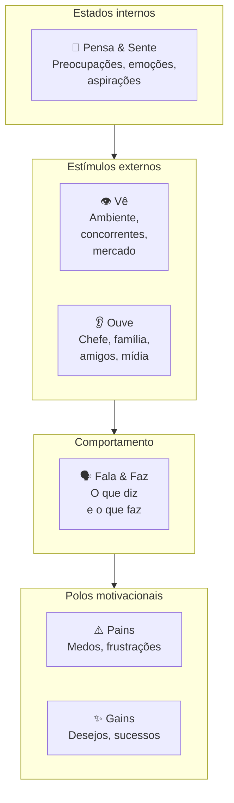

A tese é que comportamento humano é resultado da tensão entre **estímulos** (vê/ouve), **estados internos** (pensa/sente) e **polos motivacionais** (pains/gains). Mapear os seis revela contradições, pessoa que diz X publicamente mas faz Y; pessoa que ouve A do chefe mas é movida por B internamente, e essas contradições são exatamente onde produto novo encontra adoção.

##### O momento exato de colocar este canvas na parede

Use o Empathy Map na Fase 4 (descoberta do problema) como complemento ao Mom Test e na Fase 5 (pesquisa com usuários) para construir o Customer Profile do VPC: entrevistas de problema capturam comportamento passado; o Empathy Map captura **o universo emocional e contextual** que cerca esse comportamento. Use também na Fase 4 (pesquisa) para construir o Customer Profile do VPC (Fase 5) com profundidade emocional. Em times de produto maduros, faça Empathy Map de cada persona principal a cada 12 meses: clientes mudam, e o mapa fica datado.

##### As regras de ouro para preencher sem se enganar

A tese de Gray é que **empatia é capacidade construída, não dom**. Para construir, é preciso processo deliberado: ler verbatim de entrevistas, observar em campo, mapear com a equipe num exercício colaborativo. Empathy Map preenchido só com intuição é ficção. Preenchido com base em pesquisa real, vira ferramenta de tomada de decisão: quando alguém propõe uma feature que contradiz o que está mapeado em "Pains" e "Gains", a contradição fica visível.

##### Passo a passo na parede da sala (roteiro de oficina colaborativa)

Reúna 3-5 pessoas (PM + designer + customer success + 1-2 fundadores). Tempo: 90-120 minutos. **Pré-requisito**: pesquisa real concluída, pelo menos 5-10 entrevistas qualitativas + observação em campo. Sem isso, Empathy Map vira intuição coletiva.

1. **Escolha uma persona específica**: não "nossos clientes em geral", mas "Sueli, dona de padaria artesanal com três lojas na Zona Sul de São Paulo". Empathy Map é por pessoa, não por segmento.
2. **Vê**: leia verbatim de entrevistas e observação. O que essa pessoa vê no celular pela manhã? No trabalho? Em casa? Que ambiente físico habita? Que mídia consome?
3. **Ouve**: quem fala com ela? O que esses falantes dizem? Chefe, sócio, família, amigos, podcasts, influenciadores.
4. **Pensa & Sente**, o que ocupa a mente? O que tira o sono? O que entusiasma? Aqui é zona de inferência cuidadosa, ancore em verbatim.
5. **Fala & Faz**: o que ela diz publicamente (LinkedIn, conversas profissionais)? Como age (rotina, decisões observadas)? Há contradição entre os dois?
6. **Pains**: medos específicos, não genéricos. "Tenho medo de quebrar" é vago; "tenho medo de não conseguir pagar a folha do mês 13" é Pain.
7. **Gains**: sucessos pessoais que ela buscaria. "Quero crescer" é vago; "quero abrir terceira unidade até 2027" é Gain.

Tempo: 90-120 min para a primeira versão. Refazer a cada 6-12 meses ou após mudança significativa de mercado.

##### Exemplo brasileiro preenchido: Loggi, persona "Carlos motoboy" (2018) (reconstrução didática com base em dados públicos)

Quando a Loggi expandiu de courier corporativo para entregas last-mile B2C em 2018, fez Empathy Map dos entregadores parceiros: não dos clientes finais. A descoberta levou a redesenho do app do entregador.

| Quadrante | Conteúdo |
|---|---|
| **Vê** | App da Loggi competindo por atenção com WhatsApp, Uber, iFood, Rappi no celular. Outros motoboys em redes informais comentando preços e rotas. Trânsito de São Paulo em tempo real. Posto de gasolina como ponto de socialização. Estabelecimentos comerciais como "clientes da semana". |
| **Ouve** | Esposa pedindo para "voltar mais cedo". Outros entregadores em grupo de WhatsApp reclamando de plataforma X ou recomendando rota Y. Atendente da Loggi por mensagem (raramente por voz). Clientes finais quando entrega presencial: alguns simpáticos, outros agressivos sobre atraso. |
| **Pensa & Sente** | Ansiedade sobre quanto vai ganhar no fim do dia. Cálculo mental constante de R$/km. Frustração com cancelamentos e endereços errados. Orgulho discreto quando completa entregas difíceis. Cansaço acumulado mas necessidade de não parar. Comparação com outros entregadores: "fulano fez 30 entregas hoje, eu só 22". |
| **Fala & Faz** | Diz publicamente que "trabalha pela liberdade de horário". Faz: aceita corridas das 6h às 22h porque precisa do faturamento. Recusa entregas longas mesmo com bônus se for fim de semana. Compartilha dicas em grupo de WhatsApp mas guarda os melhores estabelecimentos para si. |
| **Pains** | Ganhar menos que o pico do mês passado. Acidente sem cobertura: "se eu cair, fico sem renda". Bateria do celular acabar no meio do dia. Endereço errado em região perigosa. Diarreia/doença sem direito a auxílio. Multas de trânsito que comem ganho do dia. Cliente que não responde interfone. |
| **Gains** | Faturar R$ 3-4k/mês líquido (após combustível e manutenção). Conseguir folga de domingo sem perder ranking. Ter celular novo (ferramenta de trabalho). Comprar moto melhor: sonho de 12-24 meses. Ter dia mais previsível. Ser tratado com respeito por atendentes e clientes. |

O quadrante "Vê" revelou algo crítico: o app da Loggi competia com 4-6 outros apps por atenção do entregador na mesma tela. Times anteriores haviam tratado o app como "ferramenta de trabalho dedicada": a realidade é que o entregador trocava entre apps ao longo do dia conforme o que pagava melhor naquela janela. Isso levou a três decisões: (1) reduzir tempo de aceite de corrida (de 30s para 15s, entregador estava em outro app); (2) notificações mais agressivas com bônus (não dependendo de ele abrir o app); (3) **comunicação por voz** com atendente em casos críticos (entregador não consegue ler chat enquanto pilota). **A lição: Empathy Map dos não clientes (parceiros, fornecedores, intermediários) frequentemente revela mais que Empathy Map do cliente final: porque essas pessoas têm múltiplos chefes invisíveis e otimizam por critérios que você não enxerga sem mapear.**

##### Variações e extensões

- **Empathy Map Canvas (atualizado, Dave Gray, 2017)**: versão mais recente que adiciona "Goal" no centro (objetivo da pessoa) e desloca o foco para tarefa-a-realizar: versão JTBD-friendly.
- **Stakeholder Empathy Map**: para B2B enterprise, fazer um Empathy Map para cada stakeholder no processo de compra (usuário, comprador, sponsor, TI).
- **Day-in-the-Life Map**: variação que mapeia 24 horas concretas ao invés de estados gerais.

##### Onde os fundadores mentem para si mesmos neste canvas

- Preencher com intuição em vez de pesquisa: Empathy Map sem dado real é projeção coletiva, não empatia.
- Tratar como descrição estática: pessoas mudam; refaça periodicamente.
- Confundir "Vê" com demografia: "Vê" é o ambiente físico/digital específico, não "tem 30 anos".
- Ignorar contradições entre "Fala & Faz": frequentemente é onde estão as oportunidades de produto.
- Fazer Empathy Map só do cliente ideal: clientes problemáticos ou não clientes (quem não compra) revelam mais sobre adoção real.

---

### TEMPLATES OPERACIONAIS E CASOS PREENCHIDOS DESTA FASE

#### Template: Entrevista de Problema

> [!important] Disciplina central
> Nesta entrevista você **não fala da sua solução**. Você escuta. No momento em que apresenta a ideia, o entrevistado reage à ideia em vez de descrever a realidade dele: e você perde a evidência limpa.

Este template tem duas partes. A **Parte A** é o roteiro para consultar *durante* a conversa (deixe aberto na tela ou imprima). A **Parte B** é a síntese para preencher *depois*: idealmente nas 24h seguintes, enquanto a memória está fresca. As duas formam um único artefato: roteiro sem síntese vira entrevista perdida; síntese sem roteiro vira interpretação livre. Use as duas em todas as entrevistas da rodada.

##### Parte A — Roteiro da Entrevista (uso durante a conversa)

**Duração alvo:** 30-45 min · **Balanço de fala:** o entrevistado fala a maior parte do tempo. Se você se pegar falando mais que ele em qualquer trecho de 5 minutos, volte a fazer perguntas abertas.

**Abertura (2 min)**

> "Oi, obrigado pelo tempo. Antes de começar: não estou aqui pra te vender nada. Estou pesquisando como [público-alvo] lidam com [área ampla], porque quero entender se existe um problema real antes de construir qualquer coisa. Vou fazer perguntas abertas, sem respostas certas. Posso gravar apenas para fins de transcrição interna? O áudio será excluído após a síntese anonimizada (em conformidade com a LGPD, Lei 13.709/2018: registre o consentimento no início da gravação, remova nomes próprios e CNPJs antes de submeter o texto a ferramentas de IA e descarte o arquivo bruto após consolidar os padrões; ver detalhes no Volume 8)."

**Contexto (5 min)**

- Me conta um pouco sobre o que você faz no dia a dia.
- Quanto tempo você está nesse papel / nessa empresa?
- Quem mais na sua rotina está envolvido em [área ampla]?

**Exploração (10 min): *ainda sem falar da sua solução***

- Me descreve como funciona a rotina quando [atividade relacionada ao problema].
- Quais são as partes mais chatas dessa rotina?
- Me conta a última vez que algo deu errado nisso.

**Aprofundamento por problema mencionado (10-15 min)**

Para cada problema que a pessoa citar espontaneamente:

- Me fala mais sobre isso.
- Quando foi a última vez que aconteceu?
- O que você fez?
- Quanto tempo / dinheiro isso custou?
- O que acontece se você simplesmente **não** resolver? *(mapeia escalação)*

**Tentativas de solução (5 min)**

- O que você já tentou pra resolver?
- Funcionou? Por que parou ou continua usando?
- **Já gastou dinheiro (ferramenta, consultor, pessoa extra) pra resolver isso?**
- Quanto? Por quanto tempo?

**Encerramento (3 min)**

- Tem mais alguém que passa por isso e que eu poderia conversar?
- Posso voltar se surgirem mais perguntas?
- Topa ver um protótipo em 30-60 dias e dar sua opinião?

**NÃO PERGUNTAR (lista de proibições)**

- "Você pagaria R$X por isso?"
- "Se existisse Y, você usaria?"
- "Você acha que isso seria útil?"
- "Eu tive uma ideia, o que você acha?"
- "Você não acharia melhor se…?"
- Qualquer pergunta que comece com hipótese sua a ser validada pelo entrevistado.

##### Parte B — Síntese Pós-Entrevista

###### Metadados

| Campo | Valor |
|---|---|
| **ID** | `ENTR-[AAAA-MM-DD]-[##]` |
| **Data e hora** | `[DD/MM/AAAA: HH:MM]` |
| **Duração real** | `[min]` |
| **Formato** | `[ ] Remoto  [ ] Presencial` |
| **Gravação (com consentimento)** | `[link ou "não gravada"]` |
| **Transcrição** | `[link]` |
| **Entrevistador** | `[Nome]` |
| **Anotador (se houver)** | `[Nome]` |
| **Relação com a hipótese** | `[ID da hipótese em teste, se formal]` |

###### Perfil do Entrevistado e Aderência ao ICP

| Campo | Valor |
|---|---|
| **Nome** | `[...]` |
| **Papel / cargo** | `[...]` |
| **Empresa / contexto** | `[...]` |
| **Porte do negócio** | `[nº funcionários / faturamento / estágio: seja específico]` |
| **Localização** | `[cidade / estado / país]` |
| **Fonte do contato** | `[rede pessoal / LinkedIn / indicação / cold outreach]` |
| **Vínculo pessoal com o entrevistador?** | `[ ] Não  [ ] Sim`: *se sim: atenção a viés de cortesia nas respostas.* |
| **Aderente ao ICP hipotético?** | `[ ] Sim  [ ] Parcial  [ ] Não` |

> *Se "Não", a entrevista vale como aprendizado mas **não conta** para o denominador de validação (regra da Fase 4).*

###### 1. Contexto e rotina

> *Não pergunte sobre o problema ainda. Deixe a pessoa descrever o mundo dela. Pergunte sobre rotina, responsabilidades, ferramentas, periodicidade. Aqui você calibra o universo onde o problema vive.*

**Descrição geral.** `[Descreva em prosa o que a pessoa faz. Use as palavras dela. 3-5 linhas.]`

**Processo atual mapeado em fases.** *Se o problema investigado tem a forma de um processo ou workflow (recrutamento, compra, onboarding, fechamento, reconciliação, etc.), documente em fases numeradas. Isso ancora onde cada dor acontece: a mesma pessoa pode ter dor forte na Fase 2 e nenhuma na Fase 5. Sem esse mapa, você registra "dor em recrutamento" quando na verdade é "dor em triagem inicial", que é outro problema.*

- **Fase 1: `[nome curto]`:** `[o que acontece, quem faz, com que ferramenta, quanto tempo leva]`
- **Fase 2: `[nome curto]`:** `[...]`
- **Fase 3: `[nome curto]`:** `[...]`
- **Fase 4: `[nome curto]`:** `[...]`

*(adicione ou remova fases conforme o caso)*

**Ferramentas e stack atual.**

- `[ferramenta: para que usa]`
- `[...]`

###### 2. Problemas mencionados (o que foi dito — não o que você interpretou)

> *Para cada problema que emergiu na conversa, preencha um bloco. **Crítico:** documente apenas o que o entrevistado disse espontaneamente ou em resposta a pergunta aberta. Problemas que você "provocou" com pergunta tendenciosa valem zero.*

**Problema A: `[título curto, nas palavras do entrevistado se possível]`**

- **Descrição literal:** `[...]`
- **Era esperado ou inesperado?** `[ ] Esperado (ligado à hipótese em teste)  [ ] Inesperado (surgiu e não estávamos procurando: pode ser o ouro do discovery)`
- **Em qual fase do processo ocorre?** `[Fase 1 / Fase 2 / transversal / fora do processo mapeado]`
- **Menção foi espontânea ou provocada?** `[ ] Espontânea  [ ] Provocada por pergunta aberta  [ ] Provocada por pergunta tendenciosa (descartar)`
- **Frequência observável:** `[diária / semanal / mensal / esporádica]`
- **Última ocorrência (comportamento passado):** `[quando? o que aconteceu?]`
- **Custo atual (tempo / dinheiro / energia):** `[número ou descrição concreta]`
- **Emoção observada:** `[exemplo: frustração, resignação, vergonha, medo, use a palavra que cabe]`
- **Tentativas anteriores de resolver:** `[o que já tentou? funcionou? por que parou ou continuou?]`
- **Já gastou dinheiro para resolver?** `[ ] Não  [ ] Sim: quanto? em quê? por quanto tempo?`: *sinal operacional mais limpo de dor. Dinheiro já gasto vale mais que promessa de pagar.*
- **Escalação: o que piora se NÃO resolver?** `[perde cliente / perde contrato / multa / perde emprego / nada concreto]`: *separa urgência real de incômodo crônico.*

**Problema B: `[...]`** `[bloco com mesma estrutura do Problema A]`

**Problema C: `[...]`** `[bloco com mesma estrutura do Problema A]`

###### 3. Verbatim (citações literais)

> *Transcreva exatamente o que a pessoa falou, entre aspas. Mínimo 3 citações marcantes. Verbatim é ouro: serve de evidência em deck interno, no pitch, no roadmap.*

1. > *"[citação literal]"*: sobre `[Problema A]`
2. > *"[citação literal]"*: sobre `[Problema B]`
3. > *"[citação literal]"*: sobre `[tema]`
4. > *"[citação literal]"*: sobre `[tema]`

###### 4. Vocabulário do cliente

> *Anote as palavras e expressões **exatas** que a pessoa usou para descrever o problema, a rotina e as soluções atuais. Não parafraseie. Esse vocabulário vai direto para o marketing, para a landing page e para o roteiro de vendas depois: se você usa a linguagem do cliente, ele se reconhece; se você usa a sua, ele ignora.*

| Como a pessoa chama | Contexto em que usou |
|---|---|
| `[palavra / expressão exata]` | `[o que ela estava descrevendo]` |
| `[...]` | `[...]` |
| `[...]` | `[...]` |

**Termos que ela *não* usou e que nós estávamos prontos a usar:** `[...]`, *se a pessoa não usa a nossa palavra, provavelmente estamos falando a linguagem errada.*

###### 5. Hierarquia de sinais coletados

> *Classifique a evidência desta entrevista pelo tipo de sinal. **Esta tabela é o filtro central do Mom Test:** só os três primeiros tipos movem decisão, os três últimos enganam.*

| Sinal | Peso | O que veio nesta entrevista? |
|---|---|---|
| **Comportamento passado** ("semana passada gastei 4h nisso") | Alto | `[...]` |
| **Tentativas anteriores de solução** ("usei X, Y e Z, nada resolveu") | Alto | `[...]` |
| **Métricas de custo** (tempo, dinheiro, energia já gastos) | Alto | `[...]` |
| **Ideias soltas** ("seria legal se tivesse X") | Baixo-médio | `[...]` |
| **Hipóteses futuras** ("eu pagaria por isso") | Baixo | `[...]`: *não usar para decisão* |
| **Elogios** ("que ideia legal!") | Zero | `[...]`: *descartar* |

###### 6. Classificação de Pain Level

> *Atribua **um único nível** ao entrevistado. Padrão de Pain Level 4+ em volume (tipicamente ≥5 entrevistas) é o que move a tese; uma entrevista isolada em nível 3 não descarta a investigação, só ainda não confirma.*

- [ ] **Nível 1**: Tem o problema, mas não sabe que tem.
- [ ] **Nível 2**: Sabe que tem, mas tolera. Não vai pagar sozinho.
- [ ] **Nível 3**: Está ativamente procurando solução. Lead quente.
- [ ] **Nível 4**: Já improvisou gambiarra (planilha Frankenstein, processo manual, ferramenta adaptada). Forte evidência de que pagaria.
- [ ] **Nível 5**: Tem orçamento comprometido ou facilmente acessível para comprar solução. Cliente ideal.

> *Nível 5 se verifica por **sinal indireto**, nunca por pergunta direta sobre disposição a pagar (que é armadilha e está na lista de proibições da Parte A). Pistas válidas: a pessoa mencionou espontaneamente valor já gasto, contratação de alguém para resolver, mensalidade paga em ferramenta análoga, verba carimbada no orçamento do ano.*

**Justificativa da classificação:** `[1-2 linhas com a evidência direta, não interpretação, que sustenta a nota.]`

###### 7. Observações do entrevistador

> *Separadas dos fatos. Use itálico. Aqui entram sua leitura da linguagem corporal, tom, nível de energia e suspeitas. Fatos acima; interpretação aqui.*

*`[...]`*

*`[...]`*

###### 8. Armadilhas — autoavaliação pós-entrevista

> *Esta seção verifica se as proibições da Parte A foram respeitadas. Marque honestamente o que aconteceu.*

- [ ] Cheguei a apresentar minha solução em algum momento?: *se sim, dados após esse ponto devem ser lidos com ceticismo.*
- [ ] Fiz pergunta tendenciosa tipo "você não acharia melhor se…"?
- [ ] Fiz pergunta hipotética sobre o futuro ("você usaria X?", "pagaria Y?")?
- [ ] Em algum trecho de 5 min, falei mais que o entrevistado?
- [ ] Filtrei o que ouvi para confirmar tese que eu já tinha?
- [ ] Tratei uma fala apaixonada como equivalente a um padrão de 10 entrevistas?

> *Cada marca acima contamina parte da evidência. Anote **quais achados ficam sob suspeita** em função dessas contaminações:* `[...]`

###### 9. Refinamento do ICP

> *ICP não muda a cada entrevista: muda quando padrão aparece em 5-10 conversas. Esta seção registra sinais individuais que, acumulados com os de outras entrevistas, podem mover o recorte. Exemplo: a hipótese original do iFood era "redes grandes"; entrevistas acumuladas refinaram para "restaurantes pequenos sem telemarketing".*

**Sub-segmento mais agudo observado nesta entrevista.** *Dentro do perfil entrevistado, o que parece correlacionado com sofrer mais? Porte? Setor? Senioridade? Estágio? Tempo no cargo? Stack? Volume? Anote o recorte que se destacou.*

`[Ex: "padarias com 3+ lojas sentem; com 1-2 não", ou, "só operadores que fazem a reconciliação manualmente, não quem tem financeiro dedicado"]`

**Esta entrevista sugere algum refino de ICP?**

- [ ] **Estreitou**: ICP ficou mais específico. Novo recorte: `[...]`
- [ ] **Ampliou**: ICP precisa incluir um perfil que não tínhamos mapeado: `[...]`
- [ ] **Mudou de direção**: perfil entrevistado era hipótese, mas a dor real aparece em outro lugar: `[...]`
- [ ] **Confirmou**: ICP atual permanece. Esta entrevista não muda o recorte.

###### 10. Indicações (snowball)

- **Outras pessoas que passam por isso e que podemos conversar:** `[nome, contato, por que foi indicado]`
- **Posso voltar para nova conversa?** `[ ] Sim  [ ] Não`
- **Topa ver um protótipo em 30-60 dias?** `[ ] Sim  [ ] Não`

###### 11. Decisão pós-entrevista individual

> *Uma única entrevista não decide nada: mas cada entrevista move a agulha. Marque para onde ela moveu.*

- [ ] **Reforça** a hipótese de problema em teste
- [ ] **Enfraquece** a hipótese
- [ ] **Ambígua**: precisa de mais dados
- [ ] **Falso positivo identificado** (pessoa disse que tem o problema mas o comportamento refuta)

**Justificativa (2-3 linhas):** `[...]`

###### 12. Próximos passos de investigação

> *Distintos de "ações internas de produto". Aqui registramos **perguntas novas que esta entrevista gerou** e que informam a próxima entrevista, uma pesquisa desk, ou um dado a buscar externamente. É o espírito iterativo do discovery: cada conversa afina a próxima.*

**Perguntas a incluir em próximas entrevistas.**

- `[...]`
- `[...]`

**Dados a buscar externamente (pesquisa desk, benchmark, números de mercado).**

- `[...]`
- `[...]`

**Perfis diferentes a entrevistar para cruzar padrões.** *"Esta dor é padrão no setor ou é específica desta empresa? Preciso falar com alguém de porte X ou região Y para comparar."*

- `[...]`

###### Anexos

- Gravação: `[link]`
- Transcrição: `[link]`
- Artefatos compartilhados pelo entrevistado (prints, planilhas): `[link]`
- Entrevistas relacionadas: `[ENTR-..., ENTR-...]`

*Preenchido por `[Nome]` em `[DD/MM/AAAA]`.*

> [!tip] Consolidação da rodada
> Cada entrevista preenchida pela Parte B é uma linha do agregado. A decisão de avanço de fase não sai daqui: sai do **Template: Síntese de Rodada de Entrevistas (decisão de avanço) (Fase 4) (Síntese de Rodada de Entrevistas)**, que cruza Pain Level, padrões, workarounds e vocabulário das 15-30 entrevistas para decidir perseverar, pivotar problema, pivotar cliente ou abandonar.

---

#### Template: Entrevista com Especialista de Mercado (mapa de setor)

> [!important] Disciplina central
> Aqui você **quer opinião**: é legítimo. Mas opinião de especialista é hipótese a testar, não evidência de cliente. O erro é tratar "o especialista disse X" como validação. A especialista conhece o mercado; quem prova o mercado é o cliente com a carteira.

Use quando precisa mapear setor, dinâmicas competitivas, pontos cegos e tendências regulatórias: a pessoa conhece o mercado, não necessariamente é cliente dele. Não use para saber se *o cliente* tem dor; para isso o instrumento é Template: Entrevista de Problema (Fase 4). Como o Template: Entrevista de Problema (Fase 4), este template tem Parte A (roteiro durante) e Parte B (síntese pós-conversa, idealmente em 24h).

##### Parte A — Roteiro da Conversa (uso durante)

**Duração alvo:** 45-60 min · **Balanço de fala:** o especialista fala mais que você, mas aqui é legítimo intervir para confrontar e pedir exemplos específicos.

**Abertura (3 min)**

> "Obrigado pelo tempo. Estou pesquisando [setor/dinâmica] porque estou construindo uma tese sobre [resumo em uma frase]. Quero muito ouvir onde você acha que estou errado, quais sinais eu não estou vendo e que anti-cases você já viu. Posso gravar?"

**Calibração (5 min)**

- Há quanto tempo você está nesse setor?
- Em quais posições você viu a dinâmica de perto?
- O que mudou no setor nos últimos 3 anos?

**Mapa do setor (10 min)**

- Quem são os players relevantes hoje, e por que cada um ainda existe?
- Qual é a dinâmica competitiva dominante: preço, tecnologia, canal, rede, regulação?
- Que ciclos e sazonalidades afetam o setor?

**Confronto à nossa tese (15-20 min: seção mais valiosa).** *Esta é a seção mais importante. Se a pessoa só elogia, você perdeu a conversa.*

- Nossa hipótese é [X]. **Onde você acha que está mais fraca?**
- Que premissas dessa tese são não triviais: o que teria que ser verdade pra ela funcionar?
- Você já viu alguém tentar algo parecido? O que aconteceu?
- Se isso fosse fácil, por que ninguém fez ainda?

**Especificidades de contexto (5 min)**

- Que particularidades regulatórias / tributárias / culturais do Brasil mudam essa tese?
- Como funciona o capital nesse setor no Brasil?

**Pontos cegos e redes (5 min)**

- O que eu ainda não perguntei e deveria?
- Outras pessoas com quem eu deveria conversar?
- Leituras / relatórios que você recomendaria?

**Encerramento (2 min)**

- Posso voltar com dúvidas?
- Topa receber o resumo do que aprendi em 48h?

**NÃO CONFUNDIR**

- Opinião informada ≠ dado de cliente. Anotar como opinião, não como validação.
- Elogio à tese é ruído: se não houve pushback, a conversa foi incompleta.
- "Eu sempre vi assim" ≠ "isso se aplica ao seu caso". Heurística do veterano precisa de fit específico.

##### Parte B — Síntese Pós-Conversa

###### Metadados

| Campo | Valor |
|---|---|
| **ID** | `ESP-[AAAA-MM-DD]-[##]` |
| **Data e hora** | `[DD/MM/AAAA]` |
| **Duração** | `[min]` |
| **Formato** | `[ ] Remoto  [ ] Presencial` |
| **Entrevistador(es)** | `[Nome]` |
| **Gravação / transcrição** | `[link]` |
| **Conflito de interesse?** | `[ ] Nenhum  [ ] Consultor pago  [ ] Investidor no setor  [ ] Atua em empresa concorrente (atenção: restrinja a conversa a informações públicas de mercado; nunca solicite segredos de negócio, preços internos ou listas de clientes, sob pena de concorrência desleal na Lei 9.279/1996, art. 195)  [ ] Outro]`: *descrever* |

###### Perfil do Especialista

| Campo | Valor |
|---|---|
| **Nome** | `[...]` |
| **Posição atual / papel** | `[...]` |
| **Tempo na área** | `[...]` |
| **Credenciais relevantes** | `[empresas onde atuou, publicações, deals, etc.]` |
| **Recorte de expertise** | `[técnico / comercial / regulatório / financeiro / operacional]` |
| **Por que esta pessoa?** | `[1-2 linhas sobre a adequação dela à pergunta em aberto]` |

###### 1. Objetivo da conversa

**Qual hipótese de mercado estamos testando?** `[...]`

**O que precisamos sair sabendo?**

- `[...]`
- `[...]`
- `[...]`

**O que já presumíamos e queríamos ver se ela confirma ou refuta?**

- `[...]`
- `[...]`

###### 2. Mapa do setor (na visão dela)

**Players relevantes e como se posicionam.**

| Player | Posicionamento | Vantagens | Fraquezas |
|---|---|---|---|
| `[...]` | `[...]` | `[...]` | `[...]` |

**Dinâmica competitiva dominante hoje.** `[preço? tecnologia? canal? marca? rede? regulatório?]`

**Tendências relevantes (3-5 anos).**

- `[...]`
- `[...]`

**Ciclos e sazonalidades do setor.** `[...]`

###### 3. Onde o especialista acha que estamos errados

> *Esta é a seção mais valiosa. Pergunte explicitamente: "onde você acha que nossa tese está mais fraca?" Se a pessoa só elogia, você perdeu a conversa.*

- **Fragilidade apontada 1:** `[...]`
- **Fragilidade apontada 2:** `[...]`
- **Fragilidade apontada 3:** `[...]`

**Anti-cases mencionados (onde tese parecida já falhou).**

| Empresa / caso | O que tentou | Por que quebrou |
|---|---|---|
| `[...]` | `[...]` | `[...]` |

###### 4. "What would have to be true" para a nossa tese

> *Pergunta enquadradora útil em conversa com especialista: "para essa tese dar certo, o que teria que ser verdade sobre o mercado, cliente, regulação, tecnologia?"*

Premissas que a pessoa identificou como *críticas e não triviais*:

1. `[premissa: e por que é não trivial]`
2. `[...]`
3. `[...]`

###### 5. Especificidades contextuais (Brasil, setor, regulatório)

> *Especialistas brasileiros valem muito por capturar o que livro importado ignora: tributação real, ciclo de capital local, cultura de negócio, governo.*

- **Regulatório / tributário:** `[...]`
- **Canais dominantes no Brasil:** `[...]`
- **Dinâmica de capital / investidores relevantes:** `[...]`
- **Relação com governo / compras públicas (se aplicável):** `[...]`
- **Padrões culturais que afetam adoção:** `[...]`

###### 6. Hierarquia de sinais da conversa

> *Especialista mistura cinco tipos de afirmação em qualquer conversa: e elas **não têm o mesmo peso**. Classificar o que ouvimos força leitura crítica pós-conversa. Quanto mais alto na tabela, mais peso na decisão.*

| Tipo de sinal | Peso | O que veio nesta conversa? |
|---|---|---|
| **Dado verificável** (estatística, relatório, regulação, fonte pública nomeada) | Alto | `[...]` |
| **Caso pessoal vivido** (ela mesma operou, decidiu, observou de perto: com detalhe específico) | Alto | `[...]` |
| **Opinião informada** (tese construída com base em padrão repetido observado, mas sem dado formal) | Médio | `[...]` |
| **Intuição de veterano** ("tenho a sensação de que…", reconhecimento de padrão sem articulação clara) | Baixo-médio | `[...]`: *tratar como hipótese a testar* |
| **Heurística genérica** ("eu sempre acho que…", máxima aplicada sem fit específico ao nosso caso) | Baixo | `[...]`: *descartar para decisão* |

**Fatos verificáveis a checar depois.** *Listar aqui especificamente o que cai na primeira linha: porque tem que ir para a fila de verificação.*

| Afirmação | Fonte sugerida | Responsável | Prazo |
|---|---|---|---|
| `[...]` | `[link / órgão / relatório]` | `[Nome]` | `[DD/MM]` |

###### 7. Pontos cegos identificados

> *"Coisas que eu não sabia que não sabia." Catalogue aqui temas que só apareceram porque a pessoa levantou.*

- `[...]`
- `[...]`

###### 8. Vocabulário setorial

> *Especialistas dominam o jargão do setor. Capturar como a tribo realmente se expressa vale para marketing, pitch a investidor e conversa com próximo especialista.*

| Termo / expressão | O que significa na prática do setor |
|---|---|
| `[termo exato]` | `[...]` |
| `[...]` | `[...]` |

###### 9. Citações marcantes

> *Não com o mesmo peso da Entrevista de Problema, mas guardar frases bem articuladas do especialista ajuda a reutilizar em deck e memorando interno.*

1. > *"[citação]"*
2. > *"[citação]"*

###### 10. Armadilhas — autoavaliação pós-conversa

> *Marque honestamente o que aconteceu. Cada item contamina parte da evidência coletada.*

- [ ] Tratei elogio à tese como validação?
- [ ] Aceitei "eu sempre vi assim" sem pedir caso específico?
- [ ] Confundi opinião informada com dado verificável?
- [ ] Deixei passar contradição entre o que ela disse agora e o que disse antes?
- [ ] Não pedi pushback explícito: só ouvi concordância?
- [ ] Entrei na conversa sem tese clara a confrontar, e saí com "muitas perspectivas" em vez de direção?

**Achados sob suspeita em função dessas contaminações:** `[...]`

###### 11. Referências, leituras e redes

- **Livros / papers / relatórios indicados:** `[...]`
- **Outras pessoas que deveríamos conversar:** `[nome, por quê, se topa fazer intro]`
- **Eventos / comunidades relevantes:** `[...]`

###### 12. Ações internas pós-conversa

**Hipóteses que mudaram.**

- `[hipótese X: como mudou]`

**Hipóteses novas geradas.**

- `[...]`

**Outras ações.**

| Ação | Responsável | Prazo |
|---|---|---|
| `[...]` | `[Nome]` | `[DD/MM]` |

**Follow-up com a pessoa.**

- [ ] Agradecer e compartilhar resumo (dentro de 48h)
- [ ] Compartilhar material prometido: `[...]`
- [ ] Convidar para conversa futura em: `[gatilho / data]`
- [ ] Avaliar como advisor formal? `[ ] Sim  [ ] Não`

###### 13. Próximos passos de investigação

> *Perguntas novas que esta conversa gerou. Especialistas tipicamente abrem mais frentes do que fecham: registre as frentes abertas para não perder o fio.*

**Perguntas a explorar com outros especialistas.** `[...]`

**Dados a buscar externamente.** `[...]`

**Hipóteses de mercado a testar com cliente (entrevista de problema Template: Entrevista de Problema (Fase 4)).** `[...]`

*Preenchido por `[Nome]` em `[DD/MM/AAAA]`.*

---

#### Template: Síntese de Rodada de Entrevistas (decisão de avanço)

> [!important] Disciplina central
> Este não é registro de conversa: é o artefato em que o agregado de entrevistas vira decisão. É aqui que a frase "5 pessoas disseram isso" vira "o problema existe, neste recorte, com esta dor, e devemos perseverar": ou o contrário. Nenhuma entrevista individual é suficiente para essa decisão; faça sínteses parciais a cada lote de cinco conversas para calibrar o roteiro, mas só feche o veredito de perseverar ou pivotar quando a rodada inteira terminar. Consolide só quando a rodada terminou.

Template: Síntese de Rodada de Entrevistas (decisão de avanço) (Fase 4) é o entregável da Fase 4 que sustenta o Mapa de Problemas e a decisão de avanço. Feito em reunião de time (2-4 pessoas) após a rodada fechar, duração típica 2-4h. Deve ser rodado com todas as sínteses individuais (Partes B do Template: Entrevista de Problema (Fase 4), Template: Entrevista com Switcher (JTBD, entrevista de troca) (Fase 5) e, opcionalmente, Template: Entrevista com Especialista de Mercado (mapa de setor) (Fase 4)) abertas e referenciadas. A decisão final registrada aqui tem mais autoridade do que qualquer conversa individual.

##### Metadados da rodada

| Campo | Valor |
|---|---|
| **ID da rodada** | `ROUND-[AAAA-MM]-[##]` |
| **Período coberto** | `[DD/MM a DD/MM]` |
| **Duração total da rodada** | `[semanas]` |
| **Participantes da consolidação** | `[Nomes]` |
| **Data da consolidação** | `[DD/MM/AAAA]` |
| **Status** | `[ ] Rascunho  [ ] Em revisão  [ ] Decisão tomada]` |

##### Hipótese em teste (ao iniciar a rodada)

> *Registre como a hipótese estava formulada **quando a rodada começou**, não como está hoje. O que muda entre o início e o fim é parte do aprendizado.*

**Hipótese de problema.** `[...]`

**ICP hipotético inicial.** `[...]`

**Critério de sucesso da rodada definido no início.** *Exemplo do livro: ≥5 entrevistados em Pain Level 4 ou 5; sub-segmento agudo identificado; padrão de workaround consistente.*

`[...]`

##### Entrevistas consolidadas

> *Rastreabilidade. Liste cada entrevista por ID. Sem esse mapa, a consolidação vira retórica: aqui cada afirmação deve voltar a uma conversa documentada.*

| ID | Tipo | Data | Aderente ao ICP? | Pain Level | Sob suspeita? |
|---|---|---|---|---|---|
| `ENTR-...-01` | Problema (Template da Fase 4) | `[DD/MM]` | `[Sim / Parcial / Não]` | `[1-5]` | `[ ] Não  [ ] Sim: motivo]` |
| `ENTR-...-02` | Problema (Template da Fase 4) | `[DD/MM]` | `[...]` | `[...]` | `[...]` |
| `JTBD-...-01` | Switcher (Template da Fase 5) | `[DD/MM]` | `[...]` |: | `[...]` |
| `ESP-...-01` | Especialista (Template da Fase 4) | `[DD/MM]` |: |: | `[...]` |
| … | | | | | |

**Totais.**

- Entrevistas de Problema (Template da Fase 4): `[N]` (aderentes ao ICP: `[N]`)
- Entrevistas com Switcher (Template da Fase 5): `[N]`
- Entrevistas com Especialistas (Template da Fase 4): `[N]`
- Contaminadas / sob suspeita (a não computar no denominador): `[N]`

###### 1. Distribuição de Pain Level (só entrevistas aderentes ao ICP)

> *Esta é a tabela central da consolidação. Critério do livro para avanço: **≥5 entrevistas em Pain Level 4 ou 5**. Se não chegou nisso, a hipótese de problema ainda não está validada: independente do que "a gente sentiu" nas conversas.*

| Pain Level | Nº de entrevistas | % do total aderente |
|---|---|---|
| 1: Tem mas não sabe | `[N]` | `[%]` |
| 2: Sabe mas tolera | `[N]` | `[%]` |
| 3: Buscando solução | `[N]` | `[%]` |
| 4: Tem gambiarra rodando | `[N]` | `[%]` |
| 5: Orçamento comprometido | `[N]` | `[%]` |
| **Total nível 4+** | **`[N]`** | **`[%]`** |

**Atingimos o benchmark de ≥5 em Pain Level 4+?** `[ ] Sim  [ ] Não`

###### 2. Padrões de problema (agregação por problema, não por pessoa)

> *Aqui você agrupa problemas que apareceram em múltiplas entrevistas. A unidade de análise deixa de ser a pessoa e passa a ser o problema recorrente. Um problema citado em 1 entrevista é anedota; em 10, é padrão.*

| Problema | Nº entrevistas que mencionaram | Espontâneo em quantas? | Frequência típica | Custo médio reportado | Pain Level médio dos que citaram |
|---|---|---|---|---|---|
| `[título do problema]` | `[N / total]` | `[N]` | `[diária / semanal / mensal]` | `[tempo / dinheiro]` | `[1-5]` |
| `[...]` | `[...]` | `[...]` | `[...]` | `[...]` | `[...]` |
| `[...]` | `[...]` | `[...]` | `[...]` | `[...]` | `[...]` |

**Problema dominante (mais recorrente + mais severo):** `[...]`

**Problemas "inesperados" que apareceram em mais de uma entrevista (ouro emergente):** `[...]`

###### 3. Workarounds e alternativas dominantes

> *Se múltiplas pessoas resolvem o problema da mesma forma improvisada, você descobriu o concorrente real: frequentemente é Excel, WhatsApp, ou planilha Frankenstein, não a categoria óbvia.*

| Solução atual (workaround) | Nº entrevistas que usam | O que falta / frustra |
|---|---|---|
| `[...]` | `[N / total]` | `[...]` |
| `[...]` | `[...]` | `[...]` |

**Concorrente real identificado no agregado:** `[...]`

**Pessoas que já gastaram dinheiro tentando resolver:** `[N]` *(sinal operacional mais forte do que intenção declarada)*

###### 4. Vocabulário agregado do cliente

> *Cruze os campos "Vocabulário do Cliente" de todas as entrevistas de problema. Termos que aparecem em 3+ conversas são os que o cliente usa de fato. Isto vai direto para a landing page, o pitch e o roteiro de vendas.*

**Termos recorrentes (mencionados por 3+ entrevistados).**

| Termo / expressão | Nº de entrevistas | Contexto típico |
|---|---|---|
| `[...]` | `[N]` | `[...]` |
| `[...]` | `[...]` | `[...]` |

**Termos que NÓS usávamos e que o cliente NÃO usou.** *Se uma palavra que estava no nosso pitch não aparece em nenhuma entrevista, provavelmente ela não ressoa. Candidata a corte.*

- `[...]`
- `[...]`

###### 5. Refinamento do ICP

**ICP inicial (hipótese que entrou na rodada).** `[...]`

**Sub-segmento mais agudo identificado na rodada.** *O recorte dentro do ICP inicial que sofreu mais: mais Pain Level 4+, mais frequência, mais workaround ativo. Exemplo: "padarias com 3+ lojas, não com 1-2".*

`[...]`

**Perfis dentro do ICP inicial que NÃO deram sinal.** *Descartes são tão informativos quanto confirmações. Se um perfil que parecia óbvio não sofreu, o ICP precisa cortar esse perfil.*

- `[perfil]: motivo: [...]`
- `[...]`

**ICP refinado ao final da rodada.** `[nova formulação, mais específica do que a inicial]`

###### 6. Hierarquia de sinais no agregado

> *Some a hierarquia de cada entrevista individual. O balanço entre evidência forte e ruído diz se a rodada foi rica ou rasa.*

| Tipo de sinal | Contagem agregada (quantas entrevistas trouxeram) |
|---|---|
| Comportamento passado concreto | `[N]` |
| Tentativas anteriores de solução | `[N]` |
| Métricas de custo (tempo / dinheiro reportado) | `[N]` |
| Ideias soltas / hipóteses futuras | `[N]` |
| Elogios sem substância | `[N]` |

**Balanço:** `[os sinais fortes dominam / empatam / são minoria em relação ao ruído?]`

###### 7. Análise de contaminação

> *Quantas entrevistas tiveram armadilhas marcadas na autoavaliação pós-entrevista? Achados contaminados precisam ser segregados antes de entrar na decisão.*

| Tipo de contaminação | Nº entrevistas afetadas | Achados específicos sob suspeita |
|---|---|---|
| Apresentei solução durante a conversa | `[N]` | `[...]` |
| Pergunta tendenciosa ou hipotética | `[N]` | `[...]` |
| Falei mais que o entrevistado em trechos | `[N]` | `[...]` |
| Filtrei para confirmar tese prévia | `[N]` | `[...]` |

**Achados descartados dessa consolidação por contaminação:** `[...]`

###### 8. Insights emergentes (só visíveis no agregado)

> *Coisas que nenhuma entrevista individual mostrou, mas que aparecem quando você empilha as 20. Padrões, correlações, contradições. Frequentemente este é o trecho mais valioso da consolidação.*

- **Padrão 1:** `[...]`
- **Padrão 2:** `[...]`
- **Correlação observada:** `[ex: "todos os que sentem mais dor têm mais de 3 anos no cargo"]`
- **Contradição a investigar:** `[...]`

###### 9. Decisão de avanço de fase

> *Use o vocabulário específico do livro. Evite "Hold" ou "Go/No-Go genérico": cada decisão abaixo dispara uma ação diferente.*

**Decisão.**

- [ ] **Perseverar**: problema validado, ICP refinado, sub-segmento agudo identificado. Avançar para [[#FASE 5 — PESQUISA COM USUÁRIOS (CUSTOMER DISCOVERY)|Fase 5]] (Pesquisa Aprofundada) com a hipótese atual.
- [ ] **Pivotar problema**: o problema que estávamos investigando não se confirmou, mas outro emergiu do agregado. Reformular hipótese e rodar nova rodada focada no novo problema.
- [ ] **Pivotar cliente**: o problema existe, mas não no perfil que estávamos investigando. Mudar o ICP e rodar nova rodada com o novo perfil.
- [ ] **Abandonar**: nem problema claro, nem ICP promissor. Liberar recurso, documentar aprendizados, pensar em outra direção.

**Justificativa (5-10 linhas).** *Aponte explicitamente para as tabelas acima: Pain Level, padrões de problema, workarounds, sub-segmento agudo. A decisão tem que ser rastreável à evidência, não à sensação do time.*

`[...]`

**Nível de confiança na decisão.**

- [ ] Alto: evidência clara, benchmark atingido, time alinhado
- [ ] Médio: alguns sinais fortes mas lacunas em áreas específicas (descrever): `[...]`
- [ ] Baixo: decisão forçada por prazo; idealmente precisaríamos de mais: `[...]`

**Votos divergentes do time (se houver).** *Se alguém do time discordou, registre. É memória útil quando a decisão for revisitada em 6 meses.*

- `[Nome] discordou porque: [...]`

###### 10. Próximos passos (por ramo de decisão)

**Se PERSEVERAR.**

- [ ] Atualizar documento de ICP com a versão refinada desta rodada
- [ ] Produzir persona v1 com base no sub-segmento agudo (template [[#Template: Persona com dados|Template: Persona com dados]])
- [ ] Avançar para [[#FASE 5 — PESQUISA COM USUÁRIOS (CUSTOMER DISCOVERY)|Fase 5]] (Pesquisa Aprofundada)
- [ ] Seguir rodada com Entrevistas com Switcher (Template da Fase 5) focadas no sub-segmento agudo? `[ ] Sim  [ ] Não`
- [ ] Mapear concorrentes, substitutos e cunha de entrada na [[#FASE 6 — MAPEAMENTO DE MERCADO E CONCORRÊNCIA|Fase 6]]: `[...]`

**Se PIVOTAR (problema ou cliente).**

- [ ] Documentar por que a hipótese anterior falhou: aprendizado vale para futuras rodadas
- [ ] Formular nova hipótese: `[...]`
- [ ] Definir escopo da nova rodada: quantas entrevistas, em quanto tempo, com qual perfil
- [ ] Reusar quais contatos / indicações da rodada atual? `[...]`

**Se ABANDONAR.**

- [ ] Escrever post-mortem: o que aprendemos sobre o mercado / cliente que continua valendo
- [ ] Manter rede de contatos viva? `[ ] Sim: como  [ ] Não, encerrar`
- [ ] Próxima tese a explorar (se houver): `[...]`

###### 11. Artefatos a produzir a partir desta consolidação

> *Template: Síntese de Rodada de Entrevistas (decisão de avanço) (Fase 4) gera output, documentos novos, não só decisão. Liste o que essa consolidação obriga a produzir.*

| Artefato | Responsável | Prazo | Status |
|---|---|---|---|
| ICP refinado v[N] | `[Nome]` | `[DD/MM]` | `[ ] Pendente  [ ] Em curso  [ ] Feito` |
| Persona v1 (sub-segmento agudo) | `[Nome]` | `[DD/MM]` | `[...]` |
| Landing page com vocabulário do cliente | `[Nome]` | `[DD/MM]` | `[...]` |
| Post-mortem da rodada (aprendizados) | `[Nome]` | `[DD/MM]` | `[...]` |
| Plano da próxima rodada (se pivotar) | `[Nome]` | `[DD/MM]` | `[...]` |

###### 12. Follow-up externo

- [ ] Agradecer todos os entrevistados da rodada com resumo não confidencial do que aprendemos
- [ ] Convidar entrevistados Pain Level 4+ para lista de early adopters / beta
- [ ] Compartilhar aprendizados com advisors envolvidos (Template da Fase 0) e pedir reação

###### Anexos

- Todas as sínteses individuais de entrevista: `[links ENTR-..., JTBD-..., ESP-...]`
- Transcrições: `[link de pasta]`
- Planilha de distribuição Pain Level: `[link]`
- Documento de ICP inicial (antes da rodada): `[link]`
- Rodadas anteriores (para comparação): `[ROUND-..., ROUND-...]`

*Consolidado por `[Nomes]` em `[DD/MM/AAAA]`. Versão `[1.0]`.*

---

### Fechamento da Fase 4: o que muda na sua cabeça e na sua empresa a partir de agora

Ao concluir a Fase 4, você substitui palpites por três ativos auditáveis: o Mapa de Problemas com citações literais, a distribuição real dos entrevistados na escala de Pain Level (1 a 5) e uma decisão clara entre perseverar, refinar o ICP ou descartar a hipótese. Descobrir que a dor é fraca agora custou apenas quinze a vinte conversas; descobrir isso depois do produto pronto custaria meses de engenharia e todo o caixa inicial.

A diferença entre quem faz certo e quem falha está numa disciplina simples, e quase sempre violada: não falar da solução, só escutar. No momento em que você menciona a solução, o cliente passa a reagir à ideia em vez de descrever a realidade. E você perde a evidência limpa. Aplicar o Mom Test com rigor: perguntar sobre a vida específica do cliente, sobre momentos concretos em que o problema apareceu, sobre o que ele já faz para resolver hoje: é o que separa entrevista útil de entrevista que confirma viés.

O entregável é o Mapa de Problemas: lista de entrevistados com Pain Level atribuído, padrões de dor ranqueados por frequência e intensidade, e dados reais de entrevistas (verbatim, tentativas de solução, custo atual). Se você chegar ao fim com a formulação do problema idêntica à de partida, desconfie e audite se filtrou as conversas (confirmar a hipótese inicial na íntegra é possível, mas raro na primeira rodada): filtrou as conversas para confirmar o que queria ouvir. A Fase 4 bem-feita produz mudança na própria formulação do problema. A [[#FASE 5 — PESQUISA COM USUÁRIOS (CUSTOMER DISCOVERY)|Fase 5]] vai usar esse Mapa para estruturar o conhecimento em Jobs to be Done e identificar o progresso que o cliente está tentando fazer.

---

## FASE 5 — PESQUISA COM USUÁRIOS (CUSTOMER DISCOVERY)

### O Emprego Secreto do Produto e a Anatomia da Gambiarra Real

Na clínica odontológica que a Dra. Camila montou na Savassi, em Belo Horizonte, ela cismou que seus pacientes buscavam "protocolos avançados de reabilitação oral guiada". Mesmo tendo prometido não repetir o erro do equipamento importado que ficara subutilizado no ano anterior, ela investiu R$ 85 mil em um sistema suíço de escaneamento intraoral computadorizado e estampou termos científicos em todo o site. No fim do mês, a agenda da manhã estava vazia e um terço dos orçamentos apresentados à tarde não se convertia em tratamento.

Intrigada, Camila resolveu sentar na recepção por três dias e conversar com os dez pacientes mais fiéis: não sobre fisioterapia, mas sobre o dia em que decidiram agendar. Dona Helena, de 68 anos, entregou a verdade em uma frase:

– "Doutora, eu não sei o que é biomecânica. Eu vim porque meu neto nasceu em março e eu tinha pavor de deixá-lo cair do colo por causa da fraqueza no ombro."

Naquele instante, Camila entendeu o que Theodore Levitt resumiu na imagem da furadeira (em *The Marketing Imagination*, 1983) e Clayton Christensen e Bob Moesta transformaram em método de pesquisa: ninguém compra uma furadeira de quarto de polegada; as pessoas compram o furo na parede: e, no fundo, compram a sensação de casa arrumada antes do jantar de família. Quando você olha apenas para os dados demográficos ("mulher, 68 anos, classe B, Belo Horizonte"), você incorre na **Cegueira Demográfica do Especialista** (armadilha que voltaremos a combater ao construir personas no Passo 6 e no autodiagnóstico final desta fase): tratar o cliente como uma planilha do IBGE em vez de um ser humano tentando fazer progresso contra uma angústia real.

O concorrente mais perigoso da clínica de Camila não era o consultório vizinho na Savassi: era a inércia de pacientes como Dona Helena, que adiou o tratamento por dois anos escondendo o sorriso nas fotos de família, somada às gambiarras cotidianas com que cada cliente contorna a dor (a planilha travada no Excel, o grupo improvisado no WhatsApp ou o caderno de anotações na gaveta). Na Fase 5, sua missão é mapear a linha do tempo da decisão e descobrir qual trabalho (*job*) o cliente está contratando você para executar.

---

### Por que personas demográficas mentem e apenas a linha do tempo da compra revela a verdade

Saber que um problema existe não basta para projetar uma solução. Você precisa saber em que contexto ele ocorre, em que sequência de eventos, com quais restrições, com quais emoções, com quais pessoas envolvidas. Soluções projetadas sem esse entendimento se chocam contra a realidade no momento da adoção. "Mas eu não posso usar isso no meio do turno." "Meu chefe nunca ia aprovar." "Isso pressupõe que eu tenho internet, e eu não tenho."

A Fase 5 também revela os *jobs to be done*: o que as pessoas contratam um produto para fazer por elas. Esse é o único ângulo que impede você de construir funcionalidades irrelevantes.

### A autópsia forense do primeiro pensamento até a assinatura: dissecando o Job to Be Done

Nove passos.

#### Passo 1, selecione sub-grupos prioritários

Use o ICP refinado da [[#FASE 4 — DESCOBERTA DO PROBLEMA|Fase 4]]. Divida em dois ou três sub-segmentos. Por exemplo, donos que operam sozinhos versus donos que têm gerente. Você vai pesquisar cada sub-segmento separadamente e comparar.

#### Passo 2, escolha as técnicas de pesquisa apropriadas

Quatro técnicas centrais.

A primeira é entrevista em profundidade, de sessenta a noventa minutos, presencial preferencialmente. Mais longa que a da [[#FASE 4 — DESCOBERTA DO PROBLEMA|Fase 4]]. Use a técnica de *contextual inquiry* (observação do usuário no seu contexto real de trabalho). Peça para a pessoa te mostrar como faz. Abrir a planilha. Navegar pelo sistema. Atender um cliente.

A segunda é observação em campo, o *job shadowing* (acompanhamento presencial da rotina do usuário), de duas a quatro horas. Você acompanha um usuário na rotina real. Observe sem interromper e intervenha só com perguntas pontuais. Anote o que a pessoa fez, quanto tempo levou em cada tarefa, quem a interrompeu, onde ela se irritou e com quem precisou falar no meio do caminho.

> [!tip] Por que shadowing revela o que entrevista esconde
> Pessoas subestimam o quanto de tempo gastam em atividades que acham triviais. Em entrevista, elas relatam o que lembram. Em campo, você vê o que de fato acontece. As duas coisas raramente coincidem.

A terceira é diário do usuário, durante uma a duas semanas. Peça a alguns usuários que registrem, durante o período, toda vez que o problema X ocorrer. O que estavam fazendo. Como se sentiram. O que fizeram para resolver. Quanto tempo perderam. Um incentivo (vale-presente) ajuda na adesão.

A quarta é análise de artefatos. Peça para os usuários mostrarem e explicarem os artefatos que usam. Planilhas. Cadernos. Grupos de WhatsApp. Prints. Relatórios. Esses artefatos são registros do comportamento real.

#### Passo 3, conduza o mapeamento de jornada

Para cada persona (perfil semifictício do cliente típico, baseado em dados reais), desenhe em linha do tempo a jornada relacionada ao problema. No mínimo com sete colunas. Etapa (nome da fase da jornada). Ação (o que a pessoa faz). Objetivo (o que ela quer cumprir com aquela ação). Ferramentas atuais (o que usa hoje). Pontos de dor (onde algo dá errado, demora, frustra). Emoções (o que sente: ansiedade, alívio, raiva, tédio). Oportunidades (onde existe espaço para intervenção).

> [!important] Comece a jornada antes do ponto óbvio
> Jornadas devem começar muito antes do ponto onde você imaginaria que o seu produto entraria. Por exemplo, se você está construindo um sistema de gestão de frota, a jornada começa no momento em que o dono decide contratar o motorista. Não quando o motorista já está na rua.

> [!note] O Customer Journey Map é o artefato central desta fase: e o Capítulo 8 (Vol. 4) (Customer Success (CS) e Customer Experience (CX): Da Jornada ao Churn Zero e NRR Positivo) aprofunda sua aplicação
> O [[IGNICAO-Vol-4-Tracao-e-PMF#CAPÍTULO 8 — CUSTOMER SUCCESS (CS) E CUSTOMER EXPERIENCE (CX): DA JORNADA AO CHURN ZERO E NRR POSITIVO|Capítulo 8: Customer Experience (Vol. 4)]] trata jornada, onboarding, NPS e sinais de churn preditivo como disciplina integrada. O mapeamento que você faz aqui é a versão de descoberta; o Capítulo 8 (Vol. 4) (Customer Success (CS) e Customer Experience (CX): Da Jornada ao Churn Zero e NRR Positivo) mostra como a mesma jornada evolui para instrumento de retenção e melhoria contínua depois do lançamento.

> [!tip] Customer Journey Canvas e VPC como entregáveis visuais
> O mapa em sete colunas descrito acima é a base do [[#Canvas: Customer Journey Canvas|Canvas: Customer Journey Canvas]]. Para cada persona principal, monte um canvas completo (etapas + ação + objetivo + dor + emoção + oportunidade) com a linha emocional desenhada visualmente: pontos vermelhos consecutivos antecipam churn. O caso iFood 2017 em Canvas: Customer Journey Canvas (Fase 5) ilustra como a jornada revelou que **a maior queda de conversão estava em Pagamento** (não em descoberta ou variedade, como o time supunha). Pareie com o [[#Canvas: Empathy Map (Dave Gray / XPLANE, 2009)|Canvas: Empathy Map (Dave Gray / XPLANE, 2009)]] (estado interno do cliente) e o [[#Canvas: Value Proposition Canvas (Alexander Osterwalder, 2014)|Canvas: Value Proposition Canvas (Alexander Osterwalder, 2014)]] (Pains/Gains traduzidos em Pain Relievers/Gain Creators do produto): juntos, esses três canvases formam o pacote padrão de entregáveis visuais desta fase.

#### Passo 4, identifique os Jobs to be Done (JTBD)

> [!note] JTBD no Brasil tem dimensões culturais que moldam o job emocional e social
> O job funcional costuma ser universal, mas o job emocional e social variam. No contexto brasileiro, status, relações de confiança e o papel da família na decisão de compra influenciam o que o cliente "contrata" o produto para fazer. O [[#CAPÍTULO 1 — PSICOLOGIA DO CONSUMIDOR BRASILEIRO — COMPORTAMENTO, DECISÃO E CONVERSÃO|Capítulo 1: Psicologia do Consumidor Brasileiro]] oferece contexto específico para formular JTBDs que reflitam motivações locais reais, não importadas de frameworks americanos.

Para cada persona, pergunte: quando elas "contratam" uma solução (qualquer solução, não a sua), que *trabalho* estão tentando fazer?

JTBDs têm três dimensões. A funcional é o que precisa ser feito operacionalmente. Por exemplo, "conciliar pagamentos do dia". A emocional é como a pessoa quer se sentir. Por exemplo, "ter paz de que nada foi esquecido". A social é como a pessoa quer ser vista. Por exemplo, "parecer profissional para a equipe e os clientes".

Escreva os jobs no formato: "Quando (situação), eu quero (motivação), para que eu consiga (resultado esperado)."

Por exemplo: "Quando encerro o dia no restaurante, eu quero bater o caixa rápido e saber que está tudo certo, para que eu possa ir embora sem levar preocupação para casa."

A estrutura visual:

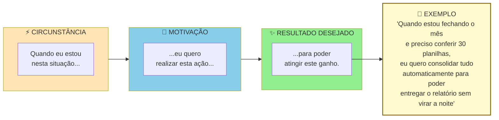

> [!warning] Um JTBD completo tem três partes
> "Quero automatizar planilhas" está incompleto. Sem circunstância e sem outcome. Solução que atende JTBD bem formulado tende a ser mais específica e mais defensável.

> [!tip] Switch Interview quando o entrevistado trocou de solução
> Quando o entrevistado **trocou** de solução (deixou um concorrente, largou um processo manual, migrou de ferramenta, mudou de fornecedor), entrevista comum de JTBD captura a versão racionalizada da decisão. A Switch Interview de Bob Moesta reconstrói o momento real, mapeando as quatro forças simultâneas: push (o que empurrou para fora do velho), pull (o que atraiu para o novo), anxiety (o que causou medo de trocar) e habit (o que segurava no antigo). Para cada switcher relevante, marque uma segunda conversa com o [[#Template: Entrevista com Switcher (JTBD, entrevista de troca)|Template: Entrevista com Switcher (JTBD, entrevista de troca)]]. O que ela formula é um JTBD muito mais específico do que o capturado em conversa única.

#### Passo 5, síntese qualitativa das entrevistas (técnicas formais)

A diferença entre um empreendedor iniciante e um pesquisador de usuário experiente está aqui. O iniciante "lê as anotações" e tira conclusões com base em memória. O experiente aplica técnicas formais de síntese, que transformam centenas de citações dispersas em padrões claros. Três técnicas a dominar.

##### Affinity mapping — agrupamento por afinidade

Processo físico ou digital (Miro, FigJam, Mural) para encontrar padrões em grandes volumes de dado qualitativo. Cinco passos.

Primeiro, extração de observações atômicas. Para cada entrevista, extraia quinze a quarenta "observações". Cada uma é um fato, citação, ou comportamento específico, escrito em post-it (um por post-it). Por exemplo, "João passa duas horas toda segunda compilando planilhas manualmente". Ou "Maria menciona três vezes que fica ansiosa com prazos de entrega".

Segundo, pool único. Junte todos os post-its de todas as entrevistas em um espaço grande. Quinze entrevistas vezes vinte e cinco observações dão trezentos e setenta e cinco post-its. É o típico.

Terceiro, agrupamento silencioso. A equipe (duas a quatro pessoas) move post-its em silêncio, agrupando por similaridade. Os movimentos podem ser reorganizados. O processo é fluido.

Quarto, nomeação dos grupos. Depois do agrupamento estabilizar, em uma a duas horas, nomeie cada cluster com uma frase curta que captura o tema. Por exemplo: "ansiedade no fechamento do mês"; "retrabalho por falta de integração".

Quinto, priorização dos clusters. Quantos post-its cada cluster tem? Clusters grandes são temas recorrentes. Clusters pequenos mas de alto impacto também importam.

O resultado são cinco a quinze clusters temáticos com número de ocorrências e citações exemplares.

##### Coding e thematic analysis — codificação temática

Método mais rigoroso, vindo da pesquisa qualitativa acadêmica. Cinco passos.

Codificação aberta. Leia cada transcrição linha por linha e atribua "códigos" (tags curtas de uma a três palavras) a trechos relevantes. Por exemplo, "ansiedade_prazo", "retrabalho_manual", "ferramenta_improvisada". Permita códigos emergentes. Não pré-defina a lista.

Revisão e consolidação. Depois de cinco a sete entrevistas codificadas, revise a lista de códigos. Combine sinônimos, elimine duplicatas, refine definições.

Codificação axial. Agrupe códigos relacionados em categorias mais abstratas. Por exemplo, os códigos "ansiedade_prazo", "pressão_chefe", "medo_errar" podem virar a categoria "pressão emocional no fluxo de trabalho".

Tema emergente. Das categorias, destaque três a sete temas que explicam a maioria das observações.

Matriz de saturação. Conte em quantas entrevistas cada tema aparece. Tema presente em sessenta por cento ou mais das entrevistas é provavelmente real. Tema em menos de trinta por cento pode ser ruído ou especificidade de um caso.

Ferramentas pagas: Dovetail, Delve, Atlas.ti. Alternativas gratuitas: planilha com colunas Citação, Código, Categoria e Tema. Em fluxos apoiados por inteligência artificial (ver Capítulos 10 e 11 do Volume 1), você pode transcrever o áudio automaticamente e pedir a um modelo de linguagem uma primeira sugestão de agrupamento de códigos, desde que anonimize nomes, cargos e empresas antes do envio (LGPD) e confira cada código sugerido contra o trecho original (*verbatim*) para evitar categorias alucinadas.

##### Triangulação entre entrevistas e survey

> [!tip] Capítulo 9 (Vol. 4): Dados, Analytics e Experimentação
> A triangulação abaixo é a primeira vez que você produz dados estruturados sobre o cliente. O [[IGNICAO-Vol-4-Tracao-e-PMF#CAPÍTULO 9 — DADOS, ANALYTICS E EXPERIMENTAÇÃO|Capítulo 9 (Dados, Analytics e Experimentação) (Vol. 4)]] aprofunda como estruturar surveys de validação, interpretar dados de survey com rigor estatístico mínimo, e montar o pipeline de experimentação que sustentará as decisões de produto nas fases posteriores.

Entrevistas sozinhas produzem hipóteses ricas mas estatisticamente frágeis. Survey sozinho produz números sem contexto. Combinar os dois é o padrão-ouro. Três passos.

Primeiro, use entrevistas (dez a trinta) para gerar temas, com os resultados do affinity mapping ou da codificação temática.

Segundo, transforme cada tema em uma a três perguntas de survey quantitativa, aplicada a cem a quinhentos respondentes do mesmo ICP.

Terceiro, compare os resultados. Um tema que apareceu em 70% das entrevistas e em 65% do survey está validado. Um tema presente em 70% das entrevistas, mas em apenas 20% do survey, costuma ser viés da amostra inicial. Já um tema citado em 30% das entrevistas e em 70% do survey indica que você precisa conduzir mais entrevistas com o subgrupo certo.

> [!note] A regra dos cinco usuários, de Nielsen
> A regra dos cinco usuários (Jakob Nielsen) vale para teste de usabilidade especificamente, não para problem discovery. Cinco usuários já capturam cerca de oitenta e cinco por cento dos problemas de usabilidade em um fluxo específico. Acima disso, retorno decrescente. Para a descoberta inicial do problema (Fase 4), quinze a trinta conversas são a referência; já para o aprofundamento etnográfico e de JTBD desta Fase 5, oito a quinze sessões longas (de 60 a 90 minutos) costumam bastar, pois cada sessão rende dezenas de observações comportamentais. Domínios mais amplos exigem mais amostras para atingir saturação.

##### Diário de pesquisa estruturado

Qualquer que seja a técnica, mantenha um diário de pesquisa em formato padronizado. Template mínimo por entrevista:

```text
DIÁRIO DE PESQUISA, Entrevista #___ Data: ___/___/___

Entrevistado:
 Nome (primeiro nome ou anonimizado): _______________
 Perfil (cargo, setor, idade, geo): ___________________
 Canal de recrutamento: ______________________________
 Como foi encontrado: _________________________________

Duração da entrevista: ____ minutos.

Contexto observado:
 Local: ______________________________________________
 Estado emocional aparente: __________________________
 Interrupções, ruídos, sinais não-verbais: __________

Top 3 quotes (verbatim, entre aspas, sem parafrasear):
1. "_______________________________________________"
2. "_______________________________________________"
3. "_______________________________________________"

Problemas mencionados (fatos, não interpretação):
- ____________________________________________________
- ____________________________________________________

Soluções atuais em uso (nomes específicos, comportamento):
- ____________________________________________________

Tentativas de solução no passado:
- ____________________________________________________

Custos atuais do problema (tempo/dinheiro/energia):
- ____________________________________________________

Pain Level estimado (1-5): ____. Por quê?: ____________

Reações emocionais observadas:
- ____________________________________________________

Surpresas (coisas que contradisseram minhas hipóteses):
- ____________________________________________________

Hipóteses novas geradas por esta entrevista:
- ____________________________________________________

Notas pessoais (em itálico, claramente separado do fato):
 _itálico aqui, interpretação minha, pode estar errada_
```

> [!important] Esse diário é o insumo bruto
> Sem esse nível de registro, você está reconstruindo entrevistas pela memória. E memória é enviesada.

#### Passo 6, defina personas com base nos dados coletados

Cada persona deve conter os nove elementos padronizados do Template de Persona (seção de ferramentas desta fase): (1) nome fictício e rótulo descritivo; (2) papel na decisão (usuário, campeão ou decisor econômico); (3) contexto demográfico e operacional relevante; (4) trabalho principal (*job*) funcional, emocional e social; (5) frustrações atuais e frequência; (6) gambiarras e ferramentas em uso; (7) gatilhos de busca e barreiras à troca; (8) citação literal (*verbatim*) marcante; e (9) base de evidência (quais entrevistas reais sustentam a ficha).

> [!warning] Persona sem dados é ficção bonita e inútil
> Cada elemento da persona precisa ter evidência rastreável das entrevistas. Se você não consegue apontar a entrevista que sustenta cada item, está inventando.

A estrutura visual de uma persona operacional, em contraste com persona demográfica:

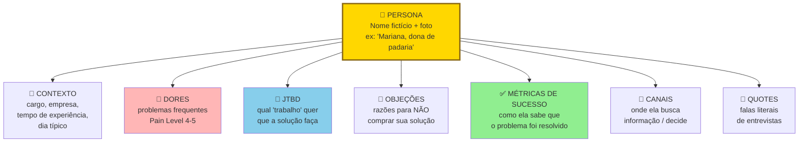

Persona operacional não é demografia. "Mulher, trinta e cinco a quarenta e cinco anos, classe B" é inútil. Não ajuda a decidir produto. "Mariana, dona de padaria artesanal de três lojas, gasta duas horas por dia conferindo insumos manualmente" é acionável.

#### Passo 7, mapeie os três papéis no contexto de compra (crítico em B2B)

Em contextos B2B, uma persona isolada raramente explica o comportamento de compra. Três papéis distintos interagem durante a decisão. Cada um tem motivações, restrições, e critérios próprios. Confundi-los é o erro mais caro em vendas B2B: quando Henrique foi mapear usinas sucroenergéticas no Paraná, descobriu que precisava entrevistar separadamente o operador de caldeira (usuário técnico), o engenheiro de manutenção (campeão interno que sente a dor da parada) e o diretor industrial (comprador econômico que assina o orçamento).

Usuário. Pessoa que vai operar o produto no dia a dia. Avalia ergonomia, encaixe com a rotina, tempo economizado. Tem poder de sabotagem (se odiar, não usa, ou usa mal). Mas raramente tem poder de compra.

Campeão Interno. Pessoa que enxerga valor na solução e está disposta a brigar por ela internamente. É tipicamente um usuário avançado ou um gestor próximo dos usuários. É quem vai marcar a reunião com o decisor, preparar a justificativa, responder pelos riscos. Sem campeão, quase nenhuma venda B2B fecha.

Comprador Econômico. Pessoa com autoridade e orçamento para autorizar o pagamento. Avalia ROI, risco, alinhamento com prioridades corporativas. Raramente vai usar o produto. Frequentemente não conhece os detalhes operacionais.

Três princípios operacionais para a pesquisa desta fase.

Primeiro, entreviste os três papéis separadamente. Misturar em uma entrevista só ("reunião com a empresa X") gera respostas editadas politicamente. Usuários não falam mal da solução se o chefe está presente. Chefes não admitem que não conhecem o workflow se o subordinado está na sala. Separe.

Segundo, monte uma persona distinta para cada papel, não uma persona média. Uma "persona da empresa" é ficção. Persona útil é do papel, porque cada papel toma decisões diferentes com base em critérios diferentes.

Terceiro, identifique quais papéis se sobrepõem e quais permanecem distintos no seu contexto. Em empresas clientes muito pequenas (de cinco a vinte funcionários), os três papéis costumam caber na mesma pessoa: o próprio dono. Em médias empresas, o usuário costuma estar separado dos outros dois. Em grandes, os três são sempre distintos e podem somar um quarto papel (TI ou Procurement). Saber onde o seu ICP está nessa geometria define quantas personas você constrói.

> [!tip] B2C também pode ter mais de uma persona
> Em B2C, o trio costuma colapsar em uma pessoa só. O próprio consumidor é usuário, decisor e pagador. Mas há exceções importantes. Produtos para crianças (pais decidem, crianças usam). Saúde de idosos (filhos frequentemente decidem). Presentes (comprador diferente de destinatário). Benefícios corporativos (empresa paga, funcionário usa). Sempre pergunte: a pessoa que usa é a mesma que paga? Se não, você tem pelo menos duas personas.

O entregável deste passo, para cada papel relevante no seu contexto, é uma persona caracterizada com os mesmos elementos definidos no Passo 6. Motivações, frustrações, comportamentos, JTBDs, citação verbatim. Construa uma persona para cada papel que decide ou usa o produto, o que na prática resulta em duas a quatro personas primárias (tipicamente três em B2B e uma a duas em B2C).

#### Passo 8, identifique o sub-ICP mais doloroso

> [!note] ICP, sub-ICP e beachhead: três níveis de granularidade do mesmo conceito
> **ICP** (Ideal Customer Profile): o perfil amplo de cliente potencial, definido na [[#FASE 4 — DESCOBERTA DO PROBLEMA|Fase 4]] (ex: "donos de restaurante de 1-3 unidades em capitais brasileiras com delivery próprio").
> **Sub-ICP** ou **sub-segmento**: recorte mais estreito dentro do ICP onde a dor é mais aguda (ex: "donos que operam sozinhos, sem gerente"), identificado na Fase 4 como sinal inicial e confirmado aqui, na Fase 5.
> **Beachhead**: o sub-ICP escolhido como **ponto de entrada no mercado**: a praia onde você desembarca. É o sub-ICP mais doloroso operacionalmente filtrado pelos quatro critérios deste passo (urgência, agudeza, recursos, alcançabilidade).
>
> A relação é: ICP ⊃ sub-ICP ⊃ beachhead. Beachhead é sempre um sub-ICP; nem todo sub-ICP vira beachhead. Os termos não são intercambiáveis: ICP define quem PODE ser cliente; beachhead define quem SERÁ o primeiro cliente.

Entre as personas, qual delas tem o problema mais agudo, com mais urgência, mais recursos para pagar, e é mais fácil de alcançar? Essa é a sua *beachhead*: o ponto de entrada no mercado. Você deve focar nela nas fases seguintes.

#### Passo 9, consolide o Dossiê do Usuário

Documento de dez a vinte páginas. Conteúdo: duas a quatro personas detalhadas; duas a quatro jornadas mapeadas; lista de JTBDs ranqueada por importância e frequência; identificação da beachhead (sub-ICP prioritário); Declaração da Ideia atualizada para v3.

### Uma entrevista JTBD do PadariaPro: do verbatim à persona

A pergunta central: "Me leva para a última vez que você precisou reabastecer o estoque de farinha, passo a passo, do começo ao fim. Quando você percebeu, o que fez, quem envolveu, quanto tempo levou, o que deu errado?"

A resposta bruta de Fábio, dono de três padarias na Zona Oeste de São Paulo (dentro do ICP refinado na Fase 4):

> "Foi terça passada. O João, gerente da loja 2, me mandou áudio de WhatsApp às 7h. 'Farinha T1 tá acabando, dá pra hoje só.' Eu tava no carro indo pra loja 3. Liguei pro fornecedor habitual, a Distribuidora Serrana, e a atendente disse que só entregaria na quinta. Aí acionei nosso plano B, o Marcos do Moinho da Vila Aí liguei pro nosso plano B, o João do Moinho da Serra, que trouxe em quatro horas mas cobrou quinze por cento mais caro. No fim a gente fez a semana, mas o dia 2 foi estresse total, eu tinha três reuniões e tive que virar comprador. Isso acontece umas duas a três vezes por mês, depende. Agora, pra evitar, o gerente geralmente pede mais do que precisa, aí sobra farinha mofando no sábado e a gente perde 200-300 reais por semana. Tô trocando perda por perda."

A análise JTBD da resposta. O job funcional é garantir continuidade de produção sem interrupção. O job emocional é não ser o operador de última hora que apaga incêndio, e não transmitir estresse para a equipe. O job social é ser visto como dono que tem o negócio sob controle pelo gerente e pelos clientes. O contexto: acontece de duas a três vezes por mês, interrompe o foco executivo do dono e mobiliza duas a três pessoas da operação. A solução atual combina três peças improvisadas: áudio de WhatsApp do gerente, ligação de emergência para o distribuidor e acionamento de um fornecedor reserva quinze por cento mais caro. E o "trade de perda por perda" é o ponto-chave. Ou paga mais caro (plano B), ou desperdiça (excesso). Não há caminho sem perda.

A persona resultante, em fragmento. Fábio, trinta e oito anos, padaria artesanal de três lojas em Campinas. Perfil: dono-operador, formação técnica, usa WhatsApp e planilha no celular, desconfiado de apps "modernos" mas adota se ver valor em uma semana. O job contratado é "me devolver horas de foco executivo", mais que "otimizar margem". Como ele já perde entre R$ 200 e R$ 300 por semana em farinha vencida (R$ 800 a R$ 1.200 no mês) e ainda paga 15% de ágio nas compras de emergência, a hipótese de preço a testar na próxima fase é uma assinatura de R$ 400 mensais por loja. Se só economizar dois por cento de margem, ele questiona.

Os gatilhos de troca observados foram três. Incidente recente de ruptura que causou perda grande (mais de R$ 5 mil), ou cliente insatisfeito. Chegada de nova loja (passar de duas para três, de três para quatro) torna sistema manual inviável. Indicação de par (outro dono de padaria) sobre ferramenta que funcionou.

As barreiras à troca identificadas na conversa foram quatro: (1) receio de que a equipe operacional da manhã não alimente o sistema; (2) medo de pagar mensalidade por uma ferramenta que fique cara caso a adoção falhe; (3) apego à negociação informal pelo WhatsApp com os vendedores dos moinhos; e (4) percepção de que a mensalidade fixa dói no caixa todo mês, enquanto o desperdício de farinha fica invisível no custo da mercadoria vendida.

### Caso brasileiro real, pesquisa com usuários no QuintoAndar e a dor do fiador

Em 2013, o mercado de aluguel residencial no Brasil tinha fricção enorme. Fiador, vistoria, caução, dois a três meses de processo. Os fundadores do QuintoAndar (Gabriel Braga e André Penha, em São Paulo) fizeram pesquisa qualitativa extensa com inquilinos e proprietários.

Descobriram algo que a hipótese inicial não previa. O ponto mais doloroso era o fiador. Não o valor. A constrangedora necessidade de pedir a alguém. A dor era social, não financeira.

A pesquisa redirecionou a proposta de valor. Nessa reconstrução, em vez de "otimizar o processo de aluguel", posicionaram a promessa pública como "aluguel sem fiador e sem depósito caução" (mantendo a vistoria padronizada de entrada e saída e o contrato eletrônico). A dor central virou promessa central. E o produto cresceu nessa direção.

Pesquisa aprofundada revela qual dor é emocionalmente mais forte, não apenas qual é operacionalmente mais cara. A proposta de valor precisa atacar a dor emocional.

### O dossiê das forças de mudança e das gambiarras que você vai aposentar

Você concluiu a Fase 5 quando todos os critérios abaixo estão cumpridos.

- [ ] Dez ou mais entrevistas JTBD novas (não reaproveitadas da Fase 4) com roteiro específico, de sessenta a noventa minutos cada.
- [ ] Cinco ou mais observações em campo (job shadowing) ou análises profundas de artefatos, com triangulação entre dado declarado e dado observado. Para cada afirmação central das entrevistas, registre se a observação em campo confirmou, contradisse ou ainda não testou o relato; quando a prática observada contradisser a fala, priorize sempre o comportamento observado e você deve priorizar o observado.
- [ ] Dossiê do Usuário com duas a quatro personas baseadas em dados reais (Template: Persona com dados (Fase 5)), seis ou mais atributos comportamentais por persona, duas a quatro jornadas mapeadas e cinco a dez JTBDs ranqueados.
- [ ] Cinco ou mais contextos de uso mapeados (quando, onde, com quem, sob qual pressão).
- [ ] "Solução atual não óbvia" identificada (o que as pessoas realmente usam hoje, mesmo que não seja feito para isso).
- [ ] Gatilhos de troca e barreiras à troca documentados em lista.
- [ ] Em B2B, três papéis (usuário, campeão, comprador econômico) entrevistados separadamente, com persona distinta para cada papel relevante no contexto.
- [ ] Tese sobre "dor real" refinada com mais granularidade (qual job, qual contexto, qual gatilho), com registro "antes versus depois".
- [ ] Beachhead escolhida com justificativa baseada em dados (urgência + agudeza + recursos para pagar + alcançabilidade).
- [ ] Declaração da Ideia atualizada para v3.

> [!warning] Critério de saída
> Se qualquer um desses itens falha, não avance. Resolva antes.

**Primeiros passos práticos.**

1. Escolher dez entrevistados da Fase 4 que mostraram maior dor e agendar uma conversa de sessenta a noventa minutos, de preferência no próprio local de trabalho, com foco em JTBD.
2. Elaborar a pergunta central JTBD: "Me conta a última vez que você precisou (job), do começo ao fim, em detalhes."
3. Construir uma persona (Template: Persona com dados (Fase 5)) com dado real, não nome fictício sem base.
4. Mapear, em planilha, os gatilhos de troca e as barreiras identificadas.

### Cinco erros metodológicos que distorcem a pesquisa com usuários

> [!note] Capítulo 3 (Vol. 1): Armadilhas Mentais e Vieses
> Personas fictícias, viés de confirmação na síntese qualitativa e ancoragem na hipótese original são os vieses mais comuns nesta fase. O [[IGNICAO-Vol-1-Ideacao#CAPÍTULO 3 — ARMADILHAS MENTAIS E VIESES|Capítulo 3 (Armadilhas Mentais e Vieses) (Vol. 1)]] trata especificamente de vieses de pesquisa: como o efeito halo sobre entrevistados carismáticos e o viés de disponibilidade que faz a última entrevista parecer mais importante que as anteriores.

Criar personas fictícias. Sem dados, persona é caricatura. Força você a dizer "a nossa persona é a Ana, uma dona de restaurante…", mas não protege decisões ruins.

Confiar só no que a pessoa diz. Pessoas relatam uma versão idealizada de si mesmas. Observe além de escutar.

Pular JTBDs. Sem clareza do *job*, você projeta funcionalidades sem saber o problema que resolvem. JTBD é a bússola.

Persona única e genérica. Quase sempre há dois ou mais sub-segmentos relevantes. Uma persona só mascara diferenças importantes.

Perder-se em detalhes irrelevantes. Nem toda informação coletada é útil. Filtre pelo que afeta a decisão de produto.


---

### O Espelho da Fase 5: Contra Qual Gambiarra Você Está Lutando de Verdade?

**Fechando o ciclo na trincheira:** Quando a **Dra. Camila** trouxe este protocolo para a operação da clínica em Belo Horizonte, o gargalo que abriu este capítulo deixou de depender do seu heroísmo pessoal na cadeira e passou a rodar como sistema auditável pela equipe.

**O Espelho (autodiagnóstico):**
1. Quantos atributos das suas personas atuais você consegue rastrear diretamente até uma entrevista ou sessão de observação com data, nome e citação literal (sem cair na **Cegueira Demográfica do Especialista**)? E qual foi o evento concreto (o "dia em que a corda arrebentou") que levou seus entrevistados mais urgentes a improvisarem uma gambiarra?
2. Qual é a gambiarra atual, no Excel, no WhatsApp ou no papel, que você está tentando demitir da rotina do seu cliente?
3. Qual é a maior ansiedade que faz o seu cliente travar cinco minutos antes de assinar o contrato ou passar o cartão?

**Permissão Libertadora:**
Você está autorizado a jogar no lixo todas as "Personas de Marketing" fictícias com fotos de banco de imagens e hobbies inventados.

**O Ritual de Segunda-Feira às 9h (rotina semanal de 30 minutos):**
Ligue para o entrevistado classificado em Pain Level 5 mais articulado da sua rodada da Fase 4 e agende uma sessão presencial (ou por compartilhamento de tela) de sessenta a noventa minutos nesta semana, dizendo apenas: *"Mostre-me passo a passo como você executou esse processo na última vez em que o problema aconteceu."* Anote cada gambiarra, interrupção e planilha paralela.

---

### MÉTRICAS E BENCHMARKS DESTA FASE (FASE 5)

| Métrica | O que medir | Referência saudável |
|---|---|---|
| Jobs-to-be-done mapeados | Jobs funcionais, emocionais e sociais identificados | ≥ 3 jobs por segmento |
| Jornada documentada | Pontos de dor na jornada atual mapeados | ≥ 5 pontos de fricção |
| Personas validadas | Personas com dados reais (não fictícios) | 2 a 3 personas primárias |
| Beachhead segment definido | Segmento inicial de 100 a 1.000 clientes | Identificado e justificado |
| Customer discovery score | Novos aprendizados por entrevista | Decrescente (sinal de saturação) |

---

### MANUAL PASSO A PASSO DOS FRAMEWORKS DESTA FASE

> [!tip] Uso autocontido neste volume
> Todos os frameworks abaixo estão detalhados integralmente com origem, estrutura, passo a passo de aplicação, exemplo brasileiro e armadilhas para execução imediata nesta **Fase 5**.

#### Framework: Jobs to Be Done Switch Interviews (Bob Moesta & Chris Spiek, via Clayton Christensen)

##### De onde vem a ferramenta (e por que sobreviveu ao filtro do tempo)

Metodologia desenvolvida por Bob Moesta e Chris Spiek no Re-Wired Group nos anos 2000, refinando a teoria **Jobs to Be Done** de Clayton Christensen (Harvard Business School). Moesta colaborou com Christensen em pesquisas sobre motivação de compra. *Competing Against Luck* (Christensen, Dillon, Hall, Duncan, 2016) consolidou publicamente a teoria. Moesta publicou *Demand-Side Sales 101* (2020) com o método operacional.

##### A mecânica central (sem jargão)

Protocolo de entrevista focado no **momento de "troca"** (switch), quando cliente largou solução anterior e adotou uma nova. Revela as **forças causais** por trás da decisão de compra, em vez de preferências declaradas ou features desejadas.

##### Princípios / estrutura — As 4 Forças

Em toda decisão de compra, 4 forças atuam:

1. Push (empurrar) da situação atual: insatisfação com solução atual ou status quo.
2. Pull (puxar) da nova solução: atração pela alternativa.
3. Anxiety (ansiedade) da nova solução: medo do que vai dar errado com nova.
4. Habit (hábito) da situação atual: inércia, familiaridade.

Compra acontece quando: Push + Pull > Anxiety + Habit.

Linha do tempo da compra (estrutura da entrevista):

1. First thought: primeira vez que a pessoa pensou em mudar.
2. Passive looking: períodos de consideração sem ação.
3. Active looking: busca ativa, comparação.
4. Deciding: momento da decisão.
5. Consuming: uso da nova solução.
6. Satisfaction: avaliação ex-post.

##### Como rodar na segunda-feira às 9h com seu time

Passo 1: Selecione entrevistados que fizeram a troca recentemente. Idealmente últimos 60-90 dias, memória ainda fresca. Clientes próprios ou de concorrentes, não prospects.

Passo 2: Comece pelo fim: "quando você comprou X?" Data específica.

Passo 3: Trabalhe a timeline para trás. Quando decidiu? Quando começou a considerar seriamente? Quando primeiro pensou em mudar? Objetivo: reconstruir arco emocional e racional completo.

Passo 4: Identifique as 4 forças em cada ponto. Push: o que pressionava? Pull: o que atraía? Anxiety: o que preocupava? Habit: o que prendia ao antigo?

Passo 5: Atenção a triggers específicos. Qual evento específico elevou o first thought para passive looking? De passive para active? Triggers são frequentemente inesperados ("conversei com colega que mencionou X", "li artigo", "tive problema inesperado").

Passo 6: Explore rejeição também. Soluções consideradas e rejeitadas, por quê? Revela pull fracos ou anxiety altas.

Passo 7: Sintetize em padrões. Após 10-15 switch interviews, quais forças dominam? Quais triggers recorrem?

##### Na trincheira real: como isso funciona na prática

Entrevista com PME que migrou de planilha Excel para SaaS de gestão financeira:

- First thought (6 meses atrás): contador reclamou que fechamento do mês levou 5 dias úteis.
- Passive looking: olhou 2 ferramentas por curiosidade, achou "muito para mim ainda".
- Active looking (3 meses atrás): comparou 3 ferramentas em spreadsheet, pediu demos.
- Deciding (6 semanas atrás): escolheu Ferramenta Y em 2 dias.

Forças identificadas:

- Push: medo de erro crescente com crescimento da empresa, contador irritado, tempo pessoal excessivo.
- Pull: ferramenta Y tinha integração com Omie (seu ERP antigo), demo rápida, preço acessível.
- Anxiety: "vou perder dados?", "meu time vai adotar?", "vai caber no orçamento?".
- Habit: "Excel sempre funcionou, familiar, sem custo adicional".

Trigger específico de passive → active: amigo dono de empresa similar falou "migrei para SaaS há 1 ano, mudou minha vida". Boca-a-boca foi catalisador.

Implicação para a startup: como a recomendação de um par de confiança foi o gatilho decisivo da troca, vale estruturar um programa simples de indicação já a partir dos primeiros clientes satisfeitos.

##### Onde o papel aceita tudo (armadilhas de execução)

Entrevistar prospects, não clientes que já trocaram: prospects falam de hipóteses, quem trocou fala de realidade. Focar só em features desejadas: JTBD Switch busca forças emocionais/situacionais, não checklist de features. Ignorar anxiety: empresas frequentemente investem em pull (marketing de features) e ignoram anxiety (ansiedade do cliente). Reduzir anxiety via onboarding, trial, guarantees tem impacto enorme. Não identificar triggers específicos: "estava insatisfeito" é genérico, "meu contador gritou comigo" é específico e replicável em marketing. Sample pequeno: 3 switch interviews não revelam padrão, precisa 10-15.

---

#### Framework: Contextual Inquiry (Hugh Beyer & Karen Holtzblatt, 1997)

##### De onde vem a ferramenta (e por que sobreviveu ao filtro do tempo)

Hugh Beyer e Karen Holtzblatt, da InContext Design, desenvolveram Contextual Inquiry nos anos 1990, consolidando em *Contextual Design: Defining Customer-Centered Systems* (1997). Método emergiu da observação de que usuários **não conseguem descrever com precisão** o que fazem, mas observá-los no contexto real revela. Virou fundacional em UX research e design de software.

##### A mecânica central (sem jargão)

Método de pesquisa etnográfica aplicada a software/produtos: **observar o usuário realizando tarefas no seu contexto real** (trabalho, casa, escola) enquanto você pergunta sobre decisões em tempo real. Dados incluem o que pessoa **faz**, não só o que pessoa **diz**.

##### As regras do jogo

4 princípios fundamentais:

1. Contexto: observe o trabalho real, não abstrações. Vá ao escritório, clínica, caminhão.
2. Parceria: pesquisador e usuário são parceiros entendendo juntos, não avaliador/avaliado.
3. Interpretação: pesquisador interpreta em tempo real e checa interpretação com usuário. "Pareceu que você estava frustrado aqui. É isso mesmo?"
4. Foco: pesquisador traz perspectiva explícita de aprendizado (não "assistir como usuário geral").

##### Como rodar na segunda-feira às 9h com seu time

Passo 1: Selecione 4-8 participantes representativos. Diversidade de experiência, contexto, role.

Passo 2: Agende 2-4h no local de trabalho real deles. No escritório, chão de fábrica, casa, onde tarefa acontece.

Passo 3: Introdução curta (15 min). Explicar: "quero te observar trabalhando, vou perguntar por que você faz o que faz, vou te interromper às vezes. Não é avaliação, é aprendizado."

Passo 4: Observe tarefa natural. Participante faz trabalho real, você observa.

Passo 5: Pergunte em tempo real. "Por que você clicou aí?" "O que você estava procurando?" "Por que essa ordem?"

Passo 6: Interprete e confirme. "Pareceu que você achou difícil encontrar X. É isso?"

Passo 7: Anote tudo: ações, objetos físicos no ambiente, fluxos, comunicações, emoções.

Passo 8: Debrief com time. Em até 48h, compartilhar observações, gerar aprendizados.

##### Na trincheira real: como isso funciona na prática

Startup de software para clínicas de fisioterapia:

Visita à clínica de 3 fisioterapeutas em Curitiba, 3 horas. Observações:

- Fisioterapeuta 1 usa caderno físico + agenda papel + WhatsApp para marcações.
- Entre pacientes, gasta 4-5 min só achando ficha.
- WhatsApp tem histórico de 200+ mensagens não lidas, decide "resolvo depois".
- Recepcionista imprime planilha do dia, risca à mão.
- Comunicação entre recepção e fisio é via "gritar de um consultório a outro" quando paciente chega.

Insights gerados:

- Problema real não é "agenda digital", é **comunicação entre recepção e consultório**.
- Backlog de WhatsApp sinaliza "caos invisível", mostrar no dashboard pode ser diferencial.
- Entre pacientes (4-5 min) é janela crítica, produto precisa funcionar **ultra-rápido**.
- Ambiente tem muitos papéis físicos, integração com impressão importa (diferentemente de PME tech-savvy).

Nenhum desses aprendizados emergiria de entrevista fora do contexto.

##### Onde o papel aceita tudo (armadilhas de execução)

"Lab usability test" disfarçado de contextual inquiry: chamar usuário para escritório do pesquisador. Contexto se perde. Falar demais: contextual inquiry é 70% observação, 30% diálogo. Interrompendo em momentos críticos: interromper durante tarefa complexa distorce. Esperar pausas naturais. Sem documentação visual: fotos de ambiente, diagramas de fluxo, ajudam análise posterior. Análise superficial: observar muito, interpretar pouco. Passar tempo pós-visita sintetizando. Generalização de n=1: 1 visita não representa, precisa 4-8 para padrões.

---

#### Framework: Day in the Life / Ethnographic Research

##### De onde vem a ferramenta (e por que sobreviveu ao filtro do tempo)

Método etnográfico tem raízes em antropologia cultural (Bronisław Malinowski, Margaret Mead, início do séc. XX). A aplicação ao design de produtos tecnológicos surgiu nos anos 1980 na Xerox PARC (com os estudos de Lucy Suchman) e popularizou-se na década de 1990 por meio de consultorias como a IDEO. Lucy Suchman (Xerox PARC) foi pioneira em "ethnography of work". Método virou padrão em design de produtos complexos e serviços.

##### A mecânica central (sem jargão)

Pesquisa imersiva em que observador **acompanha usuário por período extenso** (meio dia a vários dias) em ambiente natural, observando sem intervir muito. Diferente do Contextual Inquiry (que é interventivo e focado em tarefa), etnografia é **holística** e captura contexto amplo de vida/trabalho.

##### As regras do jogo

Características:

- Imersão longa (não sessão de 1h).
- Observação participante ou não participante.
- Captura holística: relacionamentos, rotinas, ambiente físico, rituais, tensões sociais.
- Menos intervenção: não perguntar a cada passo, deixar vida acontecer.
- Multi-método: observação + conversa informal + shadowing + análise de artefatos.

##### Como rodar na segunda-feira às 9h com seu time

Passo 1: Defina pergunta de pesquisa ampla. "Como é o dia de um dono de bar de bairro?" não "testar nosso app".

Passo 2: Negocie acesso. Ganhar confiança para presença extensa, ser claro sobre propósito.

Passo 3: Observação longa. Mínimo 4-6 horas, idealmente dia completo. Alguns projetos: semanas.

Passo 4: Observe o invisível. Como decisões são tomadas, quem tem voz, o que não é dito, rotinas tão naturais que participante não descreveria.

Passo 5: Conversas informais, não entrevistas estruturadas. Deixar diálogo emergir naturalmente.

Passo 6: Documente extensivamente. Caderno de campo detalhado, fotos (com permissão), vídeos quando possível.

Passo 7: Saída e análise. Pós-visita: escrever narrativas densas, buscar padrões através de múltiplas visitas.

##### Na trincheira real: como isso funciona na prática

Startup de soluções para pequenos varejistas no Nordeste:

Fundador passa 3 dias em Caruaru (PE) acompanhando donos de mercadinhos de bairro. Observações-chave:

- Dia não começa em hora fixa, depende de fornecedor chegando.
- Relação com clientes é personalíssima, "fiado" é instrumento cultural crítico, não só financeiro.
- Computador existe mas é usado apenas 15 min/dia (nota fiscal), tudo mais em caderno ou cabeça.
- Maior "ferramenta" é memória pessoal do dono, substituí-la sem respeitar é ameaça.
- Família (esposa, filhos) está no fluxo, separar "trabalho" e "casa" é artificial.

Insights para produto:

- Produto fin digital tem que respeitar "fiado" como categoria (não como "crédito").
- Onboarding tem que valer a pena em < 30 minutos ou nunca será adotado.
- Linguagem não pode ser corporativa, tem que falar do jeito que dono fala.
- Aprovação da esposa/filhos frequentemente é gate de adoção, marketing pode falar com família, não só dono.

Nenhum desses aprendizados emergiria de entrevista telefônica.

##### Onde o papel aceita tudo (armadilhas de execução)

Curto demais: 1 hora não é etnografia, é entrevista com deslocamento. Observação sem pergunta de pesquisa: dispersão, não sabe o que busca. Viés de observador: você muda o ambiente só estando lá. Mitigar: voltar múltiplas vezes até se tornar invisível. Hipótese confirmatória: procurar o que você já acha. Disciplina de registrar surpresas (o que contradiz expectativa). Generalização de uma visita: preciso múltiplos contextos para padrões. Extrair sem reciprocidade: participante dá tempo, acesso, confiança, reciprocar (valor, pagamento, share de aprendizados).

---

#### Framework: Focus Groups (Robert Merton, anos 1940; refinado por Richard Krueger)

##### De onde vem a ferramenta (e por que sobreviveu ao filtro do tempo)

Sociólogo Robert K. Merton desenvolveu "focused interviews" nos anos 1940 analisando reações de audiência a filmes de propaganda da Segunda Guerra. Comercialmente, virou "focus group" nos anos 1950 com aplicação a pesquisa de mercado (TV, produtos). Richard Krueger (U. Minnesota) refinou metodologicamente em *Focus Groups: A Practical Guide for Applied Research* (1988+). Uso excessivo em marketing dos anos 80-90 gerou críticas, método ainda é útil se bem aplicado.

##### A mecânica central (sem jargão)

Discussão facilitada em grupo pequeno (6-10 pessoas) sobre tópico específico. O valor distintivo: **interação entre participantes** gera aprendizados que entrevistas individuais não produzem, pessoas reagem umas às outras, revelam disagreements, expandem ideias.

##### As regras do jogo

Uso apropriado:

- Entender **diversidade** de perspectivas sobre um tópico.
- Explorar **linguagem** que pessoas usam (como falam sobre um domínio).
- Testar **conceitos em estágio inicial** (reactions preliminares).
- Observar **dinâmica social** em torno de decisão.

Uso inapropriado:

- Pesquisa individual profunda (one-on-one é melhor).
- Temas sensíveis (pessoas não falam livremente).
- Dados estatísticos (survey é melhor).
- Pesquisa comportamental (observação é melhor).

##### Como rodar na segunda-feira às 9h com seu time

Passo 1: Defina objetivo específico. "Explorar como PMEs brasileiras falam sobre gestão financeira" é claro.

Passo 2: Recrute homogeneidade interna + diversidade entre grupos. Grupo 1: PMEs do varejo. Grupo 2: PMEs de serviços. Dentro do grupo, perfis similares reduzem timidez.

Passo 3: 4-8 grupos idealmente. Menos gera insight fraco, saturação acontece em 4-6.

Passo 4: 6-10 participantes por grupo. Com menos gente, a conversa míngua; com mais participantes, parte do grupo se cala.

Passo 5: Prepare roteiro semi-estruturado. 5-8 perguntas abertas, 90-120 min total.

Passo 6: Facilitador treinado. Habilidades: gerar conversa, gerenciar dominantes, extrair silenciosos, seguir threads emergentes sem perder objetivo.

Passo 7: Grave e transcreva. Análise qualitativa rigorosa exige transcrição.

Passo 8: Análise temática com triangulação entre grupos. Quais temas emergem em múltiplos grupos? Quais são específicos de um?

##### Na trincheira real: como isso funciona na prática

Startup de delivery de comida saudável para B2C:

4 focus groups em São Paulo (40 participantes total):

- Grupo 1: Mulheres 25-35 anos, alta renda.
- Grupo 2: Homens 30-45 anos, média-alta renda.
- Grupo 3: Mulheres 35-50 anos, média renda.
- Grupo 4: profissionais de saúde (nutricionistas, educadores físicos e médicos).

Pergunta central: "Como vocês decidem o que comer durante a semana?"

Insights emergentes:

- "Saudável" é linguagem super carregada emocionalmente, resistência vs. apelo ambíguo.
- Nos grupos 1 e 3, "saudável" é sinônimo de "controle", gera autorrecriminação.
- No grupo 2, "saudável" é sinônimo de "performance", associação com academia, energy.
- Grupo 4 (profissionais): maior ceticismo com marketing de saudável, buscam evidência real.
- Família (filhos pequenos) em grupos 1 e 3 complica tudo, "não compro saudável pra mim porque cozinho para filhos".

Implicação para produto: segmentação por público é crítica. Mensagem unificada "saudável" é frouxa. Cada grupo precisa linguagem própria (controle vs. performance vs. conveniência vs. evidência).

##### Onde o papel aceita tudo (armadilhas de execução)

Pensar que focus groups substituem entrevistas individuais: complementam. Um não substitui o outro. Recrutamento desleixado: amigos do fundador ou públicos não representativos. Facilitador vira palestrante: fala demais, lidera participantes a respostas desejadas. Dominante monopoliza: 1 pessoa fala 60% do tempo, outros ficam em silêncio. Grupos muito heterogêneos: CEO e estagiário no mesmo grupo, hierarquia sufoca falas. Análise só de destaques: lembrar apenas de quotes marcantes ignora padrões profundos. Uso para decisões quantitativas: "6 de 10 pessoas gostaram", n=10 em grupo não é estatística.

---

#### Framework: Diary Studies (vários, anos 1970-presente)

##### De onde vem a ferramenta (e por que sobreviveu ao filtro do tempo)

Diary studies surgem em sociologia e psicologia no séc. XX. Adoção sistemática em UX research emergiu nos anos 2000 com ferramentas digitais (dScout, Indeemo, Ethnio). Método-chave em comportamento de longo prazo.

##### A mecânica central (sem jargão)

Participantes **registram suas experiências** ao longo de um período (dias a semanas) em formato estruturado (app, planilha, gravação de vídeo). Dados são coletados **no momento em que acontecem**, evitando viés de recall.

##### As regras do jogo

Vantagens:

- Captura comportamento cotidiano em contexto real.
- Reduz viés de memória (recall).
- Revela padrões ao longo do tempo.
- Custo relativamente baixo por participante.

Desvantagens:

- Alta demanda cognitiva para participantes (dropouts).
- Dependência de adesão dos participantes.
- Dados menos ricos que observação direta.
- Viés de participação (quem aceita fazer pode não ser representativo).

##### Como rodar na segunda-feira às 9h com seu time

Passo 1: Pergunta de pesquisa específica: "como PMEs usam seu sistema financeiro ao longo de uma semana típica?"

Passo 2: Design da prompt: perguntas curtas, respondíveis em 2-3 min, enviadas em cadência definida (diária, ao fim do dia, ou ao vivo por evento).

Passo 3: Escolha plataforma: dScout, Indeemo, Dovetail (diary features), ou Google Forms simples.

Passo 4: Recrute com disciplina: 8-15 participantes, remunerar (R$ 200-800 por estudo), explicar compromisso.

Passo 5: Onboarding: demo de uso da ferramenta, o que registrar, exemplos.

Passo 6: Moderação ativa: check-ins diários para garantir adesão, responder dúvidas, incentivar quando engajamento cai.

Passo 7: Análise ao final: análise temática (Framework: Thematic Analysis (Virginia Braun & Victoria Clarke, 2006) (Fase 4)), identificação de padrões temporais, triangulação com outras fontes.

##### Na trincheira real: como isso funciona na prática

Diary study de 7 dias com 10 freelancers brasileiros (estudando rotina financeira):

Prompt diário (fim do dia, 3 min):

1. Você teve alguma preocupação com dinheiro hoje? O quê?
2. Fez alguma ação relacionada (pagamento, cobrança, planejamento)? Qual?
3. Que ferramenta usou? (Excel, app, banco, papel).
4. 1 palavra para descrever como se sentiu em relação a dinheiro hoje.
5. Foto ou screenshot de algo relevante (opcional).

Insights ao fim de 7 dias:

- Preocupações com fluxo de caixa aparecem em 60% dos dias registrados, concentrando-se nas vésperas de pagamento a fornecedores e fechamento de folha.
- Ações concentram-se em segunda e sexta (início e fim de semana).
- "Ansiedade" e "incerteza" são palavras dominantes, "controle" raro.
- Todos usam 3-5 ferramentas diferentes (banco + Excel + WhatsApp com contador + caderno).
- Fragmentação é tema central, ninguém tem visão única.

Implicação: produto que resolve fragmentação (visão única) atacaria dor documentada quase diária.

##### Onde o papel aceita tudo (armadilhas de execução)

Prompt longo demais: dropouts aumentam rapidamente com fadiga, Sem moderação: participantes param de responder após dia 3-4, Análise sem triangulação: confiar apenas no diário de uso; cruze sempre os registros com entrevistas em profundidade, Amostra pequena demais: 3-5 participantes com dropouts = dados quase inúteis, Prompt enviesado: "você teve problemas?" sugere resposta. Neutro: "como foi sua experiência?".

---

#### Framework: Personas (Alan Cooper, 1998)

##### De onde vem a ferramenta (e por que sobreviveu ao filtro do tempo)

Alan Cooper, criador do Visual Basic, publicou *The Inmates Are Running the Asylum* em 1998, introduzindo personas como ferramenta de design. Argumento: projetar para "usuários genéricos" leva a produtos para ninguém, personas específicas forçam decisões concretas. Hoje é prática padrão em UX, produto e marketing.

##### A mecânica central (sem jargão)

**Representações fictícias, mas baseadas em dados**, de usuários-alvo. Cada persona é uma síntese das características, comportamentos, motivações e dores comuns a um segmento de usuários.

##### As regras do jogo

Componentes de uma persona bem feita:

- Nome + foto (humaniza).
- Demografia relevante.
- Contexto/cenário típico de uso.
- Objetivos (o que querem atingir).
- Frustrações (o que os impede).
- Comportamentos e preferências.
- Motivações profundas.
- Quote representativo.

Tipos:

- Primary persona: o principal usuário, otimizar para essa.
- Secondary: importante mas não prioritário.
- Anti-persona: quem **não é** seu usuário (útil para posicionamento).

##### Como rodar na segunda-feira às 9h com seu time

Passo 1: Baseado em dados reais de pesquisa (entrevistas, analytics), não imaginação.

Passo 2: 2-5 personas. Mais dilui foco, 1 só é insuficiente para segmentos diferentes.

Passo 3: Nível de detalhe proporcional a uso. Se persona será referenciada diariamente, detalhar, se vai ficar na parede, não precisa ser livro.

Passo 4: Use em decisões: ao discutir feature, perguntar "isso ajuda [Persona X] atingir seu objetivo?" Se persona não ajuda a decidir, não está servindo.

Passo 5: Atualize anualmente. Usuários e mercado mudam.

##### Na trincheira real: como isso funciona na prática

Persona primária para SaaS de gestão financeira:

Camila, 38 anos: dona de clínica de odontologia e reabilitação (Curitiba)

- Contexto: 2 sócios, 8 funcionários, atende 80 pacientes/semana.
- Objetivos: ter mais tempo para família, não depender de planilhas do marido (atual responsável fin).
- Frustrações: não entende relatórios do contador, descobre problemas tarde, medo de perder dinheiro.
- Comportamento: usa WhatsApp intensamente, desconfia de tecnologia complexa, pede opinião do contador para tudo.
- Motivações: autonomia, segurança, orgulho profissional.
- Quote: "Eu só queria saber se tá dando certo sem precisar pedir ajuda pro marido e pro contador toda hora."

Uso em decisões: feature de "relatório em linguagem simples" ganha prioridade (alinha com Camila), feature de "API para integração" desce prioridade (Camila não usa).

##### Onde o papel aceita tudo (armadilhas de execução)

Personas inventadas: sem dados reais, é ficção. Não ajuda, Demografia sem comportamento: "Maria, 32 anos, SP" não diz nada. Comportamento e motivação são o que importa, Muitas personas: 12 personas ≈ sem foco, Persona como decoração: posters na parede que ninguém consulta. Usar ou descartar, Estático: não atualizado por anos, irrelevante.

---

#### Framework: Empathy Map na Pesquisa de Contexto (Dave Gray / XPLANE, 2009)

> *Nota: a estrutura visual completa e o passo a passo de oficina do Empathy Map já foram apresentados na seção de ferramentas da Fase 4; aqui resumimos apenas como alimentá-lo com as observações etnográficas da Fase 5.*

##### De onde vem a ferramenta (e por que sobreviveu ao filtro do tempo)

Dave Gray, fundador da XPlane, popularizou empathy map em *Gamestorming* (2010). Método complementa personas, enquanto persona é descrição, empathy map é mapa visual de estados internos do usuário em momento específico.

##### A mecânica central (sem jargão)

Template visual que organiza entendimento empático sobre usuário em 6 quadrantes:

- O que **vê**?
- O que **ouve**?
- O que **diz e faz**?
- O que **pensa e sente**?
- Dores.
- Ganhos (aspirações).

##### As regras do jogo

Uso típico: workshop de 60-90 min onde time preenche empathy map baseado em dados de pesquisa. Foco em momento específico ("quando Camila abre o app às 22h após fechar clínica").

##### Como rodar na segunda-feira às 9h com seu time

Passo 1: Escolha persona + momento específico.

Passo 2: Equipe preenche cada quadrante com dados de entrevistas, observações.

Passo 3: Discuta contradições**: o que usuário **diz** vs. o que **pensa**, o que **faz** vs. o que diz fazer. Gap é insight.

Passo 4: Identifique oportunidades: endereçar dor, potencializar ganho.

##### Na trincheira real: como isso funciona na prática

Empathy map de Camila (persona acima) no momento "fim de dia":

- Vê: 40 mensagens não lidas no WhatsApp, pilha de notas fiscais, boletos vencidos.
- Ouve: filho pedindo atenção, marido dizendo "você se preocupa demais".
- Diz e faz: "vou resolver amanhã", procrastina, abre o app, fecha sem fazer nada.
- Pensa e sente: "estou falhando", ansiedade, culpa por adiar, medo de descobrir algo ruim.
- Dores: sobrecarga, solidão na gestão, medo de erro, senso de ser insuficiente.
- Ganhos aspiracionais: controle, orgulho, tempo com família, sentir-se capaz.

Insights: produto que **reduz medo e culpa** vale mais que produto que "oferece mais dados". UX tem que respeitar carga emocional do momento.

##### Onde o papel aceita tudo (armadilhas de execução)

Preencher por imaginação: sem dados reais, é estereótipo, Foco em demografia em vez de estados internos, Empathy map no vácuo: sem momento específico, fica genérico.

---

#### Framework: Customer Journey Mapping (Ron Zemke e Chip Bell, anos 1990s; popularizado nos 2000s)

##### De onde vem a ferramenta (e por que sobreviveu ao filtro do tempo)

Pioneirismo no método é creditado a Ron Zemke e Chip Bell em pesquisa de service quality nos anos 1990s. Carbone e Haeckel publicaram *Engineering Customer Experiences* em 1994, formalizando o conceito mais amplo de customer experience. Popularizado nos anos 2000s em design de serviços e em customer experience (Bruce Temkin na Forrester foi referência institucional). Integração com design thinking consolidou método como padrão.

##### A mecânica central (sem jargão)

Visualização da **jornada completa do cliente** em momentos e touch points, capturando ações, emoções, pontos de contato, e oportunidades de melhoria em cada etapa.

##### As regras do jogo

Fases típicas:

- Awareness (toma conhecimento).
- Consideration (avalia).
- Purchase (compra).
- Onboarding.
- Usage (uso contínuo).
- Advocacy ou churn.

Para cada fase:

- Ações do cliente.
- Pontos de contato com marca.
- Pensamentos e sentimentos.
- Oportunidades de melhoria.
- Métricas.

##### Como rodar na segunda-feira às 9h com seu time

Passo 1: Base em dados reais (entrevistas, analytics, suporte).

Passo 2: Escolha persona e escopo (jornada de compra? jornada de adoção? anual?).

Passo 3: Mapeie com granularidade proporcional à importância.

Passo 4: Visualize emoção: linha curva marcando altos e baixos.

Passo 5**: Identifique**moments of truth: momentos de alta ansiedade ou alta importância.

Passo 6: Oportunidades específicas: por fase, o que pode melhorar?

##### Na trincheira real: como isso funciona na prática

Jornada atual do problema (antes de existir o produto) e jornada de adoção de PME em SaaS financeiro (use a primeira na Fase 5 para mapear a gambiarra atual, como a reposição de farinha de Fábio, e a segunda quando já houver fluxo de compra a auditar):

- Awareness (mês -3): contador recomenda, emoção: cautela.
- Consideration (mês -2): compara 3 opções, lê reviews, pede demo, emoção: confusão + esperança.
- Purchase (mês -1): trial 14 dias, hesitação em preço, emoção: ansiedade.
- Onboarding (mês 0-1): importação de dados difícil, suporte responde, emoção: frustração seguida de alívio.
- Usage (mês 2-6): uso gradual. WhatsApp com suporte, emoção: satisfação leve.
- Advocacy ou churn (mês 6+): se bem, recomenda, se mal, churn silencioso, emoção: ou confiança ou decepção.

Moments of truth identificados: consideração (escolha), onboarding (importação), mês 3 (decisão implícita de ficar).

Oportunidades:

- Consideração: comparativo claro vs. concorrentes.
- Onboarding: remover atrito na importação.
- Mês 3: health check proativo.

##### Onde o papel aceita tudo (armadilhas de execução)

Idealizada: jornada "que queremos", não "real", Genérica: sem persona específica, Sem métricas: descreve mas não mede, Estática: não atualizada.

---

#### Framework: Service Blueprinting (G. Lynn Shostack, 1984)

##### De onde vem a ferramenta (e por que sobreviveu ao filtro do tempo)

G. Lynn Shostack, executiva do Citibank, publicou "Designing Services That Deliver" na HBR em 1984. Serviços (vs. produtos físicos) precisavam método de design específico. Blueprint virou ferramenta padrão em service design.

##### A mecânica central (sem jargão)

Mapa visual detalhado de **um serviço completo**, mostrando: experiência do cliente, ações visíveis (frontstage), ações invisíveis (backstage), sistemas de suporte. Identifica pontos de falha, gargalos, e oportunidades.

##### As regras do jogo

Camadas verticais:

1. Evidência física: o que cliente vê/toca (app, email, documento).
2. Ações do cliente: o que cliente faz.
3. Linha de interação: separa cliente de empresa.
4. Ações frontstage (empregado visível): o que funcionário faz na frente do cliente.
5. Linha de visibilidade.
6. Ações backstage (empregado invisível): o que acontece "nos bastidores".
7. Linha de interação interna.
8. Sistemas de suporte: tecnologia, processos, parcerias.

##### Como rodar na segunda-feira às 9h com seu time

Passo 1: Mapeie jornada fase a fase.

Passo 2: Em cada fase, detalhe todas as 8 camadas.

**Passo 3: Identifique** os pontos de falha (etapas em que o serviço pode quebrar).

Passo 4**: Identifique**waits (onde cliente espera).

Passo 5**: Identifique**decisões (momentos onde funcionário ou sistema decide).

Passo 6: Meça tempo e custo em cada fase.

##### Na trincheira real: como isso funciona na prática

Blueprint de "primeira implementação" de SaaS B2B:

Fases: kickoff call → import de dados → configuração → treinamento → go-live.

Em cada fase mapeia:

- O que cliente vê (emails, docs, tela).
- O que cliente faz.
- O que CS faz visivelmente.
- O que CS faz invisivelmente (prepara, verifica, aciona eng).
- Sistemas (CRM, ferramentas internas, APIs).

Identifica:

- Gargalo: "import de dados" depende de eng (SLA 3 dias), pode virar 1 semana em pico.
- Wait: cliente espera 48h após configuração para treinamento (perde momentum).
- Falha potencial: se import falhar silenciosamente, cliente descobre só em treinamento.

Fixes:

- Self-service de import para dados simples.
- Agendamento de treinamento logo após import.
- Alertas automáticos de falha na importação de dados.

##### Onde o papel aceita tudo (armadilhas de execução)

Blueprint sem implementação: documento bonito, processo não muda, Granularidade errada: muito detalhado (paralisa) ou muito superficial (inútil), Sem métricas: blueprint qualitativo sem tempo/custo não prioriza.

---

#### Framework: Jobs to Be Done Framework (Clayton Christensen, Anthony Ulwick, Bob Moesta)

##### De onde vem a ferramenta (e por que sobreviveu ao filtro do tempo)

**Theodore Levitt** lançou a semente em 1960 ("Marketing Myopia") e imortalizou em *The Marketing Imagination* (1983, creditando a frase a Leo McGinneva) a imagem clássica: "as pessoas não compram uma furadeira de um quarto de polegada; compram um furo de um quarto de polegada na parede". **Anthony Ulwick** (Strategyn) formalizou ODI (Outcome-Driven Innovation) nos anos 1990. **Clayton Christensen** (Harvard) popularizou a teoria com o estudo do milkshake (pesquisado originalmente com Bob Moesta nos anos 2000) e a consolidou em *Competing Against Luck* (2016), escrito com Taddy Hall, Karen Dillon e David S. Duncan. **Bob Moesta** desenvolveu o protocolo operacional (Switch Interviews). Hoje JTBD é uma das teorias mais influentes em produto.

##### A mecânica central (sem jargão)

Framework analítico completo (não só entrevista como Framework: Jobs to Be Done Switch Interviews (Bob Moesta & Chris Spiek, via Clayton Christensen) (Fase 5)) para **entender o que cliente está "contratando" o produto para fazer**. Foco nos "jobs" (tarefas, progressos, resultados) que cliente quer realizar, não em demografia, persona, ou preferência declarada.

##### As regras do jogo

Dimensões de um Job:

1. Functional job: o que cliente quer fazer concretamente (ex.: "pagar fornecedor rapidamente").
2. Emotional job: como quer se sentir (ex.: "em controle", "sem ansiedade").
3. Social job: como quer ser percebido (ex.: "empresário organizado").

Circunstâncias: o contexto pesa. O mesmo cliente prioriza trabalhos (*jobs*) diferentes conforme a situação em que se encontra.

Progress: clientes contratam produtos para fazer **progresso** de situação A (dor) para situação B (aspiração).

Competition redefinida: concorrentes são qualquer coisa que cliente considera para fazer o mesmo job, não apenas produtos da mesma categoria. Café pode competir com energético para job "acordar cedo".

##### Como rodar na segunda-feira às 9h com seu time

Passo 1: Articule jobs em forma padrão: "Quando [situação], quero [motivação], para que [resultado]."

Exemplo: "Quando estou fechando o mês, quero conferir meu fluxo de caixa em segundos, para que eu saia do escritório a tempo de buscar meus filhos."

Passo 2: Identifique jobs via switch interviews (Framework: Jobs to Be Done Switch Interviews (Bob Moesta & Chris Spiek, via Clayton Christensen) (Fase 5)) + observação + análise de concorrência ampla.

Passo 3: Priorize jobs por importância × satisfação**: ODI de Ulwick mede cada outcome em 2 dimensões: importance (1-5) + satisfaction com soluções atuais (1-5). Jobs importantes + insatisfeitos = oportunidade.

Passo 4: Desenhe produto para fazer o job melhor, não apenas adicionar features.

Passo 5: Medir em "jobs made easier", não só "features usadas".

##### Na trincheira real: como isso funciona na prática

SaaS de gestão financeira, análise JTBD:

Jobs identificados:

Job 1, "Fechar o mês rapidamente" (importância 5/5, satisfação 2/5): OPORTUNIDADE.

- Emotional: "aliviar ansiedade de não saber o resultado".
- Social: "parecer profissional para contador e sócios".

Job 2, "Entender onde o dinheiro foi" (importância 4/5, satisfação 3/5): oportunidade menor.

Job 3, "Descobrir problema financeiro antes que vire crise" (importância 5/5, satisfação 1/5): GRANDE OPORTUNIDADE.

- Emotional: "sentir que está no controle".
- Social: "não parecer incompetente perante sócios ou família".

Implicação: produto que **faz Job 3 (alerta proativo de anomalias)** tem mais valor do que Job 1 ou 2 individualmente. O roadmap prioriza detecção de anomalias, indicador preventivo de saúde financeira e alertas preditivos.

Concorrência redefinida: para Job 3, competidor não é só outros SaaS financeiros, é também "contador que telefona em crise", "WhatsApp com sócio". Design do produto considera essas alternativas.

##### Onde o papel aceita tudo (armadilhas de execução)

Confundir job com feature desejada: cliente diz "queria um botão X", job não é "botão X", é o que cliente quer realizar com ele. Jobs demográficos: "jobs de PMEs", jobs são universais dentro de situações, ignorar demografia em favor de circumstance. Esquecer dimensões emotional e social: focar só em functional perde motivação mais profunda. Análise por opinião, sem switch interviews: especulação. Job abstrato demais: "crescer o negócio" é job macro, não acionável. Específico: "decidir se devo contratar mais um funcionário este mês".

---

#### Framework: Outcome-Driven Innovation (Anthony Ulwick, 1991; livro 2005)

##### De onde vem a ferramenta (e por que sobreviveu ao filtro do tempo)

Anthony Ulwick desenvolveu ODI em 1991 ao fundar Total Quality Group, depois de breakthrough em 1990 num projeto IBM. Recebeu primeira patente do processo em 1999 (acumulou doze patentes). Apresentou para Clayton Christensen em 1999, levando à HBR article "Turn Customer Input into Innovation" em 2002. Formalizou no livro *What Customers Want* (2005) e *Jobs to Be Done: Theory to Practice* (2016). ODI é a versão mais rigorosa e quantitativa do JTBD (Jobs to Be Done), mesma filosofia, metodologia mais estruturada. Ulwick colaborou com Clayton Christensen em algumas aplicações. Usado por SAP, Microsoft, GE, Hershey's, entre outros.

##### A mecânica central (sem jargão)

Metodologia de descoberta de oportunidade de produto baseada em mensuração quantitativa de *outcomes* (resultados desejados pelo cliente). Diferencia-se do JTBD clássico por ser **quantitativo**: para cada Job, identificar 50-150 outcomes desejados, medir em pesquisa estruturada (importância × satisfação), e identificar os **under-served outcomes** (alta importância, baixa satisfação), essas são as oportunidades de inovação. O produto que resolve under-served outcomes ganha mercado, produto que resolve over-served outcomes (importância baixa ou moderada e satisfação já alta) entra em território saturado.

##### Como rodar na segunda-feira às 9h com seu time

Passo 1: definir o Job (missão do cliente ao usar o produto, ex.: "completar declaração de IR pessoal"). Passo 2: mapear outcomes em formato padronizado ("Minimizar o tempo necessário para...", "Maximizar a probabilidade de..."). Passo 3: survey quantitativo com 100-500 clientes rating importância e satisfação de cada outcome (escala 1-5). Passo 4: calcular Opportunity Score = Importância + max(Importância − Satisfação, 0). Passo 5: convertendo as notas 4 e 5 de importância e satisfação para a escala de 0 a 10 de Ulwick (percentual de respondentes que deram nota 4 ou 5 dividido por 10), os outcomes com Opportunity Score acima de 10 indicam oportunidades claras e acima de 12 apontam grandes oportunidades. Passo 6: priorizar desenvolvimento baseado em outcomes priorizados, não em features intuídas.

Exemplo aplicado, intuição vs ODI. Empresa de CRM assume que "reduzir tempo para adicionar contato" é prioritária. ODI com 200 vendedores B2B revela: esse outcome tem importância média, satisfação alta → over-served. O outcome crítico realmente é "maximizar confiança de que o follow-up aconteceu no momento certo", alta importância, baixa satisfação → under-served, oportunidade real. Produto que investe nisso ganha market share, produto que continua otimizando adição de contatos desperdiça esforço.

##### Onde o papel aceita tudo (armadilhas de execução)

Confundir outcomes com features, outcome é resultado para o cliente ("minimizar tempo X"), feature é implementação ("botão de adicionar rápido"). Amostra pequena demais (< 50 clientes) não produz priorização robusta. Não segmentar por tipo de cliente, outcomes de enterprise vs SMB podem ser diferentes, média agregada engana.

---

### CANVASES VISUAIS DESTA FASE (COM EXEMPLOS BRASILEIROS PREENCHIDOS)

#### Canvas: Value Proposition Canvas (Alexander Osterwalder, 2014)

##### Por que este quadro visual foi criado

O Value Proposition Canvas (VPC) é extensão direta do Business Model Canvas, criado pela mesma equipe (Alexander Osterwalder, Yves Pigneur, Greg Bernarda, Alan Smith) e publicado no livro *Value Proposition Design* (2014). A motivação foi observação de campo: o bloco "Proposta de Valor" do BMC era invariavelmente o mais mal preenchido, fundadores escreviam frases vagas tipo "produto melhor" ou "atendimento de qualidade". Osterwalder concluiu que esse bloco merecia uma ferramenta própria, mais profunda, que forçasse a verificar **explicitamente** o encaixe entre o que o cliente precisa e o que o produto oferece.

##### A anatomia visual de uma página

Tela visual de duas partes complementares que se encaixam como um quebra-cabeça:

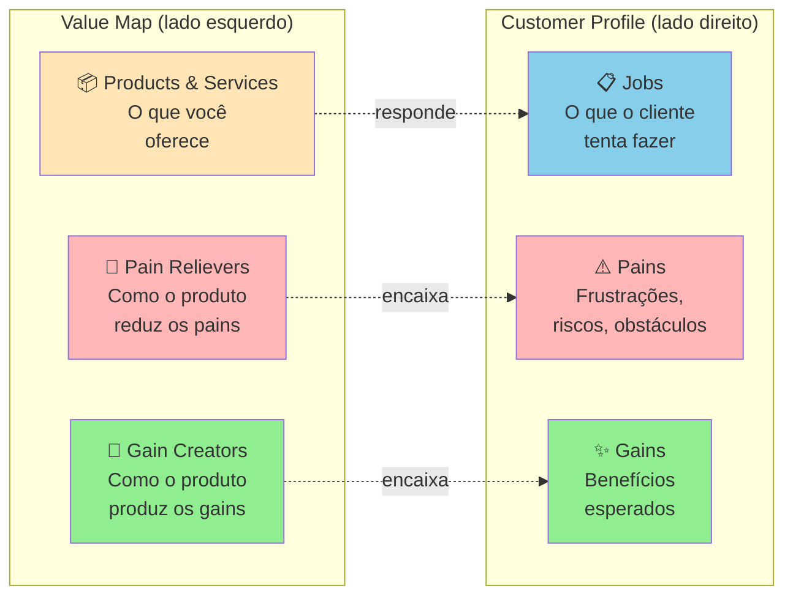

O **Customer Profile** mapeia o cliente em três dimensões: Jobs (tarefas funcionais, sociais, emocionais que tenta cumprir), Pains (o que o frustra, prejudica, ameaça) e Gains (o que ele deseja, espera, sonha). O **Value Map** mapeia o produto em três dimensões espelhadas: Products & Services (o que você oferece), Pain Relievers (como o produto alivia os pains do cliente) e Gain Creators (como o produto produz os gains).

O **fit** acontece quando os Pain Relievers correspondem a Pains reais e os Gain Creators correspondem a Gains que o cliente realmente valoriza. Pain Relievers sem Pain correspondente = features inúteis. Pains sem Pain Reliever = motivos de churn.

##### O momento exato de colocar este canvas na parede

Use o VPC depois de fazer pesquisa qualitativa real (Fase 4: entrevistas em profundidade, observação em campo, análise de jornada). É a ferramenta certa para tornar o Dossiê do Usuário (saída da Fase 4) acionável: cada persona vira um Customer Profile, e o produto que está sendo desenhado vira o Value Map. Use também como ferramenta de auditoria: revisitar o VPC a cada três meses pós-MVP revela features que viraram Pain Relievers órfãos (sem Pain real) ou Pains que ficaram sem Pain Reliever construído.

##### As regras de ouro para preencher sem se enganar

A tese de Osterwalder é que **proposta de valor não é o que você diz que o produto faz, é a correspondência verificável entre as frustrações/desejos do cliente e o que o seu produto efetivamente alivia/entrega**. Fit não se presume, verifica-se com entrevistas, testes, observação. A falha mais comum em startup não é "produto ruim", é produto bom atacando problema que o cliente não considera importante. O VPC força essa verificação tornando explícita cada conexão.

##### Passo a passo na parede da sala (roteiro de oficina colaborativa)

**Etapa 1: Customer Profile (sempre primeiro).** Reúna o que você aprendeu na Fase 4. Para a persona escolhida, liste:

- **Jobs** (5-10): o que ela tenta fazer? Funcionais ("conciliar pagamentos do dia"), sociais ("parecer profissional para a equipe"), emocionais ("ter paz antes de dormir").
- **Pains** (5-10): o que dói? Pode ser frustração ("isso demora 3 horas"), risco ("se eu errar, perco o cliente"), obstáculo ("não tenho como integrar").
- **Gains** (5-10): o que ela quer? Esperados ("uma forma de fazer mais rápido"), desejados ("relatório que impressione o chefe"), inesperados ("automação que eu não sabia ser possível").

**Importante**: NÃO INVENTE. Cada item deve poder ser citado de uma entrevista, observação ou diário de usuário documentado. Customer Profile com Jobs/Pains/Gains intuitivos = VPC teórico.

**Etapa 2: Value Map.** Liste:

- **Products & Services**: o que você está construindo (ou planeja construir).
- **Pain Relievers**: para cada Pain do cliente, como o produto alivia? Seja específico.
- **Gain Creators**: para cada Gain, como o produto produz? Idem.

**Etapa 3: Avaliação de fit.** Cada Pain tem Pain Reliever correspondente? Cada Gain tem Gain Creator? Se há Pains sem cobertura, são oportunidades não endereçadas. Se há Pain Relievers sem Pain real, são features potencialmente desperdiçadas.

Tempo dedicado à oficina: 2 a 4 horas para construir a primeira versão completa (após concluir a pesquisa de campo). Cada segmento merece VPC próprio.

##### Exemplo brasileiro preenchido: Wellhub (Gympass) em 2016, B2B (reconstrução didática com base em dados públicos)

**Customer Profile**: Head de RH de empresa média (200-1000 funcionários):

| Jobs | Pains | Gains |
|---|---|---|
| Oferecer benefício que ajude retenção | Caro contratar academia única que não atende todos | Retenção mensurável melhor |
| Gerenciar programa de bem-estar sem overhead | Funcionários pedem academia mas subsídio direto é complicado (tributário, equidade) | Marca empregadora fortalecida |
| Prestar contas à diretoria sobre ROI | Difícil medir uso real e impacto em produtividade | Dados de engajamento para C-level |
| Atender perfis diversos (academia, yoga, crossfit) sem caos | Negociar com múltiplos fornecedores consome tempo | Benefício percebido sem esforço administrativo |

**Value Map**: Wellhub (Gympass) o que oferecia em 2016:

| Products & Services | Pain Relievers | Gain Creators |
|---|---|---|
| Plataforma empresarial com acesso a milhares de academias via assinatura | Uma assinatura única cobre todas academias (flexibilidade sem multiplicação de contratos) | Benefício percebido pelo funcionário gera retenção mensurável |
| Dashboard de uso para RH | Plataforma administra matrícula, pagamento, cancelamento (zero overhead) | Oferta diversa atende perfis diferentes |
| App para funcionário escolher academia | Benefício corporativo estruturado com apoio jurídico para mitigar risco trabalhista e previdenciário (tema que exige validação contábil em cada empresa) | Dados de uso para relatórios executivos sobre engagement e ROI |
| Suporte para RH e funcionário | Negociação consolidada com uma empresa só (em vez de 50 academias) | Fortalecimento da marca empregadora |

**Análise de fit.** Encaixe forte entre quase todos os Pains/Gains e os Pain Relievers/Gain Creators. Note que a oferta da Wellhub não inova radicalmente: apenas elimina as fricções específicas que o RH enfrentava no modelo tradicional (negociar com cada academia, gerenciar reembolsos, justificar tributariamente, medir uso). **A lição: value proposition forte não exige features impressionantes, exige fit preciso entre o que o cliente sofre e o que você alivia.**

##### Variações e extensões

- **Diagrama das Quatro Forças de Troca** (Bob Moesta) e **JTBD Canvas** (Jim Kalbach): detalham as forças que impulsionam ou travam a migração (push, pull, ansiedade e hábito), aplicadas diretamente no Template: Entrevista com Switcher mais adiante nesta fase.
- **Empathy Map** (Fase 4): complementar ao Customer Profile, foca em estados internos do cliente (pensa/sente/vê/ouve).
- **VPC for Multi-Sided Markets**: marketplaces fazem um VPC para cada lado (oferta e demanda).

##### Onde os fundadores mentem para si mesmos neste canvas

- Preencher Customer Profile com intuições em vez de dados reais: VPC teórico não representa mercado.
- Fazer VPC genérico para "todos os clientes": segmentos diferentes têm Jobs/Pains/Gains diferentes; cada segmento merece VPC próprio.
- Inflar Gain Creators: listar benefícios que o produto teoricamente poderia entregar mas não entrega ainda.
- Ignorar Pains sem Pain Reliever correspondente: essas lacunas são frequentemente os motivos reais de churn.
- Confundir Products & Services (o que você constrói) com Pain Relievers (como alivia uma dor específica): o primeiro é descritivo, o segundo é causal.

---

#### Canvas: Customer Journey Canvas

##### Por que este quadro visual foi criado

O Customer Journey Map / Canvas surgiu da convergência de três escolas em meados dos anos 2000: design thinking (IDEO, Stanford d.school), service design (a consultoria londrina Livework, fundada por Lavrans Løvlie, Ben Reason e Chris Downs, ao lado da tradição nórdica de marketing de serviços) e experiência do cliente (Forrester, escola de CX corporativo). Não tem autor único: virou padrão de prática colaborativa entre 2008 e 2015, com formalização no livro *This Is Service Design Doing* (Marc Stickdorn et al., 2018). A motivação foi observação recorrente: empresas otimizavam touchpoints isolados (home page, atendimento, cobrança) sem ver a jornada inteira do cliente, e o resultado eram experiências fragmentadas onde cada ponto funcionava isolado mas o conjunto deixava o cliente confuso ou frustrado.

##### A anatomia visual de uma página

Tela visual organizada em **eixo horizontal de tempo** (fases da jornada do cliente, da descoberta ao pós-uso) e **eixo vertical de dimensões** (seis a sete camadas, alinhadas ao Passo 3: incluindo as ferramentas atuais):

- **Etapa**: nome curto da fase (Descoberta, Consideração, Compra, Onboarding, Uso, Suporte, Renovação).
- **Ação**: o que o cliente faz nessa etapa (concretamente, clica, abre app, liga, fala com).
- **Objetivo**: o que ele tenta cumprir.
- **Pontos de Dor**: onde algo dá errado, demora, frustra.
- **Emoções**: o que ele sente (ansiedade, alívio, raiva, tédio, entusiasmo).
- **Oportunidades**: onde existe espaço para intervenção.

Versões mais avançadas adicionam: ferramentas/canais usados, métricas de sucesso por etapa, KPIs internos, owners do touchpoint, dados quantitativos (NPS por etapa, conversão).

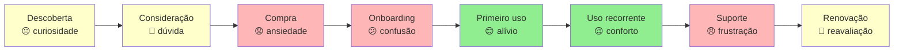

A linha emocional (verde alto / amarelo neutro / vermelho baixo) ao longo da jornada é o output mais valioso: pontos vermelhos consecutivos antecipam churn; pontos verdes isolados cercados de vermelho são "experiências boas no contexto errado".

##### O momento exato de colocar este canvas na parede

Use o Customer Journey Canvas na Fase 4 (pesquisa) como entregável central: junto com personas e VPC. Use também a cada 12 meses como auditoria operacional pós-PMF: a jornada que funcionava em 2024 frequentemente não funciona em 2026 porque mudaram canais (TikTok, WhatsApp), expectativas (resposta em segundos), regulação (LGPD, Pix). Em momentos de pivô (ver Capítulo 16 do Volume 4), refaça o mapa da jornada antes de qualquer novo investimento operacional.

##### As regras de ouro para preencher sem se enganar

A tese é que **experiência do cliente é uma fita contínua, não pontos isolados**. Times divididos por função (marketing, vendas, sucesso, produto, suporte) tendem a otimizar suas próprias caixinhas e ignorar transições entre etapas. O Customer Journey Canvas força olhar a fita inteira e identificar **o ponto mais fraco**: porque a experiência do cliente é tão boa quanto o pior elo. Cliente que teve compra fácil mas onboarding caótico não fica; cliente que teve onboarding ótimo mas suporte distante churna na primeira dúvida real.

##### Passo a passo na parede da sala (roteiro de oficina colaborativa)

Pré-requisito nesta Fase 5: 8 a 15 entrevistas e observações em campo (em empresas já em operação no Volume 4, somam-se dados de analytics e satisfação). Reúna os cofundadores e quem participou das sessões de pesquisa. Tempo: 3-4 horas para a primeira versão.

1. **Defina escopo da jornada**: começo e fim. Comece **antes** do ponto óbvio: se você é SaaS, jornada começa quando cliente percebe o problema, não quando entra no site.
2. **Liste etapas**: 5-10 etapas nomeadas. Use vocabulário do cliente, não interno ("Considera comprar" não "Lead Qualificado").
3. **Para cada etapa**, preencha as 6 dimensões com base em verbatim e dados.
4. **Trace a linha emocional**: atribua emoção dominante a cada etapa.
5. **Identifique pontos críticos**: onde a emoção cai abruptamente, onde há atrito sistemático, onde o cliente abandona.
6. **Liste oportunidades**: para cada ponto crítico, 1-3 intervenções possíveis. Prioriza pelo impacto na linha emocional, não pelo custo de implementação.

Após primeira versão, **valide com 3-5 clientes reais**: peça que olhem o mapa e apontem onde discordam. Customer Journey desenhado sem validação é frequentemente "como queremos que seja", não "como é".

##### Exemplo brasileiro preenchido: iFood, jornada de primeira compra (2017) (reconstrução didática com base em dados públicos)

Em 2017, o iFood mapeou a jornada de primeira compra para entender por que 40% dos novos cadastros não completavam pedido inicial. O canvas:

| Etapa | Ação | Objetivo | Dor | Emoção | Oportunidade |
|---|---|---|---|---|---|
| **Gatilho** | Sente fome às 19h, vê amigo pedindo via app | Resolver fome rápido | "Será que tem o que eu quero?" | Curiosidade | Hero card mostrando opções na cidade do usuário |
| **Descoberta** | Baixa app, abre primeira vez | Ver o que tem por perto | Tela inicial mostra muitos restaurantes: paralisia de escolha | Sobrecarga | Curadoria "mais pedidos hoje", reduzir opções iniciais |
| **Cadastro** | Preenche nome, email, telefone, endereço | Concluir cadastro rápido | Confirmação de SMS demora, formulário pede CPF (não obrigatório) | Frustração | Reduzir cadastro para email + senha + endereço; CPF só na compra |
| **Busca** | Filtra por categoria ou busca restaurante | Achar comida que quer | Restaurantes que não entregam no endereço aparecem | Decepção | Filtrar por entrega real antes de mostrar |
| **Cardápio** | Abre restaurante, navega cardápio | Escolher prato | Foto baixa qualidade, descrição inconsistente, preço sem ICMS visível | Dúvida | Padronização de cardápios + preço final na lista |
| **Carrinho** | Adiciona itens, vê total | Conferir antes de pagar | Taxa de entrega aparece tarde, "valor mínimo" surge surpresa | Irritação | Mostrar taxa e mínimo desde o cardápio |
| **Pagamento** | Escolhe forma, confirma | Pagar e fechar pedido | Cartão recusado sem explicação, 2FA do banco demora | Ansiedade alta | Em um aplicativo de delivery (exemplo ilustrativo), habilitar Pix com QR Code imediato, carteira digital e pagamento na maquininha na entrega como alternativas ao cartão online, mostrar erro específico por tipo ("cartão sem limite" vs "dados incorretos" vs "banco bloqueou"), salvar tentativas no carrinho |
| **Espera** | Acompanha entrega no mapa | Saber quando chega | Mapa não atualiza em tempo real nos primeiros 10min | Inquietação | Streaming de status mais granular, comunicação proativa de atrasos |
| **Recebimento** | Recebe entrega, avalia | Comer e avaliar | Pedido errado / faltando item: sem caminho claro de queixa | Raiva | Botão "tem problema?" no mesmo card do pedido |
| **Pós-uso** | Recebe email pedindo nota | Avaliar (se lembrar) | Email genérico chega 3 dias depois | Apatia | Pedir nota in-app logo após entrega, com 1-tap |

A jornada revelou que **a maior queda de conversão acontecia entre Pagamento e Espera**: clientes davam tudo certo até o pagamento, e quando o cartão era recusado sem explicação, abandonavam. Isso levou a três decisões: (1) adicionar débito em conta e boleto bancário como alternativas ao cartão recusado: formas de pagamento mais acessíveis para o ICP em 2017; (2) mensagens de erro específicas ("cartão sem limite" vs "dados incorretos" vs "banco bloqueou"); (3) salvar carrinho mesmo após falha: cliente não precisava recomeçar do zero. **A lição: Customer Journey Canvas frequentemente revela que o problema não está onde a equipe achava (qualidade de cardápio? variedade?) mas em transição específica que ninguém estava monitorando (o segundo entre "click pagar" e "pedido confirmado").**

##### Variações e extensões

- **Service Blueprint**: extensão do Customer Journey adicionando "linha de visibilidade", o que o cliente vê (frontstage) vs o que acontece nos bastidores (backstage). Útil para ops e suporte.
- **Multi-persona Journey Map**: mesma jornada vista por 2-3 personas distintas (decisor vs usuário em B2B; comprador vs presenteado em B2C).
- **Future-State Journey Map**: jornada como queremos que seja em 12-18 meses, ao lado da atual. Útil para roadmap.

##### Onde os fundadores mentem para si mesmos neste canvas

- Mapear a jornada que a empresa quer (frictionless, lógica) em vez da que existe (fragmentada, cheia de workarounds): desconectado do cliente real.
- Começar muito tarde (no momento da compra): perde o gatilho que define quem chega ao site.
- Tratar como artefato estático: mercados e canais mudam (rise do TikTok como descoberta, do Pix como pagamento, do WhatsApp como suporte); jornada precisa atualização.
- Otimizar pontos isolados sem ver consequências em pontos seguintes: onboarding mais rápido pode produzir mais churn em 30 dias.
- Não medir: Customer Journey sem dados é hipótese; precisa NPS por etapa, conversão entre etapas, tempo médio em cada etapa.

---

### TEMPLATES OPERACIONAIS E CASOS PREENCHIDOS DESTA FASE

#### Template: Persona com dados

**Para que serve.** Sintetiza o ICP em um arquétipo único ancorado em evidência de entrevistas reais, com motivações, frustrações, JTBDs e citação verbatim, em vez de persona inventada de workshop.

**Quando usar.** Após executar 15 a 30 entrevistas de problema (Template da Fase 4) e consolidar a rodada (Template da Fase 4). Atualize sempre que descobrir um novo padrão de comportamento ou que o ICP for refinado por filtragem de anti-perfil.

**Exemplo de preenchimento.** Persona: "Carla, gerente de operações". Contexto: trabalha em uma rede de 12 farmácias regionais e responde direto ao fundador. Motivações: manter a confiança da diretoria e evitar ruptura de medicamentos de giro rápido. Frustrações: fechar o inventário no fim do mês consome um sábado inteiro. Comportamento observado: exporta o relatório do ERP e refaz a conferência no Excel, apesar de o sistema ter módulo de estoque. JTBD: "quando fecho o mês, quero conciliar o estoque físico com o fiscal sem refazer cálculos na mão, para ter meu fim de semana de volta". Citação: "Eu não confio no saldo que o sistema mostra, então confiro tudo na planilha."

```text
PERSONA: [nome fictício]

Contexto profissional/pessoal
___________________________________________

Perfil demográfico
___________________________________________

Motivações principais (do que se importa)
1) _______________________________________
2) _______________________________________

Frustrações principais
1) _______________________________________
2) _______________________________________

Comportamentos observados (não declarados)
1) _______________________________________
2) _______________________________________

Ferramentas/canais/fontes que usa
___________________________________________

JTBDs prioritários
1) Quando _____, eu quero _____, para que _____.
2) Quando _____, eu quero _____, para que _____.

Citação verbatim representativa
"___________________________________________"

Base de evidência: [quantas entrevistas, quais]
```

---

#### Template: Customer Journey Map — compra em e-commerce brasileiro

> [!note] Compatibilidade: tipo journey, renderiza com plugin Mermaid atualizado

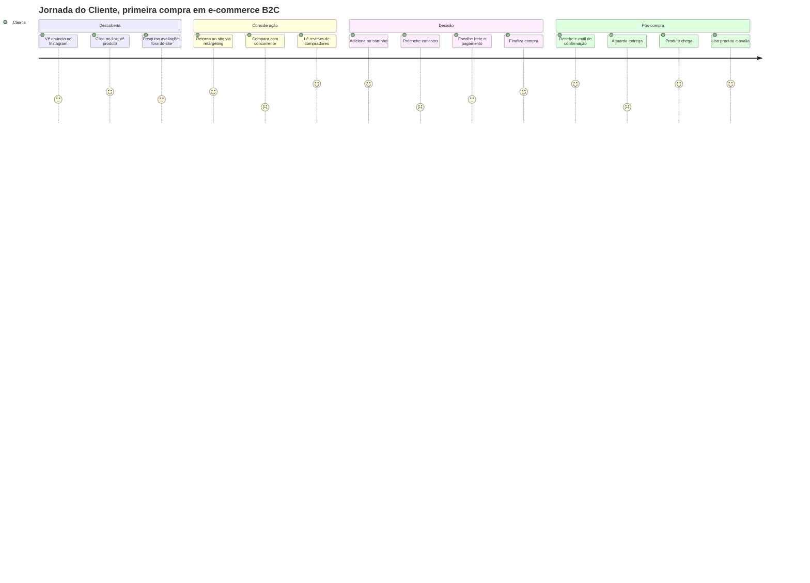

**Uso:** mapas de jornada revelam pontos de fricção (notas baixas) que exigem investigação. Neste exemplo, "comparar com concorrente" e "preencher cadastro" e "aguardar entrega" são as fricções mais dolorosas, candidatas a otimização prioritária.

---

#### Template: Entrevista com Switcher (JTBD, entrevista de troca)

> [!important] Disciplina central
> Esta entrevista **só se aplica a quem trocou**: deixou um concorrente, largou um processo manual, migrou de ferramenta, mudou de fornecedor. O foco **não é** na rotina atual nem na dor genérica: é no **momento específico** em que a pessoa decidiu que o velho não servia mais. Sem um switch real para investigar, use o Template: Entrevista de Problema (Fase 4).

A Switch Interview é o instrumento da escola JTBD de Bob Moesta para reconstruir o momento da decisão. Pareia diretamente com a Fase 5, onde JTBDs são formulados pela primeira vez. Use quando entrevistados na rodada da Fase 4 mencionarem que trocaram recentemente de ferramenta ou fornecedor: esses entrevistados merecem uma segunda conversa, agora estruturada pelas 4 forças (push, pull, anxiety, habit). Como os outros templates da família, tem Parte A (roteiro durante) e Parte B (síntese pós).

##### Parte A — Roteiro da Entrevista (uso durante a conversa)

**Duração alvo:** 45-60 min · **Balanço de fala:** o entrevistado fala a maior parte do tempo. Se você se pegar falando mais que ele em qualquer trecho de 5 minutos, volte a fazer perguntas abertas.

**Abertura (2 min)**

> "Oi, obrigado pelo tempo. Estou pesquisando como pessoas como você decidiram trocar de [categoria antiga] para [categoria nova]. Não estou te vendendo nada: quero entender a história dessa decisão em detalhe, o que estava acontecendo antes, o que mudou, como foi. Posso gravar?"

**Linha do tempo da troca (15 min).** *O coração da Switch Interview: reconstruir a timeline específica, de trás pra frente. A pessoa comprou uma coisa nova num momento específico. Quando foi? O que estava acontecendo antes?*

- Quando você começou a usar [nova solução]?
- Antes dela, o que você usava? Por quanto tempo?
- Quando foi a **primeira vez** que você pensou "isso aqui não está funcionando"? Me conta essa cena.
- Entre esse momento e quando você realmente trocou, quanto tempo passou?
- O que aconteceu nesse meio-tempo?

**O momento do empurrão (push): 10 min.** *O que estava acontecendo com a solução antiga que empurrou a pessoa pra fora dela?*

- Me conta a gota d'água. Qual foi o episódio específico?
- Antes dessa gota, o que te irritava no dia a dia da [solução antiga]?
- Tinha algo que você fazia pra contornar o problema? O que?
- Você reclamou com alguém? Com quem? O que eles disseram?

**O momento da atração (pull): 10 min.** *O que puxou a pessoa pra nova solução? Como ela soube que existia?*

- Como você conheceu [nova solução]? Foi busca ativa ou veio até você?
- O que chamou sua atenção no primeiro contato?
- O que você **imaginava** que a nova solução ia fazer por você? (Essa imagem mental, lá atrás.)
- Chegou a considerar outras opções nessa hora? Quais? Por que essas?

**Ansiedades e hábitos (10 min).** *As duas forças de resistência: medo da mudança (ansiedade) e inércia do jeito antigo (hábito).*

- O que te preocupava sobre trocar?
- Teve algum momento em que você quase desistiu da troca? O que trouxe você de volta?
- Que parte da rotina antiga você sentiu falta depois?
- Alguém foi contra a troca? Como você lidou?

**Implementação e resultado (8 min)**

- Como foi a primeira semana com a nova solução?
- Faltou algo que você esperava e não veio?
- Hoje, retrospectivamente, a troca valeu? Em que medida?
- Em que condições você voltaria pra solução antiga?

**Encerramento (3 min)**

- Tem outras pessoas que passaram por troca parecida e que eu poderia conversar?
- Posso voltar se surgirem mais perguntas?

**NÃO PERGUNTAR**

- "Se a [nova solução] tivesse [feature X], seria melhor?": *hipótese futura, contamina dado.*
- "O que você acharia de um produto que fizesse Y?": *apresentação de ideia disfarçada.*
- "Por que você escolheu?" em genérico: *pergunta muito aberta gera racionalização pós-hoc.*

##### Parte B — Síntese Pós-Entrevista

###### Metadados

| Campo | Valor |
|---|---|
| **ID** | `JTBD-[AAAA-MM-DD]-[##]` |
| **Data e hora** | `[DD/MM/AAAA]` |
| **Duração real** | `[min]` |
| **Formato** | `[ ] Remoto  [ ] Presencial` |
| **Gravação (com consentimento)** | `[link]` |
| **Transcrição** | `[link]` |
| **Entrevistador** | `[Nome]` |

###### Perfil e contexto da troca

| Campo | Valor |
|---|---|
| **Nome / empresa do entrevistado** | `[...]` |
| **Papel / cargo** | `[...]` |
| **Porte do negócio** | `[nº funcionários / faturamento / estágio]` |
| **Localização** | `[cidade / estado / país]` |
| **Solução antiga** | `[o que usava antes: nome específico, não categoria]` |
| **Solução nova** | `[para onde migrou]` |
| **Data da troca** | `[mês/ano]` |
| **Tempo na solução antiga antes de trocar** | `[...]` |
| **Tempo na solução nova até hoje** | `[...]` |
| **Decisor da troca** | `[ela mesma / chefe / time / comitê]` |

###### 1. Timeline da troca

> *Reconstrua em 4 marcos. Seja específico com datas, episódios, gatilhos. A timeline é o núcleo da Switch Interview.*

| Marco | Quando | O que aconteceu |
|---|---|---|
| **Primeiro pensamento** ("isso não está funcionando") | `[...]` | `[...]` |
| **Evento de ativação** (gota d'água) | `[...]` | `[...]` |
| **Decisão de trocar** | `[...]` | `[...]` |
| **Primeira utilização da solução nova** | `[...]` | `[...]` |

**Intervalo entre "primeiro pensamento" e "decisão de trocar":** `[quanto tempo passou? o que aconteceu no meio?]`

###### 2. As quatro forças (Moesta)

> *Toda troca é resultado de quatro forças simultâneas. Duas empurram para fora do velho e atraem para o novo (push e pull); duas resistem à troca (anxiety e habit). Se as forças de mudança não superam as de resistência, não há troca. Esta é a variável central da análise.*

**PUSH: o que empurrou para fora da solução antiga.** `[Falhas, frustrações, episódios específicos. Cite verbatim onde possível.]`

- `[...]`
- `[...]`
- `[...]`

**PULL: o que atraiu para a solução nova.** `[O que a pessoa imaginava que ganharia. Promessa percebida, não funcionalidade listada.]`

- `[...]`
- `[...]`
- `[...]`

**ANXIETY: o que causou ansiedade sobre trocar.** `[Medos, riscos percebidos, objeções de stakeholders. O que quase fez desistir.]`

- `[...]`
- `[...]`

**HABIT: a inércia do jeito antigo.** `[Conforto com rotina conhecida, sunk cost, relacionamentos, dados históricos.]`

- `[...]`
- `[...]`

###### 3. Conjunto de comparação (comparison set)

> *O que a pessoa comparou antes de escolher? A "categoria concorrente" do ponto de vista dela frequentemente não é o que a gente presume. Às vezes nossa concorrência real é Excel + WhatsApp, não o competidor óbvio.*

| Opção considerada | Como soube dela | Por que descartou |
|---|---|---|
| `[nova solução escolhida]` | `[...]` | *(escolhida)* `[por quê?]` |
| `[alternativa A]` | `[...]` | `[...]` |
| `[alternativa B]` | `[...]` | `[...]` |
| `[status quo: ficar com a antiga]` |: | `[por que não ficou?]` |

###### 4. Job to be Done formulado

> *Com base nas 4 forças e no comparison set, formule o job que a pessoa estava contratando a solução nova para cumprir. Estrutura: "Quando [situação], eu quero [motivação], para que [resultado esperado]."*

**Formulação:** `Quando [...], eu quero [...], para que [...]`

**Evidência direta que sustenta essa formulação:** `[cite verbatim ou descreva episódio específico]`

###### 5. Verbatim (citações literais)

1. > *"[citação sobre o push]"*
2. > *"[citação sobre o pull]"*
3. > *"[citação sobre ansiedade]"*
4. > *"[citação sobre a gota d'água]"*

###### 6. Vocabulário do cliente

| Como a pessoa chamou | Contexto |
|---|---|
| `[palavra / expressão exata]` | `[o que descrevia]` |

###### 7. Observações do entrevistador

*`[leitura de linguagem corporal, tom, hesitações, momentos de energia alta/baixa]`*

*`[...]`*

###### 8. Racionalização vs. razão real

> *Pessoas reconstroem as próprias decisões depois que tomam. O que ela diz hoje que foi o motivo pode ser racionalização pós-hoc. Confronte: a razão declarada bate com a timeline reconstruída?*

- **Razão declarada pela pessoa:** `[...]`
- **O que a timeline sugere que foi o motivo real:** `[...]`
- **Divergem?** `[ ] Sim  [ ] Não`: *se sim, descreva a diferença e explique o que a pessoa pode estar racionalizando.*

###### 9. Calibração da nossa narrativa

> *O que esta entrevista faz com a nossa tese de por que as pessoas trocam? Toda Switch Interview deveria mexer em algum dos quatro vetores. Se não mexer, revise a análise.*

- **Push que subestimamos:** `[...]`
- **Pull que estávamos usando e não ressoou:** `[...]`
- **Anxiety que não tínhamos mapeado:** `[...]`
- **Habit mais forte do que imaginávamos:** `[...]`

**Implicação para o posicionamento / mensagem / onboarding:** `[...]`

###### 10. Armadilhas — autoavaliação pós-entrevista

- [ ] Perguntei sobre hipótese futura ("se tivesse X…")?
- [ ] Aceitei a primeira explicação ("troquei porque é melhor") sem pedir o episódio específico?
- [ ] A timeline tem buracos grandes que eu não investiguei?
- [ ] Falei mais de 20% do tempo?
- [ ] Confundi o que ela disse hoje com o que ela pensava na hora da decisão?

**Achados sob suspeita:** `[...]`

###### 11. Indicações (snowball)

- **Outras pessoas que fizeram troca parecida:** `[...]`
- **Posso voltar?** `[ ] Sim  [ ] Não`
- **Topa ver algo que estamos construindo em 30-60 dias?** `[ ] Sim  [ ] Não`

###### 12. Próximos passos de investigação

> *Perguntas novas geradas por esta Switch Interview que informam próximas conversas ou pesquisa externa. Switch Interviews tipicamente geram dois tipos de pergunta: padrões a verificar em outros switchers (a timeline desse cara bate com a do próximo?) e dados de mercado a buscar (qual é o volume real de quem troca, qual é o ciclo médio de decisão no segmento).*

**Perguntas a incluir em próximas Switch Interviews.**

- `[...]`
- `[...]`

**Dados a buscar externamente (mercado, comparação, benchmark).**

- `[...]`
- `[...]`

**Perfis diferentes a entrevistar para cruzar padrões de troca.** `[...]`

###### Anexos

- Gravação: `[link]`
- Transcrição: `[link]`
- Artefatos compartilhados: `[link]`
- Switch Interviews relacionadas: `[JTBD-..., JTBD-...]`

*Preenchido por `[Nome]` em `[DD/MM/AAAA]`.*

---

### Fechamento da Fase 5: o que muda na sua cabeça e na sua empresa a partir de agora

Camila só entendeu o que travava a agenda da clínica odontológica na Savassi quando saiu de trás da mesa, sentou na recepção e ouviu o que os pacientes faziam antes de marcar a consulta. Faça o mesmo: entrevistas entregam o discurso declarado, mas só a observação do trabalho real mostra onde mora a inércia e qual gambiarra você precisa superar.

O entregável é o Dossiê do Usuário. Personas baseadas em dados reais, não em intuição. Jornadas mapeadas com momentos críticos identificados. Lista clara de jobs. Esse dossiê é insumo das Fases 9 e 10 (ideação, prototipagem e testes de solução, no Volume 3).

A [[#FASE 6 — MAPEAMENTO DE MERCADO E CONCORRÊNCIA|Fase 6]] vai usar esse material para posicionar a oportunidade dentro da paisagem competitiva real: quem são os concorrentes, onde está a cunha de entrada, por que o cliente trocaria a alternativa atual por você. Quem ignora a Fase 5 e pula para "vamos construir" entra na construção sem entender quem vai usar nem em que circunstância. O resultado é produto bem-feito tecnicamente e ignorado por quem deveria adotar.

---

## FASE 6 — MAPEAMENTO DE MERCADO E CONCORRÊNCIA

### A Ilusão do TAM de Bilhões e a Arte de Dominar um Lago Pequeno

Henrique entrou na sala do diretor industrial de uma grande usina no interior do Paraná (depois de usar o mesmo argumento diante de uma banca de fomento e de um fundo de capital de risco) com o slide que todo consultor adora: *"O PIB do agronegócio brasileiro gira na casa dos trilhões de reais por ano (cerca de R$ 2,6 trilhões nas séries recentes do Cepea/USP-CNA); se capturarmos apenas 1% desse mercado, teremos uma empresa de R$ 26 bilhões"*. O gestor do fundo fechou o notebook antes de Henrique passar para o próximo slide:

– "Henrique, '1% de um mercado trilionário' é a frase mais cara e mais vazia do empreendedorismo. Quem tenta vender para o agronegócio inteiro no dia um morre sem caixa no mês oito. Diga-me qual é a cidade de cinquenta mil habitantes no Mato Grosso onde 60% das usinas de etanol de milho não conseguem viver sem o seu sensor amanhã de manhã."

O choque daquela tarde salvou a empresa de Henrique. Como Peter Thiel ensina, todo grande monopólio começa dominando de forma avassaladora um submercado minúsculo e aparentemente entediante, enquanto quem tenta abraçar o mercado inteiro de uma vez naufraga na **Ilusão do TAM de Bilhões** (armadilha de dimensionamento top-down que retomaremos nos antipadrões e no autodiagnóstico desta fase). Quando você diz que seu produto serve para "qualquer pequena e média empresa do Brasil", você está confessando que seu produto é medíocre demais para resolver a dor visceral de alguém específico.

Pense na Amazon vendendo apenas livros físicos pela internet em 1995, ou na Creditas (fundada por Sergio Furio em 2012 ainda como BankFacil), que começou focada em crédito com garantia de imóvel e de veículo enquanto os grandes bancos concentravam sua oferta em linhas pessoais sem garantia de juros altos. Como mostrou Geoffrey Moore na metáfora da pista de boliche (*Crossing the Chasm*, 1991), uma cunha estratégica não é o seu teto; é o seu primeiro pino da fila Na Fase 6, você vai parar de admirar o oceano pela luneta e escolher o único pino de boliche frontal que, quando derrubado com violência cirúrgica, derrubará todos os outros atrás dele.

---

> [!question] FMF Check da Fase 6
> Você está escolhendo cunha neste momento. Pergunta: o seu fit particular com esta cunha é diferencial inimitável, ou é circunstancial? Se a resposta for "outra pessoa qualquer faria tão bem quanto", reavalie. Founder-market-fit é o que faz o próximo ano de dificuldade valer a pena. É a única coisa que diferencia quem persiste de quem desiste no mês 14.

### Por que competir de frente com incumbentes em um mercado amplo é suicídio de caixa

Empreendedores apaixonados tendem a acreditar que "não há concorrentes", ou que "o mercado é enorme". Ambas as afirmações são quase sempre falsas. O mapeamento de mercado força você a enxergar a realidade competitiva. Existem soluções (mesmo que ruins). Existem substitutos (incluindo "fazer nada"). Existem players (concorrentes e participantes do mercado) grandes que podem te copiar. Existe regulamentação que pode te inviabilizar.

Sem esse mapa, você empreende às cegas. Com ele, você toma decisões informadas sobre posicionamento, diferenciação, e estratégia.

### A matemática de baixo para cima (Bottom-Up) e o desenho da cunha de entrada

Onze passos. Os Passos 1 a 9 cobrem o levantamento de mercado e a síntese do Dossiê. Os Passos 10 e 11, Construção do Canvas da Cunha e Teste de Estresse, aparecem mais adiante na fase, logo após a catraca de saída, o estudo de caso real e as armadilhas da etapa, em virtude do volume. São a parte central e operacionalmente mais importante do método; leia-os como continuação direta do passo a passo.

#### Passo 1, defina o mercado corretamente

Mercado é a interseção concreta de três elementos: tipo de cliente, problema resolvido e recorte geográfico (termos amplos como "software" ou "restaurantes" são apenas setores). Por exemplo: "software de gestão de caixa para restaurantes de pequeno porte em capitais brasileiras que fazem delivery próprio". Isso é um mercado que pode ser estimado.

#### Passo 2, estime o tamanho do mercado (TAM, SAM, SOM)

TAM (mercado total disponível) é o tamanho total do mercado global para o problema. É o teto absoluto.

SAM (mercado que você pode alcançar) é a parte do TAM que a sua empresa pode realisticamente atender: geograficamente, tecnologicamente, regulatoriamente.

SOM (mercado que você pode capturar realisticamente) é a parte do SAM que você pode conquistar nos primeiros três a cinco anos. Deve ser calculado de baixo para cima (*bottom-up*) a partir da sua capacidade real de vendas e atendimento nos primeiros 36 meses (tipicamente uma fração inicial de 1% a 5% do SAM no horizonte de três anos).

A visualização em círculos concêntricos:

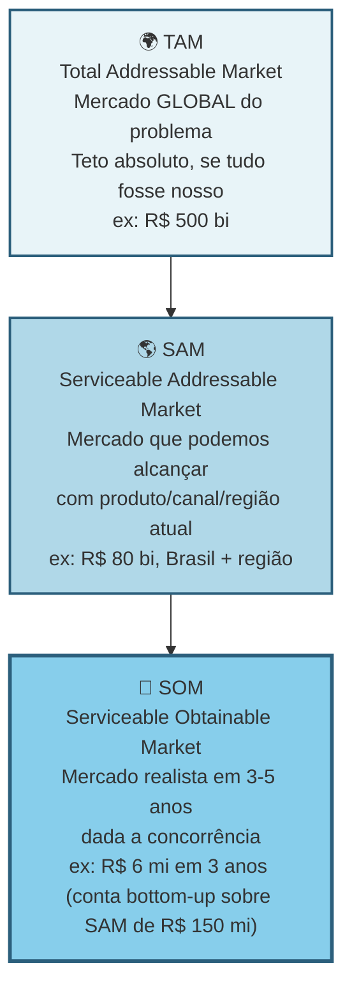

> [!warning] O que investidor checa em TAM/SAM/SOM
> Investidor checa consistência. TAM otimista sem SOM realista é sonho. SOM ambicioso sem TAM que sustenta é conta que não fecha. Estime bottom-up (de baixo para cima: número de clientes vezes ticket), não só top-down (de cima para baixo: percentual de mercado externo).

Calcule top-down e bottom-up, e compare. Top-down: dados de mercado públicos (IBGE, Abrasel, associações, relatórios pagos como Statista e Gartner, se acessíveis). Bottom-up: número estimado de clientes vezes a receita anual média por cliente.

Se os dois números divergem muito, há algo errado em uma das estimativas. Investigue.

#### Passo 3, identifique todas as alternativas atuais do usuário

Categorize em quatro grupos.

Concorrentes diretos. Outras soluções que resolvem o mesmo problema da mesma forma. Por exemplo, outros softwares da mesma categoria.

Concorrentes indiretos. Soluções que resolvem o mesmo problema de forma diferente. Por exemplo, planilha de Excel, caderno físico, contador terceirizado.

Substitutos. Ações que eliminam o problema. Por exemplo, o dono decide não oferecer delivery, e evita o problema.

Status quo, ou seja, a inércia de "não fazer nada" e continuar convivendo com o problema. É o concorrente mais subestimado pelos fundadores: nas análises pós-morte da CB Insights, a falta de necessidade real que tire o cliente da inércia aparece entre 35% e 42% dos casos.

> [!important] Sua concorrência real raramente é outra startup
> A concorrência real é o jeito que o trabalho é feito hoje. O Excel do auxiliar administrativo. O grupo de WhatsApp onde o gerente despacha ordens. A planilha que ninguém entende mas todo mundo respeita. O hábito silencioso de ignorar o problema porque "sempre foi assim". Reconhecer isso muda para onde você direciona a comparação competitiva. Você para de comparar features com "a Startup X" e começa a comparar a sua proposta com o comportamento atual do cliente. É nesse comportamento que mora a urgência (ou a falta dela).

Os concorrentes indiretos costumam cair em quatro categorias operacionais que precisam ser mapeadas em detalhe:

- **Planilhas** (Excel, Google Sheets, Airtable). Flexíveis, familiares, baixo custo percebido ("já pago por Office"), mas manuais, propensas a erro, fragmentadas por pessoa, sem trilha de auditoria. Sinal de oportunidade: o cliente tem uma planilha-mãe com quinze ou mais abas que só ele entende, e entra em pânico quando pensa em sair de férias.
- **Cadeias de e-mail e WhatsApp de trabalho**. Fragmentadas, difíceis de rastrear, informação dispersa em caixas de entrada. Sinal de oportunidade: o cliente perde informação importante em e-mails antigos, ou precisa reconstruir o histórico de uma decisão consultando cinco pessoas diferentes.
- **Ferramentas internas construídas ad-hoc**. Sistemas caseiros montados por um técnico ou estagiário, em geral desatualizados, com dívida técnica crescente, dependentes de uma pessoa específica. Sinal de oportunidade: o cliente vive com medo de que "fulano saia" e o sistema pare de funcionar.
- **SaaS estabelecidos resolvendo problema adjacente**. Softwares que o cliente já paga por outro motivo, e que "quase" resolvem o seu problema. É o concorrente mais subestimado. Sinal de oportunidade: o cliente usa quarenta por cento das features de uma ferramenta, e improvisa o resto.

> [!note] Entender por que o consumidor brasileiro tolera soluções ruins é parte da análise competitiva
> No Brasil, inércia de troca é amplificada por desconfiança em novos fornecedores, preferência por relação pessoal e sensibilidade a risco financeiro. O [[#CAPÍTULO 1 — PSICOLOGIA DO CONSUMIDOR BRASILEIRO — COMPORTAMENTO, DECISÃO E CONVERSÃO|Capítulo 1: Psicologia do Consumidor Brasileiro]] explica esses padrões e ajuda a formular o argumento de troca certo para cada perfil de cliente dentro da sua cunha.

> [!important] A pergunta-chave de competição
> Por que a alternativa atual é tolerada? Se a resposta é "porque funciona suficientemente bem", a sua urgência é fraca, e provavelmente você não tem cunha. Cunhas fortes substituem algo doloroso. Não algo levemente inconveniente. Se os entrevistados descrevem a planilha-mãe rindo ("a minha relação de amor e ódio com aquele Excel maldito"), você tem uma fresta. Se descrevem com indiferença ("funciona, acho"), você não tem.

Para cada alternativa, levante seis dimensões: quem a oferece; preço; pontos fortes e fracos percebidos (use falas diretas das Fases 4 e 5); posicionamento e público-alvo; tempo de mercado; e a pergunta-chave: por que essa alternativa é tolerada hoje?

Se ninguém está reclamando ativamente, procurando substituto, ou alocando tempo para contornar os defeitos, a dor provavelmente não é grande o suficiente para motivar troca. Cunhas fortes substituem coisas que doem, não coisas apenas inconvenientes.

Mapeie pelo menos as cinco a dez alternativas mais relevantes.

> [!note] Monitorar concorrentes não é tarefa pontual: é sistema contínuo
> O [[#CAPÍTULO 2 — INTELIGÊNCIA COMPETITIVA, POSICIONAMENTO E CATEGORY DESIGN|Capítulo 2: Inteligência Competitiva]] cobre como estruturar monitoramento sistemático de mercado, conduzir análises win/loss e produzir battle cards acionáveis. Aplicado a esta fase, transforma o levantamento de alternativas de um documento estático em inteligência viva que alimenta decisões de roadmap e vendas.

> [!tip] Strategy Canvas para visualizar diferenciação
> Listar as alternativas é o primeiro passo. O segundo é decidir como você se posiciona contra elas: e aqui o [[#Canvas: Strategy Canvas (W. Chan Kim & Renée Mauborgne, 2005)|Canvas: Strategy Canvas (W. Chan Kim & Renée Mauborgne, 2005)]] de Kim & Mauborgne (Blue Ocean Strategy: ferramenta para identificar mercados sem concorrência direta) é a escolha certa. Liste 8-15 fatores de competição do setor, trace a curva de valor de cada concorrente principal (1-10 em cada fator) e desenhe a curva nova que você quer construir. Curva nova "ligeiramente acima" da média do setor é otimização de Red Ocean (mercado com muita concorrência). Curva visualmente distinta, onde você elimina/reduz fatores que ninguém mais ousa cortar e cria fatores que ninguém oferece, é Blue Ocean. Veja Canvas: Strategy Canvas (W. Chan Kim & Renée Mauborgne, 2005) (Fase 6) para o caso completo Stone vs adquirentes tradicionais.

#### Passo 4, entenda a dinâmica do mercado

Responda cinco perguntas. O mercado está crescendo, estável, ou encolhendo? (Busque dados dos últimos três a cinco anos.) Existem tendências estruturais? (Digitalização, regulação nova, mudanças demográficas, mudanças de comportamento.) O mercado está concentrado em poucos players grandes, ou é fragmentado? Existem movimentos de consolidação (fusões e aquisições)? Há ciclos sazonais?

#### Passo 5, mapeie os canais de aquisição de clientes usados no setor

Como os players atuais adquirem clientes? Vendas diretas. Parcerias. Marketing digital. Eventos. Boca a boca. Representantes. Isso indica o que provavelmente vai funcionar para você, e onde o custo de aquisição pode ser alto.

> [!tip] Capítulo 1 (Vol. 4): GTM Playbook
> O [[IGNICAO-Vol-4-Tracao-e-PMF#CAPÍTULO 1 — GTM PLAYBOOK E ARQUITETURA DE CANAIS: DA PRIMEIRA VENDA AO PRIMEIRO MILHÃO DE ARR|Capítulo 1: GTM Playbook (Vol. 4)]] aprofunda a tradução desse mapeamento de canais em estratégia de go-to-market operacional: sequenciamento de canais, modelo de cobertura, playbook de vendas e definição de ICP por canal. Use após concluir este passo para transformar o levantamento em plano executável.

#### Passo 6, levante a regulamentação relevante

Se você atua em saúde, finanças, educação, transporte, alimentação, energia, telecom, ou qualquer setor regulado, há normas que podem inviabilizar a sua solução. Busque as regulamentações federais, estaduais, e municipais aplicáveis. Os órgãos fiscalizadores (ANVISA, BCB, ANS, ANTT, CVM, e outros, no Brasil). LGPD, se você trata dados pessoais. Exigências tributárias específicas.

> [!tip] Em dúvida sobre regulação, antecipe
> Invista duas a quatro horas de consultoria jurídica agora. É muito mais barato do que descobrir depois que o seu produto é ilegal.

#### Passo 7, identifique barreiras de entrada e vantagens competitivas sustentáveis

O que impede novos concorrentes (incluindo grandes empresas) de te copiar rapidamente? Economias de escala? Network effects (efeitos de rede)? Dados proprietários? Marca? Switching costs (custo de troca para o cliente)?

> [!warning] Execução não é barreira
> Seja realista. "Execução" não é barreira de entrada. Qualquer um pode executar bem. Barreira é estrutural. É o que existe depois que você sai do escritório.

> [!tip] Canvases Visuais: Network Effects Map (Fase 6)
> Quando o modelo tem componente de rede (marketplaces, plataformas, social, comunidades), o [[#Canvas: Network Effects Map|Canvas: Network Effects Map]] classifica o tipo de efeito (direto, indireto, dados, social) e identifica os limites de defensibilidade. Use ao avaliar moats em modelos de plataforma: efeito de rede é a categoria de moat mais forte e mais difícil de identificar com clareza.

> [!tip] Canvases Visuais: Wardley Map (Fase 19)
> Para análise estratégica em profundidade, o [[IGNICAO-Vol-9-Maturidade-e-Exit#Canvas: Wardley Map|Canvas: Wardley Map (Vol. 9)]] decompõe a cadeia de valor em estágios de evolução (Genesis → Custom → Product → Commodity), mostrando onde vale construir sob medida (componentes que criam diferencial competitivo) e onde comprar pronto como serviço padrão de mercado. Complementa Porter (forças estáticas) com lente temporal (evolução).

#### Passo 8, faça uma matriz competitiva

A matriz competitiva 2x2 dá clareza instantânea de onde você se encaixa. Exemplo genérico:

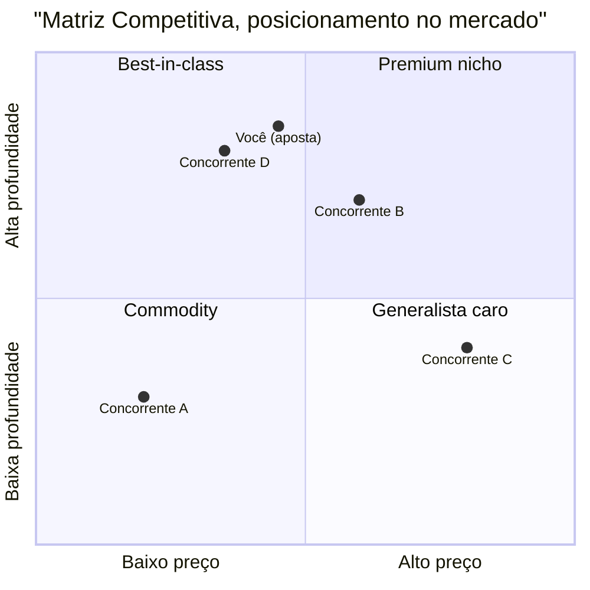

Escolha dois eixos que importam para o ICP, não para você. Preço versus profundidade. DIY versus completo. Generalista versus vertical. Quadrantes cheios indicam disputa direta de preço; quadrantes vazios são apenas hipóteses e exigem validação nas entrevistas da Fase 5 para confirmar se existe demanda real ou se estão vazios porque ninguém paga por aquela combinação. Onde você se posiciona define a sua cunha.

Depois complemente a matriz visual com uma tabela comparando você com três a sete concorrentes principais em cinco a dez dimensões relevantes: preço, features, público-alvo, pontos fortes, pontos fracos, diferenciação declarada.

> [!tip] Capítulo 2: Category Design
> Se a análise da matriz revelar um quadrante vazio em que nenhum player se posiciona, você pode estar diante de uma oportunidade de criar uma categoria nova: não apenas competir melhor dentro das existentes. O [[#CAPÍTULO 2 — INTELIGÊNCIA COMPETITIVA, POSICIONAMENTO E CATEGORY DESIGN|Capítulo 2: Category Design]] cobre como nomear, enquadrar e liderar uma categoria, baseado no framework de Al Ramadan e colegas. Aplicado aqui, transforma o quadrante vazio de dado descritivo em tese estratégica.

> [!note] Posicionamento de marca é uma das saídas desta fase, não só análise competitiva
> A matriz e o canvas da cunha definem onde você compete. O [[IGNICAO-Vol-4-Tracao-e-PMF#CAPÍTULO 4 — BRANDING, POSICIONAMENTO DE MARCA E PRODUCT MARKETING (PMM)|Capítulo 4: Branding e Posicionamento de Marca (Vol. 4)]] complementa ao definir como você quer ser percebido nessa posição: território de marca, promessa central e coerência de identidade. Os dois artefatos (cunha + posicionamento) devem ser desenvolvidos em paralelo.

#### Passo 9, sintetize o Dossiê de Mercado

Documento de dez a vinte páginas. Conteúdo: definição precisa do mercado; TAM, SAM, SOM calculados e justificados; lista de alternativas atuais categorizadas; análise de três a sete concorrentes com fichas detalhadas; matriz competitiva; tendências e dinâmicas relevantes; regulamentação mapeada; barreiras de entrada e possíveis vantagens competitivas; canais de aquisição usados no setor; e a sua hipótese de posicionamento (onde você se encaixa, para quem, contra quem).

### O mapa de guerra do seu mercado de cabeça de praia e a matriz de alternativas reais

Você concluiu a Fase 6 quando todos os critérios abaixo estão cumpridos.

- [ ] Dossiê de Mercado escrito.
- [ ] TAM, SAM, e SOM calculados bottom-up com dados reais (não top-down de relatório genérico), com justificativas explícitas. Para teses voltadas a fundos de capital de risco, demonstre separadamente o SOM inicial de 3 a 5 anos (a cunha de entrada) e a expansão em mercados adjacentes que sustente receita potencial acima de R$ 100 milhões em 7 a 10 anos.
- [ ] De 8 a 12 alternativas mapeadas no total (somando concorrentes diretos, indiretos, substitutos e o status quo), com 3 a 5 concorrentes prioritários aprofundados em fichas de cinco dimensões (preço, posicionamento, ICP, forças/fraquezas e reação provável).
- [ ] CAGR do mercado estimado por duas fontes convergentes. Benchmark: ≥15% (B2B SaaS) ou ≥10% (consumer) sinaliza expansão; abaixo de 5% indica mercado estagnado e exige estratégia diferente.
- [ ] Dispersão competitiva caracterizada (pela heurística prática deste livro, inspirada em índices CR4/HHI do guia do CADE: concentrado quando o líder detém ≥ 40% ou os quatro maiores somam ≥ 70%; moderado na faixa intermediária; e fragmentado quando os cinco maiores somam < 30%). Fragmentado favorece entrada por cunha; concentrado exige diferencial forte ou nicho mal-atendido.
- [ ] Canvas da Cunha (Template: Canvas da Cunha (Fase 6)) preenchido e coerente, com caminho de expansão pós-cunha esboçado em três horizontes.
- [ ] Teste de Precisão do Comprador (Template: Teste de Precisão do Comprador (Fase 6)) aprovado nos três critérios obrigatórios do template (e, como verificação complementar, pelo menos quatro das seis perguntas do checklist de acesso ao comprador).
- [ ] Posicionamento em dimensão não óbvia (não "mais barato" nem "mais features").
- [ ] Regulamentação aplicável investigada, com plano de conformidade.
- [ ] Concorrentes que reagiriam ao seu crescimento identificados, com tipo de reação esperada.
- [ ] Você consegue responder, em uma frase, por que o cliente-alvo trocaria a alternativa atual por você.

> [!warning] Se o último item não tem resposta, pare
> Se você não consegue responder por que o cliente trocaria, ainda não tem diferencial claro. Volte ao Dossiê do Usuário (saída da [[#FASE 5 — PESQUISA COM USUÁRIOS (CUSTOMER DISCOVERY)|Fase 5]]) e ao Mapa de Problemas (saída da [[#FASE 4 — DESCOBERTA DO PROBLEMA|Fase 4]]).

**Primeiros passos práticos.**

1. Abrir o Template Canvas da Cunha (Fase 6) e preencher com a hipótese de segmento inicial.
2. Fazer análise competitiva em planilha. Linhas: cinco a oito concorrentes. Colunas: dimensões (preço, ICP, posicionamento, pontos fortes, pontos fracos, reação potencial).
3. Calcular TAM, SAM, e SOM bottom-up. Número de empresas vezes ticket médio vezes taxa de captura realista em três anos.
4. Aplicar o Teste de Precisão do Comprador (Template: Teste de Precisão do Comprador (Fase 6)). Se falhar em três ou mais critérios, refinar a cunha antes de avançar.

### Na trincheira real: como esta etapa ganha vida em um caso concreto

**Canvas da Cunha, PadariaPro (estruturado nos 6 blocos canônicos do template oficial, mais notas de expansão para o Dossiê).**

Segmento inicial (cunha). Padarias artesanais com três a cinco lojas, faturamento de R$ 100 mil a R$ 300 mil por mês por loja, em São Paulo capital e região metropolitana.

Por que esse segmento? A dor mais aguda foi identificada na pesquisa. A [[#FASE 5 — PESQUISA COM USUÁRIOS (CUSTOMER DISCOVERY)|Fase 5]] mostrou dor 8 ou 9 aqui, contra 4 a 6 em padarias com uma ou duas lojas. O tamanho é viável: cerca de quatrocentas padarias identificáveis nesse perfil em São Paulo (pesquisa em Sympla de eventos de panificação mais ABIP). A capacidade de pagar é boa: dono-operador com margem bruta de quarenta e cinco por cento ou mais, desembolso de R$ 1.200 a R$ 2.000 por mês é viável. E a acessibilidade é alta: a maioria está em três ou quatro bairros identificáveis, e eventos setoriais (Expo Pan) permitem contato direto.

Valor para o segmento. O problema é a perda de R$ 3 mil a R$ 8 mil por mês por loja por gestão manual de estoque, mais quatro a oito horas por semana do dono em pedido. A solução em uma frase: software mais integração com fornecedor que devolve quatro horas por semana ao dono e reduz a perda em sessenta a oitenta por cento. A prova de valor inicial é piloto com três padarias, medindo a redução de perda mês a mês.

Critérios de entrada (barreira baixa). Onboarding em menos de sete dias, sem requisito de TI. Preço em teste: R$ 400 por mês por loja, com início grátis por trinta dias. Integração inicial com dois fornecedores-chave (Anaconda e Moinho da Serra).

Defensabilidade (como ficar seguro depois de entrar). Três fontes. Integrações com fornecedores que demoram três a seis meses para replicar. Dados de demanda acumulados que geram previsão melhor que competidor sem base. Relacionamento com donos (eventos, WhatsApp) que cria efeito de comunidade.

Caminho de expansão pós-cunha. Ano 1: SP capital mais região metropolitana (meta cinquenta padarias). Ano 2: Campinas, Grande Rio, BH. Ano 3: padarias de seis a dez lojas, redes pequenas, e expansão geográfica nacional.

Competidores e reação potencial:

| Competidor | Tipo | Posicionamento | Reação à nossa entrada |
|---|---|---|---|
| SigePro | ERP horizontal | Genérico, pesado | Baixa, não enxerga nicho |
| Zenda | ERP restaurante | Foco em delivery | Média, pode adicionar feature |
| Excel/Caderno | Solução atual | Inércia | Nenhuma |
| Consultoria local | Serviço pontual | Pessoal, caro | Nenhuma ou parceria |

Teste de Precisão do Comprador, fragmento.

- [x] Consigo descrever o comprador em uma frase com quatro ou mais atributos? Sim. "Dono-operador de três a cinco padarias artesanais em SP, trinta a quarenta e cinco anos, adota app se vê valor em uma semana."
- [x] Consigo listar vinte nomes reais? Sim. Vinte e sete nomes mapeados entre contatos diretos e a lista da associação regional (ABIP).
- [x] Identifiquei três gatilhos que fariam essa pessoa comprar agora? Sim. Ruptura recente, nova loja, indicação.
- [x] Tenho acesso direto ou via rede a dez ou mais pessoas desse perfil? Sim. Doze contatos diretos mais oito via rede.
- [ ] Já validei disposição a pagar com cinco ou mais pessoas do perfil? Não. Só dois até agora.
- [ ] Consigo vender para esse perfil com discurso de menos de dez minutos? Não testado ainda.

Score quatro sobre seis. A cunha é viável, mas duas dimensões precisam de validação adicional antes de investir em produto.

**Contraste: a cunha da Stone dentro de um mercado amplo (2012-2014).** A Stone começou com cunha aparentemente "larga", cerca de um milhão e meio de PMEs com aceitação de cartão, mas estreitou em três dimensões cirúrgicas: pequenos comerciantes insatisfeitos com atendimento dos grandes adquirentes, em capitais (RJ e SP no piloto), com onboarding de 48 horas e recebimento em D+1 contra D+30 dos incumbentes. A defensibilidade não veio de tecnologia mas de rede física humana ("Green Angels" em campo, com relacionamento local), cara para Cielo e Rede replicarem. cunha não é só nicho profundo de poucos alvos (PadariaPro). Pode ser também um corte vertical específico dentro de mercado grande, desde que com dimensão de defensibilidade que o incumbente não consegue copiar barato.

### As mentiras do cálculo Top-Down e a covardia estratégica de não querer excluir ninguém

"Não tenho concorrentes." Você tem. Mesmo que seja o Excel, o papel e caneta, ou "a pessoa faz sozinha". Não reconhecer isso cria falsa sensação de oportunidade.

Confundir market size com oportunidade. Um mercado de R$ 10 bilhões pode ser péssimo negócio se dominado por dois gigantes bem-financiados. E um nicho de R$ 50 milhões pode ser ótimo se ignorado e você capturar vinte por cento.

Top-down preguiçoso. Pegar um número de relatório e multiplicar por "um por cento é fácil". Cada ponto percentual de mercado é brutalmente difícil de conquistar.

Ignorar o status quo. Como mencionado, o status quo é o concorrente mais comum. A inércia é invencível se a dor não for grande o suficiente.

Regulamentação como detalhe. Setores regulados (saúde, financeiro, educação) têm regras que afundam produtos inteiros. Investigue cedo.

### Passo 10 (parte central) — Construa o Canvas da Cunha

Esta é a parte central do método desta fase. Aparece aqui pelo volume, depois das Armadilhas, mas é o trabalho que sustenta tudo o que você fez nos Passos 1 a 9. Sem o Canvas da Cunha preenchido, o Dossiê de Mercado é leitura sem destino. A pergunta operacional é: por onde eu começo a vender, exatamente? A resposta tem nome. Estratégia da Cunha (Wedge Strategy).

A Cunha é um ponto de entrada no mercado muito restrito e de alta alavancagem. Empresas que tentam "vender para pequenas e médias empresas em geral", ou "para criadores de conteúdo", têm quase sempre resultados ruins. O foco é largo demais. A mensagem é genérica. O custo de aquisição explode. E o produto acaba servindo mal a todo mundo. A alternativa é a Cunha. Entrar por uma fresta muito específica, dominar, e só depois expandir.

#### Anatomia de uma cunha forte, quatro elementos

Se faltar um, não é cunha.

Um ICP claramente delimitado. Em vez de dizer "pequenas empresas", especifique: "redes independentes de óticas, com duas a cinco lojas no interior de São Paulo e de Minas Gerais, que ainda controlam estoque e receituário em planilhas".

Uma dor específica. Um fluxo de trabalho recorrente, doloroso, e frustrante. Não é "otimizar o negócio". É, por exemplo, "conciliar vendas de armações com repasse das operadoras de convênios, hoje feito manualmente toda sexta-feira, consumindo cerca de quatro horas de uma pessoa por loja".

Um resultado mensurável e imediato. O que muda na vida daquele ICP quando a dor é resolvida. Quatro categorias contam. Aumento de receita (vendeu mais, subiu ticket, cortou tempo de ciclo de venda). Redução de custo (economizou horas de pessoa, automatizou tarefa cara, reduziu erro caro). Mitigação de risco (evitou multa regulatória, evitou retrabalho, evitou perda de cliente). Economia de tempo (transformou quatro horas em quinze minutos, liberou uma pessoa para outra função). Se o benefício que você vende não cai claramente em uma dessas categorias, o seu pitch vai soar vago. E compras B2B não acontecem por pitch vago.

Um Dono do Orçamento (Economic Buyer) com autoridade para pagar. Quem, nominalmente, no organograma do cliente, tem autoridade e budget para assinar o cheque. Em B2C, é o próprio consumidor. Em B2B, pode ser o sócio-proprietário, o gerente de TI, o diretor financeiro, o head de operações. Depende. Se você não sabe quem é, vai falar com a pessoa errada e gastar meses vendendo para influenciadores em vez de decisores.

#### Teste de Precisão do Comprador, a frase que não pode travar

O elemento quatro da anatomia da cunha (Dono do Orçamento) é o que mais empreendedor iniciante pula. Parece que definir "quem decide" pode ser deixado para depois, quando o produto estiver pronto. É exatamente o contrário. Vender para o não decisor é a razão número um de ciclos de venda que se arrastam por meses sem fechamento.

Para testar se o seu elemento quatro está preciso, complete a seguinte frase sem hesitar:

> [!important] Frase-teste do Dono do Orçamento
> "Nós vendemos para (CARGO) em (TIPO DE EMPRESA), porque essa pessoa é responsável por (RESULTADO ESPECÍFICO) e controla (ORÇAMENTO ESPECÍFICO)."

Três critérios de aprovação no teste.

Primeiro, você consegue escrever a frase em menos de trinta segundos, sem rascunhar variações.

Segundo, a frase usa cargos reais existentes no organograma do cliente. Não "tomadores de decisão". Não "gestores". Não "stakeholders". Cargo nominal, como "Diretor Financeiro", "Gerente de Operações da Unidade", "Sócio-Administrador".

Terceiro, o orçamento mencionado é uma rubrica existente. Não uma rubrica que o cliente precisaria criar para comprar de você. Se é rubrica nova, o ciclo de decisão é três a cinco vezes mais longo.

Exemplo ficcional, B2B brasileiro: "Nós vendemos para o sócio-administrador de redes independentes de óticas com duas a cinco unidades no interior de SP e MG (enquanto o gerente de operações atua como campeão interno), porque essa pessoa é responsável por fechar a conciliação com operadoras de convênio toda sexta, e controla o orçamento operacional da unidade (tipicamente R$ 800 a R$ 2.500 por mês para ferramentas de gestão)."

Se a sua versão da frase exige asteriscos, exceções, ou "depende do tamanho da empresa", o elemento quatro da sua cunha ainda está instável. Volte às entrevistas ([[#FASE 5 — PESQUISA COM USUÁRIOS (CUSTOMER DISCOVERY)|Fase 5]]) com foco em três perguntas: quem autorizou a compra mais recente de algo parecido; quanto gastou; e qual dor específica motivou a liberação do orçamento.

> [!warning] Distinção entre usuário, campeão e comprador econômico
> Os três papéis (usuário, campeão interno, comprador econômico) foram desenvolvidos no Passo 7 da [[#FASE 5 — PESQUISA COM USUÁRIOS (CUSTOMER DISCOVERY)|Fase 5]]. Aqui o ponto operacional é apenas: ao identificar o Dono do Orçamento na cunha, você está nomeando o comprador econômico, não o usuário nem o campeão. Vender como se os três fossem a mesma pessoa é o erro mais caro em B2B.

#### Teste operacional da cunha, "o teste do grupo de WhatsApp"

> [!tip] Se cabe em um grupo, está fina o suficiente
> Se você consegue listar, nominalmente, todas as pessoas-alvo iniciais da sua cunha em um grupo de WhatsApp de cem a trezentas pessoas, a sua cunha está fina o suficiente. Se você precisa de "milhões de pessoas" para rodar o modelo inicial, a sua cunha ainda está larga demais. Reduza até caber num grupo.

#### Por que cunha fina vence cunha larga (mesmo parecendo contraintuitivo)

Focar em um fluxo de trabalho minúsculo de uma persona específica, e ignorar noventa e nove por cento das outras possibilidades, parece arriscado. Como se você estivesse encolhendo o próprio horizonte. Mas fazer isso traz clareza imensa. E isso permite colocar intensidade na direção certa. Intensidade gera tração. Tração gera cinco coisas: clientes-referência que viram evangelistas (vendem por você para os próximos); estudos de caso com números claros (reduziu oitenta por cento do tempo de conciliação); clareza sobre o que construir, e o que não construir; menor custo de aquisição, porque você conhece exatamente o canal e o gancho; e defensibilidade inicial, porque grandes empresas tendem a ignorar nichos pequenos demais.

Depois de dominar a cunha, você pode expandir para nichos adjacentes (horizontal), ou para mais dor do mesmo cliente (vertical). Mas sem dominar a cunha primeiro, qualquer tentativa de expansão resulta em uma empresa sem product-market fit em lugar nenhum.

#### Cunha não é plataforma, a distinção que salva startups

Há uma tentação quase universal em empreendedores iniciantes de descrever a ideia como uma "plataforma". Soa ambicioso, soa escalável, soa investível. Quase sempre é um erro operacional grave. Plataforma e cunha são coisas opostas em estágio inicial. E confundir as duas custa caro.

Cunha é profundidade focada em um único fluxo de trabalho, para um único papel, com um único resultado mensurável. Busca dominância em uma fatia estreita.

Plataforma é amplitude através de fluxos, papéis, e integrações. Pressupõe que a expansão vai acontecer antes que a profundidade tenha sido provada em qualquer frente.

Os quatro custos operacionais de declarar "plataforma" cedo demais.

Ciclo de venda mais longo. Plataformas exigem múltiplos aprovadores dentro do cliente (cada área toca algo diferente), e cada aprovador adiciona semanas ao fechamento. Uma cunha fala com um decisor.

Onboarding mais difícil. Plataformas pressupõem integrações e configurações que dependem de decisões em várias áreas do cliente. Cunha tem onboarding de minutos ou horas.

ROI menos claro. Plataformas prometem ganhos compostos em vários processos, o que é difícil de quantificar antes de adotar. Cunhas mostram economia mensurável em uma rubrica específica do primeiro mês.

Produto construído sobre ar. Plataformas obrigam a equipe a construir muitas capacidades mínimas em paralelo, sem feedback de uso real em nenhuma delas. Cunhas constroem uma coisa bem feita.

> [!important] Plataformas são consequência, não ponto de partida
> Plataformas são tipicamente o resultado de cunhas bem-sucedidas. Stripe começou como "API simples de pagamento online para desenvolvedores", não como "infraestrutura financeira global". Figma começou como "ferramenta de design no navegador para pequenos times de produto", não como "plataforma de colaboração enterprise". Shopify começou como o sistema da própria loja online de snowboards dos fundadores (Snowdevil), resolvendo a dor de pequenos lojistas independentes antes de virar plataforma global de e-commerce. Cada uma dessas empresas é hoje uma plataforma. Mas a plataforma foi a consequência da cunha dominada, não a aposta inicial.

Se, ao descrever a sua ideia, você sente a necessidade de usar a palavra "plataforma" para que ela pareça grande o suficiente, é sinal de que a cunha ainda não está clara. Uma cunha forte não precisa da palavra "plataforma" para soar relevante. Soa relevante pela dor específica que resolve, e pelo resultado mensurável que entrega.

#### Sinais de escopo instável, diagnóstico rápido

Antes de preencher o Canvas da Cunha, faça um diagnóstico honesto de estabilidade do escopo. Escopo instável é comumente confundido com ambição. Mas na maioria das vezes é o oposto. É falta de escolha. Se o seu posicionamento muda dependendo de quem está na sua frente, a cunha ainda está em expansão, não em refinamento.

Aplique a frase-âncora:

> [!question] Frase-âncora do escopo estável
> "Estamos construindo para (UM PAPEL) lidando com (UM WORKFLOW) em (UM AMBIENTE)."

Essa frase deve soar natural e consistente em toda conversa. Com investidor, com cliente, com engenheiro que você está recrutando, com cônjuge no jantar. Se ela precisa de variações para audiências diferentes, você ainda está servindo múltiplos ICPs, workflows, ou tipos de comprador ao mesmo tempo. Isso é custo puro. Não versatilidade.

Quatro sinais operacionais de escopo instável, em ordem crescente de gravidade.

Mais de um ICP primário. Você tem "SMBs e enterprise", ou "criadores e agências", ou "varejo e food service". Cada ICP dobra o custo de mensagem, de canal de aquisição, e de decisão de roadmap.

Demos diferentes para audiências diferentes. Você prepara uma versão do pitch para investidor, outra para cliente, outra para parceiro: e cada uma enfatiza capacidades diferentes. Sinal de que o produto ainda não tem uso central dominante.

Propostas de valor diferentes por segmento. "Para o segmento A, reduzimos custo. Para o segmento B, aumentamos receita. Para o segmento C, mitigamos risco." Não é versatilidade de produto. É indecisão de estratégia. Cada segmento exige máquina de vendas diferente.

Roadmap abrangendo workflows não relacionados. O backlog de features tem uma feature para automação fiscal, outra para CRM, outra para integração com marketplace, outra para BI. Se essas features não se conectam pela mesma pessoa realizando o mesmo trabalho, você não tem um roadmap. Tem vários produtos competindo pela mesma equipe.

> [!warning] Critério operacional dos sinais de escopo
> Se você reconhecer dois ou mais desses sinais no seu próprio produto hoje, a cunha ainda está instável. Não adianta avançar para a Fase 7 (formulação de hipóteses, no Volume 3) com a cunha instável. Você vai gerar hipóteses conflitantes sobre ICPs diferentes, e cada decisão nas fases seguintes vai te puxar para direções opostas.

A ação corretiva é escolher. Escolher dói, porque toda escolha fecha opções imaginadas. É exatamente por isso que precisa ser feita agora, quando o custo de fechar opções é zero. Não depois, quando o custo vem em forma de produto construído, time contratado, e clientes mal servidos.

#### Entregável, Canvas da Cunha

As seis dimensões do Canvas, em forma visual:

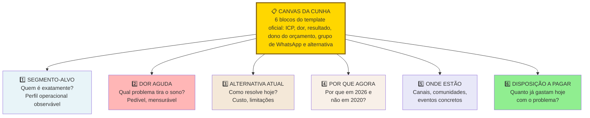

Responda com especificidade cruel. Cada resposta vaga é um ponto fraco futuro. O template textual completo:

```text
CANVAS DA CUNHA, v___

ICP (preciso): _______________________________________
 _______________________________________

Dor específica: _______________________________________
(1 fluxo de trabalho) _______________________________________

Resultado mensurável: _____________________________________
(escolha 1-2 categorias: receita / custo / risco / tempo)
Métrica do resultado: _____________________________________
(ex.: "reduz de 4h para 15min por semana")

Dono do orçamento: _______________________________________
(cargo + nível hierárquico)

Teste do grupo de WhatsApp:
Quantas pessoas específicas eu consigo listar nominalmente
como potenciais primeiros clientes? _____
[ ] Cunha aprovada (100-300 pessoas listáveis).
[ ] Cunha muito larga (refinar).

Alternativa atual (o que o cliente faz hoje):
___________________________________________________________

Por que eu sou melhor do que a alternativa atual
(em 1 frase, com número se possível):
___________________________________________________________
```

Sem esse canvas preenchido, você ainda não sabe o que vai vender, nem para quem, nem por quanto. Não avance para hipóteses ([[IGNICAO-Vol-3-Experimentos-e-Prototipagem#FASE 7 — FORMULAÇÃO RIGOROSA DE HIPÓTESES|Fase 7 (Vol. 3)]]) sem isso resolvido.

### Passo 11 — Aplique o Teste de Estresse da Cunha (cinco minutos, Wedge Stress Test)

O Canvas da Cunha (Passo 10) é o instrumento estratégico. Esse teste é o instrumento tático. Use-o sempre que você descrever a cunha para alguém (investidor, mentor, cliente) e sentir que perdeu a pessoa. Ou antes de uma reunião importante, para pressionar a própria cunha e ver onde ela racha.

#### Parte 1, escreva em quatro linhas (dois minutos)

Quem é o usuário? Descrito por cargo mais contexto. Por exemplo, "Gerente de contas a pagar em escritório de advocacia de vinte a cem pessoas", não "profissionais de finanças". Se você precisa de duas sentenças para descrever o usuário, ainda está largo.

O que dispara o problema? Qual evento, data, tarefa, ou situação recorrente faz o problema aparecer. Problema sem gatilho não tem urgência. Por exemplo, "todo fim de mês, quando precisa fechar conciliação, e o sistema atual gera quarenta inconsistências que precisam ser revisadas manualmente".

O que acontece se o problema não for resolvido? Consequência concreta. Multa. Demissão. Retrabalho. Cliente perdido. Atraso em entrega. Burn-out do time. Se a resposta é "as coisas seguem como estão", não há dor. Há inconveniência.

O que o usuário faz hoje para contornar? Solução atual, mesmo precária. Planilha. Frankenstein de ferramentas. Estagiário terceirizado. A existência de uma gambiarra ativa é um sinal forte de dor real (Pain Level 4), ficando atrás apenas de quem já destinou orçamento para tentar resolver o problema (Pain Level 5).

#### Parte 2, duas perguntas-faca (três minutos)

Esse conjunto de clientes caberia em um único canal de Slack ou grupo de WhatsApp? Não metaforicamente. Literalmente. A faixa total da cunha vendável é de cem a trezentas pessoas listáveis nominalmente (definição operacional canônica acima). O sub-conjunto que você consegue imaginar reunido no mesmo grupo trocando mensagens sobre o mesmo problema específico é mais estreito, tipicamente trinta a oitenta pessoas. Esse núcleo é quem você conhece de nome, contato direto e contexto. Se você não consegue listar nem esse núcleo inicial, ou a dor ainda está mal definida ou você ainda conhece pouco o setor: volte às entrevistas de campo antes de mexer no tamanho da cunha.

Se a sua empresa fechasse hoje à noite, quem reclamaria ativamente amanhã de manhã? Não "quem sentiria falta". Quem abriria o notebook, ligaria para alguém, postaria no LinkedIn. Essa lista de pessoas é a sua cunha real. Se a lista tem menos de três pessoas específicas (com nome e cargo), a sua cunha é teórica. Não está aterrada em gente.

> [!tip] Uso operacional do teste
> Rode esse teste sozinho antes de rodá-lo com outra pessoa. Se você mesmo travar em alguma das seis perguntas, não vale envergonhar-se com um mentor. Volte primeiro ao Canvas da Cunha e resolva. O teste existe para você detectar cedo onde a sua narrativa não se sustenta.

### Caso brasileiro real, cunha na Creditas (2012)

Em 2012, o mercado brasileiro de crédito era dominado pelos grandes bancos com linhas de crédito pessoal não consignado a juros elevados (em torno de 5% a 6% ao mês nas séries do Banco Central em 2012, além do rotativo do cartão acima de 10% ao mês), e crédito com garantia via bancos tradicionais (burocracia alta, meses de processo).

Sergio Furio, fundador da Creditas, fez a escolha que define a empresa. Em vez de competir em "crédito pessoal mais barato" (cunha larga, contra bancos com muito mais capital), escolheu cunha estreita. Crédito com garantia de imóvel ou veículo, online, em dias em vez de meses. ICP inicial claro. Dor específica. Resultado mensurável (taxa muito abaixo do crédito pessoal bancário).

A cunha estreita permitiu três coisas. Construir operação especializada. Estabelecer relação com poucos tipos de cliente. E definir unit economics específicos. A expansão para outras verticais veio depois, apoiada na base.

Cunha estreita no começo não limita o tamanho final do negócio. Limita o risco inicial e acelera o PMF.

> [!note] Caso B2C internacional como referência adicional, Warby Parker (2010)
> Warby Parker (Neil Blumenthal, Andrew Hunt, David Gilboa, Jeffrey Raider, fundada na Wharton em 2010) é caso clássico de cunha B2C estreita: profissionais urbanos 25-40 anos, renda US$ 60k+, conscientes de estilo em NY/SF, com problema de "comprar óculos é lento, caro e chato". A cunha começou em "óculos bonitos entregues no escritório": descoberta nas entrevistas, em que o preço disruptivo (US$ 95 a US$ 99, contra US$ 500 no varejo tradicional) aliado à prova gratuita de cinco armações em casa (*Home Try-On*, lançada em fevereiro de 2010) destravava a compra online para jovens profissionais. Essa combinação de preço claro e teste sem risco destravou a adoção inicial antes da expansão para lojas físicas próprias, servindo de referência para o desenho de experimentos que veremos no [[IGNICAO-Vol-3-Experimentos-e-Prototipagem#CAPÍTULO 3 — IDEA → WEDGE → SCALE: O FRAMEWORK ANTLER COMO LENTE TRANSVERSAL|Capítulo 3: Idea → Wedge → Scale (Vol. 3)]]. A lição transferível é a mesma da Creditas: liste dores completas, derive ICP por filtros cumulativos, condense em uma frase, teste antes de construir, ajuste a Cunha até caber num grupo de WhatsApp.

---

### Visão panorâmica: da Fase 6 (Mapeamento de Mercado) ao PMF (Fase 13)

O que você acabou de fazer, ao longo das Fases 0 a 5. Preparou-se como fundador. Gerou ideias. Articulou a candidata escolhida. Construiu teoria causal. Descobriu problemas reais no ICP através de entrevistas com saturação. Mapeou o mercado, e definiu cunha.

O que vem nas Fases 6 a 12. Transformar o que você aprendeu em hipóteses testáveis, planejar experimentos rigorosos, prototipar e testar solução, lançar MVP, e perseguir PMF. Você sai da fase de descoberta aberta (procurando o que não sabe) para entrar na fase de validação estruturada (testando o que acha que sabe).

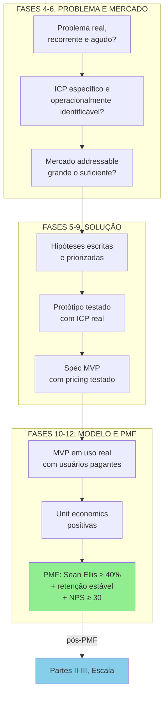

Falha em qualquer etapa significa voltar à fase anterior, não pular adiante. Sem ICP específico, mapa de problemas, e canvas da cunha preenchidos, as hipóteses geradas serão vagas e os experimentos virão ambíguos.


---

### O Espelho da Fase 6: Você Escolheu uma Cabeça de Praia ou Está Atirando no Oceano?

**Fechando o ciclo na trincheira:** Quando **Henrique** incorporou este filtro nas negociações industriais e públicas a partir de Curitiba, o impasse da abertura foi substituído por critérios técnicos de aprovação, margem protegida e ciclo previsível.

**O Espelho (autodiagnóstico):**
1. O seu cálculo de mercado foi feito multiplicando o número real de clientes acessíveis pelo seu tíquete médio (Bottom-Up), ou copiando um relatório genérico do Google (Top-Down)?
2. Quais segmentos de clientes você decidiu explicitamente recusar nos próximos doze meses para concentrar 100% da sua munição na sua cunha?
3. Você consegue escrever a frase do Dono do Orçamento em 30 segundos, zerar os sinais de escopo instável e encontrar seus clientes-alvo nos mesmos eventos, grupos ou associações que você frequenta? (Chave de leitura: se respondeu "não" a duas ou mais perguntas deste Espelho, volte ao Passo 10 antes de iniciar o Volume 3.)

**Permissão Libertadora:**
Você está autorizado a parecer "pequeno demais" para investidores de palco. Conquistar metade de um nicho inicial de R$ 20 milhões gera dez vezes mais receita (R$ 10 milhões) do que capturar 0,001% de um mercado genérico de R$ 100 bilhões, funcionando como a porta de entrada para os mercados adjacentes.

**O Ritual de Segunda-Feira às 9h (rotina semanal de 30 minutos):**
Abra a sua planilha da cunha e dedique 30 minutos toda segunda-feira para alimentar os dois níveis da sua lista: o núcleo nominal de 30 a 80 decisores que você conhece pelo nome (rumo à cunha listável de 100 a 300 contatos do Teste do Grupo de WhatsApp). A cada segunda-feira, acrescente 10 novos nomes qualificados, mande mensagem para 3, registre quem respondeu e ajuste a frase do Dono do Orçamento se aprender algo novo.

---

### MÉTRICAS E BENCHMARKS DESTA FASE (FASE 6)

| Métrica | O que medir | Referência saudável |
|---|---|---|
| TAM calculado | Mercado total endereçável | Metodologia bottom-up |
| SAM calculado | Mercado serviceable com seu GTM | 1 a 10% do TAM |
| SOM ano 3 | Participação realista em 3 anos | 1 a 5% do SAM |
| Concorrentes mapeados | Diretos, indiretos e substitutos | ≥ 10 alternativas mapeadas |
| Cunha de entrada validada | Núcleo nominal listado e compradores testados | 30 a 80 nomes no núcleo (100 a 300 na cunha) e ≥ 5 compradores em Pain Level 4-5 |
| 5 Forças de Porter aplicadas | Análise estrutural da indústria | Completada |
| Posicionamento no Mapa de Valor | Localização diferenciada | Diferente de qualquer player |

---

### MANUAL PASSO A PASSO DOS FRAMEWORKS DESTA FASE

> [!tip] Uso autocontido neste volume
> Todos os frameworks abaixo estão detalhados integralmente com origem, estrutura, passo a passo de aplicação, exemplo brasileiro e armadilhas para execução imediata nesta **Fase 6**.

#### Framework: Porter's Five Forces (Michael Porter, 1979)

##### De onde vem a ferramenta (e por que sobreviveu ao filtro do tempo)

Michael Porter, professor de Harvard Business School, publicou "How Competitive Forces Shape Strategy" na Harvard Business Review em 1979. O framework foi consolidado em seu livro *Competitive Strategy* (1980), obra considerada fundacional da estratégia corporativa moderna. A motivação era responder à pergunta: **por que algumas indústrias são estruturalmente mais lucrativas que outras?**

##### A mecânica central (sem jargão)

Framework que analisa a **atratividade estrutural** de uma indústria (ou setor) através de cinco forças que determinam o poder competitivo e, consequentemente, a lucratividade média das empresas naquele setor. A análise é estática em um momento, mas deve ser revisitada periodicamente, indústrias mudam de estrutura (ex.: varejo pré e pós e-commerce).

##### As regras do jogo

As cinco forças que compõem a análise:

1. Ameaça de novos entrantes: quão fácil é para novas empresas entrarem e capturarem mercado? Barreiras de entrada altas (capital, regulação, marca, economias de escala, tecnologia proprietária) protegem incumbentes.

2. Poder de barganha dos fornecedores: quando fornecedores são poucos ou têm produto único, podem ditar preço e condições, comprimindo margem.

3. Poder de barganha dos compradores: quando compradores são grandes, poucos ou bem-informados, podem exigir preços baixos e condições favoráveis.

4. Ameaça de produtos substitutos: produtos de outras categorias que resolvem o mesmo JTBD. Ex.: Zoom substitui voos de negócios. Netflix substitui cinema.

5. Rivalidade entre competidores existentes: intensidade da competição atual. Muitos competidores semelhantes, crescimento lento, custos fixos altos e barreiras de saída amplificam rivalidade.

##### Como rodar na segunda-feira às 9h com seu time

Passo 1: Definir a indústria com precisão. "Software" é amplo demais, "software de gestão de caixa para PMEs brasileiras" é útil. Indústria definida ampla demais dilui análise, estreita demais ignora substitutos relevantes.

Passo 2: Para cada força, listar evidências concretas. Não basta "o poder do comprador é alto", especificar quem é o comprador, quantos são, qual o share médio de cada, qual a elasticidade de preço.

Passo 3: Classificar cada força como ALTA, MÉDIA ou BAIXA. Justificar com dados de mercado, não impressão.

Passo 4: Identificar onde há oportunidade estratégica. Forças altas contra sua empresa = pressão na margem, forças altas contra concorrentes = oportunidade.

Passo 5: Desenhar ações defensivas e ofensivas. Para cada força alta negativa: como mitigar? Exclusividade com fornecedor, diversificação de clientes, aumento de switching costs.

Passo 6: Revisitar a cada 12-24 meses. Indústrias mudam.

##### Na trincheira real: como isso funciona na prática

Indústria: SaaS B2B de gestão financeira para PMEs brasileiras (estilo Conta Azul, Omie).

- *Novos entrantes*: MÉDIO. Capital inicial moderado (R$ 2-5M para MVP competitivo), mas marca e integrações com bancos/Receita Federal criam barreiras.
- *Fornecedores*: BAIXO. Cloud commoditizado (AWS/GCP), frameworks open-source.
- *Compradores*: MÉDIO. PMEs são muitas (baixa concentração), mas sensíveis a preço, churn em período de crise é alto.
- *Substitutos*: ALTO. Planilha Excel, contador terceirizado, ferramentas globais (QuickBooks), ERPs baratos (Bling, Tiny).
- *Rivalidade*: ALTO. Conta Azul, Omie, Nibo e ERPs de entrada como Bling e Tiny, além de bancos PJ integrados como Conta Simples, vários deles capitalizados por fundos de risco.

Leitura: setor atrativo para incumbentes estabelecidos, difícil para novos entrantes competirem em preço. Estratégia defensável precisa de diferenciação (verticalização por setor, integração profunda com bancos, ou serviço em camada).

##### Onde o papel aceita tudo (armadilhas de execução)

Análise superficial: "rivalidade é alta" sem mapear quantos competidores, market share, diferenciação. Indústria mal definida: "restaurantes" é inútil, "restaurantes de alta gastronomia em São Paulo" é analisável. Estático demais: análise de 2015 aplicada em 2026 sem considerar mudanças estruturais. Ignorar complementadores: Porter não inclui essa sexta força, mas Brandenburger e Nalebuff (*Co-opetition*, 1996) argumentam que complementadores (ex.: app stores para iOS/Android) são força relevante. Vale considerar. Confundir atratividade setorial com performance da sua empresa: indústria atrativa não garante sucesso, indústria feia não condena. Sua posição importa. Usar como análise isolada: 5 Forças responde "setor é atrativo?", não responde "como devo jogar neste setor?". Combine com Playing to Win (Framework: Playing to Win (Roger Martin & A.G. Lafley, 2013) (Fase 2)) e 7 Powers (Framework: Three Horizons Framework (McKinsey, 1999) (Fase 1)).

---

#### Framework: SWOT / TOWS Matrix (Albert Humphrey, 1960s)

##### De onde vem a ferramenta (e por que sobreviveu ao filtro do tempo)

SWOT (Strengths, Weaknesses, Opportunities, Threats) emergiu de pesquisa conduzida no Stanford Research Institute entre 1960 e 1970, em estudo de planejamento estratégico de empresas da Fortune 500 ligado ao programa Team Action Management. Albert Humphrey é a atribuição mais comum, embora a paternidade seja parcialmente disputada (alguns acadêmicos creditam Smith Jr., Christensen e Andrews em Harvard nos anos 1950). A origem exata é disputada: a atribuição mais repetida liga a ferramenta a Albert Humphrey no SRI (sob a sigla SOFT em 1964), mas pesquisas históricas apontam raízes anteriores nas aulas de política de negócios da Harvard Business School nos anos 1950 e 1960; Urick e Orr renomearam para SWOT em publicação posterior. A variação TOWS foi proposta por Heinz Weihrich em 1982, invertendo a ordem para enfatizar o cruzamento entre fatores internos e externos. Virou uma das ferramentas mais usadas (e mais mal-usadas) de gestão no mundo.

##### A mecânica central (sem jargão)

Framework de diagnóstico estratégico que mapeia:

- Fatores internos (controláveis pela empresa): Strengths (forças) e Weaknesses (fraquezas).
- Fatores externos (do mercado/contexto): Opportunities (oportunidades) e Threats (ameaças).

O valor real não está na listagem dos 4 quadrantes, está nos **cruzamentos** da matriz TOWS, que geram estratégias específicas.

##### As regras do jogo

Matriz 2x2 com cruzamento:

| | Oportunidades | Ameaças |
|---|---|---|
| **Forças** | **SO** (Maxi-Maxi): usar forças para capturar oportunidades | **ST** (Maxi-Mini): usar forças para mitigar ameaças |
| **Fraquezas** | **WO** (Mini-Maxi): superar fraquezas para aproveitar oportunidades | **WT** (Mini-Mini): minimizar fraquezas e ameaças |

Cada quadrante gera **uma categoria de estratégia**:

- SO: aposta ofensiva. Onde você deve investir mais.
- ST: defesa. Use pontos fortes para bloquear riscos.
- WO: desenvolvimento. Investir em capability para capturar janela de mercado.
- WT: sobrevivência. Estratégias conservadoras, às vezes saída do segmento.

##### Como rodar na segunda-feira às 9h com seu time

Passo 1: Contextualize antes de listar. SWOT sem contexto vira lista genérica. Defina: SWOT para quê? Para entrar em novo mercado? Defender posição? Captar investimento? O contexto muda o que é força vs. fraqueza.

Passo 2: Forças e fraquezas: interno, relativo aos concorrentes. "Temos time técnico bom", comparado a quem? Força só é força se diferencia. Escreva sempre em forma comparativa: "time técnico mais denso em ML do que principais concorrentes locais".

Passo 3: Oportunidades e ameaças: tendências estruturais, não táticas. "Concorrente X fez promoção" não é ameaça estrutural. "Entrada de big tech americana no vertical" é.

Passo 4: Limite a 5-7 itens por quadrante. Mais vira lista que ninguém usa. Escolha os de maior impacto.

Passo 5: Construa os 4 cruzamentos TOWS. Isso é onde a ferramenta ganha utilidade. Cada célula deve gerar 2-4 estratégias específicas.

Passo 6: Priorize. Dos ~8-16 movimentos possíveis, quais 3-4 você vai executar este ano? SWOT sem priorização é relatório.

##### Na trincheira real: como isso funciona na prática

Startup: fintech de gestão de gastos corporativos para médias empresas brasileiras (estilo Conta Azul B2B ou Clara/Ramp).

Forças (S):

- Time com 2 engenheiros seniores ex-bancos tier-1.
- Fluent em regulação BCB/Receita Federal.
- 18 clientes-piloto em SP já pagando.

Fraquezas (W):

- Marca desconhecida fora de SP.
- Sem time de vendas (fundadores vendendo).
- Runway de 14 meses.

Oportunidades (O):

- Reforma tributária em fase de regulamentação.
- Consolidação da categoria global (Ramp/Brex ~US$ 10B valuations).
- PMEs migrando de planilha para SaaS financeiro.

Ameaças (T):

- Possível entrada de plataformas internacionais de gestão de despesas corporativas (*spend management*) no mercado brasileiro ou avanço dos grandes bancos no segmento.
- Banco Central restringindo novas licenças de IP.
- Competição intensa de Conta Azul, Omie, Clara.

TOWS, estratégias cruzadas:

- SO: aproveitar expertise em regulação + tração inicial para capturar clientes médios SP antes da entrada dos americanos (2026 é a janela).
- ST: construir defensibilidade em serviço (implementação consultiva) que SaaS americano terá dificuldade em replicar no BR.
- WO: contratar Head of Sales e acelerar geograficamente em 12 meses.
- WT: evitar competir por preço agressivo com Conta Azul, manter foco em nicho de médio porte onde operadoras maiores não atendem bem.

##### Onde o papel aceita tudo (armadilhas de execução)

Ao preencher a matriz, evite três erros recorrentes: (1) transformar os quadrantes numa lista vaga de adjetivos ("time bom, produto bom"), sem comparar seus indicadores aos de um rival específico; (2) empilhar vinte forças contra duas ameaças por otimismo do fundador, ou repetir o mesmo fato como força e fraqueza sem decidir se a agilidade supera a falta de escala; e (3) parar nos quatro blocos descritivos sem cruzar os quadrantes na matriz TOWS para gerar decisões concretas de foco.

---

#### Framework: BCG Growth-Share Matrix (Bruce Henderson, 1970)

##### De onde vem a ferramenta (e por que sobreviveu ao filtro do tempo)

Bruce Henderson, fundador do Boston Consulting Group (BCG), publicou a matriz em 1970 no artigo "The Product Portfolio". Tornou-se talvez o framework de portfólio mais icônico do século XX, usado intensamente por conglomerados nas décadas de 70-80. Base conceitual: curva de experiência (custo cai com volume acumulado) + ciclo de vida do produto.

##### A mecânica central (sem jargão)

Matriz 2x2 que classifica unidades de negócio (ou produtos) em um portfólio corporativo segundo dois eixos:

- Eixo X: Participação relativa de mercado (vs. maior concorrente).
- Eixo Y: Taxa de crescimento do mercado.

Quatro quadrantes:

| | Alta participação | Baixa participação |
|---|---|---|
| **Alto crescimento** | **STAR** (Estrela): investir para manter liderança | **QUESTION MARK** (Interrogação): investir ou sair? |
| **Baixo crescimento** | **CASH COW** (Vaca leiteira): maximizar caixa | **DOG** (Abacaxi): reestruturar ou desinvestir |

##### As regras do jogo

Stars: líderes em mercados em crescimento. Consomem caixa (para defender liderança) mas geram retorno futuro. Estratégia: investir. Cash Cows: líderes em mercados maduros. Geram muito caixa, exigem pouco investimento. Estratégia: extrair caixa para financiar Stars e Question Marks. Question Marks: baixo market share em mercado crescendo. Precisam de investimento grande para virar Stars, ou devem ser abandonados. Decisão difícil. Dogs: baixa participação em mercado estagnado. Típica recomendação BCG: divest (vender, fechar, ou turnaround com custo mínimo).

##### Como rodar na segunda-feira às 9h com seu time

Passo 1: Defina o escopo: portfólio da empresa. Funciona bem para conglomerados com múltiplas BUs, menos útil para startup single-product.

Passo 2: Quantifique os eixos.

- *Market share relativo*: seu share dividido pelo share do maior concorrente. > 1 = você é líder, < 1 = segue.
- *Taxa de crescimento*: % ao ano de crescimento do mercado, não da sua empresa.

Passo 3: Alinhe thresholds.

- Alta vs. baixa participação: historicamente BCG usa 1x como threshold (líder vs. não líder), ajuste conforme indústria.
- Alto vs. baixo crescimento: tipicamente 10% a.a. Ajuste por contexto (tech pode usar 20%+, indústria madura, 5%).

Passo 4: Plote cada unidade/produto. Use área do círculo para representar receita (visualização clássica BCG).

Passo 5: Defina estratégia por quadrante. Investir, ordenhar, desinvestir, decidir.

Passo 6: Balanceie o portfólio. Conglomerado saudável tem mix: Cash Cows financiando Stars e Question Marks selecionados.

##### Na trincheira real: como isso funciona na prática

Grupo brasileiro com 4 unidades de negócio (exemplo hipotético):

- Unidade A, Streaming de conteúdo religioso: 40% market share no segmento, mercado cresce 20% a.a. → **STAR**. Investir.
- Unidade B, Portal de notícias gospel: 55% market share, mercado cresce 2% a.a. → **CASH COW**. Ordenhar caixa para financiar Unidade A.
- Unidade C, Loja virtual de livros: 5% market share, mercado cresce 15% a.a. → **QUESTION MARK**. Decidir: investir pesado para virar Star, ou sair.
- Unidade D, Revista impressa: 8% market share, mercado encolhe 10% a.a. → **DOG**. Turnaround ou desinvestir.

##### Onde o papel aceita tudo (armadilhas de execução)

Aplicar a startup single-product: BCG foi pensado para portfólio. Startup com 1 produto não se beneficia. Confundir Dog com produto ruim: Dog pode ser lucrativo (mesmo nicho baixo, pode ter margem alta). BCG original assume curva de experiência que pode não valer. Esquecer sinergias entre unidades: Dog pode ser complementar a Cash Cow (upsell, cross-sell). Não olhar isolado. Threshold rígido demais: 1x market share ou 10% growth são benchmarks, ajustar por indústria. Abandonar Question Marks cedo demais: muitos se tornam Stars com tempo e investimento focado. Ignorar dinâmica temporal: Stars viram Cash Cows. Cash Cows decaem em Dogs. Portfólio é dinâmico. Framework usado como desculpa para corte: "é Dog, vamos fechar" sem análise profunda. Turnaround é opção.

---

#### Framework: GE/McKinsey 9-Box Matrix (1970s)

##### De onde vem a ferramenta (e por que sobreviveu ao filtro do tempo)

Desenvolvida em parceria entre General Electric e McKinsey nos anos 1970, como **evolução da BCG Matrix**. Criada no início dos anos 1970, quando a General Electric (sob a liderança de Fred Borch e depois Reginald Jones) reorganizou seu portfólio em cerca de 40 unidades estratégicas de negócio com apoio da McKinsey (ver histórico na *McKinsey Quarterly*, 2008). A McKinsey Matrix (ou GE-McKinsey Matrix) supera o BCG ao ser **multivariada** em ambos eixos.

##### A mecânica central (sem jargão)

Matriz 3x3 (9 células) que posiciona unidades de negócio segundo:

- Eixo X, Competitividade / Posição competitiva da empresa na unidade: composto de market share, crescimento, qualidade do produto, marca, rede de distribuição, tecnologia. Pontuado como Alto, Médio, Baixo.
- Eixo Y, Atratividade da indústria: composto de tamanho, crescimento, margens, intensidade competitiva, regulação, sazonalidade, requisitos de capital. Pontuado como Alto, Médio, Baixo.

##### As regras do jogo

Resultado em 9 células agrupadas em 3 zonas:

- Zona de investimento (verde, 3 células superiores/esquerda): investir para crescer.
- Zona de seletividade (amarela, 3 células diagonais): investir seletivamente, proteger.
- Zona de colheita (vermelha, 3 células inferiores à direita): extrair caixa, desinvestir ou reestruturar.

##### Como rodar na segunda-feira às 9h com seu time

Passo 1: Defina os fatores de atratividade da indústria. Peso cada fator (tamanho=20%, crescimento=20%, margens=15%, etc.). Some 100%.

Passo 2: Defina os fatores de posição competitiva. Market share, participação em segmentos-chave, qualidade, marca, custo, rede. Também com pesos.

Passo 3: Pontue cada unidade. Escala 1-5 (ou 1-10) em cada fator. Multiplique por peso. Some. Resultado vai para cada eixo.

Passo 4: Plote na matriz. Alto (acima de 3.67 em escala 1-5), Médio (2.34-3.66), Baixo (até 2.33).

Passo 5: Estratégia por zona.

##### Na trincheira real: como isso funciona na prática

Conglomerado diversificado com 5 unidades:

- U1, SaaS de gestão hospitalar: atratividade alta (setor cresce 18%/ano, margem 75%), posição alta (40% share em nicho) → **Zona Verde. Investir agressivamente**.
- U2, Distribuidora de medicamentos: atratividade média, posição alta → **Zona Amarela. Proteger posição.**
- U3, Loja virtual de suplementos: atratividade média, posição baixa → **Zona Amarela. Seletividade ou sair.**
- U4, Editora impressa: atratividade baixa, posição média → **Zona Vermelha. Ordenhar caixa.**
- U5, Rádio local: atratividade baixa, posição baixa → **Zona Vermelha. Desinvestir.**

##### Onde o papel aceita tudo (armadilhas de execução)

Pesos arbitrários: sem fundamentação, pontuação vira intuição formalizada. Pontuação enviesada por executivo da unidade: cada um diz que sua unidade é "competitividade alta". Exigir evidência. Ignorar interdependências: unidades podem ter sinergias que matriz não captura. Análise estática: indústrias mudam rápido, revisitar anualmente. Aplicar a startup single-product: mesmo problema do BCG, esta é para portfólio. Confundir com análise de produto individual: 9-box é para BU/linha de negócio, não features.

---

#### Framework: Ansoff Matrix (Igor Ansoff, 1957)

##### De onde vem a ferramenta (e por que sobreviveu ao filtro do tempo)

Igor Ansoff, professor russo-americano conhecido como "pai da gestão estratégica", publicou o framework em "Strategies for Diversification" na Harvard Business Review em 1957. Consolidou em *Corporate Strategy* (1965). Ansoff argumentava que decisões de crescimento eram a essência da estratégia corporativa, e a matriz organiza o espaço de opções.

##### A mecânica central (sem jargão)

Matriz 2x2 que estrutura **quatro estratégias de crescimento** segundo dois eixos:

- Eixo X, Mercado: existente ou novo.
- Eixo Y, Produto: existente ou novo.

##### As regras do jogo

| | Produto existente | Produto novo |
|---|---|---|
| **Mercado existente** | **Penetração de mercado** (baixo risco) | **Desenvolvimento de produto** (risco médio) |
| **Mercado novo** | **Desenvolvimento de mercado** (risco médio) | **Diversificação** (alto risco) |

- Penetração de mercado: vender mais do produto atual a clientes atuais (e capturar clientes similares). Risco baixo, retorno limitado. Táticas: mais marketing, melhor pricing, expansion dentro da base.
- Desenvolvimento de produto: novos produtos para a mesma base de clientes. Vantagem: conhece o cliente. Risco médio.
- Desenvolvimento de mercado: levar produto atual para novos mercados (geografia, segmento, vertical). Risco médio. Vantagem: produto conhecido.
- Diversificação: produto novo, mercado novo. Risco máximo. Pode ser relacionada (sinergia com core) ou não relacionada (puro portfolio play).

##### Como rodar na segunda-feira às 9h com seu time

Passo 1: Inventariar produtos e mercados atuais. Liste com clareza.

Passo 2: Para cada quadrante, gere opções. Penetração: que clientes similares posso ganhar? Desenvolvimento de produto: que novo produto minha base quer? Desenvolvimento de mercado: que mercado adjacente posso servir com produto atual? Diversificação: há apostas ortogonais interessantes?

Passo 3: Quantifique potencial e risco. Market size, tempo até retorno, investimento necessário, probabilidade de sucesso.

Passo 4: Distribua esforço. Regra prática: 70% penetração, 20% desenvolvimento (de produto ou mercado), 10% diversificação. Ajuste por estágio.

Passo 5: Sequenciar. Ansoff não diz "faça tudo junto", diz "escolha conscientemente". Fazer 3-4 movimentos simultâneos dilui foco.

##### Na trincheira real: como isso funciona na prática

SaaS de gestão financeira para PMEs (retomando exemplo anterior):

- Penetração: aumentar adoção entre PMEs de SP já prospectadas. Mais marketing digital, programa de indicação, upsell features.
- Desenvolvimento de produto: lançar módulo de emissão fiscal para base existente. Cross-sell.
- Desenvolvimento de mercado: levar produto atual para pequenas empresas de Minas Gerais e Paraná. Novo time de vendas regional.
- Diversificação: crédito para PMEs baseado em dados transacionais do software (fintech vertical). Alto risco, alto retorno potencial.

Sequenciamento recomendado: focar em Penetração + Desenvolvimento de Produto nos próximos 18 meses. Desenvolvimento de Mercado em 18-36 meses. Diversificação (crédito) só após ter PMF expandido + runway robusto.

##### Onde o papel aceita tudo (armadilhas de execução)

Diversificação prematura: startup com 1 produto tenta lançar linha ortogonal antes de consolidar core. Dilui foco e capital. Confundir expansão geográfica com mercado novo: vender para outra cidade dentro do mesmo país e para o mesmo perfil de cliente exige menos adaptação de produto do que abrir um novo segmento setorial, mas ainda conta como expansão geográfica de mercado e requer validação da rede local de distribuição. Desenvolvimento de produto que não serve base existente: novos produtos precisam de JTBD compartilhado com base atual para aproveitar conhecimento do cliente. Ignorar capability gaps: mover para novo quadrante exige capabilities novas (ex.: penetração usa sales, diversificação pode exigir P&D, regulatório, operação completamente diferente). Esquecer que risco cresce conforme quadrante: diversificação é maior risco, esperar taxa de sucesso inferior e planejar capital reserva.

---

#### Framework: PESTEL Analysis (Francis Aguilar, 1967, originalmente ETPS)

##### De onde vem a ferramenta (e por que sobreviveu ao filtro do tempo)

A primeira formulação foi de Francis Aguilar em *Scanning the Business Environment* (1967), com o acrônimo **ETPS** (Economic, Technical, Political, Social). Arnold Brown, no Institute of Life Insurance, reorganizou para STEP (Strategic Trend Evaluation Process). Ao longo dos anos 1970-1980 evoluiu para STEPE, STEEP, PEST, e finalmente PESTEL/PESTLE (acrescentando Environmental e Legal), PESTELID (acrescentando International e Demographic) e outras variações. É framework de análise de **macroambiente**.

##### A mecânica central (sem jargão)

Framework para mapear forças externas ao negócio que podem impactar operação e estratégia. Diferente das 5 Forças (que analisam indústria), PESTEL analisa o **ambiente macro**.

##### As regras do jogo

P, Political: estabilidade de governo, políticas de governo, guerras, comércio internacional, impostos, regulação.

E, Economic: taxa de juros, inflação, câmbio, crescimento do PIB, desemprego, ciclo econômico.

S, Social: demografia, mudanças culturais, estilo de vida, valores sociais, saúde pública, educação.

T, Technological: inovações, obsolescência, adoção de tecnologias (IA, blockchain), automação, P&D.

E, Environmental: mudanças climáticas, regulações ambientais, sustentabilidade, recursos naturais.

L, Legal: leis trabalhistas, leis antitrust, proteção ao consumidor, propriedade intelectual, compliance regulatório.

##### Como rodar na segunda-feira às 9h com seu time

Passo 1: Horizonte temporal claro. PESTEL para 12 meses é diferente de PESTEL para 5 anos.

Passo 2: Para cada dimensão, identificar 3-5 forças materialmente relevantes. Não listar tudo, só o que impacta seu negócio.

Passo 3: Classificar cada força: impacto (alto/médio/baixo) × probabilidade (alto/médio/baixo).

Passo 4: Forças de alto impacto + alta probabilidade viram drivers de planejamento. Forças altas com baixa probabilidade são riscos a monitorar.

Passo 5: Converter em ação. Cada driver crítico gera: oportunidade estratégica, risco mitigado, ou mudança operacional.

Passo 6: Revisitar semestralmente. Macroambiente é volátil.

##### Na trincheira real: como isso funciona na prática

Fintech brasileira de empréstimo para PMEs:

- P: eleições 2026, mudança de presidência BCB, possível ajuste na Lei do Marco Legal das Garantias → MONITORAR.
- E: Juros básicos (Selic) em dois dígitos, inflação pressionando o teto da meta e PMEs com restrição de crédito bancário → DRIVER CRÍTICO (tese da empresa).
- S: digitalização acelerada pós-pandemia, PMEs adotando tech → OPORTUNIDADE.
- T: IA generativa mudando underwriting, open banking já implementado → OPORTUNIDADE + RISCO (concorrentes usam mesmo arsenal).
- E (env): menor impacto direto, mas ESG começando a pesar em captações → MONITORAR.
- L: Lei 14.478 sobre cripto em evolução, LGPD com fiscalização crescente, regulação BCB sobre BNPL → COMPLIANCE CRÍTICO.

Drivers consolidados: oportunidade de conquistar PMEs sub-servidas por bancos (ambiente econômico apertado + digitalização), mas risco regulatório exige compliance forte.

##### Onde o papel aceita tudo (armadilhas de execução)

Lista exaustiva não priorizada: 40 itens sem classificação de impacto. Nada acionável. Genérico: "inflação pode impactar negócio" sem quantificar. Específico: "cada 1pp de Selic eleva custo de capital em R$ 350k/mês para nossa operação de empréstimos". Viés de disponibilidade: foca em manchetes recentes, ignora tendências estruturais. Estático: análise de dezembro não atualizada em junho. Desconexão com estratégia: PESTEL que não vira ação é relatório morto. Ignorar dimensões menos familiares: fundador técnico subdimensiona Político, fundador MBA subdimensiona Technological.

---

#### Framework: Value Chain Analysis (Michael Porter, 1985)

##### De onde vem a ferramenta (e por que sobreviveu ao filtro do tempo)

Michael Porter introduziu a Value Chain em *Competitive Advantage* (1985), sequência de *Competitive Strategy*. Ferramenta para decompor empresa em atividades primárias e de suporte, entendendo onde valor é criado e onde há oportunidades de vantagem competitiva ou corte de custos.

##### A mecânica central (sem jargão)

Framework que mapeia as **atividades que uma empresa realiza** para entregar valor ao cliente. Cada atividade é oportunidade de: (a) criar valor diferenciado, (b) reduzir custo, ou (c) ambos. A margem é resultado da diferença entre valor percebido e custo total da cadeia.

##### As regras do jogo

Atividades primárias (tocam o produto/serviço direto):

1. Inbound logistics: recebimento, armazenagem, distribuição interna.
2. Operations: transformação de insumos em produto.
3. Outbound logistics: entrega ao cliente.
4. Marketing & Sales: geração e captura de demanda.
5. Service: suporte pós-venda.

Atividades de suporte (perpassam todas):

- Infrastructure: gestão, finanças, legal.
- HR management: recrutar, treinar, reter, remunerar.
- Technology development: P&D, IT.
- Procurement: aquisição de insumos.

Cada atividade tem custo e cada uma pode ser fonte de diferenciação.

##### Como rodar na segunda-feira às 9h com seu time

Passo 1: Adapte a cadeia ao seu negócio. Porter pensou em indústria, software tem cadeia diferente (desenvolvimento → hosting → customer success). Use o framework como estrutura, não dogma.

Passo 2: Para cada atividade, mapeie custo. Percent do total, tendência (crescendo/caindo), drivers.

Passo 3: Para cada atividade, mapeie criação de valor. Quanto essa atividade contribui para diferenciação percebida?

Passo 4: Identifique os elos (linkages). Atividades se conectam, melhorar uma afeta outra. Exemplo: investir em onboarding melhor (operations) reduz tickets de suporte (service).

Passo 5: Compare com concorrentes. Onde você tem vantagem estrutural? Onde desvantagem? Vantagem em value chain é frequentemente mais defensável que vantagem em produto pontual.

Passo 6: Decida: onde investir, onde cortar, onde terceirizar.

##### Na trincheira real: como isso funciona na prática

SaaS B2B de gestão financeira:

- *Development* (tech): 40% dos custos, fonte de diferenciação (produto core).
- *Customer success*: 15% dos custos, fonte crítica de retenção (NRR alto).
- *Marketing & Sales*: 25% dos custos, fonte de aquisição.
- *Infrastructure (hosting/SaaS tools)*: 8% dos custos.
- *G&A*: 12% dos custos.

Análise: development e CS são os diferenciadores. Marketing é gasto alto mas não é vantagem competitiva (todos concorrentes gastam igual proporcionalmente). Decisão: manter investimento alto em dev+CS, testar redução em marketing via loops orgânicos (Frameworks da Fase 3).

##### Onde o papel aceita tudo (armadilhas de execução)

Cadeia genérica: aplicar template industrial sem adaptar a negócio digital. Medir custo sem medir valor: só vê redução de custo, perde oportunidade de diferenciar. Ignorar linkages: decisão em atividade isolada quebra outra. Análise sem benchmark: saber que marketing é 25% do custo não diz nada sem comparação setorial. Terceirizar atividade central por equivocada leitura de custo: terceirizar customer success em SaaS para reduzir custo frequentemente destrói valor muito maior do que poupou.

---

#### Framework: VRIO Framework (Jay Barney, 1995; antecessor VRIN, 1991)

##### De onde vem a ferramenta (e por que sobreviveu ao filtro do tempo)

Jay Barney, professor da Ohio State University, publicou "Firm Resources and Sustained Competitive Advantage" no *Journal of Management* em 1991, formalizando o que ficou conhecido como a Visão Baseada em Recursos (Resource-Based View, RBV) da estratégia. Esse artigo introduziu o framework **VRIN** (Valuable, Rare, Inimitable, Non-substitutable). Em 1995, Barney publicou "Looking Inside for Competitive Advantage" no *Academy of Management Executive*, refinando VRIN para **VRIO** ao substituir Non-substitutability por Organization: deslocando o foco dos atributos do recurso para a capacidade organizacional de explorá-lo. O livro *Gaining and Sustaining Competitive Advantage* (1996) consolidou a sigla. A RBV contrastava com Porter (que focava em estrutura da indústria) ao argumentar que vantagens duráveis vêm de dentro da empresa: de recursos que concorrentes não conseguem replicar.

##### A mecânica central (sem jargão)

Framework que avalia se um recurso ou capacidade gera vantagem competitiva sustentável através de quatro perguntas em sequência:

- **V: Valioso (Valuable):** o recurso permite à empresa explorar uma oportunidade ou neutralizar uma ameaça?
- **R: Raro (Rare):** quantos concorrentes possuem esse recurso? Se todos têm, não é vantagem.
- **I: Inimitável (Inimitable):** é custoso para concorrentes imitar, substituir ou replicar o recurso?
- **O: Organizado (Organized):** a empresa tem processos, estrutura e cultura para capturar o valor gerado pelo recurso?

##### As regras do jogo

Cada combinação de respostas leva a um diagnóstico diferente:

| V | R | I | O | Implicação competitiva |
|---|---|---|---|---|
| Não |: |: |: | Desvantagem competitiva: eliminar ou terceirizar |
| Sim | Não |: |: | Paridade competitiva: necessário mas não diferenciador |
| Sim | Sim | Não |: | Vantagem temporária: concorrente pode replicar |
| Sim | Sim | Sim | Não | Vantagem não capturada: recurso desperdiçado por falta de organização |
| Sim | Sim | Sim | Sim | **Vantagem competitiva sustentável** |

A inimitabilidade (I) é o critério mais difícil de avaliar. Barney identifica três fontes de inimitabilidade: *path dependency* (a empresa acumulou o recurso ao longo de uma trajetória única que não pode ser replicada em curto prazo), *causal ambiguity* (nem a própria empresa sabe exatamente por que o recurso funciona, dificultando cópia), e *social complexity* (recurso baseado em relações interpessoais, cultura, reputação: impossível de copiar mesmo quando o concorrente entende o mecanismo).

##### Como rodar na segunda-feira às 9h com seu time

Passo 1: Inventariar recursos e capacidades. Recursos tangíveis: capital, infraestrutura, IP, dados. Recursos intangíveis: marca, reputação, cultura, relacionamentos com clientes. Capacidades: processos organizacionais que combinam recursos.

Passo 2: Para cada recurso/capacidade, aplicar o filtro VRIO sequencialmente. Parar assim que uma resposta for "não": o recurso ficará naquela categoria.

Passo 3: Para recursos que passam em V e R mas falham em I: diagnosticar o risco competitivo. Em quanto tempo concorrente bem capitalizado consegue replicar?

Passo 4: Para recursos que passam em V, R e I mas falham em O: esse é o diagnóstico organizacional mais acionável. A empresa tem um ativo que não está capturando. O que precisa mudar em processo, estrutura ou incentivos?

Passo 5: Usar VRIO para informar investimentos estratégicos: qual capacidade, se desenvolvida, passaria de vantagem temporária para sustentável?

##### Na trincheira real: como isso funciona na prática

Nubank em 2015-2018.

- *Tecnologia de processamento de crédito* (V: sim, R: parcialmente, banco tradicional tem tech mas com legado, I: sim, took years to build, O: sim) → Vantagem competitiva sustentável temporária (outros fintechs podem construir).
- *Marca e NPS altíssimo entre jovens urbanos* (V: sim, reduz CAC, R: sim, nenhum banco brasileiro tinha esse brand equity nesse segmento, I: sim, causal ambiguity + social complexity em brand building, O: sim, marketing de conteúdo e referência integrados) → Vantagem competitiva sustentável mais duradoura.
- *Dados de comportamento financeiro de base crescente* (V: sim, R: crescente, mais dados = mais vantagem, I: path dependency, dados de 2014 não podem ser recriados, O: sim, modelos de crédito alimentados pelos dados) → Vantagem de longo prazo que cresce com o tempo.

##### Onde o papel aceita tudo (armadilhas de execução)

Listar como recurso o que é insumo genérico: "capital", "time talentoso", "tecnologia cloud" raramente passam no teste R. Não separar recurso de capacidade: o banco de dados de clientes é recurso; a capacidade de usar esses dados para precificar crédito melhor que concorrentes é a capacidade que deve ser analisada. Aplicar VRIO estaticamente: recursos que eram raros tornam-se comuns quando tecnologia democratiza. Exemplo: ter API RESTful era raro em 2008, não é hoje. Confundir inimitabilidade com segredo: recurso secreto que concorrente pode replicar quando descobrir não é inimitável. Ignorar o O: muitas empresas têm recursos valiosos, raros e inimitáveis mas não têm os processos para capturar valor: esse é o diagnóstico mais acionável que o VRIO oferece.

---

#### Framework: 7 Powers (Hamilton Helmer, 2016)

##### De onde vem a ferramenta (e por que sobreviveu ao filtro do tempo)

Hamilton Helmer é estrategista com formação em PhD em economia em Yale, fundador da Strategy Capital e professor da Stanford. Trabalhou com Spotify, Netflix, Wikipedia em definições estratégicas. Publicou *7 Powers: The Foundations of Business Strategy* em 2016, com uma tese ambiciosa: existem **apenas 7 formas fundamentais de poder** (vantagem competitiva sustentável), e empresas duradouras têm uma ou mais.

##### A mecânica central (sem jargão)

Framework para analisar **defensibilidade estrutural**: o que faz empresa gerar retornos acima do custo de capital **de forma persistente**. Complementa 5 Forças (que olha indústria) e Playing to Win (que olha escolhas estratégicas).

##### Princípios / estrutura — Os 7 Poderes

1. Scale Economies: custo unitário cai com volume. Clássico. Ex.: Netflix com conteúdo (produção de custo fixo diluída em milhões de assinantes).

2. Network Economies: valor do produto aumenta com número de usuários. Ex.: WhatsApp, LinkedIn, marketplaces.

3. Counter-Positioning: incumbente não pode copiar seu modelo sem canibalizar próprio negócio. Ex.: Vanguard (fundos passivos) vs. gestoras ativas tradicionais.

4. Switching Costs: custo para cliente migrar para concorrente (financeiro, operacional, de relacionamento). Ex.: Salesforce, Slack.

5. Branding: marca que cria valor percebido acima do funcional. Ex.: Apple, Tiffany, Hermès.

6. Cornered Resource: acesso exclusivo a recurso crítico (patente, contrato, talento único). Ex.: de Beers com diamantes por décadas, certas patentes farmacêuticas.

7. Process Power: conjunto de processos complexos que concorrentes não conseguem replicar rapidamente. Ex.: Toyota Production System, Amazon supply chain.

Cada poder tem **benefício** (efeito de vantagem) e **barreira** (o que impede concorrentes de copiar). Ambos necessários.

##### Como rodar na segunda-feira às 9h com seu time

Passo 1: Questione: qual poder sustenta nossa vantagem? Se resposta é "excelência operacional", isso NÃO é poder, é execução. Empresas durables têm poder estrutural.

Passo 2: Para cada poder potencial, teste benefício e barreira.

- Benefício: melhora margem, preço ou volume?
- Barreira: por que concorrente não pode simplesmente copiar?

Passo 3: Identifique momento de criação do poder. Helmer argumenta que poderes são criados em momentos específicos da trajetória, "origination", e essas janelas se fecham. Network effects de redes sociais foram criados em 2003-2015, hoje é difícil construir nova rede social geral.

Passo 4: Estratégia deve ser consistente com poder pretendido. Buscar scale economies exige volume, buscar counter-positioning exige modelo disruptivo ao incumbente. Não dá para buscar todos simultaneamente cedo.

Passo 5: Mapeie poderes de concorrentes. Onde eles têm poder que você não tem? O que você pode construir que eles não podem replicar?

##### Na trincheira real: como isso funciona na prática

Nubank (análise posterior à trajetória):

- Scale Economies (SIM): custo de servir cliente cai com volume digital.
- Network Economies (PARCIAL): efeito comunidade de usuários, mas não tão forte quanto marketplace.
- Counter-Positioning (SIM, no início): bancos tradicionais não podiam lançar app sem agência sem canibalizar receita de tarifas/agências.
- Switching Costs (SIM, crescente): histórico bancário, débitos automáticos, integrações tornam migração custosa.
- Branding (SIM): marca roxa, cultura, identificação geracional.
- Cornered Resource (NÃO): não tem recurso exclusivo, capital e talento são disponíveis.
- Process Power (EMERGENTE): underwriting proprietário com dados, ops digitais.

Nubank reúne 4-5 poderes (raro). Isso explica trajetória de fundação até IPO em ~8 anos.

##### Onde o papel aceita tudo (armadilhas de execução)

Confundir poder com execução: "somos melhores operadores" não é poder. Poder é estrutura. Listar poderes sem testar barreira: "temos network effects", mas concorrente lança rede similar em 6 meses? Então não é poder de fato. Assumir que poder dura para sempre: poderes se erodem (especialmente cornered resource e branding). Renovação necessária. Buscar os 7 simultaneamente cedo: early-stage raramente tem mais de 1. Buscar 1 forte primeiro. Ignorar janelas de origination: tentar construir poder que só podia ser criado em contexto histórico específico. Process power confundido com "nossos processos são bons": processo comum não é poder. Processo que é complexo E que cria vantagem E que é difícil de replicar é poder.

---

#### Framework: Crossing the Chasm (Geoffrey Moore, 1991)

##### De onde vem a ferramenta (e por que sobreviveu ao filtro do tempo)

Geoffrey Moore, consultor de estratégia tecnológica, publicou *Crossing the Chasm* em 1991. O livro respondeu à observação empírica: empresas tech que conquistavam early adopters frequentemente falhavam em atingir majority market. Moore identificou o "chasm" (abismo) entre early adopters e early majority como zona de morte de startups. Virou texto canônico em go-to-market tech.

##### A mecânica central (sem jargão)

Framework que mapeia adoção de tecnologia em 5 estágios (Technology Adoption Lifecycle de Everett Rogers) com foco em **atravessar o chasm** entre Early Adopters e Early Majority, onde maioria das startups morre.

##### As regras do jogo

5 segmentos (Rogers. Moore adapta):

1. Innovators (2.5%): experimentadores, tolerantes a bugs.
2. Early Adopters (13.5%): visionários, querem vantagem competitiva.
3. Early Majority (34%): pragmáticos, querem referências sólidas.
4. Late Majority (34%): conservadores, compram quando tudo claro.
5. Laggards (16%): resistentes, último a adotar.

O Chasm: Early Adopters querem inovação. Early Majority quer **solução comprovada para problema específico**. São mercados quase distintos, o que vende para um não vende para outro.

Solução de Moore, Bowling Alley Strategy:

- Focar em **1 vertical** (beachhead) inicialmente.
- Construir solução completa para esse vertical.
- Capturar referências sólidas naquele vertical.
- Expandir para verticais adjacentes (pins do bowling).
- Eventualmente, atingir mainstream.

##### Como rodar na segunda-feira às 9h com seu time

Passo 1: Identifique onde sua empresa está: se vende só para Early Adopters, chasm à vista.

Passo 2: Escolha 1 vertical/segmento como beachhead. Critérios: dor aguda, orçamento, referências em rede, viabilidade para construir solução completa.

Passo 3: Solução completa (whole product): produto + serviços + integração + treinamento + garantias. Early Majority quer solução, não "produto bruto".

Passo 4: Cases e referências: testemunhos de empresas do mesmo vertical são críticos.

Passo 5: Mensagem ajustada: não "tecnologia revolucionária" (Early Adopters), sim "resolvemos problema específico de [vertical] como [caso X]" (Early Majority).

Passo 6: Após dominância em vertical 1, expandir para adjacentes.

##### Na trincheira real: como isso funciona na prática

Startup SaaS B2B com 50 Early Adopters distribuídos em 10 verticais:

Diagnóstico: está no chasm. 50 logos mas sem concentração. Early Majority vê: "não é usado em meu vertical".

Estratégia bowling alley:

- Beachhead: PMEs de contabilidade (10 clientes existentes, rede densa, dor clara).
- Solução completa: integração com ferramentas de contabilidade, templates de processos, suporte especializado, cases do vertical.
- Próximos 12 meses: conquistar 80 ou mais clientes entre escritórios contábeis de 5 a 20 pessoas na Grande São Paulo, com pelo menos 5 estudos de caso publicados.
- Ano 2: expandir para PMEs de advocacia (vertical adjacente, similar em gestão de casos).
- Ano 3-4: PMEs de saúde, engenharia, etc.
- Ano 5: horizontal cross-vertical.

##### Onde o papel aceita tudo (armadilhas de execução)

Tentar "horizontal" cedo: "serve qualquer PME", ninguém se identifica, ninguém compra. Pular beachhead: expansão geográfica ou de produto antes de dominar vertical. Whole product incompleto: só produto bruto. Early Majority recusa. Mensagem de Early Adopters para Early Majority: "inovador", "revolucionário" afastam pragmáticos. Subestimar chasm: pensa que Early Adopter sucesso garante mainstream. Erro clássico.

---

#### Framework: Category Design (Play Bigger, 2016)

##### De onde vem a ferramenta (e por que sobreviveu ao filtro do tempo)

Al Ramadan, Christopher Lochhead, Dave Peterson e Kevin Maney publicaram *Play Bigger: How Pirates, Dreamers, and Innovators Create and Dominate Markets* em 2016. Tese: em vez de competir em categoria existente, **criar e dominar categoria nova**. Empresas "category kings" (Uber, Airbnb, Salesforce) capturam 70-80% do valor de sua categoria.

##### A mecânica central (sem jargão)

Framework para **criar uma nova categoria de mercado** em vez de competir em categoria existente. Requires definir o problema de uma nova forma, nomear a categoria, educar o mercado, e virar líder incontestável.

##### As regras do jogo

3 passos de Category Design:

1. Design the problem (redefine a conversa): o problema que seu produto resolve é diferente dos que concorrentes resolvem. Ex.: Salesforce não é "melhor CRM", é "fim do software tradicional" (categoria: cloud apps).

2. Design the category: nomeie, defina, promova ativamente a nova categoria.

3. Design the company: empresa alinhada como "category king", produto, marketing, vendas, cultura.

Mountain (metáfora): categoria nova é uma montanha vazia. Primeiro a alcançar topo define regras. Concorrentes subindo depois recebem "as sobras".

##### Como rodar na segunda-feira às 9h com seu time

Passo 1: Observe categoria existente onde você jogar. Está saturada? É commodity? Clientes reclamam do status quo?

Passo 2: Redefina o problema de forma que concorrentes atuais não endereçam bem. Se redefinição não muda "o que clientes realmente querem", não é category design.

Passo 3: Nomeie a categoria nova. Nome memorável, Googleável.

Passo 4: Invista em educação de mercado: conteúdo, eventos, analistas, imprensa.

Passo 5: Seja coerente: produto, mensagem, sales, cultura alinhados à categoria.

Passo 6: Vença em 2-3 anos: category kings se estabelecem rápido. Procrastinar permite concorrente definir categoria.

##### Na trincheira real: como isso funciona na prática

HubSpot como category king de "Inbound Marketing":

- 2006: marketing tradicional (outbound) era norma. Cold calls, interrupções, ads.
- HubSpot: em vez de "melhor ferramenta de marketing", criou categoria "Inbound Marketing".
- Livro *Inbound Marketing* (2009). Inbound Conference (crescendo de 200 para 30k+ pessoas), certificações, academy.
- Categoria consolidou-se. HubSpot virou o "king".
- Até hoje, HubSpot = Inbound. Concorrentes competem em "também fazemos inbound".

Caso aplicado aos arquétipos: quando Lucas e Marina deixam de apresentar seu sistema como "mais um módulo de contas a pagar" e passam a enquadrar o problema como "conciliação preditiva de tesouraria para distribuidoras", mudam o critério de comparação do diretor financeiro.

##### Onde o papel aceita tudo (armadilhas de execução)

Categoria sem problema real: nomear categoria que não responde a tensão no mercado, ninguém compra. Category design superficial: nome de categoria inventado sem investimento em educação. Não ser o king: definir categoria mas não liderar, concorrente entra e captura. Produto sem coerência com categoria: marketing diz "inbound", produto é só ferramenta de automação. Dissonância. Mainstream rejection: categoria muito nicho não atinge massa.

---

#### Framework: NFX Taxonomy (James Currier / NFX, 2018)

##### De onde vem a ferramenta (e por que sobreviveu ao filtro do tempo)

James Currier, Pete Flint, Gigi Levy-Weiss e Omri Atzmon, fundadores da firma de venture capital NFX, publicaram a partir de 2018 uma série de artigos e um manifesto sobre os diferentes tipos de efeitos de rede, "The Network Effects Bible", sistematizando décadas de experiência como fundadores e investidores em empresas de rede (Currier cofundou a Tickle com Stan Chudnovsky; Flint cofundou a Trulia). A taxonomia mapeia 13 tipos distintos de efeitos de rede com diferentes graus de defensibilidade. Tornou-se referência para founders, investidores e analistas que precisam avaliar o "moat" de negócios baseados em rede.

##### A mecânica central (sem jargão)

Classificação dos 13 tipos de efeitos de rede por mecanismo e por grau de defensibilidade, de mais fraco a mais forte:

| Posição | Tipo | Mecanismo | Exemplo |
|---|---|---|---|
| 1 (mais forte) | Physical | Infraestrutura física: mais nós = mais valor para todos | Rede telefônica, Internet |
| 2 | Protocol | Standard adotado universalmente cria lock-in de protocolo | TCP/IP, Bitcoin, PDF |
| 3 | Personal Utility | Utilidade pessoal crescente com a rede (custo de saída alto) | WhatsApp, iMessage |
| 4 | Personal | Identidade e reputação na rede criam custo de saída | LinkedIn, Facebook |
| 5 | Two-sided marketplace | Produtores e consumidores se beneficiam mutuamente | iFood, Mercado Livre |
| 6 | Platform | Desenvolvedores externos criam valor sobre plataforma | iOS App Store, Salesforce AppExchange |
| 7 | Asymptotic marketplace | Benefício cresce com usuários mas platô rápido | Uber (mais motoristas só ajuda até certo ponto) |
| 8 | Data | Mais dados = produto melhor = mais usuários = mais dados | Google Search, Netflix recomendação |
| 9 | Tech performance | Performance melhora com mais usuários (CDN, ML) | Cloudflare, Waze |
| 10 | Language | Produto define linguagem do setor | Xerox (xerox = copiar), Google (googlar) |
| 11 | Belief | Valor baseado em crença coletiva | Bitcoin (parcialmente), moedas |
| 12 | Bandwagon | Pressão social para adotar | Zoom em 2020, Slack em times |
| 13 | Market Network | Combina SaaS de fluxo de trabalho com rede profissional e marketplace (nota: a maioria dos SaaS B2B puros não possui efeito de rede) | HoneyBook, Houzz, AngelList |

##### As regras do jogo

Efeitos de rede não são todos iguais: Physical e Protocol criam monopólios naturais quase impossíveis de atacar. Two-sided e Asymptotic marketplace são mais comuns e mais vulneráveis a multi-homing (usuário usando dois concorrentes). Data network effects são frequentemente superestimados: a maioria dos produtos de dados tem retornos decrescentes rapidamente, não é vantagem infinita. Bandwagon é o mais fraco: é efeito passageiro (viralidade), não moat.

##### Como rodar na segunda-feira às 9h com seu time

Para diagnóstico de moat: qual dos 13 tipos seu produto tem? (pode ter mais de um.) Qual o grau de defensibilidade? Para founders construindo plataforma: mirar nos primeiros 6 tipos como objetivo de longo prazo, mesmo que comece com bandwagon ou two-sided. Para investidores: "efeito de rede" como argumento de investimento precisa ser especificado, qual dos 13? Com que força? Para roadmap de produto: quais features aumentam o efeito de rede real (ex. dados compartilhados, integrações de plataforma) vs. features que apenas aumentam uso.

Exemplo aplicado, Conta Simples (fintech B2B brasileira). Efeito de rede primário: fraco (SaaS B2B, cada cliente é ilha). Efeito potencial: data network effect (análise de fluxo de caixa de milhares de PMEs gera benchmark de gestão financeira que o concorrente com menos dados não consegue replicar). Efeito secundário de dois lados (*two-sided*): em uma plataforma financeira B2B (exemplo ilustrativo), cada contador parceiro conectado torna o sistema mais valioso para os demais clientes da sua carteira, pois centraliza conciliação, documentos fiscais e fechamento contábil num único ambiente. A análise NFX mostra que o caminho para moat passa por data + two-sided com contadores, não por features de produto isoladas.

##### Onde o papel aceita tudo (armadilhas de execução)

(1) Chamar qualquer crescimento viral de "efeito de rede", viralidade é aquisição, não network effect. (2) Superestimar data network effects, se os dados só melhoram ML sem mudar a proposta de valor percebida pelo usuário, o efeito é fraco na prática. (3) Assumir two-sided como forte sem verificar multi-homing: em mercados onde usuário usa múltiplas plataformas, o efeito é assimétrico. (4) Confundir economias de escala (custo menor por unidade) com efeito de rede (mais usuários = mais valor por usuário): são mecanismos diferentes.

---

### CANVASES VISUAIS DESTA FASE (COM EXEMPLOS BRASILEIROS PREENCHIDOS)

#### Canvas: Strategy Canvas (W. Chan Kim & Renée Mauborgne, 2005)

##### Por que este quadro visual foi criado

W. Chan Kim e Renée Mauborgne (professores do INSEAD e autores de *Blue Ocean Strategy*, 2005, já introduzido na seção do framework acima) desenvolveram o Strategy Canvas a partir da análise de 150 movimentos estratégicos em 30 setores. A tese central é que **competir em mercado saturado (red ocean) é destrutivo, e criar novo espaço de mercado (blue ocean) é a estratégia vencedora**. O Strategy Canvas é a ferramenta visual central do framework: gráfico que compara curvas de valor de concorrentes para revelar onde existe espaço de diferenciação real, em vez da disputa palmo-a-palmo nas mesmas dimensões. O livro vendeu mais de quatro milhões de cópias e o Strategy Canvas virou referência em planejamento estratégico, embora tenha sido subutilizado em startup brasileira (frequentemente substituído por Porter's Five Forces ou matriz BCG, que são ferramentas distintas).

##### A anatomia visual de uma página

Gráfico de duas dimensões. **Eixo X**: fatores de competição relevantes no setor (tipicamente 8-15 fatores listados horizontalmente). **Eixo Y**: nível de oferta de cada fator, em escala de baixo a alto. Para cada concorrente (incluindo você), traça-se uma **curva de valor**: uma linha que conecta os pontos representando quanto desse concorrente oferece em cada fator.

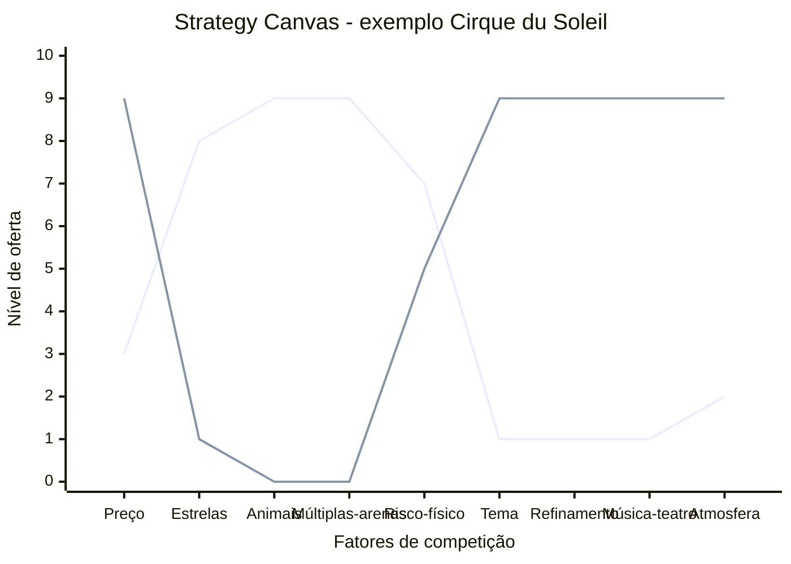

No gráfico acima, a curva que começa alta à esquerda representa o circo tradicional (Ringling Bros. and Barnum & Bailey): forte gasto em estrelas, espetáculos com animais e três picadeiros simultâneos. Já a curva que sobe à direita representa o Cirque du Soleil: reduz ou elimina animais e astros individuais para elevar tema artístico, trilha sonora original e ambientação teatral. Onde as duas curvas se afastam nasce a diferenciação; onde se sobrepõem há disputa pelo mesmo padrão.

A análise associada é o **ERRC Grid**: quatro decisões estratégicas para mover a curva:

- **Eliminate**: que fatores que o setor compete podem ser totalmente eliminados?
- **Reduce**: que fatores podem ser reduzidos abaixo do padrão do setor?
- **Raise**: que fatores devem ser elevados acima do padrão?
- **Create**: que fatores nunca oferecidos pelo setor podem ser criados?

##### O momento exato de colocar este canvas na parede

Use o Strategy Canvas na Fase 6 (mapeamento de mercado e concorrência) quando o setor parecer saturado e você precisar decidir onde divergir do padrão dos incumbentes. Repita o exercício a cada 18 a 24 meses como auditoria estratégica, pois os rivais tendem a copiar sua curva ao longo do tempo, e retome a ferramenta na Fase 19 (reinvenção e segunda curva, no Volume 9).

##### As regras de ouro para preencher sem se enganar

A tese de Kim e Mauborgne é que **competição direta é desperdício de capital**. Se duas empresas oferecem o mesmo conjunto de fatores em níveis ligeiramente diferentes, elas brigam por margem cada vez menor. A saída é **mudar o jogo**, não jogar melhor o mesmo jogo. Para isso, é preciso mapear honestamente o que o setor compete (a maioria não articula explicitamente) e identificar onde você pode oferecer perfil radicalmente distinto. **Diferenciação + Custo Baixo simultâneos** é possível quando você elimina/reduz fatores caros e cria fatores baratos mas valiosos.

##### Passo a passo na parede da sala (roteiro de oficina colaborativa)

**Etapa 1: Mapear o setor atual.** Liste os 8-15 fatores em que os concorrentes competem. Pergunte: o que o cliente compara antes de comprar? O que aparece nas propagandas? O que aparece nas reviews? Tipicamente: preço, qualidade, marca, conveniência, suporte, customização, velocidade, escala. Seja específico ao seu setor.

**Etapa 2: Traçar curvas dos concorrentes.** Para cada concorrente principal (3-5), atribua nota 1-10 em cada fator e desenhe a linha. Use dados reais (preço de tabela, NPS, share, reviews) quando disponível.

**Etapa 3: Aplicar ERRC Grid.** Para cada fator, decida: eliminar, reduzir, elevar, criar. Articule por que (qual job-to-be-done deixa de ser servido vs qual passa a ser).

**Etapa 4: Traçar a curva nova.** A sua curva deve ser **visualmente distinta** das curvas dos concorrentes. Se ela sobrepõe a média do setor com pequeno offset, não é Blue Ocean: é apenas otimização de Red Ocean.

**Etapa 5: Validar com cliente.** Mostre as curvas para clientes-alvo. Pergunte: "Se essas duas opções existissem, qual escolheria? Por quê?". Se a resposta é "depende", a diferenciação não é forte o suficiente.

Tempo: 4-8 horas para a primeira versão (exige pesquisa de campo dos concorrentes). Revisar a cada 12-18 meses.

##### Exemplo brasileiro preenchido: Stone vs adquirentes tradicionais (2014) (reconstrução didática com base em dados públicos)

Em 2014, o setor brasileiro de adquirência (Cielo, Rede, Stone nascente) competia em fatores tipicamente bancários: preço de MDR (taxa por transação), aluguel de máquina, prazo de antecipação, marca, capilaridade. Stone construiu sua curva de valor diferente:

| Fator | Cielo / Rede (média do setor) | Stone (entrante 2014) | Decisão ERRC |
|---|---|---|---|
| MDR (taxa) | 3-4% | 2-3% | Reduce |
| Aluguel da máquina | R$ 50-100/mês | R$ 0 (subsidiado) | Reduce |
| Prazo de antecipação | 30-60 dias | 1 dia (D+1) | Raise |
| Atendimento ao lojista | Call center distante, demora dias | "Ponto-de-Atenção": humano dedicado, resposta em horas | Raise |
| Presença local de atendimento | Gerente bancário generalista | Polos locais com agentes próprios em campo (*Green Angels*) | Raise |
| Suporte técnico e logística | Terceirizado e lento (vários dias úteis) | Troca presencial rápida e atendimento em até 5 segundos (reconstituição ilustrativa inspirada no prospecto do IPO da Stone de 2018) | Create |
| Software de gestão integrada | Pouco | Stone Hub (PDV + gestão) | Create |
| Marca corporativa-bancária | Alta | Baixa (mas crescente) | Reduce |

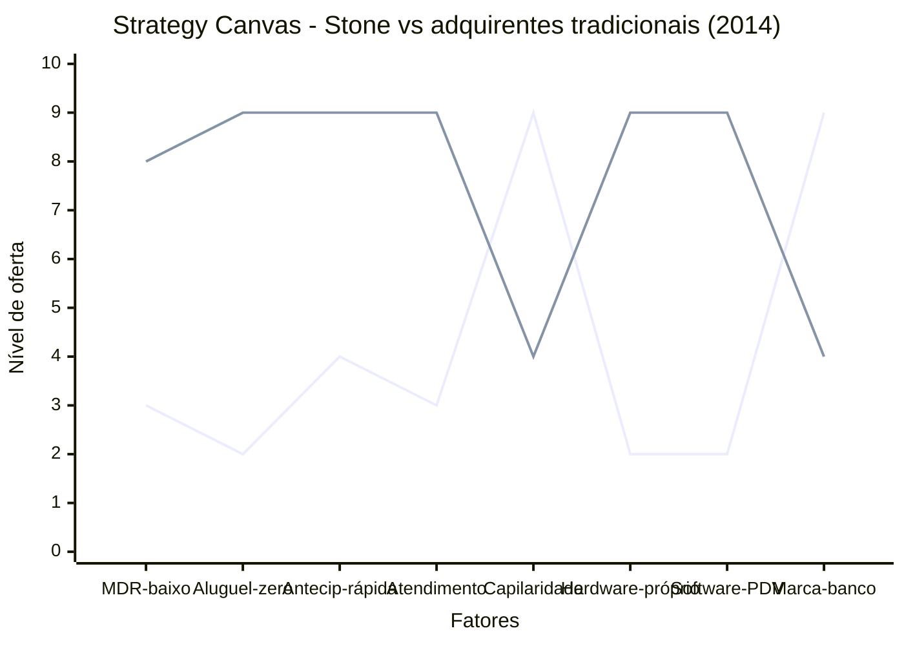

Stone não venceu fazendo o que Cielo fazia mais barato. Venceu **mudando o que o setor competia**: criou Atendimento Diferenciado (Ponto-de-Atenção, não call center), criou hardware/software próprios para lojistas pequenos (não comprou da Verifone), reduziu o aluguel a zero, antecipou pagamento. O resultado foi uma curva visualmente distinta: comprador de Stone NÃO via Stone como "Cielo mais barata", via como **adquirente diferente**. Isso é Blue Ocean: a Stone não tirava clientes da Cielo apenas via preço, abria mercado novo (lojistas pequenos antes desatendidos pela burocracia bancária). O IPO em 2018 (NASDAQ, valuation US$ 7+ bilhões) validou a aposta.

##### Variações e extensões

- **Pioneer-Migrator-Settler Map**: classifica produtos do portfólio em pioneiros (alta diferenciação, alta margem), migradores (alguma diferenciação) e colonos (commodity). Útil para gestão de portfólio.
- **Six Paths Framework**: seis lentes para identificar Blue Ocean (indústria alternativa, grupos estratégicos, cadeia de compradores, oferta complementar, apelo emocional vs funcional, tendências de tempo).
- **Buyer Utility Map**: cruza ciclo de uso do cliente com seis utilidades (produtividade, simplicidade, conveniência, risco, diversão, sustentabilidade).

##### Onde os fundadores mentem para si mesmos neste canvas

- Listar fatores genéricos (preço, qualidade) em vez de fatores específicos do setor.
- Curva nova "ligeiramente acima" da média do setor: isso é otimização, não Blue Ocean.
- Eliminar/reduzir fatores que clientes ainda valorizam: pesquisar antes, não decidir no escritório.
- Confundir Strategy Canvas com posicionamento de marketing: é estratégia operacional (o que construir), não slogan.
- Não validar a curva nova com cliente antes de comprometer recursos: Blue Ocean teórico que ninguém prefere é apenas oceano vazio.

---

#### Canvas: Canvas da Cunha (autoral IGNIÇÃO)

##### Por que este quadro visual foi criado

O Canvas da Cunha é ferramenta autoral desenvolvida para o contexto específico de startups B2B brasileiras que precisam escolher um segmento de entrada estreito antes de escalar. A estratégia de entrar por um submercado específico e dominá-lo antes de expandir vem da cabeça de praia (*beachhead*) e da pista de boliche de Geoffrey Moore (*Crossing the Chasm*, 1991), reforçada pela tese de monopólio de nicho de Peter Thiel (*Zero to One*, 2014): a ideia de que toda startup dominante começou controlando um nicho pequeno e específico antes de expandir. O canvas operacionaliza essa estratégia: força o fundador a articular com precisão *quem* é o cliente do segmento de entrada, *qual* dor específica está sendo resolvida, e *como* o resultado é mensurável. O "Teste do Grupo de WhatsApp", você consegue listar nominalmente 100-300 pessoas específicas como potenciais primeiros clientes?, é o teste de falsificabilidade da cunha: cunha bem definida passa no teste; cunha vaga não passa. O template completo preenchível está no [[#Template: Canvas da Cunha|Template: Canvas da Cunha]].

##### A anatomia visual de uma página

Tela visual de uma página com **seis blocos** que definem a anatomia completa da cunha de entrada:

- **ICP (Ideal Customer Profile) preciso**: descrição em 2-3 linhas do cliente específico, não "PMEs", mas "donos de padaria artesanal com 1-3 unidades em SP com delivery próprio".
- **Dor específica**: um fluxo de trabalho específico que está quebrado ou ineficiente para esse ICP. Não "dificuldade em gestão", mas "gasta 3 horas por semana consolidando pedidos de delivery de três canais diferentes manualmente".
- **Resultado mensurável**: como o cliente sabe que a solução funcionou? Escolha 1-2 categorias: receita gerada, custo reduzido, risco eliminado, tempo economizado. Com número: "reduz de 3h para 15min/semana".
- **Dono do orçamento**: cargo e nível hierárquico de quem assina o cheque, não quem usa o produto.
- **Teste do Grupo de WhatsApp**: você consegue listar nominalmente 100-300 potenciais primeiros clientes? Se sim, a cunha está bem definida. Se não, é muito larga: refine.
- **Alternativa atual e vantagem**: o que o cliente faz hoje para resolver esse problema? Por que você é melhor, em uma frase com número?

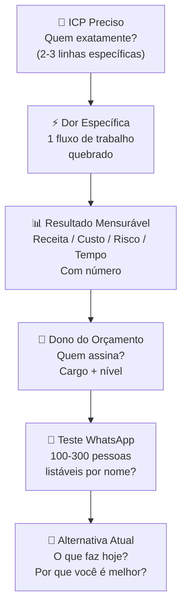

##### O momento exato de colocar este canvas na parede

Use o Canvas da Cunha na Fase 6 (mapeamento de mercado e concorrência) como entregável final antes de avançar para a Fase 7 (Volume 3). Sem ele preenchido e aprovado nos três testes complementares (Teste de Precisão do Comprador, ausência de escopo instável e independência de plataforma), a Fase 6 não está concluída. Retome o canvas também em momentos de reinvenção e segunda curva (Fase 19, no Volume 9).

##### As regras de ouro para preencher sem se enganar

Três princípios fundamentam o canvas:

**Primeiro: especificidade é vantagem competitiva, não limitação.** O instinto do fundador é ampliar o ICP ("não quero excluir potenciais clientes"). O canvas vai na direção oposta: quanto mais estreito o ICP, mais forte a proposta de valor, mais rápido o feedback de mercado, mais fácil a venda. Você não está excluindo clientes: está escolhendo *por onde entrar*. Escala vem depois.

**Segundo: a cunha é definida pela dor, não pelo produto.** O erro mais comum é definir a cunha pelo que o produto faz ("somos um ERP para PMEs"). A cunha correta é definida pelo problema específico que está sendo resolvido para um cliente específico ("somos a ferramenta que resolve o problema de recoletada manual de dados para escritórios contábeis com 50-100 clientes PME"). O produto pode evoluir; a dor específica é o núcleo.

**Terceiro: o Teste do WhatsApp é o critério de verdade.** Qualquer fundador pode escrever "donos de PME com dificuldade em gestão" como ICP. Muito poucos conseguem listar 200 nomes específicos de pessoas que atendem a esse critério. O teste força a realidade: se você não consegue nominar 100 pessoas, seu ICP não está definido o suficiente para ser uma cunha viável.

##### Passo a passo na parede da sala (roteiro de oficina colaborativa)

Preencha individualmente primeiro (20-30 min) e depois valide com pelo menos um cofundador ou mentor externo (30 min). Use o template completo do [[#Template: Canvas da Cunha|Template: Canvas da Cunha]].

**Sequência:**

1. **ICP**: descreva quem é o cliente em 2-3 linhas. Inclua: setor, porte, localização, critério operacional (tem delivery próprio, tem gerente de frota, tem mais de X clientes, etc.). Não use adjetivos vagos ("médias empresas"): use critérios objetivos.
2. **Dor específica**: escolha um fluxo de trabalho. Descreva o que está quebrado com verbos concretos ("gasta", "consolida manualmente", "perde"). Se você precisar de 3 frases, o ICP ainda é largo demais.
3. **Resultado mensurável**: escolha 1-2 categorias. Coloque um número. Se não tem o número, pergunte a 5 potenciais clientes antes de preencher o bloco.
4. **Dono do orçamento**: não é necessariamente quem usa o produto. Em B2B, frequentemente é um nível acima. Nomeie o cargo e o contexto hierárquico.
5. **Teste do WhatsApp**: tente listar. Se conseguir 100-300 nomes específicos (LinkedIn, associações, contatos do setor, indicações), a cunha está certa. Se não conseguir 50, está larga demais.
6. **Alternativa atual e vantagem**: descreva o que o cliente faz *hoje* (Excel, processo manual, concorrente, "não faz nada"). Escreva a vantagem em uma frase com número. Sem número, não é comparação: é afirmação vaga.

Após preencher, aplique os três testes complementares do Template: Canvas da Cunha (Fase 6) antes de avançar.

##### Exemplo brasileiro preenchido: PadariaPro (caso recorrente do livro) (reconstrução didática com base em dados públicos)

| Bloco | Conteúdo |
|---|---|
| **ICP** | Donos e sócios-operadores de pequenas redes de padarias artesanais com 3 a 5 unidades na capital paulista (coerente com o ICP refinado do PadariaPro nas Fases 4 e 5), com produção própria diária e perda recorrente de insumos, faturamento R$ 80-400k/mês, há pelo menos 2 anos no mercado. Excluir: padarias industriais, franquias, padarias sem delivery próprio. |
| **Dor específica** | Consolida pedidos de delivery de 2-3 canais (WhatsApp, iFood, site próprio) manualmente: copia pedido do WhatsApp para planilha, confere com iFood, passa para a produção. Processo leva 2-3 horas/dia, gera erros de pedido e atrasos que resultam em avaliações negativas. |
| **Resultado mensurável** | Reduz consolidação de pedidos de 2-3h/dia para 15 min/dia (tempo). Reduz erro de pedido de ~8% para <1% (qualidade → preservação de avaliação). |
| **Dono do orçamento** | O próprio dono ou sócia operacional: em padarias dessa faixa, não há gestor intermediário; quem sofre o problema é quem paga. |
| **Teste do WhatsApp** | Fundadores conseguiram listar 180 padarias específicas em SP via Instagram (buscando perfis de padaria artesanal com >500 seguidores) + associação de panificadores de SP + grupos de WhatsApp de donos de padaria. Cunha aprovada. |
| **Alternativa atual** | Planilha Excel + cópia manual de mensagens de WhatsApp. Por que melhor: "Reduz 2,5h/dia de trabalho manual e elimina 90% dos erros de pedido, por R$ 290/mês: equivale a menos de 20 minutos por dia do custo de oportunidade do dono (cerca de 7 horas mensais a R$ 45/hora)." |

O bloco mais trabalhoso foi a **Dor específica**: a primeira versão dizia "dificuldade em gestão de delivery". Com esse enunciado, o Teste do WhatsApp seria impossível (como listar donos de padaria com "dificuldade em gestão"?). Ao refinar para "consolida pedidos de 2-3 canais manualmente 2-3h/dia", o teste ficou testável: o critério de inclusão na lista era "tem delivery via WhatsApp E pelo menos mais um canal". **A lição: o Teste do WhatsApp não é só um teste de tamanho do mercado, é um teste de especificidade da dor. Se você não consegue montar a lista, o critério de dor está vago demais para gerar uma proposta de valor precisa.**

##### Variações e extensões

- **Canvas da Cunha para B2C**: versão adaptada onde "Dono do orçamento" é substituído por "Contexto de decisão de compra" (impulso, pesquisa, influência social): em B2C o comprador e o usuário são o mesmo.
- **Canvas da Segunda Cunha**: para empresas em escala que querem atacar um novo segmento com o produto existente: mesma estrutura mas com bloco adicional "Vantagem incumbente" (o que a empresa já tem que facilita a entrada neste segmento vs. novo entrante).

---

#### Canvas: Network Effects Map

##### Por que este quadro visual foi criado

O mapeamento sistemático dos tipos de efeitos de rede foi popularizado pela NFX (firma de venture capital de San Francisco) a partir de 2018, quando publicaram a taxonomia inicial de 13 tipos de efeitos de rede (posteriormente expandida pelo fundo para 16 categorias) como framework para investidores e founders avaliarem a defensibilidade de modelos de negócio. O trabalho de James Currier e Pete Flint na NFX codificou décadas de observação empírica, de Metcalfe (Ethernet, 1980) a Reed (grupos, 1999), numa estrutura acionável para startups. O Network Effects Map adapta essa taxonomia para formato visual em canvas, com foco brasileiro.

##### A anatomia visual de uma página

Tela visual que mapeia quais tipos de efeitos de rede um modelo de negócio captura, com que força, e como eles interagem. O objetivo não é apenas identificar "tem efeito de rede": é entender qual tipo, qual a força relativa, e onde está o loop de reforço que torna o modelo defensável.

**Os tipos principais de efeitos de rede (síntese da taxonomia NFX):**

| Tipo | Mecanismo | Exemplos | Força |
|---|---|---|---|
| **Direto** | Cada usuário adicional aumenta o valor para todos os outros | WhatsApp, telefone | ●●●●● |
| **Two-sided** | Dois grupos se beneficiam mutuamente (compradores/vendedores) | iFood, Mercado Livre | ●●●●○ |
| **Data** | Mais dados = produto melhor = mais usuários = mais dados | Google Search, Waze | ●●●●○ |
| **Tech Performance** | Mais uso = infraestrutura mais eficiente | CDNs, blockchain com proof-of-work | ●●●○○ |
| **Language** | Plataforma vira padrão de vocabulário/formato | Slack (canais), GitHub (pull request) | ●●●○○ |
| **Belief** | Valor sustentado por convenção coletiva (frágil no início) | Criptoativos, padrão monetário | ●●○○○ |
| **Bandwagon** | Pressão social para adotar o que "todo mundo usa" | TikTok, tendências virais | ●●●○○ |
| **Platform** | Desenvolvedores criam valor para usuários | iOS App Store, Salesforce AppExchange | ●●●●○ |

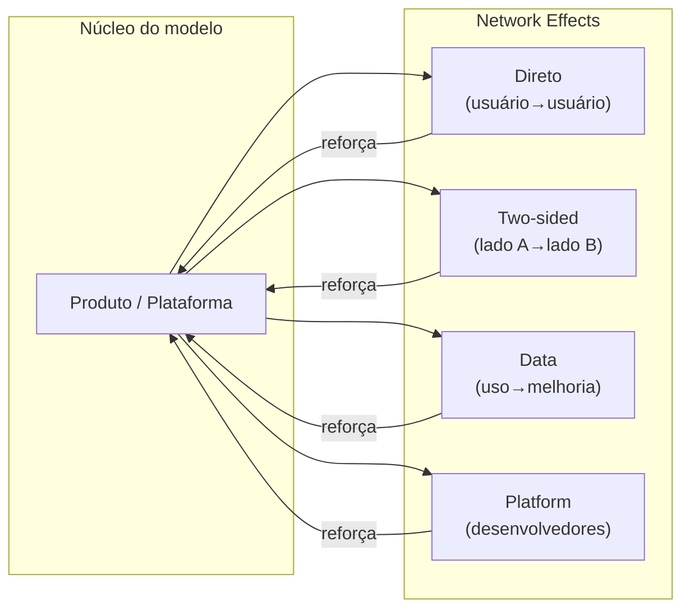

##### O momento exato de colocar este canvas na parede

Use o Network Effects Map em dois momentos: (1) **ao desenhar o modelo de negócio** (Fase 2–5), para identificar se e onde há loops de NE que podem ser construídos intencionalmente; (2) **ao preparar pitch de investimento**: investidores de VC avaliam defensibilidade, e NE são um dos principais mecanismos. Saber nomear e explicar o tipo de NE do seu modelo diferencia o fundador.

##### As regras de ouro para preencher sem se enganar

**Primeiro: a maioria das startups não tem efeito de rede, tem economias de escala.** "Quanto mais clientes, mais barato o custo unitário" é escala, não NE. Efeito de rede requer que um usuário adicional torne o produto melhor para os outros. Confundir os dois é erro comum de pitch.

**Segundo: NE two-sided são os mais comuns e os mais frágeis no início.** Marketplace sem compradores não atrai vendedores, e vice-versa. O chicken-and-egg problem é o desafio central de modelos two-sided. A solução geralmente é subsidiar um lado temporariamente (iFood subsidiou entregadores; Mercado Livre não cobrou comissão dos primeiros vendedores).

**Terceiro: efeitos de rede de dados costumam ser superestimados.** Como alertamos na seção do framework NFX, acumular mais dados só gera barreira competitiva real quando o volume adicional melhora o produto de forma automática, contínua e perceptível para o usuário antes de atingir assíntota.

##### Passo a passo na parede da sala (roteiro de oficina colaborativa)

**Passo 1: Listar todos os NE candidatos:** Para cada tipo na tabela acima, perguntar "nosso modelo tem isso?" e pontuar 0 (não tem), 1 (fraco / emergente) ou 2 (forte / comprovado).

**Passo 2: Mapear os loops:** Para cada NE identificado com score ≥ 1, desenhar o loop de reforço: Produto → [mecanismo] → mais usuários/dados → produto melhor.

**Passo 3: Identificar o NE dominante:** Qual é o loop mais forte? Qual é o que mais diferencia o modelo de um produto sem NE? Esse é o NE a comunicar para investidores e a proteger como moat.

**Passo 4: Identificar onde o NE ainda não existe:** Quais tipos poderiam ser construídos com mudanças de produto? Um SaaS B2B sem NE pode criar NE de dados (analytics de benchmark) ou NE de plataforma (marketplace de integrações).

##### Exemplo brasileiro preenchido: iFood (reconstrução didática com base em dados públicos)

| Tipo de NE | Score | Mecanismo |
|---|---|---|
| Two-sided (restaurante ↔ consumidor) | ●●●●● | Mais restaurantes = mais opções = mais pedidos = mais receita para restaurantes = mais restaurantes |
| Two-sided (consumidor ↔ entregador) | ●●●○○ | Mais pedidos = mais entregadores disponíveis = menor tempo de entrega = mais pedidos |
| Data | ●●●○○ | Histórico de pedidos alimenta personalização de feed e estimativa de tempo de entrega |
| Bandwagon | ●●○○○ | "Todo mundo pede pelo iFood": pressão social para estar na plataforma |
| **NE dominante** |: | Two-sided restaurante↔consumidor: o loop mais forte e mais defensável |

**Insight do caso:** O NE mais forte do iFood não é o tecnológico (dados), é o two-sided de distribuição (restaurante↔consumidor). Por isso, o moat principal é a cobertura geográfica de restaurantes: quem tem mais restaurantes em mais bairros vence a guerra de aquisição de consumidores. Isso explica por que iFood investiu agressivamente em onboarding de restaurantes mesmo com unit economics negativos no curto prazo.

##### Onde os fundadores mentem para si mesmos neste canvas

- Chamar escala de efeito de rede: confunde o time e o investidor.
- Ter NE two-sided fraco no início e não subsidiar o lado correto.
- Ignorar NE de dados enquanto constrói produto: os dados de hoje são o moat de amanhã.
- Subestimar o chicken-and-egg: lançar em muitas cidades ao mesmo tempo dilui o NE two-sided, melhor dominar uma cidade completamente antes de expandir.

---

### TEMPLATES OPERACIONAIS E CASOS PREENCHIDOS DESTA FASE

#### Template: Teste de Precisão do Comprador

Use este template para validar o elemento #4 da Anatomia da Cunha (Dono do Orçamento) antes de avançar para a [[IGNICAO-Vol-3-Experimentos-e-Prototipagem#FASE 7 — FORMULAÇÃO RIGOROSA DE HIPÓTESES|Fase 7 (Vol. 3)]]. É um exercício de 10 a 15 minutos. Se demorar mais que isso, o próprio atraso já é o diagnóstico.

```text
TESTE DE PRECISÃO DO COMPRADOR, v___ Data: ___/___/___

A FRASE QUE NÃO DEVE TRAVAR:

"Nós vendemos para [CARGO] em [TIPO DE EMPRESA] porque essa pessoa
é responsável por [RESULTADO ESPECÍFICO] e controla
[ORÇAMENTO ESPECÍFICO]."

MINHA VERSÃO:

CARGO (nominal, existente no organograma do cliente):
___________________________________________________________

TIPO DE EMPRESA (tamanho + setor + segmento):
___________________________________________________________

RESULTADO ESPECÍFICO (pelo qual esse cargo responde):
___________________________________________________________

ORÇAMENTO ESPECÍFICO (rubrica + faixa de valor):
___________________________________________________________

CRITÉRIOS DE APROVAÇÃO (os 3 critérios obrigatórios abaixo precisam passar; use as 6 perguntas do exemplo da seção como checklist complementar de acesso):

[ ] (1) Frase escrita em menos de 30 segundos, sem rascunhar
 variações para audiências diferentes.

[ ] (2) Cargo é REAL e existente no organograma típico do ICP
 (não usar "decisor", "stakeholder", "gestor", "líder").

[ ] (3) Orçamento é RUBRICA EXISTENTE no cliente
 (não criar rubrica nova para comprar de você:
 rubricas novas triplicam o ciclo de decisão).

SE REPROVOU:

Qual item travou? __________________________________________

Hipótese sobre o motivo
(ex.: venda depende de múltiplos papéis, ICP ainda misturado,
comprador econômico não conhecido, produto exige nova rubrica):
___________________________________________________________
___________________________________________________________

Próxima ação
(voltar à Fase 4 com foco em qual pergunta específica?):
___________________________________________________________

CHECK DE SEPARAÇÃO DE PAPÉIS (B2B):

No meu contexto, Usuário, Campeão Interno e Comprador
Econômico são:

[ ] A mesma pessoa (contexto B2C ou SMB muito pequeno).
[ ] Duas pessoas distintas, especifique:
 Usuário/Campeão: ___________________________
 Comprador Econômico: ___________________________
[ ] Três pessoas distintas, especifique cada uma:
 Usuário: ___________________________
 Campeão Interno: ___________________________
 Comprador Econômico: ___________________________

VALIDAÇÃO EXTERNA:

Três pessoas independentes que conseguiram repetir a frase
sem ajuste e a consideraram plausível para o ICP:

1) _______________________ Data: ___/___/___
2) _______________________ Data: ___/___/___
3) _______________________ Data: ___/___/___
```

**Observação sobre o Teste de Precisão do Comprador**: reprovar neste teste raramente significa que sua ideia é ruim, significa que a pesquisa de usuário da [[#FASE 5 — PESQUISA COM USUÁRIOS (CUSTOMER DISCOVERY)|Fase 5]] ficou centrada em quem usa o produto e não em quem paga pelo produto. Em B2B, são quase sempre pessoas diferentes, e essa diferença é o motivo mais comum de ciclo de venda travado. Reprovação aqui é um presente: revela a lacuna antes dela custar meses de vendas fracassadas.

---

#### Template: Canvas da Cunha

Use este template como entregável final da Fase 6.

> [!note] Teoria completa em Canvas: Canvas da Cunha (autoral IGNIÇÃO) (Fase 6)
> Origem, estrutura, princípios, como aplicar e caso brasileiro do Canvas da Cunha encontram-se em [[#Canvas: Canvas da Cunha (autoral IGNIÇÃO)|Canvas: Canvas da Cunha (autoral IGNIÇÃO)]]. Este template é o complemento prático (campos preencháveis) daquela seção. Ele consolida os quatro elementos da Anatomia da Cunha, o Teste do Grupo de WhatsApp e a comparação com a alternativa atual. Preencha **antes** de avançar para a [[IGNICAO-Vol-3-Experimentos-e-Prototipagem#FASE 7 — FORMULAÇÃO RIGOROSA DE HIPÓTESES|Fase 7 (Vol. 3)]], sem ele, as hipóteses da fase seguinte não terão ancoragem no mercado específico que você escolheu atacar.

```text
CANVAS DA CUNHA, v___ Data: ___/___/___

ICP (preciso): _______________________________________
 _______________________________________

Dor específica: _______________________________________
(1 fluxo de trabalho) _______________________________________

Resultado mensurável: _____________________________________
(escolha 1-2 categorias: receita / custo / risco / tempo)
Métrica do resultado: _____________________________________
(ex.: "reduz de 4h para 15min por semana")

Dono do orçamento: _______________________________________
(cargo + nível hierárquico)

Teste do grupo de WhatsApp:
Quantas pessoas específicas eu consigo listar nominalmente
como potenciais primeiros clientes? _____
[ ] Cunha aprovada (100-300 pessoas listáveis).
[ ] Cunha muito larga (refinar).

Alternativa atual (o que o cliente faz hoje):
___________________________________________________________

Por que eu sou melhor do que a alternativa atual
(em 1 frase, com número se possível):
___________________________________________________________

VERIFICAÇÕES COMPLEMENTARES:

[ ] Teste de Precisão do Comprador (template anterior, nesta mesma seção) aprovado.
[ ] Nenhum ou no máximo 1 dos 4 sinais de escopo instável presentes.
[ ] Distinção Cunha vs Plataforma compreendida, a ideia é vendável
 como cunha autônoma, sem depender de promessa de roadmap futuro.

VALIDAÇÃO EXTERNA:

Três pessoas independentes (mentor, cliente-alvo, investidor)
que confirmaram a Cunha como plausível e bem definida:

1) _______________________ Data: ___/___/___
2) _______________________ Data: ___/___/___
3) _______________________ Data: ___/___/___
```

**Observação sobre o Canvas da Cunha**: o canvas sozinho é um artefato morto se não passar pelos três testes acima (Precisão do Comprador, ausência de escopo instável, independência de plataforma). Cada um desses testes revela um tipo diferente de fragilidade oculta. Canvas preenchido + três testes aprovados = autorização para avançar à [[IGNICAO-Vol-3-Experimentos-e-Prototipagem#FASE 7 — FORMULAÇÃO RIGOROSA DE HIPÓTESES|Fase 7 (Vol. 3)]]. Canvas preenchido mas algum teste reprovado = refinar antes de avançar, não pular.

---

### Fechamento da Fase 6: o que muda na sua cabeça e na sua empresa a partir de agora

A Fase 6 confronta dois ditos perigosos do fundador apaixonado. "Não há concorrentes." "O mercado é enorme." Ambos quase sempre são falsos. Existem soluções, mesmo que ruins. Existem substitutos, incluindo "fazer nada". Existem players grandes que podem te copiar quando perceberem o sinal. Existe regulamentação que pode te inviabilizar. Sem mapa de mercado, você empreende às cegas. Com ele, decide informado.

O entregável é o Dossiê de Mercado mais o Canvas da Cunha preenchido. O Dossiê não é estático. O mercado muda, novos entrantes aparecem, consolidações acontecem, regulação evolui. Revisitar pelo menos a cada seis meses não é exagero, é higiene. A [[IGNICAO-Vol-3-Experimentos-e-Prototipagem#FASE 7 — FORMULAÇÃO RIGOROSA DE HIPÓTESES|Fase 7 (Vol. 3)]] vai transformar o mapeamento feito aqui em hipóteses testáveis: o Canvas da Cunha vira insumo direto para o Banco de Hipóteses.

---

### Ponte para os Capítulos Complementares deste Volume (e preparação para o Volume 3)

Com as Fases 4, 5 e 6 concluídas, os quatro capítulos a seguir aprofundam lentes transversais indispensáveis para operar no mercado brasileiro (psicologia do consumidor local, inteligência competitiva, design de categoria e lições de fracassos reais) antes de você iniciar a formulação de hipóteses e os experimentos da Fase 7 no Volume 3.

Ao concluir as Fases 4, 5 e 6 deste **Volume 2**, você ouviu o cliente sem viés (*Mom Test*), mapeou os *Jobs to Be Done* e a jornada real de compra e dissecou a estrutura competitiva do mercado e sua cunha de entrada (*wedge*). Os **4 capítulos** a seguir aprofundam a psicologia do consumidor brasileiro, inteligência competitiva, *Category Design* e posicionamento.

O próximo passo da jornada está no **Volume 3: Hipóteses, Experimentos, Prototipagem e Modelos de Negócio**, começando na [[IGNICAO-Vol-3-Experimentos-e-Prototipagem#FASE 7 — FORMULAÇÃO RIGOROSA DE HIPÓTESES|Fase 7: Formulação Rigorosa de Hipóteses (Vol. 3)]]: converter suas descobertas em apostas matematicamente falsificáveis, rodar experimentos de compromisso real, prototipar e testar a usabilidade do MVP.

---

# CONSUMIDOR BRASILEIRO, INTELIGÊNCIA COMPETITIVA E DESIGN DE CATEGORIA (CAPÍTULOS 1 A 3)

Você não descobre um cliente nem posiciona uma empresa no vácuo cultural: um comprador no Brasil decide de forma completamente diferente de um comprador no Vale do Silício. Os capítulos a seguir dissecam a psicologia de confiança e conversão do comprador brasileiro, a inteligência competitiva combinada à criação de categoria (*Category Design*) e as lições reais de empresas brasileiras que ignoraram a gravidade do mercado.

---

## CAPÍTULO 1 — PSICOLOGIA DO CONSUMIDOR BRASILEIRO — COMPORTAMENTO, DECISÃO E CONVERSÃO

### O Paradoxo da Desconfiança Cordial: Como o Brasileiro Realmente Compra

Meses depois dos primeiros testes em campo, quando Rafael e Bia lançaram a frente D2C da sua marca a partir de Recife e do centro de distribuição em Goiânia, eles importaram o funil exato que tinham visto em um curso americano de Growth: página minimalista sem telefone visível, checkout automático em etapa única apenas para cartão de crédito internacional e suporte exclusivo por tíquete de e-mail com SLA de 48 horas. No primeiro mês, gastaram R$ 30 mil em tráfego pago. O carrinho teve 1.400 adições e apenas 11 vendas concluídas.

Desesperada, Bia colocou um botão flutuante de WhatsApp na página de checkout na sexta-feira à noite. Em duas horas, o celular dela apitou sessenta vezes com a mesma pergunta em áudio:

– "Moça, essa loja existe mesmo ou é golpe? Tem Pix com desconto ou parcela em 10x sem juros? Se der problema, eu falo com gente de verdade?"

Bem-vindo à realidade tropical que nenhum livro da Califórnia ensina. O consumidor e o comprador corporativo no Brasil operam sob **O Paradoxo da Desconfiança Cordial**: o brasileiro costuma ser caloroso e receptivo no primeiro contato, mas fica desconfiado na hora de pagar (reflexo de golpes digitais frequentes e de juros do rotativo do cartão que superavam 400% ao ano antes do teto legal da Lei 14.690/2023, segundo séries do Banco Central), mas vivemos em um ambiente histórico de baixa confiança institucional, golpes digitais diários, juros no rotativo de 400% ao ano e medo permanente de ficar desamparado após o pagamento.

Tentar vender no Brasil copiando a frieza transacional dos Estados Unidos é rasgar dinheiro. Aqui, o WhatsApp não é um aplicativo de mensagens; é o sistema operacional da confiança nacional. Aqui, o preço cheio importa menos do que se a parcela cabe no fluxo de caixa mensal da família ou do departamento. E no B2B brasileiro, ninguém assina um contrato relevante apenas porque o software tem um gráfico bonito: o gerente precisa ter certeza de que não será demitido se a sua startup falir amanhã. Compreender a psicologia econômica do brasileiro é transformar essa barreira cultural na sua maior vantagem injusta.

---

> [!note] Para quem é este capítulo
> Founders e líderes de produto, marketing e growth (crescimento orientado por dados e experimentação) que constroem para o mercado brasileiro e precisam entender os mecanismos psicológicos pelos quais o consumidor decide, confia, compra e cancela. Aplica-se a B2C e B2B.

> [!important] Cultura não é estereótipo
> Este capítulo reúne padrões recorrentes observados em campo e em levantamentos de mercado (como séries do Banco Central, relatórios da CNDL/SPC Brasil, Instituto Locomotiva e Reclame Aqui); trate cada padrão como hipótese a testar com o seu próprio cliente. Padrões não eliminam variação individual. Use como lente de análise, não como lista de pressupostos sobre cada cliente específico.

---

### 1.1: O que Torna o Consumidor Brasileiro Distinto (e o que os áudios de Rafael e Bia revelaram)

A psicologia do consumidor brasileira opera em um contexto que moldou comportamentos específicos. Entender esse contexto é o pré-requisito para qualquer decisão de produto, pricing ou comunicação.

#### 1.1.1 — Alta Relacionalidade

No Brasil, a relação pessoal precede a transação comercial de modo muito mais acentuado do que em mercados de baixa contextualização como os Estados Unidos e o norte da Europa (como analisa Erin Meyer em *The Culture Map*, 2014). Isso se manifesta em:

B2B: Compradores brasileiros raramente fecham contratos com quem não conhecem pessoalmente, ou com quem não foi apresentado por alguém de confiança. O ciclo de vendas inclui uma fase implícita de construção de relacionamento que não aparece no funil formal mas é determinante para o fechamento.

B2C: A recomendação de pessoa conhecida (boca a boca, mensagem no WhatsApp, comentário em grupo familiar) supera campanhas de publicidade na capacidade de gerar confiança e reduzir resistência à compra.

Implicação de produto: funcionalidades que facilitam o compartilhamento e a recomendação pessoal (referral, programa de indicação, review, avaliação pública, "enviar para um amigo") têm ROI (return on investment: retorno sobre o investimento) sistematicamente maior no Brasil do que em mercados onde a confiança institucional é mais forte.

#### 1.1.2 — Confiança em Pessoas Acima de Instituições

Décadas de instabilidade econômica, episódios de confisco, e falhas institucionais criaram um consumidor que confia mais em pessoas específicas do que em marcas ou organizações abstratas.

Um banco com trinta anos de mercado pode ser percebido como menos confiável do que um gerente específico que esse banco tem. Um e-commerce desconhecido pode ser percebido como confiável se o produto veio recomendado por alguém de confiança.

Isso explica o fenômeno dos influenciadores brasileiros: a influência não é apenas de alcance, é de transferência de confiança pessoal para produto ou marca. Micro-influenciadores com audiências menores e mais específicas frequentemente convertem melhor do que macro porque a relação de confiança é mais intensa e direta.

#### 1.1.3 — Sensibilidade a Preço Combinada com Aspiração Social

O consumidor brasileiro tem alta sensibilidade ao preço absoluto e ao preço relativo, mas isso não significa que compra apenas o mais barato. A equação psicológica é: "posso pagar isso?" combinado com "isso me faz sentir como quero me sentir?".

Um produto que custa mais do que o competitor mas comunica status, pertencimento, ou progresso social pode ser preferido por consumidor de menor renda. O Iphone em parcelas de doze vezes sem juros na praça de alimentação de shopping popular é evidência disso.

A aspiração social no Brasil é motor de consumo mais poderoso do que em sociedades com menor mobilidade social percebida. O consumidor que "chegou lá" ou que está "chegando lá" usa o consumo como sinalização.

#### 1.1.4 — O "Jeitinho" como Forma de Agência

O "jeitinho brasileiro" é frequentemente descrito como improviso ou contorno de regras. Na perspectiva de comportamento do consumidor, é mais precisamente uma forma de agência em contexto de restrição: quando o caminho formal não funciona, o consumidor brasileiro encontra o caminho alternativo.

Implicação de produto: funcionalidades rígidas que não permitem adaptação encontram resistência ou abandono. Produtos que oferecem flexibilidade de uso (parcelamento customizável, prazo negociável, exceção possível) têm retenção melhor. O consumidor que consegue "um jeito" dentro do seu produto sente que o produto está do lado dele.

---

### 1.2 — Behavioral Economics no Brasil

Os princípios da behavioral economics (economia comportamental: campo que aplica psicologia às decisões econômicas) de Kahneman e Thaler se aplicam universalmente, mas com amplitudes distintas no contexto brasileiro.

#### 1.2.1 — Ancoragem: 12x Sem Juros como Âncora Perceptual

O parcelamento sem juros no Brasil criou uma âncora perceptual diferente da maioria dos países. "12x de R$49,90" é processado como "R$49,90 por mês", não como "R$598,80 no total". A âncora é a parcela, não o valor total.

Isso tem consequências diretas:

O preço percebido de um produto de R$1.200 parcelado em 12x sem juros pode ser menor do que o de um produto de R$600 à vista, quando o desembolso de R$ 600 de uma só vez estoura o fôlego mensal da família, enquanto a parcela de R$ 100 cabe no orçamento do mês.

Na precificação de software B2C ou SMB, apresentar o preço mensal primeiro (mesmo de plano anual) reduz resistência inicial. Mostrar "R$79/mês, cobrado anualmente" é psicologicamente diferente de "R$948/ano".

Em negociação B2B com PME, a pergunta "quanto você consegue comprometer por mês?" frequentemente desbloqueia negociações travadas em preço total.

#### 1.2.2 — Status Quo Bias

O consumidor brasileiro tem forte status quo bias em serviços com relacionamento estabelecido: banco, operadora de celular, plano de saúde. A inércia é alta porque trocar envolve esforço, risco percebido, e ruptura de relacionamento.

Para startups que competem com players estabelecidos: o argumento de switching precisa superar não apenas a diferença de valor percebido, mas o custo psicológico da mudança. A oferta precisa ser materialmente melhor, não marginalmente melhor.

Táticas para reduzir o atrito da troca de fornecedor: "portabilidade garantida", "migração assistida", "não perde seus dados", "30 dias grátis sem cancelar o atual" reduzem o custo psicológico percebido de tentar.

#### 1.2.3 — Efeito de Posse (Ownership Effect)

Uma vez que o consumidor brasileiro usa algo e passa a considerá-lo "seu", o valor atribuído ao item aumenta substancialmente. Isso torna free trials e freemium especialmente eficazes quando bem desenhados: o usuário investe tempo e dados no produto, passa a considerar aquele histórico "seu", e o custo psicológico de abandonar sobe.

Implicação: em free trials, a estratégia correta não é limitar funcionalidades, é criar investimento do usuário. Dados inseridos, configurações feitas, relatórios gerados, integrações conectadas: tudo isso aumenta o efeito de posse e a probabilidade de conversão.

#### 1.2.4 — Reciprocidade como Moeda Social

A norma de reciprocidade é especialmente forte no Brasil. Quando alguém faz algo por você, existe obrigação social de retribuir. Isso se manifesta em:

Content marketing que genuinamente resolve problema antes de pedir compra: o usuário que recebeu valor gratuito sente reciprocidade implícita.

Atendimento excepcional que surpreende positivamente: o cliente que foi bem tratado em momento de problema frequentemente se torna evangelizador ativo.

Presente físico ou gesto personalizado em contratos B2B: cartas escritas à mão, presentes no fechamento de contrato, ligação pessoal do founder: investimentos pequenos que geram reciprocidade desproporcional.

---

### 1.3 — Classe C e D como Mercado Principal

Segundo levantamentos da FGV Social, do Instituto Locomotiva e do Critério Brasil (ABEP), as classes C, D e E reúnem mais da metade da população brasileira e movimentam mais de 40% do consumo das famílias. São o maior mercado do país, não um nicho.

#### 1.3.1 — Poder de Compra Real vs. Percebido

O erro mais comum de founders de classe média-alta ao tentar servir esse segmento é subestimar a sofisticação e superestimar a limitação de renda.

O consumidor de classe C tem renda mensal familiar entre R$2.004 e R$8.640. Tem smartphone (penetração de smartphone no Brasil supera 80%), usa aplicativos, tem conta em banco digital, e faz compras online. Não é digitalmente excluído.

O que é diferente: a decisão de compra é mais deliberada porque a margem de erro financeiro é menor. O consumidor que ganha R$2.500 por mês e está comprometendo R$150 por mês em um produto está comprometendo 6% da renda. Qualquer dúvida sobre valor entregue resulta em cancelamento.

#### 1.3.2 — Canais de Confiança: Recomendação Supera Publicidade

Para esse segmento, a hierarquia de confiança é:

1. Recomendação de familiar ou amigo próximo
2. Indicação de pessoa conhecida da comunidade (líder local, pastor, influenciador do bairro)
3. Avaliações de outros consumidores reais (estrelas no app, comentários no Reclame Aqui)
4. Publicidade de marca conhecida
5. Publicidade de marca desconhecida

Implicação de crescimento: o referral de consumidor para consumidor tem conversão e LTV maiores do que aquisição por mídia paga nesse segmento. Investir em produto que entrega resultado suficiente para gerar recomendação espontânea é mais eficiente do que aumentar budget de mídia.

#### 1.3.3 — Decisão por WhatsApp

Para parcela significativa das classes C e D, o WhatsApp é o principal canal de comunicação, pesquisa, e até de transação. Grupos de WhatsApp funcionam como fóruns de recomendação e avaliação de produtos.

Isso tem implicações diretas de produto:

Um atendimento que funciona bem pelo WhatsApp é fator de diferenciação, não de paridade. Demora de resposta ou atendimento robótico sem humanização em WhatsApp faz o cliente cancelar (ou pedir rebaixamento de plano) mais rápido do que qualquer funcionalidade ausente.

A prova social que mais converte nesse segmento frequentemente é uma screenshot de conversa no WhatsApp mostrando resultado, não um depoimento formal no site.

Fluxos de onboarding ou ativação que chegam por WhatsApp têm taxas de completude maiores do que e-mail ou push notification.

#### 1.3.4 — Crédito como Habilitador

Para classes C e D, crédito não é apenas conveniência, é habilitador de acesso. O parcelamento permite a compra que seria impossível à vista. O limite do cartão é parte do orçamento mensal percebido.

Produtos que aceitam parcelamento em mais prestações, que oferecem boleto com mais dias de vencimento, ou que permitem pagamento via Pix com opção de pagar depois têm adesão maior nesse segmento.

---

### 1.4 — Mobile-First e WhatsApp como Interface Principal

O funil de aquisição, onboarding (integração inicial de novos usuários ao produto) e retenção projetado para desktop com e-mail como canal principal não funciona para o consumidor que vive no smartphone.

#### 1.4.1 — Redesenho do Funil para Entrada por Mensagem

Quando o ponto de entrada é um WhatsApp ou um Stories do Instagram, o funil clássico (anúncio → landing page → cadastro → e-mail → ativação) precisa ser redesenhado:

Anúncio com CTA que abre WhatsApp ou vai direto ao app na loja. Não para landing page que vai pedir e-mail.

Cadastro simplificado: telefone ou número de CPF suficiente para começar. E-mail pode vir depois ou nunca.

Onboarding inteiramente via app ou WhatsApp. Cada etapa concluída com confirmação imediata. Sem sequência de e-mails que o usuário não vai abrir.

Prova de valor nos primeiros 3-5 minutos. O smartphone é ambiente de alta concorrência por atenção. Se o produto não entregou algo tangível nos primeiros minutos, o usuário fechou e foi para outro app.

> [!tip] A métrica que importa no mobile-first
> Time-to-value: quanto tempo demora desde o primeiro toque até o primeiro momento em que o usuário percebe que o produto funciona para ele? Cada minuto a mais nesse intervalo aumenta o churn antes da ativação.

---

### 1.5 — Confiança e Credibilidade no B2C Brasileiro

Sinais de confiança no Brasil têm especificidades que diferem de mercados onde credibilidade institucional é maior:

**CNPJ visível e endereço físico:** Consumidor brasileiro aprendeu a verificar se a empresa existe de fato. CNPJ no rodapé do site, endereço verificável no Google Maps, telefone que atende são sinais básicos de legitimidade.

**Selos de segurança:** Nota pública e índice de solução no Reclame Aqui, CNPJ e endereço físico consultáveis no rodapé, avaliações verificadas de clientes reais, política clara de devolução e presença em lojas oficiais de marketplaces aumentam a confiança especialmente em primeira compra.

**Reclame Aqui como due diligence padrão:** Levantamentos da própria plataforma Reclame Aqui e da CNDL/SPC Brasil mostram que grande parte dos consumidores brasileiros consulta a reputação da loja no Reclame Aqui antes de comprar pela primeira vez de uma marca desconhecida. Uma empresa com nota baixa ou sem resposta perde vendas antes de chegar à página de produto. Gerenciar ativamente o Reclame Aqui (responder reclamações, resolver problemas, manter índice alto) é investimento direto em conversão.

**Influenciadores micro vs. macro:** Influenciador com 50 mil seguidores em nicho específico (finanças pessoais para autônomos, saúde para mães de classe C) tende a ter taxa de conversão maior do que macro-influenciador com 5 milhões de seguidores genéricos. A proximidade e especificidade aumentam a transferência de confiança.

---

### 1.6 — Churn Psicológico: Por que Brasileiros Cancelam

O churn (taxa de cancelamento de clientes em um período) no Brasil tem padrões específicos que diferem do que os benchmarks internacionais sugerem.

#### 1.6.1 — Causas Reais de Cancelamento

Pesquisas e entrevistas de churn no contexto brasileiro revelam que a razão declarada ("está caro", "não estou usando") frequentemente mascara a razão real:

**Frustrações não resolvidas acumuladas:** No cotidiano de uso, muitos clientes brasileiros evitam abrir chamados técnicos de suporte para dar feedback construtivo sobre pequenas falhas, preferindo cancelar em silêncio (embora recorram publicamente ao Reclame Aqui ou ao Procon quando se sentem lesados financeiramente) quando acumula frustração suficiente. O produto nunca "funcionou como eu imaginava", mas o usuário não abriu ticket, foi acumulando decepção, e cancelou na primeira oportunidade de revisão orçamentária.

**Quebra de promessa implícita:** Uma promessa que o marketing fez e o produto não cumpriu. O cliente contratou com uma expectativa criada pelo copy do site ou pelo vendedor, e a realidade ficou aquém. No Brasil, essa quebra é percebida como traição de confiança, não como desentendimento comercial.

**Atendimento que não humaniza:** Ticket de suporte que fica três dias sem resposta, chatbot que não resolve, e escalonamento que nunca chega são causas diretas de churn. O consumidor brasileiro tolera menos ineficiência de atendimento do que consumidores de alguns outros mercados porque a expectativa de relação é maior.

#### 1.6.2 — Como Prever Churn

Indicadores comportamentais de churn iminente que funcionam no contexto brasileiro:

- Queda de frequência de uso acima de 40% em relação à média dos últimos 60 dias.
- Ausência de uso por mais de 14 dias em produto que era de uso semanal.
- Reclamação não resolvida há mais de 7 dias (Reclame Aqui ou canal interno).
- Mudança de contato principal (o campeão interno saiu da empresa, para B2B).
- Tentativa de downgrage de plano.

#### 1.6.3 — Como Reverter

O salvamento de churn no Brasil responde bem a:

Contato humano proativo (não automação): ligação ou mensagem personalizada de alguém da empresa, não de um bot. "Vi que você não está usando tanto quanto antes, posso ajudar?" tem taxa de retorno significativa quando genuíno.

Resolução definitiva do problema relatado, não apenas resposta ao ticket.

Reconhecimento explícito da frustração do cliente. "Entendemos que isso não estava funcionando como você esperava. Aqui está o que fizemos para resolver." Consumidor brasileiro responde bem ao reconhecimento.

---

### 1.7 — Sazonalidade Comportamental Brasileira

O calendário brasileiro tem eventos que redefinem o comportamento de consumo e precisam ser integrados ao planejamento de crescimento:

```text
EVENTO              PERÍODO         COMPORTAMENTO                    OPORTUNIDADE
────────────────────────────────────────────────────────────────────────────────────
Black Friday        Nov (4ª semana) Busca ativa por desconto,        Conversão de trials,
                                    tolerância a marca desconhecida  upsell, recuperação
                                    se o preço justificar            de churned users

13° Salário         Nov-Dez         Compra de itens adiados,         Ofertas de plano
(1ª parcela)                        pagamento de dívidas,            anual, upsell,
                                    investimento pequeno             produtos de ticket
                                                                      médio

Carnaval            Fev-Mar         Queda de uso em produtos B2B,    Evitar lançamentos
                                    aumento em entretenimento        críticos; B2C pode
                                    e turismo                        aproveitar

Copa do Mundo       Jun-Jul         Redução de foco B2B,             Integrar tema em
(a cada 4 anos; próxima em 2030)   (quadrienal, jun-jul)   aumento de consumo coletivo (além de Natal, Dia das Mães, Namorados, Pais, Crianças; 13º com 1ª parcela até 30/11 e 2ª até 20/12; e janela orçamentária B2B de set a nov),   comunicação; B2C e B2B
                                    modo de celebração               com entretenimento

Início de ano       Jan             Resoluções de mudança,           Produtos de saúde,
letivo                              compras para filhos,             educação, finanças
                                    reavaliação de gastos            pessoais têm pico

Dia das Mães        Maio            B2C: maior data de presentear    Comunicação de
                    (2° domingo)    depois de Natal                  gifting; cross-sell
────────────────────────────────────────────────────────────────────────────────────
```

> [!warning] A armadilha sazonal para startups
> Planejar crescimento apenas em torno de datas sazonais cria picos artificiais que mascaram a realidade da tração orgânica. Black Friday pode dobrar o número de cadastros, mas se a retenção de dia 30 desses usuários for a metade da média, o crescimento foi ilusório.

---

### 1.8 — B2B no Brasil: Relacionamento, Comitê e Cultura do Gestor

O ciclo de vendas B2B brasileiro tem especificidades que muitos playbooks (manuais de processos repetíveis) importados de Silicon Valley ignoram:

#### 1.8.1 — O Papel do Relacionamento Pessoal

Em B2B brasileiro, a relação pessoal entre o vendedor e o comprador é componente do processo de decisão, não apenas facilitador de acesso. O comprador que tem relação pessoal com o fornecedor sente responsabilidade compartilhada pelo sucesso da implementação.

Isso tem implicações práticas:

No Brasil, o vendedor que troca de empresa costuma levar parte da carteira consigo, porque a confiança foi construída com a pessoa. Planeje desde cedo a transição de contas e o relacionamento institucional para não depender de um único contato.

O "almoço de negócios" não é protocolo arcaico, é investimento de relacionamento com ROI mensurável em ciclos de renovação.

Empresa que terceiriza o relacionamento com cliente inteiramente para automação e CS remoto perde uma das maiores vantagens competitivas disponíveis no mercado brasileiro.

#### 1.8.2 — O Ciclo de Aprovação por Comitê

Compras B2B acima de determinado ticket no Brasil frequentemente envolvem comitê de aprovação com múltiplos stakeholders: usuário final, gestor imediato, TI (para avaliação de segurança e integração), financeiro (para aprovação de budget), e frequentemente jurídico (para revisão de contrato).

Cada stakeholder tem critérios distintos:

- Usuário final: "isso vai facilitar ou complicar meu trabalho?"
- Gestor imediato: "vou ser responsabilizado se der errado? Os pares estão usando?"
- TI: "está em conformidade com nossa política de segurança? Tem API? Tem suporte?"
- Financeiro: "cabe no budget? Qual o custo total com implementação?"
- Jurídico: "o contrato tem responsabilidade limitada? Onde fica o dado?"

A estratégia de venda B2B precisa ter materiais específicos para cada stakeholder, não uma apresentação genérica para "a empresa".

#### 1.8.3 — A Cultura do "Vou Levar para o Meu Gestor"

"Vou levar para o meu gestor" é a frase mais comum de desaceleração de ciclo de vendas B2B no Brasil. Pode significar:

- Genuinamente: o aprovador é outra pessoa e o processo é correto.
- Hesitação: o prospect está interessado mas não quer se comprometer sem cobertura hierárquica.
- Rejeição gentil: no Brasil, a recusa direta ("não vou comprar") é culturalmente desconfortável. "Vou levar para o gestor" é frequentemente forma de encerrar a conversa sem confronto.

Como distinguir: se o prospect consegue responder "quando você terá resposta?" e "quem mais precisa ver isso?" com precisão, provavelmente é real. Se hesita, provavelmente é recusa gentil. Nesse caso, a pergunta correta não é "quando você fala com ele?" mas "o que precisaria ser diferente para você se sentir confortável em recomendar internamente?"

---

### 1.9 — Pricing Psicológico para o Mercado Brasileiro

#### 1.9.1 — Preços com Terminação em Dígitos Específicos

A pesquisa de pricing psicológico (precificação que explora vieses cognitivos para influenciar percepção de valor) brasileira confirma efeitos similares ao mercado internacional com algumas especificidades:

R$97 vs. R$100: a diferença de R$3 cria percepção de categoria diferente de preço. R$97 processa como "90 e alguma coisa", R$100 como "100". O efeito é maior em segmentos de menor renda onde a diferença relativa é mais sensível.

R$49,90 vs. R$50: no contexto de parcelamento, a parcela de R$49,90 tem percepção de "abaixo de 50" que permanece mesmo quando o produto custa R$598,80 no total.

Entretanto: preços com terminação em 0 (R$100, R$200, R$500) comunicam premium e simplicidade em contextos onde o comprador é sofisticado (C-level, enterprise). Usar preço quebrado em contexto premium pode reduzir percepção de qualidade.

#### 1.9.2 — Parcelamento como Percepção de Acessibilidade

No Brasil, "em quantas vezes?" é a primeira pergunta de preço, não "quanto custa?". A arquitetura de parcelamento impacta mais a decisão de compra do que o preço total em muitos segmentos.

Implicações práticas:

Parcelas menores costumam converter melhor no varejo de massa. Se houver incidência de juros no parcelamento, exiba com destaque o preço à vista, a taxa mensal e o Custo Efetivo Total (como exige o art. 52 do Código de Defesa do Consumidor) e evite empurrar planos longos a consumidores vulneráveis, em respeito à Lei do Superendividamento (Lei 14.181/2021).

Oferecer parcelamento sem juros como benefício diferenciado ("no cartão em até 12x sem juros") é percebido como vantagem competitiva, não como commodity.

Para produtos de ticket médio (R$500-R$2.000), a apresentação "em 10x de R$X" antes de mostrar o total muda a âncora de avaliação.

#### 1.9.3 — Garantia como Redução de Risco Percebido

Para consumidor com menor margem de segurança financeira, o risco de "errar a compra" é desproporcionalmente alto. Uma garantia explícita e crível reduz esse risco percebido e move compras para frente.

Como o art. 49 do Código de Defesa do Consumidor já garante 7 dias de direito de arrependimento em compras fora do estabelecimento (além da garantia legal do art. 26), oferecer "30 dias de teste ou seu dinheiro de volta, sem burocracia" explicita uma segurança extra que costuma aumentar mais a conversão do que o volume de devoluções.

O paradoxo: empresas que oferecem garantia forte têm menos pedidos de devolução do que empresas sem garantia. O consumidor que tem a opção de sair sente-se mais seguro para entrar, e sente-se menos compelido a sair porque a decisão foi voluntária.

---

### 1.10 — Comunidade e Pertencimento como Diferencial

Startups que criam tribo em torno do produto crescem mais rápido no Brasil porque se aproveitam de dois padrões culturais que amplificam o crescimento orgânico: a alta relacionalidade do consumidor brasileiro e a necessidade de pertencimento a grupo de referência.

#### 1.10.1 — Por que Tribo Funciona no Brasil

O consumidor brasileiro tem alta propensão a se identificar com grupo (torcida, religião, bairro, profissão, estilo de vida). Produto que se torna símbolo de identidade de grupo captura uma lealdade que transcende a avaliação racional de custo-benefício.

O Nubank construiu sua marca desde 2013 posicionando-se contra a burocracia, as tarifas ocultas e as filas das agências bancárias tradicionais (leitura estratégica do posicionamento inicial da empresa). A tribo não era de usuários de banco digital, era de pessoas que se identificavam com o manifesto de recusar o banco tradicional.

Magazine Luiza fez isso de forma diferente: a tribo era de consumidores de classe C que se viam "chegando lá", com a Magalu como parceira nessa jornada.

#### 1.10.2 — Como Construir Comunidade Deliberadamente

Comunidade não surge apenas de produto bom. É construída com intenção:

**Criar identidade de grupo:** Nome próprio para os membros da comunidade de clientes (como *Trailblazers* na comunidade de usuários da Salesforce ou membros da *NuCommunity*, não confundindo com "Nubankers" e "iFooders", usados para funcionários internos na marca empregadora), linguagem comum e símbolo de pertencimento visual ou comportamental.

**Criar espaço de encontro:** Grupo de WhatsApp ou Telegram para early adopters, Discord para comunidade técnica, eventos presenciais (mesmo que pequenos no início) para criar memória compartilhada.

**Dar poder de decisão:** Membros da comunidade que votam em features, que testam versões beta antes do público, que têm canal direto com o produto, sentem co-propriedade do que estão construindo.

**Celebrar membros:** Reconhecimento público de quem contribui, quem trouxe mais indicações, quem ajudou outros usuários. No Brasil, reconhecimento social tem valor desproporcional.

> [!note] O limite do investimento em comunidade
> Comunidade amplifica o que já funciona. Não salva produto que não entrega. Um produto medíocre com comunidade forte gera uma tribo de pessoas insatisfeitas que falam mal juntas. O sequenciamento correto: produto que entrega resultado real primeiro, depois construção de comunidade em torno desse resultado.

#### 1.10.3 — Métricas de Saúde de Comunidade

NPS de comunidade (separado do NPS de produto): "você recomendaria participar da nossa comunidade para um colega?"

Taxa de recomendação orgânica: percentual de novos usuários que chegam por indicação de membro ativo da comunidade.

Engajamento em canais de comunidade: não apenas membros cadastrados, mas membros ativos mensalmente.

Taxa de churn de membros da comunidade vs. não membros: se a comunidade está funcionando, membros ativos devem ter churn 30-50% menor do que usuários que não participam.

---

**Ver também:**

- [[IGNICAO-Vol-4-Tracao-e-PMF#CAPÍTULO 4 — BRANDING, POSICIONAMENTO DE MARCA E PRODUCT MARKETING (PMM)|Capítulo 4: Branding e Posicionamento de Marca para Startups (Vol. 4)]]
- [[#CAPÍTULO 2 — INTELIGÊNCIA COMPETITIVA, POSICIONAMENTO E CATEGORY DESIGN|Capítulo 2: Inteligência Competitiva: Monitoramento, Análise e Resposta]]
- [[#MANUAL PASSO A PASSO DOS FRAMEWORKS DESTA FASE|Manual Passo a Passo dos Frameworks de Descoberta, Pesquisa e Mercado (Fases 4, 5 e 6)]]
- [[#FASE 6 — MAPEAMENTO DE MERCADO E CONCORRÊNCIA|Fase 6: Mapeamento de Mercado e Concorrência]]
- [[IGNICAO-Vol-6-Receita-e-Pessoas#FASE 15 — MÁQUINA DE CRESCIMENTO E EXPANSÃO EM ESCALA|Fase 15: Máquina de Crescimento e Expansão em Escala (Vol. 6)]]
- [[IGNICAO-Vol-4-Tracao-e-PMF#FASE 12 — VALIDAÇÃO DO MODELO DE NEGÓCIO|Fase 12: Validação do Modelo de Negócio (Vol. 4)]]

---

### O Espelho do Capítulo 1: Seu Produto Fala Português do Brasil ou Inglês Traduzido?

**Fechando o ciclo na trincheira:** Quando **Rafael e Bia** conectaram esta disciplina entre a aquisição no Recife e a operação logística em Goiânia, o vazamento que abriu este capítulo estancou e o crescimento voltou a gerar caixa livre.

**O Espelho (autodiagnóstico):**
1. Se um cliente da classe C em Goiânia ou um comprador industrial no interior do Paraná entrar no seu site pelo celular 4G agora, em quantos segundos ele encontra uma prova humana real de que você existe?
2. Sua estrutura de preços respeita a mentalidade de parcela mensal e Pix com desconto, ou exige limite de cartão à vista que o seu cliente não tem?
3. Quantas vendas você perdeu na última semana porque tratou uma dúvida rápida de WhatsApp como um "chamado de suporte número #4829"?

**Permissão Libertadora:**
Você está autorizado a ignorar os gurus que dizem que "atender no WhatsApp não escala". No Brasil, o que não escala é falir por falta de conversão.

**O Ritual de Segunda-Feira às 9h (rotina semanal de 30 minutos):**
Pegue o celular de um parente fora do mundo de tecnologia, abra a sua página de vendas no 4G e peça para ele tentar comprar. Onde ele franzir a testa ou perguntar "isso é seguro?", conserte hoje mesmo.


---

## CAPÍTULO 2 — INTELIGÊNCIA COMPETITIVA, POSICIONAMENTO E CATEGORY DESIGN

### A Autópsia da Derrota e o Radar Contra a Cegueira Competitiva

– "Perdemos a conta da Usina Santa Fé porque o concorrente baixou o preço em 40% na última hora", disse o pré-vendedor interno de Henrique durante a reunião de sexta-feira em Curitiba.

Henrique quase acreditou. É a desculpa mais confortável do universo comercial: culpar o preço do rival isenta o produto, isenta o marketing e protege o ego do vendedor. Mas Henrique decidiu quebrar o protocolo. Na segunda-feira de manhã, ele ligou diretamente para o diretor industrial da usina: sem tentar reverter a venda, apenas para ouvir com franqueza o que havia pesado na decisão:

– "Roberto, já sei que vocês fecharam com a outra empresa e respeito 100% a decisão. Só te peço três minutos de sinceridade brutal para eu melhorar minha engenharia: qual foi o momento exato em que a nossa proposta perdeu força na mesa de vocês?"

A resposta de Roberto gelou a sala:

– "Henrique, o preço de vocês era até menor no contrato anual. Nós escolhemos o concorrente porque o sistema deles já exportava o relatório direto no layout do nosso ERP TOTVS Protheus, e a minha equipe de TI vetou ter que digitar planilhas manualmente toda sexta-feira."

Acabava de cair por terra **A Mentira Confortável do Preço**. A maioria dos fundadores trata Inteligência Competitiva como fofoca de corredor ou espiadela ocasional em redes sociais, quando deveriam operá-la como um radar forense de decisões de compra.

Jeff Bezos ensina a focar no cliente em vez de correr atrás dos rivais; Andy Grove lembra que só os atentos sobrevivem às viradas do setor. Os dois conselhos se completam no mercado brasileiro: se você ficar obcecado apenas pelo concorrente, você vira uma sombra atrasada dele; mas se você ignorar como o concorrente desarma suas vendas no campo de batalha, você sangra participação de mercado sem saber por quê. Inteligência Competitiva de verdade não é copiar funcionalidades; é dissecar cada vitória e cada derrota (*Win/Loss*) para municiar seu time com respostas que neutralizam o rival antes mesmo da objeção nascer.

---

> [!note] Para quem é este capítulo
> Fundadores e líderes de produto ou go-to-market (estratégia de entrada no mercado) que querem transformar inteligência competitiva de atividade ad hoc em processo sistemático. Cobre coleta de dados, frameworks de análise, win/loss (análise de ganhos e perdas), battle cards (fichas de combate competitivo) e resposta a movimentos de mercado.

> [!important] IC não é espionagem, é escuta sistemática
> Inteligência Competitiva usa só fontes legais e públicas: comunicados oficiais, registros públicos, entrevistas com clientes, observação de mercado. A diferença entre empresa que usa IC bem e a que não usa é a diferença entre reagir a surpresas e antecipar movimentos.

---

### 2.1 — IC como Processo Contínuo, Não Projeto Pontual

A maioria das startups faz IC em dois momentos: quando está montando pitch deck para investidores (uma análise rasa de concorrentes para o slide de competição) e quando perde um cliente importante para um concorrente (resposta de pânico). Em ambos os casos, a análise chega tarde.

IC eficaz é uma rotina, não um projeto. Tem dois ritmos distintos e complementares:

#### 2.1.1 — Rotina Semanal (Monitoramento Contínuo)

Tempo estimado: duas a três horas por semana, delegável para analista ou para o próprio founder com suporte de ferramentas.

Atividades semanais:

Configurar alertas no Google Alerts para nome dos principais concorrentes, seu setor, e termos-chave de produto. Revisar semanalmente o que saiu na imprensa.

Monitorar LinkedIn dos fundadores e líderes de produto de concorrentes. Mudanças de cargo, contratações em áreas específicas, posts sobre novos produtos são sinais de movimento estratégico.

Revisar Reclame Aqui e App Store/Google Play dos concorrentes. Reclamações recorrentes revelam pontos cegos deles, oportunidade de posicionamento para você.

Revisar o blog, changelog e comunicados de produto dos principais concorrentes. Toda feature lançada, todo post sobre roadmap, toda mudança de pricing é dado.

Registrar tudo em um documento centralizado de inteligência competitiva. Não apenas o dado bruto, mas a implicação: "Concorrente X lançou integração com Totvs. Significa que estão indo para enterprise. Nossa oportunidade é reforçar velocidade de implementação para PME."

#### 2.1.2 — Análise Profunda Trimestral

Tempo estimado: dois a três dias de trabalho concentrado.

O que cobrir:

Revisão de todas as observações semanais do trimestre e identificação de padrões.

Análise de finanças e captação: novos rounds, valuation publicado, uso declarado de recursos.

Entrevistas com clientes que avaliaram concorrentes (win/loss: ver DX.4).

Revisão de pricing: o que mudou, o que ficou igual, qual a trajetória.

Atualização de battle cards (ver EE.6).

Análise de produto: comparativo feature por feature atualizado.

Síntese estratégica: o que os concorrentes estão fazendo revela onde eles acreditam que o mercado vai. Você concorda? Sua aposta é diferente?

> [!tip] O produto mais valioso da IC trimestral
> Não é o relatório. É a pergunta estratégica que o relatório levanta. "Se o Concorrente X está dobrando o time de enterprise sales, isso significa que PME ficou descoberto? Ou que eles descobriram algo sobre enterprise que nós ainda não vimos?"

---

### 2.2 — Fontes de Dados sobre Concorrentes no Brasil

O ecossistema brasileiro tem fontes específicas que analistas internacionais frequentemente ignoram:

#### 2.2.1 — Fontes de Inteligência de Negócios

**LinkedIn Sales Navigator:** Permite rastrear contratações, mudanças de cargo, crescimento de headcount. Uma empresa que triplicou o time de vendas nos últimos seis meses está em modo de expansão agressiva. Uma que demitiu líderes de produto está recalibrando estratégia.

**Crunchbase e Distrito:** Rounds de investimento, valuations, investidores. No Brasil, o Distrito (distrito.me) tem cobertura mais profunda do ecossistema local do que o Crunchbase.

**Glassdoor:** Avaliações de funcionários revelam cultura, gestão, e problemas internos. Empresa com queda sistemática de notas no Glassdoor está perdendo talento ou tem problema de liderança. Anúncios de emprego revelam onde estão investindo: se estão contratando muito em segurança de dados, estão indo para enterprise; se em growth, estão em modo de expansão de base.

**G2, Capterra e Reclame Aqui:** Reviews de usuários são a fonte mais direta de pontos fracos dos concorrentes. Analise as reclamações de um a dois estrelas dos seus principais concorrentes. O que aparece sistematicamente é o seu argumento de venda.

**Reclame Aqui especificamente:** Tem índice de resposta e resolução que se tornou critério de confiança para consumidor brasileiro. Concorrente com nota baixa no Reclame Aqui abre espaço para você destacar os seus próprios indicadores de suporte (sem difamar nem citar a marca rival de forma depreciativa, pois a publicidade comparativa no Brasil exige dados objetivos comprováveis pelo Código do CONAR e a difamação configura concorrência desleal na Lei 9.279/1996, art. 195).

**CNPJ e receita federal:** Através do CNPJ é possível verificar porte (MEI, ME, EPP), regime tributário, e situação cadastral. No cartão do CNPJ você confere porte cadastral, CNAE, quadro societário e situação, enquanto o portal do Simples Nacional informa se a empresa é optante (indicando receita bruta anual de até R$ 4,8 milhões); já a consulta pública ao SINTEGRA mostra apenas a inscrição estadual e a situação cadastral de ICMS, não o faturamento.

**CVM (Comissão de Valores Mobiliários):** Empresas de capital aberto publicam relatórios detalhados de desempenho, riscos, e estratégia. Se seu concorrente é listado ou tem debêntures públicas, há mais transparência obrigatória do que você imagina.

**CADE (Conselho Administrativo de Defesa Econômica):** Comunicados de atos de concentração (fusões e aquisições) são públicos. Atos de concentração entre grupos econômicos que superam os pisos legais de faturamento (R$ 750 milhões de um lado e R$ 75 milhões do outro) têm pareceres públicos no site do CADE, úteis para monitorar movimentos de grandes incumbentes do setor.

**Fontes públicas oficiais (PNCP, INPI, Juntas e Bibliotecas de Anúncios):** Contratos e editais públicos podem ser consultados no Portal Nacional de Contratações Públicas (PNCP, Lei 14.133/2021) e no Portal da Transparência; pedidos de registro de marca saem na Revista da Propriedade Industrial (RPI) do INPI; alterações societárias ficam nas juntas comerciais; e campanhas pagas ativas aparecem na Biblioteca de Anúncios da Meta e na Central de Transparência de Anúncios do Google.

#### 2.2.2 — Inteligência de Produto

**Wayback Machine (web.archive.org):** Histórico de versões do site do concorrente. Ver como o posicionamento deles mudou ao longo do tempo revela a evolução estratégica.

**SimilarWeb e SEMrush:** Tráfego estimado, fontes de aquisição, keywords pagas. Onde o concorrente está comprando tráfego revela onde ele acredita que estão seus clientes ideais.

**App Store e Google Play:** Reviews, versões lançadas, notas ao longo do tempo. Queda de nota após update específico indica falha em feature ou degradação de experiência.

---

### 2.3 — Frameworks de Análise Competitiva

#### 2.3.1: As Cinco Forças de Porter e o VRIO aplicados a SaaS e IA (complemento aos frameworks da Fase 6)

O framework original de Porter (1979) foi desenvolvido para indústrias tradicionais. Para SaaS e startups de tecnologia, algumas forças se manifestam diferente:

**Ameaça de novos entrantes no SaaS:** Barreiras técnicas caíram (cloud, APIs, no-code), mas barreiras de distribuição cresceram. Conseguir atenção de comprador saturado de ferramentas é mais difícil do que construir o produto. A barreira moderna não é capital, é distribuição e confiança.

**Poder de barganha dos fornecedores em SaaS e produtos nativos em IA:** Os fornecedores de maior peso são os provedores de nuvem (AWS, GCP, Azure), as APIs de modelos de linguagem (OpenAI, Anthropic, Google, que controlam o preço por token, os limites de requisição e o risco de lançar funcionalidades que absorvam o seu produto), os birôs de dados e as lojas de aplicativos. Mitigue a dependência de um único modelo usando camada de abstração, roteamento entre mais de um provedor e dados proprietários do seu vertical.

**Ameaça de substitutos no SaaS:** O substituto mais perigoso frequentemente não é outro software, é uma planilha de Excel ou um processo manual. Parte do mercado TAM que você mede na verdade usa planilha, e alguns deles estão satisfeitos.

**Rivalidade em SaaS:** Intensificada pela transparência de preços nos produtos self-service (enquanto nas vendas corporativas complexas o preço segue fechado sob proposta, como veremos na seção 2.5), baixo custo de switching para clientes insatisfeitos, e ciclos de feature rápidos que nivelam diferenciais rapidamente.

#### 2.3.2 — VRIO Aplicado à Análise de Moat

Jay Barney propôs o framework VRIO para analisar se um recurso gera vantagem competitiva sustentável. Para IC, aplique ao concorrente e a si mesmo:

**V (Valioso):** O recurso cria valor para o cliente ou reduz custo? Uma patente em tecnologia que o mercado não usa não é valioso.

**R (Raro):** Quantos concorrentes têm esse recurso? Se todos têm, não é diferenciador.

**I (Inimitável):** Quanto tempo e custo levaria para um concorrente copiar? Dados históricos são inimitáveis (demoram anos para acumular). Features de produto raramente são.

**O (Organizado):** A empresa consegue capturar o valor desse recurso? Uma startup com tecnologia superior mas sem time de vendas não consegue monetizar a vantagem.

#### 2.3.3 — Competitive Moat Mapping

```text
TIPO DE MOAT         COMO FUNCIONA               EXEMPLO BR         DURABILIDADE
─────────────────────────────────────────────────────────────────────────────────
Network Effects      Valor cresce com usuários   Mercado Livre      Muito alta
                     adicionais                  (sellers+buyers)

Switching Costs      Alto custo/esforço de       ERPs (TOTVS)       Alta
                     migração (dados, treino,    CRMs integrados
                     integrações)

Data Moats           Dados históricos            Serasa, Boa Vista  Alta (acumulativa)
                     proprietários impossíveis
                     de replicar

Brand Moat           Confiança acumulada que     Nubank,            Média-alta
                     reduz custo de aquisição    Magazine Luiza

Scale Economics      Custo por unidade cai com   Mercado Livre      Média
                     volume (infraestrutura,     Logística
                     procurement)

Regulatory Moat      Licenças, autorizações,     Bancos, fintechs   Alta (mas atacável
                     conformidade que leva        com licença BC     por regulação)
                     anos para obter
─────────────────────────────────────────────────────────────────────────────────
```

Para cada concorrente principal, mapear: qual é o moat deles? Quão profundo está? Você está atacando por cima do moat (difícil) ou está criando um moat diferente em segmento distinto (inteligente)?

---

### 2.4 — Win/Loss Analysis

Win/loss analysis é o processo sistemático de entender por que você ganha e por que você perde deals competitivos. É a fonte de IC mais precisa e mais subutilizada.

#### 2.4.1 — Como Conduzir Entrevistas Pós-Decisão

O erro mais comum é delegar win/loss para o próprio vendedor. Vendedores racionalizam perdas ("o cliente foi por preço") e superestimam suas habilidades em vitórias. Win/loss precisa de entrevistador neutro, idealmente alguém de produto ou de CS, não vendas.

**Timing:** Fazer a entrevista em até duas semanas após a decisão. Memória ainda fresca, mas decisão já tomada (não há risco de embaraçar negociação em curso).

**Para vitórias (wins):** Entender o que foi decisivo. Qual o momento em que a decisão virou? O que você tinha que os outros não tinham? Que critérios foram usados? Quem no comitê foi seu campeão interno?

**Para perdas (losses), o que perguntar ao cliente que escolheu o concorrente:**

- Quais eram os critérios mais importantes na sua decisão?
- Quando você comparou as opções, o que pesou mais?
- Havia algo que nos eliminaria se você tivesse descoberto antes?
- O que o concorrente escolhido tem que nós não temos?
- Se pudéssemos mudar uma coisa no nosso produto ou processo, o que seria?
- Você estaria aberto a reconsiderar no futuro? Se sim, em que condições?

> [!warning] O que não fazer em entrevista de loss
> Não tente reabrir o deal na entrevista. Não se defenda. Não corrija percepções equivocadas do cliente no momento da entrevista. Ouça, registre, agradeça. A correção de percepção equivocada acontece em futuras comunicações de produto, não na entrevista de loss.

#### 2.4.2 — O que Fazer com os Dados

Categorizar perdas em três buckets:

**Bucket 1: Produto:** Perdemos porque não temos uma funcionalidade crítica, performance inferior, ou integração que faltava. Ação: alimentar o roadmap de produto com prioridade correta.

**Bucket 2: Processo:** Perdemos por demora no ciclo de vendas, proposta confusa, falta de case do setor, erro em demo. Ação: melhorar processo de vendas e enablement.

**Bucket 3: Fit:** Perdemos porque não era o cliente certo para nós. Tamanho de empresa, estágio de maturidade, budget. Ação: refinar ICP (Ideal Customer Profile) para não investir tempo em deals que não são para ganhar.

Analisar padrão a cada trimestre. Se o Bucket 1 está crescendo, o produto precisa de atenção urgente. Se o Bucket 2 domina, o problema é de go-to-market. Se o Bucket 3 prevalece, a qualificação de leads precisa ser mais rigorosa.

---

### 2.5 — Análise de Precificação Competitiva

Concorrentes frequentemente não publicam tabelas de preço. Existem formas legítimas de descobrir:

**Entrevistar seus próprios clientes:** Perguntar diretamente "quais outros fornecedores você avaliou e o que pediam?" É a fonte mais confiável. Clientes que passaram por processo de RFP quase sempre sabem o pricing dos concorrentes.

**Engenharia reversa por anúncio de emprego:** Quando uma vaga comercial divulga a remuneração total esperada (OTE, *On-Target Earnings*) ou a meta anual de receita recorrente (ARR) de um executivo de contas (AE, *Account Executive*, que recebe oportunidades qualificadas pelo pré-vendedor, o SDR), é possível estimar a faixa de preço do produto: como a meta anual de um AE costuma girar entre 4 e 5 vezes o seu OTE, dividir essa meta pelo número médio de contratos fechados no ano indica a ordem de grandeza do ticket anual.

**Avaliações em G2 e Capterra:** Reviewers frequentemente mencionam faixa de preço nas avaliações, especialmente quando comparam custo-benefício. Filtrar reviews por empresa de porte similar ao seu ICP.

**Clientes que saíram do concorrente:** Clientes que migraram de um concorrente para você são a fonte mais detalhada de informação sobre pricing, termos contratuais, e o que era cobrado fora do contrato principal.

**Teste de compra:** Em produtos self-serve ou com trial público, você pode atravessar o funil de compra do concorrente até a tela de checkout sem finalizar. Revela arquitetura de pricing, tiers, e lógica de upsell.

---

### 2.6 — Battle Cards Internos

Battle card é um documento de uma a duas páginas que prepara o vendedor para competir contra um concorrente específico. É a tradução operacional da inteligência competitiva.

#### 2.6.1 — Estrutura do Battle Card

```text
BATTLE CARD - [NOME DO CONCORRENTE]
Última atualização: [data]  |  Responsável: [nome]

━━━━━━━━━━━━━━━━━━━━━━━━━━━━━━━━━━━━━━━━━━━
QUEM ELES SÃO
Fundação, estágio, captação, tamanho de time, segmento foco.

━━━━━━━━━━━━━━━━━━━━━━━━━━━━━━━━━━━━━━━━━━━
ONDE GANHAM
2-3 cenários em que eles vencem deals.
O que o cliente fala quando escolhe eles.

━━━━━━━━━━━━━━━━━━━━━━━━━━━━━━━━━━━━━━━━━━━
ONDE PERDEMOS PARA ELES
Seja honesto. Fraquezas reais nossas vs. eles.

━━━━━━━━━━━━━━━━━━━━━━━━━━━━━━━━━━━━━━━━━━━
ONDE GANHAMOS DELES
2-3 vantagens reais (não aspiracionais).
Evidências: cases, dados, features.

━━━━━━━━━━━━━━━━━━━━━━━━━━━━━━━━━━━━━━━━━━━
OBJEÇÕES COMUNS E RESPOSTAS
"Eles têm [X]" → Nossa resposta honesta e evidenciada.
"Eles são mais baratos" → Como reframeamos valor.

━━━━━━━━━━━━━━━━━━━━━━━━━━━━━━━━━━━━━━━━━━━
PERGUNTAS DE DESQUALIFICAÇÃO DELES
O que perguntar para revelar os pontos fracos deles
sem parecer ataque direto.

━━━━━━━━━━━━━━━━━━━━━━━━━━━━━━━━━━━━━━━━━━━
O QUE NUNCA DIZER
Alegações que não podemos provar.
Ataques que parecem desespero.
```

#### 2.6.2 — Como Manter Atualizado e Treinar o Time

Battle card não atualizado é pior do que não ter battle card. Vendedor que usa informação desatualizada perde credibilidade.

Processo de manutenção:

- Revisar battle cards no ciclo trimestral de IC.
- Toda vez que um vendedor perder um deal para aquele concorrente, atualizar com o que foi dito na negociação.
- Quando o concorrente lançar produto ou feature relevante, atualizar imediatamente.

Treinamento do time de vendas:

- Roleplay de objections. Não apresentar o battle card e esperar que o vendedor memorize. Simular situações reais onde o concorrente é mencionado e praticar a resposta.
- Atualização em all-hands de vendas toda vez que houver mudança significativa de concorrente.
- Criar um canal de Slack ou WhatsApp Business para time de vendas compartilhar inteligência competitiva em tempo real ("acabei de ouvir do cliente X que o Concorrente Y está fazendo isso").

---

### 2.7 — Resposta a Movimentos Competitivos

Nem todo movimento do concorrente exige resposta. A pergunta-chave: esse movimento muda fundamentalmente o mercado ou é ruído?

#### 2.7.1 — Framework de Decisão: Reagir vs. Ignorar vs. Acelerar

```text
MOVIMENTO DO CONCORRENTE
         │
         ▼
Impacta meu cliente-alvo atual?
    ├── NÃO → Monitorar. Não reagir.
    └── SIM
         │
         ▼
É copiável por mim em 30-90 dias?
    ├── SIM → Considerar copiar se for feature table stakes.
    └── NÃO
         │
         ▼
Muda critério de compra do meu ICP?
    ├── NÃO → Monitorar. Reforçar seus próprios diferenciais.
    └── SIM
         │
         ▼
Você tem vantagem para responder?
    ├── SIM → Responder. Com cronograma acelerado.
    └── NÃO → Reposicionar. Buscar segmento onde você vence.
```

#### 2.7.2 — Quando Ignorar é a Decisão Correta

Ignorar um movimento competitivo parece fraqueza. Frequentemente é sabedoria.

Razões legítimas para ignorar:

O concorrente está indo para um segmento que não é o seu ICP. Deixe ele ir. Você não está competindo por aquele cliente.

O movimento é de marketing, não de produto. Anúncio de feature que não foi entregue, ou que foi entregue com qualidade inferior, não muda a realidade competitiva.

Reagir forçaria você a desviar do seu roadmap estratégico. O custo de desvio (oportunidade perdida, time fragmentado, foco dilúido) pode ser maior do que o custo de não reagir.

> [!warning] O perigo de gerenciar o roadmap pelo concorrente
> Startup que responde a cada movimento do concorrente não tem estratégia própria. Tem reatividade. Isso acelera convergência de produto (todos os players ficam parecidos) e destrói seu diferencial de longo prazo.

---

### 2.8 — Sinalização Estratégica

Sinalização estratégica é o uso intencional de comunicação pública para influenciar percepção do mercado, concorrentes, e talentos, sem mentir.

Exemplos de sinalização legítima:

**Comunicar rodadas apenas após o fechamento formal:** Anuncie captações somente depois dos contratos assinados e dos recursos liquidados em conta; divulgar rodada ainda em negociação viola cláusulas de confidencialidade do *term sheet*, expõe a empresa caso a transação não se concretize e pode induzir parceiros e candidatos a erro. Antes do fechamento, comunique marcos reais de produto e clientes.

**Publicar roadmap público:** Sinalizar para clientes e concorrentes onde você está indo. Clientes valorizam a transparência. Concorrentes podem copiar, mas também podem desviar de onde você vai chegar: o que pode ser benéfico.

**Anunciar parceria ou integração com player estratégico:** Sinaliza para o mercado que você está construindo ecossistema, não apenas produto.

**Contratar executivo conhecido do setor:** Mudança de liderança anunciada publicamente sinaliza profissionalização ou entrada em novo mercado.

O limite ético: sinalização baseada em planos reais (mesmo que ainda não executados) é legítima. Sinalização baseada em capacidades inexistentes ou métricas falsas é fraude.

---

### 2.9 — Monitoramento de Concorrentes Globais Chegando ao Brasil

A entrada de players globais no Brasil segue padrões identificáveis que oferecem janela de 12-18 meses para resposta:

#### 2.9.1 — Indicadores de Expansão para o Brasil

**Fase 1: Sinais iniciais (18-24 meses antes do lançamento):**

- Contratação de Country Manager ou Head of Brazil no LinkedIn.
- Abertura de CNPJ local ou escritório de representação (verificável na consulta pública da Receita Federal e nas juntas comerciais).
- Participação em eventos brasileiros (CIAB, FEBRABAN Tech, RD Summit, CASE).
- Estudos ou whitepapers sobre o mercado brasileiro publicados pela empresa.

**Fase 2: Preparação para lançamento (6-12 meses antes):**

- Localização do produto (português no app, preço em Real).
- Contratações aceleradas em Brasil (vendas, suporte, CS).
- Parcerias com distribuidores ou canais locais.
- Registro de marca no INPI.

**Fase 3: Lançamento iminente (0-6 meses):**

- Comunicados de imprensa em veículos brasileiros.
- Participação em eventos locais como expositor ou palestrante.
- Campanha de geração de demanda em mídia brasileira.

#### 2.9.2 — O que Fazer na Janela de 12-18 Meses

Quando o sinal de expansão aparece, a resposta correta não é entrar em pânico. É acelerar o que já estava sendo feito:

Aprofundar o relacionamento com seus melhores clientes. Lock-in de relacionamento é mais duradouro que lock-in de feature.

Criar casos de uso que o player global não consegue resolver rapidamente: integração com sistemas tipicamente brasileiros (SPED, NF-e, Pix), conformidade com LGPD e regulações setoriais locais, suporte em português com SLA rigoroso.

Comunicar ativamente ao mercado sua vantagem local. Não com medo, mas com confiança. "Construído para o Brasil" é posicionamento defensável quando você tem evidências reais.

---

### 2.10 — A Armadilha da Obsessão Competitiva

Inteligência competitiva bem usada é vantagem. Mal usada, é patologia organizacional.

Sinais de que você está gerenciando para o concorrente em vez de para o cliente:

**Sinal 1:** Suas reuniões de produto incluem mais discussões sobre features do concorrente do que sobre problemas do cliente.

**Sinal 2:** O roadmap foi modificado mais de duas vezes no último ano em resposta direta a lançamento de concorrente.

**Sinal 3:** Sua equipe de vendas faz mais referências ao concorrente nas demos do que demonstrações do próprio produto.

**Sinal 4:** O founder passa mais tempo monitorando concorrentes do que conversando com clientes.

**Sinal 5:** A empresa tem uma visão de produto clara para "ser melhor que o Concorrente X" mas não tem uma visão do que o cliente vai conseguir fazer que hoje não consegue.

O diagnóstico: empresa obcecada com concorrente tende a convergir para o mesmo produto que o concorrente ao longo do tempo. Paradoxalmente, a melhor defesa competitiva é construir o produto que nenhum concorrente está construindo, o que só é possível se você está obcecado com o cliente, não com o concorrente.

> [!note] A regra dos 80/20 para IC
> Dedique 80% do seu tempo de IC a entender o cliente mais profundamente (Jobs-to-be-Done não resolvidos, reclamações, friction points, comportamento futuro) e 20% a monitorar concorrentes. O cliente bem entendido gera insights que nenhum battle card consegue.

---

**Ver também:**

- [[IGNICAO-Vol-4-Tracao-e-PMF#CAPÍTULO 4 — BRANDING, POSICIONAMENTO DE MARCA E PRODUCT MARKETING (PMM)|Capítulo 4: Branding e Posicionamento de Marca para Startups (Vol. 4)]]
- [[#CAPÍTULO 1 — PSICOLOGIA DO CONSUMIDOR BRASILEIRO — COMPORTAMENTO, DECISÃO E CONVERSÃO|Capítulo 1: Psicologia do Consumidor Brasileiro: Comportamento, Decisão e Conversão]]
- [[#MANUAL PASSO A PASSO DOS FRAMEWORKS DESTA FASE|Manual Passo a Passo dos Frameworks de Descoberta, Pesquisa e Mercado (Fases 4, 5 e 6)]]
- [[#FASE 6 — MAPEAMENTO DE MERCADO E CONCORRÊNCIA|Fase 6: Mapeamento de Mercado e Concorrência]]
- [[IGNICAO-Vol-6-Receita-e-Pessoas#FASE 15 — MÁQUINA DE CRESCIMENTO E EXPANSÃO EM ESCALA|Fase 15: Máquina de Crescimento e Expansão em Escala (Vol. 6)]]
- [[IGNICAO-Vol-9-Maturidade-e-Exit#FASE 19 — REINVENÇÃO E SEGUNDA CURVA|Fase 19: Reinvenção e Segunda Curva (Vol. 9)]]

---

### Category Design: Quando e Como Criar uma Nova Categoria de Mercado

#### 1. A tríade produto, empresa e categoria (aprofundando o framework Play Bigger apresentado na Fase 6)

**Pilar 1: Point of View (POV).** Declaração de como o mundo está mudando, e por que o status quo é insustentável. Não é sobre o seu produto. É sobre o mundo. Exemplo conceitual. "Dados de vendas estão fragmentados em emails, reuniões, e CRMs. Decisões são tomadas por intuição. Existe uma camada de *inteligência de receita* que precisa existir".

O POV define a "condição diferente". Há uma mudança tangível no mundo, que torna a categoria necessária *agora*. Sem mudança tangível, a categoria não tem "por que agora".

**Pilar 2: Nomeação e enquadramento da categoria.** Escolher o nome da categoria é definir o vocabulário que o mercado vai usar. Um bom nome precisa ser memorável (duas ou três palavras), fácil de usar em conversa, distinto dos rótulos antigos, capaz de sugerir o problema resolvido e, se houver plano de expansão internacional, pronunciável em outros idiomas.

Exemplos conceituais. "CRM" (Siebel). "Business Intelligence" (Gartner, mais players). "Observability" (Datadog, e New Relic). "Revenue Intelligence" (Gong). "Workflow Automation" (Zapier).

**Pilar 3: Company Design.** Alinhar a empresa inteira à categoria. Isso não é só marketing. É produto, vendas, contratação, narrativa interna, e cultura. Se a sua categoria é "Revenue Intelligence", mas você contrata vendedores que falam como vendedores de CRM, a categoria morre na prática.

**Pilar 4: Product Design.** Produto que parece, se comporta, e entrega, a categoria. Não pode ser CRM com novo nome. Precisa ser fundamentalmente diferente em arquitetura, UX, e outcomes. Categoria design sem produto correspondente é vaporware. E morre em dezoito meses.

#### 2. Lightning Strike, o movimento de reivindicação

Play Bigger formaliza o Lightning Strike. Um evento concentrado (lançamento, conferência, ou campanha), que projeta a categoria ao mercado em intensidade alta, e curta duração. É o oposto de campanha gradual. É explosão deliberada.

**Ingredientes típicos.** Evento-âncora. Conferência própria, relatório setorial com números, ou campanha de PR orquestrada. Momento-chave. Janela de quatro a doze semanas, onde toda a comunicação da empresa é sobre a categoria. Recrutamento de aliados. Analistas de mercado (Gartner, IDC e Forrester globalmente; no Brasil, IDC Brasil e consultorias especializadas, além de associações setoriais como ABES e Abstartups como fontes de dados e canais de alcance). Jornalistas-chave. Clientes-referência dispostos a falar. Diferenciação explícita de categorias adjacentes. O material cita por nome o que a categoria não é.

> [!tip] Lightning Strike no Brasil
> Lightning Strike em escala internacional é difícil para a maioria das startups brasileiras. Adaptar a estratégia combinando um evento setorial próprio, um relatório anual de dados do mercado, três a cinco clientes de referência que falem em público e uma rodada coordenada de participação em podcasts é um caminho viável.

#### 3. Narrativa de categoria, a estrutura textual

Uma narrativa de categoria madura segue uma estrutura consistente em sete passos (como Marina estruturou ao batizar a categoria de "Tesouraria Preditiva Autônoma" para substituir a conciliação manual de boletos nas distribuidoras):

1. Mundo antes. Como era o status quo. Por que era insatisfatório (não só incômodo. Insustentável).
2. Força de mudança. O que mudou externamente (tecnologia, regulação, ou comportamento), que torna novo modelo possível.
3. Nome da categoria. "Chamamos isso de [X]".
4. Por que [X] é diferente. Em que dimensão operacional a categoria nova funciona diferente (não só "melhor". Diferente).
5. Quem precisa. ICP específico, com dor específica, que a categoria nova endereça.
6. Por que agora. Janela temporal específica.
7. Por que essa empresa. Por que somos os que definem [X]. Histórico, visão, times, e clientes iniciais.

O texto dessa narrativa vira material-base para website, pitch deck, onboarding de vendedores, entrevistas de fundadores, e keynotes de conferência.

---

### Métricas de Dominância de Categoria

Participação nas menções da categoria (*share of voice*): percentual de citações do mercado que associam a sua marca ao nome da nova categoria. Defina a meta de evolução para doze a dezoito meses a partir da sua linha de base inicial, buscando tornar-se a referência mais lembrada nas buscas e conversas do setor.

Google Trends do nome da categoria. Crescimento sustentado mês a mês. Categoria sem crescimento de interesse é categoria falhando.

Analistas reconhecendo a categoria. Gartner, Forrester (internacionalmente), ou equivalentes setoriais brasileiros, publicando sobre a categoria. Demora doze a 36 meses.

Competidores reposicionando-se dentro da categoria. Quando um concorrente grande muda website para falar "também somos [categoria nova]", você validou a categoria.

Preço defensável premium versus categoria adjacente. Categoria nova deveria sustentar preço duas a cinco vezes superior, a categoria substituta, em segmentos comparáveis.


---

### O Espelho do Capítulo 2: Você Faz Inteligência Competitiva ou Acredita em Desculpas de Vendas?

**Fechando o ciclo na trincheira:** Quando **Henrique** incorporou este filtro nas negociações industriais e públicas a partir de Curitiba, o impasse da abertura foi substituído por critérios técnicos de aprovação, margem protegida e ciclo previsível.

**O Espelho (autodiagnóstico):**
1. Quem na sua empresa liga pessoalmente para os clientes que disseram "não" na última semana: alguém neutro (como o fundador/produto) ou o próprio vendedor que perdeu a comissão?
2. Se um novo vendedor entrar na sua empresa hoje, ele recebe um Battle Card de uma página com as três perguntas que expõem a fraqueza estrutural do seu maior concorrente?
3. Qual foi a última funcionalidade que você construiu só porque o concorrente anunciou no LinkedIn, mas que nenhum cliente seu usou?

**Permissão Libertadora:**
Você está autorizado a parar de seguir o perfil pessoal dos seus concorrentes nas redes sociais. Troque a ansiedade do feed pela autópsia real dos contratos perdidos.

**O Ritual de Segunda-Feira às 9h (rotina semanal de 30 minutos):**
Escolha os três últimos negócios perdidos do mês. Ligue você mesmo para os decisores usando o script de humildade de três minutos e descubra o motivo real que ninguém teve coragem de escrever no CRM.

---

### LEITURAS E REFERÊNCIAS COMPLEMENTARES

*Play Bigger* (Al Ramadan, Dave Peterson, Christopher Lochhead e Kevin Maney, 2016; ver também o Capítulo 6 do Volume 4). *Obviously Awesome*, de April Dunford (2019). Podcasts: *Follow Your Different* (de Christopher Lochhead).

---

## CAPÍTULO 3 — CASOS DE FRACASSO BRASILEIROS E LIÇÕES

### O Silêncio dos Cemitérios de Startups e a Sabedoria da Cicatriz Alheia

Em uma sexta-feira chuvosa em São Paulo, Lucas encontrou um amigo de faculdade que, dois anos antes, havia saído na capa das revistas de negócios após captar R$ 45 milhões para uma startup de entregas ultrarrápidas. Na época, tinham escritórios decorados com tobogãs na Vila Madalena, duzentos desenvolvedores disputados a peso de ouro e outdoors na Marginal Pinheiros oferecendo cupom de R$ 50 para quem comprasse uma caixa de cerveja de R$ 35.

Agora, tomando um expresso em pé na padaria, o ex-fundador resumiu o fim da empresa em uma frase que Lucas gravou no bloco de notas do celular:

– "Nós não quebramos por falta de dinheiro nem por falta de talento, Lucas. Nós quebramos porque confundimos capital captado com receita conquistada, e quando a Selic subiu de 2% para 13,75%, descobrimos que vendíamos notas de R$ 100 por R$ 70 achando que ganharíamos no volume."

Por que estudamos apenas os unicórnios que sobreviveram e ignoramos os milhares de cadáveres que seguiram exatamente a mesma cartilha? Abraham Wald provou na Segunda Guerra Mundial que olhar apenas para os aviões que voltam da batalha é a receita perfeita para blindar o lugar errado da fuselagem. No ecossistema brasileiro, esse erro tem nome: **A Cegueira do Viés de Sobrevivência**.

No Brasil, startups não morrem apenas porque o produto era ruim. Elas morrem porque ignoram o custo de capital de dois dígitos, porque escalam folha de pagamento antes do *Product-Market Fit*, porque entram em impasses societários por falta de governança e fundador único sem contrapesos (Padrão 4), ou porque são atropeladas por mudanças tecnológicas, regulatórias ou de plataforma (Padrão 5) e pela inversão do ciclo de capital (Padrão 8). Estudar a anatomia real dos fracassos brasileiros não é pessimismo; é comprar dezenas de milhões de reais em aprendizado usando o dinheiro que outros já queimaram.

---

> [!important] Relacao com o Capítulo 19 (Vol. 9) (Post-Mortems Brasileiros: Catálogo de Casos em Profundidade)
> Este capítulo analisa os padrões transversais de fracasso ilustrados por casos brasileiros (os estudos de caso individuais em profundidade estão no Capítulo 19 do Volume 9). Para mergulho individual em cada caso (Easy Taxi, Peixe Urbano, Kekanto e outros), ver [[IGNICAO-Vol-9-Maturidade-e-Exit#CAPÍTULO 19 — POST-MORTEMS BRASILEIROS: CATÁLOGO DE CASOS EM PROFUNDIDADE|Capítulo 19 (Post-Mortems Brasileiros: Catálogo de Casos em Profundidade) (Vol. 9)]]. As analises detalhadas vivem la, aqui ficam os padroes transversais.

> [!note] Nota de integridade
> Este capítulo analisa casos de startups brasileiras que falharam ou perderam posições de liderança significativas. As análises se baseiam em reportagens públicas, entrevistas com ex-fundadores e pós-mortems publicados. Não pretendem ser julgamentos definitivos. O contexto completo raramente é conhecido. O propósito é pedagógico, extrair padrões arquetípicos de falha que se repetem. Quando há dúvida sobre causa-raiz, apresento múltiplas hipóteses e não conclusões unilaterais.

O manual até aqui traz mais de vinte casos brasileiros de sucesso, Nubank, Magazine Luiza, Stone, Movile, Hotmart, Natura, Quinto Andar, RD Station, entre outros, usados como referências reais em pontos-chave do livro, e o caso fictício PadariaPro como instrumento pedagógico recorrente. Casos de sucesso ensinam o que funcionou naquele contexto específico. Casos de fracasso ensinam padrões que se repetem em múltiplos contextos, em geral mais generalizáveis. O fundador iniciante aprende tanto com "por que X quebrou" quanto com "por que Y deu certo".

### Por que estudar fracassos

Empresas bem-sucedidas têm muitas explicações contraditórias para o sucesso, sorte, timing, execução, decisões acertadas. É difícil isolar o que fez diferença. Fracassos costumam deixar rastros mais nítidos: o caixa acaba, o mercado vira ou um concorrente mais eficiente toma o espaço, o que permite isolar as causas.

Survivor bias, viés do sobrevivente, é a maior distorção no aprendizado de empreendedorismo. Livros e palestras focam nos que venceram, e isso cria a impressão de que as decisões deles foram "obviamente certas". A mesma decisão em outra empresa que quebrou teria sido "obviamente errada". Aprender com ambos reduz o viés.

Em trajetória de fundador, é mais útil saber o que evitar do que o que copiar. Copiar Nubank é impossível, contexto único, timing único, capital único. Evitar padrões de falha é aplicável de forma universal.

### Quando usar este capítulo

Antes da [[IGNICAO-Vol-1-Ideacao#FASE 0 — PREPARAÇÃO DO EMPREENDEDOR|Fase 0 (Vol. 1)]], para calibrar expectativa e motivação. Antes de cada decisão estratégica grande, novo mercado, captação, pivô, expansão internacional, contratação executiva, lendo o padrão relevante. Em intervalos regulares, em momentos de boa tração. Quando a empresa está voando, a vigilância cai e o perigo aumenta.

### Os sete padrões

#### Padrão 1 — Crescer em mercado sem defensibilidade estrutural

Caso: Easy Taxi (fundada em 2011, teve sua operação incorporada pela Cabify em 2017; compare com a rival 99, que lançou o 99Pop para carros particulares e foi adquirida pela Didi Chuxing em 2018). Ser o primeiro num mercado não garante defensibilidade quando o modelo agrega oferta sem switching cost real. Network effects superficiais (cada lado vai para onde o outro está, mas nenhum tem lock-in com a plataforma) cedem rapidamente quando entra concorrente com produto estruturalmente diferente (Uber em 2014, com carros particulares, dispatch algorítmico e preço dinâmico). A defesa exige exclusividade, switching costs, dados proprietários ou marca forte o suficiente para que o cliente não procure alternativa. Caso analisado em profundidade no [[IGNICAO-Vol-9-Maturidade-e-Exit#CAPÍTULO 19 — POST-MORTEMS BRASILEIROS: CATÁLOGO DE CASOS EM PROFUNDIDADE|Capítulo 19 (Post-Mortems Brasileiros: Catálogo de Casos em Profundidade) (Vol. 9)]].

> [!question] Teste de defensibilidade para seu negócio
> Se um concorrente bem capitalizado lançar produto vinte por cento melhor amanhã, quantos por cento dos seus clientes ficam com você em doze meses? Se a resposta for menor que sessenta por cento, defensibilidade é fraca.

#### Padrão 2 — Confundir tração inicial com PMF sustentável

Caso arquetípico, Peixe Urbano e o modelo daily deals (2010-2015). O padrão típico do Padrão 2, tração inicial explosiva confundida com PMF. Descontos massivos atraem caçadores de cupom, não cliente recorrente, retenção de parceiros despenca, unit economics degradam com escala. O que parecia PMF era novidade mais agressividade mais capital barato. PMF real exige retenção estável em coortes diferentes, não apenas aquisição crescente. Cada categoria de "explosão repentina" dos últimos quinze anos (daily deals, QR code payments, social commerce, cursos online massivos, ciclos de fintech) teve sua fase de "parece PMF mas não é". Caso analisado em profundidade no [[IGNICAO-Vol-9-Maturidade-e-Exit#CAPÍTULO 19 — POST-MORTEMS BRASILEIROS: CATÁLOGO DE CASOS EM PROFUNDIDADE|Capítulo 19 (Post-Mortems Brasileiros: Catálogo de Casos em Profundidade) (Vol. 9)]].

> [!warning] Testes de PMF real vs falso
> Curva de retenção em coortes de três a seis meses estabiliza? (Se não: falso PMF.) Cliente volta sem campanha, desconto ou promoção ativa? (Se não: falso PMF.) Se pausar aquisição paga, crescimento orgânico continua? (Se não: falso PMF.) Unit economics melhoram com volume ou pioram? (Se pioram: falso PMF.)

#### Padrão 3 — Queimar capital sem unit economics validadas

Caso ilustrativo: a safra de aplicativos de delivery de nicho entre 2014 e 2017 (que tentaram operar logística própria para um único segmento sem atingir densidade de rotas). O padrão típico do Padrão 3, capital queimado sem unit economics validadas. Delivery vertical tinha margens estruturalmente baixas, network effects fracos (vertical não escala como horizontal) e concentração de risco em parceiros específicos. CAC crescente mais AOV estagnado mais margem baixa gera unit economics negativos que não melhoram com escala. Capital não resolve unit economics ruins, amplifica o problema. Empresa queimando cem mil reais por mês com unit economics negativos vira empresa queimando cinco milhões por mês, só em escala maior. Nenhuma tática operacional (automação, desconto, rota otimizada) resolve modelo estruturalmente negativo. Caso analisado em profundidade no [[IGNICAO-Vol-9-Maturidade-e-Exit#CAPÍTULO 19 — POST-MORTEMS BRASILEIROS: CATÁLOGO DE CASOS EM PROFUNDIDADE|Capítulo 19 (Post-Mortems Brasileiros: Catálogo de Casos em Profundidade) (Vol. 9)]].

> [!important] Regra operacional
> Não capte capital significativo antes de ter unit economics positivas em subescala. Se a relação LTV/CAC estiver abaixo de 3x em pequena escala, investigue a causa antes de acelerar com capital externo: o custo de aquisição nos canais pagos tende a subir conforme você esgota os primeiros adotantes, embora o custo unitário de atendimento possa cair com ganhos de escala.

#### Padrão 4 — Dependência de fundador único

Padrão arquetípico (múltiplos casos brasileiros). Empresas brasileiras com fundador fortemente identificado com a marca e sem infraestrutura de liderança compartilhada enfrentam risco existencial quando o fundador tem problema de saúde, se esgota (burnout) e precisa se afastar, tem problema pessoal significativo (divórcio, luto, conflito legal) ou decide sair (para novo projeto, por discórdia com board, por exit forçado).

Os sinais de dependência excessiva são: nenhuma decisão importante acontece sem o fundador, time executivo fraco ou marginalizado, fundador é a única pessoa que entende a estratégia completa, fundador é único ponto de contato com investidores, parceiros grandes e clientes-chave, e cultura é "o jeito que o fundador faz" sem formalização.

empresa dependente de fundador único é mais frágil do que um gráfico de crescimento saudável sugere. Construir líderes complementares, documentar visão estratégica e distribuir relacionamento externo. Isso é [[IGNICAO-Vol-1-Ideacao#CAPÍTULO 2 — SAÚDE MENTAL, DINÂMICA DE CO-FOUNDERS E HUMANIDADE DO FUNDADOR|Capítulo 2 (Saúde Mental, Dinâmica de cofundadores e Humanidade do Fundador) (Vol. 1)]] (humanidade do fundador como ativo organizacional) mais [[IGNICAO-Vol-9-Maturidade-e-Exit#CAPÍTULO 9 — GESTÃO DE CRISE, CONTINUIDADE OPERACIONAL E COMUNICAÇÃO CRÍTICA|Capítulo 9 (Gestão de Crise, Continuidade Operacional e Comunicação Crítica) (Vol. 9)]] (continuidade quando o fundador some) mais [[IGNICAO-Vol-6-Receita-e-Pessoas#FASE 16 — TIME, LIDERANÇA EXECUTIVA E CULTURA EM ESCALA|Fase 16 (Vol. 6)]] (estrutura de C-level e governança) em prática.

> [!question] Teste
> Se você sumir por sessenta dias (férias longas, saúde, qualquer coisa), a empresa para? Degrada? Continua? A resposta "continua" significa que a fundação é saudável. "Para" significa risco estrutural.

#### Padrão 5 — Ignorar mudança estrutural de mercado

Caso arquetípico, Kekanto e reviews locais (2008-2015). O padrão típico do Padrão 5, empresa bem-sucedida em categoria emergente é progressivamente comprimida quando plataforma global incorpora a funcionalidade como feature (Google Maps com reviews, TripAdvisor em escala, Foursquare). Usuário já está na plataforma global, custo de mudar é alto, empresa de nicho não tem força para competir com bundling. Saída de categoria é gradual, fundador pode demorar a reconhecer. Ser absorvido como função gratuita de uma plataforma maior (*featurização*) é um risco estrutural; pergunte a cada trimestre: se uma grande plataforma de nuvem ou um provedor de modelos de inteligência artificial (como ocorreu entre 2024 e 2026 com dezenas de aplicativos de resumo de PDF e redação simples diante das atualizações nativas de ChatGPT, Claude e Gemini) entregar o que fazemos dentro do pacote básico, ainda teremos um negócio defensável? Se a resposta é não, é questão de tempo e você precisa construir defensibilidade específica (dados proprietários, relacionamento B2B profundo, regulação local, marca em nicho) ou exit antecipado. Caso analisado em profundidade no [[IGNICAO-Vol-9-Maturidade-e-Exit#CAPÍTULO 19 — POST-MORTEMS BRASILEIROS: CATÁLOGO DE CASOS EM PROFUNDIDADE|Capítulo 19 (Post-Mortems Brasileiros: Catálogo de Casos em Profundidade) (Vol. 9)]].

#### Padrão 6 — Sobreextensão geográfica antes de consolidar doméstico

Padrão observado (múltiplos casos LatAm). Startups brasileiras que, com capital de Série A ou B, lançam em três a cinco países simultaneamente frequentemente descobrem quatro problemas. Execução em paralelo dispersa foco. Adaptação local (localização real, não só tradução) é mais custosa do que estimado. Cada país tem dinâmica regulatória, de canal e de cultura própria. E a base brasileira ainda não estava consolidada: saiu para LatAm com PMF parcial no Brasil. Desastre composto: operação brasileira piora por falta de foco e operações LatAm não engrenam por falta de profundidade.

internacionalização é o [[IGNICAO-Vol-9-Maturidade-e-Exit#CAPÍTULO 5 — INTERNACIONALIZAÇÃO: ESTRUTURA E PRODUTO PARA MÚLTIPLOS MERCADOS|Capítulo 5 (Internacionalização: Estrutura e Produto para Múltiplos Mercados) (Vol. 9)]] inteiro por uma razão. O pré-requisito para cruzar a fronteira não é apenas ter dinheiro no banco, e sim reunir três condições simultâneas: PMF comprovado no Brasil, operação local que rode no dia a dia sem depender do fundador e caixa reservado para sustentar ao menos dezoito meses de operação no novo país. Sem esses três, expansão acelera destruição, não crescimento. Nubank é exceção relevante: expandiu para México e Colômbia depois de estabelecer mercado brasileiro, com capital suficiente para três a cinco anos de operação paralela, com executivos locais de primeira linha. Empresa diferente em estágio, recursos e estrutura.

#### Padrão 7 — Perder momentum de produto em empresa que já escalou

Padrão observado (casos variados). Empresas que atingiram PMF e escalaram razoavelmente bem (Série B ou mais, mais de duzentas pessoas, receita acima de cem milhões de reais) frequentemente perdem capacidade de inovação de produto. As causas típicas são cinco: fundador se afastou do produto (virou CEO operacional), time de produto virou mercenário e não missionário, processo de produto virou pesado (comitês, aprovações, política), cliente grande adquirido dita roadmap (lock-in em cliente-âncora), e inovação disruptiva vem de concorrente menor e mais ágil que é ignorado até ser tarde.

Os sinais de perda de momentum incluem release notes sobre features táticas e não sobre direção, métricas principais estagnando (retenção, NPS, adoption de novas features), turnover alto dos seniores no time de produto e "innovation theater" (hackathons sem follow-through, comitês de inovação sem poder).

escala mata produto se não houver sistema deliberado para preservá-lo. O [[IGNICAO-Vol-7-Produto-Engenharia-e-Operacoes#CAPÍTULO 1 — PRODUTO EM ESCALA E DESCOBERTA CONTÍNUA|Capítulo 1 (Produto em Escala e Descoberta Contínua) (Vol. 7)]] cobre isso em profundidade. Fundador precisa manter mão no produto mesmo como CEO: não no dia a dia, mas em decisão de direção.

### Autoavaliação de risco estratégico

Este capítulo não tem métricas operacionais. Use como checklist de risco estratégico, trimestralmente.

| Padrão | Pergunta crítica | Referência saudável |
|---|---|---|
| 1 | Se concorrente capitalizado lançar produto vinte por cento melhor, quanto por cento dos clientes fica em doze meses? | Sessenta por cento ou mais |
| 2 | Coorte de três a seis meses estabiliza em nível positivo? | Sim |
| 3 | LTV/CAC é maior ou igual a três vezes em subescala? | Sim |
| 4 | Se fundador sumir sessenta dias, empresa continua? | Sim |
| 5 | Se Google ou big tech vira isso feature, você sobrevive? | Sim |
| 6 | Expansão internacional respeita os três pré-requisitos? | Sim antes de expandir |
| 7 | Time de produto sênior está retido? Métricas-chave crescem? | Sim |

### A arrogância do "conosco será diferente" diante de unit economics estruturalmente negativos

> [!warning] Armadilhas ao estudar fracassos
> "Não é meu caso" é a reação mais comum, e mais perigosa. Cada um dos sete padrões apareceu em empresas onde fundadores diziam exatamente isso antes do colapso. Humildade analítica é proteção.
>
> Usar como justificativa para inação é o erro oposto. "Tudo dá errado, melhor não fazer." Empreender é risco. Padrões não são determinísticos. Eles informam, não paralisam.
>
> Focar só em fracassos desequilibra a perspectiva. Casos de sucesso ensinam complementarmente. Ambos.
>
> Comparar empresa de estágio A com padrão de estágio D distorce a análise. Alguns padrões só aparecem em escala (quatro e sete), outros em pré-PMF (dois e três). Aplicar ao seu estágio.
>
> Julgar ex-fundadores com olhar moralista é armadilha moral. Quem fracassou cometeu erros que parecem óbvios em retrospecto mas não eram no momento. Estudar com respeito.

> [!tip] Checklist
> Use a tabela de diagnóstico acima como ritual trimestral de revisão com seus sócios, preenchendo ao lado de cada padrão de risco aplicável ao seu estágio uma ação concreta de mitigação com responsável e prazo.

### Padrão 8: O choque de ciclo de capital e a ressaca pós-2021 (casos brasileiros de 2020 a 2025)

Este capítulo na sua versão original analisa padrões de fracasso usando casos pré-2023. Em 2024-2026, o ecossistema brasileiro viveu uma nova onda de fracassos com características distintas, resultado do "venture winter" que começou em 2022, da correção pós-exuberância de 2021 e da consolidação forçada de setores inteiros. Os padrões de 2024-2026 ensinam lições que não apareciam na onda anterior.

> [!note] Nota metodológica
> Algumas das empresas abaixo ainda estão em operação ou em processo de reestruturação, não são todas "fracassos totais". A análise foca nos padrões que levaram ao momento difícil, não em julgamento binário sobre se a empresa "deu certo" ou "não deu". Trajetórias em andamento podem virar. O aprendizado disponível hoje não prejudica o que elas ainda podem se tornar amanhã.

Wildlife Studios, fundada pelos irmãos Arthur e Victor Lazarte, foi uma das maiores empresas de games brasileiras, alcançando avaliação de US$ 3 bilhões na rodada Série B de dezembro de 2020 liderada pela Vulcan Capital (após a Série A liderada pela Benchmark em 2019). Contratou agressivamente até 2021 (mais de mil pessoas), apostando em múltiplos jogos simultaneamente. Entre 2022 e 2024 passou por rodadas sucessivas de demissões, uma das maiores histórias de redução em escala no ecossistema tech brasileiro. O padrão instrutivo é crescer equipe antes de ter certeza sobre qual jogo funciona. Em gaming, onde noventa e cinco por cento dos jogos lançados falham comercialmente, contratar massa em todos os times simultaneamente amplifica o risco. Quando múltiplos títulos decepcionam, demitir a massa vira movimento estratégico necessário e doloroso. Captar uma grande rodada sem ter clareza de quais apostas de produto já provaram retenção transforma caixa abundante em estrutura fixa difícil de sustentar. Dinheiro em caixa cria ilusão de flexibilidade mas reduz urgência de escolher. Escolher dói. Não escolher custa mais.

Liv Up construiu operação de refeições saudáveis por assinatura, atingiu escala relevante em São Paulo e algumas regiões, captou mais de duzentos milhões de reais em rodadas sucessivas. Entre 2023 e 2024, enfrentando a contração do mercado de capitais e o custo pesado de cadeia fria, logística refrigerada e insumos perecíveis, precisou reestruturar operações e enxugar linhas para buscar equilíbrio operacional, reestruturação que evitou shutdown total mas sinalizou fim do ciclo como empresa independente. O padrão instrutivo é produto excelente em nicho premium combinado com operação logística de alto capex. Unit economics desafiadores em escala, custos de produção, armazenagem e entrega em janela curta de frescor não conseguiram acomodar margens sustentáveis. A lição operacional: em negócios com capex operacional elevado e margem comprimida, o valuation inicial da rodada tem que ser calibrado para que o caminho até break-even seja matematicamente viável, não apenas "potencialmente viável se tudo der certo".

Olist cresceu conectando pequenos lojistas aos grandes marketplaces e, após captar rodadas expressivas até 2021 para expandir em ERP (Tiny), e-commerce (Vnda) e logística (PAX), atingiu valuation bilionário e em 2023-2024 passou por reestruturação significativa, demissões e retirada do core de mercado original, com foco em vertical mais específico. O padrão instrutivo é empresa capitalizada em narrativa A que descobre que narrativa B é mais viável, mas não consegue re-narrar para investidores e mercado sem perder valuation e talento. A desconfiança pós-pivô é real: investidores temem que o próximo pivô virá em doze meses, talento cético não topa seguir transição. A lição operacional: pivôs grandes em empresa já capitalizada exigem recalibração completa da base de stakeholders. Conversas individuais com board e investidores antes de mudança pública. Plano de dezoito a vinte e quatro meses com marcos claros para reconstruir confiança. Aceitação de que valuation vai precisar ser ajustado. Fingir que é "evolução" quando é pivô destrói credibilidade.

Loggi captou rodadas substanciais ao longo dos anos, chegou a valuation bilionário, mas vive tensão constante com rentabilidade de última milha no mercado brasileiro, particularmente complexo por geografia do país, diversidade regulatória entre municípios e custo de mão de obra em setor trabalhista contencioso. O padrão instrutivo é que infraestrutura física no Brasil carrega fricções (regulatórias, trabalhistas, tributárias) que não aparecem no pitch inicial e não desaparecem com escala. Tecnologia pode otimizar rota e precificação, mas não elimina custo de funcionário, combustível, frota, seguro e tempo perdido em trânsito urbano. A lição operacional: em negócios que dependem da física do mundo, descontar a estimativa inicial de unit economics em trinta a cinquenta por cento é prudente. Multiplicar capital de reserva para absorver surpresas é defensivo.

No início de 2023, startups brasileiras que optaram pelo encerramento voluntário e ordenado da operação (comunicando clientes com antecedência, honrando rescisões e devolvendo o caixa remanescente aos acionistas antes de chegar à insolvência) deixaram uma lição importante de governança. Fundadores comunicaram publicamente, fizeram rescisão ordenada de contratos e devolveram capital residual a investidores. Não foi falência, foi decisão consciente de encerrar quando viram que o modelo não convergiria. Esse é um padrão instrutivo positivo: encerramento voluntário executado com dignidade é caso raro e exemplar. Em vez de estender agonia até insolvência técnica, fundadores reconheceram realidade e agiram. Relações com investidores, time e clientes foram preservadas, e os fundadores manterão capacidade de começar de novo. A seção sobre Shutdown Voluntário na [[IGNICAO-Vol-9-Maturidade-e-Exit#FASE 20 — ESTRATÉGIA DE SAÍDA (EXIT STRATEGY)|Fase 20 (Vol. 9)]] desse livro foi inspirada parcialmente por casos como Escale.

C2 Ventures e o encolhimento de fundos de venture ilustra o padrão sistêmico. Não é empresa operacional, mas é parte da mesma história. O encolhimento dos próprios fundos de capital de risco entre 2022 e 2024 ilustra o lado sistêmico desse ciclo. Segundo levantamentos da Associação Latino-Americana de Capital de Risco (LAVCA) e do Distrito, o volume investido em venture capital no Brasil recuou mais de 70% entre o pico de 2021 e 2023, levando diversas gestoras locais de primeiro fundo a pausar novos cheques ou encerrar captações. Como o mercado de capital de risco é pró-cíclico, empresas que captaram no topo da euforia de 2020-2021 com múltiplos inflados precisaram cortar queima de caixa para atravessar anos de diligências muito mais severas., junto com vários outros fundos pequenos e médios do ecossistema. O ciclo de venture brasileiro teve contração forte: menos cheques sendo escritos, valuations menores, due diligences mais rigorosas. O ecossistema VC é pró-cíclico. Quando mercado aquece, muitos fundos abrem; quando esfria, muitos fecham. Empresas que captaram em ciclo de alta (2020-2021) em valuations inflados carregam peso extra nas rodadas subsequentes. A lição operacional: considere em que momento do ciclo você está captando. Captar em topo de euforia é comodidade imediata mas passivo futuro. Captar em vale é doloroso de executar mas frequentemente produz empresa mais disciplinada.

> [!note] Por que Meliuz esta neste capítulo
> *Nota: o caso a seguir não descreve um fracasso operacional, mas uma aposta de alto risco na gestão de tesouraria de uma companhia aberta brasileira.*

Méliuz não é caso de fracasso, mas é caso instrutivo de empresa lidando com o vale. A fintech de cashback, listada na B3 desde 2020, viu suas ações negociadas na B3 entre 2023 e 2024 em patamar próximo (e em certos pregões abaixo) do próprio saldo de caixa líquido da companhia: o mercado de capitais brasileiro não estava precificando a operação tradicional. A resposta foi um pivô estratégico de tesouraria: em março de 2025 anunciou alocação de até dez por cento do caixa em Bitcoin, e em maio de 2025 lançou oferta pública de R$ 450 milhões com finalidade explícita de comprar mais BTC. As ações subiram mais de duzentos por cento ao longo de 2025. O padrão instrutivo é "empresa boa precificada como ruim em mercado errado": reposicionamento como bitcoin treasury é jogada de tesouraria explícita, não de operação, e revela limite estrutural do mercado de capitais brasileiro para SaaS/fintech de pequeno porte. A lição operacional: se sua empresa está bem operacionalmente mas o mercado precifica a zero, considere se o problema é narrativa, listing (B3 vs Nasdaq), ou estrutura de capital. Alocar caixa corporativo em ativos voláteis como criptomoedas é uma operação de altíssimo risco fiduciário, contábil e tributário: exige aprovação formal do conselho de administração e dos acionistas, política escrita de gestão de risco e blindagem integral do capital de giro; para startups de capital fechado, o caixa deve permanecer 100% em liquidez conservadora atrelada ao CDI, e da empresa, em direção possivelmente irreversível.

### Padrões transversais da era 2022-2024

Olhando para os casos acima em conjunto, três padrões aparecem consistentemente.

O primeiro: excesso de capital em 2020-2021 criou condições para correção severa em 2022-2024. Empresas que levantaram valuations muito acima de fundamentais operacionais tiveram que "crescer para o valuation" em velocidade impossível, ou aceitar down rounds. Disciplina de captação em bolha protege mais do que parece no momento de euforia.

O segundo: contratação agressiva em fase de alta vira liability estrutural. Time grande é custo fixo. Em scaleup com unit economics desafiadores, custo fixo é multiplicador de risco. Demitir em escala é sempre pior do que contratar com disciplina, tanto para o time quanto para a marca empregadora.

O terceiro: reputação do fundador no encerramento define trajetória pós-saída. Os fundadores de empresas que encerraram bem (mesmo perdendo o negócio atual) mantêm capacidade de captar de novo, recrutar de novo e ser relevantes no ecossistema. Os que encerraram mal, som fechado, capital desaparecido, time sem comunicação, pagam preço de reputação por anos.

Os sete padrões estruturais deste capítulo (ausência de defensibilidade real, falso PMF inflado por subsídio, unit economics negativas em escala, dependência de fundador único sem governança, compressão por plataformas e IA, expansão geográfica precoce e perda de velocidade de produto) seguem todos válidos. Os casos de 2022-2024 adicionam padrões de ciclo aos padrões de produto e execução. Fundador completo atenta para ambos.

Síntese comparativa de canais:

---

### O Espelho do Capítulo 3: Qual Erro Clássico Já Está Infiltrado na Sua Operação Hoje?

**Fechando o ciclo na trincheira:** Quando **Lucas e Marina** aplicaram as travas deste capítulo na rotina entre São Paulo e Florianópolis, a tensão da cena de abertura deixou de ser discussão subjetiva de corredores e virou regra clara de priorização, retenção e proteção de caixa.

**O Espelho (autodiagnóstico):**
1. Se o mercado de investimentos fechasse completamente pelos próximos 24 meses e nenhum centavo externo entrasse, sua empresa sobreviveria com a margem dos próprios clientes?
2. Você está comprando receita falsa (dando descontos ou frete grátis que destroem a margem de contribuição) só para mostrar uma curva bonita de crescimento no fim do mês?
3. Existe alguma conversa difícil entre você e seus sócios que vocês estão empurrando com a barriga há mais de três meses?

**Permissão Libertadora:**
Você está autorizado a crescer na velocidade da sua margem positiva e recusar o teatro do "crescimento a qualquer custo" que quebrou metade da safra de 2021.

**O Ritual de Segunda-Feira às 9h (rotina semanal de 30 minutos):**
Reúna seus sócios por trinta minutos e faça o exercício do *Pre-Mortem*: *"Estamos em outubro do ano que vem e a empresa acaba de quebrar. Escrevam em silêncio no papel as três causas reais dessa morte."* Comparem os papéis e ataquem a causa número um hoje.

