# IGNIÇÃO: Volume 2: Descoberta de Cliente e Mapeamento de Mercado

**Customer Discovery, Pesquisa de Campo, Concorrência e Cunha Estratégica (Fases 4 a 6 e Capítulos 1 a 3: Psicologia do Consumidor Brasileiro, Inteligência Competitiva e Casos de Fracasso)**

*João Prado · 2026 · Edição Narrativa Enxuta (v5.3)*

---

## Sobre este Volume

Este é o **Volume 2 (IGNIÇÃO: Volume 2: Descoberta de Cliente e Mapeamento de Mercado)** da coleção IGNIÇÃO: O manual operacional do empreendedor brasileiro (11 volumes).

Volume dedicado à descoberta profunda do cliente e do mercado antes de qualquer linha de código: Descoberta do Problema em campo com *Mom Test* (Fase 4), Pesquisa com Usuários e *Jobs to Be Done* (Fase 5) e Mapeamento de Mercado, Concorrência e Cunha (Fase 6). Cada fase reúne seus frameworks passo a passo, canvases visuais preenchidos, roteiros de entrevista e métricas de saída. Fecham o volume três capítulos transversais: psicologia do consumidor brasileiro, inteligência competitiva e *Category Design*, e casos de fracasso brasileiros.

---

## Mapa da Coleção IGNIÇÃO

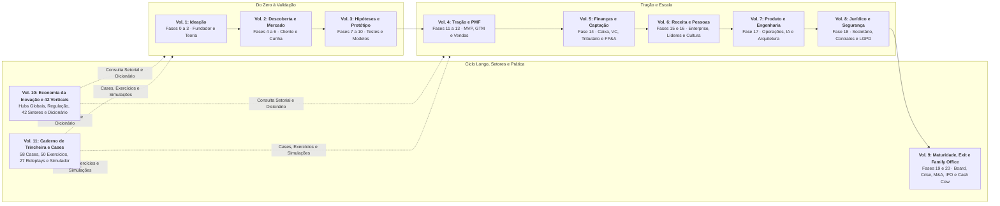

---

## Sumário deste Volume

### Fases da Etapa (Fases 4 a 6)

- [[#FASE 4: DESCOBERTA DO PROBLEMA|FASE 4: DESCOBERTA DO PROBLEMA]]
- [[#FASE 5: PESQUISA COM USUÁRIOS (CUSTOMER DISCOVERY)|FASE 5: PESQUISA COM USUÁRIOS (CUSTOMER DISCOVERY)]]
- [[#FASE 6: MAPEAMENTO DE MERCADO E CONCORRÊNCIA|FASE 6: MAPEAMENTO DE MERCADO E CONCORRÊNCIA]]

### Consumidor, Concorrência e Fracassos Brasileiros (Capítulos 1 a 3)

- [[#CAPÍTULO 1: PSICOLOGIA DO CONSUMIDOR BRASILEIRO: COMPORTAMENTO, DECISÃO E CONVERSÃO|CAPÍTULO 1: PSICOLOGIA DO CONSUMIDOR BRASILEIRO: COMPORTAMENTO, DECISÃO E CONVERSÃO]]
- [[#CAPÍTULO 2: INTELIGÊNCIA COMPETITIVA, POSICIONAMENTO E CATEGORY DESIGN|CAPÍTULO 2: INTELIGÊNCIA COMPETITIVA, POSICIONAMENTO E CATEGORY DESIGN]]
- [[#CAPÍTULO 3: CASOS DE FRACASSO BRASILEIROS E LIÇÕES|CAPÍTULO 3: CASOS DE FRACASSO BRASILEIROS E LIÇÕES]]

### Prática, Cases e Simulações Desta Etapa (Volume 11: Capítulos 4 a 6)

- [[IGNICAO-Vol-11-Workbook-Cases-e-Exercicios#CAPÍTULO 4: CASES GLOBAIS E BRASILEIROS DE CUSTOMER DISCOVERY, JTBD E CUNHA DE MERCADO|CAPÍTULO 4: CASES GLOBAIS E BRASILEIROS DE CUSTOMER DISCOVERY, JTBD E CUNHA DE MERCADO (Vol. 11)]]
- [[IGNICAO-Vol-11-Workbook-Cases-e-Exercicios#CAPÍTULO 5: CADERNO DE EXERCÍCIOS COM GABARITO COMENTADO: MOM TEST, FORÇAS DO JTBD, TAM/SAM/SOM E CANVAS DA CUNHA|CAPÍTULO 5: CADERNO DE EXERCÍCIOS COM GABARITO COMENTADO: MOM TEST, FORÇAS DO JTBD, TAM/SAM/SOM E CANVAS DA CUNHA (Vol. 11)]]
- [[IGNICAO-Vol-11-Workbook-Cases-e-Exercicios#CAPÍTULO 6: SIMULAÇÕES DE DECISÃO E ROLEPLAYS EXECUTIVOS: ENTREVISTAS DE CAMPO, GATEKEEPERS E ESCOLHA DE ICP|CAPÍTULO 6: SIMULAÇÕES DE DECISÃO E ROLEPLAYS EXECUTIVOS: ENTREVISTAS DE CAMPO, GATEKEEPERS E ESCOLHA DE ICP (Vol. 11)]]

---

# FASES DA ETAPA: DESCOBERTA DE CLIENTE E MAPEAMENTO DE MERCADO (FASES 4 A 6)

Se o Volume 1 organizou sua hipótese no papel, as [[#FASE 4: DESCOBERTA DO PROBLEMA|Fases 4]], [[#FASE 5: PESQUISA COM USUÁRIOS (CUSTOMER DISCOVERY)|5]] e [[#FASE 6: MAPEAMENTO DE MERCADO E CONCORRÊNCIA|6]] jogam essa tese no choque com a rua. Aqui você aprende a ouvir a dor real do cliente sem ouvir elogios falsos (*The Mom Test*), dissecar o *Job to Be Done* que faz alguém trocar de fornecedor e escolher uma cunha de entrada (*wedge*) onde você consiga ser imbatível.

---

## FASE 4: DESCOBERTA DO PROBLEMA

### A mentira educada do café e o risco de construir para fantasmas

Lucas fechou o notebook com um sorriso largo na cafeteria da Avenida Paulista. Acabara de mostrar os protótipos de tela do seu novo sistema de conciliação financeira para o sétimo diretor financeiro em duas semanas. A resposta foi quase idêntica às seis anteriores: *"Cara, isso aqui está genial! O design é super limpo. Quando estiver pronto, me avisa que a gente testa com certeza."*

Ao sair da cafeteria na Avenida Paulista, Lucas ligou entusiasmado para Marina em Florianópolis: era o sétimo diretor financeiro que elogiava as telas em slides do sistema de conciliação automática de boletos, e ele já queria se trancar para programar trinta mil linhas em Python. Pela segunda vez no ano, Marina, sócia comercial nata, freou o ímpeto técnico do parceiro com uma pergunta direta:

"Lucas, quantos boletos reais ou cartas de intenção assinadas você trouxe na mochila hoje? Elogio em cafeteria não paga servidor em nuvem. Esse diretor só usou uma frase simpática para encerrar a conversa em vinte minutos sem parecer indelicado." Ao longo desta Fase 4, Lucas e Marina usam esse choque de realidade para conduzir a descoberta em campo: definem no Passo 1 o perfil exato do diretor financeiro de distribuidoras médias, reclassificam o sétimo diretor no nível 2 da escala de dor (elogio educado sem orçamento, parente das provas de conceito gratuitas que ainda vão drenar Henrique nas usinas no Volume 3) e constroem o Mapa de Problemas da dupla até fechar o primeiro piloto pago.

A **Fase 4** existe para vacinar sua empresa contra a Cegueira da Mentira Educada. Aqui vale uma regra simples: é proibido falar da sua solução. Você não vai apresentar telas, não vai pedir opinião sobre funcionalidades e jamais vai fazer a pergunta proibida (*"Você usaria um aplicativo que faz X?"*). Sua missão é conduzir uma investigação sobre o passado recente do cliente: o que ele fez na última terça-feira quando o problema aconteceu, quanto tempo perdeu, que gambiarra improvisou no Excel e quanto dinheiro já tentou gastar para se livrar dessa dor. Se não há cicatriz no passado nem improviso no presente, o problema não é agudo. É apenas uma conversa simpática de cafeteria.

Se você mencionar a sua ideia durante uma entrevista de descoberta, acabou de contaminar o laboratório. Clientes não sabem projetar o que vão comprar no futuro, mas nunca mentem sobre onde perderam dinheiro, tempo ou reputação na terça-feira passada. A Fase 4 serve para provar que a dor do cliente já tem orçamento, urgência e dono antes da primeira linha de código.

---

> [!info] Stack mínimo da Fase 4
> Para fazer entrevistas com rigor, você não precisa de ferramenta cara. Gratuito ou de baixo custo: gravação em celular ou Google Meet (com permissão explícita do entrevistado), transcrição nativa do Google Meet ou do Zoom, Whisper (OpenAI) ou Fireflies (em plano gratuito para uso moderado), planilha simples (Google Sheets ou Notion) para armazenar entrevistas e extrair padrões, formulário de agendamento (Calendly free).
>
> Quando crescer: Dovetail ou EnjoyHQ para organização de pesquisa qualitativa, ferramentas como Grain para gravação integrada.
>
> Não confunda sofisticação de ferramentas com qualidade de pesquisa. Um entrevistador ruim equipado com plataforma cara extrai menos verdade do que um bom entrevistador com caderno e caneta.

### Por que a descoberta de campo vem antes do código

Perguntar "você compraria?" convida o entrevistado a fazer uma promessa sobre o futuro que não lhe custa nada hoje: elogiar uma ideia hipotética evita o constrangimento social de dizer não, enquanto relatar quanto dinheiro e tempo foram gastos na última semana exige fatos verificáveis.

A principal causa mortis de startups em estágio inicial é construir produtos para problemas que o cliente não prioriza resolver. Paul Graham sintetizou essa regra em *18 Mistakes That Kill Startups* (2006), ponto reforçado por Marc Andreessen em *The Only Thing That Matters* (2007) e pelos levantamentos históricos de *post-mortems* da CB Insights. Na origem desse erro está quase sempre a presunção de que a dor existe sem ir a campo verificá-la. A descoberta estruturada do problema é o antídoto operacional contra esse desperdício.

Veja na tabela do Passo 3 como separar promessas vazias de fatos comprovados. Descobrir antes de escrever código que o problema não sustenta um negócio custa apenas algumas conversas. Descobrir isso depois do lançamento consome meses de caixa e de vida.

> [!warning] Não construa uma ponte perfeita no meio do deserto
> Essa frase precisa ficar na sua cabeça em todas as etapas. É muito comum o empreendedor iniciante investir meses esculpindo uma solução elegante para um problema que ninguém realmente tem, ou tem mas não suficientemente. A descoberta do problema é onde você confirma que há gente do lado de lá da ponte.

### Qualidade do problema: o filtro que precede tudo

Antes de falar de execução, entenda o que faz um problema valer a pena perseguir. Empreendedores messiânicos, que querem "salvar o mundo em geral", tendem a quebrar. Empreendedores que miram um problema específico e agudo tendem a crescer. Use os filtros desta seção em conjunto.

> [!note] Hierarquia dos instrumentos de qualidade do problema
> Use dois instrumentos práticos: a escala de *Pain Level* (Passo 3) para classificar cada entrevistado e o Teste de Prioridade (logo adiante) para confirmar se vale dedicar semanas ao problema. Os Filtros 1 e 2 e o Corolário abaixo servem de calibragem conceitual antes de ir a campo.

#### Filtro 1, as cinco características de um *heartfelt problem* (problema genuinamente sentido)

Um problema forte costuma reunir pelo menos quatro das cinco características abaixo (sendo Doloroso obrigatório), sempre validadas por entrevistas e observação direta, nunca por palpite:

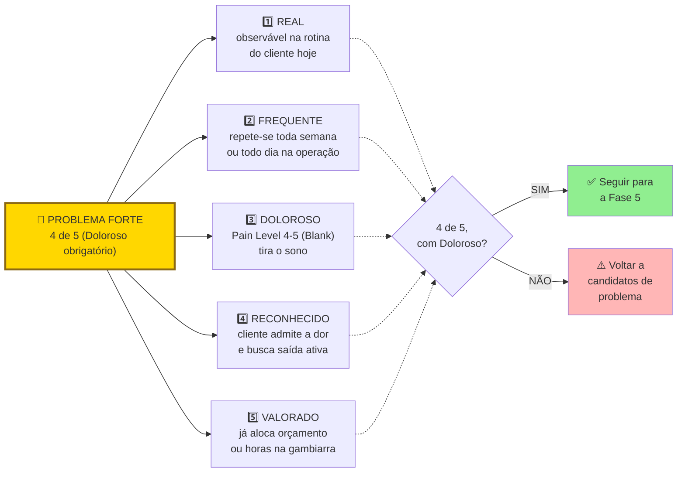

Teste cada característica com entrevistas e observação direta da rotina, nunca com "acho que sim".

As cinco características em detalhe.

1. **Real e Doloroso:** o problema provoca perda concreta de tempo, dinheiro ou reputação e carrega frustração visível no dia a dia. Sem dor sentida na pele, não há força que tire o cliente da inércia.

**Funcional:** O problema impede o cliente de realizar uma tarefa concreta importante. Não é só um incômodo estético.

**Frequente:** Quanto mais repetitiva é a fricção na rotina diária ou semanal do cliente, maior tende a ser o hábito de uso e o valor percebido na solução.

**Urgente:** Tem deadline implícito ou explícito. Algo vai dar errado se não resolver.

Inevitável (*unavoidable*). Não há jeito fácil de contornar. Se o cliente pode simplesmente ignorar ou desviar, ele não vai pagar.

#### Filtro 2: poço fundo ou poço largo (Paul Graham, 2012)

- **Poço largo e raso:** muita gente tem o problema, mas ninguém o sente com força. "Seria legal se houvesse um aplicativo para organizar receitas da família." Milhões de pessoas concordam no almoço de domingo, mas quase ninguém paga nem muda a rotina por isso.

- **Poço fundo:** pouca gente tem o problema, mas quem tem precisa tanto de uma solução que aceita usar até uma versão inicial rústica. Um diretor financeiro de distribuidora perdendo R$ 15 mil por mês em boletos duplicados está em um poço fundo.

Negócios bilionários costumam combinar profundidade e largura (como a busca do Google, que Paul Graham chama de cratera imensa), mas toda startup iniciante deve cavar primeiro um poço fundo em um nicho estreito antes de buscar largura. Um poço fundo entrega quatro vantagens imediatas: clientes que viram defensores da solução, clareza sobre o que construir primeiro, menor necessidade de capital e defensibilidade natural contra grandes concorrentes que ignoram nichos específicos.

> [!tip] Regra operacional do poço profundo
> Se a sua empresa sumisse amanhã, um grupo bem específico de pessoas deveria reclamar muito. Se ninguém reclamaria, você não tem poço. Tem uma poça.

#### Corolário: cliente desesperado aceita produto imperfeito

Em um mercado excelente, com clientes desesperados por solução, a primeira versão do produto não precisa ser incrível. Só precisa funcionar. Essa é a marca do produto bem-sucedido em fase inicial. Em um mercado morno, mesmo um produto excepcional tem dificuldade de ganhar tração.

O que isso significa na prática: se você está obcecado em polir o produto antes de lançar, há boa chance de que esteja mirando o mercado errado. Mercados quentes toleram (e recompensam) produtos capengas. Mercados frios exigem produtos polidos que ainda assim falham em engajar. A obsessão com perfeição técnica é frequentemente fuga de fundador evitando o veredito do mercado real.

Este corolário se conecta a dois conceitos.

O primeiro conceito é o Limiar de Desespero, medido pela escala de Pain Level de 1 a 5 adaptada do perfil de *earlyvangelist* de Steve Blank em *The Four Steps to the Epiphany* (2005): (1) tem o problema, mas ainda não o percebe, (2) sabe que tem, mas tolera, (3) busca solução ativamente no mercado, (4) já improvisou uma gambiarra própria com planilha ou processo manual, e (5) já tem orçamento comprometido ou acessível para pagar. Abaixo desse limiar, o usuário reclama de qualquer atrito e cancela, acima dele (nível 4 e, sobretudo, nível 5), o cliente paga e opera mesmo com interface simples, fluxos manuais e suporte via WhatsApp. Identifique se os clientes da sua cunha estão em nível 4 ou 5 antes de gastar meses polindo código.

O segundo é o "problema chato", também conhecido como Schlep Blindness (cegueira para trabalho árduo: Paul Graham, 2012). *Schlep* é palavra em iídiche, hoje de uso comum no inglês, que significa "tarefa tediosa e desagradável". Graham cunhou o termo para descrever o padrão pelo qual empreendedores (especialmente técnicos) sistematicamente evitam problemas que envolvem trabalho chato e sem glamour: regulação, negociação com bancos, operação manual, migração de dados legados, compliance, suporte trabalhoso. A mente descarta a ideia antes mesmo de ela chegar à consciência, com o rótulo de que aquilo não é problema de startup. Como quase ninguém quer assumir esse trabalho árduo, é justamente ali que se concentram as oportunidades mais valiosas.

A lógica é econômica antes de ser poética. Se todo mundo evita certa categoria de trabalho pesado, quem se dispõe a executá-la encontra um mercado inteiro com baixa concorrência. O empreendedor que ataca deliberadamente problemas operacionais árduos costuma encontrar menos competição, clientes mais leais (porque ninguém os atende bem) e margens melhores. Se o seu problema parece fácil demais de explicar num coquetel, desconfie: provavelmente você está disputando a mesma fatia com dezenas de outros fundadores.

##### Casos canônicos, schleps que viraram empresas bilionárias

A **Stripe** resolveu pagamentos online atacando o *schlep* que todo desenvolvedor da época evitava: os irmãos Patrick e John Collison enfrentaram a integração com sistemas bancários legados, burocracia de adquirentes e exigências de segurança (KYC e PCI-DSS). A empresa processou US$ 1,4 trilhão em volume anual em 2024 e atingiu avaliação de US$ 91,5 bilhões em oferta privada de recompra em fevereiro de 2025. Paul Graham cita a própria Stripe como exemplo clássico em seu ensaio de 2012.

A **Scale AI** atacou a rotulagem e curadoria de dados de treino para inteligência artificial (*data labeling*), tarefa operacional pesada que todo laboratório de IA precisava executar mas preferia terceirizar. Fundada por Alexandr Wang e Lucy Guo em 2016, a empresa tornou-se infraestrutura crítica do setor. Em junho de 2025, a Meta investiu cerca de US$ 14,3 bilhões por 49% da Scale AI (avaliando o negócio em US$ 29 bilhões), movimento no qual Alexandr Wang deixou o cargo de CEO para liderar frentes de IA na Meta.

No Brasil, empresas de conciliação fiscal e automação contábil como Arquivei (hoje Qive) e Contabilizei atacaram um *schlep* clássico que engenheiros de software evitavam: integrar centenas de padrões municipais de notas fiscais de serviço (NFS-e), lidar com instabilidades dos portais fazendários e traduzir obrigações acessórias complexas. Era um trabalho árduo e sem glamour aparente, mas resolveu uma dor obrigatória de dezenas de milhares de empresas.

A Uber enfrentou disputas regulatórias municipais e embates jurídicos com sindicatos de táxi que afugentavam outros fundadores. Justamente por ser um trabalho desgastante, caro e litigioso, esse obstáculo abriu espaço para quem aceitou encarar o atrito.

Da mesma forma, a **Stone** construiu sua vantagem competitiva enfrentando o trabalho pesado de rua que os bancos tradicionais evitavam: montar polos locais de atendimento (*Stone Hubs*) para visitar pequenos e médios lojistas presencialmente, trocar maquineta em horas e resolver problemas de conciliação na ponta. Resultado: IPO na Nasdaq em 2018 e conquista de participação relevante em um segmento que parecia saturado antes de a Stone entrar.

> [!tip] Problemas chatos com clientes desesperados
> Como vimos na Fase 1 (Volume 1) ao discutir a *Schlep Blindness* de Paul Graham (2012), fundadores costumam evitar problemas operacionais árduos, burocráticos ou regulatórios. Na Fase 4, use essa aversão a seu favor como critério de triagem: se as entrevistas revelarem um processo penoso que os concorrentes evitam por dar trabalho demais (como conciliação fiscal, folha de pagamento ou integração com sistemas legados), não descarte a dor pela complexidade. Onde há fricção operacional severa e cliente no limite, a barreira de entrada trabalha para quem resolve o problema até o fim.

### Teste de prioridade: três perguntas rápidas

Antes de avançar, submeta o seu problema a um teste de prioridade em três perguntas. É um diagnóstico operacional direto deste livro, inspirado na triagem de pré-aceleração de fundos de semente. Aplique sobre cada problema-candidato antes de comprometer tempo sério com ele.

> [!question] Pergunta 1: se este problema desaparecesse amanhã, quem notaria?
> Não pergunte "quem acharia interessante". Pergunte quem sentiria falta em quarenta e oito horas se o processo parasse, sem ninguém avisar. Se a resposta for "as pessoas em geral" ou "todo mundo", o problema não é prioritário para ninguém em específico. Uma boa resposta aponta um cargo concreto, como "o diretor financeiro da distribuidora", que sofre com o problema toda semana.

> [!question] Pergunta 2: qual métrica numérica e rastreada mudaria?
> Se o problema é real e prioritário, existe uma métrica que alguém já acompanha que se moveria. Tempo de ciclo. Custo por transação. Taxa de retrabalho. NPS interno. Faturamento por hora. Churn. Se nenhuma métrica rastreada se moveria, o problema pode até existir, mas ninguém tem caso de negócio para resolvê-lo. E portanto ninguém tem budget.

> [!question] Pergunta 3: alguém escalaria o problema para um nível acima?
> Problemas prioritários sobem na hierarquia. Alguém reporta ao chefe. Alguém pede recursos. Alguém marca uma reunião urgente. Se o problema existe mas ninguém o escala, ele está sendo absorvido silenciosamente. Significa que não é urgente o suficiente para forçar mudança de comportamento.

> [!warning] Regra operacional do Teste de Prioridade
> Se você não consegue responder às três perguntas com um nome de cargo, uma métrica específica, e um comportamento de escalada concreto, volte para entrevistas. Problemas que passam nas três perguntas geram urgência de compra. Os que não passam geram apenas interesse educado.

### O roteiro de investigação em dez passos: como extrair fatos e gastos reais da rotina do cliente sem contaminar a conversa

O protocolo de campo desta fase tem dez passos sequenciais, que vão da definição precisa do perfil do entrevistado até a consolidação do Mapa de Problemas.

> [!tip] Mapa de Empatia como complemento pós-síntese ao Mom Test
> Ao chegar ao Passo 7 (análise em lotes), complemente as notas do *Mom Test* com o [[#Canvas: Empathy Map (Dave Gray / XPLANE, 2009)|Canvas: Empathy Map (Dave Gray / XPLANE, 2009)]]: após 5 a 10 entrevistas com o mesmo perfil, os fundadores preenchem os seis quadrantes com citações literais colhidas em campo. Em plataformas de dois lados, aplique o mapa tanto ao cliente que paga quanto ao parceiro que opera na ponta (como o motoboy Carlos do caso ilustrativo na seção de Canvases desta fase).

#### Passo 1: Defina o perfil do entrevistado com precisão

Antes de sair entrevistando, escreva os critérios de inclusão e exclusão. Quem incluir: quem atende a tais e tais características. Quem excluir: quem atende a tal característica.

- **Exemplo vago:** "Diretores de pequenas e médias empresas."
- **Exemplo preciso (usado por Lucas e Marina):** "Diretores financeiros ou de operações de distribuidoras atacadistas no eixo Sul-Sudeste, com faturamento anual entre R$ 20 milhões e R$ 120 milhões, emissão superior a 2.000 boletos por mês e conciliação bancária ainda feita em planilhas paralelas ao ERP."

Esse filtro é o que separa pesquisa útil de pesquisa "perdida no meio".

#### Passo 2: lista de sessenta a cem pessoas para abordar (meta de 15 a 25 entrevistas)

Como parte relevante dos contatos não responde ou fica fora do recorte, monte uma lista de sessenta a cem nomes para concluir de quinze a vinte e cinco entrevistas válidas. Fontes práticas de prospecção: busca filtrada no LinkedIn. Grupos setoriais de WhatsApp e Telegram. Associações comerciais e sindicatos patronais. Feiras e eventos presenciais. Indicações quentes ao final de cada conversa. Comunidades especializadas (fóruns, Discord, Reddit), e abordagem direta com convite objetivo para uma conversa de trinta a trinta e cinco minutos.

#### Passo 3: escreva e teste o seu roteiro de entrevista

O roteiro de entrevista de problema (30 a 35 minutos no total) apoia-se em dois princípios: fazer perguntas abertas ("Como você decide X?" em vez de "Você decide X dessa forma?") e interrogar o passado concreto em vez do futuro hipotético. As cinco perguntas de Eric Migicovsky (Y Combinator) e as regras do [[#Framework: The Mom Test (Rob Fitzpatrick, 2013)|The Mom Test]] organizam os cinco blocos abaixo:

Estrutura sugerida, adaptada do *Mom Test* (Rob Fitzpatrick):

- **1. Aquecimento (2 minutos):** agradeça a disponibilidade, deixe claro que se trata de uma pesquisa de campo (não de uma apresentação comercial) e peça autorização para gravar apenas para transcrição interna.

- **2. Contexto do entrevistado (5 minutos):** entenda quem é a pessoa, qual o seu papel na operação e como funciona sua rotina semanal na área estudada.

- **Exploração do domínio (10 minutos):** faça perguntas abertas sobre a rotina em que o problema costuma surgir, sem mencionar sua hipótese de solução: "Como funciona hoje o seu processo de [atividade]?", "Quais etapas tomam mais tempo ou geram mais retrabalho?" e "Conte como foi a última vez em que isso travou a operação".

- **Aprofundamento em episódios concretos (7 minutos):** sempre que surgir uma fricção específica, peça os números do último episódio: "Quanto tempo ou dinheiro isso consumiu na última ocorrência?" e "Quem mais precisou parar o que estava fazendo para ajudar?".

- **Tentativas anteriores de solução (5 minutos):** pergunte "O que você já tentou usar ou contratar para resolver isso, quanto custou e por que parou?". Se o entrevistado nunca moveu uma palha para contornar a dor, o problema provavelmente está abaixo do nível decisivo.

- **Encerramento e efeito bola de neve (3 minutos):** feche perguntando "Com quais outras duas pessoas que enfrentam essa mesma rotina você recomenda que eu converse esta semana?", garantindo que a lista inicial de 60 a 100 nomes abordados renda as 15 a 20 entrevistas qualificadas.

> [!note] O comportamento do consumidor brasileiro tem padrões que afetam como a dor se manifesta nas entrevistas
> Em entrevistas de campo com públicos das classes C e D (como apontam levantamentos do Instituto Locomotiva e do Data Favela), o incômodo cotidiano pode vir minimizado por hábito. Por isso, pergunte pelo impacto concreto no bolso e no tempo, não apenas se algo incomoda. Quem opera exclusivamente pelo celular também descreve fluxos de trabalho de um jeito diferente de quem trabalha no computador. O [[#CAPÍTULO 1: PSICOLOGIA DO CONSUMIDOR BRASILEIRO: COMPORTAMENTO, DECISÃO E CONVERSÃO|Capítulo 1: Psicologia do Consumidor Brasileiro: Comportamento, Decisão e Conversão]] detalha esses padrões e ajuda a calibrar a escuta em campo.

##### As cinco perguntas de Eric Migicovsky (Y Combinator), compatíveis com o Mom Test (roteiro mínimo)

Estas cinco perguntas, adaptadas ao seu domínio, formam um núcleo mínimo para qualquer entrevista de problema. Foram desenhadas para revelar a dor real, focar em comportamento passado em vez de intenção futura, e evitar que você caia na armadilha de vender a sua ideia.

> [!example] Cinco perguntas para entrevista de descoberta de problema
>
> 1. Qual é a parte mais difícil de (fazer a tarefa)? Identifica a dor real na linguagem do cliente, não na sua.
> 2. Me conta sobre a última vez que você encontrou esse problema. Força o entrevistado a descrever comportamento passado, que é evidência, não especulação.
> 3. Por que isso foi tão difícil? Revela as causas raízes que o seu raciocínio de ponta a ponta não consegue supor sozinho.
> 4. O que você já fez para tentar resolver isso? Se o entrevistado não fez absolutamente nada, a dor não é forte o suficiente para gerar negócio.
> 5. O que você não gosta nas soluções que já tentou? A resposta é o rascunho inicial do seu roadmap de produto, com palavras do cliente.

Para separar na pratica o *Pain Level* 4 do *Pain Level* 5 sem recorrer a perguntas hipotéticas sobre disposição a pagar, investigue sinais indiretos de orçamento já comprometido: pergunte quanto a empresa já desembolsou nos últimos seis meses com consultorias, horas extras, ferramentas paliativas ou retrabalho para conter o problema, e quem assinou essa despesa. Clientes no Nível 5 citam valores, fornecedores e prazos reais. No Nível 4, mostram a gambiarra interna, mas ainda não destinaram verba específica. Faça essa sondagem de custo histórico no fim da conversa, nunca na abertura, para não induzir a resposta.

> [!tip] Regra 80/20 de escuta em campo
> **Regra 80/20 de escuta:** fale no máximo 20% do tempo e deixe o entrevistado ocupar os outros 80% narrando episódios reais da própria rotina (tanto nas entrevistas de descoberta da Fase 4 quanto nas entrevistas de aprofundamento da Fase 5).

##### A armadilha da validação: dado ruim e dado bom

Nem todo sinal obtido em entrevista tem o mesmo valor preditivo. A tabela a seguir separa as respostas que sustentam decisões de negócio daquelas que apenas massageiam o ego do fundador:

| Tipo de informação coletada | Peso como evidência | Justificativa comportamental (por que promessas futuras enganam) |
|---|---|---|
| Elogios ("Nossa, que ideia legal!") | Quase zero | Pessoas mentem sobre interesse por educação ou para encerrar a conversa sem atrito |
| Hipóteses futuras ("Eu pagaria por isso") | Quase zero | Promessas sobre o futuro não têm custo no presente e raramente viram compra real |
| Ideias soltas ("Seria legal se tivesse tal funcionalidade") | Baixo a médio | Útil para mapear vocabulário, insuficiente para validar demanda |
| Comportamento passado ("Semana passada gastei 4 horas nisso") | Alto | Dado verificável, ações já tomadas no passado recente são a prova mais limpa |
| Tentativas anteriores de solução ("Usei X, Y e Z, nenhum resolveu") | Alto | Prova que a dor já superou a inércia e levou o cliente a agir |
| Métricas de custo (tempo, dinheiro e retrabalho já gastos) | Alto | Traduzem a severidade real do problema em números auditáveis |

> [!important] Princípio operacional sobre evidência
> Pessoas mentem sobre interesse, mas não mentem sobre dor. Foque em interrogar a dor, comportamento passado, tentativas de solução, custo atual. Ignore promessas futuras e elogios.

##### Escala de Pain Level (adaptada da régua de earlyvangelists de Steve Blank, *The Four Steps to the Epiphany*)

Ao final de cada entrevista, atribua ao entrevistado uma nota na escala de Pain Level, de um a cinco, que mede o estado dele em relação ao problema.

Nível 1. Tem o problema, mas nem sabe que tem. Não é cliente para o início da startup. No máximo, será público de educação de mercado no futuro.

Nível 2. Sabe que tem o problema. Reconhece quando perguntado, mas tolera e convive com ele (como o sétimo diretor financeiro da cafeteria da Paulista). Não vai pagar por solução agora.

Nível 3. Está ativamente procurando uma solução no mercado e tem prazo na cabeça para resolver. É um contato comercial quente.

Nível 4. Já improvisou uma solução caseira para conter o problema: planilha gigante no Excel, rotina manual ou combinação precária de ferramentas. A existência dessa gambiarra prova que a dor já venceu a inércia.

Nível 5. Além da gambiarra, tem orçamento comprometido ou facilmente acessível para contratar uma solução (como os diretores de distribuidora que já pagavam um analista exclusivo para conciliar boletos). É o cliente ideal para os primeiros pilotos pagos e para o encaixe problema-solução (*Problem-Solution Fit*).

> [!important] Meta de Pain Level desta fase
> Consiga entrevistar pelo menos cinco pessoas em Pain Level 4 ou 5. Se você não encontrar ninguém nesses níveis, você está testando um problema que o mercado ainda não sentiu o suficiente para pagar. É sinal vermelho. Volte para a Fase 3 (Teoria) e reconsidere o ICP ou a dor.

##### O que evitar durante a condução da entrevista

Jamais pergunte "você acha que um aplicativo que faz X seria útil?": perguntas hipotéticas sobre o futuro induzem respostas gentis sem valor preditivo, enquanto o Nível 4 de dor se comprova por gambiarra ativa e o Nível 5 por gasto ou orçamento já existentes.

Nunca pergunte "você pagaria R$ 99 por isso?": perguntas hipotéticas de preço fabricam promessas vazias. Investigue quanto a pessoa já gasta hoje (em tempo, retrabalho ou ferramentas) e classifique o *Pain Level* real.

Nunca abra a conversa dizendo "tive uma ideia de negócio que faz X": esse preâmbulo aciona a polidez social do interlocutor e contamina os dados.

Elimine perguntas que induzem a resposta (*leading questions*), como "não seria muito melhor se existisse X?". Se você precisa sugerir o incômodo para que o cliente concorde, a dor não é prioritária na rotina dele.

Não misture apelos emocionais ou virtuosos (*virtue signalling*). "Você compraria um produto que doa parte da receita para uma ONG ambiental?" Quase ninguém vai dizer não. Mas isso não significa que vai pagar. Mantenha o foco no problema, não em apelos morais que enviesam a resposta.

Não teste interesse oferecendo uso gratuito ilimitado ("você testaria de graça?"): aceitar algo sem custo nem atrito não prova que o problema justifica uma empresa.

#### Passo 4: primeiras três entrevistas como teste

Grave (com permissão), transcreva, releia. Identifique três coisas. Quais perguntas funcionaram (geraram respostas longas e ricas). Quais caíram no vazio (respostas curtas, secas). E onde você cedeu à tentação de apresentar a ideia.

Ajuste o roteiro antes de seguir com as próximas.

#### Passo 5: Execute de quinze a vinte entrevistas aderentes ao ICP

Ritmo saudável: três a cinco por semana. Faça sozinho, ou com um parceiro que toma notas enquanto você conduz.

#### Passo 6: registro sistemático

Para cada entrevista, preencha a Parte B do [[#Template: Entrevista de Problema|Template: Entrevista de Problema]] nas 24 horas seguintes, enquanto as falas literais (*verbatims*), os números de custo e o nível de dor estão frescos.

> [!tip] Registro imediato na Parte B do Template de Entrevista de Problema (insumo para a Síntese de Rodada de Entrevistas)
> O [[#Template: Entrevista de Problema|Template: Entrevista de Problema]] tem duas partes: a Parte A é o roteiro que você consulta durante a conversa. A Parte B é a síntese pós-entrevista, com 12 seções que estruturam exatamente o que este Passo 6 pede: metadados, aderência ao ICP, problemas, verbatim, vocabulário, hierarquia de sinais, Pain Level com justificativa, armadilhas (autoavaliação) e refinamento de ICP. Preencha nas 24h seguintes à entrevista, enquanto a memória está fresca. Entrevistas com a Parte B em branco contam como dado perdido.

#### Passo 7: análise depois de cada lote de cinco entrevistas

Faça sínteses parciais a cada lote de cinco entrevistas para calibrar o roteiro e investigar novos padrões (problemas presentes em mais da metade das conversas, comportamentos repetidos e dores imprevistas), mas só bata o martelo sobre manter ou pivotar o problema ao concluir a rodada completa.

> [!tip] Síntese parcial e final na Síntese de Rodada de Entrevistas (saída da Fase 4)
> O [[#Template: Síntese de Rodada de Entrevistas (decisão de avanço)|Template: Síntese de Rodada de Entrevistas (decisão de avanço)]] é o artefato dessa consolidação. Faça uma revisão parcial a cada lote de cinco entrevistas para checar padrões, mas feche o veredito definitivo apenas quando a rodada inteira de 15 a 20 conversas terminar: encerrar o julgamento antes do fim enviesa a escuta nas entrevistas restantes. A Síntese de Rodada registra a decisão entre perseverar, pivotar o problema, pivotar o segmento de cliente ou encerrar a tese.

> [!note] Registre nos templates dos Passos 6 e 7 a sequência cronológica das etapas que o entrevistado percorre hoje para contornar o problema
> Enquanto o Mom Test captura incidentes isolados, o [[IGNICAO-Vol-4-Tracao-e-PMF#CAPÍTULO 8: CUSTOMER SUCCESS (CS) E CUSTOMER EXPERIENCE (CX): DA JORNADA À RETENÇÃO SUSTENTÁVEL E NRR ACIMA DE 100%|Capítulo 8: Customer Experience (Vol. 4)]] oferece a visão de jornada completa, do momento de consciência do problema ao pós-resolução, incluindo métricas de NPS e churn preditivo. Usar a jornada como mapa mental durante a síntese das entrevistas ajuda a localizar em qual etapa a dor é mais aguda.

> [!tip] Da síntese ao Customer Profile (Value Proposition Canvas)
> Ao sintetizar as entrevistas, o Customer Profile do [[#Canvas: Value Proposition Canvas (Alexander Osterwalder, 2014)|Canvas: Value Proposition Canvas (Alexander Osterwalder, 2014)]], Jobs (o que o cliente está tentando fazer), Pains (frustrações no caminho), Gains (resultados desejados), é o frame visual exato para organizar o que as entrevistas Mom Test capturaram. Use depois da síntese qualitativa para preparar a [[#FASE 5: PESQUISA COM USUÁRIOS (CUSTOMER DISCOVERY)|Fase 5]] (JTBD).

#### Passo 8: Separe sintoma de causa raiz na análise das falas

O erro mais comum em discovery é documentar sintomas como se fossem problemas. "Meu CRM é uma bagunça" é sintoma. A causa raiz pode ser: processo de vendas mal definido, equipe resistente à adoção de ferramentas, ou dados de entrada inconsistentes vindos de integrações quebradas. Cada causa raiz tem uma solução diferente. Tratar o sintoma sem entender a causa produz produto que não resolve o problema real.

A técnica de entrevista de raiz causal usa três camadas de aprofundamento.

**Camada 1: o sintoma declarado.** O entrevistado descreve o problema como ele aparece para ele. "Meu relatório de vendas demora três dias para ficar pronto." Anote literalmente: esse é o ponto de partida, não a conclusão.

**Camada 2: o mecanismo.** Para cada sintoma, pergunte: "Me conta como isso acontece na prática. Quando o relatório atrasa, o que está acontecendo especificamente?" Objetivo: entender o processo, não apenas o resultado. Frequentemente revela que o "problema de relatório" é, na verdade, um problema de input: os dados não chegam na qualidade certa.

**Camada 3: a causa raiz.** Para cada mecanismo, aplique a pergunta "por quê?" até chegar ao ponto que, se for corrigido, elimina o sintoma na origem. Veja o diálogo em três níveis: *"Por que os dados chegam inconsistentes? Porque a equipe de vendas preenche o CRM de jeitos diferentes. Por que cada um preenche de um jeito? Porque não existe um modelo padrão obrigatório no sistema. Por que ninguém estabeleceu esse padrão? Porque o gerente comercial que contratou a ferramenta saiu dois meses depois e o processo ficou sem dono."* A causa raiz é a falta de processo documentado e de responsável pelo CRM, a solução passa por travas de preenchimento e rotina de gestão, não por mais um painel de gráficos.

**Protocolo prático de raiz causal em entrevista:**

1. Deixe o entrevistado descrever o problema livremente (2-3 minutos).
2. Repita o sintoma de volta e peça para detalhar o mecanismo: "Quando você diz X, me conta como isso acontece no dia a dia?"
3. Para cada elemento do mecanismo que parece ser causa, pergunte: "Por que isso acontece?", até a resposta ser "é como funciona aqui" ou "não sei, nunca perguntei."
4. Ao cruzar as respostas da pergunta final do roteiro (*"Se você resolvesse esse problema hoje, o que mudaria primeiro: o sistema, o processo ou a equipe?"*), compare a percepção do cliente com a causa raiz encontrada:

A resposta a essa pergunta mostra onde o entrevistado enxerga a alavanca de mudança, e quase sempre diverge do que você supunha antes de ir a campo.

**Red flags que indicam sintoma não raiz:**

- A pessoa descreve uma solução ("precisamos de uma dashboard melhor") em vez de um problema. Pergunte: "O que você faria com a dashboard melhor que não consegue fazer agora?"
- O problema "desaparece" quando você pergunta sobre frequência. "Acontece de vez em quando" com dificuldade de quantificar sugere que o problema não é tão dolorido quanto parece.
- A pessoa cita o problema de outra pessoa ("meu chefe reclama que."). A causa raiz pode estar na dinâmica organizacional, não no processo em si.

#### Passo 9: chegue à saturação

Saturação é o ponto em que entrevista nova deixa de trazer informação nova. Há dois testes complementares: um qualitativo (sentir) e um quantitativo (medir). Os dois apontam para o mesmo fenômeno. Use ambos para reduzir o autoengano (aplicando contramedidas numa escuta semiestruturada e relendo as notas sem filtro).

**Teste qualitativo.** Você sente quando chegou. "Ah, é a mesma coisa que o anterior disse." Quando isso acontecer duas ou três vezes seguidas, você chegou.

**Teste quantitativo.** Para cada nova entrevista, conte quantas observações realmente novas (problemas, vocabulário, padrões de comportamento, workarounds) ela trouxe versus repetições do que já apareceu antes. Quando o percentual de novidade fica abaixo de quinze por cento por três entrevistas seguidas, é saturação confirmada.

Os dois critérios devem se confirmar mutuamente. Sentiu saturação mas o quantitativo ainda mostra trinta por cento de novidade? Você está sendo otimista: faça mais cinco. Quantitativo já abaixo de quinze por cento mas você ainda sente "tem coisa nova"? Provavelmente é gosto pelas conversas, não evidência. Pare.

#### Passo 10: produza o Mapa de Problemas

Esse é o entregável central da Fase 4. Estrutura visual:

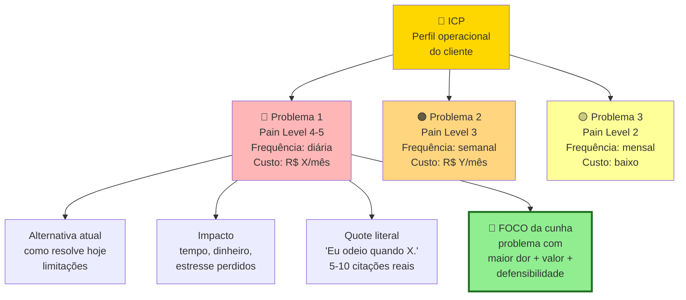

Um ICP pode ter três a cinco problemas mapeados. O foco é em um, o mais agudo, o de melhor fit. Atualize o mapa conforme as entrevistas avançam. Não é documento morto.

O [[#Template: Síntese de Rodada de Entrevistas (decisão de avanço)|Template: Síntese de Rodada de Entrevistas (decisão de avanço)]] organiza os dados brutos da rodada nas doze seções operacionais do final desta fase: amostra válida, distribuição de *Pain Level* (com a trava mínima de cinco entrevistados nos níveis 4 ou 5), padrões de dor ranqueados, comparação entre subsegmentos, gambiarras atuais, vocabulário nativo do cliente, surpresas que refutaram premissas da Fase 3 e o veredito entre as quatro rotas possíveis (perseverar, pivotar problema, pivotar cliente ou encerrar).

> [!note] Mapa de Problemas e Síntese de Rodada de Entrevistas (saída da Fase 4)
> O **Mapa de Problemas** é a saída visual da rodada para alinhar a equipe e comunicar o foco. Já o [[#Template: Síntese de Rodada de Entrevistas (decisão de avanço)|Template: Síntese de Rodada de Entrevistas (decisão de avanço)]] é o documento estruturado de decisão que sustenta o Mapa com rastro até o código de cada entrevista. Use os dois em conjunto: o Mapa para apresentar, a Síntese de Rodada para defender a decisão.

### O roteiro aplicado: o caso ilustrativo PadariaPro

Para ver o roteiro e a tabela de triagem funcionando juntos, acompanhe o caso didático do PadariaPro, uma hipótese de software de controle de compras e validade de insumos para pequenas redes de padarias artesanais em São Paulo.

Abertura (dois minutos). "Oi, [Nome]. Obrigado pelo tempo. Antes de começar: não estou aqui para te vender nada. Estou pesquisando como padarias pequenas gerenciam compras e estoque, porque quero entender se tem um problema real antes de construir uma solução. Vou fazer umas perguntas abertas, sem respostas certas. A gravação fica privada, só para eu transcrever depois. Tudo bem?"

Perguntas de contexto (cinco minutos). Como você virou dono ou operador dessa padaria? Quantas lojas vocês têm hoje? Como a gestão é dividida entre elas? Quem cuida de compra de ingredientes?

**Bloco 3: Exploração de problemas no passado recente (10 minutos, sem mencionar produto):** *"Como vocês decidiram na última segunda-feira quanto de farinha e manteiga comprar para a semana? Conte como foi a última vez em que faltou insumo no meio da fornada ou sobrou mercadoria vencida na câmara. Quando isso aconteceu, quanto tempo e dinheiro foram perdidos? Vocês já tentaram usar alguma planilha ou método para evitar essa falha? Por que funcionou ou deixou de funcionar?"*

**Bloco 4: Comportamento e custo atual (10 minutos):** *"Você pode me mostrar como registra as entradas e validades hoje no caderno, planilha ou sistema? Quanto de insumo vocês precisaram descartar no mês passado e quanto esse descarte custou no fechamento do caixa?"*

Fechamento (três minutos). "Última coisa, posso te ligar em trinta dias para te mostrar algo que estou desenhando, e pegar a sua opinião?"

Análise depois de dez entrevistas:

| Entrevistado (nº de lojas) | Perda financeira/mês | Método atual | Pain Level (1-5) | Evidência de gasto ou gambiarra |
|---|---|---|---|---|
| Padaria A (Pinheiros, 2 lojas) | R$ 3.500 | Caderno e planilha | Nível 4 | Sem consultoria paga, montou planilha própria de controle |
| Padaria B (Vila Madalena, 4 lojas) | R$ 8.000 | Planilha | Nível 5 | Pagou R$ 2.000 a consultor de estoque |
| Padaria C (Moema, 1 loja) | R$ 2.000 | Sistema antigo | Nível 2 | Paga R$ 150/mês em módulo fiscal básico |
| . | | | | |

Padrão emergente ao cruzar o número de lojas com a escala de *Pain Level* (1 a 5): as padarias em nível 4 ou 5 (com gambiarra ativa em planilha ou gasto prévio em consultoria, perdendo de R$ 3.500 a R$ 8.000 por mês) têm duas ou mais unidades e sofrem quando o dono deixa de estar presente no balcão único. Nas operações de uma única loja (como a Padaria C, em nível 2), o proprietário controla o estoque no olho e tolera a perda. O ICP foi refinado para redes de três a cinco lojas, onde a dor financeira supera o custo de troca.

### Reconstrução ilustrativa inspirada no início do iFood: onde a dor do pedido online era mais aguda

Quando o iFood nasceu em 2011 (fundado por Patrick Sigrist, Eduardo Baer, Felipe Fioravante e Guilherme Fioravante/Bonifácio a partir da Disk Cook, guia impresso e central telefônica de entregas criado nos anos 1990), uma hipótese natural no papel seria priorizar as grandes redes de restaurantes: tinham volume maior de pedidos, tíquete médio mais alto e estrutura instalada. Como reconstrução didática de triagem de segmento, compare os dois perfis na época (quando a plataforma apenas listava cardápios de restaurantes que já possuíam entregadores próprios, antes de o iFood operar logística própria a partir de 2015):

Antes de investir em vendas para grandes redes, com ciclo longo, fizeram dezenas de conversas diretas com donos de restaurantes pequenos. Incluindo visitas e observação de rotina. Não estavam vendendo nada. Estavam mapeando dor.

Descobriram algo contraintuitivo. Restaurantes pequenos tinham dor muito maior. Não tinham time de telemarketing. Atendimento telefônico custava tempo do dono. Pedido errado por ruído na ligação era prejuízo direto. E estavam dispostos a pagar comissão alta em troca do canal. Redes grandes, com estrutura própria, viam o iFood como ameaça à marca.

Quem tem dor mais aguda paga mais, mesmo que seja cliente "menor". Entrevistar onde a dor é intensa é mais produtivo que entrevistar onde você achava que seriam os clientes.

### Checklist de conclusão da Fase 4: a prova material de que o problema existe fora da sua cabeça

Você concluiu a Fase 4 quando todos os critérios abaixo estão cumpridos.

- [ ] Quinze ou mais entrevistas realizadas, das quais pelo menos doze com pessoas aderentes ao ICP (as conversas fora do perfil contam como aprendizado de contexto, não como validação), gravadas com consentimento ou anotadas em tempo real seguindo o roteiro de Entrevista de Problema sem perguntas indutoras.
- [ ] Saturação atingida. Nas últimas três entrevistas, informação nova abaixo de quinze por cento.
- [ ] Tabela de padrões com cinco ou mais dimensões por entrevistado.
- [ ] Três ou mais padrões de dor consistentes documentados, cada um apoiado por cinco ou mais entrevistas.
- [ ] Pelo menos um falso positivo identificado (algo que entrevistados disseram querer mas não agiriam para obter).
- [ ] Problema aparece em cinquenta por cento ou mais do ICP entrevistado (setenta por cento ou mais para considerar urgente) e é ativamente tratado em quarenta por cento ou mais.
- [ ] Pelo menos cinco entrevistados em Pain Level 4 ou 5 (já improvisaram gambiarra ou têm orçamento comprometido), com gasto atual no problema de pelo menos 1,5 vez o preço que você pretende cobrar (ou cinco horas semanais de trabalho do próprio decisor): proxy de disposição a pagar.
- [ ] ICP ajustado com base no ouvido. Registro de "antes versus depois", com sub-segmento mais doloroso identificado.
- [ ] Mapa de Problemas escrito. Declaração da Ideia atualizada para v2 com mudanças explícitas em relação à v1.
- [ ] Decisão explícita registrada em parágrafo: seguir, pivotar problema, pivotar cliente, ou encerrar.

> [!warning] Se o problema não passou no teste: três caminhos de decisão
> Os caminhos são três: pivotar o problema (quando uma dor adjacente apareceu com mais força nas conversas), pivotar o segmento de cliente (quando a dor é real, mas em outro perfil de comprador) ou abandonar a tese atual e voltar à Fase 2 com outra ideia. Não avance para a Fase 5 com problema não validado.
>
> Antes de pivotar ou encerrar, vale ler o [[#CAPÍTULO 3: CASOS DE FRACASSO BRASILEIROS E LIÇÕES|Capítulo 3: Casos de Fracasso Brasileiros e Lições]] neste volume (que analisa casos como a Kekanto e os aplicativos de *delivery* de nicho) e o [[IGNICAO-Vol-9-Maturidade-e-Exit#CAPÍTULO 19: POST-MORTEMS BRASILEIROS: CATÁLOGO DE CASOS EM PROFUNDIDADE|Capítulo 19: Post-Mortems Brasileiros: Catálogo de Casos em Profundidade (Vol. 9)]]. Eles mostram como negócios encerrados por falta de demanda já exibiam sinais claros de indiferença nas primeiras entrevistas de campo.

**Primeiros passos práticos.**

1. Agendar cinco entrevistas para esta semana usando rede pessoal, LinkedIn cold outreach, ou grupos de WhatsApp do setor.
2. Revisar o Template: Entrevista de Problema (Fase 4) e remover perguntas que induzem resposta ("você gostaria de um app para.?").
3. Criar tabela no Notion ou Google Sheets (após rodar as três entrevistas piloto do Passo 4) com as colunas: nome, data, padrão de dor 1, padrão 2, padrão 3, solução atual, quanto já gasta hoje (tempo ou dinheiro) e Pain Level (1 a 5).
4. Conduzir as três entrevistas piloto (Passo 4), revisar as perguntas que travaram ou induziram respostas e só então abrir a agenda para completar as 15 a 20 conversas na planilha de acompanhamento.

### As oito ciladas que transformam entrevistas em sessões de massagem no ego

> [!note] Capítulo 3 (Vol. 1): Armadilhas Mentais e Vieses
> Viés de confirmação (filtrar evidência para confirmar a tese) e WYSIATI (What You See Is All There Is: concluir com dados insuficientes) são os vieses mais frequentes em discovery de problema. O [[IGNICAO-Vol-1-Ideacao#CAPÍTULO 3: ARMADILHAS MENTAIS E VIESES|Capítulo 3 (Armadilhas Mentais e Vieses) (Vol. 1)]] descreve esses e outros padrões com diagnóstico e contra-medidas aplicáveis diretamente ao processo de entrevistas.

**1. Entrevistar amigos, familiares ou colegas próximos.** O vínculo pessoal gera respostas gentis que distorcem a leitura da severidade da dor e inflam falsos positivos.

**2. Dominar a fala em vez de escutar.** Se você passa metade da reunião explicando o mercado ou defendendo sua tese, descumpriu a regra 80/20 de escuta do Passo 3 e transformou a entrevista em apresentação comercial.

**3. Buscar confirmação em vez de tentar refutar a tese.** Ouvir apenas os elogios que confortam a ideia inicial invalida a rodada: procure ativamente os fatos que desmentem a sua premissa.

**4. Ancorar a conversa em perguntas hipotéticas.** Indagar "você usaria uma ferramenta assim?" convida o entrevistado a inventar um comportamento futuro, exija sempre o relato da última vez em que o problema ocorreu.

**5. Revelar a solução cedo demais.** Assim que você mostra o seu rascunho de produto, o entrevistado deixa de narrar a própria rotina e passa a opinar por educação sobre o seu desenho.

**6. Encerrar a rodada com apenas cinco conversas.** Padrões confiáveis raramente emergem antes de 15 a 20 entrevistas dentro do mesmo recorte de clientes.

**7. Generalizar a partir de um único caso entusiasta.** Uma conversa isolada com alguém muito empolgado pesa menos do que uma fricção moderada que se repete de forma idêntica em dez operações.

**8. Confundir curiosidade intelectual com dor que abre orçamento.** Muitos profissionais gostam de comentar ineficiências do setor, mas só abrem a carteira para atacar problemas que travam metas, geram multa ou consomem horas caras da equipe.

---

### O Espelho da Fase 4: você está ouvindo feridas ou colecionando elogios?

Seis semanas depois daquele café na Avenida Paulista, Lucas e Marina fecharam a Síntese de Rodada das 18 entrevistas com distribuidoras de autopeças e materiais elétricos. Ao guardar os slides na gaveta e interrogar apenas o fechamento da última sexta-feira, encontraram seis diretores financeiros em *Pain Level* 4 ou 5: dois deles já pagavam um analista exclusivo só para cruzar arquivos de retorno bancário com notas fiscais canceladas no braço. Já o sétimo diretor financeiro, aquele do elogio entusiasmado na Paulista, ficou no Nível 2 da escala: achava a ideia simpática, mas emitia poucos boletos e resolvia tudo em vinte minutos. Com o Mapa de Problemas pronto, a dupla descartou as distribuidoras pequenas, focou nas operações acima de dois mil boletos mensais e assinou o primeiro piloto pago do serviço de conciliação antes de abrir o editor de código.

**O Espelho (autodiagnóstico):**
1. Nas suas últimas dez conversas com potenciais clientes, em quantas você falou da sua solução? (Se falou em mais de duas, refaça o roteiro. Lembre-se da pergunta de Marina: quantas cartas de intenção ou boletos reais você trouxe na mochila?)
2. Você consegue citar o nome de três empresas reais que já gastam dinheiro ou horas de planilha hoje tentando resolver essa dor no improviso?
3. Se você cobrasse R$ 2.000 hoje apenas para resolver esse problema manualmente na próxima semana, quem faria o Pix até as 18h?

**Permissão Libertadora:**
Você está oficialmente autorizado a parar de preparar apresentações de slides bonitas sobre o futuro da sua empresa. Esconda o seu pitch deck por trinta dias.

**O Ritual de Segunda-Feira às 9h (rotina semanal de 30 minutos):**
Transforme a prospecção de descoberta em rotina semanal: toda segunda-feira, antes de mexer no produto ou na operação, mande mensagem para quinze decisores do seu nicho, deixe três a cinco entrevistas agendadas na semana e anote o *Pain Level* de cada conversa no Mapa de Problemas, abrindo com uma única pergunta sobre o passado: *"Qual foi a maior dor de cabeça operacional que fez você perder dinheiro ou sono no mês passado?"*

---

### PAINEL DE SAÍDA E MÉTRICAS DE VALIDAÇÃO DESTA FASE (FASE 4)

| Métrica | O que medir | Referência saudável |
|---|---|---|
| Entrevistas qualificadas concluídas | Total de entrevistas de problema no perfil-alvo | 15 a 20 entrevistas documentadas antes da decisão |
| Problemas nos níveis superiores de dor | Entrevistas classificadas em *Pain Level* 4 ou 5 (com gambiarra ativa ou orçamento alocado) | Pelo menos 5 entrevistados nos níveis 4 ou 5 |
| Citações documentadas | Citações verbatim sobre o problema | ≥ 30 |
| Padrões emergentes | Temas recorrentes identificados | 3 a 5 temas claros |
| Alternativas atuais mapeadas | Soluções que o cliente usa hoje | Mapeadas em 100% das entrevistas |
| Mom Test score | Entrevistas sem leading questions | ≥ 80% das perguntas abertas |

> [!important] Marco de saída da Fase 4
> **Marco de saída da Fase 4:** mínimo de 15 a 20 entrevistas aderentes ao ICP, com pelo menos cinco entrevistados classificados em Pain Level 4 ou 5 (gambiarra ativa ou orçamento comprometido) descrevendo comportamento passado verificável.

---

### MANUAL PASSO A PASSO DOS FRAMEWORKS (FASE 4)

> [!tip] Uso autocontido neste volume
> Cada ficha traz a origem da ferramenta, a mecânica central, o passo a passo numerado, um exemplo aplicado à realidade brasileira e as armadilhas específicas do método.

#### Framework: The Mom Test (Rob Fitzpatrick, 2013)

##### De onde vem a ferramenta (e por que sobreviveu ao filtro do tempo)

Rob Fitzpatrick, empreendedor que passou pela Y Combinator em 2007 e fundador da consultoria de educação empreendedora Fundador Centric, publicou *The Mom Test* em 2013, um guia direto de cerca de 130 páginas. O título nasce da regra central: até a sua mãe vai dizer que a sua ideia é boa se você perguntar do jeito errado. O método ensina a formular perguntas ancoradas no passado concreto que extraem a verdade mesmo de interlocutores que querem agradar.

##### A mecânica central (sem jargão)

Roteiro prático de entrevista desenhado para testar problemas reais de negócio sem induzir respostas de mera cortesia por parte do cliente, consolidado por Rob Fitzpatrick a partir de centenas de rodadas de descoberta em startups.

##### As regras do jogo

Três regras fundamentais:

1. Fale da vida deles, não da sua ideia. Perguntas sobre problema do entrevistado em contexto real, sem apresentar sua solução.

2. Pergunte sobre o passado específico, não sobre hipotéticos futuros. "Quando foi a última vez que [problema] aconteceu?" em vez de "Você usaria uma ferramenta que [solução]?".

3. Fale menos, ouça mais. Proporção ideal: entrevistado fala 80% do tempo, você fala 20% (para introduzir perguntas e clarificar).

O que evitar (as "3 coisas ruins"):

- Elogios: "gostei da sua ideia", não significa nada.
- Conversa fiada hipotética: "eu definitivamente usaria isso", opinião sobre futuro não é dado.
- Ideias que o entrevistado sugere: "deveriam adicionar feature X", não é seu dever incorporar, pode ser ruído.

O que buscar (sinais de verdade):

- Comportamentos específicos no passado ("fiz X em Y situação").
- Pagamentos já feitos (ou tentativas): "gastei R$ Z tentando resolver isso".
- Intensidade emocional genuína (frustração visível, não educada).
- Quantidade concreta de tempo/dinheiro já investido tentando resolver.

##### Roteiro de aplicação prática na operação

Passo 1: Prepare a pauta sem mencionar a sua solução, listando de cinco a sete perguntas abertas sobre a rotina real do entrevistado diante do problema.

Passo 2: Abra com contexto. "Estou estudando como [tipo de pessoa] lida com [domínio], posso fazer umas perguntas?" Não "estou validando minha startup".

Passo 3: Faça perguntas abertas sobre passado. "Como foi a última vez que X?" em vez de "Se houvesse Y, você usaria?".

Passo 4: Aprofunde em momentos específicos. "Me conte mais sobre aquela terça-feira quando aconteceu." Detalhamento é onde verdade mora.

Passo 5: Procure evidência de ação já tomada. Se entrevistado nunca tentou resolver o problema, pode não ser dor real.

Passo 6: Pergunte sobre prioridade relativa. "Onde isso se encaixa entre suas preocupações de mês?" Se não é top 3-5, provavelmente não vale produto dedicado.

Passo 7: Transição natural para commitment (se relevante). No fim de conversas com candidatos reais a ICP: "Tenho ideias do que poderia ajudar, posso te mostrar em 2 semanas?" Tentativa de agendar segunda conversa testa interesse real.

Passo 8: Documente logo após a conversa as citações literais, os comportamentos relatados, os custos de tempo ou dinheiro e os sinais emocionais observados.

##### Na trincheira real: como isso funciona na prática

Mal feito (pergunta típica fundador):
"Tenho uma ideia de app que ajuda contadores a processar nota fiscal mais rápido. Você pagaria R$ 200/mês por isso?"
Resposta típica: "Sim, parece útil!" (sem valor).

Bem feito (Mom Test):

- "Como foi sua última semana processando notas fiscais?"
- "O que foi mais demorado?"
- "Quanto tempo você gasta por mês nisso?"
- "O que você já tentou para agilizar?"
- "Você usa alguma ferramenta? Qual? Por quê?"
- "Quanto custa pra você (tempo, dinheiro) essa parte do trabalho?"
- *"Qual problema mais tomou o seu tempo no fechamento do mês passado?"*
- *"Mostre como você fez esse controle na última semana e onde a planilha travou."*

As respostas mostram se o problema é real (pela especificidade do relato), se é intenso (pela frustração demonstrada), se tem prioridade (pelo dinheiro e tempo já gastos tentando resolvê-lo) e se existe uma lacuna que uma nova solução possa preencher.

##### Onde o papel aceita tudo (armadilhas de execução)

**Armadilhas específicas do Mom Test:** confundir entusiasmo educado com avanço comercial (sair da reunião feliz porque o cliente disse "adorei, me mantenha informado" sem ceder tempo, reputação ou dinheiro), aceitar um "nós sempre fazemos assim" sem pedir para ver a ferramenta ou planilha aberta, e encerrar a conversa sem pedir indicações (*warm intros*) para outros profissionais que sofrem da mesma dor.

---

#### Framework: In-Depth Interviews (IDIs), padrão acadêmico/comercial

##### De onde vem a ferramenta (e por que sobreviveu ao filtro do tempo)

A entrevista em profundidade tem raízes na sociologia empírica e no estudo de entrevistas focadas de Robert K. Merton e Patricia Kendall (*The Focused Interview*, 1946). Consolidou-se como método de pesquisa qualitativa de mercado no pós-guerra e na tradição de análise qualitativa de Anselm Strauss e Juliet Corbin. Funciona como método guarda-chuva que abriga protocolos específicos (como o Mom Test e a entrevista de troca de JTBD). Aqui cobrimos seus princípios gerais.

##### A mecânica central (sem jargão)

Entrevista individual semiestruturada de 45 a 90 minutos com participante representativo do segmento, explorando o contexto e as decisões passadas em profundidade: oferece mais flexibilidade investigativa do que um questionário fechado e muito mais rigor comparativo do que uma conversa informal.

##### As regras do jogo

Semi-estruturada: roteiro com temas e perguntas-guia, flexibilidade para seguir threads emergentes.

Elementos essenciais:

- Rapport: primeiros 10 min construindo conforto.
- Abertura ampla: "me conta sobre sua experiência com X".
- Aprofundamento em pontos: "pode me dar um exemplo?"
- Clarificação: "quando você diz Y, o que quer dizer especificamente?"
- Encerramento: "mais algo que você acha que eu deveria saber?"

##### Roteiro de aplicação prática na operação

Passo 1: Roteiro estruturado com flexibilidade. 5-7 temas grandes, 3-5 perguntas-guia por tema, espaço para seguir onde participante leva.

Passo 2: Rapport: primeiros 10 min. Small talk genuíno, explicar propósito e confidencialidade.

Passo 3. Faça perguntas abertas: pergunte "Como funcionou a última vez em que ocorreu X?" em vez de "X foi bom?", pois perguntas fechadas empobrecem o relato.

Passo 4: Silêncio como ferramenta. Após resposta, pause 3-5 segundos. Frequentemente participante adiciona espontaneamente.

Passo 5: Pergunte "por quê?" e "me conte mais sobre esse ponto" após respostas curtas, usando quatro a cinco segundos de silêncio deliberado para que o entrevistado complete o raciocínio sem pressa.

Passo 6: Escuta ativa. Refletir, parafrasear, confirmar entendimento.

Passo 7: Gravar + notas. Gravação para análise posterior, notas para capturar nuances (linguagem corporal, entusiasmo).

Passo 8: 10-20 entrevistas para saturação. Mais entrevistas não adicionam, menos, não revelam padrão. Depende de homogeneidade do segmento.

##### Na trincheira real: como isso funciona na prática

Startup validando SaaS para gestão de escolas pequenas:

15 IDIs de 60 min cada com diretores de escolas pequenas (100-400 alunos) em SP e MG.

Tópicos:

1. Rotina típica do diretor.
2. Uso atual de tecnologia (quais ferramentas).
3. Processos problemáticos.
4. Orçamento de tecnologia e quem decide.
5. Expectativas para os próximos 12 meses.

Padrões e aprendizados emergentes:

- 13 de 15 diretores entrevistados relataram que o "tempo gasto em papelada" é a maior frustração da rotina (6 de 15 apontaram relatórios para a secretaria e 9 de 15 citaram controles internos), mas a papelada é tão diversa que uma ferramenta pontual não resolve.
- Decisão de compra varia: em 40%, diretor decide sozinho (< R$ 500/mês), em 60%, mantenedor/família decide.
- O WhatsApp é o canal central de contato com pais e professores e de envio de lembretes de cobrança, como não será substituído na rotina da escola, qualquer sistema precisa operar integrado a ele.
- "Sistema" já existe em 100% das escolas, mas todos reportam insatisfação alta (NPS provável negativo).

##### Onde o papel aceita tudo (armadilhas de execução)

Nas entrevistas em profundidade (IDIs), evite seis erros que empobrecem os dados: (1) empilhar perguntas fechadas, transformando a conversa em questionário oral sem contexto, (2) falar mais do que ouvir, violando a proporção de deixar o entrevistado falar 80% do tempo, (3) seguir o roteiro de forma engessada e cortar desvios espontâneos que revelam dores não mapeadas, (4) analisar apenas de cabeça sem transcrever ou revisar as gravações, perdendo citações literais, (5) generalizar a partir das três primeiras conversas antes de completar a amostra de 15 a 20 entrevistas, e (6) deixar que a última conversa realizada domine a conclusão da rodada (viés de recência).

---

#### Framework: Laddering Technique / Means-End Chain (Gutman, 1982, Reynolds e Gutman, 1988)

##### De onde vem a ferramenta (e por que sobreviveu ao filtro do tempo)

A teoria do means-end chain foi formalizada por Jonathan Gutman em "A Means-End Chain Model Based on Consumer Categorization Processes" (*Journal of Marketing*, 1982), com trabalho prévio com Reynolds em 1979. A técnica de laddering propriamente dita, a metodologia de entrevista em profundidade e o hierarchical value map como output analítico, foi formalizada por Reynolds & Gutman em "Laddering Theory, Method, Analysis, and Interpretation" em 1988. Hoje é padrão em pesquisa de marca, posicionamento, e UX research profunda.

##### A mecânica central (sem jargão)

Técnica de entrevista que conecta atributos declarados de um produto aos benefícios funcionais que geram, até chegar em valores pessoais fundamentais que sustentam a preferência. Revela motivações profundas que cliente não articula de primeira.

##### Princípios / estrutura: Means-End Chain

Cadeia em 3 níveis:

1. Atributos (concreto): features do produto, por exemplo: "tem integração com WhatsApp".
2. Consequências/Benefícios (intermediário): o que atributo permite, por exemplo: "resolvo mais rápido com clientes".
3. Valores pessoais (abstrato): por que benefício importa, por exemplo: "eu quero me sentir em controle do meu negócio" ou "quero ter mais tempo com minha família".

Técnica do laddering: pergunta "por que isso importa pra você?" sucessivamente, subindo a escada (ladder) de concreto para abstrato.

##### Roteiro de aplicação prática na operação

Passo 1: Comece com escolha concreta do entrevistado. "Você disse que prefere Ferramenta A. Qual atributo específico?"

Passo 2. Pergunte "Por que isso importa?", subindo do atributo técnico para a consequência prática na rotina do cliente.

Passo 3. Pergunte novamente "Por que isso importa?", subindo da consequência operacional para o valor central que move a decisão.

Passo 4: Continue 4-6 níveis. Até chegar em valor pessoal profundo (autoestima, segurança, pertencimento, controle, etc.).

Passo 5: Quando entrevistado fica relutante ou superficial, use técnicas de desvio:

- "Negative laddering": "Por que não é importante X?"
- "Contextual probe": "Em que situação isso seria mais importante?"
- Pergunta de contraste temporal (*time probe*): "Isso já pesava para você há 5 anos? Por que mudou agora?"

Passo 6: Sintetize cadeias. Após 15-20 IDIs com laddering, mapear cadeias comuns.

Passo 7: Use valores identificados em marketing e posicionamento. Comunicação que conecta produto a valor ressoa profundamente.

##### Na trincheira real: como isso funciona na prática

Empreendedor entrevistando usuária de aplicativo de organização pessoal:

- Atributo: "gosto que tem modo dark."
- Por quê? "Porque meus olhos cansam menos."
- Por que isso importa para você? "Porque concentro boa parte do meu trabalho pesado à noite."
- Por que você concentra o trabalho pesado à noite? "Porque durante o dia a rotina da casa com as crianças é cheia de interrupções."
- Por que preservar esse horário importa? "Porque a noite é a única janela em que consigo focar em algo exclusivamente meu."
- Por que ter "algo exclusivamente seu" pesa tanto? *"Porque preciso desse espaço próprio de criação para não ser engolida pelas urgências dos outros durante o dia."*

Valor terminal identificado: preservação da identidade pessoal e da autonomia. Modo escuro no aplicativo → menor fadiga visual → janela produtiva à noite → espaço de autoexpressão → senso de controle sobre a própria rotina.

Consequência prática para o posicionamento: uma campanha que fala apenas de "velocidade e listas de tarefas" passa batido por essa usuária, enquanto uma mensagem centrada em "proteger seu espaço e seu tempo de criação" toca diretamente no motivo real de adoção.

##### Onde o papel aceita tudo (armadilhas de execução)

Ao conduzir entrevistas de *laddering*, cuide de cinco armadilhas: (1) parar no benefício funcional ("para economizar tempo") sem continuar perguntando até chegar ao valor pessoal ou ao risco emocional do decisor, (2) apressar o entrevistado, já que subir na cadeia de causas exige pausas para reflexão, (3) sugerir a resposta ("isso é porque você busca segurança?"), contaminando o relato, (4) tentar aplicar a escada a todas as perguntas da entrevista, cansando o interlocutor, e (5) olhar para frases soltas em vez de cruzar as cadeias completas de atributo, consequência e valor entre vários entrevistados.

---

#### Framework: Grounded Theory (Barney Glaser & Anselm Strauss, 1967)

##### De onde vem a ferramenta (e por que sobreviveu ao filtro do tempo)

Barney Glaser (Columbia) e Anselm Strauss (UCSF) publicaram *The Discovery of Grounded Theory* em 1967, resposta à dominância de sociologia teórica-dedutiva. Tese: teoria deve emergir dos dados (ground up), não ser imposta. Método tornou-se padrão em pesquisa qualitativa acadêmica. Versões modernas (Kathy Charmaz, 2006, constructivist GT) atualizam para paradigma contemporâneo.

##### A mecânica central (sem jargão)

Método sistemático de **construir teoria a partir de dados qualitativos** através de iteração entre coleta e análise. Diferente de análise "descritiva" (resumo do que foi dito), grounded theory busca conceitualizar fenômenos observados.

##### As regras do jogo

Três fases de codificação:

1. Codificação aberta (*open coding*, na sistematização em três etapas de Strauss e Corbin, 1990, derivada da Grounded Theory original de Glaser e Strauss, 1967): ler as transcrições e notas linha a linha identificando conceitos e categorias emergentes.

2. Codificação axial (*axial coding*): conectar os agrupamentos iniciais, identificando subcategorias, condições de contexto, gatilhos e estratégias de ação adotadas pelo usuário.

3. Selective coding: integrar ao redor de categoria core que explica fenômeno central. Teoria emerge.

Constant comparative method: comparar cada novo dado com análise prévia, refinar categorias iterativamente.

Theoretical sampling: amostra de dados não é fixa, é guiada por onde teoria emergente precisa refinamento.

Saturation: coletar dados até novos dados não adicionarem à teoria.

##### Passos práticos de implantação

Passo 1: Entre com mente aberta (ou o mais aberta possível). Evite forçar dados em teoria pré-concebida.

Passo 2: Colete dados (entrevistas, observação). Começar com 5-8 casos iniciais.

Passo 3: Faça a codificação aberta (*open coding*) logo após cada coleta. Codifique cada frase, parágrafo ou episódio relevante com uma etiqueta curta que descreva a ação ou dor do entrevistado.

Passo 4: Ferramentas: NVivo, Atlas.ti, Dedoose, ou simples spreadsheet para startups.

Passo 5: Compare códigos: quais convergem em categorias? Quais se relacionam?

Passo 6: Axial coding: identifique relações entre categorias.

Passo 7: Theoretical sampling: colete mais dados em áreas onde teoria é fraca.

Passo 8: Saturation: pare quando novos dados confirmam sem adicionar.

Passo 9: Selective coding + memo writing: identifique categoria core, escreva teoria.

##### Na trincheira real: como isso funciona na prática

Pesquisa sobre por que PMEs brasileiras abandonam softwares de gestão após 3-6 meses:

Dados: 18 entrevistas, 120 min cada, com PMEs que abandonaram em 6 meses.

**Open coding** gera 200+ códigos como: "complexidade", "ausência de onboarding", "migração parcial", "equipe resistente", "custo-benefício incerto", "preferência por WhatsApp", "falta de tempo", etc.

**Axial coding** agrupa em categorias:

- Gap de onboarding (onboarding fraco + complexidade + resistência).
- Atrito operacional (migração parcial + falta de tempo + preferência por ferramentas habituais).
- Dúvida de valor (custo-benefício + "não via retorno" + "complicou mais que resolveu").

Selective coding: categoria core emerge, "transição parcial e reversível". PMEs não abandonam por uma razão, abandonam porque nunca fizeram transição completa: mantiveram ferramentas paralelas, usavam software a meio-gás, a dor original não desapareceu porque solução antiga continuou ativa. No momento de crise ou sobrecarga, voltam para o antigo (mais familiar).

Hipótese emergente (a testar): nas 18 entrevistas, o abandono em PMEs concentrou-se nas contas em que a migração ficou pela metade e a equipe manteve a planilha antiga em paralelo. Próximo experimento: testar um onboarding com importação assistida dos dados históricos nos primeiros sete dias.

Implicação a testar no produto: oferecer migração assistida da planilha antiga no ato do cadastro e combinar com o gestor uma data-limite no sétimo dia para encerrar o preenchimento duplicado.

##### Onde o papel aceita tudo (armadilhas de execução)

Na aplicação de *Grounded Theory*, evite seis desvios metodológicos: (1) ir a campo apenas para confirmar uma tese pré-fabricada, (2) resumir uma entrevista inteira em um único rótulo genérico, perdendo os detalhes de contexto, (3) deixar para codificar todas as conversas só no fim da rodada, em vez de analisar em paralelo a cada lote, (4) manter uma amostra engessada sem buscar novos perfis à medida que surgem lacunas na hipótese, (5) pular o registro escrito das notas analíticas entre uma entrevista e outra, e (6) extrapolar uma amostra qualitativa reduzida como se fosse uma lei universal do mercado.

---

#### Framework: Thematic Analysis (Virginia Braun e Victoria Clarke, 2006)

##### De onde vem a ferramenta (e por que sobreviveu ao filtro do tempo)

Virginia Braun (Auckland) e Victoria Clarke (UWE Bristol) publicaram "Using Thematic Analysis in Psychology" em 2006, sistematizando método amplamente usado mas pouco documentado. Resposta à falta de rigor metodológico comum: "thematic analysis" virou termo genérico para qualquer análise qualitativa casual. Braun & Clarke deram estrutura. Hoje é um dos métodos mais usados em pesquisa qualitativa aplicada (incluindo UX research).

##### A mecânica central (sem jargão)

É um método sistemático para organizar e relatar temas recorrentes em entrevistas qualitativas: exige menos carga teórica que a *Grounded Theory* (vista na subseção anterior) e oferece alta flexibilidade para pesquisas aplicadas de produto.

##### Princípios / estrutura: 6 fases de Braun & Clarke

1. Familiarização com o material bruto (ler e reler as transcrições completas, anotando as primeiras recorrências).
2. Geração de códigos iniciais (linha-a-linha ou tópico-a-tópico).
3. Busca por temas (agrupar códigos em candidatos a temas).
4. Revisão de temas (testar contra dados, refinar).
5. Definição e nomeação de temas.
6. Produção do relatório (com análise + quotes representativos).

##### Passos práticos de implantação

Passo 1: Transcreva tudo (ou note detalhadamente).

Passo 2: Leia sem analisar primeiro. Impressão holística.

Passo 3: Codifique sistematicamente. Cada quote/episódio ganha código descritivo.

Passo 4: Agrupe códigos em temas candidatos. Temas são padrões significativos.

Passo 5: Teste temas: voltam a cada entrevista, ainda fazem sentido? Precisam dividir ou unir?

Passo 6: Defina escopo de cada tema claramente.

Passo 7: Escreva análise com quotes mais fortes sustentando cada tema.

Passo 8: Síntese: como temas se relacionam? Narrativa integrativa?

##### Na trincheira real: como isso funciona na prática

Análise temática de 12 entrevistas com freelancers brasileiros sobre gestão financeira:

Após codificação:

- ~180 códigos iniciais.
- 5 temas candidatos emergem.

Temas finais:

1. "Dinheiro é tabu emocional": freelancers evitam pensar em finanças, adiam até crise. Quotes: "Odeio fechar o mês", "Finge que vai dar certo", "Só olho quando não tem jeito".

2. "Ferramentas fragmentadas": todos usam 3-6 ferramentas (planilha + banco + WhatsApp com contador + caderno + app eventual). Nenhum centralizado. Quotes: "Sempre esqueço onde anotei", "Cada ferramenta faz uma coisa".

3. "Pressão do imediato": foco só em próxima semana, planejamento de mês+ raro. "Não tenho tempo nem cabeça para pensar 3 meses à frente".

4. "Desconfiança com automação": mesmo com apps, conferem manualmente. "Não confio 100%, tenho que checar".

5. "Contador como parceiro essencial": 100% têm contador, contato frequente (semanal-mensal). "Meu contador salva minha vida".

Narrativa integrativa: freelancer brasileiro vive finanças em modo "ansiedade intermitente", evita planejar, gerencia reativo, desconfia de automação, depende fortemente de contador humano. Produto tem que respeitar essa psicologia (não forçar planejamento, reduzir fragmentação, integrar com contador, validar sem substituir).

##### Onde o papel aceita tudo (armadilhas de execução)

Na Análise Temática, evite quatro falhas comuns: confundir um tema (que expressa um padrão explicativo com significado claro) com um simples rótulo de tópico ("preço" ou "atendimento"). Selecionar apenas as citações que apoiam a sua narrativa favorita e esconder os relatos divergentes. Repetir literalmente o que foi dito sem investigar a causa subjacente, e travar na primeira versão de agrupamento sem revisar se os temas realmente cobrem os dados coletados.

---

#### Framework: Affinity Diagramming / Método KJ (Jiro Kawakita, anos 1960)

##### De onde vem a ferramenta (e por que sobreviveu ao filtro do tempo)

Jiro Kawakita, antropólogo japonês, desenvolveu o "KJ Method" nos anos 1960 para análise de dados de campo. Foi adaptado para Design Thinking (IDEO, Stanford d.school), UX research, e workshops de inovação. Virou uma das técnicas visuais mais usadas para síntese.

##### A mecânica central (sem jargão)

Técnica visual para **organizar grandes volumes de dados qualitativos em grupos temáticos emergentes**: a equipe registra cada achado, citação literal ou observação em um cartão separado e agrupa os itens física ou digitalmente por afinidade até que os padrões da rodada fiquem visíveis.

##### As regras do jogo

Diferenças do thematic analysis:

- Affinity diagramming é visual, colaborativo, rápido (sessão de 2-4h).
- Thematic analysis é textual, frequentemente individual, rigoroso (dias-semanas).

Affinity é excelente para: síntese rápida após workshop, priorização de ideias, agrupamento de aprendizados de múltiplas fontes.

##### Protocolo prático de execução

Passo 1: Cada dado/insight em um post-it (físico ou Miro/Mural). Regra: uma ideia por post-it.

Passo 2: Silêncio inicial: cada participante coloca post-its na parede sem categorizar.

Passo 3: Agrupamento silencioso: cada participante move post-its próximos quando sentir afinidade, sem discutir ainda.

Passo 4: Discussão sobre grupos: quando movimento diminui, time discute e refina agrupamentos.

Passo 5: Nomeia cada grupo: label que captura tema.

Passo 6: Hierarquia: se necessário, super-grupos agregam grupos relacionados.

Passo 7: Priorização: dots, votes, ou ranking.

##### Na trincheira real: como isso funciona na prática

Workshop de síntese após 20 entrevistas com compradores de um SaaS:

- Cada insight/quote vai para post-it: ~150 post-its.
- Agrupamento silencioso de 6 participantes (30 min).
- Discussão e refinamento (60 min).

Grupos emergentes:

- "Confusão no onboarding" (22 post-its).
- "Preço é principal objeção" (18 post-its).
- "Feature X frequentemente pedida" (15 post-its).
- "Churn por concorrência" (12 post-its).
- "Expectativas mal-gerenciadas no sales" (10 post-its).
- E mais 6 grupos menores.

Resultado rápido: priorização clara em 3h de workshop, time alinhado, decisões de roadmap acionáveis.

##### Onde o papel aceita tudo (armadilhas de execução)

No Diagrama de Afinidade (Método KJ), evite quatro erros de condução: abrir debate oral durante a etapa de agrupamento silencioso (o que faz a voz mais alta dominar a parede). Travar os grupos cedo demais sem permitir que cartões mudem de lugar quando surge um recorte mais claro. Batizar os blocos com títulos vagos como "Problemas de produto" em vez de frases específicas ("Conferência manual de boleto leva 2h na sexta-feira"), e achar que um mural rápido de notas adesivas substitui a análise aprofundada das entrevistas.

---

### CANVASES VISUAIS (FASE 4: EXEMPLOS BRASILEIROS PREENCHIDOS)

#### Canvas: Empathy Map (Dave Gray / XPLANE, 2009)

##### Por que este quadro visual foi criado

O Empathy Map foi criado por Dave Gray e a equipe da consultoria XPLANE em torno de 2009 e popularizado no livro *Gamestorming* (Gray, Brown & Macanufo, 2010). Surgiu como ferramenta de design thinking para deslocar conversas sobre cliente do registro demográfico ("nossa persona é mulher, 30-40 anos, classe B") para o registro comportamental e emocional ("o que ela vê quando abre o aplicativo de banco no celular pela manhã, antes do café?"). A motivação foi a observação de que personas tradicionais produziam descrições caricatas que não geravam empatia real: Empathy Map força sair do "quem é" e entrar no "como vive".

##### A anatomia visual de uma página

Tela visual em forma de cruz com seis quadrantes organizados ao redor de uma pessoa (avatar central):

- **Pensa & Sente** (centro/cima): o que ocupa a cabeça dessa pessoa? O que a preocupa? O que a entusiasma?
- **Vê** (esquerda): o que ela observa no ambiente, clientes, concorrentes, mercado, mídia?
- **Ouve** (direita): o que ela escuta, chefe, família, amigos, especialistas, mídia?
- **Fala & Faz** (baixo): o que ela diz publicamente? Como age?
- **Pains** (canto inferior esquerdo): medos, frustrações, obstáculos.
- **Gains** (canto inferior direito): desejos, motivações, métricas de sucesso pessoais.

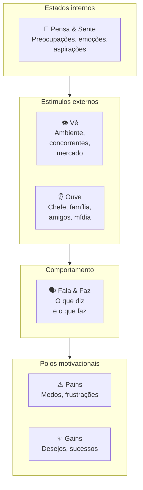

A tese é que o comportamento humano nasce da tensão entre estímulos externos (o que a pessoa vê e ouve), estados internos (o que pensa e sente) e polos motivacionais (dores e ganhos). Mapear os seis blocos revela contradições: a pessoa diz X em público e faz Y na rotina, ouve A do chefe e é movida por B em segredo. É nessas contradições que um produto novo encontra adoção.

##### O momento exato de colocar este canvas na parede

Use o *Empathy Map* durante a Fase 4 (descoberta do problema) como complemento ao *Mom Test*: entrevistas de problema capturam comportamento passado, enquanto o *Empathy Map* organiza o universo emocional e contextual que cerca esse comportamento. Use também na [[#FASE 5: PESQUISA COM USUÁRIOS (CUSTOMER DISCOVERY)|Fase 5 (pesquisa com usuários)]] para construir o *Customer Profile* do [[#Canvas: Value Proposition Canvas (Alexander Osterwalder, 2014)|Value Proposition Canvas]] com profundidade emocional. Em times de produto maduros, revise o mapa de cada persona principal a cada 12 meses.

##### Princípios práticos para preencher sem se enganar

A tese de Gray é que **empatia é capacidade construída, não dom**. Para construir, é preciso processo deliberado: ler verbatim de entrevistas, observar em campo, mapear com a equipe num exercício colaborativo. Empathy Map preenchido só com intuição é ficção. Preenchido com base em pesquisa real, vira ferramenta de tomada de decisão: quando alguém propõe uma feature que contradiz o que está mapeado em "Pains" e "Gains", a contradição fica visível.

##### Passo a passo na parede da sala (roteiro de oficina colaborativa)

Reúna os fundadores e, se já houver operação ativa, quem atende diretamente o cliente (2 a 5 pessoas no total), logo após consolidar a síntese do Passo 7. Tempo: 90 a 120 minutos. Pré-requisito inegociável: pesquisa de campo concluída, com pelo menos 5 a 10 entrevistas qualitativas e observação direta. Sem dados reais de campo, o Mapa de Empatia vira apenas suposição compartilhada.

1. **Escolha uma persona específica**: não "nossos clientes em geral", mas "Sueli, dona de padaria artesanal com três lojas na Zona Sul de São Paulo". O *Empathy Map* é feito por pessoa concreta, não por segmento abstrato.
2. **Vê**: leia verbatim de entrevistas e observação. O que essa pessoa vê no celular pela manhã? No trabalho? Em casa? Que ambiente físico habita? Que mídia consome?
3. **Ouve**: quem fala com ela? O que esses falantes dizem? Chefe, sócio, família, amigos, podcasts, influenciadores.
4. **Pensa & Sente**, o que ocupa a mente? O que tira o sono? O que entusiasma? Aqui é zona de inferência cuidadosa, ancore em verbatim.
5. **Fala & Faz**: o que ela diz publicamente (LinkedIn, conversas profissionais)? Como age (rotina, decisões observadas)? Há contradição entre os dois?
6. **Pains**: medos específicos, não genéricos. "Tenho medo de quebrar" é vago, "tenho medo de não conseguir pagar a folha do mês 13" é Pain.
7. **Gains**: resultados e sucessos pessoais que ela busca atingir. "Quero crescer" é vago, "quero abrir a quarta loja até 2027 sem trabalhar aos domingos" é um *Gain* concreto.

Tempo de execução: 90 a 120 minutos para a primeira versão consolidada, com revisão periódica a cada 6 a 12 meses ou sempre que uma nova rodada de entrevistas alterar o recorte do ICP.

##### Exemplo brasileiro preenchido: aplicativo de entregas em São Paulo, persona "Carlos, motoboy parceiro" (reconstrução didática)

Para ilustrar o uso em plataformas de dois lados, considere o caso ilustrativo de um aplicativo de entregas urbanas em São Paulo que construiu o Mapa de Empatia de Carlos (32 anos, motoboy profissional que roda das 7h às 19h na capital paulista) em vez de olhar apenas para o comprador final, usando a observação de rua para redesenhar a experiência do entregador:

| Quadrante | Conteúdo |
|---|---|
| **Vê** | Aplicativo de entregas competindo por atenção com WhatsApp, Uber, iFood e Rappi na tela do celular. Outros motoboys em bolsões comentando taxas e rotas. Trânsito de São Paulo em tempo real. Posto de gasolina como ponto de parada e socialização. |
| **Ouve** | Esposa pedindo para "voltar mais cedo". Outros entregadores em grupos de WhatsApp reclamando de plataforma X ou recomendando rota Y. Atendente de suporte da plataforma por mensagem de texto. Clientes finais na portaria: alguns simpáticos, outros impacientes com atraso. |
| **Pensa & Sente** | Ansiedade sobre quanto vai ganhar no fim do dia. Cálculo mental constante de R$/km. Frustração com cancelamentos e endereços errados. Orgulho discreto quando completa entregas difíceis. Cansaço acumulado mas necessidade de não parar. Comparação com outros entregadores: "fulano fez 30 entregas hoje, eu só 22". |
| **Fala & Faz** | Diz publicamente que "trabalha pela liberdade de horário". Faz: aceita corridas das 6h às 22h porque precisa do faturamento. Recusa entregas longas mesmo com bônus se for fim de semana. Compartilha dicas em grupo de WhatsApp mas guarda os melhores estabelecimentos para si. |
| **Pains** | Ganhar menos que o pico do mês passado. Acidente sem cobertura: "se eu cair, fico sem renda". Bateria do celular acabar no meio do dia. Endereço errado em região perigosa. Diarreia/doença sem direito a auxílio. Multas de trânsito que comem ganho do dia. Cliente que não responde interfone. |
| **Gains** | Faturar R$ 3-4k/mês líquido (após combustível e manutenção). Conseguir folga de domingo sem perder ranking. Ter celular novo (ferramenta de trabalho). Comprar moto melhor: sonho de 12-24 meses. Ter dia mais previsível. Ser tratado com respeito por atendentes e clientes. |

O quadrante "Vê" mostrou que o aplicativo disputava atenção na mesma tela com outros quatro a seis aplicativos de corrida e mensagens. Enquanto o time interno imaginava o sistema como uma ferramenta de uso dedicado, na rua Carlos alternava entre plataformas conforme o ganho líquido daquela faixa de horário. Essa leitura gerou três ajustes no produto: simplificar a tela de aceite com alerta sonoro claro e um único botão grande, destacar o ganho por quilômetro e o bônus diretamente na notificação e oferecer suporte por áudio para quando o entregador estiver parado em local seguro (já que nada no aplicativo deve pedir interação com a moto em movimento, em respeito à segurança e ao art. 252 do Código de Trânsito Brasileiro). Mapear quem não é o comprador final (entregador, fornecedor, intermediário) costuma revelar tanto quanto mapear o cliente que paga.

##### Variações e extensões

- **Empathy Map Canvas (atualizado, Dave Gray, 2017)**: versão mais recente que adiciona "Goal" no centro (objetivo da pessoa) e desloca o foco para tarefa-a-realizar: versão JTBD-friendly.
- **Stakeholder Empathy Map**: para B2B enterprise, fazer um Empathy Map para cada stakeholder no processo de compra (usuário, comprador, sponsor, TI).
- **Day-in-the-Life Map**: variação que mapeia 24 horas concretas ao invés de estados gerais.

##### Onde os fundadores mentem para si mesmos neste canvas

- Preencher com intuição em vez de pesquisa: Empathy Map sem dado real é projeção coletiva, não empatia.
- Tratar como descrição estática: pessoas mudam, refaça periodicamente.
- Confundir "Vê" com demografia: "Vê" é o ambiente físico/digital específico, não "tem 30 anos".
- Ignorar contradições entre "Fala & Faz": frequentemente é onde estão as oportunidades de produto.
- Preencher o Mapa de Empatia apenas para o comprador final: mapear também os usuários resistentes e os intermediários da cadeia (como entregadores, secretárias ou contadores que operam a rotina) costuma revelar barreiras ocultas de adoção.

---

### TEMPLATES OPERACIONAIS E CASOS PREENCHIDOS (FASE 4)

#### Template: Entrevista de Problema

> [!important] Disciplina central
> Conduza a conversa **sem apresentar a sua proposta de produto**: concentre-se nas rotinas e escolhas passadas do entrevistado para colher relatos sem viés de cortesia.

Este template tem duas partes. A Parte A é o roteiro para consultar *durante* a conversa (deixe aberto na tela ou imprima). A Parte B é a síntese para preencher *depois*: idealmente nas 24h seguintes, enquanto a memória está fresca. As duas formam um único artefato: roteiro sem síntese vira entrevista perdida. Síntese sem roteiro vira interpretação livre. Use as duas em todas as entrevistas da rodada.

##### Parte A: Roteiro da Entrevista (uso durante a conversa)

**Duração alvo:** 30-45 min · Balanço de fala: o entrevistado fala a maior parte do tempo. Se você se pegar falando mais que ele em qualquer trecho de 5 minutos, volte a fazer perguntas abertas.

**Abertura (2 min)**

> "Oi, obrigado pelo tempo. Antes de começar: não estou aqui para te vender nada. Estou pesquisando como [público-alvo] lidam com [área ampla], porque quero entender se existe um problema real antes de construir qualquer coisa. Vou fazer perguntas abertas, sem respostas certas. Posso gravar apenas para fins de transcrição interna? O áudio será excluído depois da síntese."
>
> *Nota de conformidade com a LGPD (Lei 13.709/2018) para o entrevistador: registre o consentimento no início da gravação, remova nomes próprios e CNPJs antes de submeter o texto a ferramentas de IA e descarte o arquivo bruto após consolidar os padrões (ver [[IGNICAO-Vol-8-Juridico-LGPD-e-Seguranca#CAPÍTULO 9: LGPD, COMPLIANCE E GOVERNANÇA DE DADOS|Capítulo 9: LGPD, Compliance e Governança de Dados (Vol. 8)]]).*

**Contexto (5 min)**

- Me conta um pouco sobre o que você faz no dia a dia.
- Quanto tempo você está nesse papel / nessa empresa?
- Quem mais na sua rotina está envolvido em [área ampla]?

**Exploração (10 min): *ainda sem falar da sua solução***

- Me descreve como funciona a rotina quando [atividade relacionada ao problema].
- Quais são as partes mais chatas dessa rotina?
- Me conta a última vez que algo deu errado nisso.

**Aprofundamento por problema mencionado (10-15 min)**

Para cada problema que a pessoa citar espontaneamente:

- Me fala mais sobre isso.
- Quando foi a última vez que aconteceu?
- O que você fez?
- Quanto tempo / dinheiro isso custou?
- O que acontece se você simplesmente não resolver? *(mapeia escalação)*

**Tentativas de solução (5 min)**

- O que você já tentou pra resolver?
- Funcionou? Por que parou ou continua usando?
- **Já gastou dinheiro (ferramenta, consultor, pessoa extra) pra resolver isso?**
- Quanto? Por quanto tempo?

**Encerramento (3 min)**

- Tem mais alguém que passa por isso e que eu poderia conversar?
- Posso voltar se surgirem mais perguntas?
- Topa ver um protótipo em 30-60 dias e dar sua opinião?

**NÃO PERGUNTAR (lista de proibições)**

- "Você pagaria R$X por isso?"
- "Se existisse Y, você usaria?"
- "Você acha que isso seria útil?"
- "Eu tive uma ideia, o que você acha?"
- "Você não acharia melhor se.?"
- Qualquer pergunta que comece com hipótese sua a ser validada pelo entrevistado.

##### Parte B: Síntese Pós-Entrevista

###### Metadados

| Campo | Valor |
|---|---|
| **ID** | `ENTR-[AAAA-MM-DD]-[##]` |
| **Data e hora** | `[DD/MM/AAAA: HH:MM]` |
| **Duração real** | `[min]` |
| **Formato** | `[ ] Remoto  [ ] Presencial` |
| **Gravação (com consentimento)** | `[link ou "não gravada"]` |
| **Transcrição** | `[link]` |
| **Entrevistador** | `[Nome]` |
| **Anotador (se houver)** | `[Nome]` |
| **Relação com a hipótese** | `[ID da hipótese em teste, se formal]` |

###### Perfil do Entrevistado e Aderência ao ICP

| Campo | Valor |
|---|---|
| **Nome** | `[preencher]` |
| **Papel / cargo** | `[preencher]` |
| **Empresa / contexto** | `[preencher]` |
| **Porte do negócio** | `[nº funcionários / faturamento / estágio: seja específico]` |
| **Localização** | `[cidade / estado / país]` |
| **Fonte do contato** | `[rede pessoal / LinkedIn / indicação / cold outreach]` |
| **Vínculo pessoal com o entrevistador?** | `[ ] Não  [ ] Sim`: *se sim: atenção a viés de cortesia nas respostas.* |
| **Aderente ao ICP hipotético?** | `[ ] Sim  [ ] Parcial  [ ] Não` |

> *Se "Não", a entrevista vale como aprendizado mas não conta para o denominador de validação (regra da Fase 4).*

###### 1. Contexto e rotina

> *Descreva o mundo da pessoa com as palavras dela: rotina, responsabilidades, ferramentas e periodicidade. (Na condução da Parte A, deixe o entrevistado explicar esse contexto antes de puxar o problema.)*

**Descrição geral.** `[Descreva em prosa o que a pessoa faz. Use as palavras dela. 3-5 linhas.]`

**Processo atual mapeado em etapas.** *Se o problema investigado tem a forma de um processo ou fluxo de trabalho (recrutamento, compra, ativação, fechamento, conciliação etc.), documente em etapas numeradas. Isso ancora onde cada dor acontece: a mesma pessoa pode ter dor forte na Etapa 2 e nenhuma na Etapa 4. Sem esse mapa, você registra "dor em recrutamento" quando na verdade é "dor em triagem inicial", que é outro problema.*

- **Etapa 1: `[nome curto]`:** `[o que acontece, quem faz, com que ferramenta, quanto tempo leva]`
- **Etapa 2: `[nome curto]`:** `[preencher]`
- **Etapa 3: `[nome curto]`:** `[preencher]`
- **Etapa 4: `[nome curto]`:** `[preencher]`

*(adicione ou remova etapas conforme o caso)*

**Ferramentas e stack atual.**

- `[ferramenta: para que usa]`
- `[preencher]`

###### 2. Problemas mencionados (o que foi dito: não o que você interpretou)

> *Para cada problema que emergiu na conversa, preencha um bloco. Decisivo: documente apenas o que o entrevistado disse espontaneamente ou em resposta a pergunta aberta. Problemas que você "provocou" com pergunta tendenciosa valem zero.*

**Problema A: `[título curto, nas palavras do entrevistado se possível]`**

- **Descrição literal:** `[preencher]`
- **Era esperado ou inesperado?** `[ ] Esperado (ligado à hipótese em teste)  [ ] Inesperado (surgiu espontaneamente em campo e revelou uma oportunidade não mapeada)`
- **Em qual etapa do processo ocorre?** `[Etapa 1 / Etapa 2 / transversal / fora do processo mapeado]`
- **Menção foi espontânea ou provocada?** `[ ] Espontânea  [ ] Provocada por pergunta aberta  [ ] Provocada por pergunta tendenciosa (descartar)`
- **Frequência observável:** `[diária / semanal / mensal / esporádica]`
- **Última ocorrência (comportamento passado):** `[quando? o que aconteceu?]`
- **Custo atual (tempo / dinheiro / energia):** `[número ou descrição concreta]`
- **Emoção observada:** `[exemplo: frustração, resignação, vergonha, medo, use a palavra que cabe]`
- **Tentativas anteriores de resolver:** `[o que já tentou? funcionou? por que parou ou continuou?]`
- **Já gastou dinheiro para resolver?** `[ ] Não  [ ] Sim: quanto? em quê? por quanto tempo?`: *sinal operacional mais limpo de dor. Dinheiro já gasto vale mais que promessa de pagar.*
- **Escalação: o que piora se NÃO resolver?** `[perde cliente / perde contrato / multa / perde emprego / nada concreto]`: *separa urgência real de incômodo crônico.*

**Problema B: `[preencher]`** `[bloco com mesma estrutura do Problema A]`

**Problema C: `[preencher]`** `[bloco com mesma estrutura do Problema A]`

###### 3. Verbatim (citações literais)

> *Transcreva literalmente o que a pessoa disse, entre aspas, registrando pelo menos 3 frases exatas. As palavras reais do cliente servem de prova empírica para alinhar o time, construir o argumento comercial e priorizar o produto.*

1. > *"[citação literal]"*: sobre `[Problema A]`
2. > *"[citação literal]"*: sobre `[Problema B]`
3. > *"[citação literal]"*: sobre `[tema]`
4. > *"[citação literal]"*: sobre `[tema]`

###### 4. Vocabulário do cliente

> *Anote as palavras e expressões exatas que a pessoa usou para descrever o problema, a rotina e as soluções atuais. Não parafraseie. Esse vocabulário vai direto para o marketing, para a landing page e para o roteiro de vendas depois: se você usa a linguagem do cliente, ele se reconhece. Se você usa a sua, ele ignora.*

| Como a pessoa chama | Contexto em que usou |
|---|---|
| `[palavra / expressão exata]` | `[o que ela estava descrevendo]` |
| `[preencher]` | `[preencher]` |
| `[preencher]` | `[preencher]` |

**Termos que ela *não* usou e que nós estávamos prontos a usar:** `[preencher]`, *se a pessoa não usa a nossa palavra, provavelmente estamos falando a linguagem errada.*

###### 5. Hierarquia de sinais coletados

> *Classifique a evidência desta entrevista pelo tipo de sinal, usando os mesmos pesos da tabela do Passo 3: só os três primeiros tipos movem decisão. Os três últimos enganam.*

| Sinal | Peso | O que veio nesta entrevista? |
|---|---|---|
| **Comportamento passado** ("semana passada gastei 4h nisso") | Alto | `[preencher]` |
| **Tentativas anteriores de solução** ("usei X, Y e Z, nada resolveu") | Alto | `[preencher]` |
| **Métricas de custo** (tempo, dinheiro, energia já gastos) | Alto | `[preencher]` |
| **Ideias soltas** ("seria legal se tivesse X") | Baixo a médio | `[preencher]` |
| **Hipóteses futuras** ("eu pagaria por isso") | Quase zero | `[preencher]`: *não usar para decisão* |
| **Elogios** ("que ideia legal!") | Quase zero | `[preencher]`: *descartar* |

###### 6. Classificação de Pain Level

> *Atribua **um único nível** ao entrevistado. Padrão de Pain Level 4+ em volume (tipicamente ≥5 entrevistas) é o que move a tese. Uma entrevista isolada em nível 3 não descarta a investigação, só ainda não confirma.*

- [ ] **Nível 1**: Tem o problema, mas não sabe que tem.
- [ ] **Nível 2**: Sabe que tem, mas tolera. Não vai pagar sozinho.
- [ ] **Nível 3**: Está ativamente procurando uma solução no mercado, com prazo definido. Contato comercial quente.
- [ ] **Nível 4**: Já improvisou gambiarra (planilha Frankenstein, processo manual, ferramenta adaptada). Forte evidência de que pagaria.
- [ ] **Nível 5**: Tem orçamento comprometido ou facilmente acessível para comprar solução. Cliente ideal.

> *O Nível 5 verifica-se sempre por evidência indireta de gasto passado ou orçamento alocado, nunca por pergunta hipotética sobre disposição futura a pagar (que induz a resposta e viola as regras da Parte A). Sinais válidos: relato espontâneo de valor já desembolsado, contratação de pessoal para contornar o problema, mensalidade paga em ferramenta substituta ou rubrica já aprovada no orçamento anual.*

**Justificativa da classificação:** `[1-2 linhas com a evidência direta, não interpretação, que sustenta a nota.]`

###### 7. Observações do entrevistador

> *Separadas dos fatos. Use itálico. Aqui entram sua leitura da linguagem corporal, tom, nível de energia e suspeitas. Fatos acima. Interpretação aqui.*

*`[preencher]`*

*`[preencher]`*

###### 8. Armadilhas: autoavaliação pós-entrevista

> *Esta seção verifica se as proibições da Parte A foram respeitadas. Marque honestamente o que aconteceu.*

- [ ] Cheguei a apresentar minha solução em algum momento? *Se sim, os dados após esse ponto devem ser lidos com ceticismo.*
- [ ] Fiz pergunta tendenciosa tipo "você não acharia melhor se."?
- [ ] Fiz pergunta hipotética sobre o futuro ("você usaria X?", "pagaria Y?")?
- [ ] Em algum trecho de 5 min, falei mais que o entrevistado?
- [ ] Filtrei o que ouvi para confirmar tese que eu já tinha?
- [ ] Tratei uma fala apaixonada como equivalente a um padrão de 10 entrevistas?

> *Cada marca acima contamina parte da evidência. Anote quais achados ficam sob suspeita em função dessas contaminações:* `[preencher]`

###### 9. Refinamento do ICP

> *O ICP não muda a cada conversa isolada: o ajuste ocorre quando o mesmo padrão se repete em 5 a 10 entrevistas. Use este campo para anotar sinais individuais que, somados na Síntese de Rodada, justificam estreitar ou deslocar o segmento-alvo (como ilustra o caso de plataformas de delivery que iniciaram mirando grandes redes e migraram para restaurantes independentes sem canal próprio).*

**Sub-segmento mais agudo observado nesta entrevista.** *Dentro do perfil entrevistado, o que parece correlacionado com sofrer mais? Porte? Setor? Senioridade? Estágio? Tempo no cargo? Stack? Volume? Anote o recorte que se destacou.*

`[Ex: "padarias com 3+ lojas sentem. Com 1-2 não", ou, "só operadores que fazem a reconciliação manualmente, não quem tem financeiro dedicado"]`

**Esta entrevista sugere algum refino de ICP?**

- [ ] **Estreitou**: ICP ficou mais específico. Novo recorte: `[preencher]`
- [ ] **Ampliou**: ICP precisa incluir um perfil que não tínhamos mapeado: `[preencher]`
- [ ] **Mudou de direção**: perfil entrevistado era hipótese, mas a dor real aparece em outro lugar: `[preencher]`
- [ ] **Confirmou**: o recorte atual do ICP permanece válido nesta conversa (atenção: se a formulação inicial sair 100% intacta após a rodada inteira, audite se as perguntas não induziram as respostas, pois confirmações totais na primeira rodada são raras).

###### 10. Indicações (snowball)

- **Outras pessoas que passam por isso e que podemos conversar:** `[nome, contato, por que foi indicado]`
- **Posso voltar para nova conversa?** `[ ] Sim  [ ] Não`
- **Topa ver um protótipo em 30-60 dias?** `[ ] Sim  [ ] Não`

###### 11. Decisão pós-entrevista individual

> *Uma única entrevista não decide nada, mas cada entrevista move a agulha. Marque para onde ela moveu.*

- [ ] **Reforça** a hipótese de problema em teste
- [ ] **Enfraquece** a hipótese
- [ ] **Ambígua**: precisa de mais dados
- [ ] **Falso positivo identificado** (pessoa disse que tem o problema mas o comportamento refuta)

**Justificativa (2-3 linhas):** `[preencher]`

###### 12. Próximos passos de investigação

> *Distintos de "ações internas de produto". Aqui registramos perguntas novas que esta entrevista gerou e que informam a próxima entrevista, uma pesquisa desk, ou um dado a buscar externamente. É o espírito iterativo do discovery: cada conversa afina a próxima.*

**Perguntas a incluir em próximas entrevistas.**

- `[preencher]`
- `[preencher]`

**Dados a buscar externamente (pesquisa desk, benchmark, números de mercado).**

- `[preencher]`
- `[preencher]`

**Perfis diferentes a entrevistar para cruzar padrões.** *"Esta dor é padrão no setor ou é específica desta empresa? Preciso falar com alguém de porte X ou região Y para comparar."*

- `[preencher]`

###### Anexos

- Gravação: `[link até a síntese, depois excluir]`
- Transcrição: `[link]`
- Artefatos compartilhados pelo entrevistado (prints, planilhas): `[link]`
- Entrevistas relacionadas: `[ENTR-., ENTR-.]`

*Preenchido por `[Nome]` em `[DD/MM/AAAA]`.*

> [!tip] Consolidação da rodada
> Cada entrevista preenchida pela Parte B alimenta uma linha do agregado. A decisão de avanço de fase não sai de uma conversa isolada: sai do [[#Template: Síntese de Rodada de Entrevistas (decisão de avanço)|Template: Síntese de Rodada de Entrevistas (decisão de avanço)]], que cruza *Pain Level*, padrões, gambiarras e vocabulário das 15 a 20 entrevistas para decidir entre perseverar, pivotar problema, pivotar cliente ou abandonar.

---

#### Template: Entrevista com Especialista de Mercado (mapa de setor)

> [!important] Disciplina central
> Aqui você **quer opinião**: é legítimo. Mas opinião de especialista é hipótese a testar, não evidência de cliente. O erro é tratar "o especialista disse X" como validação. O especialista conhece o mercado. Quem prova o mercado é o cliente com a carteira.

Use quando precisa mapear setor, dinâmicas competitivas, pontos cegos e tendências regulatórias: a pessoa conhece o mercado, não necessariamente é cliente dele. Não use para saber se *o cliente* tem dor. Para isso o instrumento é Template: Entrevista de Problema (Fase 4). Como o Template: Entrevista de Problema (Fase 4), este template tem Parte A (roteiro durante) e Parte B (síntese pós-conversa, idealmente em 24h).

##### Parte A: Roteiro da Conversa (uso durante)

**Duração alvo:** 45-60 min · Balanço de fala: o especialista fala mais que você, mas aqui é legítimo intervir para confrontar e pedir exemplos específicos.

**Abertura (3 min)**

> "Obrigado pelo tempo. Estou pesquisando [setor/dinâmica] porque estou construindo uma tese sobre [resumo em uma frase]. Quero muito ouvir onde você acha que estou errado, quais sinais eu não estou vendo e que anti-cases você já viu. Posso gravar?"

**Calibração (5 min)**

- Há quanto tempo você está nesse setor?
- Em quais posições você viu a dinâmica de perto?
- O que mudou no setor nos últimos 3 anos?

**Mapa do setor (10 min)**

- Quem são os players relevantes hoje, e por que cada um ainda existe?
- Qual é a dinâmica competitiva dominante: preço, tecnologia, canal, rede, regulação?
- Que ciclos e sazonalidades afetam o setor?

**Confronto à nossa tese (15 a 20 min).** *Se o especialista só elogia, você perdeu a conversa.*

- Nossa hipótese é [X]. **Onde você acha que está mais fraca?**
- Que premissas dessa tese são não triviais: o que teria que ser verdade pra ela funcionar?
- Você já viu alguém tentar algo parecido? O que aconteceu?
- Se isso fosse fácil, por que ninguém fez ainda?

**Especificidades de contexto (5 min)**

- Que particularidades regulatórias / tributárias / culturais do Brasil mudam essa tese?
- Como funciona o capital nesse setor no Brasil?

**Pontos cegos e redes (5 min)**

- O que eu ainda não perguntei e deveria?
- Outras pessoas com quem eu deveria conversar?
- Leituras / relatórios que você recomendaria?

**Encerramento (2 min)**

- Posso voltar com dúvidas?
- Topa receber o resumo do que aprendi em 48h?

**NÃO CONFUNDIR**

- Opinião informada ≠ dado de cliente. Anotar como opinião, não como validação.
- Elogio à tese é ruído: se não houve pushback, a conversa foi incompleta.
- "Eu sempre vi assim" ≠ "isso se aplica ao seu caso". Heurística do veterano precisa de fit específico.

##### Parte B: Síntese Pós-Conversa

###### Metadados

| Campo | Valor |
|---|---|
| **ID** | `ESP-[AAAA-MM-DD]-[##]` |
| **Data e hora** | `[DD/MM/AAAA]` |
| **Duração** | `[min]` |
| **Formato** | `[ ] Remoto  [ ] Presencial` |
| **Entrevistador(es)** | `[Nome]` |
| **Gravação / transcrição** | `[link]` |
| **Conflito de interesse?** | `[ ] Nenhum  [ ] Consultor pago  [ ] Investidor no setor  [ ] Atua em empresa concorrente (atenção: restrinja a conversa a informações públicas de mercado, nunca solicite segredos de negócio, preços internos ou listas de clientes, sob pena de concorrência desleal na Lei 9.279/1996, art. 195)  [ ] Outro]`: *descrever* |

###### Perfil do Especialista

| Campo | Valor |
|---|---|
| **Nome** | `[preencher]` |
| **Posição atual / papel** | `[preencher]` |
| **Tempo na área** | `[preencher]` |
| **Credenciais relevantes** | `[empresas onde atuou, publicações, deals, etc.]` |
| **Recorte de expertise** | `[técnico / comercial / regulatório / financeiro / operacional]` |
| **Por que esta pessoa?** | `[1-2 linhas sobre a adequação dela à pergunta em aberto]` |

###### 1. Objetivo da conversa

**Qual hipótese de mercado estamos testando?** `[preencher]`

**O que precisamos sair sabendo?**

- `[preencher]`
- `[preencher]`
- `[preencher]`

**O que já presumíamos e queríamos ver se ele confirma ou refuta?**

- `[preencher]`
- `[preencher]`

###### 2. Mapa do setor (na visão do especialista)

**Players relevantes e como se posicionam.**

| Player | Posicionamento | Vantagens | Fraquezas |
|---|---|---|---|
| `[preencher]` | `[preencher]` | `[preencher]` | `[preencher]` |

**Dinâmica competitiva dominante hoje.** `[preço? tecnologia? canal? marca? rede? regulatório?]`

**Tendências relevantes (3-5 anos).**

- `[preencher]`
- `[preencher]`

**Ciclos e sazonalidades do setor.** `[preencher]`

###### 3. Onde o especialista acha que estamos errados

> *Pergunte explicitamente: "Onde você acha que nossa tese está mais fraca?"*

- **Fragilidade apontada 1:** `[preencher]`
- **Fragilidade apontada 2:** `[preencher]`
- **Fragilidade apontada 3:** `[preencher]`

**Anti-cases mencionados (onde tese parecida já falhou).**

| Empresa / caso | O que tentou | Por que quebrou |
|---|---|---|
| `[preencher]` | `[preencher]` | `[preencher]` |

###### 4. "What would have to be true" para a nossa tese

> *Pergunta enquadradora útil em conversa com especialista: "para essa tese dar certo, o que teria que ser verdade sobre o mercado, cliente, regulação, tecnologia?"*

Premissas que a pessoa identificou como *decisivas e não triviais*:

1. `[premissa, e por que é não trivial]`
2. `[preencher]`
3. `[preencher]`

###### 5. Especificidades contextuais (Brasil, setor, regulatório)

> *Especialistas brasileiros valem muito por capturar o que livro importado ignora: tributação real, ciclo de capital local, cultura de negócio, governo.*

- **Regulatório / tributário:** `[preencher]`
- **Canais dominantes no Brasil:** `[preencher]`
- **Dinâmica de capital / investidores relevantes:** `[preencher]`
- **Relação com governo / compras públicas (se aplicável):** `[preencher]`
- **Padrões culturais que afetam adoção:** `[preencher]`

###### 6. Hierarquia de sinais da conversa

> *O especialista mistura cinco tipos de afirmação em qualquer conversa, e elas não têm o mesmo peso. Classificar o que ouvimos força leitura crítica pós-conversa. Quanto mais alto na tabela, mais peso na decisão.*

| Tipo de sinal | Peso | O que veio nesta conversa? |
|---|---|---|
| **Dado verificável** (estatística, relatório, regulação, fonte pública nomeada) | Alto | `[preencher]` |
| **Caso pessoal vivido** (ele mesmo operou, decidiu e observou de perto, com detalhe específico) | Alto | `[preencher]` |
| **Opinião informada** (tese construída com base em padrão repetido observado, mas sem dado formal) | Médio | `[preencher]` |
| **Intuição de veterano** ("tenho a sensação de que.", reconhecimento de padrão sem articulação clara) | Baixo a médio | `[preencher]`: *tratar como hipótese a testar* |
| **Heurística genérica** ("eu sempre acho que.", máxima aplicada sem fit específico ao nosso caso) | Baixo | `[preencher]`: *descartar para decisão* |

**Fatos verificáveis a checar depois.** *Liste aqui especificamente o que cai na primeira linha, pois precisa ir para a fila de verificação.*

| Afirmação | Fonte sugerida | Responsável | Prazo |
|---|---|---|---|
| `[preencher]` | `[link / órgão / relatório]` | `[Nome]` | `[DD/MM]` |

###### 7. Pontos cegos identificados

> *"Coisas que eu não sabia que não sabia." Catalogue aqui temas que só apareceram porque a pessoa levantou.*

- `[preencher]`
- `[preencher]`

###### 8. Vocabulário setorial

> *Especialistas dominam o jargão do setor. Capturar como a tribo realmente se expressa vale para marketing, pitch a investidor e conversa com próximo especialista.*

| Termo / expressão | O que significa na prática do setor |
|---|---|
| `[termo exato]` | `[preencher]` |
| `[preencher]` | `[preencher]` |

###### 9. Citações marcantes

> *Não com o mesmo peso da Entrevista de Problema, mas guardar frases bem articuladas do especialista ajuda a reutilizar em deck e memorando interno.*

1. > *"[citação]"*
2. > *"[citação]"*

###### 10. Armadilhas: autoavaliação pós-conversa

> *Marque honestamente o que aconteceu. Cada item contamina parte da evidência coletada.*

- [ ] Tratei elogio à tese como validação?
- [ ] Aceitei "eu sempre vi assim" sem pedir caso específico?
- [ ] Confundi opinião informada com dado verificável?
- [ ] Deixei passar contradição entre o que ele disse agora e o que disse antes?
- [ ] Não pedi pushback explícito: só ouvi concordância?
- [ ] Entrei na conversa sem tese clara a confrontar, e saí com "muitas perspectivas" em vez de direção?

**Achados sob suspeita em função dessas contaminações:** `[preencher]`

###### 11. Referências, leituras e redes

- **Livros / papers / relatórios indicados:** `[preencher]`
- **Outras pessoas que deveríamos conversar:** `[nome, por quê, se topa fazer intro]`
- **Eventos / comunidades relevantes:** `[preencher]`

###### 12. Ações internas pós-conversa

**Hipóteses que mudaram.**

- `[hipótese X: como mudou]`

**Hipóteses novas geradas.**

- `[preencher]`

**Outras ações.**

| Ação | Responsável | Prazo |
|---|---|---|
| `[preencher]` | `[Nome]` | `[DD/MM]` |

**Follow-up com a pessoa.**

- [ ] Agradecer e compartilhar resumo (dentro de 48h)
- [ ] Compartilhar material prometido: `[preencher]`
- [ ] Convidar para conversa futura em: `[gatilho / data]`
- [ ] Avaliar como advisor formal? `[ ] Sim  [ ] Não`

###### 13. Próximos passos de investigação

> *Perguntas novas que esta conversa gerou. Especialistas tipicamente abrem mais frentes do que fecham: registre as frentes abertas para não perder o fio.*

**Perguntas a explorar com outros especialistas.** `[preencher]`

**Dados a buscar externamente.** `[preencher]`

**Hipóteses de mercado a testar com cliente (entrevista de problema Template: Entrevista de Problema (Fase 4)).** `[preencher]`

*Preenchido por `[Nome]` em `[DD/MM/AAAA]`.*

---

#### Template: Síntese de Rodada de Entrevistas (decisão de avanço)

> [!important] Disciplina central
> Este não é um registro de conversa isolada: é o artefato em que o agregado de entrevistas vira decisão. É aqui que a frase "cinco pessoas disseram isso" vira "o problema existe, neste recorte, com esta dor, e devemos perseverar", ou o contrário. Nenhuma entrevista individual basta para essa decisão. Faça rascunhos parciais a cada lote de cinco conversas apenas para ajustar o roteiro e consolide o veredito definitivo apenas quando a bateria de 15 a 20 entrevistas terminar.

A **Síntese de Rodada de Entrevistas** é o entregável da Fase 4 que sustenta o Mapa de Problemas e a decisão de avanço. Conduza a consolidação em reunião de time (2 a 4 pessoas, duração de 2 a 4 horas) após fechar a rodada, com todas as sínteses individuais abertas na mesa: entrevistas de problema, entrevistas de troca (quando já houver) e, se aplicável, conversas com especialistas do setor. A decisão final registrada aqui tem mais autoridade do que qualquer conversa isolada.

##### Metadados da rodada

| Campo | Valor |
|---|---|
| **ID da rodada** | `ROUND-[AAAA-MM]-[##]` |
| **Período coberto** | `[DD/MM a DD/MM]` |
| **Duração total da rodada** | `[semanas]` |
| **Participantes da consolidação** | `[Nomes]` |
| **Data da consolidação** | `[DD/MM/AAAA]` |
| **Status** | `[ ] Rascunho  [ ] Em revisão  [ ] Decisão tomada` |

##### Hipótese em teste (ao iniciar a rodada)

> *Registre como a hipótese estava formulada quando a rodada começou, não como está hoje. O que muda entre o início e o fim é parte do aprendizado.*

**Hipótese de problema.** `[preencher]`

**ICP hipotético inicial.** `[preencher]`

**Critério de sucesso da rodada definido no início.** *Exemplo do livro: ≥5 entrevistados em Pain Level 4 ou 5, sub-segmento agudo identificado, padrão de workaround consistente.*

`[preencher]`

##### Entrevistas consolidadas

> *Rastreabilidade. Liste cada entrevista por ID. Sem esse mapa, a consolidação vira retórica: aqui cada afirmação deve voltar a uma conversa documentada.*

| ID | Tipo | Data | Aderente ao ICP? | Pain Level | Sob suspeita? |
|---|---|---|---|---|---|
| `ENTR-.-01` | Problema (Template da Fase 4) | `[DD/MM]` | `[Sim / Parcial / Não]` | `[1-5]` | `[ ] Não  [ ] Sim: motivo]` |
| `ENTR-.-02` | Problema (Template da Fase 4) | `[DD/MM]` | `[preencher]` | `[preencher]` | `[preencher]` |
| `JTBD-.-01` | Switcher (Template da Fase 5) | `[DD/MM]` | `[preencher]` | n/a | `[preencher]` |
| `ESP-.-01` | Especialista (Template da Fase 4) | `[DD/MM]` | n/a | n/a | `[preencher]` |
| . | | | | | |

**Totais.**

- Entrevistas de Problema (Template da Fase 4): `[N]` (aderentes ao ICP: `[N]`)
- Entrevistas com Switcher (Template da Fase 5): `[N]`
- Entrevistas com Especialistas (Template da Fase 4): `[N]`
- Contaminadas / sob suspeita (a não computar no denominador): `[N]`

###### 1. Distribuição de Pain Level (só entrevistas aderentes ao ICP)

> *Esta é a tabela central da consolidação. Critério do livro para avanço: ≥5 entrevistas em Pain Level 4 ou 5. Se não chegou a essa marca, a hipótese de problema ainda não está validada, independentemente do que "a gente sentiu" nas conversas.*

| Pain Level | Nº de entrevistas | % do total aderente |
|---|---|---|
| 1: Tem mas não sabe | `[N]` | `[%]` |
| 2: Sabe mas tolera | `[N]` | `[%]` |
| 3: Buscando solução | `[N]` | `[%]` |
| 4: Tem gambiarra rodando | `[N]` | `[%]` |
| 5: Orçamento comprometido | `[N]` | `[%]` |
| **Total nível 4+** | **`[N]`** | **`[%]`** |

**Atingimos o benchmark de ≥5 em Pain Level 4+?** `[ ] Sim  [ ] Não`

###### 2. Padrões de problema (agregação por problema, não por pessoa)

> *Aqui você agrupa problemas que apareceram em múltiplas entrevistas. A unidade de análise deixa de ser a pessoa e passa a ser o problema recorrente. Um problema citado em 1 entrevista é anedota. Em 10, é padrão.*

| Problema | Nº entrevistas que mencionaram | Espontâneo em quantas? | Frequência típica | Custo médio reportado | Pain Level médio dos que citaram |
|---|---|---|---|---|---|
| `[título do problema]` | `[N / total]` | `[N]` | `[diária / semanal / mensal]` | `[tempo / dinheiro]` | `[1-5]` |
| `[preencher]` | `[preencher]` | `[preencher]` | `[preencher]` | `[preencher]` | `[preencher]` |
| `[preencher]` | `[preencher]` | `[preencher]` | `[preencher]` | `[preencher]` | `[preencher]` |

**Problema dominante (mais recorrente + mais severo):** `[preencher]`

**Problemas não previstos inicialmente que se repetiram em duas ou mais entrevistas (achados emergentes de campo):** `[preencher]`

###### 3. Workarounds e alternativas dominantes

> *Se múltiplas pessoas resolvem o problema da mesma forma improvisada, você descobriu o concorrente real: frequentemente é Excel, WhatsApp, ou planilha Frankenstein, não a categoria óbvia.*

| Solução atual (workaround) | Nº entrevistas que usam | O que falta / frustra |
|---|---|---|
| `[preencher]` | `[N / total]` | `[preencher]` |
| `[preencher]` | `[preencher]` | `[preencher]` |

**Concorrente real identificado no agregado:** `[preencher]`

**Pessoas que já gastaram dinheiro tentando resolver:** `[N]` *(sinal operacional mais forte do que intenção declarada)*

###### 4. Vocabulário agregado do cliente

> *Cruze os campos "Vocabulário do Cliente" de todas as entrevistas de problema. Termos que aparecem em 3+ conversas são os que o cliente usa de fato. Isto vai direto para a landing page, o pitch e o roteiro de vendas.*

**Termos recorrentes (mencionados por 3+ entrevistados).**

| Termo / expressão | Nº de entrevistas | Contexto típico |
|---|---|---|
| `[preencher]` | `[N]` | `[preencher]` |
| `[preencher]` | `[preencher]` | `[preencher]` |

**Termos que NÓS usávamos e que o cliente NÃO usou.** *Se uma palavra que estava no nosso pitch não aparece em nenhuma entrevista, provavelmente ela não ressoa. Candidata a corte.*

- `[preencher]`
- `[preencher]`

###### 5. Refinamento do ICP

**ICP inicial (hipótese que entrou na rodada).** `[preencher]`

**Sub-segmento mais agudo identificado na rodada.** *O recorte dentro do ICP inicial que sofreu mais: mais Pain Level 4+, mais frequência, mais workaround ativo. Exemplo: "padarias com 3+ lojas, não com 1-2".*

`[preencher]`

**Perfis dentro do ICP inicial que NÃO deram sinal.** *Descartes são tão informativos quanto confirmações. Se um perfil que parecia óbvio não sofreu, o ICP precisa cortar esse perfil.*

- `[perfil]: motivo: [preencher]`
- `[preencher]`

**ICP refinado ao final da rodada.** `[nova formulação, mais específica do que a inicial]`

###### 6. Hierarquia de sinais no agregado

> *Some a hierarquia de cada entrevista individual. O balanço entre evidência forte e ruído diz se a rodada foi rica ou rasa.*

| Tipo de sinal | Contagem agregada (quantas entrevistas trouxeram) |
|---|---|
| Comportamento passado concreto | `[N]` |
| Tentativas anteriores de solução | `[N]` |
| Métricas de custo (tempo / dinheiro reportado) | `[N]` |
| Ideias soltas / hipóteses futuras | `[N]` |
| Elogios sem substância | `[N]` |

**Balanço:** `[os sinais fortes dominam / empatam / são minoria em relação ao ruído?]`

###### 7. Análise de contaminação

> *Quantas entrevistas tiveram armadilhas marcadas na autoavaliação pós-entrevista? Achados contaminados precisam ser segregados antes de entrar na decisão.*

| Tipo de contaminação | Nº entrevistas afetadas | Achados específicos sob suspeita |
|---|---|---|
| Apresentei solução durante a conversa | `[N]` | `[preencher]` |
| Pergunta tendenciosa ou hipotética | `[N]` | `[preencher]` |
| Falei mais que o entrevistado em trechos | `[N]` | `[preencher]` |
| Filtrei para confirmar tese prévia | `[N]` | `[preencher]` |

**Achados descartados dessa consolidação por contaminação:** `[preencher]`

###### 8. Insights emergentes (só visíveis no agregado)

> *Coisas que nenhuma entrevista individual mostrou, mas que aparecem quando você empilha as 20. Padrões, correlações, contradições. Frequentemente este é o trecho mais valioso da consolidação.*

- **Padrão 1:** `[preencher]`
- **Padrão 2:** `[preencher]`
- **Correlação observada:** `[ex: "todos os que sentem mais dor têm mais de 3 anos no cargo"]`
- **Contradição a investigar:** `[preencher]`

###### 9. Decisão de avanço de fase

> *Use o vocabulário específico do livro. Evite "Hold" ou "Go/No-Go genérico": cada decisão abaixo dispara uma ação diferente.*

**Decisão.**

- [ ] **Perseverar**: problema validado, ICP refinado, sub-segmento agudo identificado. Avançar para [[#FASE 5: PESQUISA COM USUÁRIOS (CUSTOMER DISCOVERY)|Fase 5]] (Pesquisa Aprofundada) com a hipótese atual.
- [ ] **Pivotar problema**: o problema que estávamos investigando não se confirmou, mas outro emergiu do agregado. Reformular hipótese e rodar nova rodada focada no novo problema.
- [ ] **Pivotar cliente**: o problema existe, mas não no perfil que estávamos investigando. Mudar o ICP e rodar nova rodada com o novo perfil.
- [ ] **Abandonar**: nem problema claro, nem ICP promissor. Liberar recurso, documentar aprendizados, pensar em outra direção.

**Justificativa (5-10 linhas).** *Aponte explicitamente para as tabelas acima: Pain Level, padrões de problema, workarounds, sub-segmento agudo. A decisão tem que ser rastreável à evidência, não à sensação do time.*

`[preencher]`

**Nível de confiança na decisão.**

- [ ] Alto: evidência clara, benchmark atingido, time alinhado
- [ ] Médio: alguns sinais fortes mas lacunas em áreas específicas (descrever): `[preencher]`
- [ ] Baixo: decisão forçada por prazo, idealmente precisaríamos de mais: `[preencher]`

**Votos divergentes do time (se houver).** *Se alguém do time discordou, registre. É memória útil quando a decisão for revisitada em 6 meses.*

- `[Nome] discordou porque: [preencher]`

###### 10. Próximos passos (por ramo de decisão)

**Se PERSEVERAR.**

- [ ] Atualizar documento de ICP com a versão refinada desta rodada
- [ ] Produzir persona v1 com base no sub-segmento agudo (template [[#Template: Persona com dados|Template: Persona com dados]])
- [ ] Avançar para [[#FASE 5: PESQUISA COM USUÁRIOS (CUSTOMER DISCOVERY)|Fase 5]] (Pesquisa Aprofundada)
- [ ] Seguir rodada com Entrevistas com Switcher (Template da Fase 5) focadas no sub-segmento agudo? `[ ] Sim  [ ] Não`
- [ ] Mapear concorrentes, substitutos e cunha de entrada na [[#FASE 6: MAPEAMENTO DE MERCADO E CONCORRÊNCIA|Fase 6]]: `[preencher]`

**Se PIVOTAR (problema ou cliente).**

- [ ] Documentar por que a hipótese anterior falhou: aprendizado vale para futuras rodadas
- [ ] Formular nova hipótese: `[preencher]`
- [ ] Definir escopo da nova rodada: quantas entrevistas, em quanto tempo, com qual perfil
- [ ] Reusar quais contatos / indicações da rodada atual? `[preencher]`

**Se ABANDONAR.**

- [ ] Escrever post-mortem: o que aprendemos sobre o mercado / cliente que continua valendo
- [ ] Manter rede de contatos viva? `[ ] Sim: como  [ ] Não, encerrar`
- [ ] Próxima tese a explorar (se houver): `[preencher]`

###### 11. Artefatos a produzir a partir desta consolidação

> *O preenchimento deste **Template: Síntese de Rodada de Entrevistas (decisão de avanço)** gera documentos operacionais novos, não apenas o veredito. Liste abaixo os artefatos que esta consolidação obriga a atualizar.*

| Artefato | Responsável | Prazo | Status |
|---|---|---|---|
| ICP refinado v[N] | `[Nome]` | `[DD/MM]` | `[ ] Pendente  [ ] Em curso  [ ] Feito` |
| Persona v1 (sub-segmento agudo) | `[Nome]` | `[DD/MM]` | `[preencher]` |
| Landing page com vocabulário do cliente | `[Nome]` | `[DD/MM]` | `[preencher]` |
| Post-mortem da rodada (aprendizados) | `[Nome]` | `[DD/MM]` | `[preencher]` |
| Plano da próxima rodada (se pivotar) | `[Nome]` | `[DD/MM]` | `[preencher]` |

###### 12. Follow-up externo

- [ ] Agradecer todos os entrevistados da rodada com resumo não confidencial do que aprendemos
- [ ] Convidar entrevistados Pain Level 4+ para lista de early adopters / beta
- [ ] Compartilhar aprendizados com advisors envolvidos (Template da Fase 0) e pedir reação

###### Anexos

- Todas as sínteses individuais de entrevista: `[links ENTR-., JTBD-., ESP-.]`
- Transcrições: `[link de pasta]`
- Planilha de distribuição Pain Level: `[link]`
- Documento de ICP inicial (antes da rodada): `[link]`
- Rodadas anteriores (para comparação): `[ROUND-., ROUND-.]`

*Consolidado por `[Nomes]` em `[DD/MM/AAAA]`. Versão `[1.0]`.*

---

### Fechamento da Fase 4: da conversa de café às evidências de dor aguda no campo

Com a Síntese de Rodada preenchida e o Mapa de Problemas validado em campo (como fizeram Lucas e Marina ao encerrar as 18 entrevistas com seis diretores financeiros em *Pain Level* 4 ou 5 e o primeiro piloto pago de conciliação assinado), você deixa os palpites de cafeteria para trás e registra uma das quatro decisões do template: perseverar no recorte validado, pivotar o problema dentro do mesmo cliente, pivotar o segmento de cliente para onde a dor é mais aguda ou abandonar a tese economizando meses de caixa.

Para quem tomou a decisão de perseverar com o Mapa de Problemas sustentado pela Síntese de Rodada, o próximo passo é a [[#FASE 5: PESQUISA COM USUÁRIOS (CUSTOMER DISCOVERY)|Fase 5: Pesquisa com Usuários (Customer Discovery)]], onde acompanharemos o cliente em seu contexto real de trabalho e dissecaremos a linha do tempo da compra com *Jobs to Be Done*.

---

## FASE 5: PESQUISA COM USUÁRIOS (CUSTOMER DISCOVERY)

### O trabalho escondido do produto e a anatomia da gambiarra real

Na clínica odontológica que a Dra. Camila montou na Savassi, em Belo Horizonte, ela cismou que seus pacientes buscavam "protocolos avançados de reabilitação oral guiada". Mesmo tendo prometido não repetir o erro do equipamento importado que ficara subutilizado no ano anterior, ela investiu R$ 85 mil em um sistema suíço de escaneamento intraoral computadorizado e estampou termos científicos em todo o site. No fim do mês, a agenda da manhã não chegava à metade da capacidade e um terço dos orçamentos apresentados à tarde não se convertia em tratamento.

Intrigada, Camila resolveu sentar na recepção por três dias e conversar com os dez pacientes mais fiéis: não sobre implantes ou escaneamento computadorizado, mas sobre o dia exato em que decidiram agendar a primeira consulta. Dona Helena, de 68 anos, entregou a verdade em uma frase:

"Doutora, eu não sei o que é reabilitação oral guiada. Eu vim porque minha neta casa em março e eu não queria sair de novo nas fotos da família com a mão na frente da boca."

Naquele instante, Camila entendeu o que Theodore Levitt resumiu na imagem da furadeira (em *The Marketing Imagination*, 1983) e que Clayton Christensen e Bob Moesta transformaram em método de pesquisa: ninguém compra uma furadeira de um quarto de polegada. As pessoas compram o furo de um quarto de polegada na parede. Quando você olha apenas para os dados demográficos ("mulher, 68 anos, classe B, Belo Horizonte"), cai na Cegueira Demográfica do Especialista (armadilha que voltaremos a combater ao construir personas no Passo 6 e no autodiagnóstico final desta fase): tratar o cliente como uma linha de planilha do IBGE em vez de um ser humano tentando fazer progresso contra uma angústia real.

O concorrente mais perigoso da clínica de Camila não era o consultório vizinho na Savassi, mas sim a inércia de pacientes como Dona Helena, que adiou o tratamento por dois anos usando analgésico por conta própria, mastigando só de um lado e escondendo o sorriso com a mão nas festas. No mundo B2B, essa mesma inércia se esconde atrás da planilha travada no Excel, do grupo improvisado no WhatsApp ou do caderno de anotações na gaveta. Na Fase 5, sua missão é mapear a linha do tempo da decisão e descobrir qual **trabalho (*job*)** o cliente está contratando você para realizar.

---

### Saber que o problema existe não basta: a diferença entre discurso e rotina

Saber que um problema existe não basta para projetar uma solução. Você precisa saber em que contexto ele ocorre, em que sequência de eventos, com quais restrições, com quais emoções, com quais pessoas envolvidas. Soluções projetadas sem esse entendimento se chocam contra a realidade no momento da adoção. "Mas eu não posso usar isso no meio do turno." "Meu chefe nunca ia aprovar." "Isso pressupõe que eu tenho internet, e eu não tenho."

A Fase 5 também revela os *jobs to be done*: o que as pessoas contratam um produto para fazer por elas. Esse é o único ângulo que impede você de construir funcionalidades irrelevantes.

### O método da Fase 5 em nove passos: dos subgrupos ao Dossiê do Usuário

Nove passos.

#### Passo 1: Selecione subgrupos prioritários

Use o ICP refinado na [[#FASE 4: DESCOBERTA DO PROBLEMA|Fase 4]] e divida-o em dois ou três subgrupos operacionais (por exemplo, donos de padaria que operam sozinhos no balcão versus donos que já têm gerente em cada loja). Você vai pesquisar cada subgrupo separadamente para comparar onde a urgência e a gambiarra são mais fortes.

#### Passo 2: escolha as técnicas de pesquisa apropriadas

Quatro técnicas centrais.

A primeira é entrevista em profundidade, de sessenta a noventa minutos, presencial preferencialmente. Mais longa que a da [[#FASE 4: DESCOBERTA DO PROBLEMA|Fase 4]]. Aplique a observação no local de trabalho (*contextual inquiry*) e peça para acompanhar a pessoa enquanto ela executa a tarefa real: abrir a planilha de controle, navegar pelo sistema atual e atender um cliente na sua frente.

A segunda é observação em campo, o *job shadowing* (acompanhamento presencial da rotina do usuário), de duas a quatro horas. Você acompanha um usuário na rotina real. Observe sem interromper e intervenha só com perguntas pontuais. Anote o que a pessoa fez, quanto tempo levou em cada tarefa, quem a interrompeu, onde ela se irritou e com quem precisou falar no meio do caminho.

> [!tip] Por que shadowing revela o que entrevista esconde
> Pessoas subestimam o quanto de tempo gastam em atividades que acham triviais. Em entrevista, elas relatam o que lembram. Em campo, você vê o que de fato acontece. As duas coisas raramente coincidem.

A terceira técnica é o diário de uso (*diary study*), conduzido ao longo de uma a duas semanas: peça aos participantes que registrem no exato momento em que a fricção acontecer o que estavam tentando fazer, quanto tempo perderam, quem precisaram acionar e qual improviso usaram para contornar o problema (oferecer uma compensação clara eleva a taxa de conclusão).

A quarta técnica é a auditoria de artefatos de trabalho: peça para o usuário abrir e explicar as ferramentas improvisadas que mantém no dia a dia, incluindo planilhas paralelas, cadernos de balcão, grupos de mensagens, capturas de tela e relatórios impressos, pois esses registros revelam o comportamento real sem filtro.

#### Passo 3: conduza o mapeamento de jornada

Para cada subgrupo pesquisado, mapeie na linha do tempo a jornada atual do problema em sete dimensões: (1) Etapa, nomeando o momento do processo, (2) Ação, descrevendo o que a pessoa executa, (3) Objetivo, indicando o resultado que busca naquela etapa, (4) Ferramentas atuais, listando planilhas, sistemas ou gambiarras usados hoje, (5) Pontos de dor, marcando onde ocorrem atrasos, erros ou retrabalho, (6) Estado emocional, registrando tensão, alívio ou frustração, e (7) Oportunidades, apontando onde uma intervenção gera ganho imediato.

> [!important] Comece a jornada antes do ponto óbvio
> Ao mapear a jornada do problema (antes de existir o seu produto), comece alguns passos antes do momento em que a sua ferramenta entraria: por exemplo, no caso de Fábio, dono de padaria artesanal que conheceremos adiante, a jornada da ruptura começa na conferência visual do depósito de farinha na segunda-feira, passa pelo áudio de alerta do gerente às 7h e pela cotação apressada no WhatsApp e termina na compra emergencial com ágio de 15%.

> [!note] O Mapa da Jornada do Cliente na retenção pós-lançamento
> O [[IGNICAO-Vol-4-Tracao-e-PMF#CAPÍTULO 8: CUSTOMER SUCCESS (CS) E CUSTOMER EXPERIENCE (CX): DA JORNADA À RETENÇÃO SUSTENTÁVEL E NRR ACIMA DE 100%|Capítulo 8: Customer Success (CS) e Customer Experience (CX): Da Jornada ao Churn Zero e NRR Positivo (Vol. 4)]] mostra como esta jornada de descoberta evolui para instrumento contínuo de ativação, retenção e expansão depois do lançamento.

> [!tip] Customer Journey Canvas e VPC como entregáveis visuais
> O mapa em sete colunas descrito acima é a base do [[#Canvas: Customer Journey Canvas|Canvas: Customer Journey Canvas]], entregável central da Fase 5 ao lado das Personas e do [[#Canvas: Value Proposition Canvas (Alexander Osterwalder, 2014)|Canvas: Value Proposition Canvas (Alexander Osterwalder, 2014)]] (complementados pelo [[#Canvas: Empathy Map (Dave Gray / XPLANE, 2009)|Canvas: Empathy Map]] elaborado na Fase 4). Para cada subgrupo e persona principal, preencha etapas, ações, objetivos, ferramentas atuais, dores, curva emocional e oportunidades.

#### Passo 4: identifique os Jobs to be Done (JTBD)

> [!note] JTBD no Brasil tem dimensões culturais que moldam o job emocional e social
> O job funcional costuma ser universal, mas o job emocional e social variam. No contexto brasileiro, status, relações de confiança e o papel da família na decisão de compra influenciam o que o cliente "contrata" o produto para fazer. O [[#CAPÍTULO 1: PSICOLOGIA DO CONSUMIDOR BRASILEIRO: COMPORTAMENTO, DECISÃO E CONVERSÃO|Capítulo 1: Psicologia do Consumidor Brasileiro]] oferece contexto específico para formular JTBDs que reflitam motivações locais reais, não importadas de frameworks americanos.

Para cada persona, pergunte: quando elas "contratam" uma solução (qualquer solução, não a sua), que *trabalho* estão tentando fazer?

JTBDs têm três dimensões. A funcional é o que precisa ser feito operacionalmente. Por exemplo, "conciliar pagamentos do dia". A emocional é como a pessoa quer se sentir. Por exemplo, "ter paz de que nada foi esquecido". A social é como a pessoa quer ser vista. Por exemplo, "parecer profissional para a equipe e os clientes".

Escreva os jobs no formato: "Quando (situação), eu quero (motivação), para que eu consiga (resultado esperado)."

Por exemplo: "Quando encerro o dia no restaurante, eu quero bater o caixa rápido e saber que está tudo certo, para que eu possa ir embora sem levar preocupação para casa."

A estrutura visual:

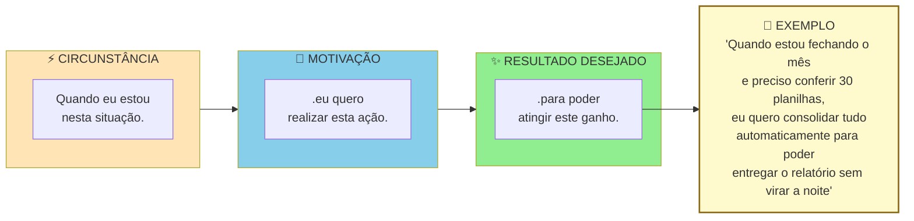

> [!warning] Um JTBD completo tem três partes
> "Quero automatizar planilhas" está incompleto. Sem circunstância e sem outcome. Solução que atende JTBD bem formulado tende a ser mais específica e mais defensável.

> [!tip] Switch Interview quando o entrevistado trocou de solução
> Sempre que um entrevistado da Fase 4 ou da Fase 5 relatar que trocou recentemente de solução (abandonou um concorrente, substituiu uma planilha ou mudou de fornecedor), agende uma conversa específica usando o [[#Template: Entrevista com Switcher (JTBD: entrevista de troca)|Template: Entrevista com Switcher (JTBD: entrevista de troca)]]. Criada por Bob Moesta e Chris Spiek, a *Switch Interview* reconstrói a linha do tempo real da compra e mapeia as quatro forças em disputa: empurrão da situação atual (*push*), atração da nova solução (*pull*), ansiedade da troca (*anxiety*) e hábito que prende ao status quo (*habit*).

#### Passo 5: síntese qualitativa das entrevistas (técnicas formais)

Na etapa de síntese, evite reler anotações de cabeça pinçando apenas as frases convenientes. Aplique as duas ferramentas de codificação já detalhadas no manual da Fase 4 (o [[#Framework: Affinity Diagramming / Método KJ (Jiro Kawakita, anos 1960)|Diagrama de Afinidade / Método KJ]] para agrupar achados em parede com os sócios e a [[#Framework: Thematic Analysis (Virginia Braun e Victoria Clarke, 2006)|Análise Temática]] para codificar transcrições) e acrescente nesta Fase 5 dois controles obrigatórios: a matriz de saturação por subgrupo e o cruzamento entre fala declarada e comportamento observado em campo.

##### Affinity mapping: agrupamento por afinidade

Processo físico ou digital (Miro, FigJam, Mural) para encontrar padrões em grandes volumes de dado qualitativo. Cinco passos.

Primeiro, extração de observações atômicas. Para cada entrevista, extraia quinze a quarenta "observações". Cada uma é um fato, citação, ou comportamento específico, escrito em post-it (um por post-it). Por exemplo, "João passa duas horas toda segunda compilando planilhas manualmente". Ou "Maria menciona três vezes que fica ansiosa com prazos de entrega".

Segundo, pool único. Junte todos os post-its de todas as entrevistas em um espaço grande. Quinze entrevistas vezes vinte e cinco observações dão trezentos e setenta e cinco post-its. É o típico.

Terceiro, agrupamento silencioso. A equipe (duas a quatro pessoas) move post-its em silêncio, agrupando por similaridade. Os movimentos podem ser reorganizados. O processo é fluido.

Quarto, nomeação dos grupos. Depois do agrupamento estabilizar, em uma a duas horas, nomeie cada cluster com uma frase curta que captura o tema. Por exemplo: "ansiedade no fechamento do mês", "retrabalho por falta de integração".

Quinto, priorização dos clusters. Quantos post-its cada cluster tem? Clusters grandes são temas recorrentes. Clusters pequenos mas de alto impacto também importam.

O resultado são cinco a quinze clusters temáticos com número de ocorrências e citações exemplares.

##### Coding e thematic analysis: codificação temática

Método mais rigoroso, vindo da pesquisa qualitativa acadêmica. Cinco passos.

Codificação aberta. Leia cada transcrição linha por linha e atribua "códigos" (tags curtas de uma a três palavras) a trechos relevantes. Por exemplo, "ansiedade_prazo", "retrabalho_manual", "ferramenta_improvisada". Permita códigos emergentes. Não pré-defina a lista.

Revisão e consolidação. Depois de cinco a sete entrevistas codificadas, revise a lista de códigos. Combine sinônimos, elimine duplicatas, refine definições.

Codificação axial. Agrupe códigos relacionados em categorias mais abstratas. Por exemplo, os códigos "ansiedade_prazo", "pressão_chefe", "medo_errar" podem virar a categoria "pressão emocional no fluxo de trabalho".

Tema emergente. Das categorias, destaque três a sete temas que explicam a maioria das observações.

**Matriz de saturação e triangulação prática.** Contabilize em quantas entrevistas cada padrão se repete e cruze sempre o relato verbal com o que foi visto na operação: para cada afirmação central do usuário, anote se a observação presencial confirmou, contradisse ou ainda não testou aquela fala, e, quando houver divergência entre o discurso e a prática, priorize sempre o comportamento observado.

Ferramentas pagas: Dovetail, Delve, Atlas.ti. Alternativas gratuitas: planilha com colunas Citação, Código, Categoria e Tema. Em fluxos apoiados por inteligência artificial (ver [[IGNICAO-Vol-1-Ideacao#CAPÍTULO 10: IA GENERATIVA E AGENTES COMO COPILOTO E ACELERADOR DO FUNDADOR (2026)|Capítulo 10: IA Generativa e Agentes como Copiloto e Acelerador do Fundador (2026) (Vol. 1)]]), você pode transcrever o áudio automaticamente e pedir a um modelo de linguagem uma primeira sugestão de agrupamento de códigos, desde que anonimize nomes, cargos e empresas antes do envio (LGPD) e confira cada código sugerido contra o trecho original (*verbatim*).

##### Triangulação entre entrevistas e survey

> [!tip] Capítulo 9 (Vol. 4): Dados, Analytics e Experimentação
> A triangulação abaixo é a primeira vez que você produz dados estruturados sobre o cliente. O [[IGNICAO-Vol-4-Tracao-e-PMF#CAPÍTULO 9: DADOS, ANALYTICS E EXPERIMENTAÇÃO|Capítulo 9 (Dados, Analytics e Experimentação) (Vol. 4)]] aprofunda como estruturar surveys de validação, interpretar dados de survey com rigor estatístico mínimo, e montar o pipeline de experimentação que sustentará as decisões de produto nas fases posteriores.

Entrevistas sozinhas produzem hipóteses ricas mas estatisticamente frágeis. Survey sozinho produz números sem contexto. Combinar os dois é o padrão-ouro. Três passos.

Primeiro, use as sessões de pesquisa qualitativa (as 15 a 20 entrevistas de problema da Fase 4 somadas às 10 a 15 sessões de JTBD e 5 observações de campo desta Fase 5) para extrair os temas e trabalhos prioritários.

Segundo, transforme cada tema em uma a três perguntas de survey quantitativa, aplicada a cem a quinhentos respondentes do mesmo ICP.

Terceiro, compare os resultados. Um tema que apareceu em 70% das entrevistas e em 65% do survey está validado. Um tema presente em 70% das entrevistas, mas em apenas 20% do survey, costuma ser viés da amostra inicial. Já um tema citado em 30% das entrevistas e em 70% do survey indica que você precisa conduzir mais entrevistas com o subgrupo certo.

> [!note] A regra dos cinco usuários, de Nielsen
> A regra dos cinco usuários (Jakob Nielsen) vale especificamente para testes de usabilidade de interface, onde cinco sessões capturam cerca de 85% dos erros visuais de navegação, e não para descoberta de cliente. Nossa régua prática ao longo da etapa é fixa: 15 a 20 entrevistas de problema na Fase 4, 10 a 15 sessões de JTBD (de 60 a 90 minutos) somadas a pelo menos 5 observações em campo nesta Fase 5, e 100 a 500 respostas quando você rodar questionários quantitativos de validação.

##### Diário de pesquisa estruturado

Qualquer que seja a técnica, mantenha um diário de pesquisa em formato padronizado. Template mínimo por entrevista:

```text
DIÁRIO DE PESQUISA, Entrevista #___ Data: ___/___/___

Entrevistado:
 Nome (primeiro nome ou anonimizado): _______________
 Perfil (cargo, setor, idade, geo): ___________________
 Canal de recrutamento: ______________________________
 Como foi encontrado: _________________________________

Duração da entrevista: ____ minutos.

Contexto observado:
 Local: ______________________________________________
 Estado emocional aparente: __________________________
 Interrupções, ruídos, sinais não verbais: __________

Top 3 quotes (verbatim, entre aspas, sem parafrasear):
1. "_______________________________________________"
2. "_______________________________________________"
3. "_______________________________________________"

Problemas mencionados (fatos, não interpretação):
- ____________________________________________________
- ____________________________________________________

Soluções atuais em uso (nomes específicos, comportamento):
- ____________________________________________________

Tentativas de solução no passado:
- ____________________________________________________

Custos atuais do problema (tempo/dinheiro/energia):
- ____________________________________________________

Pain Level estimado (1-5): ____. Por quê? ____________

Reações emocionais observadas:
- ____________________________________________________

Surpresas (coisas que contradisseram minhas hipóteses):
- ____________________________________________________

Hipóteses novas geradas por esta entrevista:
- ____________________________________________________

Notas pessoais (em itálico, claramente separado do fato):
 _itálico aqui, interpretação minha, pode estar errada_
```

> [!important] Esse diário é o insumo bruto
> Sem esse nível de registro, você está reconstruindo entrevistas pela memória. E memória é enviesada.

#### Passo 6: Defina as personas operacionais com nove elementos e base de evidência

Cada persona deve conter os nove elementos padronizados do [[#Template: Persona com dados|Template: Persona com dados]] (na seção de templates desta fase): (1) nome fictício e rótulo descritivo, (2) papel na decisão de compra (usuário, campeão interno ou decisor econômico), (3) contexto demográfico e operacional relevante, (4) trabalho principal (*job*) funcional, emocional e social, (5) frustrações atuais e frequência, (6) gambiarras e ferramentas em uso, (7) gatilhos de busca e barreiras à troca, (8) citação literal (*verbatim*) marcante, e (9) base de evidência (quais entrevistas e observações reais sustentam a ficha).

> [!warning] Persona sem dados é ficção bonita e inútil
> Cada atributo incluído na ficha da persona precisa apontar para a entrevista ou observação que o sustenta (por exemplo, registrar a perda relatada de R$ 200 a R$ 300 por semana em farinha vencida, o ágio de 15% na compra de emergência e as horas semanais que o dono perde apagando incêndio como base para testar uma assinatura mensal de R$ 400 para a rede de três lojas na fase seguinte).

A estrutura visual de uma persona operacional, em contraste com persona demográfica:

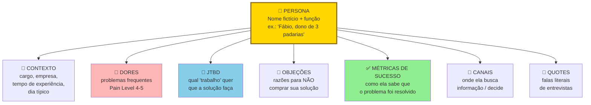

Uma persona operacional se apoia em comportamentos observáveis, nunca em rótulos genéricos de censo: descrever apenas "Homem, 35 a 45 anos, classe B" é cair na Cegueira Demográfica, pois não orienta nenhuma decisão de produto. Já especificar "Fábio, dono-operador de padaria artesanal com três lojas na Zona Oeste de São Paulo, que perde a manhã de terça-feira cotando farinha de emergência pelo WhatsApp" entrega um perfil acionável.

#### Passo 7: Mapeie os três papéis na decisão de compra (em B2B, quem usa raramente é quem paga)

Em contextos B2B, uma persona isolada raramente explica o comportamento de compra. Três papéis distintos interagem durante a decisão. Cada um tem motivações, restrições, e critérios próprios. Confundi-los é o erro mais caro em vendas B2B: quando Henrique foi mapear usinas sucroenergéticas no Paraná, descobriu que precisava entrevistar separadamente o operador de caldeira (usuário técnico), o engenheiro de manutenção (campeão interno que sente a dor da parada) e o diretor industrial (comprador econômico que assina o orçamento).

**Usuário:** Pessoa que vai operar o produto no dia a dia. Avalia ergonomia, encaixe com a rotina, tempo economizado. Tem poder de sabotagem (se odiar, não usa, ou usa mal). Mas raramente tem poder de compra.

Campeão Interno. Pessoa que enxerga valor na solução e está disposta a brigar por ela internamente. É tipicamente um usuário avançado ou um gestor próximo dos usuários. É quem vai marcar a reunião com o decisor, preparar a justificativa, responder pelos riscos. Sem campeão, quase nenhuma venda B2B fecha.

Comprador Econômico. Pessoa com autoridade e orçamento para autorizar o pagamento. Avalia ROI, risco, alinhamento com prioridades corporativas. Raramente vai usar o produto. Frequentemente não conhece os detalhes operacionais.

Três princípios operacionais para a pesquisa desta fase.

Primeiro, entreviste os três papéis separadamente. Misturar em uma entrevista só ("reunião com a empresa X") gera respostas editadas politicamente. Usuários não falam mal da solução se o chefe está presente. Chefes não admitem que não conhecem o workflow se o subordinado está na sala. Separe.

Segundo, monte uma persona distinta para cada papel, não uma persona média. Uma "persona da empresa" é ficção. Persona útil é do papel, porque cada papel toma decisões diferentes com base em critérios diferentes.

Terceiro, identifique quais papéis se sobrepõem e quais permanecem distintos no seu contexto. Em empresas clientes muito pequenas (de cinco a vinte funcionários), os três papéis costumam caber na mesma pessoa: o próprio dono. Em médias empresas, o usuário costuma estar separado dos outros dois. Em grandes, os três são sempre distintos e podem somar um quarto papel (TI ou Procurement). Saber onde o seu ICP está nessa geometria define quantas personas você constrói.

> [!tip] B2C também pode ter mais de uma persona
> Em B2C, os três papéis costumam se concentrar em uma única pessoa: o próprio consumidor usa, decide e paga. Mas atenção às exceções clássicas: produtos para crianças (os pais decidem e pagam, as crianças usam), saúde e cuidado de idosos (os filhos adultos frequentemente decidem), presentes (o comprador é diferente do destinatário) e benefícios corporativos como o Wellhub/Gympass (o RH contrata, o colaborador usa). Pergunte sempre: quem usa no dia a dia é a mesma pessoa que assina o pagamento? Se não for, você precisa mapear pelo menos duas personas.

O entregável deste passo é caracterizar uma persona com os nove elementos do Passo 6 para cada papel que decide ou opera o produto, resultando em duas a quatro personas principais (tipicamente três em negócios B2B e uma a duas em B2C).

#### Passo 8: identifique o sub-ICP mais doloroso

> [!note] ICP, sub-ICP e beachhead: três níveis de granularidade do mesmo conceito
> **ICP** (Ideal Customer Profile): o perfil amplo de cliente potencial, definido na [[#FASE 4: DESCOBERTA DO PROBLEMA|Fase 4]] (ex: "donos de restaurante de 1-3 unidades em capitais brasileiras com delivery próprio").
> **Sub-ICP** ou sub-segmento: recorte mais estreito dentro do ICP onde a dor é mais aguda (ex: "donos que operam sozinhos, sem gerente"), identificado na Fase 4 como sinal inicial e confirmado aqui, na Fase 5.
> **Beachhead**: o sub-ICP escolhido como ponto de entrada no mercado: a praia onde você desembarca. É o sub-ICP mais doloroso operacionalmente filtrado pelos quatro critérios deste passo (urgência, agudeza, recursos, alcançabilidade).
>
> A relação de inclusão é direta: ICP ⊃ sub-ICP ⊃ *beachhead* (cabeça de praia). Todo segmento de entrada (*beachhead*) é um sub-ICP, mas nem todo sub-ICP vira o seu primeiro ataque. Os termos cumprem papéis distintos: o ICP define quem pode vir a ser cliente da empresa, enquanto a *beachhead* define quem será o primeiro grupo que você vai conquistar.

Entre os subgrupos pesquisados, qual apresenta a dor mais aguda, a maior urgência, orçamento disponível e o canal de acesso mais direto? Esse subgrupo é o seu **segmento de entrada (*beachhead*)**, no qual você concentrará os experimentos do próximo volume.

#### Passo 9: consolide o Dossiê do Usuário

O Dossiê do Usuário consolida a pesquisa em um documento prático de 10 a 20 páginas contendo: duas a quatro personas caracterizadas com base empírica (uma por papel que decide ou usa), duas a quatro jornadas mapeadas nas sete dimensões, a lista priorizada de trabalhos (*jobs*) por importância e frequência, a escolha justificada do segmento de entrada (*beachhead*) e a Declaração Inicial da Ideia atualizada para a versão 3.

### Uma entrevista JTBD do PadariaPro: do verbatim à persona

A pergunta central: "Me leva para a última vez que você precisou reabastecer o estoque de farinha, passo a passo, do começo ao fim. Quando você percebeu, o que fez, quem envolveu, quanto tempo levou, o que deu errado?"

Veja a resposta literal de **Fábio**, dono de três padarias artesanais na Zona Oeste de São Paulo (dentro do ICP refinado na Fase 4), durante uma entrevista de 60 minutos:

> "Foi na terça-feira passada. O Marcos, gerente da loja 2, me mandou áudio no WhatsApp às 7h da manhã: 'A farinha tipo 1 está acabando, só dá para a fornada de hoje.' Eu estava no trânsito indo para a loja 3. Liguei para o nosso fornecedor habitual, a Distribuidora Serrana, e a atendente avisou que só entregaria na quinta-feira. Aí tive de acionar o nosso plano B, o seu Valdir do Moinho Bandeirante, que entregou em quatro horas mas cobrou 15% mais caro. Salvamos a produção da semana, mas a minha terça-feira virou um caos: desmarquei três reuniões para virar comprador de emergência. Isso acontece duas a três vezes por mês. E o pior: para não faltar, o gerente pede sacas a mais por medo, sobra farinha mofando no sábado e jogamos fora de R$ 200 a R$ 300 toda semana. Estou trocando perda por perda."

Veja a leitura dos trabalhos (*jobs*) embutidos nessa fala: o trabalho funcional é garantir o abastecimento contínuo de insumos sem parar a fornada. O trabalho emocional é deixar de ser o bombeiro que apaga incêndio às 7h da manhã no trânsito, e o trabalho social é ser visto pelo gerente e pelos clientes como um dono que mantém a operação sob controle. A gambiarra atual combina três peças frágeis (alerta tardio por áudio de WhatsApp, compra de emergência 15% mais cara no Moinho Bandeirante e estoque inflado no olhômetro que gera descarte no sábado). A frase final de Fábio resume a trava econômica do negócio: hoje ele vive "trocando perda por perda".

Fragmento da persona resultante: Fábio, 38 anos, dono-operador de três padarias artesanais na Zona Oeste de São Paulo. Formação técnica, resolve a operação pelo WhatsApp e por planilhas no celular, desconfia de sistemas complexos mas adota ferramentas que provem retorno já na primeira semana. O trabalho principal que ele contrata é "devolver minhas manhãs de gestão sem faltar farinha nem jogar insumo no lixo". Somando os R$ 800 a R$ 1.200 mensais de descarte, o ágio de 15% nas compras de terça-feira (cerca de R$ 600 no mês) e as seis a oito horas mensais do próprio dono apagando incêndio, o desperdício total passa de R$ 2.500 por mês nas três lojas, o que sustenta testar uma assinatura de R$ 400 mensais para o conjunto da rede. Se a ferramenta economizar apenas 2% de margem teórica no papel sem eliminar a correria de terça-feira, ele não paga.

Os gatilhos de troca observados foram três. Incidente recente de ruptura que causou perda grande (mais de R$ 5 mil), ou cliente insatisfeito. Chegada de nova loja (passar de duas para três, de três para quatro) torna sistema manual inviável. Indicação de par (outro dono de padaria) sobre ferramenta que funcionou.

As barreiras à troca identificadas na conversa foram quatro: (1) receio de que a equipe operacional da manhã não alimente o sistema, (2) medo de pagar mensalidade por uma ferramenta que fique cara caso a adoção falhe, (3) apego à negociação informal pelo WhatsApp com os vendedores dos moinhos, e (4) percepção de que a mensalidade fixa dói no caixa todo mês, enquanto o desperdício de farinha fica invisível no custo da mercadoria vendida.

### Caso brasileiro real: pesquisa com usuários no QuintoAndar e a dor do fiador

Como reconstrução didática de pesquisa centrada no trabalho do cliente, considere o mercado brasileiro de locação residencial em 2013, quando Gabriel Braga e André Penha fundaram o QuintoAndar (iniciando a operação em Campinas e logo expandindo para São Paulo). Alugar um imóvel exigia fiador com escritura quitada na mesma cidade, seguro-fiança caro ou depósito caução de três aluguéis, além de semanas de cartório.

Nas entrevistas e observações, os fundadores descobriram um gargalo que a hipótese original subestimava: o maior freio ao fechamento do aluguel vinha do constrangimento social de pedir a um parente ou conhecido que assinasse como fiador, superando até a discussão sobre o valor do pacote mensal.

Nessa leitura sob a lente de *Jobs to Be Done*, além do custo financeiro e da demora burocrática, a barreira emocional e social que travava o inquilino solvente era o constrangimento de pedir a um parente ou amigo que colocasse o próprio imóvel em garantia como fiador. Ao posicionar a promessa pública diretamente como "aluguel sem fiador e sem depósito caução" (mantendo a vistoria padronizada de entrada e saída e o contrato eletrônico), a empresa atacou a ansiedade central que impedia a mudança e destravou os dois lados do balcão.

Pesquisa aprofundada revela qual dor é emocionalmente mais forte, não apenas qual é operacionalmente mais cara. A proposta de valor precisa atacar a dor emocional.

### Checklist de conclusão da Fase 5: a prova de que você conhece o trabalho que o cliente contrata

Você concluiu a Fase 5 quando todos os critérios abaixo estão cumpridos.

- [ ] **10 a 15 sessões de entrevista JTBD** realizadas com roteiro próprio (de 60 a 90 minutos cada), a amostra pode incluir entrevistados de dor aguda da Fase 4 revisitados em profundidade, desde que pelo menos metade seja composta por pessoas novas do segmento.
- [ ] **Pelo menos 5 observações diretas em campo** (*job shadowing* ou *contextual inquiry*) ou análises detalhadas de artefatos reais, cruzando discurso e prática, sempre que a rotina observada contradisser a fala da entrevista, priorize o comportamento observado.
- [ ] **Dossiê do Usuário concluído** com duas a quatro personas baseadas em evidências reais de campo (ver [[#Template: Persona com dados|Template: Persona com dados]]), seis ou mais atributos comportamentais rastreáveis por persona, duas a quatro jornadas mapeadas e de cinco a dez trabalhos (*jobs*) priorizados.
- [ ] Cinco ou mais contextos reais de ocorrência registrados em campo (momento do dia, local físico, pessoas envolvidas e pressão operacional).
- [ ] "Solução atual não óbvia" identificada (o que as pessoas realmente usam hoje, mesmo que não seja feito para isso).
- [ ] Gatilhos concretos de busca por nova solução (*push/pull*) e barreiras à mudança (*anxiety/habit*) documentados a partir de casos reais.
- [ ] Em vendas B2B, os três papéis decisórios (usuário diário, defensor interno e comprador econômico) ouvidos separadamente e representados em personas distintas.
- [ ] **Tese sobre a dor principal refinada** com recorte exato de trabalho (*job*), contexto e gatilho, comparando a versão anterior e a versão pós-campo.
- [ ] Segmento inicial de entrada (*beachhead*) selecionado com base em evidências de urgência da dor, frequência, orçamento disponível e facilidade de acesso comercial.
- [ ] Declaração Inicial da Ideia atualizada para a versão 3 (DII v3) e pronta para alimentar o mapeamento de mercado da Fase 6.

> [!warning] Critério de saída
> Se qualquer um desses itens falha, não avance. Resolva antes.

**Primeiros passos práticos.**

1. Selecionar cinco entrevistados de nível 4 ou 5 da Fase 4 e mais cinco a dez novos contatos do mesmo subgrupo para agendar sessões de 60 a 90 minutos no local de trabalho, focadas na linha do tempo do trabalho (*job*) e da troca.
2. Elaborar a pergunta central JTBD: "Me conta a última vez que você precisou (job), do começo ao fim, em detalhes."
3. Construir uma persona (Template: Persona com dados (Fase 5)) com dado real, não nome fictício sem base.
4. Mapear, em planilha, os gatilhos de troca e as barreiras identificadas.

### Cinco erros metodológicos que distorcem a pesquisa com usuários

> [!note] Capítulo 3 (Vol. 1): Armadilhas Mentais e Vieses
> Personas fictícias, viés de confirmação na síntese qualitativa e ancoragem na hipótese original são os vieses mais comuns nesta fase. O [[IGNICAO-Vol-1-Ideacao#CAPÍTULO 3: ARMADILHAS MENTAIS E VIESES|Capítulo 3 (Armadilhas Mentais e Vieses) (Vol. 1)]] trata especificamente de vieses de pesquisa: como o efeito halo sobre entrevistados carismáticos e o viés de disponibilidade que faz a última entrevista parecer mais importante que as anteriores.

**Cinco erros metodológicos que distorcem a pesquisa na Fase 5 e como evitá-los:**

- **Antídoto contra o discurso idealizado:** contraste sempre o que foi dito na entrevista com os artefatos reais (planilhas, recibos e histórico de uso) coletados no Passo 2.

- **Regra de foco no trabalho do cliente (*job*):** toda funcionalidade candidata na Fase 9 precisará apontar para um *job* priorizado neste dossiê.

- **Fundir papéis distintos numa única persona genérica:** Em vendas B2B ou familiares, misturar usuário técnico, campeão interno e decisor econômico na mesma ficha esconde conflitos de incentivo, construa sempre uma persona separada para cada papel que decide ou opera o processo (duas a quatro personas no total).

- **Critério de corte na síntese:** descarte observações anedóticas que não modifiquem a escolha de público, canal ou proposta de valor.

---

### O Espelho da Fase 5: contra qual gambiarra você está lutando de verdade?

De volta ao consultório na Savassi, em Belo Horizonte, a Dra. Camila releu a frase de Dona Helena anotada no bloco e encarou a página inicial do próprio site: havia doze menções a "titânio suíço" e "escaneamento intraoral computadorizado", mas nenhuma linha sobre voltar a sorrir nas fotos de família ou mastigar sem receio no casamento da neta. Naquela mesma semana, respeitando rigorosamente as normas éticas do Conselho Federal de Odontologia (Resolução CFO-196/2019, sem promessa de resultado e mediante termo de consentimento livre e esclarecido por escrito), ela substituiu o jargão acadêmico por orientações claras sobre acolhimento e reabilitação para pacientes acima de 55 anos e reformulou a primeira consulta para ouvir a história de cada pessoa antes de falar de tecnologia. Em seis semanas, a ocupação das manhãs subiu de 40% para 85%.

**O Espelho (autodiagnóstico):**
1. Se o seu cliente mais fiel explicasse a um amigo por que contratou você (como Dona Helena explicou à Dra. Camila), ele usaria alguma das palavras que estão hoje no topo do seu site? E quantos atributos das suas personas atuais possuem data, nome e citação literal rastreáveis no caderno de campo?
2. Qual é a gambiarra atual, no Excel, no WhatsApp ou no papel, que você está tentando demitir da rotina do seu cliente?
3. Qual é a maior **ansiedade de troca** (*anxiety*) e o maior hábito atual (*habit*) que fazem os entrevistados do seu segmento hesitarem antes de abandonar a planilha ou o fornecedor antigo?

**Permissão Libertadora:**
Você está autorizado a jogar no lixo todas as "Personas de Marketing" fictícias com fotos de banco de imagens e hobbies inventados.

**O Ritual de Segunda-Feira às 9h (rotina semanal de 30 minutos):**
Reserve 30 minutos toda segunda-feira às 9h para manter o Dossiê do Usuário vivo: releia as anotações da última sessão de campo, agende a próxima observação presencial (ou por compartilhamento de tela) de 60 a 90 minutos com o próximo nome da sua lista de *Pain Level* 4 ou 5 e registre no dossiê pelo menos uma gambiarra real observada na semana anterior, com data, foto anonimizada do fluxo e citação literal.

---

### MÉTRICAS E BENCHMARKS DESTA FASE (FASE 5)

| Métrica | O que medir | Referência saudável |
|---|---|---|
| Jobs-to-be-done mapeados | Jobs funcionais, emocionais e sociais identificados | ≥ 3 jobs por segmento |
| Jornada documentada | Pontos de dor na jornada atual mapeados | ≥ 5 pontos de fricção |
| Personas validadas com evidência | Uma persona por papel que decide ou usa (com dados reais de campo) | 2 a 4 personas operacionais |
| Beachhead segment definido | Segmento inicial de 100 a 1.000 clientes | Identificado e justificado |
| Customer discovery score | Novos aprendizados por entrevista | Decrescente (sinal de saturação) |

---

### MANUAL PASSO A PASSO DOS FRAMEWORKS (FASE 5)

> [!tip] Uso autocontido neste volume
> **Como escolher entre os métodos desta seção:** Para todas as startups nesta Fase 5, quatro ferramentas formam o núcleo obrigatório: **Entrevistas de Troca (*Switch Interviews*), Observação Contextual (*Contextual Inquiry*), Personas baseadas em dados e Mapeamento da Jornada do Problema. Use Estudos de Diário (*Diary Studies*) quando o hábito se espalha por vários dias, Grupos Focais (*Focus Groups*) apenas para testar reação de linguagem social, Service Blueprinting quando precisar desenhar bastidores operacionais complexos e Outcome-Driven Innovation (ODI)** quando tiver escala para rodar pesquisas quantitativas com mais de 100 respondentes. (O passo a passo completo do *Empathy Map* já foi apresentado na Fase 4. Aqui veremos apenas como alimentá-lo com a observação etnográfica.)

#### Framework: Jobs to Be Done Switch Interviews (Bob Moesta e Chris Spiek)

##### De onde vem a ferramenta (e por que sobreviveu ao filtro do tempo)

Desenvolvida por Bob Moesta e Chris Spiek no Re-Wired Group em parceria com Clayton Christensen (Harvard Business School), a entrevista de troca (*Switch Interview*) foi sistematizada em *The Jobs-to-be-Done Handbook* (Spiek e Moesta, 2014), ampliada em *Competing Against Luck* (Christensen, Hall, Dillon e Duncan, 2016) e aplicada a vendas em *Demand-Side Sales 101* (Bob Moesta e Greg Engle, 2020).

##### A mecânica central (sem jargão)

Trata-se de um protocolo de entrevista focado no **momento real de troca (*switch*), quando o cliente abandonou uma solução anterior (ou uma gambiarra interna) e contratou uma nova. Em vez de perguntar quais funcionalidades a pessoa deseja, a conversa reconstrói as quatro forças causais** que produziram a mudança.

##### Estrutura das Quatro Forças de Troca (empurrão da dor atual, atração da nova solução, ansiedade da mudança e inércia do hábito)

Em toda decisão de compra, 4 forças atuam:

1. Push (empurrar) da situação atual: insatisfação com solução atual ou status quo.
2. Pull (puxar) da nova solução: atração pela alternativa.
3. Anxiety (ansiedade) da nova solução: medo do que vai dar errado com nova.
4. Habit (hábito) da situação atual: inércia, familiaridade.

Compra acontece quando: Push + Pull > Anxiety + Habit.

A linha do tempo da compra percorrida na entrevista divide-se em seis marcos:

1. **Primeiro pensamento (*first thought*):** o instante e o contexto exato em que a pessoa percebeu pela primeira vez que o jeito antigo não dava mais conta.
2. **Busca passiva (*passive looking*):** o período em que ela passou a reparar em alternativas sem ainda agir.
3. **Busca ativa (*active looking*):** o gatilho (o "dia em que a corda arrebentou") que a levou a cotar, testar e comparar opções.
4. **Decisão (*deciding*):** a negociação final, as concessões feitas e as quatro forças em disputa: o **empurrão da dor atual (*push*), a atração da nova solução (*pull*), a ansiedade com a mudança (*anxiety*) e o hábito que prendia ao modelo antigo (*habit*)**.
5. **Primeira utilização (*consuming*):** o que aconteceu na primeira semana de uso real.
6. **Satisfação pós-compra (*satisfaction*):** o veredito prático sobre se o trabalho (*job*) foi cumprido.

##### Passos práticos de implantação

Passo 1. Selecione entrevistados que tenham feito a troca de solução nos últimos 60 a 90 dias, com a memória da decisão ainda fresca, priorizando clientes reais (seus ou de concorrentes) em vez de meros interessados.

Passo 2: Comece pelo fim: "quando você comprou X?" Data específica.

Passo 3: Trabalhe a timeline para trás. Quando decidiu? Quando começou a considerar seriamente? Quando primeiro pensou em mudar? Objetivo: reconstruir arco emocional e racional completo.

Passo 4: Identifique as 4 forças em cada ponto. Push: o que pressionava? Pull: o que atraía? Anxiety: o que preocupava? Habit: o que prendia ao antigo?

Passo 5: Investigue os gatilhos concretos de transição. Qual evento exato tirou o cliente da busca passiva e o jogou na busca ativa? Quase sempre há um episódio datado ("meu contador ligou avisando de uma multa", "perdi dois boletos de R$ 18 mil na sexta-feira") que destrava o orçamento.

Passo 6: Explore rejeição também. Soluções consideradas e rejeitadas, por quê? Revela pull fracos ou anxiety altas.

Passo 7: Sintetize em padrões. Após 10-15 switch interviews, quais forças dominam? Quais triggers recorrem?

##### Na trincheira real: como isso funciona na prática

##### Exemplo aplicado na trincheira: pesquisa de troca de Lucas e Marina com distribuidora atacadista

- First thought (6 meses atrás): contador reclamou que fechamento do mês levou 5 dias úteis.
- Passive looking: olhou 2 ferramentas por curiosidade, achou "muito para mim ainda".
- Active looking (3 meses atrás): comparou 3 ferramentas em spreadsheet, pediu demos.
- Deciding (6 semanas atrás): escolheu Ferramenta Y em 2 dias.

Forças identificadas:

- Push: medo de erro crescente com crescimento da empresa, contador irritado, tempo pessoal excessivo.
- **Atração da nova solução (*pull*):** o serviço lia automaticamente o arquivo CNAB/OFX do banco e já exportava os lançamentos conciliados no formato exato do ERP que a distribuidora usava para emitir notas fiscais, com implantação em 48 horas.
- Anxiety: "vou perder dados?", "meu time vai adotar?", "vai caber no orçamento?".
- Habit: "Excel sempre funcionou, familiar, sem custo adicional".

Trigger específico de passive → active: amigo dono de empresa similar falou "migrei para SaaS há 1 ano, mudou minha vida". Boca-a-boca foi catalisador.

Implicação para a startup: como a recomendação de um par de confiança foi o gatilho decisivo da troca, vale estruturar um programa simples de indicação já a partir dos primeiros clientes satisfeitos.

##### Onde o papel aceita tudo (armadilhas de execução)

Evite cinco erros recorrentes ao conduzir entrevistas de troca: (1) entrevistar apenas curiosos que cogitam mudar no futuro em vez de clientes que já efetuaram uma troca real nos últimos noventa dias, (2) transformar a conversa em lista de funcionalidades técnicas, esquecendo de investigar o contexto emocional e político da decisão, (3) focar todo o esforço em aumentar a atração (*pull*) no marketing enquanto ignora a ansiedade da migração (*anxiety*), que costuma ser reduzida com testes guiados, importação assistida de dados e garantia de reversão, (4) aceitar respostas genéricas como "eu estava insatisfeito" sem cavar até o episódio exato que disparou a busca ativa, e (5) tirar conclusões definitivas com apenas duas ou três conversas, quando os padrões de troca pedem de 10 a 15 entrevistas completas.

---

#### Framework: Contextual Inquiry (Hugh Beyer e Karen Holtzblatt, 1998)

##### De onde vem a ferramenta (e por que sobreviveu ao filtro do tempo)

Karen Holtzblatt desenvolveu a investigação contextual (*Contextual Inquiry*) no fim dos anos 1980 na Digital Equipment Corporation (DEC) e consolidou o método com Hugh Beyer, na InContext Enterprises, no livro *Contextual Design: Defining Customer-Centered Systems* (1998). A ferramenta nasceu da constatação prática de que os usuários não conseguem relatar de memória todos os pequenos desvios e gambiarras que fazem no trabalho, mas revelam cada detalhe quando são observados em tempo real no próprio posto de serviço.

##### A mecânica central (sem jargão)

É um método de pesquisa etnográfica aplicada: o pesquisador acompanha o usuário executando suas tarefas reais no ambiente de trabalho (escritório, balcão, depósito ou consultório) e faz perguntas curtas no momento em que as decisões acontecem. Assim, os dados mostram o que a pessoa realmente faz, e não apenas o que ela diz que faz.

##### As regras do jogo

4 princípios fundamentais:

1. Contexto: observe o trabalho real, não abstrações. Vá ao escritório, clínica, caminhão.
2. Parceria: pesquisador e usuário são parceiros entendendo juntos, não avaliador/avaliado.
3. Interpretação: pesquisador interpreta em tempo real e checa interpretação com usuário. "Pareceu que você estava frustrado aqui. É isso mesmo?"
4. Foco: pesquisador traz perspectiva explícita de aprendizado (não "assistir como usuário geral").

##### Protocolo prático de execução

Passo 1: Selecione 4-8 participantes representativos. Diversidade de experiência, contexto, role.

Passo 2: Agende 2-4h no local de trabalho real deles. No escritório, chão de fábrica, casa, onde tarefa acontece.

Passo 3: Introdução curta (15 min). Explicar: "quero te observar trabalhando, vou perguntar por que você faz o que faz, vou te interromper às vezes. Não é avaliação, é aprendizado."

Passo 4: Observe tarefa natural. Participante faz trabalho real, você observa.

Passo 5: Pergunte em tempo real. "Por que você clicou aí?" "O que você estava procurando?" "Por que essa ordem?"

Passo 6: Interprete e confirme. "Pareceu que você achou difícil encontrar X. É isso?"

Passo 7: Anote tudo: ações, objetos físicos no ambiente, fluxos, comunicações, emoções.

Passo 8: Debrief com time. Em até 48h, compartilhar observações, gerar aprendizados.

##### Na trincheira real: como isso funciona na prática

Startup de software de gestão para clínicas de fisioterapia:

Visita de três horas a uma clínica com três fisioterapeutas em Curitiba. Observações registradas:

- Fisioterapeuta 1 usa caderno físico + agenda papel + WhatsApp para marcações.
- Entre um atendimento e outro na clínica de fisioterapia, a profissional perde de 4 a 5 minutos procurando a ficha de evolução do paciente anterior (observação realizada com termo de consentimento prévio e sem fotografar ou copiar dados clínicos de pacientes, conforme as regras de proteção de dados sensíveis da LGPD detalhadas no [[IGNICAO-Vol-8-Juridico-LGPD-e-Seguranca#CAPÍTULO 9: LGPD, COMPLIANCE E GOVERNANÇA DE DADOS|Capítulo 9: LGPD, Compliance e Governança de Dados (Vol. 8)]]).
- WhatsApp tem histórico de 200+ mensagens não lidas, decide "resolvo depois".
- Recepcionista imprime planilha do dia, risca à mão.
- Comunicação entre recepção e fisio é via "gritar de um consultório a outro" quando paciente chega.

Aprendizados gerados na observação:

- O gargalo central da clínica está na passagem de bastão entre a recepção e o consultório, mais do que na simples falta de uma agenda eletrônica.
- Backlog de WhatsApp sinaliza "caos invisível", mostrar no dashboard pode ser diferencial.
- Como o intervalo entre um paciente e outro dura apenas 4 a 5 minutos, o registro de evolução precisa ser concluído em menos de 60 segundos na tela.
- Ambiente tem muitos papéis físicos, integração com impressão importa (diferentemente de PME tech-savvy).

Nenhum desses aprendizados emergiria de entrevista fora do contexto.

##### Onde o papel aceita tudo (armadilhas de execução)

Cuidado com seis deslizes que desfiguram a investigação contextual: (1) chamar o usuário para conversar na sala da startup em vez de ir até o local de trabalho dele, perdendo todas as pistas visuais do ambiente, (2) falar demais durante a sessão, esquecendo que o método exige cerca de 70% de observação silenciosa e 30% de perguntas pontuais, (3) interromper o profissional no meio de uma manobra delicada ou atendimento ao público, em vez de anotar a dúvida para a primeira pausa natural, (4) sair da visita sem esquemas visuais do espaço, das planilhas e dos papéis colados no monitor, (5) acumular horas de observação bruta sem reservar o dia seguinte para sintetizar os gargalos com a equipe, e (6) generalizar o hábito peculiar de uma única empresa visitada sem comparar com pelo menos cinco a oito locais do mesmo segmento.

---

#### Framework: Day in the Life / Ethnographic Research

##### De onde vem a ferramenta (e por que sobreviveu ao filtro do tempo)

O método etnográfico nasceu na antropologia cultural do início do século XX (com o trabalho de campo de Bronisław Malinowski e Margaret Mead). Sua transposição para o desenho de tecnologia começou nos anos 1980 no centro de pesquisas Xerox PARC, onde a antropóloga Lucy Suchman conduziu os primeiros estudos etnográficos do trabalho (*ethnography of work*) observando como pessoas reais interagiam com máquinas copiadoras complexas, e ganhou escala nos anos 1990 com consultorias de design como a IDEO e a E-Lab.

##### A mecânica central (sem jargão)

Pesquisa imersiva em que observador acompanha usuário por período extenso (meio dia a vários dias) em ambiente natural, observando sem intervir muito. Diferente do Contextual Inquiry (que é interventivo e focado em tarefa), etnografia é holística e captura contexto amplo de vida/trabalho.

##### As regras do jogo

Características:

- Imersão longa (não sessão de 1h).
- Observação participante ou não participante.
- Captura holística: relacionamentos, rotinas, ambiente físico, rituais, tensões sociais.
- Menos intervenção: não perguntar a cada passo, deixar vida acontecer.
- **Abordagem multimétodo:** combina observação silenciosa do ambiente, conversa informal durante as pausas, acompanhamento de rotina (*shadowing*) e exame das ferramentas e planilhas de bolso.

##### Protocolo prático de execução

Passo 1: Defina pergunta de pesquisa ampla. "Como é o dia de um dono de bar de bairro?" não "testar nosso app".

Passo 2: Negocie acesso. Ganhar confiança para presença extensa, ser claro sobre propósito.

Passo 3: Observação longa. Mínimo 4-6 horas, idealmente dia completo. Alguns projetos: semanas.

Passo 4: Observe o invisível. Como decisões são tomadas, quem tem voz, o que não é dito, rotinas tão naturais que participante não descreveria.

Passo 5: Conversas informais, não entrevistas estruturadas. Deixar diálogo emergir naturalmente.

Passo 6: Documente a observação de campo respeitando integralmente a LGPD (Lei 13.709/2018): colha termo de consentimento prévio para gravações de áudio ou imagem, jamais fotografe ou anote dados pessoais ou sensíveis de terceiros (como prontuários de pacientes em clínicas ou telas com CPF e dados bancários de clientes finais), anonimize os registros no caderno de campo e defina prazo de descarte dos arquivos brutos (ver [[IGNICAO-Vol-8-Juridico-LGPD-e-Seguranca#CAPÍTULO 9: LGPD, COMPLIANCE E GOVERNANÇA DE DADOS|Capítulo 9: LGPD, Compliance e Governança de Dados (Vol. 8)]]).

Passo 7: Saída e análise. Pós-visita: escrever narrativas densas, buscar padrões através de múltiplas visitas.

##### Na trincheira real: como isso funciona na prática

Startup de soluções para pequenos varejistas no Nordeste:

Fundador passa 3 dias em Caruaru (PE) acompanhando donos de mercadinhos de bairro. Observações-chave:

- Dia não começa em hora fixa, depende de fornecedor chegando.
- A relação com a vizinhança é pessoal: a caderneta do "fiado" funciona como vínculo de confiança comunitária na mercearia de bairro, não apenas como meio de pagamento.
- Computador existe mas é usado apenas 15 min/dia (nota fiscal), tudo mais em caderno ou cabeça.
- Maior "ferramenta" é memória pessoal do dono, substituí-la sem respeitar é ameaça.
- Família (esposa, filhos) está no fluxo, separar "trabalho" e "casa" é artificial.

Insights para produto:

- Qualquer produto financeiro digital voltado a esse comerciante precisa respeitar a lógica do fiado e da relação de vizinhança, em vez de tratá-lo como cobrança bancária impessoal.
- Onboarding tem que valer a pena em < 30 minutos ou nunca será adotado.
- Linguagem não pode ser corporativa, tem que falar do jeito que dono fala.
- Aprovação da esposa/filhos frequentemente é gate de adoção, marketing pode falar com família, não só dono.

Nenhum desses aprendizados emergiria de entrevista telefônica.

##### Onde o papel aceita tudo (armadilhas de execução)

**Seis desvios que comprometem a observação etnográfica:** (1) visitas curtas de apenas uma hora, que capturam apenas uma conversa superficial em vez da rotina real, (2) ir a campo sem perguntas claras de investigação, (3) ignorar o efeito da própria presença sobre o comportamento observado, que só diminui após algum tempo de ambientação, (4) anotar apenas o que confirma a hipótese prévia, deixando de registrar as anomalias, (5) tirar conclusões gerais a partir de um único local visitado, e (6) tomar o tempo do participante sem agradecer nem compartilhar aprendizados úteis.

---

#### Framework: Focus Groups (Robert Merton, anos 1940. Refinado por Richard Krueger)

##### De onde vem a ferramenta (e por que sobreviveu ao filtro do tempo)

Sociólogo Robert K. Merton desenvolveu "focused interviews" nos anos 1940 analisando reações de audiência a filmes de propaganda da Segunda Guerra. Comercialmente, virou "focus group" nos anos 1950 com aplicação a pesquisa de mercado (TV, produtos). Richard Krueger (U. Minnesota) refinou metodologicamente em *Focus Groups: A Practical Guide for Applied Research* (1988+). Uso excessivo em marketing dos anos 80-90 gerou decisivas, método ainda é útil se bem aplicado.

##### A mecânica central (sem jargão)

Trata-se de uma discussão moderada em grupo pequeno (de 6 a 10 participantes) sobre um tema específico. Seu valor próprio (e também seu limite) está na interação social entre os participantes: as pessoas reagem às falas umas das outras, expõem discordâncias de vocabulário e revelam como uma categoria é vista em público (embora escondam fragilidades individuais que só aparecem em entrevistas individuais).

##### As regras do jogo

Uso apropriado:

- Entender **diversidade** de perspectivas sobre um tópico.
- Explorar **linguagem** que pessoas usam (como falam sobre um domínio).
- Testar **conceitos em estágio inicial** (reactions preliminares).
- Observar **dinâmica social** em torno de decisão.

Uso inapropriado:

- Pesquisa individual profunda (one-on-one é melhor).
- Temas sensíveis (pessoas não falam livremente).
- Dados estatísticos (survey é melhor).
- Pesquisa comportamental (observação é melhor).

##### Passos práticos de implantação

Passo 1: Defina um objetivo específico de linguagem ou percepção coletiva (por exemplo, "entender quais palavras gerentes operacionais de distribuidoras usam quando discutem atrasos de fechamento com a contabilidade").

Passo 2: Recrute homogeneidade interna + diversidade entre grupos. Grupo 1: PMEs do varejo. Grupo 2: PMEs de serviços. Dentro do grupo, perfis similares reduzem timidez.

Passo 3: 4-8 grupos idealmente. Menos gera insight fraco, saturação acontece em 4-6.

Passo 4: Reúna de 6 a 10 participantes por sessão. Com menos gente, a dinâmica de grupo esfria. Com mais participantes, metade da sala fica calada.

Passo 5: Prepare um roteiro semiestruturado com 5 a 8 perguntas abertas para uma sessão de 90 a 120 minutos.

Passo 6: Facilitador treinado. Habilidades: gerar conversa, gerenciar dominantes, extrair silenciosos, seguir threads emergentes sem perder objetivo.

Passo 7: Grave e transcreva. Análise qualitativa rigorosa exige transcrição.

Passo 8: Análise temática com triangulação entre grupos. Quais temas emergem em múltiplos grupos? Quais são específicos de um?

##### Na trincheira real: como isso funciona na prática

Startup de delivery de comida saudável para B2C:

4 focus groups em São Paulo (40 participantes total):

- Grupo 1: Mulheres 25-35 anos, alta renda.
- Grupo 2: Homens 30-45 anos, média-alta renda.
- Grupo 3: Mulheres 35-50 anos, média renda.
- Grupo 4: profissionais de saúde (nutricionistas, educadores físicos e médicos).

Pergunta central: "Como vocês decidem o que comer durante a semana?"

Padrões e aprendizados emergentes:

- O termo "alimentação saudável" desperta reações opostas conforme o perfil: parte do grupo o associa a comida sem gosto e cara, enquanto outra parte o liga a desempenho esportivo.
- Nos grupos 1 e 3, "saudável" é sinônimo de "controle", gera autorrecriminação.
- No grupo 2, "saudável" é sinônimo de "performance", associação com academia, energy.
- Grupo 4 (profissionais): maior ceticismo com marketing de saudável, buscam evidência real.
- Família (filhos pequenos) em grupos 1 e 3 complica tudo, "não compro saudável pra mim porque cozinho para filhos".

Consequência prática para o posicionamento: usar um rótulo único como "comida saudável" dilui a conversão. Cada público exige uma promessa específica (controle de peso, praticidade no almoço de trabalho, desempenho no treino ou restrição médica).

##### Onde o papel aceita tudo (armadilhas de execução)

Evite sete armadilhas clássicas ao usar grupos focais: (1) achar que um grupo focal substitui as entrevistas individuais de descoberta, quando ele serve apenas como complemento para observar vocabulário social, (2) recrutar amigos ou perfis fora do segmento real, (3) deixar o moderador agir como palestrante e induzir a conclusão, (4) permitir que um participante falante monopolize metade da sessão enquanto os demais concordam por inércia, (5) misturar níveis hierárquicos incompatíveis na mesma mesa (como diretores e assistentes, travando a sinceridade), (6) resumir o resultado a duas frases de efeito sem analisar o conjunto, e (7) transformar uma conversa com dez pessoas em estatística percentual ("60% do mercado prefere X").

---

#### Framework: Diary Studies (vários, anos 1970-presente)

##### De onde vem a ferramenta (e por que sobreviveu ao filtro do tempo)

Os estudos de diário (*Diary Studies*) nasceram na psicologia e na sociologia do século XX para registrar rotinas cotidianas sem distorção de memória, e ganharam escala na pesquisa de produto e experiência do usuário (UX) na década de 2010 com aplicativos móveis como dScout e Indeemo (ou fluxos estruturados no próprio WhatsApp). É o método indicado quando o comportamento estudado se desenrola ao longo de dias ou semanas.

##### A mecânica central (sem jargão)

Participantes **registram suas experiências** ao longo de um período (dias a semanas) em formato estruturado (app, planilha, gravação de vídeo). Dados são coletados no momento em que acontecem, evitando viés de recall.

##### As regras do jogo

Vantagens:

- Captura comportamento cotidiano em contexto real.
- Reduz viés de memória (recall).
- Revela padrões ao longo do tempo.
- Custo relativamente baixo por participante.

Desvantagens:

- Alta demanda cognitiva para participantes (dropouts).
- Dependência de adesão dos participantes.
- Dados menos ricos que observação direta.
- Viés de participação (quem aceita fazer pode não ser representativo).

##### Roteiro de aplicação prática na operação

Passo 1: Pergunta de pesquisa específica: "como PMEs usam seu sistema financeiro ao longo de uma semana típica?"

Passo 2: Design da prompt: perguntas curtas, respondíveis em 2-3 min, enviadas em cadência definida (diária, ao fim do dia, ou ao vivo por evento).

Passo 3: Escolha plataforma: dScout, Indeemo, Dovetail (diary features), ou Google Forms simples.

Passo 4: Recrute com disciplina: 8-15 participantes, remunerar (R$ 200-800 por estudo), explicar compromisso.

Passo 5: Onboarding: demo de uso da ferramenta, o que registrar, exemplos.

Passo 6: Moderação ativa: check-ins diários para garantir adesão, responder dúvidas, incentivar quando engajamento cai.

Passo 7: Análise ao final: análise temática (Framework: Thematic Analysis (Virginia Braun & Victoria Clarke, 2006) (Fase 4)), identificação de padrões temporais, triangulação com outras fontes.

##### Na trincheira real: como isso funciona na prática

Estudo de diário de 7 dias pelo WhatsApp com 10 profissionais autônomos (*freelancers*) brasileiros acompanhando a rotina financeira:

Roteiro de registro por evento (preenchido em 3 minutos logo após cada ocorrência ou no fechamento do turno, cuidando para não confundir o horário de preenchimento com o horário real do problema):

1. Você teve alguma preocupação com dinheiro hoje? O quê?
2. Fez alguma ação relacionada (pagamento, cobrança, planejamento)? Qual?
3. Que ferramenta usou? (Excel, app, banco, papel).
4. 1 palavra para descrever como se sentiu em relação a dinheiro hoje.
5. Foto ou screenshot de algo relevante (opcional).

Insights ao fim de 7 dias:

- A ansiedade com o fluxo de caixa apareceu em 60% dos dias registrados, concentrando-se nas vésperas de vencimento do DAS (documento de arrecadação do MEI/Simples), do aluguel e de faturas atrasadas por clientes.
- Ações concentram-se em segunda e sexta (início e fim de semana).
- "Ansiedade" e "incerteza" são palavras dominantes, "controle" raro.
- Todos usam 3-5 ferramentas diferentes (banco + Excel + WhatsApp com contador + caderno).
- Fragmentação é tema central, ninguém tem visão única.

Implicação: produto que resolve fragmentação (visão única) atacaria dor documentada quase diária.

##### Onde o papel aceita tudo (armadilhas de execução)

Cinco erros derrubam um estudo de diário: (1) pedir formulários diários longos demais, o que multiplica o desistência já no terceiro dia, (2) abandonar o grupo sem mensagens curtas de acompanhamento do pesquisador, (3) analisar os registros isoladamente sem fazer uma entrevista individual de 20 minutos ao final da semana para entender o contexto, (4) iniciar com apenas três ou quatro pessoas, ficando sem amostra válida se metade parar de responder, e (5) enviar perguntas enviesadas (*"qual problema grave você teve hoje?"*) em vez de instruções neutras (*"registre o momento em que precisou conferir o saldo hoje"*).

---

#### Framework: Personas baseadas em dados (Alan Cooper, 1999)

##### De onde vem a ferramenta (e por que sobreviveu ao filtro do tempo)

Alan Cooper, conhecido como o "pai do Visual Basic" (por ter criado o protótipo visual Ruby, adquirido pela Microsoft em 1988), apresentou o método de Personas no livro *The Inmates Are Running the Asylum* (1999). Seu argumento central é que projetar um sistema para um "usuário médio genérico" produz interfaces confusas que não servem bem a ninguém, enquanto ancorar as decisões de produto em perfis específicos, construídos a partir de pesquisa real de campo, obriga a equipe a priorizar o que importa.

##### A mecânica central (sem jargão)

**Representações fictícias, mas baseadas em dados**, de usuários-alvo. Cada persona é uma síntese das características, comportamentos, motivações e dores comuns a um segmento de usuários.

##### As regras do jogo

**Os nove componentes obrigatórios de uma persona baseada em dados são exatamente os definidos no Passo 6 e estruturados no [[#Template: Persona com dados|Template: Persona com dados]] ao final desta fase:** (1) nome fictício e rótulo descritivo, (2) papel na decisão (usuário, campeão ou decisor econômico), (3) contexto demográfico e operacional relevante, (4) trabalho principal (*job*) funcional, emocional e social, (5) frustrações atuais e frequência, (6) gambiarras e ferramentas em uso, (7) gatilhos de busca e barreiras à troca, (8) citação literal (*verbatim*), e (9) base de evidência (quais entrevistas e observações sustentam a ficha).

- Nome + foto (humaniza).
- Demografia relevante.
- Contexto/cenário típico de uso.
- Objetivos (o que querem atingir).
- Frustrações (o que os impede).
- Comportamentos e preferências.
- Motivações profundas.
- Quote representativo.

Tipos:

- Primary persona: o principal usuário, otimizar para essa.
- Secondary: importante mas não prioritário.
- Anti-persona: quem **não é** seu usuário (útil para posicionamento).

##### Protocolo prático de execução

Passo 1: Baseado em dados reais de pesquisa (entrevistas, analytics), não imaginação.

Passo 2: Construa de **duas a quatro personas principais** (uma para cada papel que decide ou opera o produto). Mais do que quatro dilui o foco da equipe. Apenas uma costuma ser insuficiente quando quem usa não é quem paga.

Passo 3: Nível de detalhe proporcional a uso. Se persona será referenciada diariamente, detalhar, se vai ficar na parede, não precisa ser livro.

Passo 4: Use em decisões: ao discutir feature, perguntar "isso ajuda [Persona X] atingir seu objetivo?" Se persona não ajuda a decidir, não está servindo.

Passo 5: Atualize anualmente. Usuários e mercado mudam.

##### Na trincheira real: como isso funciona na prática

##### Exemplo aplicado na trincheira: persona construída por Lucas e Marina para conciliação financeira

**Renata, 41 anos: diretora administrativa-financeira de distribuidora de autopeças em Londrina (PR)** (baseada nas entrevistas `ENTR-03`, `ENTR-08`, `ENTR-11` e `ENTR-15`):

- Contexto: 2 sócios, 8 funcionários, atende 80 pacientes/semana.
- **Objetivos e trabalhos (*jobs*):** fechar o fluxo de caixa real na sexta-feira até as 16h sem depender de planilhas manuais do assistente financeiro e apresentar o relatório de inadimplência aos sócios na segunda-feira com segurança.
- Frustrações: não entende relatórios do contador, descobre problemas tarde, medo de perder dinheiro.
- Comportamento: usa WhatsApp intensamente, desconfia de tecnologia complexa, pede opinião do contador para tudo.
- Motivações: autonomia, segurança, orgulho profissional.
- Quote: "Eu só queria saber se tá dando certo sem precisar pedir ajuda pro marido e pro contador toda hora."

Uso em decisões: feature de "relatório em linguagem simples" ganha prioridade (alinha com Camila), feature de "API para integração" desce prioridade (Camila não usa).

##### Onde o papel aceita tudo (armadilhas de execução)

**Cinco armadilhas que inutilizam o uso de personas:** (1) criar perfis ficcionais na sala de reunião sem base em entrevistas reais, (2) preencher apenas idade, renda e cidade sem descrever rotinas, metas e gambiarras, (3) abrir uma dezena de personas simultâneas, pulverizando o foco da equipe, (4) pendurar cartazes bonitos na parede que nunca são consultados na hora de priorizar o produto, e (5) manter o mesmo documento congelado por anos sem atualizá-lo com novos dados de campo.

---

#### Aplicando a observação etnográfica ao Empathy Map (complemento ao Canvas da Fase 4)

> *A origem, o diagrama dos seis quadrantes e o passo a passo completo do [[#Canvas: Empathy Map (Dave Gray / XPLANE, 2009)|Canvas: Empathy Map (Dave Gray / XPLANE, 2009)]] já foram impressos na Fase 4. Nesta Fase 5, o objetivo não é repetir a teoria da ferramenta, mas preenchê-la com o contraste entre o que o usuário diz na entrevista e o que você observou presencialmente no ambiente dele.*

Como a origem e os seis quadrantes clássicos do Mapa de Empatia (Dave Gray, *Gamestorming*, 2010) já foram detalhados na [[#FASE 4: DESCOBERTA DO PROBLEMA|Fase 4]], o uso na Fase 5 muda de foco: em vez de mapear o perfil geral do comprador, você recorta um episódio crítico específico observado em campo (uma reunião tensa, o fechamento do caixa às 21h30 ou a tentativa frustrada de conciliar uma planilha) para expor a distância entre o discurso racional da entrevista e a reação emocional sob pressão.

**Protocolo rápido de aplicação na Fase 5 e exemplo real (Dra. Patrícia, cirurgiã-dentista em Curitiba, fechando o caixa às 21h30):** em uma oficina de 45 minutos após as visitas de observação, preencha os seis quadrantes apenas com fatos presenciados naquele episódio e destaque as contradições entre o que a pessoa disse na entrevista e o que fez quando o problema aconteceu:

- Vê: 40 mensagens não lidas no WhatsApp, pilha de notas fiscais, boletos vencidos.
- Ouve: filho pedindo atenção, marido dizendo "você se preocupa demais".
- Diz e faz: "vou resolver amanhã", procrastina, abre o app, fecha sem fazer nada.
- Pensa e sente: "estou falhando", ansiedade, culpa por adiar, medo de descobrir algo ruim.
- Dores: sobrecarga, solidão na gestão, medo de erro, senso de ser insuficiente.
- Ganhos aspiracionais: controle, orgulho, tempo com família, sentir-se capaz.

Insights: produto que **reduz medo e culpa** vale mais que produto que "oferece mais dados". UX tem que respeitar carga emocional do momento.

##### Onde o papel aceita tudo (armadilhas de execução)

Ao alimentar o Mapa de Empatia nesta fase, evite três erros: preenchê-lo de cabeça na sala de reunião sem ter ido observar o ambiente real. Listar traços demográficos genéricos em vez das pressões sensoriais do momento (40 mensagens piscando no WhatsApp, cansaço do fim do plantão), e desenhar um mapa genérico "da vida inteira do cliente" em vez de recortar a hora exata em que a dor acontece.

---

#### Framework: Customer Journey Mapping (Carbone e Haeckel, 1994)

##### De onde vem a ferramenta (e por que sobreviveu ao filtro do tempo)

As raízes do mapeamento de jornada estão nos estudos sobre qualidade em serviços conduzidos por Ron Zemke e Chip Bell na década de 1990 e na sistematização da gestão de experiência publicada por Lou Carbone e Stephan Haeckel em *Engineering Customer Experiences* (1994). Nos anos 2000, com os trabalhos de Bruce Temkin na Forrester e a difusão do *design thinking*, o método consolidou-se como ferramenta padrão de desenho de serviço e produto.

##### A mecânica central (sem jargão)

Visualização da **jornada completa do cliente** em momentos e touch points, capturando ações, emoções, pontos de contato, e oportunidades de melhoria em cada etapa.

##### As regras do jogo

Fases típicas:

- Awareness (toma conhecimento).
- Consideration (avalia).
- Purchase (compra).
- Onboarding.
- Usage (uso contínuo).
- Advocacy ou churn.

Para cada fase:

- Ações do cliente.
- Pontos de contato com marca.
- Pensamentos e sentimentos.
- Oportunidades de melhoria.
- Métricas.

##### Passos práticos de implantação

Passo 1: Base em dados reais (entrevistas, analytics, suporte).

Passo 2: Escolha persona e escopo (jornada de compra? jornada de adoção? anual?).

Passo 3: Mapeie com granularidade proporcional à importância.

Passo 4: Visualize emoção: linha curva marcando altos e baixos.

Passo 5: Identifique os momentos da verdade (*moments of truth*), isto é, as passagens de maior ansiedade ou impacto decisivo para que o cliente avance ou desista.

Passo 6: Oportunidades específicas: por fase, o que pode melhorar?

##### Na trincheira real: como isso funciona na prática

**Compare as duas aplicações do mapa de jornada:** primeiro, a jornada atual do problema (usada nesta Fase 5 antes de existir o produto, ilustrada abaixo pela reposição semanal de farinha na padaria de Fábio), segundo, a jornada de adoção de um software B2B (usada quando você já tem um fluxo de contratação e ativação para auditar):

- **Jornada do problema (Fábio, reposição de farinha sem sistema):** (1) *Conferência visual na segunda-feira:* olha a pilha de sacas no depósito sem pesar sobras (emoção: falsa tranquilidade), (2) *Alerta de ruptura na terça às 7h:* recebe áudio do gerente Marcos avisando que a farinha só dá para hoje (emoção: pico de estresse no trânsito), (3) *Cotação no WhatsApp às 7h30:* liga para a Distribuidora Serrana e descobre que só entregam na quinta (emoção: frustração), (4) *Compra de emergência às 8h30:* aciona o seu Valdir no Moinho Bandeirante pagando 15% de ágio para receber em quatro horas (emoção: alívio caro), (5) *Excesso preventivo na quinta:* gerente pede sacas a mais por medo de nova falta, (6) *Descarte no sábado:* R$ 200 a R$ 300 de insumo vencido ou úmido vão para o lixo (emoção: resignação).

- Awareness (mês -3): contador recomenda, emoção: cautela.
- Consideration (mês -2): compara 3 opções, lê reviews, pede demo, emoção: confusão + esperança.
- Purchase (mês -1): trial 14 dias, hesitação em preço, emoção: ansiedade.
- Onboarding (mês 0-1): importação de dados difícil, suporte responde, emoção: frustração seguida de alívio.
- Usage (mês 2-6): uso gradual. WhatsApp com suporte, emoção: satisfação leve.
- **Recomendação ou cancelamento (mês 6 em diante):** se o retorno financeiro ficar visível, o cliente indica pares do setor, se o uso cair na rotina, ocorre o cancelamento silencioso (emoção: confiança consolidada ou decepção).

Moments of truth identificados: consideração (escolha), onboarding (importação), mês 3 (decisão implícita de ficar).

Oportunidades:

- Consideração: comparativo claro vs. concorrentes.
- Onboarding: remover atrito na importação.
- Mês 3: health check proativo.

##### Onde o papel aceita tudo (armadilhas de execução)

Quatro armadilhas inutilizam o Mapa de Jornada do Cliente: (1) desenhar a jornada idealizada que a empresa gostaria que existisse, e não o caminho real cheio de desvios que o cliente percorre hoje, (2) construir um mapa genérico sem amarrá-lo a uma persona específica, (3) descrever as etapas apenas qualitativamente, sem medir a taxa de queda e o tempo gasto em cada passagem, e (4) tratar o mapa como quadro decorativo estático que nunca é atualizado após mudanças no produto.

---

#### Framework: Service Blueprinting (G. Lynn Shostack, 1984)

##### De onde vem a ferramenta (e por que sobreviveu ao filtro do tempo)

G. Lynn Shostack, executiva de bancos norte-americanos (com carreira no Citibank e no Bankers Trust), publicou o artigo seminal "Designing Services That Deliver" na *Harvard Business Review* em 1984. Ela demonstrou que serviços, por acontecerem em tempo real entre pessoas e sistemas, exigiam um método visual que conectasse o que o cliente vê no palco (*frontstage*) com o que a operação executa nos bastidores (*backstage*). O *Service Blueprint* tornou-se a ferramenta clássica de desenho de operações e serviços.

##### A mecânica central (sem jargão)

Mapa visual detalhado de **um serviço completo**, mostrando: experiência do cliente, ações visíveis (frontstage), ações invisíveis (backstage), sistemas de suporte. Identifica pontos de falha, gargalos, e oportunidades.

##### As regras do jogo

Estrutura vertical (cinco camadas de conteúdo separadas por três linhas divisórias):

1. **Evidência física** (*Physical Evidence*): o que o cliente vê, recebe ou toca (tela do app, mensagem de WhatsApp, boleto, contrato).
2. **Ações do cliente** (*Customer Actions*): passos cronológicos executados pelo usuário.
   - *--- Linha de interação (separa o cliente da empresa) ---*
3. **Ações visíveis de linha de frente** (*Frontstage Actions*): interações visíveis de atendentes, vendedores, CS ou interface automatizada.
   - *--- Linha de visibilidade (separa o que o cliente vê do que fica oculto) ---*
4. **Ações de bastidor** (*Backstage Actions*): processos internos invisíveis ao cliente (triagem, conferência antifraude, preparação de pedido).
   - *--- Linha de interação interna (separa a operação direta dos sistemas de apoio) ---*
5. **Processos e sistemas de suporte** (*Support Processes*): infraestrutura técnica, bancos de dados, APIs, ERPs e parceiros terceirizados.

##### Execução prática com a equipe

Passo 1: Mapeie a jornada do cliente etapa por etapa no eixo horizontal.

Passo 2: Para cada etapa, preencha verticalmente as cinco camadas do mapa, demarcando as três linhas divisórias (interação, visibilidade e suporte interno).

Passo 3: Identifique os pontos de falha (*fail points*), marcando as etapas em que o serviço costuma atrasar ou quebrar.

Passo 4: Identifique as esperas (*waits*), assinalando os pontos em que o cliente fica parado aguardando uma resposta da empresa.

Passo 5: Identifique os pontos de decisão em que um integrante da equipe ou uma regra de sistema define o próximo caminho do fluxo.

Passo 6: Meça tempo e custo em cada fase.

##### Na trincheira real: como isso funciona na prática

Blueprint de "primeira implementação" de SaaS B2B:

Fases: kickoff call → import de dados → configuração → treinamento → go-live.

Em cada fase mapeia:

- O que cliente vê (emails, docs, tela).
- O que cliente faz.
- O que CS faz visivelmente.
- O que CS faz invisivelmente (prepara, verifica, aciona eng).
- Sistemas (CRM, ferramentas internas, APIs).

Identifica:

- Gargalo: "import de dados" depende de eng (SLA 3 dias), pode virar 1 semana em pico.
- Wait: cliente espera 48h após configuração para treinamento (perde momentum).
- Falha potencial: se import falhar silenciosamente, cliente descobre só em treinamento.

Fixes:

- Self-service de import para dados simples.
- Agendamento de treinamento logo após import.
- Alertas automáticos de falha na importação de dados.

##### Onde o papel aceita tudo (armadilhas de execução)

Três erros recorrentes comprometem o *Service Blueprint*: desenhar um diagrama detalhado na parede sem traduzir os gargalos encontrados em mudanças reais de processo e sistemas. Errar na escala de detalhe (fazendo um esquema tão minucioso que paralisa a leitura ou tão raso que não mostra onde a operação trava), e omitir métricas de tempo de espera, taxa de falha e custo por etapa, sem as quais não há como priorizar o que consertar primeiro.

---

#### Framework: Jobs to Be Done (Christensen, Ulwick e Moesta)

##### De onde vem a ferramenta (e por que sobreviveu ao filtro do tempo)

Como vimos na abertura desta fase com a imagem da furadeira de Theodore Levitt (*The Marketing Imagination*, 1983), a teoria de Jobs to Be Done (JTBD) sustenta que os clientes não compram produtos pelo que eles são, mas os "contratam" para realizar um progresso específico em uma circunstância concreta. Nos anos 1990 e 2000, a abordagem desdobrou-se em duas vertentes complementares: a escola qualitativa de processo de troca, desenvolvida por Bob Moesta, Chris Spiek e Clayton Christensen (famosa pelo estudo do *milkshake* matinal e consolidada em *Competing Against Luck*, de 2016, já operacionalizada no protocolo de *Switch Interviews* no início deste manual), e a escola quantitativa de resultados esperados, formalizada por Anthony Ulwick no método ODI (detalhado na subseção seguinte). Aqui reunimos a síntese da arquitetura de trabalhos (funcional, emocional, social e de consumo) para estruturar o Dossiê do Usuário.

##### A mecânica central (sem jargão)

Enquanto as entrevistas de troca (*Switch Interviews* de Bob Moesta e Chris Spiek, vistas acima) focam no evento de mudança de fornecedor, o Framework de Jobs to Be Done completo analisa qual progresso concreto o cliente busca alcançar quando contrata um produto ou serviço, estruturando a estratégia em torno da tarefa funcional, emocional e social a cumprir.

##### As regras do jogo

Dimensões de um Job:

1. Functional job: o que cliente quer fazer concretamente (ex.: "pagar fornecedor rapidamente").
2. Emotional job: como quer se sentir (ex.: "em controle", "sem ansiedade").
3. Social job: como quer ser percebido (ex.: "empresário organizado").

Circunstâncias: o contexto pesa. O mesmo cliente prioriza trabalhos (*jobs*) diferentes conforme a situação em que se encontra.

Progress: clientes contratam produtos para fazer progresso de situação A (dor) para situação B (aspiração).

Competition redefinida: concorrentes são qualquer coisa que cliente considera para fazer o mesmo job, não apenas produtos da mesma categoria. Café pode competir com energético para job "acordar cedo".

##### Execução prática com a equipe

Passo 1: Articule jobs em forma padrão: "Quando [situação], quero [motivação], para que [resultado]."

Exemplo: "Quando estou fechando o mês, quero conferir meu fluxo de caixa em segundos, para que eu saia do escritório a tempo de buscar meus filhos."

Passo 2: Identifique jobs via switch interviews (Framework: Jobs to Be Done Switch Interviews (Bob Moesta & Chris Spiek, via Clayton Christensen) (Fase 5)) + observação + análise de concorrência ampla.

**Passo 3: Priorize jobs por importância × satisfação**: ODI de Ulwick mede cada outcome em 2 dimensões: importance (1-5) + satisfaction com soluções atuais (1-5). Jobs importantes + insatisfeitos = oportunidade.

Passo 4: Desenhe produto para fazer o job melhor, não apenas adicionar features.

Passo 5: Medir em "jobs made easier", não só "features usadas".

##### Na trincheira real: como isso funciona na prática

##### Exemplo aplicado na trincheira: matriz de trabalhos (JTBD) das distribuidoras pesquisadas por Lucas e Marina

Jobs identificados:

Aplicando a fórmula de oportunidade de Ulwick ($\text{Oportunidade} = \text{Importância} + \max(\text{Importância} - \text{Satisfação}, 0)$, em escala de 1 a 5) aos três trabalhos mapeados por Lucas e Marina junto aos diretores financeiros de distribuidoras, a ordem de prioridade sai diretamente da conta:

- **Job 1 (Maior oportunidade, nota 9/10): "Identificar na sexta-feira antes das 15h quais boletos pagos no banco correspondem a notas fiscais ativas ou canceladas"** (Importância = 5/5, Satisfação atual = 1/5 → $\text{Oportunidade} = 5 + (5 - 1) = 9$). Foco imediato da cunha de entrada.

- **Job 2 (Oportunidade intermediária, nota 8/10): "Fechar o balanço mensal de contas a receber da distribuidora sem divergência com a contabilidade externa"** (Importância = 5/5, Satisfação atual = 2/5 → $\text{Oportunidade} = 5 + (5 - 2) = 8$). Segundo módulo do produto.

- **Job 3 (Baixa prioridade, nota 4/10): "Visualizar gráficos anuais de faturamento por região em painel colorido"** (Importância = 3/5, Satisfação atual = 2/5 → $\text{Oportunidade} = 3 + (3 - 2) = 4$). Descartado do escopo inicial.

- Emotional: "sentir que está no controle".
- Social: "não parecer incompetente perante sócios ou família".

Implicação: produto que **faz Job 3 (alerta proativo de anomalias)** tem mais valor do que Job 1 ou 2 individualmente. O roadmap prioriza detecção de anomalias, indicador preventivo de saúde financeira e alertas preditivos.

Concorrência redefinida: para Job 3, competidor não é só outros SaaS financeiros, é também "contador que telefona em crise", "WhatsApp com sócio". Design do produto considera essas alternativas.

##### Onde o papel aceita tudo (armadilhas de execução)

Ao aplicar *Jobs to Be Done*, evite cinco deslizes clássicos: (1) confundir a tarefa com uma funcionalidade pedida pelo cliente (quando ele pede "um botão de exportar", a tarefa real é o que ele precisa fechar com aquele dado), (2) recortar tarefas por demografia ("tarefas de PMEs") em vez de recortar pela circunstância concreta em que o problema surge, (3) olhar apenas para a dimensão funcional e esquecer o peso emocional e social da decisão, (4) preencher o quadro por palpite em sala de reunião sem conduzir entrevistas de troca (*switch interviews*), e (5) formular tarefas amplas demais ("crescer o negócio"), que precisam ser desdobradas em decisões acionáveis ("saber às 15h de sexta-feira se todos os boletos baixados batem com as notas fiscais").

---

#### Framework: Outcome-Driven Innovation (Anthony Ulwick, 1991. Livro 2005)

##### De onde vem a ferramenta (e por que sobreviveu ao filtro do tempo)

Após projetos conduzidos na IBM nos anos 1980, Anthony Ulwick fundou a consultoria Strategyn em 1991, publicou o artigo "Turn Customer Input into Innovation" na *Harvard Business Review* (2002) e sistematizou o método **ODI (*Outcome-Driven Innovation*)** nos livros *What Customers Want* (2005) e *Jobs to Be Done: Theory to Practice* (2016). Enquanto as entrevistas de Moesta reconstroem a história qualitativa da troca, o ODI oferece a régua quantitativa: decompõe o trabalho principal do cliente em 50 a 100 declarações padronizadas de resultados desejados (*desired outcomes*, sempre escritas no formato *"minimizar o tempo/risco de [etapa]"*) e pede que uma amostra de 100 a 500 usuários avalie a importância e a satisfação atual de cada item para localizar matematicamente onde o mercado está mal atendido.

##### A mecânica central (sem jargão)

Metodologia de descoberta de oportunidade de produto baseada em mensuração quantitativa de *outcomes* (resultados desejados pelo cliente). Diferencia-se do JTBD clássico por ser quantitativo: para cada Job, identificar 50-150 outcomes desejados, medir em pesquisa estruturada (importância × satisfação), e identificar os under-served outcomes (alta importância, baixa satisfação), essas são as oportunidades de inovação. O produto que resolve under-served outcomes ganha mercado, produto que resolve over-served outcomes (importância baixa ou moderada e satisfação já alta) entra em território saturado.

##### Roteiro de aplicação prática na operação

Passo 1: definir o Job (missão do cliente ao usar o produto, ex.: "completar declaração de IR pessoal"). Passo 2: mapear outcomes em formato padronizado ("Minimizar o tempo necessário para.", "Maximizar a probabilidade de."). Passo 3: survey quantitativo com 100-500 clientes rating importância e satisfação de cada outcome (escala 1-5). Passo 4: calcular Opportunity Score = Importância + max(Importância − Satisfação, 0). Passo 5: convertendo as notas 4 e 5 de importância e satisfação para a escala de 0 a 10 de Ulwick (percentual de respondentes que deram nota 4 ou 5 dividido por 10), os outcomes com Opportunity Score acima de 10 indicam oportunidades claras e acima de 12 apontam grandes oportunidades. Passo 6: priorizar desenvolvimento baseado em outcomes priorizados, não em features intuídas.

Exemplo aplicado, intuição vs. ODI: uma empresa de CRM presume que "reduzir o tempo para cadastrar um contato" é a prioridade dos clientes. A pesquisa de ODI com 200 vendedores B2B revela que esse resultado tem importância baixa a média e satisfação atual alta (*over-served outcome*, território já saturado). Já o resultado "garantir que o follow-up ocorra na janela exata de decisão" apresenta alta importância e baixa satisfação (*under-served outcome*), apontando onde concentrar engenharia para capturar participação de mercado.

##### Onde o papel aceita tudo (armadilhas de execução)

Na aplicação de *Outcome-Driven Innovation* (ODI), cuide de três erros frequentes: confundir o resultado esperado pelo cliente ("reduzir o tempo gasto para conciliar notas fiscais") com a funcionalidade técnica ("botão de importação em lote"). Rodar a pesquisa quantitativa com amostra pequena demais (abaixo de 50 respondentes o índice de oportunidade oscila muito. Mire entre 100 e 500 respostas), e misturar perfis distintos na mesma média (como grandes corporações e pequenas empresas), escondendo as dores agudas de cada subsegmento.

---

### CANVASES VISUAIS (FASE 5: EXEMPLOS BRASILEIROS PREENCHIDOS)

#### Canvas: Value Proposition Canvas (Alexander Osterwalder, 2014)

##### Por que este quadro visual foi criado

O Value Proposition Canvas (VPC) é extensão direta do Business Model Canvas, criado pela mesma equipe (Alexander Osterwalder, Yves Pigneur, Greg Bernarda, Alan Smith) e publicado no livro *Value Proposition Design* (2014). A motivação foi observação de campo: o bloco "Proposta de Valor" do BMC era invariavelmente o mais mal preenchido, fundadores escreviam frases vagas tipo "produto melhor" ou "atendimento de qualidade". Osterwalder concluiu que esse bloco merecia uma ferramenta própria, mais profunda, que forçasse a verificar explicitamente o encaixe entre o que o cliente precisa e o que o produto oferece.

##### A anatomia visual de uma página

Tela visual de duas partes complementares que se encaixam como um quebra-cabeça:

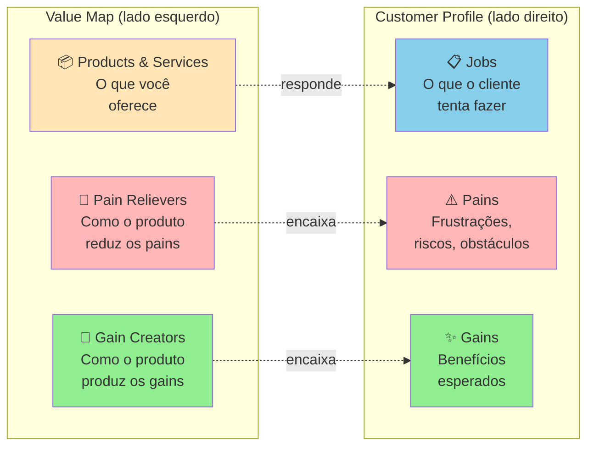

O **Customer Profile** mapeia o cliente em três dimensões: Jobs (tarefas funcionais, sociais, emocionais que tenta cumprir), Pains (o que o frustra, prejudica, ameaça) e Gains (o que ele deseja, espera, sonha). O Value Map mapeia o produto em três dimensões espelhadas: Products & Services (o que você oferece), Pain Relievers (como o produto alivia os pains do cliente) e Gain Creators (como o produto produz os gains).

O **fit** acontece quando os Pain Relievers correspondem a Pains reais e os Gain Creators correspondem a Gains que o cliente realmente valoriza. Pain Relievers sem Pain correspondente = features inúteis. Pains sem Pain Reliever = motivos de churn.

##### O momento exato de colocar este canvas na parede

Use o *Value Proposition Canvas* (VPC) depois de concluir a pesquisa qualitativa de campo (Fases 4 e 5: entrevistas de problema, entrevistas de troca JTBD, observação no local de trabalho e mapeamento de jornada). É a ferramenta que transforma o Dossiê do Usuário (saída desta Fase 5) em insumo direto de produto: cada persona validada alimenta um *Customer Profile* (lado direito), e a solução que você vai desenhar no Volume 3 ocupa o *Value Map* (lado esquerdo). Revisite o quadro a cada trimestre após o lançamento para podar funcionalidades que não aliviam nenhuma dor real.

##### Princípios práticos para preencher sem se enganar

A tese de Osterwalder é que a proposta de valor consiste na correspondência verificável entre as dores e ganhos prioritários do cliente e o que o produto efetivamente alivia e entrega. Esse encaixe não se presume: comprova-se com entrevistas, testes e observação de uso. Startups costumam falhar quando constroem um produto bom que ataca um problema que o cliente considera secundário, e o Value Proposition Canvas evita esse erro ao tornar explícita cada conexão.

##### Passo a passo na parede da sala (roteiro de oficina colaborativa)

**Etapa 1: Customer Profile (sempre primeiro).** Reúna o que você descobriu nas Fases 4 e 5. Para a persona escolhida, liste:

- **Jobs** (5-10): o que ela tenta fazer? Funcionais ("conciliar pagamentos do dia"), sociais ("parecer profissional para a equipe"), emocionais ("ter paz antes de dormir").
- **Pains** (5-10): o que dói? Pode ser frustração ("isso demora 3 horas"), risco ("se eu errar, perco o cliente"), obstáculo ("não tenho como integrar").
- **Gains** (5-10): o que ela quer? Esperados ("uma forma de fazer mais rápido"), desejados ("relatório que impressione o chefe"), inesperados ("automação que eu não sabia ser possível").

Regra de integridade: cada item do *Customer Profile* precisa apontar para uma entrevista, observação de campo ou estudo de diário documentado. Um perfil preenchido por intuição produz apenas um espelho das preferências dos próprios fundadores.

**Etapa 2: Value Map.** Liste:

- **Products & Services**: o que você está construindo (ou planeja construir).
- **Pain Relievers**: para cada Pain do cliente, como o produto alivia? Seja específico.
- **Gain Creators**: para cada Gain, como o produto produz? O mesmo princípio se aplica.

**Etapa 3: Avaliação de fit.** Cada Pain tem Pain Reliever correspondente? Cada Gain tem Gain Creator? Se há Pains sem cobertura, são oportunidades não endereçadas. Se há Pain Relievers sem Pain real, são features potencialmente desperdiçadas.

Tempo dedicado à oficina: 2 a 4 horas para construir a primeira versão completa (após concluir a pesquisa de campo). Cada segmento merece VPC próprio.

##### Exemplo brasileiro preenchido: Wellhub (ex-Gympass, 2016, lado B2B corporativo)

Preenchimento completo dos **seis blocos do Value Proposition Canvas** (os três blocos do *Customer Profile* à direita conectados aos três blocos do *Value Map* à esquerda) para o comprador corporativo (Head de RH de empresa de 200 a 1.000 funcionários):

| Bloco do VPC | Lado Direito: *Customer Profile* (Head de RH) | Bloco Espelhado | Lado Esquerdo: *Value Map* (Wellhub / Gympass B2B) |
|---|---|---|---|
| **1. Jobs** (Trabalhos) | Oferecer benefício de saúde que retenha talentos, gerir bem-estar em múltiplas unidades sem sobrecarga no RH, prestar contas à diretoria sobre o uso do benefício, atender perfis diversos (musculação, natação, ioga, *crossfit*) sem multiplicar contratos. | **4. Products & Services** (Oferta em 2016) | Assinatura corporativa única com acesso a rede credenciada de milhares de academias e estúdios via aplicativo de *check-in* e folha de pagamento (posteriormente ampliada em 2020 para aplicativos de bem-estar e terapia online). |
| **2. Pains** (Dores) | Convênio com academia única só atende quem mora perto, reembolso manual em folha gera atrito trabalhista/tributário e baixa adesão (<10%). | **5. Pain Relievers** (Aliviadores de Dor) | Contrato B2B único com faturamento centralizado, enquadramento jurídico claro de benefício corporativo e cobertura geográfica capilar. |
| **3. Gains** (Ganhos esperados) | Elevar a taxa de adesão dos colaboradores ativos (meta do RH de sair de menos de 10% para a faixa de 25% a 40%), reduzir absenteísmo e sinistralidade do plano médico, fortalecer a marca empregadora sem esforço administrativo extra. | **6. Gain Creators** (Criadores de ganho) | Relatórios consolidados de adesão para o RH e diretoria, coparticipação flexível por faixa salarial, variedade de modalidades esportivas na mesma mensalidade (com extensão a dependentes nos planos corporativos). |

**Análise de encaixe.** Há correspondência direta entre as dores e ganhos do RH e os aliviadores da oferta: o Wellhub não precisou reinventar a atividade física, mas eliminar os atritos operacionais que o departamento pessoal enfrentava no modelo tradicional (negociar contrato com dezenas de academias, conferir comprovantes de reembolso, enquadrar o benefício na legislação trabalhista e provar adesão). Uma proposta de valor forte não depende de funcionalidades pirotécnicas, e sim do encaixe exato entre a fricção que o comprador sofre e o trabalho que você retira da mesa dele.

##### Variações e extensões

- **Diagrama das Quatro Forças de Troca** (Bob Moesta) e JTBD Canvas (Jim Kalbach): detalham as forças que impulsionam ou travam a migração (push, pull, ansiedade e hábito), aplicadas diretamente no Template: Entrevista com Switcher mais adiante nesta fase.
- **Empathy Map** (Fase 4): complementar ao Customer Profile, foca em estados internos do cliente (pensa/sente/vê/ouve).
- **VPC for Multi-Sided Markets**: marketplaces fazem um VPC para cada lado (oferta e demanda).

##### Onde os fundadores mentem para si mesmos neste canvas

- Preencher Customer Profile com intuições em vez de dados reais: VPC teórico não representa mercado.
- **Fazer um VPC genérico para "todos os clientes":** segmentos e papéis diferentes têm trabalhos, dores e ganhos distintos. Construa um VPC próprio para cada persona decisiva.
- Inflar Gain Creators: listar benefícios que o produto teoricamente poderia entregar mas não entrega ainda.
- Ignorar Pains sem Pain Reliever correspondente: essas lacunas são frequentemente os motivos reais de churn.
- Confundir Products & Services (o que você constrói) com Pain Relievers (como alivia uma dor específica): o primeiro é descritivo, o segundo é causal.

---

#### Canvas: Customer Journey Canvas

##### Por que este quadro visual foi criado

Unificando a linha histórica apresentada na seção de mapeamento da jornada, a ferramenta nasceu nos anos 1990 com os mapas de ciclo de serviço de Ron Zemke e Chip Bell (inspirados nos "momentos da verdade" de Jan Carlzon) e ganhou o formato visual de canvas em meados dos anos 2000 pela convergência entre *design thinking* (IDEO, Stanford d.school), *service design* (Livework, de Lavrans Løvlie, Ben Reason e Chris Downs, com sistematização em *This Is Service Design Doing*, de Marc Stickdorn et al., 2018) e experiência do cliente (Forrester). O objetivo foi corrigir uma falha recorrente: empresas otimizavam pontos de contato isolados (página inicial, suporte, cobrança) sem enxergar a jornada completa, gerando experiências fragmentadas que deixavam o cliente frustrado na passagem de um setor a outro.

##### A anatomia visual de uma página

Tela visual organizada em **eixo horizontal de tempo** (etapas cronológicas pelas quais a pessoa passa) e eixo vertical nas sete dimensões do Passo 3:

- **1. Etapa:** momento cronológico do processo. Na Fase 5 (antes de existir o seu produto), mapeie as etapas da jornada atual do problema (por exemplo: *Gatilho da dor → Improviso inicial → Consulta a terceiros → Compra ou paliativo de emergência → Consequência no fechamento*). Quando a empresa já tem produto no ar (ou analisa o funil de um concorrente), as colunas seguem o ciclo de uso (*Descoberta → Consideração → Contratação/Pagamento → Ativação → Uso recorrente → Suporte → Renovação*).
- **2. Ação:** o que a pessoa faz concretamente naquela etapa.
- **3. Objetivo:** o que ela tenta resolver naquele passo.
- **4. Ferramentas atuais:** planilhas, conversas de WhatsApp, cadernos ou sistemas que ela usa hoje naquela etapa.
- **Ação**: o que o cliente faz nessa etapa (concretamente, clica, abre app, liga, fala com).
- **Objetivo**: o que ele tenta cumprir.
- **Pontos de Dor**: onde algo dá errado, demora, frustra.
- **Emoções**: o que ele sente (ansiedade, alívio, raiva, tédio, entusiasmo).
- **Oportunidades**: onde existe espaço para intervenção.

Versões mais avançadas adicionam: ferramentas/canais usados, métricas de sucesso por etapa, KPIs internos, owners do touchpoint, dados quantitativos (NPS por etapa, conversão).

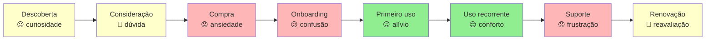

A curva emocional (verde para alívio, amarelo para neutro, vermelho para frustração aguda) ao longo das colunas é o termômetro mais rico do quadro: dois pontos vermelhos seguidos mostram onde o cliente desiste ou improvisa uma gambiarra. Já um ponto verde isolado cercado de etapas vermelhas indica uma funcionalidade boa presa dentro de um fluxo quebrado.

##### O momento exato de colocar este canvas na parede

Use o *Customer Journey Canvas* nesta Fase 5 como entregável central do Dossiê do Usuário, ao lado das personas e do *Value Proposition Canvas*. Depois do lançamento, revise o mapa a cada 12 meses como auditoria operacional: fluxos que funcionavam dois anos atrás pedem ajustes diante da triagem por agentes de IA no WhatsApp, dos pagamentos recorrentes via Pix Automático (lançado pelo Banco Central em junho de 2025) e da transição da reforma tributária do consumo (com CBS de 0,9% e IBS de 0,1% em ano de teste em 2026 e *split payment* gradual previsto a partir de 2027). Em momentos de mudança de direção (ver [[IGNICAO-Vol-4-Tracao-e-PMF#CAPÍTULO 11: PIVOT: TIPOLOGIA, DECISÃO E EXECUÇÃO|Capítulo 11: Pivot: Tipologia, Decisão e Execução (Vol. 4)]]), refaça o mapa da jornada antes de escrever código novo.

##### Princípios práticos para preencher sem se enganar

A premissa central do quadro é que o cliente vivencia uma sequência contínua de etapas, enquanto as empresas costumam fatiar o atendimento em silos isolados (marketing, vendas, implantação, produto e suporte). O *Customer Journey Canvas* obriga a equipe a enxergar as passagens de bastão e a consertar o elo mais frágil da cadeia: uma venda rápida seguida de ativação confusa destrói a retenção logo no primeiro mês.

##### Passo a passo na parede da sala (roteiro de oficina colaborativa)

Pré-requisito nesta Fase 5: ter concluído as 10 a 15 sessões de entrevistas JTBD e pelo menos 5 observações em campo (quando a empresa já está em operação, na etapa do Volume 4, somam-se dados de uso e satisfação). Reúna os sócios e quem participou das visitas. Tempo estimado: 3 a 4 horas para a primeira versão.

1. **Defina escopo da jornada**: começo e fim. Comece antes do ponto óbvio: se você é SaaS, jornada começa quando cliente percebe o problema, não quando entra no site.
2. **Liste etapas**: 5-10 etapas nomeadas. Use vocabulário do cliente, não interno ("Considera comprar" não "Lead Qualificado").
3. **Para cada etapa da linha do tempo**, preencha as 7 dimensões padronizadas na fase (Etapa, Ação, Objetivo, Ferramentas atuais, Pontos de dor, Emoções e Oportunidades) com base em citações literais e observações de campo.
4. **Trace a linha emocional**: atribua emoção dominante a cada etapa.
5. **Identifique pontos decisivos**: onde a emoção cai abruptamente, onde há atrito sistemático, onde o cliente abandona.
6. **Liste oportunidades de intervenção:** para cada ponto decisivo da jornada, anote de uma a três intervenções possíveis. Priorize pelo impacto direto no ponto mais baixo da curva emocional, não pela facilidade técnica.

Após primeira versão, **valide com 3-5 clientes reais**: peça que olhem o mapa e apontem onde discordam. Customer Journey desenhado sem validação é frequentemente "como queremos que seja", não "como é".

##### Exemplo brasileiro preenchido: iFood, jornada de primeira compra (2017) (reconstrução didática com base em dados públicos)

Para ver como o quadro expõe gargalos ocultos em fluxos transacionais, imagine um aplicativo de entrega de refeições em 2017 investigando por que parte relevante dos usuários que baixavam o aplicativo e montavam o carrinho desistia antes de concluir o primeiro pedido:

| Etapa | Ação | Objetivo | Ferramentas atuais | Pontos de dor | Emoção | Oportunidades |
|---|---|---|---|---|---|---|
| **Gatilho** | Sente fome às 19h e vê colega pedindo pelo celular | Jantar sem cozinhar | WhatsApp e indicação de amigos | Dúvida se há restaurantes bons que entregam rápido no bairro | Curiosidade | Destacar opções com entrega rápida confirmada para o CEP do usuário |
| **Descoberta** | Baixa o aplicativo e abre pela primeira vez | Ver opções próximas | Loja de aplicativos e tela inicial | Excesso de restaurantes listados sem curadoria gera paralisia de escolha | Sobrecarga | Criar vitrine "Mais pedidos perto de você hoje" na abertura |
| **Cadastro** | Preenche nome, e-mail, telefone e endereço | Liberar navegação rápido | Formulário no celular e SMS | Código de confirmação por SMS atrasa, tela pede dados excessivos antes do cardápio | Frustração | Permitir explorar o cardápio antes do cadastro e pedir dados fiscais só no pagamento |
| **Busca** | Filtra por categoria ou procura restaurante | Achar prato dentro do orçamento | Barra de busca do app | Restaurantes fora do raio de atendimento aparecem na listagem | Decepção | Filtrar estritamente pelo raio de entrega ativo antes de exibir a lista |
| **Cardápio** | Abre restaurante e escolhe itens | Montar refeição | Cardápio digital no app | Fotos ruins, descrições vagas e preço listado sem exibir taxa de entrega e embalagem | Dúvida | Padronizar cardápios e mostrar taxa de entrega logo na listagem |
| **Carrinho** | Revisa itens e confere valor total | Confirmar preço final | Tela de sacola do app | Taxa de entrega alta e valor mínimo de pedido surgem de surpresa no fechamento | Irritação | Exibir taxa de entrega e pedido mínimo desde a escolha do restaurante |
| **Pagamento** | Seleciona meio de pagamento e confirma | Fechar o pedido sem atrito | Cartão de crédito no app ou maquininha | Cartão recusado sem mensagem clara do motivo, autenticação bancária lenta | Ansiedade alta | Habilitar vale-refeição e pagamento na entrega (maquininha ou dinheiro, no contexto de 2017, hoje, Pix com código imediato e carteiras digitais), exibir motivo exato da recusa e manter o carrinho salvo |
| **Espera** | Acompanha preparo e deslocamento | Saber quando a comida chega na portaria | Tela de status e interfone | Estimativa congela sem atualização, difícil falar com o restaurante em caso de atraso | Impaciência | Rastreamento em tempo real do entregador no mapa e alerta de saída para entrega |
| **Recebimento** | Recebe o pedido na portaria | Conferir itens e jantar quente | Sacola lacrada | Pedido chega frio ou com item trocado, processo longo para pedir reembolso | Alívio ou frustração | Reembolso imediato no app para item faltante com crédito na conta |
| **Pós-uso** | Recebe lembrete pedindo avaliação | Avaliar se a experiência valeu a pena | Notificação no celular ou e-mail | E-mail genérico enviado três dias depois, quando o pedido já foi esquecido | Apatia | Pedir avaliação em um toque no próprio aplicativo logo após a entrega |

O mapeamento lado a lado revela que a maior queda de conversão acontecia na transição entre Pagamento e Espera: o usuário escolhia o prato, mas abandonava o aplicativo quando o cartão era recusado com um erro genérico e o carrinho se perdia. Isso orienta três intervenções imediatas: oferecer meios alternativos compatíveis com a rotina do público (como vale-refeição e pagamento na maquininha na entrega em 2017, ou Pix imediato hoje), explicar exatamente por que a transação falhou ("cartão sem limite" versus "código de segurança incorreto") e preservar o carrinho preenchido para que a pessoa tente outro meio em um toque. O problema não estava no cardápio, estava no segundo entre tocar em pagar e ver o pedido confirmado.

##### Variações e extensões

- **Service Blueprint**: extensão do Customer Journey adicionando "linha de visibilidade", o que o cliente vê (frontstage) vs o que acontece nos bastidores (backstage). Útil para ops e suporte.
- **Multi-persona Journey Map**: mesma jornada vista por 2-3 personas distintas (decisor vs usuário em B2B, comprador vs presenteado em B2C).
- **Future-State Journey Map**: jornada como queremos que seja em 12-18 meses, ao lado da atual. Útil para roadmap.

##### Onde os fundadores mentem para si mesmos neste canvas

- Mapear a jornada que a empresa quer (frictionless, lógica) em vez da que existe (fragmentada, cheia de workarounds): desconectado do cliente real.
- Começar muito tarde (no momento da compra): perde o gatilho que define quem chega ao site.
- **Tratar o mapa como quadro estático na parede:** canais e hábitos mudam (a ascensão do TikTok e do Reels como vitrine de descoberta, do Pix como pagamento padrão e do WhatsApp como balcão de suporte), exigindo revisão anual da jornada.
- Otimizar pontos isolados sem ver consequências em pontos seguintes: onboarding mais rápido pode produzir mais churn em 30 dias.
- **Desenhar a jornada sem medir as passagens:** um mapa sem dados vira peça de ficção. Acompanhe a taxa de avanço entre etapas, o tempo de espera e os motivos reais de abandono em cada coluna.

---

### TEMPLATES OPERACIONAIS E CASOS PREENCHIDOS (FASE 5)

#### Template: Persona com dados

**Para que serve.** Consolida cada papel que decide ou usa o produto (duas a quatro personas por negócio) em uma ficha padronizada de nove elementos ancorada nas evidências de campo.

**Quando usar.** Ao final das 10 a 15 sessões de entrevistas JTBD e das 5 observações de campo desta Fase 5, partindo da Síntese de Rodada da Fase 4. Atualize a ficha sempre que uma nova rodada de campo revelar um padrão relevante ou refinar o segmento de entrada.

**Exemplo de preenchimento.** Persona: "Carla, gerente de operações". Contexto: trabalha em uma rede de 12 farmácias regionais e responde direto ao fundador. Motivações: manter a confiança da diretoria e evitar ruptura de medicamentos de giro rápido. Frustrações: fechar o inventário no fim do mês consome um sábado inteiro. Comportamento observado: exporta o relatório do ERP e refaz a conferência no Excel, apesar de o sistema ter módulo de estoque. JTBD: "quando fecho o mês, quero conciliar o estoque físico com o fiscal sem refazer cálculos na mão, para ter meu fim de semana de volta". Citação: "Eu não confio no saldo que o sistema mostra, então confiro tudo na planilha."

```text
PERSONA (uma por papel que decide ou usa, de 2 a 4 perfis, com os 9 elementos obrigatórios do Passo 6): [1. Nome fictício e rótulo descritivo] | [2. Papel na decisão: Usuário / Campeão interno / Decisor econômico / Bloqueador]

Contexto profissional/pessoal
___________________________________________

Perfil demográfico
___________________________________________

Motivações principais (do que se importa)
1) _______________________________________
2) _______________________________________
7. GATILHOS DE BUSCA E BARREIRAS À TROCA (forças de mudança)
   - Gatilho que dispara a busca ativa ("o dia em que a corda arrebentou"): [preencher]
   - Barreiras e ansiedades que travam a adoção (*anxiety* / *habit*): [preencher]

8. CITAÇÃO LITERAL MARCANTE (*verbatim* entre aspas, com código da entrevista):
   "[preencher]" (Entrevista: `JTBD-.`)

9. BASE DE EVIDÊNCIA RASTREÁVEL (quais entrevistas de problema, sessões JTBD e observações sustentam esta ficha):
   - Entrevistas e observações: `[ENTR-., JTBD-., OBS-.]`
Frustrações principais
1) _______________________________________
2) _______________________________________

Comportamentos observados (não declarados)
1) _______________________________________
2) _______________________________________

Ferramentas/canais/fontes que usa
___________________________________________

JTBDs prioritários
1) Quando _____, eu quero _____, para que _____.
2) Quando _____, eu quero _____, para que _____.

Citação verbatim representativa
"___________________________________________"

Base de evidência: [quantas entrevistas, quais]
```

---

##### Caso complementar de jornada de compra digital: onde o hábito brasileiro trava no e-commerce

> [!note] Legenda da jornada
> as notas de 1 a 5 indicam o humor e o grau de confiança do cliente em cada etapa

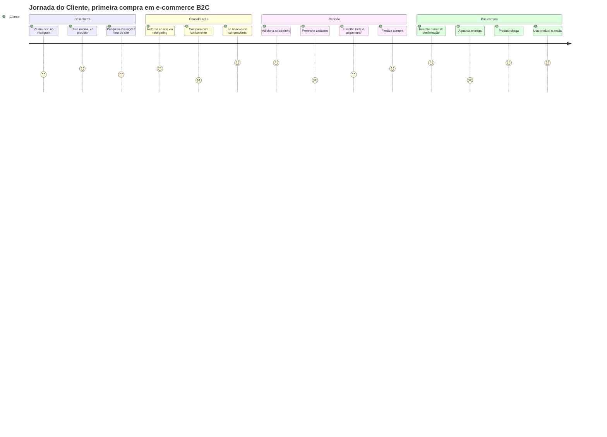

**Uso:** mapas de jornada revelam pontos de fricção (notas baixas) que exigem investigação. Neste exemplo, "comparar com concorrente" e "preencher cadastro" e "aguardar entrega" são as fricções mais dolorosas, candidatas a otimização prioritária.

---

#### Template: Entrevista com Switcher (JTBD: entrevista de troca)

> [!important] Disciplina central da entrevista de troca
> Aplique este roteiro exclusivamente a pessoas que já trocaram de solução na prática (abandonaram um concorrente, substituíram uma planilha manual ou migraram de fornecedor), inclusive quando entrevistados da rodada da Fase 4 mencionarem uma mudança recente. O foco é reconstruir o filme real da decisão de compra, e não apenas ouvir queixas genéricas sobre a rotina antiga. Se não houve troca concreta, utilize o Template de Entrevista de Problema da Fase 4.

A *Switch Interview* (entrevista de troca) é o protocolo criado por Bob Moesta e Chris Spiek para reconstruir passo a passo a linha do tempo de quem trocou recentemente de solução ou fornecedor. Use este roteiro sempre que um entrevistado da Fase 4 ou da Fase 5 mencionar que abandonou uma ferramenta antiga nos últimos meses, mapeando as quatro forças em disputa: empurrão da dor atual (*push*), atração da solução nova (*pull*), ansiedade da mudança (*anxiety*) e hábito que prendia ao modelo antigo (*habit*). O template divide-se em Parte A (guia de condução durante a conversa) e Parte B (ficha de síntese pós-entrevista).

##### Parte A: Roteiro da Entrevista (uso durante a conversa)

**Duração alvo:** 60 minutos (até 90 minutos quando combinada com observação do local de trabalho) · Balanço de fala: o entrevistado deve falar pelo menos 80% do tempo. Se você perceber que está explicando demais, volte às perguntas abertas sobre o dia da compra.

**Abertura (2 min)**

> "Oi, obrigado pelo tempo. Estou pesquisando como pessoas como você decidiram trocar de [categoria antiga] para [categoria nova]. Não estou te vendendo nada: quero entender a história dessa decisão em detalhe, o que estava acontecendo antes, o que mudou, como foi. Posso gravar?"

**Linha do tempo da troca (15 min).** *O coração da Switch Interview: reconstruir a timeline específica, de trás pra frente. A pessoa comprou uma coisa nova num momento específico. Quando foi? O que estava acontecendo antes?*

- Quando você começou a usar [nova solução]?
- Antes dela, o que você usava? Por quanto tempo?
- Quando foi a **primeira vez** que você pensou "isso aqui não está funcionando"? Me conta essa cena.
- Entre esse momento e quando você realmente trocou, quanto tempo passou?
- O que aconteceu nesse meio-tempo?

**O momento do empurrão (push): 10 min.** *O que estava acontecendo com a solução antiga que empurrou a pessoa pra fora dela?*

- Me conta a gota d'água. Qual foi o episódio específico?
- Antes dessa gota, o que te irritava no dia a dia da [solução antiga]?
- Tinha alguma gambiarra ou controle paralelo que você fazia para contornar o problema? O quê?
- Você reclamou com alguém? Com quem? O que eles disseram?

**O momento da atração (pull): 10 min.** *O que puxou a pessoa pra nova solução? Como ela soube que existia?*

- Como você conheceu [nova solução]? Foi busca ativa ou veio até você?
- O que chamou sua atenção no primeiro contato?
- O que você **imaginava** que a nova solução ia fazer por você? (Essa imagem mental, lá atrás.)
- Chegou a considerar outras opções nessa hora? Quais? Por que essas?

**Ansiedades e hábitos (10 min).** *As duas forças de resistência: medo da mudança (ansiedade) e inércia do jeito antigo (hábito).*

- O que te preocupava sobre trocar?
- Teve algum momento em que você quase desistiu da troca? O que trouxe você de volta?
- Que parte da rotina antiga você sentiu falta depois?
- Alguém foi contra a troca? Como você lidou?

**Implementação e resultado (8 min)**

- Como foi a primeira semana com a nova solução?
- Faltou algo que você esperava e não veio?
- Hoje, retrospectivamente, a troca valeu? Em que medida?
- Em que condições você voltaria pra solução antiga?

**Encerramento (3 min)**

- Tem outras pessoas que passaram por troca parecida e que eu poderia conversar?
- Posso voltar se surgirem mais perguntas?

**NÃO PERGUNTAR**

- "Se a [nova solução] tivesse [feature X], seria melhor?": *hipótese futura, contamina dado.*
- "O que você acharia de um produto que fizesse Y?": *apresentação de ideia disfarçada.*
- "Por que você escolheu?" em genérico: *pergunta muito aberta gera racionalização pós-hoc.*

##### Parte B: Síntese Pós-Entrevista

###### Metadados

| Campo | Valor |
|---|---|
| **ID** | `JTBD-[AAAA-MM-DD]-[##]` |
| **Data e hora** | `[DD/MM/AAAA]` |
| **Duração real** | `[min]` |
| **Formato** | `[ ] Remoto  [ ] Presencial` |
| **Gravação (com consentimento)** | `[link]` |
| **Transcrição** | `[link]` |
| **Entrevistador** | `[Nome]` |

###### Perfil e contexto da troca

| Campo | Valor |
|---|---|
| **Nome / empresa do entrevistado** | `[preencher]` |
| **Papel / cargo** | `[preencher]` |
| **Porte do negócio** | `[nº funcionários / faturamento / estágio]` |
| **Localização** | `[cidade / estado / país]` |
| **Solução antiga** | `[o que usava antes: nome específico, não categoria]` |
| **Solução nova** | `[para onde migrou]` |
| **Data da troca** | `[mês/ano]` |
| **Tempo na solução antiga antes de trocar** | `[preencher]` |
| **Tempo na solução nova até hoje** | `[preencher]` |
| **Decisor da troca** | `[ela mesma / chefe / time / comitê]` |

###### 1. Linha do tempo da troca

> *Reconstrua em 4 marcos. Seja específico com datas, episódios, gatilhos. A timeline é o núcleo da Switch Interview.*

| Marco | Quando | O que aconteceu |
|---|---|---|
| **Primeiro pensamento** ("isso não está funcionando") | `[preencher]` | `[preencher]` |
| **Evento de ativação** (gota d'água) | `[preencher]` | `[preencher]` |
| **Decisão de trocar** | `[preencher]` | `[preencher]` |
| **Primeira utilização da solução nova** | `[preencher]` | `[preencher]` |

**Intervalo entre "primeiro pensamento" e "decisão de trocar":** `[quanto tempo passou? o que aconteceu no meio?]`

###### 2. As quatro forças (Moesta)

> *Toda troca é resultado de quatro forças simultâneas. Duas empurram para fora do velho e atraem para o novo (push e pull). Duas resistem à troca (anxiety e habit). Se as forças de mudança não superam as de resistência, não há troca. Esta é a variável central da análise.*

**PUSH: o que empurrou para fora da solução antiga.** `[Falhas, frustrações, episódios específicos. Cite verbatim onde possível.]`

- `[preencher]`
- `[preencher]`
- `[preencher]`

**PULL: o que atraiu para a solução nova.** `[O que a pessoa imaginava que ganharia. Promessa percebida, não funcionalidade listada.]`

- `[preencher]`
- `[preencher]`
- `[preencher]`

**ANXIETY: o que causou ansiedade sobre trocar.** `[Medos, riscos percebidos, objeções de stakeholders. O que quase fez desistir.]`

- `[preencher]`
- `[preencher]`

**HABIT: a inércia do jeito antigo.** `[Conforto com rotina conhecida, sunk cost, relacionamentos, dados históricos.]`

- `[preencher]`
- `[preencher]`

###### 3. Conjunto de comparação (comparison set)

> *O que a pessoa comparou antes de escolher? A "categoria concorrente" do ponto de vista dela frequentemente não é o que a gente presume. Às vezes nossa concorrência real é Excel + WhatsApp, não o competidor óbvio.*

| Opção considerada | Como soube dela | Por que descartou |
|---|---|---|
| `[nova solução escolhida]` | `[preencher]` | *(escolhida)* `[por quê?]` |
| `[alternativa A]` | `[preencher]` | `[preencher]` |
| `[alternativa B]` | `[preencher]` | `[preencher]` |
| `[status quo: ficar com a solução antiga]` | n/a | `[por que não ficou?]` |

###### 4. Job to be Done formulado

> *Com base nas 4 forças e no comparison set, formule o job que a pessoa estava contratando a solução nova para cumprir. Estrutura: "Quando [situação], eu quero [motivação], para que [resultado esperado]."*

**Formulação:** `Quando [preencher], eu quero [preencher], para que [preencher]`

**Evidência direta que sustenta essa formulação:** `[cite verbatim ou descreva episódio específico]`

###### 5. Verbatim (citações literais)

1. > *"[citação sobre o push]"*
2. > *"[citação sobre o pull]"*
3. > *"[citação sobre ansiedade]"*
4. > *"[citação sobre a gota d'água]"*

###### 6. Vocabulário do cliente

| Como a pessoa chamou | Contexto |
|---|---|
| `[palavra / expressão exata]` | `[o que descrevia]` |

###### 7. Observações do entrevistador

*`[leitura de linguagem corporal, tom, hesitações, momentos de energia alta/baixa]`*

*`[preencher]`*

###### 8. Racionalização vs. razão real

> *Pessoas reconstroem as próprias decisões depois que tomam. O que ela diz hoje que foi o motivo pode ser racionalização pós-hoc. Confronte: a razão declarada bate com a timeline reconstruída?*

- **Razão declarada pela pessoa:** `[preencher]`
- **O que a timeline sugere que foi o motivo real:** `[preencher]`
- **Divergem?** `[ ] Sim  [ ] Não`: *se sim, descreva a diferença e explique o que a pessoa pode estar racionalizando.*

###### 9. Calibração da nossa narrativa

> *O que esta entrevista faz com a nossa tese de por que as pessoas trocam? Toda Switch Interview deveria mexer em algum dos quatro vetores. Se não mexer, revise a análise.*

- **Push que subestimamos:** `[preencher]`
- **Pull que estávamos usando e não ressoou:** `[preencher]`
- **Anxiety que não tínhamos mapeado:** `[preencher]`
- **Habit mais forte do que imaginávamos:** `[preencher]`

**Implicação para o posicionamento / mensagem / onboarding:** `[preencher]`

###### 10. Armadilhas: autoavaliação pós-entrevista

- [ ] Perguntei sobre hipótese futura ("se tivesse X.")?
- [ ] Aceitei a primeira explicação ("troquei porque é melhor") sem pedir o episódio específico?
- [ ] A timeline tem buracos grandes que eu não investiguei?
- [ ] Falei mais de 20% do tempo?
- [ ] Confundi o que ela disse hoje com o que ela pensava na hora da decisão?

**Achados sob suspeita:** `[preencher]`

###### 11. Indicações (snowball)

- **Outras pessoas que fizeram troca parecida:** `[preencher]`
- **Posso voltar?** `[ ] Sim  [ ] Não`
- **Topa ver algo que estamos construindo em 30-60 dias?** `[ ] Sim  [ ] Não`

###### 12. Próximos passos de investigação

> *Perguntas novas geradas por esta Switch Interview que informam próximas conversas ou pesquisa externa. Switch Interviews tipicamente geram dois tipos de pergunta: padrões a verificar em outros switchers (a timeline desse cara bate com a do próximo?) e dados de mercado a buscar (qual é o volume real de quem troca, qual é o ciclo médio de decisão no segmento).*

**Perguntas a incluir em próximas Switch Interviews.**

- `[preencher]`
- `[preencher]`

**Dados a buscar externamente (mercado, comparação, benchmark).**

- `[preencher]`
- `[preencher]`

**Perfis diferentes a entrevistar para cruzar padrões de troca.** `[preencher]`

###### Anexos

- Gravação: `[link]`
- Transcrição: `[link]`
- Artefatos compartilhados: `[link]`
- Switch Interviews relacionadas: `[JTBD-., JTBD-.]`

*Preenchido por `[Nome]` em `[DD/MM/AAAA]`.*

---

### Fechamento da Fase 5: o que muda na sua cabeça e na sua empresa a partir de agora

A Dra. Camila só descobriu o que esvaziava as manhãs da sua clínica na Savassi quando parou de falar de escaneamento suíço, sentou na recepção e perguntou a Dona Helena pelo dia em que ela decidiu marcar a consulta. E a equipe do software de fisioterapia em Curitiba só enxergou a janela real de quatro minutos entre um paciente e outro quando foi observar o balcão em silêncio. Ao encerrar esta Fase 5, reúna as duas frentes (a linha do tempo da troca colhida nas entrevistas de *Jobs to Be Done* e a realidade nua das observações de campo) no seu Dossiê do Usuário: duas a quatro personas com nove elementos rastreáveis, as jornadas do problema nas sete dimensões, os trabalhos (*jobs*) priorizados e o segmento de entrada (*beachhead*) definido.

A **[[#FASE 6: MAPEAMENTO DE MERCADO E CONCORRÊNCIA|Fase 6: Mapeamento de Mercado e Concorrência]]** vai usar esse Dossiê do Usuário para posicionar a sua empresa no terreno competitivo real: dimensionar o mercado de baixo para cima (*bottom-up*), auditar todas as alternativas que disputam o mesmo orçamento (incluindo planilhas e a inércia de não fazer nada) e desenhar o Canvas da Cunha para conquistar a sua cabeça de praia.

---

## FASE 6: MAPEAMENTO DE MERCADO E CONCORRÊNCIA

### A ilusão do TAM de bilhões e a arte de escolher uma cunha de entrada

Henrique entrou na sala de reunião de um fundo de capital de risco em São Paulo com o slide que todo consultor adora: *"O PIB do agronegócio brasileiro gira na casa dos trilhões de reais por ano (cerca de R$ 2,6 trilhões nas séries recentes do Cepea/USP-CNA). Se capturarmos apenas 1% desse mercado, teremos uma empresa de R$ 26 bilhões"*. O gestor do fundo fechou o notebook antes de Henrique passar para o próximo slide e disse:

"Henrique, '1% de um mercado trilionário' é a frase mais cara e mais vazia do empreendedorismo. Quem tenta vender para o agronegócio inteiro no primeiro dia fica sem caixa no oitavo mês. Diga-me quais vinte usinas de etanol de milho e biomassa no Mato Grosso e no Paraná não conseguem operar sem o seu sensor amanhã de manhã."

Aquele corte de realidade salvou a startup de Henrique. Como mostra Peter Thiel (*Zero to One*, 2014), negócios duradouros começam dominando um nicho pequeno e específico antes de expandir, enquanto quem tenta vender para "qualquer empresa do Brasil" cai na Ilusão do TAM de Bilhões. Ao longo desta Fase 6, Henrique aplica esse roteiro passo a passo: no Passo 2, substitui a conta *top-down* por um cálculo *bottom-up* multiplicando as 85 usinas de etanol de milho e cogeração de biomassa mapeadas no Mato Grosso, Paraná e Goiás pelo tíquete anual de R$ 180 mil. No Passo 10, preenche o Canvas da Cunha focado em paradas não planejadas de turbina e define o Dono do Orçamento (o diretor industrial que assina o piloto dentro da rubrica de manutenção preditiva, respeitando o retorno em até seis meses exigido pela diretoria financeira). No manual de frameworks, analisa seu setor pelas Cinco Forças de Porter, e, no Espelho que fecha a fase, consolida o Dossiê de Mercado que lhe abriu as portas dos primeiros pilotos.

Pense na Amazon vendendo apenas livros físicos pela internet em 1995, ou na Creditas (fundada por Sergio Furio em 2012 ainda como plataforma de comparação BankFacil), que ao migrar para a originação própria concentrou sua operação inicial no crédito com garantia de imóvel (*home equity*) e no refinanciamento de veículos, enquanto os grandes bancos priorizavam linhas pessoais sem garantia a juros elevados. Na formulação de Geoffrey Moore, você conquista primeiro uma cabeça de praia (*Crossing the Chasm*, 1991) para depois derrubar um pino adjacente por vez na estratégia da pista de boliche (*Inside the Tornado*, 1995). Nesta Fase 6, o objetivo é escolher e validar essa cunha inicial até que os primeiros potenciais compradores caibam nominalmente em uma lista de grupo de WhatsApp.

---

> [!question] FMF Check da Fase 6
> Você está escolhendo a sua cunha neste momento. Pergunte-se: o seu encaixe pessoal com este subsegmento (*founder-market fit*, ou FMF) constitui uma vantagem difícil de imitar ou é apenas circunstancial? Se qualquer outra equipe sem vivência no setor pudesse executar exatamente a mesma entrada com a mesma credibilidade, reavalie o recorte. O encaixe entre fundador e mercado é o que sustenta o próximo ano de trincheira e ajuda a explicar quem persiste quando o ciclo comercial aperta.

### Por que mapear o mercado antes de disputar

Fundadores empolgados costumam repetir que "não temos concorrentes diretos" ou que "basta capturar 1% de um mercado bilionário", duas premissas que quase sempre desmoronam no primeiro trimestre comercial. O mapeamento estruturado desta Fase 6, consolidado no Dossiê de Mercado e no Canvas da Cunha, obriga a identificar quem já disputa o mesmo orçamento (incluindo planilhas, processos internos e a opção do cliente de não fazer nada), quais gigantes adjacentes podem reagir e quais exigências regulatórias condicionam a operação.

Com esse levantamento feito em conjunto entre produto, comercial e tecnologia antes de definir preço e canal, suas escolhas de posicionamento e de cunha inicial passam a se apoiar na estrutura real do setor.

### O método em onze passos: dimensionamento de baixo para cima e desenho da cunha

O método percorre onze passos encadeados. Os Passos 1 a 9 estruturam o levantamento competitivo e a síntese do Dossiê de Mercado (acompanhados dos critérios de saída da fase, do caso aplicado da PadariaPro e das armadilhas de dimensionamento), enquanto os Passos 10 e 11 fecham a decisão tática com a construção do Canvas da Cunha e a aplicação do Teste de Estresse da Cunha.

#### Passo 1: defina o mercado corretamente

Mercado é a interseção concreta de três elementos: tipo de cliente, problema resolvido e recorte geográfico (termos amplos como "software" ou "restaurantes" são apenas setores). Por exemplo: "software de gestão de caixa para restaurantes de pequeno porte em capitais brasileiras que fazem delivery próprio". Isso é um mercado que pode ser estimado.

#### Passo 2: estime o tamanho do mercado (TAM, SAM, SOM)

TAM (*Total Addressable Market*, ou mercado total disponível) é a demanda total pelo problema no recorte geográfico e regulatório em que a sua empresa poderia operar (em geral o mercado nacional da categoria, usando o recorte global apenas quando o produto não encontra barreiras de idioma, distribuição ou regulação).

SAM (mercado que você pode alcançar) é a parte do TAM que a sua empresa pode realisticamente atender: geograficamente, tecnologicamente, regulatoriamente.

SOM (*Serviceable Obtainable Market*, ou mercado atingível na prática) é a fatia do SAM que você consegue conquistar nos primeiros três anos (36 meses), calculada de baixo para cima (*bottom-up*) a partir da sua capacidade real de prospecção, fechamento e implantação (tipicamente de 1% a 5% do SAM no terceiro ano). No caso de Henrique, em vez de alegar "1% do PIB do agronegócio", o cálculo *bottom-up* mapeou 85 usinas de etanol de milho e cogeração de biomassa no Mato Grosso, Paraná e Goiás multiplicadas pelo tíquete anual de R$ 180 mil (SAM de R$ 15,3 milhões/ano), projetando capturar 15 usinas até o fim do terceiro ano (SOM de R$ 2,7 milhões de ARR).

A visualização em funil de anéis concêntricos (com exemplo numérico B2B coerente na mesma moeda):

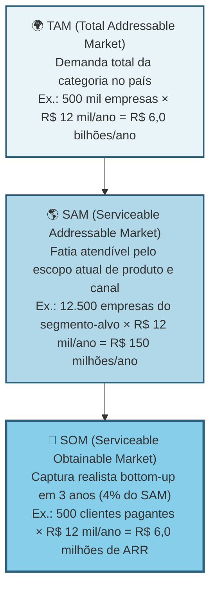

> [!warning] O que investidor audita em TAM/SAM/SOM (conta bottom-up vs. percentual de relatório)
> Investidor checa consistência. TAM otimista sem SOM realista é sonho. SOM ambicioso sem TAM que sustenta é conta que não fecha. Estime bottom-up (de baixo para cima: número de clientes vezes ticket), não só top-down (de cima para baixo: percentual de mercado externo).

Calcule top-down e bottom-up, e compare. Top-down: dados de mercado públicos (IBGE, Abrasel, associações, relatórios pagos como Statista e Gartner, se acessíveis). Bottom-up: número estimado de clientes vezes a receita anual média por cliente.

Se os dois números divergem muito, há algo errado em uma das estimativas e exige investigação imediata.

#### Passo 3: identifique todas as alternativas atuais do usuário

Categorize em quatro grupos.

Concorrentes diretos. Outras soluções que resolvem o mesmo problema da mesma forma. Por exemplo, outros softwares da mesma categoria.

Concorrentes indiretos. Soluções que resolvem o mesmo problema de forma diferente. Por exemplo, planilha de Excel, caderno físico, contador terceirizado.

Mudanças de processo que contornam a necessidade: decisões operacionais pelas quais o cliente elimina a tarefa em vez de contratar uma ferramenta ou serviço externo.

Status quo, ou seja, a inércia de "não fazer nada" e continuar convivendo com o problema. É o concorrente mais subestimado pelos fundadores: nas análises pós-morte da CB Insights, a falta de necessidade real que tire o cliente da inércia aparece entre 35% e 42% dos casos.

> [!important] Sua concorrência real raramente é outra startup
> A concorrência real é o jeito que o trabalho é feito hoje. O Excel do auxiliar administrativo. O grupo de WhatsApp onde o gerente despacha ordens. A planilha que ninguém entende mas todo mundo respeita. O hábito silencioso de ignorar o problema porque "sempre foi assim". Reconhecer isso muda para onde você direciona a comparação competitiva. Você para de comparar features com "a Startup X" e começa a comparar a sua proposta com o comportamento atual do cliente. É nesse comportamento que mora a urgência (ou a falta dela).

Os concorrentes indiretos costumam cair em quatro categorias operacionais que precisam ser mapeadas em detalhe:

- **Planilhas** (Excel, Google Sheets, Airtable). Flexíveis, familiares, baixo custo percebido ("já pago por Office"), mas manuais, propensas a erro, fragmentadas por pessoa, sem trilha de auditoria. Sinal de oportunidade: o cliente tem uma planilha-mãe com quinze ou mais abas que só ele entende, e entra em pânico quando pensa em sair de férias.
- **Cadeias de e-mail e WhatsApp de trabalho**. Fragmentadas, difíceis de rastrear, informação dispersa em caixas de entrada. Sinal de oportunidade: o cliente perde informação importante em e-mails antigos, ou precisa reconstruir o histórico de uma decisão consultando cinco pessoas diferentes.
- **Ferramentas internas construídas ad-hoc**. Sistemas caseiros montados por um técnico ou estagiário, em geral desatualizados, com dívida técnica crescente, dependentes de uma pessoa específica. Sinal de oportunidade: o cliente vive com medo de que "fulano saia" e o sistema pare de funcionar.
- **SaaS estabelecidos resolvendo problema adjacente**. Softwares que o cliente já paga por outro motivo e que "quase" resolvem o seu problema. É o concorrente que o fundador mais costuma esquecer de listar. Sinal de oportunidade: o cliente utiliza menos da metade das funcionalidades de uma ferramenta generalista e improvisa o restante em planilhas.

> [!note] Entender por que o consumidor brasileiro tolera soluções ruins é parte da análise competitiva
> No Brasil, inércia de troca é amplificada por desconfiança em novos fornecedores, preferência por relação pessoal e sensibilidade a risco financeiro. O [[#CAPÍTULO 1: PSICOLOGIA DO CONSUMIDOR BRASILEIRO: COMPORTAMENTO, DECISÃO E CONVERSÃO|Capítulo 1: Psicologia do Consumidor Brasileiro]] explica esses padrões e ajuda a formular o argumento de troca certo para cada perfil de cliente dentro da sua cunha.

> [!important] A pergunta-chave de competição
> Por que a alternativa atual é tolerada? Se a resposta é "porque funciona suficientemente bem", a sua urgência é fraca, e provavelmente você não tem cunha. Cunhas fortes substituem algo doloroso. Não algo levemente inconveniente. Se os entrevistados descrevem a planilha-mãe rindo ("a minha relação de amor e ódio com aquele Excel maldito"), você tem uma fresta. Se descrevem com indiferença ("funciona, acho"), você não tem.

Para cada alternativa prioritária, preencha uma ficha padronizada com seis dimensões: (1) quem oferece e qual é o posicionamento, (2) preço praticado, (3) ICP atendido, (4) pontos fortes e vulnerabilidades percebidos (usando falas diretas colhidas nas Fases 4 e 5), (5) reação provável à sua entrada, e (6) a pergunta decisiva: por que essa alternativa é tolerada hoje pelo cliente?

Se ninguém está reclamando ativamente, procurando substituto, ou alocando tempo para contornar os defeitos, a dor provavelmente não é grande o suficiente para motivar troca. Cunhas fortes substituem coisas que doem, não coisas apenas inconvenientes.

Mapeie de oito a doze alternativas reais (diretas, indiretas e status quo) e aprofunde de três a cinco em fichas detalhadas.

> [!note] Monitorar concorrentes não é tarefa pontual: é sistema contínuo
> O [[#CAPÍTULO 2: INTELIGÊNCIA COMPETITIVA, POSICIONAMENTO E CATEGORY DESIGN|Capítulo 2: Inteligência Competitiva]] cobre como estruturar monitoramento sistemático de mercado, conduzir análises win/loss e produzir battle cards acionáveis. Aplicado a esta fase, transforma o levantamento de alternativas de um documento estático em inteligência viva que alimenta decisões de roadmap e vendas.

> [!tip] Strategy Canvas para visualizar diferenciação
> Listar as alternativas é o primeiro passo. O segundo é decidir como você se posiciona diante delas, e aqui o [[#Canvas: Strategy Canvas (W. Chan Kim & Renée Mauborgne, 2005)|Canvas: Strategy Canvas (W. Chan Kim & Renée Mauborgne, 2005)]] (*Blue Ocean Strategy*) é a ferramenta indicada. Liste de 8 a 15 fatores de competição do setor, trace a curva de valor de cada concorrente principal (nota de 1 a 10 em cada fator) e desenhe a curva própria que você pretende construir. Uma curva apenas um pouco acima da média do setor representa simples otimização em oceano vermelho (*Red Ocean*). Já uma curva visualmente distinta, na qual você elimina ou reduz fatores que os incumbentes tratam como intocáveis e cria fatores novos de alto valor percebido, caracteriza uma estratégia de oceano azul (*Blue Ocean*). Veja a seção dedicada a esse canvas mais adiante nesta fase para o exemplo reconstruído da Stone diante dos adquirentes tradicionais.

#### Passo 4: entenda a dinâmica do mercado

Responda cinco perguntas. O mercado está crescendo, estável, ou encolhendo? (Busque dados dos últimos três a cinco anos.) Existem tendências estruturais? (Digitalização, regulação nova, mudanças demográficas, mudanças de comportamento.) O mercado está concentrado em poucos players grandes, ou é fragmentado? Existem movimentos de consolidação (fusões e aquisições)? Há ciclos sazonais?

#### Passo 5: mapeie os canais de aquisição de clientes usados no setor

Identifique como os operadores atuais conquistam clientes: vendas diretas, parcerias comerciais, marketing de busca e conteúdo, feiras setoriais, indicação boca a boca ou representantes regionais. Esse mapeamento mostra quais canais o comprador já reconhece como legítimos e onde o custo de aquisição tende a ficar inflacionado pela disputa direta.

> [!tip] Capítulo 1 (Vol. 4): GTM Playbook
> O [[IGNICAO-Vol-4-Tracao-e-PMF#CAPÍTULO 1: GTM PLAYBOOK E ARQUITETURA DE CANAIS: DA PRIMEIRA VENDA AO PRIMEIRO MILHÃO DE ARR|Capítulo 1: GTM Playbook (Vol. 4)]] aprofunda a tradução desse mapeamento de canais em estratégia de go-to-market operacional: sequenciamento de canais, modelo de cobertura, playbook de vendas e definição de ICP por canal. Use após concluir este passo para transformar o levantamento em plano executável.

#### Passo 6: levante a regulamentação relevante

Se você atua em saúde, finanças, educação, transporte, alimentação, energia, telecomunicações ou qualquer setor regulado, mapeie desde cedo as normas federais, estaduais e municipais que condicionam a operação. Verifique as exigências dos órgãos reguladores competentes (como ANVISA, Banco Central, ANS, ANTT e CVM no Brasil), as obrigações de tratamento de dados pessoais da LGPD (Lei 13.709/2018) e o enquadramento tributário específico da atividade.

> [!tip] Em dúvida sobre regulação, antecipe
> Invista duas a quatro horas de consultoria jurídica agora. É muito mais barato do que descobrir depois que o seu produto é ilegal.

#### Passo 7: identifique barreiras de entrada e vantagens competitivas sustentáveis

O que impede novos concorrentes (incluindo grandes empresas) de te copiar rapidamente? Economias de escala? Network effects (efeitos de rede)? Dados proprietários? Marca? Switching costs (custo de troca para o cliente)?

> [!warning] Execução não é barreira
> Seja realista. "Execução" não é barreira de entrada. Qualquer um pode executar bem. Barreira é estrutural. É o que existe depois que você sai do escritório.

> [!tip] Para aprofundar neste passo: quadros de efeitos de rede e evolução de cadeia de valor
> Quando o modelo tem componente de rede (marketplaces, plataformas, social, comunidades), o [[#Canvas: Network Effects Map|Canvas: Network Effects Map]] classifica o tipo de efeito (direto, indireto, dados, social) e identifica os limites de defensibilidade. Use ao avaliar moats em modelos de plataforma: efeito de rede é a categoria de moat mais forte e mais difícil de identificar com clareza.

> [!tip] Canvases Visuais: Wardley Map (Fase 19)
> Para análise estratégica em profundidade, o [[IGNICAO-Vol-9-Maturidade-e-Exit#Canvas: Wardley Map|Canvas: Wardley Map (Vol. 9)]] decompõe a cadeia de valor em estágios de evolução (Genesis → Custom → Product → Commodity), mostrando onde vale construir sob medida (componentes que criam diferencial competitivo) e onde comprar pronto como serviço padrão de mercado. Complementa Porter (forças estáticas) com lente temporal (evolução).

#### Passo 8: faça uma matriz competitiva

A matriz competitiva 2x2 dá clareza instantânea de onde você se encaixa. Exemplo genérico:

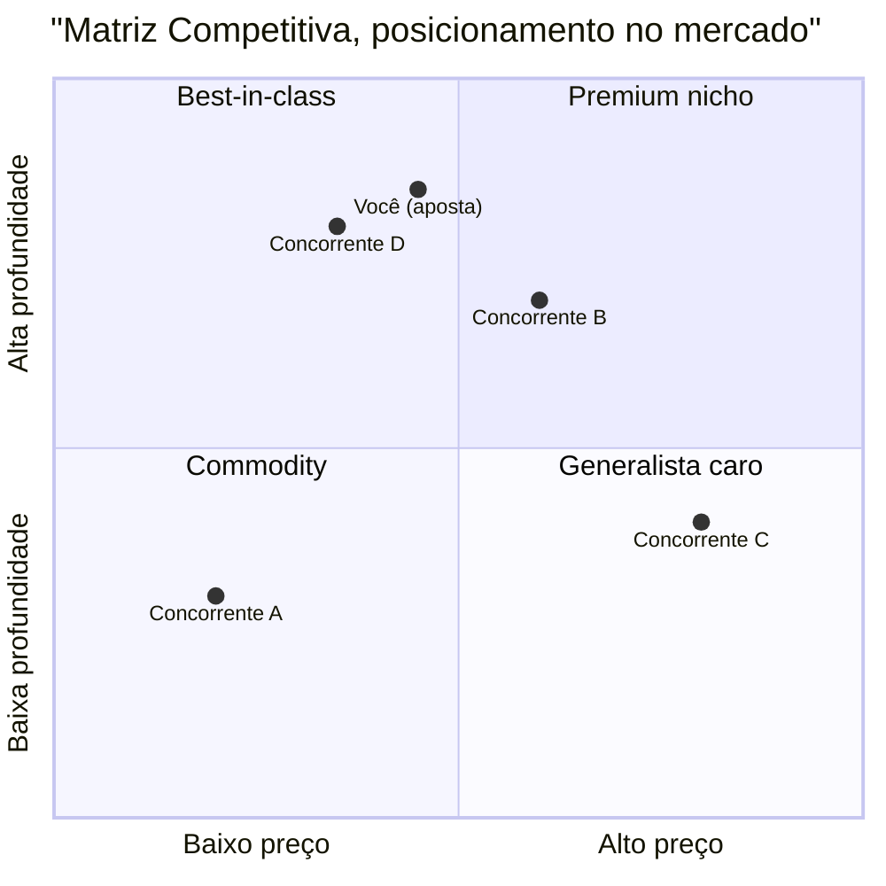

Escolha dois eixos que importam para o ICP, como preço versus profundidade técnica, autoatendimento versus implantação assistida, ou solução generalista versus especializada por vertical. Quadrantes cheios indicam disputa direta por margem. Já os quadrantes vazios são apenas hipóteses e exigem validação nas entrevistas da Fase 5 para confirmar se existe demanda real ou se estão vazios porque ninguém paga por aquela combinação. O ponto em que você se posiciona ajuda a recortar a sua cunha.

Em seguida, complemente a matriz visual com uma tabela comparando a sua proposta com as três a cinco alternativas principais (selecionadas entre as oito a doze mapeadas) nas seis dimensões padronizadas da ficha competitiva do Passo 3: quem oferece e posicionamento, preço, ICP atendido, pontos fortes e vulnerabilidades percebidos, reação provável e motivo pelo qual a alternativa atual é tolerada.

> [!tip] Capítulo 2: Inteligência Competitiva, Posicionamento e Category Design
> Se a análise da matriz revelar um quadrante vazio em que nenhum player se posiciona, você pode estar diante de uma oportunidade de criar uma categoria nova: não apenas competir melhor dentro das existentes. O [[#CAPÍTULO 2: INTELIGÊNCIA COMPETITIVA, POSICIONAMENTO E CATEGORY DESIGN|Capítulo 2: Category Design]] cobre como nomear, enquadrar e liderar uma categoria, baseado no framework de Al Ramadan e colegas. Aplicado aqui, transforma o quadrante vazio de dado descritivo em tese estratégica.

> [!note] Posicionamento de marca é uma das saídas desta fase, não só análise competitiva
> A matriz e o canvas da cunha definem onde você compete. O [[IGNICAO-Vol-4-Tracao-e-PMF#CAPÍTULO 4: BRANDING, POSICIONAMENTO DE MARCA E PRODUCT MARKETING (PMM)|Capítulo 4: Branding e Posicionamento de Marca (Vol. 4)]] complementa ao definir como você quer ser percebido nessa posição: território de marca, promessa central e coerência de identidade. Os dois artefatos (cunha + posicionamento) devem ser desenvolvidos em paralelo.

#### Passo 9: sintetize o Dossiê de Mercado

Documento de dez a vinte páginas contendo: definição precisa do mercado. Cálculos *bottom-up* de TAM, SAM e SOM. Catálogo de oito a doze alternativas categorizadas (diretas, indiretas e status quo). Fichas aprofundadas de três a cinco concorrentes principais. Matriz competitiva. Tendências tecnológicas e regulatórias. Barreiras de entrada. Canais de distribuição dominantes, e hipótese inicial de posicionamento.

### Critérios de saída da Fase 6

Você concluiu a Fase 6 quando todos os critérios abaixo (consolidando o Dossiê de Mercado dos Passos 1 a 9 e o Canvas da Cunha dos Passos 10 e 11) estão cumpridos:

- [ ] Dossiê de Mercado escrito.
- [ ] TAM, SAM e SOM calculados *bottom-up* com dados verificáveis (e não por percentual genérico de relatório *top-down*), com premissas explícitas. Para teses voltadas a fundos de capital de risco, demonstre separadamente o SOM atingível em 3 anos (a cunha de entrada) e a expansão em mercados adjacentes que sustente receita potencial acima de R$ 100 milhões em 7 a 10 anos.
- [ ] De 8 a 12 alternativas mapeadas no total (somando concorrentes diretos, indiretos, mudanças de processo e o *status quo*), com 3 a 5 alternativas prioritárias aprofundadas nas fichas padronizadas de seis dimensões definidas no Passo 3.
- [ ] CAGR do mercado estimado por duas fontes convergentes. Benchmark: ≥15% (B2B SaaS) ou ≥10% (consumer) sinaliza expansão, abaixo de 5% indica mercado estagnado e exige estratégia diferente.
- [ ] Dispersão competitiva caracterizada: pela regra prática deste livro baseada na participação dos quatro maiores operadores (CR4), o setor é concentrado quando os quatro líderes somam ≥ 70% de participação, moderado entre 30% e 70%, e fragmentado quando somam < 30% (se utilizar o índice HHI do *Guia para Análise de Atos de Concentração Horizontal* do CADE, de 2016, mercados abaixo de 1.500 pontos são não concentrados, de 1.500 a 2.500 moderadamente concentrados e acima de 2.500 altamente concentrados). Setores fragmentados favorecem a entrada por cunha, setores concentrados exigem diferencial estrutural ou foco em nicho mal atendido.
- [ ] **Canvas da Cunha** preenchido nos seis blocos essenciais (ICP preciso, dor específica, resultado mensurável, dono do orçamento, Teste do Grupo de WhatsApp e alternativa atual com vantagem), acompanhado do plano de expansão no Dossiê de Mercado.
- [ ] Os quatro critérios de validação da cunha aprovados em conjunto: (1) [[#Template: Teste de Precisão do Comprador (3 critérios obrigatórios)|Teste de Precisão do Comprador]] aprovado nos três critérios obrigatórios do template (e em pelo menos quatro das seis perguntas do checklist complementar de acesso), (2) ausência de escopo instável (nenhum ou no máximo um dos quatro sinais de alerta do Passo 10), (3) cunha vendável de forma autônoma, sem depender de promessa de *roadmap* ou plataforma futura, e (4) aprovação no Teste de Estresse da Cunha do Passo 11.
- [ ] Posicionamento diferenciado em dimensão valorizada pelo ICP (sem depender apenas de "preço mais baixo" ou "mais funcionalidades").
- [ ] Regulamentação aplicável investigada, com plano de conformidade.
- [ ] Concorrentes que reagiriam ao seu crescimento identificados, com tipo de reação esperada.
- [ ] Você consegue responder, em uma frase, por que o cliente-alvo trocaria a alternativa atual por você.

> [!warning] Se o último item não tem resposta, pare
> Se você não consegue explicar em uma frase concreta por que o cliente abandonaria a solução atual, ainda falta diferencial defensável. Para aprofundar, revise o Dossiê do Usuário (saída da [[#FASE 5: PESQUISA COM USUÁRIOS (CUSTOMER DISCOVERY)|Fase 5]]) e o Mapa de Problemas (saída da [[#FASE 4: DESCOBERTA DO PROBLEMA|Fase 4]]).

**Primeiros passos práticos.**

1. Abrir o [[#Template: Canvas da Cunha|Template: Canvas da Cunha]] no fim desta fase e preencher a hipótese de segmento inicial.
2. Montar a planilha de análise competitiva: listar de oito a doze alternativas (diretas, indiretas, mudanças de processo e *status quo*) e aprofundar de três a cinco nas fichas de seis dimensões do Passo 3 (quem oferece e posicionamento, preço, ICP atendido, forças e vulnerabilidades percebidas, reação provável e por que é tolerada hoje).
3. Calcular TAM, SAM, e SOM bottom-up. Número de empresas vezes ticket médio vezes taxa de captura realista em três anos.
4. Aplicar os quatro critérios de validação da cunha: o [[#Template: Teste de Precisão do Comprador (3 critérios obrigatórios)|Teste de Precisão do Comprador]] (somado ao checklist de seis perguntas de acesso), a verificação de escopo estável (no máximo um sinal de alerta), a independência de plataforma e o Teste de Estresse da Cunha.

### O Canvas da Cunha e o Dossiê de Mercado na prática: o caso PadariaPro

**Aplicação aos 6 blocos do Canvas da Cunha + notas de expansão para o Dossiê de Mercado: PadariaPro (caso fictício recorrente do livro).**

1. **ICP preciso (segmento inicial da cunha):** Sócios-operadores de pequenas redes de padarias artesanais com três a cinco lojas, produção própria diária e faturamento de R$ 100 mil a R$ 300 mil por mês por loja, na capital paulista e região metropolitana.

2. **Dor específica (e justificativa na pesquisa da [[#FASE 5: PESQUISA COM USUÁRIOS (CUSTOMER DISCOVERY)|Fase 5]]):** Perda de R$ 3 mil a R$ 8 mil mensais por loja com desperdício de insumos perecíveis e ruptura de estoque, somada a quatro a oito horas semanais do sócio gastas fechando pedidos manuais de reposição a fornecedores por planilha e WhatsApp. Na Fase 5, esse recorte apresentou severidade 8 a 9 (equivalente a Pain Level 5, com gambiarras ativas e orçamento disponível), contra nota 4 a 6 em padarias de loja única.

3. **Resultado mensurável:** Integrar previsão de demanda por item e disparo automático de pedidos aos fornecedores, com a meta de reduzir o desperdício mensal em 60% a 80% e devolver quatro horas semanais ao sócio-operador (hipótese a validar em piloto de 60 dias com três redes na Fase 8).

4. **Dono do orçamento e critérios de entrada:** O próprio sócio-operador da rede (que controla a rubrica de compras e insumos sem depender de diretoria de TI). Implantação em menos de sete dias, com mensalidade em teste de R$ 400 por loja (R$ 1.200 a R$ 2.000 mensais para redes de três a cinco unidades), 30 dias iniciais de teste e integração com dois moinhos fornecedores (Anaconda e Moinho da Serra).

5. **Teste do Grupo de WhatsApp e alternativa atual:** A partir de um universo estimado em cerca de 400 pequenas redes artesanais na Grande São Paulo (cruzando dados da ABIP, feiras como a FIPAN e busca ativa), os fundadores listaram nominalmente 180 redes específicas (dentro da régua de 100 a 300 da cunha), com um núcleo inicial de 27 sócios-operadores já mapeados com nome e contato (12 diretos e 15 via associação). A alternativa atual é a planilha de Excel combinada a mensagens manuais no WhatsApp, a vantagem em uma frase é cortar até R$ 5 mil mensais de desperdício por loja e 4 horas semanais de retrabalho por uma mensalidade de R$ 400 por unidade.

6. **Notas para o Dossiê de Mercado (defensabilidade e expansão pós-cunha):** A defesa após a entrada apoia-se nas integrações com o faturamento dos fornecedores de panificação (três a seis meses de homologação), no histórico de giro por SKU e na indicação entre panificadores. O plano de expansão prevê: no Ano 1, Grande São Paulo (meta de 50 lojas pagantes), no Ano 2, Campinas, Grande Rio e Belo Horizonte, e no Ano 3, redes regionais de seis a dez lojas.

Competidores e reação potencial:

| Competidor | Tipo | Posicionamento | Reação à nossa entrada |
|---|---|---|---|
| SigePro | ERP horizontal | Genérico, pesado | Baixa, não enxerga nicho |
| Zenda | ERP restaurante | Foco em delivery | Média, pode adicionar feature |
| Excel/Caderno | Solução atual | Inércia | Nenhuma |
| Consultoria local | Serviço pontual | Pessoal, caro | Nenhuma ou parceria |

Checklist complementar de acesso ao comprador (aplicado ao caso PadariaPro após os três critérios do Teste de Precisão).

- [x] Consigo descrever o comprador em uma frase com quatro ou mais atributos? Sim: "Dono-operador de três a cinco padarias artesanais em SP, trinta a quarenta e cinco anos, adota app se vê valor em uma semana."
- [x] Consigo listar ao menos vinte decisores reais do núcleo inicial? Sim: 27 sócios-operadores já identificados pelo nome (12 contatos diretos e 15 via associação regional ABIP), dentro da lista ampliada de 180 redes da cunha em São Paulo.
- [x] Identifiquei três gatilhos que fariam essa pessoa comprar agora? Sim: Ruptura recente, nova loja, indicação.
- [x] Tenho acesso direto ou via rede a dez ou mais pessoas desse perfil? Sim: Doze contatos diretos mais oito via rede.
- [ ] Já validei disposição a pagar com cinco ou mais pessoas do perfil? Não: Só dois até agora.
- [ ] Consigo vender para esse perfil com discurso de menos de dez minutos? Não testado ainda.

Score quatro sobre seis. A cunha é viável, mas duas dimensões precisam de validação adicional antes de investir em produto.

**Contraste: a cunha da Stone dentro de um mercado amplo (2014-2018).** Embora o mercado brasileiro de adquirência atendesse milhões de lojistas, a Stone recortou sua entrada em dimensões operacionais muito claras: pequenos e médios comerciantes mal atendidos pelos grandes adquirentes bancários, começando pelas capitais (Rio de Janeiro e São Paulo) com ativação rápida, transparência na conciliação de taxas e suporte humano imediato. Como documenta o prospecto de IPO da companhia (F-1, 2018), a defesa competitiva nasceu da distribuição hiperlocal por meio de polos operacionais próprios (*Stone Hubs*) e agentes comerciais e técnicos em campo (*Green Angels*), estrutura que os incumbentes apoiados em agências bancárias generalistas não conseguiam replicar rapidamente. Enquanto a PadariaPro ilustra uma cunha de nicho setorial estreito, a Stone demonstra que a cunha também pode ser um recorte de nível de serviço dentro de um mercado amplo, sustentado por uma operação difícil de copiar.

### As armadilhas do cálculo Top-Down e a covardia estratégica de não querer excluir ninguém

**Achar que "não tem concorrentes" e ter medo de excluir segmentos (covardia estratégica no ICP):** primeiro, você sempre tem concorrentes, mesmo que a alternativa atual do cliente seja uma planilha de Excel combinada ao WhatsApp ou fazer a tarefa manualmente, segundo, recusar-se a excluir segmentos do seu ICP por medo de reduzir o TAM no papel dilui a mensagem comercial e impede a conquista da cunha inicial.

Confundir market size com oportunidade. Um mercado de R$ 10 bilhões pode ser péssimo negócio se dominado por dois gigantes bem-financiados. E um nicho de R$ 50 milhões pode ser ótimo se ignorado e você capturar vinte por cento.

Top-down preguiçoso. Pegar um número de relatório setorial e multiplicar por "1% de participação" no Excel não cria demanda. Cada ponto percentual de mercado custa caro para conquistar na rua.

Ignorar o status quo. Como mencionado, o status quo é o concorrente mais comum. A inércia é invencível se a dor não for grande o suficiente.

Regulamentação tratada como detalhe e a covardia estratégica de não excluir ninguém. Setores regulados (saúde, finanças, educação, energia) possuem normas que inviabilizam produtos mal enquadrados quando investigadas tarde demais. Da mesma forma, o medo de dizer "não" a segmentos fora do foco leva o fundador a manter uma proposta genérica para "qualquer empresa", destruindo a eficiência comercial da largada.

#### Passo 10: construa o Canvas da Cunha (parte central)

Este passo sintetiza na pratica o levantamento dos Passos 1 a 9. Sem definir a cunha de entrada no Canvas da Cunha, o Dossiê de Mercado corre o risco de virar apenas um relatório panorâmico sem direção comercial. A pergunta decisiva desta etapa é direta: por qual subsegmento específico começaremos a vender na segunda-feira? A resposta operacional é a Estratégia da Cunha (*Wedge Strategy*).

A cunha é um ponto de entrada restrito e de alta alavancagem. Empresas que tentam vender desde o primeiro dia "para pequenas e médias empresas em geral" ou "para qualquer indústria" diluem o esforço: com foco largo, a mensagem fica genérica, o custo de aquisição sobe e o produto serve mal a todos. A cunha inverte essa lógica: entra por uma fresta específica, domina o subsegmento inicial e só então expande.

##### Anatomia de uma cunha forte: quatro elementos

Se faltar um, não é cunha.

Um ICP claramente delimitado. Em vez de dizer "pequenas empresas", especifique: "redes independentes de óticas, com duas a cinco lojas no interior de São Paulo e de Minas Gerais, que ainda controlam estoque e receituário em planilhas".

Uma dor específica. Um fluxo de trabalho recorrente, doloroso, e frustrante. Não é "otimizar o negócio". É, por exemplo, "conciliar vendas de armações com repasse das operadoras de convênios, hoje feito manualmente toda sexta-feira, consumindo cerca de quatro horas de uma pessoa por loja".

Um resultado mensurável e imediato. O que muda na vida daquele ICP quando a dor é resolvida. Quatro categorias contam. Aumento de receita (vendeu mais, subiu ticket, cortou tempo de ciclo de venda). Redução de custo (economizou horas de pessoa, automatizou tarefa cara, reduziu erro caro). Mitigação de risco (evitou multa regulatória, evitou retrabalho, evitou perda de cliente). Economia de tempo (transformou quatro horas em quinze minutos, liberou uma pessoa para outra função). Se o benefício que você vende não cai claramente em uma dessas categorias, o seu pitch vai soar vago. E compras B2B não acontecem por pitch vago.

Um Dono do Orçamento (Economic Buyer) com autoridade para pagar. Quem, nominalmente, no organograma do cliente, tem autoridade e budget para assinar o cheque. Em B2C, é o próprio consumidor. Em B2B, pode ser o sócio-proprietário, o gerente de TI, o diretor financeiro, o head de operações: depende do contexto. Se você não sabe quem é, vai falar com a pessoa errada e gastar meses vendendo para influenciadores em vez de decisores.

##### Teste de Precisão do Comprador: a frase que não pode travar

O elemento quatro da anatomia da cunha (Dono do Orçamento) é o que mais empreendedor iniciante pula. Parece que definir "quem decide" pode ser deixado para depois, quando o produto estiver pronto. É exatamente o contrário. Vender para o não decisor é a razão número um de ciclos de venda que se arrastam por meses sem fechamento.

Para testar se o seu elemento quatro está preciso, complete a seguinte frase sem hesitar:

> [!important] Frase-teste do Dono do Orçamento
> "Nós vendemos para (CARGO) em (TIPO DE EMPRESA), porque essa pessoa é responsável por (RESULTADO ESPECÍFICO) e controla (ORÇAMENTO ESPECÍFICO)."

Os três critérios obrigatórios de aprovação no Teste de Precisão do Comprador (complementados pelo checklist de seis perguntas de acesso ao comprador).

Primeiro, você consegue escrever a frase em menos de trinta segundos, sem rascunhar variações.

Segundo, a frase usa cargos reais existentes no organograma do cliente. Não "tomadores de decisão". Não "gestores". Não "stakeholders". Cargo nominal, como "Diretor Financeiro", "Gerente de Operações da Unidade", "Sócio-Administrador".

Terceiro, o orçamento mencionado é uma rubrica existente no cliente, e não uma linha orçamentária nova que ele precisaria criar para comprar de você. Quando a compra exige abrir rubrica inédita, o ciclo de decisão se alonga em várias vezes.

Exemplo aplicado em serviços B2B: "Nós vendemos para o sócio-administrador de redes independentes de óticas com duas a cinco unidades no interior de SP e MG (enquanto o gerente de operações atua como campeão interno), porque essa pessoa responde pelo fechamento da conciliação com convênios toda sexta-feira e controla o orçamento operacional da unidade (R$ 800 a R$ 2.500 mensais para sistemas de gestão)." Da mesma forma, na cunha industrial de Henrique: "Nós vendemos para o Diretor Industrial de usinas de etanol de milho e biomassa no Mato Grosso e no Paraná, porque ele responde pela disponibilidade contínua da planta na safra e controla a rubrica anual de manutenção preditiva."

Se a sua versão da frase exige asteriscos, exceções, ou "depende do tamanho da empresa", o elemento quatro da sua cunha ainda está instável. Volte às entrevistas ([[#FASE 5: PESQUISA COM USUÁRIOS (CUSTOMER DISCOVERY)|Fase 5]]) com foco em três perguntas: quem autorizou a compra mais recente de algo parecido. Quanto gastou, e qual dor específica motivou a liberação do orçamento.

> [!warning] Distinção entre usuário, campeão e comprador econômico
> Os três papéis (usuário, campeão interno, comprador econômico) foram desenvolvidos no Passo 7 da [[#FASE 5: PESQUISA COM USUÁRIOS (CUSTOMER DISCOVERY)|Fase 5]]. Na cunha (como no caso do sócio-administrador de redes de duas a cinco óticas ou padarias, que responde pela margem e assina o contrato), o Dono do Orçamento designa especificamente o comprador econômico, distinto do usuário diário e do campeão interno.

##### Teste operacional da cunha: o Teste do Grupo de WhatsApp

> [!tip] Se cabe em um grupo, está fina o suficiente
> Se você consegue listar nominalmente de 100 a 300 decisores-alvo para a sua cunha (onde 100 é o piso de especificidade para o nicho existir e 300 é o teto de largura para manter o foco inicial, partindo de um núcleo imediato de 30 a 80 contatos que você já conhece ou alcança diretamente), a sua cunha está calibrada. Se o seu modelo inicial exige "milhões de clientes" para fazer sentido, o recorte ainda está largo demais: estreite-o até caber nessa lista nominal.

##### Por que cunha fina vence cunha larga

Focar em um fluxo de trabalho específico de um comprador bem definido e deixar de lado o restante do setor nos primeiros meses parece arriscado, como se você estivesse reduzindo o próprio mercado. Na prática, esse recorte gera foco imediato e permite concentrar energia comercial na direção certa, destravando cinco vantagens operacionais: clientes de referência que indicam pares do mesmo setor. Estudos de caso com métricas auditáveis (como reduzir em 80% o tempo de conciliação). Clareza sobre o que construir e o que recusar no *roadmap*. Menor custo de aquisição, pois o canal e o argumento são específicos, e proteção inicial, já que grandes incumbentes raramente mobilizam equipes para defender um subsegmento estreito.

Depois de dominar a cunha, você pode expandir para nichos adjacentes (horizontal), ou para mais dor do mesmo cliente (vertical). Mas sem dominar a cunha primeiro, qualquer tentativa de expansão resulta em uma empresa sem product-market fit em lugar nenhum.

##### Cunha vs. plataforma: a distinção que protege o caixa

Há uma tentação quase universal em empreendedores iniciantes de descrever a ideia como uma "plataforma". Soa ambicioso, soa escalável, soa investível. Quase sempre é um erro operacional grave. Plataforma e cunha são coisas opostas em estágio inicial. E confundir as duas custa caro.

Cunha é profundidade focada em um único fluxo de trabalho, para um único papel, com um único resultado mensurável. Busca dominância em uma fatia estreita.

Plataforma é amplitude através de fluxos, papéis, e integrações. Pressupõe que a expansão vai acontecer antes que a profundidade tenha sido provada em qualquer frente.

Os quatro custos operacionais de declarar "plataforma" cedo demais.

Ciclo de venda mais longo. Plataformas exigem múltiplos aprovadores dentro do cliente (cada área toca algo diferente), e cada aprovador adiciona semanas ao fechamento. Uma cunha fala com um decisor.

Onboarding mais difícil. Plataformas pressupõem integrações e configurações que dependem de decisões em várias áreas do cliente. Cunha tem onboarding de minutos ou horas.

ROI menos claro. Plataformas prometem ganhos compostos em vários processos, o que é difícil de quantificar antes de adotar. Cunhas mostram economia mensurável em uma rubrica específica do primeiro mês.

Produto construído sobre ar. Plataformas obrigam a equipe a construir muitas capacidades mínimas em paralelo, sem feedback de uso real em nenhuma delas. Cunhas constroem uma coisa bem feita.

> [!important] Plataformas são consequência, não ponto de partida
> Plataformas nascem como consequência de cunhas bem executadas. A Stripe começou como uma API simples de pagamento online para desenvolvedores. O Figma nasceu como editor de design no navegador para pequenos times de produto. A Shopify surgiu do sistema que os próprios fundadores construíram para operar sua loja online de *snowboards* (Snowdevil), resolvendo a dor de pequenos lojistas independentes. Todas essas empresas se tornaram plataformas globais somente depois de dominar por completo a sua cunha inicial.

Se, ao descrever a sua ideia, você sente a necessidade de usar a palavra "plataforma" para que ela pareça grande o suficiente, é sinal de que a cunha ainda não está clara. Uma cunha forte não precisa da palavra "plataforma" para soar relevante. Soa relevante pela dor específica que resolve, e pelo resultado mensurável que entrega.

##### Sinais de escopo instável: diagnóstico rápido

Antes de preencher o Canvas da Cunha, faça um diagnóstico honesto de estabilidade do escopo. Escopo instável é comumente confundido com ambição. Mas na maioria das vezes é o oposto. É falta de escolha. Se o seu posicionamento muda dependendo de quem está na sua frente, a cunha ainda está em expansão, não em refinamento.

Aplique a frase-âncora:

> [!question] Frase-âncora do escopo estável
> "Estamos construindo para (UM PAPEL) lidando com (UM WORKFLOW) em (UM AMBIENTE)."

Essa definição de uma linha precisa soar natural e idêntica em qualquer conversa: com um cliente potencial, com um investidor, com um candidato de engenharia ou num jantar em família. Se você precisa adaptar a frase para cada interlocutor, é sinal de que ainda tenta atacar múltiplos ICPs, fluxos de trabalho ou compradores econômicos ao mesmo tempo, multiplicando o custo operacional da largada.

Quatro sinais operacionais de escopo instável, em ordem crescente de gravidade.

Mais de um ICP primário. Você tem "SMBs e enterprise", ou "criadores e agências", ou "varejo e food service". Cada ICP dobra o custo de mensagem, de canal de aquisição, e de decisão de roadmap.

Demonstrações diferentes para audiências diferentes. Você prepara uma versão do discurso para o investidor, outra para o cliente e outra para o parceiro comercial, cada uma enfatizando capacidades distintas. É sinal de que o produto ainda carece de um caso de uso central dominante.

Apresentar propostas de valor distintas para cada público ("para o segmento A reduzimos custo. Para o segmento B aumentamos receita. Para o segmento C mitigamos risco") sinaliza falta de foco estratégico na largada, pois cada promessa exige um processo de vendas e de produto diferente.

Roadmap abrangendo workflows não relacionados. O backlog de features tem uma feature para automação fiscal, outra para CRM, outra para integração com marketplace, outra para BI. Se essas features não se conectam pela mesma pessoa realizando o mesmo trabalho, você não tem um roadmap. Tem vários produtos competindo pela mesma equipe.

> [!warning] Critério operacional dos sinais de escopo
> Se você reconhecer dois ou mais desses sinais no seu próprio produto hoje, a cunha ainda está instável. Não adianta avançar para a Fase 7 (formulação de hipóteses, no Volume 3) com a cunha instável. Você vai gerar hipóteses conflitantes sobre ICPs diferentes, e cada decisão nas fases seguintes vai te puxar para direções opostas.

A ação corretiva é escolher. Escolher dói, porque toda escolha fecha opções imaginadas. É exatamente por isso que precisa ser feita agora, quando o custo de fechar opções é zero. Não depois, quando o custo vem em forma de produto construído, time contratado, e clientes mal servidos.

##### Entregável do Passo 10: Canvas da Cunha

As seis dimensões do Canvas, em forma visual:

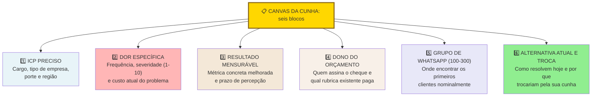

Preencha cada bloco com números e cargos reais, sem adjetivos genéricos. O formulário completo para impressão e preenchimento (incluindo o caso preenchido da operação industrial de Henrique em Curitiba) encontra-se unificado ao final desta fase no [[#Template: Canvas da Cunha|Template: Canvas da Cunha]], amarre ali o produto inicial, o comprador econômico e a métrica de sucesso antes de avançar para a [[IGNICAO-Vol-3-Experimentos-e-Prototipagem#FASE 7: FORMULAÇÃO RIGOROSA DE HIPÓTESES|Fase 7 (Vol. 3)]].

#### Passo 11: aplique o Teste de Estresse da Cunha (cinco minutos, Wedge Stress Test)

O Canvas da Cunha (Passo 10) é o instrumento estratégico. Esse teste é o instrumento tático. Use-o sempre que você descrever a cunha para alguém (investidor, mentor, cliente) e sentir que perdeu a pessoa. Ou antes de uma reunião importante, para pressionar a própria cunha e ver onde ela racha.

##### Parte 1: escreva em quatro linhas (dois minutos)

Quem é o usuário? Defina-o combinando cargo e contexto operacional: por exemplo, "gerente de contas a pagar em escritório de advocacia de vinte a cem pessoas", e não um rótulo vago como "profissionais de finanças". Se a descrição exigir duas frases inteiras, o recorte ainda está aberto demais.

O que dispara o problema? Qual evento, data, tarefa, ou situação recorrente faz o problema aparecer. Problema sem gatilho não tem urgência. Por exemplo, "todo fim de mês, quando precisa fechar conciliação, e o sistema atual gera quarenta inconsistências que precisam ser revisadas manualmente".

Qual é a consequência tangível se o problema continuar sem solução pelos próximos seis meses? Procure efeitos verificáveis: multa contratual, perda de clientes, retrabalho mensurável, atraso operacional ou rotatividade da equipe. Se a resposta prática for que a rotina segue normalmente sem impacto no caixa ou na operação, você está diante de uma inconveniência, não de uma dor que sustente um negócio.

O que o usuário faz hoje para contornar? Solução atual, mesmo precária. Planilha. Frankenstein de ferramentas. Estagiário terceirizado. A existência de uma gambiarra ativa é um sinal forte de dor real (Pain Level 4), ficando atrás apenas de quem já destinou orçamento para tentar resolver o problema (Pain Level 5).

##### Parte 2: duas perguntas-faca (três minutos)

Esse conjunto de clientes caberia em um único grupo de WhatsApp ou canal de Slack? A régua operacional do livro exige uma cunha listável de 100 a 300 decisores nominais (onde 100 é o piso de especificidade e 300 o teto de largura inicial), apoiada em um subconjunto mais estreito de 30 a 80 pessoas que você já conhece pelo nome, contato direto e contexto operacional. Se você não consegue listar nem esse núcleo inicial de 30 a 80 nomes, ou a dor ainda está mal recortada ou você conhece pouco o setor por dentro: volte às entrevistas da Fase 5 antes de alterar o tamanho da cunha.

Se a sua empresa fechasse hoje à noite, quem reclamaria ativamente amanhã de manhã? Não "quem sentiria falta". Quem abriria o notebook, ligaria para alguém, postaria no LinkedIn. Essa lista de pessoas é a sua cunha real. Se a lista tem menos de três pessoas específicas (com nome e cargo), a sua cunha é teórica. Não está aterrada em gente.

> [!tip] Uso operacional do teste
> Rode esse teste sozinho antes de rodá-lo com outra pessoa. Se você mesmo travar em alguma das seis perguntas, não vale envergonhar-se com um mentor. Volte primeiro ao Canvas da Cunha e resolva. O teste existe para você detectar cedo onde a sua narrativa não se sustenta.

### Caso brasileiro real: cunha na Creditas (2012)

Em 2012, o mercado brasileiro de crédito era dominado pelos grandes bancos com linhas de crédito pessoal não consignado a juros elevados (em torno de 5% a 6% ao mês nas séries do Banco Central em 2012, além do rotativo do cartão acima de 10% ao mês), e crédito com garantia via bancos tradicionais (burocracia alta, meses de processo).

Sergio Furio, fundador da Creditas (nascida em 2012 como plataforma de comparação BankFacil), fez uma escolha clássica de recorte ao migrar para a originação própria: em vez de disputar o mercado massivo de crédito pessoal sem garantia contra os grandes bancos de varejo, concentrou a operação no empréstimo com garantia de imóvel (*home equity*) e no refinanciamento de veículos (*auto equity*). Com comprador definido, dor financeira clara e taxas substancialmente menores que as do crédito pessoal sem garantia, construiu a base que financiou a expansão posterior.

Esse recorte inicial permitiu à empresa dominar a operação jurídica e de avaliação de garantias, calibrar *unit economics* com inadimplência controlada e consolidar reputação antes de expandir para novas linhas como o consignado privado.

Cunha estreita no começo não limita o tamanho final do negócio. Limita o risco inicial e acelera o PMF.

> [!note] Caso B2C internacional como referência adicional, Warby Parker (2010)
> A Warby Parker (fundada na Wharton em 2010 por Neil Blumenthal, Andrew Hunt, David Gilboa e Jeffrey Raider) é um exemplo clássico de cunha B2C bem recortada: jovens profissionais urbanos em Nova York e São Francisco incomodados com o custo e o atrito de comprar óculos de grau no varejo tradicional. A entrada combinou preço claro (US$ 95 a US$ 99, contra cerca de US$ 500 nas grandes redes) com o programa gratuito de prova de cinco armações em casa (*Home Try-On*, lançado em fevereiro de 2010). Essa oferta sem risco destravou a adoção online inicial antes da abertura de lojas físicas próprias, servindo de referência para o desenho de experimentos que veremos no [[IGNICAO-Vol-3-Experimentos-e-Prototipagem#CAPÍTULO 3: IDEA → WEDGE → SCALE: O FRAMEWORK ANTLER COMO LENTE TRANSVERSAL|Capítulo 3: Idea → Wedge → Scale (Vol. 3)]].

---

### Visão panorâmica: da Fase 6 (Mapeamento de Mercado) ao PMF (Fase 13)

Ao longo das Fases 0 a 6, você se preparou como fundador, gerou e articulou a ideia candidata, construiu a teoria do negócio, descobriu problemas reais no ICP por meio de entrevistas até a saturação e mapeou o mercado para escolher a sua cunha de entrada.

Visão panorâmica das Fases 7 a 13: converter as evidências colhidas nas Fases 0 a 6 em hipóteses falseáveis (Fase 7), rodar experimentos rápidos de compromisso (Fase 8), prototipar e validar a solução (Fases 9 e 10), colocar o MVP na rua (Fase 11), calibrar *unit economics* (Fase 12) e medir o Product-Market Fit (Fase 13). Você encerra o ciclo de descoberta aberta para iniciar a validação experimental.

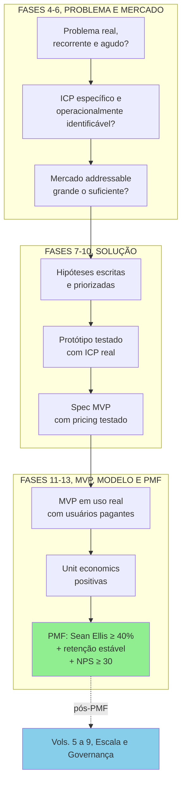

Falha em qualquer etapa significa voltar à fase anterior, não pular adiante. Sem ICP específico, mapa de problemas, e canvas da cunha preenchidos, as hipóteses geradas serão vagas e os experimentos virão ambíguos.

---

### O Espelho da Fase 6: você escolheu uma cabeça de praia ou está atirando no oceano?

Duas semanas depois do corte que levou na primeira reunião em São Paulo, Henrique voltou ao fundo de capital de risco sem o slide do PIB trilionário do agronegócio. Levou na pasta a conta *bottom-up* das 85 usinas de etanol de milho e biomassa mapeadas no Mato Grosso, Paraná e Goiás (SAM de R$ 15,3 milhões a R$ 180 mil por planta ao ano e SOM de R$ 2,7 milhões com 15 usinas em três anos), a lista nominal de 170 decisores técnicos (com núcleo imediato de 42 diretores industriais e gerentes de manutenção que já alcançava diretamente) e o escopo fechado na prevenção de paradas não planejadas de turbina. O gestor examinou a planilha por dez minutos, agendou a diligência técnica e apresentou Henrique a dois diretores de usinas em Lucas do Rio Verde e Sorriso.

**O Espelho (autodiagnóstico):**
1. Assim como Henrique fez ao trocar o slide de "1% do PIB do agro" pela conta das 85 usinas a R$ 180 mil/ano, você já calculou o seu SOM de 3 anos de baixo para cima (*bottom-up*), multiplicando o número real de clientes acessíveis na sua cunha pelo tíquete anual?
2. Você registrou por escrito quais segmentos de clientes vai recusar nos próximos doze meses e manteve no máximo um sinal de escopo instável na sua operação?
3. Você aprovou os demais critérios de validação da cunha: consegue completar a frase do Dono do Orçamento em menos de 30 segundos, vender a cunha sem depender de promessa de *roadmap* futuro, passar no Teste de Estresse e listar de 100 a 300 decisores nominais (com núcleo inicial de 30 a 80 contatos diretos)? (Chave de leitura: se respondeu "não" a duas ou mais perguntas deste Espelho, volte ao Passo 10 antes de iniciar o Volume 3.)

**Permissão Libertadora:**
Você está autorizado a parecer "pequeno demais" para investidores de palco. Conquistar metade de um nicho inicial de R$ 20 milhões gera dez vezes mais receita (R$ 10 milhões) do que capturar 0,001% de um mercado genérico de R$ 100 bilhões, funcionando como a porta de entrada para os mercados adjacentes.

**O Ritual de Segunda-Feira às 9h (rotina semanal de 30 minutos):**
Abra a sua lista da cunha e dedique 30 minutos toda segunda-feira para alimentar os seus dois níveis: o núcleo inicial de 30 a 80 decisores que você já conhece pelo nome e a lista ampliada de 100 a 300 contatos nominais do Teste do Grupo de WhatsApp. A cada segunda-feira, acrescente 10 novos nomes qualificados, mande mensagem para 3, registre quem respondeu e ajuste a frase do Dono do Orçamento se aprender algo novo.

---

### MÉTRICAS E BENCHMARKS DESTA FASE (FASE 6)

| Métrica | O que medir | Referência saudável |
|---|---|---|
| TAM calculado | Mercado total endereçável | Metodologia bottom-up |
| SAM calculado | Mercado serviceable com seu GTM | 1 a 10% do TAM |
| SOM em 3 anos | Receita anual atingível até o 3º ano (conta *bottom-up*) | Clientes conquistáveis em 36 meses × tíquete anual (validado pela capacidade real de vendas) |
| Concorrentes mapeados | Diretos, indiretos e status quo | 8 a 12 alternativas mapeadas (3 a 5 aprofundadas em fichas) |
| Cunha de entrada validada | Núcleo nominal listado e compradores testados | 30 a 80 nomes no núcleo (100 a 300 na cunha) e ≥ 5 compradores em Pain Level 4-5 |
| 5 Forças de Porter aplicadas | Análise estrutural da indústria | Completada |
| Posicionamento no Mapa de Valor | Localização diferenciada | Diferente de qualquer player |

---

### MANUAL PASSO A PASSO DOS FRAMEWORKS (FASE 6)

> **Como usar esta seção:** Os doze frameworks de análise competitiva e estratégia de mercado desta Fase 6 (Cinco Forças de Porter, Matriz SWOT/TOWS, Matriz BCG, Matriz GE/McKinsey, Matriz de Ansoff, Análise PESTEL, Cadeia de Valor de Porter, VRIO, 7 Powers, Crossing the Chasm, Category Design e Taxonomia de Efeitos de Rede da NFX) são apresentados na ordem em que aparecem com origem, mecânica, passo a passo de aplicação, exemplo prático e armadilhas.

#### Framework: As Cinco Forças Competitivas (*Porter's Five Forces*, Michael Porter, 1979)

##### De onde vem a ferramenta (e por que sobreviveu ao filtro do tempo)

Michael Porter, professor de Harvard Business School, publicou "How Competitive Forces Shape Strategy" na Harvard Business Review em 1979. O framework foi consolidado em seu livro *Competitive Strategy* (1980), obra considerada fundacional da estratégia corporativa moderna. A motivação era responder à pergunta: por que algumas indústrias são estruturalmente mais lucrativas que outras?

##### A mecânica central (sem jargão)

Framework que analisa a **atratividade estrutural** de uma indústria (ou setor) por meio de cinco forças que determinam o poder competitivo e, consequentemente, a rentabilidade média das empresas que nela operam. A fotografia retrata a estrutura do setor em um momento específico, mas deve ser atualizada periodicamente, pois as indústrias mudam de configuração com choques tecnológicos ou regulatórios (como o varejo antes e depois do comércio eletrônico).

##### As regras do jogo

As cinco forças que compõem a análise:

1. Ameaça de novos entrantes: quão fácil é para novas empresas entrarem e capturarem mercado? Barreiras de entrada altas (capital, regulação, marca, economias de escala, tecnologia proprietária) protegem incumbentes.

2. Poder de barganha dos fornecedores: quando fornecedores são poucos ou têm produto único, podem ditar preço e condições, comprimindo margem.

3. Poder de barganha dos compradores: quando compradores são grandes, poucos ou bem-informados, podem exigir preços baixos e condições favoráveis.

4. Ameaça de produtos substitutos: produtos de outras categorias que resolvem o mesmo JTBD, por exemplo: Zoom substitui voos de negócios. Netflix substitui cinema.

5. Rivalidade entre competidores existentes: intensidade da competição atual. Muitos competidores semelhantes, crescimento lento, custos fixos altos e barreiras de saída amplificam rivalidade.

##### Roteiro de aplicação prática na operação

Passo 1. Defina a indústria com precisão: "software" é amplo demais, enquanto "software de gestão de caixa para PMEs brasileiras" delimita o jogo competitivo. Uma definição ampla demais dilui a análise e uma estreita demais ignora substitutos relevantes.

Passo 2: Para cada força, listar evidências concretas. Não basta "o poder do comprador é alto", especificar quem é o comprador, quantos são, qual o share médio de cada, qual a elasticidade de preço.

Passo 3: Classificar cada força como ALTA, MÉDIA ou BAIXA. Justificar com dados de mercado, não impressão.

Passo 4: Identificar onde há oportunidade estratégica. Forças altas contra sua empresa = pressão na margem, forças altas contra concorrentes = oportunidade.

Passo 5: Desenhar ações defensivas e ofensivas. Para cada força alta negativa: como mitigar? Exclusividade com fornecedor, diversificação de clientes, aumento de switching costs.

Passo 6: Revisitar a cada 12-24 meses. Indústrias mudam.

##### Na trincheira real: como isso funciona na prática

Aplicação dupla: (A) SaaS B2B de gestão financeira para PMEs brasileiras e (B) a cunha industrial de Henrique (monitoramento preditivo para usinas de etanol de milho e biomassa).

- *Novos entrantes*: MÉDIO. Capital inicial moderado (R$ 2-5M para MVP competitivo), mas marca e integrações com bancos/Receita Federal criam barreiras.
- *Fornecedores*: BAIXO. Cloud commoditizado (AWS/GCP), frameworks open-source.
- *Compradores*: MÉDIO. PMEs são muitas (baixa concentração), mas sensíveis a preço, churn em período de crise é alto.
- *Substitutos*: ALTO no SaaS financeiro (planilha de Excel, escritório contábil terceirizado e pacotes digitais dos próprios bancos PJ), MÉDIO-ALTO na cunha de Henrique (rondas manuais com coletores portáteis e manutenção preventiva por calendário fixo).
- *Rivalidade*: ALTA no SaaS financeiro (Conta Azul, Omie, Nibo e ERPs de entrada como Bling e Tiny, além de contas PJ integradas como Conta Simples), MODERADA na cunha de Henrique (fabricantes globais de sensores atendem grandes siderúrgicas e petroquímicas, mas deixam descoberta a calibração específica para turbinas de biomassa no Centro-Oeste).

Leitura estratégica: no SaaS financeiro horizontal, a rivalidade e os substitutos comprimem a margem de novos entrantes, exigindo verticalização profunda. Já na cunha de Henrique, embora o poder de barganha de cada usina compradora seja médio-alto e os componentes eletrônicos importados exijam gestão de fornecedores, a baixa presença de especialistas locais em turbinas de biomassa abre espaço para entrar com contrato de retorno rápido.

##### Onde o papel aceita tudo (armadilhas de execução)

Análise superficial: afirmar que a "rivalidade é alta" sem levantar quantos concorrentes operam, qual a participação de mercado dos líderes e onde está a diferenciação. Indústria mal delimitada: "restaurantes" é amplo demais para análise, enquanto "restaurantes de alta gastronomia em São Paulo" permite diagnóstico concreto. Leitura estática: repetir uma fotografia antiga sem incorporar mudanças tecnológicas ou regulatórias recentes. Ignorar complementadores: embora o modelo original de Porter contemple cinco forças, Adam Brandenburger e Barry Nalebuff (*Co-opetition*, 1996) demonstraram que os complementadores (como lojas de aplicativos para sistemas móveis ou integradores locais para software industrial) exercem peso decisivo na captura de valor. Confundir atratividade setorial com desempenho individual: um setor atrativo não salva uma operação sem diferencial, e um setor difícil ainda permite alta rentabilidade para quem constrói posição defensável. Usar a ferramenta de forma isolada: as Cinco Forças mostram se a estrutura do setor é favorável, mas para definir como vencer dentro dele convém combiná-las com o *Playing to Win* (apresentado na Fase 2, no Volume 1) e com o *7 Powers*, detalhado mais adiante nesta mesma seção.

---

#### Framework: Matriz SWOT / TOWS (Albert Humphrey, anos 1960, Heinz Weihrich, 1982)

##### De onde vem a ferramenta (e por que sobreviveu ao filtro do tempo)

SWOT (Strengths, Weaknesses, Opportunities, Threats) emergiu de pesquisa conduzida no Stanford Research Institute entre 1960 e 1970, em estudo de planejamento estratégico de empresas da Fortune 500 ligado ao programa Team Action Management. Albert Humphrey é a atribuição mais comum, embora a paternidade seja parcialmente disputada (alguns acadêmicos creditam Smith Jr., Christensen e Andrews em Harvard nos anos 1950). Segundo o relato difundido no SRI (que carece de documento primário e convive com os registros anteriores do curso de Business Policy da HBS), a versão inicial chamava-se SOFT (Satisfactory, Opportunity, Fault, Threat), apresentada em seminário em Zurique em 1964, Urick e Orr renomearam para SWOT em publicação posterior. A variação TOWS foi proposta por Heinz Weihrich em 1982, invertendo a ordem para enfatizar o cruzamento entre fatores internos e externos. Virou uma das ferramentas mais usadas (e mais mal-usadas) de gestão no mundo.

##### A mecânica central (sem jargão)

Framework de diagnóstico estratégico que mapeia:

- Fatores internos (controláveis pela empresa): Strengths (forças) e Weaknesses (fraquezas).
- Fatores externos (do mercado/contexto): Opportunities (oportunidades) e Threats (ameaças).

O valor real não está na listagem dos 4 quadrantes, está nos cruzamentos da matriz TOWS, que geram estratégias específicas.

##### As regras do jogo

Matriz 2x2 com cruzamento:

| | Oportunidades | Ameaças |
|---|---|---|
| **Forças** | **SO** (Maxi-Maxi): usar forças para capturar oportunidades | **ST** (Maxi-Mini): usar forças para mitigar ameaças |
| **Fraquezas** | **WO** (Mini-Maxi): superar fraquezas para aproveitar oportunidades | **WT** (Mini-Mini): minimizar fraquezas e ameaças |

Cada quadrante gera **uma categoria de estratégia**:

- SO: aposta ofensiva. Onde você deve investir mais.
- ST: defesa. Use pontos fortes para bloquear riscos.
- WO: desenvolvimento. Investir em capability para capturar janela de mercado.
- WT: sobrevivência. Estratégias conservadoras, às vezes saída do segmento.

##### Protocolo prático de execução

Passo 1: Contextualize antes de listar. SWOT sem contexto vira lista genérica. Defina: SWOT para quê? Para entrar em novo mercado? Defender posição? Captar investimento? O contexto muda o que é força vs. fraqueza.

Passo 2: Forças e fraquezas: interno, relativo aos concorrentes. "Temos time técnico bom", comparado a quem? Força só é força se diferencia. Escreva sempre em forma comparativa: "time técnico mais denso em ML do que principais concorrentes locais".

Passo 3: Oportunidades e ameaças: tendências estruturais, não táticas. "Concorrente X fez promoção" não é ameaça estrutural. "Entrada de big tech americana no vertical" é.

Passo 4: Limite a 5-7 itens por quadrante. Mais vira lista que ninguém usa. Escolha os de maior impacto.

Passo 5: Construa os 4 cruzamentos TOWS. Isso é onde a ferramenta ganha utilidade. Cada célula deve gerar 2-4 estratégias específicas.

Passo 6: Priorize. Dos ~8-16 movimentos possíveis, quais 3-4 você vai executar este ano? SWOT sem priorização é relatório.

##### Na trincheira real: como isso funciona na prática

Startup: fintech de gestão de despesas e cartões corporativos (*spend management*) para médias empresas brasileiras (no estilo de Clara, Conta Simples ou Ramp).

Forças (S):

- Time com 2 engenheiros seniores ex-bancos tier-1.
- Domínio prático da regulação do Banco Central e das regras fiscais da Receita Federal.
- 18 clientes-piloto em SP já pagando.

Fraquezas (W):

- Marca desconhecida fora de SP.
- Sem time de vendas (fundadores vendendo).
- Runway de 14 meses.

Oportunidades (O):

- Transição da reforma tributária do consumo (regulamentada pela LC 214/2025 e pela LC 227/2026, com CBS e IBS em fase de testes desde 2026), exigindo controle automatizado de documentos fiscais por centro de custo.
- Substituição acelerada do cartão pessoal dos sócios e de planilhas manuais de reembolso por cartões corporativos com conciliação integrada nas médias empresas.
- PMEs migrando de planilha para SaaS financeiro.

Ameaças (T):

- Entrada agressiva de plataformas internacionais de gestão de despesas corporativas (*spend management*) no mercado brasileiro ou reação comercial dos grandes bancos incumbentes.
- Banco Central restringindo novas licenças de IP.
- Competição direta de fintechs de gestão de despesas corporativas já capitalizadas (como Clara e Conta Simples) e reação dos cartões empresariais dos grandes bancos.

TOWS, estratégias cruzadas:

- SO: aproveitar o domínio regulatório e a tração inicial para capturar médias empresas em São Paulo nos próximos 12 a 18 meses, aproveitando a demanda por conformidade na transição do IBS e da CBS.
- ST: construir defensibilidade em serviço (implementação consultiva) que SaaS americano terá dificuldade em replicar no BR.
- WO: contratar Head of Sales e acelerar geograficamente em 12 meses.
- WT: evitar disputa de taxa zero no microvarejo e concentrar recursos em médias empresas com múltiplas filiais, onde a conciliação contábil automatizada pesa mais do que o desconto de tarifa.

##### Onde o papel aceita tudo (armadilhas de execução)

Ao preencher a matriz, evite três erros recorrentes: (1) transformar os quadrantes numa lista vaga de adjetivos ("time bom, produto bom"), sem comparar seus indicadores aos de um rival específico, (2) empilhar vinte forças contra duas ameaças por otimismo do fundador, ou repetir o mesmo fato em dois quadrantes (como listar o mesmo movimento externo como oportunidade e ameaça) sem distinguir o mecanismo, e (3) parar nos quatro blocos descritivos sem cruzar os quadrantes na matriz TOWS para gerar decisões concretas de foco.

---

#### Framework: BCG Growth-Share Matrix (Bruce Henderson, 1970)

##### De onde vem a ferramenta (e por que sobreviveu ao filtro do tempo)

Bruce Henderson, fundador do Boston Consulting Group (BCG), publicou a matriz em 1970 no artigo "The Product Portfolio". Tornou-se talvez o framework de portfólio mais icônico do século XX, usado intensamente por conglomerados nas décadas de 70-80. Base conceitual: curva de experiência (custo cai com volume acumulado) + ciclo de vida do produto.

##### A mecânica central (sem jargão)

Matriz 2x2 que classifica unidades de negócio (ou produtos) em um portfólio corporativo segundo dois eixos:

- Eixo X: Participação relativa de mercado (vs. maior concorrente).
- Eixo Y: Taxa de crescimento do mercado.

Quatro quadrantes:

| | Alta participação | Baixa participação |
|---|---|---|
| **Alto crescimento** | **STAR** (Estrela): investir para manter liderança | **QUESTION MARK** (Interrogação): investir ou sair? |
| **Baixo crescimento** | **CASH COW** (Vaca leiteira): maximizar caixa | **DOG** (Abacaxi): reestruturar ou desinvestir |

##### As regras do jogo

Stars: líderes em mercados em crescimento. Consomem caixa (para defender liderança) mas geram retorno futuro. Estratégia: investir. Cash Cows: líderes em mercados maduros. Geram muito caixa, exigem pouco investimento. Estratégia: extrair caixa para financiar Stars e Question Marks. Question Marks: baixo market share em mercado crescendo. Precisam de investimento grande para virar Stars, ou devem ser abandonados. Decisão difícil. Dogs: baixa participação em mercado estagnado. Típica recomendação BCG: divest (vender, fechar, ou turnaround com custo mínimo).

##### Passos práticos de implantação

Passo 1: Defina o escopo de análise. Como a Matriz BCG e a Matriz GE/McKinsey foram desenhadas para alocar capital entre múltiplas unidades de negócio, elas têm pouca utilidade para uma startup de produto único antes do *Product-Market Fit*. Use-as quando a sua empresa já operar mais de uma linha de receita (como na expansão para a segunda curva da Fase 19, no Volume 9) ou quando você precisar mapear onde a sua solução se encaixa dentro do portfólio de um grande cliente ou adquirente corporativo.

Passo 2: Quantifique os eixos.

- *Market share relativo*: seu share dividido pelo share do maior concorrente. > 1 = você é líder, < 1 = segue.
- *Taxa de crescimento*: % ao ano de crescimento do mercado, não da sua empresa.

Passo 3: Alinhe thresholds.

- Alta vs. baixa participação: historicamente BCG usa 1x como threshold (líder vs. não líder), ajuste conforme indústria.
- Alto vs. baixo crescimento: tipicamente 10% a.a. Ajuste por contexto (tech pode usar 20%+, indústria madura, 5%).

Passo 4: Plote cada unidade/produto. Use área do círculo para representar receita (visualização clássica BCG).

Passo 5: Defina estratégia por quadrante. Investir, ordenhar, desinvestir, decidir.

Passo 6: Balanceie o portfólio. Conglomerado saudável tem mix: Cash Cows financiando Stars e Question Marks selecionados.

##### Na trincheira real: como isso funciona na prática

Grupo brasileiro com 4 unidades de negócio (exemplo hipotético):

- Unidade A, Streaming de conteúdo religioso: 40% market share no segmento, mercado cresce 20% a.a. → STAR, na qual vale investir.
- Unidade B, Portal de notícias gospel: 55% market share, mercado cresce 2% a.a. → CASH COW. Ordenhar caixa para financiar Unidade A.
- Unidade C, Loja virtual de livros: 5% market share, mercado cresce 15% a.a. → QUESTION MARK. Decidir: investir pesado para virar Star, ou sair.
- Unidade D, Revista impressa: 8% market share, mercado encolhe 10% a.a. → DOG. Turnaround ou desinvestir.

##### Onde o papel aceita tudo (armadilhas de execução)

Aplicar a uma startup de produto único: a Matriz BCG foi concebida para arbitrar caixa entre múltiplas linhas de negócio, não para escolher a primeira cunha. Confundir *Dog* (abacaxi) com produto deficitário: uma unidade de baixa participação em nicho maduro ainda pode gerar margem positiva sem exigir novos investimentos. Ignorar sinergias entre unidades: um produto secundário pode funcionar como porta de entrada ou complemento de retenção (*upsell* e *cross-sell*) para a linha principal (*Cash Cow*). Adotar patamares de corte rígidos demais: referências clássicas como 1x de participação relativa ou 10% de crescimento anual devem ser calibradas conforme a dinâmica do setor. Abandonar pontos de interrogação (*Question Marks*) cedo demais ou usar o quadrante como pretexto para encerrar linhas sem avaliar se uma reestruturação operacional (*turnaround*) é viável.

---

#### Framework: GE/McKinsey 9-Box Matrix (1970s)

##### De onde vem a ferramenta (e por que sobreviveu ao filtro do tempo)

Desenvolvida em parceria entre General Electric e McKinsey nos anos 1970, como evolução da BCG Matrix. Sob a liderança de Fred Borch e, na sequência, de Reginald Jones, a GE empregou a ferramenta para reorganizar seu portfólio corporativo em cerca de 40 unidades estratégicas de negócio (conforme registro histórico de 2008 da própria consultoria). A McKinsey Matrix (ou GE-McKinsey Matrix) supera o BCG ao ser multivariada em ambos eixos.

##### A mecânica central (sem jargão)

Matriz 3x3 (9 células) que posiciona unidades de negócio segundo:

- Eixo X, Competitividade / Posição competitiva da empresa na unidade: composto de market share, crescimento, qualidade do produto, marca, rede de distribuição, tecnologia. Pontuado como Alto, Médio, Baixo.
- Eixo Y, Atratividade da indústria: composto de tamanho, crescimento, margens, intensidade competitiva, regulação, sazonalidade, requisitos de capital. Pontuado como Alto, Médio, Baixo.

##### As regras do jogo

Resultado em 9 células agrupadas em 3 zonas:

- Zona de investimento (verde, 3 células superiores/esquerda): investir para crescer.
- Zona de seletividade (amarela, 3 células diagonais): investir seletivamente, proteger.
- Zona de colheita (vermelha, 3 células inferiores à direita): extrair caixa, desinvestir ou reestruturar.

##### Protocolo prático de execução

Passo 1: Defina os fatores de atratividade da indústria. Atribua um peso a cada fator (tamanho 20%, crescimento 20%, margens 15% e assim por diante) até somar 100%.

Passo 2: Defina os fatores de posição competitiva. Market share, participação em segmentos-chave, qualidade, marca, custo, rede. Também com pesos.

Passo 3: Pontue cada unidade. Escala 1-5 (ou 1-10) em cada fator. Multiplique por peso e some os pontos: Resultado vai para cada eixo.

Passo 4: Plote na matriz. Alto (acima de 3.67 em escala 1-5), Médio (2.34-3.66), Baixo (até 2.33).

Passo 5: Estratégia por zona.

##### Na trincheira real: como isso funciona na prática

Conglomerado diversificado com 5 unidades:

- U1, SaaS de gestão hospitalar: atratividade alta (setor cresce 18%/ano, margem 75%), posição alta (40% share em nicho) → Zona Verde. Investir agressivamente.
- U2, Distribuidora de medicamentos: atratividade média, posição alta → Zona Verde. Investir para crescer e consolidar liderança.
- U3, Loja virtual de suplementos: atratividade média, posição baixa → Zona Vermelha. Colher caixa seletivamente ou sair.
- U4, Editora impressa: atratividade baixa, posição média → Zona Vermelha. Ordenhar caixa.
- U5, Rádio local: atratividade baixa, posição baixa → Zona Vermelha, da qual vale desinvestir.

##### Onde o papel aceita tudo (armadilhas de execução)

Pesos arbitrários: sem critério claro, a pontuação apenas formaliza a preferência prévia do grupo. Viés político na avaliação: cada diretor tende a classificar a própria unidade como de "competitividade alta", exigindo indicadores auditáveis de participação e margem. Ignorar interdependências operacionais entre unidades que compartilham infraestrutura ou carteira de clientes. Aplicar a uma startup de produto único ou confundir unidade estratégica de negócio com funcionalidades isoladas do software.

---

#### Framework: Ansoff Matrix (Igor Ansoff, 1957)

##### De onde vem a ferramenta (e por que sobreviveu ao filtro do tempo)

Igor Ansoff, professor russo-americano conhecido como "pai da gestão estratégica", publicou o framework em "Strategies for Diversification" na Harvard Business Review em 1957. Consolidou em *Corporate Strategy* (1965). Ansoff argumentava que decisões de crescimento eram a essência da estratégia corporativa, e a matriz organiza o espaço de opções.

##### A mecânica central (sem jargão)

Matriz 2x2 que estrutura **quatro estratégias de crescimento** segundo dois eixos:

- Eixo X, Mercado: existente ou novo.
- Eixo Y, Produto: existente ou novo.

##### As regras do jogo

| | Produto existente | Produto novo |
|---|---|---|
| **Mercado existente** | **Penetração de mercado** (baixo risco) | **Desenvolvimento de produto** (risco médio) |
| **Mercado novo** | **Desenvolvimento de mercado** (risco médio) | **Diversificação** (alto risco) |

- Penetração de mercado: vender mais do produto atual a clientes atuais (e capturar clientes similares). Risco baixo, retorno limitado. Táticas: mais marketing, melhor pricing, expansion dentro da base.
- Desenvolvimento de produto: novos produtos para a mesma base de clientes. Vantagem: conhece o cliente. Risco médio.
- Desenvolvimento de mercado: levar o produto atual para novos segmentos de clientes, novas verticais ou novas regiões geográficas que exigem nova estrutura comercial. Risco médio, vantagem de partir de produto já validado.
- Diversificação: produto novo, mercado novo. Risco máximo. Pode ser relacionada (sinergia com core) ou não relacionada (puro portfolio play).

##### Execução prática com a equipe

Passo 1: Inventariar produtos e mercados atuais. Liste com clareza.

Passo 2: Para cada quadrante, gere opções concretas. Em penetração de mercado, quais clientes similares aos atuais você pode conquistar? Em desenvolvimento de produto, qual nova solução a sua base instalada já demanda? Em desenvolvimento de mercado, qual segmento adjacente você pode atender com o produto atual? Em diversificação, existem apostas complementares que justifiquem o risco mais alto?

Passo 3: Quantifique potencial e risco. Market size, tempo até retorno, investimento necessário, probabilidade de sucesso.

Passo 4: Distribua esforço. Regra prática: 70% penetração, 20% desenvolvimento (de produto ou mercado), 10% diversificação. Ajuste por estágio.

Passo 5: Sequenciar. Ansoff não diz "faça tudo junto", diz "escolha conscientemente". Fazer 3-4 movimentos simultâneos dilui foco.

##### Na trincheira real: como isso funciona na prática

SaaS de gestão financeira para PMEs (retomando exemplo anterior):

- Penetração: aumentar a adoção entre PMEs paulistas já mapeadas, combinando aquisição digital, programa de indicação e expansão de planos (*upsell*) na carteira atual.
- Desenvolvimento de produto: lançar módulo de emissão fiscal para base existente. Cross-sell.
- Desenvolvimento de mercado: expandir o produto atual para novas verticais do varejo alimentar e montar canais regionais em Minas Gerais e no Paraná.
- Diversificação: crédito para PMEs baseado em dados transacionais do software (fintech vertical). Alto risco, alto retorno potencial.

Sequenciamento recomendado: focar em Penetração + Desenvolvimento de Produto nos próximos 18 meses. Desenvolvimento de Mercado em 18-36 meses. Diversificação (crédito) só após ter PMF expandido + runway robusto.

##### Onde o papel aceita tudo (armadilhas de execução)

Diversificação prematura: startup com um único produto que tenta lançar uma linha desconectada antes de consolidar o negócio central dilui foco e caixa. Confundir expansão para outra cidade com abertura de novo mercado estrutural: vender o mesmo produto ao mesmo perfil de cliente em outra cidade do país exige pouca adaptação de produto. Não orce esse movimento como se fosse um produto novo, mas valide a rede local de distribuição antes de contratar equipe comercial. Lançar novos produtos sem conexão com o trabalho principal (*JTBD*) da carteira atual, desperdiçando a confiança já construída. Ignorar lacunas de capacidade operacional: enquanto a penetração apoia-se na máquina comercial existente, a diversificação exige competências regulatórias, técnicas e operacionais inéditas, com risco de execução substancialmente maior.

---

#### Framework: PESTEL Analysis (Francis Aguilar, 1967, originalmente ETPS)

##### De onde vem a ferramenta (e por que sobreviveu ao filtro do tempo)

A primeira formulação foi de Francis Aguilar em *Scanning the Business Environment* (1967), com o acrônimo ETPS (Economic, Technical, Political, Social). Arnold Brown, no Institute of Life Insurance, reorganizou para STEP (Strategic Trend Evaluation Process). Ao longo dos anos 1970-1980 evoluiu para STEPE, STEEP, PEST, e finalmente PESTEL/PESTLE (acrescentando Environmental e Legal), PESTELID (acrescentando International e Demographic) e outras variações. É framework de análise de macroambiente.

##### A mecânica central (sem jargão)

Framework para mapear forças externas ao negócio que podem impactar operação e estratégia. Diferente das 5 Forças (que analisam indústria), PESTEL analisa o ambiente macro.

##### As regras do jogo

P, Political: estabilidade de governo, políticas de governo, guerras, comércio internacional, impostos, regulação.

E, Economic: taxa de juros, inflação, câmbio, crescimento do PIB, desemprego, ciclo econômico.

S, Social: demografia, mudanças culturais, estilo de vida, valores sociais, saúde pública, educação.

T, Technological: inovações, obsolescência, adoção de tecnologias (IA, blockchain), automação, P&D.

E, Environmental: mudanças climáticas, regulações ambientais, sustentabilidade, recursos naturais.

L, Legal: leis trabalhistas, leis antitrust, proteção ao consumidor, propriedade intelectual, compliance regulatório.

##### Aplicação imediata na rotina da empresa

Passo 1: Horizonte temporal claro. PESTEL para 12 meses é diferente de PESTEL para 5 anos.

Passo 2: Para cada dimensão, identificar 3-5 forças materialmente relevantes. Não listar tudo, só o que impacta seu negócio.

Passo 3: Classificar cada força: impacto (alto/médio/baixo) × probabilidade (alto/médio/baixo).

Passo 4: Forças de alto impacto + alta probabilidade viram drivers de planejamento. Forças altas com baixa probabilidade são riscos a monitorar.

Passo 5: Converter em ação. Cada driver decisivo gera: oportunidade estratégica, risco mitigado, ou mudança operacional.

Passo 6: Revisitar semestralmente. Macroambiente é volátil.

##### Na trincheira real: como isso funciona na prática

Fintech brasileira de empréstimo para PMEs:

- P: desdobramentos das eleições gerais de 2026, composição da diretoria do Banco Central (presidido por Gabriel Galípolo no mandato de 2025 a 2028) e evolução operacional do Marco Legal das Garantias (Lei 14.711/2023) → MONITORAR.
- E: Juros básicos (Selic) em dois dígitos, inflação pressionando o teto da meta e PMEs com restrição de crédito bancário → DRIVER CRÍTICO (tese da empresa).
- S: digitalização acelerada pós-pandemia, PMEs adotando tech → OPORTUNIDADE.
- T: IA generativa mudando underwriting, open banking já implementado → OPORTUNIDADE + RISCO (concorrentes usam mesmo arsenal).
- E (env): menor impacto direto, mas ESG começando a pesar em captações → MONITORAR.
- L: Lei 14.478 sobre cripto em evolução, LGPD com fiscalização crescente, regulação BCB sobre BNPL → COMPLIANCE CRÍTICO.

Drivers consolidados: oportunidade de conquistar PMEs sub-servidas por bancos (ambiente econômico apertado + digitalização), mas risco regulatório exige compliance forte.

##### Onde o papel aceita tudo (armadilhas de execução)

Lista exaustiva não priorizada: 40 itens sem classificação de impacto. Nada acionável. Genérico: "inflação pode impactar negócio" sem quantificar. Específico: "cada 1pp de Selic eleva custo de capital em R$ 350k/mês para nossa operação de empréstimos". Viés de disponibilidade: foca em manchetes recentes, ignora tendências estruturais. Estático: análise de dezembro não atualizada em junho. Desconexão com estratégia: PESTEL que não vira ação é relatório morto. Ignorar dimensões menos familiares: fundador técnico subdimensiona Político, fundador MBA subdimensiona Technological.

---

#### Framework: Value Chain Analysis (Michael Porter, 1985)

##### De onde vem a ferramenta (e por que sobreviveu ao filtro do tempo)

Michael Porter introduziu a Value Chain em *Competitive Advantage* (1985), sequência de *Competitive Strategy*. Ferramenta para decompor empresa em atividades primárias e de suporte, entendendo onde valor é criado e onde há oportunidades de vantagem competitiva ou corte de custos.

##### A mecânica central (sem jargão)

Framework que mapeia as **atividades que uma empresa realiza** para entregar valor ao cliente. Cada atividade é oportunidade de: (a) criar valor diferenciado, (b) reduzir custo, ou (c) ambos. A margem é resultado da diferença entre valor percebido e custo total da cadeia.

##### As regras do jogo

Atividades primárias (tocam o produto/serviço direto):

1. Inbound logistics: recebimento, armazenagem, distribuição interna.
2. Operations: transformação de insumos em produto.
3. Outbound logistics: entrega ao cliente.
4. Marketing & Sales: geração e captura de demanda.
5. Service: suporte pós-venda.

Atividades de suporte (perpassam todas):

- Infrastructure: gestão, finanças, legal.
- HR management: recrutar, treinar, reter, remunerar.
- Technology development: P&D, IT.
- Procurement: aquisição de insumos.

Cada atividade tem custo e cada uma pode ser fonte de diferenciação.

##### Execução prática com a equipe

Passo 1: Adapte a cadeia ao seu modelo de negócio. Porter desenhou o esquema original pensando na indústria manufatureira, mas uma empresa de software opera com outro encadeamento primário (desenvolvimento e produto → infraestrutura em nuvem → aquisição comercial → implantação e sucesso do cliente). Use a ferramenta como estrutura analítica, não como molde rígido.

Passo 2: Para cada atividade, mapeie o custo: percentual do gasto total, tendência (crescendo ou caindo) e principais direcionadores.

Passo 3: Para cada atividade, mapeie criação de valor. Quanto essa atividade contribui para diferenciação percebida?

Passo 4: Identifique os elos (linkages). Atividades se conectam, melhorar uma afeta outra. Exemplo: investir em onboarding melhor (operations) reduz tickets de suporte (service).

Passo 5: Compare com concorrentes. Onde você tem vantagem estrutural? Onde desvantagem? Vantagem em value chain é frequentemente mais defensável que vantagem em produto pontual.

Passo 6: Decida: onde investir, onde cortar, onde terceirizar.

##### Na trincheira real: como isso funciona na prática

SaaS B2B de gestão financeira:

- *Development* (tech): 40% dos custos, fonte de diferenciação (produto core).
- *Customer success*: 15% dos custos, fonte decisiva de retenção (NRR alto).
- *Marketing & Sales*: 25% dos custos, fonte de aquisição.
- *Infrastructure (hosting/SaaS tools)*: 8% dos custos.
- *G&A*: 12% dos custos.

Análise: desenvolvimento de produto e sucesso do cliente (CS) são os verdadeiros diferenciadores de retenção, enquanto o gasto elevado em mídia paga apenas acompanha a média dos concorrentes sem gerar barreira competitiva. Decisão: preservar o investimento em engenharia e atendimento consultivo e testar a redução gradual do CAC via canais orgânicos e indicação (detalhados no Volume 4).

##### Onde o papel aceita tudo (armadilhas de execução)

Cadeia genérica: aplicar template industrial sem adaptar a negócio digital. Medir custo sem medir valor: só vê redução de custo, perde oportunidade de diferenciar. Ignorar linkages: decisão em atividade isolada quebra outra. Análise sem benchmark: saber que marketing é 25% do custo não diz nada sem comparação setorial. Terceirizar atividade central por equivocada leitura de custo: terceirizar customer success em SaaS para reduzir custo frequentemente destrói valor muito maior do que poupou.

---

#### Framework: VRIO Framework (Jay Barney, 1995. Evolução do modelo VRIN, 1991)

##### De onde vem a ferramenta (e por que sobreviveu ao filtro do tempo)

Jay Barney, professor da Ohio State University, publicou "Firm Resources and Sustained Competitive Advantage" no *Journal of Management* em 1991, formalizando a Visão Baseada em Recursos (*Resource-Based View*, RBV) e o modelo VRIN (*Valuable, Rare, Inimitable, Non-substitutable*). Em 1995, no artigo "Looking Inside for Competitive Advantage" (*Academy of Management Executive*, fonte original da sigla VRIO), Barney substituiu *Non-substitutability* por *Organization*, destacando a capacidade organizacional de capturar valor dos recursos, tese aprofundada nas edições de *Gaining and Sustaining Competitive Advantage* (1ª edição de 1996, 2ª edição de 2001). Em contraste com a análise setorial de Porter, a RBV sustenta que vantagens duradouras nascem de ativos internos difíceis de replicar.

##### A mecânica central (sem jargão)

Framework que avalia se um recurso ou capacidade gera vantagem competitiva sustentável através de quatro perguntas em sequência:

- **V: Valioso (Valuable):** o recurso permite à empresa explorar uma oportunidade ou neutralizar uma ameaça?
- **R: Raro (Rare):** quantos concorrentes possuem esse recurso? Se todos têm, não é vantagem.
- **I: Inimitável (Inimitable):** é custoso para concorrentes imitar, substituir ou replicar o recurso?
- **O: Organizado (Organized):** a empresa tem processos, estrutura e cultura para capturar o valor gerado pelo recurso?

##### As regras do jogo

Cada combinação de respostas leva a um diagnóstico diferente:

| V | R | I | O | Implicação competitiva |
|---|---|---|---|---|
| Não | n/a | n/a | n/a | Desvantagem competitiva: eliminar ou terceirizar |
| Sim | Não | n/a | n/a | Paridade competitiva: necessário, mas não diferenciador |
| Sim | Sim | Não | n/a | Vantagem temporária: concorrente pode replicar |
| Sim | Sim | Sim | Não | Vantagem não capturada: recurso desperdiçado por falta de organização |
| Sim | Sim | Sim | Sim | **Vantagem competitiva sustentável** |

A inimitabilidade (I) é o critério mais difícil de avaliar. Barney identifica três fontes de inimitabilidade: *path dependency* (a empresa acumulou o recurso ao longo de uma trajetória única que não pode ser replicada em curto prazo), *causal ambiguity* (nem a própria empresa sabe exatamente por que o recurso funciona, dificultando cópia), e *social complexity* (recurso baseado em relações interpessoais, cultura, reputação: impossível de copiar mesmo quando o concorrente entende o mecanismo).

##### Passos práticos de implantação

Passo 1: Inventariar recursos e capacidades. Recursos tangíveis: capital, infraestrutura, IP, dados. Recursos intangíveis: marca, reputação, cultura, relacionamentos com clientes. Capacidades: processos organizacionais que combinam recursos.

Passo 2: Para cada recurso/capacidade, aplicar o filtro VRIO sequencialmente. Parar assim que uma resposta for "não": o recurso ficará naquela categoria.

Passo 3: Para recursos que passam em V e R mas falham em I: diagnosticar o risco competitivo. Em quanto tempo concorrente bem capitalizado consegue replicar?

Passo 4: Para recursos que passam em V, R e I mas falham em O: esse é o diagnóstico organizacional mais acionável. A empresa tem um ativo que não está capturando. O que precisa mudar em processo, estrutura ou incentivos?

Passo 5: Usar VRIO para informar investimentos estratégicos: qual capacidade, se desenvolvida, passaria de vantagem temporária para sustentável?

##### Na trincheira real: como isso funciona na prática

Nubank em 2015-2018.

- *Tecnologia de processamento de crédito* (V: sim, R: em parte, pois bancos tradicionais têm sistemas próprios, mas presos a legado, I: não, porque outras fintechs construíram o mesmo em poucos anos, O: sim) → Vantagem competitiva temporária.
- *Marca e NPS altíssimo entre jovens urbanos* (V: sim, reduz CAC, R: sim, nenhum banco brasileiro tinha esse brand equity nesse segmento, I: sim, causal ambiguity + social complexity em brand building, O: sim, marketing de conteúdo e referência integrados) → Vantagem competitiva sustentável mais duradoura.
- *Dados de comportamento financeiro de base crescente* (V: sim, R: crescente, mais dados = mais vantagem, I: path dependency, dados de 2014 não podem ser recriados, O: sim, modelos de crédito alimentados pelos dados) → Vantagem de longo prazo que cresce com o tempo.

##### Onde o papel aceita tudo (armadilhas de execução)

Listar como recurso o que é insumo genérico: "capital", "time talentoso", "tecnologia cloud" raramente passam no teste R. Não separar recurso de capacidade: o banco de dados de clientes é recurso. A capacidade de usar esses dados para precificar crédito melhor que concorrentes é a capacidade que deve ser analisada. Aplicar VRIO estaticamente: recursos que eram raros tornam-se comuns quando tecnologia democratiza. Exemplo: ter API RESTful era raro em 2008, não é hoje. Confundir inimitabilidade com segredo: recurso secreto que concorrente pode replicar quando descobrir não é inimitável. Ignorar o O: muitas empresas têm recursos valiosos, raros e inimitáveis mas não têm os processos para capturar valor: esse é o diagnóstico mais acionável que o VRIO oferece.

---

#### Framework: 7 Powers (Hamilton Helmer, 2016)

##### De onde vem a ferramenta (e por que sobreviveu ao filtro do tempo)

Hamilton Helmer, doutor em economia pela Universidade Yale, cofundador da Strategy Capital e professor em Stanford, assessorou empresas como a Netflix e o Spotify em decisões estratégicas de longo prazo. Em 2016, publicou *7 Powers: The Foundations of Business Strategy* com uma tese direta: existem sete formas fundamentais de poder (vantagem competitiva estrutural e persistente), e toda empresa duradoura apoia-se em pelo menos uma delas.

##### A mecânica central (sem jargão)

Framework para analisar **defensibilidade estrutural**: o que faz empresa gerar retornos acima do custo de capital de forma persistente. Complementa 5 Forças (que olha indústria) e Playing to Win (que olha escolhas estratégicas).

##### Princípios / estrutura: Os 7 Poderes

1. Scale Economies: custo unitário cai com volume. Clássico, por exemplo: Netflix com conteúdo (produção de custo fixo diluída em milhões de assinantes).

2. Network Economies: valor do produto aumenta com número de usuários, por exemplo: WhatsApp, LinkedIn, marketplaces.

3. Counter-Positioning: incumbente não pode copiar seu modelo sem canibalizar próprio negócio, por exemplo: Vanguard (fundos passivos) vs. gestoras ativas tradicionais.

4. Switching Costs: custo para cliente migrar para concorrente (financeiro, operacional, de relacionamento), por exemplo: Salesforce, Slack.

5. Branding: marca que cria valor percebido acima do funcional, por exemplo: Apple, Tiffany, Hermès.

6. Cornered Resource: acesso exclusivo a recurso decisivo (patente, contrato, talento único), por exemplo: de Beers com diamantes por décadas, certas patentes farmacêuticas.

7. Process Power: conjunto de processos complexos que concorrentes não conseguem replicar rapidamente, por exemplo: Toyota Production System, Amazon supply chain.

Cada poder tem **benefício** (efeito de vantagem) e barreira (o que impede concorrentes de copiar). Ambos necessários.

##### Execução prática com a equipe

Passo 1: Questione qual poder estrutural sustenta a sua vantagem. Se a resposta for "excelência operacional", você descreveu execução, que é indispensável para sobreviver no curto prazo, mas pode ser copiada por rivais disciplinados. Empresas duradouras constroem barreiras estruturais.

Passo 2: Para cada poder potencial, teste benefício e barreira.

- Benefício: melhora margem, preço ou volume?
- Barreira: por que concorrente não pode simplesmente copiar?

Passo 3: Identifique momento de criação do poder. Helmer argumenta que poderes são criados em momentos específicos da trajetória, "origination", e essas janelas se fecham. Network effects de redes sociais foram criados em 2003-2015, hoje é difícil construir nova rede social geral.

Passo 4: Estratégia deve ser consistente com poder pretendido. Buscar scale economies exige volume, buscar counter-positioning exige modelo disruptivo ao incumbente. Não dá para buscar todos simultaneamente cedo.

Passo 5: Mapeie poderes de concorrentes. Onde eles têm poder que você não tem? O que você pode construir que eles não podem replicar?

##### Na trincheira real: como isso funciona na prática

Nubank (análise posterior à trajetória):

- Scale Economies (SIM): custo de servir cliente cai com volume digital.
- Network Economies (PARCIAL): efeito comunidade de usuários, mas não tão forte quanto marketplace.
- Counter-Positioning (SIM, no início): bancos tradicionais não podiam lançar app sem agência sem canibalizar receita de tarifas/agências.
- Switching Costs (SIM, crescente): histórico bancário, débitos automáticos, integrações tornam migração custosa.
- Branding (SIM): marca roxa, cultura, identificação geracional.
- Cornered Resource (NÃO): não tem recurso exclusivo, capital e talento são disponíveis.
- Process Power (EMERGENTE): underwriting proprietário com dados, ops digitais.

Nubank reúne 4-5 poderes (raro). Isso explica trajetória de fundação até IPO em ~8 anos.

##### Onde o papel aceita tudo (armadilhas de execução)

Confundir poder com execução: "somos melhores operadores" não é poder. Poder é estrutura. Listar poderes sem testar barreira: "temos network effects", mas concorrente lança rede similar em 6 meses? Então não é poder de fato. Assumir que poder dura para sempre: poderes se erodem (especialmente cornered resource e branding). Renovação necessária. Buscar os 7 simultaneamente cedo: early-stage raramente tem mais de 1. Buscar 1 forte primeiro. Ignorar janelas de origination: tentar construir poder que só podia ser criado em contexto histórico específico. Process power confundido com "nossos processos são bons": processo comum não é poder. Processo que é complexo E que cria vantagem E que é difícil de replicar é poder.

---

#### Framework: Crossing the Chasm (Geoffrey Moore, 1991)

##### De onde vem a ferramenta (e por que sobreviveu ao filtro do tempo)

Geoffrey Moore, consultor de estratégia tecnológica, publicou *Crossing the Chasm* em 1991. O livro respondeu à observação empírica: empresas tech que conquistavam early adopters frequentemente falhavam em atingir majority market. Moore identificou o "chasm" (abismo) entre early adopters e early majority como zona de morte de startups. Virou texto canônico em go-to-market tech.

##### A mecânica central (sem jargão)

Framework que mapeia adoção de tecnologia em 5 estágios (Technology Adoption Lifecycle de Everett Rogers) com foco em atravessar o chasm entre Early Adopters e Early Majority, onde maioria das startups morre.

##### As regras do jogo

Cinco segmentos do ciclo de adoção de Everett Rogers, adaptados por Moore:

1. *Innovators* (2,5%): entusiastas de tecnologia, experimentadores e tolerantes a falhas iniciais.
2. *Early Adopters* (13,5%): visionários que buscam salto competitivo antes do restante do setor.
3. *Early Majority* (34%): pragmáticos que exigem solução comprovada e referências sólidas do próprio vertical.
4. *Late Majority* (34%): conservadores que compram apenas quando a solução já virou padrão consolidado.
5. *Laggards* (16%): céticos resistentes, os últimos a adotar.

O Chasm: Early Adopters querem inovação. Early Majority quer solução comprovada para problema específico. São mercados quase distintos, o que vende para um não vende para outro.

Solução de Moore: conquistar primeiro uma cabeça de praia (*Crossing the Chasm*, 1991) e depois derrubar os pinos adjacentes na estratégia da pista de boliche (*Inside the Tornado*, 1995):

- Focar em **1 vertical** (beachhead) inicialmente.
- Construir solução completa para esse vertical.
- Capturar referências sólidas naquele vertical.
- Expandir para verticais adjacentes (pins do bowling).
- Por fim, alcançar a maioria do mercado (*mainstream*).

##### Execução prática com a equipe

Passo 1: Identifique onde sua empresa está: se vende só para Early Adopters, chasm à vista.

Passo 2: Escolha 1 vertical/segmento como beachhead. Critérios: dor aguda, orçamento, referências em rede, viabilidade para construir solução completa.

Passo 3: Solução completa (whole product): produto + serviços + integração + treinamento + garantias. Early Majority quer solução, não "produto bruto".

Passo 4: Cases e referências: testemunhos de empresas do mesmo vertical são decisivos.

Passo 5: Mensagem ajustada: não "tecnologia revolucionária" (Early Adopters), sim "resolvemos problema específico de [vertical] como [caso X]" (Early Majority).

Passo 6: Após dominância em vertical 1, expandir para adjacentes.

##### Na trincheira real: como isso funciona na prática

Startup SaaS B2B com 50 Early Adopters distribuídos em 10 verticais:

Diagnóstico: está no chasm. 50 logos mas sem concentração. Early Majority vê: "não é usado em meu vertical".

Estratégia bowling alley:

- Beachhead: PMEs de contabilidade (10 clientes existentes, rede densa, dor clara).
- Solução completa: integração com ferramentas de contabilidade, templates de processos, suporte especializado, cases do vertical.
- Próximos 12 meses: conquistar 80 ou mais clientes entre escritórios contábeis de 5 a 20 pessoas na Grande São Paulo, com pelo menos 5 estudos de caso publicados.
- Ano 2: expandir para PMEs de advocacia (vertical adjacente, similar em gestão de casos).
- Ano 3-4: PMEs de saúde, engenharia, etc.
- Ano 5: horizontal cross-vertical.

##### Onde o papel aceita tudo (armadilhas de execução)

Tentar um posicionamento horizontal cedo demais ("atendemos qualquer PME"), fazendo com que nenhum comprador pragmático se reconheça na oferta. Pular a cabeça de praia e abrir novas regiões ou linhas de produto antes de dominar o primeiro vertical. Oferecer apenas o software bruto sem os serviços, integrações e garantias que compõem o produto completo (*whole product*) exigido pela maioria inicial (*Early Majority*). Repetir o discurso de "inovação disruptiva" (que atrai visionários) para compradores pragmáticos que buscam redução de risco e referências do próprio setor. Subestimar o abismo achando que o entusiasmo dos primeiros visionários garante automaticamente a conquista do mercado amplo.

---

#### Framework: *Category Design* (*Play Bigger*, Al Ramadan, Dave Peterson, Christopher Lochhead & Kevin Maney, 2016)

##### De onde vem a ferramenta (e por que sobreviveu ao filtro do tempo)

Al Ramadan, Christopher Lochhead, Dave Peterson e Kevin Maney publicaram *Play Bigger: How Pirates, Dreamers, and Innovators Create and Dominate Markets* em 2016. A tese central da obra é que, em vez de disputar espaço dentro de um rótulo já dominado, as empresas mais valiosas definem e lideram uma nova categoria de mercado: segundo o levantamento dos autores, o líder consolidado (*category king*) captura cerca de 76% do valor total de mercado da categoria.

##### A mecânica central (sem jargão)

Framework voltado a **criar e batizar uma nova categoria de mercado** em vez de disputar espaço numa categoria já estabelecida. Exige reenquadrar o problema do cliente sob uma nova lente, dar nome próprio à categoria, educar os compradores e capturar a liderança antes da reação dos incumbentes.

##### As regras do jogo

**Os quatro pilares de *Category Design* (apresentados em *Play Bigger* e aprofundados na seção 2.11 do Capítulo 2 deste volume):** o método alinha o ponto de vista sobre o problema (*Point of View*), a nomeação da categoria, o desenho da empresa (*Company Design*) e o desenho do produto (*Product Design*), culminando em uma ofensiva concentrada de lançamento (*Lightning Strike*):

1. *Point of View (POV)* e reenquadramento do problema: declarar por que o modelo antigo faliu e qual é o problema real que os incumbentes não resolvem, por exemplo: a Salesforce posicionou-se contra o atraso e o custo do software instalado localmente, abrindo espaço para a computação em nuvem corporativa.

2. Nomeação e enquadramento da categoria (*Category Design*): definir o vocabulário que o mercado usará para comprar e comparar soluções no novo espaço.

3. *Company Design* e *Product Design* alinhados: construir um produto cuja arquitetura e experiência entreguem a promessa da categoria e organizar vendas, cultura e comunicação (incluindo o lançamento coordenado via *Lightning Strike*) como líder da nova categoria (*category king*).

Mountain (metáfora): categoria nova é uma montanha vazia. Primeiro a alcançar topo define regras. Concorrentes subindo depois recebem "as sobras".

##### Protocolo prático de execução

Passo 1: Observe categoria existente onde você jogar. Está saturada? É commodity? Clientes reclamam do status quo?

Passo 2: Redefina o problema de forma que concorrentes atuais não endereçam bem. Se redefinição não muda "o que clientes realmente querem", não é category design.

Passo 3: Nomeie a categoria nova. Nome memorável, Googleável.

Passo 4: Invista em educação de mercado: conteúdo, eventos, analistas, imprensa.

Passo 5: Seja coerente: produto, mensagem, sales, cultura alinhados à categoria.

Passo 6: Vença em 2-3 anos: category kings se estabelecem rápido. Procrastinar permite concorrente definir categoria.

##### Na trincheira real: como isso funciona na prática

HubSpot como category king de "Inbound Marketing":

- 2006: marketing tradicional (outbound) era norma. Cold calls, interrupções, ads.
- HubSpot: em vez de "melhor ferramenta de marketing", criou categoria "Inbound Marketing".
- Livro *Inbound Marketing* (2009), conferência anual INBOUND (que nasceu em 2012 na casa dos milhares de inscritos e superou vinte mil participantes nos anos seguintes), certificações gratuitas e HubSpot Academy.
- Categoria consolidou-se. HubSpot virou o "king".
- Até hoje, HubSpot = Inbound. Concorrentes competem em "também fazemos inbound".

Na jornada dos arquétipos deste livro, quando Lucas e Marina deixam de apresentar seu sistema como "mais um módulo de contas a pagar" e passam a enquadrar a categoria como Conciliação Preditiva de Tesouraria para distribuidoras, mudam o critério de decisão do diretor financeiro. Em vez de comparar o preço da assinatura com o de um ERP contábil genérico que só registra o boleto depois do atraso, o comprador passa a medir quantos milhares de reais em juros e multas de fornecedores a previsão automatizada de caixa economiza por mês. Essa é a cunha que a dupla valida nas entrevistas deste volume e escala nos Volumes 5 a 9.

##### Onde o papel aceita tudo (armadilhas de execução)

Categoria sem problema real: nomear categoria que não responde a tensão no mercado, ninguém compra. Category design superficial: nome de categoria inventado sem investimento em educação. Não ser o king: definir categoria mas não liderar, concorrente entra e captura. Produto sem coerência com categoria: marketing diz "inbound", produto é só ferramenta de automação. Dissonância. Mainstream rejection: categoria muito nicho não atinge massa.

---

#### Framework: NFX Taxonomy (James Currier / NFX, 2018)

##### De onde vem a ferramenta (e por que sobreviveu ao filtro do tempo)

A firma de *venture capital* NFX, fundada em 2015 por James Currier, Stan Chudnovsky e Gigi Levy-Weiss (com a entrada de Pete Flint, cofundador da Trulia, como sócio-gestor em dezembro de 2016), publicou a partir de 2018 o guia *"The Network Effects Bible"*, sistematizando a experiência dos sócios como fundadores e investidores em negócios de rede (Currier e Chudnovsky haviam cofundado a Tickle). A taxonomia original mapeou 13 tipos distintos de efeitos de rede (posteriormente ampliada pela própria gestora para 16 categorias) e tornou-se referência para fundadores e investidores avaliarem a defesa estrutural de negócios digitais.

##### A mecânica central (sem jargão)

A tabela abaixo apresenta os 13 tipos clássicos da taxonomia da NFX agrupados por família estrutural (efeitos diretos, de dois lados, de dados/desempenho e sociais), mantendo o *Market Network* no bloco de efeitos diretos:

| Posição | Tipo | Mecanismo | Exemplo |
|---|---|---|---|
| 1 (Direto: mais forte) | Physical | Infraestrutura física: cada novo nó amplia a cobertura da rede | Rede telefônica, fibra óptica |
| 2 (Direto) | Protocol | Padrão técnico universal cria alto custo de troca coletivo | TCP/IP, Bitcoin, padrão PDF |
| 3 (Direto) | Personal Utility | Utilidade prática diária vinculada à identidade real do usuário | WhatsApp, iMessage |
| 4 (Direto) | Personal | Identidade e reputação profissional ou social presas ao grafo da rede | LinkedIn, Instagram |
| 5 (Direto) | Market Network | Combina SaaS de fluxo de trabalho com rede profissional e transações entre pares | HoneyBook, Houzz, AngelList |
| 6 (Dois lados) | Two-sided marketplace | Oferta e demanda independentes geram liquidez mútua | iFood, Mercado Livre |
| 7 (Dois lados) | Platform | Desenvolvedores externos criam aplicativos e extensões sobre a base | iOS App Store, Salesforce AppExchange |
| 8 (Dois lados) | Asymptotic marketplace | Liquidez melhora até atingir um platô local (vulnerável a *multi-homing*) | Uber, 99 (tempo de espera estabiliza após certa densidade) |
| 9 (Dados) | Data | Mais uso gera dados que calibram o produto de forma automática para todos | Waze, Google Search |
| 10 (Desempenho) | Tech performance | A própria arquitetura técnica fica mais rápida ou barata com mais nós | Cloudflare, redes P2P |
| 11 (Social) | Language | A marca ou termo técnico vira substantivo ou verbo padrão da categoria | Google, Xerox |
| 12 (Social) | Belief (crença coletiva) | Valor sustentado pela adesão compartilhada ao ativo | Ouro, criptoativos, moedas fiduciárias |
| 13 (Social) | Bandwagon (efeito manada) | Pressão social imediata para entrar na rede adotada pelos pares | Zoom em 2020, Slack em equipes |

##### As regras do jogo

A força competitiva varia drasticamente entre as categorias da NFX: efeitos de rede **Físicos (*Physical*) e de Protocolo (*Protocol*) geram barreiras quase intransponíveis, enquanto Marketplaces de dois lados (*Two-sided*) e Assintóticos (*Asymptotic*)** sofrem com *multi-homing* (usuários e motoristas operando em dois aplicativos simultaneamente). Já os **Efeitos de Rede de Dados (*Data*) costumam apresentar retornos marginais decrescentes após certo volume, e os baseados em Crença (*Belief*) e Efeito Manada (*Bandwagon*)** oferecem a menor defensabilidade isolada no longo prazo.

##### Roteiro de aplicação prática na operação

Para diagnosticar a defesa estrutural do seu negócio, identifique qual dos tipos acima o seu produto captura (podendo combinar mais de um) e qual o seu grau real de retenção. Fundadores que constroem plataformas costumam buscar no longo prazo os efeitos diretos, de *market network* ou de ecossistema, mesmo quando começam por mecanismos de aquisição mais simples. No diálogo com investidores, evite alegar "temos efeito de rede" de forma genérica: especifique a categoria da NFX e o mecanismo que impede o uso simultâneo de rivais (*multi-homing*). No *roadmap* de produto, priorize funcionalidades que aumentem o valor entre usuários conectados em vez de recursos isolados.

Exemplo aplicado: fintech B2B brasileira de gestão de despesas (como a Conta Simples). No software isolado, o efeito de rede direto é baixo, pois cada empresa opera sua própria conta. A defesa estrutural cresce quando a operação combina efeito de dados (benchmarks de gastos por setor) com uma rede de dois lados conectando escritórios contábeis parceiros: cada contador integrado reduz o atrito de fechamento fiscal para dezenas de PMEs da sua carteira, criando custo de troca superior ao de uma funcionalidade isolada.

##### Onde o papel aceita tudo (armadilhas de execução)

(1) Chamar qualquer crescimento viral de "efeito de rede": viralidade é mecanismo de aquisição comercial, enquanto efeito de rede é retenção e valor crescente por usuário ativo. (2) Superestimar efeitos de rede de dados: se o volume adicional apenas treina modelos internos sem melhorar de modo visível a entrega para o cliente, a barreira prática é baixa. (3) Assumir que todo marketplace de dois lados é invencível sem medir o *multi-homing*: quando restaurantes, motoristas ou consumidores usam dois aplicativos ao mesmo tempo sem custo de troca, a defesa enfraquece. (4) Confundir economias de escala (custo unitário menor para a empresa conforme o volume cresce) com efeito de rede (valor maior percebido entre os usuários da rede).

---

### CANVASES VISUAIS DESTA FASE (FASE 6)

#### Canvas: Strategy Canvas (W. Chan Kim & Renée Mauborgne, 2005)

##### Por que este quadro visual foi criado

W. Chan Kim e Renée Mauborgne (professores do INSEAD e autores de *Blue Ocean Strategy*, 2005, cujo framework de criação de novos espaços de mercado foi apresentado na Fase 1, no Volume 1) desenvolveram o Strategy Canvas a partir da análise de 150 movimentos estratégicos em 30 setores. A tese central é que disputar fatias de um mercado saturado (*red ocean*) nas mesmas dimensões dos líderes comprime as margens, enquanto redesenhar os fatores de valor (*blue ocean*) abre espaço sem concorrência direta. O Strategy Canvas é a ferramenta visual que coloca lado a lado as curvas de valor dos incumbentes e a curva proposta pela sua startup, complementando a análise estrutural das Cinco Forças de Porter.

##### A anatomia visual de uma página

Gráfico de duas dimensões. **Eixo X**: fatores de competição relevantes no setor (tipicamente 8-15 fatores listados horizontalmente). Eixo Y: nível de oferta de cada fator, em escala de baixo a alto. Para cada concorrente (incluindo você), traça-se uma curva de valor: uma linha que conecta os pontos representando quanto desse concorrente oferece em cada fator.

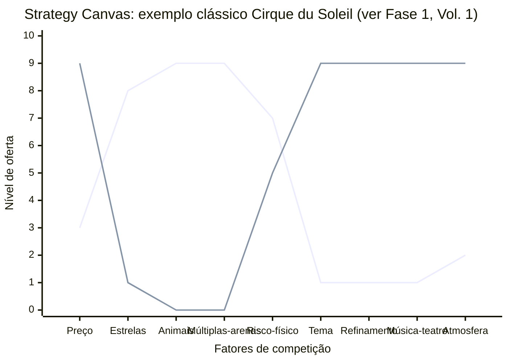

No diagrama clássico acima (retomado do framework da Fase 1, no Volume 1, apenas para ilustrar a leitura visual dos eixos antes do caso brasileiro da Stone), a primeira linha representa o circo tradicional (alto custo em astros individuais, animais e múltiplos picadeiros), enquanto a segunda linha mostra como o Cirque du Soleil eliminou esses elementos para elevar tema artístico, música original e ambientação teatral. Onde as duas curvas se afastam, nasce a diferenciação. Onde se sobrepõem, há disputa pelo mesmo padrão.

A análise associada é o **ERRC Grid**: quatro decisões estratégicas para mover a curva:

- **Eliminar (*Eliminate*)**: quais fatores que o setor trata como obrigatórios podem ser totalmente eliminados?
- **Reduzir (*Reduce*)**: quais fatores podem ser reduzidos bem abaixo do padrão do setor?
- **Elevar (*Raise*)**: quais fatores devem ser elevados bem acima do padrão do setor?
- **Criar (*Create*)**: quais fatores nunca oferecidos pelo setor podem ser criados?

##### O momento exato de colocar este canvas na parede

Use o Strategy Canvas na Fase 6 (mapeamento de mercado e concorrência) quando o setor parecer saturado e você precisar decidir onde divergir do padrão dos incumbentes. Repita o exercício a cada 12 a 18 meses como auditoria estratégica, pois os rivais tendem a copiar sua curva ao longo do tempo, e retome a ferramenta na Fase 19 (reinvenção e segunda curva, no Volume 9).

##### Princípios práticos para preencher sem se enganar

A tese de Kim e Mauborgne é que competição direta é desperdício de capital. Se duas empresas oferecem o mesmo conjunto de fatores em níveis ligeiramente diferentes, elas brigam por margem cada vez menor. A saída é mudar o jogo, não jogar melhor o mesmo jogo. Para isso, é preciso mapear honestamente o que o setor compete (a maioria não articula explicitamente) e identificar onde você pode oferecer perfil radicalmente distinto. Diferenciação + Custo Baixo simultâneos é possível quando você elimina/reduz fatores caros e cria fatores baratos mas valiosos.

##### Passo a passo na parede da sala (roteiro de oficina colaborativa)

**Etapa 1: Mapear o setor atual.** Liste os 8-15 fatores em que os concorrentes competem. Pergunte: o que o cliente compara antes de comprar? O que aparece nas propagandas? O que aparece nas reviews? Tipicamente: preço, qualidade, marca, conveniência, suporte, customização, velocidade, escala. Seja específico ao seu setor.

**Etapa 2: Traçar curvas dos concorrentes.** Para cada concorrente principal (3-5), atribua nota 1-10 em cada fator e desenhe a linha. Use dados reais (preço de tabela, NPS, share, reviews) quando disponível.

**Etapa 3: Aplicar ERRC Grid.** Para cada fator, decida: eliminar, reduzir, elevar, criar. Articule por que (qual job-to-be-done deixa de ser servido vs qual passa a ser).

**Etapa 4: Traçar a curva nova.** A sua curva deve ser visualmente distinta das curvas dos concorrentes. Se ela sobrepõe a média do setor com pequeno offset, não é Blue Ocean: é apenas otimização de Red Ocean.

**Etapa 5: Validar com cliente.** Mostre as curvas para clientes-alvo. Pergunte: "Se essas duas opções existissem, qual escolheria? Por quê?". Se a resposta é "depende", a diferenciação não é forte o suficiente.

Tempo: 4 a 8 horas para a primeira versão (exige pesquisa de campo sobre os concorrentes). Revisar a cada 12 a 18 meses.

##### Exemplo brasileiro preenchido: Stone vs. adquirentes tradicionais (2014-2018, reconstrução didática com base no prospecto F-1 de 2018)

Em 2014, o setor brasileiro de adquirência (Cielo, Rede, Stone nascente) competia em fatores tipicamente bancários: preço de MDR (taxa por transação), aluguel de máquina, prazo de antecipação, marca, capilaridade. Stone construiu sua curva de valor diferente:

| Fator | Cielo / Rede (média do setor) | Stone (entrante 2014) | Decisão ERRC |
|---|---|---|---|
| Transparência e competitividade no MDR | Tabela opaca com tarifas acessórias difíceis de auditar | Preço competitivo e extrato claro por transação | Raise (transparência) |
| Dependência de aluguel rígido de terminal | Cobrança mensal padronizada sem flexibilidade | Isenção condicional por volume ou pacote integrado (no F-1 de 2018, aluguel e assinatura somavam 13,7% da receita) | Reduce (rigidez) |
| Agilidade na gestão de recebíveis | Repasse padrão lento (D+30) e antecipação burocrática | Antecipação ágil contratada direto nos canais digitais ou com o agente local | Raise |
| Atendimento telefônico ao lojista | Call center terceirizado com filas longas e scripts rígidos | Equipe própria de relacionamento que atende o telefone em até 5 segundos (conforme prospecto F-1 de 2018) | Raise |
| Presença hiperlocal (*Stone Hubs*) | Gerente bancário generalista distante da rotina da loja | Polos operacionais locais (*Stone Hubs*, quase 180 em junho de 2018) com agentes próprios em campo (*Green Angels*) | Create |
| Suporte técnico e logística de terminais | Terceirizado e lento (vários dias úteis para troca) | Logística própria a partir dos *Stone Hubs* para instalação e substituição presencial rápida | Raise |
| Conciliação e ferramentas para PMEs | Extratos bancários fragmentados | Portal de conciliação simplificada para o lojista (ampliado anos depois com aquisições de software como a Linx em 2020) | Create |
| Marca corporativa-bancária | Alta | Baixa (mas crescente) | Reduce |

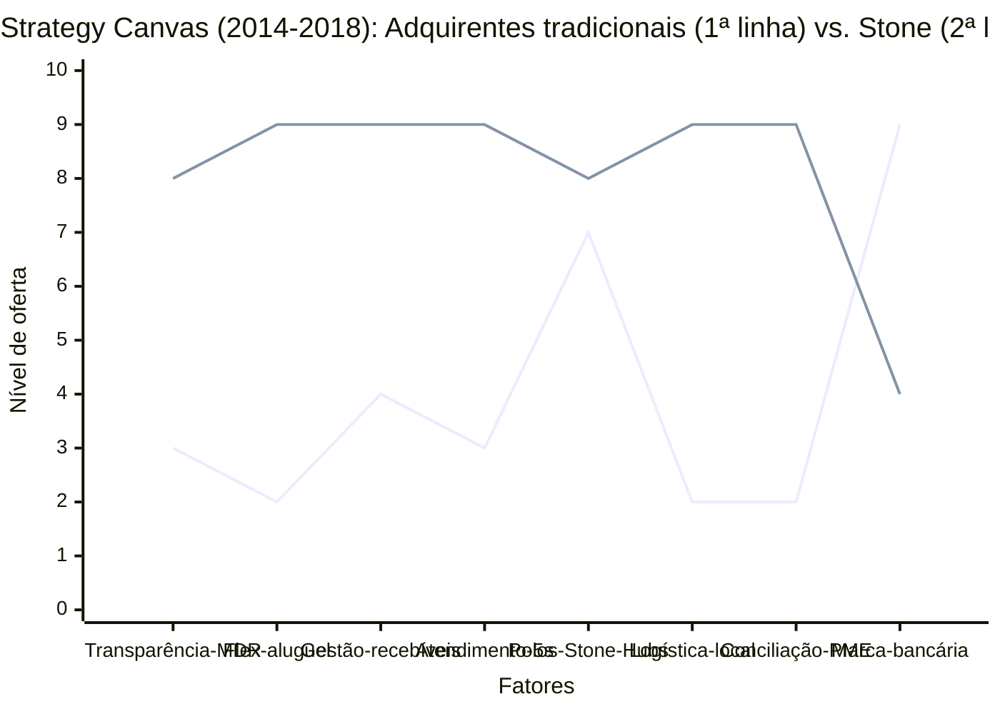

A Stone também praticou taxas competitivas para destravar a troca, mas o que separou a sua curva de valor da média dos grandes adquirentes bancários foi o modelo operacional hiperlocal documentado no prospecto do seu IPO na Nasdaq em 2018 (formulário F-1): em vez de depender de agências bancárias generalistas e centrais terceirizadas de atendimento, a companhia implantou polos operacionais próprios em cada praça (*Stone Hubs*, que somavam quase 180 unidades em meados de 2018), colocou consultores e técnicos próprios nas ruas (*Green Angels*) e estruturou uma central interna capaz de atender o lojista em até cinco segundos. O comerciante de médio e pequeno porte via na operação um parceiro próximo que resolvia falhas de máquina e dúvidas de conciliação no mesmo dia, validando uma curva de valor nitidamente distinta no gráfico.

##### Variações e extensões

- **Pioneer-Migrator-Settler Map**: classifica produtos do portfólio em pioneiros (alta diferenciação, alta margem), migradores (alguma diferenciação) e colonos (commodity). Útil para gestão de portfólio.
- **Six Paths Framework**: seis lentes para identificar Blue Ocean (indústria alternativa, grupos estratégicos, cadeia de compradores, oferta complementar, apelo emocional vs funcional, tendências de tempo).
- **Buyer Utility Map**: cruza ciclo de uso do cliente com seis utilidades (produtividade, simplicidade, conveniência, risco, diversão, sustentabilidade).

##### Onde os fundadores mentem para si mesmos neste canvas

- Listar fatores genéricos (preço, qualidade) em vez de fatores específicos do setor.
- Curva nova "ligeiramente acima" da média do setor: isso é otimização, não Blue Ocean.
- Eliminar/reduzir fatores que clientes ainda valorizam: pesquisar antes, não decidir no escritório.
- Confundir Strategy Canvas com posicionamento de marketing: é estratégia operacional (o que construir), não slogan.
- Não validar a curva nova com cliente antes de comprometer recursos: Blue Ocean teórico que ninguém prefere é apenas oceano vazio.

---

#### Canvas: Canvas da Cunha (autoral IGNIÇÃO)

##### Por que este quadro visual foi criado

O Canvas da Cunha é uma ferramenta autoral desenhada para startups brasileiras que precisam escolher um subsegmento de entrada estreito antes de escalar. A lógica de conquistar primeiro uma cabeça de praia (*beachhead*) em *Crossing the Chasm* (1991) e depois derrubar os pinos adjacentes na pista de boliche em *Inside the Tornado* (1995) vem de Geoffrey Moore, sendo reforçada pela tese de Peter Thiel (*Zero to One*, 2014) de começar dominando um mercado pequeno e específico antes de expandir. O quadro traduz essa estratégia em seis decisões operacionais sobre quem é o comprador inicial, qual fluxo quebrado será resolvido e como o ganho será medido. O Teste do Grupo de WhatsApp verifica se você consegue listar pelo nome de 100 a 300 primeiros clientes possíveis (partindo de um núcleo de 30 a 80 contatos diretos). É o critério prático que separa uma cunha acionável de um recorte vago. O formulário preenchível encontra-se em [[#Template: Canvas da Cunha|Template: Canvas da Cunha]].

##### A anatomia visual de uma página

Tela visual de uma página com seis blocos que definem a anatomia completa da cunha de entrada:

- **ICP (Ideal Customer Profile) preciso**: descrição objetiva em duas a três linhas do cliente inicial, como "sócios-operadores de redes de padarias artesanais com três a cinco lojas na Grande São Paulo e produção própria diária", em vez de um rótulo genérico como "PMEs do varejo".
- **Dor específica**: um único fluxo de trabalho recorrente e quebrado para esse ICP, como "perder de R$ 3 mil a R$ 8 mil mensais por loja com desperdício de insumos e gastar 4 a 8 horas por semana fechando pedidos manuais de reposição aos fornecedores".
- **Resultado mensurável**: como o comprador comprova que a solução funcionou, combinando categoria de valor (receita, custo, risco ou tempo) e meta numérica, como "reduzir o desperdício mensal em 60% a 80% e devolver 4 horas semanais ao sócio".
- **Dono do orçamento**: cargo e nível hierárquico de quem assina o cheque, não quem usa o produto.
- **Teste do Grupo de WhatsApp**: você consegue listar nominalmente de 100 a 300 potenciais primeiros clientes da cunha (com um núcleo imediato de 30 a 80 decisores que já conhece ou alcança diretamente)? Se sim, a cunha tem recorte acionável, se não, ajuste a especificidade.
- **Alternativa atual e vantagem**: o que o cliente faz hoje para resolver esse problema? Por que você é melhor, em uma frase com número?

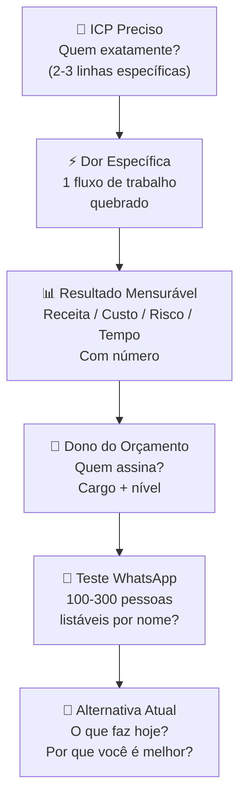

##### O momento exato de colocar este canvas na parede

Use o Canvas da Cunha na Fase 6 (mapeamento de mercado e concorrência) como entregável final antes de avançar para a Fase 7 (Volume 3). Sem ele preenchido e aprovado nos quatro critérios de validação da cunha (Teste de Precisão do Comprador, no máximo um sinal de escopo instável, cunha vendável sem depender de promessa de *roadmap* futuro e aprovação no Teste de Estresse da Cunha), a Fase 6 não está concluída. Retome a ferramenta também em momentos de reinvenção e segunda curva (Fase 19, no Volume 9).

##### Princípios práticos para preencher sem se enganar

Três princípios fundamentam o canvas:

**Primeiro: especificidade é vantagem competitiva, não limitação.** O instinto do fundador é ampliar o ICP ("não quero excluir potenciais clientes"). O canvas vai na direção oposta: quanto mais estreito o ICP, mais forte a proposta de valor, mais rápido o feedback de mercado, mais fácil a venda. Você não está excluindo clientes: está escolhendo *por onde entrar*. Escala vem depois.

**Segundo: a cunha é definida pela dor, não pelo produto.** O erro mais comum é definir a cunha pelo rótulo técnico do software ("somos um ERP para PMEs"). A cunha correta é definida pelo problema específico que você resolve para um comprador bem recortado ("somos a ferramenta que elimina a coleta manual de documentos fiscais em escritórios contábeis com 50 a 100 clientes no Simples Nacional"). O formato do produto pode evoluir com o aprendizado de campo, mas a dor específica permanece como âncora do negócio.

**Terceiro: o Teste do Grupo de WhatsApp é o critério de verdade.** Qualquer fundador consegue escrever "donos de PME com dificuldade em gestão" como público-alvo, mas poucos conseguem listar pelo nome de 100 a 300 decisores reais que atendam exatamente ao critério da cunha (partindo de um núcleo de 30 a 80 contatos diretos). O teste impõe disciplina empírica: se você não alcança o piso de 100 nomes identificáveis (ou se o recorte passa de milhares de empresas indistintas), a cunha ainda precisa de ajuste.

##### Passo a passo na parede da sala (roteiro de oficina colaborativa)

Preencha individualmente primeiro (20-30 min) e depois valide com pelo menos um cofundador ou mentor externo (30 min). Use o template completo do [[#Template: Canvas da Cunha|Template: Canvas da Cunha]].

**Sequência:**

1. **ICP**: descreva quem é o cliente em 2-3 linhas. Inclua: setor, porte, localização, critério operacional (tem delivery próprio, tem gerente de frota, tem mais de X clientes, etc.). Não use adjetivos vagos ("médias empresas"): use critérios objetivos.
2. **Dor específica**: escolha um fluxo de trabalho. Descreva o que está quebrado com verbos concretos ("gasta", "consolida manualmente", "perde"). Se você precisar de 3 frases, o ICP ainda é largo demais.
3. **Resultado mensurável**: escolha 1-2 categorias. Coloque um número. Se não tem o número, pergunte a 5 potenciais clientes antes de preencher o bloco.
4. **Dono do orçamento**: não é necessariamente quem usa o produto. Em B2B, frequentemente é um nível acima. Nomeie o cargo e o contexto hierárquico.
5. **Teste do Grupo de WhatsApp**: liste empresas e decisores reais com nome e sobrenome (via LinkedIn, associações setoriais, feiras ou indicações). A régua de aprovação exige mapear de 100 a 300 contatos nominais na cunha (onde 100 é o piso de especificidade e 300 o teto de largura inicial), contando com um núcleo imediato de 30 a 80 decisores que você já conhece ou acessa diretamente. Se não conseguir montar nem esse núcleo inicial, volte às entrevistas da Fase 5 antes de mexer no tamanho da cunha.
6. **Alternativa atual e vantagem**: descreva o que o cliente faz *hoje* (Excel, processo manual, concorrente, "não faz nada"). Escreva a vantagem em uma frase com número. Sem número, não é comparação: é afirmação vaga.

Após preencher os seis blocos, aplique as quatro verificações complementares do [[#Template: Canvas da Cunha|Template: Canvas da Cunha]] (no fim desta fase) antes de avançar.

##### Exemplo preenchido: PadariaPro (caso fictício recorrente do livro)

| Bloco | Conteúdo |
|---|---|
| **ICP** | Sócios-operadores de pequenas redes de padarias artesanais com 3 a 5 lojas na Grande São Paulo (alinhado ao recorte refinado nas Fases 4 e 5 e na seção anterior), com produção própria diária e faturamento de R$ 100 mil a R$ 300 mil/mês por loja. Excluir: padarias de loja única, redes industriais acima de 10 lojas e franquias padronizadas. |
| **Dor específica** | Perda de R$ 3 mil a R$ 8 mil mensais por loja com desperdício de insumos perecíveis e ruptura de estoque, somada a 4 a 8 horas semanais do sócio gastas fechando pedidos manuais de reposição aos fornecedores via planilha e mensagens de WhatsApp. |
| **Resultado mensurável** | Meta de reduzir o desperdício mensal de insumos em 60% a 80% (custo) e devolver 4 horas semanais ao sócio-operador (tempo) por meio de previsão de demanda e pedido automático aos moinhos (a validar em piloto de 60 dias na Fase 8). |
| **Dono do orçamento** | O próprio dono ou sócia operacional: em padarias dessa faixa, não há gestor intermediário, quem sofre o problema é quem paga. |
| **Teste do WhatsApp** | A partir das cerca de 400 pequenas redes artesanais estimadas na Grande São Paulo, os fundadores listaram nominalmente **180 redes específicas** (aprovado na faixa de 100 a 300 da cunha), contando com um núcleo inicial de **27 sócios-operadores** já mapeados com contato direto (12 diretos e 15 via associação regional ABIP), em evolução rumo à faixa de 30 a 80 do núcleo. |
| **Alternativa atual** | Planilha de Excel combinada a pedidos manuais por WhatsApp aos vendedores dos moinhos. Por que é melhor: "Corta de 60% a 80% de uma perda mensal de R$ 3 mil a R$ 8 mil por loja e devolve 4 horas por semana ao sócio por uma mensalidade de R$ 400 por loja (R$ 1.200 a R$ 2.000 na rede de 3 a 5 unidades)." |

O bloco mais trabalhoso foi a Dor específica: a primeira versão dizia apenas "dificuldade na gestão de compras da padaria". Com um enunciado genérico assim, montar a lista nominal seria inviável. Ao especificar "redes de 3 a 5 lojas com produção própria que perdem R$ 3 mil a R$ 8 mil/mês em insumos e fecham pedidos manualmente toda semana", o critério de inclusão ficou observável em feiras da ABIP e nas conversas com fornecedores de farinha. O Teste do Grupo de WhatsApp mede a especificidade da dor tanto quanto o tamanho do nicho: quando você trava para montar a lista, o problema ainda está descrito de forma vaga.

##### Variações e extensões

- **Canvas da Cunha para B2C**: versão adaptada onde "Dono do orçamento" é substituído por "Contexto de decisão de compra" (impulso, pesquisa, influência social): em B2C o comprador e o usuário são o mesmo.
- **Canvas da Segunda Cunha**: para empresas em escala que querem atacar um novo segmento com o produto existente: mesma estrutura mas com bloco adicional "Vantagem incumbente" (o que a empresa já tem que facilita a entrada neste segmento vs. novo entrante).

---

#### Canvas: Network Effects Map

##### Por que este quadro visual foi criado

Como vimos na seção do framework da NFX nesta mesma fase, a taxonomia sistematizada por James Currier, Stan Chudnovsky, Gigi Levy-Weiss e Pete Flint classifica os efeitos de rede conforme o seu mecanismo e grau de defesa estrutural. O Network Effects Map converte essa classificação em um quadro visual de pontuação para diagnosticar quais elos de retenção o seu modelo realmente captura no mercado brasileiro.

##### A anatomia visual de uma página

Tela visual que mapeia quais tipos de efeitos de rede um modelo de negócio captura, com que força, e como eles interagem. O objetivo não é apenas identificar "tem efeito de rede": é entender qual tipo, qual a força relativa, e onde está o loop de reforço que torna o modelo defensável.

**Os tipos principais de efeitos de rede (síntese da taxonomia NFX):**

| Tipo | Mecanismo | Exemplos | Escala no Canvas (0 a 2) |
|---|---|---|---|
| **Direto (Physical / Protocol / Personal / Market Network)** | Cada usuário adicional aumenta diretamente o valor para os demais nós da rede | WhatsApp, LinkedIn, HoneyBook | **2 (forte)** (●●●●●) |
| **Two-sided (Marketplace)** | Dois grupos distintos se beneficiam mutuamente (compradores e vendedores) | iFood, Mercado Livre | **2 (forte)** (●●●●○) |
| **Platform** | Desenvolvedores externos criam aplicativos e extensões para os usuários | iOS App Store, Salesforce AppExchange | **2 (forte)** (●●●●○) |
| **Data** | Mais uso gera dados que melhoram automaticamente a entrega do produto | Google Search, Waze | **1 a 2 (moderado a forte)** (●●●●○) |
| **Tech Performance** | Mais nós conectados deixam a infraestrutura mais rápida ou eficiente | Cloudflare, redes P2P | **1 (moderado)** (●●●○○) |
| **Language** | A marca vira vocabulário padrão da categoria no cotidiano | Google, Xerox | **1 (moderado)** (●●●○○) |
| **Belief (crença coletiva)** | Valor sustentado pela adesão compartilhada ao ativo | Ouro, criptoativos | **0 a 1 (emergente)** (●●○○○) |
| **Bandwagon (efeito manada)** | Pressão social imediata para adotar o que os pares estão usando | Zoom em 2020, tendências virais | **0 a 1 (emergente)** (●●○○○) |

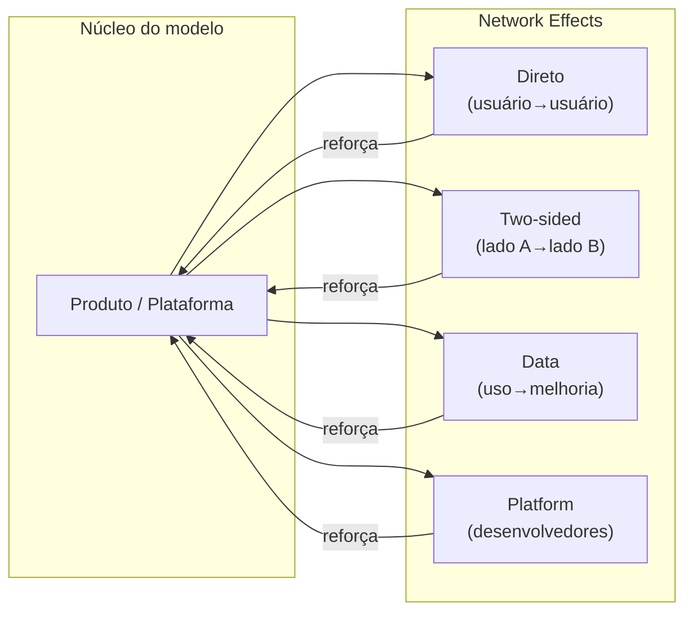

##### O momento exato de colocar este canvas na parede

Use o Network Effects Map em dois momentos: (1) ao desenhar a teoria do modelo de negócio (Fase 3, no Volume 1) e ao validar as suas métricas operacionais (Fase 12, no Volume 4), para identificar se e onde há elos de rede que podem ser construídos intencionalmente, e (2) ao preparar a tese para investidores, sabendo nomear e demonstrar com precisão qual tipo de efeito de rede sustenta a defesa do seu negócio.

##### Princípios práticos para preencher sem se enganar

**Primeiro: a maioria das startups não tem efeito de rede, tem economias de escala.** "Quanto mais clientes, mais barato o custo unitário" é escala, não NE. Efeito de rede requer que um usuário adicional torne o produto melhor para os outros. Confundir os dois é erro comum de pitch.

**Segundo: NE two-sided são os mais comuns e os mais frágeis no início.** Marketplace sem compradores não atrai vendedores, e vice-versa. O chicken-and-egg problem é o desafio central de modelos two-sided. A solução geralmente é subsidiar um lado temporariamente (iFood subsidiou entregadores, Mercado Livre não cobrou comissão dos primeiros vendedores).

**Terceiro: efeitos de rede de dados costumam ser superestimados.** Como alertamos na seção do framework NFX, acumular mais dados só gera barreira competitiva real quando o volume adicional melhora o produto de forma automática, contínua e perceptível para o usuário antes de atingir assíntota.

##### Passo a passo na parede da sala (roteiro de oficina colaborativa)

**Passo 1: Listar e pontuar os efeitos de rede candidatos:** Para cada tipo na tabela acima, pergunte "nosso modelo captura este mecanismo?" e atribua nota 0 (ausente), 1 (fraco ou emergente) ou 2 (forte e comprovado).

**Passo 2: Mapear os loops:** Para cada NE identificado com score ≥ 1, desenhar o loop de reforço: Produto → [mecanismo] → mais usuários/dados → produto melhor.

**Passo 3: Identificar o NE dominante:** Qual é o loop mais forte? Qual é o que mais diferencia o modelo de um produto sem NE? Esse é o NE a comunicar para investidores e a proteger como moat.

**Passo 4: Identificar onde o NE ainda não existe:** Quais tipos poderiam ser construídos com mudanças de produto? Um SaaS B2B sem NE pode criar NE de dados (analytics de benchmark) ou NE de plataforma (marketplace de integrações).

##### Exemplo brasileiro preenchido: iFood (reconstrução didática com base em dados públicos)

| Tipo de efeito de rede | Pontuação (0 a 2) | Mecanismo operacional |
|---|---|---|
| Two-sided (restaurante ↔ consumidor) | **2 (forte)** | Mais restaurantes = mais opções = mais pedidos = mais receita para os restaurantes = mais restaurantes |
| Two-sided (consumidor ↔ entregador) | **1 (moderado)** | Mais pedidos = mais entregadores ativos = menor tempo de entrega = mais pedidos (exposto a *multi-homing*) |
| Data | **1 (moderado)** | Histórico de pedidos calibra a recomendação de vitrine e a estimativa de tempo de entrega por bairro |
| Bandwagon | **1 (emergente)** | Hábito social de buscar primeiro no aplicativo líder da praça |
| **Efeito de rede dominante** | **Síntese (nota 2)** | Marketplace de dois lados (restaurante ↔ consumidor) ancorado em densidade geográfica por praça |

O efeito de rede mais forte do iFood não está isolado nos algoritmos de dados, mas na densidade geográfica de dois lados entre restaurantes e consumidores: quem reúne mais restaurantes ativos em cada bairro atrai mais pedidos e dilui o custo logístico por rota. Foi essa física de rede local que levou a empresa a investir pesado no credenciamento comercial de restaurantes praça a praça, mesmo aceitando margens comprimidas no curto prazo até consolidar a liderança nacional.

##### Onde os fundadores mentem para si mesmos neste canvas

- Chamar escala de efeito de rede: confunde o time e o investidor.
- Ter NE two-sided fraco no início e não subsidiar o lado correto.
- Ignorar NE de dados enquanto constrói produto: os dados de hoje são o moat de amanhã.
- Subestimar o chicken-and-egg: lançar em muitas cidades ao mesmo tempo dilui o NE two-sided, melhor dominar uma cidade completamente antes de expandir.

---

### TEMPLATES OPERACIONAIS E CASOS PREENCHIDOS DESTA FASE (FASE 6)

#### Template: Teste de Precisão do Comprador (3 critérios obrigatórios)

Use este template para validar o elemento #4 da Anatomia da Cunha (Dono do Orçamento) antes de avançar para a [[IGNICAO-Vol-3-Experimentos-e-Prototipagem#FASE 7: FORMULAÇÃO RIGOROSA DE HIPÓTESES|Fase 7 (Vol. 3)]]. É um exercício de 10 a 15 minutos. Se demorar mais que isso, o próprio atraso já é o diagnóstico.

```text
TESTE DE PRECISÃO DO COMPRADOR, v___ Data: ___/___/___

A FRASE QUE NÃO DEVE TRAVAR:

"Nós vendemos para [CARGO] em [TIPO DE EMPRESA] porque essa pessoa
é responsável por [RESULTADO ESPECÍFICO] e controla
[ORÇAMENTO ESPECÍFICO]."

MINHA VERSÃO:

CARGO (nominal, existente no organograma do cliente):
___________________________________________________________

TIPO DE EMPRESA (tamanho + setor + segmento):
___________________________________________________________

RESULTADO ESPECÍFICO (pelo qual esse cargo responde):
___________________________________________________________

ORÇAMENTO ESPECÍFICO (rubrica + faixa de valor):
___________________________________________________________

CRITÉRIOS DE APROVAÇÃO (os 3 critérios obrigatórios abaixo precisam passar. Use as 6 perguntas do exemplo da seção como checklist complementar de acesso):

[ ] (1) Frase escrita em menos de 30 segundos, sem rascunhar
 variações para audiências diferentes.

[ ] (2) Cargo é REAL e existente no organograma típico do ICP
 (não usar "decisor", "stakeholder", "gestor", "líder").

[ ] (3) Orçamento é RUBRICA EXISTENTE no cliente
 (não criar rubrica nova para comprar de você:
 rubricas novas alongam em várias vezes o ciclo de decisão).

SE REPROVOU:

Qual item travou? __________________________________________

Hipótese sobre o motivo
(ex.: venda depende de múltiplos papéis, ICP ainda misturado,
comprador econômico não conhecido, produto exige nova rubrica):
___________________________________________________________
___________________________________________________________

Próxima ação
(voltar às entrevistas da Fase 5 com foco em qual pergunta específica?):
___________________________________________________________

CHECK DE SEPARAÇÃO DE PAPÉIS (B2B):

No meu contexto, Usuário, Campeão Interno e Comprador
Econômico são:

[ ] A mesma pessoa (contexto B2C ou SMB muito pequeno).
[ ] Duas pessoas distintas, especifique:
 Usuário/Campeão: ___________________________
 Comprador Econômico: ___________________________
[ ] Três pessoas distintas, especifique cada uma:
 Usuário: ___________________________
 Campeão Interno: ___________________________
 Comprador Econômico: ___________________________

VALIDAÇÃO EXTERNA:

Três pessoas independentes que conseguiram repetir a frase
sem ajuste e a consideraram plausível para o ICP:

1) _______________________ Data: ___/___/___
2) _______________________ Data: ___/___/___
3) _______________________ Data: ___/___/___
```

**Observação sobre o Teste de Precisão do Comprador**: reprovar nesta verificação quase nunca significa que a tese inteira seja inviável, indica apenas que a pesquisa de usuário da [[#FASE 5: PESQUISA COM USUÁRIOS (CUSTOMER DISCOVERY)|Fase 5]] ficou centrada em quem usa o produto e não em quem paga pelo produto. Em B2B, são quase sempre pessoas diferentes, e essa diferença é o motivo mais comum de ciclo de venda travado. Reprovação aqui é um presente: revela a lacuna antes dela custar meses de vendas fracassadas.

---

#### Template: Canvas da Cunha

Use este template como entregável final da Fase 6.

> [!note] Teoria completa em [[#Canvas: Canvas da Cunha (autoral IGNIÇÃO)|Canvas: Canvas da Cunha (autoral IGNIÇÃO)]]
> Origem, estrutura, princípios, como aplicar e caso brasileiro do Canvas da Cunha encontram-se em [[#Canvas: Canvas da Cunha (autoral IGNIÇÃO)|Canvas: Canvas da Cunha (autoral IGNIÇÃO)]]. Este template é o complemento prático (campos preencháveis) daquela seção. Ele consolida os quatro elementos da Anatomia da Cunha, o Teste do Grupo de WhatsApp e a comparação com a alternativa atual. Preencha antes de avançar para a [[IGNICAO-Vol-3-Experimentos-e-Prototipagem#FASE 7: FORMULAÇÃO RIGOROSA DE HIPÓTESES|Fase 7 (Vol. 3)]]. Sem ele, as hipóteses da fase seguinte ficam sem ancoragem no subsegmento específico que você escolheu atacar.

```text
CANVAS DA CUNHA, v___ Data: ___/___/___

ICP (preciso): _______________________________________
 _______________________________________

Dor específica: _______________________________________
(1 fluxo de trabalho) _______________________________________

Resultado mensurável: _____________________________________
(escolha 1-2 categorias: receita / custo / risco / tempo)
Métrica do resultado: _____________________________________
(ex.: "reduz de 4h para 15min por semana")

Dono do orçamento: _______________________________________
(cargo + nível hierárquico)

Teste do grupo de WhatsApp:
Quantas pessoas específicas eu consigo listar nominalmente
como potenciais primeiros clientes? _____
[ ] Cunha aprovada (100 a 300 decisores listáveis, com núcleo inicial de 30 a 80 contatos diretos).
[ ] Cunha muito larga (refinar).

Alternativa atual (o que o cliente faz hoje):
___________________________________________________________

Por que eu sou melhor do que a alternativa atual
(em 1 frase, com número se possível):
___________________________________________________________

VERIFICAÇÕES COMPLEMENTARES (OS 4 CRITÉRIOS DE VALIDAÇÃO DA CUNHA):

[ ] (1) Teste de Precisão do Comprador (template anterior nesta seção) aprovado nos 3 critérios obrigatórios (e em ao menos 4 das 6 perguntas do checklist complementar).
[ ] (2) Nenhum ou no máximo 1 dos 4 sinais de escopo instável presentes.
[ ] (3) Cunha vendável de forma autônoma hoje, sem depender de promessa de plataforma ou roadmap futuro.
[ ] (4) Teste de Estresse da Cunha (Passo 11: 4 linhas + 2 perguntas-faca) aprovado sem travar.

VALIDAÇÃO EXTERNA:

Três pessoas independentes (mentor, cliente-alvo, investidor)
que confirmaram a Cunha como plausível e bem definida:

1) _______________________ Data: ___/___/___
2) _______________________ Data: ___/___/___
3) _______________________ Data: ___/___/___
```

**Observação sobre o Canvas da Cunha**: o quadro sozinho vira papel na gaveta se não passar pelos quatro critérios de validação acima (Precisão do Comprador, no máximo um sinal de escopo instável, cunha vendável sem depender de *roadmap* futuro e aprovação no Teste de Estresse da Cunha). Canvas preenchido e aprovado nos quatro critérios autoriza o avanço para a [[IGNICAO-Vol-3-Experimentos-e-Prototipagem#FASE 7: FORMULAÇÃO RIGOROSA DE HIPÓTESES|Fase 7 (Vol. 3)]], se qualquer item reprovar, refine o recorte antes de seguir.

---

### Fechamento da Fase 6: do mapeamento competitivo à escolha da cunha de entrada

A Fase 6 desmonta duas ilusões recorrentes de quem se apaixona pela própria solução: acreditar que "não existem concorrentes" e confiar que "basta capturar uma fração de um mercado gigante". Na rua, o orçamento do seu cliente já está disputado por alternativas diretas, planilhas improvisadas, mudanças de processo ou pela simples inércia de não fazer nada, além de gigantes adjacentes e barreiras regulatórias que punem quem entra às cegas. Foi ao trocar a fantasia do "1% do PIB do agro" pela lista nominal das usinas de etanol de milho no Mato Grosso e no Paraná (assim como os fundadores da PadariaPro fizeram ao focar nas redes artesanais de três a cinco lojas em São Paulo) que Henrique transformou um discurso vago em uma cabeça de praia comercialmente acionável.

O entregável é o Dossiê de Mercado mais o Canvas da Cunha preenchido. O Dossiê não é estático. O mercado muda, novos entrantes aparecem, consolidações acontecem, regulação evolui. Revisitar pelo menos a cada seis meses não é exagero, é higiene. A [[IGNICAO-Vol-3-Experimentos-e-Prototipagem#FASE 7: FORMULAÇÃO RIGOROSA DE HIPÓTESES|Fase 7 (Vol. 3)]] vai transformar o mapeamento feito aqui em hipóteses testáveis: o Canvas da Cunha vira insumo direto para o Banco de Hipóteses.

---

### Ponte para os Capítulos 1 a 3 deste Volume (e preparação para o Volume 3)

Ao concluir as Fases 4, 5 e 6 deste Volume 2, você investigou a dor do cliente sem perguntas indutivas (*Mom Test*), mapeou os trabalhos a executar (*Jobs to Be Done*) e a jornada real de decisão, e delimitou a estrutura competitiva e a sua cunha de entrada (*wedge*). Os três capítulos a seguir aprofundam lentes transversais indispensáveis para operar no Brasil: a psicologia de confiança e conversão do consumidor brasileiro (Capítulo 1), a inteligência competitiva contínua aliada ao *Category Design* (Capítulo 2) e os padrões reais de fracasso de startups brasileiras (Capítulo 3).

Logo após o fechamento do Capítulo 3, você encontrará a ponte direta para o Volume 3 (Hipóteses, Experimentos, Prototipagem e Modelos de Negócio), onde o Dossiê do Usuário e o Canvas da Cunha serão convertidos em hipóteses falseáveis e experimentos de compromisso na [[IGNICAO-Vol-3-Experimentos-e-Prototipagem#FASE 7: FORMULAÇÃO RIGOROSA DE HIPÓTESES|Fase 7: Formulação Rigorosa de Hipóteses (Vol. 3)]].

---

# CONSUMIDOR BRASILEIRO, INTELIGÊNCIA COMPETITIVA E DESIGN DE CATEGORIA (CAPÍTULOS 1 A 3)

Você não descobre um cliente nem posiciona uma empresa no vácuo cultural: um comprador no Brasil decide de forma completamente diferente de um comprador no Vale do Silício. Os capítulos a seguir dissecam a psicologia de confiança e conversão do comprador brasileiro, a inteligência competitiva combinada à criação de categoria (*Category Design*) e as lições reais de empresas brasileiras que ignoraram a gravidade do mercado.

---

## CAPÍTULO 1: PSICOLOGIA DO CONSUMIDOR BRASILEIRO: COMPORTAMENTO, DECISÃO E CONVERSÃO

### O paradoxo da desconfiança cordial: como o brasileiro realmente compra

Meses depois dos primeiros testes em campo, quando Rafael e Bia lançaram a frente D2C da sua marca a partir de Recife e do centro de distribuição em Goiânia, eles importaram o funil exato que tinham visto em um curso americano de Growth: página minimalista sem telefone visível, checkout automático em etapa única apenas para cartão de crédito internacional e suporte exclusivo por tíquete de e-mail com SLA de 48 horas. No primeiro mês, gastaram R$ 30 mil em tráfego pago. O carrinho teve 1.400 adições e apenas 11 vendas concluídas.

Desesperada, Bia colocou um botão flutuante de WhatsApp na página de pagamento na sexta-feira à noite. Em duas horas, o celular dela apitou sessenta vezes.

Os áudios repetiam sempre as mesmas três perguntas: "Moça, essa loja existe mesmo ou é golpe? Tem desconto no Pix ou parcela em 10x sem juros? Se der problema na entrega, eu falo com uma pessoa de verdade?"

Bem-vindo à realidade tropical que nenhum manual da Califórnia ensina. O consumidor e o comprador corporativo no país operam sob o Paradoxo da Desconfiança Cordial: o brasileiro costuma ser caloroso e receptivo no primeiro contato, mas fica desconfiado na hora de pagar. Essa cautela é resposta racional a um ambiente histórico de golpes digitais diários, juros do rotativo do cartão de crédito que seguiram acima de 400% ao ano nas séries do Banco Central (mesmo após a Lei 14.690/2023 limitar, desde janeiro de 2024, a soma de juros e encargos a 100% da dívida original) e medo permanente de ficar desamparado após o pagamento.

Tentar vender no Brasil copiando a frieza transacional dos Estados Unidos é queimar caixa em vão. Aqui, o WhatsApp funciona como o sistema operacional da confiança comercial. Aqui, a parcela que cabe no fluxo de caixa mensal da família ou do departamento pesa tanto quanto o preço cheio. E no B2B brasileiro, ninguém assina um contrato relevante apenas porque o software exibe um painel bonito: o gestor precisa ter certeza de que não será demitido se a sua startup falhar na implantação. Compreender a psicologia econômica do brasileiro transforma essa barreira cultural em vantagem competitiva.

---

> [!note] Para quem é este capítulo
> Fundadores e líderes de produto, marketing e *growth* que constroem para o mercado brasileiro e precisam entender os mecanismos psicológicos pelos quais o comprador decide, confia, paga e cancela. Aplica-se a operações B2C e B2B.

> [!important] Cultura não é estereótipo
> Este capítulo reúne padrões recorrentes observados em campo e em levantamentos de mercado (como séries do Banco Central, relatórios da CNDL/SPC Brasil, Instituto Locomotiva e Reclame Aqui). Trate cada padrão como hipótese a testar com o seu próprio cliente. Padrões não eliminam variação individual. Use como lente de análise, não como lista de pressupostos sobre cada cliente específico.

---

### 1.1: O que torna o consumidor brasileiro distinto (e o que os áudios de Rafael e Bia revelaram)

A psicologia do consumidor brasileiro opera em um contexto que moldou comportamentos próprios. As três perguntas que destravaram o carrinho de Rafael e Bia na cena de abertura sintetizam exatamente essa estrutura: o pedido de prova de que a loja existe reflete a prioridade dada às pessoas acima das instituições (1.1.1 e 1.1.2). A dúvida sobre desconto no Pix ou parcelamento em 10x traduz a sensibilidade a preço combinada à âncora da parcela mensal (1.1.3 e 1.2.1), e o receio de não encontrar um atendente real na entrega expõe o peso da assistência humana para superar o Paradoxo da Desconfiança Cordial (1.5).

#### 1.1.1: Alta relacionalidade

No Brasil, a relação pessoal precede a transação comercial de modo muito mais acentuado do que em mercados de baixa contextualização como os Estados Unidos e o norte da Europa (como analisa Erin Meyer em *The Culture Map*, 2014). Isso se manifesta em:

B2B: Compradores brasileiros raramente fecham contratos com quem não conhecem pessoalmente, ou com quem não foi apresentado por alguém de confiança. O ciclo de vendas inclui uma fase implícita de construção de relacionamento que não aparece no funil formal mas é determinante para o fechamento.

B2C: A recomendação de pessoa conhecida (boca a boca, mensagem no WhatsApp, comentário em grupo familiar) supera campanhas de publicidade na capacidade de gerar confiança e reduzir resistência à compra.

Consequência direta no desenho do produto: recursos que facilitam a indicação pessoal (programa de recomendação, avaliações verificadas e compartilhamento direto pelo WhatsApp) costumam reduzir o atrito de aquisição com mais eficiência no Brasil do que em mercados onde a confiança institucional já é elevada.

#### 1.1.2: Confiança em pessoas acima de instituições

Décadas de instabilidade econômica, episódios de confisco, e falhas institucionais criaram um consumidor que confia mais em pessoas específicas do que em marcas ou organizações abstratas.

Um banco com trinta anos de mercado pode ser percebido como menos confiável do que um gerente específico que esse banco tem. Um e-commerce desconhecido pode ser percebido como confiável se o produto veio recomendado por alguém de confiança.

Isso explica a força dos criadores de conteúdo locais: o efeito comercial nasce da transferência de confiança pessoal para o produto ou marca. Influenciadores de nicho com audiências menores e mais engajadas costumam converter melhor do que celebridades generalistas porque a relação de proximidade com o público é mais direta.

#### 1.1.3: Sensibilidade a preço combinada com aspiração social

O consumidor brasileiro tem alta sensibilidade ao preço absoluto e ao preço relativo, mas isso não significa que compra apenas o mais barato. A equação psicológica é: "posso pagar isso?" combinado com "isso me faz sentir como quero me sentir?".

Um produto mais caro que o do concorrente, mas que comunica pertencimento, qualidade ou ascensão social, pode conquistar a preferência mesmo em faixas de renda mais enxutas. O aparelho celular *premium* parcelado em doze vezes na praça de alimentação de um shopping popular ilustra essa combinação de cálculo orçamentário e aspiração.

A aspiração social no Brasil é motor de consumo mais poderoso do que em sociedades com menor mobilidade social percebida. O consumidor que "chegou lá" ou que está "chegando lá" usa o consumo como sinalização.

#### 1.1.4: O "jeitinho" como forma de agência

O "jeitinho brasileiro" é frequentemente descrito como improviso ou contorno de regras. Na perspectiva de comportamento do consumidor, é mais precisamente uma forma de agência em contexto de restrição: quando o caminho formal não funciona, o consumidor brasileiro encontra o caminho alternativo.

No desenho do produto, fluxos excessivamente rígidos que não admitem contorno prático costumam gerar abandono. Soluções que oferecem margem de adaptação (como vencimento ajustável, composição flexível de pagamento ou atendimento capaz de tratar exceções legítimas) retêm melhor: o cliente que resolve seu caso concreto dentro do sistema sente que a empresa opera ao lado dele.

---

### 1.2: Economia comportamental no Brasil

Os princípios da economia comportamental (*behavioral economics*) formulados por Daniel Kahneman e Richard Thaler valem em qualquer país, mas operam com pesos próprios no mercado brasileiro nas quatro dimensões analisadas a seguir.

#### 1.2.1: Ancoragem: 12x sem juros como âncora perceptual

O hábito histórico do parcelamento no Brasil criou uma âncora cognitiva específica: na decisão cotidiana, o comprador compara primeiro se a prestação mensal cabe no fluxo de caixa do mês, antes de avaliar o preço cheio acumulado (tema cujas regras de transparência e enquadramento detalharemos na seção 1.9.2).

Isso tem consequências diretas:

O preço percebido de um produto de R$1.200 parcelado em 12x sem juros pode ser menor do que o de um produto de R$600 à vista, quando o desembolso de R$ 600 de uma só vez estoura o fôlego mensal da família, enquanto a parcela de R$ 100 cabe no orçamento do mês.

Na precificação de software B2C ou SMB, apresentar o preço mensal primeiro (mesmo de plano anual) reduz resistência inicial. Mostrar "R$79/mês, cobrado anualmente" é psicologicamente diferente de "R$948/ano".

Em negociação B2B com PME, a pergunta "quanto você consegue comprometer por mês?" frequentemente desbloqueia negociações travadas em preço total.

#### 1.2.2: Viés de *status quo* e custo psicológico de troca

O consumidor brasileiro apresenta forte viés de *status quo* em serviços com vínculo operacional estabelecido, como banco principal, operadora móvel, plano de saúde ou sistema contábil. A inércia persiste porque mudar envolve esforço de migração, risco de erro e quebra de uma rotina já conhecida.

Para startups que desafiam incumbentes, o argumento de troca precisa vencer tanto a comparação funcional quanto o receio da mudança: a melhoria percebida precisa ser substancial, e não apenas incremental.

Táticas para reduzir o atrito da troca de fornecedor: "portabilidade garantida", "migração assistida", "não perde seus dados", "30 dias grátis sem cancelar o atual" reduzem o custo psicológico percebido de tentar.

#### 1.2.3: Efeito dotação (*endowment effect*)

Pelo efeito dotação (*endowment effect*), uma vez que o usuário configura um sistema com seus próprios dados e passa a senti-lo como parte do seu patrimônio operacional, o valor atribuído à ferramenta sobe. Isso torna períodos de teste gratuito (*free trials*) e modelos *freemium* especialmente eficazes quando o usuário constrói histórico real dentro do produto.

Por isso, durante o período de avaliação gratuita, mais importante do que trancar recursos é estimular o investimento ativo do cliente: histórico importado, alertas configurados, relatórios emitidos e integrações ativas elevam o efeito dotação e a taxa de conversão em assinatura paga.

#### 1.2.4: Reciprocidade como moeda social

A norma de reciprocidade opera com peso visível nas relações comerciais brasileiras. Quando uma empresa entrega ajuda concreta antes de cobrar, cria-se disposição genuína para retribuir na negociação:

Content marketing que genuinamente resolve problema antes de pedir compra: o usuário que recebeu valor gratuito sente reciprocidade implícita.

Atendimento excepcional que surpreende positivamente: o cliente que foi bem tratado em momento de problema frequentemente se torna evangelizador ativo.

Gesto personalizado em contratos B2B: uma nota escrita pelo fundador ou uma ligação direta de boas-vindas logo após a assinatura reforçam a confiança inicial com custo mínimo. Sobre brindes físicos: consulte sempre a política de *compliance* da empresa cliente, que costuma fixar teto estrito para presentes corporativos, e não ofereça presentes nem hospitalidade a agentes públicos (a Lei Anticorrupção, Lei 12.846/2013, pune a concessão de vantagem indevida a agente público, e as normas de ética da administração pública restringem severamente o recebimento de brindes).

---

### 1.3: Classes C, D e E como mercado principal

Segundo levantamentos do Instituto Locomotiva e séries socioeconômicas da FGV Social baseadas na PNAD Contínua (IBGE), as classes C, D e E reúnem mais de 70% da população brasileira (sendo cerca de metade na classe C) e respondem por parcela expressiva do consumo anual das famílias. Trata-se da base majoritária do mercado consumidor nacional, e não de um nicho periférico.

#### 1.3.1: Poder de compra real vs. percebido

O erro mais comum de fundadores oriundos das faixas de alta renda ao desenhar produtos para esse público é subestimar a maturidade digital do usuário e ignorar a restrição de margem de erro no orçamento mensal.

O Critério de Classificação Econômica Brasil da ABEP (que pontua posse de bens duráveis, escolaridade do responsável pelo domicílio e acesso a serviços públicos, estimando na referência de 2019 baseada na PNADC 2018 renda domiciliar média em torno de R$ 3.085 no estrato C1 e R$ 1.749 no C2) e os cortes por faixa de renda da FGV Social mostram um público altamente digitalizado. Segundo a pesquisa TIC Domicílios do CETIC.br, mais de 85% dos domicílios urbanos contam com acesso à internet, tendo o celular como principal e muitas vezes único dispositivo. Esses consumidores operam Pix e contas digitais diariamente, mas exigem aplicativos leves (que não consumam toda a franquia móvel) e mensalidades que caibam com previsibilidade no orçamento doméstico.

O que é diferente: a decisão de compra é mais deliberada porque a margem de erro financeiro é menor. O consumidor que ganha R$2.500 por mês e está comprometendo R$150 por mês em um produto está comprometendo 6% da renda. Qualquer dúvida sobre valor entregue resulta em cancelamento.

#### 1.3.2: Canais de confiança: recomendação supera publicidade

Para esse segmento, a hierarquia de confiança é:

1. Recomendação de familiar ou amigo próximo
2. Indicação de pessoa conhecida da comunidade (líder local, pastor, influenciador do bairro)
3. Avaliações de outros consumidores reais (estrelas no app, comentários no Reclame Aqui)
4. Publicidade de marca conhecida
5. Publicidade de marca desconhecida

Por essa razão, programas de indicação entre clientes costumam gerar conversão mais rápida e retenção mais longa do que campanhas frias de mídia paga nesse público. Garantir que os primeiros usuários tenham uma experiência confiável o bastante para recomendar no grupo da família ou do bairro rende mais do que inflar a verba publicitária.

#### 1.3.3: Decisão por WhatsApp

Para parcela significativa das classes C e D, o WhatsApp é o principal canal de comunicação, pesquisa, e até de transação. Grupos de WhatsApp funcionam como fóruns de recomendação e avaliação de produtos.

Para o desenho do produto e da operação comercial, três cuidados fazem diferença imediata:

Atendimento ágil e humano pelo WhatsApp funciona como diferencial competitivo real. Demora excessiva ou fluxos robóticos que prendem o cliente num labirinto sem saída levam ao cancelamento muito antes da falta de um recurso secundário no aplicativo.

A prova social de maior conversão nesse público costuma ser a captura de tela (*print*) ou o áudio espontâneo de um cliente real mostrando o problema resolvido no WhatsApp, superando depoimentos formais de estúdio.

Fluxos de onboarding ou ativação que chegam por WhatsApp têm taxas de completude maiores do que e-mail ou push notification.

#### 1.3.4: Crédito e parcelamento como habilitadores de acesso

Para as classes C, D e E, o parcelamento funciona como habilitador direto de acesso: diluir o desembolso ao longo dos meses viabiliza aquisições que não caberiam à vista na sobra de caixa de um único mês, tornando o limite disponível do cartão parte central do planejamento doméstico.

Produtos que aceitam parcelamento em mais prestações, que oferecem boleto com mais dias de vencimento, ou que permitem pagamento via Pix com opção de pagar depois têm adesão maior nesse segmento.

---

### 1.4: *Mobile-first* e WhatsApp como interface principal

O funil de aquisição, integração inicial (*onboarding*) e retenção projetado para telas de computador e sequências de e-mail perde tração diante de um usuário que resolve a vida inteira pelo celular.

#### 1.4.1: Redesenho do funil para entrada por mensagem

Quando o ponto de entrada é um WhatsApp ou um Stories do Instagram, o funil clássico (anúncio → landing page → cadastro → e-mail → ativação) precisa ser redesenhado:

Anúncio com CTA que abre WhatsApp ou vai direto ao app na loja. Não para landing page que vai pedir e-mail.

Cadastro simplificado: telefone ou número de CPF suficiente para começar. E-mail pode vir depois ou nunca.

Onboarding inteiramente via app ou WhatsApp. Cada etapa concluída com confirmação imediata. Sem sequência de e-mails que o usuário não vai abrir.

Prova de valor nos primeiros 3-5 minutos. O smartphone é ambiente de alta concorrência por atenção. Se o produto não entregou algo tangível nos primeiros minutos, o usuário fechou e foi para outro app.

> [!tip] A métrica que importa no mobile-first
> Time-to-value: quanto tempo demora desde o primeiro toque até o primeiro momento em que o usuário percebe que o produto funciona para ele? Cada minuto a mais nesse intervalo aumenta o churn antes da ativação.

---

### 1.5: Confiança e credibilidade no B2C brasileiro

Para vencer o **Paradoxo da Desconfiança Cordial** na primeira compra, a operação precisa exibir sinais concretos de legitimidade:

**Cumprimento visível do Decreto do E-commerce (Decreto 7.962/2013) e canais que atendem:** A legislação brasileira de comércio eletrônico obriga todo site ou aplicativo de vendas a exibir em local de destaque a razão social, o número do CNPJ e o endereço físico e eletrônico da empresa. Cumprir a lei é o piso mínimo, o que destrava a confiança do comprador desconfiado é verificar que o endereço existe no mapa e que o telefone ou WhatsApp de suporte responde de verdade.

**Reputação externa verificável e política clara de trocas:** Nota pública e índice de solução no Reclame Aqui, avaliações auditadas de compradores reais, regras transparentes de devolução e presença em lojas oficiais dentro dos grandes marketplaces reduzem a percepção de risco no primeiro pedido.

**Reclame Aqui como due diligence padrão:** Levantamentos da própria plataforma Reclame Aqui e da CNDL/SPC Brasil mostram que grande parte dos consumidores brasileiros consulta a reputação da loja no Reclame Aqui antes de comprar pela primeira vez de uma marca desconhecida. Uma empresa com nota baixa ou sem resposta perde vendas antes de chegar à página de produto. Gerenciar ativamente o Reclame Aqui (responder reclamações, resolver problemas, manter índice alto) é investimento direto em conversão.

**Influenciadores micro vs. macro:** Influenciador com 50 mil seguidores em nicho específico (finanças pessoais para autônomos, saúde para mães de classe C) tende a ter taxa de conversão maior do que macro-influenciador com 5 milhões de seguidores genéricos. A proximidade e especificidade aumentam a transferência de confiança.

---

### 1.6: Cancelamento psicológico: por que brasileiros cancelam

O cancelamento de assinaturas (*churn*) no Brasil segue padrões culturais que nem sempre aparecem nos formulários padronizados de saída.

#### 1.6.1: Causas reais de cancelamento

Entrevistas de saída com clientes que cancelaram assinaturas no mercado brasileiro mostram que a justificativa educada de formulário ("ficou caro" ou "estamos usando pouco") quase sempre esconde um destes motivos operacionais:

**Frustrações acumuladas em silêncio:** No uso cotidiano, muitos clientes evitam abrir chamados técnicos para relatar pequenos atritos de usabilidade e, quando a frustração se acumula, simplesmente cancelam na primeira revisão de gastos (reservando a queixa pública no Reclame Aqui ou no Procon para episódios em que se sentem lesados financeiramente).

**Quebra de promessa implícita:** Uma promessa que o marketing fez e o produto não cumpriu. O cliente contratou com uma expectativa criada pelo copy do site ou pelo vendedor, e a realidade ficou aquém. No Brasil, essa quebra é percebida como traição de confiança, não como desentendimento comercial.

**Atendimento que não humaniza:** Ticket de suporte que fica três dias sem resposta, chatbot que não resolve, e escalonamento que nunca chega são causas diretas de churn. O consumidor brasileiro tolera menos ineficiência de atendimento do que consumidores de alguns outros mercados porque a expectativa de relação é maior.

#### 1.6.2: Como prever o cancelamento

Indicadores comportamentais de churn iminente que funcionam no contexto brasileiro:

- Queda de frequência de uso acima de 40% em relação à média dos últimos 60 dias.
- Ausência de uso por mais de 14 dias em produto que era de uso semanal.
- Reclamação não resolvida há mais de 7 dias (Reclame Aqui ou canal interno).
- Mudança de contato principal (o campeão interno saiu da empresa, para B2B).
- Pedido de rebaixamento de plano (*downgrade*) ou redução brusca de licenças contratadas.

#### 1.6.3: Como reverter o cancelamento

O salvamento de churn no Brasil responde bem a:

Contato humano proativo (não automação): ligação ou mensagem personalizada de alguém da empresa, não de um bot. "Vi que você não está usando tanto quanto antes, posso ajudar?" tem taxa de retorno significativa quando genuíno.

Resolução definitiva do problema relatado, não apenas resposta ao ticket.

Reconhecimento explícito da frustração do cliente. "Entendemos que isso não estava funcionando como você esperava. Aqui está o que fizemos para resolver." Consumidor brasileiro responde bem ao reconhecimento.

---

### 1.7: Sazonalidade comportamental brasileira

O calendário brasileiro tem eventos que redefinem o comportamento de consumo e precisam ser integrados ao planejamento de crescimento:

| Evento / Marco | Período | Comportamento do comprador | Oportunidade para a startup |
|---|---|---|---|
| **Início de ano e volta às aulas** | Janeiro | Revisão de orçamento doméstico, matrículas, material escolar e metas pessoais | Pico para soluções de educação, organização financeira, saúde e produtividade |
| **Carnaval** | Fevereiro ou março | Forte desaceleração em decisões corporativas B2B, alta em turismo, bebidas e eventos | Evitar lançamentos B2B decisivos na semana do feriado, ativar campanhas B2C de conveniência |
| **Dia das Mães** | Maio (2º domingo) | Segunda maior data do varejo brasileiro (atrás apenas do Natal) | Campanhas de presentes, kits e venda cruzada (*cross-sell*) no B2C e infraestrutura para varejistas |
| **Dia dos Namorados** | 12 de junho | Alta procura em moda, beleza, gastronomia, reservas e presentes | Ações promocionais segmentadas e pacotes combinados no varejo e serviços |
| **Copa do Mundo** | Junho e julho (a cada 4 anos, próxima em 2030) | Atenção corporativa reduzida em dias de jogos, aumento de consumo coletivo e entregas | Ajustar cadência de prospecção B2B, explorar ganchos temáticos em consumo, mídia e alimentação |
| **Dia dos Pais** | Agosto (2º domingo) | Demanda aquecida em eletrônicos, vestuário, ferramentas e experiências | Destravar tíquete médio maior no varejo com parcelamento equilibrado |
| **Dia das Crianças** | 12 de outubro | Pico em brinquedos, jogos digitais, vestuário infantil e lazer familiar | Campanhas voltadas às famílias e preparação antecipada de estoque no e-commerce |
| **Janela orçamentária B2B** | Setembro a novembro | Empresas definem o orçamento anual (*budget*) do exercício seguinte | Momento decisivo para fechar propostas corporativas e renovações anuais antes do bloqueio de dezembro |
| **Black Friday** | Novembro (4ª sexta-feira) | Busca ativa por desconto real e abertura para testar marcas novas se a oferta compensar | Conversão de testes gratuitos, planos anuais com desconto e reativação de ex-clientes |
| **13º Salário (1ª e 2ª parcelas)** | 1ª parcela até 30/11, 2ª parcela até 20/12 | Liquidez extra usada para quitar dívidas, comprar bens adiados ou contratar planos anuais | Ofertas de quitação, migração para plano anual à vista no Pix e produtos de tíquete médio |
| **Natal e encerramento do ano** | Dezembro | Maior pico de consumo familiar no varejo, recesso decisório na segunda quinzena no B2B | Maximizar entrega e suporte no B2C, concluir assinaturas B2B até a primeira quinzena de dezembro |

> [!warning] A armadilha sazonal para startups
> Planejar crescimento apenas em torno de datas sazonais cria picos artificiais que mascaram a realidade da tração orgânica. Black Friday pode dobrar o número de cadastros, mas se a retenção de dia 30 desses usuários for a metade da média, o crescimento foi ilusório.

---

### 1.8: B2B no Brasil: relacionamento, comitê e cultura do gestor

O ciclo de vendas B2B brasileiro apresenta particularidades que muitos manuais comerciais importados do Vale do Silício ignoram:

#### 1.8.1: O papel do relacionamento pessoal

Nas vendas B2B no Brasil, o vínculo de confiança construído entre o executivo de contas e o gestor comprador pesa diretamente na aprovação do projeto e na paciência do cliente durante a implantação, razão pela qual a troca brusca de atendimento sem transição planejada costuma elevar o risco de cancelamento.

Na rotina comercial e de pós-venda, três cuidados protegem a carteira:

No Brasil, o vendedor que troca de empresa costuma levar parte da carteira consigo, porque a confiança foi construída com a pessoa. Planeje desde cedo a transição de contas e o relacionamento institucional para não depender de um único contato.

Encontros presenciais e visitas técnicas à operação do cliente funcionam como investimento concreto de retenção, com impacto direto nas taxas de renovação de contratos de maior valor.

Empresa que terceiriza o relacionamento com cliente inteiramente para automação e CS remoto perde uma das maiores vantagens competitivas disponíveis no mercado brasileiro.

#### 1.8.2: O ciclo de aprovação por comitê

Compras B2B acima de determinado ticket no Brasil frequentemente envolvem comitê de aprovação com múltiplos stakeholders: usuário final, gestor imediato, TI (para avaliação de segurança e integração), financeiro (para aprovação de budget), e frequentemente jurídico (para revisão de contrato).

Cada stakeholder tem critérios distintos:

- Usuário final: "isso vai facilitar ou complicar meu trabalho?"
- Gestor imediato: "vou ser responsabilizado se der errado? Os pares estão usando?"
- TI: "está em conformidade com nossa política de segurança? Tem API? Tem suporte?"
- Financeiro: "cabe no budget? Qual o custo total com implementação?"
- Jurídico: "o contrato tem responsabilidade limitada? Onde fica o dado?"

A estratégia de venda B2B precisa ter materiais específicos para cada stakeholder, não uma apresentação genérica para "a empresa".

#### 1.8.3: A cultura do "vou levar para o meu gestor"

"Vou levar para o meu gestor" é a frase mais comum de desaceleração de ciclo de vendas B2B no Brasil. Pode significar:

- Genuinamente: o aprovador é outra pessoa e o processo é correto.
- Hesitação: o prospect está interessado mas não quer se comprometer sem cobertura hierárquica.
- Rejeição gentil: no Brasil, a recusa direta ("não vou comprar") é culturalmente desconfortável. "Vou levar para o gestor" é frequentemente forma de encerrar a conversa sem confronto.

Como distinguir: se o prospect consegue responder "quando você terá resposta?" e "quem mais precisa ver isso?" com precisão, provavelmente é real. Se hesita, provavelmente é recusa gentil. Nesse caso, a pergunta correta não é "quando você fala com ele?" mas "o que precisaria ser diferente para você se sentir confortável em recomendar internamente?"

---

### 1.9: Psicologia de preços para o mercado brasileiro

#### 1.9.1: Preços terminados em dígitos específicos

O efeito do dígito esquerdo documentado na literatura de precificação comportamental (como nos estudos clássicos de Thomas e Morwitz, 2005) faz com que preços terminados em 7 ou 9 levem o comprador a ancorar a leitura na casa decimal inferior:

R$97 vs. R$100: a diferença de R$3 cria percepção de categoria diferente de preço. R$97 processa como "90 e alguma coisa", R$100 como "100". O efeito é maior em segmentos de menor renda onde a diferença relativa é mais sensível.

No varejo e em assinaturas digitais de entrada, exibir R$ 89,90 em vez de R$ 90,00 reforça a percepção de um desembolso na faixa dos oitenta reais, reduzindo o atrito inicial de conversão.

Entretanto: preços com terminação em 0 (R$100, R$200, R$500) comunicam premium e simplicidade em contextos onde o comprador é sofisticado (C-level, enterprise). Usar preço quebrado em contexto premium pode reduzir percepção de qualidade.

#### 1.9.2: Parcelamento como percepção de acessibilidade

No Brasil, "em quantas vezes?" é a primeira pergunta de preço, não "quanto custa?". A arquitetura de parcelamento impacta mais a decisão de compra do que o preço total em muitos segmentos.

Três regras práticas orientam a arquitetura de parcelamento:

Parcelas que cabem no orçamento mensal destravam a conversão no varejo e nas PMEs. Se houver incidência de juros no financiamento ou parcelamento, informe com total transparência o preço à vista, a taxa efetiva anual, o número de prestações e a soma total a pagar (art. 52 do Código de Defesa do Consumidor), além da taxa efetiva mensal e do Custo Efetivo Total (art. 54-B do CDC, incluído pela Lei do Superendividamento, Lei 14.181/2021), evitando induzir consumidores vulneráveis a planos incompatíveis com sua renda.

Oferecer parcelamento sem acréscimo ou desconto claro para pagamento imediato via Pix funciona como argumento decisivo de fechamento na página de pagamento.

Para produtos de ticket médio (R$500-R$2.000), a apresentação "em 10x de R$X" antes de mostrar o total muda a âncora de avaliação.

#### 1.9.3: Garantia estendida como redução de risco percebido

Para consumidor com menor margem de segurança financeira, o risco de "errar a compra" é desproporcionalmente alto. Uma garantia explícita e crível reduz esse risco percebido e move compras para frente.

Como o art. 49 do Código de Defesa do Consumidor já assegura o prazo obrigatório de 7 dias de direito de arrependimento nas compras feitas fora do estabelecimento comercial (além da garantia legal do art. 26), oferecer um compromisso estendido como "30 dias de teste ou seu dinheiro de volta, sem burocracia" deixa explícita uma margem extra de segurança para o comprador.

Na prática comercial, ampliar a janela de garantia para além do piso legal de 7 dias costuma elevar mais a taxa de conversão inicial do que o índice de pedidos de reembolso: o comprador que sabe que pode sair sem atrito sente-se seguro para testar o produto.

---

### 1.10: Comunidade e pertencimento como diferencial

Startups que criam tribo em torno do produto crescem mais rápido no Brasil porque se aproveitam de dois padrões culturais que amplificam o crescimento orgânico: a alta relacionalidade do consumidor brasileiro e a necessidade de pertencimento a grupo de referência.

#### 1.10.1: Por que comunidades de clientes funcionam no Brasil

O consumidor brasileiro tem alta propensão a se identificar com grupo (torcida, religião, bairro, profissão, estilo de vida). Produto que se torna símbolo de identidade de grupo captura uma lealdade que transcende a avaliação racional de custo-benefício.

O Nubank construiu sua marca desde 2013 posicionando-se contra a burocracia, as tarifas opacas e as filas das agências bancárias tradicionais. Os primeiros clientes identificavam-se com a causa compartilhada de recusar o atendimento bancário antigo, transformando o cartão roxo em sinal de pertencimento.

Magazine Luiza fez isso de forma diferente: a tribo era de consumidores de classe C que se viam "chegando lá", com a Magalu como parceira nessa jornada.

#### 1.10.2: Como construir comunidade deliberadamente

Comunidade não surge apenas de produto bom. É construída com intenção:

**Criar identidade de grupo:** Dê um nome próprio aos membros da comunidade de clientes (como os *Trailblazers* no ecossistema de usuários da Salesforce ou os integrantes da *NuCommunity*), apoiado em vocabulário comum e rituais de reconhecimento entre pares.

**Criar espaço de encontro:** Grupo de WhatsApp ou Telegram para early adopters, Discord para comunidade técnica, eventos presenciais (mesmo que pequenos no início) para criar memória compartilhada.

**Dar voz ativa no produto:** Membros da comunidade que votam em prioridades de novas funcionalidades, testam versões *beta* em primeira mão e conversam diretamente com a equipe de produto desenvolvem senso de coautoria na evolução da plataforma.

**Celebrar membros:** Reconhecimento público de quem contribui, quem trouxe mais indicações, quem ajudou outros usuários. No Brasil, reconhecimento social tem valor desproporcional.

> [!note] O limite do investimento em comunidade
> Comunidade amplifica o que já funciona. Não salva produto que não entrega. Um produto medíocre com comunidade forte gera uma tribo de pessoas insatisfeitas que falam mal juntas. O sequenciamento correto: produto que entrega resultado real primeiro, depois construção de comunidade em torno desse resultado.

#### 1.10.3: Métricas de saúde da comunidade

NPS de comunidade (separado do NPS de produto): "você recomendaria participar da nossa comunidade para um colega?"

Taxa de recomendação orgânica: percentual de novos usuários que chegam por indicação de membro ativo da comunidade.

Engajamento em canais de comunidade: não apenas membros cadastrados, mas membros ativos mensalmente.

Taxa de churn de membros da comunidade vs. não membros: se a comunidade está funcionando, membros ativos devem ter churn 30-50% menor do que usuários que não participam.

---

**Ver também:**

- [[IGNICAO-Vol-4-Tracao-e-PMF#CAPÍTULO 4: BRANDING, POSICIONAMENTO DE MARCA E PRODUCT MARKETING (PMM)|Capítulo 4: Branding, Posicionamento de Marca e Product Marketing (Vol. 4)]]
- [[#CAPÍTULO 2: INTELIGÊNCIA COMPETITIVA, POSICIONAMENTO E CATEGORY DESIGN|Capítulo 2: Inteligência Competitiva, Posicionamento e Category Design]]
- [[#MANUAL PASSO A PASSO DOS FRAMEWORKS (FASE 4)|Manual Passo a Passo dos Frameworks da Fase 4]], [[#MANUAL PASSO A PASSO DOS FRAMEWORKS (FASE 5)|da Fase 5]] e [[#MANUAL PASSO A PASSO DOS FRAMEWORKS (FASE 6)|da Fase 6]]
- [[#FASE 6: MAPEAMENTO DE MERCADO E CONCORRÊNCIA|Fase 6: Mapeamento de Mercado e Concorrência]]
- [[IGNICAO-Vol-6-Receita-e-Pessoas#FASE 15: MÁQUINA DE CRESCIMENTO E EXPANSÃO EM ESCALA|Fase 15: Máquina de Crescimento e Expansão em Escala (Vol. 6)]]
- [[IGNICAO-Vol-4-Tracao-e-PMF#FASE 12: VALIDAÇÃO DO MODELO DE NEGÓCIO|Fase 12: Validação do Modelo de Negócio (Vol. 4)]]

---

### O Espelho do Capítulo 1: seu produto fala português do Brasil ou inglês traduzido?

Três semanas depois de colocarem o botão de WhatsApp, o CNPJ visível no rodapé, o desconto de 5% no Pix e o parcelamento em até 6x sem juros na página de pagamento, Rafael e Bia viram a conversão das campanhas a partir de Recife e Goiânia saltar de 11 para 94 pedidos concluídos com o mesmo orçamento de tráfego. Mais da metade das conversas no WhatsApp durava menos de dois minutos: o comprador só queria ter certeza de que havia gente de verdade por trás da loja antes de enviar o Pix.

**O Espelho (autodiagnóstico):**
1. Para vencer o **Paradoxo da Desconfiança Cordial**, se um cliente da classe C em Goiânia ou um comprador industrial no interior do Paraná abrir o seu site pelo celular no 4G agora, em quantos segundos ele encontra o seu CNPJ, endereço verificável e um canal humano que responde?
2. Sua estrutura de preços respeita a mentalidade de parcela mensal e Pix com desconto, ou exige limite de cartão à vista que o seu cliente não tem?
3. Quantas vendas você perdeu na última semana porque tratou uma dúvida rápida de WhatsApp como um "chamado de suporte número #4829"?

**Permissão Libertadora:**
Você está autorizado a ignorar os gurus que dizem que "atender no WhatsApp não escala". No Brasil, o que não escala é falir por falta de conversão.

**O Ritual de Segunda-Feira às 9h (rotina semanal de 30 minutos):**
Pegue o celular de um parente fora do mundo de tecnologia, abra a sua página de vendas no 4G e peça para ele tentar comprar, onde ele franzir a testa ou perguntar "isso é seguro?", conserte o fluxo hoje mesmo. Se a sua operação for B2B, envie a sua proposta comercial a um conhecido da área de compras ou de TI e peça que ele aponte em cinco minutos qual ponto levaria ao gestor e qual cláusula travaria no jurídico.

---

## CAPÍTULO 2: INTELIGÊNCIA COMPETITIVA, POSICIONAMENTO E CATEGORY DESIGN

### A autópsia da derrota e o radar contra a cegueira competitiva

"Perdemos o contrato da Usina Boa Safra porque o concorrente baixou o preço em 40% na última hora", disse o pré-vendedor interno de Henrique durante a reunião de sexta-feira em Curitiba.

Henrique quase acreditou. É a desculpa mais confortável do universo comercial: culpar o preço do rival isenta o produto, isenta o marketing e protege o ego do vendedor. Mas Henrique decidiu quebrar o protocolo. Na segunda-feira de manhã, ele ligou diretamente para o diretor industrial da usina: sem tentar reverter a venda, apenas para ouvir com franqueza o que havia pesado na decisão:

"Roberto, já sei que vocês fecharam com a outra fornecedora e respeito 100% a decisão. Só te peço três minutos de sinceridade para eu aprimorar nossa engenharia: qual foi o momento exato em que a nossa proposta perdeu força na mesa de vocês?"

A resposta de Roberto gelou a sala:

"Henrique, o preço de vocês era até menor no contrato anual. Nós escolhemos o concorrente porque o sistema deles já exportava o relatório direto no formato do nosso ERP TOTVS Protheus, e a minha equipe de TI vetou ter que digitar planilhas manualmente toda sexta-feira."

Acabava de cair por terra **A Mentira Confortável do Preço**. A maioria dos fundadores trata inteligência competitiva como fofoca de corredor ou espiadela ocasional em redes sociais, quando deveria operá-la como um radar forense sobre como os clientes realmente escolhem entre alternativas.

Henrique entendeu naquele telefonema que o problema da sua operação comercial estava em não saber por que perdia. Se você corre atrás de cada anúncio do rival, vira uma cópia atrasada dele, mas, se ignora como o concorrente desarma suas propostas nas reuniões decisivas, perde participação de mercado no escuro. Inteligência competitiva madura disseca cada vitória e cada derrota (*win/loss*) para equipar o produto e o time comercial com respostas concretas antes mesmo da objeção surgir.

---

> [!note] Para quem é este capítulo
> Fundadores e líderes de produto ou comercial que querem transformar inteligência competitiva de atividade improvisada em rotina estruturada: fontes públicas de dados no Brasil, análise de ganhos e perdas (*win/loss*), fichas de combate (*battle cards*), resposta a movimentos rivais e criação de categoria (*Category Design*).

> [!important] Inteligência competitiva é escuta sistemática
> Inteligência Competitiva usa só fontes legais e públicas: comunicados oficiais, registros públicos, entrevistas com clientes, observação de mercado. A diferença entre empresa que usa IC bem e a que não usa é a diferença entre reagir a surpresas e antecipar movimentos.

---

### 2.1: Inteligência competitiva como rotina contínua

A maioria das startups faz IC em dois momentos: quando está montando pitch deck para investidores (uma análise rasa de concorrentes para o slide de competição) e quando perde um cliente importante para um concorrente (resposta de pânico). Em ambos os casos, a análise chega tarde.

IC eficaz é uma rotina, não um projeto. Tem dois ritmos distintos e complementares:

#### 2.1.1: Rotina semanal de monitoramento

Tempo estimado: duas a três horas por semana, delegável para analista ou para o próprio fundador com suporte de ferramentas.

Atividades semanais:

Configurar alertas no Google Alerts para nome dos principais concorrentes, seu setor, e termos-chave de produto. Revisar semanalmente o que saiu na imprensa.

Monitorar LinkedIn dos fundadores e líderes de produto de concorrentes. Mudanças de cargo, contratações em áreas específicas, posts sobre novos produtos são sinais de movimento estratégico.

Revisar Reclame Aqui e App Store/Google Play dos concorrentes. Reclamações recorrentes revelam pontos cegos deles, oportunidade de posicionamento para você.

Revisar o blog, as notas de atualização (*changelog*) e os comunicados de produto dos principais concorrentes. Toda funcionalidade lançada, mudança de planos ou nova integração publicada é sinal da direção comercial deles.

Registrar tudo em um documento centralizado de inteligência competitiva. Não apenas o dado bruto, mas a implicação: "Concorrente X lançou integração com Totvs. Significa que estão indo para enterprise. Nossa oportunidade é reforçar velocidade de implementação para PME."

#### 2.1.2: Análise profunda trimestral

Tempo estimado: dois a três dias de trabalho concentrado.

O que cobrir:

Revisão de todas as observações semanais do trimestre e identificação de padrões.

Análise de finanças e captação: novas rodadas divulgadas, avaliação de mercado publicada e destino declarado dos recursos.

Entrevistas com clientes que avaliaram concorrentes (*win/loss*: ver a seção 2.4 deste capítulo e a seção de *win/loss analysis* no [[IGNICAO-Vol-4-Tracao-e-PMF#CAPÍTULO 4: BRANDING, POSICIONAMENTO DE MARCA E PRODUCT MARKETING (PMM)|Capítulo 4 do Volume 4]]).

Revisão de pricing: o que mudou, o que ficou igual, qual a trajetória.

Atualização de *battle cards* (ver a seção 2.6 deste capítulo).

Análise de produto: comparativo atualizado das funcionalidades e integrações que pesam na decisão do comprador.

Síntese estratégica: o que os concorrentes estão fazendo revela onde eles acreditam que o mercado vai. Você concorda? Sua aposta é diferente?

> [!tip] O produto mais valioso da IC trimestral
> Mais valiosa do que o relatório trimestral é a pergunta estratégica que ele provoca: "Se o Concorrente X está dobrando a equipe de vendas corporativas (*enterprise*), isso significa que o segmento de PMEs ficou descoberto ou que eles encontraram uma margem nas grandes contas que nós ainda não vimos?"

---

### 2.2: Fontes de dados sobre concorrentes no Brasil

O ecossistema brasileiro tem fontes específicas que analistas internacionais frequentemente ignoram:

#### 2.2.1: Fontes de inteligência de negócios

**LinkedIn Sales Navigator:** Permite rastrear contratações, mudanças de cargo, crescimento de headcount. Uma empresa que triplicou o time de vendas nos últimos seis meses está em modo de expansão agressiva. Uma que demitiu líderes de produto está recalibrando estratégia.

**Bases de capital de risco (Crunchbase, Distrito, Sling Hub e ABVCAP):** Mapeiam rodadas de investimento, investidores participantes e tendências setoriais. Para o ecossistema brasileiro e latino-americano, os levantamentos do Distrito, da plataforma Sling Hub e os relatórios anuais da ABVCAP/LAVCA oferecem cobertura local mais detalhada do que bases estrangeiras generalistas.

**Glassdoor:** Avaliações de funcionários revelam cultura, gestão, e problemas internos. Empresa com queda sistemática de notas no Glassdoor está perdendo talento ou tem problema de liderança. Anúncios de emprego revelam onde estão investindo: se estão contratando muito em segurança de dados, estão indo para enterprise, se em growth, estão em modo de expansão de base.

**G2, Capterra e Reclame Aqui:** avaliações públicas de clientes insatisfeitos entregam um mapa gratuito das vulnerabilidades dos incumbentes. Leia sistematicamente os relatos de uma e duas estrelas dos seus principais concorrentes: as queixas que se repetem mês após mês apontam exatamente onde posicionar o seu diferencial comercial.

**Reclame Aqui especificamente:** Tem índice de resposta e resolução que se tornou critério de confiança para consumidor brasileiro. Concorrente com nota baixa no Reclame Aqui abre espaço para você destacar os seus próprios indicadores de suporte (sem difamar nem citar a marca rival de forma depreciativa, pois a publicidade comparativa no Brasil exige dados objetivos comprováveis pelo Código do CONAR e a difamação configura concorrência desleal na Lei 9.279/1996, art. 195).

**CNPJ, Receita Federal e portais públicos:** Na consulta pública do comprovante de inscrição (cartão CNPJ) na Receita Federal, você confere porte cadastral (ME, EPP ou demais), CNAEs principal e secundários, natureza jurídica, endereço e situação cadastral, além de abrir o Quadro de Sócios e Administradores e o capital social no botão "Consultar QSA". Já o Portal do Simples Nacional informa se a empresa é optante pelo regime ou pelo MEI (indicando receita bruta anual de até R$ 4,8 milhões na faixa de EPP), enquanto a consulta pública ao SINTEGRA mostra apenas a inscrição estadual e a situação cadastral de ICMS, não o faturamento.

**CVM (Comissão de Valores Mobiliários):** Empresas de capital aberto publicam relatórios detalhados de desempenho, riscos, e estratégia. Se seu concorrente é listado ou tem debêntures públicas, há mais transparência obrigatória do que você imagina.

**CADE (Conselho Administrativo de Defesa Econômica):** Comunicados de atos de concentração (fusões e aquisições) são públicos. Operações societárias entre grupos econômicos que superam os pisos legais de faturamento anual no país (R$ 750 milhões de um lado e R$ 75 milhões do outro) geram processos públicos no órgão, úteis para vigiar grandes incumbentes do setor (embora raros em aquisições de startups menores).

**Fontes públicas oficiais (PNCP, INPI, Juntas e Bibliotecas de Anúncios):** Contratos e editais públicos podem ser consultados no Portal Nacional de Contratações Públicas (PNCP, Lei 14.133/2021) e no Portal da Transparência, pedidos de registro de marca saem na Revista da Propriedade Industrial (RPI) do INPI, alterações societárias ficam nas juntas comerciais, e campanhas pagas ativas aparecem na Biblioteca de Anúncios da Meta e na Central de Transparência de Anúncios do Google.

#### 2.2.2: Inteligência de produto

**Wayback Machine (web.archive.org):** Histórico de versões do site do concorrente. Ver como o posicionamento deles mudou ao longo do tempo revela a evolução estratégica.

**SimilarWeb e SEMrush:** Tráfego estimado, fontes de aquisição, keywords pagas. Onde o concorrente está comprando tráfego revela onde ele acredita que estão seus clientes ideais.

**App Store e Google Play:** Reviews, versões lançadas, notas ao longo do tempo. Queda de nota após update específico indica falha em feature ou degradação de experiência.

---

### 2.3: Cinco Forças de Porter, VRIO e mapa de defesas aplicados a SaaS e IA

#### 2.3.1: Particularidades de SaaS e IA nas Cinco Forças e no VRIO (complemento à Fase 6)

Os frameworks completos das Cinco Forças de Porter e do VRIO de Jay Barney já foram detalhados passo a passo no [[#MANUAL PASSO A PASSO DOS FRAMEWORKS (FASE 6)|Manual Passo a Passo dos Frameworks da Fase 6]]. Quando aplicados especificamente à inteligência competitiva em empresas de software e inteligência artificial, quatro fatores exigem atenção redobrada:

**Ameaça de novos entrantes no SaaS:** Barreiras técnicas caíram (cloud, APIs, no-code), mas barreiras de distribuição cresceram. Conseguir atenção de comprador saturado de ferramentas é mais difícil do que construir o produto. A barreira moderna não é capital, é distribuição e confiança.

**Poder de barganha dos fornecedores em SaaS e produtos nativos em IA:** Os fornecedores de maior peso são os provedores de nuvem (AWS, GCP, Azure), as APIs de modelos de linguagem (OpenAI, Anthropic, Google, que controlam o preço por token, os limites de requisição e o risco de lançar funcionalidades que absorvam o seu produto), os birôs de dados e as lojas de aplicativos. Mitigue a dependência de um único modelo usando camada de abstração, roteamento entre mais de um provedor e dados proprietários do seu vertical.

**Ameaça de substitutos no SaaS:** O substituto mais perigoso frequentemente não é outro software, é uma planilha de Excel ou um processo manual. Parte do mercado TAM que você mede na verdade usa planilha, e alguns deles estão satisfeitos.

**Rivalidade e paridade funcional em SaaS:** A transparência de preços nos produtos de autoatendimento (ao contrário das vendas corporativas sob proposta fechada, vistas na seção 2.5) e a velocidade com que funcionalidades isoladas são copiadas reduzem rapidamente vantagens meramente visuais de interface.

#### 2.3.2: Como auditar os recursos do concorrente com o filtro VRIO

Ao analisar um rival com a matriz VRIO apresentada na Fase 6, evite confundir recursos compráveis no mercado (como crédito em nuvem ou acesso às mesmas APIs de modelos de linguagem) com vantagem estrutural. Faça duas perguntas práticas sobre o concorrente: (1) Inimitabilidade real (I): quanto tempo e capital levaria para reproduzir o ativo dele? (Integrações homologadas com sistemas legados do setor e bases históricas proprietárias levam anos para construir, telas novas levam semanas.) (2) Organização para captura (O): onde o concorrente possui um ativo técnico valioso, mas falha comercialmente em monetizá-lo por lentidão de suporte ou desalinhamento de vendas?

#### 2.3.3: Mapeamento de defesas competitivas (*moats*)

```text
TIPO DE MOAT         COMO FUNCIONA               EXEMPLO BR         DURABILIDADE
─────────────────────────────────────────────────────────────────────────────────
Network Effects      Valor cresce com usuários   Mercado Livre      Muito alta
                     adicionais                  (sellers+buyers)

Switching Costs      Alto custo/esforço de       ERPs (TOTVS)       Alta
                     migração (dados, treino,    CRMs integrados
                     integrações)

Data Moats           Dados históricos            Serasa, Boa Vista  Alta (acumulativa)
                     proprietários impossíveis
                     de replicar

Brand Moat           Confiança acumulada que     Nubank,            Média-alta
                     reduz custo de aquisição    Magazine Luiza

Scale Economics      Custo por unidade cai com   Mercado Livre      Média
                     volume (infraestrutura,     Logística
                     procurement)

Regulatory Moat      Licenças, autorizações,     Bancos, fintechs   Alta (mas atacável
                     conformidade que leva        com licença BC     por regulação)
                     anos para obter
─────────────────────────────────────────────────────────────────────────────────
```

Para cada concorrente prioritário, identifique qual é a defesa estrutural (*moat*) que o protege hoje e quão consolidada ela está. Atacar frontalmente a principal fortaleza de um líder exige capital desproporcional. Entrar por um segmento em que a estrutura do incumbente o impede de reagir rápido (contra-posicionamento) multiplica suas chances de vitória.

---

### 2.4: Análise de ganhos e perdas (*win/loss analysis*)

A análise sistemática de ganhos e perdas (*win/loss analysis*) investiga diretamente com os compradores por que você venceu ou perdeu disputas comerciais. É a fonte mais precisa de inteligência competitiva para desmontar A Mentira Confortável do Preço.

#### 2.4.1: Como conduzir entrevistas pós-decisão

O erro mais comum é delegar a entrevista de *win/loss* ao próprio vendedor que conduziu a conta, pois ele tende a culpar o preço nas derrotas e a superestimar o próprio discurso nas vitórias. A conversa exige um entrevistador neutro, como o próprio fundador, um líder de produto ou alguém de sucesso do cliente. Foi exatamente assim que Henrique agiu na cena de abertura: ligou pessoalmente para Roberto sem a presença do pré-vendedor, descobriu que o bloqueio real estava na exportação para o ERP TOTVS Protheus, priorizou o conector no *roadmap*, atualizou a ficha de combate comercial com garantias para a TI e venceu a disputa na usina seguinte.

**Prazo ideal:** Conduza a entrevista entre uma e três semanas após a decisão comercial, quando a memória dos critérios usados pelo comitê ainda está fresca e o encerramento formal da negociação permite uma conversa franca sem pressão de venda.

**Para vitórias (wins):** Entender o que foi decisivo. Qual o momento em que a decisão virou? O que você tinha que os outros não tinham? Que critérios foram usados? Quem no comitê foi seu campeão interno?

**Para perdas (losses), o que perguntar ao cliente que escolheu o concorrente:**

- Quais eram os critérios mais importantes na sua decisão?
- Quando você comparou as opções, o que pesou mais?
- Havia algo que nos eliminaria se você tivesse descoberto antes?
- O que o concorrente escolhido tem que nós não temos?
- Se pudéssemos mudar uma coisa no nosso produto ou processo, o que seria?
- Você estaria aberto a reconsiderar no futuro? Se sim, em que condições?

> [!warning] O que não fazer em entrevista de loss
> Não tente reabrir o deal na entrevista. Não se defenda. Não corrija percepções equivocadas do cliente no momento da entrevista. Ouça, registre, agradeça. A correção de percepção equivocada acontece em futuras comunicações de produto, não na entrevista de loss.

#### 2.4.2: O que fazer com os dados

Classifique os motivos reais das derrotas em três grupos operacionais:

**Grupo 1 (Produto):** Perdemos por ausência de uma funcionalidade ou integração eliminatória, ou por desempenho técnico inferior. Ação: alimentar a priorização do *roadmap* de engenharia com evidência de receita travada.

**Grupo 2 (Processo comercial):** Perdemos por demora na resposta, proposta confusa, falta de estudo de caso do setor ou falha na demonstração. Ação: corrigir o roteiro de vendas e o treinamento da equipe.

**Grupo 3 (Encaixe de perfil / ICP):** Perdemos porque a empresa prospectada estava fora do nosso porte, maturidade ou faixa de orçamento. Ação: refinar o filtro de qualificação inicial para não queimar horas de engenharia de vendas em oportunidades sem encaixe.

Analise a distribuição a cada trimestre: se o Grupo 1 cresce, o produto exige ajuste imediato. Se o Grupo 2 predomina, a falha está na execução comercial. Se o Grupo 3 prevalece, aperte os critérios de prospecção.

---

### 2.5: Análise de precificação competitiva

Em vendas corporativas complexas (*enterprise*), os concorrentes quase nunca divulgam tabelas abertas no site (ao contrário do software de autoatendimento). Ainda assim, existem cinco caminhos legítimos para levantar a faixa praticada no mercado (quatro para vendas consultivas fechadas e um quinto quando o rival também opera planos de autoatendimento):

**Entrevistar seus próprios clientes:** Perguntar diretamente "quais outros fornecedores você avaliou e o que pediam?" É a fonte mais confiável. Clientes que passaram por processo de RFP quase sempre sabem o pricing dos concorrentes.

**Engenharia reversa por anúncio de vaga comercial:** Quando uma vaga sênior divulga ou permite estimar a remuneração total anual esperada (OTE) de um executivo de contas, você consegue aproximar o tíquete médio praticado fazendo uma conta explícita: se o OTE anunciado gira em torno de R$ 300 mil por ano, a meta anual de receita nova atribuída a esse vendedor costuma ficar entre 4 e 5 vezes esse valor (R$ 1,2 milhão a R$ 1,5 milhão de ARR), dividindo essa meta por uma cadência típica do setor (por exemplo, cerca de 20 novos contratos fechados por vendedor ao ano), chega-se a uma ordem de grandeza de R$ 60 mil a R$ 75 mil de contrato anual.

**Avaliações em G2 e Capterra:** Reviewers frequentemente mencionam faixa de preço nas avaliações, especialmente quando comparam custo-benefício. Filtrar reviews por empresa de porte similar ao seu ICP.

**Clientes que saíram do concorrente:** Clientes que migraram de um concorrente para você são a fonte mais detalhada de informação sobre pricing, termos contratuais, e o que era cobrado fora do contrato principal.

**Navegação no fluxo público de autoatendimento (quando houver):** Se o concorrente também oferecer planos de entrada *self-service* ou período de teste aberto, percorrer a página de planos e a tela de contratação permite mapear a métrica de cobrança (por usuário, por volume ou por módulo) e os gatilhos de migração para os planos corporativos.

---

### 2.6: Fichas de combate comercial (*battle cards*)

A ficha de combate (*battle card*) é um documento operacional de uma a duas páginas que prepara o vendedor para responder com precisão quando um concorrente específico entra na disputa.

#### 2.6.1: Estrutura do *battle card*

```text
BATTLE CARD - [NOME DO CONCORRENTE]
Última atualização: [data]  |  Responsável: [nome]

━━━━━━━━━━━━━━━━━━━━━━━━━━━━━━━━━━━━━━━━━━━
QUEM ELES SÃO
Fundação, estágio, captação, tamanho de time, segmento foco.

━━━━━━━━━━━━━━━━━━━━━━━━━━━━━━━━━━━━━━━━━━━
ONDE GANHAM
2-3 cenários em que eles vencem deals.
O que o cliente fala quando escolhe eles.

━━━━━━━━━━━━━━━━━━━━━━━━━━━━━━━━━━━━━━━━━━━
ONDE PERDEMOS PARA ELES
Seja honesto. Fraquezas reais nossas vs. eles.

━━━━━━━━━━━━━━━━━━━━━━━━━━━━━━━━━━━━━━━━━━━
ONDE GANHAMOS DELES
2-3 vantagens reais (não aspiracionais).
Evidências: cases, dados, features.

━━━━━━━━━━━━━━━━━━━━━━━━━━━━━━━━━━━━━━━━━━━
OBJEÇÕES COMUNS E RESPOSTAS
"Eles têm [X]" → Nossa resposta honesta e evidenciada.
"Eles são mais baratos" → Como reframeamos valor.

━━━━━━━━━━━━━━━━━━━━━━━━━━━━━━━━━━━━━━━━━━━
PERGUNTAS DE DESQUALIFICAÇÃO DELES
O que perguntar para revelar os pontos fracos deles
sem parecer ataque direto.

━━━━━━━━━━━━━━━━━━━━━━━━━━━━━━━━━━━━━━━━━━━
O QUE NUNCA DIZER
Alegações que não podemos provar.
Ataques que parecem desespero.
```

#### 2.6.2: Como manter atualizado e treinar a equipe

Battle card não atualizado é pior do que não ter battle card. Vendedor que usa informação desatualizada perde credibilidade.

Processo de manutenção:

- Revisar battle cards no ciclo trimestral de IC.
- Toda vez que a equipe perder ou vencer uma disputa direta contra aquele concorrente, atualizar a ficha com os argumentos reais ouvidos na entrevista de *win/loss*.
- Quando o concorrente lançar produto ou feature relevante, atualizar imediatamente.

Treinamento do time de vendas:

- Simulação prática de objeções (*roleplay*). Não basta entregar a ficha de combate por escrito e esperar que o vendedor a memorize: simule reuniões reais em que o comprador cita o concorrente e treine a resposta até soar natural.
- Atualização nas reuniões gerais da equipe comercial sempre que houver mudança relevante de preço ou produto de um rival.
- Criar um canal de Slack ou WhatsApp Business para time de vendas compartilhar inteligência competitiva em tempo real ("acabei de ouvir do cliente X que o Concorrente Y está fazendo isso").

---

### 2.7: Resposta a movimentos competitivos

Nem todo movimento do concorrente exige resposta. A pergunta-chave: esse movimento muda fundamentalmente o mercado ou é ruído?

#### 2.7.1: Árvore de decisão: reagir, ignorar ou acelerar

```text
MOVIMENTO DO CONCORRENTE
         │
         ▼
Impacta meu cliente-alvo atual?
    ├── NÃO → Monitorar. Não reagir.
    └── SIM
         │
         ▼
É copiável por mim em 30-90 dias?
    ├── SIM → Considerar copiar se for feature table stakes.
    └── NÃO
         │
         ▼
Muda critério de compra do meu ICP?
    ├── NÃO → Monitorar. Reforçar seus próprios diferenciais.
    └── SIM
         │
         ▼
Você tem vantagem para responder?
    ├── SIM → Responder. Com cronograma acelerado.
    └── NÃO → Reposicionar. Buscar segmento onde você vence.
```

#### 2.7.2: Quando ignorar é a decisão correta

Ignorar um movimento competitivo parece fraqueza. Frequentemente é sabedoria.

Razões legítimas para ignorar:

O concorrente está indo para um segmento que não é o seu ICP. Deixe ele ir. Você não está competindo por aquele cliente.

O movimento é de marketing, não de produto. Anúncio de feature que não foi entregue, ou que foi entregue com qualidade inferior, não muda a realidade competitiva.

Responder no impulso a cada movimento do concorrente desvia a equipe do plano estratégico: o custo de fragmentar a engenharia e diluir o foco do produto quase sempre supera o risco de ignorar uma provocação comercial pontual.

> [!warning] O perigo de gerenciar o roadmap pelo concorrente
> Startup que responde a cada movimento do concorrente não tem estratégia própria. Tem reatividade. Isso acelera convergência de produto (todos os players ficam parecidos) e destrói seu diferencial de longo prazo.

---

### 2.8: Sinalização estratégica

Sinalização estratégica é o uso intencional de comunicação pública para influenciar percepção do mercado, concorrentes, e talentos, sem mentir.

Exemplos de sinalização legítima:

**Comunicar marcos auditáveis de produto, conformidade e clientes de referência:** Publicar conquistas operacionais verificáveis (como certificações de segurança concluídas, integrações homologadas com grandes sistemas do setor ou estudos de caso autorizados com métricas reais) demonstra maturidade operacional para compradores corporativos e eleva a barra técnica para novos entrantes.

**Publicar roadmap público:** Sinalizar para clientes e concorrentes onde você está indo. Clientes valorizam a transparência. Concorrentes podem copiar, mas também podem desviar de onde você vai chegar: o que pode ser benéfico.

**Anunciar parceria ou integração com player estratégico:** Sinaliza para o mercado que você está construindo ecossistema, não apenas produto.

**Contratar executivo conhecido do setor:** Mudança de liderança anunciada publicamente sinaliza profissionalização ou entrada em novo mercado.

O limite ético e jurídico é inegociável: sinalize apenas sobre capacidades reais e marcos efetivamente concluídos. Uma regra de prudência vale para captações de investimento: só anuncie uma rodada depois que os contratos estiverem assinados e os recursos financeiros liquidados na conta da empresa, pois divulgar negociações em andamento viola cláusulas de confidencialidade do *term sheet* e expõe o negócio se a transação atrasar ou não fechar.

---

### 2.9: Monitoramento de concorrentes globais chegando ao Brasil

A entrada de operadores globais no mercado brasileiro costuma deixar sinais públicos com 18 a 24 meses de antecedência em três estágios sucessivos:

#### 2.9.1: Indicadores de expansão para o Brasil (janela de 18 a 24 meses)

**Estágio 1: Sinais iniciais (12 a 24 meses antes do lançamento comercial):**

- Contratação de Country Manager ou Head of Brazil no LinkedIn.
- Abertura de CNPJ local ou escritório de representação (verificável na consulta pública da Receita Federal e nas juntas comerciais).
- Participação de executivos globais em grandes eventos brasileiros do setor (como Febraban Tech, antigo CIAB, além de RD Summit e CASE).
- Estudos ou whitepapers sobre o mercado brasileiro publicados pela empresa.

**Estágio 2: Preparação operacional (6 a 12 meses antes do lançamento):**

- Localização do produto (português no app, preço em Real).
- Contratações aceleradas em Brasil (vendas, suporte, CS).
- Parcerias com distribuidores ou canais locais.
- Registro de marca no INPI.

**Estágio 3: Lançamento iminente (0 a 6 meses):**

- Comunicados de imprensa em veículos brasileiros.
- Participação em eventos locais como expositor ou palestrante.
- Campanha de geração de demanda em mídia brasileira.

#### 2.9.2: O que fazer na janela de 18 a 24 meses

Quando surgem os primeiros sinais do Estágio 1, em vez de reagir com pânico, acelere as defesas locais que um operador estrangeiro leva anos para construir:

Aprofundar o relacionamento com seus melhores clientes. Lock-in de relacionamento é mais duradouro que lock-in de feature.

Criar casos de uso locais que o concorrente global vai demorar a entender e priorizar: adaptação nativa à reforma tributária brasileira (IBS, CBS, novos campos de documento fiscal e *split payment*), integração profunda com SPED, NF-e e Pix, conformidade com a LGPD e regulações setoriais locais, além de suporte em português com SLA rigoroso.

Comunicar ativamente ao mercado sua vantagem local. Não com medo, mas com confiança. "Construído para o Brasil" é posicionamento defensável quando você tem evidências reais.

---

### 2.10: A armadilha da obsessão competitiva

Inteligência competitiva bem usada é vantagem. Mal usada, é patologia organizacional.

Sinais de que você está gerenciando para o concorrente em vez de para o cliente:

**Sinal 1:** Suas reuniões de produto dedicam mais tempo às funcionalidades recém-lançadas pelo concorrente do que às dores não resolvidas do seu cliente.

**Sinal 2:** O roadmap foi modificado mais de duas vezes no último ano em resposta direta a lançamento de concorrente.

**Sinal 3:** Sua equipe de vendas faz mais referências ao concorrente nas demos do que demonstrações do próprio produto.

**Sinal 4:** O fundador passa mais horas vasculhando páginas de concorrentes do que entrevistando compradores reais.

**Sinal 5:** A empresa tem uma visão de produto clara para "ser melhor que o Concorrente X" mas não tem uma visão do que o cliente vai conseguir fazer que hoje não consegue.

O diagnóstico: empresa obcecada com concorrente tende a convergir para o mesmo produto que o concorrente ao longo do tempo. Paradoxalmente, a melhor defesa competitiva é construir o produto que nenhum concorrente está construindo, o que só é possível se você está obcecado com o cliente, não com o concorrente.

> [!note] A regra dos 80/20 para IC
> Dedique 80% do seu tempo de IC a entender o cliente mais profundamente (Jobs-to-be-Done não resolvidos, reclamações, friction points, comportamento futuro) e 20% a monitorar concorrentes. O cliente bem entendido gera insights que nenhum battle card consegue.

Quando uma empresa supera a obsessão reativa pelos rivais (apoiada nos métodos do [[#MANUAL PASSO A PASSO DOS FRAMEWORKS (FASE 4)|Manual Passo a Passo dos Frameworks da Fase 4]], [[#MANUAL PASSO A PASSO DOS FRAMEWORKS (FASE 5)|da Fase 5]] e [[#MANUAL PASSO A PASSO DOS FRAMEWORKS (FASE 6)|da Fase 6]]), ela pode dar um passo além: em vez de disputar espaço dentro das regras definidas pelo incumbente, desenhar e batizar a sua própria categoria de mercado.

---

### 2.11: *Category Design*: quando e como criar uma nova categoria de mercado

#### 2.11.1: Os quatro pilares de *Category Design* (aprofundando o framework *Play Bigger* da Fase 6)

**Pilar 1: Ponto de Vista (*Point of View*, ou POV).** É a declaração clara de como o mundo mudou e por que a forma antiga de trabalhar se tornou insustentável. O foco inicial recai sobre a transformação do problema no mercado, antes mesmo de falar das telas do seu software. Exemplo: "Os dados das negociações comerciais ficam dispersos em chamadas de vídeo, mensagens e planilhas, fazendo com que diretores decidam no escuro, as empresas precisam de uma camada dedicada de *inteligência de receita*."

O POV define a "condição diferente". Há uma mudança tangível no mundo, que torna a categoria necessária *agora*. Sem mudança tangível, a categoria não tem "por que agora".

**Pilar 2: Nomeação e enquadramento da categoria.** Escolher o nome da categoria é definir o vocabulário que o mercado vai usar. Um bom nome precisa ser memorável (duas ou três palavras), fácil de usar em conversa, distinto dos rótulos antigos, capaz de sugerir o problema resolvido e, se houver plano de expansão internacional, pronunciável em outros idiomas.

**Exemplos clássicos de categorias nomeadas no mercado de tecnologia:** *CRM* (consolidado por Siebel e redefinido em nuvem pela Salesforce), *Inbound Marketing* (HubSpot), *Observability* (Datadog e New Relic), *Revenue Intelligence* (Gong) e *Workflow Automation* (Zapier).

**Pilar 3: Company Design.** Alinhar a empresa inteira à categoria. Isso não é só marketing. É produto, vendas, contratação, narrativa interna, e cultura. Se a sua categoria é "Revenue Intelligence", mas você contrata vendedores que falam como vendedores de CRM, a categoria morre na prática.

**Pilar 4: *Product Design*.** Produto que parece, funciona e entrega na prática a promessa da categoria. Não basta colocar um rótulo novo sobre um CRM convencional: a arquitetura, o fluxo de trabalho e o resultado mensurável precisam refletir a nova lógica. Design de categoria sem produto à altura vira promessa vazia (*vaporware*) e perde credibilidade rapidamente.

#### 2.11.2: *Lightning Strike*: o movimento coordenado de inauguração da categoria

Em *Play Bigger*, o *Lightning Strike* designa uma ofensiva concentrada no tempo (combinando lançamento de produto, publicação de dados originais do setor, mobilização de clientes-farol e presença em eventos) para fixar o nome e os critérios da nova categoria na mente dos compradores, em vez de pulverizar o orçamento em campanhas graduais que passam despercebidas.

**Ingredientes típicos de um *Lightning Strike*: (1) Evento-âncora: conferência própria, relatório setorial com dados originais ou campanha coordenada de imprensa, (2) Janela concentrada: período de quatro a doze semanas em que toda a comunicação da empresa converge para educar o mercado sobre a nova categoria, (3) Recrutamento de aliados: analistas de mercado (Gartner, IDC e Forrester globalmente, no Brasil, IDC Brasil e consultorias especializadas, apoiadas em levantamentos de entidades como ABES e Abstartups), jornalistas setoriais e clientes de referência dispostos a mostrar resultados em público, e (4) Contraste explícito:** material claro apontando qual modelo antigo a nova categoria torna obsoleto.

> [!tip] Lightning Strike no Brasil
> Lightning Strike em escala internacional é difícil para a maioria das startups brasileiras. Adaptar a estratégia combinando um evento setorial próprio, um relatório anual de dados do mercado, três a cinco clientes de referência que falem em público e uma rodada coordenada de participação em podcasts é um caminho viável.

#### 2.11.3: Narrativa de categoria: a estrutura em sete passos

Uma narrativa de categoria consistente articula sete passos encadeados. Veja a estrutura aplicada ao caso de Lucas e Marina, usando exatamente o nome de categoria definido na Fase 6 (Conciliação Preditiva de Tesouraria):

1. **O mundo antes (o *status quo* insustentável):** Nas distribuidoras de médio porte, a equipe financeira baixa extratos de quatro bancos e confere boletos manualmente em planilhas toda manhã, descobrindo furos de caixa apenas quando a multa já venceu (um regime financeiramente insustentável, e não apenas incômodo).
2. **A força de mudança externa:** A combinação de Pix corporativo em tempo real, APIs de *Open Finance* e transição para a apuração assistida da CBS e do IBS tornou obsoleta a conciliação manual feita com dias de atraso.
3. **O nome da nova categoria:** "Chamamos essa nova camada de Conciliação Preditiva de Tesouraria."
4. **Por que a categoria funciona de outro modo:** Em vez de apenas registrar o que já saiu da conta como faz um módulo contábil passivo, o sistema cruza pedidos faturados, prazos reais de recebimento por cliente e boletos de fornecedores para projetar rupturas de caixa com 15 dias de antecedência (mudando a natureza da operação, e não apenas a velocidade da planilha).
5. **Quem precisa com urgência:** Diretores financeiros e sócios de distribuidoras B2B que operam com capital de giro pressionado e milhares de títulos mensais.
6. **Por que agora:** A compressão de margens com juros altos e a digitalização fiscal exigem visibilidade diária de liquidez.
7. **Por que a nossa empresa lidera esse espaço:** Experiência direta em engenharia de dados bancários e resultados comprovados nos primeiros distribuidores-piloto.

O texto dessa narrativa vira material-base para website, pitch deck, onboarding de vendedores, entrevistas de fundadores, e keynotes de conferência.

---

### 2.12: Métricas de dominância de categoria

Participação nas menções da categoria (*share of voice*): percentual de citações do mercado que associam a sua marca ao nome da nova categoria. Defina a meta de evolução para doze a dezoito meses a partir da sua linha de base inicial, buscando tornar-se a referência mais lembrada nas buscas e conversas do setor.

Google Trends do nome da categoria. Crescimento sustentado mês a mês. Categoria sem crescimento de interesse é categoria falhando.

Analistas reconhecendo a categoria. Gartner, Forrester (internacionalmente), ou equivalentes setoriais brasileiros, publicando sobre a categoria. Demora doze a 36 meses.

Competidores reposicionando-se dentro da categoria. Quando um concorrente grande muda website para falar "também somos [categoria nova]", você validou a categoria.

**Prêmio defensável de preço sobre a categoria antiga:** Uma categoria nova bem estabelecida deve sustentar tíquete e margem superiores aos das ferramentas comoditizadas que substitui, em segmentos comparáveis.

---

### O Espelho do Capítulo 2: você faz inteligência competitiva ou acredita em desculpas de vendas?

Seis meses depois da ligação franca para Roberto na usina do Paraná, Henrique colheu o resultado de desmontar A Mentira Confortável do Preço: com a exportação auditável para o ERP TOTVS Protheus em produção e as fichas de combate (*battle cards*) refeitas com garantias de implantação para os gerentes de TI, sua startup venceu as três disputas seguintes contra o mesmo concorrente sem conceder desconto no contrato anual.

**O Espelho (autodiagnóstico):**
1. Quem na sua empresa liga pessoalmente para os clientes que disseram "não" na última semana: alguém neutro (como o fundador/produto) ou o próprio vendedor que perdeu a comissão?
2. Se um novo vendedor entrar na sua empresa hoje, ele recebe um Battle Card de uma página com as três perguntas que expõem a fraqueza estrutural do seu maior concorrente?
3. Qual foi a última funcionalidade que você construiu só porque o concorrente anunciou no LinkedIn, e quantos dos seus cinco melhores clientes descrevem hoje a sua solução usando o nome de categoria que você escolheu?

**Permissão Libertadora:**
Você está autorizado a parar de seguir o perfil pessoal dos seus concorrentes nas redes sociais. Troque a ansiedade do feed pela autópsia real dos contratos perdidos.

**O Ritual de Segunda-Feira às 9h (rotina semanal de 30 minutos):**
Toda segunda-feira às 9h, escolha um negócio perdido na semana anterior e ligue pessoalmente para o decisor fazendo a pergunta direta de Henrique: *"Qual foi o momento exato em que a nossa proposta perdeu força na mesa de vocês?"* Registre a resposta real no documento de inteligência competitiva da equipe.

---

### LEITURAS E REFERÊNCIAS COMPLEMENTARES

*Play Bigger* (Al Ramadan, Dave Peterson, Christopher Lochhead e Kevin Maney, 2016, ver também a seção do framework na [[#FASE 6: MAPEAMENTO DE MERCADO E CONCORRÊNCIA|Fase 6 deste volume]] e o [[IGNICAO-Vol-4-Tracao-e-PMF#CAPÍTULO 4: BRANDING, POSICIONAMENTO DE MARCA E PRODUCT MARKETING (PMM)|Capítulo 4: Branding, Posicionamento de Marca e Product Marketing, no Volume 4]]). *Obviously Awesome*, de April Dunford (2019). *Only the Paranoid Survive*, de Andy Grove (1996). Ver também: [[#CAPÍTULO 1: PSICOLOGIA DO CONSUMIDOR BRASILEIRO: COMPORTAMENTO, DECISÃO E CONVERSÃO|Capítulo 1: Psicologia do Consumidor Brasileiro]], [[#MANUAL PASSO A PASSO DOS FRAMEWORKS (FASE 4)|Manual Passo a Passo dos Frameworks da Fase 4]], [[#MANUAL PASSO A PASSO DOS FRAMEWORKS (FASE 5)|da Fase 5]] e [[#MANUAL PASSO A PASSO DOS FRAMEWORKS (FASE 6)|da Fase 6]], [[IGNICAO-Vol-6-Receita-e-Pessoas#FASE 15: MÁQUINA DE CRESCIMENTO E EXPANSÃO EM ESCALA|Fase 15: Máquina de Crescimento e Expansão em Escala (Vol. 6)]], e [[IGNICAO-Vol-9-Maturidade-e-Exit#FASE 19: REINVENÇÃO E SEGUNDA CURVA|Fase 19: Reinvenção e Segunda Curva (Vol. 9)]].

---

## CAPÍTULO 3: CASOS DE FRACASSO BRASILEIROS E LIÇÕES

### O silêncio dos cemitérios de startups e a sabedoria da cicatriz alheia

Em uma sexta-feira chuvosa em São Paulo, Lucas encontrou um amigo de faculdade que, dois anos antes, havia saído na capa das revistas de negócios após captar R$ 45 milhões para uma startup de entregas ultrarrápidas. Na época, mantinham escritório caro na Vila Madalena, sessenta desenvolvedores disputados a peso de ouro e campanhas agressivas na Marginal Pinheiros oferecendo cupom de R$ 30 de desconto em compras de R$ 100 para inflar a curva semanal de pedidos.

Agora, tomando um expresso em pé na padaria, o ex-fundador resumiu o fim da empresa em uma frase que Lucas gravou no bloco de notas do celular:

"Nós não quebramos por falta de dinheiro nem por falta de talento, Lucas. Nós quebramos porque confundimos capital captado com receita conquistada e, quando a Selic subiu de 2% para 13,75% ao ano, descobrimos que vendíamos o equivalente a uma nota de R$ 100 por R$ 70 achando que ganharíamos no volume."

Por que estudamos apenas os unicórnios que sobreviveram e ignoramos os milhares de negócios que seguiram a mesma cartilha e fecharam as portas? O estatístico Abraham Wald demonstrou na Segunda Guerra Mundial que analisar apenas os aviões que retornam da missão leva a blindar a parte errada da fuselagem. Esse erro cognitivo tem nome: A Cegueira do Viés de Sobrevivência.

No Brasil, startups raramente morrem apenas porque o código era ruim. Elas quebram porque ignoram o custo de capital em dois dígitos, escalam folha de pagamento antes do *Product-Market Fit*, entram em paralisia societária ou dependência de fundador único sem governança (Padrão 4), são comprimidas por plataformas globais (Padrão 5) ou sucumbem à inversão do ciclo de liquidez (Padrão 8). Estudar a anatomia real dos fracassos brasileiros é comprar dezenas de milhões de reais em proteção operacional com o capital que outros já queimaram.

---

> [!important] Relação com o Capítulo 19 (Vol. 9) (Post-Mortems Brasileiros: Catálogo de Casos em Profundidade)
> Este capítulo analisa os padrões transversais de fracasso ilustrados por casos brasileiros. Para o mergulho individual em profundidade em cada empresa (Easy Taxi, Peixe Urbano, Kekanto e outros), consulte o [[IGNICAO-Vol-9-Maturidade-e-Exit#CAPÍTULO 19: POST-MORTEMS BRASILEIROS: CATÁLOGO DE CASOS EM PROFUNDIDADE|Capítulo 19: Post-Mortems Brasileiros: Catálogo de Casos em Profundidade (Vol. 9)]].

> [!note] Nota de integridade
> Este capítulo examina casos de startups brasileiras que encerraram operações ou perderam posições relevantes de liderança, com base em reportagens públicas, demonstrações divulgadas e entrevistas de ex-fundadores. O objetivo é estritamente pedagógico: extrair padrões estruturais de risco que se repetem. Como o encerramento de uma empresa quase sempre combina fatores internos de execução e choques externos de mercado, apontamos as hipóteses concorrentes sempre que a causa-raiz admite mais de uma leitura.

Ao longo dos volumes, analisamos mais de vinte casos de construção empresarial relevante no país (como Nubank, WEG, TOTVS, Stone, Hotmart, Natura, QuintoAndar e RD Station, além da operação brasileira do grupo argentino Mercado Livre), somados à trajetória dos nossos quatro arquétipos e do caso didático da PadariaPro. Enquanto as histórias de sucesso mostram o que funcionou sob condições específicas de época e capital, as quebras e reestruturações revelam vulnerabilidades que se repetem em qualquer setor.

### Por que estudar fracassos

Empresas vencedoras acumulam explicações difíceis de separar: momento de mercado, sorte, capital disponível e acertos de execução. Já as quebras costumam deixar rastros contábeis e operacionais nítidos: o caixa acaba, a retenção despenca quando o subsídio cessa ou uma plataforma maior absorve a categoria.

Na prática, **A Cegueira do Viés de Sobrevivência** distorce a leitura do fundador quando ele observa que tanto um unicórnio famoso quanto dezenas de startups falidas queimaram caixa agressivamente no início e conclui que a queima de caixa foi o segredo do sucesso. Olhar para os dois lados da amostra corrige essa ilusão causal.

Na gestão diária, estudar causas de mortalidade empresarial funciona como seguro preventivo: reproduzir a trajetória exata de um unicórnio depende de janelas irrepetíveis de mercado, mas reconhecer cedo os oito padrões clássicos de queda e fragilidade estrutural está ao alcance de qualquer fundador.

### Quando usar este capítulo

Antes da [[IGNICAO-Vol-1-Ideacao#FASE 0: PREPARAÇÃO DO EMPREENDEDOR|Fase 0 (Vol. 1)]], para calibrar expectativas pessoais e motivação. Antes de cada decisão estratégica irreversível (entrada em novo mercado, rodada de captação, pivô de modelo, expansão internacional ou contratação executiva), revisando o padrão correspondente, e em intervalos regulares durante fases de forte tração, pois é quando a operação acelera que a vigilância costuma cair.

### Os oito padrões de mortalidade e fragilidade estrutural

#### Padrão 1: Crescer em mercado sem defensibilidade estrutural

Caso: Easy Taxi (fundada em 2011, teve sua operação incorporada pela Cabify em 2017. Compare com a rival 99, que lançou o 99Pop para carros particulares e foi adquirida pela Didi Chuxing em 2018). Ser o primeiro num mercado não garante defensibilidade quando o modelo agrega oferta sem switching cost real. Network effects superficiais (cada lado vai para onde o outro está, mas nenhum tem lock-in com a plataforma) cedem rapidamente quando entra concorrente com produto estruturalmente diferente (Uber em 2014, com carros particulares, dispatch algorítmico e preço dinâmico). A defesa exige exclusividade, switching costs, dados proprietários ou marca forte o suficiente para que o cliente não procure alternativa. Caso analisado em profundidade no [[IGNICAO-Vol-9-Maturidade-e-Exit#CAPÍTULO 19: POST-MORTEMS BRASILEIROS: CATÁLOGO DE CASOS EM PROFUNDIDADE|Capítulo 19 (Post-Mortems Brasileiros: Catálogo de Casos em Profundidade) (Vol. 9)]].

> [!question] Teste de defensibilidade para seu negócio
> Se um concorrente bem capitalizado lançar produto vinte por cento melhor amanhã, quantos por cento dos seus clientes ficam com você em doze meses? Se a resposta for menor que sessenta por cento, defensibilidade é fraca.

#### Padrão 2: Confundir tração inicial com PMF sustentável

Caso: Peixe Urbano e o modelo de compras coletivas (fundada em março de 2010, viveu pico explosivo entre 2011 e 2013, teve o controle vendido ao Baidu em 2014, passou ao fundo Mountain Nazca no fim de 2017 em fusão com o Groupon Brasil e encerrou a operação após 2020. Outra leitura complementar aponta o desgaste do capital de giro dos pequenos restaurantes e salões parceiros diante das taxas e repasses do modelo). Descontos de 50% a 70% atraem caçadores de ofertas pontuais em vez de clientes fiéis: quando a promoção cessa, a recompra não acontece, os lojistas parceiros abandonam a plataforma e a economia unitária (*unit economics*) degrada com o volume. O que parecia *Product-Market Fit* era a combinação passageira de novidade, subsídio pesado e capital abundante. PMF verdadeiro exige retenção estável entre coortes sucessivas sem depender de cupom. Caso analisado em profundidade no [[IGNICAO-Vol-9-Maturidade-e-Exit#CAPÍTULO 19: POST-MORTEMS BRASILEIROS: CATÁLOGO DE CASOS EM PROFUNDIDADE|Capítulo 19: Post-Mortems Brasileiros: Catálogo de Casos em Profundidade (Vol. 9)]].

> [!warning] Testes de PMF real vs falso
> Curva de retenção em coortes de três a seis meses estabiliza? (Se não: falso PMF.) Cliente volta sem campanha, desconto ou promoção ativa? (Se não: falso PMF.) Se pausar aquisição paga, crescimento orgânico continua? (Se não: falso PMF.) Unit economics melhoram com volume ou pioram? (Se pioram: falso PMF.)

#### Padrão 3: Queimar capital sem unit economics validadas (a lição do quick commerce)

Foi exatamente esse padrão que derrubou a startup de entregas ultrarrápidas (*quick commerce*) do amigo de Lucas entre 2021 e 2022: subsidiada por rodadas fáceis, a operação vendia o equivalente a uma nota de R$ 100 por R$ 70 a cada entrega até que a alta da Selic secou o capital de risco e fechou a empresa em semanas. Ao analisar esse colapso com Marina, Lucas estabeleceu que a própria startup só aceleraria gastos comerciais quando a relação LTV/CAC superasse 3x com margem de contribuição positiva no lote piloto.

Além das empresas de *quick commerce* de 2021-2022 retratadas na conversa de Lucas, o mesmo mecanismo derrubou diversas operações de entrega de nicho entre 2014 e 2017 que tentaram sustentar frota dedicada para um único subsegmento sem densidade geográfica de rotas. Com margem bruta estreita, efeito de rede local insuficiente, custo de aquisição (CAC) em alta e tíquete médio por pedido (AOV) estagnado, cada entrega gerava prejuízo operacional direto. Injetar capital de risco em uma operação com margem de contribuição negativa apenas multiplica a velocidade do rombo: uma startup que perde R$ 100 mil por mês passa a perder R$ 5 milhões por mês quando escala. Para o estudo detalhado de quebras por economia unitária negativa, consulte o [[IGNICAO-Vol-9-Maturidade-e-Exit#CAPÍTULO 19: POST-MORTEMS BRASILEIROS: CATÁLOGO DE CASOS EM PROFUNDIDADE|Capítulo 19: Post-Mortems Brasileiros: Catálogo de Casos em Profundidade (Vol. 9)]].

> [!important] Regra operacional
> Não capte capital significativo antes de ter unit economics positivas em subescala. Se a relação LTV/CAC estiver abaixo de 3x em pequena escala, investigue a causa antes de acelerar com capital externo: o custo de aquisição nos canais pagos tende a subir conforme você esgota os primeiros adotantes, embora o custo unitário de atendimento possa cair com ganhos de escala.

#### Padrão 4: Dependência de fundador único

Síntese de casos recorrentes de governança no Brasil (em que disputas societárias e afastamentos raramente geram *post-mortems* públicos nominais por força de acordos de confidencialidade). Empresas fortemente centralizadas na figura de um único fundador e sem camada executiva compartilhada sofrem risco de paralisia quando esse líder enfrenta esgotamento severo (*burnout*), problemas de saúde, litígios pessoais ou divergências insanáveis com o conselho.

Cinco sinais denunciam dependência excessiva da figura do fundador: (1) nenhuma decisão operacional relevante avança sem o aval pessoal dele, (2) os líderes de área atuam apenas como repassadores de tarefas, (3) somente o CEO compreende a estratégia completa do negócio, (4) investidores, parceiros e grandes contas recusam tratar com qualquer outra pessoa da empresa, e (5) a cultura interna resume-se ao improviso diário do fundador, sem processos documentados.

Uma empresa dependente de um único tomador de decisão é muito mais frágil do que sua curva de receita aparenta. A proteção exige formar lideranças complementares, documentar a estratégia e distribuir o relacionamento com grandes clientes e investidores. Esses três mecanismos são detalhados no [[IGNICAO-Vol-1-Ideacao#CAPÍTULO 2: SAÚDE MENTAL, DINÂMICA DE COFUNDADORES E HUMANIDADE DO FUNDADOR|Capítulo 2: Saúde Mental, Dinâmica de Cofundadores e Humanidade do Fundador (Vol. 1)]], no [[IGNICAO-Vol-9-Maturidade-e-Exit#CAPÍTULO 9: GESTÃO DE CRISE, CONTINUIDADE OPERACIONAL E COMUNICAÇÃO CRÍTICA|Capítulo 9: Gestão de Crise, Continuidade Operacional e Comunicação Crítica (Vol. 9)]] e na [[IGNICAO-Vol-6-Receita-e-Pessoas#FASE 16: TIME, LIDERANÇA EXECUTIVA E CULTURA EM ESCALA|Fase 16: Time, Liderança Executiva e Cultura em Escala (Vol. 6)]].

> [!question] Teste
> Se você sumir por sessenta dias (férias longas, saúde, qualquer coisa), a empresa para? Degrada? Continua? A resposta "continua" significa que a fundação é saudável. "Para" significa risco estrutural.

#### Padrão 5: Ignorar mudança estrutural de mercado

Caso arquetípico: Kekanto e os guias independentes de avaliações locais (fundado em 2010, com retração gradual entre 2015 e 2018. Além da pressão competitiva externa, pesa também a hipótese da dificuldade de monetizar pequenos comércios locais via publicidade recorrente no Brasil). Uma startup bem-sucedida em categoria emergente é progressivamente espremida quando uma plataforma global incorpora a mesma entrega como recurso nativo gratuito (como o Google Maps ao integrar avaliações locais, fotos e horários diretamente na busca do celular). Como o usuário já abre o mapa nativo todos os dias, a plataforma isolada perde tráfego orgânico sem conseguir igualar a distribuição do gigante. Ser absorvido como função gratuita de uma plataforma maior (*featurização*) é um risco estrutural. Pergunte a cada trimestre: se um provedor global de nuvem ou de inteligência artificial (como ocorreu entre 2024 e 2026 com dezenas de aplicativos de resumo de PDF e redação simples diante das atualizações nativas de ChatGPT, Claude e Gemini) entregar o que fazemos dentro do pacote básico, ainda teremos um negócio defensável? Se a resposta for negativa, construa barreira proprietária (dados exclusivos do vertical, integração profunda no fluxo B2B ou conformidade regulatória local) ou avalie uma saída estratégica antecipada. Caso analisado no [[IGNICAO-Vol-9-Maturidade-e-Exit#CAPÍTULO 19: POST-MORTEMS BRASILEIROS: CATÁLOGO DE CASOS EM PROFUNDIDADE|Capítulo 19: Post-Mortems Brasileiros: Catálogo de Casos em Profundidade (Vol. 9)]].

#### Padrão 6: Sobreextensão geográfica antes de consolidar doméstico

Padrão recorrente na corrida de expansão latino-americana do ciclo 2020-2022 (quando diversas *scale-ups* brasileiras abriram operações simultâneas no México, na Colômbia e no Chile e precisaram encerrar ou encolher os escritórios externos entre 2022 e 2023). Startups que, logo após captar Série A ou B, lançam em três a cinco países ao mesmo tempo costumam esbarrar em quatro choques: dispersão da atenção executiva. Custo de localização real (meios de pagamento, impostos, leis trabalhistas e canais comerciais, muito além da tradução do idioma). Diferenças culturais de compra, e fragilidade da própria operação brasileira, que ainda não tinha retenção consolidada.

A internacionalização ocupa o [[IGNICAO-Vol-9-Maturidade-e-Exit#CAPÍTULO 5: INTERNACIONALIZAÇÃO: ESTRUTURA E PRODUTO PARA MÚLTIPLOS MERCADOS|Capítulo 5: Internacionalização: Estrutura e Produto para Múltiplos Mercados (Vol. 9)]] inteiro por uma razão simples: cruzar a fronteira exige reunir três condições simultâneas (PMF comprovado no Brasil, liderança nacional capaz de operar o dia a dia sem depender dos fundadores e caixa carimbado para sustentar ao menos 18 a 24 meses de aprendizado no novo país). Sem esse tripé, a expansão multiplica o consumo de caixa sem gerar defesa. O Nubank ilustra essa regra funcionando na prática: só iniciou a operação no México (2019) e na Colômbia (2020) depois de consolidar dezenas de milhões de clientes no Brasil, alocando capital dedicado e contratando equipes locais.

#### Padrão 7: Perder momentum de produto em empresa que já escalou

Padrão observado (casos variados). Empresas que atingiram PMF e escalaram razoavelmente bem (Série B ou mais, mais de duzentas pessoas, receita acima de cem milhões de reais) frequentemente perdem capacidade de inovação de produto. As causas típicas são cinco: fundador se afastou do produto (virou CEO operacional), time de produto virou mercenário e não missionário, processo de produto virou pesado (comitês, aprovações, política), cliente grande adquirido dita roadmap (lock-in em cliente-âncora), e inovação disruptiva vem de concorrente menor e mais ágil que é ignorado até ser tarde.

Os sinais de perda de tração inovadora incluem notas de versão focadas apenas em ajustes táticos sem visão de longo prazo, estagnação das métricas centrais (retenção, NPS e adoção de novas funcionalidades), saída recorrente dos profissionais seniores de produto e "teatro de inovação" (maratonas internas sem continuidade no *roadmap* e comitês sem orçamento nem poder de decisão).

A escala mata o produto se não houver sistema deliberado para preservá-lo. O [[IGNICAO-Vol-7-Produto-Engenharia-e-Operacoes#CAPÍTULO 1: PRODUTO EM ESCALA E DESCOBERTA CONTÍNUA|Capítulo 1 (Produto em Escala e Descoberta Contínua) (Vol. 7)]] cobre isso em profundidade. Fundador precisa manter mão no produto mesmo como CEO: não no dia a dia, mas em decisão de direção.

#### Padrão 8: O choque do ciclo de capital e a ressaca pós-2021 (casos brasileiros de 2022 a 2025)

Além dos sete padrões clássicos de produto, mercado e governança, a reversão global de liquidez iniciada em 2022 (quando a Selic subiu de 2% para 13,75% ao ano e o capital de risco retraiu) expôs um oitavo padrão transversal: **estruturas de custos fixos e avaliações de mercado (*valuations*) calibradas para juro zero que quebram ou exigem reestruturação drástica quando o custo de capital volta à média histórica**. Antes de examinarmos os casos concretos desse ciclo na seção seguinte, utilize a matriz abaixo como diagnóstico trimestral dos oito padrões:

| Padrão | Pergunta decisiva | Referência saudável |
|---|---|---|
| 1 | Se concorrente capitalizado lançar produto vinte por cento melhor, quanto por cento dos clientes fica em doze meses? | Sessenta por cento ou mais |
| 2 | Coorte de três a seis meses estabiliza em nível positivo? | Sim |
| 3 | LTV/CAC é maior ou igual a três vezes em subescala? | Sim |
| 4 | Se fundador sumir sessenta dias, empresa continua? | Sim |
| 5 | Se Google ou big tech vira isso feature, você sobrevive? | Sim |
| 6 | Expansão internacional respeita os três pré-requisitos? | Sim antes de expandir |
| 7 | Time de produto sênior está retido? Métricas-chave crescem? | Sim |
| 7 | Equipe sênior de produto segue retida e métricas de uso crescem? | Sim |
| 8 | A operação sobrevive 18 a 24 meses sem novo capital externo e com juro em dois dígitos? | Sim |

### Armadilhas ao estudar fracassos: da ilusão do "conosco será diferente" à paralisia por medo

> [!warning] Armadilhas ao estudar fracassos
> "Não é o meu caso" é a reação mais comum e mais perigosa diante de um estudo de falhas. Cada um dos oito padrões acima ocorreu em empresas lideradas por fundadores talentosos que acreditavam estar imunes antes da crise. A humildade analítica é a primeira camada de proteção.
>
> **Não use o estudo de falhas como desculpa para a paralisia.** Ler análises de empresas que fecharam serve para blindar a sua execução com margens de segurança, e nunca para concluir que empreender é inviável.
>
> **Combine o estudo de fracassos com a análise de empresas duráveis.** Os casos de quebra mostram quais armadilhas evitar no caminho, enquanto os casos de sucesso demonstram como construir vantagens defensáveis: o repertório maduro exige as duas leituras.
>
> Comparar empresa de estágio A com padrão de estágio D distorce a análise. Alguns padrões só aparecem em escala (quatro e sete), outros em pré-PMF (dois e três). Aplicar ao seu estágio.
>
> Julgar ex-fundadores com olhar moralista é armadilha moral. Quem fracassou cometeu erros que parecem óbvios em retrospecto mas não eram no momento. Estudar com respeito.

> [!tip] Checklist
> Use a tabela de diagnóstico acima como ritual trimestral de revisão com seus sócios, preenchendo ao lado de cada padrão de risco aplicável ao seu estágio uma ação concreta de mitigação com responsável e prazo.

### Casos brasileiros do ciclo de capital (2022 a 2025): aprendizados de reestruturação e liquidez

Enquanto o catálogo completo de *post-mortems* e reestruturações encontra-se no [[IGNICAO-Vol-9-Maturidade-e-Exit#CAPÍTULO 19: POST-MORTEMS BRASILEIROS: CATÁLOGO DE CASOS EM PROFUNDIDADE|Capítulo 19 do Volume 9]], os seis movimentos a seguir sintetizam como o Padrão 8 (choque de ciclo de capital) operou na prática no ecossistema brasileiro entre 2022 e 2025:

> [!note] Nota metodológica
> Algumas das empresas abaixo ainda estão em operação ou em processo de reestruturação, não são todas "fracassos totais". A análise foca nos padrões que levaram ao momento difícil, não em julgamento binário sobre se a empresa "deu certo" ou "não deu". Trajetórias em andamento podem virar. O aprendizado disponível hoje não prejudica o que elas ainda podem se tornar amanhã.

**Wildlife Studios (escalada de estrutura fixa antes da validação individual de títulos):** Fundada pelos irmãos Victor e Arthur Lazarte, a desenvolvedora brasileira de jogos móveis captou Série A liderada pela Benchmark em 2019 e atingiu avaliação de US$ 3 bilhões na Série B de agosto de 2020 liderada pela Vulcan Capital (com entrada do SoftBank na base acionária naquele ciclo). Após expandir a equipe para mais de mil pessoas apostando em múltiplos estúdios e jogos em paralelo, enfrentou rodadas sucessivas de cortes e reestruturação entre 2022 e 2024. Como na indústria de jogos a grande maioria dos novos títulos lançados não se paga comercialmente, inflar o custo fixo permanente antes de comprovar a retenção de cada aposta transforma caixa abundante em rigidez operacional.

**Liv Up (compressão de margem em operação de cadeia fria):** A startup de refeições saudáveis congeladas construiu marca forte e captou mais de R$ 200 milhões ao longo de sua trajetória, mas enfrentou entre 2023 e 2024 o peso combinado da retração do capital de risco e dos custos logísticos e industriais de produção, ultracongelamento e entrega refrigerada, culminando na reestruturação da operação e na venda do controle em 2024 (analisada no Capítulo 19 do Volume 9). A lição prática: em negócios que exigem custo fixo e logístico elevado de cadeia fria, o preço e a densidade por rota precisam fechar a conta unitária cedo, sem depender de subsídio contínuo de novas rodadas.

**Olist (integração pós-M&A sob inversão de ciclo):** Após captar rodadas expressivas até 2021 para expandir além da conexão com *marketplaces* por meio das aquisições do ERP Tiny, da plataforma de e-commerce Vnda e da operação logística PAX, a empresa precisou executar cortes de equipe e reestruturação de custos em maio de 2022 e em janeiro de 2023 para ajustar sua queima de caixa à nova realidade de juros e liquidez. O aprendizado central para fundadores é que movimentos simultâneos de aquisição (*M&A*) e expansão de linhas de produto durante o topo do ciclo exigem reserva dobrada de caixa para absorver o tempo de integração operacional quando o mercado vira.

**Loggi (fricções físicas de última milha e virada para eficiência):** Após captar grandes rodadas e expandir agressivamente sua malha nacional, a empresa viveu forte pressão de custos operacionais até 2022, refletindo a complexidade geográfica, tributária e trabalhista das entregas urbanas no Brasil. A resposta exigiu dura reestruturação de rotas e custos fixos entre 2022 e 2023, levando a companhia a reportar Ebitda positivo a partir do quarto trimestre de 2023. Em negócios apoiados em infraestrutura física, projete desde o início uma margem de segurança de 30% a 50% sobre os custos logísticos teóricos.

**Escale e o encerramento voluntário ordenado (2023):** No início de 2023, a startup brasileira Escale protagonizou um caso exemplar de maturidade fiduciária ao optar pelo encerramento voluntário e ordenado da operação antes de chegar à insolvência: ao constatarem que a economia unitária do modelo não convergiria no novo cenário de capital, os fundadores comunicaram o mercado com transparência, honraram as rescisões da equipe e dos fornecedores e devolveram o caixa remanescente aos investidores. Encerrar com dignidade preserva a reputação dos fundadores para jornadas futuras, tema aprofundado na seção "Quando a Saída É o Encerramento Honrado" da [[IGNICAO-Vol-9-Maturidade-e-Exit#FASE 20: ESTRATÉGIA DE SAÍDA (EXIT STRATEGY)|Fase 20 (Vol. 9)]] deste livro.

**A retração sistêmica dos fundos de *venture capital* (2021-2023):** O encolhimento da oferta de capital completa o quadro do período. Segundo dados do Distrito, o volume investido em startups no Brasil caiu cerca de 80% entre o pico de 2021 (US$ 9,9 bilhões) e 2023 (US$ 1,9 bilhão), fazendo com que diversas gestoras locais desacelerassem novos cheques e elevassem o rigor das diligências em 2023 e 2024. Como a indústria de capital de risco é fortemente pró-cíclica, captar no topo da euforia com avaliação inflada costuma cobrar um preço severo na rodada seguinte (*down round*), ao passo que construir a empresa com disciplina de caixa protege o fundador em qualquer estação.

**Méliuz e o risco de tesouraria no mercado de capitais (2023-2025):** Listada na B3 desde 2020, a empresa de *cashback* viu suas ações negociadas entre 2023 e 2024 em patamar próximo ao próprio saldo de caixa líquido da companhia, ilustrando o desconto de liquidez sofrido por empresas de tecnologia de médio porte na bolsa local. Em resposta, a administração adotou uma aposta de alto risco na gestão de tesouraria: em março de 2025 anunciou a alocação de até 10% do caixa em Bitcoin e, em junho de 2025, captou R$ 180,1 milhões em oferta pública primária de ações (estruturada com base de R$ 150 milhões e teto de R$ 450 milhões) destinada à compra do ativo. Para fundadores, a lição exige separar com rigor a engenharia financeira de uma companhia aberta da gestão de caixa de uma startup: alocar reservas corporativas em ativos voláteis envolve altíssimo risco fiduciário, contábil e tributário, exigindo aprovação formal do conselho de administração e dos acionistas, política escrita de gestão de risco e blindagem integral do capital de giro. Em startups de capital fechado, o caixa operacional deve permanecer 100% aplicado em liquidez conservadora atrelada ao CDI.

### Padrões transversais da era 2022-2024

Olhando para os casos acima em conjunto, três padrões aparecem consistentemente.

O primeiro: excesso de capital em 2020-2021 criou condições para correção severa em 2022-2024. Empresas que levantaram valuations muito acima de fundamentais operacionais tiveram que "crescer para o valuation" em velocidade impossível, ou aceitar down rounds. Disciplina de captação em bolha protege mais do que parece no momento de euforia.

O segundo: contratação agressiva em fase de alta vira liability estrutural. Time grande é custo fixo. Em scaleup com unit economics desafiadores, custo fixo é multiplicador de risco. Demitir em escala é sempre pior do que contratar com disciplina, tanto para o time quanto para a marca empregadora.

O terceiro ponto é que a postura do fundador no encerramento define sua trajetória pós-saída. Quem encerra uma empresa com transparência (mesmo perdendo o negócio atual) preserva a confiança para captar de novo, recrutar boas pessoas e seguir relevante no ecossistema. Já os que encerraram mal, em silêncio, sem prestar contas do capital e sem avisar o time, pagam com a reputação por anos.

Os oito padrões analisados neste capítulo (ausência de defensibilidade real, falso PMF inflado por subsídio, economia unitária negativa em escala, dependência de fundador único sem governança, absorção por plataformas globais e IA, expansão geográfica precoce, perda de velocidade de produto pós-escala e fragilidade diante do choque do ciclo de capital) formam o painel de proteção que o fundador deve revisar a cada trimestre.

> [!info] Fases e capítulos relacionados para blindagem contra os oito padrões
> - **Padrões 1 e 5 (Defensibilidade e Plataformas):** [[#FASE 6: MAPEAMENTO DE MERCADO E CONCORRÊNCIA|Fase 6 deste volume]] e [[IGNICAO-Vol-9-Maturidade-e-Exit#FASE 19: REINVENÇÃO E SEGUNDA CURVA|Fase 19: Reinvenção e Segunda Curva (Vol. 9)]].
> - **Padrões 2 e 3 (Falso PMF e Economia Unitária):** [[IGNICAO-Vol-4-Tracao-e-PMF#FASE 12: VALIDAÇÃO DO MODELO DE NEGÓCIO|Fase 12: Validação do Modelo de Negócio]] e [[IGNICAO-Vol-4-Tracao-e-PMF#FASE 13: PRODUCT-MARKET FIT|Fase 13: Product-Market Fit (Vol. 4)]].
> - **Padrões 4 e 7 (Governança do Fundador e Produto em Escala):** [[IGNICAO-Vol-6-Receita-e-Pessoas#FASE 16: TIME, LIDERANÇA EXECUTIVA E CULTURA EM ESCALA|Fase 16 (Vol. 6)]] e [[IGNICAO-Vol-7-Produto-Engenharia-e-Operacoes#CAPÍTULO 1: PRODUTO EM ESCALA E DESCOBERTA CONTÍNUA|Capítulo 1: Produto em Escala (Vol. 7)]].
> - **Padrões 6 e 8 (Expansão Internacional, Ciclo de Capital e Post-Mortems):** [[IGNICAO-Vol-9-Maturidade-e-Exit#CAPÍTULO 5: INTERNACIONALIZAÇÃO: ESTRUTURA E PRODUTO PARA MÚLTIPLOS MERCADOS|Capítulo 5]], [[IGNICAO-Vol-9-Maturidade-e-Exit#CAPÍTULO 19: POST-MORTEMS BRASILEIROS: CATÁLOGO DE CASOS EM PROFUNDIDADE|Capítulo 19]] e [[IGNICAO-Vol-9-Maturidade-e-Exit#FASE 20: ESTRATÉGIA DE SAÍDA (EXIT STRATEGY)|Fase 20 (Vol. 9)]].

---

### O Espelho do Capítulo 3: qual erro clássico já está infiltrado na sua operação hoje?

Depois daquele expresso em pé na padaria com o ex-fundador da startup de entregas ultrarrápidas, Lucas e Marina voltaram ao escritório em São Paulo e fixaram a regra financeira que blindaria a empresa desde o primeiro lote piloto: nenhum real seria investido em aquisição paga antes de comprovar margem de contribuição positiva por cliente e relação LTV/CAC mínima de 3x nas distribuidoras atendidas.

**O Espelho (autodiagnóstico):**
1. Sem cair na **Cegueira do Viés de Sobrevivência**, se o mercado de capitais fechasse completamente pelos próximos 24 meses e nenhum centavo externo entrasse, sua operação sobreviveria com a margem gerada pelos próprios clientes?
2. Você está comprando receita falsa (dando descontos ou frete grátis que destroem a margem de contribuição) só para mostrar uma curva bonita de crescimento no fim do mês?
3. Existe alguma conversa difícil entre você e seus sócios que vocês estão empurrando com a barriga há mais de três meses?

**Permissão Libertadora:**
Você tem plena liberdade para expandir a operação no compasso da sua geração de margem positiva, recusando a queima artificial de caixa em busca de crescimento sem retenção.

**O Ritual de Segunda-Feira às 9h (rotina semanal de 30 minutos):**
Toda segunda-feira às 9h, reserve 15 minutos com seus sócios para auditar o caixa líquido, a queima mensal (*burn rate*) e a margem de contribuição da última coorte de clientes, e, na primeira segunda-feira de cada trimestre, dediquem 30 minutos ao exercício do *Pre-Mortem*: *"Suponham que daqui a doze meses a nossa empresa tenha fechado as portas. Escrevam em silêncio no papel as três causas mais prováveis dessa quebra."* Comparem as respostas e definam na mesma manhã um responsável e um prazo para neutralizar o risco número um.

---

### Fechamento do Volume 2 e Ponte para o Volume 3

Com as Fases 4, 5 e 6 e os Capítulos 1, 2 e 3 concluídos, você encerra o ciclo de descoberta do problema, pesquisa com usuários e mapeamento estratégico de mercado. O próximo passo começa imediatamente no Volume 3: Hipóteses, Experimentos, Prototipagem e Modelos de Negócio, abrindo na [[IGNICAO-Vol-3-Experimentos-e-Prototipagem#FASE 7: FORMULAÇÃO RIGOROSA DE HIPÓTESES|Fase 7: Formulação Rigorosa de Hipóteses (Vol. 3)]], onde o seu Mapa de Problemas, o Dossiê do Usuário e o Canvas da Cunha serão transformados em hipóteses falseáveis, experimentos práticos de compromisso e protótipos validados com clientes reais.

