# IGNIÇÃO — Volume 2: Validação

*Da Descoberta do Problema ao Protótipo Testado (Fases 3 a 9)*

> [!tip] Dica para leitura no Obsidian e GitHub
> Este volume faz parte da coleção **IGNIÇÃO** (10 volumes). Os links para seções deste mesmo volume usam âncoras diretas (`[[#Seção]]`) e os links para outros volumes apontam para o arquivo correspondente (`[[IGNICAO-Vol-X-Nome#Seção]]`).

---

## Sobre este Volume

Este é o **Volume 2 (Validação)** da coleção **IGNIÇÃO — O manual operacional do empreendedor brasileiro** (10 volumes).

Cobre o ciclo completo de validação antes do código em produção: descoberta do problema em campo com Mom Test (Fase 3), pesquisa aprofundada de usuários e Jobs-to-be-Done (Fase 4), mapeamento de mercado, concorrência e cunha de entrada (Fase 5), formulação de hipóteses falsificáveis (Fase 6), experimentos de validação com compromisso real (Fase 7), prototipagem enxuta (Fase 8) e testes de usabilidade e especificação vinculante de MVP (Fase 9), seguidos por 12 apêndices sobre método científico, psicologia do consumidor brasileiro, inteligência competitiva, design de categoria e arquiteturas de modelo de negócio.

> [!note] Consulta transversal e navegação entre os 10 volumes
> Cada volume da coleção IGNIÇÃO reúne as **Fases**, as **Introduções de Domínio** e os **Apêndices temáticos** do seu respectivo estágio ou disciplina. Para métricas por fase e playbooks de verticais brasileiras, consulte o **[[IGNICAO-Vol-8-Playbooks-Setoriais#APÊNDICE C — CATÁLOGO DE MÉTRICAS POR FASE|Volume 8 — Playbooks Setoriais (Vol. 8)]]**. Para os 163 frameworks de gestão e produto, consulte o **[[IGNICAO-Vol-9-Ferramentario#APÊNDICE BG — FERRAMENTÁRIO COMPLETO DO EMPREENDEDOR|Volume 9 — Ferramentário (BG) (Vol. 9)]]**. Para canvases visuais (CZ), templates copiáveis (A) e glossário geral, consulte o **[[IGNICAO-Vol-10-Canvases-e-Templates#APÊNDICE CZ — CANVASES E MAPAS VISUAIS DE MODELO|Volume 10 — Canvases, Templates e Índices (Vol. 10)]]**. A Nota do Autor e o guia geral de uso da obra encontram-se na abertura do **[[IGNICAO-Vol-1-Ideacao#Nota do autor|Volume 1 — Ideação (Vol. 1)]]**.

---

## Mapa da Coleção IGNIÇÃO

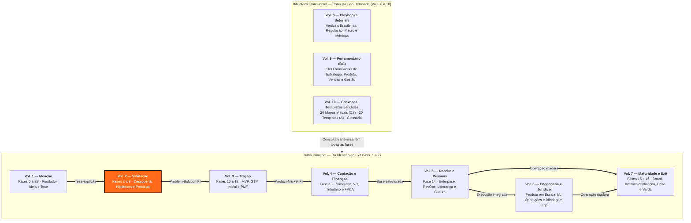

---

## Sumário deste Volume

### Fases da Etapa (Validação)

- [[#FASE 3 — DESCOBERTA DO PROBLEMA]]
- [[#FASE 4 — PESQUISA COM USUÁRIOS (CUSTOMER DISCOVERY APROFUNDADO)]]
- [[#FASE 5 — MAPEAMENTO DE MERCADO E CONCORRÊNCIA]]
- [[#FASE 6 — FORMULAÇÃO RIGOROSA DE HIPÓTESES]]
- [[#FASE 7 — EXPERIMENTOS DE VALIDAÇÃO DO PROBLEMA]]
- [[#FASE 8 — IDEAÇÃO E PROTOTIPAGEM DE SOLUÇÕES]]
- [[#FASE 9 — TESTES DE SOLUÇÃO E USABILIDADE]]

### Metodologia Científica, Gates e Maturidade

- [[#APÊNDICE F — ABORDAGEM CIENTÍFICA vs LEAN STARTUP: QUANDO USAR CADA UMA]]
- [[#APÊNDICE G — FRAMEWORK DE DECISÃO POR GATES (PROBLEM CORE + SCALE LEVERS + EXPLORATORY)]]
- [[#APÊNDICE H — TRL E CRL: MATURIDADE TECNOLÓGICA E DE MERCADO]]
- [[#APÊNDICE L — IDEA → WEDGE → SCALE: O FRAMEWORK ANTLER COMO LENTE TRANSVERSAL]]

### Consumidor, Inteligência Competitiva e Posicionamento de Categoria

- [[#APÊNDICE FF — PSICOLOGIA DO CONSUMIDOR BRASILEIRO — COMPORTAMENTO, DECISÃO E CONVERSÃO]]
- [[#APÊNDICE EE — INTELIGÊNCIA COMPETITIVA — MONITORAMENTO, ANÁLISE E RESPOSTA]]
- [[#APÊNDICE S — CATEGORY DESIGN]]
- [[#APÊNDICE AI — CASOS DE FRACASSO BRASILEIROS E LIÇÕES]]

### Arquitetura de Modelo de Negócio (Marketplaces, Plataformas, B2B2C e Open Source)

- [[#APÊNDICE AE — MARKETPLACE DYNAMICS E RISCO DE PLATAFORMA]]
- [[#APÊNDICE CC — PLATAFORMA VS PRODUTO: QUANDO CONSTRUIR PLATAFORMA E QUANDO NÃO]]
- [[#APÊNDICE CK — B2B2C: QUANDO SUA EMPRESA VENDE PARA OUTRA EMPRESA QUE VENDE PARA CONSUMIDOR]]
- [[#APÊNDICE BE — OPEN SOURCE COMO ESTRATÉGIA]]

---

# FASES DA ETAPA — VALIDAÇÃO

---

### Arquitetura deste Domínio: O Funil Científico da Descoberta ao Protótipo Testado

Se o Volume 1 construiu uma teoria plausível sobre o seu negócio, a função deste **Volume 2 (Validação — Fases 3 a 9)** é submeter essa teoria ao contato brutal com a realidade antes de escrever código de produção. As sete fases aqui reunidas formam um funil de redução progressiva de incerteza, onde cada etapa invalida ou refina a anterior com custo mínimo.

A arquitetura sequencial foi desenhada para impedir os três erros clássicos do fundador brasileiro: construir solução para dor que não é prioritária (evitado pelas [[#FASE 3 — DESCOBERTA DO PROBLEMA|Fase 3]] e [[#FASE 4 — PESQUISA COM USUÁRIOS (CUSTOMER DISCOVERY APROFUNDADO)|Fase 4]]), entrar num mercado sem cunha defensável ou com economia inviável (evitado pela [[#FASE 5 — MAPEAMENTO DE MERCADO E CONCORRÊNCIA|Fase 5]]), e confundir opinião simpática em entrevista com evidência comportamental de compra (evitado pelas [[#FASE 6 — FORMULAÇÃO RIGOROSA DE HIPÓTESES|Fase 6]], [[#FASE 7 — EXPERIMENTOS DE VALIDAÇÃO DO PROBLEMA|Fase 7]], [[#FASE 8 — IDEAÇÃO E PROTOTIPAGEM DE SOLUÇÕES|Fase 8]] e [[#FASE 9 — TESTES DE SOLUÇÃO E USABILIDADE|Fase 9]]).

> [!tip] Roteiro de leitura, dependências causais e instrumentos conectados
> - **Fase 3 → Fase 4 → Fase 5 (Entender o problema, quem sofre e onde entrar):** Você primeiro comprova que a dor existe sem mencionar sua ideia (Fase 3), depois mapeia o *Job-to-be-Done* e a jornada de troca do cliente (Fase 4), e então dimensiona o mercado e escolhe a cunha (*wedge*) exata de entrada (Fase 5).
> - **Fase 6 → Fase 7 (Testar com pele em jogo):** Transforma as incertezas críticas em hipóteses falsificáveis (Fase 6) e roda experimentos com custo de compromisso real — pré-venda, *smoke test*, *concierge* (Fase 7).
> - **Fase 8 → Fase 9 (Da ideia de solução à especificação do MVP):** Prototipa soluções na fidelidade mínima necessária (Fase 8) e mede usabilidade, compreensão e disposição a pagar antes de liberar engenharia (Fase 9).
> - **Métodos e templates conectados (Vols. 9 e 10):** Aprofunde técnicas de campo em Ethnographic Field Research (BG.6.4), Contextual Inquiry (BG.6.5), Diary Studies (BG.6.6), Focus Groups (BG.6.7), 5 Whys (BG.6.8), Card Sorting (BG.7.3) e First-Click Testing (BG.7.4) no **Volume 9**, e utilize os roteiros A.2, A.3, A.4, A.5, A.6, A.10, A.11, A.12, A.19, A.20 (Roteiro de Teste de Usabilidade), A.24 (Customer Journey Map), A.27, A.29 e A.30 no **Volume 10**.

---

## FASE 3 — DESCOBERTA DO PROBLEMA

> [!info] Stack mínimo da Fase 3
> Para fazer entrevistas com rigor, você não precisa de ferramenta cara. Gratuito ou de baixo custo: gravação em celular ou Google Meet (com permissão explícita do entrevistado), transcrição automática via Whisper (OpenAI) ou Loom (gratuito para uso moderado), planilha simples (Google Sheets ou Notion) para armazenar entrevistas e extrair padrões, formulário de agendamento (Calendly free).
>
> Quando crescer: Dovetail ou EnjoyHQ para organização de pesquisa qualitativa, ferramentas como Grain para gravação integrada.
>
> Não confunda sofisticação de stack com qualidade de pesquisa. Entrevistador ruim com Dovetail extrai menos que entrevistador bom com Google Forms.

### O que esse apêndice cobre

Investigação estruturada para verificar se o problema que você imaginou na [[IGNICAO-Vol-1-Ideacao#FASE 2 — ARTICULAÇÃO E CAPTURA DA IDEIA|Fase 2 (Vol. 1)]] existe de fato na vida das pessoas que você acredita serem seus clientes. Com que frequência ocorre. Quão doloroso é. E quanto as pessoas já fazem para tentar resolvê-lo. O entregável é um relatório chamado Mapa de Problemas, que documenta o problema real (não o imaginado) com dados reais de entrevistas.

> [!important] Disciplina central desta fase
> Nesta fase, você ainda não fala da sua solução. Você só escuta. Essa disciplina é difícil, mas crítica. No momento em que você menciona a sua solução, o cliente passa a reagir à ideia em vez de descrever a realidade dele. E você perde a evidência limpa.

> [!abstract] Resumo operacional
> **Entregável:** Mapa de Problemas de cinco a dez páginas baseado em quinze a trinta entrevistas Mom Test, com ICP refinado, padrões de dor ranqueados por Pain Level, verbatim, soluções atuais e Declaração da Ideia atualizada para v2.
>
> **Sinais de saída:**
> - Quinze ou mais entrevistas dentro do ICP com saturação atingida (informação nova abaixo de quinze por cento nas últimas três).
> - Pelo menos cinco entrevistados em Pain Level 4 ou 5 (já improvisaram gambiarra ou têm orçamento comprometido).
> - Problema aparece espontaneamente em cinquenta por cento ou mais das entrevistas, e quarenta por cento ou mais já tentou ativamente resolver.
> - Três ou mais padrões de dor consistentes documentados com cinco ou mais entrevistas cada, e pelo menos um falso positivo identificado.
> - Decisão explícita registrada em parágrafo: seguir, pivotar problema, pivotar cliente, ou abandonar.
>
> **Três armadilhas mais comuns:**
> 1. Apresentar a solução: no momento em que você mostra a ideia, a pessoa passa a ser gentil ou crítica com a ideia, não honesta sobre a vida dela.
> 2. Confirmar em vez de refutar: ouvir só o que reforça a tese — obrigue-se a procurar ativamente evidência contrária; se só encontra confirmação, está enviesando.
> 3. Achar que cinco entrevistas bastam: às vezes bastam, mas você só sabe disso depois de quinze; não corte caminho antes da saturação.

### POR QUE

A maioria das startups que falham, falham por construir algo que ninguém quer. Paul Graham articulou esse ponto em *18 Mistakes That Kill Startups* (2006): "num sentido, só há um erro que mata startups: não fazer algo que as pessoas querem". Marc Andreessen reforçou em ensaio sobre Product-Market Fit (2007). Análises agregadas como CB Insights também repetem o padrão. Na maioria dos casos, o empreendedor presumiu que o problema existia, sem verificar. A descoberta do problema é a vacina contra esse erro.

O custo de descobrir que o problema não existe antes de construir é uma conversa de café. O custo de descobrir depois de construir é meses ou anos de vida e todo o dinheiro investido.

> [!warning] Não construa uma ponte perfeita no meio do deserto
> Essa frase precisa ficar na sua cabeça em todas as etapas. É muito comum o empreendedor iniciante investir meses esculpindo uma solução elegante para um problema que ninguém realmente tem, ou tem mas não suficientemente. A descoberta do problema é onde você confirma que há gente do lado de lá da ponte.

### QUALIDADE DO PROBLEMA, o filtro que precede tudo

Antes de falar de execução, entenda o que faz um problema valer a pena perseguir. Empreendedores messiânicos, que querem "salvar o mundo em geral", tendem a quebrar. Empreendedores que miram um problema específico e agudo tendem a crescer. Use os filtros desta seção em conjunto.

> [!note] Hierarquia dos instrumentos de qualidade do problema
> Esta seção apresenta três instrumentos em ordem de aplicação. **Filtro 1 (cinco características heartfelt)** é o central, aplicado a cada candidato de problema. **Filtro 2 (poço profundo vs largo)** orienta priorização entre candidatos que passam no Filtro 1. O **Corolário** sobre clientes desesperados e Schlep Blindness é leitura conceitual de fundo, não checklist. O **Teste de Prioridade** que aparece logo depois desta seção é o instrumento de fechamento, aplicado a um único problema-candidato antes de comprometer tempo. As seis dimensões do framework YC (popular, crescente, urgente, caro, obrigatório, frequente) ficam absorvidas como checklist auxiliar dentro do Filtro 1 (heartfelt) — várias se sobrepõem.

#### Filtro 1, as cinco características de um *heartfelt problem* (problema genuinamente sentido)

Um problema que mexe com o coração acende todas as cinco características abaixo. Visualização:

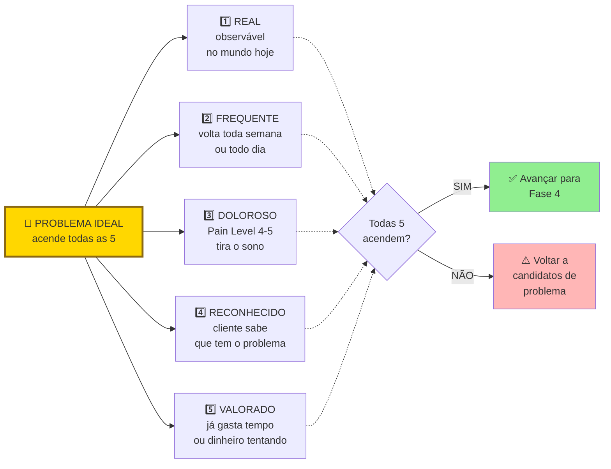

Se três ou mais características falham, o problema não é heartfelt. É "interessante". Interessante não gera negócio. Heartfelt sim. Teste cada característica com dados reais de entrevistas (entrevistas, observação, dados). Nunca com "acho que sim".

As cinco características em detalhe.

Emocional. O problema carrega emoção negativa: frustração, ansiedade, vergonha, medo. Sem emoção, não há urgência de ação.

Funcional. O problema impede o cliente de realizar uma tarefa concreta importante. Não é só um incômodo estético.

Frequente. Reforça o filtro YC. Quanto mais frequente, mais valor percebido na solução.

Urgente. Tem deadline implícito ou explícito. Algo vai dar errado se não resolver.

Inevitável (*unavoidable*). Não há jeito fácil de contornar. Se o cliente pode simplesmente ignorar ou desviar, ele não vai pagar.

#### Filtro 2, a analogia topológica (poço profundo versus poço largo)

Poço largo significa que muita gente usa. "Todo mundo usa o Google."

Poço profundo significa que quem usa, usa várias vezes ao dia. "Usamos o Google múltiplas vezes por dia."

Negócios bilionários tendem a ser profundos *e* largos. Mas iniciantes devem priorizar profundo em um nicho estreito antes de perseguir largura. Um poço profundo em nicho restrito te dá quatro coisas: clientes que viram evangelistas, clareza sobre o que construir, dispensar capital intensivo, e defensabilidade natural contra concorrentes grandes que ignoram nichos.

> [!tip] Regra operacional do poço profundo
> Se a sua empresa sumisse amanhã, um grupo bem específico de pessoas deveria reclamar muito. Se ninguém reclamaria, você não tem poço. Tem uma poça.

#### Corolário crítico, clientes desesperados e produtos imperfeitos

Em um mercado excelente, com clientes desesperados por solução, a primeira versão do produto não precisa ser incrível. Só precisa funcionar. Essa é a marca do produto bem-sucedido em fase inicial. Em um mercado morno, mesmo um produto excepcional tem dificuldade de ganhar tração.

O que isso significa na prática: se você está obcecado em polir o produto antes de lançar, há boa chance de que esteja mirando o mercado errado. Mercados quentes toleram (e recompensam) produtos capengas. Mercados frios exigem produtos polidos que ainda assim falham em engajar. A obsessão com perfeição técnica é frequentemente fuga de fundador evitando o veredito do mercado real.

Este corolário se conecta a dois conceitos.

O primeiro é o Limiar de Desespero. É o nível mínimo de dor que faz um cliente aceitar um produto imperfeito para resolver o problema. Abaixo desse limiar, ele vai reclamar de cada bug e cancelar. Acima, ele vai pagar mesmo com UI feia, fluxos quebrados, e atendimento via WhatsApp. Mapeie o Limiar de Desespero da sua cunha antes de investir em polimento. O Pain Level 5 (orçamento comprometido) é o indicador mais forte de que o cliente está acima do limiar.

O segundo é o "problema chato", também conhecido como Schlep Blindness (cegueira para trabalho árduo — Paul Graham, 2012). *Schlep* é palavra em iídiche, hoje de uso comum no inglês, que significa "tarefa tediosa e desagradável". Graham cunhou o termo para descrever o padrão pelo qual empreendedores (especialmente técnicos) sistematicamente evitam problemas que envolvem trabalho chato e sem glamour: regulação, negociação com bancos, operação manual, migração de dados legados, compliance, suporte trabalhoso. O inconsciente nem deixa a ideia chegar à consciência. "Isso não é um problema de startup." É exatamente aí que moram as oportunidades mais valiosas. Porque ninguém quer pegá-las.

A lógica é econômica antes de ser poética. Se todo mundo quer evitar certa categoria de trabalho, quem se dispõe a fazer encontra mercado inteiro sem concorrência real. Concorrentes evitam problemas chatos por preguiça, ego, ou risco. Empreendedor que ataca deliberadamente problemas chatos frequentemente encontra menos competição, clientes mais leais (ninguém os atende bem), e margens melhores (ninguém quer o trabalho). Se o seu problema é "sexy" demais, fácil de vender em pitch, fácil de explicar em coquetel, desconfie. Provavelmente você está competindo com cinquenta outros fundadores na mesma fatia.

##### Casos canônicos, schleps que viraram empresas bilionárias

Stripe resolveu pagamentos online. Os irmãos Patrick e John Collison atacaram o schlep que todo desenvolvedor da época reclamava mas ninguém queria consertar. Gateways de pagamento eram infernais de integrar, cheios de burocracia bancária, regulação complexa, KYC, PCI-DSS. Stripe hoje vale mais de US$ 90 bilhões. Graham usa Stripe como exemplo arquetípico no próprio ensaio.

Scale AI resolveu *data labeling*, a rotulagem manual de dados de treino para IA. Alexandr Wang, fundador, mencionou em entrevista que o ensaio de Graham foi inspiração direta. Todo pesquisador de IA sabia que era tarefa necessária. Ninguém queria fazer. Hoje a empresa vale mais de US$ 14 bilhões e é peça essencial para OpenAI, Meta, e o Pentágono.

Figma atacou design colaborativo na nuvem quando a Adobe dominava com software offline. Problema técnico schlep: reconstruir ferramenta profissional de design no navegador, com performance aceitável, parecia trabalho de anos sem recompensa evidente. Ninguém queria. Figma fez. Hoje é categoria.

Uber enfrentou schleps regulatórios e batalhas com sindicatos de táxi que eram exatamente o que fazia concorrentes desistirem. Não era sexy. Era desgastante, caro, litigioso. Foi isso que abriu espaço.

No Brasil, a Stone construiu o moat justamente sobre schlep que concorrentes evitavam: vender maquininha porta-a-porta para pequenos comerciantes negligenciados pelos grandes bancos, com onboarding manual, suporte humano em cada cidade, e cobrança em segmentos que ninguém queria atender. Resultado, IPO na Nasdaq em 2018 e disputa direta com Cielo e Rede em segmento que parecia "saturado" antes da entrada delas.

##### Como usar Schlep Blindness como filtro mental para achar ideias

Em vez de perguntar "que problema eu quero resolver?", pergunte: *que problema eu gostaria que outra pessoa resolvesse para mim?* A resposta frequentemente revela um schlep escondido. Algo que te irrita e que você simplesmente aceitou como "jeito das coisas".

Escaneie o seu próprio dia a dia profissional. Onde você improvisa solução manual? Onde processos são lentos, caros, irritantes? Onde você diz "isso deveria ser automático mas não é"?

Para empreendedor iniciante, desconfie de ideias que pareceram óbvias e rápidas de construir. Se pareceu óbvio, duzentas pessoas tiveram a mesma ideia esta semana. Se pareceu difícil, chato, com hurdles regulatórios ou operacionais, pode ser exatamente a sua oportunidade.

> [!important] A regra combinada
> Persiga problemas chatos com clientes desesperados. Essa combinação, por mais deselegante, é a mais previsível fonte de tração em estágio inicial.

### TESTE DE PRIORIDADE, três perguntas rápidas (Priority Diagnostics)

Antes de avançar, submeta o seu problema a um teste de prioridade em três perguntas. É um diagnóstico operacional importado do programa da Antler. Aplique sobre cada problema-candidato antes de comprometer tempo sério com ele.

> [!question] Pergunta 1, se este problema desaparecesse amanhã, quem notaria?
> Não "quem acharia bom". Quem notaria concretamente, em quarenta e oito horas, sem ninguém avisar. Se a resposta for "as pessoas em geral" ou "todo mundo", o problema não é prioritário para ninguém em específico. Resposta boa: um cargo ou pessoa nomeada, por exemplo "o gerente de operações do setor X", que usa o problema diariamente.

> [!question] Pergunta 2, qual métrica numérica e rastreada mudaria?
> Se o problema é real e prioritário, existe uma métrica que alguém já acompanha que se moveria. Tempo de ciclo. Custo por transação. Taxa de retrabalho. NPS interno. Faturamento por hora. Churn. Se nenhuma métrica rastreada se moveria, o problema pode até existir, mas ninguém tem caso de negócio para resolvê-lo. E portanto ninguém tem budget.

> [!question] Pergunta 3, alguém escalaria o problema para um nível acima?
> Problemas prioritários sobem na hierarquia. Alguém reporta ao chefe. Alguém pede recursos. Alguém marca uma reunião urgente. Se o problema existe mas ninguém o escala, ele está sendo absorvido silenciosamente. Significa que não é urgente o suficiente para forçar mudança de comportamento.

> [!warning] Regra operacional do Teste de Prioridade
> Se você não consegue responder às três perguntas com um nome de cargo, uma métrica específica, e um comportamento de escalada concreto, volte para entrevistas. Problemas que passam nas três perguntas geram urgência de compra. Os que não passam geram apenas interesse educado.

### Quando usar

Comece com a Declaração Inicial da Ideia (v1) da [[IGNICAO-Vol-1-Ideacao#FASE 2 — ARTICULAÇÃO E CAPTURA DA IDEIA|Fase 2 (Vol. 1)]] em mãos e, idealmente, com a árvore de teoria construída na [[IGNICAO-Vol-1-Ideacao#FASE 2B — CONSTRUÇÃO DA TEORIA DO NEGÓCIO|Fase 2B (Vol. 1)]] — as hipóteses bet-the-company da Fase 2B são exatamente o que você vai testar nas entrevistas aqui. Termine depois de ter realizado entrevistas suficientes para chegar à saturação, o ponto em que novas entrevistas deixam de trazer informação nova. Tipicamente quinze a trinta entrevistas em profundidade. Revisite sempre que mudar de segmento de cliente ou abrir novo mercado.

### Quem envolve

O executor principal é você. Não terceirize entrevistas nesta fase. Quem conduz aprende. Quem lê relatório, não. Os participantes são os entrevistados, pessoas do público-alvo descrito na [[IGNICAO-Vol-1-Ideacao#FASE 2 — ARTICULAÇÃO E CAPTURA DA IDEIA|Fase 2 (Vol. 1)]]. O decisor é você, com base na análise da evidência.

### Como executar

Dez passos.

> [!tip] Empathy Map como complemento ao Mom Test
> Entrevistas Mom Test capturam comportamento passado e revelam onde a dor está. Para registrar o **universo emocional e contextual** que cerca esse comportamento, use o [[IGNICAO-Vol-10-Canvases-e-Templates#APÊNDICE CZ — CANVASES E MAPAS VISUAIS DE MODELO|Empathy Map (CZ.6) (Vol. 10)]] como artefato pós-entrevistas. Após 5-10 entrevistas com a mesma persona, reúna PM + designer + customer success e preencha os seis quadrantes (Pensa & Sente, Vê, Ouve, Fala & Faz, Pains, Gains) com base em verbatim. Empathy Map preenchido sem entrevistas é projeção; com entrevistas é a primeira ferramenta que torna empatia auditável. O exemplo de Loggi com persona "Carlos motoboy" em CZ.6 mostra como mapear não-clientes (parceiros, intermediários) frequentemente revela mais que mapear o cliente final.

#### Passo 1, perfil do entrevistado com precisão cirúrgica

Antes de sair entrevistando, escreva os critérios de inclusão e exclusão. Quem incluir: quem atende a tais e tais características. Quem excluir: quem atende a tal característica.

Exemplo ruim: "donos de restaurante". Exemplo bom: "donos ou donas, sócios ou sócias operacionais de restaurantes de uma a três unidades, localizados em capitais brasileiras, que oferecem delivery próprio (não apenas via iFood), com faturamento mensal entre R$ 50 mil e R$ 300 mil, há pelo menos dois anos no mercado".

Esse filtro é o que separa pesquisa útil de pesquisa "perdida no meio".

#### Passo 2, lista de quarenta a sessenta pessoas para abordar

Você precisará abordar três a quatro vezes o número de entrevistas que pretende realizar. Muita gente não responde, não tem tempo, ou não atende aos critérios. Fontes possíveis: LinkedIn com busca filtrada; grupos de WhatsApp e Telegram de nichos específicos; associações e entidades de classe (sindicatos, federações, coletivos); eventos presenciais do setor; introduções via conhecidos ("alguém que conhece alguém"); comunidades online (subreddits, fóruns, Discord); cold outreach estruturado (e-mail direto ou mensagem com proposta clara de trinta minutos).

#### Passo 3, escreva e teste o seu roteiro de entrevista

O roteiro tem dois princípios. Perguntas abertas, nunca fechadas. "Como você decide X?" em vez de "Você decide X dessa forma?". E perguntas sobre o passado, não sobre o futuro — as cinco perguntas canônicas abaixo aplicam esse princípio em detalhe.

Estrutura sugerida (método Mom Test — técnica de entrevista que evita respostas educadas — adaptado).

Aquecimento (dois minutos). Agradeça o tempo, explique que é pesquisa, não venda, peça permissão para gravar.

Contexto do entrevistado (cinco minutos). Quem é, o que faz, qual a rotina.

Exploração do domínio (dez minutos). Perguntas abertas sobre o território onde você imagina o problema, sem mencionar o problema. "Me conta como funciona o seu dia a dia com (atividade relacionada)." "Quais são as partes mais chatas disso?" "Me conta a última vez que você teve um problema com isso."

Aprofundamento (dez minutos). Sempre que algo interessante surgir, pergunte: "Me fala mais sobre isso." E: "Na última vez, como foi?"

Tentativas de solução (cinco minutos). "O que você já tentou fazer para resolver isso? Funcionou? Por que parou?" Se a pessoa nunca tentou resolver, isso é evidência forte de que o problema não é dolorido.

Encerramento (três minutos). "Tem mais alguém que você acha que passa por isso, que eu poderia conversar?" Pedido de indicação.

> [!note] O comportamento do consumidor brasileiro tem padrões que afetam como a dor se manifesta nas entrevistas
> Classe C/D tende a minimizar problemas por norma social de não reclamar; usuários mobile-first descrevem fluxos de forma diferente de quem usa desktop. O [[#APÊNDICE FF — PSICOLOGIA DO CONSUMIDOR BRASILEIRO — COMPORTAMENTO, DECISÃO E CONVERSÃO|Apêndice FF — Psicologia do Consumidor Brasileiro]] detalha esses padrões e ajuda a calibrar o que ouvir nas entrevistas — especialmente a diferença entre dor declarada e dor real.

##### As cinco perguntas canônicas do Mom Test (cheat sheet)

Estas cinco perguntas, adaptadas ao seu domínio, formam um núcleo mínimo para qualquer entrevista de problema. Foram desenhadas para revelar a dor real, focar em comportamento passado em vez de intenção futura, e evitar que você caia na armadilha de vender a sua ideia.

> [!example] Cinco perguntas para entrevista de descoberta de problema
>
> 1. Qual é a parte mais difícil de (fazer a tarefa)? Identifica a dor real na linguagem do cliente, não na sua.
> 2. Me conta sobre a última vez que você encontrou esse problema. Força o entrevistado a descrever comportamento passado, que é evidência, não especulação.
> 3. Por que isso foi tão difícil? Revela as causas raízes que o seu raciocínio de ponta a ponta não consegue supor sozinho.
> 4. O que você já fez para tentar resolver isso? Se o entrevistado não fez absolutamente nada, a dor não é forte o suficiente para gerar negócio.
> 5. O que você não gosta nas soluções que já tentou? A resposta é o rascunho inicial do seu roadmap de produto, com palavras do cliente.

A pergunta bônus, que discrimina Pain Level 4 de Pain Level 5: *o que faria você pagar um pequeno depósito hoje por uma solução para isso?*. Essa pergunta separa interessados genuínos (responde com condições concretas: "se funcionasse com X, se custasse menos que Y") de interessados ornamentais (responde vago: "talvez, dependendo"). Clientes em Pain Level 5 (orçamento comprometido) tendem a dar respostas específicas e acionáveis. Clientes em Pain Level 4 ou menos tendem a hesitar. Use no fim da entrevista, depois de ter mapeado dor em profundidade. Nunca no começo, porque fica leading.

> [!tip] Regra de ouro do entrevistador
> Fale menos, ouça mais. Você não está ali para vender o seu produto. Está ali para interrogar o problema. Se você falou mais de vinte por cento do tempo, fez errado.

##### A armadilha da validação, dado ruim e dado bom

Nem todo "sinal" obtido em entrevista vale igual. Há tipos de resposta que pesam muito diferente.

| Tipo de informação | Peso como evidência | Por quê |
|---|---|---|
| Elogios ("Nossa, que ideia legal!") | Quase zero | Pessoas mentem sobre interesse por educação ou para agradar |
| Hipóteses futuras ("Eu pagaria por isso") | Baixo | Promessas sobre o futuro não se traduzem em compra real |
| Ideias soltas ("Seria legal se tivesse tal funcionalidade") | Baixo a médio | Útil para brainstorm, não para validação |
| Comportamento passado ("Semana passada gastei 4 horas nisso") | Alto | Dado verificável; ações já tomadas são a melhor evidência |
| Tentativas anteriores de solução ("Eu usei X, Y e Z, nenhum resolveu") | Alto | Prova que a dor é forte o suficiente para o cliente já ter agido |
| Métricas de custo (tempo, dinheiro, energia já gastos) | Alto | Traduzem a intensidade real da dor em números |

> [!important] Princípio operacional sobre evidência
> Pessoas mentem sobre interesse, mas não mentem sobre dor. Foque em interrogar a dor, comportamento passado, tentativas de solução, custo atual. Ignore promessas futuras e elogios.

##### Pain Level, classifique cada entrevistado

Ao final de cada entrevista, atribua ao entrevistado uma nota na escala de Pain Level, de um a cinco, que mede o estado dele em relação ao problema.

Nível 1. Tem o problema, mas nem sabe que tem. Não é cliente ainda. No máximo é foco de marketing educacional.

Nível 2. Sabe que tem o problema. Reconhece, mas tolera. Não vai pagar por solução sozinho.

Nível 3. Está ativamente procurando uma solução. Tem deadline na cabeça. É lead quente.

Nível 4. Já improvisou uma solução feia. Planilha Excel gigante, processo manual, Frankenstein de ferramentas. A existência dessa gambiarra é prova de que ele pagaria por algo melhor.

Nível 5. Tem orçamento comprometido ou facilmente acessível para comprar uma solução. Esse é o cliente ideal para a venda inicial e para o PSF (Problem-Solution Fit). Equivale ao Limiar de Desespero descrito na seção anterior: o cliente está acima do limiar e aceita produto imperfeito para resolver o problema.

> [!important] Meta de Pain Level desta fase
> Consiga entrevistar pelo menos cinco pessoas em Pain Level 4 ou 5. Se você não encontrar ninguém nesses níveis, você está testando um problema que o mercado ainda não sentiu o suficiente para pagar. É sinal vermelho. Volte para a Fase 2B (Teoria) e reconsidere o ICP ou a dor.

##### O que não fazer

Não pergunte "você acha que um app que faz X seria útil?". É hipotético, sobre o futuro.

Não pergunte "você pagaria R$ 99 por isso?". Inventa compromisso que a pessoa não vai cumprir.

Nunca diga "eu tive uma ideia de negócio que…". A partir daí, tudo vira cortesia.

Evite perguntas tendenciosas (*leading questions*). "Você não acharia melhor se…" ou "Seria incrível se existisse X, né?". Deixe o entrevistado dizer o que quer. Se você precisa sugerir, não é dor real.

Não misture apelos emocionais ou virtuosos (*virtue signalling*). "Você compraria um produto feito por crianças com deficiência?" Quase ninguém vai dizer não. Mas isso não significa que vai pagar. Mantenha o foco no problema, não em apelos morais que enviesam a resposta.

Não ofereça "crack grátis". "Você gostaria de receber X de graça?" Quase todo mundo diz sim. Isso não valida negócio nenhum. Só valida que as pessoas gostam de coisas grátis.

#### Passo 4, primeiras três entrevistas como teste

Grave (com permissão), transcreva, releia. Identifique três coisas. Quais perguntas funcionaram (geraram respostas longas e ricas). Quais caíram no vazio (respostas curtas, secas). E onde você cedeu à tentação de apresentar a ideia.

Ajuste o roteiro antes de seguir com as próximas.

#### Passo 5, execute quinze a trinta entrevistas no total

Ritmo saudável: três a cinco por semana. Faça sozinho, ou com um parceiro que toma notas enquanto você conduz.

#### Passo 6, registro sistemático

Para cada entrevista, preencha um template padronizado. Nome, papel, empresa (quando aplicável), data. Verbatim, ou seja, citações literais dos momentos mais importantes, exatamente o que a pessoa disse, entre aspas. Problemas mencionados (não os que você interpretou, os que foram ditos). Soluções atuais utilizadas. Quanto tempo, dinheiro, ou energia a pessoa gasta hoje com o problema. Gatilhos emocionais observados (frustração, raiva, resignação). E as suas observações pessoais em itálico, claramente separadas dos fatos.

> [!tip] Use o Template A.2 — Parte B
> O [[IGNICAO-Vol-10-Canvases-e-Templates#APÊNDICE A — TEMPLATES PRONTOS PARA USO|Template A.2 (Vol. 10)]] tem duas partes: a Parte A é o roteiro que você consulta durante a conversa; a Parte B é a síntese pós-entrevista, com 12 seções que estruturam exatamente o que este Passo 6 pede — metadados, aderência ao ICP, problemas, verbatim, vocabulário, hierarquia de sinais, Pain Level com justificativa, armadilhas (autoavaliação) e refinamento de ICP. Preencha nas 24h seguintes à entrevista, enquanto a memória está fresca. Entrevistas com a Parte B em branco contam como dado perdido.

#### Passo 7, análise depois de cada lote de cinco entrevistas

Não espere terminar tudo para analisar. A cada cinco entrevistas, faça uma síntese parcial. Quais problemas apareceram em mais de cinquenta por cento das entrevistas? Quais padrões de comportamento se repetem? Que hipóteses iniciais foram reforçadas e quais foram abaladas? Quais novos problemas apareceram que você não esperava?

> [!tip] Síntese parcial e final no Template A.30
> O [[IGNICAO-Vol-10-Canvases-e-Templates#APÊNDICE A — TEMPLATES PRONTOS PARA USO|Template A.30 (Síntese de Rodada de Entrevistas) (Vol. 10)]] é o artefato dessa síntese. Use uma versão "rascunho" a cada lote de cinco para checar padrões; consolide a versão final só quando a rodada inteira fechar — consolidar antes do fim viesa as entrevistas restantes. A.30 é também o documento que registra a decisão de avanço da fase (perseverar / pivotar problema / pivotar cliente / abandonar).

> [!note] A jornada do cliente é uma estrutura útil para organizar o que as entrevistas revelam
> Enquanto o Mom Test captura incidentes isolados, o [[IGNICAO-Vol-3-Tracao#APÊNDICE DT — CUSTOMER EXPERIENCE: DA JORNADA AO NPS AO CHURN ZERO|Apêndice DT — Customer Experience (Vol. 3)]] oferece a visão de jornada completa — do momento de consciência do problema ao pós-resolução — incluindo métricas de NPS e churn preditivo. Usar a jornada como mapa mental durante a síntese das entrevistas ajuda a localizar em qual etapa a dor é mais aguda.

> [!tip] Apêndice CZ — Value Proposition Canvas (CZ.3)
> Ao sintetizar as entrevistas, o **Customer Profile** do [[IGNICAO-Vol-10-Canvases-e-Templates#APÊNDICE CZ — CANVASES E MAPAS VISUAIS DE MODELO|Value Proposition Canvas (CZ.3) (Vol. 10)]] — Jobs (o que o cliente está tentando fazer), Pains (frustrações no caminho), Gains (resultados desejados) — é o frame visual exato para organizar o que as entrevistas Mom Test capturaram. Use depois da síntese qualitativa para preparar a [[#FASE 4 — PESQUISA COM USUÁRIOS (CUSTOMER DISCOVERY APROFUNDADO)|Fase 4]] (JTBD).

#### Passo 8, separe sintoma de causa raiz — entrevista de raiz causal

O erro mais comum em discovery é documentar sintomas como se fossem problemas. "Meu CRM é uma bagunça" é sintoma. A causa raiz pode ser: processo de vendas mal definido, equipe resistente à adoção de ferramentas, ou dados de entrada inconsistentes vindos de integrações quebradas. Cada causa raiz tem uma solução diferente. Tratar o sintoma sem entender a causa produz produto que não resolve o problema real.

A técnica de entrevista de raiz causal usa três camadas de aprofundamento.

**Camada 1 — o sintoma declarado.** O entrevistado descreve o problema como ele aparece para ele. "Meu relatório de vendas demora três dias para ficar pronto." Anote literalmente — esse é o ponto de partida, não a conclusão.

**Camada 2 — o mecanismo.** Para cada sintoma, pergunte: "Me conta como isso acontece na prática. Quando o relatório atrasa, o que está acontecendo especificamente?" Objetivo: entender o processo, não apenas o resultado. Frequentemente revela que o "problema de relatório" é, na verdade, um problema de input — os dados não chegam na qualidade certa.

**Camada 3 — a causa raiz.** Para cada mecanismo, aplique a pergunta "por quê" até chegar ao elemento que, se resolvido, elimina o sintoma. "Por que os dados chegam inconsistentes? — Porque a equipe de vendas preenche o CRM diferente. — Por que preenche diferente? — Porque não há template padrão e cada vendedor usa o que acha melhor. — Por que não há template padrão? — Porque quando implementaram o CRM dois anos atrás, o gerente de vendas saiu logo depois e ninguém estabeleceu o processo." Causa raiz: falta de processo documentado e owner claro do CRM. Solução: não é um relatório melhor — é um playbook de uso do CRM com responsável.

**Protocolo prático de raiz causal em entrevista:**

1. Deixe o entrevistado descrever o problema livremente (2-3 minutos).
2. Repita o sintoma de volta e peça para detalhar o mecanismo: "Quando você diz X, me conta como isso acontece no dia a dia?"
3. Para cada elemento do mecanismo que parece ser causa, pergunte: "Por que isso acontece?" — até a resposta ser "é como funciona aqui" ou "não sei — nunca perguntei."
4. No final da entrevista, pergunte: "Se você resolvesse esse problema hoje, o que mudaria primeiro — o sistema, o processo, ou a equipe?"

A resposta à última pergunta é ouro. Ela revela onde o entrevistado percebe a alavanca de solução — e frequentemente diverge do que você assumia como desenvolvedor de produto.

**Red flags que indicam sintoma não raiz:**

- A pessoa descreve uma solução ("precisamos de uma dashboard melhor") em vez de um problema. Pergunte: "O que você faria com a dashboard melhor que não consegue fazer agora?"
- O problema "desaparece" quando você pergunta sobre frequência. "Acontece de vez em quando" com dificuldade de quantificar sugere que o problema não é tão dolorido quanto parece.
- A pessoa cita o problema de outra pessoa ("meu chefe reclama que..."). A causa raiz pode estar na dinâmica organizacional, não no processo em si.

#### Passo 9, chegue à saturação

Saturação é o ponto em que entrevista nova deixa de trazer informação nova. Há dois testes complementares: um qualitativo (sentir) e um quantitativo (medir). Os dois apontam para o mesmo fenômeno; use ambos para reduzir auto-engano.

**Teste qualitativo.** Você sente quando chegou. "Ah, é a mesma coisa que o anterior disse." Quando isso acontecer duas ou três vezes seguidas, você chegou.

**Teste quantitativo.** Para cada nova entrevista, conte quantas observações realmente novas (problemas, vocabulário, padrões de comportamento, workarounds) ela trouxe versus repetições do que já apareceu antes. Quando o percentual de novidade fica abaixo de quinze por cento por três entrevistas seguidas, é saturação confirmada.

Os dois critérios devem se confirmar mutuamente. Sentiu saturação mas o quantitativo ainda mostra trinta por cento de novidade? Você está sendo otimista — faça mais cinco. Quantitativo já abaixo de quinze por cento mas você ainda sente "tem coisa nova"? Provavelmente é gosto pelas conversas, não evidência. Pare.

#### Passo 10, produza o Mapa de Problemas

Esse é o entregável central da [[#FASE 3 — DESCOBERTA DO PROBLEMA|Fase 3]]. Estrutura visual:

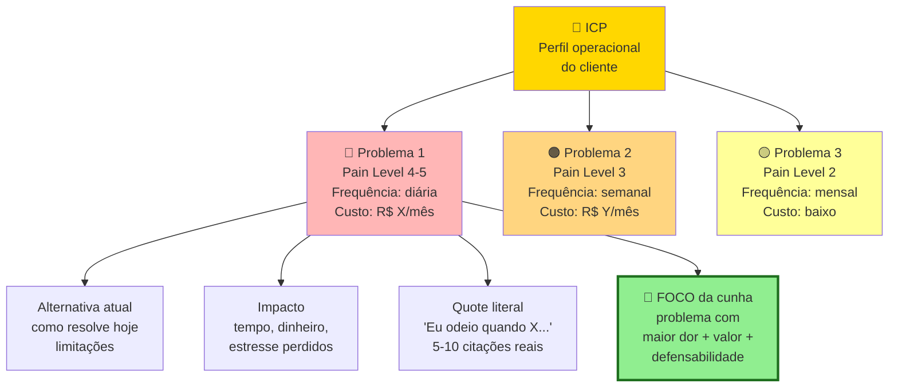

Um ICP pode ter três a cinco problemas mapeados. O foco é em um, o mais agudo, o de melhor fit. Atualize o mapa conforme as entrevistas avançam. Não é documento morto.

O documento final tem cinco a dez páginas, com o seguinte conteúdo: perfil do entrevistado consolidado (ICP refinado); lista dos problemas identificados, ranqueados por frequência e intensidade; verbatim marcantes (citações literais) para cada problema; soluções atuais identificadas e suas deficiências; disposição emocional, ou seja, quanto as pessoas se importam com o problema; comparação com a Declaração Inicial v1 — o que se confirmou, o que se refutou, o que emergiu que você não esperava; e versão dois da Declaração da Ideia, atualizada com o que foi aprendido.

> [!note] Mapa de Problemas e A.30
> O Mapa de Problemas é a saída visual da rodada — o entregável de comunicação. O [[IGNICAO-Vol-10-Canvases-e-Templates#APÊNDICE A — TEMPLATES PRONTOS PARA USO|Template A.30 (Vol. 10)]] é a planilha de decisão estruturada que sustenta o Mapa: cruza distribuição de Pain Level, padrões agregados de problema, workarounds dominantes, vocabulário recorrente e sub-segmentos para registrar a decisão de avanço com rastro à evidência. Use os dois — o Mapa para apresentar, A.30 para defender.

### Os dez passos aplicados, roteiro de entrevista do PadariaPro

Para tornar o método concreto, este é o roteiro de entrevista de problema da mesma ideia trabalhada nas Fases 2 e 2B.

Abertura (dois minutos). "Oi, [Nome]. Obrigado pelo tempo. Antes de começar: não estou aqui para te vender nada. Estou pesquisando como padarias pequenas gerenciam compras e estoque, porque quero entender se tem um problema real antes de construir uma solução. Vou fazer umas perguntas abertas, sem respostas certas. A gravação fica privada, só para eu transcrever depois. Tudo bem?"

Perguntas de contexto (cinco minutos). Como você virou dono ou operador dessa padaria? Quantas lojas vocês têm hoje? Como a gestão é dividida entre elas? Quem cuida de compra de ingredientes?

Perguntas sobre dor (quinze minutos), sem mencionar produto ou solução. Como vocês decidem hoje quanto de farinha comprar por semana? Me lembra da última vez que sobrou ou faltou algum ingrediente importante. O que aconteceu? Quando isso acontece, qual o impacto, em dinheiro, em tempo, em estresse? Vocês já tentaram alguma ferramenta ou método para resolver? Funcionou? Por que sim, ou por que não? Se você pudesse acordar amanhã e ter uma coisa resolvida no negócio, seria essa, ou outra?

Perguntas sobre comportamento (cinco minutos). Como vocês controlam estoque hoje? (peça para mostrar se possível, caderno, planilha, sistema). Em uma escala de zero a dez, quanto o problema de estoque incomoda?

Fechamento (três minutos). "Última coisa, posso te ligar em trinta dias para te mostrar algo que estou desenhando, e pegar a sua opinião?"

Análise depois de dez entrevistas:

| Entrevistado | Perda financeira/mês | Método atual | Dor real (0-10) | Já pagou para resolver? |
|---|---|---|---|---|
| Padaria A (Pinheiros) | R$ 3.500 | Caderno | 7 | Não, mas pensou em Excel avançado |
| Padaria B (Vila Madá) | R$ 8.000 | Planilha | 9 | Pagou consultor R$ 2k uma vez |
| Padaria C (Moema) | R$ 2.000 | Sistema antigo | 5 | Paga R$ 150/mês ERP que não serve |
| ... | | | | |

Padrão emergente: as padarias que sentem dor 8 ou mais são aquelas com três ou mais lojas. Abaixo disso, dor é 4-6 e pagar não é prioridade. ICP refinado para três a cinco lojas, não duas a cinco como hipótese original.

### Caso brasileiro real, descoberta do problema no iFood com restaurantes pequenos

No início da operação, a equipe do iFood (Patrick Sigrist, Eduardo Baer, Felipe Fioravante e Guilherme Bonifácio) tinha hipótese de que o principal cliente seria redes grandes de restaurantes. Era a aposta natural. Volume maior, ticket maior, estrutura instalada.

Antes de investir em vendas para grandes redes, com ciclo longo, fizeram dezenas de conversas diretas com donos de restaurantes pequenos. Incluindo visitas e observação de rotina. Não estavam vendendo nada. Estavam mapeando dor.

Descobriram algo contraintuitivo. Restaurantes pequenos tinham dor muito maior. Não tinham time de telemarketing. Atendimento telefônico custava tempo do dono. Pedido errado por ruído na ligação era prejuízo direto. E estavam dispostos a pagar comissão alta em troca do canal. Redes grandes, com estrutura própria, viam o iFood como ameaça à marca.

A lição transferível. Quem tem dor mais aguda paga mais, mesmo que seja cliente "menor". Entrevistar onde a dor é intensa é mais produtivo que entrevistar onde você achava que seriam os clientes.

### PERGUNTAS A RESPONDER

- O problema que eu imaginei existe na vida real das pessoas que eu esperava?
- Com que frequência esse problema ocorre na vida delas (diário, semanal, mensal, raro)?
- Quão doloroso é, comparado a outros problemas que elas têm?
- O que elas já fazem para resolver? Se não fazem nada, o problema não é dolorido.
- Quanto tempo, dinheiro, ou energia elas já gastam com tentativas atuais?
- Quem exatamente sofre mais com esse problema (sub-segmento mais agudo)?
- Há problemas adjacentes mais dolorosos que eu descobri por acaso?
- Qual é a linguagem que *elas* usam para descrever o problema? Anote as palavras exatas. Você vai usar no seu marketing depois.

### SAÍDA DESTA FASE

Você concluiu a [[#FASE 3 — DESCOBERTA DO PROBLEMA|Fase 3]] quando todos os critérios abaixo estão cumpridos.

- [ ] Quinze ou mais entrevistas com pessoas dentro do ICP (pelo menos doze aderentes — fora do perfil contam como aprendizado, não como validação), gravadas (com consentimento) ou transcritas em tempo real, com roteiro Mom Test (Template A.2) sem perguntas indutoras.
- [ ] Saturação atingida. Nas últimas três entrevistas, informação nova abaixo de quinze por cento.
- [ ] Tabela de padrões com cinco ou mais dimensões por entrevistado.
- [ ] Três ou mais padrões de dor consistentes documentados, cada um apoiado por cinco ou mais entrevistas.
- [ ] Pelo menos um falso positivo identificado (algo que entrevistados disseram querer mas não agiriam para obter).
- [ ] Problema aparece em cinquenta por cento ou mais do ICP entrevistado (setenta por cento ou mais para considerar urgente) e é ativamente tratado em quarenta por cento ou mais.
- [ ] Pelo menos cinco entrevistados em Pain Level 4 ou 5 (já improvisaram gambiarra ou têm orçamento comprometido), com gasto atual no problema acima de R$ 500/mês (B2C) ou R$ 5.000/mês (B2B) ou cinco horas semanais de tempo próprio — proxy de disposição a pagar.
- [ ] ICP ajustado com base no ouvido. Registro de "antes versus depois", com sub-segmento mais doloroso identificado.
- [ ] Mapa de Problemas escrito. Declaração da Ideia atualizada para v2 com mudanças explícitas em relação à v1.
- [ ] Decisão explícita registrada em parágrafo: seguir, pivotar problema, pivotar cliente, ou encerrar.

> [!warning] Se o problema não passou no teste, momento crítico
> Os caminhos são três. Pivotar o problema (algo adjacente emergiu como mais doloroso). Pivotar o cliente (o problema existe, mas em outro perfil). Ou abandonar (volte à Fase 2 com outra ideia). Não avance para a Fase 4 com problema não-validado. Construir sobre problema inexistente é o cemitério das startups.
>
> Antes de pivotar ou encerrar, vale ler o [[IGNICAO-Vol-7-Maturidade-e-Exit#APÊNDICE BH — POST-MORTEMS BRASILEIROS: CATÁLOGO DE CASOS EM PROFUNDIDADE|Apêndice BH (Vol. 7)]]: os padrões de fracasso documentados em empresas brasileiras mostram que a maioria das mortes por "problema inexistente" tinha sinais detectáveis nas entrevistas iniciais — sinais que foram ignorados. Aprender o padrão antes de vivê-lo vale semanas de iteração.

**Primeiros passos práticos.**

1. Agendar cinco entrevistas para esta semana usando rede pessoal, LinkedIn cold outreach, ou grupos de WhatsApp do setor.
2. Revisar o Template A.2 e remover perguntas que induzem resposta ("você gostaria de um app para…?").
3. Criar tabela no Notion ou Google Sheets com colunas: nome, data, padrão de dor 1, padrão 2, padrão 3, solução atual, quanto pagaria.
4. Fazer duas entrevistas piloto, revisar o roteiro com base no que não funcionou, e então agendar as demais.

### Armadilhas

> [!note] Apêndice D — Armadilhas Mentais e Vieses
> Viés de confirmação (filtrar evidência para confirmar a tese) e WYSIATI (What You See Is All There Is — concluir com dados insuficientes) são os vieses mais frequentes em discovery de problema. O [[IGNICAO-Vol-1-Ideacao#APÊNDICE D — ARMADILHAS MENTAIS E VIESES|Apêndice D (Vol. 1)]] descreve esses e outros padrões com diagnóstico e contra-medidas aplicáveis diretamente ao processo de entrevistas.

Entrevistar amigos e família. Eles mentem para te agradar. Exclua qualquer um que tenha relação pessoal.

Falar mais do que ouvir. A regra de ouro é que o entrevistado fala oitenta por cento do tempo. Se você está falando muito, está fazendo errado.

Confirmar em vez de refutar. É tentador ouvir só o que reforça a sua tese. Obrigue-se a procurar ativamente evidência contrária. Se você só encontra confirmação, está enviesando.

Perguntas hipotéticas. "Você usaria X?" produz respostas ficcionais. Sempre ancore no passado real.

Apresentar a solução. No momento em que você mostra a ideia, a conversa muda de tom. A pessoa passa a ser gentil ou crítica com a ideia, não honesta sobre a vida.

Achar que cinco entrevistas bastam. Às vezes bastam, mas você só sabe disso depois de quinze. Não corte caminho.

Generalizar a partir de um ou dois casos marcantes. Uma entrevista apaixonada vale muito menos que um padrão em dez entrevistas.

Ignorar quando o problema é "interessante" mas não dolorido. As pessoas adoram falar sobre ineficiências, mas só pagam para resolver as que doem. Diferencie.

---

### FERRAMENTAS DESTA FASE

Na descoberta do problema, ferramentas de entrevista e pesquisa são centrais. A maioria está no Ferramentário (BG.6, Pesquisa & Descoberta). Canvases complementares: CZ.3 (Value Proposition Canvas) e CZ.6 (Empathy Map).

- **5 Whys** (Toyoda, Toyota) — perguntar "por quê?" cinco vezes para chegar à causa raiz, em toda entrevista de discovery. BG.5.2.
- **MECE** — categorizar problemas reportados sem sobreposição e sem lacunas, na consolidação após dez a vinte entrevistas. BG.4.5.
- **First Principles Thinking** — resista a reformular o problema do cliente na linguagem da sua solução. Vá ao fundamento da dor real. BG.4.1.
- **McKinsey 7-Step** (passos 1 e 2) — Define e Structure, para articular o problema e estruturar sub-problemas em issue tree MECE. BG.5.1.
- **Pyramid Principle** (Minto) — na síntese, "o problema central dos nossos ICPs é X, por três razões: Y1, Y2, Y3". BG.4.4.

> [!note] Ferramentas específicas de entrevista
> Mom Test, JTBD Switch Interviews, Laddering, Contextual Inquiry. Estarão no Ferramentário, BG.6.

---

### SÍNTESE DA FASE 3

A [[#FASE 3 — DESCOBERTA DO PROBLEMA|Fase 3]] ataca o erro mais caro da indústria de startups: construir algo que ninguém quer. A maioria das empresas que falham, falham por isso, como Paul Graham articulou em *18 Mistakes That Kill Startups* e como análises agregadas (CB Insights, Andreessen) confirmam. E na maioria dos casos, o fundador presumiu que o problema existia, sem verificar. A descoberta do problema é a vacina contra esse erro. O custo de descobrir que o problema não existe antes de construir é uma conversa de café. O custo de descobrir depois é meses ou anos de vida e todo o dinheiro investido.

A diferença entre quem faz certo e quem falha está numa disciplina simples, e quase sempre violada: não falar da solução, só escutar. No momento em que você menciona a solução, o cliente passa a reagir à ideia em vez de descrever a realidade. E você perde a evidência limpa. Aplicar o Mom Test com rigor — perguntar sobre a vida específica do cliente, sobre momentos concretos em que o problema apareceu, sobre o que ele já faz para resolver hoje — é o que separa entrevista útil de entrevista que confirma viés.

O entregável é o Mapa de Problemas: lista de entrevistados com Pain Level atribuído, padrões de dor ranqueados por frequência e intensidade, e dados reais de entrevistas (verbatim, tentativas de solução, custo atual). Quem chega ao fim com formulação do problema idêntica à de partida não validou nada — filtrou as conversas para confirmar o que queria ouvir. A [[#FASE 3 — DESCOBERTA DO PROBLEMA|Fase 3]] bem-feita produz mudança na própria formulação do problema. A Fase 4 vai usar esse Mapa para estruturar o conhecimento em Jobs to be Done e identificar o progresso que o cliente está tentando fazer.

---

## FASE 4 — PESQUISA COM USUÁRIOS (CUSTOMER DISCOVERY APROFUNDADO)

### O que esse apêndice cobre

A [[#FASE 3 — DESCOBERTA DO PROBLEMA|Fase 3]] descobriu que problemas existem. A [[#FASE 4 — PESQUISA COM USUÁRIOS (CUSTOMER DISCOVERY APROFUNDADO)|Fase 4]] descobre como os usuários vivem esses problemas. Em contexto, com detalhes operacionais, emocionais, e circunstanciais. É pesquisa qualitativa mais profunda. Envolve observação (não só escuta), mapeamento de jornadas do usuário, identificação dos *Jobs to be Done* (JTBD — a tarefa que o cliente realmente quer realizar), e caracterização detalhada de personas baseadas em dados reais.

O entregável é um Dossiê do Usuário. Coletânea de personas, jornadas mapeadas, e formulação clara dos *jobs* que o usuário quer cumprir.

> [!abstract] Resumo operacional
> **Entregável:** Dossiê do Usuário de dez a vinte páginas com duas a quatro personas baseadas em dados, duas a quatro jornadas mapeadas, cinco a dez JTBDs ranqueados, beachhead identificada e Declaração atualizada para v3.
>
> **Sinais de saída:**
> - Dez ou mais entrevistas JTBD de sessenta a noventa minutos (rodada nova, não reaproveitada da Fase 3) com roteiro específico.
> - Cinco ou mais observações em campo (job shadowing) ou análises profundas de artefatos realizadas, com triangulação entre dado declarado e dado observado.
> - Cinco ou mais contextos de uso mapeados (quando, onde, com quem, sob qual pressão), e gatilhos de troca + barreiras à troca documentados.
> - Beachhead escolhida com justificativa baseada em dados (urgência + agudeza + recursos para pagar + alcançabilidade), e em B2B, três papéis (usuário, campeão, comprador econômico) entrevistados separadamente.
>
> **Três armadilhas mais comuns:**
> 1. Criar personas fictícias: sem dados rastreáveis às entrevistas, persona é caricatura que não protege decisões — cada elemento precisa ter evidência apontável.
> 2. Confiar só no que a pessoa diz: pessoas relatam versão idealizada de si — observe em campo (job shadowing) além de escutar, porque entrevista e comportamento real raramente coincidem.
> 3. Pular JTBDs ou trabalhar com persona única e genérica: sem o "job" funcional + emocional + social, você projeta funcionalidades sem saber qual problema resolvem; uma persona só mascara dois ou mais sub-segmentos relevantes.

### POR QUE

Saber que um problema existe não basta para projetar uma solução. Você precisa saber em que contexto ele ocorre, em que sequência de eventos, com quais restrições, com quais emoções, com quais pessoas envolvidas. Soluções projetadas sem esse entendimento se chocam contra a realidade no momento da adoção. "Mas eu não posso usar isso no meio do turno." "Meu chefe nunca ia aprovar." "Isso pressupõe que eu tenho internet, e eu não tenho."

A [[#FASE 4 — PESQUISA COM USUÁRIOS (CUSTOMER DISCOVERY APROFUNDADO)|Fase 4]] também revela os *jobs to be done*: o que as pessoas contratam um produto para fazer por elas. Esse é o único ângulo que impede você de construir funcionalidades irrelevantes.

### Quando usar

Comece assim que a [[#FASE 3 — DESCOBERTA DO PROBLEMA|Fase 3]] validar a existência do problema. Termine quando tiver duas a quatro personas caracterizadas com profundidade, pelo menos três jornadas mapeadas, e uma lista clara de *jobs to be done*. Revisite antes de grandes decisões de produto e antes de entrar em novos segmentos.

> [!important] Esta fase é uma rodada NOVA, não continuação da Fase 3
> As 15-30 entrevistas da [[#FASE 3 — DESCOBERTA DO PROBLEMA|Fase 3]] eram de **escuta ampla** com Mom Test, focadas em validar se o problema existe. As 8-15 sessões aqui são **mais profundas** (60-90 min, contextual inquiry, observação em campo, JTBD) e **adicionais** — não substituem nem reaproveitam as anteriores. Total típico no fim da Fase 4: ~25-45 conversas no agregado. Reentrevistar pessoas da Fase 3 que se encaixam no sub-segmento agudo é válido e até recomendado, mas conta como conversa nova porque o roteiro e o objetivo mudaram.

> [!important] Critérios herdados da Fase 3 que continuam valendo
> Os filtros validados na Fase 3 continuam estruturando a seleção de entrevistados aqui:
>
> - **Pain Level**: priorize Pain Level 4 ou 5 (já improvisaram gambiarra ou têm orçamento comprometido). Pain Level 1-2 dá conversa rica mas não é cliente potencial — use com moderação.
> - **Frequência espontânea ≥50%**: o problema deve aparecer espontaneamente em pelo menos metade das conversas, sem provocação. Se na Fase 4 o problema deixa de aparecer espontaneamente, é sinal de que o sub-segmento escolhido não é tão agudo quanto parecia.
> - **Tentativas ativas ≥40%**: pelo menos 40% precisa ter tentado resolver de alguma forma (ferramenta, gambiarra, contratação extra). Sem isso, dor não dói o suficiente para gerar disposição a pagar.
>
> O Dossiê do Usuário (saída desta fase, v3 da Declaração) **estende** o Mapa de Problemas (saída da Fase 3, v2) — não substitui. O Mapa documenta *que* problemas existem; o Dossiê documenta *como* o usuário vive esses problemas em contexto, com personas, jornadas e JTBDs.

### Quem envolve

O executor é você, preferencialmente com alguém que possa documentar enquanto você observa ou conversa. Os participantes são oito a quinze usuários dispostos a deixar você observá-los, ou a fazer entrevistas mais longas (sessenta a noventa minutos) em contexto. O decisor é você.

### Como executar

Nove passos.

#### Passo 1, selecione sub-grupos prioritários

Use o ICP refinado da [[#FASE 3 — DESCOBERTA DO PROBLEMA|Fase 3]]. Divida em dois ou três sub-segmentos. Por exemplo, donos que operam sozinhos versus donos que têm gerente. Você vai pesquisar cada sub-segmento separadamente e comparar.

#### Passo 2, escolha as técnicas de pesquisa apropriadas

Quatro técnicas centrais.

A primeira é entrevista em profundidade, de sessenta a noventa minutos, presencial preferencialmente. Mais longa que a da [[#FASE 3 — DESCOBERTA DO PROBLEMA|Fase 3]]. Use a técnica de *contextual inquiry* (observação do usuário no seu contexto real de trabalho). Peça para a pessoa te mostrar como faz. Abrir a planilha. Navegar pelo sistema. Atender um cliente.

A segunda é observação em campo, o *job shadowing* (acompanhamento presencial da rotina do usuário), de duas a quatro horas. Você acompanha um usuário na rotina real. Observe sem interromper e intervenha só com perguntas pontuais. Anote tudo. O que fez. Quanto tempo. Interrupções. Frustrações. Conversas paralelas.

> [!tip] Por que shadowing revela o que entrevista esconde
> Pessoas subestimam o quanto de tempo gastam em atividades que acham triviais. Em entrevista, elas relatam o que lembram. Em campo, você vê o que de fato acontece. As duas coisas raramente coincidem.

A terceira é diário do usuário, durante uma a duas semanas. Peça a alguns usuários que registrem, durante o período, toda vez que o problema X ocorrer. O que estavam fazendo. Como se sentiram. O que fizeram para resolver. Quanto tempo perderam. Um incentivo (vale-presente) ajuda na adesão.

A quarta é análise de artefatos. Peça para os usuários mostrarem e explicarem os artefatos que usam. Planilhas. Cadernos. Grupos de WhatsApp. Prints. Relatórios. Esses artefatos são registros do comportamento real.

#### Passo 3, conduza o mapeamento de jornada

Para cada persona (perfil semifictício do cliente típico, baseado em dados reais), desenhe em linha do tempo a jornada relacionada ao problema. No mínimo com sete colunas. Etapa (nome da fase da jornada). Ação (o que a pessoa faz). Objetivo (o que ela quer cumprir com aquela ação). Ferramentas atuais (o que usa hoje). Pontos de dor (onde algo dá errado, demora, frustra). Emoções (o que sente: ansiedade, alívio, raiva, tédio). Oportunidades (onde existe espaço para intervenção).

> [!important] Comece a jornada antes do ponto óbvio
> Jornadas devem começar muito antes do ponto onde você imaginaria que o seu produto entraria. Por exemplo, se você está construindo um sistema de gestão de frota, a jornada começa no momento em que o dono decide contratar o motorista. Não quando o motorista já está na rua.

> [!note] O Customer Journey Map é o artefato central desta fase — e o Apêndice DT aprofunda sua aplicação
> O [[IGNICAO-Vol-3-Tracao#APÊNDICE DT — CUSTOMER EXPERIENCE: DA JORNADA AO NPS AO CHURN ZERO|Apêndice DT — Customer Experience (Vol. 3)]] trata jornada, onboarding, NPS e sinais de churn preditivo como disciplina integrada. O mapeamento que você faz aqui é a versão de descoberta; o Apêndice DT mostra como a mesma jornada evolui para instrumento de retenção e melhoria contínua depois do lançamento.

> [!tip] Customer Journey Canvas e VPC como entregáveis visuais
> O mapa em sete colunas descrito acima é a base do [[IGNICAO-Vol-10-Canvases-e-Templates#APÊNDICE CZ — CANVASES E MAPAS VISUAIS DE MODELO|Customer Journey Canvas (CZ.7) (Vol. 10)]]. Para cada persona principal, monte um canvas completo (etapas + ação + objetivo + dor + emoção + oportunidade) com a linha emocional desenhada visualmente — pontos vermelhos consecutivos antecipam churn. O caso iFood 2017 em CZ.7 ilustra como a jornada revelou que **a maior queda de conversão estava em Pagamento** (não em descoberta ou variedade, como o time supunha). Pareie com o [[IGNICAO-Vol-10-Canvases-e-Templates#APÊNDICE CZ — CANVASES E MAPAS VISUAIS DE MODELO|Empathy Map (CZ.6) (Vol. 10)]] (estado interno do cliente) e o [[IGNICAO-Vol-10-Canvases-e-Templates#APÊNDICE CZ — CANVASES E MAPAS VISUAIS DE MODELO|Value Proposition Canvas (CZ.3) (Vol. 10)]] (Pains/Gains traduzidos em Pain Relievers/Gain Creators do produto): juntos, esses três canvases formam o pacote padrão de entregáveis visuais desta fase.

#### Passo 4, identifique os Jobs to be Done (JTBD)

> [!note] JTBD no Brasil tem dimensões culturais que moldam o job emocional e social
> O job funcional costuma ser universal, mas o job emocional e social variam. No contexto brasileiro, status, relações de confiança e o papel da família na decisão de compra influenciam o que o cliente "contrata" o produto para fazer. O [[#APÊNDICE FF — PSICOLOGIA DO CONSUMIDOR BRASILEIRO — COMPORTAMENTO, DECISÃO E CONVERSÃO|Apêndice FF — Psicologia do Consumidor Brasileiro]] oferece contexto específico para formular JTBDs que reflitam motivações locais reais, não importadas de frameworks americanos.

Para cada persona, pergunte: quando elas "contratam" uma solução (qualquer solução, não a sua), que *trabalho* estão tentando fazer?

JTBDs têm três dimensões. A funcional é o que precisa ser feito operacionalmente. Por exemplo, "conciliar pagamentos do dia". A emocional é como a pessoa quer se sentir. Por exemplo, "ter paz de que nada foi esquecido". A social é como a pessoa quer ser vista. Por exemplo, "parecer profissional para a equipe e os clientes".

Escreva os jobs no formato: "Quando (situação), eu quero (motivação), para que eu consiga (resultado esperado)."

Por exemplo: "Quando encerro o dia no restaurante, eu quero bater o caixa rápido e saber que está tudo certo, para que eu possa ir embora sem levar preocupação para casa."

A estrutura visual:

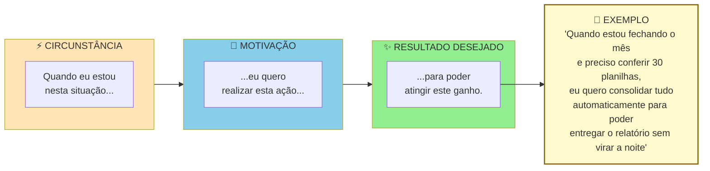

> [!warning] Um JTBD completo tem três partes
> "Quero automatizar planilhas" está incompleto. Sem circunstância e sem outcome. Solução que atende JTBD bem formulado tende a ser mais específica e mais defensável.

> [!tip] Switch Interview quando o entrevistado trocou de solução
> Quando o entrevistado **trocou** de solução (deixou um concorrente, largou um processo manual, migrou de ferramenta, mudou de fornecedor), entrevista comum de JTBD captura a versão racionalizada da decisão. A Switch Interview de Bob Moesta reconstrói o momento real, mapeando as quatro forças simultâneas — push (o que empurrou para fora do velho), pull (o que atraiu para o novo), anxiety (o que causou medo de trocar) e habit (o que segurava no antigo). Para cada switcher relevante, marque uma segunda conversa com o [[IGNICAO-Vol-10-Canvases-e-Templates#APÊNDICE A — TEMPLATES PRONTOS PARA USO|Template A.29 (Vol. 10)]]. O que ela formula é um JTBD muito mais específico do que o capturado em conversa única.

#### Passo 5, síntese qualitativa das entrevistas (técnicas formais)

A diferença entre um empreendedor iniciante e um pesquisador de usuário experiente está aqui. O iniciante "lê as anotações" e tira conclusões com base em memória. O experiente aplica técnicas formais de síntese, que transformam centenas de citações dispersas em padrões claros. Três técnicas a dominar.

##### Affinity mapping — agrupamento por afinidade

Processo físico ou digital (Miro, FigJam, Mural) para encontrar padrões em grandes volumes de dado qualitativo. Cinco passos.

Primeiro, extração de observações atômicas. Para cada entrevista, extraia quinze a quarenta "observações". Cada uma é um fato, citação, ou comportamento específico, escrito em post-it (um por post-it). Por exemplo, "João passa duas horas toda segunda compilando planilhas manualmente". Ou "Maria menciona três vezes que fica ansiosa com prazos de entrega".

Segundo, pool único. Junte todos os post-its de todas as entrevistas em um espaço grande. Quinze entrevistas vezes vinte e cinco observações dão trezentos e setenta e cinco post-its. É o típico.

Terceiro, agrupamento silencioso. A equipe (duas a quatro pessoas) move post-its em silêncio, agrupando por similaridade. Os movimentos podem ser reorganizados. O processo é fluido.

Quarto, nomeação dos grupos. Depois do agrupamento estabilizar, em uma a duas horas, nomeie cada cluster com uma frase curta que captura o tema. Por exemplo: "ansiedade no fechamento do mês"; "retrabalho por falta de integração".

Quinto, priorização dos clusters. Quantos post-its cada cluster tem? Clusters grandes são temas recorrentes. Clusters pequenos mas de alto impacto também importam.

O resultado são cinco a quinze clusters temáticos com número de ocorrências e citações exemplares.

##### Coding e thematic analysis — codificação temática

Método mais rigoroso, vindo da pesquisa qualitativa acadêmica. Cinco passos.

Codificação aberta. Leia cada transcrição linha por linha e atribua "códigos" (tags curtas de uma a três palavras) a trechos relevantes. Por exemplo, "ansiedade_prazo", "retrabalho_manual", "ferramenta_improvisada". Permita códigos emergentes. Não pré-defina a lista.

Revisão e consolidação. Depois de cinco a sete entrevistas codificadas, revise a lista de códigos. Combine sinônimos, elimine duplicatas, refine definições.

Codificação axial. Agrupe códigos relacionados em categorias mais abstratas. Por exemplo, os códigos "ansiedade_prazo", "pressão_chefe", "medo_errar" podem virar a categoria "pressão emocional no fluxo de trabalho".

Tema emergente. Das categorias, destaque três a sete temas que explicam a maioria das observações.

Matriz de saturação. Conte em quantas entrevistas cada tema aparece. Tema presente em sessenta por cento ou mais das entrevistas é provavelmente real. Tema em menos de trinta por cento pode ser ruído ou especificidade de um caso.

Ferramentas pagas: Dovetail, Delve, Atlas.ti. Alternativas grátis: planilha com colunas Quote, Código, Categoria, Tema.

##### Triangulação qualitativa mais quantitativa

> [!tip] Apêndice AO — Dados, Analytics e Experimentação
> A triangulação abaixo é a primeira vez que você produz dados estruturados sobre o cliente. O [[IGNICAO-Vol-3-Tracao#APÊNDICE AO — DADOS, ANALYTICS E EXPERIMENTAÇÃO|Apêndice AO (Vol. 3)]] aprofunda como estruturar surveys de validação, interpretar dados de survey com rigor estatístico mínimo, e montar o pipeline de experimentação que sustentará as decisões de produto nas fases posteriores.

Entrevistas sozinhas produzem hipóteses ricas mas estatisticamente frágeis. Survey sozinho produz números sem contexto. Combinar os dois é o padrão-ouro. Três passos.

Primeiro, use entrevistas (dez a trinta) para gerar temas, com os resultados do affinity mapping ou da codificação temática.

Segundo, transforme cada tema em uma a três perguntas de survey quantitativa, aplicada a cem a quinhentos respondentes do mesmo ICP.

Terceiro, compare. Tema que apareceu em setenta por cento das entrevistas e sessenta e cinco por cento do survey está validado. Tema em setenta por cento das entrevistas mas vinte por cento do survey é artefato da amostra. Tema em trinta por cento das entrevistas mas setenta por cento do survey indica que você deve fazer mais entrevistas com o perfil certo.

> [!note] A regra dos cinco usuários, de Nielsen
> A regra dos cinco usuários (Jakob Nielsen) vale para teste de usabilidade especificamente, não para problem discovery. Cinco usuários já capturam cerca de oitenta e cinco por cento dos problemas de usabilidade em um fluxo específico. Acima disso, retorno decrescente. Para descoberta de problema ou domínio (esta fase), quinze a trinta ainda é o padrão correto. Domínios mais amplos exigem mais amostras para atingir saturação.

##### Diário de pesquisa estruturado

Qualquer que seja a técnica, mantenha um diário de pesquisa em formato padronizado. Template mínimo por entrevista:

```text
DIÁRIO DE PESQUISA, Entrevista #___ Data: ___/___/___

Entrevistado:
 Nome (primeiro nome ou anonimizado): _______________
 Perfil (cargo, setor, idade, geo): ___________________
 Canal de recrutamento: ______________________________
 Como foi encontrado: _________________________________

Duração da entrevista: ____ minutos.

Contexto observado:
 Local: ______________________________________________
 Estado emocional aparente: __________________________
 Interrupções, ruídos, sinais não-verbais: __________

Top 3 quotes (verbatim, entre aspas, sem parafrasear):
1. "_______________________________________________"
2. "_______________________________________________"
3. "_______________________________________________"

Problemas mencionados (fatos, não interpretação):
- ____________________________________________________
- ____________________________________________________

Soluções atuais em uso (nomes específicos, comportamento):
- ____________________________________________________

Tentativas de solução no passado:
- ____________________________________________________

Custos atuais do problema (tempo/dinheiro/energia):
- ____________________________________________________

Pain Level estimado (1-5): ____. Por quê?: ____________

Reações emocionais observadas:
- ____________________________________________________

Surpresas (coisas que contradisseram minhas hipóteses):
- ____________________________________________________

Hipóteses novas geradas por esta entrevista:
- ____________________________________________________

Notas pessoais (em itálico, claramente separado do fato):
 _itálico aqui, interpretação minha, pode estar errada_
```

> [!important] Esse diário é o insumo bruto
> Sem esse nível de registro, você está reconstruindo entrevistas pela memória. E memória é enviesada.

#### Passo 6, defina personas com base nos dados coletados

Cada persona deve ter oito elementos. Nome fictício e foto representativa. Dados demográficos básicos. Contexto profissional ou pessoal relevante. Motivações principais. Frustrações principais. Comportamentos-chave observados. Ferramentas, canais, e fontes de informação. JTBDs prioritários. Citação verbatim marcante.

> [!warning] Persona sem dados é ficção bonita e inútil
> Cada elemento da persona precisa ter evidência rastreável das entrevistas. Se você não consegue apontar a entrevista que sustenta cada item, está inventando.

A estrutura visual de uma persona operacional, em contraste com persona demográfica:

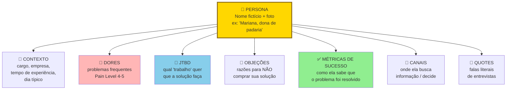

Persona operacional não é demografia. "Mulher, trinta e cinco a quarenta e cinco anos, classe B" é inútil. Não ajuda a decidir produto. "Mariana, dona de padaria artesanal de três lojas, gasta duas horas por dia conferindo insumos manualmente" é acionável.

#### Passo 7, mapeie os três papéis no contexto de compra (crítico em B2B)

Em contextos B2B, uma persona isolada raramente explica o comportamento de compra. Três papéis distintos interagem durante a decisão. Cada um tem motivações, restrições, e critérios próprios. Confundi-los é o erro mais caro em pesquisa de usuário para vendas B2B.

Usuário. Pessoa que vai operar o produto no dia a dia. Avalia ergonomia, encaixe com a rotina, tempo economizado. Tem poder de sabotagem (se odiar, não usa, ou usa mal). Mas raramente tem poder de compra.

Campeão Interno. Pessoa que enxerga valor na solução e está disposta a brigar por ela internamente. É tipicamente um usuário avançado ou um gestor próximo dos usuários. É quem vai marcar a reunião com o decisor, preparar a justificativa, responder pelos riscos. Sem campeão, quase nenhuma venda B2B fecha.

Comprador Econômico. Pessoa com autoridade e orçamento para autorizar o pagamento. Avalia ROI, risco, alinhamento com prioridades corporativas. Raramente vai usar o produto. Frequentemente não conhece os detalhes operacionais.

Três princípios operacionais para a pesquisa desta fase.

Primeiro, entreviste os três papéis separadamente. Misturar em uma entrevista só ("reunião com a empresa X") gera respostas editadas politicamente. Usuários não falam mal da solução se o chefe está presente. Chefes não admitem que não conhecem o workflow se o subordinado está na sala. Separe.

Segundo, monte uma persona distinta para cada papel, não uma persona média. Uma "persona da empresa" é ficção. Persona útil é do papel, porque cada papel toma decisões diferentes com base em critérios diferentes.

Terceiro, identifique quais papéis se sobrepõem e quais permanecem distintos no seu contexto. Em startups muito pequenas (SMB de cinco a vinte funcionários), os três podem ser a mesma pessoa, o dono. Em médias empresas, o usuário costuma estar separado dos outros dois. Em grandes, os três são sempre distintos e podem somar um quarto papel (TI ou Procurement). Saber onde o seu ICP está nessa geometria define quantas personas você constrói.

> [!tip] B2C também pode ter mais de uma persona
> Em B2C, o trio costuma colapsar em uma pessoa só. O próprio consumidor é usuário, decisor, e pagador. Mas há exceções importantes. Produtos para crianças (pais decidem, crianças usam). Saúde de idosos (filhos frequentemente decidem). Presentes (comprador diferente de destinatário). Benefícios corporativos (empresa paga, funcionário usa). Sempre pergunte: a pessoa que usa é a mesma que paga? Se não, você tem pelo menos duas personas.

O entregável deste passo, para cada papel relevante no seu contexto, é uma persona caracterizada com os mesmos elementos do Passo 5. Motivações, frustrações, comportamentos, JTBDs, citação verbatim. Em B2B típico, três personas. Em B2C típico, uma. Em casos especiais de B2C, duas.

#### Passo 8, identifique o sub-ICP mais doloroso

> [!note] ICP, sub-ICP e beachhead — três níveis de granularidade do mesmo conceito
> **ICP** (Ideal Customer Profile): o perfil amplo de cliente potencial, definido na [[#FASE 3 — DESCOBERTA DO PROBLEMA|Fase 3]] (ex: "donos de restaurante de 1-3 unidades em capitais brasileiras com delivery próprio").
> **Sub-ICP** ou **sub-segmento**: recorte mais estreito dentro do ICP onde a dor é mais aguda (ex: "donos que operam sozinhos, sem gerente"), identificado na Fase 3 como sinal e confirmado aqui na Fase 4.
> **Beachhead**: o sub-ICP escolhido como **ponto de entrada no mercado** — a praia onde você desembarca. É o sub-ICP mais doloroso operacionalmente filtrado pelos quatro critérios deste passo (urgência, agudeza, recursos, alcançabilidade).
>
> A relação é: ICP ⊃ sub-ICP ⊃ beachhead. Beachhead é sempre um sub-ICP; nem todo sub-ICP vira beachhead. Os termos não são intercambiáveis: ICP define quem PODE ser cliente; beachhead define quem SERÁ o primeiro cliente.

Entre as personas, qual delas tem o problema mais agudo, com mais urgência, mais recursos para pagar, e é mais fácil de alcançar? Essa é a sua *beachhead* — o ponto de entrada no mercado. Você deve focar nela nas fases seguintes.

#### Passo 9, consolide o Dossiê do Usuário

Documento de dez a vinte páginas. Conteúdo: duas a quatro personas detalhadas; duas a quatro jornadas mapeadas; lista de JTBDs ranqueada por importância e frequência; identificação da beachhead (sub-ICP prioritário); Declaração da Ideia atualizada para v3.

### Os nove passos aplicados, entrevista JTBD do PadariaPro

A pergunta central: "Me leva para a última vez que você precisou reabastecer o estoque de farinha, passo a passo, do começo ao fim. Quando você percebeu, o que fez, quem envolveu, quanto tempo levou, o que deu errado?"

A resposta bruta de Fábio, dono de três padarias em Campinas:

> "Foi terça passada. O João, gerente da loja 2, me mandou áudio de WhatsApp às 7h. 'Farinha T1 tá acabando, dá pra hoje só.' Eu tava no carro indo pra loja 3. Liguei pro fornecedor, Anaconda, distribuidor regional, e a moça disse que entrega só quinta. Aí liguei pro nosso plano B, o João do Moinho da Serra, que trouxe em quatro horas mas cobrou quinze por cento mais caro. No fim a gente fez a semana, mas o dia 2 foi estresse total, eu tinha três reuniões e tive que virar comprador. Isso acontece umas duas a três vezes por mês, depende. Agora, pra evitar, o gerente geralmente pede mais do que precisa, aí sobra farinha mofando no sábado e a gente perde 200-300 reais por semana. Tô trocando perda por perda."

A análise JTBD da resposta. O job funcional é garantir continuidade de produção sem interrupção. O job emocional é não ser o operador de última hora que apaga incêndio, e não transmitir estresse para a equipe. O job social é ser visto como dono que tem o negócio sob controle pelo gerente e pelos clientes. O contexto: acontece toda semana, é interrupção de foco executivo, envolve duas a três pessoas em média. A solução atual é WhatsApp com gerente mais ligação com fornecedor mais plano B mais caro como contingência. E o "trade de perda por perda" é o ponto-chave. Ou paga mais caro (plano B), ou desperdiça (excesso). Não há caminho sem perda.

A persona resultante, em fragmento. Fábio, trinta e oito anos, padaria artesanal de três lojas em Campinas. Perfil: dono-operador, formação técnica, usa WhatsApp e planilha no celular, desconfiado de apps "modernos" mas adota se ver valor em uma semana. O job contratado é "me devolver horas de foco executivo", mais que "otimizar margem". Se o produto devolver quatro horas por semana do dono, ele paga R$ 400 por mês sem pestanejar. Se só economizar dois por cento de margem, ele questiona.

Os gatilhos de troca observados foram três. Incidente recente de ruptura que causou perda grande (mais de R$ 5 mil), ou cliente insatisfeito. Chegada de nova loja (passar de duas para três, de três para quatro) torna sistema manual inviável. Indicação de par (outro dono de padaria) sobre ferramenta que funcionou.

As barreiras à troca foram três. Percepção de que "a equipe não vai usar". Medo de investir em ferramenta que vira caro sem adoção. Integração com fornecedor atual (relacionamento pessoal) que não entra em sistema digital. Custo fixo mensal que não se sente "tangível", contra a economia, que é difusa.

### Caso brasileiro real, pesquisa com usuários no QuintoAndar e a dor do fiador

Em 2013, o mercado de aluguel residencial no Brasil tinha fricção enorme. Fiador, vistoria, caução, dois a três meses de processo. Os fundadores do QuintoAndar (Gabriel Braga e André Penha, em São Paulo) fizeram pesquisa qualitativa extensa com inquilinos e proprietários.

Descobriram algo que a hipótese inicial não previa. O ponto mais doloroso era o fiador. Não o valor. A constrangedora necessidade de pedir a alguém. A dor era social, não financeira.

A pesquisa redirecionou a proposta de valor. Em vez de "otimizar o processo de aluguel", posicionaram como "aluguel sem fiador, sem vistoria, sem caução". A dor central virou promessa central. E o produto cresceu nessa direção.

A lição transferível. Pesquisa aprofundada revela qual dor é emocionalmente mais forte, não apenas qual é operacionalmente mais cara. A proposta de valor precisa atacar a dor emocional.

### PERGUNTAS A RESPONDER

- Como o usuário realmente vive a rotina, não como ele diz que vive?
- Quais são os contextos (lugar, horário, estado emocional, pessoas presentes) em que o problema ocorre?
- Quais são os passos concretos da jornada atual?
- Em qual passo da jornada a dor é máxima?
- Quais ferramentas, pessoas, e processos o usuário já mobiliza?
- Que *jobs* o usuário está tentando cumprir (funcional, emocional, social)?
- Qual persona tem a dor mais aguda, e é o melhor ponto de entrada?
- O que o usuário considera "sucesso" no cumprimento do *job*?

### SAÍDA DESTA FASE

Você concluiu a [[#FASE 4 — PESQUISA COM USUÁRIOS (CUSTOMER DISCOVERY APROFUNDADO)|Fase 4]] quando todos os critérios abaixo estão cumpridos.

- [ ] Dez ou mais entrevistas JTBD novas (não reaproveitadas da Fase 3) com roteiro específico, sessenta a noventa minutos cada.
- [ ] Cinco ou mais observações em campo (job shadowing) ou análises profundas de artefatos, com triangulação entre dado declarado e dado observado. Divergência abaixo de 30% é aceitável (ruído de memória e narrativa); 30-50% exige triangulação com mais fontes; 50% ou mais indica que a fala é pouco confiável e você deve priorizar o observado.
- [ ] Dossiê do Usuário com duas a quatro personas baseadas em dados reais (Template A.5), seis ou mais atributos comportamentais por persona, duas a quatro jornadas mapeadas e cinco a dez JTBDs ranqueados.
- [ ] Cinco ou mais contextos de uso mapeados (quando, onde, com quem, sob qual pressão).
- [ ] "Solução atual não-óbvia" identificada (o que as pessoas realmente usam hoje, mesmo que não seja feito para isso).
- [ ] Gatilhos de troca e barreiras à troca documentados em lista.
- [ ] Em B2B, três papéis (usuário, campeão, comprador econômico) entrevistados separadamente, com persona distinta para cada papel relevante no contexto.
- [ ] Tese sobre "dor real" refinada com mais granularidade (qual job, qual contexto, qual gatilho), com registro "antes versus depois".
- [ ] Beachhead escolhida com justificativa baseada em dados (urgência + agudeza + recursos para pagar + alcançabilidade).
- [ ] Declaração da Ideia atualizada para v3.

> [!warning] Critério de saída
> Se qualquer um desses itens falha, não avance. Resolva antes.

**Primeiros passos práticos.**

1. Escolher dez entrevistados da [[#FASE 3 — DESCOBERTA DO PROBLEMA|Fase 3]] que mostraram maior dor, e pedir trinta minutos de follow-up com foco em JTBD.
2. Elaborar a pergunta central JTBD: "Me conta a última vez que você precisou (job), do começo ao fim, em detalhes."
3. Construir uma persona (Template A.5) com dado real, não nome fictício sem base.
4. Mapear, em planilha, os gatilhos de troca e as barreiras identificadas.

### Armadilhas

> [!note] Apêndice D — Armadilhas Mentais e Vieses
> Personas fictícias, viés de confirmação na síntese qualitativa e ancoragem na hipótese original são os vieses mais comuns nesta fase. O [[IGNICAO-Vol-1-Ideacao#APÊNDICE D — ARMADILHAS MENTAIS E VIESES|Apêndice D (Vol. 1)]] trata especificamente de vieses de pesquisa — como o efeito halo sobre entrevistados carismáticos e o viés de disponibilidade que faz a última entrevista parecer mais importante que as anteriores.

Criar personas fictícias. Sem dados, persona é caricatura. Força você a dizer "a nossa persona é a Ana, uma dona de restaurante…", mas não protege decisões ruins.

Confiar só no que a pessoa diz. Pessoas relatam uma versão idealizada de si mesmas. Observe além de escutar.

Pular JTBDs. Sem clareza do *job*, você projeta funcionalidades sem saber o problema que resolvem. JTBD é a bússola.

Persona única e genérica. Quase sempre há dois ou mais sub-segmentos relevantes. Uma persona só mascara diferenças importantes.

Perder-se em detalhes irrelevantes. Nem toda informação coletada é útil. Filtre pelo que afeta a decisão de produto.

---

### FERRAMENTAS DESTA FASE

A maioria das ferramentas de research está no Ferramentário (BG.6). Canvases complementares: CZ.3 (Value Proposition Canvas), CZ.6 (Empathy Map) e CZ.7 (Customer Journey Canvas).

- **5 Whys** — perguntar "por quê?" cinco vezes para chegar à causa raiz, durante entrevistas. BG.5.2.
- **MECE** — estruturar achados sem sobreposição e sem lacunas. BG.4.5.
- **McKinsey 7-Step (Synthesize)** — consolidar achados em aprendizados, não fatos soltos. BG.5.1.
- **Pyramid Principle** (Minto) — comunicar achados ao time e stakeholders, conclusão no topo. BG.4.4.
- **Second-Order Thinking** (Marks) — o que o usuário fará se a solução existir? Como o comportamento mudará? BG.4.2.

> [!note] Métodos consagrados de pesquisa no Ferramentário
> O [[IGNICAO-Vol-9-Ferramentario#APÊNDICE BG — FERRAMENTÁRIO COMPLETO DO EMPREENDEDOR|Apêndice BG (Vol. 9)]].6 adiciona: The Mom Test (Fitzpatrick), JTBD Switch Interviews (Moesta), Contextual Inquiry (Beyer e Holtzblatt), Laddering Technique, Diary Studies, Empathy Mapping (Gray), Customer Journey Mapping, Personas (Cooper), Grounded Theory, Thematic Analysis, e cerca de quinze outros métodos.

---

### SÍNTESE DA FASE 4

A diferença entre quem faz certo e quem falha está em observar, não só perguntar. Entrevista produz evidência declarada. Observação em contexto produz evidência comportamental. As duas são diferentes, e a segunda é mais valiosa.

O entregável é o Dossiê do Usuário. Personas baseadas em dados reais, não em intuição. Jornadas mapeadas com momentos críticos identificados. Lista clara de jobs. Esse dossiê é insumo das Fases 8 e 9, ideação e protótipo.

A [[#FASE 5 — MAPEAMENTO DE MERCADO E CONCORRÊNCIA|Fase 5]] vai usar esse material para posicionar a oportunidade dentro da paisagem competitiva real: quem são os concorrentes, onde está a cunha de entrada, por que o cliente trocaria a alternativa atual por você. Quem ignora a [[#FASE 4 — PESQUISA COM USUÁRIOS (CUSTOMER DISCOVERY APROFUNDADO)|Fase 4]] e pula para "vamos construir" entra na construção sem entender quem vai usar nem em que circunstância. O resultado é produto bem-feito tecnicamente e ignorado por quem deveria adotar.

---

## FASE 5 — MAPEAMENTO DE MERCADO E CONCORRÊNCIA

> [!question] FMF Check da Fase 5
> Você está escolhendo cunha neste momento. Pergunta: o seu fit particular com esta cunha é diferencial inimitável, ou é circunstancial? Se a resposta for "outra pessoa qualquer faria tão bem quanto", reavalie. Founder-market-fit é o que faz o próximo ano de dificuldade valer a pena. É a única coisa que diferencia quem persiste de quem desiste no mês 14.

### O que esse apêndice cobre

Levantamento estruturado do mercado em que você quer entrar. O tamanho. A dinâmica. Os principais atores. As soluções atuais (concorrentes diretos, indiretos, substitutos, alternativas). As tendências. A regulamentação aplicável. As barreiras de entrada.

O entregável é um Dossiê de Mercado. Documento que posiciona a sua oportunidade dentro de uma paisagem realista.

> [!abstract] Resumo operacional
> **Entregável:** Dossiê de Mercado mais Canvas da Cunha preenchido — define ICP preciso, dor específica, dono do orçamento e por que o cliente trocaria a alternativa atual por você.
>
> **Sinais de saída:**
> - TAM, SAM e SOM calculados bottom-up com dados reais e justificativa explícita.
> - Cinco ou mais concorrentes diretos analisados em cinco dimensões cada, mais três indiretos ou substitutos (incluindo status quo).
> - Canvas da Cunha (Template A.12) preenchido e Teste de Precisão do Comprador (Template A.11) com score quatro ou mais sobre seis.
> - Posicionamento em dimensão não-óbvia (não "mais barato" nem "mais features").
> - Você consegue responder em uma frase por que o cliente-alvo trocaria a alternativa atual por você.
>
> **Três armadilhas mais comuns:**
> 1. "Não tenho concorrentes" — você sempre tem, mesmo que seja Excel, papel ou o cliente fazendo sozinho, e ignorar isso cria falsa sensação de oportunidade.
> 2. Top-down preguiçoso — pegar número de relatório e multiplicar por "um por cento é fácil" subestima a brutalidade de conquistar cada ponto de share.
> 3. Ignorar o status quo — a inércia é invencível se a dor não for grande o suficiente, e cunhas fortes substituem coisas que doem, não meras inconveniências.

### POR QUE

Empreendedores apaixonados tendem a acreditar que "não há concorrentes", ou que "o mercado é enorme". Ambas as afirmações são quase sempre falsas. O mapeamento de mercado força você a enxergar a realidade competitiva. Existem soluções (mesmo que ruins). Existem substitutos (incluindo "fazer nada"). Existem players (concorrentes e participantes do mercado) grandes que podem te copiar. Existe regulamentação que pode te inviabilizar.

Sem esse mapa, você empreende às cegas. Com ele, você toma decisões informadas sobre posicionamento, diferenciação, e estratégia.

### Quando usar

Comece em paralelo com a [[#FASE 4 — PESQUISA COM USUÁRIOS (CUSTOMER DISCOVERY APROFUNDADO)|Fase 4]], ou logo depois. Termine quando tiver clareza de onde se posiciona, e de onde vêm os principais riscos competitivos. Revisite pelo menos uma vez a cada seis meses ao longo da vida do negócio. O mercado muda.

### Quem envolve

O executor é você. Os participantes são usuários (para saber o que eles usam), especialistas de setor (para saber a dinâmica do mercado), e advogado (para regulamentação crítica, se aplicável).

### Como executar

Onze passos. Os Passos 1 a 9 cobrem o levantamento de mercado e a síntese do Dossiê. Os Passos 10 e 11 — Construção do Canvas da Cunha e Teste de Estresse — aparecem mais adiante na fase, depois da SAÍDA, do EXEMPLO PRÁTICO e das Armadilhas, em virtude do volume. São a parte central e operacionalmente mais importante do método; leia-os como continuação direta do passo a passo.

#### Passo 1, defina o mercado corretamente

Mercado não é "software". Não é "restaurantes". Mercado é a intersecção entre tipo de cliente, problema que você resolve, e geografia. Por exemplo: "software de gestão de caixa para restaurantes de pequeno porte em capitais brasileiras que fazem delivery próprio". Isso é um mercado que pode ser estimado.

#### Passo 2, estime o tamanho do mercado (TAM, SAM, SOM)

TAM (mercado total disponível) é o tamanho total do mercado global para o problema. É o teto absoluto.

SAM (mercado que você pode alcançar) é a parte do TAM que a sua empresa pode realisticamente atender — geograficamente, tecnologicamente, regulatoriamente.

SOM (mercado que você pode capturar realisticamente) é a parte do SAM que você pode conquistar nos primeiros três a cinco anos. Em geral, é um percentual pequeno (de um a dez por cento).

A visualização em círculos concêntricos:

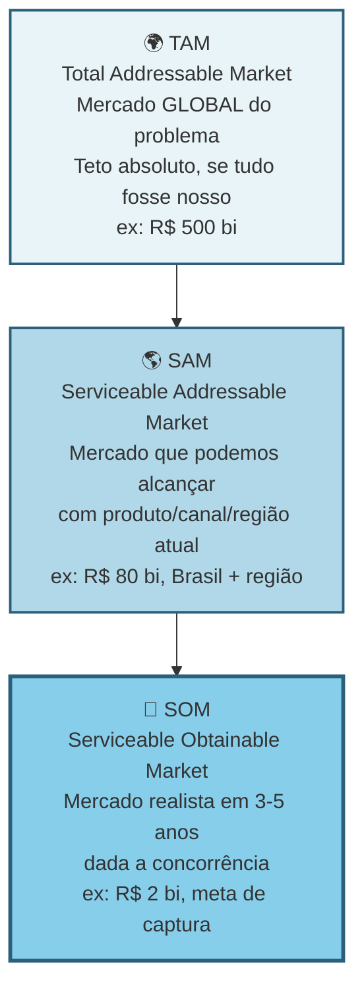

> [!warning] O que investidor checa em TAM/SAM/SOM
> Investidor checa consistência. TAM otimista sem SOM realista é sonho. SOM ambicioso sem TAM que sustenta é conta que não fecha. Estime bottom-up (de baixo para cima: número de clientes vezes ticket), não só top-down (de cima para baixo: percentual de mercado externo).

Calcule top-down e bottom-up, e compare. Top-down: dados de mercado públicos (IBGE, Abrasel, associações, relatórios pagos como Statista e Gartner, se acessíveis). Bottom-up: número estimado de clientes vezes a receita anual média por cliente.

Se os dois números divergem muito, há algo errado em uma das estimativas. Investigue.

#### Passo 3, identifique todas as alternativas atuais do usuário

Categorize em quatro grupos.

Concorrentes diretos. Outras soluções que resolvem o mesmo problema da mesma forma. Por exemplo, outros softwares da mesma categoria.

Concorrentes indiretos. Soluções que resolvem o mesmo problema de forma diferente. Por exemplo, planilha de Excel, caderno físico, contador terceirizado.

Substitutos. Ações que eliminam o problema. Por exemplo, o dono decide não oferecer delivery, e evita o problema.

Status quo, ou seja, "não fazer nada". É a alternativa mais poderosa. Por que as pessoas simplesmente aceitam conviver com o problema? Subestimar o status quo é a causa de trinta por cento das startups fracassadas.

> [!important] Sua concorrência real raramente é outra startup
> A concorrência real é o jeito que o trabalho é feito hoje. O Excel do auxiliar administrativo. O grupo de WhatsApp onde o gerente despacha ordens. A planilha que ninguém entende mas todo mundo respeita. O hábito silencioso de ignorar o problema porque "sempre foi assim". Reconhecer isso muda para onde você direciona a comparação competitiva. Você para de comparar features com "a Startup X" e começa a comparar a sua proposta com o comportamento atual do cliente. É nesse comportamento que mora a urgência (ou a falta dela).

**Os quatro tipos de substituto que você precisa mapear no concorrentes indiretos.** O jeito atual como o trabalho é feito hoje cai em quatro categorias bem definidas. Todas precisam ser mapeadas:

- **Planilhas** (Excel, Google Sheets, Airtable). Flexíveis, familiares, baixo custo percebido ("já pago por Office"), mas manuais, propensas a erro, fragmentadas por pessoa, sem trilha de auditoria. Sinal de oportunidade: o cliente tem uma planilha-mãe com quinze ou mais abas que só ele entende, e entra em pânico quando pensa em sair de férias.
- **Cadeias de e-mail e WhatsApp de trabalho**. Fragmentadas, difíceis de rastrear, informação dispersa em caixas de entrada. Sinal de oportunidade: o cliente perde informação importante em e-mails antigos, ou precisa reconstruir o histórico de uma decisão consultando cinco pessoas diferentes.
- **Ferramentas internas construídas ad-hoc**. Sistemas caseiros montados por um técnico ou estagiário, em geral desatualizados, com dívida técnica crescente, dependentes de uma pessoa específica. Sinal de oportunidade: o cliente vive com medo de que "fulano saia" e o sistema pare de funcionar.
- **SaaS estabelecidos resolvendo problema adjacente**. Softwares que o cliente já paga por outro motivo, e que "quase" resolvem o seu problema. É o concorrente mais subestimado. Sinal de oportunidade: o cliente usa quarenta por cento das features de uma ferramenta, e improvisa o resto.

> [!note] Entender por que o consumidor brasileiro tolera soluções ruins é parte da análise competitiva
> No Brasil, inércia de troca é amplificada por desconfiança em novos fornecedores, preferência por relação pessoal e sensibilidade a risco financeiro. O [[#APÊNDICE FF — PSICOLOGIA DO CONSUMIDOR BRASILEIRO — COMPORTAMENTO, DECISÃO E CONVERSÃO|Apêndice FF — Psicologia do Consumidor Brasileiro]] explica esses padrões e ajuda a formular o argumento de troca certo para cada perfil de cliente dentro da sua cunha.

> [!important] A pergunta-chave de competição
> Por que a alternativa atual é tolerada? Se a resposta é "porque funciona suficientemente bem", a sua urgência é fraca, e provavelmente você não tem cunha. Cunhas fortes substituem algo doloroso. Não algo levemente inconveniente. Se os entrevistados descrevem a planilha-mãe rindo ("a minha relação de amor e ódio com aquele Excel maldito"), você tem uma fresta. Se descrevem com indiferença ("funciona, acho"), você não tem.

Para cada alternativa, levante seis dimensões: quem a oferece; preço; pontos fortes e fracos percebidos (use falas diretas das Fases 3 e 4); posicionamento e público-alvo; tempo de mercado; e a pergunta-chave: por que essa alternativa é tolerada hoje?

Se ninguém está reclamando ativamente, procurando substituto, ou alocando tempo para contornar os defeitos, a dor provavelmente não é grande o suficiente para motivar troca. Cunhas fortes substituem coisas que doem, não coisas apenas inconvenientes.

Mapeie pelo menos as cinco a dez alternativas mais relevantes.

> [!note] Monitorar concorrentes não é tarefa pontual — é sistema contínuo
> O [[#APÊNDICE EE — INTELIGÊNCIA COMPETITIVA — MONITORAMENTO, ANÁLISE E RESPOSTA|Apêndice EE — Inteligência Competitiva]] cobre como estruturar monitoramento sistemático de mercado, conduzir análises win/loss e produzir battle cards acionáveis. Aplicado a esta fase, transforma o levantamento de alternativas de um documento estático em inteligência viva que alimenta decisões de roadmap e vendas.

> [!tip] Strategy Canvas para visualizar diferenciação
> Listar as alternativas é o primeiro passo. O segundo é decidir como você se posiciona contra elas — e aqui o [[IGNICAO-Vol-10-Canvases-e-Templates#APÊNDICE CZ — CANVASES E MAPAS VISUAIS DE MODELO|Strategy Canvas (CZ.4) (Vol. 10)]] de Kim & Mauborgne (Blue Ocean Strategy — ferramenta para identificar mercados sem concorrência direta) é a escolha certa. Liste 8-15 fatores de competição do setor, trace a curva de valor de cada concorrente principal (1-10 em cada fator) e desenhe a curva nova que você quer construir. Curva nova "ligeiramente acima" da média do setor é otimização de Red Ocean (mercado com muita concorrência). Curva visualmente distinta — onde você elimina/reduz fatores que ninguém mais ousa cortar e cria fatores que ninguém oferece — é Blue Ocean. Veja CZ.4 para o caso completo Stone vs adquirentes tradicionais.

#### Passo 4, entenda a dinâmica do mercado

Responda cinco perguntas. O mercado está crescendo, estável, ou encolhendo? (Busque dados dos últimos três a cinco anos.) Existem tendências estruturais? (Digitalização, regulação nova, mudanças demográficas, mudanças de comportamento.) O mercado está concentrado em poucos players grandes, ou é fragmentado? Existem movimentos de consolidação (fusões e aquisições)? Há ciclos sazonais?

#### Passo 5, mapeie os canais de aquisição de clientes usados no setor

Como os players atuais adquirem clientes? Vendas diretas. Parcerias. Marketing digital. Eventos. Boca a boca. Representantes. Isso indica o que provavelmente vai funcionar para você, e onde o custo de aquisição pode ser alto.

> [!tip] Apêndice DU — GTM Playbook
> O [[IGNICAO-Vol-3-Tracao#APÊNDICE DU — GTM PLAYBOOK: DA IDEIA AO PRIMEIRO MILHÃO DE ARR|Apêndice DU — GTM Playbook (Vol. 3)]] aprofunda a tradução desse mapeamento de canais em estratégia de go-to-market operacional: sequenciamento de canais, modelo de cobertura, playbook de vendas e definição de ICP por canal. Use após concluir este passo para transformar o levantamento em plano executável.

#### Passo 6, levante a regulamentação relevante

Se você atua em saúde, finanças, educação, transporte, alimentação, energia, telecom, ou qualquer setor regulado, há normas que podem inviabilizar a sua solução. Busque as regulamentações federais, estaduais, e municipais aplicáveis. Os órgãos fiscalizadores (ANVISA, BACEN, ANS, ANTT, CVM, e outros, no Brasil). LGPD, se você trata dados pessoais. Exigências tributárias específicas.

> [!tip] Em dúvida sobre regulação, antecipe
> Invista duas a quatro horas de consultoria jurídica agora. É muito mais barato do que descobrir depois que o seu produto é ilegal.

#### Passo 7, identifique barreiras de entrada e vantagens competitivas sustentáveis

O que impede novos concorrentes (incluindo grandes empresas) de te copiar rapidamente? Economias de escala? Network effects (efeitos de rede)? Dados proprietários? Marca? Switching costs (custo de troca para o cliente)?

> [!warning] Execução não é barreira
> Seja realista. "Execução" não é barreira de entrada. Qualquer um pode executar bem. Barreira é estrutural. É o que existe depois que você sai do escritório.

> [!tip] Apêndice CZ — Network Effects Map (CZ.18)
> Quando o modelo tem componente de rede (marketplaces, plataformas, social, comunidades), o [[IGNICAO-Vol-10-Canvases-e-Templates#APÊNDICE CZ — CANVASES E MAPAS VISUAIS DE MODELO|Network Effects Map (CZ.18) (Vol. 10)]] classifica o tipo de efeito (direto, indireto, dados, social) e identifica os limites de defensibilidade. Use ao avaliar moats em modelos de plataforma — efeito de rede é a categoria de moat mais forte e mais difícil de identificar com clareza.

> [!tip] Apêndice CZ — Wardley Map (CZ.20)
> Para análise estratégica em profundidade, o [[IGNICAO-Vol-10-Canvases-e-Templates#APÊNDICE CZ — CANVASES E MAPAS VISUAIS DE MODELO|Wardley Map (CZ.20) (Vol. 10)]] decompõe a cadeia de valor em estágios de evolução (Genesis → Custom → Product → Commodity), revelando onde investir custom (componentes que criam vantagem) e onde comoditizar (componentes que viraram utility). Complementa Porter (forças estáticas) com lente temporal (evolução).

#### Passo 8, faça uma matriz competitiva

A matriz competitiva 2x2 dá clareza instantânea de onde você se encaixa. Exemplo genérico:

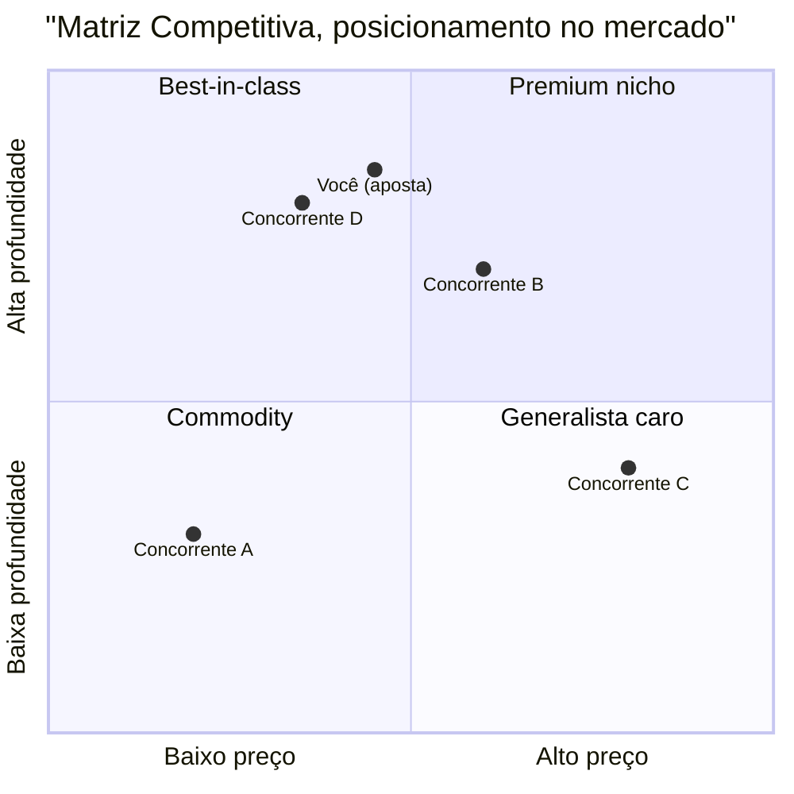

Escolha dois eixos que importam para o ICP, não para você. Preço versus profundidade. DIY versus completo. Generalista versus vertical. Quadrantes vazios são oportunidades. Quadrantes cheios são guerras. Onde você se posiciona define a sua cunha.

Depois complemente a matriz visual com uma tabela comparando você com três a sete concorrentes principais em cinco a dez dimensões relevantes: preço, features, público-alvo, pontos fortes, pontos fracos, diferenciação declarada.

> [!tip] Apêndice S — Category Design
> Se a análise da matriz revelar um quadrante vazio em que nenhum player se posiciona, você pode estar diante de uma oportunidade de criar uma categoria nova — não apenas competir melhor dentro das existentes. O [[#APÊNDICE S — CATEGORY DESIGN|Apêndice S — Category Design]] cobre como nomear, enquadrar e liderar uma categoria, baseado no framework de Al Ramadan e colegas. Aplicado aqui, transforma o quadrante vazio de dado descritivo em tese estratégica.

> [!note] Posicionamento de marca é uma das saídas desta fase, não só análise competitiva
> A matriz e o canvas da cunha definem onde você compete. O [[IGNICAO-Vol-3-Tracao#APÊNDICE DX — BRANDING E POSICIONAMENTO DE MARCA PARA STARTUPS|Apêndice DX — Branding e Posicionamento de Marca (Vol. 3)]] complementa ao definir como você quer ser percebido nessa posição — território de marca, promessa central e coerência de identidade. Os dois artefatos (cunha + posicionamento) devem ser desenvolvidos em paralelo.

#### Passo 9, sintetize o Dossiê de Mercado

Documento de dez a vinte páginas. Conteúdo: definição precisa do mercado; TAM, SAM, SOM calculados e justificados; lista de alternativas atuais categorizadas; análise de três a sete concorrentes com fichas detalhadas; matriz competitiva; tendências e dinâmicas relevantes; regulamentação mapeada; barreiras de entrada e possíveis vantagens competitivas; canais de aquisição usados no setor; e a sua hipótese de posicionamento (onde você se encaixa, para quem, contra quem).

### PERGUNTAS A RESPONDER

- Qual o tamanho real do meu mercado (SOM em R$)?
- Quem são os meus principais concorrentes diretos, indiretos, e substitutos?
- Por que o meu cliente escolheria a mim, e não a alternativa atual?
- Quais são os três maiores riscos competitivos nos próximos dois anos?
- Existe regulamentação que pode me inviabilizar? Qual?
- Quais canais de aquisição são mais promissores para este mercado?
- Qual vantagem competitiva eu posso construir nos primeiros dezoito meses?
- O mercado está crescendo, ou encolhendo?

> [!tip] Apêndice X — Pricing Strategy
> A escolha de posicionamento de preço no Passo 8 (eixo horizontal da matriz) deve ser informada por análise de disposição a pagar, não por benchmarking ingênuo de concorrentes. O [[IGNICAO-Vol-3-Tracao#APÊNDICE X — PRICING STRATEGY COMO DISCIPLINA|Apêndice X — Pricing Strategy (Vol. 3)]] cobre modelos de precificação (value-based, cost-plus, freemium, usage-based), teste de sensibilidade a preço (Van Westendorp, Gabor-Granger), e o erro de começar com preço baixo demais que é difícil de reverter.

> [!tip] Canvas da Cunha como entregável central desta fase
> O Canvas da Cunha (CZ.15) operacionaliza a escolha do segmento de entrada: ICP preciso, dor específica (um fluxo de trabalho quebrado), resultado mensurável, dono do orçamento, Teste do Grupo de WhatsApp (100-300 pessoas listáveis por nome) e vantagem sobre a alternativa atual. É o artefato de saída desta fase — sem ele preenchido e aprovado nos três testes complementares (Precisão do Comprador, ausência de escopo instável, independência de plataforma), a Fase 5 não está concluída. Veja origem, estrutura e caso PadariaPro em [[IGNICAO-Vol-10-Canvases-e-Templates#APÊNDICE CZ — CANVASES E MAPAS VISUAIS DE MODELO|CZ.15 (Vol. 10)]]; template preenchível em [[IGNICAO-Vol-10-Canvases-e-Templates#APÊNDICE A — TEMPLATES PRONTOS PARA USO|A.12 (Vol. 10)]].

### SAÍDA DESTA FASE

Você concluiu a [[#FASE 5 — MAPEAMENTO DE MERCADO E CONCORRÊNCIA|Fase 5]] quando todos os critérios abaixo estão cumpridos.

- [ ] Dossiê de Mercado escrito.
- [ ] TAM, SAM, e SOM calculados bottom-up com dados reais (não top-down de relatório genérico), com justificativas explícitas. Para case de capital de risco, caminho crível para SOM ≥ R$ 100 milhões em sete a dez anos.
- [ ] Cinco ou mais concorrentes diretos analisados em cinco ou mais dimensões cada (preço, posicionamento, ICP, pontos fortes e fracos, reação potencial), mais três ou mais indiretos ou substitutos (incluindo status quo).
- [ ] CAGR do mercado estimado por duas fontes convergentes. Benchmark: ≥15% (B2B SaaS) ou ≥10% (consumer) sinaliza expansão; abaixo de 5% indica mercado estagnado e exige estratégia diferente.
- [ ] Dispersão competitiva caracterizada (concentrado se top 1 ≥40% ou top 3 ≥70%; fragmentado se top 5 <30%). Fragmentado favorece entrada por cunha; concentrado exige diferencial forte ou nicho mal-atendido.
- [ ] Canvas da Cunha (Template A.12) preenchido e coerente, com caminho de expansão pós-cunha esboçado em três horizontes.
- [ ] Teste de Precisão do Comprador (Template A.11) aplicado, com score de quatro ou mais sobre seis.
- [ ] Posicionamento em dimensão não-óbvia (não "mais barato" nem "mais features").
- [ ] Regulamentação aplicável investigada, com plano de conformidade.
- [ ] Concorrentes que reagiriam ao seu crescimento identificados, com tipo de reação esperada.
- [ ] Você consegue responder, em uma frase, por que o cliente-alvo trocaria a alternativa atual por você.

> [!warning] Se o último item não tem resposta, pare
> Se você não consegue responder por que o cliente trocaria, ainda não tem diferencial claro. Volte ao Dossiê do Usuário (saída da [[#FASE 4 — PESQUISA COM USUÁRIOS (CUSTOMER DISCOVERY APROFUNDADO)|Fase 4]]) e ao Mapa de Problemas (saída da [[#FASE 3 — DESCOBERTA DO PROBLEMA|Fase 3]]).

**Primeiros passos práticos.**

1. Abrir o Template A.12 (Canvas da Cunha) e preencher com a hipótese de segmento inicial.
2. Fazer análise competitiva em planilha. Linhas: cinco a oito concorrentes. Colunas: dimensões (preço, ICP, posicionamento, pontos fortes, pontos fracos, reação potencial).
3. Calcular TAM, SAM, e SOM bottom-up. Número de empresas vezes ticket médio vezes taxa de captura realista em três anos.
4. Aplicar o Teste de Precisão do Comprador (Template A.11). Se falhar em três ou mais critérios, refinar a cunha antes de avançar.

### EXEMPLO PRÁTICO

**Canvas da Cunha, PadariaPro.**

Segmento inicial (cunha). Padarias artesanais com três a cinco lojas, faturamento de R$ 100 mil a R$ 300 mil por mês por loja, em São Paulo capital e região metropolitana.

Por que esse segmento? A dor mais aguda foi identificada na pesquisa. A [[#FASE 4 — PESQUISA COM USUÁRIOS (CUSTOMER DISCOVERY APROFUNDADO)|Fase 4]] mostrou dor 8 ou 9 aqui, contra 4 a 6 em padarias com uma ou duas lojas. O tamanho é viável: cerca de quatrocentas padarias identificáveis nesse perfil em São Paulo (pesquisa em Sympla de eventos de panificação mais ABIP). A capacidade de pagar é boa: dono-operador com margem bruta de quarenta e cinco por cento ou mais, desembolso de R$ 1.200 a R$ 2.000 por mês é viável. E a acessibilidade é alta: a maioria está em três ou quatro bairros identificáveis, e eventos setoriais (Expo Pan) permitem contato direto.

Valor para o segmento. O problema é a perda de R$ 3 mil a R$ 8 mil por mês por loja por gestão manual de estoque, mais quatro a oito horas por semana do dono em pedido. A solução em uma frase: software mais integração com fornecedor que devolve quatro horas por semana ao dono e reduz a perda em sessenta a oitenta por cento. A prova de valor inicial é piloto com três padarias, medindo a redução de perda mês a mês.

Critérios de entrada (barreira baixa). Onboarding em menos de sete dias, sem requisito de TI. Preço em teste: R$ 400 por mês por loja, com início grátis por trinta dias. Integração inicial com dois fornecedores-chave (Anaconda e Moinho da Serra).

Defensabilidade (como ficar seguro depois de entrar). Três fontes. Integrações com fornecedores que demoram três a seis meses para replicar. Dados de demanda acumulados que geram previsão melhor que competidor sem base. Relacionamento com donos (eventos, WhatsApp) que cria efeito de comunidade.

Caminho de expansão pós-cunha. Ano 1: SP capital mais região metropolitana (meta cinquenta padarias). Ano 2: Campinas, Grande Rio, BH. Ano 3: padarias de seis a dez lojas, redes pequenas, e expansão geográfica nacional.

Competidores e reação potencial:

| Competidor | Tipo | Posicionamento | Reação à nossa entrada |
|---|---|---|---|
| SigePro | ERP horizontal | Genérico, pesado | Baixa, não enxerga nicho |
| Zenda | ERP restaurante | Foco em delivery | Média, pode adicionar feature |
| Excel/Caderno | Solução atual | Inércia | Nenhuma |
| Consultoria local | Serviço pontual | Pessoal, caro | Nenhuma ou parceria |

Teste de Precisão do Comprador, fragmento.

- [x] Consigo descrever o comprador em uma frase com quatro ou mais atributos? Sim. "Dono-operador de três a cinco padarias artesanais em SP, trinta a quarenta e cinco anos, adota app se vê valor em uma semana."
- [x] Consigo listar vinte nomes reais? Sim. Vinte e sete nomes mapeados em rede mais ABIP.
- [x] Identifiquei três gatilhos que fariam essa pessoa comprar agora? Sim. Ruptura recente, nova loja, indicação.
- [x] Tenho acesso direto ou via rede a dez ou mais pessoas desse perfil? Sim. Doze contatos diretos mais oito via rede.
- [ ] Já validei disposição a pagar com cinco ou mais pessoas do perfil? Não. Só dois até agora.
- [ ] Consigo vender para esse perfil com discurso de menos de dez minutos? Não testado ainda.

Score quatro sobre seis. A cunha é viável, mas duas dimensões precisam de validação adicional antes de investir em produto.

**Contraste com cunha de mercado amplo, Stone (2012, em meia página).** A Stone começou com cunha aparentemente "larga" — cerca de um milhão e meio de PMEs com aceitação de cartão — mas estreitou em três dimensões cirúrgicas: pequenos comerciantes insatisfeitos com atendimento dos grandes adquirentes, em capitais (RJ e SP no piloto), com onboarding de 48 horas e recebimento em D+1 contra D+30 dos incumbentes. A defensibilidade não veio de tecnologia mas de rede física humana ("Green Angels" em campo, com relacionamento local), cara para Cielo e Rede replicarem. A lição transferível: cunha não é só nicho profundo de poucos alvos (PadariaPro). Pode ser também um corte vertical específico dentro de mercado grande, desde que com dimensão de defensibilidade que o incumbente não consegue copiar barato.

### Armadilhas

"Não tenho concorrentes." Você tem. Mesmo que seja o Excel, o papel e caneta, ou "a pessoa faz sozinha". Não reconhecer isso cria falsa sensação de oportunidade.

Confundir market size com oportunidade. Um mercado de R$ 10 bilhões pode ser péssimo negócio se dominado por dois gigantes bem-financiados. E um nicho de R$ 50 milhões pode ser ótimo se ignorado e você capturar vinte por cento.

Top-down preguiçoso. Pegar um número de relatório e multiplicar por "um por cento é fácil". Cada ponto percentual de mercado é brutalmente difícil de conquistar.

Ignorar o status quo. Como mencionado, o status quo é o concorrente mais comum. A inércia é invencível se a dor não for grande o suficiente.

Regulamentação como detalhe. Setores regulados (saúde, financeiro, educação) têm regras que afundam produtos inteiros. Investigue cedo.

### Passo 10 (parte central) — Construa o Canvas da Cunha

Esta é a parte central do método desta fase. Aparece aqui pelo volume, depois das Armadilhas, mas é o trabalho que sustenta tudo o que você fez nos Passos 1 a 9. Sem o Canvas da Cunha preenchido, o Dossiê de Mercado é leitura sem destino. A pergunta operacional é: por onde eu começo a vender, exatamente? A resposta tem nome. Estratégia da Cunha (Wedge Strategy).

A Cunha é um ponto de entrada no mercado muito restrito e de alta alavancagem. Empresas que tentam "vender para pequenas e médias empresas em geral", ou "para criadores de conteúdo", têm quase sempre resultados ruins. O foco é largo demais. A mensagem é genérica. O custo de aquisição explode. E o produto acaba servindo mal a todo mundo. A alternativa é a Cunha. Entrar por uma fresta muito específica, dominar, e só depois expandir.

#### Anatomia de uma cunha forte, quatro elementos

Se faltar um, não é cunha.

Um ICP claramente definido. Não é "pequenas empresas". É, por exemplo, "gerentes de operação em lojas independentes de óticas, com duas a cinco unidades, no interior de São Paulo e Minas Gerais, que usam sistema de gestão próprio ou planilhas". Precisão cirúrgica.

Uma dor específica. Um fluxo de trabalho recorrente, doloroso, e frustrante. Não é "otimizar o negócio". É, por exemplo, "conciliar vendas de armações com repasse das operadoras de convênios, hoje feito manualmente toda sexta-feira, consumindo cerca de quatro horas de uma pessoa por loja".

Um resultado mensurável e imediato. O que muda na vida daquele ICP quando a dor é resolvida. Quatro categorias contam. Aumento de receita (vendeu mais, subiu ticket, cortou tempo de ciclo de venda). Redução de custo (economizou horas de pessoa, automatizou tarefa cara, reduziu erro caro). Mitigação de risco (evitou multa regulatória, evitou retrabalho, evitou perda de cliente). Economia de tempo (transformou quatro horas em quinze minutos, liberou uma pessoa para outra função). Se o benefício que você vende não cai claramente em uma dessas categorias, o seu pitch vai soar vago. E compras B2B não acontecem por pitch vago.

Um Dono do Orçamento (Economic Buyer) com autoridade para pagar. Quem, nominalmente, no organograma do cliente, tem autoridade e budget para assinar o cheque. Em B2C, é o próprio consumidor. Em B2B, pode ser o sócio-proprietário, o gerente de TI, o diretor financeiro, o head de operações. Depende. Se você não sabe quem é, vai falar com a pessoa errada e gastar meses vendendo para influenciadores em vez de decisores.

#### Teste de Precisão do Comprador, a frase que não pode travar

O elemento quatro da anatomia da cunha (Dono do Orçamento) é o que mais empreendedor iniciante pula. Parece que definir "quem decide" pode ser deixado para depois, quando o produto estiver pronto. É exatamente o contrário. Vender para o não-decisor é a razão número um de ciclos de venda que se arrastam por meses sem fechamento.

Para testar se o seu elemento quatro está preciso, complete a seguinte frase sem hesitar:

> [!important] Frase-teste do Dono do Orçamento
> "Nós vendemos para (CARGO) em (TIPO DE EMPRESA), porque essa pessoa é responsável por (RESULTADO ESPECÍFICO) e controla (ORÇAMENTO ESPECÍFICO)."

Três critérios de aprovação no teste.

Primeiro, você consegue escrever a frase em menos de trinta segundos, sem rascunhar variações.

Segundo, a frase usa cargos reais existentes no organograma do cliente. Não "tomadores de decisão". Não "gestores". Não "stakeholders". Cargo nominal, como "Diretor Financeiro", "Gerente de Operações da Unidade", "Sócio-Administrador".

Terceiro, o orçamento mencionado é uma rubrica existente. Não uma rubrica que o cliente precisaria criar para comprar de você. Se é rubrica nova, o ciclo de decisão é três a cinco vezes mais longo.

Exemplo ficcional, B2B brasileiro: "Nós vendemos para o Gerente de Operações de lojas de óptica com duas a cinco unidades no interior de SP e MG, porque essa pessoa é responsável por fechar a conciliação com operadoras de convênio toda sexta, e controla o orçamento operacional da unidade (tipicamente R$ 800 a R$ 2.500 por mês para ferramentas de gestão)."

Se a sua versão da frase exige asteriscos, exceções, ou "depende do tamanho da empresa", o elemento quatro da sua cunha ainda está instável. Volte às entrevistas ([[#FASE 4 — PESQUISA COM USUÁRIOS (CUSTOMER DISCOVERY APROFUNDADO)|Fase 4]]) com foco em três perguntas: quem autorizou a compra mais recente de algo parecido; quanto gastou; e qual dor específica motivou a liberação do orçamento.

> [!warning] Distinção entre usuário, campeão e comprador econômico
> Os três papéis (usuário, campeão interno, comprador econômico) foram desenvolvidos no Passo 7 da [[#FASE 4 — PESQUISA COM USUÁRIOS (CUSTOMER DISCOVERY APROFUNDADO)|Fase 4]]. Aqui o ponto operacional é apenas: ao identificar o Dono do Orçamento na cunha, você está nomeando o comprador econômico, não o usuário nem o campeão. Vender como se os três fossem a mesma pessoa é o erro mais caro em B2B.

#### Teste operacional da cunha, "o teste do grupo de WhatsApp"

> [!tip] Se cabe em um grupo, está fina o suficiente
> Se você consegue listar, nominalmente, todas as pessoas-alvo iniciais da sua cunha em um grupo de WhatsApp de cem a trezentas pessoas, a sua cunha está fina o suficiente. Se você precisa de "milhões de pessoas" para rodar o modelo inicial, a sua cunha ainda está larga demais. Reduza até caber num grupo.

#### Por que cunha fina vence cunha larga (mesmo parecendo contraintuitivo)

Focar em um fluxo de trabalho minúsculo de uma persona específica, e ignorar noventa e nove por cento das outras possibilidades, parece arriscado. Como se você estivesse encolhendo o próprio horizonte. Mas fazer isso traz clareza imensa. E isso permite colocar intensidade na direção certa. Intensidade gera tração. Tração gera cinco coisas: clientes-referência que viram evangelistas (vendem por você para os próximos); estudos de caso com números claros (reduziu oitenta por cento do tempo de conciliação); clareza sobre o que construir, e o que não construir; menor custo de aquisição, porque você conhece exatamente o canal e o gancho; e defensibilidade inicial, porque grandes empresas tendem a ignorar nichos pequenos demais.

Depois de dominar a cunha, você pode expandir para nichos adjacentes (horizontal), ou para mais dor do mesmo cliente (vertical). Mas sem dominar a cunha primeiro, qualquer tentativa de expansão resulta em uma empresa sem product-market fit em lugar nenhum.

#### Cunha não é plataforma, a distinção que salva startups

Há uma tentação quase universal em empreendedores iniciantes de descrever a ideia como uma "plataforma". Soa ambicioso, soa escalável, soa investível. Quase sempre é um erro operacional grave. Plataforma e cunha são coisas opostas em estágio inicial. E confundir as duas custa caro.

Cunha é profundidade focada em um único fluxo de trabalho, para um único papel, com um único resultado mensurável. Busca dominância em uma fatia estreita.

Plataforma é amplitude através de fluxos, papéis, e integrações. Pressupõe que a expansão vai acontecer antes que a profundidade tenha sido provada em qualquer frente.

Os quatro custos operacionais de declarar "plataforma" cedo demais.

Ciclo de venda mais longo. Plataformas exigem múltiplos aprovadores dentro do cliente (cada área toca algo diferente), e cada aprovador adiciona semanas ao fechamento. Uma cunha fala com um decisor.

Onboarding mais difícil. Plataformas pressupõem integrações e configurações que dependem de decisões em várias áreas do cliente. Cunha tem onboarding de minutos ou horas.

ROI menos claro. Plataformas prometem ganhos compostos em vários processos, o que é difícil de quantificar antes de adotar. Cunhas mostram economia mensurável em uma rubrica específica do primeiro mês.

Produto construído sobre ar. Plataformas obrigam a equipe a construir muitas capacidades mínimas em paralelo, sem feedback de uso real em nenhuma delas. Cunhas constroem uma coisa bem feita.

> [!important] Plataformas são consequência, não ponto de partida
> Plataformas são tipicamente o resultado de cunhas bem-sucedidas. Stripe começou como "API simples de pagamento online para desenvolvedores", não como "infraestrutura financeira global". Figma começou como "ferramenta de design no navegador para pequenos times de produto", não como "plataforma de colaboração enterprise". OpenAI começou com uma interface conversacional para uso geral, não como infraestrutura de IA enterprise. Cada uma dessas empresas é hoje uma plataforma. Mas a plataforma foi a consequência da cunha dominada, não a aposta inicial.

Se, ao descrever a sua ideia, você sente a necessidade de usar a palavra "plataforma" para que ela pareça grande o suficiente, é sinal de que a cunha ainda não está clara. Uma cunha forte não precisa da palavra "plataforma" para soar relevante. Soa relevante pela dor específica que resolve, e pelo resultado mensurável que entrega.

#### Sinais de escopo instável, diagnóstico rápido

Antes de preencher o Canvas da Cunha, faça um diagnóstico honesto de estabilidade do escopo. Escopo instável é comumente confundido com ambição. Mas na maioria das vezes é o oposto. É falta de escolha. Se o seu posicionamento muda dependendo de quem está na sua frente, a cunha ainda está em expansão, não em refinamento.

Aplique a frase-âncora:

> [!question] Frase-âncora do escopo estável
> "Estamos construindo para (UM PAPEL) lidando com (UM WORKFLOW) em (UM AMBIENTE)."

Essa frase deve soar natural e consistente em toda conversa. Com investidor, com cliente, com engenheiro que você está recrutando, com cônjuge no jantar. Se ela precisa de variações para audiências diferentes, você ainda está servindo múltiplos ICPs, workflows, ou tipos de comprador ao mesmo tempo. Isso é custo puro. Não versatilidade.

Quatro sinais operacionais de escopo instável, em ordem crescente de gravidade.

Mais de um ICP primário. Você tem "SMBs e enterprise", ou "criadores e agências", ou "varejo e food service". Cada ICP dobra o custo de mensagem, de canal de aquisição, e de decisão de roadmap.

Demos diferentes para audiências diferentes. Você prepara uma versão do pitch para investidor, outra para cliente, outra para parceiro — e cada uma enfatiza capacidades diferentes. Sinal de que o produto ainda não tem uso central dominante.

Propostas de valor diferentes por segmento. "Para o segmento A, reduzimos custo. Para o segmento B, aumentamos receita. Para o segmento C, mitigamos risco." Não é versatilidade de produto. É indecisão de estratégia. Cada segmento exige máquina de vendas diferente.

Roadmap abrangendo workflows não relacionados. O backlog de features tem uma feature para automação fiscal, outra para CRM, outra para integração com marketplace, outra para BI. Se essas features não se conectam pela mesma pessoa realizando o mesmo trabalho, você não tem um roadmap. Tem vários produtos competindo pela mesma equipe.

> [!warning] Critério operacional dos sinais de escopo
> Se você reconhecer dois ou mais desses sinais no seu próprio produto hoje, a cunha ainda está instável. Não adianta avançar para a Fase 6 (hipóteses) com cunha instável. Você vai gerar hipóteses conflitantes sobre ICPs diferentes, e cada decisão nas fases seguintes vai te puxar para direções opostas.

A ação corretiva é escolher. Escolher dói, porque toda escolha fecha opções imaginadas. É exatamente por isso que precisa ser feita agora, quando o custo de fechar opções é zero. Não depois, quando o custo vem em forma de produto construído, time contratado, e clientes mal servidos.

#### Entregável, Canvas da Cunha

As seis dimensões do Canvas, em forma visual:

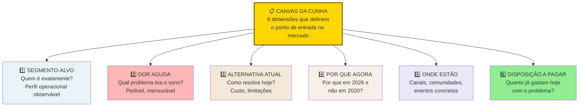

Responda com especificidade cruel. Cada resposta vaga é um ponto fraco futuro. O template textual completo:

```text
CANVAS DA CUNHA, v___

ICP (preciso): _______________________________________
 _______________________________________

Dor específica: _______________________________________
(1 fluxo de trabalho) _______________________________________

Resultado mensurável: _____________________________________
(escolha 1-2 categorias: receita / custo / risco / tempo)
Métrica do resultado: _____________________________________
(ex.: "reduz de 4h para 15min por semana")

Dono do orçamento: _______________________________________
(cargo + nível hierárquico)

Teste do grupo de WhatsApp:
Quantas pessoas específicas eu consigo listar nominalmente
como potenciais primeiros clientes? _____
[ ] Cunha aprovada (100-300 pessoas listáveis).
[ ] Cunha muito larga (refinar).

Alternativa atual (o que o cliente faz hoje):
___________________________________________________________

Por que eu sou melhor do que a alternativa atual
(em 1 frase, com número se possível):
___________________________________________________________
```

Sem esse canvas preenchido, você ainda não sabe o que vai vender, nem para quem, nem por quanto. Não avance para hipóteses ([[#FASE 6 — FORMULAÇÃO RIGOROSA DE HIPÓTESES|Fase 6]]) sem isso resolvido.

### Passo 11 — Aplique o Teste de Estresse da Cunha (cinco minutos, Wedge Stress Test)

O Canvas da Cunha (Passo 10) é o instrumento estratégico. Esse teste é o instrumento tático. Use-o sempre que você descrever a cunha para alguém (investidor, mentor, cliente) e sentir que perdeu a pessoa. Ou antes de uma reunião importante, para pressionar a própria cunha e ver onde ela racha.

#### Parte 1, escreva em quatro linhas (dois minutos)

Quem é o usuário? Descrito por cargo mais contexto. Por exemplo, "Gerente de contas a pagar em escritório de advocacia de vinte a cem pessoas", não "profissionais de finanças". Se você precisa de duas sentenças para descrever o usuário, ainda está largo.

O que dispara o problema? Qual evento, data, tarefa, ou situação recorrente faz o problema aparecer. Problema sem gatilho não tem urgência. Por exemplo, "todo fim de mês, quando precisa fechar conciliação, e o sistema atual gera quarenta inconsistências que precisam ser revisadas manualmente".

O que acontece se o problema não for resolvido? Consequência concreta. Multa. Demissão. Retrabalho. Cliente perdido. Atraso em entrega. Burn-out do time. Se a resposta é "as coisas seguem como estão", não há dor. Há inconveniência.

O que o usuário faz hoje para contornar? Solução atual, mesmo precária. Planilha. Frankenstein de ferramentas. Estagiário terceirizado. A existência da gambiarra é o sinal mais forte de dor real (Pain Level 4).

#### Parte 2, duas perguntas-faca (três minutos)

Esse conjunto de clientes caberia em um único canal de Slack ou grupo de WhatsApp? Não metaforicamente. Literalmente. A faixa total da cunha vendável é de cem a trezentas pessoas listáveis nominalmente (definição operacional canônica acima). O sub-conjunto que você consegue imaginar reunido no mesmo grupo trocando mensagens sobre o mesmo problema específico é mais estreito, tipicamente trinta a oitenta pessoas. Esse núcleo é quem você conhece de nome, contato direto e contexto. Se você não consegue listar nem esse núcleo, a sua cunha ainda está larga. Reduza.

Se a sua empresa fechasse hoje à noite, quem reclamaria ativamente amanhã de manhã? Não "quem sentiria falta". Quem abriria o notebook, ligaria para alguém, postaria no LinkedIn. Essa lista de pessoas é a sua cunha real. Se a lista tem menos de três pessoas específicas (com nome e cargo), a sua cunha é teórica. Não está aterrada em gente.

> [!tip] Uso operacional do teste
> Rode esse teste sozinho antes de rodá-lo com outra pessoa. Se você mesmo travar em alguma das seis perguntas, não vale envergonhar-se com um mentor. Volte primeiro ao Canvas da Cunha e resolva. O teste existe para você detectar cedo onde a sua narrativa não se sustenta.

### Caso brasileiro real, cunha na Creditas (2012)

Em 2012, o mercado brasileiro de crédito era dominado por bancos com crédito pessoal sem garantia (taxas de cinco a doze por cento ao mês), e crédito com garantia via bancos tradicionais (burocracia alta, meses de processo).

Sergio Furio, fundador da Creditas, fez a escolha que define a empresa. Em vez de competir em "crédito pessoal mais barato" (cunha larga, contra bancos com muito mais capital), escolheu cunha estreita. Crédito com garantia de imóvel ou veículo, online, em dias em vez de meses. ICP inicial claro. Dor específica. Resultado mensurável (taxa muito abaixo do crédito pessoal bancário).

A cunha estreita permitiu três coisas. Construir operação especializada. Estabelecer relação com poucos tipos de cliente. E definir unit economics específicos. A expansão para outras verticais veio depois, apoiada na base.

A lição transferível. Cunha estreita no começo não limita o tamanho final do negócio. Limita o risco inicial e acelera o PMF.

> [!note] Caso B2C internacional como referência adicional, Warby Parker (2010)
> Warby Parker (Neil Blumenthal, Andrew Hunt, David Gilboa, Jeffrey Raider, fundada na Wharton em 2010) é caso clássico de cunha B2C estreita: profissionais urbanos 25-40 anos, renda US$ 60k+, conscientes de estilo em NY/SF, com problema de "comprar óculos é lento, caro e chato". A cunha começou em "óculos bonitos entregues no escritório" — descoberta nas entrevistas, em que conveniência + estilo importavam mais que preço para esse ICP. O caso completo (com framework Antler aplicado das Fases 1 a 5) está detalhado no [[#APÊNDICE L — IDEA → WEDGE → SCALE: O FRAMEWORK ANTLER COMO LENTE TRANSVERSAL|Apêndice L — Idea → Wedge → Scale]]. A lição transferível é a mesma da Creditas: liste dores completas, derive ICP por filtros cumulativos, condense em uma frase, teste antes de construir, ajuste a Cunha até caber num grupo de WhatsApp.

---

### Transição, Fase 5 para Fase 6 (e visão panorâmica até PMF)

O que você acabou de fazer, ao longo das Fases 0 a 5. Preparou-se como fundador. Gerou ideias. Articulou a candidata escolhida. Construiu teoria causal. Descobriu problemas reais no ICP através de entrevistas com saturação. Mapeou o mercado, e definiu cunha.

O que vem nas Fases 6 a 12. Transformar o que você aprendeu em hipóteses testáveis, planejar experimentos rigorosos, prototipar e testar solução, lançar MVP, e perseguir PMF. Você sai da fase de descoberta aberta (procurando o que não sabe) para entrar na fase de validação estruturada (testando o que acha que sabe).

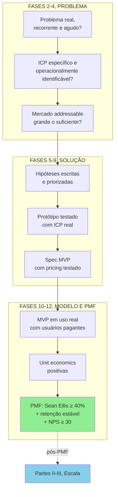

Falha em qualquer etapa significa voltar à fase anterior, não pular adiante. Sem ICP específico, mapa de problemas, e canvas da cunha preenchidos, as hipóteses geradas serão vagas e os experimentos virão ambíguos.

---

### FERRAMENTAS DESTA FASE

Esta é a fase em que o ferramentário estratégico clássico mais brilha. Quatro essenciais para o estágio inicial; o restante fica como referência consultiva no Apêndice BG.1-BG.2 quando o caso pedir. Canvases visuais: CZ.4 (Strategy Canvas), CZ.15 (Canvas da Cunha), CZ.18 (Network Effects Map) e CZ.20 (Wardley Map).

**Essenciais para a Fase 5:**

- **Porter's Five Forces** (Porter, 1979) — atratividade estrutural via cinco forças (novos entrantes, fornecedores, compradores, substitutos, rivalidade). Use no Passo 4 para entender dinâmica do mercado. BG.1.1.
- **Blue Ocean / ERRC Grid** (Kim e Mauborgne, 2005) — Eliminar, Reduzir, Aumentar, Criar para redefinir categoria. Use no Passo 8 (matriz competitiva) quando quadrante vazio sugerir nova categoria. BG.1.8.
- **7 Powers** (Hamilton Helmer, 2016) — sete fontes de defensibilidade estrutural (escala, rede, contra-posicionamento, switching costs, marca, recurso monopolizado, poder de processo). Use no Passo 7 para identificar o moat realista. BG.2.3.
- **Strategy Canvas** (Kim e Mauborgne, 2005) — visualização da curva de valor contra concorrentes. Use no Passo 8 antes da matriz 2x2. CZ.4.

**Complementares (consulte conforme o caso):**

- SWOT/TOWS Matrix, PESTEL, BCG Growth-Share, Ansoff Matrix, Value Chain Analysis, VRIO, Playing to Win, Wardley Mapping, Scenario Planning, Core Competencies, Value Disciplines. Detalhamento e quando usar cada uma em BG.1.2 a BG.2.8.

---

### SÍNTESE DA FASE 5

A [[#FASE 5 — MAPEAMENTO DE MERCADO E CONCORRÊNCIA|Fase 5]] confronta dois ditos perigosos do fundador apaixonado. "Não há concorrentes." "O mercado é enorme." Ambos quase sempre são falsos. Existem soluções, mesmo que ruins. Existem substitutos, incluindo "fazer nada". Existem players grandes que podem te copiar quando perceberem o sinal. Existe regulamentação que pode te inviabilizar. Sem mapa de mercado, você empreende às cegas. Com ele, decide informado.

O entregável é o Dossiê de Mercado mais o Canvas da Cunha preenchido. O Dossiê não é estático. O mercado muda, novos entrantes aparecem, consolidações acontecem, regulação evolui. Revisitar pelo menos a cada seis meses não é exagero, é higiene. A [[#FASE 6 — FORMULAÇÃO RIGOROSA DE HIPÓTESES|Fase 6]] vai transformar o mapeamento feito aqui em hipóteses testáveis — o Canvas da Cunha vira insumo direto para o Banco de Hipóteses.

---

## FASE 6 — FORMULAÇÃO RIGOROSA DE HIPÓTESES

> [!important] Antes de formular hipóteses, faça a Matriz CSD
> CSD significa Certezas, Suposições, Dúvidas. Organiza o seu mapa mental antes de gerar hipóteses. Regra: teste Suposições, não Certezas. Testar Certezas é desperdício. Testar Dúvidas é cedo demais (primeiro descubra do que duvida). Suposições bet-the-company (hipóteses que, se erradas, derrubam o negócio) têm prioridade máxima.

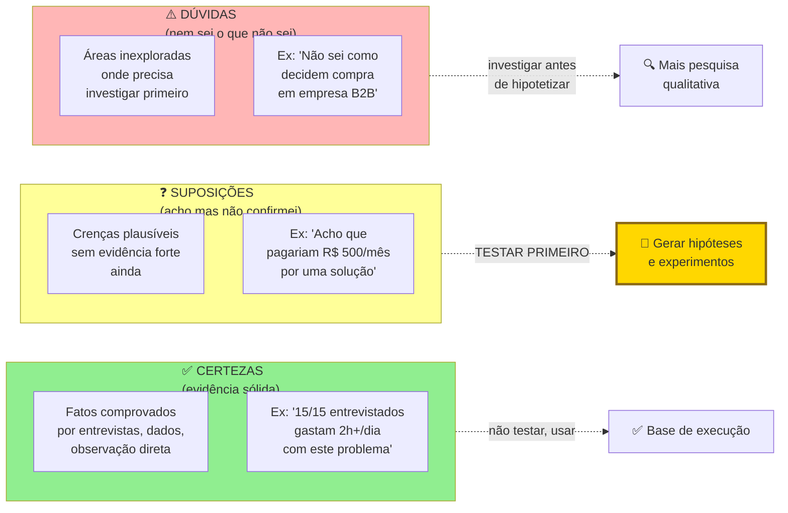

### O que esse apêndice cobre

Transformação das incertezas, crenças e intuições acumuladas nas fases anteriores em hipóteses testáveis. Escritas em formato padronizado, priorizadas por risco e impacto. O entregável é o Banco de Hipóteses: uma tabela viva que você vai revisitar durante todo o projeto.

> [!abstract] Resumo operacional
> **Entregável:** Banco de Hipóteses (Template A.3) com vinte ou mais itens classificados, priorizados por Risco vezes Incerteza, e três a cinco bet-the-company com Hypothesis Canvas (A.10) preenchido e método de teste desenhado.
>
> **Sinais de saída:**
> - Hipóteses cobrem as cinco categorias (problema, solução, cliente, canal, monetização) com pelo menos três em cada.
> - Cem por cento das hipóteses no formato SE-ENTÃO-MENSURA com critério de falsificação numérico explícito.
> - Hipóteses bet-the-company identificadas pelo Sistema H/E (H alto, E baixo) e priorizadas no topo.
> - Cada hipótese tem atributo da árvore de teoria (Fase 2B) vinculado — nenhuma órfã.
> - Status (não testada, em teste, validada, invalidada) marcado em todas.
>
> **Três armadilhas mais comuns:**
> 1. Hipóteses vagas tipo "os clientes vão gostar" — sem critério numérico nem caminho de refutação, são crenças disfarçadas.
> 2. Só hipóteses de solução — empreendedor obcecado em testar "a solução funciona?" esquece de testar "o cliente paga?", que é a hipótese mais crítica.
> 3. Priorizar baixo-risco por ser fácil — confortável de confirmar, mas a regra é testar primeiro o que pode te matar, não o que é agradável.

### POR QUE

Toda decisão de negócio assume algo sobre o mundo. "O meu cliente vai pagar R$ 99." "O meu canal principal será Instagram." "Empresas maiores compram mais rápido." Cada uma dessas afirmações é uma hipótese. Se você as trata como verdades, constrói sobre areia. Se as escreve como hipóteses e as testa uma a uma, constrói sobre rocha. Empreender sem hipóteses explícitas é tomar todas as decisões com base em vibração.

A priorização de hipóteses também impede que você desperdice energia testando coisas de pouco impacto. Você quer testar primeiro o que, se for falso, derruba o negócio inteiro. Isso se chama "risco-maior-primeiro".

> [!note] Apêndice F — Científico vs Lean Startup
> A disciplina de formular hipóteses falsificáveis (hipóteses que podem ser provadas erradas) é o ponto de convergência entre o método científico e a metodologia Lean. O [[#APÊNDICE F — ABORDAGEM CIENTÍFICA vs LEAN STARTUP: QUANDO USAR CADA UMA|Apêndice F — Científico vs Lean Startup]] mapeia as diferenças e complementaridades: quando o rigor hipotético-dedutivo aplica e quando o loop Build-Measure-Learn é mais adequado. Relevante especialmente para fundadores com background técnico ou científico que estão aplicando o método ao contexto de negócio pela primeira vez.

### Quando usar

Comece imediatamente depois das Fases 2, 3 e 4. Termine quando tiver quinze a trinta hipóteses escritas e priorizadas, e souber quais são as três a cinco bet-the-company que vai testar primeiro. Revisite a cada duas a quatro semanas. Hipóteses antigas viram verdades (validadas) ou são refutadas, e novas emergem.

### Quem envolve

O executor é você, e os sócios se houver. Os participantes são mentores ou pessoas experientes que ajudam a identificar hipóteses que você não enxerga sozinho. Empreender em câmara de eco é arriscado. O decisor é você.

### Como executar

Sete passos.

#### Passo 1, levante todas as suposições implícitas

Faça uma varredura completa. Classifique as hipóteses em cinco tipos.

Hipóteses de problema. O problema existe mesmo? Para quem? Quão doloroso?

Hipóteses de solução. A solução proposta resolve o problema? Os usuários vão adotá-la?

Hipóteses de cliente e mercado. Quem é o cliente ideal? Como ele decide?

Hipóteses de canal. Como eu alcanço o cliente? Qual canal tem CAC viável?

Hipóteses de monetização e modelo. O cliente vai pagar? Quanto? Com que frequência? LTV maior que CAC?

Para cada tipo, busque pelo menos três a cinco hipóteses. Total alvo: quinze a trinta hipóteses.

#### Passo 2, escreva cada hipótese no formato padronizado

Use esse formato rigoroso:

```text
HIPÓTESE: [afirmação clara e falsificável]
ATRIBUTO DA TEORIA: [qual nó ou seta da sua árvore de teoria esta hipótese testa]
PORQUÊ IMPORTA: [se for falsa, qual impacto no negócio]
PARA VALIDAR PRECISO VER: [critério objetivo e numérico]
MÉTODO: [experimento ou fonte de evidência]
CUSTO ESTIMADO: [tempo + dinheiro]
```

Para entender a diferença entre hipótese ruim e hipótese boa:

> [!warning] Hipótese ruim, impossível de falsificar
> "Os clientes vão gostar do produto." Impossível de testar. "Gostar" não é mensurável.

> [!tip] Hipótese boa, falsificável e numérica
> "Pelo menos trinta por cento dos donos de restaurante do nosso ICP (perfil de cliente ideal), depois de conhecer a solução por uma página de pré-cadastro, vão deixar e-mail e concordar com cobrança antecipada de R$ 49 para acesso ao beta. Se for falsa, significa que a nossa proposta de valor não é forte o bastante para pagamento antecipado, o que compromete a viabilidade do modelo."

> [!tip] Hypothesis Canvas e Test Card como par de ferramentas
> O formato padronizado acima é o coração do Hypothesis Canvas — registrado como template prático no [[IGNICAO-Vol-10-Canvases-e-Templates#APÊNDICE A — TEMPLATES PRONTOS PARA USO|Apêndice A (A.10) (Vol. 10)]] e com tratamento teórico no [[IGNICAO-Vol-10-Canvases-e-Templates#APÊNDICE CZ — CANVASES E MAPAS VISUAIS DE MODELO|CZ.14 (Vol. 10)]] (em construção). Cada hipótese bet-the-company deve gerar imediatamente 1-3 [[IGNICAO-Vol-10-Canvases-e-Templates#APÊNDICE CZ — CANVASES E MAPAS VISUAIS DE MODELO|Test Cards (CZ.9) (Vol. 10)]] como follow-up: o Hypothesis Canvas articula *o que* testar; o Test Card articula *como* testar. A disciplina central do Test Card é definir critério de sucesso e critério de refutação **antes** de rodar o experimento — sem isso, qualquer resultado é racionalizado a favor da hipótese. O caso PadariaPro em CZ.9 mostra como definir zona de incerteza no meio (entre sucesso e refutação) é o que protege contra auto-engano.

#### Passo 3, aplique o critério de falsificabilidade

> [!quote] Karl Popper sobre hipóteses
> Uma afirmação só é científica se for possível imaginar um resultado que a refute.

Toda hipótese sua precisa ter um caminho claro de refutação. Se não tiver, não é hipótese. É crença.

##### Teste de isolamento, uma hipótese, um elemento por vez

Esse é um dos erros mais comuns em iniciantes: empilhar múltiplos elementos numa única hipótese. Quando você testa coisas compostas, fica impossível saber qual parte foi refutada.

Exemplo de hipótese composta (ruim): "Mulheres em grandes capitais preferem táxi a bicicleta, e fazem isso por causa do conforto, mesmo pagando mais caro."

Essa hipótese junta três afirmações distintas. Mulheres em grandes capitais preferem táxi a bicicleta. O conforto é o principal fator de decisão. O preço mais alto do táxi é tolerado.

Se você testar tudo junto e quarenta e cinco por cento das entrevistadas concordar, o que isso significa? Nada. Pode ser que preferem táxi por outro motivo que não conforto. Pode ser que conforto importa, mas só para viagens longas. Pode ser que o preço é um limite, e acima de X reais elas voltam para a bicicleta. A hipótese composta esconde todas essas nuances.

A versão atômica (boa) quebra em três hipóteses separadas, cada uma testável sozinha. Se todas forem validadas, você tem a afirmação conjunta. Se alguma for refutada, você sabe exatamente qual parte da sua teoria precisa ser revisada.

> [!important] Regra do isolamento
> Cada hipótese deve testar um e apenas um atributo, ou uma e apenas uma relação causal da sua árvore de teoria. Se há "e" ou "porque" na frase, provavelmente você precisa quebrá-la.

##### Verifique a conexão com a teoria (integração)

Coloque a sua árvore de teoria ([[IGNICAO-Vol-1-Ideacao#FASE 2B — CONSTRUÇÃO DA TEORIA DO NEGÓCIO|Fase 2B (Vol. 1)]]) ao lado do Banco de Hipóteses. Para cada hipótese, responda: *Esta hipótese testa qual nó ou seta da árvore?* Se uma hipótese não pode ser mapeada na árvore, ela é órfã. Ou a hipótese é irrelevante, ou a sua árvore está incompleta. Em ambos os casos, corrija.

Esse exercício costuma revelar que o empreendedor criou hipóteses sobre o que é fácil de medir, em vez do que é importante testar. Se sobraram nós bet-the-company na árvore sem hipóteses correspondentes, você está prestes a testar o acessório enquanto deixa o crítico passar.

> [!note] Apêndice EJ — Tomada de Decisão como Disciplina
> Antes de comprometer recursos com as hipóteses bet-the-company, use o [[IGNICAO-Vol-1-Ideacao#APÊNDICE EJ — TOMADA DE DECISÃO COMO DISCIPLINA|Apêndice EJ — Tomada de Decisão como Disciplina (Vol. 1)]]: hipóteses de alto risco e baixa reversibilidade são decisões Tipo 1 (irreversíveis) e merecem pré-mortem formal antes de qualquer experimento. O apêndice também cobre o framework SPADE para estruturar esse processo em equipe.

#### Passo 4, priorize as hipóteses por Risco × Incerteza (primeiro pass)

> [!note] Dois sistemas de priorização, em ordem de aplicação
> Esta fase usa duas lentes complementares de priorização, aplicadas em sequência. **Primeiro pass: Risco × Incerteza (Passo 4).** Identifica quais hipóteses, se falsas, derrubam o negócio (Risco) e em quais você está mais no escuro (Incerteza). Filtra o conjunto de "vinte ou mais hipóteses" para "três a cinco bet-the-company". **Segundo pass: Sistema H/E (Passo 5).** Para cada bet-the-company já filtrada, mede a força teórica da hipótese (H) versus a evidência empírica já acumulada (E), definindo a ordem e o tipo de teste. R×I é sobre impacto de negócio. H/E é sobre estado epistêmico. Os dois sistemas não competem; trabalham em série.

Para cada hipótese, atribua duas notas de um a cinco. Risco (R): quão grave para o negócio se for falsa? (Cinco mata o negócio. Um é detalhe secundário.) Incerteza (I): quanta confiança real você tem nela hoje? (Cinco é totalmente no escuro. Um é muito fundamentada.)

Calcule Prioridade = R vezes I.

Hipóteses com prioridade igual ou maior que quinze são as suas bet-the-company. São coisas que podem matar o negócio se forem falsas, e que você ainda não testou. Essas vêm primeiro. Hipóteses com prioridade entre oito e quatorze são secundárias. Hipóteses com prioridade abaixo de oito ficam no backlog (lista de espera) para depois.

#### Passo 5, aplique o Sistema H/E (segundo pass de priorização)

Para cada hipótese bet-the-company já filtrada pelo Risco × Incerteza, atribua duas notas de um a dez.

H (Hypothesis Strength, força teórica da hipótese) mede quão bem fundamentada a sua hipótese está do ponto de vista teórico. H igual a dez significa que a cadeia causal é clara, consistente com o que se sabe do mercado, análoga a casos de sucesso conhecidos e faz sentido à luz da sua árvore de teoria. H igual a três significa um palpite, baseado em intuição pessoal, sem lógica rigorosa por trás.

E (Evidence Strength, força da evidência) mede o quanto você já tem de evidência empírica a favor (ou contra) essa hipótese hoje, antes de qualquer novo experimento. E igual a dez significa dados robustos, múltiplas entrevistas consistentes, benchmarks quantitativos de setor, pilotos pagos. E igual a um significa nenhuma evidência. Só a sua própria fala.

A visualização do sistema H/E:

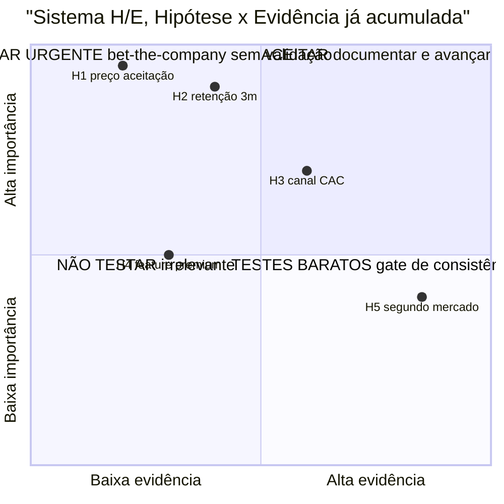

H/E responde a duas perguntas. *Essa hipótese é importante?* (H) E *já tenho evidência a favor?* (E). O quadrante superior-esquerdo (H alto e E baixo) é urgência máxima. Isso evita o erro comum de testar primeiro o que é fácil em vez do que é crítico.

Os dois scores juntos mostram onde você está em cada hipótese:

| Perfil (H, E) | Diagnóstico | O que fazer |
|---|---|---|
| H alto, E alto (8, 8) | Hipótese bem fundamentada, e já com evidência | Avançar com investimento ou execução |
| H alto, E baixo (8, 3) | Teoria forte, falta evidência | Prioridade máxima de experimento. É aqui que a próxima rodada de testes precisa estar |
| H baixo, E alto (4, 8) | Fato observado sem teoria clara | Reabrir a árvore de teoria. Por que esse padrão acontece? Sem saber por quê, não dá para escalar |
| H baixo, E baixo (3, 2) | Palpite sem fundamento nem dado | Ou descartar, ou iniciar investigação exploratória. Nunca investir capital |

> [!warning] Regra de ouro do Sistema H/E
> Todo investimento significativo (construir feature, contratar, levantar capital, expandir canal) deve ser precedido por H maior ou igual a sete e E maior ou igual a seis para as hipóteses críticas relacionadas àquela decisão. Se qualquer uma das notas está abaixo desses patamares, rode um experimento (Fase 7) antes.

#### Passo 6, monte o Banco de Hipóteses como planilha

Quatorze colunas. ID (H1, H2, e assim por diante). Tipo (Problema, Solução, Cliente, Canal, Monetização). Hipótese (texto completo). Atributo da teoria (vínculo com a árvore da [[IGNICAO-Vol-1-Ideacao#FASE 2B — CONSTRUÇÃO DA TEORIA DO NEGÓCIO|Fase 2B (Vol. 1)]]). Porquê importa. Critério de validação. Método ou experimento. Custo estimado. Score H (Hipótese) de um a dez: quão forte é o raciocínio teórico antes de qualquer teste? Score E (Evidência) de um a dez: quanta evidência empírica você já tem hoje? Status (Nova, Em teste, Validada, Refutada, Abandonada). Resultado (quando testada). Data de teste. Aprendizado.

> [!important] Essa planilha é o coração operacional do negócio
> Nos próximos seis a doze meses, ela é o documento mais consultado da empresa. Nunca a perca de vista.

#### Passo 7, escolha as 3 a 5 primeiras hipóteses a testar e defina ordem de teste

Pegue as hipóteses do quadrante "H alto + E baixo" do Passo 5. Essas têm o maior retorno por experimento: teoria robusta, apenas faltando evidência. A escolha das três a cinco primeiras segue quatro critérios em ordem.

Maior risco primeiro. Entre as bet-the-company com mesmo perfil H/E, comece pela de maior R × I. Resolver o que pode matar o negócio antes do que é apenas importante.

Independência sobre dependência. Se a hipótese A precisa estar validada antes de B fazer sentido (por exemplo, "cliente reconhece o problema" antes de "cliente paga R$ 99 por uma solução"), teste A primeiro. Hipóteses dependentes em paralelo geram desperdício se a anterior cair.

Custo de teste e tempo de retorno. Entre hipóteses de impacto similar, prefira as que dão sinal mais barato e mais rápido. Smoke test de R$ 500 em uma semana antes de concierge experiment de R$ 5 mil em oito semanas. Use a velocidade para iterar.

Janela de teste paralela vs sequencial. Hipóteses independentes que usam canais diferentes podem rodar em paralelo (entrevistas + landing page + community test simultaneamente). Hipóteses sobre o mesmo público em canais sobrepostos rodam em sequência para não contaminar amostra.

Documente a ordem escolhida no Banco de Hipóteses (coluna "ordem de teste") com justificativa de uma linha. Essas três a cinco hipóteses prioritárias, com Test Card preenchido, vão para a [[#FASE 7 — EXPERIMENTOS DE VALIDAÇÃO DO PROBLEMA|Fase 7]].

### Os sete passos aplicados, hipótese H1 do PadariaPro

Para tornar o método concreto, este é o detalhamento de uma hipótese bet-the-company da mesma ideia trabalhada nas fases anteriores, no formato padronizado dos Passos 2 a 5.

HIPÓTESE: Donos de padaria com três a cinco lojas têm perda de oito por cento ou mais de margem em ingredientes críticos por má gestão de estoque.

ATRIBUTO DA TEORIA: Nó "Dor real e frequente" da árvore de teoria (Fase 2B). A árvore pressupõe que o problema existe na intensidade necessária para gerar disposição a pagar. Se falsa, todo o ramo de monetização cai antes de qualquer experimento de preço.

PORQUÊ IMPORTA (Risco × Incerteza): R = 5 (mata o negócio se falsa), I = 4 (auto-relato em entrevistas Fase 3 sugere a perda existe, mas sem dado de notas fiscais ainda). Prioridade R × I = 20. Bet-the-company.

PARA VALIDAR PRECISO VER: Sete em dez padarias com três a cinco lojas em SP com perda de oito por cento ou mais da margem bruta em trinta dias, verificada por análise de notas fiscais de compra, não só por auto-relato.

H/E: H = 8 (cadeia causal clara, consistente com casos análogos de food retail), E = 3 (auto-relato em 12 entrevistas, sem auditoria factual). Quadrante H alto + E baixo, prioridade máxima de experimento.

MÉTODO: Auditoria gratuita de estoque. Recrutar dez padarias via indicação direta. Coletar trinta dias de notas fiscais e comparar com o estoque físico inventariado. Complementar com entrevista de quarenta e cinco minutos com o dono para qualificar a dor.

CUSTO ESTIMADO: Catorze dias. Duas horas por padaria (vinte horas no total). R$ 0 em deslocamento (padarias em raio de cinco quilômetros do fundador). Custo de oportunidade equivalente a três semanas de um fundador.

> [!warning] Risco de interpretação enviesada
> Donos podem subestimar a perda (vergonha de admitir ineficiência) ou superestimá-la (para justificar tecnologia). Cruzar auto-relato com análise factual de notas fiscais reduz esse viés.

### Caso brasileiro real, hipóteses na Loft (iBuyer imobiliário)

A Loft, fundada em 2018 por Mate Pencz e Florian Hagenbuch (ex-Printi) em São Paulo, atacou o modelo iBuyer (instant buyer — compra direta de imóveis para revenda rápida com renovação) num mercado dominado por imobiliárias tradicionais com ciclo de venda de seis a doze meses.

A decisão central de modelo foi formal. Em vez de escolher diferencial por intuição, o time formalizou hipóteses priorizadas por R × I antes de comprometer capital. As bet-the-company giravam em torno de três variáveis. Sensibilidade a preço dos vendedores ("se oferecermos cinco por cento abaixo do valor de mercado, com pagamento em sete dias, X por cento dos vendedores aceitarão"). Elasticidade da velocidade ("se o prazo for três dias em vez de sete, a conversão sobe em Y por cento"). Conversão por perfil de urgência ("vendedores em divórcio, mudança de cidade, ou herança convertem Z por cento mais que vendedores oportunistas").

As hipóteses foram testadas em sequência, cada experimento com threshold pré-registrado. O resultado contraintuitivo foi que velocidade pesava mais que preço para o segmento-alvo. Vendedores urgentes aceitavam desconto significativo em troca de previsibilidade e prazo curto. O modelo final priorizou velocidade sobre preço, oposto da intuição inicial. A Loft levantou rodadas significativas (Andreessen Horowitz, Fifth Wall, Vulcan Capital) e atingiu valuation acima de US$ 2 bi em 2021.

A lição transferível. Hipóteses explícitas separam "o que eu acho" de "o que eu testei". A intuição inicial é frequentemente parcialmente certa e parcialmente errada. Só teste com threshold pré-registrado separa.

### PERGUNTAS A RESPONDER

- Eu identifiquei hipóteses de todas as cinco categorias (problema, solução, cliente, canal, monetização)?
- Cada hipótese é falsificável (tem critério de refutação)?
- Eu classifiquei cada hipótese por risco e incerteza?
- Eu sei quais são as três a cinco hipóteses bet-the-company que preciso testar primeiro?
- Eu tenho método de teste imaginado para cada hipótese prioritária?

> [!tip] Apêndice G — Framework de Gates
> A saída desta fase alimenta diretamente o gate (critério de passagem) para a Fase 7. O [[#APÊNDICE G — FRAMEWORK DE DECISÃO POR GATES (PROBLEM CORE + SCALE LEVERS + EXPLORATORY)|Apêndice G — Framework de Gates]] define os critérios objetivos que uma hipótese bet-the-company deve satisfazer antes de passar para experimento: quórum mínimo de evidência, ausência de contradição fatal na árvore de teoria, e consenso do founding team (time fundador) sobre prioridade. Use para evitar avançar com hipóteses ainda sem clareza de critério de refutação.

### SAÍDA DESTA FASE

Você concluiu a [[#FASE 6 — FORMULAÇÃO RIGOROSA DE HIPÓTESES|Fase 6]] quando todos os critérios abaixo estão cumpridos.

- [ ] Banco de Hipóteses (Template A.3) com vinte ou mais itens classificados nas cinco categorias (problema, solução, cliente, canal, monetização). Pelo menos três em cada categoria, sem nenhuma vazia.
- [ ] Todas as hipóteses no formato padronizado (afirmação + atributo da teoria + porquê importa + critério de validação numérico + método + custo estimado).
- [ ] Cem por cento das hipóteses no formato SE-ENTÃO-MENSURA com critério de falsificação numérico explícito.
- [ ] Cada hipótese vinculada a um nó ou seta da árvore de teoria (Fase 2B). Nenhuma órfã.
- [ ] Sistema H/E (Hypothesis Strength / Evidence Strength) aplicado a cada hipótese, de um a dez em cada eixo.
- [ ] Hipóteses bet-the-company identificadas pelo quadrante H alto + E baixo, priorizadas no topo (três a cinco).
- [ ] Três ou mais Hypothesis Canvas (Template A.10) preenchidos para as bet-the-company.
- [ ] Status (não testada, em teste, validada, invalidada) marcado em todas.
- [ ] As três a cinco hipóteses prioritárias têm método de teste inicial desenhado e Test Card (CZ.9) com critério de sucesso e refutação definidos antes do experimento.

> [!warning] Critério de saída
> Se qualquer um desses itens falha, não avance. Resolva antes.

**Primeiros passos práticos.**

1. Abrir o Template A.3 (Banco de Hipóteses) e listar toda hipótese implícita. Vinte a quarenta itens iniciais.
2. Classificar cada hipótese em categoria, status e prioridade.
3. Reformular as cinco a dez prioritárias em formato falsificável rigoroso.
4. Para cada hipótese das três do topo, preencher Hypothesis Canvas (Template A.10) com detalhamento.

### Armadilhas

Hipóteses vagas. "Os clientes vão gostar." Use o formato do Passo 2: afirmação com critério numérico e caminho de refutação.

Só hipóteses de solução. Empreendedores ficam obcecados em testar "a solução funciona?", e esquecem de testar "o cliente paga?", que é a hipótese mais crítica.

Priorizar baixo-risco por ser fácil. Testar primeiro o que é confortável. Princípio: teste primeiro o que pode te matar, não o que é agradável de confirmar.

Esquecer de atualizar. A lista vira zumbi se não for visitada semanalmente. Reserve trinta minutos toda segunda para revisar.

Confundir "não refutada ainda" com "validada". Uma hipótese só é validada quando você tem evidência positiva a favor dela. Não apenas ausência de evidência contra.

---

### FERRAMENTAS DESTA FASE

Formulação de hipóteses exige disciplina analítica. Dez ferramentas essenciais. Canvases complementares: CZ.9 (Test Card) e CZ.14 (Hypothesis Canvas).

- **McKinsey 7-Step Problem Solving** — Define, Structure (issue tree MECE), Prioritize, Plan, Conduct, Synthesize, Communicate. Para estruturação rigorosa da tese. BG.5.1.
- **MECE** — hipóteses Mutuamente Exclusivas e Coletivamente Exaustivas. Sobreposição confunde experimentos. BG.4.5.
- **Pre-mortem** (Gary Klein) — imagine que cada hipótese crítica foi falsificada em seis meses. Por quê? Revela sinais precoces e critérios de refutação. BG.5.3.
- **Expected Value e Bayesian Thinking** — range de resultados vezes probabilidades. EV positivo justifica experimento. BG.5.7.
- **Cost-Benefit Analysis** — custo (tempo, capital) versus benefício esperado (confiança ganha, valor da decisão). Para escolher quais hipóteses validar primeiro. BG.5.6.
- **Cynefin Framework** (Snowden) — Simples, Complicado, Complexo, Caótico. Calibra o método de validação. BG.4.7.
- **Red Team e Blue Team** — um grupo tenta derrubar a ideia (Red), outro defende (Blue). Para bet-the-company, monte um Red Team antes de investir. BG.5.4.
- **5 Whys** (Toyota) — "por que eu acredito nisso?" cinco vezes. Resposta final em "intuição" ou "porque o concorrente faz" sinaliza hipótese fraca. BG.5.2.
- **Pyramid Principle** (Minto) — hipótese principal no topo, sub-hipóteses no nível abaixo, evidências embaixo. Para comunicar a time, advisors, board. BG.4.4.
- **Inversion** (Munger) — "sob que condições essa hipótese é falsa?". Define o critério de falsificação. BG.4.3.

---

### SÍNTESE DA FASE 6

O entregável é o Banco de Hipóteses priorizado: tabela viva, não documento que se arquiva. Hipóteses antigas viram verdades validadas ou são refutadas, e novas emergem ao longo do projeto. Revisitar a cada duas a quatro semanas é higiene. O Banco estrutura todas as fases seguintes: as Fases 7, 8, 9 e 10 não testam ideia em geral, testam hipóteses específicas na ordem do risco. A [[#FASE 7 — EXPERIMENTOS DE VALIDAÇÃO DO PROBLEMA|Fase 7]] pega as bet-the-company do topo do Banco e desenha experimentos com threshold pré-registrado para cada uma.

---

## FASE 7 — EXPERIMENTOS DE VALIDAÇÃO DO PROBLEMA

> [!tip] Stack mínimo da Fase 7
> Para rodar experimentos baratos. Landing pages rápidas: Webflow, Framer, Carrd, Wix (R$ 0 a R$ 100 por mês, segundo o uso). Tráfego pago para testes: Meta Ads (R$ 500 a R$ 3.000 para primeiros testes), Google Ads (similar), LinkedIn Ads (se B2B, mais caro mas direto). Analytics: Google Analytics 4 (gratuito), Hotjar ou Microsoft Clarity (gratuitos para uso moderado) para heatmap. Plausible (alternativa simples e privacy-first). Pagamentos para pré-venda: Stripe, Asaas, Pagar.me, Stone, MercadoPago (cada um com particularidades regulatórias no Brasil). Regra: o stack de experimentação deveria custar menos de R$ 1.000 por mês no começo. Se está caro antes de aprender, algo está errado.

### O que esse apêndice cobre

Execução de experimentos estruturados para testar as hipóteses prioritárias levantadas na [[#FASE 6 — FORMULAÇÃO RIGOROSA DE HIPÓTESES|Fase 6]]. Nesta fase, você ainda foca primariamente em validar o problema e o cliente, não a solução construída. Os experimentos são rápidos, baratos, e desenhados para dar evidência confiável de sim, não, ou talvez.

O entregável é um Relatório de Experimentos. Hipóteses testadas, resultados, aprendizados, e próximos passos.

> [!abstract] Resumo operacional
> **Entregável:** Relatório de Experimentos com três ou mais Cartões de Experimento (Template A.4) executados, threshold ex-ante registrado, decisão (perseverar, pivotar, abandonar) documentada para cada hipótese bet-the-company.
>
> **Sinais de saída:**
> - Três a cinco hipóteses bet-the-company testadas com critério de falsificação numérico pré-definido em cada cartão.
> - Banco de Hipóteses atualizado com status pós-experimento — uma ou mais invalidadas conta como aprendizado.
> - Evidência forte de problema real, disposição a pagar e pelo menos um canal de aquisição possível.
> - Critério mínimo atingido em pelo menos um de três sinais — dez pagamentos antecipados, vinte cartas de intenção, ou cem e-mails qualificados com conversão acima de quinze por cento.
> - Decisão tomada (perseverar, pivotar ou abandonar) e ação iniciada.
>
> **Três armadilhas mais comuns:**
> 1. Critérios de sucesso frouxos definidos depois do resultado — "vou considerar sucesso se alguém demonstrar interesse" transforma o experimento em racionalização.
> 2. Ignorar resultados negativos — desvalorizar dados contrários com "esse grupo não era o público certo" é fugir da verdade que o experimento revelou.
> 3. Esticar prazo ou gastar demais — experimento acima de R$ 3 mil ou mais de duas semanas está mal desenhado, e janela aberta vira espera de resultado conveniente.

### POR QUE

Hipóteses sem experimentos são só listas bonitas. Experimentos transformam suposição em evidência. Rápido e barato é fundamental. Se um experimento demora três meses, ou custa R$ 50 mil, você está gastando demais para aprender uma coisa só. Cada experimento deve gerar uma decisão clara. Continuar. Ajustar. Pivotar. Ou matar.

> [!note] Apêndice F — Científico vs Lean Startup
> O desenho de experimento descrito nesta fase combina rigor do método científico (threshold — ponto de corte numérico pré-definido — ex-ante, falsificabilidade, isolamento de variável) com velocidade do ciclo Lean (Build-Measure-Learn comprimido em dias, não meses). O [[#APÊNDICE F — ABORDAGEM CIENTÍFICA vs LEAN STARTUP: QUANDO USAR CADA UMA|Apêndice F — Científico vs Lean Startup]] detalha quando priorizar profundidade (pré-registro formal, controle de viés) versus velocidade (experimento mais barato possível). A tensão entre os dois é permanente em early-stage; o apêndice oferece critério de decisão.

### CALIBRANDO EXPECTATIVAS, o espectro de resultados e a regra dos nove em dez

Antes de desenhar o primeiro experimento, calibre a expectativa. Empreendedores iniciantes frequentemente chegam à [[#FASE 7 — EXPERIMENTOS DE VALIDAÇÃO DO PROBLEMA|Fase 7]] esperando que "o experimento vai validar a minha ideia". Essa expectativa está calibrada errada. Entender a distribuição real de resultados é o que separa o fundador que aprende do fundador que se ilude.

Os resultados de experimentos caem em um espectro, inspirado no framework Antler de validação — uma referência usada pela aceleradora global para categorizar a força dos sinais de demanda. Com dois extremos e uma enorme zona intermediária.

O extremo negativo, "spaghetti sandwiches". A ideia teve rejeição clara. Entrevistados demonstraram pouco interesse. Landing page teve conversão baixa. Pré-venda fracassou. A decisão é fácil. Pivotar. Voltar à matriz de Problema versus ICP (Fases 2 e 4) e criar uma nova hipótese para testar.

O extremo positivo, "overnight cult following". A ideia teve adesão extraordinária. Clientes pagaram antecipado sem hesitar. Vieram indicações espontâneas. Early evangelists (clientes que viram o produto e passaram a defendê-lo publicamente) começaram a vender por você. Houve pedido explícito de acesso. A decisão é fácil. Construa a empresa. Esse cenário acontece em aproximadamente uma em cada dez tentativas.

O meio do espectro, "área cinzenta". Resultados fracos, confusos, conflitantes, ou enviesados. Alguns clientes interessados, outros indiferentes. Feedback misto. Esse é o cenário onde a maioria dos empreendedores realmente se encontra. É onde a maioria também se ilude e segue construindo algo que não deveria. A decisão é difícil. Exige critérios explícitos. Não intuição.

> [!important] A regra operacional mais importante deste manual
> Assuma que, em nove de cada dez ciclos de hipótese, experimento, e análise, a conclusão correta será recomeçar ou pivotar, não seguir. Essa é a distribuição de base. Se você está sempre chegando a conclusões que favorecem seguir em frente, quase certamente está torcendo em vez de analisando.

Essa calibração tem três implicações práticas.

A primeira ideia quase certamente não é a ideia final. Se você trabalha numa ideia única e nunca considera pivotar, está negando probabilidade pura. Identifique múltiplos ICPs e múltiplas hipóteses de teoria desde a [[IGNICAO-Vol-1-Ideacao#FASE 2B — CONSTRUÇÃO DA TEORIA DO NEGÓCIO|Fase 2B (Vol. 1)]] exatamente porque nove em dez vão falhar.

Recomeçar não é fracasso. É o funcionamento normal do processo. O objetivo do manual inteiro é fazer você recomeçar barato, em vez de recomeçar caro. Recomeçar depois de R$ 3 mil gastos em quatro semanas é normal. Recomeçar depois de R$ 300 mil em dois anos é tragédia.

Quando você finalmente estiver naquele um em dez, vai saber. Não é ambíguo. Early adopters evangelizam, pagam antecipado, reclamam quando o produto falha, convidam outros. Se o sinal é ambíguo, você não está no um em dez. Está no meio do espectro.

##### Exemplo concreto do extremo positivo, Soylent

Quando o Soylent foi lançado por Rob Rhinehart em 2013, via crowdfunding, sem existir ainda em escala, os primeiros adotantes não só compravam. Escreviam no fórum. Publicavam receitas próprias. Respondiam dúvidas de outros compradores. Reportavam bugs de formulação. Defendiam a marca publicamente contra críticos. Eram, na prática, funcionários não-pagos da empresa nascente. O que a Antler chama de evangelistas.

Se a sua base de primeiros clientes se comporta assim, sem você ter que puxar, você está naquele um em dez. Se você precisa empurrar cada venda, responder cada objeção sozinho, e os clientes não convidam mais ninguém, você não está. Independentemente do que o seu otimismo te diga.

##### Como navegar o meio do espectro

Não interprete resultados medianos como validação fraca que vai melhorar. Na maior parte das vezes, não melhora.

Aplique os critérios duros da [[#FASE 6 — FORMULAÇÃO RIGOROSA DE HIPÓTESES|Fase 6]]. Dez pagamentos antecipados, vinte cartas de intenção, ou cem e-mails a mais de quinze por cento de conversão. Abaixo disso, você está no meio. E o meio é pivô.

Considere seriamente a teoria alternativa que você mapeou na [[IGNICAO-Vol-1-Ideacao#FASE 2B — CONSTRUÇÃO DA TEORIA DO NEGÓCIO|Fase 2B (Vol. 1)]]. Ela pode ser o caminho real.

Evite a tentação de "esperar mais um pouco". Prazos esticados quase nunca trazem dados melhores. Trazem mais dados medianos.

> [!warning] O pior não é falhar
> O pior é ficar preso em algo medíocre que não vai a lugar nenhum, consumindo tempo, dinheiro, e moral por meses ou anos.

### Quando usar

Comece assim que a [[#FASE 6 — FORMULAÇÃO RIGOROSA DE HIPÓTESES|Fase 6]] priorizar as primeiras hipóteses. Termine quando as três a cinco hipóteses bet-the-company estiverem validadas ou refutadas com evidência suficiente. Revisite continuamente. O negócio gera novas hipóteses o tempo todo.

### Quem envolve

O executor é você. Alguns experimentos envolvem potenciais clientes, colaboradores externos, ou plataformas pagas (Facebook Ads, Google Ads, Typeform). O decisor é você, com base nos critérios de sucesso pré-definidos.

### Como executar

Nove passos.

#### Passo 1, desenhe cada experimento em cartão antes de executar

Use esse formato:

```text
EXPERIMENTO #N
Hipótese: [copiar da Fase 6]
Pergunta central: [o que especificamente quero responder]
Desenho: [o que vou fazer, passo a passo]
Público: [quantas pessoas, que perfil, como alcanço]
Métrica principal: [o número que vai decidir]
Critério de sucesso: [valor da métrica pra considerar validada]
Critério de refutação: [valor da métrica pra considerar refutada]
Duração: [tempo total]
Custo: [R$ estimado]
Riscos e vieses: [o que pode distorcer o resultado]
Data de início / fim: [planejadas]
```

##### Regra operacional para a duração, a janela de duas a três semanas

Empreendedores iniciantes tendem a desenhar experimentos com "duração aberta" ("vou rodar até ter dados suficientes"), ou com janelas longas demais ("três meses para validar"). Ambos são sintomas do mesmo problema. Medo de decisão.

A regra operacional, derivada da prática de aceleradoras como Antler e Y Combinator: cada experimento da [[#FASE 7 — EXPERIMENTOS DE VALIDAÇÃO DO PROBLEMA|Fase 7]] deve caber numa janela de duas a três semanas. Do desenho à decisão. Dois motivos.

Disciplina de decisão. Experimento com prazo aberto nunca termina. Sempre "precisa de mais uma semana". Janela fechada força você a concluir com o dado disponível. Reconhecer as limitações honestamente, em vez de empurrá-las com a barriga.

Paralelização. Com janelas curtas, você roda quatro a seis experimentos em três meses. Com janelas longas, roda um a dois. A velocidade de aprendizado é composta. Mais iterações dentro do mesmo tempo total geram aprendizados muito superiores.

Há duas exceções legítimas à janela. Experimentos concierge e wizard of oz frequentemente precisam de quatro a oito semanas para revelar valor real. Não force janela curta nesses casos. E experimentos com ciclo de venda B2B enterprise naturalmente exigem seis a doze semanas. A janela aqui aplica-se ao ciclo de decisão do cliente-alvo, não ao seu.

Para qualquer outro tipo de experimento (entrevistas, landing page, fake door, pré-venda direta a PMEs, community test, A/B), se o desenho não cabe em duas a três semanas, o experimento está grande demais. Quebre em dois ou três experimentos menores. Cada um testando um atributo isolado.

> [!important] Defina o critério antes de olhar o resultado
> Se você define depois, vai ajustar o critério para "validar" o que você já queria. Isso é auto-engano.

> [!tip] Test Card: a forma canônica do Cartão de Experimento
> O cartão de experimento descrito acima é a adaptação brasileira do **Test Card** — ferramenta de David Bland & Alexander Osterwalder (Strategyzer, 2019) para documentar hipótese, método, critério e decisão num único cartão antes de rodar qualquer experimento. O tratamento completo está no [[IGNICAO-Vol-10-Canvases-e-Templates#APÊNDICE CZ — CANVASES E MAPAS VISUAIS DE MODELO|CZ.9 (Vol. 10)]] — origem histórica, princípios, exemplo brasileiro PadariaPro com smoke test (teste rápido de demanda com landing page ou anúncio, antes de construir qualquer coisa) de R$ 1.500 que produziu critério claro de Persevere/Pivote, e variações como Learning Card (cartão de aprendizado — registro estruturado do resultado de um experimento) e Riskiest Assumption Test (RAT) — teste da premissa mais arriscada. A regra de ouro de CZ.9: critério de sucesso e critério de refutação devem ser **distintos com zona de incerteza no meio**. Se você define só "sucesso ≥10%" sem definir "refutação ≤2%", qualquer resultado entre 2 e 10% vira interpretação flexível conforme conveniência do time.

#### Passo 2, escolha os tipos de experimento apropriados

Catálogo dos oito experimentos mais úteis para validação de problema e cliente, antes de construir produto.

##### Problem Interview (entrevista de problema)

Já coberto na [[#FASE 3 — DESCOBERTA DO PROBLEMA|Fase 3]]. Útil também para hipóteses emergentes. Custo baixo. Tempo de uma a duas semanas. Limitação: respostas são opiniões, não ações.

##### Landing Page Test ou Smoke Test (teste rápido de demanda)

Crie uma página que descreve a sua solução como se ela já existisse. Direcione tráfego por Ads ou e-mails a grupos. Meça a taxa de conversão em cadastros de e-mail, pré-pedidos, ou cliques em "quero comprar".

Como medir: conversão de visitante em ação. Benchmarks (referências de mercado) iniciais: conversão maior que cinco por cento em e-mail é sinal bom. Maior que dez por cento é forte. Abaixo de dois por cento, a sua promessa não ressoa. Custo de R$ 500 a R$ 2.000 em Ads, mais um dia para montar a página (use Carrd, Framer, Webflow, Unbounce). Tempo de uma a três semanas. Cuidado: tráfego pago precisa ser bem segmentado. Se o público é ruim, conversão baixa não significa que a ideia é ruim.

##### Concierge Experiment (experimento manual)

Você entrega manualmente o valor que o seu produto promete. Sem automatizar nada. Por exemplo: se o produto seria um app de gestão de frota, você mesmo gerencia a frota de um cliente usando planilha e WhatsApp, cobrando pelo serviço.

Como medir: o cliente percebeu valor? Pagou? Indicou? Custo: o seu tempo, durante duas a oito semanas. Tempo total de quatro a doze semanas. A vantagem é que você descobre os detalhes operacionais que uma entrevista nunca revelaria.

##### Wizard of Oz (produto simulado)

O produto parece funcionar com tecnologia avançada, mas por trás é você fazendo tudo manualmente. Por exemplo: você promete "IA que sugere horários de postagem ideais", e você mesmo, olhando cada cliente, sugere os horários. O cliente nem sabe.

Como medir: o usuário usa a "solução"? Volta? Paga? Custo baixo em construção, alto em tempo operacional. Tempo de quatro a doze semanas.

##### Pre-sale (venda antecipada)

Você vende o produto antes dele existir. Pede pagamento real ou carta de intenção assinada.

Como medir: número de vendas e cartas. Valor arrecadado. Critério forte: dinheiro no bolso é mais que carta de intenção, que é mais que interesse verbal. Custo baixo. Tempo de duas a seis semanas.

> [!important] Pre-sale é o experimento mais revelador de todos
> Se as pessoas pagam antecipado por algo que não existe, você tem evidência forte. Se não pagam, tem informação forte também.

##### Fake Door ou Botão Fantasma (testar interesse sem construir)

Dentro de um produto existente (blog, comunidade), ou de uma página, você coloca um botão que promete uma feature que ainda não construiu. Quando o usuário clica, aparece "em breve" mais formulário.

Como medir: percentual de usuários que clicam. Custo muito baixo. Limitação: mede interesse, não compra.

##### Community Test (teste em comunidade)

Compartilhe a ideia em comunidades relevantes (Reddit, grupos de Facebook, Discord, fóruns especializados). Meça reações genuínas, perguntas, pedidos de acesso.

Como medir: engajamento, comentários, DMs. Custo zero. Limitação: comunidades têm viés. Algumas são positivas demais. Outras cínicas demais.

##### A/B Test (teste comparativo de proposta de valor)

Teste duas ou três formas diferentes de descrever o problema ou a solução, e veja qual converte mais. Útil quando você ainda não sabe como falar com o cliente.

Como medir: conversão relativa. Custo moderado.

##### Guia rápido para escolher a técnica

| Fase de validação | Técnica mais apropriada |
|---|---|
| Entender o problema em profundidade (exploratória) | Entrevistas |
| Dimensionar o problema em escala | Questionários |
| Testar atratividade de uma proposta | Landing Page, Smoke Test, Fake Door |
| Testar disposição real a pagar | Pré-venda |
| Testar se a solução entrega valor de verdade | Concierge, Wizard of Oz |
| Comparar duas versões para identificar qual performa melhor | A/B Test |

Use entrevistas quando você precisa de profundidade e aprendizados qualitativos. Use questionários, landing pages, e pré-vendas quando precisa de números representativos e evidência quantitativa. Os dois tipos são complementares. Não substitutos.

#### Passo 3, operacionalize cada hipótese em uma medida concreta

Esse é a ponte entre teoria e experimento. É onde a maioria dos empreendedores erra. Para cada hipótese prioritária, responda quatro perguntas, nessa ordem.

Qual é a hipótese testável? Texto exato da hipótese da [[#FASE 6 — FORMULAÇÃO RIGOROSA DE HIPÓTESES|Fase 6]].

O que eu vou perguntar ou observar? Pergunta específica no questionário. Ação observada no experimento. Evento rastreado no analytics.

Quais são as respostas ou eventos possíveis? Opções discretas, ou faixas numéricas.

O que eu vou efetivamente contar como medida? Fórmula exata. Por exemplo: "percentual de respondentes que escolheram X ou Y", "taxa de clique no botão Z", "valor médio ofertado em pré-venda".

Exemplo operacionalizado, inspirado no caso MiMoto, do paper de Coali e colegas (2024).

A hipótese: "Tráfego nas grandes capitais é um problema relevante para profissionais." A pergunta no questionário: "Em uma semana típica, quantos dias você fica preso no trânsito no trajeto casa-trabalho?" As respostas possíveis: (a) menos de um dia, (b) um a três dias, (c) três a cinco dias, (d) mais de cinco dias. A medida: percentual de respondentes que escolhem (c) ou (d).

Você pode escolher outra forma de medir (por exemplo, nota de um a sete, ou foco apenas na resposta "mais de cinco dias"). O importante é que a escolha seja feita antes de ver os dados, documentada, e aplicada de forma consistente na análise.

> [!important] Quatro regras de operacionalização
> Conecte a medida à hipótese de forma rastreável. Se alguém te perguntar "por que você escolheu essa métrica e não outra?", você precisa conseguir responder em termos da teoria. Defina ex-ante (antes de coletar). Definir medida depois de ver dados é auto-engano matemático — você vai inevitavelmente escolher a métrica que confirma o que já acredita. Pré-teste as suas perguntas com duas a três pessoas de confiança. Pergunta mal formulada gera lixo. Ajuste antes do campo. Prefira medidas já estabelecidas (KPIs do setor, escalas validadas da literatura de pesquisa) quando existirem, em vez de inventar métricas próprias. A sua métrica só é "nova" se não existir nada comparável.

> [!note] Apêndice EJ — Tomada de Decisão como Disciplina
> A decisão de rodar ou não um experimento — e com que profundidade — é ela mesma uma decisão estruturável. O [[IGNICAO-Vol-1-Ideacao#APÊNDICE EJ — TOMADA DE DECISÃO COMO DISCIPLINA|Apêndice EJ — Tomada de Decisão como Disciplina (Vol. 1)]] oferece o framework SPADE para documentar critérios antes de agir, e o pré-mortem para antecipar por que um experimento pode produzir conclusão errada. Use especialmente em hipóteses Tipo 1, onde errar o desenho do experimento tem custo alto.

#### Passo 4, defina o threshold antes de começar

Threshold (ponto de corte numérico) é o valor da sua medida a partir do qual a hipótese será considerada suportada. É o que separa decisão baseada em critério de torcida organizada.

Por exemplo: "Vou considerar a hipótese suportada se pelo menos sessenta por cento dos respondentes do meu ICP (perfil de cliente ideal) escolherem a opção (c) ou (d), ou seja, mais de três dias por semana no trânsito."

O threshold é subjetivo. Você define com base na sua teoria e experiência. Mas uma vez definido, é imóvel até os dados serem analisados. Se você mover o threshold depois, o experimento deixa de ser teste de hipótese, e vira confirmação do que você queria.

Documente o threshold no Cartão de Experimento. Se não houver threshold escrito, o experimento não está pronto para rodar.

#### Passo 5, pré-registre o desenho do experimento antes de coletar dados

Pré-registro é a prática adotada na pesquisa científica moderna (Simmons, Nelson, e Simonsohn, 2011; Wicherts e colegas, 2016) para eliminar o que os pesquisadores chamam de "p-hacking" — a tendência de ajustar análises até encontrar o resultado desejado. Em outras palavras, você decide como vai analisar os dados antes de coletá-los, não depois.

O empreendedor enfrenta exatamente o mesmo viés. Com custo maior. A análise enviesada aqui não produz artigo acadêmico duvidoso. Produz decisão de investimento com o seu próprio capital, baseada em evidência viciada.

Checklist mínimo de pré-registro a documentar antes de iniciar o experimento. Hipótese específica (texto exato, com atributo e direção). Medida operacional (fórmula exata). População-alvo, e critérios de inclusão e exclusão (quem entra no teste, quem não). Tamanho mínimo da amostra (número antes de começar, não "até o que conseguir"). Threshold de decisão (valor numérico exato). Plano de análise (como os dados serão agregados, se haverá subgrupos). O que faria você descartar resultados (contaminação, vazamento de intenção, falha técnica). O que faria você considerar resultado inconclusivo (não apenas "não suportado").

Documente isso em arquivo datado antes de iniciar o experimento. Compartilhe com sócios e advisors. Essa transparência externa cria pressão positiva para não trapacear consigo mesmo.

> [!tip] Por que pré-registro funciona em early-stage
> Pré-registro formal transforma experimento de "procura por evidência que confirme a minha ideia" em "teste imparcial da minha própria crença". É o mecanismo mais efetivo contra autoenganos. E autoenganos são a causa mais comum de decisão empreendedora catastrófica. Em contextos de alta incerteza (early-stage, deeptech, mercados novos), pré-registro é especialmente valioso. O empreendedor tipicamente tem pouca evidência externa para calibrar expectativas, e tende a preencher a incerteza com otimismo motivado.

#### Passo 6, execute e faça due diligence da amostra antes de olhar o resultado

Rode o experimento dentro do prazo planejado. Resista à tentação de esticar o prazo porque o resultado está ruim ("mais tempo vai melhorar"). De mudar o critério de sucesso no meio do caminho. De parar cedo porque o resultado está bom ("já sei, não preciso terminar").

Esse é o passo mais negligenciado por empreendedores. É o mais importante para uma avaliação honesta. Antes de comparar o resultado com o threshold, verifique três coisas.

Tamanho da amostra. Para entrevistas e MVPs qualitativos, dez a quinze pessoas já trazem insight. Para questionários e testes de conversão, você precisa de pelo menos oitenta a cem respostas. Idealmente centenas, se o mercado é massificado. Amostras muito pequenas produzem ruído, não sinal. Se a amostra está pequena, reconheça a limitação e seja mais conservador no próximo passo.

Representatividade. A amostra que você conseguiu reflete o ICP que descreveu na teoria? Mesmo sem amostragem aleatória (quase nunca viável para um empreendedor iniciante), os respondentes precisam ser um "retrato em miniatura" do público-alvo. Se o seu ICP é "donas de pet shop no interior", e oitenta por cento dos respondentes são de capital, a sua amostra está enviesada. Se é "CFOs de empresas de cem ou mais funcionários", e você só conseguiu falar com analistas juniores, você não testou a hipótese real.

Ajuste do threshold se a amostra for enviesada. Se a sua amostra está enviesada para um lado que favorece a hipótese (você testou com early adopters — primeiros adotantes entusiastas — quando o público final é mainstream), aumente o threshold. Seja mais rigoroso. Se está enviesada para um lado que prejudica a hipótese (você testou com um público que não tem o problema na intensidade esperada), considere se o teste faz sentido, ou se deveria ser refeito. Registre o ajuste no Cartão de Experimento, antes de olhar o resultado final.

> [!important] O princípio da avaliação objetiva
> Você reconhece as limitações da evidência, e as incorpora ao critério. Em vez de usar as limitações depois para explicar por que o resultado ruim "não conta".

#### Passo 7, analise com honestidade

Para cada experimento, responda cinco perguntas. Qual o resultado, comparado com o critério pré-definido? A hipótese foi validada, refutada, ou inconclusiva? Quais aprendizados secundários emergiram? Quais novas hipóteses surgiram? O que eu faria diferente da próxima vez?

#### Passo 8, compare o resultado com a teoria, não apenas com o threshold

Esse passo distingue o empreendedor que pensa de forma sistemática do empreendedor meramente "lean". O threshold te diz se a hipótese foi ou não suportada pela amostra. Mas a decisão final deve ser tomada comparando o resultado com a teoria inteira, não apenas com o número isolado.

Pergunte-se. Se a hipótese foi refutada: qual pedaço da minha árvore de teoria precisa ser revisado? Existe uma teoria alternativa (que eu já mapeei na [[IGNICAO-Vol-1-Ideacao#FASE 2B — CONSTRUÇÃO DA TEORIA DO NEGÓCIO|Fase 2B (Vol. 1)]]) que explica melhor esse resultado? O problema é o atributo específico, a relação causal, ou o ICP escolhido?

Se a hipótese foi suportada: o resultado é consistente com o resto da teoria? Ou há uma explicação alternativa (viés do tráfego pago, comunidade entusiasta atípica) que poderia produzir o mesmo número sem a teoria ser verdadeira?

Se foi inconclusivo: o problema é a amostra, a operacionalização, ou a teoria em si?

> [!quote] Popper sobre evidência refutadora
> Você só pode aprender que está errado por meio de evidência. Nunca pode provar que está certo em definitivo.

Resultados negativos, nesse enquadramento, são informação valiosa. Não fracasso. Um empreendedor que trata toda evidência refutadora como ruído acaba cego para os sinais que mais deveriam fazê-lo repensar.

#### Passo 9, decida e atualize Banco de Hipóteses, árvore de teoria e Declaração

Depois de comparar resultado com teoria (Passo 8), tome uma das quatro decisões. **Persevere**: hipótese validada, continue no mesmo caminho. **Pivote**: hipótese refutada, mude de direção (cliente, problema, solução, ou canal). **Mais dados**: resultado inconclusivo, rode variante do experimento. **Abandone**: evidência clara e consistente de que não há negócio aqui.

> [!warning] Não fique em limbo
> Decida.

Atualize artefatos imediatamente após decidir. Versione: a Declaração vai para v0.2, v0.3, v0.4. Isso é saudável. Significa que você está aprendendo.

> [!tip] Apêndice CZ — Learning Card (CZ.10)
> Depois de cada experimento, o par natural do Test Card é o [[IGNICAO-Vol-10-Canvases-e-Templates#APÊNDICE CZ — CANVASES E MAPAS VISUAIS DE MODELO|Learning Card (CZ.10) (Vol. 10)]] — cartão de uma página que registra o que foi observado (não interpretado), o que foi aprendido, e a decisão tomada (Persevere, Pivote, Abandone). A distinção entre "observação" e "interpretação" no Learning Card é o mecanismo central contra o viés de confirmação pós-experimento. O Banco de Hipóteses atualizado neste passo deve conter o Learning Card de cada experimento concluído.

### Os nove passos aplicados, Cartão de Experimento do PadariaPro (hipótese H2 — disposição a pagar)

A estrutura visual do Cartão de Experimento (Template A.4):

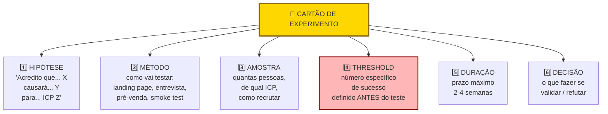

> [!important] Threshold ex-ante é o elemento não-negociável
> "Vamos ver quantos se interessam", sem número pré-definido, vira racionalização. Três clientes pagantes viram "sinal promissor". Trinta clientes viram "pouco para concluir". Com threshold (doze ou mais conversões em duas semanas, por exemplo), a decisão é automática.

EXPERIMENTO #1

Hipótese: Donos de padaria pagariam R$ 400 por mês por loja pelo PadariaPro se a redução de perda for demonstrada em sessenta dias.

Pergunta central: Qual faixa de preço o dono de padaria com três a cinco lojas aceita pagar por software de gestão de estoque com garantia de resultado em sessenta dias?

Desenho: Criar landing page simples (Framer, quatro horas) com três planos — R$ 290, R$ 400 e R$ 590 por mês por loja. CTA (chamada para ação — botão ou link que convida o visitante a agir) "Quero ser um dos primeiros dez". Formulário pede nome, padaria, número de lojas, telefone e compromisso formal de pagar R$ X se a funcionalidade de previsão de demanda estiver pronta em sessenta dias. Tipo de experimento: Fake Door mais Carta de Intenção de Pagamento. Tráfego via três grupos de WhatsApp de donos de padaria (oitenta membros cada) mais LinkedIn. Para cada lead que preencher o formulário, ligar em quarenta e oito horas para confirmar disposição real.

Público: Donos de padaria com três a cinco lojas em SP. Meta mínima de trinta visitantes que se encaixem no perfil. Canal de recrutamento: grupos de WhatsApp mapeados na Fase 5.

Métrica principal: Taxa de conversão de visitantes ICP em formulários com compromisso de pagamento.

Critério de sucesso: Quinze por cento ou mais dos visitantes ICP preenchem o formulário. Três de cada cinco que atendem à ligação confirmam disposição a pagar R$ 400 por mês.

Critério de refutação: Menos de cinco por cento preenchem o formulário, ou menos de dois em cinco confirmam o preço em chamada. Nesse caso, revisar preço ou proposta de valor antes de continuar.

Duração: Catorze dias.

Custo: R$ 0 em mídia paga. Aproximadamente oito horas de trabalho (quatro horas para a landing page, quatro horas para as ligações de confirmação).

Riscos e vieses: Preencher formulário é barato e não equivale a pagar. Selection bias (viés de seleção): grupos de WhatsApp podem não representar o segmento completo. Confirmação telefônica mitiga o primeiro risco. Instagram ads segmentados em SP como canal paralelo mitiga o segundo.

Data de início / fim: Semana 1 — Semana 2 do mesmo mês.

**Resultado.** Quarenta e sete visitantes ICP. Doze formulários preenchidos (vinte e cinco por cento). Sete ligações realizadas: quatro confirmaram R$ 290, dois confirmaram R$ 400, um confirmou R$ 590.

**Decisão.** R$ 400 uniforme está invalidado. O mercado bifurca. Nova hipótese: tier duplo — R$ 290 entry com funcionalidade básica e R$ 590 premium com integrações adicionais. A hipótese original está refutada.

### Caso brasileiro real, Pulses (HRtech) e a landing page antes de construir

A Pulses, fundada em 2015 por Sady Ennes em Florianópolis (depois adquirida pela TOTVS em 2021), é uma plataforma de pesquisa de clima e cultura organizacional via micro-pulses semanais. Antes de comprometer meses construindo o produto, o fundador validou disposição a pagar via experimento clássico de pré-venda.

A decisão foi cirúrgica. Criou landing page em poucos dias prometendo "diagnóstico contínuo de cultura via micro-pesquisas semanais" com preço anunciado por funcionário/mês. Direcionou tráfego para VPs e diretores de RH em empresas médias e grandes via LinkedIn Ads e rede pessoal do fundador no setor.

Em poucas semanas o experimento gerou leads qualificados, reuniões com decisores de RH, e cartas de intenção de empresas dispostas a pagar pelo serviço sem o produto existir ainda. O custo total ficou na casa de poucos milhares de reais. Validou tanto a demanda quanto a disposição a pagar, antes de qualquer linha de código. Anos depois, em 2021, a empresa foi adquirida pela TOTVS — endossando a tese inicial validada por landing page antes do produto.

A lição transferível. Experimento barato antes de construir economiza meses. Pré-venda com carta de intenção (ou pagamento real) de comprador econômico é o teste mais forte de demanda em B2B.

### PERGUNTAS A RESPONDER

- A hipótese bet-the-company está validada, refutada, ou inconclusiva?
- Qual a evidência concreta? Números, verbatim, observações.
- O que eu aprendi de inesperado?
- Qual a próxima hipótese a testar?
- Continuo, ajusto, pivoto, ou abandono?

### SAÍDA DESTA FASE

Você concluiu a [[#FASE 7 — EXPERIMENTOS DE VALIDAÇÃO DO PROBLEMA|Fase 7]] quando todos os critérios abaixo estão cumpridos.

- [ ] Três ou mais Cartões de Experimento (Template A.4) preenchidos com hipótese, método, amostra, critério de sucesso, duração e custo.
- [ ] Cada experimento com critério de falsificação numérico, pré-definido e distinto do critério de sucesso (zona de incerteza no meio).
- [ ] Tipo de experimento apropriado para o que cada hipótese testa (landing page, fake door, concierge, Wizard of Oz, pré-venda, A/B).
- [ ] Três ou mais experimentos executados dentro da janela de duas a três semanas, com dados objetivos coletados.
- [ ] Banco de Hipóteses atualizado com status pós-experimento (uma ou mais invalidadas conta como aprendizado).
- [ ] Decisão documentada depois de cada experimento (perseverar, pivotar, mais dados, abandonar).
- [ ] Evidência forte de três coisas: o problema é real e doloroso para o ICP, o ICP está disposto a pagar (carta de intenção ou pré-venda), pelo menos um canal de aquisição possível.
- [ ] Critério duro atingido em ao menos um dos três sinais: dez pagamentos antecipados reais, vinte cartas de intenção assinadas, ou cem e-mails qualificados em landing page com conversão maior que quinze por cento.
- [ ] Benchmarks de resultado por tipo de experimento documentados quando aplicáveis: landing page (>5% bom, >10% forte, <2% fraco em e-mail cadastrado); pré-venda (>20% intenção, >10% conversão paga é muito forte); concierge (NPS >50); Wizard of Oz (uso >2x/semana).
- [ ] Custo por aprendizado abaixo de R$ 500 por hipótese respondida (alvo early-stage). Acima de R$ 3.000 indica experimento mal-desenhado.
- [ ] Velocidade de aprendizado de duas ou mais hipóteses bet-the-company resolvidas por mês em early-stage; quatro ou mais por mês em fase de MVP.
- [ ] Decisão final tomada (perseverar, pivotar, abandonar) e ação iniciada.

> [!warning] Critério de saída
> Os 5% (bom) e 10% (forte) descritos nos passos anteriores são benchmarks de leitura de sinal: indicam que a promessa ressoa o suficiente para continuar testando. Os 15% acima são critério de saída de fase: exigem sinal inequívoco antes de comprometer recursos para construir. Conversão entre 10% e 15% é zona ambígua, exige experimento adicional (preço diferente, segmento mais estreito, oferta mais específica) antes de avançar.

**Primeiros passos práticos.**

1. Escolher as três hipóteses de maior risco não testadas, e desenhar um experimento para cada (Template A.4).
2. Estimar custo por experimento. Se algum passa de R$ 5.000 ou de trinta dias, questionar se há versão mais barata.
3. Executar o experimento mais barato primeiro. Geralmente landing page ou fake door.
4. Registrar o resultado em planilha, com decisão associada.

### Armadilhas

Experimentos desenhados para validar, não para descobrir. Se a pessoa ama o empreendedor, o "experimento" sai positivo. Controle o viés.

Critérios de sucesso frouxos. "Vou considerar sucesso se alguém demonstrar interesse." Quase qualquer coisa vira sucesso. Seja rigoroso.

Ignorar resultados negativos. Muitos empreendedores desvalorizam dados contrários. "Esse grupo não era o público certo." Se você precisa justificar por que o resultado ruim "não conta", está fugindo da verdade.

Gastar muito em experimentos. Se um experimento custa mais de R$ 3.000, ou demora mais de duas semanas, provavelmente está mal desenhado. Vá mais simples.

Testar uma hipótese em vez da outra. Às vezes o que você testa não mede o que você acha. Pré-venda de um produto que não existe testa proposta mais preço mais timing. Não testa se o produto funcionaria. Saiba o que está medindo.

Não documentar o experimento. Sem registro escrito antes e depois, você reconstrói a narrativa para se beneficiar. Escreva antes e depois.

---

### FERRAMENTAS DESTA FASE

Experimentos de validação são o coração da metodologia. Quatro essenciais para a fase; o restante fica como referência consultiva. Canvases complementares: CZ.9 (Test Card) e CZ.10 (Pirate Canvas / AARRR). Catálogo operacional completo em [[IGNICAO-Vol-10-Canvases-e-Templates#APÊNDICE A — TEMPLATES PRONTOS PARA USO|A.19 (Vol. 10)]] (Tabela de técnicas de validação por tipo de hipótese).

**Essenciais para a Fase 7:**

- **The Mom Test** (Fitzpatrick, 2013) — perguntas sobre vida passada específica, não hipotéticos. Ferramenta número um para entrevistas de problema. BG.6.1.
- **JTBD Switch Interviews** (Moesta) — quatro forças (push, pull, anxiety, habit) no momento em que o cliente trocou de solução. Use quando o entrevistado é switcher. BG.6.2.
- **Pre-mortem** (Klein) — antes de rodar a bateria de experimentos, imagine que todos falharam. Por quê? Revela vieses no desenho. BG.5.3.
- **Assumption Mapping** (Bland, 2019) — matriz certeza versus risco das premissas. Para definir onde focar validação antes de gastar capital. BG.9.8.

**Complementares (consulte conforme o caso):**

- Contextual Inquiry (Beyer e Holtzblatt), Day in the Life e Ethnographic Research, In-Depth Interviews, Laddering Technique e Means-End Chain (Gutman), Diary Studies, Focus Groups (Merton, Krueger), Grounded Theory (Glaser e Strauss), Thematic Analysis (Braun e Clarke), Affinity Diagramming / KJ Method (Kawakita), Empathy Mapping (Gray), Expected Value (Pascal e Fermat para priorizar hipóteses por VE × probabilidade × custo). Detalhamento e quando usar cada uma em BG.6.3 a BG.9.7.

---

### SÍNTESE DA FASE 7

O entregável é o conjunto de cartões de experimento executados, cada um com decisão documentada (perseverar, pivotar, ou abandonar). Hipóteses testadas, resultados, aprendizados, próximos passos. O que sobrevive aos testes vira insumo da [[#FASE 8 — IDEAÇÃO E PROTOTIPAGEM DE SOLUÇÕES|Fase 8]], que usa os aprendizados para definir a solução. O que é refutado força reabertura da árvore de teoria, e às vezes da escolha de cunha. A [[#FASE 7 — EXPERIMENTOS DE VALIDAÇÃO DO PROBLEMA|Fase 7]] é o ponto onde a teoria do negócio enfrenta o mundo. Quem trata isso com rigor produz aprendizado real. Quem trata como teatro de validação produz documentação para investidor, e nada mais.

Para avançar à Fase 8, pelo menos três a cinco hipóteses bet-the-company devem ter sido testadas e mantidas. Se alguma foi refutada, reavalie a teoria antes de prototipar.

---

## FASE 8 — IDEAÇÃO E PROTOTIPAGEM DE SOLUÇÕES

> [!question] FMF Check da Fase 8
> As ideias de solução que estão emergindo são fruto da sua experiência única com o problema, ou são soluções genéricas que apareceriam em qualquer brainstorm? Se forem genéricas, provavelmente você não está no founder-market-fit que imagina, ou está no estágio em que precisa mergulhar mais fundo no mercado antes de prototipar. Entrevistar dez operadores experientes do setor antes de prototipar é mais barato que prototipar solução genérica.

### O que esse apêndice cobre

Geração, avaliação e prototipagem de diferentes soluções possíveis para o problema validado. Aqui você não constrói um produto real. Constrói representações: prototipagem em papel, protótipos clicáveis, mockups (telas estáticas de alta fidelidade), storyboards (sequências visuais mostrando o uso em contexto). Para testar a desejabilidade da solução antes de investir em construção.

O entregável é um Dossiê de Solução. Contém três a cinco conceitos de solução avaliados, pelo menos um protótipo interativo, e a recomendação de qual caminho seguir.

> [!abstract] Resumo operacional
> **Entregável:** Dossiê de Solução (Template A.5) com três a cinco conceitos avaliados em Desejabilidade, Viabilidade e Sustentabilidade; pelo menos um protótipo interativo low-fi testado com oito ou mais usuários do ICP; recomendação escrita de qual conceito levar para MVP.
>
> **Sinais de saída:**
> - Dez ou mais ideias geradas em sessão de divergência documentada (Crazy 8s, How Might We, analogias).
> - Matriz Impacto vezes Esforço aplicada com classificação clara dos finalistas.
> - Dois ou mais protótipos low-fi (papel ou Figma) prontos, resolvendo o job central da Fase 4 — não features periféricas.
> - Cinco ou mais (idealmente oito) testes documentados com usuários do ICP, com padrões de uso e reação registrados.
> - Decisão escrita sobre qual conceito vai virar MVP, com lista clara de essencial versus postergável.
>
> **Três armadilhas mais comuns:**
> 1. Apegar-se à primeira ideia e pular a divergência — diverge dói, mas a primeira ideia raramente é a melhor.
> 2. Prototipar com alta fidelidade cedo demais — protótipo bonito esconde problemas de fluxo que o low-fi revelaria em horas.
> 3. Ouvir opinião em vez de observar comportamento — o que importa é onde o usuário trava, não se "achou bonito" ou se "gostou".

### POR QUE

Entre entender o problema e construir a solução, existe um abismo de decisões. Quase todo problema validado pode ser resolvido de várias formas. App. SaaS. Serviço. Marketplace. Hardware. Comunidade. Curso. Pular direto para "app" é a preguiça que custa caro. Explorar alternativas gera insight, e reduz risco.

Prototipagem é a forma mais barata de testar. Com um dia de trabalho, e zero código, você consegue feedback sobre experiência, fluxo, e desejabilidade.

> [!warning] Construir a solução errada para o problema certo
> Antes da Tesla, existiam carros elétricos, e ninguém os queria de forma massiva. Não porque o problema (mobilidade limpa) fosse irreal. Mas porque as montadoras tradicionais assumiram que o cliente trocaria desempenho e estética por consciência ambiental. A Tesla atacou o mesmo problema com uma solução que não pedia essa troca. A lição transferível: validar o problema não te dá cheque em branco sobre a solução. Um problema real comporta várias hipóteses de solução. E apenas algumas delas funcionam. Teste problema e solução separadamente. E desconfie quando o resultado do primeiro se transferir automaticamente para o segundo. Esta é a tese central da Fase 8.

> [!note] Apêndice H — TRL e CRL
> Se a solução candidata envolve tecnologia nova (hardware, deeptech, biotech, energia), o nível de maturidade tecnológica (TRL) e comercial (CRL) é variável crítica antes de escolher qual conceito prototipar. O [[#APÊNDICE H — TRL E CRL: MATURIDADE TECNOLÓGICA E DE MERCADO|Apêndice H — TRL e CRL]] define os nove níveis de TRL e os estágios de CRL correspondentes, e ajuda a calibrar o escopo do protótipo ao nível de maturidade real — evitando o erro de prototipar solução que requer TRL 6+ quando o projeto está em TRL 2.

> [!note] Apêndice F — Científico vs Lean Startup
> Esta fase aplica a lógica do ciclo Lean em seu ponto mais puro: prototipar barato, testar cedo, iterar. O [[#APÊNDICE F — ABORDAGEM CIENTÍFICA vs LEAN STARTUP: QUANDO USAR CADA UMA|Apêndice F — Científico vs Lean Startup]] situa esse ciclo dentro da distinção entre validação qualitativa (protótipo, teste de fluxo) e validação quantitativa (métricas de uso, dados de retenção). Relevante especialmente para definir quando parar de iterar protótipos e comprometer recursos para o MVP.

### Quando usar

Comece depois da [[#FASE 7 — EXPERIMENTOS DE VALIDAÇÃO DO PROBLEMA|Fase 7]] confirmar que o problema é real. Termine quando tiver um protótipo interativo testado com pelo menos oito usuários, e uma direção clara de qual solução construir. Revisite antes de cada grande decisão de redesign.

### Quem envolve

O executor é você. Com apoio de designer (freelancer ou sócio) se tiver. Os participantes são oito a doze usuários do ICP, para testar protótipos. O decisor é você.

### Como executar

Sete passos.

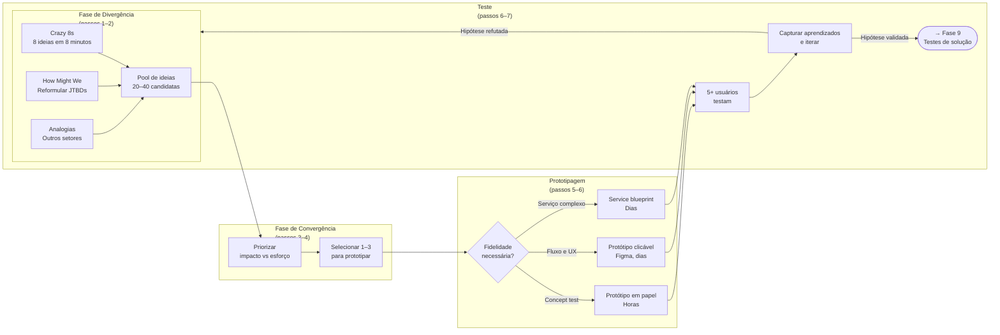

#### Passo 1, divergir com técnicas estruturadas

Não se limite ao que você imaginou. Faça sessões de brainstorm estruturadas. Sozinho ou com duas a três pessoas. Quatro técnicas úteis.

Crazy 8s (oito ideias em oito minutos, uma por minuto). Força quantidade sobre qualidade.

How Might We, "como poderíamos?". Reformule o *job to be done* em três a cinco perguntas abertas. Por exemplo: "Como poderíamos ajudar o dono de restaurante a encerrar o dia sem preocupação?"

Extremos. E se a solução fosse super-premium (R$ 5.000 por mês)? E se fosse de graça? E se fosse física? E se fosse humana (serviço)?

Analogias. Como outros setores resolvem problemas parecidos? O que o Uber ensinou sobre marketplaces pode se aplicar? O que o iFood ensinou sobre logística distribuída?

> [!tip] Meta da divergência
> Quinze a trinta ideias no papel, mesmo que a maioria seja ruim. A qualidade emerge da quantidade.

#### Passo 2, avalie e reduza (convergir)

Avalie cada ideia em três dimensões.

Desejabilidade. O usuário quer isso? Baseado em tudo que você aprendeu nas Fases 2 e 3.

Viabilidade. Você consegue entregar? Capacidades técnicas, financeiras, regulatórias.

Sustentabilidade. O modelo econômico fecha? Preço viável, custo viável, margem razoável.

Dê nota de um a cinco em cada dimensão. Multiplique. Selecione os três a cinco conceitos com maior pontuação.

> [!note] DVS e matriz Impacto-Esforço são complementares
> A avaliação por Desejabilidade, Viabilidade, e Sustentabilidade (DVS) é qualitativa. Útil para reduzir trinta ideias para cinco. Já a matriz Impacto vezes Esforço (que aparece no exemplo prático mais adiante) é visual. Útil para priorizar quais protótipos rodar primeiro entre os finalistas. Use as duas em sequência. Primeiro DVS para filtrar. Depois Impacto-Esforço para ordenar.

#### Passo 3, detalhe os 3 a 5 conceitos escolhidos

Para cada conceito, escreva em uma página seis itens. Nome do conceito (dê nome, facilita comunicação). Descrição em um parágrafo. Principal diferencial. Requisitos técnicos principais. Modelo de monetização imaginado. Principais riscos.

> [!note] Apêndice FF — Psicologia do Consumidor Brasileiro
> A reação do usuário ao protótipo é moldada por fatores que vão além do fluxo. O [[#APÊNDICE FF — PSICOLOGIA DO CONSUMIDOR BRASILEIRO — COMPORTAMENTO, DECISÃO E CONVERSÃO|Apêndice FF — Psicologia do Consumidor Brasileiro]] cobre como o consumidor brasileiro processa proposta de valor — ancoragem de preço, mobile-first, e o peso da confiança percebida na primeira impressão. Leia antes de definir quais elementos incluir no protótipo de teste.

#### Passo 4, escolha 1 ou 2 conceitos para prototipar

Escolha o(s) com maior potencial percebido. Defina o formato do protótipo. Seis opções.

##### Storyboard

Sequência de seis a doze quadros mostrando a pessoa usando a solução em contexto. Útil para validar o fluxo geral.

##### Wireframes em papel ou ferramenta

Wireframes (esboços de tela que mostram estrutura sem detalhes visuais) são úteis para validar arquitetura de informação.

##### Mockups de alta fidelidade

Telas desenhadas com detalhe visual. Figma ou similar.

##### Protótipo clicável

Telas com fluxo de navegação. Pode ser feito em Figma, Marvel, Proto.io.

##### Protótipo em vídeo

Vídeo explicando a solução como se ela existisse. Excelente para testar com público amplo.

##### Protótipo de serviço (service blueprint)

Para negócios de serviço. Mapeie touchpoints (pontos de contato entre cliente e serviço), atores, sistemas, e tempo.

> [!tip] Para a maioria dos casos no início, protótipo clicável em Figma
> É o melhor custo-benefício. Permite testar fluxo real de navegação, sem precisar de código. Designer freelancer faz em dois ou três dias.

#### Passo 5, prepare roteiro de teste de protótipo

Cinco partes na estrutura do roteiro.

Contextualização (dois minutos). Descreva a situação real em que a pessoa estaria usando.

Tarefas (quinze minutos). Dê três a cinco tarefas para a pessoa executar no protótipo. Por exemplo: "Você acabou de fechar o caixa do dia. Use essa ferramenta para checar se houve alguma divergência."

Observação silenciosa. Deixe a pessoa errar. Anote onde ela travou.

Pensar em voz alta. Peça que verbalize o que está pensando enquanto navega.

Perguntas pós-teste (dez minutos). O que foi intuitivo? O que foi confuso? Usaria? Pagaria? Quanto?

> [!note] Apêndice DT — Customer Experience
> O protótipo é o primeiro contato do usuário com a experiência do produto. O [[IGNICAO-Vol-3-Tracao#APÊNDICE DT — CUSTOMER EXPERIENCE: DA JORNADA AO NPS AO CHURN ZERO|Apêndice DT — Customer Experience (Vol. 3)]] cobre como estruturar o onboarding (processo de ativação do novo usuário) desde o protótipo — o que o usuário precisa entender e sentir nos primeiros minutos determina retenção futura. Use os princípios de onboarding do DT para guiar quais tarefas incluir no roteiro de teste.

#### Passo 6, teste com 8 a 12 usuários do ICP e itere

A partir do oitavo teste, você começa a ver padrões claros. Se você achar que três testes bastam, está ignorando a diversidade de reações.

Não espere terminar todos os testes para iterar. Depois de cada ciclo de três a quatro testes, ajuste o protótipo com base nos padrões observados e teste a nova versão com os próximos três a quatro usuários. Esse loop curto (testar, ajustar, testar de novo) entrega muito mais aprendizado que oito testes seguidos da mesma versão.

#### Passo 7, consolide no Dossiê de Solução

Documento contendo seis itens. Conceitos gerados e avaliados. Conceitos selecionados, detalhados. Protótipos (ou links). Resumo dos testes com usuários (padrões observados, problemas encontrados, verbatim). Recomendação de conceito a construir, com justificativa. Riscos e incógnitas remanescentes.

> [!tip] Apêndice A — Template do Dossiê de Solução (A.5)
> O [[IGNICAO-Vol-10-Canvases-e-Templates#APÊNDICE A — TEMPLATES PRONTOS PARA USO|Apêndice A (A.5) (Vol. 10)]] contém o template preenchível do Dossiê de Solução com os seis campos acima em formato estruturado. Use-o para garantir que a documentação de cada conceito avaliado seja consistente entre si e comparável na tomada de decisão do Passo 4.

### Os sete passos aplicados, sessão de ideação do PadariaPro

Para tornar o método concreto, este é o desenrolar dos passos 1 a 6 aplicados à mesma ideia das fases anteriores.

O *job* central, identificado na [[#FASE 4 — PESQUISA COM USUÁRIOS (CUSTOMER DISCOVERY APROFUNDADO)|Fase 4]]: "Me devolver horas de foco executivo, sem aumentar o desperdício."

Crazy 8s, fragmento de oito ideias em oito minutos. App mobile para o gerente fazer pedido por voz. WhatsApp bot que pergunta o estoque diário e faz pedido automático. Dashboard web com previsão mais um clique para confirmar pedido. Etiquetas inteligentes (sensor) em sacos de farinha. Câmera no estoque com visão computacional. E-mail diário com "pedido sugerido" que requer aprovação. Integração com caixa, deduz estoque automaticamente. Parceria com fornecedor: o fornecedor envia semanalmente baseado em consumo.

Matriz Impacto vezes Esforço aplicada às oito ideias. Alto impacto e baixo esforço: a número 2 (WhatsApp bot) e a número 6 (e-mail diário). Prototipar essas duas. Alto impacto mas alto esforço: a número 3 (dashboard) e a número 7 (integração com caixa). Versão reduzida vale prototipar. Descarte inicial: a número 4 (etiquetas — caro, complexo) e a número 5 (câmera — infraestrutura). Guardar para fase pós-PMF.

**Protótipo número 2, WhatsApp Bot (low-fi).**

Sequência de seis mensagens em PDF, simulando o diálogo bot-usuário:

> *Bot:* "Bom dia, Fábio! Segundo o seu histórico, você vai precisar de 120 kg de farinha T1 esta semana. Confirmar pedido com Anaconda por R$ 2.340? (sim/não/ajustar)"
>
> *Usuário:* "Ajustar para 140 kg"
>
> *Bot:* "Ok, 140 kg por R$ 2.730. Confirmar? (sim/não)"
>
> *Usuário:* "Sim"
>
> *Bot:* "Pedido enviado. Entrega quarta-feira."

**Protótipo número 6, E-mail Diário.**

Imagem de um e-mail simulado, com lista de itens sugeridos, quantidades, valores, e dois botões. "Confirmar pedido" e "Ajustar".

**Testes com cinco usuários, reação bruta.**

| Usuário | Reação ao 2 (WhatsApp) | Reação ao 6 (E-mail) | Preferência |
|---|---|---|---|
| Fábio (Campinas) | "Isso é incrível, resolveria o meu dia" | "E-mail eu ignoro" | 2 |
| João (SP) | "Bom, mas e se errar?" | "Mais formal, mais bonito" | Empate |
| Paula (SP) | "O meu gerente não vai usar WhatsApp assim" | "E-mail ninguém abre" | Nenhum |
| Roberto (RM) | "Perfeito, WhatsApp é onde a gente vive" | "Fraco" | 2 |
| Márcia (Campinas) | "Confirmar compra de R$ 2 mil pelo WhatsApp me deixa insegura" | "Mais segurança visual" | 6 |

O aprendizado principal. WhatsApp é preferido pela conveniência, mas gera ansiedade em valores altos. E-mail gera segurança visual, mas tem problema de abertura.

> [!important] O insight crítico do teste
> Talvez a solução seja híbrida. WhatsApp para notificação, mais confirmação em app ou web para compras acima de R$ 1 mil. Não dicotomia entre os dois. Os testes raramente confirmam a hipótese binária. Geralmente revelam síntese inesperada.

### Caso brasileiro real, prototipagem na PlayKids

A PlayKids, fundada em 2013 por Eric Acher, Marcelo Roque e Gabriel Borges em São Paulo (parte do grupo Movile), construiu um aplicativo de conteúdo educativo infantil que chegou a mais de cem milhões de downloads e a presença em mais de 180 países. No início, o time precisava testar o fluxo de uso com crianças pequenas — público que não verbaliza preferência da forma que adultos fazem em entrevistas tradicionais.

A decisão foi simples e barata. Em vez de construir MVP digital, imprimiram telas em papel e pediram a crianças de diferentes faixas etárias (quatro, seis e oito anos) para "usar" o papel, observando como cada uma interpretava as telas, onde travavam, e que padrões espontâneos emergiam.

A descoberta foi cirúrgica. O fluxo inicial, pensado em padrão adulto (menu → categoria → item), não funcionava com crianças menores. Elas esperavam ver tudo numa tela única com imagens grandes e tocar diretamente no que queriam. O time redesenhou antes de escrever uma linha de código. Esse padrão de design por imersão visual virou marca registrada do produto e foi parte do que sustentou o crescimento internacional.

A lição transferível. Protótipo em papel revela falhas de experiência por algumas dezenas de reais (custo das impressões) que revelariam por dezenas de milhares depois de desenvolvido. Em produtos para públicos que não verbalizam bem (crianças, idosos, baixa escolaridade, falantes de outras línguas), observação supera entrevista.

### PERGUNTAS A RESPONDER

- Quais são as soluções alternativas possíveis para o problema?
- Qual conceito tem a melhor combinação de desejabilidade, viabilidade, e sustentabilidade?
- Como o usuário reage quando vê uma versão tangível da solução?
- Onde o usuário trava, se confunde, se encanta?
- O que tem que estar necessariamente no MVP? O que pode ficar para depois?
- Qual a linguagem visual e narrativa que o usuário entende e reconhece?

> [!tip] Opportunity Canvas e MVP Canvas como par de ferramentas desta fase
> Antes da sessão de divergência (Passo 1), use o Opportunity Canvas (CZ.5) para estruturar oportunidades por desejabilidade, viabilidade e usabilidade — priorizando onde prototipar. Antes de qualquer linha de código, use o MVP Canvas (CZ.11) para definir hipótese central, segmento do MVP, tipo de artefato mais barato e critério de invalidação. Veja instruções e casos em [[IGNICAO-Vol-10-Canvases-e-Templates#APÊNDICE CZ — CANVASES E MAPAS VISUAIS DE MODELO|CZ.5 (Vol. 10)]] e [[IGNICAO-Vol-10-Canvases-e-Templates#APÊNDICE CZ — CANVASES E MAPAS VISUAIS DE MODELO|CZ.11 (Vol. 10)]].

### SAÍDA DESTA FASE

Você concluiu a [[#FASE 8 — IDEAÇÃO E PROTOTIPAGEM DE SOLUÇÕES|Fase 8]] quando todos os critérios abaixo estão cumpridos.

- [ ] Dez ou mais ideias geradas em sessão de divergência documentada (Crazy 8s, How Might We, Extremos, Analogias). Sem prender à primeira ideia.
- [ ] Avaliação DVS (Desejabilidade, Viabilidade, Sustentabilidade) aplicada em todas as ideias, e Matriz Impacto vezes Esforço aplicada nos finalistas.
- [ ] Três a cinco conceitos detalhados (nome, descrição, diferencial, requisitos técnicos, modelo de monetização, riscos).
- [ ] Dois ou mais protótipos low-fi (papel ou Figma clicável) prontos, resolvendo o job central da Fase 4 — não features periféricas.
- [ ] Cinco ou mais testes documentados com usuários do ICP (idealmente oito ou mais).
- [ ] Insights qualitativos claros: padrões de uso, onde travam, onde se confundem, onde se encantam (não só "gostaram").
- [ ] Taxa de conclusão de tarefas sem ajuda acima de 70%; tempo de execução real não excede a expectativa pré-teste em mais de 50%.
- [ ] Mais de 50% dos testados demonstrando intenção real de uso após ver o protótipo.
- [ ] Disposição a pagar coletada via "quanto faria sentido cobrar por isso?" (em vez de "você pagaria?"): 70% ou mais sugerem valor igual ou superior ao preço-alvo.
- [ ] Decisão escrita sobre qual conceito vai virar MVP, com justificativa e lista clara de essencial versus postergável.

> [!warning] Critério de saída
> Se qualquer um desses itens falha, não avance. Resolva antes.

**Primeiros passos práticos.**

1. Reservar duas horas para sessão de ideação. Crazy 8s (oito ideias em oito minutos), mais detalhamento das três melhores.
2. Prototipar em Figma ou em papel as duas a três ideias mais promissoras. Low-fi. Não perca tempo em fidelidade.
3. Agendar cinco sessões com usuários ICP, mostrando os dois ou três protótipos lado a lado, e pedindo reação.
4. Documentar reações. O que chamou atenção. O que confundiu. O que ignoraram.

### Armadilhas

Apegar-se à primeira ideia. A primeira ideia raramente é a melhor. Divergir antes de convergir dói. Mas paga.

Prototipar com alta fidelidade cedo demais. Um protótipo bonito pode esconder problemas de fluxo. Comece em baixa fidelidade.

Testar com usuários errados. Teste com o ICP. Amigo designer dando feedback não substitui usuário real.

Ouvir opinião em vez de observar comportamento. O que importa é onde o usuário trava. Não se ele "acha bonito".

Usar o teste como confirmação. O objetivo é encontrar problemas, não receber elogios. Se ninguém achou nada errado, você fez um teste fraco.

Construir direto sem prototipar. "Já sei como vai ser." Constatação final: você descobre coisas no protótipo que não imagina na cabeça.

---

### FERRAMENTAS DESTA FASE

Quatro essenciais para a fase; o restante fica como referência consultiva no Apêndice BG.9-BG.10. Canvases complementares: CZ.5 (Opportunity Canvas) e CZ.11 (MVP Canvas).

**Essenciais para a Fase 8:**

- **Design Thinking Double Diamond** (IDEO e British Design Council, 2005) — Discover, Define, Develop, Deliver. Diverge e converge duas vezes. Estrutura macro da fase. BG.10.5.
- **Google Design Sprint** (Jake Knapp, 2016) — cinco dias de problema a solução testada com usuários. Use quando precisar comprimir a fase em uma semana focada. BG.10.3.
- **Continuous Discovery Habits** (Teresa Torres, 2021) — entrevistas semanais com usuários, em paralelo com desenvolvimento. Para ritmo contínuo de aprendizado durante prototipagem e teste. BG.10.1.
- **Opportunity Solution Tree** (Teresa Torres) — conecta outcome, oportunidades, soluções, experimentos em árvore. Use antes da divergência para mapear o espaço de soluções a partir das oportunidades validadas na Fase 7. BG.10.2.

**Complementares (consulte conforme o caso):**

- Working Backwards e PR-FAQ (Amazon), Dual-Track Agile (Marty Cagan), Impact Mapping (Gojko Adzic), Personas (Cooper), Customer Journey Mapping, Service Blueprinting (Shostack). Detalhamento e quando usar cada uma em BG.9.4 a BG.10.14.

---

### SÍNTESE DA FASE 8

O entregável desta fase é o Dossiê de Solução. Três a cinco conceitos avaliados em Desejabilidade, Viabilidade e Sustentabilidade; pelo menos um protótipo interativo testado com oito ou mais usuários; e recomendação escrita de qual caminho seguir. Quem economiza no protótipo descobre os mesmos problemas na construção — em momento mais doloroso e caro de corrigir.

Esse dossiê é o insumo da [[#FASE 9 — TESTES DE SOLUÇÃO E USABILIDADE|Fase 9]], onde o conceito escolhido passa por testes de usabilidade estruturados e se converte em Especificação do MVP. Quem chega à [[#FASE 9 — TESTES DE SOLUÇÃO E USABILIDADE|Fase 9]] sem ter explorado alternativas e sem ter testado protótipo entra na especificação com hipótese implícita não testada. Isso aumenta a chance de retrabalho radical na [[IGNICAO-Vol-3-Tracao#FASE 10 — MVP E EXPERIMENTOS DE MERCADO|Fase 10 (Vol. 3)]].

---

## FASE 9 — TESTES DE SOLUÇÃO E USABILIDADE

### O que esse apêndice cobre

Nesta fase você refina o conceito escolhido por meio de testes de usabilidade, entrevistas de solução (diferentes das de problema), e validação da proposta de valor com usuários reais. Você também define os requisitos funcionais mínimos do MVP que será construído na [[IGNICAO-Vol-3-Tracao#FASE 10 — MVP E EXPERIMENTOS DE MERCADO|Fase 10 (Vol. 3)]].

O entregável é a Especificação do MVP. Documento preciso sobre o que o MVP fará, para quem, com quais limitações, e como medirá sucesso.

> [!abstract] Resumo operacional
> **Entregável:** Especificação do MVP (Template A.6) com MoSCoW de cinco a quinze Must Haves, faixa de preço justificada por Van Westendorp, protótipo de média fidelidade clicável testado, e aprovação no Gate de Direcionalidade e Scale Readiness Check.
>
> **Sinais de saída:**
> - Dez ou mais entrevistas de solução com escala de cinco dimensões (Relevância, Urgência, Preferência, Diferenciação, Disposição a pagar) — Urgência média igual ou acima de três.
> - Friction points documentados por tarefa e por usuário em matriz, com pelo menos uma iteração do protótipo baseada nos testes.
> - Teste de precificação Van Westendorp aplicado e faixa psicologicamente aceitável definida.
> - Gate de Direcionalidade aprovado — solução reduz ou elimina a dor de forma direta e mensurável.
> - Scale Readiness Check com cinco itens marcados — comprador definido, workflow doloroso, titularidade de orçamento, urgência observável, suposições não-validadas listadas.
>
> **Três armadilhas mais comuns:**
> 1. Bloat de escopo — Must Have inflando para vinte ou trinta itens transforma MVP em produto inflado e impossível de lançar.
> 2. Confiar em "eu pagaria" — a resposta na entrevista é sempre mais generosa que na carteira; aplique desconto de cinquenta a setenta por cento.
> 3. Especificar sem mensuração — "o MVP deve ser intuitivo" não é spec; sem critério de aceite objetivo, "pronto" vira debate filosófico.

### POR QUE

Protótipos testam fluxo e conceito. Mas não testam valor real em uso prolongado. Esta fase aprofunda o teste de solução e converte aprendizado em requisitos. Sem especificação clara antes de construir, você gasta mais, demora mais, e entrega menos.

### Quando usar

Comece depois da [[#FASE 8 — IDEAÇÃO E PROTOTIPAGEM DE SOLUÇÕES|Fase 8]] escolher o conceito. Termine quando a Especificação do MVP estiver escrita, priorizada, e aprovada por você (e sócios, se houver). Revisite a cada iteração maior do produto.

### Quem envolve

O executor é você. Com designer e tech lead se houver. Os participantes são dez a quinze usuários do ICP, para entrevistas de solução e testes. O decisor é você.

### Como executar

Oito passos.

#### Passo 1, conduza entrevistas de solução

Diferente da entrevista de problema ([[#FASE 3 — DESCOBERTA DO PROBLEMA|Fase 3]]), aqui você mostra o protótipo e pergunta ao usuário seis coisas, de forma estruturada. Se a solução resolve o problema dele. Como ela se compara com o que ele usa hoje. Quanto faria sentido cobrar. Quais features ele sente falta e quais acha supérfluas. Em que momento da rotina ele usaria. O que o impediria de usar.

Faça dez a quinze dessas entrevistas. Grave, transcreva, analise.

> [!tip] Apêndice CZ — Empathy Map (CZ.6)
> Após cada rodada de testes de solução e usabilidade, o [[IGNICAO-Vol-10-Canvases-e-Templates#APÊNDICE CZ — CANVASES E MAPAS VISUAIS DE MODELO|Empathy Map (CZ.6) (Vol. 10)]] — Says, Thinks, Does, Feels — sintetiza os estados internos do usuário em formato visual de uma página. Útil para alinhar time de produto sobre as descobertas qualitativas (frustração no fluxo X, expectativa não atendida no passo Y) sem que cada membro reconstrua mentalmente a sessão de teste do zero.

#### Passo 2, aplique a técnica das cinco escalas de valor

Para cada entrevistado, peça avaliação em escala de um a cinco em cinco dimensões: Relevância ("isso resolve um problema real?"), Urgência ("você precisaria disso nos próximos trinta dias?"), Preferência ("prefere ao que usa hoje?"), Diferenciação ("percebe como diferente das alternativas?") e Disposição a pagar ("quanto faria sentido cobrar?"). Calcule a média e o desvio-padrão de cada escala.

> [!warning] Urgência abaixo de três é alerta vermelho
> Se a Urgência média ficar abaixo de três, o problema existe mas não é prioridade. Você terá dificuldade de vender. Não é "ainda preciso polir o pitch". É "o problema não é dolorido o suficiente". Volte à Fase 3.

#### Passo 3, faça o teste de cinco segundos (five second test)

Mostre o protótipo ou a página principal por cinco segundos, e tire. Depois pergunte três coisas. O que você entendeu? Para quem é? Qual problema resolve?

Se cinquenta por cento dos testados não conseguem responder bem, o seu posicionamento está confuso. Isso vai matar o seu CAC (custo de aquisição de cliente) depois.

> [!note] Apêndice FF — Psicologia do Consumidor Brasileiro
> As respostas nas entrevistas de solução são influenciadas por como a pergunta é feita e em que contexto. O [[#APÊNDICE FF — PSICOLOGIA DO CONSUMIDOR BRASILEIRO — COMPORTAMENTO, DECISÃO E CONVERSÃO|Apêndice FF — Psicologia do Consumidor Brasileiro]] detalha vieses de resposta específicos do consumidor brasileiro — incluindo tendência de superestimar intenção de uso e subestimar sensibilidade a preço — que distorcem as escalas de valor se não forem antecipados.

#### Passo 4, teste de precificação (price sensitivity, Van Westendorp)

Pergunte quatro coisas, nessa ordem.

Em que preço você começaria a achar muito barato? A ponto de desconfiar da qualidade.

Em que preço você começaria a achar barato? Bom negócio.

Em que preço você começaria a achar caro? Mas ainda consideraria.

Em que preço você começaria a achar caro demais? Não consideraria.

Com quinze a vinte respostas, plote as quatro curvas. A intersecção entre "caro" e "barato" indica a faixa de preço psicologicamente aceitável.

> [!tip] Van Westendorp é ponto de partida, não resposta final
> Essa não é a precificação ideal. Mas é um ponto de partida muito melhor do que chutar. Preço real será descoberto em mercado.

> [!tip] Apêndice X — Pricing Strategy
> Van Westendorp revela a faixa psicológica aceitável, mas não informa o modelo de precificação (assinatura, cobrança por uso, por licença, freemium) nem a estratégia de âncora. O [[IGNICAO-Vol-3-Tracao#APÊNDICE X — PRICING STRATEGY COMO DISCIPLINA|Apêndice X — Pricing Strategy (Vol. 3)]] complementa este passo com os modelos de precificação aplicáveis ao estágio de MVP, a lógica de teste Gabor-Granger para granularidade maior, e os erros mais comuns de precificação em lançamento — incluindo o de começar com preço que não é possível aumentar depois.

> [!tip] Product discovery moderno é insumo recomendado para times com PM/designer/eng
> Para times com PM, designer e engenharia separados, quatro práticas contemporâneas de product discovery (Cagan, Torres) merecem incorporação na rotina desta fase: **Continuous discovery** (entrevistas semanais com clientes em paralelo com desenvolvimento, não fases separadas), **Opportunity Solution Tree** (conectar outcome, oportunidades, soluções, experimentos em árvore antes de priorizar features), **Dual-track agile** (Discovery e Delivery rodando em paralelo, não em sprints alternados), e **User stories INVEST** (Independent, Negotiable, Valuable, Estimable, Small, Testable, com acceptance criteria explícito que torna "pronto" auditável). Para fundadores solo ou pre-seed, são opcionais — ganham relevância quando o time passa de cinco a sete pessoas. Detalhamento e quando aplicar cada prática nos Apêndices BC (Technical Debt — implicações de dívida das decisões de MoSCoW) e BG.10 (Discovery & Product, com tratamento operacional dos quatro frameworks).

#### Passo 5, mapeie requisitos por ordem de prioridade (MoSCoW)

A priorização MoSCoW para escopo de MVP, em estrutura visual:

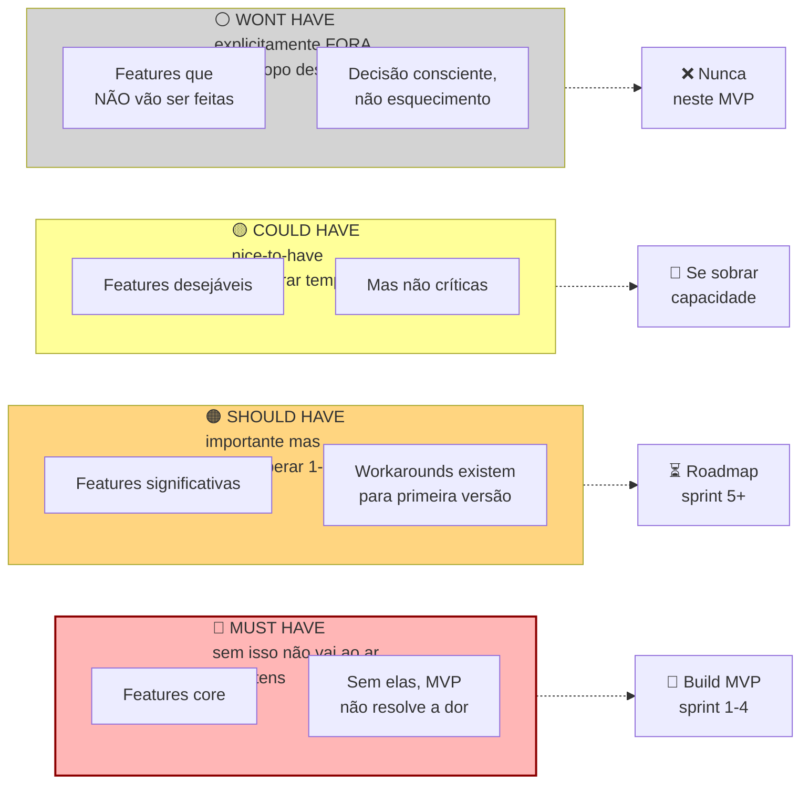

A tentação é inflar Must Have para vinte ou trinta itens. MVP com vinte Must Haves não é MVP. É produto mínimo *impossível*.

Lista de requisitos funcionais. Cada um em uma das quatro categorias. Must Have. Sem isso, não há produto. Entra no MVP obrigatoriamente. Should Have. Deveria ter, mas dá para viver um tempo sem. Sprint três pós-MVP. Could Have. Desejável. Entra se houver tempo e capacidade. Won't Have (yet). Explicitamente fora do MVP.

> [!important] Regra dura do MoSCoW
> Um MVP com mais de dez a quinze Must Haves não é MVP. É produto inflado. Se a sua lista passa de quinze, você não dominou o problema ainda. Volte e corte.

#### Passo 6, escreva a Especificação do MVP

Documento contendo dez itens.

Proposta de valor final, em uma frase. Persona foco (beachhead). JTBDs principais a resolver. Lista de Must Haves. Lista de Should e Could Haves (roadmap futuro). Explicitamente: o que o MVP *não* fará (Won't Haves). Critérios de sucesso do MVP (métricas). Faixa de preço planejada. Canais de aquisição planejados. Prazo de desenvolvimento estimado. Orçamento.

> [!tip] Apêndice A — Template da Especificação do MVP (A.6)
> O [[IGNICAO-Vol-10-Canvases-e-Templates#APÊNDICE A — TEMPLATES PRONTOS PARA USO|Apêndice A (A.6) (Vol. 10)]] contém o template preenchível da Especificação do MVP com os dez campos acima, mais seção de riscos remanescentes e suposições ainda não validadas. Usar o template em vez de documento livre garante que nenhum campo crítico (Won't Haves, critério de sucesso mensurável) seja omitido por pressão de entrar logo em desenvolvimento.

#### Passo 7, aplique o Gate de Direcionalidade

Antes de avançar para a [[IGNICAO-Vol-3-Tracao#FASE 10 — MVP E EXPERIMENTOS DE MERCADO|Fase 10 (Vol. 3)]] e gastar tempo e dinheiro construindo o MVP, responda em voz alta, para um interlocutor externo (cofundador, mentor, advisor), a seguinte pergunta.

> [!important] A pergunta do gate
> A solução que estamos prestes a construir reduz ou elimina, de forma direta e mensurável, a dor que identificamos na beachhead?

Os três elementos da frase importam, e cada um é um teste por si só.

Reduz ou elimina. Não é "ajuda com", "apoia", "melhora a experiência de". Uma solução que não cruza essa barreira não justifica adoção, nem pagamento. Se você se vê usando verbos fracos para descrever o impacto, provavelmente está vendendo melhoria incremental onde o cliente precisa de ruptura.

De forma direta. A cadeia causal entre usar o produto e sentir a dor diminuir precisa ser curta e óbvia. Se a redução da dor depende de o cliente também mudar comportamento, também treinar a equipe, também integrar com outros sistemas que ele ainda não tem, a cadeia é longa demais para um MVP ganhar adoção.

De forma mensurável. O cliente precisa conseguir medir a redução. Em horas, reais, erros evitados, conversões geradas. Redução "sentida" mas não medida é indistinguível de placebo. E não financia renovação de contrato.

> [!warning] Se algum dos três elementos travar, não avance
> Volte ao Passo 6 (Especificação do MVP) e corte features que não contribuem diretamente para a redução da dor principal. Um MVP que resolve uma dor com direcionalidade clara supera consistentemente um MVP que resolve várias dores com direcionalidade difusa.

#### Passo 8, aplique o Scale Readiness Check

Esse checklist complementa o gate de direcionalidade. Enquanto o gate pergunta "a solução é a certa?", o Scale Readiness Check pergunta "você tem as condições para construir com segurança?". Os cinco itens precisam ser todos verdadeiros antes da [[IGNICAO-Vol-3-Tracao#FASE 10 — MVP E EXPERIMENTOS DE MERCADO|Fase 10 (Vol. 3)]] começar com intensidade de build.

- [ ] **Um comprador claramente definido.** Você tem nome, cargo, e empresa (ou perfil nomeado no caso B2C) do primeiro comprador. Não "pequenos negócios". Uma lista concreta de cinco a dez pessoas que você saberia chamar hoje para uma demo.
- [ ] **Um workflow doloroso identificado.** Você observou, não só ouviu, o workflow atual. Sabe onde o cliente trava, quantos minutos por semana ele gasta na gambiarra, e quem mais na organização é afetado.
- [ ] **Titularidade de orçamento clara.** Você sabe quem no fluxo comprador autoriza o gasto, de qual rubrica sai o dinheiro, e em que ordem de grandeza (R$ por mês ou por licença). Se a resposta é "a gente descobre depois", você ainda não tem clareza orçamentária suficiente para escalar.
- [ ] **Urgência observável.** Não declarada em entrevista. *Observável em comportamento*. O cliente já está pagando algo hoje para mitigar (mesmo que precariamente), já tentou resolver sozinho, ou tem prazo externo (regulatório, contratual, competitivo) que aperta.
- [ ] **Consciência de que escalar suposições amplifica ineficiência.** Você lista por escrito quais suposições ainda não foram validadas, e se comprometeu a validá-las na [[IGNICAO-Vol-3-Tracao#FASE 10 — MVP E EXPERIMENTOS DE MERCADO|Fase 10 (Vol. 3)]] sem construir por cima delas. Ignorar essa etapa transforma dívida de suposição em dívida de produto, e cria retrabalho caro.

> [!warning] Se algum dos cinco itens não pode ser marcado, não avance em ritmo de produção
> Continue na Fase 9 em modo de investigação até fechar o item. Escalar desenvolvimento com suposições não-testadas é como colocar mais combustível em um carro que ainda não se sabe se tem direção funcionando. Você só vai chegar mais rápido no lugar errado.

### Os oito passos aplicados, roteiro de teste de usabilidade do PadariaPro (protótipo híbrido WhatsApp mais Web)

**Briefing ao usuário (cinco minutos).**

> "Oi, [Nome]. Hoje vou te mostrar uma versão não finalizada de uma ferramenta. Quero que você tente usá-la como se fosse a sua rotina, e fale em voz alta tudo que está pensando. Não tem resposta certa. Se você se perder, ótimo. É isso que a gente precisa saber. Posso gravar a tela?"

**Tarefa 1, onboarding inicial (dez minutos).**

> "Você acabou de receber a indicação do PadariaPro. Cadastre a sua padaria e adicione o seu primeiro fornecedor (Anaconda)."

Friction points observados em cinco usuários. Quatro de cinco travaram em "Inserir CNPJ", porque o sistema exigiu formato específico sem indicar. Três de cinco não entenderam o que "vincular fornecedor" significava na tela. Cinco de cinco pularam o campo "Inserir cardápio". Acharam irrelevante para onboarding.

**Tarefa 2, confirmar pedido via WhatsApp (oito minutos).**

> "Chegou uma mensagem do PadariaPro no seu WhatsApp com sugestão de pedido. Confirme."

Observações. Cinco de cinco confirmaram sem problema via "sim". Dois de cinco tentaram "ajustar" e ficaram confusos quando o bot pediu nova quantidade. Não estava claro se era em quilos ou em sacos. Quatro de cinco elogiaram a fluidez.

**Tarefa 3, ajustar pedido recorrente (dez minutos).**

> "Você percebeu que a sua padaria está desperdiçando farinha integral. Ajuste o pedido recorrente para pedir vinte por cento a menos."

Friction points. Cinco de cinco demoraram mais de três minutos para encontrar a configuração. Três de cinco desistiram, e disseram "eu pediria pelo WhatsApp direto". O insight: configurações devem poder ser feitas pelo WhatsApp também. Não só pela web.

**Síntese pós-cinco testes.**

Must-have para ativação. Onboarding em menos de cinco minutos (hoje leva doze a vinte). CNPJ com máscara. Explicação de fornecedor. Pular cardápio opcional.

Funcionalidade crítica a simplificar. Ajuste de pedido recorrente. Mover para WhatsApp com comando natural.

Descarte. Seção "cardápio" não é essencial para MVP. Cortar.

Iteração prioritária. Simplificar onboarding para três passos. CNPJ, depois primeiro fornecedor, depois primeiro pedido teste.

### Caso brasileiro real, Gupy e empresas-piloto

Em meados da década de 2010, a Gupy nascia da ideia de Mariana Dias, Bruna Guimarães, e Robinson Idalgo de substituir processos tradicionais de recrutamento por uma plataforma que usasse dados e IA para triagem.

A decisão foi cirúrgica. Antes de abrir comercial amplo, fizeram piloto com cinco a oito empresas-parceiras. Usavam a plataforma com acompanhamento próximo, e iteração semanal. Cada empresa tinha objetivo claro (redução de tempo de contratação, aumento de qualidade de candidato), medido pré e pós.

O resultado foi composto. As iterações cruas, baseadas em uso real, calibraram a plataforma antes do go-to-market geral. As empresas-piloto viraram primeiros cases. Depois evangelistas. Depois canal de referência. A Gupy se tornaria, anos depois, uma das maiores plataformas de recrutamento da América Latina.

A lição transferível. Piloto estruturado com poucas empresas gera aprendizados cem vezes mais úteis que lançamento aberto sem foco. E os primeiros pilotos viram, se bem cuidados, os primeiros vendedores da sua empresa.

### PERGUNTAS A RESPONDER

- A solução proposta resolve o problema de forma percebida como superior pelo ICP?
- Em que faixa de preço ela cabe no orçamento da beachhead?
- Quais são os requisitos absolutamente indispensáveis (Must Haves)?
- Quais seriam dispensáveis no primeiro release?
- Como vou medir sucesso do MVP em noventa dias depois de lançar?
- Quais são os três principais riscos do MVP?

> [!note] Apêndice DT — Customer Experience
> O teste de solução é o primeiro onboarding real do usuário com o conceito do produto. O [[IGNICAO-Vol-3-Tracao#APÊNDICE DT — CUSTOMER EXPERIENCE: DA JORNADA AO NPS AO CHURN ZERO|Apêndice DT — Customer Experience (Vol. 3)]] cobre como medir e otimizar time-to-value desde essa fase — o tempo que o usuário leva para perceber o valor central é o dado mais preditivo de retenção futura, e deve ser rastreado já nas sessões de teste da Fase 9.

### SAÍDA DESTA FASE

Você concluiu a [[#FASE 9 — TESTES DE SOLUÇÃO E USABILIDADE|Fase 9]] quando todos os critérios abaixo estão cumpridos.

- [ ] Protótipo de média fidelidade clicável (Figma, Webflow, Framer) com fluxos principais navegáveis.
- [ ] Três a cinco tarefas-chave de teste definidas, com critério de conclusão.
- [ ] Dez ou mais entrevistas de solução ou sessões de teste com think-aloud, com cinco dimensões avaliadas (Relevância, Urgência, Preferência, Diferenciação, Disposição a pagar). Urgência média ≥3 (≥4 é forte; <3 é alerta vermelho); Preferência média ≥4 sobre alternativa atual.
- [ ] Taxa de entendimento no teste de cinco segundos ≥70% (o que entendeu, para quem é, qual problema resolve).
- [ ] Faixa de preço aceitável definida por Van Westendorp, com limite superior identificado.
- [ ] Número de Must Haves entre cinco e dez (crítico se mais de quinze; volta e corta).
- [ ] Friction points documentados por tarefa e por usuário em matriz.
- [ ] Pelo menos uma iteração do protótipo baseada nos testes.
- [ ] Teste de precificação Van Westendorp aplicado, faixa de preço psicologicamente aceitável definida.
- [ ] Especificação do MVP (Template A.6) escrita com todos os dez campos, MoSCoW com cinco a quinze Must Haves.
- [ ] Gate de Direcionalidade aprovado: a solução reduz ou elimina, de forma direta e mensurável, a dor identificada na beachhead.
- [ ] Scale Readiness Check com cinco itens marcados (comprador definido, workflow doloroso, titularidade de orçamento, urgência observável, suposições não-validadas listadas).

> [!warning] Critério de saída
> Se qualquer um desses itens falha, não avance. Especialmente o Gate de Direcionalidade e o Scale Readiness Check. Avançar para construção com algum item em aberto custa duas a três vezes mais em retrabalho.

**Primeiros passos práticos.**

1. Escolher a solução vencedora da [[#FASE 8 — IDEAÇÃO E PROTOTIPAGEM DE SOLUÇÕES|Fase 8]], e refinar em Figma clicável (ou Webflow ou Framer, se web).
2. Escrever três a cinco tarefas concretas que um usuário novo tentaria fazer (por exemplo, "faça um pedido de farinha para a próxima semana").
3. Agendar cinco sessões de teste de usabilidade de quarenta e cinco minutos cada.
4. Pedir think-aloud. "Fale em voz alta tudo que está pensando enquanto tenta a tarefa." Observar. Não guiar.

### Armadilhas

Bloat de escopo. Sem disciplina, o MVP cresce. Para cada Must Have, pergunte: "se eu tirasse isso, o produto ainda resolveria o *job* principal?". Se sim, não é Must.

Confiar em "eu pagaria". A resposta é sempre mais generosa na entrevista do que na carteira. Trate com desconto de cinquenta a setenta por cento.

Ignorar quem não usaria. Quando um entrevistado diz "não é para mim", isso é informação. Pergunte por quê. Às vezes revela que o seu ICP está mal definido.

Especificar sem mensuração. "O MVP deve ser intuitivo." O que é intuitivo? Operacionalize em métricas testáveis.

Acreditar que precificação está resolvida. Van Westendorp dá um ponto de partida. Não a resposta final. Preço real será descoberto em mercado.

---

### FERRAMENTAS DESTA FASE

Três essenciais para a fase; o restante fica como referência consultiva no Apêndice BG.7. Canvas complementar: CZ.6 (Empathy Map).

**Essenciais para a Fase 9:**

- **Usability Testing** (Nielsen e Norman) — usuários completam tarefas, pesquisador observa. Cinco usuários identificam cerca de 85% dos problemas. Ferramenta central da fase. BG.7.1.
- **Think-Aloud Protocol** (Ericsson e Simon, 1984) — participante verbaliza pensamentos durante a tarefa. Revela raciocínio em tempo real. Use junto com Usability Testing. BG.7.6.
- **System Usability Scale (SUS)** (Brooke, 1996) — questionário de dez afirmações, score de zero a cem. Benchmark de setor: cerca de 68. Complementa o qualitativo com nota objetiva. BG.7.7.

**Complementares (consulte conforme o caso):**

- Heuristic Evaluation (10 Heurísticas de Nielsen, para triagem rápida com especialistas), Cognitive Walkthrough (para learnability e onboarding), Card Sorting (para arquitetura de informação), Tree Testing (depois do card sorting). Detalhamento e quando usar cada uma em BG.7.2 a BG.7.5.

---

### SÍNTESE DA FASE 9

A [[#FASE 9 — TESTES DE SOLUÇÃO E USABILIDADE|Fase 9]] é a última ponte antes da construção. A diferença em relação à [[#FASE 8 — IDEAÇÃO E PROTOTIPAGEM DE SOLUÇÕES|Fase 8]] é de profundidade e comprometimento: a Fase 8 produziu conceitos testados em protótipo; a Fase 9 converte os aprendizados em especificação vinculante — o que o MVP fará, para quem, com quais limitações, e como medirá sucesso.

MoSCoW separa o MVP do produto sonhado. Van Westendorp antecipa o erro caro de descobrir tarde que o cliente nunca pagaria o preço imaginado. User stories INVEST impedem o gold-plating da primeira versão. Quem trata a [[#FASE 9 — TESTES DE SOLUÇÃO E USABILIDADE|Fase 9]] como burocracia e pula direto para a construção descobre que estava construindo coisa diferente do que precisava. Retrabalho de MVP custa duas a três vezes mais do que retrabalho de spec.

---

### Transição: do Volume 2 (Validação) para o Volume 3 (Tração)

O que você acabou de fazer ao longo dos **Volumes 1 e 2 (Fases 0 a 9)**: preparou-se como fundador, gerou ideias com método e escolheu uma, articulou a candidata e construiu teoria causal explícita (Vol. 1), e depois descobriu problemas reais em campo, mapeou usuários, mercado e cunha, formulou hipóteses bet-the-company, validou as centrais com experimentos rigorosos, gerou conceitos de solução, prototipou, testou com usuários reais e chegou a uma especificação de MVP com escopo disciplinado (MoSCoW) e pricing testado (Vol. 2). A segunda parte deste volume reúne os **12 apêndices operacionais** de metodologia científica, inteligência competitiva, psicologia do consumidor brasileiro e arquiteturas de modelo de negócio.

O que vem no **Volume 3 — Tração (Fases 10 a 12)** e nos **Volumes 4 a 6 — Escala (Fases 13 e 14)**: construir o MVP de verdade na [[IGNICAO-Vol-3-Tracao#FASE 10 — MVP E EXPERIMENTOS DE MERCADO|Fase 10 (Vol. 3)]], colocar em mercado com usuários reais que pagam (ou pagam com atenção), medir unit economics na [[IGNICAO-Vol-3-Tracao#FASE 11 — VALIDAÇÃO DO MODELO DE NEGÓCIO|Fase 11 (Vol. 3)]], perseguir Product-Market Fit na [[IGNICAO-Vol-3-Tracao#FASE 12 — PRODUCT-MARKET FIT|Fase 12 (Vol. 3)]], e depois estruturar formalmente a empresa e captar no **Volume 4 (Captação e Finanças)**, escalar receita, liderança e cultura no **Volume 5 (Receita e Pessoas)** e consolidar engenharia, operações e blindagem legal no **Volume 6 (Engenharia, Operações e Jurídico)**. Essa travessia do MVP à escala leva de três a cinco anos típicos. Muitas empresas morrem nessa etapa por três motivos: escalar antes do PMF, ficar presa em "quase-PMF" sem reconhecer, e não conseguir unit economics positivas.

> [!important] Sinais de progresso versus sinal de PMF
> Sinal de progresso: usuários pagantes em uso real do MVP. Sinal de PMF: Sean Ellis maior ou igual a quarenta por cento, mais retenção estabilizada, mais crescimento orgânico.

---

# METODOLOGIA CIENTÍFICA, GATES E MATURIDADE

---

### Arquitetura deste Domínio: Rigor Metodológico, Gates de Evidência e Maturidade

Por que tantos fundadores aplicam "Lean Startup" e mesmo assim passam dois anos andando em círculos? Porque iterar rápido sem teoria causal e sem critérios claros de parada é apenas tentativa-e-erro acelerada. Os quatro apêndices deste bloco (**F, G, H e L**) fornecem a espinha dorsal metodológica que governa as Fases 3 a 9.

Eles formam uma lente integrada de governança de validação: o [[#APÊNDICE F — ABORDAGEM CIENTÍFICA vs LEAN STARTUP: QUANDO USAR CADA UMA|Apêndice F]] ensina como combinar a formulação teórica deliberada (Camuffo, Gambardella & Spina) com a experimentação ágil. O [[#APÊNDICE G — FRAMEWORK DE DECISÃO POR GATES (PROBLEM CORE + SCALE LEVERS + EXPLORATORY)|Apêndice G]] organiza as hipóteses em portfólio de gates (separando o núcleo do problema das alavancas de escala). O [[#APÊNDICE H — TRL E CRL: MATURIDADE TECNOLÓGICA E DE MERCADO|Apêndice H]] impede que a maturidade técnica (TRL) desgarre da maturidade comercial (CRL). Por fim, o [[#APÊNDICE L — IDEA → WEDGE → SCALE: O FRAMEWORK ANTLER COMO LENTE TRANSVERSAL|Apêndice L]] amarra tudo na progressão *Idea → Wedge → Scale*: como escolher uma cunha cirúrgica que abre espaço para um negócio grande.

> [!tip] Roteiro de leitura e instrumentos conectados
> - **Em dúvida se deve pivotar, insistir ou aprofundar pesquisa:** Leia [[#APÊNDICE F — ABORDAGEM CIENTÍFICA vs LEAN STARTUP: QUANDO USAR CADA UMA|Apêndice F]] e [[#APÊNDICE G — FRAMEWORK DE DECISÃO POR GATES (PROBLEM CORE + SCALE LEVERS + EXPLORATORY)|Apêndice G]].
> - **Construindo produto técnico, IA ou hardware:** Calibre seu estágio no [[#APÊNDICE H — TRL E CRL: MATURIDADE TECNOLÓGICA E DE MERCADO|Apêndice H]] para não escalar engenharia com CRL zero.
> - **Ferramentas de experimentação e síntese no Vol. 9:** Combine este bloco com Fake Door / Smoke Test (BG.8.3), Cohort Retention inicial (BG.8.5), Van Westendorp / Gabor-Granger (BG.8.6), Conjoint Analysis (BG.8.7), Affinity Diagramming (BG.9.1), Empathy Map (BG.9.3), Service Blueprint (BG.9.5) e JTBD Switch Timeline (BG.9.6).

---

## APÊNDICE F — ABORDAGEM CIENTÍFICA vs LEAN STARTUP: QUANDO USAR CADA UMA

> [!important] Para o framework Antler em detalhe
> Este apendice articula tres frameworks (cientifico, operacional, jornada PSF para PMF). Antler e o quarto framework relevante e merece tratamento proprio em [[#APÊNDICE L — IDEA → WEDGE → SCALE: O FRAMEWORK ANTLER COMO LENTE TRANSVERSAL|Apêndice L]]. Aqui ele e mencionado, la e desdobrado.

> [!abstract] Como ler a Fatia Frameworks e Casos
> Esta fatia tem tres trilhas independentes,
>
> **Trilha de Decisao** (use quando precisa decidir agora). F (frameworks fundacionais) → G (gates) → L (Antler) → B (fechamento de fase) → EJ (decisao como disciplina)
>
> **Trilha de Casos e Aprendizado** (use quando quer evitar fracasso). AI (padroes) ↔ BH (casos) → BF (second-time)
>
> **Trilha de Catalogos e Capital Humano** (use como referencia de consulta). C (metricas) → D (vieses) → E (leituras) → AK (programas) → AL (rede) → EF (macro)

Esse manual se baseia na abordagem científica ao empreendedorismo, Camuffo et al., 2020, 2024, Felin et al., 2024, Coali et al., 2024, que tem pontos em comum com o Lean Startup, Ries, 2011, Blank, 2013, Maurya, 2016, mas se distingue em aspectos importantes. Entender essas diferenças ajuda você a escolher a ferramenta certa para cada tipo de decisão.

### Fundamentação acadêmica, as duas tradições por trás dos frameworks

Para entender por que esses dois frameworks coexistem (e por que nenhum é "certo" isoladamente), vale saber a linhagem intelectual de cada um. Ott et al. (2017) categoriza as abordagens à tomada de decisão em incerteza em duas famílias.

A primeira família é a das *cognition-based approaches* (abordagens baseadas em cognição). Elas pressupõem que decisores conseguem compreender o mercado e o comportamento do cliente ao raciocinar através de modelos mentais e estruturas cognitivas. A estratégia emerge de uma representação mental clara do problema. Os principais autores são Csaszar (2018), Csaszar e Laureiro-Martínez (2018), Csaszar e Levinthal (2016), Gary e Wood (2011), Walsh (1995), Felin e Zenger (2009, 2017), Ehrig e Schmidt (2022). O insight central é simples: pensar primeiro (teoria, atributos, causas), agir depois. Uma boa representação cognitiva reduz o espaço de busca.

A segunda família é a das *action-based approaches* (abordagens baseadas em ação). Elas pressupõem que a estratégia se forma iterativamente a partir do feedback de um conjunto inicial de ações. O aprendizado emerge da experimentação controlada. Os autores principais são Ries (2011), Blank (2013), Bingham e Davis (2012), Bingham e Eisenhardt (2011). O insight central inverte o anterior: fazer primeiro (MVP, experimentos), aprender depois. O contato com o mercado gera dados que o modelo mental não consegue antecipar.

A abordagem científica é uma síntese (Ott e Eisenhardt, 2020. Camuffo et al., 2020, 2024). Ela começa cognition-based (teoria, atributos, hipóteses) e passa a action-based (experimentos, evidência, avaliação). As duas tradições não são mutuamente exclusivas. São complementares quando integradas. O Lean Startup enfatiza fortemente a tradição action-based. A abordagem científica integra as duas com igual peso.

### Evidência empírica, os RCTs que mudaram a discussão

A abordagem científica não é só filosofia. Tem evidência empírica robusta de múltiplos RCTs (Randomized Controlled Trials) que comparam empreendedores treinados para usar a abordagem científica com grupos de controle que usam abordagens tradicionais.

Camuffo et al. (2020) fizeram o primeiro RCT, com cento e dezesseis startups italianas. Empreendedores treinados na abordagem científica apresentaram seleção de projetos melhor e performance de receita superior.

Camuffo et al., working paper 2024, com aproximadamente 750 empreendedores em quatro países (a publicação final poderá ajustar números). Os resultados foram consistentes em três dimensões: taxa maior de terminação de projetos (sinal de seleção mais honesta, não de fraqueza), pivôs mais focados (em vez de mudanças aleatórias) e receita realizada superior no período de observação.

Agarwal et al. (2024) rodaram um RCT na Tanzânia, no setor agrícola, com foco em theory-building. Empreendedores treinados em scientific approach com ênfase em teoria tiveram performance econômica superior e fizeram mudanças mais holísticas no modelo de negócio.

Novelli e Spina (2024) analisaram a moderação por estágio. O benefício da abordagem científica varia conforme o estágio de desenvolvimento do modelo de negócio. Empreendedores com modelo já parcialmente comprometido se beneficiam rapidamente (ajuste fino). Empreendedores ainda muito cedo são "puxados de volta à prancheta" com aumento temporário de incerteza epistêmica, mas com retornos positivos de longo prazo.

Coali et al. (2024), em análise longitudinal, mostraram que empreendedores científicos não descartam projetos melhores. Não há viés de excesso de terminação. Os projetos selecionados são, em média, melhores que os do grupo de controle, com performance superior persistente anos após o treinamento.

> [!info] Implicações para o leitor
> Quando esse manual insiste em formulação de teoria antes de teste, em thresholds ex-ante, em due diligence de amostra, não é rigor por rigor. É tradução de achados empíricos que mostram diferenças mensuráveis de performance entre empreendedores que aplicam esses princípios e os que pulam direto para "construir e ver". A abordagem tem custo, tempo de teorização, desconforto de falsificar as próprias teses, mas o retorno é sistemático.

### Pontos em comum

Ambas as abordagens recusam a ideia de plano de negócios extenso como ponto de partida. Tratam o empreendedor como alguém que precisa sair do prédio e buscar evidência real no mercado. Usam hipóteses testáveis e experimentação como motor de aprendizado. Preferem falhar cedo e barato a falhar tarde e caro. E valorizam MVPs e iteração.

### Diferenças fundamentais

| Dimensão | Lean Startup | Abordagem Científica |
|---|---|---|
| **Ponto de partida** | Hipóteses sobre o modelo de negócio (BMC/Lean Canvas) | Teoria causal explícita dos atributos e suas relações (Árvore de Teoria, DAG) |
| **Premissa sobre o cliente** | Assimetria de **informação**: o cliente tem conhecimento que o empreendedor precisa extrair | Assimetria de **crenças**: empreendedor e cliente têm representações diferentes do mundo, e a do empreendedor pode gerar valor novo |
| **Função da teoria** | Geralmente implícita, teoria emerge dos testes | Explícita e anterior, teoria guia quais testes vale a pena fazer |
| **Escolha de experimentos** | Iterativa, "construir-medir-aprender" baseado em aprendizado recente | Deliberada, experimentos escolhidos para testar os atributos bet-the-company primeiro |
| **Papel da probabilidade** | Pouco formalizado | Explícito, empreendedor atribui crenças subjetivas antes de testar |
| **Threshold de decisão** | Frequentemente formado após olhar os dados | Definido ex-ante e ajustado apenas por due diligence da amostra |
| **Resposta a resultado negativo** | Pivotar rápido para próxima hipótese | Comparar com a teoria completa, pivô pode ser dentro da teoria, mudança de teoria, ou abandono |
| **Natureza** | Mais adaptativa e representacional (espelhar o mercado existente) | Mais generativa (criar novas fontes de valor a partir de uma visão teórica) |

### Quando cada abordagem brilha

O Lean Startup é mais útil quando o problema é relativamente estruturado e há exemplos de negócios similares no mercado. Quando o custo marginal de experimentar é muito baixo (produto cem por cento digital, com usuários abundantes). Quando você tem muitos dados disponíveis sobre comportamento do mercado. Quando a solução é incremental, não radical. E quando a velocidade de iteração é mais importante que a profundidade de uma única decisão. Exemplo típico: app de produtividade em mercado com dezenas de concorrentes, onde a questão é "qual feature específica resolve melhor?".

A abordagem científica é mais útil quando o problema é Knightiano, com alta incerteza, poucos precedentes e nenhum mercado comparável. Quando experimentar é caro (produto físico, regulado, B2B enterprise). Quando as decisões são "low-frequency, high-impact" e erros grandes têm consequência grande. Quando a solução é potencialmente radical ou depende de mudança de comportamento. Quando você precisa reduzir o espaço de solução antes de gastar dinheiro em testes. Exemplo típico: hardware médico, novo mercado em país emergente, plataforma B2B com venda consultiva longa, biotecnologia.

### Como combinar as duas

Na prática, os bons empreendedores usam as duas de forma integrada.

Comece científico nas Fases 0 a 6 desse manual. Gaste tempo na teoria, atributos, hipóteses, thresholds. Isso reduz drasticamente o risco de testar a coisa errada nos meses seguintes.

Vire lean quando a teoria central estiver validada, nas Fases 7 a 10. Uma vez que você sabe que o problema é real, o ICP está certo, e há disposição a pagar, o ciclo construir-medir-aprender se torna muito eficaz. A teoria já filtrou as apostas ruins, agora é hora de iterar rapidamente sobre os detalhes.

Volte ao modo científico em decisões estratégicas grandes na [[IGNICAO-Vol-3-Tracao#FASE 11 — VALIDAÇÃO DO MODELO DE NEGÓCIO|Fase 11 (Vol. 3)]] em diante. Quando precisar decidir sobre novo mercado, expansão internacional, novo produto, rodada de investimento ou mudança significativa de modelo, volte à árvore de teoria. Essas são novamente decisões de baixa frequência e alto impacto.

> [!warning] O erro mais comum
> Aplicar lean onde a abordagem científica é necessária (iterar muito sem teoria produz confusão e custo). Ou abordagem científica onde lean bastaria (teorizar demais quando o problema já está bem definido desacelera o aprendizado). Conheça seu contexto.

### Glossário comparativo rápido

"Hipótese" no Lean Startup é tipicamente sobre o modelo de negócio (por exemplo, "clientes B2B vão adotar auto-serviço"). Na abordagem científica, hipóteses são derivadas explicitamente de uma teoria causal sobre atributos do problema e da solução.

"Pivot" no Lean Startup é uma mudança de direção após aprendizado. Na abordagem científica, o pivô é informado pela teoria alternativa já mapeada. Você já sabia quais eram as direções possíveis.

"MVP" no Lean Startup é um produto mínimo que gera aprendizado. Na abordagem científica, o MVP é um experimento específico que testa uma hipótese específica derivada da teoria. Não é uma versão genérica do produto.

"Validado" no Lean Startup tende a significar "resultado positivo no último experimento". Na abordagem científica, validação é a convergência entre a teoria inicial, os resultados ajustados por due diligence da amostra, e a comparação com explicações alternativas.

### Como os três frameworks desse manual se relacionam

O manual articula três frameworks complementares. Empreendedores iniciantes às vezes se confundem sobre qual usar quando. Esse mapa esclarece.

O primeiro é a Abordagem Científica ao Empreendedorismo (Coali, Camuffo, Novelli, Spina e outros). É uma metodologia acadêmica de tomada de decisão baseada em teoria explícita mais hipóteses falsificáveis mais evidência rigorosa mais avaliação objetiva. Aparece na Introdução (com os cinco princípios), na [[IGNICAO-Vol-1-Ideacao#FASE 2B — CONSTRUÇÃO DA TEORIA DO NEGÓCIO|Fase 2B (Vol. 1)]] (teoria), na [[#FASE 6 — FORMULAÇÃO RIGOROSA DE HIPÓTESES|Fase 6]] (hipóteses), na [[#FASE 7 — EXPERIMENTOS DE VALIDAÇÃO DO PROBLEMA|Fase 7]] (experimentos mais due diligence mais thresholds), e como ossatura metodológica de todas as fases. As ferramentas centrais são Story Tree, DAG, Theory Map, Hypothesis Canvas. Priorize esse framework em decisões de alta incerteza e alto impacto (contextos Knightianos), em estágios iniciais, em deeptech, em B2B enterprise com ciclo longo.

O segundo é o Operacional-prático (YC, Antler, João Prado, Blank, Maurya). Reúne heurísticas e frameworks de operadores de campo para diagnosticar qualidade de ideia, estreitar foco, e tomar decisões rápidas. Aparece nos filtros de problema ideal ([[#FASE 3 — DESCOBERTA DO PROBLEMA|Fase 3]]), Pain Levels ([[#FASE 3 — DESCOBERTA DO PROBLEMA|Fase 3]]), Estratégia da Cunha ([[#FASE 5 — MAPEAMENTO DE MERCADO E CONCORRÊNCIA|Fase 5]]), Sistema H/E ([[#FASE 6 — FORMULAÇÃO RIGOROSA DE HIPÓTESES|Fase 6]]), Ciclo MVP em três fases ([[IGNICAO-Vol-3-Tracao#FASE 10 — MVP E EXPERIMENTOS DE MERCADO|Fase 10 (Vol. 3)]]), Framework de Decisão por Gates ([[#APÊNDICE G — FRAMEWORK DE DECISÃO POR GATES (PROBLEM CORE + SCALE LEVERS + EXPLORATORY)|Apêndice G]]). Ferramentas centrais: Canvas da Cunha, scorecard de dez gates, Mom Test cheat sheet. Priorize esse framework para avaliação rápida de ideia, tomada de decisão sobre captação ou expansão, e diagnóstico de saúde do negócio em qualquer momento.

O terceiro é a Jornada PSF para PMF para Escala (Maurya, Moore, Ries). É o modelo de estágios pelo qual toda startup passa, cada um com clientes-alvo, métricas e focos diferentes. Aparece na distinção PSF versus PMF na [[IGNICAO-Vol-3-Tracao#FASE 12 — PRODUCT-MARKET FIT|Fase 12 (Vol. 3)]], no ciclo de saturação de dezoito meses, na transição entre Fases 10 e 11. Ferramentas centrais: Sean Ellis Test, escolha de canvas por estágio (Opportunity Canvas para Lean Canvas para BMC). Priorize quando precisar saber em que ponto do ciclo você está e qual é o próximo milestone realista.

Como os três se encaixam na prática? No começo (Fases 0 a 1B), o Framework 1 (científico) domina. Você constrói teoria explícita com atributos e causas. O Framework 2 ajuda a filtrar se o problema tem qualidade (seis dimensões YC, cinco heartfelt). O Framework 3 te situa: você está em pré-PSF, começando o ciclo.

Na descoberta de problema e mercado (Fases 2 a 4), o Framework 2 domina na execução (Mom Test, Pain Levels, Cunha). O Framework 1 garante rigor metodológico (entrevistas estruturadas, saturação, evidência diferente de opinião). O Framework 3 é referência silenciosa, ainda pré-PSF.

Nas hipóteses e experimentos (Fases 5 e 6), os Frameworks 1 e 2 se fundem. O Framework 1 dá a disciplina (falsificabilidade, threshold ex-ante, due diligence de amostra). O Framework 2 dá a priorização operacional (R vezes I e H sobre E). O Framework 3 diz em qual tipo de validação você está (problema, oferta, ou solução).

Na construção de solução e MVP (Fases 7 a 9), o Framework 2 domina (ciclo MVP em três fases). O Framework 1 entra quando você precisa decidir entre alternativas competidoras (DAG comparando duas teorias da solução). O Framework 3 te diz: você está atravessando pré-PSF para PSF.

Na validação de modelo e PMF (Fases 10 e 11), o Framework 3 domina (PSF para PMF com métricas e sinais). O Framework 2 entra no Framework de Decisão por Gates ([[#APÊNDICE G — FRAMEWORK DE DECISÃO POR GATES (PROBLEM CORE + SCALE LEVERS + EXPLORATORY)|Apêndice G]]). O Framework 1 é revisitado toda vez que uma decisão estratégica grande é feita (captar, expandir, pivotar).

Na estruturação e escala (Fases 12 e 13), os três frameworks quase desaparecem e entram outros (governança, finanças, recrutamento). Mas voltam em pontos específicos. Por exemplo, ao abrir novo mercado, você retorna ao Framework 1 (teoria do novo mercado) e ao Framework 2 (cunha do novo mercado).

> [!question] Confusões comuns entre as ferramentas
> "Uso R vezes I ou H sobre E para priorizar hipóteses?" Os dois, para propósitos diferentes. R vezes I (Risco vezes Incerteza) prioriza o que testar primeiro, quais hipóteses podem matar o negócio se falharem. H sobre E (Hypothesis Strength sobre Evidence Strength) informa quando investir capital. Não invista em nada com H abaixo de sete ou E abaixo de seis.
>
> "Fase 7 e Fase 10 ambas falam em Landing Page e Concierge. Preciso fazer duas vezes?" Não. Fase 6 usa essas técnicas para validar problema (dor existe? é dolorida? tem disposição a pagar?). Fase 9 usa as mesmas técnicas dentro do ciclo MVP para validar solução (a feature X realmente resolve? em qual versão?). Mesma ferramenta, pergunta diferente.
>
> "Sean Ellis quarenta por cento aparece em várias fases. É a mesma medida?" Sim, mas aplicada em escopos diferentes. Na Fase 10, você mede em cerca de dez usuários pioneiros para detectar sinal precoce. Na Fase 12, em centenas, para confirmar PMF. Na descrição PSF, pode ser aplicado ao nicho inicial (cerca de vinte evangelists). O threshold de quarenta por cento é o mesmo, a população muda.
>
> "Pain Level, CRL, PSF/PMF, Moore's Chasm, qual taxonomia devo usar para meus clientes?" Use em conjunto. Pain Level (um a cinco) classifica cada entrevistado individualmente. CRL (um a sete) classifica a maturidade da sua relação com o mercado como um todo (útil em editais). PSF/PMF classifica o estágio da sua startup. Moore classifica em qual onda de adoção você está (early adopters, early majority, late majority).
>
> "Árvore de teoria é o mesmo que Business Model Canvas?" Não. BMC é um inventário de blocos (o que você tem). Árvore de teoria é uma rede causal (por que funciona). O Theory Map ([[IGNICAO-Vol-10-Canvases-e-Templates#APÊNDICE A — TEMPLATES PRONTOS PARA USO|Apêndice A (Vol. 10)]].9) conecta os dois explicitamente.

Tabela de tradução entre taxonomias de cliente e produto:

| Pain Level | CRL | PSF/PMF | Moore's Chasm |
|---|---|---|---|
| 1 (tem problema, nem sabe) | CRL 1 | Pré-descoberta | — |
| 2 (sabe que tem) | CRL 2 | Descoberta | — |
| 3 (procurando solução) | CRL 3 | Pré-PSF / Descoberta | Innovator |
| 4 (improvisou solução feia) | CRL 4 | PSF em validação | Early adopter |
| 5 (orçamento comprometido) | CRL 5-6 | PSF validado / PMF inicial | Early adopter / Early majority |
| — | CRL 7 | PMF estabelecido | Early majority |

> [!important] Regra final dos três frameworks
> Nenhum dos três é suficiente sozinho. Um empreendedor que só usa o Framework 1 (científico) teoriza demais e age pouco. Um que só usa o Framework 2 (operacional) toma atalhos e acumula decisões mal-fundamentadas. Um que só usa o Framework 3 (jornada) acerta o estágio mas não sabe o que fazer dentro dele. Os três são necessários e se reforçam mutuamente.

### Escolha de canvas por estágio: Opportunity, Lean, BMC

Uma confusão recorrente entre empreendedores iniciantes é qual "canvas" usar. Existem vários, e a maioria os trata como intercambiáveis. Não são. Cada canvas é otimizado para um estágio diferente do negócio. Usar o canvas errado no estágio errado produz documentos que parecem estruturados mas não ajudam em decisão nenhuma.

Há três canvases principais, e a ordem de uso importa.

O **Opportunity Canvas** é a ferramenta das Fases 1 a 4 (pré-PSF inicial). Seu propósito é avaliar se uma oportunidade específica merece investimento de desenvolvimento, antes de escrever a primeira linha de código. O foco é granular: usuários e clientes, problemas, soluções atuais, ideia de solução, o que os usuários vão fazer para obter valor, estratégia de adoção, métricas de usuário, desafios de negócio, budget, impacto de negócio. Use quando você tem uma ideia preliminar e precisa decidir se a oportunidade vale o custo de desenvolvimento. É útil em empresas estabelecidas com muitas ideias competindo por recursos e em startups em pré-seed avaliando pivots. Não use em negócios já em validação avançada. O Opportunity Canvas fica estreito para representar um modelo de negócio completo.

O **Lean Canvas** é a ferramenta das Fases 5 a 10 (alta incerteza, MVP, validação de modelo). Seu propósito é estruturar hipóteses de negócio sob alta incerteza, com foco em aprender rápido. Substitui o BMC quando o que importa é testar o problema e a solução antes de otimizar o modelo. Os nove blocos são Problema, Solução, Métricas-Chave, Proposta Única de Valor, Vantagem Injusta (esses cinco substituem os blocos do BMC focados em execução), mais Segmentos de Clientes, Canais, Estrutura de Custos e Fontes de Receita. Use em startup em estágio inicial, com alta incerteza sobre problema, cliente ou solução. Iterações rápidas (revise semanalmente ou quinzenalmente). Não use em negócios com modelo já validado, onde o foco é execução e expansão, ou em conversas com parceiros estratégicos corporativos que querem ver o BMC "sério".

O **Business Model Canvas (BMC)** é a ferramenta da [[IGNICAO-Vol-3-Tracao#FASE 11 — VALIDAÇÃO DO MODELO DE NEGÓCIO|Fase 11 (Vol. 3)]] em diante (pós-PSF, estruturação, escala e revisão no ciclo longo). Seu propósito é descrever o modelo de negócio já funcionando de forma compreensível para stakeholders externos. É visão macro, parceiros, canais de escala, estrutura de custos. Os nove blocos são Parceiros-Chave, Atividades-Chave, Recursos-Chave, Proposta de Valor, Relacionamento com Clientes, Canais, Segmentos de Clientes, Estrutura de Custos e Fontes de Receita. Use quando o negócio tem PMF confirmado, está buscando investimento Série A ou superior, está buscando parcerias estratégicas, ou está consolidando operação. Use também na [[IGNICAO-Vol-5-Receita-e-Pessoas#FASE 14 — ESCALA: TIME, OPERAÇÕES, CRESCIMENTO E CAPITAL|Fase 14 (Vol. 5)]] (reinvenção) para revisar explicitamente o modelo vigente antes de desenhar a segunda curva, e na [[IGNICAO-Vol-7-Maturidade-e-Exit#FASE 15 — REINVENÇÃO E SEGUNDA CURVA|Fase 15 (Vol. 7)]] (exit) como documento de referência para due diligence e equity story. Não use em estágios iniciais de incerteza. O BMC incentiva otimização prematura porque seus blocos assumem que você já sabe o modelo, quando o ponto de uma startup inicial é descobri-lo. Na [[IGNICAO-Vol-7-Maturidade-e-Exit#FASE 15 — REINVENÇÃO E SEGUNDA CURVA|Fase 15 (Vol. 7)]], quando a segunda curva exige testar hipóteses novas sob alta incerteza, volte ao Lean Canvas para a curva nova enquanto mantém o BMC para o negócio principal.

> [!warning] O erro típico do iniciante
> Começar direto pelo BMC porque é o mais famoso. Resultado: nove blocos preenchidos com suposições disfarçadas de fatos, que ninguém testa depois. O caminho correto é subir na escada de canvases conforme a incerteza diminui.

| Estágio | Canvas principal | Por que |
|---|---|---|
| Ideia solta, múltiplas oportunidades competindo | Opportunity Canvas | Decidir qual oportunidade priorizar |
| Validação de problema e solução em curso | Lean Canvas | Estruturar hipóteses para teste |
| PSF confirmado, preparando PMF e captação | BMC | Comunicar modelo a stakeholders externos |
| Reinvenção ([[IGNICAO-Vol-7-Maturidade-e-Exit#FASE 15 — REINVENÇÃO E SEGUNDA CURVA|Fase 15 (Vol. 7)]]), segunda curva em exploração | Lean Canvas (para a curva nova) e BMC (para o core) em paralelo | Curva nova volta a ter incerteza alta, core existente precisa de clareza para stakeholders |
| Exit ([[IGNICAO-Vol-7-Maturidade-e-Exit#FASE 16 — EXIT STRATEGY|Fase 16 (Vol. 7)]]), preparação e execução | BMC como referência canônica | Base para due diligence, tax structuring e equity story |

Cada canvas é a ferramenta certa para o seu momento. Usar o canvas errado não é neutro. É atraso disfarçado de produtividade.

Vale notar que canvases não se substituem completamente. Mesmo depois de ter BMC, você revisita Lean Canvas ao entrar em novo segmento de mercado (a incerteza volta a subir). E mesmo depois de Lean Canvas, você revisita Opportunity Canvas ao avaliar se vale expandir para produto adjacente. É uma escada, mas você pode descer degraus conforme a incerteza do problema aumenta.

### Sobre o quarto framework: Idea, Wedge, Scale (Antler)

O framework Antler tem desdobramento proprio em [[#APÊNDICE L — IDEA → WEDGE → SCALE: O FRAMEWORK ANTLER COMO LENTE TRANSVERSAL|Apêndice L]] por densidade conceitual e integracao tematica ao manual.

---

### Como os três frameworks se reconciliam fase a fase

Esse apêndice já cobriu a integração entre os frameworks científico (João Prado), operacional (YC e Antler), e descoberta contínua (Teresa Torres). Essa seção sumariza a reconciliação por fase em forma compacta.

| Fase | Framework dominante | Por que |
|---|---|---|
| 0 a 2B | Cientifico | Ideacao com hipoteses falsificaveis antes de construir |
| 3 a 6 | Lean Startup com Cientifico | Discovery rapido com threshold ex-ante |
| 7 a 10 | Lean Startup | Build-measure-learn em ciclos curtos |
| 11 a 13 | Cientifico de novo | Decisoes maiores (rodada, escala) precisam de threshold rigoroso |
| 14 em diante | Hibrido | Operacao ja madura, escolha por tipo de decisao |

> [!important] Princípio geral
> Nenhum framework desaparece em nenhuma fase. O que muda é qual está em primeiro plano. Fundador iniciante que usa só um framework em todas as fases está sub-otimizando. Reconhecer em qual modo estar e quando trocar é parte do método.

> [!info] Fases relacionadas
> Referenciado em: Fase 1, Fase 2.

---

## APÊNDICE G — FRAMEWORK DE DECISÃO POR GATES (PROBLEM CORE + SCALE LEVERS + EXPLORATORY)

> [!note] Quando aplicar
> Esse apêndice é um sistema de avaliação numérica que você aplica à sua ideia em qualquer fase. É útil ao final da Fase 5, para decidir se prossegue, e ao final da Fase 11, para decidir se levanta capital ou escala. O framework combina o Sistema H/E, ver Fase 6, com gates de decisão em três categorias, derivadas do trabalho de operadores e investidores em estágio inicial.

O princípio é simples. Em qualquer ideia de negócio há perguntas deal-breakers, se uma falha, a ideia morre, e perguntas levers, fatores que, juntos, determinam a velocidade e a amplitude do crescimento. Não dá para compensar nota baixa num deal-breaker com notas altas nos levers. Daí a estrutura em duas fases.

Para ideias frontier, radicais, contrarian, criadoras de mercado novo, há uma terceira categoria, chamada Exploratory Gates. Algumas dessas ideias falham em todos os deal-breakers tradicionais e ainda assim são as que definem a década. OpenAI, Tesla e SpaceX nos momentos iniciais são exemplos.

### Como pontuar — o Sistema H/E aplicado a cada gate

Para cada gate você atribui duas notas, ambas de um a dez. O H (Hypothesis) mede a força do raciocínio teórico a favor da sua posição nesse gate antes de evidência empírica. H igual a dez é teoria robusta, H igual a um é palpite. O E (Evidence) mede a quantidade e a qualidade da evidência empírica que você acumulou. E igual a dez é dados robustos, múltiplos pilotos pagos, benchmarks de setor. E igual a um é nenhum dado.

A pontuação do gate é uma combinação dos dois. Se a avaliação é prospectiva (você está começando, quase sem dado), use H como número principal mas obrigatoriamente registre E. Se a avaliação é retrospectiva (já existem clientes, MVP em operação), use E como número principal. Um gate está em "Proceed" se H for maior ou igual a sete e E maior ou igual a seis. Está em "Iterate" se a combinação cair entre seis e sete. Está em "Pivot ou Kill" abaixo de seis, principalmente no Problem Core.

### Fase 2 do framework — Problem Core (deal-breakers)

Os quatro gates a seguir são deal-breakers. Qualquer um com nota H abaixo de sete significa que você ainda não pode seguir adiante e precisa voltar a gerar teoria ou coletar evidência. Antes de considerar qualquer lever, todos os quatro devem estar em H igual ou superior a sete, e idealmente E igual ou superior a seis.

**Gate 1, Problem Intensity (Intensidade do Problema).** A pergunta central: quem exatamente tem o problema, quão doloroso é, com que frequência ocorre, quanto custa hoje, o que acontece se for ignorado? Os sinais de H alto incluem você conseguir descrever o problema com verbatims de clientes, com métricas de tempo, dinheiro e risco, e os clientes reconhecerem que têm o problema e se importarem com ele. Sinais de E alto: pelo menos quinze entrevistas com Pain Level médio igual ou superior a quatro, pelo menos cinco clientes em Pain Level cinco (orçamento comprometido), e tentativas de solução improvisadas identificadas. Sinais de H ou E baixo: descrever o problema em termos genéricos como "gestão ineficiente" ou "falta de produtividade", entrevistados precisarem ser educados sobre o problema para reconhecê-lo.

**Gate 2, Economic Buyer (Comprador Econômico).** A pergunta central: quem paga, de qual rubrica orçamentária, quanto tempo leva a aprovação de compra, a pessoa tem autoridade e budget agora? Sinais de H alto: o comprador está mapeado nominalmente, você conhece o cargo, a rubrica e o ciclo de aprovação típico. Sinais de E alto: duas ou mais empresas assinaram cartas de intenção ou LOIs, pelo menos um piloto pago em andamento ou fechado. Sinais baixos: vender para influenciadores (quem usa) em vez de decisores (quem paga), ciclo de compra acima de seis meses sem justificativa clara.

**Gate 3, Market Size (Tamanho de Mercado).** Pergunta central: existe caminho crível para cem milhões de reais ou mais de receita recorrente anual em sete a dez anos? Quantos ICPs existem? Qual participação você pode ganhar? Sinais de H alto: modelo bottom-up triangulado com fontes públicas, você consegue explicar de onde vem cada número, múltiplos cenários. Sinais de E alto: dados de associações do setor, relatórios de pesquisa, benchmarks de empresas comparáveis. Sinais baixos: top-down preguiçoso ("mercado é de dez bilhões, só preciso um por cento"), ausência de número concreto, mercado em contração.

**Gate 4, Willingness to Pay e ROI (Disposição a Pagar).** Pergunta central: qual valor você cria em reais, e os compradores concordam? Eles têm orçamento substancial para resolver? Estão dispostos a comprar agora? Sinais de H alto: a proposta tem ROI claro (por exemplo, "economiza cinquenta mil reais por ano em mão de obra, custa dez mil em licença, ROI de cinco vezes no primeiro ano"). Sinais de E alto: pilotos pagantes com preço real, testes de Van Westendorp, pré-vendas realizadas. Sinais baixos: cliente elogia mas não paga, você precisa oferecer "grátis por enquanto" para conseguir uso.

> [!important] Regra dos quatro gates
> Todos os quatro deal-breakers devem atingir H igual ou superior a sete (idealmente E maior ou igual a seis) antes de você se mover para Scale Levers. Se qualquer um falhar, corrija antes de avançar. Capital aplicado em Problem Core fraco é capital queimado.

### Fase 3 do framework — Scale Levers (ponderados)

Os seis gates a seguir são ponderados. Nenhum sozinho é deal-breaker, mas juntos determinam a velocidade de crescimento e a capacidade de atrair investimento. Calcule a pontuação total somando o H de cada gate (máximo de sessenta) e compare com os thresholds no fim da seção.

**Gate 5, Must-Have Resonance (Ressonância de Indispensabilidade).** Os usuários ficariam muito decepcionados se o produto sumisse amanhã? Mede-se com Sean Ellis Test, e o threshold é pelo menos quarenta por cento de "muito decepcionado". Sinais fortes: retenção semanal alta, uso espontâneo em horários fora do esperado, reclamações ativas quando há bugs.

**Gate 6, GTM Fit e Unit Economics.** Você alcança o ICP repetidamente com CAC e LTV viáveis? Mede-se com LTV/CAC maior ou igual a três, payback abaixo de doze meses (B2B SaaS) ou abaixo de seis meses (consumo), canal repetível identificado. Sinais fracos: toda venda depende do fundador, canal único, CAC em crescimento mês a mês sem contrapartida em LTV.

**Gate 7, Defensibility Design (Defensibilidade).** Que fossos (moats) existem ou podem ser construídos? Por que comprariam de você e não de alternativa? Sinais fortes: efeito de rede, dados proprietários crescentes com uso, marca em nicho, integrações profundas, propriedade intelectual, switching costs altos. Sinais fracos: "fazemos melhor", qualquer concorrente pode copiar em três a seis meses.

**Gate 8, Retention e Expansion (Retenção e Expansão).** Clientes ficam? Expandem (upsell, cross-sell, mais usuários)? Mede-se com retenção de receita líquida (NRR) acima de cem por cento (excelente), churn mensal abaixo de três por cento para B2B SaaS, coortes com curva flattening (não zerando). Sinais fracos: churn crescente, clientes que pilotam e não convertem, sem expansão.

**Gate 9, Timing e Catalysts.** Por que agora? Que mudança externa (regulatória, tecnológica, comportamental) cria a janela? Sinais fortes: mudança regulatória recente, nova tecnologia habilitadora (LLMs para produtos de IA, por exemplo), mudança demográfica ou de comportamento identificada. Sinais fracos: "esse problema sempre existiu", nenhuma nova capacidade habilita a solução.

**Gate 10, Capital Intensity e Liquidity.** O negócio pode escalar de forma eficiente com dinheiro de VC? Ou consome capital demais? Sinais fortes: modelo SaaS com margens acima de setenta por cento, custos marginais baixos, unit economics melhoram com escala. Sinais fracos: negócio depende de ativo fixo pesado, margens baixas estruturalmente, escalar requer proporcionalmente mais capital.

### Como somar a pontuação total e decidir

Para cada gate de um a dez, anote a nota H. Some os dez Hs e use a tabela abaixo:

| Pontuação total H | Problem Core (Gates 1-4) | Decisão |
|---|---|---|
| ≥ 75 | Todos ≥ 7 | ✅ Proceed: captar ou escalar |
| 60 a 74 | Todos ≥ 7 | 🔄 Iterate: identificar os 2-3 gates mais fracos e rodar experimentos específicos |
| < 60 | — | 🔴 Pivot/Kill: o conjunto não sustenta um negócio viável |
| Qualquer | Qualquer Core < 7 | 🔴 Pivot/Kill ou voltar — Core quebrado mata a ideia |

### Exemplo trabalhado — LexiAI (assistente de IA para advogados de property conveyancing)

Esse exemplo foi adaptado de caso real e ilustra como o framework revela forças e fraquezas.

No Problem Core: Gate 1 (Problem Intensity) com H igual a nove (advogados gastam semanas caçando documentos, gargalo claro) e E igual a cinco (seis entrevistas estruturadas confirmam dor mas amostra é limitada), decisão é iterar com mais entrevistas. Gate 2 (Economic Buyer) com H igual a oito (sócios gerenciadores aprovam tecnologia que reduz tempo de caso) e E igual a seis (duas firmas disseram que pagariam mas nenhum piloto assinado), decisão é iterar e fechar três a cinco pilotos. Gate 3 (Market Size) com H igual a oito (cinquenta mil firmas vezes dez mil libras de ARPA vezes vinte por cento de penetração igual a cem milhões de libras de ARR) e E igual a sete (modelo bottom-up triangulado com dados da UK Law Society), decisão é prosseguir. Gate 4 (Willingness to Pay) com H igual a nove (ferramenta economiza cinquenta mil libras por ano em tempo faturável, preço de dez mil libras por ano) e E igual a oito (advogados em pilotos aceitaram preço), decisão é prosseguir.

Nos Scale Levers: Gate 5 (Must-have) com H igual a sete e E igual a quatro (ainda nice-to-have para alguns). Gate 6 (GTM Fit) com H igual a seis e E igual a três (canal não comprovado). Gate 7 (Defensibility) com H igual a seis e E igual a dois (sem moat ainda). Gate 8 (Retention) com H igual a sete e E igual a três (uso recorrente não comprovado). Gate 9 (Timing) com H igual a oito e E igual a seis (pressão regulatória em direção à automação). Gate 10 (Capital Intensity) com H igual a oito e E igual a sete (modelo tipo SaaS, boas margens).

Total H igual a setenta e seis, mas a decisão é Iterate. Embora o Problem Core seja forte e o total passe de setenta e cinco, os gates de GTM, Defensibility e Retention têm E muito baixo (igual ou inferior a três), o que significa que a evidência não está madura para justificar captação de escala. A mensagem é clara: não matar a ideia, mas não levantar rodada até fortalecer esses gates.

Esse é exatamente o tipo de clareza que fundadores e investidores precisam. O framework evita dois erros opostos. Matar prematuramente uma ideia com Problem Core forte. Ou levantar capital com evidência insuficiente em Scale Levers.

### Fase 4 do framework — Exploratory Gates (para outliers)

Algumas ideias não passam pelo Problem Core tradicional, mas ainda assim podem ser apostas que definem a década. Para essas há uma avaliação alternativa, aplicada apenas quando a ideia é frontier (radical, contrarian, criadora de mercado novo).

OpenAI em 2015 é o exemplo canônico. Problem Core falharia (não havia comprador claro, TAM mensurável ou ROI conhecido). Mas em Exploratory Gates tinha notas iguais ou superiores a nove em Tese Contrarian, Timing e Moat. Isso justificou mantê-la como aposta de longo prazo.

Os cinco Exploratory Gates são os seguintes. **Gate E1, Market Creation Potential**: a ideia pode criar um mercado novo, e não apenas disputar fatia de mercado existente? Airbnb criou o mercado de acomodação peer-to-peer. **Gate E2, Contrarian Thesis**: existe uma crença do mercado que sua tese questiona? "Modelos transformer escalam com compute" era contrarian em 2015. **Gate E3, Timing Inflection**: há um ponto de inflexão tecnológico ou comportamental que torna a ideia viável agora, quando era inviável cinco anos atrás? Custo de GPUs mais avanços em deep learning. **Gate E4, Compounding Moats**: os moats que a ideia pode construir compõem ao longo do tempo (dados, talento, compute, rede)? OpenAI acumulou talento mais compute mais dados de uso, reforçando a posição a cada ano. **Gate E5, Option Value**: mesmo se a tese principal falhar, a empresa terá construído capacidades valiosas (tecnologia, marca, equipe) que abrem outras opções?

> [!warning] Quando usar e quando não usar Exploratory
> Uma ou duas notas iguais ou superiores a nove em Exploratory Gates podem justificar manter viva uma ideia que falha Problem Core, como option play (aposta de opção). Mas isso só faz sentido quando você (ou o investidor) tem apetite real para perda total, o horizonte é de sete a dez anos ou mais, e há capacidade técnico-científica diferenciada para executar a tese. Para noventa e cinco por cento das ideias, ignore esse framework e use os dois primeiros (Problem Core e Scale Levers). Exploratory é para deep tech e ideias contrarian. Usá-lo como desculpa para ignorar fundamentos é auto-sabotagem.

**Segundo exemplo, Airbnb em 2008.** Airbnb também falharia em Problem Core tradicional. Hospedar estranhos na sua casa parecia absurdo. Não havia TAM mensurável de "pessoas querendo dormir no sofá alheio", e o ICP era difuso. Mas em Exploratory Gates tinha perfil distintivo. Market Creation Potential igual a nove (mercado peer-to-peer de acomodação era inexistente, seria criado). Contrarian Thesis igual a nove (a tese de que confiança entre estranhos pode escalar com reviews e pagamento protegido ia contra a sabedoria convencional da época). Timing Inflection igual a oito (smartphones mais pagamentos online mais a crise financeira de 2008 pressionando renda extra). Compounding Moats igual a sete (efeito de rede forte, mas não tão extremo quanto compute de IA). Option Value igual a dez (se a tese específica falhasse, a tecnologia e a marca ainda teriam valor em adjacências, viagens, experiências).

| Gate | OpenAI 2015 | Airbnb 2008 |
|---|---|---|
| Market Creation | 7 | 9 |
| Contrarian Thesis | 10 | 9 |
| Timing Inflection | 9 | 8 |
| Compounding Moats | 10 | 7 |
| Option Value | 8 | 10 |

Ambas as ideias tinham perfis Exploratory muito fortes, mas em dimensões diferentes. OpenAI apostava em compounding tecnológico. Airbnb em criação de mercado novo. A lição é que não há um perfil único de ideia frontier. Há pelo menos dois (tech-compounding e market-creation), e o framework distingue os dois.

### Template de scorecard

```text
SCORECARD DA IDEIA, v___ Data: ___/___/___

PROBLEM CORE (deal-breakers, todos devem ser H≥7)
Gate                           H (1-10)   E (1-10)   Decisão
1. Problem Intensity             ___        ___        ___
2. Economic Buyer                ___        ___        ___
3. Market Size                   ___        ___        ___
4. Willingness to Pay            ___        ___        ___

Algum Core < 7 em H? [ ] Não [ ] Sim → ⚠️ Voltar antes de prosseguir

SCALE LEVERS (ponderados)
Gate                           H (1-10)   E (1-10)
5. Must-Have Resonance           ___        ___
6. GTM Fit & Unit Economics      ___        ___
7. Defensibility                 ___        ___
8. Retention & Expansion         ___        ___
9. Timing & Catalysts            ___        ___
10. Capital Intensity            ___        ___

Pontuação total H (soma 1-10): _____

DECISÃO
[ ] ≥75 e Core ≥7 → ✅ Proceed
[ ] 60-74 e Core ≥7 → 🔄 Iterate (listar 2-3 gates mais fracos abaixo)
[ ] <60 ou Core <7 → 🔴 Pivot/Kill

Gates prioritários para experimentação nos próximos 90 dias:
1. _________________________________________________
2. _________________________________________________
3. _________________________________________________

EXPLORATORY GATES (apenas se ideia é frontier)
E1. Market Creation              ___
E2. Contrarian Thesis            ___
E3. Timing Inflection            ___
E4. Compounding Moats            ___
E5. Option Value                 ___

Justificativa para manter como option play, se aplicável:
___________________________________________________________
```

> [!tip] Ritmo de aplicação
> Aplique o scorecard ao final da Fase 5, depois ao final da Fase 11, e periodicamente daí em diante (trimestralmente nos primeiros dois anos, semestralmente depois). As variações ao longo do tempo contam uma história: em que gates você está melhorando? em quais está estagnando? Isso direciona onde investir energia.

> [!info] Fases relacionadas
> Referenciado em: Fase 1, Fase 6.

---

## APÊNDICE H — TRL E CRL: MATURIDADE TECNOLÓGICA E DE MERCADO

Esse apêndice é relevante para empreendedores que trabalham com tecnologia complexa, deeptech, biotech, energia, indústria ou hardware, ou que pretendem participar de programas corporativos de inovação, Petrobras, BNDES, Embraer, Embrapii, Inova Empresa ou editais de fomento governamental. Em negócios puramente digitais ou de serviços simples, os conceitos são úteis, porém menos críticos.

### TRL, Technology Readiness Level

TRL é uma escala de maturidade tecnológica de um a nove. Criada pela NASA nos anos 1970. E hoje padronizada internacionalmente (inclusive pela ISO 16290). ISO 16290:2013 padroniza TRL para sistemas espaciais. A aplicação analógica para software e produtos digitais é legítima mas requer adaptação. É universalmente aceita por programas de fomento, investidores em deeptech, e áreas de inovação aberta de grandes empresas.

| TRL | Descrição | Situação típica |
|---|---|---|
| TRL 1 | Princípio básico observado | Só existe como ideia ou insight teórico. |
| TRL 2 | Conceito tecnológico formulado | Conceito articulado, sem experimento. Papers, whitepapers. |
| TRL 3 | Prova de conceito experimental | Experimentos em bancada demonstram viabilidade crítica. |
| TRL 4 | Componentes validados em laboratório | Subsistemas testados em ambiente laboratorial controlado. |
| TRL 5 | Tecnologia validada em ambiente relevante simulado | Sistema integrado funcionando em simulação realista. |
| TRL 6 | Sistema demonstrado em ambiente operacional relevante | Piloto em ambiente próximo ao real, com limitações. |
| TRL 7 | Protótipo demonstrado em ambiente operacional real | Protótipo funcional em campo, uso real mas limitado. |
| TRL 8 | Sistema completo e qualificado | Produto final testado, certificado, pronto para operação. |
| TRL 9 | Sistema comprovado em operação real | Em operação comercial contínua, com histórico. |

**Como usar TRL no manual.**

Se a sua ideia é TRL 1 a 3, você ainda está em pesquisa, e desenvolvimento. Capital de risco tradicional não investe nesse estágio. A fonte típica é fomento público (FINEP, CNPq, Embrapii, e FAP estaduais), grants universitários, ou "friends and family".

Se é TRL 4 a 6, você está na zona de "vale da morte". A tecnologia existe. Mas falta integração, e mercado. Capital típico. Pré-seed, corporate venture, e aceleradoras técnicas.

Se é TRL 7 a 9, você é comercializável. Capital de VC tradicional faz sentido.

> [!warning] Não confunda TRL com estágio de startup
> Uma startup de software pode nascer em TRL 7 a 8 (a tecnologia base, a linguagem, o framework, já é madura). O que ela testa é *aplicação*. Já uma startup de biotech pode estar em TRL 3, mesmo após cinco anos de operação. Se estiver em ensaios clínicos.

### CRL, Customer Readiness Level

CRL complementa TRL medindo a maturidade da relação com o mercado, e clientes. É menos padronizado que TRL. Cada programa define a sua versão própria. Mas a seguinte gradação (usada pelo Radar Petrobras, e por outros programas brasileiros), é uma referência útil.

| CRL | Descrição |
|---|---|
| CRL 1 | Problema identificado, sem validação com clientes. |
| CRL 2 | Problema validado com entrevistas ou pesquisa (equivalente a final da [[#FASE 3 — DESCOBERTA DO PROBLEMA|Fase 3]] deste manual). |
| CRL 3 | Solução apresentada e interesse confirmado por potenciais clientes (equivalente a final da [[#FASE 6 — FORMULAÇÃO RIGOROSA DE HIPÓTESES|Fase 6]]/8). |
| CRL 4 | Proposta de valor validada, MVP testado com usuários reais (equivalente a [[IGNICAO-Vol-3-Tracao#FASE 10 — MVP E EXPERIMENTOS DE MERCADO|Fase 10 (Vol. 3)]] em curso). |
| CRL 5 | Piloto em andamento com cliente real (equivalente a final da [[#FASE 9 — TESTES DE SOLUÇÃO E USABILIDADE|Fase 9]]/10). |
| CRL 6 | Primeiro contrato ou receita gerada. |
| CRL 7 | Solução adotada por múltiplos clientes (equivalente a PMF na [[IGNICAO-Vol-3-Tracao#FASE 12 — PRODUCT-MARKET FIT|Fase 12 (Vol. 3)]]). |

### Matriz combinada TRL versus CRL

Tecnologia madura sem mercado (TRL 9, e CRL 1) é tão ruim quanto mercado ávido sem tecnologia (CRL 5, e TRL 2). O ideal é progressão equilibrada dos dois eixos.

| TRL ↓ / CRL → | CRL 1-2 (Descoberta) | CRL 3-5 (Validação) | CRL 6-7 (Comercial) |
|---|---|---|---|
| TRL 1-3 | Zona de pesquisa (grants, labs) | Inconsistente, mercado ávido, tecnologia imatura. **Acelerar TRL**. | Raro e perigoso, vender sem tecnologia é risco alto. |
| TRL 4-6 | Zona de engenharia (seed, corporate) | **Zona-alvo para startups deeptech em aceleração**. | Ótima zona, tecnologia validada internamente, mercado pagante. |
| TRL 7-9 | Inconsistente, tecnologia pronta, mercado não conhece. **Investir em GTM**. | Zona comum de growth-stage. | Zona de escala, série A+ e além. |

### Mapeamento Fases do manual para TRL/CRL (referência)

| Fase do manual | TRL aproximado | CRL aproximado |
|---|---|---|
| 0-1 (preparação, ideia) | TRL 1-2 | CRL 1 |
| 1B-2 (teoria, problema) | TRL 1-2 | CRL 1-2 |
| 3-4 (usuários, mercado) | TRL 2 | CRL 2 |
| 5-6 (hipóteses, experimentos) | TRL 2-3 | CRL 2-3 |
| 7-8 (ideação, solução) | TRL 3-5 | CRL 3 |
| 9 (MVP) | TRL 5-7 | CRL 4-5 |
| 10 (validação de modelo) | TRL 7 | CRL 5-6 |
| 11 (PMF) | TRL 7-8 | CRL 6-7 |
| 12-13 (estruturação, escala) | TRL 8-9 | CRL 7+ |

Esse mapeamento é aproximado, e varia por setor. Use-o para se situar ao aplicar a editais, e fichas de cadastro em programas que exigem essas escalas. E para diagnosticar desbalanceamento entre os seus dois eixos de maturidade.

### Fases de captação (pré-Seed para Exit), escala de estágio da startup

Além de TRL (tecnologia), e CRL (cliente), existe uma terceira escala que você encontrará em formulários de editais, pitch decks, cadastros em hubs de inovação, e interações com investidores. Ela descreve o estágio de captação, e maturidade organizacional, da startup. Existe variação menor entre usuários, mas o padrão canônico (usado por Radar Petrobras, SP Stars, Scale-Up, e grande parte dos editais brasileiros), é o seguinte.

| Fase | Descrição | Características operacionais típicas | Captação típica |
|---|---|---|---|
| **Pré-Seed** | Fase de ideação e validação do problema | Sem produto acabado. Fundador(es) trabalhando em tempo integral ou parcial. Validação de problema em curso. | Recursos próprios, FFF (friends, family, fools), bootstrap. R$ 0 a R$ 500k. |
| **Seed** | Construção do MVP e validação com primeiros clientes | MVP em operação. Primeiros 5-30 clientes pagantes. PSF emergente. Time em formação. | Investidores-anjo, seed funds, aceleradoras. R$ 500k a R$ 5M. |
| **Early Stage** | Produto desenvolvido e em fase de tração inicial, fortalecendo base de clientes | PSF confirmado. Entre dezenas e centenas de clientes. Time estruturado. Canais de aquisição em teste. | Série A. R$ 5M a R$ 30M. |
| **Scale Up** | Modelo de negócio validado e em expansão no mercado | PMF confirmado. Crescimento acelerado (≥3x ao ano). Múltiplos canais, múltiplas geografias ou verticais. | Série B, C. R$ 30M a R$ 300M+. |
| **Late Stage** | Fase madura e estabelecida, otimização da lucratividade, preparação para IPO | Posição de mercado consolidada. Foco em margem, eficiência, expansão de categorias. | Série D+, pré-IPO. R$ 300M+. |
| **Exit** | Vendida (M&A) ou abertura de capital (IPO) | Liquidez para fundadores e investidores. | |

**Como usar essa escala.**

Ao preencher formulários (editais Inovativa, InovAtiva Brasil, BNDES Garagem, SP Stars, ou programas corporativos de inovação). Autoavalie honestamente. A maior parte dos editais é desenhada para estágios específicos. Aplicar fora do estágio previsto é desperdício de tempo.

Ao conversar com investidores. Saber em qual fase você está ajuda a evitar erros de enquadramento. Pitch de seed para fundo de Série A é perda mútua. Vice-versa também.

Ao preparar o pitch deck. A narrativa, e os números esperados, variam drasticamente. Pré-seed, ou Seed, vende visão, e evidência de PSF. Série A vende unit economics, e canal. Série B em diante vende máquina de crescimento.

**Mapeamento Fase do manual para Fase de captação (aproximação).**

| Fases do manual | Fase de captação correspondente |
|---|---|
| 0 a 6 | Pré-Seed |
| 7 a 10 | Pré-Seed tardio → Seed |
| 11 (PSF → PMF inicial) | Seed |
| 11 (PMF consolidado) | Early Stage |
| 12 a 13 | Early Stage → Scale Up |
| 14 (reinvenção) | Scale Up → Late Stage (reinvenção acontece em qualquer estágio pós-PMF) |
| 15 (exit) | Late Stage → Exit |

> [!warning] Falsos amigos de terminologia
> "Seed" significa coisas diferentes em diferentes ecossistemas. Para um VC americano pré-2020, "seed" podia significar algo entre pré-seed, e Série A brasileira. Hoje, pré-seed se consolidou como categoria à parte no Brasil, e EUA. Quando em dúvida, descreva por métricas (ARR, clientes, e time), em vez de nome do estágio.

### Como usar em formulários de editais, e programas corporativos

A maioria dos editais brasileiros de fomento, e programas corporativos, pede que você se autoavalie em TRL, e CRL. A tendência do iniciante é inflacionar as notas. Não faça isso. Os avaliadores são técnicos experientes, e identificam autoenganos rapidamente.

A avaliação honesta. Conta a seu favor em editais que buscam estágios específicos (TRL 4 a 6 é ouro para muitos programas de escalonamento). Evita você ser excluído em etapa posterior por desalinhamento. Mostra maturidade empreendedora. Autoconsciência é valorizada.

> [!tip] Se você não sabe onde está
> Prefira subestimar TRL, ou CRL, na primeira submissão. Você pode argumentar na entrevista que acabou de validar o salto para o próximo nível.

---

## APÊNDICE L — IDEA → WEDGE → SCALE: O FRAMEWORK ANTLER COMO LENTE TRANSVERSAL

> [!important] Relacao com F
> L desdobra o framework Antler como lente transversal. Para o mapa dos quatro frameworks fundacionais do livro (cientifico, operacional, jornada PSF-PMF, Antler), ver [[#APÊNDICE F — ABORDAGEM CIENTÍFICA vs LEAN STARTUP: QUANDO USAR CADA UMA|Apêndice F]].

### Por que esse apêndice existe

No [[#APÊNDICE F — ABORDAGEM CIENTÍFICA vs LEAN STARTUP: QUANDO USAR CADA UMA|Apêndice F]], o "Antler" aparece citado dentro do Framework 2, Operacional-prático, junto com YC, João Prado, Blank e Maurya. Em sentido estrito, está correto. O Antler é uma voz do conjunto de operadores de campo, e o vocabulário dele, cunha, Pain Level, Mom Test, *heartfelt problems*, é compartilhado com outros. Mas há um corpo específico de pensamento, a síntese "Idea para Wedge para Scale", que merece tratamento destacado por três razões.

A primeira. É framework integrado com três estágios sequenciais, não coleção de heurísticas. Funciona como mapa de progressão do negócio, de forma análoga ao Framework 3, PSF para PMF para Escala. Os dois frameworks se complementam ao ponto de quase se fundirem.

A segunda. Foi integrado em profundidade a esse manual. Dezenas de elementos Antler estão distribuídos hoje nas Fases 3, 4, 6, 8, 13C e 14. Sem um mapa consolidado, a dívida conceitual com o framework fica invisível. E o leitor perde a capacidade de usar Antler como lente transversal quando trabalha em várias fases ao mesmo tempo.

A terceira. O Antler tem vocabulário próprio e preciso, wedge, scope instability, platform versus wedge, expansion discipline, que merece registro consolidado para consulta rápida.

Esse apêndice complementa o [[#APÊNDICE F — ABORDAGEM CIENTÍFICA vs LEAN STARTUP: QUANDO USAR CADA UMA|Apêndice F]]. Trata o Antler como lente transversal, que pode ser invocada em qualquer fase. Não apenas como item de uma lista de operadores.

### Os três estágios

O framework Antler propõe uma progressão sequencial, que vai da concepção da ideia à capacidade de escalar, em três estágios fundamentais.

**1. Idea (Ideia).** O estágio em que o empreendedor ainda está identificando o problema, o ICP, e a proposição de valor. Perguntas dominantes. A dor é priorizada? O comprador é claro? O escopo é estável? Os riscos típicos nesse estágio são quatro sintomas clássicos listados no Antler. Escopo largo demais. Problema não-prioritário. Comprador mal definido. Construção antes da validação. Esse estágio mapeia essencialmente nas Fases 1 a 3 do manual.

**2. Wedge (Cunha).** O estágio em que a ideia genérica se transforma em um ponto de entrada cirúrgico. Um papel claro. Um workflow doloroso, e recorrente. Um resultado mensurável. E um comprador econômico específico.

> [!important] O estágio mais crítico do framework
> A passagem da Ideia para a Cunha é onde a maior parte dos fundadores falha. Porque exige renunciar a alternativas imaginadas, em troca de precisão. Mapeia essencialmente na Fase 4 (onde a Estratégia da Cunha é o entregável central).

**3. Scale (Escala).** O estágio em que a cunha dominada gera autorização para expandir. Em ordem, e com disciplina. Expansão respeita eixos (intra-conta antes de extra-conta), e a regra de variável isolada.

> [!warning] A passagem prematura à escala
> Sem a cunha realmente dominada, é o erro que o framework trata com mais rigor. "Plataforma é resultado de cunha dominada, não ponto de partida". Mapeia essencialmente na Fase 14 (Crescimento e Capital), com ecos na Fase 15 para diagnóstico de saturação.

A pedra angular do framework é que a progressão é unidirecional, e cumulativa. Você não pula da Ideia direto para a Escala. E não volta da Escala para a Ideia, sem ter estragado alguma coisa pelo caminho. Cada estágio autoriza o próximo. Nenhum estágio substitui o anterior.

### Mapa de integração, onde cada elemento Antler vive no manual

A tabela abaixo mapeia os principais elementos operacionais do framework, e onde eles são trabalhados em profundidade.

| Elemento Antler | Estágio | Onde vive no manual |
|---|---|---|
| Quatro sintomas de ideia estagnada (escopo largo, problema não-prioritário, comprador indefinido, construção antes da validação) | Idea | Implícito em Fases 1-3, explicitado nas Armadilhas das Fases 1 e 2 |
| Trio Usuário / Campeão Interno / Comprador Econômico | Idea→Wedge | [[#FASE 4 — PESQUISA COM USUÁRIOS (CUSTOMER DISCOVERY APROFUNDADO)|Fase 4]], Passo 7 |
| Anatomia da Cunha (1 papel + 1 workflow + 1 resultado + 1 comprador) | Wedge | [[#FASE 5 — MAPEAMENTO DE MERCADO E CONCORRÊNCIA|Fase 5]], Estratégia da Cunha |
| Teste de Precisão do Comprador | Wedge | [[#FASE 5 — MAPEAMENTO DE MERCADO E CONCORRÊNCIA|Fase 5]], subseção própria, template A.11 |
| Teste do grupo de WhatsApp | Wedge | [[#FASE 5 — MAPEAMENTO DE MERCADO E CONCORRÊNCIA|Fase 5]], Estratégia da Cunha |
| Wedge vs Plataforma (distinção) | Wedge | [[#FASE 5 — MAPEAMENTO DE MERCADO E CONCORRÊNCIA|Fase 5]], subseção própria |
| Sinais de escopo instável (4 sinais ordenados por gravidade) | Wedge | [[#FASE 5 — MAPEAMENTO DE MERCADO E CONCORRÊNCIA|Fase 5]], subseção própria |
| Canvas da Cunha | Wedge | [[#FASE 5 — MAPEAMENTO DE MERCADO E CONCORRÊNCIA|Fase 5]], entregável final |
| Concorrência como comportamento atual (não como outra startup) | Wedge | [[#FASE 5 — MAPEAMENTO DE MERCADO E CONCORRÊNCIA|Fase 5]], Passo 3 do COMO |
| Janela de 2 a 3 semanas por experimento | Idea→Wedge | [[#FASE 7 — EXPERIMENTOS DE VALIDAÇÃO DO PROBLEMA|Fase 7]], Passo 1 do COMO |
| Gate de direcionalidade ("reduz ou elimina a dor") | Wedge→Scale | [[#FASE 9 — TESTES DE SOLUÇÃO E USABILIDADE|Fase 9]], Definição de Sucesso |
| Três caminhos de expansão intra-conta (workflow adjacente, papel adjacente, ownership de sistema) | Scale | [[IGNICAO-Vol-5-Receita-e-Pessoas#FASE 14 — ESCALA: TIME, OPERAÇÕES, CRESCIMENTO E CAPITAL|Fase 14 (Vol. 5)]] (Crescimento e Capital), Passo 5 |
| Regra "mude uma variável por vez" | Scale | [[IGNICAO-Vol-5-Receita-e-Pessoas#FASE 14 — ESCALA: TIME, OPERAÇÕES, CRESCIMENTO E CAPITAL|Fase 14 (Vol. 5)]] (Crescimento e Capital), Passo 5 |
| Gate pré-reinvenção ("esgotou os seis caminhos?") | Scale | [[IGNICAO-Vol-7-Maturidade-e-Exit#FASE 15 — REINVENÇÃO E SEGUNDA CURVA|Fase 15 (Vol. 7)]], abertura do COMO |
| Epígrafe "startup é um experimento para provar uma hipótese não-óbvia" | Transversal | Abertura dos Princípios Fundamentais |

### Como Idea → Wedge → Scale se relaciona com os outros três frameworks

O quarto framework não substitui os três anteriores. Ele se inscreve neles. Trazendo um recorte pedagógico específico.

**Com o Framework 1 (Científico).** O Antler é silencioso sobre rigor metodológico de evidência (thresholds ex-ante, due diligence de amostra, e falsificabilidade). Essas continuam vindo do Framework 1. O Antler contribui com a hierarquia de decisões. O que validar primeiro, e em que ordem. Quando os dois se combinam, você obtém experimentos cientificamente sólidos sobre os atributos certos, na sequência certa.

**Com o Framework 2 (Operacional).** Há sobreposição real. Mom Test, Pain Levels, e filtros de problema ideal, são compartilhados entre operadores (YC, Antler, e João Prado). A contribuição específica do Antler, dentro do Framework 2, é a ênfase em disciplina de sequência. Não apenas "foque", mas "foque *nesse* ponto *nessa* ordem". O rigor sequencial é maior no Antler do que no YC original.

**Com o Framework 3 (Jornada PSF para PMF para Escala).** Os dois frameworks são quase isomórficos em seus primeiros movimentos. Mas com ênfases diferentes. PSF é atingido quando a Cunha está comprovada (o produto entrega o *job* principal para o ICP definido). PMF é atingido quando a expansão intra-conta começa a gerar retenção positiva (NRR maior que cem por cento). A Escala do Antler corresponde ao pós-PMF do Framework 3. Quando usados juntos, o Antler traz o *como* (três caminhos intra, mais três extra, mais disciplina de variável isolada). E o Framework 3 traz o *quando* (métricas de transição entre estágios).

> [!tip] Regra prática
> Quando em dúvida sobre qual framework invocar, pergunte o tipo de dúvida que está sendo feita.
>
> "Minha evidência é confiável?". Framework 1.
>
> "Minha ideia tem qualidade?". Framework 2 (filtros).
>
> "Em que ponto do ciclo eu estou, e o que esperar daqui?". Framework 3.
>
> "O que fazer *em ordem* para avançar daqui?". Framework 4 (Antler).

### Glossário Antler

Os conceitos abaixo aparecem em várias fases, e merecem definição consolidada. Para que o leitor possa navegar entre fases sem precisar reler o contexto de origem.

**Wedge (Cunha).** Ponto de entrada estreito no mercado. Definido por quatro elementos não-negociáveis. Um papel claro. Um workflow doloroso, e recorrente. Um resultado mensurável. Um comprador econômico, com orçamento identificado. A cunha é o equivalente operacional do *beachhead*.

**Scope Instability (Escopo Instável).** Situação em que o posicionamento do produto muda dependendo da audiência da conversa. Sintomas. Múltiplos ICPs primários. Demos diferentes para audiências diferentes. Propostas de valor diferentes por segmento. Roadmap cobrindo workflows não relacionados. Escopo instável é comumente confundido com ambição. Na prática, é falta de escolha.

**Buyer Precision Test (Teste de Precisão do Comprador).** Frase completável que valida o elemento quatro da Cunha. *"Nós vendemos para [cargo] em [tipo de empresa] porque essa pessoa é responsável por [resultado] e controla [orçamento]"*. Três critérios. Frase escrita em menos de trinta segundos. Cargo real (não genérico). Orçamento em rubrica existente (não nova).

**Platform vs Wedge.** Plataforma é amplitude de workflows, papéis, e integrações. Cunha é profundidade em um workflow, um papel, um resultado. Plataforma é tipicamente o *resultado* de cunha dominada. Não o ponto de partida.

**Expansion Discipline.** Princípio de que a expansão deve mudar uma variável por vez (papel, produto, workflow, segmento, ou geografia). Para preservar atribuição causal dos resultados. Violar esse princípio não é crescer mais rápido. É gastar tempo sem acumular aprendizado.

**Change One Variable at a Time.** Regra operacional correspondente ao Expansion Discipline. Escolher um caminho de expansão por vez. E executar por um a dois trimestres antes de abrir o segundo movimento. Expansões simultâneas em múltiplas dimensões transformam aprendizado em confusão.

**Directionality (Direcionalidade).** Propriedade da solução. Deve reduzir, ou eliminar, a dor (não apenas "ajudar com"). De forma direta (cadeia causal curta), e mensurável (cliente consegue quantificar o efeito). Gate obrigatório antes da construção do MVP.

**Idea → Wedge → Scale.** Progressão sequencial obrigatória. Saltar estágios produz, ou produto sem cliente (Idea para Scale), ou cliente sem produto escalável (Idea para Wedge ignorado). A passagem Ideia para Cunha é a mais difícil. A passagem Cunha para Escala é a mais frequentemente violada.

### Regra final

O framework Antler é especialmente útil, quando o empreendedor reconhece um ou mais desses sintomas. Não sabe por onde começar a vender. Tem cunha instável, mesmo após múltiplas iterações. Sente que "escalar" não está funcionando. Ou está prestes a declarar saturação, sem ter esgotado caminhos de expansão. Nesses momentos, abrir esse apêndice, e percorrer o mapa de integração, tipicamente revela qual fase do manual precisa ser revisitada com atenção renovada.

> [!important] Antler é o mais prescritivo dos quatro frameworks
> Dos quatro frameworks articulados nesse manual, o Antler é o mais prescritivo. Ele diz o que fazer, em que ordem. Isso é força, e limite. É força quando o empreendedor está paralisado por excesso de opções, e precisa de disciplina de sequência. É limite quando o contexto exige reconfiguração não-sequencial. Por exemplo, em deeptech onde a tecnologia precisa amadurecer, antes da cunha ser definível. Ou em *platform plays* genuínos, onde amplitude inicial é intencional. Como qualquer framework, é ferramenta, não religião. Use onde ajuda. Adapte onde atrapalha.

> [!info] Fases relacionadas
> Referenciado em: Fase 1.

---

# CONSUMIDOR, INTELIGÊNCIA COMPETITIVA E POSICIONAMENTO DE CATEGORIA

---

### Arquitetura deste Domínio: O Tabuleiro de Mercado Brasileiro — Consumidor, Concorrência e Categoria

Nenhuma hipótese é validada no vácuo: ela é validada dentro da cultura de compra brasileira e contra alternativas competitivas reais. Os quatro capítulos deste bloco (**Apêndices FF, EE, S e AI**) entregam a inteligência de mercado necessária para que você não projete comportamentos norte-americanos sobre o comprador local.

O sistema começa na mente de quem compra: o [[#APÊNDICE FF — PSICOLOGIA DO CONSUMIDOR BRASILEIRO — COMPORTAMENTO, DECISÃO E CONVERSÃO|Apêndice FF]] disseca como o brasileiro (B2C nas classes A–D e B2B corporativo/PME) constrói confiança, usa o WhatsApp como interface decisória, reage a preço e cancela contratos. Em seguida, o [[#APÊNDICE EE — INTELIGÊNCIA COMPETITIVA — MONITORAMENTO, ANÁLISE E RESPOSTA|Apêndice EE]] mostra como mapear rivais locais e globais, conduzir *win/loss analysis* e montar *battle cards*. Quando você domina consumidor e concorrentes, o [[#APÊNDICE S — CATEGORY DESIGN|Apêndice S]] responde à pergunta estratégica maior: quando disputar uma categoria existente e quando criar uma categoria nova. Fechando o ciclo, o [[#APÊNDICE AI — CASOS DE FRACASSO BRASILEIROS E LIÇÕES|Apêndice AI]] examina autópsias reais do ecossistema nacional para vacinar sua tese contra erros já pagos por outros.

> [!tip] Roteiro de leitura e instrumentos conectados
> - **Baixa conversão em entrevistas ou smoke tests no Brasil:** Abra imediatamente o [[#APÊNDICE FF — PSICOLOGIA DO CONSUMIDOR BRASILEIRO — COMPORTAMENTO, DECISÃO E CONVERSÃO|Apêndice FF]] (especialmente FF.4 sobre WhatsApp, FF.5 sobre confiança e FF.8 sobre comitês B2B).
> - **Entrando em mercado aparentemente lotado:** Combine [[#APÊNDICE EE — INTELIGÊNCIA COMPETITIVA — MONITORAMENTO, ANÁLISE E RESPOSTA|Apêndice EE]] com [[#APÊNDICE S — CATEGORY DESIGN|Apêndice S]] e os frameworks clássicos e modernos do **Volume 9**: BCG Matrix (BG.1.3), GE/McKinsey 9-Box (BG.1.4), Value Chain Analysis (BG.1.7), VRIO Framework (BG.1.9) e Core Competencies (BG.2.7).

---

## APÊNDICE FF — PSICOLOGIA DO CONSUMIDOR BRASILEIRO — COMPORTAMENTO, DECISÃO E CONVERSÃO

> [!note] Para quem é este apêndice
> Founders e líderes de produto, marketing e growth (crescimento orientado por dados e experimentação) que constroem para o mercado brasileiro e precisam entender os mecanismos psicológicos pelos quais o consumidor decide, confia, compra e cancela. Aplica-se a B2C e B2B.

> [!important] Cultura não é estereótipo
> Este apêndice descreve padrões estatísticos observáveis no comportamento de consumo brasileiro, sustentados por pesquisa e dados de mercado. Padrões não eliminam variação individual. Use como lente de análise, não como lista de pressupostos sobre cada cliente específico.

---

## FF.1 — O que Torna o Consumidor Brasileiro Distinto

A psicologia do consumidor (consumer psychology — estudo dos processos mentais e comportamentais por trás das decisões de compra) brasileira opera em um contexto que moldou comportamentos específicos. Entender esse contexto é o pré-requisito para qualquer decisão de produto, pricing ou comunicação.

### FF.1.1 — Alta Relacionalidade

No Brasil, a relação pessoal precede a transação comercial em grau mais pronunciado do que em mercados anglófonos ou asiáticos. Isso se manifesta em:

B2B: Compradores brasileiros raramente fecham contratos com quem não conhecem pessoalmente, ou com quem não foi apresentado por alguém de confiança. O ciclo de vendas inclui uma fase implícita de construção de relacionamento que não aparece no funil formal mas é determinante para o fechamento.

B2C: A recomendação de pessoa conhecida (boca a boca, mensagem no WhatsApp, comentário em grupo familiar) supera campanhas de publicidade na capacidade de gerar confiança e reduzir resistência à compra.

Implicação de produto: funcionalidades que facilitam o compartilhamento e a recomendação pessoal (referral — programa de indicação, review — avaliação pública, "enviar para um amigo") têm ROI (return on investment — retorno sobre o investimento) sistematicamente maior no Brasil do que em mercados onde a confiança institucional é mais forte.

### FF.1.2 — Confiança em Pessoas Acima de Instituições

Décadas de instabilidade econômica, episódios de confisco, e falhas institucionais criaram um consumidor que confia mais em pessoas específicas do que em marcas ou organizações abstratas.

Um banco com trinta anos de mercado pode ser percebido como menos confiável do que um gerente específico que esse banco tem. Um e-commerce desconhecido pode ser percebido como confiável se o produto veio recomendado por alguém de confiança.

Isso explica o fenômeno dos influenciadores brasileiros: a influência não é apenas de alcance, é de transferência de confiança pessoal para produto ou marca. Micro-influenciadores com audiências menores e mais específicas frequentemente convertem melhor do que macro porque a relação de confiança é mais intensa e direta.

### FF.1.3 — Sensibilidade a Preço Combinada com Aspiração Social

O consumidor brasileiro tem alta sensibilidade ao preço absoluto e ao preço relativo, mas isso não significa que compra apenas o mais barato. A equação psicológica é: "posso pagar isso?" combinado com "isso me faz sentir como quero me sentir?".

Um produto que custa mais do que o competitor mas comunica status, pertencimento, ou progresso social pode ser preferido por consumidor de menor renda. O Iphone em parcelas de doze vezes sem juros na praça de alimentação de shopping popular é evidência disso.

A aspiração social no Brasil é motor de consumo mais poderoso do que em sociedades com menor mobilidade social percebida. O consumidor que "chegou lá" ou que está "chegando lá" usa o consumo como sinalização.

### FF.1.4 — O "Jeitinho" como Forma de Agência

O "jeitinho brasileiro" é frequentemente descrito como improviso ou contorno de regras. Na perspectiva de comportamento do consumidor, é mais precisamente uma forma de agência em contexto de restrição: quando o caminho formal não funciona, o consumidor brasileiro encontra o caminho alternativo.

Implicação de produto: funcionalidades rígidas que não permitem adaptação encontram resistência ou abandono. Produtos que oferecem flexibilidade de uso (parcelamento customizável, prazo negociável, exceção possível) têm retenção melhor. O consumidor que consegue "um jeito" dentro do seu produto sente que o produto está do lado dele.

---

## FF.2 — Behavioral Economics no Brasil

Os princípios da behavioral economics (economia comportamental — campo que aplica psicologia às decisões econômicas) de Kahneman e Thaler se aplicam universalmente, mas com amplitudes distintas no contexto brasileiro.

### FF.2.1 — Ancoragem: 12x Sem Juros como Âncora Perceptual

O parcelamento sem juros no Brasil criou uma âncora perceptual diferente da maioria dos países. "12x de R$49,90" é processado como "R$49,90 por mês", não como "R$598,80 no total". A âncora é a parcela, não o valor total.

Isso tem consequências diretas:

O preço percebido de um produto de R$1.200 parcelado em 12x sem juros pode ser menor do que o de um produto de R$600 à vista, se a parcela de R$100 for maior do que o que o consumidor sente que pode comprometer mensalmente.

Na precificação de software B2C ou SMB, apresentar o preço mensal primeiro (mesmo de plano anual) reduz resistência inicial. Mostrar "R$79/mês, cobrado anualmente" é psicologicamente diferente de "R$948/ano".

Em negociação B2B com PME, a pergunta "quanto você consegue comprometer por mês?" frequentemente desbloqueia negociações travadas em preço total.

### FF.2.2 — Status Quo Bias

O consumidor brasileiro tem forte status quo bias em serviços com relacionamento estabelecido: banco, operadora de celular, plano de saúde. A inércia é alta porque trocar envolve esforço, risco percebido, e ruptura de relacionamento.

Para startups que competem com players estabelecidos: o argumento de switching precisa superar não apenas a diferença de valor percebido, mas o custo psicológico da mudança. A oferta precisa ser materialmente melhor, não marginalmente melhor.

Tática de redução de friction para switching: "portabilidade garantida", "migração assistida", "não perde seus dados", "30 dias grátis sem cancelar o atual" reduzem o custo psicológico percebido de tentar.

### FF.2.3 — Efeito de Posse (Ownership Effect)

Uma vez que o consumidor brasileiro usa algo e passa a considerá-lo "seu", o valor atribuído ao item aumenta substancialmente. Isso torna free trials e freemium especialmente eficazes quando bem desenhados: o usuário investe tempo e dados no produto, passa a considerar aquele histórico "seu", e o custo psicológico de abandonar sobe.

Implicação: em free trials, a estratégia correta não é limitar funcionalidades, é criar investimento do usuário. Dados inseridos, configurações feitas, relatórios gerados, integrações conectadas — tudo isso aumenta o efeito de posse e a probabilidade de conversão.

### FF.2.4 — Reciprocidade como Moeda Social

A norma de reciprocidade é especialmente forte no Brasil. Quando alguém faz algo por você, existe obrigação social de retribuir. Isso se manifesta em:

Content marketing que genuinamente resolve problema antes de pedir compra: o usuário que recebeu valor gratuito sente reciprocidade implícita.

Atendimento excepcional que surpreende positivamente: o cliente que foi bem tratado em momento de problema frequentemente se torna evangelizador ativo.

Presente físico ou gesto personalizado em contratos B2B: cartas escritas à mão, presentes no fechamento de contrato, ligação pessoal do founder — investimentos pequenos que geram reciprocidade desproporcional.

---

## FF.3 — Classe C e D como Mercado Principal

As classes C e D representam aproximadamente 54% da população brasileira e cerca de 40% do consumo. São o maior mercado do país, não um nicho.

### FF.3.1 — Poder de Compra Real vs. Percebido

O erro mais comum de founders de classe média-alta ao tentar servir esse segmento é subestimar a sofisticação e superestimar a limitação de renda.

O consumidor de classe C tem renda mensal familiar entre R$2.004 e R$8.640. Tem smartphone (penetração de smartphone no Brasil supera 80%), usa aplicativos, tem conta em banco digital, e faz compras online. Não é digitalmente excluído.

O que é diferente: a decisão de compra é mais deliberada porque a margem de erro financeiro é menor. O consumidor que ganha R$2.500 por mês e está comprometendo R$150 por mês em um produto está comprometendo 6% da renda. Qualquer dúvida sobre valor entregue resulta em cancelamento.

### FF.3.2 — Canais de Confiança: Recomendação Supera Publicidade

Para esse segmento, a hierarquia de confiança é:

1. Recomendação de familiar ou amigo próximo
2. Indicação de pessoa conhecida da comunidade (líder local, pastor, influenciador do bairro)
3. Avaliações de outros consumidores reais (estrelas no app, comentários no Reclame Aqui)
4. Publicidade de marca conhecida
5. Publicidade de marca desconhecida

Implicação de crescimento: o referral de consumidor para consumidor tem conversão e LTV maiores do que aquisição por mídia paga nesse segmento. Investir em produto que entrega resultado suficiente para gerar recomendação espontânea é mais eficiente do que aumentar budget de mídia.

### FF.3.3 — Decisão por WhatsApp

Para parcela significativa das classes C e D, o WhatsApp é o principal canal de comunicação, pesquisa, e até de transação. Grupos de WhatsApp funcionam como fóruns de recomendação e avaliação de produtos.

Isso tem implicações diretas de produto:

Um atendimento que funciona bem pelo WhatsApp é fator de diferenciação, não de paridade. Demora de resposta ou atendimento robótico sem humanização em WhatsApp gera churna mais rápido do que qualquer feature ausente.

A prova social que mais converte nesse segmento frequentemente é uma screenshot de conversa no WhatsApp mostrando resultado, não um depoimento formal no site.

Fluxos de onboarding ou ativação que chegam por WhatsApp têm taxas de completude maiores do que e-mail ou push notification.

### FF.3.4 — Crédito como Habilitador

Para classes C e D, crédito não é apenas conveniência, é habilitador de acesso. O parcelamento permite a compra que seria impossível à vista. O limite do cartão é parte do orçamento mensal percebido.

Produtos que aceitam parcelamento em mais prestações, que oferecem boleto com mais dias de vencimento, ou que permitem pagamento via Pix com opção de pagar depois têm adesão maior nesse segmento.

---

## FF.4 — Mobile-First e WhatsApp como Interface Principal

O funil de aquisição, onboarding (integração inicial de novos usuários ao produto) e retenção projetado para desktop com e-mail como canal principal não funciona para o consumidor que vive no smartphone.

### FF.4.1 — Redesenho do Funil para Entrada por Mensagem

Quando o ponto de entrada é um WhatsApp ou um Stories do Instagram, o funil clássico (anúncio → landing page → cadastro → e-mail → ativação) precisa ser redesenhado:

Anúncio com CTA que abre WhatsApp ou vai direto ao app na loja. Não para landing page que vai pedir e-mail.

Cadastro simplificado: telefone ou número de CPF suficiente para começar. E-mail pode vir depois ou nunca.

Onboarding inteiramente via app ou WhatsApp. Cada etapa concluída com confirmação imediata. Sem sequência de e-mails que o usuário não vai abrir.

Prova de valor nos primeiros 3-5 minutos. O smartphone é ambiente de alta concorrência por atenção. Se o produto não entregou algo tangível nos primeiros minutos, o usuário fechou e foi para outro app.

> [!tip] A métrica que importa no mobile-first
> Time-to-value: quanto tempo demora desde o primeiro toque até o primeiro momento em que o usuário percebe que o produto funciona para ele? Cada minuto a mais nesse intervalo aumenta o churn antes da ativação.

---

## FF.5 — Confiança e Credibilidade no B2C Brasileiro

Sinais de confiança no Brasil têm especificidades que diferem de mercados onde credibilidade institucional é maior:

**CNPJ visível e endereço físico:** Consumidor brasileiro aprendeu a verificar se a empresa existe de fato. CNPJ no rodapé do site, endereço verificável no Google Maps, telefone que atende são sinais básicos de legitimidade.

**Selos de segurança:** Certificados SSL visíveis, selos de pagamento seguro (Ebit, Safe to Buy), e presença em sistemas como Boa Vista e Serasa verificáveis aumentam confiança especialmente em primeira compra.

**Reclame Aqui como due diligence padrão:** Pesquisas indicam que parcela relevante de consumidores brasileiros consulta o Reclame Aqui antes de comprar de empresa desconhecida. Uma empresa com nota baixa ou sem resposta perde vendas antes de chegar à página de produto. Gerenciar ativamente o Reclame Aqui (responder reclamações, resolver problemas, manter índice alto) é investimento direto em conversão.

**Influenciadores micro vs. macro:** Influenciador com 50 mil seguidores em nicho específico (finanças pessoais para autônomos, saúde para mães de classe C) tende a ter taxa de conversão maior do que macro-influenciador com 5 milhões de seguidores genéricos. A proximidade e especificidade aumentam a transferência de confiança.

---

## FF.6 — Churn Psicológico: Por que Brasileiros Cancelam

O churn (taxa de cancelamento de clientes em um período) no Brasil tem padrões específicos que diferem do que os benchmarks internacionais sugerem.

### FF.6.1 — Causas Reais de Cancelamento

Pesquisas e entrevistas de churn no contexto brasileiro revelam que a razão declarada ("está caro", "não estou usando") frequentemente mascara a razão real:

**Frustrações não resolvidas acumuladas:** O consumidor brasileiro tem baixa propensão a reclamar formalmente, mas alta propensão a cancelar silenciosamente quando acumula frustração suficiente. O produto nunca "funcionou como eu imaginava", mas o usuário não abriu ticket, foi acumulando decepção, e cancelou na primeira oportunidade de revisão orçamentária.

**Quebra de promessa implícita:** Uma promessa que o marketing fez e o produto não cumpriu. O cliente contratou com uma expectativa criada pelo copy do site ou pelo vendedor, e a realidade ficou aquém. No Brasil, essa quebra é percebida como traição de confiança, não como desentendimento comercial.

**Atendimento que não humaniza:** Ticket de suporte que fica três dias sem resposta, chatbot que não resolve, e escalonamento que nunca chega são causas diretas de churn. O consumidor brasileiro tolera menos ineficiência de atendimento do que consumidores de alguns outros mercados porque a expectativa de relação é maior.

### FF.6.2 — Como Prever Churn

Indicadores comportamentais de churn iminente que funcionam no contexto brasileiro:

- Queda de frequência de uso acima de 40% em relação à média dos últimos 60 dias.
- Ausência de uso por mais de 14 dias em produto que era de uso semanal.
- Reclamação não resolvida há mais de 7 dias (Reclame Aqui ou canal interno).
- Mudança de contato principal (o campeão interno saiu da empresa, para B2B).
- Tentativa de downgrage de plano.

### FF.6.3 — Como Reverter

O salvamento de churn no Brasil responde bem a:

Contato humano proativo (não automação): ligação ou mensagem personalizada de alguém da empresa, não de um bot. "Vi que você não está usando tanto quanto antes, posso ajudar?" tem taxa de retorno significativa quando genuíno.

Resolução definitiva do problema relatado, não apenas resposta ao ticket.

Reconhecimento explícito da frustração do cliente. "Entendemos que isso não estava funcionando como você esperava. Aqui está o que fizemos para resolver." Consumidor brasileiro responde bem ao reconhecimento.

---

## FF.7 — Sazonalidade Comportamental Brasileira

O calendário brasileiro tem eventos que redefinem o comportamento de consumo e precisam ser integrados ao planejamento de crescimento:

```text
EVENTO              PERÍODO         COMPORTAMENTO                    OPORTUNIDADE
────────────────────────────────────────────────────────────────────────────────────
Black Friday        Nov (4ª semana) Busca ativa por desconto,        Conversão de trials,
                                    tolerância a marca desconhecida  upsell, recuperação
                                    se o preço justificar            de churned users

13° Salário         Nov-Dez         Compra de itens adiados,         Ofertas de plano
(1ª parcela)                        pagamento de dívidas,            anual, upsell,
                                    investimento pequeno             produtos de ticket
                                                                      médio

Carnaval            Fev-Mar         Queda de uso em produtos B2B,    Evitar lançamentos
                                    aumento em entretenimento        críticos; B2C pode
                                    e turismo                        aproveitar

Copa do Mundo       Jun-Jul         Redução de foco B2B,             Integrar tema em
(anos pares)        (quadrienal)    aumento de consumo coletivo,     comunicação; B2C
                                    modo de celebração               com entretenimento

Início de ano       Jan             Resoluções de mudança,           Produtos de saúde,
letivo                              compras para filhos,             educação, finanças
                                    reavaliação de gastos            pessoais têm pico

Dia das Mães        Maio            B2C: maior data de presentear    Comunicação de
                    (2° domingo)    depois de Natal                  gifting; cross-sell
────────────────────────────────────────────────────────────────────────────────────
```

> [!warning] A armadilha sazonal para startups
> Planejar crescimento apenas em torno de datas sazonais cria picos artificiais que mascaram a realidade da tração orgânica. Black Friday pode dobrar o número de cadastros, mas se a retenção de dia 30 desses usuários for a metade da média, o crescimento foi ilusório.

---

## FF.8 — B2B no Brasil: Relacionamento, Comitê e Cultura do Gestor

O ciclo de vendas B2B brasileiro tem especificidades que muitos playbooks (manuais de processos repetíveis) importados de Silicon Valley ignoram:

### FF.8.1 — O Papel do Relacionamento Pessoal

Em B2B brasileiro, a relação pessoal entre o vendedor e o comprador é componente do processo de decisão, não apenas facilitador de acesso. O comprador que tem relação pessoal com o fornecedor sente responsabilidade compartilhada pelo sucesso da implementação.

Isso tem implicações práticas:

Vendedor que muda de empresa e leva clientes para o novo empregador não é exceção no Brasil, é padrão documentado. O relacionamento pertence à pessoa, não apenas à empresa.

O "almoço de negócios" não é protocolo arcaico, é investimento de relacionamento com ROI mensurável em ciclos de renovação.

Empresa que terceiriza o relacionamento com cliente inteiramente para automação e CS remoto perde uma das maiores vantagens competitivas disponíveis no mercado brasileiro.

### FF.8.2 — O Ciclo de Aprovação por Comitê

Compras B2B acima de determinado ticket no Brasil frequentemente envolvem comitê de aprovação com múltiplos stakeholders: usuário final, gestor imediato, TI (para avaliação de segurança e integração), financeiro (para aprovação de budget), e frequentemente jurídico (para revisão de contrato).

Cada stakeholder tem critérios distintos:

- Usuário final: "isso vai facilitar ou complicar meu trabalho?"
- Gestor imediato: "vou ser responsabilizado se der errado? Os pares estão usando?"
- TI: "está em conformidade com nossa política de segurança? Tem API? Tem suporte?"
- Financeiro: "cabe no budget? Qual o custo total com implementação?"
- Jurídico: "o contrato tem responsabilidade limitada? Onde fica o dado?"

A estratégia de venda B2B precisa ter materiais específicos para cada stakeholder, não uma apresentação genérica para "a empresa".

### FF.8.3 — A Cultura do "Vou Levar para o Meu Gestor"

"Vou levar para o meu gestor" é a frase mais comum de desaceleração de ciclo de vendas B2B no Brasil. Pode significar:

- Genuinamente: o aprovador é outra pessoa e o processo é correto.
- Hesitação: o prospect está interessado mas não quer se comprometer sem cobertura hierárquica.
- Rejeição gentil: no Brasil, a recusa direta ("não vou comprar") é culturalmente desconfortável. "Vou levar para o gestor" é frequentemente forma de encerrar a conversa sem confronto.

Como distinguir: se o prospect consegue responder "quando você terá resposta?" e "quem mais precisa ver isso?" com precisão, provavelmente é real. Se hesita, provavelmente é recusa gentil. Nesse caso, a pergunta correta não é "quando você fala com ele?" mas "o que precisaria ser diferente para você se sentir confortável em recomendar internamente?"

---

## FF.9 — Pricing Psicológico para o Mercado Brasileiro

### FF.9.1 — Preços com Terminação em Dígitos Específicos

A pesquisa de pricing psicológico (precificação que explora vieses cognitivos para influenciar percepção de valor) brasileira confirma efeitos similares ao mercado internacional com algumas especificidades:

R$97 vs. R$100: a diferença de R$3 cria percepção de categoria diferente de preço. R$97 processa como "90 e alguma coisa", R$100 como "100". O efeito é maior em segmentos de menor renda onde a diferença relativa é mais sensível.

R$49,90 vs. R$50: no contexto de parcelamento, a parcela de R$49,90 tem percepção de "abaixo de 50" que permanece mesmo quando o produto custa R$598,80 no total.

Entretanto: preços com terminação em 0 (R$100, R$200, R$500) comunicam premium e simplicidade em contextos onde o comprador é sofisticado (C-level, enterprise). Usar preço quebrado em contexto premium pode reduzir percepção de qualidade.

### FF.9.2 — Parcelamento como Percepção de Acessibilidade

No Brasil, "em quantas vezes?" é a primeira pergunta de preço, não "quanto custa?". A arquitetura de parcelamento impacta mais a decisão de compra do que o preço total em muitos segmentos.

Implicações práticas:

Mais parcelas com parcela menor sempre converte melhor no segmento de massa, mesmo que o custo total seja maior (com juros).

Oferecer parcelamento sem juros como benefício diferenciado ("no cartão em até 12x sem juros") é percebido como vantagem competitiva, não como commodity.

Para produtos de ticket médio (R$500-R$2.000), a apresentação "em 10x de R$X" antes de mostrar o total muda a âncora de avaliação.

### FF.9.3 — Garantia como Redução de Risco Percebido

Para consumidor com menor margem de segurança financeira, o risco de "errar a compra" é desproporcionalmente alto. Uma garantia explícita e crível reduz esse risco percebido e move compras para frente.

"30 dias de garantia ou devolvemos o dinheiro, sem perguntas" tem efeito de conversão maior do que qualquer outro argumento de copy quando o consumidor está na margem de decisão.

O paradoxo: empresas que oferecem garantia forte têm menos pedidos de devolução do que empresas sem garantia. O consumidor que tem a opção de sair sente-se mais seguro para entrar, e sente-se menos compelido a sair porque a decisão foi voluntária.

---

## FF.10 — Comunidade e Pertencimento como Diferencial

Startups que criam tribo em torno do produto crescem mais rápido no Brasil porque se aproveitam de dois padrões culturais que amplificam o crescimento orgânico: a alta relacionalidade do consumidor brasileiro e a necessidade de pertencimento a grupo de referência.

### FF.10.1 — Por que Tribo Funciona no Brasil

O consumidor brasileiro tem alta propensão a se identificar com grupo (torcida, religião, bairro, profissão, estilo de vida). Produto que se torna símbolo de identidade de grupo captura uma lealdade que transcende a avaliação racional de custo-benefício.

Nubank fez isso ao se posicionar como produto "dos que se recusam a ser maltratados por banco". A tribo não era de usuários de banco digital, era de pessoas que se identificavam com o manifesto de recusar o banco tradicional.

Magazine Luiza fez isso de forma diferente: a tribo era de consumidores de classe C que se viam "chegando lá", com a Magalu como parceira nessa jornada.

### FF.10.2 — Como Construir Comunidade Deliberadamente

Comunidade não surge apenas de produto bom. É construída com intenção:

**Criar identidade de grupo:** Nome para os membros da comunidade ("Nubankers", "Ifooders"), linguagem comum, símbolo de pertencimento visual ou comportamental.

**Criar espaço de encontro:** Grupo de WhatsApp ou Telegram para early adopters, Discord para comunidade técnica, eventos presenciais (mesmo que pequenos no início) para criar memória compartilhada.

**Dar poder de decisão:** Membros da comunidade que votam em features, que testam versões beta antes do público, que têm canal direto com o produto, sentem co-propriedade do que estão construindo.

**Celebrar membros:** Reconhecimento público de quem contribui, quem trouxe mais indicações, quem ajudou outros usuários. No Brasil, reconhecimento social tem valor desproporcional.

> [!note] O limite do investimento em comunidade
> Comunidade amplifica o que já funciona. Não salva produto que não entrega. Um produto medíocre com comunidade forte gera uma tribo de pessoas insatisfeitas que falam mal juntas. O sequenciamento correto: produto que entrega resultado real primeiro, depois construção de comunidade em torno desse resultado.

### FF.10.3 — Métricas de Saúde de Comunidade

NPS de comunidade (separado do NPS de produto): "você recomendaria participar da nossa comunidade para um colega?"

Taxa de recomendação orgânica: percentual de novos usuários que chegam por indicação de membro ativo da comunidade.

Engajamento em canais de comunidade: não apenas membros cadastrados, mas membros ativos mensalmente.

Taxa de churn de membros da comunidade vs. não-membros: se a comunidade está funcionando, membros ativos devem ter churn 30-50% menor do que usuários que não participam.

---

**Ver também:**

- [[IGNICAO-Vol-3-Tracao#APÊNDICE DX — BRANDING E POSICIONAMENTO DE MARCA PARA STARTUPS|Apêndice DX — Branding e Posicionamento de Marca para Startups (Vol. 3)]]
- [[#APÊNDICE EE — INTELIGÊNCIA COMPETITIVA — MONITORAMENTO, ANÁLISE E RESPOSTA|Apêndice EE — Inteligência Competitiva — Monitoramento, Análise e Resposta]]
- [[IGNICAO-Vol-9-Ferramentario#APÊNDICE BG — FERRAMENTÁRIO COMPLETO DO EMPREENDEDOR|Apêndice BG — Ferramentário Completo do Empreendedor (Vol. 9)]]
- [[#FASE 4 — PESQUISA COM USUÁRIOS (CUSTOMER DISCOVERY APROFUNDADO)|Fase 4 — Posicionamento e Proposta de Valor]]
- [[#FASE 8 — IDEAÇÃO E PROTOTIPAGEM DE SOLUÇÕES|Fase 8 — Go-to-Market e Aquisição]]
- [[#FASE 9 — TESTES DE SOLUÇÃO E USABILIDADE|Fase 9 — Retenção, Monetização e Expansão de Receita]]

---

## APÊNDICE EE — INTELIGÊNCIA COMPETITIVA — MONITORAMENTO, ANÁLISE E RESPOSTA

> [!note] Para quem é esse apêndice
> Fundadores e líderes de produto ou go-to-market (estratégia de entrada no mercado) que querem transformar inteligência competitiva de atividade ad hoc em processo sistemático. Cobre coleta de dados, frameworks de análise, win/loss (análise de ganhos e perdas), battle cards (fichas de combate competitivo) e resposta a movimentos de mercado.

> [!important] IC não é espionagem, é escuta sistemática
> Inteligência Competitiva usa só fontes legais e públicas: comunicados oficiais, registros públicos, entrevistas com clientes, observação de mercado. A diferença entre empresa que usa IC bem e a que não usa é a diferença entre reagir a surpresas e antecipar movimentos.

---

## EE.1 — IC como Processo Contínuo, Não Projeto Pontual

A maioria das startups faz IC em dois momentos: quando está montando pitch deck para investidores (uma análise rasa de concorrentes para o slide de competição) e quando perde um cliente importante para um concorrente (resposta de pânico). Em ambos os casos, a análise chega tarde.

IC eficaz é uma rotina, não um projeto. Tem dois ritmos distintos e complementares:

### EE.1.1 — Rotina Semanal (Monitoramento Contínuo)

Tempo estimado: duas a três horas por semana, delegável para analista ou para o próprio founder com suporte de ferramentas.

Atividades semanais:

Configurar alertas no Google Alerts para nome dos principais concorrentes, seu setor, e termos-chave de produto. Revisar semanalmente o que saiu na imprensa.

Monitorar LinkedIn dos fundadores e líderes de produto de concorrentes. Mudanças de cargo, contratações em áreas específicas, posts sobre novos produtos são sinais de movimento estratégico.

Revisar Reclame Aqui e App Store/Google Play dos concorrentes. Reclamações recorrentes revelam pontos cegos deles, oportunidade de posicionamento para você.

Revisar o blog, changelog e comunicados de produto dos principais concorrentes. Toda feature lançada, todo post sobre roadmap, toda mudança de pricing é dado.

Registrar tudo em um documento centralizado de inteligência competitiva. Não apenas o dado bruto, mas a implicação: "Concorrente X lançou integração com Totvs. Significa que estão indo para enterprise. Nossa oportunidade é reforçar velocidade de implementação para PME."

### EE.1.2 — Análise Profunda Trimestral

Tempo estimado: dois a três dias de trabalho concentrado.

O que cobrir:

Revisão de todas as observações semanais do trimestre e identificação de padrões.

Análise de finanças e captação: novos rounds, valuation publicado, uso declarado de recursos.

Entrevistas com clientes que avaliaram concorrentes (win/loss — ver DX.4).

Revisão de pricing: o que mudou, o que ficou igual, qual a trajetória.

Atualização de battle cards (ver EE.6).

Análise de produto: comparativo feature por feature atualizado.

Síntese estratégica: o que os concorrentes estão fazendo revela onde eles acreditam que o mercado vai. Você concorda? Sua aposta é diferente?

> [!tip] O produto mais valioso da IC trimestral
> Não é o relatório. É a pergunta estratégica que o relatório levanta. "Se o Concorrente X está dobrando o time de enterprise sales, isso significa que PME ficou descoberto? Ou que eles descobriram algo sobre enterprise que nós ainda não vimos?"

---

## EE.2 — Fontes de Dados sobre Concorrentes no Brasil

O ecossistema brasileiro tem fontes específicas que analistas internacionais frequentemente ignoram:

### EE.2.1 — Fontes de Inteligência de Negócios

**LinkedIn Sales Navigator:** Permite rastrear contratações, mudanças de cargo, crescimento de headcount. Uma empresa que triplicou o time de vendas nos últimos seis meses está em modo de expansão agressiva. Uma que demitiu líderes de produto está recalibrando estratégia.

**Crunchbase e Distrito:** Rounds de investimento, valuations, investidores. No Brasil, o Distrito (distrito.me) tem cobertura mais profunda do ecossistema local do que o Crunchbase.

**Glassdoor:** Avaliações de funcionários revelam cultura, gestão, e problemas internos. Empresa com queda sistemática de notas no Glassdoor está perdendo talento ou tem problema de liderança. Anúncios de emprego revelam onde estão investindo: se estão contratando muito em segurança de dados, estão indo para enterprise; se em growth, estão em modo de expansão de base.

**G2, Capterra e Reclame Aqui:** Reviews de usuários são a fonte mais direta de pontos fracos dos concorrentes. Analise as reclamações de um a dois estrelas dos seus principais concorrentes. O que aparece sistematicamente é o seu argumento de venda.

**Reclame Aqui especificamente:** Tem índice de resposta e resolução que se tornou critério de confiança para consumidor brasileiro. Concorrente com índice baixo tem problema de reputação explorado em comunicação.

**CNPJ e receita federal:** Através do CNPJ é possível verificar porte (MEI, ME, EPP), regime tributário, e situação cadastral. Para concorrentes maiores, consulta no SINTEGRA revela faturamento médio estimado por regime tributário.

**CVM (Comissão de Valores Mobiliários):** Empresas de capital aberto publicam relatórios detalhados de desempenho, riscos, e estratégia. Se seu concorrente é listado ou tem debêntures públicas, há mais transparência obrigatória do que você imagina.

**CADE (Conselho Administrativo de Defesa Econômica):** Comunicados de atos de concentração (fusões e aquisições) são públicos. Se um concorrente está sendo adquirido ou adquirindo, você sabe antes do anúncio formal.

**Diário Oficial:** Contratos com governo, licitações vencidas, registros de marcas são públicos. Concorrente que ganhou contrato com governo federal em um setor específico está construindo referência naquele vertical.

### EE.2.2 — Inteligência de Produto

**Wayback Machine (web.archive.org):** Histórico de versões do site do concorrente. Ver como o posicionamento deles mudou ao longo do tempo revela a evolução estratégica.

**SimilarWeb e SEMrush:** Tráfego estimado, fontes de aquisição, keywords pagas. Onde o concorrente está comprando tráfego revela onde ele acredita que estão seus clientes ideais.

**App Store e Google Play:** Reviews, versões lançadas, notas ao longo do tempo. Queda de nota após update específico indica falha em feature ou degradação de experiência.

---

## EE.3 — Frameworks de Análise Competitiva

### EE.3.1 — Porter's Five Forces Revisitado para SaaS

O framework original de Porter (1979) foi desenvolvido para indústrias tradicionais. Para SaaS e startups de tecnologia, algumas forças se manifestam diferente:

**Ameaça de novos entrantes no SaaS:** Barreiras técnicas caíram (cloud, APIs, no-code), mas barreiras de distribuição cresceram. Conseguir atenção de comprador saturado de ferramentas é mais difícil do que construir o produto. A barreira moderna não é capital, é distribuição e confiança.

**Poder de barganha dos fornecedores em SaaS:** Fornecedores críticos são provedores de infraestrutura (AWS, GCP, Azure), APIs de dados (bureaus de crédito, dados de saúde), e plataformas de distribuição (App Store, Salesforce AppExchange). Concentração em fornecedor único é risco estratégico.

**Ameaça de substitutos no SaaS:** O substituto mais perigoso frequentemente não é outro software, é uma planilha de Excel ou um processo manual. Parte do mercado TAM que você mede na verdade usa planilha, e alguns deles estão satisfeitos.

**Rivalidade em SaaS:** Intensificada por pricing transparente (todos publicam tabelas de preço), baixo custo de switching para clientes insatisfeitos, e ciclos de feature rápidos que nivelam diferenciais rapidamente.

### EE.3.2 — VRIO Aplicado à Análise de Moat

Jay Barney propôs o framework VRIO para analisar se um recurso gera vantagem competitiva sustentável. Para IC, aplique ao concorrente e a si mesmo:

**V (Valioso):** O recurso cria valor para o cliente ou reduz custo? Uma patente em tecnologia que o mercado não usa não é valioso.

**R (Raro):** Quantos concorrentes têm esse recurso? Se todos têm, não é diferenciador.

**I (Inimitável):** Quanto tempo e custo levaria para um concorrente copiar? Dados históricos são inimitáveis (demoram anos para acumular). Features de produto raramente são.

**O (Organizado):** A empresa consegue capturar o valor desse recurso? Uma startup com tecnologia superior mas sem time de vendas não consegue monetizar a vantagem.

### EE.3.3 — Competitive Moat Mapping

```text
TIPO DE MOAT         COMO FUNCIONA               EXEMPLO BR         DURABILIDADE
─────────────────────────────────────────────────────────────────────────────────
Network Effects      Valor cresce com usuários   Mercado Livre      Muito alta
                     adicionais                  (sellers+buyers)

Switching Costs      Alto custo/esforço de       ERPs (TOTVS)       Alta
                     migração (dados, treino,    CRMs integrados
                     integrações)

Data Moats           Dados históricos            Serasa, Boa Vista  Alta (acumulativa)
                     proprietários impossíveis
                     de replicar

Brand Moat           Confiança acumulada que     Nubank,            Média-alta
                     reduz custo de aquisição    Magazine Luiza

Scale Economics      Custo por unidade cai com   Mercado Livre      Média
                     volume (infraestrutura,     Logística
                     procurement)

Regulatory Moat      Licenças, autorizações,     Bancos, fintechs   Alta (mas atacável
                     conformidade que leva        com licença BC     por regulação)
                     anos para obter
─────────────────────────────────────────────────────────────────────────────────
```

Para cada concorrente principal, mapear: qual é o moat deles? Quão profundo está? Você está atacando por cima do moat (difícil) ou está criando um moat diferente em segmento distinto (inteligente)?

---

## EE.4 — Win/Loss Analysis

Win/loss analysis é o processo sistemático de entender por que você ganha e por que você perde deals competitivos. É a fonte de IC mais precisa e mais subutilizada.

### EE.4.1 — Como Conduzir Entrevistas Pós-Decisão

O erro mais comum é delegar win/loss para o próprio vendedor. Vendedores racionalizam perdas ("o cliente foi por preço") e superestimam suas habilidades em vitórias. Win/loss precisa de entrevistador neutro, idealmente alguém de produto ou de CS, não vendas.

**Timing:** Fazer a entrevista em até duas semanas após a decisão. Memória ainda fresca, mas decisão já tomada (não há risco de embaraçar negociação em curso).

**Para vitórias (wins):** Entender o que foi decisivo. Qual o momento em que a decisão virou? O que você tinha que os outros não tinham? Que critérios foram usados? Quem no comitê foi seu campeão interno?

**Para perdas (losses), o que perguntar ao cliente que escolheu o concorrente:**

- Quais eram os critérios mais importantes na sua decisão?
- Quando você comparou as opções, o que pesou mais?
- Havia algo que nos eliminaria se você tivesse descoberto antes?
- O que o concorrente escolhido tem que nós não temos?
- Se pudéssemos mudar uma coisa no nosso produto ou processo, o que seria?
- Você estaria aberto a reconsiderar no futuro? Se sim, em que condições?

> [!warning] O que não fazer em entrevista de loss
> Não tente reabrir o deal na entrevista. Não se defenda. Não corrija percepções equivocadas do cliente no momento da entrevista. Ouça, registre, agradeça. A correção de percepção equivocada acontece em futuras comunicações de produto, não na entrevista de loss.

### EE.4.2 — O que Fazer com os Dados

Categorizar perdas em três buckets:

**Bucket 1 — Produto:** Perdemos porque não temos uma funcionalidade crítica, performance inferior, ou integração que faltava. Ação: alimentar o roadmap de produto com prioridade correta.

**Bucket 2 — Processo:** Perdemos por demora no ciclo de vendas, proposta confusa, falta de case do setor, erro em demo. Ação: melhorar processo de vendas e enablement.

**Bucket 3 — Fit:** Perdemos porque não era o cliente certo para nós. Tamanho de empresa, estágio de maturidade, budget. Ação: refinar ICP (Ideal Customer Profile) para não investir tempo em deals que não são para ganhar.

Analisar padrão a cada trimestre. Se o Bucket 1 está crescendo, o produto precisa de atenção urgente. Se o Bucket 2 domina, o problema é de go-to-market. Se o Bucket 3 prevalece, a qualificação de leads precisa ser mais rigorosa.

---

## EE.5 — Análise de Precificação Competitiva

Concorrentes frequentemente não publicam tabelas de preço. Existem formas legítimas de descobrir:

**Entrevistar seus próprios clientes:** Perguntar diretamente "quais outros fornecedores você avaliou e o que pediam?" É a fonte mais confiável. Clientes que passaram por processo de RFP quase sempre sabem o pricing dos concorrentes.

**Engenharia reversa por anúncio de emprego:** Um SDR com quota de R$1,2 milhão por ano revela o ticket médio implícito (a regra de ouro é que SDR fecha 5-10x sua quota em ARR anualizado para inbound; ajuste para outbound). Se a empresa anuncia AE com OTE de R$350 mil, está trabalhando com tickets acima de R$80 mil.

**Avaliações em G2 e Capterra:** Reviewers frequentemente mencionam faixa de preço nas avaliações, especialmente quando comparam custo-benefício. Filtrar reviews por empresa de porte similar ao seu ICP.

**Clientes que saíram do concorrente:** Clientes que migraram de um concorrente para você são a fonte mais detalhada de informação sobre pricing, termos contratuais, e o que era cobrado fora do contrato principal.

**Teste de compra:** Em produtos self-serve ou com trial público, você pode atravessar o funil de compra do concorrente até a tela de checkout sem finalizar. Revela arquitetura de pricing, tiers, e lógica de upsell.

---

## EE.6 — Battle Cards Internos

Battle card é um documento de uma a duas páginas que prepara o vendedor para competir contra um concorrente específico. É a tradução operacional da inteligência competitiva.

### EE.6.1 — Estrutura do Battle Card

```text
BATTLE CARD — [NOME DO CONCORRENTE]
Última atualização: [data]  |  Responsável: [nome]

━━━━━━━━━━━━━━━━━━━━━━━━━━━━━━━━━━━━━━━━━━━
QUEM ELES SÃO
Fundação, estágio, captação, tamanho de time, segmento foco.

━━━━━━━━━━━━━━━━━━━━━━━━━━━━━━━━━━━━━━━━━━━
ONDE GANHAM
2-3 cenários em que eles vencem deals.
O que o cliente fala quando escolhe eles.

━━━━━━━━━━━━━━━━━━━━━━━━━━━━━━━━━━━━━━━━━━━
ONDE PERDEMOS PARA ELES
Seja honesto. Fraquezas reais nossas vs. eles.

━━━━━━━━━━━━━━━━━━━━━━━━━━━━━━━━━━━━━━━━━━━
ONDE GANHAMOS DELES
2-3 vantagens reais (não aspiracionais).
Evidências: cases, dados, features.

━━━━━━━━━━━━━━━━━━━━━━━━━━━━━━━━━━━━━━━━━━━
OBJEÇÕES COMUNS E RESPOSTAS
"Eles têm [X]" → Nossa resposta honesta e evidenciada.
"Eles são mais baratos" → Como reframeamos valor.

━━━━━━━━━━━━━━━━━━━━━━━━━━━━━━━━━━━━━━━━━━━
PERGUNTAS DE DESQUALIFICAÇÃO DELES
O que perguntar para revelar os pontos fracos deles
sem parecer ataque direto.

━━━━━━━━━━━━━━━━━━━━━━━━━━━━━━━━━━━━━━━━━━━
O QUE NUNCA DIZER
Alegações que não podemos provar.
Ataques que parecem desespero.
```

### EE.6.2 — Como Manter Atualizado e Treinar o Time

Battle card não atualizado é pior do que não ter battle card. Vendedor que usa informação desatualizada perde credibilidade.

Processo de manutenção:

- Revisar battle cards no ciclo trimestral de IC.
- Toda vez que um vendedor perder um deal para aquele concorrente, atualizar com o que foi dito na negociação.
- Quando o concorrente lançar produto ou feature relevante, atualizar imediatamente.

Treinamento do time de vendas:

- Roleplay de objections. Não apresentar o battle card e esperar que o vendedor memorize. Simular situações reais onde o concorrente é mencionado e praticar a resposta.
- Atualização em all-hands de vendas toda vez que houver mudança significativa de concorrente.
- Criar um canal de Slack ou WhatsApp Business para time de vendas compartilhar inteligência competitiva em tempo real ("acabei de ouvir do cliente X que o Concorrente Y está fazendo isso").

---

## EE.7 — Resposta a Movimentos Competitivos

Nem todo movimento do concorrente exige resposta. A pergunta-chave: esse movimento muda fundamentalmente o mercado ou é ruído?

### EE.7.1 — Framework de Decisão: Reagir vs. Ignorar vs. Acelerar

```text
MOVIMENTO DO CONCORRENTE
         │
         ▼
Impacta meu cliente-alvo atual?
    ├── NÃO → Monitorar. Não reagir.
    └── SIM
         │
         ▼
É copiável por mim em 30-90 dias?
    ├── SIM → Considerar copiar se for feature table stakes.
    └── NÃO
         │
         ▼
Muda critério de compra do meu ICP?
    ├── NÃO → Monitorar. Reforçar seus próprios diferenciais.
    └── SIM
         │
         ▼
Você tem vantagem para responder?
    ├── SIM → Responder. Com cronograma acelerado.
    └── NÃO → Reposicionar. Buscar segmento onde você vence.
```

### EE.7.2 — Quando Ignorar é a Decisão Correta

Ignorar um movimento competitivo parece fraqueza. Frequentemente é sabedoria.

Razões legítimas para ignorar:

O concorrente está indo para um segmento que não é o seu ICP. Deixe ele ir. Você não está competindo por aquele cliente.

O movimento é de marketing, não de produto. Anúncio de feature que não foi entregue, ou que foi entregue com qualidade inferior, não muda a realidade competitiva.

Reagir forçaria você a desviar do seu roadmap estratégico. O custo de desvio (oportunidade perdida, time fragmentado, foco dilúido) pode ser maior do que o custo de não reagir.

> [!warning] O perigo de gerenciar o roadmap pelo concorrente
> Startup que responde a cada movimento do concorrente não tem estratégia própria. Tem reatividade. Isso acelera convergência de produto (todos os players ficam parecidos) e destrói seu diferencial de longo prazo.

---

## EE.8 — Sinalização Estratégica

Sinalização estratégica é o uso intencional de comunicação pública para influenciar percepção do mercado, concorrentes, e talentos, sem mentir.

Exemplos de sinalização legítima:

**Anunciar captação antes de fechar:** Criar percepção de momentum para atrair talentos e parceiros. Cuidado com exagero que configura fraude.

**Publicar roadmap público:** Sinalizar para clientes e concorrentes onde você está indo. Clientes valorizam a transparência. Concorrentes podem copiar, mas também podem desviar de onde você vai chegar — o que pode ser benéfico.

**Anunciar parceria ou integração com player estratégico:** Sinaliza para o mercado que você está construindo ecossistema, não apenas produto.

**Contratar executivo conhecido do setor:** Mudança de liderança anunciada publicamente sinaliza profissionalização ou entrada em novo mercado.

O limite ético: sinalização baseada em planos reais (mesmo que ainda não executados) é legítima. Sinalização baseada em capacidades inexistentes ou métricas falsas é fraude.

---

## EE.9 — Monitoramento de Concorrentes Globais Chegando ao Brasil

A entrada de players globais no Brasil segue padrões identificáveis que oferecem janela de 12-18 meses para resposta:

### EE.9.1 — Indicadores de Expansão para o Brasil

**Fase 1 — Sinais iniciais (18-24 meses antes do lançamento):**

- Contratação de Country Manager ou Head of Brazil no LinkedIn.
- Abertura de CNPJ ou escritório de representação (verificável no CNPJ.
- Participação em eventos brasileiros (CIAB, FEBRABAN Tech, RD Summit, CASE).
- Estudos ou whitepapers sobre o mercado brasileiro publicados pela empresa.

**Fase 2 — Preparação para lançamento (6-12 meses antes):**

- Localização do produto (português no app, preço em Real).
- Contratações aceleradas em Brasil (vendas, suporte, CS).
- Parcerias com distribuidores ou canais locais.
- Registro de marca no INPI.

**Fase 3 — Lançamento iminente (0-6 meses):**

- Comunicados de imprensa em veículos brasileiros.
- Participação em eventos locais como expositor ou palestrante.
- Campanha de geração de demanda em mídia brasileira.

### EE.9.2 — O que Fazer na Janela de 12-18 Meses

Quando o sinal de expansão aparece, a resposta correta não é entrar em pânico. É acelerar o que já estava sendo feito:

Aprofundar o relacionamento com seus melhores clientes. Lock-in de relacionamento é mais duradouro que lock-in de feature.

Criar casos de uso que o player global não consegue resolver rapidamente: integração com sistemas tipicamente brasileiros (SPED, NF-e, PIX), conformidade com LGPD e regulações setoriais locais, suporte em português com SLA rigoroso.

Comunicar ativamente ao mercado sua vantagem local. Não com medo, mas com confiança. "Construído para o Brasil" é posicionamento defensável quando você tem evidências reais.

---

## EE.10 — A Armadilha da Obsessão Competitiva

Inteligência competitiva bem usada é vantagem. Mal usada, é patologia organizacional.

Sinais de que você está gerenciando para o concorrente em vez de para o cliente:

**Sinal 1:** Suas reuniões de produto incluem mais discussões sobre features do concorrente do que sobre problemas do cliente.

**Sinal 2:** O roadmap foi modificado mais de duas vezes no último ano em resposta direta a lançamento de concorrente.

**Sinal 3:** Sua equipe de vendas faz mais referências ao concorrente nas demos do que demonstrações do próprio produto.

**Sinal 4:** O founder passa mais tempo monitorando concorrentes do que conversando com clientes.

**Sinal 5:** A empresa tem uma visão de produto clara para "ser melhor que o Concorrente X" mas não tem uma visão do que o cliente vai conseguir fazer que hoje não consegue.

O diagnóstico: empresa obcecada com concorrente tende a convergir para o mesmo produto que o concorrente ao longo do tempo. Paradoxalmente, a melhor defesa competitiva é construir o produto que nenhum concorrente está construindo, o que só é possível se você está obcecado com o cliente, não com o concorrente.

> [!note] A regra dos 80/20 para IC
> Dedique 80% do seu tempo de IC a entender o cliente mais profundamente (Jobs-to-be-Done não resolvidos, reclamações, friction points, comportamento futuro) e 20% a monitorar concorrentes. O cliente bem entendido gera insights que nenhum battle card consegue.

---

**Ver também:**

- [[IGNICAO-Vol-3-Tracao#APÊNDICE DX — BRANDING E POSICIONAMENTO DE MARCA PARA STARTUPS|Apêndice DX — Branding e Posicionamento de Marca para Startups (Vol. 3)]]
- [[#APÊNDICE FF — PSICOLOGIA DO CONSUMIDOR BRASILEIRO — COMPORTAMENTO, DECISÃO E CONVERSÃO|Apêndice FF — Psicologia do Consumidor Brasileiro — Comportamento, Decisão e Conversão]]
- [[IGNICAO-Vol-9-Ferramentario#APÊNDICE BG — FERRAMENTÁRIO COMPLETO DO EMPREENDEDOR|Apêndice BG — Ferramentário Completo do Empreendedor (Vol. 9)]]
- [[#FASE 4 — PESQUISA COM USUÁRIOS (CUSTOMER DISCOVERY APROFUNDADO)|Fase 4 — Posicionamento e Proposta de Valor]]
- [[#FASE 8 — IDEAÇÃO E PROTOTIPAGEM DE SOLUÇÕES|Fase 8 — Go-to-Market e Aquisição]]
- [[IGNICAO-Vol-3-Tracao#FASE 10 — MVP E EXPERIMENTOS DE MERCADO|Fase 10 — Expansão e Novos Mercados (Vol. 3)]]

---

## APÊNDICE S — CATEGORY DESIGN

> [!note] Nota de validade
> Category Design como disciplina consolidou-se depois de *Play Bigger* (2016) e amadureceu no período 2018-2024. Os princípios cobertos aqui têm vida útil longa. O que evolui mais rápido são os exemplos setoriais e os playbooks táticos (por exemplo, Lightning Strike na era de IA muda de formato). Revisar a cada vinte e quatro meses, com atenção a três frentes: novas empresas que criaram categorias em mercados emergentes, evolução do papel de analistas setoriais brasileiros e mudanças nos canais de evangelização (podcast, conferência, conteúdo long-form versus short-form).

O manual, até a v3, tratava startup como "jogadora dentro de uma categoria existente". Você escolhe um mercado (por exemplo, CRM, gestão financeira para PMEs ou logística de última milha), identifica cunha, compete por posição. Funciona para a maioria dos casos, e é o padrão deste manual.

Este apêndice cobre o caso menos frequente, de impacto desproporcional: quando faz sentido não competir numa categoria, mas criá-la. É o território do framework Category Design, formalizado em *Play Bigger* (Ramadan, Peterson, Lochhead, Maney), que observa que empresas que criam categorias capturam mais valor do que empresas que competem em categorias existentes. Em alguns casos, mais de setenta e cinco por cento do valor de mercado da categoria vai para a empresa que a criou.

### O que esse apêndice cobre

Category Design é a disciplina de nomear, definir, e reivindicar uma nova categoria de produto, ou serviço. Em vez de competir dentro de uma categoria já estabelecida. É diferente de diferenciação (ser melhor que concorrentes em dimensões conhecidas). É reformular o terreno em que se compete.

Categoria é o nome que clientes, analistas, e mídia, usam para pensar sobre o seu tipo de produto. Se a categoria é "CRM", você vai ser comparado a Salesforce, e HubSpot, em dimensões como "funcionalidade de pipeline", "integrações", e "preço por seat". Se você cria a categoria "Revenue Intelligence", Gong é a referência. E a comparação muda de dimensão.

Entregável. Category POV (Ponto de Vista da Categoria). Documento de duas a quatro páginas, que articula. O problema de mundo que define a categoria nova. Por que categorias existentes não o resolvem. Qual é o nome da categoria. E o que faz dessa empresa a referência dela.

### POR QUE

Três razões pelas quais fundadores ambiciosos deveriam ao menos considerar category design.

Categorias existentes têm líderes estabelecidos. Categorias novas têm você. Se você ataca CRM tradicional, está competindo contra Salesforce. Se você define "Revenue Orchestration", ou "Conversational Intelligence", você define a régua. E a régua favorece quem a escreveu.

Preço é função de categoria. Não de produto. Um "CRM" custa R$ X por mês por seat, porque é a régua da categoria. Um "Revenue Platform" custa cinco a dez vezes mais, porque tem régua diferente. Mudar a categoria muda o preço defensável. Não só o produto.

> [!important] Category leaders capturam valor desproporcional
> Estudos de Play Bigger mostram padrão consistente. A empresa que cria a categoria tende a capturar entre sessenta, e oitenta por cento, do valor de mercado de toda a categoria, por um período extenso. Todo o resto compete por fatias menores.

> [!warning] Custo de pular essa seção
> Fundadores que se posicionam default dentro de categoria existente, frequentemente constroem bom produto, mas capturam pouco valor. Porque o upside estrutural está com quem definiu o jogo. Ignorar category design não é neutro. É escolher implicitamente pelo lado menos rentável.

### QUANDO CONSIDERAR

Category design faz sentido quando, simultaneamente.

1. O problema que você resolve não tem nome óbvio no mercado. Se o cliente ideal busca no Google por "melhor [X]", e a sua solução não é [X], você está em categoria diferente. Ou em nenhuma.
2. Você tem insight não-óbvio sobre o mundo, que sustenta o problema. Category creation não é rebranding. É *thesis-driven*. Você tem visão de mundo, que justifica nova categoria existir.
3. Você tem capital, e tempo, para investir dois a quatro anos evangelizando a categoria. Criar categoria é caro. Se você não tem fôlego, opte por competir em categoria existente.
4. Você tem ambição de ser o líder. Não só um player. Category design não é estratégia de nicho. É reivindicação de liderança.

**Quando NÃO faz sentido.** A categoria existe, e tem espaço para múltiplos players. Compita dentro. Você não tem visão de mundo específica. Só "melhor produto". Compita dentro. Runway curto. A categoria demora a emergir.

### Como executar

#### 1. Os quatro pilares do framework (Play Bigger)

**Pilar 1, Point of View (POV).** Declaração de como o mundo está mudando, e por que o status quo é insustentável. Não é sobre o seu produto. É sobre o mundo. Exemplo conceitual. "Dados de vendas estão fragmentados em emails, reuniões, e CRMs. Decisões são tomadas por intuição. Existe uma camada de *inteligência de receita* que precisa existir".

O POV define a "condição diferente". Há uma mudança tangível no mundo, que torna a categoria necessária *agora*. Sem mudança tangível, a categoria não tem "por que agora".

**Pilar 2, Category Design (propriamente dito).** Nomear a categoria. Literalmente o vocabulário que o mercado vai usar. O nome precisa ser. Memorável. Duas, ou três palavras. Fácil de dizer em conversa. Distinto. Não confunde com categorias existentes. Evoca o problema. O nome sugere o que resolve. Pronunciável em várias línguas. Se for escalar globalmente.

Exemplos conceituais. "CRM" (Siebel). "Business Intelligence" (Gartner, mais players). "Observability" (Datadog, e New Relic). "Revenue Intelligence" (Gong). "Workflow Automation" (Zapier).

**Pilar 3, Company Design.** Alinhar a empresa inteira à categoria. Isso não é só marketing. É produto, vendas, contratação, narrativa interna, e cultura. Se a sua categoria é "Revenue Intelligence", mas você contrata vendedores que falam como vendedores de CRM, a categoria morre na prática.

**Pilar 4, Product Design.** Produto que parece, se comporta, e entrega, a categoria. Não pode ser CRM com novo nome. Precisa ser fundamentalmente diferente em arquitetura, UX, e outcomes. Categoria design sem produto correspondente é vaporware. E morre em dezoito meses.

#### 2. Lightning Strike, o movimento de reivindicação

Play Bigger formaliza o Lightning Strike. Um evento concentrado (lançamento, conferência, ou campanha), que projeta a categoria ao mercado em intensidade alta, e curta duração. É o oposto de campanha gradual. É explosão deliberada.

**Ingredientes típicos.** Evento-âncora. Conferência própria, relatório setorial com números, ou campanha de PR orquestrada. Momento-chave. Janela de quatro a doze semanas, onde toda a comunicação da empresa é sobre a categoria. Recrutamento de aliados. Analistas (Gartner, IDC, e Forrester internacionalmente. TGI, Abrasca, e ABES no Brasil setorialmente). Jornalistas-chave. Clientes-referência dispostos a falar. Diferenciação explícita de categorias adjacentes. O material cita por nome o que a categoria não é.

> [!tip] Lightning Strike no Brasil
> Lightning Strike em escala internacional é difícil para a maioria das startups brasileiras. Adaptar para evento setorial próprio, em combinação com relatório próprio, mais três a cinco clientes-case, mais circuito de podcasts, é versão viável.

#### 3. Narrativa de categoria, a estrutura textual

Uma narrativa de categoria madura tem estrutura consistente.

1. Mundo antes. Como era o status quo. Por que era insatisfatório (não só incômodo. Insustentável).
2. Força de mudança. O que mudou externamente (tecnologia, regulação, ou comportamento), que torna novo modelo possível.
3. Nome da categoria. "Chamamos isso de [X]".
4. Por que [X] é diferente. Em que dimensão operacional a categoria nova funciona diferente (não só "melhor". Diferente).
5. Quem precisa. ICP específico, com dor específica, que a categoria nova endereça.
6. Por que agora. Janela temporal específica.
7. Por que essa empresa. Por que somos os que definem [X]. Histórico, visão, times, e clientes iniciais.

O texto dessa narrativa vira material-base para website, pitch deck, onboarding de vendedores, entrevistas de fundadores, e keynotes de conferência.

### RELAÇÃO COM O RESTO DO MANUAL

Category Design não substitui Idea, Wedge, e Scale ([[#APÊNDICE L — IDEA → WEDGE → SCALE: O FRAMEWORK ANTLER COMO LENTE TRANSVERSAL|Apêndice L]]). Complementa. A cunha continua sendo o segmento inicial de ataque. O que muda é o *posicionamento* da cunha.

Cunha sem Category Design. "Servimos empresas médias no setor X, com [produto categoria Y]". Competição direta por market share.

Cunha com Category Design. "Servimos empresas médias no setor X, como porta de entrada para a categoria Z, que estamos criando". Competição pela definição da categoria.

> [!important] Founder-Market-Fit e Category Design
> Category Design exige founder com visão de mundo articulável publicamente. Fundador técnico que odeia falar em público tem disciplina extra para desenvolver. Ou precisa de co-fundador que a tenha. Não tem escapatória. Category leaders têm voz reconhecível no mercado.

### PERGUNTAS A RESPONDER

Temos POV genuíno sobre como o mundo está mudando? Ou estamos construindo "melhor [produto existente]"?

Qual seria o nome da nossa categoria, se nós a nomeássemos?

Existe mudança tangível no mundo (tecnológica, regulatória, ou comportamental), que explica "por que agora"?

Temos capital, tempo, e fôlego, para investir dois a quatro anos em evangelização?

O fundador (ou co-fundador) tem voz pública capaz de carregar categoria?

O produto, se construíssemos como categoria declara, seria mesmo diferente? Ou só rebranding?

Temos três a cinco clientes dispostos a ser referências públicas, da categoria nova?

> [!warning] Três ou mais "não"
> Se há três ou mais "não", category design provavelmente não é estratégia boa para esse momento. Compita dentro de categoria existente, e revisite em doze a dezoito meses.

### Métricas

Share of voice na categoria declarada. Percentual de menções que citam nosso nome, quando a categoria é mencionada. Alvo. Igual ou maior que quarenta por cento, em dezoito meses pós-Lightning Strike.

Google Trends do nome da categoria. Crescimento sustentado mês a mês. Categoria sem crescimento de interesse é categoria falhando.

Analistas reconhecendo a categoria. Gartner, Forrester (internacionalmente), ou equivalentes setoriais brasileiros, publicando sobre a categoria. Demora doze a 36 meses.

Competidores reposicionando-se dentro da categoria. Quando um concorrente grande muda website para falar "também somos [categoria nova]", você validou a categoria.

Preço defensável premium versus categoria adjacente. Categoria nova deveria sustentar preço duas a cinco vezes superior, a categoria substituta, em segmentos comparáveis.

### Definição de sucesso

Category design está dando certo, quando os cinco itens estão em pé.

1. Nome da categoria aparece em publicações especializadas, sem citação do seu nome (virou termo genérico).
2. Analistas setoriais começam a publicar sobre a categoria (não sobre você. Sobre a categoria).
3. Concorrentes reposicionam-se para competir *dentro* da categoria que você criou.
4. Clientes em descoberta já chegam buscando "[categoria]", não "[seu nome]".
5. Preços sustentam premium relativo a categorias adjacentes, em comparáveis controlados.

> [!important] Quando recuar
> Se nenhum desses cinco acontece em vinte e quatro a 36 meses, a categoria não pegou. Recuar para competição dentro de categoria existente é decisão legítima.

### Armadilhas

Confundir rebranding com category design. Trocar o nome do seu CRM para "Revenue Operating System", sem mudanças profundas em produto, time, e narrativa, é marketing de fachada. O mercado detecta em seis meses.

Criar categoria sem demanda. Categoria linda de slide deck, que não corresponde a dor real de cliente pagador. Categoria sem demanda é ficção. Morre junto com o orçamento de marketing.

POV fraco, ou já conhecido. "O mundo precisa de mais automação" não é POV. É truísmo. POV tem que ser específico, defensável, e parcialmente contrarian.

Guerra de definição com concorrente estabelecido. Se você tenta redefinir categoria existente ("CRM morreu, chegou [X]"), o concorrente estabelecido tem dez vezes o seu orçamento para defender o terreno. Escolher categoria adjacente, em vez de guerra frontal.

Fundador sem voz pública. Category design depende de comunicação do fundador por anos. Se o fundador odeia palestra, entrevista, e escrita, a categoria morre por falta de evangelista.

Lightning Strike sem produto correspondente. Evento grande lança categoria, mas o produto ainda é versão 0,3. A imprensa testa. Vaza review ruim. A categoria queima antes de consolidar.

Esquecer que categoria também envelhece. Categorias têm ciclo. "CRM" foi category design em 1993. Hoje é commodity. Empresas que defendem categoria antiga por tempo demais, viram prisioneiras dela. Category leaders maduros criam subcategorias, ou migram.

### CHECKLIST PARA DECIDIR SE VALE TENTAR

- [ ] Temos POV articulado em um parágrafo, sobre como o mundo está mudando?
- [ ] O nome da categoria é memorável, distinto, e evoca o problema?
- [ ] Existe mudança externa tangível (tecnologia, regulação, ou comportamento), que explica "por que agora"?
- [ ] Nosso produto, no estado atual, ou roadmap próximo, é mesmo diferente, ou só rebranding?
- [ ] Temos capital para investir dois a quatro anos em evangelização?
- [ ] Fundador (ou co-fundador) tem voz pública capaz de sustentar narrativa por anos?
- [ ] Há três a cinco clientes potenciais dispostos a ser referências públicas?
- [ ] Concorrentes adjacentes estão ignorando esse espaço, ou ocupando superficialmente?

> [!tip] Quatro ou mais "sim"
> Se há quatro ou mais "sim", com os dois primeiros entre eles, category design vale exploração séria. Abaixo disso, compita dentro de categoria existente, e revisite.

> [!info] Fases relacionadas
> Referenciado em: Fase 5.

---

## APÊNDICE AI — CASOS DE FRACASSO BRASILEIROS E LIÇÕES

> [!important] Relacao com o Apêndice BH
> AI lista PADROES de fracasso ilustrados por casos brasileiros. Para mergulho individual em cada caso (Easy Taxi, Peixe Urbano, Kekanto e outros), ver [[IGNICAO-Vol-7-Maturidade-e-Exit#APÊNDICE BH — POST-MORTEMS BRASILEIROS: CATÁLOGO DE CASOS EM PROFUNDIDADE|Apêndice BH (Vol. 7)]]. As analises detalhadas vivem la, aqui ficam os padroes transversais.

> [!note] Nota de integridade
> Esse apêndice analisa casos de startups brasileiras que falharam ou perderam posições de liderança significativas. As análises se baseiam em reportagens públicas, entrevistas com ex-fundadores e pós-mortems publicados. Não pretendem ser julgamentos definitivos. O contexto completo raramente é conhecido. O propósito é pedagógico, extrair padrões arquetípicos de falha que se repetem. Quando há dúvida sobre causa-raiz, apresento múltiplas hipóteses e não conclusões unilaterais.

O manual até aqui traz mais de vinte casos brasileiros de sucesso, Nubank, Magazine Luiza, Stone, Movile, Hotmart, Natura, Quinto Andar, RD Station, entre outros, usados como referências reais em pontos-chave do livro, e o caso fictício PadariaPro como instrumento pedagógico recorrente. Casos de sucesso ensinam o que funcionou naquele contexto específico. Casos de fracasso ensinam padrões que se repetem em múltiplos contextos, em geral mais generalizáveis. O fundador iniciante aprende tanto com "por que X quebrou" quanto com "por que Y deu certo".

### O que esse apêndice cobre

São sete padrões de falha, cada um ilustrado por caso brasileiro documentado publicamente. A estrutura prioriza a lição sobre a empresa. O objetivo é extrair princípios e não atribuir culpa. Os sete padrões são, crescer em mercado sem defensibilidade estrutural, Easy Taxi, confundir tração inicial com PMF sustentável, Product-Market Fit, encaixe entre produto e mercado, Peixe Urbano e daily deals, queimar capital sem unit economics validadas, economia por unidade vendida, delivery verticais 2014-2017, falha de sucessão ou dependência de fundador único, múltiplos casos, ignorar mudança estrutural de mercado, Kekanto e reviews locais, sobreextensão geográfica antes de consolidar mercado doméstico, múltiplos LatAm, e perder o momentum de produto em empresa que já escalou, casos variados.

### Por que estudar fracassos

Empresas bem-sucedidas têm muitas explicações contraditórias para o sucesso, sorte, timing, execução, decisões acertadas. É difícil isolar o que fez diferença. Fracassos tendem a ter padrões mais claros. Dinheiro acaba. Mercado muda. Concorrente come. Dá para analisar.

Survivor bias, viés do sobrevivente, é a maior distorção no aprendizado de empreendedorismo. Livros e palestras focam nos que venceram, e isso cria a impressão de que as decisões deles foram "obviamente certas". A mesma decisão em outra empresa que quebrou teria sido "obviamente errada". Aprender com ambos reduz o viés.

Em trajetória de fundador, é mais útil saber o que evitar do que o que copiar. Copiar Nubank é impossível, contexto único, timing único, capital único. Evitar padrões de falha é aplicável de forma universal.

### Quando usar esse apêndice

Antes da [[IGNICAO-Vol-1-Ideacao#FASE 0 — PREPARAÇÃO DO EMPREENDEDOR|Fase 0 (Vol. 1)]], para calibrar expectativa e motivação. Antes de cada decisão estratégica grande, novo mercado, captação, pivô, expansão internacional, contratação executiva, lendo o padrão relevante. Em intervalos regulares, em momentos de boa tração. Quando a empresa está voando, a vigilância cai e o perigo aumenta.

### Os sete padrões

#### Padrão 1 — Crescer em mercado sem defensibilidade estrutural

Caso arquetípico, Easy Taxi (2011-2018). O padrão típico do Padrão 1, ser primeiro num mercado não é defensibilidade quando o modelo agrega oferta sem switching cost real. Network effects superficiais (cada lado vai para onde o outro está, mas nenhum tem lock-in com a plataforma) cedem rapidamente quando entra concorrente com produto estruturalmente diferente (Uber em 2014, com carros particulares, dispatch algorítmico e preço dinâmico). A defesa exige exclusividade, switching costs, dados proprietários ou marca forte o suficiente para que o cliente não procure alternativa. Caso analisado em profundidade no [[IGNICAO-Vol-7-Maturidade-e-Exit#APÊNDICE BH — POST-MORTEMS BRASILEIROS: CATÁLOGO DE CASOS EM PROFUNDIDADE|Apêndice BH (Vol. 7)]].

> [!question] Teste de defensibilidade para seu negócio
> Se um concorrente bem capitalizado lançar produto vinte por cento melhor amanhã, quantos por cento dos seus clientes ficam com você em doze meses? Se a resposta for menor que sessenta por cento, defensibilidade é fraca.

#### Padrão 2 — Confundir tração inicial com PMF sustentável

Caso arquetípico, Peixe Urbano e o modelo daily deals (2010-2015). O padrão típico do Padrão 2, tração inicial explosiva confundida com PMF. Descontos massivos atraem caçadores de cupom, não cliente recorrente, retenção de parceiros despenca, unit economics degradam com escala. O que parecia PMF era novidade mais agressividade mais capital barato. PMF real exige retenção estável em coortes diferentes, não apenas aquisição crescente. Cada categoria de "explosão repentina" dos últimos quinze anos (daily deals, QR code payments, social commerce, cursos online massivos, ciclos de fintech) teve sua fase de "parece PMF mas não é". Caso analisado em profundidade no [[IGNICAO-Vol-7-Maturidade-e-Exit#APÊNDICE BH — POST-MORTEMS BRASILEIROS: CATÁLOGO DE CASOS EM PROFUNDIDADE|Apêndice BH (Vol. 7)]].

> [!warning] Testes de PMF real vs falso
> Curva de retenção em coortes de três a seis meses estabiliza? (Se não: falso PMF.) Cliente volta sem campanha, desconto ou promoção ativa? (Se não: falso PMF.) Se pausar aquisição paga, crescimento orgânico continua? (Se não: falso PMF.) Unit economics melhoram com volume ou pioram? (Se pioram: falso PMF.)

#### Padrão 3 — Queimar capital sem unit economics validadas

Caso arquetípico, ciclo de delivery verticais (2014-2017, exemplos genéricos do ciclo). O padrão típico do Padrão 3, capital queimado sem unit economics validadas. Delivery vertical tinha margens estruturalmente baixas, network effects fracos (vertical não escala como horizontal) e concentração de risco em parceiros específicos. CAC crescente mais AOV estagnado mais margem baixa gera unit economics negativos que não melhoram com escala. Capital não resolve unit economics ruins, amplifica o problema. Empresa queimando cem mil reais por mês com unit economics negativos vira empresa queimando cinco milhões por mês, só em escala maior. Nenhuma tática operacional (automação, desconto, rota otimizada) resolve modelo estruturalmente negativo. Caso analisado em profundidade no [[IGNICAO-Vol-7-Maturidade-e-Exit#APÊNDICE BH — POST-MORTEMS BRASILEIROS: CATÁLOGO DE CASOS EM PROFUNDIDADE|Apêndice BH (Vol. 7)]].

> [!important] Regra operacional
> Não capte capital significativo antes de ter unit economics positivas em subescala. Se LTV/CAC for menor que três vezes em subescala, vai piorar em escala (quase sempre).

#### Padrão 4 — Dependência de fundador único

Padrão arquetípico (múltiplos casos brasileiros). Empresas brasileiras com fundador fortemente identificado com a marca e sem infraestrutura de liderança compartilhada enfrentam risco existencial quando o fundador tem problema de saúde, se esgota (burnout) e precisa se afastar, tem problema pessoal significativo (divórcio, luto, conflito legal) ou decide sair (para novo projeto, por discórdia com board, por exit forçado).

Os sinais de dependência excessiva são: nenhuma decisão importante acontece sem o fundador, time executivo fraco ou marginalizado, fundador é a única pessoa que entende a estratégia completa, fundador é único ponto de contato com investidores, parceiros grandes e clientes-chave, e cultura é "o jeito que o fundador faz" sem formalização.

Lição extraível: empresa dependente de fundador único é mais frágil do que um gráfico de crescimento saudável sugere. Construir líderes complementares, documentar visão estratégica e distribuir relacionamento externo. Isso é [[IGNICAO-Vol-1-Ideacao#APÊNDICE Y — SAÚDE MENTAL, DINÂMICA DE CO-FOUNDERS E HUMANIDADE DO FUNDADOR|Apêndice Y (Vol. 1)]] (humanidade do fundador como ativo organizacional) mais [[IGNICAO-Vol-7-Maturidade-e-Exit#APÊNDICE CW — CRISE E CONTINUIDADE: PREVENÇÃO, RESPOSTA, RECUPERAÇÃO|Apêndice CW (Vol. 7)]] (continuidade quando o fundador some) mais [[IGNICAO-Vol-5-Receita-e-Pessoas#FASE 14 — ESCALA: TIME, OPERAÇÕES, CRESCIMENTO E CAPITAL|Fase 14 (Vol. 5)]] (estrutura de C-level e governança) em prática.

> [!question] Teste
> Se você sumir por sessenta dias (férias longas, saúde, qualquer coisa), a empresa para? Degrada? Continua? A resposta "continua" significa que a fundação é saudável. "Para" significa risco estrutural.

#### Padrão 5 — Ignorar mudança estrutural de mercado

Caso arquetípico, Kekanto e reviews locais (2008-2015). O padrão típico do Padrão 5, empresa bem-sucedida em categoria emergente é progressivamente comprimida quando plataforma global incorpora a funcionalidade como feature (Google Maps com reviews, TripAdvisor em escala, Foursquare). Usuário já está na plataforma global, custo de mudar é alto, empresa de nicho não tem força para competir com bundling. Saída de categoria é gradual, fundador pode demorar a reconhecer. Featurização é risco categorial, pergunte periodicamente, se big tech adicionar o que fazemos como feature, ainda teríamos negócio? Se a resposta é não, é questão de tempo e você precisa construir defensibilidade específica (dados proprietários, relacionamento B2B profundo, regulação local, marca em nicho) ou exit antecipado. Caso analisado em profundidade no [[IGNICAO-Vol-7-Maturidade-e-Exit#APÊNDICE BH — POST-MORTEMS BRASILEIROS: CATÁLOGO DE CASOS EM PROFUNDIDADE|Apêndice BH (Vol. 7)]].

#### Padrão 6 — Sobreextensão geográfica antes de consolidar doméstico

Padrão observado (múltiplos casos LatAm). Startups brasileiras que, com capital de Série A ou B, lançam em três a cinco países simultaneamente frequentemente descobrem quatro problemas. Execução em paralelo dispersa foco. Adaptação local (localização real, não só tradução) é mais custosa do que estimado. Cada país tem dinâmica regulatória, de canal e de cultura própria. E a base brasileira ainda não estava consolidada — saiu para LatAm com PMF parcial no Brasil. Desastre composto: operação brasileira piora por falta de foco e operações LatAm não engrenam por falta de profundidade.

Lição extraível: internacionalização é o [[IGNICAO-Vol-7-Maturidade-e-Exit#APÊNDICE CU — INTERNACIONALIZAÇÃO: ESTRUTURA E PRODUTO PARA MÚLTIPLOS MERCADOS|Apêndice CU (Vol. 7)]] inteiro por uma razão. Pré-requisito não é "temos capital", é "PMF sólido mais operação que não precisa mais do fundador diariamente mais caixa para dezoito meses ou mais de operação paralela". Sem esses três, expansão acelera destruição, não crescimento. Nubank é exceção relevante: expandiu para México e Colômbia depois de estabelecer mercado brasileiro, com capital suficiente para três a cinco anos de operação paralela, com executivos locais de primeira linha. Empresa diferente em estágio, recursos e estrutura.

#### Padrão 7 — Perder momentum de produto em empresa que já escalou

Padrão observado (casos variados). Empresas que atingiram PMF e escalaram razoavelmente bem (Série B ou mais, mais de duzentas pessoas, receita acima de cem milhões de reais) frequentemente perdem capacidade de inovação de produto. As causas típicas são cinco: fundador se afastou do produto (virou CEO operacional), time de produto virou mercenário e não missionário, processo de produto virou pesado (comitês, aprovações, política), cliente grande adquirido dita roadmap (lock-in em cliente-âncora), e inovação disruptiva vem de concorrente menor e mais ágil que é ignorado até ser tarde.

Os sinais de perda de momentum incluem release notes sobre features táticas e não sobre direção, métricas principais estagnando (retenção, NPS, adoption de novas features), turnover alto dos seniores no time de produto e "innovation theater" (hackathons sem follow-through, comitês de inovação sem poder).

Lição extraível: escala mata produto se não houver sistema deliberado para preservá-lo. O [[IGNICAO-Vol-6-Engenharia-e-Juridico#APÊNDICE AB — PRODUTO EM ESCALA E DESCOBERTA CONTÍNUA|Apêndice AB (Vol. 6)]] cobre isso em profundidade. Fundador precisa manter mão no produto mesmo como CEO — não no dia a dia, mas em decisão de direção.

### Autoavaliação de risco estratégico

Esse apêndice não tem métricas operacionais. Use como checklist de risco estratégico, trimestralmente.

| Padrão | Pergunta crítica | Referência saudável |
|---|---|---|
| 1 | Se concorrente capitalizado lançar produto vinte por cento melhor, quanto por cento dos clientes fica em doze meses? | Sessenta por cento ou mais |
| 2 | Coorte de três a seis meses estabiliza em nível positivo? | Sim |
| 3 | LTV/CAC é maior ou igual a três vezes em subescala? | Sim |
| 4 | Se fundador sumir sessenta dias, empresa continua? | Sim |
| 5 | Se Google ou big tech vira isso feature, você sobrevive? | Sim |
| 6 | Expansão internacional respeita os três pré-requisitos? | Sim antes de expandir |
| 7 | Time de produto sênior está retido? Métricas-chave crescem? | Sim |

### Definição de sucesso

Você aplicou esse apêndice bem quando reconhece pelo menos dois dos sete padrões como risco real para seu negócio atual, tem plano concreto de mitigação para cada um, revisita o checklist trimestralmente em reunião de board ou liderança, e quando decide sobre rodada, expansão, nova categoria ou pivô, passa a decisão pelos padrões relevantes.

### Armadilhas

> [!warning] Armadilhas ao estudar fracassos
> "Não é meu caso" é a reação mais comum, e mais perigosa. Cada um dos sete padrões apareceu em empresas onde fundadores diziam exatamente isso antes do colapso. Humildade analítica é proteção.
>
> Usar como justificativa para inação é o erro oposto. "Tudo dá errado, melhor não fazer." Empreender é risco. Padrões não são determinísticos. Eles informam, não paralisam.
>
> Focar só em fracassos desequilibra a perspectiva. Casos de sucesso ensinam complementarmente. Ambos.
>
> Comparar empresa de estágio A com padrão de estágio D distorce a análise. Alguns padrões só aparecem em escala (quatro e sete), outros em pré-PMF (dois e três). Aplicar ao seu estágio.
>
> Julgar ex-fundadores com olhar moralista é armadilha moral. Quem fracassou cometeu erros que parecem óbvios em retrospecto mas não eram no momento. Estudar com respeito.

> [!tip] Checklist
> Leu os sete padrões e identificou os dois ou três mais relevantes para seu estágio atual? Para cada padrão relevante, tem plano de mitigação documentado? Teste de defensibilidade (padrão um) aplicado recentemente? Teste de PMF real vs falso (padrão dois) validado com dados? Unit economics positivas em subescala antes de capital significativo (padrão três)? Dependência de fundador único avaliada e mitigada (padrão quatro)? Cenário "big tech vira feature" mapeado (padrão cinco)? Internacionalização respeita pré-requisitos (padrão seis)? Sistema de preservação de produto em escala funciona (padrão sete)? Revisão trimestral agendada no calendário?

### Ver também

[[IGNICAO-Vol-7-Maturidade-e-Exit#APÊNDICE BH — POST-MORTEMS BRASILEIROS: CATÁLOGO DE CASOS EM PROFUNDIDADE|Apêndice BH (Vol. 7)]] traz catálogo expandido de post-mortems brasileiros. [[IGNICAO-Vol-7-Maturidade-e-Exit#APÊNDICE CW — CRISE E CONTINUIDADE: PREVENÇÃO, RESPOSTA, RECUPERAÇÃO|Apêndice CW (Vol. 7)]] cobre crise e recuperação. [[IGNICAO-Vol-1-Ideacao#APÊNDICE Y — SAÚDE MENTAL, DINÂMICA DE CO-FOUNDERS E HUMANIDADE DO FUNDADOR|Apêndice Y (Vol. 1)]] cobre humanidade do fundador.

---

### Casos brasileiros 2024-2026 — padrões da era pós-bolha

O apêndice na sua versão original analisa padrões de fracasso usando casos pré-2023. Em 2024-2026, o ecossistema brasileiro viveu uma nova onda de fracassos com características distintas, resultado do "venture winter" que começou em 2022, da correção pós-exuberância de 2021 e da consolidação forçada de setores inteiros. Os padrões de 2024-2026 ensinam lições que não apareciam na onda anterior.

> [!note] Nota metodológica
> Algumas das empresas abaixo ainda estão em operação ou em processo de reestruturação, não são todas "fracassos totais". A análise foca nos padrões que levaram ao momento difícil, não em julgamento binário sobre se a empresa "deu certo" ou "não deu". Trajetórias em andamento podem virar. O aprendizado disponível hoje não prejudica o que elas ainda podem se tornar amanhã.

Wildlife Studios, fundada pelos irmãos Arthur e Victor Lazarte, foi uma das maiores empresas de games brasileiras, com valuation US$ 3 bi alcançado em Série B liderada por SoftBank e Vulcan Capital em agosto de 2020. Contratou agressivamente até 2021 (mais de mil pessoas), apostando em múltiplos jogos simultaneamente. Entre 2022 e 2024 passou por rodadas sucessivas de demissões, uma das maiores histórias de redução em escala no ecossistema tech brasileiro. O padrão instrutivo é crescer equipe antes de ter certeza sobre qual jogo funciona. Em gaming, onde noventa e cinco por cento dos jogos lançados falham comercialmente, contratar massa em todos os times simultaneamente amplifica o risco. Quando múltiplos títulos decepcionam, demitir a massa vira movimento estratégico necessário e doloroso. A lição operacional: captação grande sem decisão clara de "onde apostar" vira passivo. Dinheiro em caixa cria ilusão de flexibilidade mas reduz urgência de escolher. Escolher dói. Não escolher custa mais.

Liv Up construiu operação de refeições saudáveis por assinatura, atingiu escala relevante em São Paulo e algumas regiões, captou mais de duzentos milhões de reais em rodadas sucessivas. Em 2024 foi vendida em processo com valuation significativamente menor que o último round privado, reestruturação que evitou shutdown total mas sinalizou fim do ciclo como empresa independente. O padrão instrutivo é produto excelente em nicho premium combinado com operação logística de alto capex. Unit economics desafiadores em escala, custos de produção, armazenagem e entrega em janela curta de frescor não conseguiram acomodar margens sustentáveis. A lição operacional: em negócios com capex operacional elevado e margem comprimida, o valuation inicial da rodada tem que ser calibrado para que o caminho até break-even seja matematicamente viável, não apenas "potencialmente viável se tudo der certo".

Olist viveu trajetória intensa: captou rodadas grandes durante pandemia com tese de unificar logística de e-commerce para PMEs, atingiu valuation bilionário e em 2023-2024 passou por reestruturação significativa, demissões e retirada do core de mercado original, com foco em vertical mais específico. O padrão instrutivo é empresa capitalizada em narrativa A que descobre que narrativa B é mais viável, mas não consegue re-narrar para investidores e mercado sem perder valuation e talento. A desconfiança pós-pivô é real: investidores temem que o próximo pivô virá em doze meses, talento cético não topa seguir transição. A lição operacional: pivôs grandes em empresa já capitalizada exigem recalibração completa da base de stakeholders. Conversas individuais com board e investidores antes de mudança pública. Plano de dezoito a vinte e quatro meses com marcos claros para reconstruir confiança. Aceitação de que valuation vai precisar ser ajustado. Fingir que é "evolução" quando é pivô destrói credibilidade.

Loggi captou rodadas substanciais ao longo dos anos, chegou a valuation bilionário, mas vive tensão constante com rentabilidade de última milha no mercado brasileiro, particularmente complexo por geografia do país, diversidade regulatória entre municípios e custo de mão de obra em setor trabalhista contencioso. O padrão instrutivo é que infraestrutura física no Brasil carrega fricções (regulatórias, trabalhistas, tributárias) que não aparecem no pitch inicial e não desaparecem com escala. Tecnologia pode otimizar rota e precificação, mas não elimina custo de funcionário, combustível, frota, seguro e tempo perdido em trânsito urbano. A lição operacional: em negócios que dependem da física do mundo, descontar a estimativa inicial de unit economics em trinta a cinquenta por cento é prudente. Multiplicar capital de reserva para absorver surpresas é defensivo.

Escale, marketplace que conectava consumidores a provedores de serviços, anunciou em 2023 o encerramento ordenado da operação. Fundadores comunicaram publicamente, fizeram rescisão ordenada de contratos e devolveram capital residual a investidores. Não foi falência, foi decisão consciente de encerrar quando viram que o modelo não convergiria. Esse é um padrão instrutivo positivo: encerramento voluntário executado com dignidade é caso raro e exemplar. Em vez de estender agonia até insolvência técnica, fundadores reconheceram realidade e agiram. Relações com investidores, time e clientes foram preservadas, e os fundadores manterão capacidade de começar de novo. A seção sobre Shutdown Voluntário na [[IGNICAO-Vol-7-Maturidade-e-Exit#FASE 16 — EXIT STRATEGY|Fase 16 (Vol. 7)]] desse livro foi inspirada parcialmente por casos como Escale.

C2 Ventures e o encolhimento de fundos de venture ilustra o padrão sistêmico. Não é empresa operacional, mas é parte da mesma história. O fundo reduziu significativamente operações em 2023-2024 sem comunicado público de encerramento, junto com vários outros fundos pequenos e médios do ecossistema. O ciclo de venture brasileiro teve contração forte: menos cheques sendo escritos, valuations menores, due diligences mais rigorosas. O ecossistema VC é pró-cíclico. Quando mercado aquece, muitos fundos abrem; quando esfria, muitos fecham. Empresas que captaram em ciclo de alta (2020-2021) em valuations inflados carregam peso extra nas rodadas subsequentes. A lição operacional: considere em que momento do ciclo você está captando. Captar em topo de euforia é comodidade imediata mas passivo futuro. Captar em vale é doloroso de executar mas frequentemente produz empresa mais disciplinada.

> [!note] Por que Meliuz esta neste apendice
> Meliuz nao e caso de fracasso. Esta inclusa por uma decisao operacional ousada (alocacao de tesouraria em Bitcoin) que pode virar caso de aprendizado positivo ou negativo conforme o resultado. E case de "decisao em jogo aberto", documentado aqui para acompanhamento futuro do leitor.

Méliuz não é caso de fracasso, mas é caso instrutivo de empresa lidando com o vale. A fintech de cashback, listada na B3 desde 2020, descobriu em 2024 que estava lucrativa, sem dívida, crescendo e ainda assim com market cap próximo de zero — o mercado de capitais brasileiro não estava precificando a operação tradicional. A resposta foi um pivô estratégico de tesouraria: em março de 2025 anunciou alocação de até dez por cento do caixa em Bitcoin, e em maio de 2025 lançou oferta pública de R$ 450 milhões com finalidade explícita de comprar mais BTC. As ações subiram mais de duzentos por cento ao longo de 2025. O padrão instrutivo é "empresa boa precificada como ruim em mercado errado": reposicionamento como bitcoin treasury é jogada de tesouraria explícita, não de operação, e revela limite estrutural do mercado de capitais brasileiro para SaaS/fintech de pequeno porte. A lição operacional: se sua empresa está bem operacionalmente mas o mercado precifica a zero, considere se o problema é narrativa, listing (B3 vs Nasdaq), ou estrutura de capital. Pivôs de tesouraria são caminho legítimo, mas envolvem volatilidade que muda o perfil do investidor — e da empresa — em direção possivelmente irreversível.

### Padrões transversais da era 2022-2024

Olhando para os casos acima em conjunto, três padrões aparecem consistentemente.

O primeiro: excesso de capital em 2020-2021 criou condições para correção severa em 2022-2024. Empresas que levantaram valuations muito acima de fundamentais operacionais tiveram que "crescer para o valuation" em velocidade impossível, ou aceitar down rounds. Disciplina de captação em bolha protege mais do que parece no momento de euforia.

O segundo: contratação agressiva em fase de alta vira liability estrutural. Time grande é custo fixo. Em scaleup com unit economics desafiadores, custo fixo é multiplicador de risco. Demitir em escala é sempre pior do que contratar com disciplina, tanto para o time quanto para a marca empregadora.

O terceiro: reputação do fundador no encerramento define trajetória pós-saída. Os fundadores de empresas que encerraram bem (mesmo perdendo o negócio atual) mantêm capacidade de captar de novo, recrutar de novo e ser relevantes no ecossistema. Os que encerraram mal — som fechado, capital desaparecido, time sem comunicação — pagam preço de reputação por anos.

Os sete padrões originais (escalar antes do PMF, queimar caixa em aquisição sem retenção, confundir hype com tração, assumir dívida de produto, entre outros) seguem todos válidos. Os casos de 2022-2024 adicionam padrões de ciclo aos padrões de produto e execução. Fundador completo atenta para ambos.

> [!info] Fases relacionadas
> Referenciado em: Fase 15.

---

# ARQUITETURA DE MODELO DE NEGÓCIO (MARKETPLACES, PLATAFORMAS, B2B2C E OPEN SOURCE)

---

### Arquitetura deste Domínio: Escolhas Estruturais de Modelo de Negócio

Antes de congelar a especificação do MVP na Fase 9, você precisa definir a física econômica do seu modelo de distribuição e captura de valor. Os quatro capítulos que encerram o Volume 2 (**Apêndices AE, CC, CK e BE**) analisam as quatro arquiteturas que mais seduzem — e mais matam — fundadores quando escolhidas pelo motivo errado.

Cada capítulo resolve um dilema estrutural específico:
- **Marketplace ([[#APÊNDICE AE — MARKETPLACE DYNAMICS E RISCO DE PLATAFORMA|Apêndice AE]]):** Como vencer o problema do ovo e da galinha, medir liquidez real, escolher *take rate* e evitar desintermediação (*leakage*).
- **Plataforma vs. Produto ([[#APÊNDICE CC — PLATAFORMA VS PRODUTO: QUANDO CONSTRUIR PLATAFORMA E QUANDO NÃO|Apêndice CC]]):** Por que quase toda plataforma bem-sucedida começou como um produto *single-player* absurdamente útil antes de abrir APIs ou ecossistema de terceiros.
- **B2B2C ([[#APÊNDICE CK — B2B2C: QUANDO SUA EMPRESA VENDE PARA OUTRA EMPRESA QUE VENDE PARA CONSUMIDOR|Apêndice CK]]):** Como alinhar incentivos quando quem assina o contrato (a empresa parceira, o RH, o banco, a escola) não é o usuário final que precisa adotar o produto.
- **Open Source Comercial ([[#APÊNDICE BE — OPEN SOURCE COMO ESTRATÉGIA|Apêndice BE]]):** Como usar código aberto como cunha de distribuição (*bottom-up*) mantendo camadas de monetização enterprise defensáveis.

---

## APÊNDICE AE — MARKETPLACE DYNAMICS E RISCO DE PLATAFORMA

> [!note] Nota de validade
> As dinâmicas de marketplace (mercados de dois lados — liquidez, efeitos de rede e desintermediação) têm vida útil longa. As políticas específicas de plataformas (Apple, Google, AWS e Shopify) mudam. Revisar anualmente, se a sua empresa depende delas.

Uma categoria crescente de startups opera como marketplace, conectando dois ou mais lados (oferta e demanda), ou construindo em cima de plataformas (apps em App Store, extensões de Shopify ou integradores com ERPs). Essas têm dinâmicas que não aparecem em SaaS clássico.

> [!warning] Risco de plataforma costuma ser maior que risco de produto
> A Apple muda regra de trinta por cento. A AWS muda preço. O Google muda algoritmo. O Shopify compra concorrente. A empresa constrói três anos e perde cinquenta por cento de margem em uma semana.

### O que esse apêndice cobre

Dois temas relacionados. Primeiro, marketplace dynamics (dinâmicas de marketplace): liquidez, matching (correspondência entre os lados), cold start (partida a frio), defensibilidade e disintermediação. São dinâmicas próprias que não se aplicam em SaaS, e cujo erro de entendimento equivale a fracasso estrutural. Segundo, dependência de plataforma: quando a sua empresa é acessório de outra empresa. É categoria invisível de risco até acontecer, capaz de transformar empresa saudável em crise em dias.

### Quando usar

Esse apêndice se aplica se: o seu produto é marketplace (conecta dois ou mais lados não-relacionados); o seu produto vive dentro de plataforma de terceiro (app, extensão ou integração); o seu canal de aquisição depende crucialmente de uma plataforma (Google, Meta ou Apple).

### Quem envolve

CEO, em estratégia, como dono do risco de plataforma. Dedicated relationship, ou partnerships manager (gerente de parcerias), com plataforma-chave em escala.

### Como executar

#### 1. Marketplace dynamics

**Problema do cold start.** Oferta sem demanda, e vice-versa, igual a morte. Padrões de solução. Single-side bootstrap. Começar resolvendo um lado (oferta, ou demanda) sozinho, sem marketplace (por exemplo, OpenTable começou como software SaaS para restaurantes, antes de virar marketplace). Subsídio. Pagar um lado para entrar (Airbnb pagando fotógrafos para listings). Restrição geográfica. Começar em um bairro, ou cidade. Garantir liquidez local antes de expandir. Importar oferta. Trazer dados de fontes externas para simular (OLX, early days).

**Liquidez.** Métrica crítica. Percentual de queries que resultam em match. Abaixo de threshold (varia. Cerca de trinta por cento em mobility. Cerca de quinze por cento em trabalho), o marketplace não funciona. Cold start é resolver liquidez em sub-mercado, antes de expandir.

**Defensibilidade.** Network effects. Mais usuários, igual a mais valor para usuários. Forte. Mas precisa ser cultivado. Data effects. Mais uso, igual a dados melhores, igual a produto melhor. Switching costs. Reputação acumulada, e histórico. Brand. Marketplace viram verbo (Uber, e Airbnb).

**Disintermediação.** Risco. Os usuários trocam off-platform após primeiro contato (contratam pedreiro diretamente, sem pagar fee ao marketplace). Mitigações. Pagamento escrow, seguros, warranties, identidade verificada, e features que só acontecem on-platform.

#### 2. Tipos de dependência de plataforma

**Dependência de distribuição.** App Store (Apple, e Google Play). Quinze a trinta por cento de fee. Guidelines arbitrárias. Possibilidade de remoção. Shopify App Store, Salesforce AppExchange, e Microsoft AppSource. Fee, mais aprovação, mais visibilidade algorítmica.

**Dependência técnica.** AWS, Google Cloud, e Azure. Mudança de preço, discontinuação de serviços, e lock-in. APIs de terceiros. Mudança de cota, deprecation, e preço.

**Dependência de canal.** Google Ads, e Meta Ads. Mudança de algoritmo. Preço do CPC. SEO. O Google atualiza. Tráfego orgânico cai trinta a sessenta por cento. Social. A plataforma prioriza conteúdo próprio. Reach de brand despenca.

**Dependência de integração.** Conectado a Salesforce, HubSpot, ou ERP específico. Se a plataforma fechar conexão, o produto perde valor para sessenta por cento dos clientes.

#### 3. Gestão de risco de plataforma

**Diagnóstico.** Listar toda plataforma em que a empresa tem dependência material. Para cada, percentual de receita, ou usuários, ou infraestrutura, dependente. Qual a probabilidade de mudança adversa em doze a vinte e quatro meses?

**Mitigações.** Diversificação. Múltiplas plataformas de distribuição, ou canal. Relação direta com usuário. Coletar email. Build community off-platform. Infraestrutura multicloud. Design que permite mudança de cloud (mais caro. Mas reduz lock-in). Relacionamento formal. Em plataforma-chave, ter sponsor interno. Participar de programas de partner. Plano B ativo. Não só teórico. Testado.

#### 4. Negociação com plataformas

Em escala, a empresa pode ter alavancagem.

Programas de partnership. Apple's App Store Small Business Program (quinze por cento para empresas menores que US$ 1 milhão). Shopify Plus partners.

Acordos customizados. Grandes clientes negociam terms específicos.

Antitrust, ou regulação. Empresas grandes sob pressão regulatória podem ceder.

### Métricas

**Marketplace.** Liquidity rate (percentual de queries com match). Take rate (fee, dividido por GMV). Repeat rate (percentual de usuários retornando). Match time (tempo para match). Disintermediation rate (estimada).

**Risco de plataforma.** Percentual de receita, ou usuários, dependente de cada plataforma. Concentration risk (se a top plataforma some, quanto sobra?). Cobertura de plano B (percentual de dependência com plano B ativo).

### Armadilhas

Cem por cento de aquisição em um canal. A Meta muda algoritmo. A receita cai quarenta por cento.

Infraestrutura em uma cloud, sem plano B. A AWS sobe trinta por cento. As margens viram negativas.

App em uma store, sem canal próprio. A Apple remove app. A empresa morre.

Ignorar mudanças em guidelines. App rejeitado em review. Revenda crítica não autorizada.

Não construir marca própria. O cliente só vê "App do [Marketplace]". Não "empresa X".

Complacência em marketplace. Liquidez estável vira risco, quando concorrente oferece melhor.

Disintermediação ignorada. Os usuários saem off-platform, sem sinal de alarme.

### Checklist

Marketplace e gestão de risco de plataforma estão saudáveis quando, sendo marketplace, há liquidez medida e ação quando abaixo de threshold; dependência de plataforma está listada e quantificada; plano B foi testado para cada plataforma crítica; há diversificação ativa em canais e plataformas principais; existe relação direta com usuário (email, comunidade) em construção; e o monitoring de mudanças em políticas de plataformas-chave está em pé. Os itens abaixo sustentam isso.

- [ ] Se marketplace. Liquidez medida mensalmente.
- [ ] Lista formal de todas as dependências de plataforma.
- [ ] Percentual de receita, ou operação, em cada plataforma crítica mapeado.
- [ ] Plano B ativo, e testado, para cada plataforma crítica.
- [ ] Canal de aquisição diversificado (não um canal maior que cinquenta por cento).
- [ ] Relação direta com usuário (email, e comunidade), em construção.
- [ ] Monitoring de mudanças em guidelines, ou políticas, das plataformas-chave.
- [ ] Se marketplace. Mitigações de disintermediação implementadas.

---

### Aprofundamento, mecânica operacional de marketplace

O conteúdo atual do AE cobre cold start, liquidez, defensibilidade, e risco de plataforma. Esse aprofundamento adiciona disciplinas operacionais específicas.

#### 1. Medição detalhada de liquidez

Liquidez por sub-mercado. Marketplace agregado pode ter liquidez global de trinta e cinco por cento. Mas sub-mercados (São Paulo versus interior. Categoria A versus categoria B), com liquidez muito diferente. Medir por geografia, mais categoria, mais timing, revela problemas ocultos.

Time-to-fill (tempo entre query, e match). Métrica complementar. Mesmo com trinta e cinco por cento de match rate, se leva quarenta e oito horas, a experiência é ruim. Alvo varia por categoria. Mobility. Segundos a minutos. Labor marketplace. Horas a dias. M&A. Semanas a meses.

Fill rate por horário, ou sazonalidade. Demanda concentrada em horário sem oferta suficiente, igual a experiência ruim, mesmo com liquidez agregada boa. Incentivos dinâmicos (surge pricing) ajustam.

#### 2. Take rate, quanto cobrar

Take rate, igual a fee do marketplace sobre GMV.

**Benchmarks globais.** Mobility (Uber, e 99). Vinte a trinta por cento. Food delivery (iFood, e Rappi). Vinte a trinta por cento. Horizontal marketplace (Mercado Livre). Dez a quinze por cento. Vertical especializado (StockX, e 1stDibs). Dez a vinte por cento. Real estate, ou M&A. Três a seis por cento. Professional services. Quinze a vinte e cinco por cento.

Decisão de take rate. Trade-off entre revenue da empresa, e atratividade para oferta (sellers). Take rate alto financia marketplace, mas reduz supply. Take rate baixo atrai supply, mas restringe revenue da empresa.

Estrutura de take rate por tier. Grandes sellers pagam menos (volume-based tiering). Comum em marketplaces maduros.

#### 3. Supply acquisition versus demand acquisition

> [!warning] Erro comum
> Tratar os dois lados como se fossem equivalentes. Em prática.

Supply-constrained markets (por exemplo, mobility em pico). O dinheiro vai para atrair motoristas.

Demand-constrained markets (por exemplo, maioria dos B2B marketplaces iniciais). O dinheiro vai para atrair compradores.

Identificar o lado constrained. Se baixar preço de aquisição de um lado, não melhora fill rate, esse não é o gargalo.

#### 4. Fraud management

Marketplaces são alvo fácil de fraude. Operação madura requer.

KYC (Know Your Customer). Verificação de identidade de ambos os lados.

Pagamento via plataforma. Nunca off-platform (gera disintermediação, mais fraude).

Escrow. A empresa retém valor até conclusão da transação.

Reviews, e reputação. Mecanismo de filtragem orgânica.

Team anti-fraude. Humanos, mais ML, para detectar patterns.

> [!important] Investimento típico em anti-fraude
> Um a cinco por cento do GMV. Sem isso, marketplace vira alvo.

#### 5. Regulamentação setorial específica

Dependendo do vertical. Mobility. Regulação municipal de Uber, ou 99-type services. Food delivery. Regulamentações sanitárias. Financial marketplaces. CVM, Banco Central, e prevenção a lavagem. Healthcare. ANVISA, CFM, e questões éticas. Real estate. CRECI, e regulação de corretagem.

Compliance específico pode ser custo estrutural, que define viabilidade.

### Ver também

[[#APÊNDICE CC — PLATAFORMA VS PRODUTO: QUANDO CONSTRUIR PLATAFORMA E QUANDO NÃO|Apêndice CC]], Plataforma versus produto. [[#APÊNDICE CK — B2B2C: QUANDO SUA EMPRESA VENDE PARA OUTRA EMPRESA QUE VENDE PARA CONSUMIDOR|Apêndice CK]], B2B2C.

---

## APÊNDICE CC — PLATAFORMA VS PRODUTO: QUANDO CONSTRUIR PLATAFORMA E QUANDO NÃO

> [!abstract] Posicao no livro
> Decisao estrutural entre produto integrado e plataforma de multiplos lados, com consequencias em valuation, capital e dinamica competitiva. Vizinhos relevantes,
> - [[#APÊNDICE AE — MARKETPLACE DYNAMICS E RISCO DE PLATAFORMA|Apêndice AE]], dinamica especifica de marketplace como subtipo
> - [[#APÊNDICE CK — B2B2C: QUANDO SUA EMPRESA VENDE PARA OUTRA EMPRESA QUE VENDE PARA CONSUMIDOR|Apêndice CK]], modelo de tres lados com responsabilidades distribuidas
> - [[IGNICAO-Vol-5-Receita-e-Pessoas#APÊNDICE CX — CANAIS INDIRETOS E PARCERIAS: PARCERIAS, FRANQUIAS, CHANNEL|Apêndice CX (Vol. 5)]], canal indireto como alternativa a plataforma
> - [[#APÊNDICE BE — OPEN SOURCE COMO ESTRATÉGIA|Apêndice BE]], OSS como variante de plataforma com comunidade no lugar de marketplace

### O que é

Produto é um negócio que entrega valor direto ao cliente. Ele paga, recebe o que precisa, fim. Software de gestão financeira para PME é produto. Banco digital é produto. Carro vendido é produto.

Plataforma é um negócio que cria valor conectando múltiplos lados, oferta e demanda, e facilitando transações entre eles. iFood conecta restaurantes e consumidores. Mercado Livre conecta vendedores e compradores. Airbnb conecta anfitriões e hóspedes. Nubank Marketplace conecta usuários Nubank e fornecedores de serviços financeiros. A empresa cria infraestrutura, governança e monetização. A escala vem do crescimento combinado dos dois lados.

A distinção é crítica por três razões estratégicas. A economia é muito diferente (margens, unit economics ou economia por unidade de cliente, e defensabilidade). A execução é muito diferente (construir dois lados ao mesmo tempo é exponencialmente mais difícil). E o sucesso é muito diferente. Quando funciona, winner-takes-most (o vencedor leva a maior parte). Quando não funciona, queima capital monumental.

Os fundadores cometem um erro clássico. Lançam como produto, pensam "agora vou virar plataforma" e travam. Ou lançam como plataforma sem entender dinâmica de rede e queimam capital inicial por falta de massa crítica. Esse apêndice trata de quando cada modelo é apropriado, como executar cada um e como fazer transições quando necessário.

### Por que importa

Valuation (avaliação de empresa) é radicalmente diferente. Empresa de produto de software (SaaS B2B) vende em múltiplo de cinco a quinze vezes receita. Plataforma que alcança escala vende em dez a trinta vezes receita, e ocasionalmente mais (iFood, Mercado Livre, Uber em momentos). A diferença vem de network effects (efeitos de rede). Plataforma defendida tem moat (barreira competitiva) crescente. Produto precisa manter competitividade continuamente.

A exigência de capital difere drasticamente. Produto SaaS B2B pode alcançar break-even (ponto de equilíbrio) com R$ 30 a 50 milhões de capital. Plataforma frequentemente precisa de R$ 200 milhões a R$ 1 bilhão para atingir massa crítica. Antes disso, unit economics é deficitário em pelo menos um lado. O iFood captou mais de US$ 1 bilhão antes de ser rentável. O Mercado Livre levou quase vinte anos para estabilizar. A 99 foi vendida por US$ 1 bilhão para Didi ainda queimando. Capital é parte do plano.

A dinâmica competitiva difere. Produto compete em features (funcionalidades), preço, e experiência. Plataforma compete em liquidez (quem tem mais oferta e demanda). Em plataforma, segundo lugar raramente existe. É Uber ou nada, iFood ou marginal. Produto pode ter cinco concorrentes saudáveis no mesmo mercado.

> [!example] Casos brasileiros emblemáticos
> Plataformas que vingaram: Mercado Livre, iFood, StoneCo (antes de virar produto), Rappi (parcialmente), 99 (exit via Didi), Loggi (parcialmente), Nubank Marketplace (em construção), GetNinjas (nicho).
>
> Plataformas que não vingaram: Easy Taxi (perdeu para 99 e Uber), Loggi foi ajustada para produto operacional, Magazine Luiza tentou seller marketplace e ainda busca escala, Americanas teve marketplace estruturalmente complicado.
>
> Produtos que poderiam ser plataformas mas não são, e fazem bem: Nubank (banco direto, não marketplace), Totvs (ERP, não plataforma), Creditas (crédito direto, não marketplace).

### Quando plataforma é o modelo certo

Plataforma funciona quando seis condições são verdadeiras simultaneamente.

Existem múltiplos lados com necessidade mútua. Oferta e demanda precisam existir independentemente, com necessidade de se encontrar. Restaurante quer vender mais, consumidor quer comer em casa sem cozinhar. Motorista quer trabalhar, passageiro quer transporte sob demanda. Sem esses dois lados com real necessidade, não é plataforma, é só software com ambição de plataforma.

Cada lado sozinho não resolve o problema. Consumidor não consegue facilmente encontrar restaurantes que entregam. Restaurante não consegue escalar delivery sozinho. Passageiro não conhece motorista. Motorista não sabe onde estão passageiros. A plataforma resolve esse matching problem.

A escala gera valor crescente (network effects). Mais restaurantes igual a mais opções igual a mais consumidores igual a mais pedidos igual a mais restaurantes. Loop positivo. Sem network effect, é só diretório. Sem diretório, é só marketplace estagnado.

As transações são recorrentes. Plataforma vive de frequência. Comida (iFood): várias vezes por semana. Transporte (Uber): várias vezes por semana. E-commerce (Mercado Livre): mensal para muitos usuários. Se a transação é rara (comprar carro a cada dez anos), a dinâmica de plataforma fica mais frágil. OLX, Webmotors existem, mas com valuation menor.

A liquidez importa mais que feature. Se o cliente escolhe por quem tem mais oferta disponível, plataforma vence. Se o cliente escolhe por feature, produto integrado pode vencer.

A monetização é viável sem ser extrativa demais. Plataforma que extrai trinta por cento ou mais do GMV gera revolta (Uber no Brasil, comissão de iFood debatida). Take rate viável depende do setor (vinte a trinta por cento em comida, dez a vinte por cento em varejo, um a três por cento em fintech por transação). Se só funciona com take rate alto, lado da oferta eventualmente foge.

> [!warning] Critério mínimo
> Se menos de cinco desses pontos estão presentes, reexamine a premissa. Pode ser produto com interface de marketplace, não verdadeira plataforma.

### Quando produto é o modelo certo

Produto funciona bem em sete condições.

O cliente paga diretamente pelo valor entregue, sem intermediação de "lado". SaaS cobra pelo uso do software. Banco cobra pela conta e crédito. Varejo cobra pelo produto físico.

O valor entregue é concreto e controlável. A empresa controla qualidade end-to-end. Não depende de terceiro (restaurante, motorista, vendedor) para entregar.

Feature e qualidade diferenciam. O cliente escolhe entre opções baseado em produto, não em oferta. HubSpot vence RD Station em feature, não em "ter mais clientes".

A escala não é exigida para viabilidade. Produto pode ser rentável com dez mil clientes. Plataforma frequentemente precisa de dez milhões ou mais para ser saudável.

A economia é previsível. Produto com unit economics positivo em cada cliente. Plataforma frequentemente tem unit economics negativo em um lado (motorista, ou restaurante) por longo período.

O capital disponível é limitado. Produto pode vingar com R$ 30 a 80 milhões total até break-even. Plataforma precisa ordens de magnitude a mais.

A defensabilidade vem de execução, não escala. Totvs tem moat por integração com ERP e conhecimento fiscal brasileiro, não por network effects. WEG tem moat por escala industrial e marca, não por plataforma.

### Dinâmicas críticas de plataformas

Se a decisão é ir para plataforma, há seis conceitos que definem a diferença entre queimar capital com propósito e queimar capital à toa.

O primeiro é o problema do ovo-e-galinha. Restaurante não entra se não há consumidor, consumidor não entra se não há restaurante. Resolver isso é o maior desafio de execução em plataforma. As estratégias que funcionam na prática são cinco. Subsidiar um lado agressivamente (Uber subsidiava motorista com garantia mínima, iFood subsidia restaurante com taxa reduzida no início, Mercado Pago subsidiou comerciante com maquininha barata e dinheiro na hora). Começar single-sided e escalar (Airbnb começou com quem aluga para hóspedes em eventos específicos, aos poucos adicionou demanda). Consolidar oferta existente antes de lançar para consumidor, fazendo parceria com cinquenta restaurantes, motoristas ou vendedores antes de abrir para o público (iFood e Rappi fizeram isso). Explorar assimetria de incentivos, porque motorista tem tempo ocioso e restaurante tem cozinha subutilizada fora do pico, e incentivar o lado com capacidade ociosa é sempre mais barato. E expansão geografia por geografia, atingindo liquidez local antes de ir para a próxima cidade (Uber, iFood e 99 operaram assim).

O segundo conceito é escala mínima viável. Quanto volume é necessário para a experiência funcionar? Em iFood, restaurante precisa de mais de cinco pedidos por dia para ser retido. Consumidor precisa de mais de dez opções de comida para voltar. Abaixo desses limiares, experiência é ruim e churn do lado A puxa churn do lado B numa espiral negativa. Toda plataforma precisa calcular quanto capital é necessário para atingir escala mínima, por geografia.

O terceiro é a distinção entre liquidez local e global. Comida é local (quem mora em São Paulo quer comer em São Paulo). Transporte é local. Classificados são locais. E-commerce é nacional ou global. Airbnb tem efeito global, porque quem vai viajar pode escolher qualquer lugar. Plataforma com liquidez local precisa atingir massa crítica cidade por cidade, o que encarece o CAC inicial.

O quarto é gestão de take rate. Cobrar demais expulsa o lado da oferta. Cobrar pouco não sustenta a operação. Os benchmarks setoriais são referência útil: food delivery fica entre quinze e trinta por cento do ticket (brasileiros reclamam de iFood cobrando entre vinte e dois e trinta por cento), ride sharing entre vinte e trinta por cento, e-commerce horizontal entre dez e vinte por cento do GMV, e-commerce vertical entre oito e quinze por cento, classificados entre zero e dez por cento (frequentemente por assinatura), fintech entre um e três por cento por transação, serviços profissionais entre dez e vinte e cinco por cento.

O quinto é qualidade como filtro. Plataforma que não filtra oferta ruim (restaurante que entrega atrasado, motorista com rating baixo, vendedor que envia errado) afasta demanda. Rating, reviews, ranking e penalização por performance são governança essencial.

O sexto é multi-homing. O lado da oferta frequentemente está em múltiplas plataformas (restaurante em iFood e Rappi, motorista em Uber e 99). Mitigar exige incentivos de exclusividade, features únicas e UX superior.

### Como construir plataforma (framework de execução)

A construção segue quatro fases que raramente são encurtáveis.

Na validação pré-plataforma (zero a doze meses), antes de investir em construir, o fundador precisa validar quatro coisas. Oferta e demanda reais existem? Não pergunte "você usaria?", observe comportamento atual ("onde você pede comida hoje?"). A dinâmica de matching resolve problema real? Entreviste cinquenta pessoas em cada lado. Monetização sustentável é possível? Se o take rate necessário é cinquenta por cento do GMV, não há plataforma sustentável. Escala mínima estimada em capital? Se é quinhentos milhões de reais ou mais e você não tem acesso a capital compatível, replaneje.

Na construção de massa crítica mínima (doze a vinte e quatro meses), o trabalho é construir o primeiro lado com capital subsidiário ou rent-seeking. Foco geográfico em uma cidade, bairro ou vertical. Subsídio agressivo do lado mais difícil. Produto single-sided que gere valor mesmo antes de ter dois lados. As métricas que importam nessa fase são número de ativos em cada lado, frequência de transação e liquidez local.

Na fase de liquidez e expansão (vinte e quatro a quarenta e oito meses), com um mercado funcionando, a expansão pode começar. Próximas geografias cidade a cidade, capitais primeiro. Verticais adjacentes (iFood lançou mercados, Rappi lançou farmácia, Uber lançou Uber Eats). E redução gradual de subsídio à medida que a liquidez se consolida.

Na fase de rentabilidade e moat (quarenta e oito meses em diante), liquidez consolidada gera poder de precificação. Competidores são afastados pelo custo de CAC. A plataforma se torna rentável e expande para categorias adjacentes, monetização secundária (publicidade, fintech, dados) e defensabilidade via network effect e switching cost.

### Exemplos brasileiros com aprendizados

iFood começou cidade a cidade, subsidiou restaurante. Conquistou o mercado brasileiro com capital massivo (Movile investiu, Just Eat via fusão parcial, SoftBank indireto). O take rate subiu ao longo do tempo, gerando atrito com restaurantes e um movimento de chefes contra a plataforma pós-2020. O moat atual é liquidez de consumidor, muito difícil de duplicar.

Mercado Livre é a plataforma brasileira que resistiu mais tempo. O diferencial foi construir Mercado Pago e Mercado Envios junto, criando ecossistema integrado. Network effect mais moat de logística mais moat de pagamentos.

99 entrou em mercado com Uber já estabelecido. Competiu por capital (SoftBank, Didi). Se diferenciou com bandeiras específicas para o Brasil, incluindo opção de pagamento em dinheiro. Exit via Didi em 2018 por um bilhão de dólares.

OLX opera classificados locais com take rate baixo, monetizando via assinatura de vendedor profissional e ads. A estratégia foi focar em verticais críticas (imóveis, carros, empregos). Mantém liderança em classificados mas com valuation menor que e-commerce transacional.

Magalu Seller (marketplace da Magazine Luiza) é a tentativa de transformar varejista em plataforma. Tem tração mas compete com Mercado Livre em liquidez, disputa estruturalmente difícil.

Rappi apostou em expansão agressiva em múltiplos verticais ao mesmo tempo (comida, farmácia, mercado, turbo). Queimou capital substancial. Ainda não é rentável no Brasil.

Loggi começou como plataforma de matching entre motoboy e demanda de entrega. Com o tempo virou mais operacional, com frota própria e contratos B2B. Modelo híbrido que ilustra a tensão entre plataforma pura e produto operacional.

### Transição entre produto e plataforma

A transição produto para plataforma é comum mas difícil. Nubank saiu de cartão e conta (produto) para Nubank Marketplace (plataforma), usando base de mais de cem milhões de clientes para monetizar via marketplace de produtos financeiros. Totvs saiu de ERP (produto) para Totvs Marketplace de apps, onde desenvolvedores terceiros criam módulos. Globo saiu de conteúdo (produto) para Globoplay com conteúdo de terceiros, construção ainda em andamento. A dificuldade é que base de clientes de produto não necessariamente tem necessidade de marketplace. Adicionar lado de oferta exige construir do zero.

A transição plataforma para produto é menos comum mas acontece. Airbnb adicionou Airbnb Plus (curado) e Airbnb Luxe (premium), ainda marketplace mas com verificação proprietária. Stone começou em maquininha (produto), evoluiu para banking e marketplace, modelo híbrido. iFood adicionou cozinhas próprias em alguns mercados, tentativa de verticalização. Produto vertical dentro de plataforma faz sentido quando a categoria tem oferta insuficiente que a plataforma pode preencher, quando qualidade é diferenciador e a plataforma pode controlar, e quando a margem do vertical é alta o suficiente para justificar a operação.

### Métricas

Para produto, as métricas são as clássicas de SaaS: ARR, MRR, CAC, LTV, churn, expansion, NPS, engagement (DAU sobre MAU), margem bruta e margem de contribuição.

Para plataforma, as métricas mudam de natureza: GMV (soma de transações), take rate (porcentagem da GMV que vira receita), número de ativos em cada lado (supply e demand), frequência de transação por usuário ativo, liquidez local (pedidos por dia por região, motoristas disponíveis por dia por região), multi-homing rate (porcentagem da oferta e demanda também em concorrentes), churn de oferta e demanda separadamente, network density (interações por nó, concentração) e unit economics por lado.

### Definição de sucesso

Plataforma saudável tem liquidez auto-sustentável (não depende de subsídio contínuo), network effect tangível (cada novo usuário aumenta valor para os existentes), take rate sustentável sem forçar fuga do lado da oferta e moat crescente com escala.

Produto saudável tem rentabilidade clara (Rule of 40 positivo), retenção alta (NRR acima de cento e dez por cento em B2B, acima de noventa por cento em B2C) e defensabilidade via switching cost, integração ou dados.

### Armadilhas

> [!warning] Armadilhas de plataforma vs produto
> Anunciar plataforma antes de ter liquidez. Marketing diz "marketplace de X", mas só existem três vendedores e dez compradores. Demanda chega, frustra, vai embora. Lance como marketplace só quando a liquidez mínima estiver operando.
>
> Confundir diretório com marketplace. Lista de fornecedores não é marketplace. Marketplace tem transação, pagamento, governança, rating, descoberta inteligente. Diretório é produto informacional. A diferença é estrutural.
>
> Take rate inicial alto demais. O lado da oferta reluta, CAC sobe. Comece baixo e suba gradualmente, mas se subir demais depois, a oferta se revolta. Dinâmica complicada que exige ajuste fino.
>
> Ignorar governança. Vendedor ruim, motorista ruim, conteúdo ruim geram experiência ruim na plataforma. Sem regras, verificação, rating ativo e remoção de maus atores, plataforma vira feira desorganizada.
>
> Tentar escalar todos os lados simultaneamente. Capital se esgota antes de atingir massa crítica em qualquer um deles. Foco em uma geografia, uma vertical, uma sequência (supply primeiro ou demand primeiro).
>
> Competir em capital com rival maior. Plataformas bem capitalizadas vencem guerras de subsídio. Entrar competindo frontalmente com Uber ou iFood raramente funciona. A alternativa é nicho vertical.
>
> Plataforma criada por varejista sem mindset de plataforma. Varejista pensa "é meu cliente", plataforma precisa pensar "cliente é do marketplace". Magazine Luiza, Americanas e Submarino lutaram com essa tensão cultural.
>
> Monetização secundária sem liquidez primária. Plataforma que tenta ganhar via ads antes de ter transações. Publicidade em marketplace pequeno rende pouco e rouba experiência.
>
> Tentar ser plataforma quando produto basta. Fundador brasileiro frequentemente romantiza plataforma pelo valuation maior. Produto pode ser igualmente bom negócio e muito mais executável. Nubank escolheu produto. Totvs escolheu produto. Creditas escolheu produto.

> [!tip] Checklist
> Decisão plataforma vs produto tomada com honestidade (seis ou mais critérios de plataforma presentes ou não?). Se plataforma: problema do ovo-e-galinha mapeado e estratégia definida. Capital estimado para atingir massa crítica em ordens de magnitude, não cinquenta por cento a mais. Foco geográfico inicial decidido. Take rate sustentável calculado e testado com oferta. Métricas duplas (supply, demand, GMV, liquidez) instrumentadas. Governança (rating, remoção, verificação) desenhada desde o MVP. Multi-homing monitorado com estratégia de retenção da oferta. Se produto: métricas SaaS ou transacionais instrumentadas. Defensabilidade via feature, integração ou switching cost planejada. Evitar pretensão de plataforma prematura. Transição produto para plataforma (se planejada): base de clientes adequada e ecossistema viável. Benchmarks setoriais revisados antes de modelagem financeira.

### Ver também

[[IGNICAO-Vol-6-Engenharia-e-Juridico#APÊNDICE AB — PRODUTO EM ESCALA E DESCOBERTA CONTÍNUA|Apêndice AB (Vol. 6)]] cobre produto em escala. [[#APÊNDICE AE — MARKETPLACE DYNAMICS E RISCO DE PLATAFORMA|Apêndice AE]] cobre marketplace dynamics. [[IGNICAO-Vol-5-Receita-e-Pessoas#APÊNDICE CX — CANAIS INDIRETOS E PARCERIAS: PARCERIAS, FRANQUIAS, CHANNEL|Apêndice CX (Vol. 5)]] cobre franquias e canais.

---

## APÊNDICE CK — B2B2C: QUANDO SUA EMPRESA VENDE PARA OUTRA EMPRESA QUE VENDE PARA CONSUMIDOR

### O que é

B2B2C (*business-to-business-to-consumer*) é o modelo de negócio em que você (empresa A) vende produto ou serviço para outra empresa (B), que por sua vez usa esse produto para atender seu próprio consumidor final (C). Você não atende C diretamente. C frequentemente sabe da sua existência (via branding, ou seja, marca visível) ou não (via white-label, ou seja, produto rotulado com a marca de B, sem mencionar a sua).

A diferença para B2B puro é simples. Em B2B puro, o cliente B usa o produto internamente (ERP, CRM, ferramentas). Em B2B2C, o cliente B usa o produto para servir outro cliente. Os exemplos brasileiros ajudam a fixar a ideia. Pagar.me e Stripe vendem para lojistas (B), que cobram seus próprios clientes (C). Nuvemshop e VTEX vendem plataforma de e-commerce para lojistas (B), que vendem produtos a consumidores (C). Wellhub vende para empresas (B), que oferecem como benefício a funcionários (C). Olist integra sellers pequenos (B) em marketplaces e os ajuda a vender para consumidores (C). Hiandros e Evino vendem atacado para restaurantes e bares (B), que servem aos consumidores finais (C). O Nubank Marketplace é uma plataforma que integra fornecedores de serviços financeiros (B) para atender clientes Nubank (C). O iFood vende ferramentas aos restaurantes (B) que atendem usuários iFood (C). E o universo de white-label de fintech, conhecido como BaaS (*Banking-as-a-Service*, infraestrutura bancária oferecida como serviço), inclui Dock, Matera e Fitbank, que oferecem infraestrutura bancária a empresas (B) que oferecem contas digitais (C).

B2B2C é categoria ampla que combina dinâmicas de B2B (ciclo de venda complexo, contratos enterprise) com economia de C (volume, frequência, unit economics — ou seja, a economia unitária por cliente — pelo consumidor final). Esse híbrido exige estratégia específica.

### Por que importa

A primeira razão é alavancagem: uma venda, muitos consumidores. Vender para cem empresas B que cada uma tem dez mil consumidores significa alcance de um milhão de consumidores sem CAC (custo de aquisição de cliente) direto. A escala vem de cada B representar uma base ampla.

A segunda é moat (vantagem competitiva defensável) via integração. Produto integrado ao stack tecnológico de B é difícil de substituir. B que usa Pagar.me como gateway de pagamento não troca facilmente, porque a migração afeta milhares de clientes finais.

A terceira é dados e network effects (efeitos de rede, em que cada novo participante aumenta o valor para os demais). Com muitos Bs no sistema, você acumula dados agregados de comportamento de C. Insights valem ouro. Mais Bs atraem mais integrações, e mais integrações atraem mais Bs.

A quarta razão é o oposto da terceira: complexidade dobrada. Você precisa satisfazer B (contrato, integração, SLA, conformidade) e atender C indiretamente (experiência, disputas, atendimento) ao mesmo tempo. Mais peças em movimento.

A quinta razão é tensão estrutural. Os interesses de B e C podem divergir. Se a plataforma favorece C, B reclama. Se favorece B, C reclama. É gestão contínua de trade-offs.

### Quando B2B2C é o modelo certo

Os critérios positivos são quatro. B tem necessidade que você resolve melhor do que B resolveria sozinho (expertise específica, tecnologia, escala). C é melhor atendido se o serviço vier via B do que via você direto (contexto, B conhece C melhor). Volume de C atrás de cada B é suficiente para justificar a complexidade. E B está disposto a pagar por valor que você agrega (não é só "gateway" comoditizado).

Os critérios que sugerem modelo alternativo são igualmente claros. C é melhor atendido por você direto (B2C puro pode ser melhor). B resolve o problema internamente sem precisar de você. Comoditização alta (o spread que você ganha é fino demais para sustentar). Nenhum dos lados (B nem C) tem necessidade material.

### Arquétipos de B2B2C

São cinco arquétipos clássicos, e quase todo modelo B2B2C cabe em um deles.

O primeiro é white-label infrastructure. Você constrói a infra. B entrega ao C com a marca do B. BaaS (Dock, Swap, Matera), SaaS white-label, gateways de pagamento. C frequentemente nem sabe que você existe. Revenue vem de comissão sobre transações, fee por uso, ou assinatura. O moat é integração profunda, compliance certificada, confiabilidade.

O segundo é co-brand ou endorsed. Sua marca aparece ao lado do B. Wellhub (app Wellhub mais empresa cliente), parcerias Nubank, programas de milhagem com cartão de banco. C sabe de ambas as marcas. O revenue é híbrido, parte do B, parte do C às vezes. O moat é a experiência combinada.

O terceiro é enabler. Você fornece serviço especializado que B não faria internamente. Dock para fintech, Smartbill para emissão fiscal, integradores de logística como Loggi B2B e Kangu B2B. C raramente nota sua presença direta. Revenue vem de fee por uso ou comissão. O moat é especialização vertical.

O quarto é marketplace ou distribuição. Você dá a B distribuição para atingir C. Olist, Mercado Livre Marketplace, iFood para restaurantes, Magalu Seller. C sabe da plataforma e B aparece como vendor. O revenue vem de comissão sobre GMV, assinatura de seller. O moat é liquidez nos dois lados e tecnologia de matching.

O quinto é aggregation ou embedded. O produto entra embutido na experiência do B. Seguro embutido em venda de produto (ConsigaPar dentro do Magazine Luiza), crédito embutido em checkout (Creditas via parceiros). É contextual, integrado no fluxo de C com B. Revenue vem de fee por transação ou take rate. O moat é o ponto de venda proprietário.

### Estrutura de vendas em B2B2C

O ciclo de venda é mais longo que B2C, similar a B2B enterprise. Prospecção de B leva frequentemente seis a doze meses. A negociação de contrato leva três a nove meses em enterprise. A integração técnica leva três a doze meses. O ramp-up até volume pleno leva mais seis a dezoito meses.

> [!info] Tempo total ao volume pleno
> Em B2B2C enterprise, do primeiro contato ao volume pleno são dezoito a trinta e seis meses. Isso afeta burn, forecasting e paciência. Modele caixa contando com isso.

O tamanho da equipe de vendas é menor que B2B puro (menos deals, maiores) e maior que B2C (precisa de AEs). O CAC por B é alto, mas o LTV (via agregado de Cs) pode ser muito alto. A análise de unit economics precisa ser por B, não por C. E a função de Customer Success é tão crítica quanto a de vendas. B que implementa sua solução precisa de suporte para fazer ramp-up bem. CS ruim significa churn de B, que significa perda massiva.

### Produto para B2B2C

São dois usuários, com interesses diferentes. O usuário B (admin, comprador) precisa de dashboard, integração, compliance, SLA, suporte enterprise. O usuário C (fim) precisa de UX suave, confiabilidade, resposta rápida, talvez integração com a vida diária.

O produto tem duas "superfícies". A interface B (admin, analytics, customization, settings) e a interface C (produto final, white-label, cobranded, ou integrado no produto do B). Ambas precisam ser boas. Negligenciar qualquer uma quebra o modelo.

APIs e SDKs frequentemente são o "produto". B integra a API. Qualidade de documentação, developer experience, exemplos de código, SDK em múltiplas linguagens são diferencial competitivo.

White-label customization é outra dimensão. B quer colocar sua marca, suas cores, seu domínio. O produto precisa permitir isso (via admin) sem duplicação de código.

### Regulatório e compliance

B2B2C frequentemente opera em setores regulados (fintech, saúde, seguros). Há duas camadas de compliance. A primeira é sua empresa como prestadora: registros, licenças, compliance LGPD, auditoria. A segunda é B como seu cliente, que pode exigir compliance da sua parte para C (ISO 27001, SOC 2, PCI-DSS, HIPAA no exterior, LGPD detalhado).

Em BaaS, por exemplo, sua empresa tem licença de banco (ou parceria com um). B contrata sua infraestrutura para oferecer contas digitais. O compliance com KYC, PLD, Bacen, Receita, é tudo orquestrado entre você, B e, em última análise, C.

> [!warning] Compliance trava deals
> Compliance mal estruturado trava negócios. Enterprise no Brasil (especialmente grandes bancos e corporates) exige vendor assessment rigoroso. Ter SOC 2 Type II e ISO 27001 é diferencial de venda. Inicie o processo de certificação cedo, são seis a doze meses para SOC 2 Type II.

### Economia

Os unit economics são analisados em duas camadas. Por B: o CAC de aquisição de B é alto (sales cycle longo, enterprise). O revenue por B é variável (depende do tamanho da base de C de B). A margem por B depende do pricing model. Por C: o revenue por C é frequentemente pequeno (comissão ou fee pequeno por transação). O volume cruzado (Cs vezes transações por C) é o que gera escala.

Um modelo típico ajuda a visualizar. Imagine que B1 tem dez mil Cs. Cada C realiza cinco transações por ano. Sua comissão por transação é dois reais. O revenue anual de B1 é dez mil vezes cinco vezes dois, ou seja, cem mil reais. Com cem Bs desse perfil, são dez milhões de reais anuais. Com mil Bs, são cem milhões anuais. A escala vem da multiplicação, não do ticket grande de cada B.

### Riscos específicos

Há seis riscos que você precisa monitorar com vigilância.

A concentração por B é o primeiro. Se um B representa trinta por cento ou mais da sua receita, a perda desse B é material. É similar a concentração em cliente B2B, mas pior porque o impacto é mais amplo (perda de acesso a todos os Cs de B).

A desintermediação é o segundo. B aprende que pode construir infraestrutura internamente ou trocar de fornecedor. Se seu custo de switching é baixo, B vai. A defesa é integração profunda, SLA excelente, pricing competitivo, roadmap de features que B não consegue construir sozinho.

C muda expectativas e B pressiona você. Esse é o terceiro. C reclama de experiência. B te cobra. Você precisa ajustar. Os contratos de SLA precisam ser claros sobre responsabilidades.

O regulador muda regras e B te pressiona. O Bacen muda exigência de KYC, todos os Bs que usam você precisam atualizar, os custos de implementação sobem. Você absorve ou repassa.

Disputa entre B e C envolve você. C reclama diretamente do seu produto (mesmo sendo serviço de B). Atendimento, responsabilidade e resolução em contratos precisam definir claramente quem responde por quê.

E multi-tenancy técnico é o sexto. A plataforma serve múltiplos Bs com dados isolados, performance adequada a todos, sem um B impactar outro. Arquitetura multi-tenant desde o início. Retrofit é caríssimo.

### Métricas específicas

Além das métricas usuais (ARR, NRR, CAC, LTV), há algumas específicas de B2B2C. GMV (Gross Merchandise Value), que é o volume de transações processadas via seus Bs. Take rate, a porcentagem que você captura da GMV. Revenue por B e por cohort de B. NRR por B (expansão de B via mais Cs ou mais uso). Volume de Cs atingidos (alcance). Transações por C. Concentração (porcentagem de revenue de top dez Bs). Time-to-integration de novos Bs. B onboarding completion rate. SLA uptime por B.

### Armadilhas

> [!warning] Armadilhas mais comuns
> Vender a um B sem validar demanda de C. Contrato fechado, integração feita, B não consegue vender a seus Cs. Produto não se move. Cobrança diminui. B quer sair.
>
> Produto com duas interfaces mal pensadas. B reclama de admin ruim. C reclama de experiência. Produto tenta servir dois donos e serve mal aos dois.
>
> Pricing simplista demais. "Cobro dois por cento de transação" sem entender que alguns Bs são rentáveis e outros não. O pricing precisa tierar por volume, setor, risco.
>
> SLA sem definição clara. "Downtime máximo um por cento" mas sem especificar janela de medição, manutenção planejada, reembolso. Briga quando o incidente acontece.
>
> Não investir em developer experience. B decide usar competidor que tem doc melhor, SDK mais claro. DevX é competência core em B2B2C com API.
>
> Depender de um mega-B para validar modelo. Contrato com unicórnio valida mercado, mas se aquele cliente falha ou renegocia, toda a tese cai. Diversifique desde cedo.
>
> Escalar operações sem preparar compliance. Enterprise no Brasil exige SOC 2 e ISO. Sem isso, perde deals mesmo com produto competitivo.
>
> Ignorar relacionamento pós-signing. Contrato assinado. CS passa para operação. B se sente abandonado. CSM dedicado ao B é crítico.
>
> Monetização só via B, ignorando oportunidade em C. Algumas oportunidades permitem cross-sell de produto próprio para Cs (desde que B aprove). Deixar na mesa é perda.
>
> Não antecipar risco de B construir internamente. Fintech grande pode decidir construir infra própria. Antecipe com integração profunda, features únicas, roadmap que supera build-internal decision.
>
> Contrato com B sem cláusula de exclusividade ou non-compete adequada. B usa sua plataforma e a do competidor ao mesmo tempo, te usando como leverage de preço.

### Checklist

B2B2C saudável tem diversidade de Bs (nenhum acima de quinze a vinte por cento da receita), NRR de Bs acima de cento e dez por cento, time-to-integration decrescente, alcance de Cs crescendo exponencialmente, margem melhorando com escala, compliance em dia (SOC 2, ISO e o que mais for relevante) e relacionamento forte com top Bs. O perfil problemático é o oposto: concentração alta (top três Bs em sessenta por cento ou mais), churn de Bs acima de quinze por cento ao ano, suporte sobrecarregado e compliance reativo. Os itens abaixo viabilizam o cenário bom.

> [!tip] Checklist de B2B2C
>
> - Arquétipo B2B2C identificado (white-label, cobrand, enabler, marketplace, aggregation)
> - Dois usuários (B admin e C final) mapeados com necessidades distintas
> - Produto com duas interfaces pensadas (admin mais experiência final)
> - API ou SDK de alta qualidade mais developer docs (se relevante)
> - White-label customization suportada (marca, cores, domínio)
> - Pricing tierado por volume, setor e risco
> - SLA claro com métricas, janelas e consequências
> - Time de vendas enterprise preparado para ciclo longo
> - Customer Success dedicado para ramp-up pós-signing
> - Multi-tenancy arquitetural desde o início
> - Compliance (SOC 2, ISO, setoriais) planejado
> - Concentração monitorada (alerta se top B passar de vinte por cento)
> - NRR por B medido
> - Time-to-integration de novos Bs mensurado e reduzido
> - Contrato com cláusulas claras: responsabilidades, disputas C, confidencialidade, exclusividade
> - Estratégia para prevenção de B construir internamente
> - Relacionamento com top Bs cultivado (executive sponsor, trimestrais)
> - Alcance de Cs medido e reportado
> - Economics por B e por C separadamente modelados
> - Plano de expansão para novos arquétipos e segmentos de B

### Ver também

[[IGNICAO-Vol-5-Receita-e-Pessoas#APÊNDICE CX — CANAIS INDIRETOS E PARCERIAS: PARCERIAS, FRANQUIAS, CHANNEL|Apêndice CX (Vol. 5)]] cobre parcerias estratégicas, franquias, e channel partnerships. [[#APÊNDICE AE — MARKETPLACE DYNAMICS E RISCO DE PLATAFORMA|Apêndice AE]] cobre marketplace dynamics quando o B2B2C é especificamente do tipo marketplace.

---

## APÊNDICE BE — OPEN SOURCE COMO ESTRATÉGIA

> [!abstract] Posicao no livro
> Open source como estrategia de go-to-market e construcao de moat para startups dev-tools, infra e SaaS moderno. Vizinhos relevantes,
> - [[#APÊNDICE CC — PLATAFORMA VS PRODUTO: QUANDO CONSTRUIR PLATAFORMA E QUANDO NÃO|Apêndice CC]], quando o projeto OSS pode virar plataforma com multiplos lados
> - [[IGNICAO-Vol-6-Engenharia-e-Juridico#APÊNDICE DC — PROPRIEDADE INTELECTUAL E INPI|Apêndice DC (Vol. 6)]], decisoes de licenciamento e protecao do core proprietario
> - [[#APÊNDICE AE — MARKETPLACE DYNAMICS E RISCO DE PLATAFORMA|Apêndice AE]], dinamica de network effects que tambem opera em comunidades OSS
> - [[IGNICAO-Vol-5-Receita-e-Pessoas#APÊNDICE CX — CANAIS INDIRETOS E PARCERIAS: PARCERIAS, FRANQUIAS, CHANNEL|Apêndice CX (Vol. 5)]], comunidade e contribuidores como canal indireto de distribuicao
> - [[IGNICAO-Vol-6-Engenharia-e-Juridico#APÊNDICE DV — OPERAÇÕES EM ESCALA|Apêndice DV (Vol. 6)]], operacao quando a comunidade vira parte do produto

> **Aplicabilidade**: empresas dev-tools ou infra. Crescente em SaaS moderno.

### O que esse apêndice cobre

Usar open source (código aberto) como **estratégia de go-to-market (entrada no mercado)**, não só como prática de engenharia. O projeto open source vira funil de awareness (descoberta), community (comunidade), e conversão.

### Por que importa

- **Adoção orgânica massiva**: developers (desenvolvedores) experimentam sem atrito.
- **Community como moat (barreira competitiva)**: ecossistema de plugins, integrações, e contribuidores.
- **Credibilidade técnica**: código aberto sinaliza confiança.
- **CAC (custo de aquisição de cliente) muito baixo**: a conversão acontece pelo uso do produto, não por sales (vendas).

### Como executar

**1. Modelos de negócio:**

- **Open Core**: core open source + features pagas. Ex: GitLab, MongoDB.
- **SaaS sobre OSS**: managed hosting de projeto open source. Ex: Databricks, Confluent.
- **Serviços/support**: OSS grátis + support pago. Ex: Red Hat tradicional.
- **Dual licensing**: OSS com licença restritiva + licença comercial alternativa. Ex: MySQL histórico.

**2. Licenças principais:**

| Licença | Permissividade | Uso típico |
|---|---|---|
| **MIT** | Muito permissiva | Biblioteca que você quer ampla adoção |
| **Apache 2.0** | Permissiva + patent grant | Mais comum em empresa-backed |
| **GPL** | Copyleft | Ecossistema Linux |
| **AGPL** | Copyleft sobre rede | Evita "SaaS sem contribuir back" |
| **BSL (Business Source)** | Source-available, vira OSS depois de X anos | MariaDB, HashiCorp, CockroachDB |
| **SSPL** | Controversa, bloqueia cloud providers | MongoDB recent |

Escolha importa: MIT max adoção, pouco controle. AGPL/BSL mais controle, menos adoção.

**3. Community building:**

- **Docs excepcionais** (ver [[IGNICAO-Vol-6-Engenharia-e-Juridico#APÊNDICE CR — ENGINEERING MANAGEMENT: GESTÃO DO TIME TÉCNICO E DEVELOPER EXPERIENCE|Apêndice CR (Vol. 6)]]).
- **Contributing guide** claro.
- **Welcome experience** para new contributors.
- **Governance**: quem decide? Em OSS empresa-backed, empresa tem controle, comunicar claramente.
- **Events e conferences**.

**4. Commercial conversion:**

- **OSS users → aware of commercial**: footer, docs, repo, product-led discovery.
- **Self-serve tier paid**: Hobby/Starter → Pro → Enterprise.
- **Enterprise sales** para grandes contas.

**5. Casos bem-sucedidos:**

- **MongoDB**: OSS → SaaS → IPO.
- **Elastic**: OSS → managed Elasticsearch → IPO.
- **Databricks**: construído sobre Apache Spark (OSS contribution).
- **Supabase**: OSS Firebase alternative → managed.
- **Hashi Corp**: múltiplos OSS projects → commercial offerings.

**6. Armadilhas:**

- **Cloud providers "stealing"**: Amazon oferecendo serviço baseado em seu OSS. MongoDB e Elastic mudaram licenças por isso.
- **Community expectations**: comunidade pode exigir features não-monetizáveis.
- **Support burden**: muitos users grátis geram tickets.
- **Conversão baixa**: 0.5-2% de free OSS users viram paid.

### Checklist

- [ ] Modelo de negócio claro (open core / SaaS / etc.)?
- [ ] Licença escolhida conscientemente?
- [ ] Community strategy (governance, contributing, docs)?
- [ ] Path de conversion OSS → paid definido?
- [ ] Defesa contra cloud providers pensada?
- [ ] Capacity de support planejado?
