# IGNIÇÃO — Volume 3: Hipóteses, Experimentos, Prototipagem e Modelos de Negócio

**Método Científico, Testes de Validação, Usabilidade, Plataformas e Bootstrapping (Fases 7 a 10 e Capítulos 1 a 7)**

*João Prado · 2026 · Edição Narrativa Enxuta (v5.2)*

---

## Sobre este Volume

Este é o **Volume 3 (Hipóteses, Experimentos, Prototipagem e Modelos de Negócio)** da coleção **IGNIÇÃO: O manual operacional do empreendedor brasileiro** (10 volumes).

Volume dedicado à validação científica, experimentação prática e construção do protótipo testado: Formulação Rigorosa de Hipóteses (Fase 7), Experimentos de Validação com compromisso real (Fase 8), Ideação e Prototipagem de Soluções (Fase 9) e Testes de Solução, Usabilidade e Especificação de MVP (Fase 10): trazendo embutidos frameworks passo a passo de análise de risco, experimentação, design sprint e UX research, os canvases Hypothesis Canvas, Test Card, Opportunity Canvas e MVP Canvas preenchidos e templates práticos: , seguidos por 7 capítulos sobre a abordagem científica ao empreendedorismo, gates de evidência, TRL/CRL e fechamento de fase, e as arquiteturas de Cunha (Wedge), Marketplaces e Plataformas, B2B2C, Open Source (COSS) e Bootstrapping / Productized Services (transição Service-to-Product sem diluição).

---

## Mapa da Coleção IGNIÇÃO

```mermaid
graph LR
    subgraph J1["Do Zero à Validação"]
        V1["<b>Vol. 1: Ideação</b><br/>Fases 0 a 3 · Fundador e Teoria"]
        V2["<b>Vol. 2: Descoberta e Mercado</b><br/>Fases 4 a 6 · Cliente e Cunha"]
        V3["<b>Vol. 3: Hipóteses e Protótipo</b><br/>Fases 7 a 10 · Testes e Modelos"]
        V1 --> V2 --> V3
    end
    subgraph J2["Tração e Escala"]
        V4["<b>Vol. 4: Tração e PMF</b><br/>Fases 11 a 13 · MVP, GTM e Vendas"]
        V5["<b>Vol. 5: Finanças e Captação</b><br/>Fase 14 · Caixa, VC, Tributário e FP&A"]
        V6["<b>Vol. 6: Receita e Pessoas</b><br/>Fases 15 e 16 · Enterprise, Líderes e Cultura"]
        V7["<b>Vol. 7: Produto e Engenharia</b><br/>Fase 17 · Operações, IA e Arquitetura"]
        V8["<b>Vol. 8: Jurídico e Segurança</b><br/>Fase 18 · Societário, Contratos e LGPD"]
        V3 --> V4 --> V5 --> V6 --> V7 --> V8
    end
    subgraph J3["Ciclo Longo e Setores"]
        V9["<b>Vol. 9: Maturidade, Exit e Family Office</b><br/>Fases 19 e 20 · Board, Crise, M&A, IPO e Cash Cow"]
        V10["<b>Vol. 10: Economia da Inovação e 42 Verticais</b><br/>Hubs Globais, Regulação, 42 Setores e Dicionário"]
        V8 --> V9
    end
    V10 -. "Consulta Setorial e Dicionário" .-> J1
    V10 -. "Consulta Setorial e Dicionário" .-> J2
    V10 -. "Consulta Setorial e Dicionário" .-> J3
```

---

## Sumário deste Volume

### Fases da Etapa (Fases 7 a 10)
- [[#FASE 7 — FORMULAÇÃO RIGOROSA DE HIPÓTESES|FASE 7: FORMULAÇÃO RIGOROSA DE HIPÓTESES]]
- [[#FASE 8 — EXPERIMENTOS DE VALIDAÇÃO DO PROBLEMA E DA SOLUÇÃO|FASE 8: EXPERIMENTOS DE VALIDAÇÃO DO PROBLEMA E DA SOLUÇÃO]]
- [[#FASE 9 — IDEAÇÃO E PROTOTIPAGEM DE SOLUÇÕES|FASE 9: IDEAÇÃO E PROTOTIPAGEM DE SOLUÇÕES]]
- [[#FASE 10 — TESTES DE SOLUÇÃO E USABILIDADE|FASE 10: TESTES DE SOLUÇÃO E USABILIDADE]]
### Metodologia Científica, Maturidade e Gates de Evidência (Capítulos 1 e 2)
- [[#CAPÍTULO 1 — ABORDAGEM CIENTÍFICA vs LEAN STARTUP: QUANDO USAR CADA UMA|CAPÍTULO 1: ABORDAGEM CIENTÍFICA vs LEAN STARTUP: QUANDO USAR CADA UMA]]
- [[#CAPÍTULO 2 — MATURIDADE (TRL/CRL), DECISÃO POR GATES E FECHAMENTO DE FASE (COMMITTED NEXT MOVE)|CAPÍTULO 2: MATURIDADE (TRL/CRL), DECISÃO POR GATES E FECHAMENTO DE FASE (COMMITTED NEXT MOVE)]]
### Arquitetura de Modelo de Negócio (Capítulos 3 a 7)
- [[#CAPÍTULO 3 — IDEA → WEDGE → SCALE: O FRAMEWORK ANTLER COMO LENTE TRANSVERSAL|CAPÍTULO 3: IDEA → WEDGE → SCALE: O FRAMEWORK ANTLER COMO LENTE TRANSVERSAL]]
- [[#CAPÍTULO 4 — MARKETPLACES, PLATAFORMAS E EFEITOS DE REDE: LIQUIDEZ, OVO-E-GALINHA E RISCO DE PLATAFORMA|CAPÍTULO 4: MARKETPLACES, PLATAFORMAS E EFEITOS DE REDE: LIQUIDEZ, OVO-E-GALINHA E RISCO DE PLATAFORMA]]
- [[#CAPÍTULO 5 — B2B2C: QUANDO SUA EMPRESA VENDE PARA OUTRA EMPRESA QUE VENDE PARA CONSUMIDOR|CAPÍTULO 5: B2B2C: QUANDO SUA EMPRESA VENDE PARA OUTRA EMPRESA QUE VENDE PARA CONSUMIDOR]]
- [[#CAPÍTULO 6 — OPEN SOURCE COMO ESTRATÉGIA|CAPÍTULO 6: OPEN SOURCE COMO ESTRATÉGIA]]
- [[#CAPÍTULO 7 — BOOTSTRAPPING, SERVIÇOS PRODUTIZADOS (PRODUCTIZED SERVICES) E A TRANSIÇÃO SERVICE-TO-PRODUCT|CAPÍTULO 7: BOOTSTRAPPING, SERVIÇOS PRODUTIZADOS (PRODUCTIZED SERVICES) E A TRANSIÇÃO SERVICE-TO-PRODUCT]]

---

# FASES DA ETAPA — HIPÓTESES, EXPERIMENTOS, PROTOTIPAGEM E USABILIDADE (FASES 7 A 10)

Com a dor do cliente mapeada no Volume 2, as **[[#FASE 7 — FORMULAÇÃO RIGOROSA DE HIPÓTESES|Fases 7]]**, **[[#FASE 8 — EXPERIMENTOS DE VALIDAÇÃO DO PROBLEMA E DA SOLUÇÃO|8]]**, **[[#FASE 9 — IDEAÇÃO E PROTOTIPAGEM DE SOLUÇÕES|9]]** e **[[#FASE 10 — TESTES DE SOLUÇÃO E USABILIDADE|10]]** transformam a sua empresa num laboratório disciplinado: formular hipóteses *bet-the-company*, cobrar compromisso real antes do produto existir, prototipar rápido e testar a usabilidade até congelar o escopo do MVP.

---

## FASE 7 — FORMULAÇÃO RIGOROSA DE HIPÓTESES

### O Teatro da Validação e a Coragem de Definir o Que Mata a Sua Ideia

– "Se a gente lançar o clube de assinatura de kits de autocuidado e cosméticos naturais, as clientes vão adorar e recomprar todo mês!", disse Rafael empolgado numa chamada de vídeo de Recife com Bia, em Goiânia.

Bia olhou para a planilha de custos logísticos e devolveu uma pergunta que travou a conversa:

– "Rafael, o que significa 'o pessoal vai adorar' em números? São 5% de conversão na página ou 0,2%? São três meses de retenção ou quatorze? Porque se a retenção média for de dois meses, com o frete dos Correios para o Sudeste, cada cliente que 'adorar' a nossa caixa vai nos dar R$ 42 de prejuízo líquido."

A hesitação de Rafael diante da pergunta de Bia expõe a armadilha mais frequente na hora de testar ideias: **O Teatro da Validação**. Você solta uma campanha sem fixar de antemão qual número comprova o sucesso, colhe meia dúzia de vendas mornas e depois muda a regra do jogo dizendo *"vendeu pouco, mas fortaleceu a marca"*. Ao longo desta fase, Rafael e Bia saem desse teatro em três movimentos concretos: primeiro, escrevem a hipótese de retenção da caixa mensal de autocuidado no molde do Passo 2 (com critério de descarte explícito: se menos de 60% das assinantes da primeira safra renovarem no terceiro mês sem cupom, o clube recorrente é descartado); segundo, pontuam essa premissa no topo da matriz Risco × Importância ($R=5 \times I=5 = 25$) e na relação Hipótese/Evidência antes de gastar em estoque; e terceiro, fecham o teste de pré-venda e recompra respondendo à pergunta de Bia com números auditados no caixa.

Karl Popper mostrou há quase um século o que separa a ciência da astrologia: uma afirmação só é científica se algum resultado observável possível puder desmenti-la (**falseabilidade**). Na gestão de uma startup, essa propriedade lógica vira disciplina de método (**pré-registro**): escreva antes do teste o número exato que prova que você errou. Toda empresa nascente carrega no núcleo três a cinco **apostas de vida ou morte** (*bet-the-company*), premissas que decidem se o negócio sobrevive. Se elas caírem, não importa quão bonito seja o logotipo ou quão limpo seja o código: a tese inteira desmorona.

A maioria dos fundadores testa primeiro a cor do botão ou o nome do plano e deixa a hipótese mortal para o fim, porque tem medo da resposta. Na Fase 7 você faz o contrário: coloca a premissa mais perigosa do negócio no centro da mira e crava a linha numérica exata entre seguir em frente e descartar a ideia.

---

> [!note] A Matriz CSD entra no Passo 1 como varredura inicial (as suposições mapeadas viram hipóteses testáveis)
> CSD significa Certezas, Suposições, Dúvidas. Organiza o seu mapa mental antes de gerar hipóteses. Regra: teste Suposições, não Certezas. Testar Certezas é desperdício. Testar Dúvidas é cedo demais (primeiro descubra do que duvida). Suposições bet-the-company (hipóteses que, se erradas, derrubam o negócio) têm prioridade máxima.

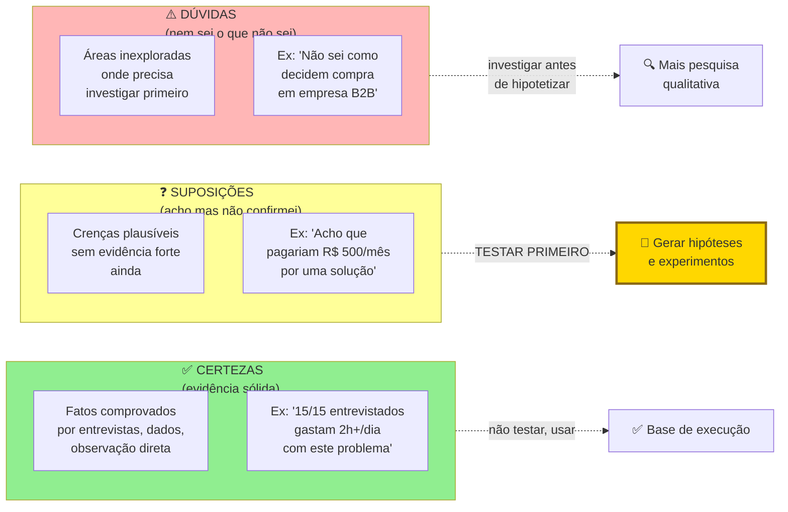

### Por que testar sem linha de corte prévia é apenas procurar desculpas para continuar errando

Toda decisão de negócio assume algo sobre o mundo. "O meu cliente vai pagar R$ 99." "O meu canal principal será Instagram." "Empresas maiores compram mais rápido." Cada uma dessas afirmações é uma hipótese. Se você as trata como verdades, constrói sobre areia. Se as escreve como hipóteses e as testa uma a uma, constrói sobre rocha. Empreender sem hipóteses explícitas é tomar todas as decisões com base em vibração.

A priorização de hipóteses também impede que você desperdice energia testando coisas de pouco impacto. Você quer testar primeiro o que, se for falso, derruba o negócio inteiro. Isso se chama "risco-maior-primeiro".

> [!note] Capítulo 1: Científico vs Lean Startup
> A disciplina de formular hipóteses falsificáveis (hipóteses que podem ser provadas erradas) é o ponto de convergência entre o método científico e a metodologia Lean. O [[#CAPÍTULO 1 — ABORDAGEM CIENTÍFICA vs LEAN STARTUP: QUANDO USAR CADA UMA|Capítulo 1: Científico vs Lean Startup]] mapeia as diferenças e complementaridades: quando o rigor hipotético-dedutivo aplica e quando o loop Build-Measure-Learn é mais adequado. Relevante especialmente para fundadores com background técnico ou científico que estão aplicando o método ao contexto de negócio pela primeira vez.

### Os sete passos até as apostas de vida ou morte

Sete passos.

#### Passo 1, levante todas as suposições implícitas

Faça uma varredura completa. Classifique as hipóteses em cinco tipos.

Hipóteses de problema. O problema existe mesmo? Para quem? Quão doloroso?

Hipóteses de solução. A solução proposta resolve o problema? Os usuários vão adotá-la?

Hipóteses de cliente e mercado. Quem é o cliente ideal? Como ele decide?

Hipóteses de canal. Como eu alcanço o cliente? Qual canal tem CAC viável?

Hipóteses de monetização e modelo. O cliente vai pagar? Quanto? Com que frequência? LTV maior que CAC?

Para cada tipo, busque pelo menos três a cinco hipóteses. Total alvo: quinze a trinta hipóteses.

#### Passo 2, escreva cada hipótese no formato padronizado

Use esse formato rigoroso:

```text
HIPÓTESE: [afirmação clara e falsificável]
ATRIBUTO DA TEORIA: [qual nó ou seta da sua árvore de teoria esta hipótese testa]
POR QUE IMPORTA (IMPACTO SE FOR FALSA): [qual o impacto no negócio se a premissa cair]
PARA VALIDAR PRECISO VER: [critério objetivo e numérico de sucesso]
VAMOS DESCARTAR SE: [critério numérico de refutação]
ZONA CINZENTA: [entre X e Y, qual único teste extra destrava a decisão]
MÉTODO: [experimento ou fonte de evidência]
CUSTO ESTIMADO: [tempo + dinheiro]
```

Para entender a diferença entre hipótese ruim e hipótese boa:

> [!warning] Hipótese ruim, impossível de falsificar
> "Os clientes vão gostar do produto." Impossível de testar. "Gostar" não é mensurável.

> [!tip] Hipótese boa, falsificável e numérica
> "Pelo menos trinta por cento dos donos de restaurante do nosso ICP (perfil de cliente ideal), depois de conhecer a solução por uma página de pré-cadastro, pagarão R$ 49 antecipados para garantir acesso ao beta (mantendo o e-mail apenas como métrica secundária de funil). Se for falsa, significa que a nossa proposta de valor não é forte o bastante para pagamento antecipado, o que compromete a viabilidade do modelo."

> [!tip] Hypothesis Canvas e Test Card como par de ferramentas
> O formato padronizado acima é o coração do Hypothesis Canvas: registrado como template prático no [[#Template: Hypothesis Canvas|Template: Hypothesis Canvas]] e com tratamento teórico no [[#Canvas: Hypothesis Canvas (autoral IGNIÇÃO)|Canvas: Hypothesis Canvas (autoral IGNIÇÃO)]]. O caso PadariaPro no Test Card (Fase 8) mostra como a zona cinzenta protege contra o autoengano. Cada hipótese bet-the-company deve gerar imediatamente 1-3 [[#Canvas: Test Card (David Bland & Alexander Osterwalder, 2019)|Canvas: Test Card (David Bland & Alexander Osterwalder, 2019)]] como follow-up: o Hypothesis Canvas articula *o que* testar; o Test Card articula *como* testar. A disciplina central do Test Card é definir critério de sucesso e critério de refutação **antes** de rodar o experimento: sem isso, qualquer resultado é racionalizado a favor da hipótese. O caso PadariaPro em Canvas: Test Card (David Bland & Alexander Osterwalder, 2019) (Fase 8) mostra como definir zona de incerteza no meio (entre sucesso e refutação) é o que protege contra auto-engano.

#### Passo 3, aplique o critério de falsificabilidade

> [!quote] Karl Popper sobre hipóteses
> Uma afirmação só é científica se for possível imaginar um resultado que a refute.

Toda hipótese precisa de um caminho claro de refutação. Sem ele, você está apenas guardando uma crença.

##### Teste de isolamento, uma hipótese, um elemento por vez

Esse é um dos erros mais comuns em iniciantes: empilhar múltiplos elementos numa única hipótese. Quando você testa coisas compostas, fica impossível saber qual parte foi refutada.

Exemplo de hipótese composta (ruim): "Assinantes do clube de autocuidado renovam depois do terceiro mês porque gostam da curadoria dos kits, mesmo com frete de R$ 25." (mistura renovação, motivo e tolerância ao frete na mesma frase).

Essa hipótese junta três afirmações distintas. Mulheres em grandes capitais preferem táxi a bicicleta. O conforto é o principal fator de decisão. O preço mais alto do táxi é tolerado.

Se você testar tudo junto e 45% das assinantes concordarem, o dado não orienta nenhuma ação. Pode ser que renovem por outro motivo. Pode ser que a curadoria importe só nos primeiros meses. Pode ser que o frete seja um teto e, acima de R$ 25, elas cancelem. A hipótese composta esconde todas essas diferenças.

A versão atômica (boa) quebra em três hipóteses separadas, cada uma testável sozinha. Se todas forem validadas, você tem a afirmação conjunta. Se alguma for refutada, você sabe exatamente qual parte da sua teoria precisa ser revisada.

> [!important] Regra do isolamento
> Cada hipótese deve testar um e apenas um atributo, ou uma e apenas uma relação causal da sua árvore de teoria. Se há "e" ou "porque" na frase, provavelmente você precisa quebrá-la.

##### Verifique a conexão com a teoria (integração)

Coloque a sua árvore de teoria ([[IGNICAO-Vol-1-Ideacao#FASE 3 — CONSTRUÇÃO DA TEORIA DO NEGÓCIO|Fase 3 (Vol. 1)]]) ao lado do Banco de Hipóteses. Para cada hipótese, responda: *Esta hipótese testa qual nó ou seta da árvore?* Se uma hipótese não pode ser mapeada na árvore, ela é órfã. Ou a hipótese é irrelevante, ou a sua árvore está incompleta. Em ambos os casos, corrija.

Se sobraram nós vitais na árvore da teoria (Fase 3) sem hipótese correspondente no banco, redija uma hipótese para cada um antes de passar ao Passo 4.

> [!note] Capítulo 6 (Vol. 1): Tomada de Decisão como Disciplina
> Antes de comprometer recursos com as hipóteses bet-the-company, use o [[IGNICAO-Vol-1-Ideacao#CAPÍTULO 6 — TOMADA DE DECISÃO COMO DISCIPLINA|Capítulo 6: Tomada de Decisão como Disciplina (Vol. 1)]]: hipóteses de alto risco e baixa reversibilidade são decisões Tipo 1 (irreversíveis) e merecem pré-mortem formal antes de qualquer experimento. O apêndice também cobre o framework SPADE para estruturar esse processo em equipe.

#### Passo 4, priorize as hipóteses por Risco × Incerteza (primeiro pass)

> [!note] Dois sistemas de priorização, em ordem de aplicação
> Esta fase usa duas lentes complementares de priorização em sequência. **Primeira peneira: Risco × Incerteza (Passo 4).** Identifica quais hipóteses, se falsas, derrubam o negócio (Risco) e em quais você está mais no escuro (Incerteza), filtrando o conjunto de 15 a 30 hipóteses para três a cinco apostas de vida ou morte. **Segunda peneira: Sistema H/E (Passo 5).** Para cada aposta de vida ou morte filtrada, mede a força teórica da hipótese (H) contra a evidência empírica acumulada (E), definindo a ordem e o tipo de teste. R × I mede impacto no negócio; H/E mede o estado do conhecimento. Os dois sistemas trabalham em série.

Para cada hipótese, atribua duas notas de um a cinco. Risco (R): quão grave para o negócio se for falsa? (Cinco mata o negócio. Um é detalhe secundário.) Incerteza (I): quanta confiança real você tem nela hoje? (Cinco é totalmente no escuro. Um é muito fundamentada.)

Calcule Prioridade = R vezes I.

Hipóteses com prioridade igual ou maior que quinze são as suas bet-the-company. São coisas que podem matar o negócio se forem falsas, e que você ainda não testou. Essas vêm primeiro. Hipóteses com prioridade entre oito e quatorze são secundárias. Hipóteses com prioridade abaixo de oito ficam no backlog (lista de espera) para depois.

#### Passo 5, aplique o Sistema H/E (segundo pass de priorização)

Para cada hipótese bet-the-company já filtrada pelo Risco × Incerteza, atribua duas notas de um a dez.

H (Hypothesis Strength, força teórica da hipótese) mede quão bem fundamentada a sua hipótese está do ponto de vista teórico. H igual a dez significa que a cadeia causal é clara, consistente com o que se sabe do mercado, análoga a casos de sucesso conhecidos e faz sentido à luz da sua árvore de teoria. H igual a três significa um palpite, baseado em intuição pessoal, sem lógica rigorosa por trás.

E (Evidence Strength, força da evidência) mede o quanto você já tem de evidência empírica a favor (ou contra) essa hipótese hoje, antes de qualquer novo experimento. E igual a dez significa dados robustos, múltiplas entrevistas consistentes, benchmarks quantitativos de setor, pilotos pagos. E igual a um significa nenhuma evidência. Só a sua própria fala.

A visualização do sistema H/E:

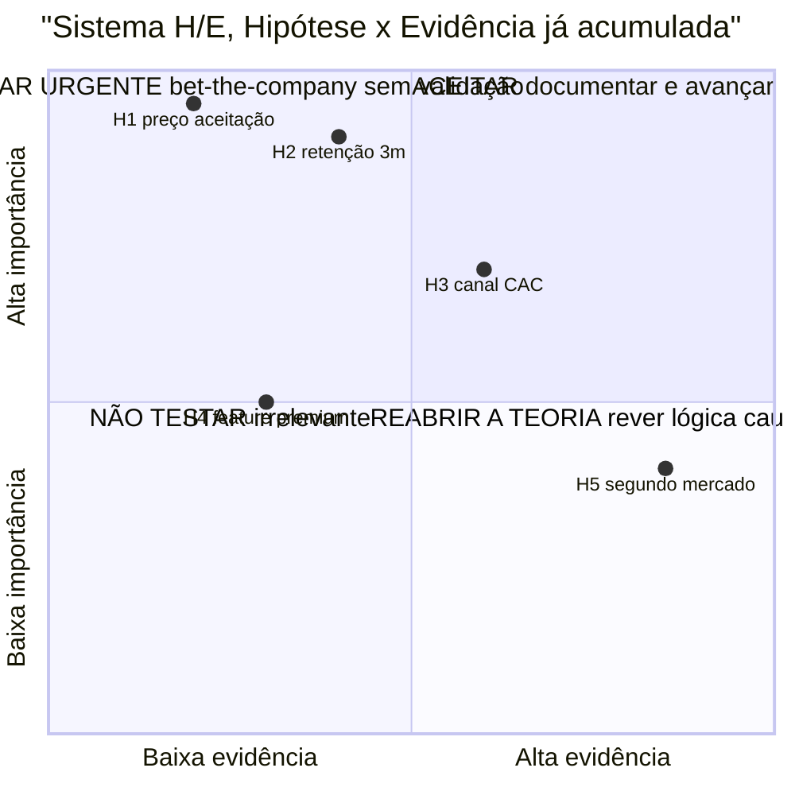

O sistema H/E responde a duas perguntas: *A teoria por trás dessa hipótese se sustenta?* (H) e *Já tenho evidência a favor?* (E). O quadrante superior-esquerdo (H alto e E baixo) é urgência máxima. Isso evita o erro comum de testar primeiro o que é fácil em vez do que é crítico.

Os dois scores juntos mostram onde você está em cada hipótese:

| Perfil (H, E) | Diagnóstico | O que fazer |
|---|---|---|
| H alto, E alto (8, 8) | Hipótese bem fundamentada, e já com evidência | Avançar com investimento ou execução |
| H alto, E baixo (8, 3) | Teoria forte, falta evidência | Prioridade máxima de experimento. É aqui que a próxima rodada de testes precisa estar |
| H baixo, E alto (4, 8) | Fato observado sem teoria clara | Reabrir a árvore de teoria. Por que esse padrão acontece? Sem saber por quê, não dá para escalar |
| H baixo, E baixo (3, 2) | Palpite sem fundamento nem dado | Ou descartar, ou iniciar investigação exploratória. Nunca investir capital |

> [!warning] Regra de ouro do Sistema H/E
> Todo investimento significativo (construir feature, contratar, levantar capital, expandir canal) deve ser precedido por H ≥ 7 e E ≥ 6 nas apostas de vida ou morte relacionadas àquela decisão. Se E estiver abaixo de 6, rode um experimento (Fase 8). Se H estiver abaixo de 7, volte à árvore da teoria (Fase 3) antes de investir.

#### Passo 6, monte o Banco de Hipóteses como planilha

Dezoito colunas canônicas (alinhadas ao template da fase): ID (H1, H2...), Tipo (Problema, Solução, Cliente, Canal, Monetização), R (1-5), I (1-5), R × I, Nota H (1-10), Nota E (1-10), Critério de validação, Critério de descarte e Ordem de teste. Hipótese (texto completo). Atributo da teoria (vínculo com a árvore da [[IGNICAO-Vol-1-Ideacao#FASE 3 — CONSTRUÇÃO DA TEORIA DO NEGÓCIO|Fase 3 (Vol. 1)]]). Porquê importa. Critério de validação. Método ou experimento. Custo estimado. Score H (Hipótese) de um a dez: quão forte é o raciocínio teórico antes de qualquer teste? Score E (Evidência) de um a dez: quanta evidência empírica você já tem hoje? Status (Nova, Em teste, Validada, Refutada, Abandonada). Resultado (quando testada). Data de teste. Aprendizado.

> [!important] Essa planilha é o coração operacional do negócio
> Nos próximos seis a doze meses, ela é o documento mais consultado da empresa. Nunca a perca de vista.

#### Passo 7, escolha as 3 a 5 primeiras hipóteses a testar e defina ordem de teste

Pegue as hipóteses do quadrante "H alto + E baixo" do Passo 5. Essas têm o maior retorno por experimento: teoria robusta, apenas faltando evidência. A escolha das três a cinco primeiras segue quatro critérios em ordem.

Maior risco primeiro. Entre as bet-the-company com mesmo perfil H/E, comece pela de maior R × I. Resolver o que pode matar o negócio antes do que é apenas importante.

Independência sobre dependência. Se a hipótese A precisa estar validada antes de B fazer sentido (por exemplo, "cliente reconhece o problema" antes de "cliente paga R$ 99 por uma solução"), teste A primeiro. Hipóteses dependentes em paralelo geram desperdício se a anterior cair.

Custo de teste e tempo de retorno. Entre hipóteses de impacto similar, prefira as que dão sinal mais barato e mais rápido. Smoke test de R$ 500 em uma semana antes de concierge experiment de R$ 5 mil em oito semanas. Use a velocidade para iterar.

Janela de teste paralela vs sequencial. Hipóteses independentes que usam canais diferentes podem rodar em paralelo (entrevistas + landing page + community test simultaneamente). Hipóteses sobre o mesmo público em canais sobrepostos rodam em sequência para não contaminar amostra.

Documente a ordem escolhida no Banco de Hipóteses (coluna "ordem de teste") com justificativa de uma linha. Essas três a cinco hipóteses prioritárias, com Test Card preenchido, vão para a [[#FASE 8 — EXPERIMENTOS DE VALIDAÇÃO DO PROBLEMA E DA SOLUÇÃO|Fase 8]].

### Os sete passos aplicados, hipótese H1 do PadariaPro

Para tornar o método concreto, este é o detalhamento de uma hipótese bet-the-company da mesma ideia trabalhada nas fases anteriores, no formato padronizado dos Passos 2 a 5.

HIPÓTESE: Donos de padaria com três a cinco lojas perdem 8 pontos percentuais ou mais da margem bruta em ingredientes críticos (a hipótese sobre a causa, má gestão de estoque, entra separada como H1b).

ATRIBUTO DA TEORIA: Nó "Dor real e frequente" da árvore de teoria (Fase 3). A árvore pressupõe que o problema existe na intensidade necessária para gerar disposição a pagar. Se falsa, todo o ramo de monetização cai antes de qualquer experimento de preço.

PORQUÊ IMPORTA (Risco × Incerteza): R = 5 (mata o negócio se falsa), I = 4 (auto-relato em entrevistas Fase 3 sugere a perda existe, mas sem dado de notas fiscais ainda). Prioridade R × I = 20. Bet-the-company.

PARA VALIDAR PRECISO VER: Sete em dez padarias com três a cinco lojas em SP com perda de oito por cento ou mais da margem bruta em trinta dias, verificada por análise de notas fiscais de compra, não só por auto-relato.

H/E: H = 8 (cadeia causal clara, consistente com casos análogos de food retail), E = 3 (auto-relato em 12 entrevistas, sem auditoria factual). Quadrante H alto + E baixo, prioridade máxima de experimento.

MÉTODO: Auditoria gratuita de estoque. Recrutar dez padarias via indicação direta. Calcular a perda real por ingrediente crítico: Perda = estoque inicial + compras dos 30 dias − consumo teórico (ficha técnica × produção) − estoque físico final inventariado. Complementar com entrevista de quarenta e cinco minutos com o dono para qualificar a dor.

CUSTO ESTIMADO: Cinco semanas (30 dias de coleta documental e uma semana de análise), com um dia por padaria para inventário físico e entrevista (dez dias de campo no total) e R$ 0 em deslocamento para padarias no raio de 5 km.

> [!warning] Risco de interpretação enviesada
> Donos podem subestimar a perda (vergonha de admitir ineficiência) ou superestimá-la (para justificar tecnologia). Cruzar auto-relato com análise factual de notas fiscais reduz esse viés.

### Caso brasileiro real, hipóteses na Loft (iBuyer imobiliário)

A Loft, fundada em 2018 por Mate Pencz e Florian Hagenbuch (ex-Printi) em São Paulo, atacou o modelo iBuyer (instant buyer: compra direta de imóveis para revenda rápida com renovação) num mercado dominado por imobiliárias tradicionais com ciclo de venda de seis a doze meses.

Se reconstruirmos as premissas de compra e revenda de imóveis (iBuying) da Loft em 2018 como ilustração didática do método R × I, as apostas de vida ou morte girariam em torno de três variáveis de demanda: sensibilidade a preço dos vendedores ("se oferecermos desconto sobre o valor de mercado com pagamento à vista em sete dias, X% dos proprietários aceitarão"), elasticidade do prazo ("reduzir o pagamento para três dias eleva a conversão em Y%") e urgência do vendedor ("proprietários em divórcio, mudança de cidade ou inventário convertem Z% mais que vendedores sem pressa").

Na ponta da demanda, proprietários urgentes de fato aceitavam deságio em troca de liquidez rápida, o que impulsionou a tese inicial e grandes captações até 2021. Porém, como analisado nos Volumes 6 e 10, a hipótese macroeconômica implícita (juros baixos e giro rápido do estoque imobiliário em balanço) virou contra o modelo quando a Selic subiu, forçando a empresa a cortar custos e migrar do iBuying pesado em capital para um marketplace e plataforma de serviços para imobiliárias.

Hipóteses explícitas separam "o que eu acho" de "o que eu testei". A intuição inicial é frequentemente parcialmente certa e parcialmente errada. Só teste com threshold pré-registrado separa.

### A matriz priorizada de hipóteses críticas com métricas de aprovação e reprovação travadas

Você concluiu a Fase 7 quando todos os critérios abaixo estão cumpridos.

- [ ] Banco de Hipóteses (Template: Banco de Hipóteses, modelo de planilha (Fase 7)) com 15 a 30 itens classificados nas cinco categorias (problema, solução, cliente, canal, monetização). Pelo menos três em cada categoria, sem nenhuma vazia.
- [ ] Todas as hipóteses no formato padronizado (afirmação + atributo da teoria + porquê importa + critério de validação numérico + método + custo estimado).
- [ ] Cem por cento das hipóteses redigidas no formato canônico do Passo 2 (Hipótese, Por que importa, Para validar preciso ver, Vamos descartar se e Zona cinzenta).
- [ ] Cada hipótese vinculada a um nó ou seta da árvore de teoria (Fase 3). Nenhuma órfã.
- [ ] Sistema H/E (Hypothesis Strength / Evidence Strength) aplicado a cada hipótese, de um a dez em cada eixo.
- [ ] Três a cinco apostas de vida ou morte identificadas por R × I ≥ 15 e ordenadas pelo sistema H/E (quadrante H alto e E baixo no topo da fila).
- [ ] Três ou mais Hypothesis Canvas (Template: Hypothesis Canvas (Fase 7)) preenchidos para as bet-the-company.
- [ ] Status (não testada, em teste, validada, invalidada) marcado em todas.
- [ ] As três a cinco hipóteses prioritárias têm método de teste inicial desenhado e Test Card (Fase 8) com critério de sucesso e refutação definidos antes do experimento.

> [!warning] Critério de saída
> Se qualquer um desses itens falha, não avance. Resolva antes.

**Primeiros passos práticos.**

1. Abrir o Template Banco de Hipóteses (Fase 7) e listar toda hipótese implícita. Vinte a quarenta itens iniciais.
2. Classificar cada hipótese em categoria, status e prioridade.
3. Reformular as cinco a dez prioritárias em formato falsificável rigoroso.
4. Para cada hipótese das três do topo, preencher Hypothesis Canvas (Template: Hypothesis Canvas (Fase 7)) com detalhamento.

### Os erros que mais custam nesta fase

Hipóteses vagas. "Os clientes vão gostar." Use o formato do Passo 2: afirmação com critério numérico e caminho de refutação.

Só hipóteses de solução. Empreendedores ficam obcecados em testar "a solução funciona?", e esquecem de testar "o cliente paga?", que é a hipótese mais crítica.

Priorizar baixo-risco por ser fácil. Testar primeiro o que é confortável. Princípio: teste primeiro o que pode te matar, não o que é agradável de confirmar.

Esquecer de atualizar. Se não for revisada toda semana, a planilha perde utilidade. Reserve 30 minutos toda segunda-feira no Ritual da Fase 7 para atualizar as notas H e E.

Confundir "não refutada ainda" com "validada". Uma hipótese só é validada quando você tem evidência positiva a favor dela. Não apenas ausência de evidência contra.


---

### O Espelho da Fase 7: Suas Hipóteses Podem Ser Provadas Falsas ou São Atos de Fé?

**Fechando o ciclo na trincheira:** Quando **Rafael e Bia** conectaram esta disciplina entre a aquisição no Recife e a operação logística em Goiânia, o vazamento que abriu este capítulo estancou e o crescimento voltou a gerar caixa livre.

**O Espelho (autodiagnóstico):**
1. Qual é a hipótese número um do seu negócio hoje que, se for falsa, destrói completamente a sua empresa?
2. Você registrou por escrito no Banco de Hipóteses, antes de iniciar o próximo experimento, qual ponto de corte numérico obriga a descartar a premissa e mudar de rota? *(Chave de leitura do Espelho: se você não soube responder de imediato à pergunta 1, volte ao Passo 4 e rode a matriz Risco × Importância; se a resposta à pergunta 2 foi "não", trave o experimento e preencha agora a coluna de critério de descarte no Banco de Hipóteses; se na pergunta 3 a sua agenda pendeu para tarefas confortáveis, substitua o teste desta semana pela hipótese de menor índice H/E do seu topo de risco.)*
3. Nas últimas quatro semanas, você passou mais tempo testando coisas confortáveis (layout, textos, ferramentas internas) ou atacando o maior risco comercial do negócio?

**Permissão Libertadora:**
Você está autorizado a estar errado sobre a sua hipótese inicial. Estar errado em uma hipótese escrita no papel custa zero reais; estar errado depois de um ano programando custa a sua empresa.

**O Ritual de Segunda-Feira às 9h:**
Toda segunda-feira, reserve 30 minutos com seus sócios para atualizar o Banco de Hipóteses e escrever em uma folha a regra do teste da semana: *"Nós acreditamos que [Segmento Específico] fará [Ação Concreta de Compra/Uso] dentro de [Prazo], e saberemos que estamos ERRADOS se menos de [X%] fizerem isso."* Assinem juntos antes de iniciar a coleta.

---

### MÉTRICAS E BENCHMARKS DESTA FASE (FASE 7)

| Métrica | O que medir | Referência saudável |
|---|---|---|
| Banco de hipóteses preenchido | Hipóteses críticas priorizadas | ≥ 10 hipóteses classificadas |
| Hipóteses bet-the-company | Apostas de alto impacto e alta incerteza | 2 a 5 identificadas |
| Sistema H/E (teoria e evidência) | Notas H e E de 1 a 10 atribuídas em cada aposta de vida ou morte | 100% |
| Critério de descarte pré-declarado | Hipóteses com limiar numérico de refutação e regra de zona cinzenta | 100% (15 a 30 no banco; 3 a 5 apostas vitais) |
| CSD (Certezas, Suposições, Dúvidas) | Distribuição documentada | Atualizado semanalmente |

---

### Manual passo a passo dos frameworks de experimentação desta fase

> [!tip] Uso autocontido neste volume
> Todos os frameworks abaixo estão detalhados integralmente com origem, estrutura, passo a passo de aplicação, exemplo brasileiro e armadilhas para execução imediata nesta **Fase 7**.

#### Framework: Red Team e Blue Team (ataque e defesa aplicados às hipóteses)

##### De onde vem a ferramenta (e por que sobreviveu ao filtro do tempo)

Prática militar americana dos anos 1960 (desenvolvida durante Guerra Fria para simular raciocínio soviético). Expandiu para cybersecurity nos anos 1990 (red team = atacantes simulados, blue team = defensores). Adotada em corporações grandes (Microsoft, Google, governments) para stress-testar decisões estratégicas.

##### A mecânica central (sem jargão)

Técnica de **desafio estruturado a uma decisão ou plano**: um time (red) ativamente busca fraquezas, outro (blue) defende ou refina. Força rigor. Previne groupthink.

##### As regras do jogo

Red Team: time designado para **atacar** a proposta/plano. Encontrar fraquezas. Agir como concorrente/adversário.

Blue Team: time que **defende** ou propõe, o time que fez o plano original.

Exercício: red team apresenta críticas, blue team responde. Se blue team não consegue defender, plano tem fraqueza real.

##### Como rodar na segunda-feira às 9h com seu time

1. Escolha decisões que justifiquem o esforço analítico: aprovação de rodada de captação (*go/no-go*), fusão ou aquisição (M&A), ou lançamento de linha de produto relevante. Não gaste o método em escolhas triviais.

Passo 2: Red team deve ter independência. Membros com autoridade para dissidência real. Não "red team que concorda no final por medo".

Passo 3: Red team prepara em separado. Com tempo adequado para análise crítica genuína.

Passo 4: Sessão formal. Apresentação do plano (blue), ataques (red), defesa (blue), discussão.

Passo 5: Documentar críticas e respostas. Mesmo se plano seguir, registro do que foi questionado.

Passo 6: Se red team conseguiu minar, revisar plano.

##### Na trincheira real: como isso funciona na prática

Estresse da hipótese H1 do PadariaPro (antes de ir a campo):

- Blue team (CEO + CFO + time de deal): apresenta tese, sinergia de clientes, ARR combinado, expansion.
- Red team (2 board members + 1 advisor externo): por uma semana, analisa crítica. Trazem: "a maioria das aquisições não entrega a sinergia prometida (Christensen et al., HBR, 2011), vocês nunca integraram uma operação, o alvo tem dívida oculta, vocês nunca integraram, concorrente tem debt oculto, preço está no topo do razoável, custo de oportunidade alto (time executivo desviado por 18 meses)."
- Discussão: CEO convence em alguns pontos, mas concede em outros. Preço é renegociado para baixo, acordo estrutura earn-out para mitigar risco, integration team é pré-contratado.

Resultado: deal melhor (ou deal evitado, que também pode ser bom).

##### Onde o papel aceita tudo (armadilhas de execução)

Red team "de fachada": pessoas que vão dizer "tá tudo ok". Sem valor. Blue team defensivo em vez de analítico: reage emocionalmente a críticas em vez de refinar plano. Sem tempo adequado para red team: "analise este deal em 4 horas", vira checkbox. Não documentar decisão final: se 3 meses depois problema surge, sem rastro de que foi antecipado.

---

#### Framework: Cost-Benefit Analysis (Jules Dupuit, 1844; refinado no séc. XX)

##### De onde vem a ferramenta (e por que sobreviveu ao filtro do tempo)

Engenheiro civil e economista francês Jules Dupuit publicou *On the Measurement of the Utility of Public Works* em 1844, estabelecendo os fundamentos do CBA ao introduzir a função de demanda derivada de utilidade marginal e o conceito de excedente do consumidor (depois reformulado por Marshall). Pigou e outros economistas refinaram no início do séc. XX. Hoje é padrão em decisões governamentais (análise de impacto de políticas), infraestrutura (projetos de engenharia) e decisões empresariais com múltiplos fatores.

##### A mecânica central (sem jargão)

Método sistemático de **comparar custos e benefícios quantificáveis** de uma decisão, frequentemente convertidos em valor monetário, permitindo decisão baseada em NPV (Net Present Value) ou ratio benefício/custo.

##### As regras do jogo

Componentes:

1. Identificar todos os custos (diretos, indiretos, de oportunidade).
2. Identificar todos os benefícios (monetários e não monetários).
3. Quantificar em unidade comum (geralmente moeda).
4. Ajustar no tempo (net present value).
5. Calcular NPV ou razão B/C.
6. Considerar riscos (análise de sensibilidade).

##### Como rodar na segunda-feira às 9h com seu time

Passo 1: Horizonte temporal claro. CBA de 2 anos é muito diferente de 10.

Passo 2: Taxa de desconto apropriada. Custo de capital da empresa (WACC) ou taxa livre de risco ajustada.

Passo 3: Incluir custos de oportunidade. Se eng team trabalha em X, não trabalha em Y. Y é custo de oportunidade.

Passo 4: Quantificar benefícios intangíveis. Brand, cultura, learning, são reais mas difíceis. Usar proxies ou ranges.

Passo 5: Análise de sensibilidade. E se premissa X for 20% diferente? Decisão muda?

Passo 6: Documentar premissas. Facilita revisão e aprendizado.

##### Na trincheira real: como isso funciona na prática

Decisão: construir feature X (custo R$ 500k em engineering, 4 meses).

Custos:

- Engineering: R$ 500k.
- Oportunidade: 4 meses sem trabalhar em feature Y (valor estimado: R$ 800k em receita adicional).
- Maintenance ongoing: R$ 50k/ano.

Benefícios (horizonte 3 anos):

- Margem de contribuição incremental projetada: R$ 2,5 milhões (Ano 1), R$ 4 milhões (Ano 2), R$ 5 milhões (Ano 3).
- Redução de churn em segmento que adota: R$ 600k/ano.
- Brand/differentiation: difícil quantificar, estimativa R$ 200k/ano.

NPV (desconto real ilustrativo de 12% a.a. acima da inflação; em termos nominais no Brasil, com Selic a 13,75% a.a. em outubro de 2026, projetos de estágio inicial exigem taxa de desconto de 30% a 50% a.a., somando a taxa livre de risco ao prêmio de risco de uma empresa sem histórico):

- Custos descontados: R$ 1.350k.
- Margem de contribuição descontada (a 12% a.a. em 3 anos): R$ 9,0 milhões (VPL líquido de R$ 7,8 milhões após deduzir o investimento inicial de R$ 1,2 milhão; com metade da margem, o VPL cai para R$ 3,3 milhões).
- NPV: R$ 6.45M. Razão B/C: 5.8x.

Sensibilidade: se receita for 50% do projetado, NPV ainda positivo (R$ 2.7M). Robusto.

Decisão: feature X tem retorno forte mesmo em cenários pessimistas.

##### Onde o papel aceita tudo (armadilhas de execução)

Esquecer custos de oportunidade: muito comum. Faz todas as opções parecerem boas. Over-quantificar intangíveis: inventar número para "motivação do time" pode ser pior que admitir qualitativo. Ignorar sensibilidade: NPV positivo apenas em cenário ótimo. Decisão frágil. Horizonte curto demais: CBA de 6 meses ignora benefícios de longo prazo. Análise sem considerar risco/probabilidade: NPV esperado ≠ NPV garantido.

---

#### Framework: Expected Value / Bayesian Thinking

##### De onde vem a ferramenta (e por que sobreviveu ao filtro do tempo)

Expected Value: conceito estatístico formalizado por Pierre Fermat e Blaise Pascal no séc. XVII. Aplicação a decisão de negócio popularizada por von Neumann e Morgenstern em *Theory of Games and Economic Behavior* (1944).

Bayesian Thinking: formulado por Thomas Bayes (séc. XVIII) e popularizado na tomada de decisão contemporânea por Annie Duke, ex-jogadora profissional de pôquer, em *Thinking in Bets* (2018).

##### A mecânica central (sem jargão)

Expected Value (EV): em decisão sob incerteza, calcular valor esperado ponderando resultados possíveis por suas probabilidades.

Bayesian Thinking: atualizar crenças (probabilidades) conforme nova evidência chega, em vez de tratar decisões como "certezas".

##### As regras do jogo

Expected Value fórmula:
EV = Σ (probabilidade_i × resultado_i)

Exemplo: investimento de R$ 1M com:

- 40% de chance de retornar R$ 5M.
- 40% de chance de retornar R$ 1M.
- 20% de chance de retornar R$ 0.

EV = (0.4 × 5M) + (0.4 × 1M) + (0.2 × 0) = R$ 2.4M.

Investimento positivo EV. Mas: **variância alta** (pode perder tudo). EV não mostra risco de ruína.

Bayesian:

- Começa com *prior* (crença inicial): no PadariaPro, os fundadores atribuem 40% de probabilidade inicial de que a perda passe de 8 pontos percentuais (nota E = 3); quando 6 das 10 padarias auditadas superam esse corte, a crença revista sobe para 70% e a nota E avança de 3 para 6.
- Evidência nova chega.
- Atualiza para posterior (crença revisada).
- Decisões baseadas em posteriors atualizados, não em priors estáticos.

##### Como rodar na segunda-feira às 9h com seu time

EV:

1. Liste resultados possíveis.
2. Estime probabilidade de cada (difícil, mas tentar).
3. Estime valor/payoff de cada.
4. Multiplique e some.
5. Compare alternativas por EV.
6. Considere risco: EV sozinho ignora ruína.

Bayesian:

1. Comece com prior explícito (% de chance de hipótese ser verdade).
2. Ao receber evidência, pergunte: quão provável é essa evidência se hipótese for verdade vs. falsa?
3. Atualize usando Teorema de Bayes (ou aproximação informal).
4. Decisões baseadas em posteriors.

##### Na trincheira real: como isso funciona na prática

Decisão: perseverar em vertical X ou pivotar?

Opção A (perseverar):

- 30% chance: vertical ganha tração em 12 meses → R$ 20M ARR em 3 anos. Valor R$ 40M.
- 40% chance: tração moderada → R$ 5M ARR. Valor R$ 10M.
- 30% chance: falha → receita cai, encerramento. Valor R$ -5M (custo reestruturação).
- EV = (0.3 × 40) + (0.4 × 10) + (0.3 × -5) = 12 + 4 - 1.5 = **R$ 14.5M**.

Opção B (pivotar para vertical Y):

- 20% chance: vertical Y muito forte → Valor R$ 50M.
- 50% chance: tração ok → Valor R$ 8M.
- 30% chance: falha → Valor R$ -3M.
- EV = (0.2 × 50) + (0.5 × 8) + (0.3 × -3) = 10 + 4 - 0.9 = **R$ 13.1M**.

EV favorece opção A marginalmente. Mas considerar: variância, timing, opcionalidades futuras, etc.

##### Onde o papel aceita tudo (armadilhas de execução)

Probabilidades estimadas com precisão falsa: "30.2% de chance" quando realmente é "mais ou menos 25-35%". Ignorar risco de ruína: EV positivo com 5% de chance de falência = decisão ruim. Priors preguiçosos: começar análise Bayesiana com "não sei, 50%". Melhor pesquisar e estimar prior decente. Não atualizar Bayesian com evidência: trata priors como certezas. Quantificar o inquantificável: forçar números onde não há base vira teatro.

---

#### Framework: FMEA — Failure Mode and Effects Analysis (US Military, 1949)

##### De onde vem a ferramenta (e por que sobreviveu ao filtro do tempo)

Desenvolvida pelo exército dos EUA em 1949 (procedimento MIL-P-1629) para sistemas de defesa. Adotada pela NASA nos projetos Apollo. Expandiu para indústria automotiva (Ford nos anos 1970), aeronáutica, farmacêutica, e eventualmente tecnologia. Ferramenta central do Six Sigma e de gestão de risco em sistemas complexos.

##### A mecânica central (sem jargão)

Método sistemático para identificar, priorizar e mitigar modos de falha antes que ocorram. Para cada componente/processo: (1) identificar **modos de falha possíveis**, (2) avaliar **severidade** da consequência (1-10), (3) avaliar **ocorrência** estimada (1-10), (4) avaliar **detecção** (1-10, sendo 10 = muito difícil detectar antes do impacto). Multiplicar os três números gera o **RPN** (*Risk Priority Number*). Na indústria automotiva, o manual AIAG-VDA substituiu o RPN em 2019 pela **Prioridade de Ação (AP)**, que avalia a severidade primeiro para impedir que falhas graves fiquem escondidas atrás de notas baixas de ocorrência.

##### Como rodar na segunda-feira às 9h com seu time

Sessão com equipe multifuncional de 4-8 pessoas. Passo 1: listar componentes/processos a analisar (não tudo, o mais crítico). Passo 2: para cada um, brainstorm dos modos de falha (o que pode dar errado?). Passo 3: avaliar Severidade/Ocorrência/Detecção em escala 1-10 (usar guidelines para calibrar). Passo 4: calcular RPN. Passo 5: para RPN > 100 (ou threshold escolhido), definir ações de mitigação. Passo 6: revisar periodicamente conforme sistema evolui.

##### Na trincheira real: como isso funciona na prática

Fintech brasileira processando Pix. Componente: autorização de transação. Modos de falha: (a) sistema autoriza transação fraudulenta (S=10, O=5, D=6, RPN=300), (b) sistema nega transação legítima (S=7, O=4, D=3, RPN=84), (c) sistema fica fora por banco lento (S=8, O=2, D=2, RPN=32). Priorização: (a) requer ação imediata (adicionar modelo anti-fraude, monitoramento), (b) aceitável com monitoramento, (c) aceitável. Sem FMEA, intuição tende a focar em (c) porque é o mais visível. FMEA mostra (a) como risco muito maior.

##### Onde o papel aceita tudo (armadilhas de execução)

Pontuação inconsistente entre sessões (S/O/D calibrado diferente). FMEA como documento morto que ninguém revisa, foco apenas em RPN sem considerar impactos não quantificáveis (reputação, regulatório).

---

#### Framework: Assumption Mapping (David J. Bland, 2019)

##### De onde vem a ferramenta (e por que sobreviveu ao filtro do tempo)

David J. Bland, colaborador de Alex Osterwalder (Strategyzer), publicou *Testing Business Ideas* (2019) sistematizando assumption mapping como prática. Baseado em décadas de Lean Startup e Customer Development, formalizou processo de mapeamento de premissas pré-experimentação.

##### A mecânica central (sem jargão)

Ferramenta para **mapear premissas** em matriz 2x2 de **certeza × risco** (equivalente direta da primeira peneira Risco × Incerteza do Passo 4 desta fase).

##### As regras do jogo

Matriz 2x2:

- Eixo X, Certeza: temos evidência para suportar? (baixa a alta).
- Eixo Y, Risco: se premissa for falsa, quebra o negócio? (alta = quebra).

Quadrantes:

- Alta certeza + alto risco: confortável, monitorar.
- Alta certeza + baixo risco: ignorar.
- Baixa certeza + alto risco: **testar URGENTEMENTE**. Premissas críticas não validadas.
- Baixa certeza + baixo risco: testar depois.

##### Como rodar na segunda-feira às 9h com seu time

Passo 1: Liste premissas subjacentes à ideia. 3 categorias:

- Desejabilidade: clientes querem isso?
- Viabilidade: negócio fecha?
- Factibilidade: conseguimos construir?

Passo 2: Plote cada premissa na matriz.

Passo 3: Priorize quadrante "baixa certeza + alto risco".

Passo 4: Desenhe experimentos para cada premissa prioritária.

Passo 5: Teste, atualize mapa, itere.

##### Na trincheira real: como isso funciona na prática

Startup pré-MVP mapeia premissas:

Premissas listadas:

1. "PMEs pagarão R$ 200/mês", baixa certeza, alto risco → **PRIORIDADE**.
2. "Conseguimos construir integração com bancos", alta certeza, médio risco → monitorar.
3. "Mercado total é grande (> R$ 100M)", alta certeza, médio risco → monitorar.
4. "Contadores vão recomendar", baixa certeza, alto risco → **PRIORIDADE**.
5. "Adoção self-serve funciona", baixa certeza, médio risco → testar em seguida.

Experimentos prioritários:

- Premissa 1: Wizard of Oz / landing page com preço, medir intenção.
- Premissa 4: entrevistar 20 contadores sobre produto/parceria.

##### Onde o papel aceita tudo (armadilhas de execução)

Lista genérica de premissas: sem especificidade, teste é difícil, Autoavaliar certeza otimista: empreendedor confia na própria ideia, inflar certeza, Pular para experimentação sem mapear: testa algo aleatório, não o que mais importa.

---

### CANVASES VISUAIS DESTA FASE (COM EXEMPLOS BRASILEIROS PREENCHIDOS)

#### Canvas: Hypothesis Canvas (autoral IGNIÇÃO)

##### Por que este quadro visual foi criado

O Hypothesis Canvas documentado neste livro é uma ferramenta autoral desenvolvida especificamente para o contexto de founder brasileiro operando com recursos limitados e necessidade de ciclos curtos de aprendizado. Parte da tradição do Lean Startup (Eric Ries, 2011) e da metodologia de hipóteses científicas aplicada a negócio (Karl Popper via Steve Blank), e se apoia na abordagem científica ao empreendedorismo de Camuffo, Gambardella, Spina e colegas (2020, 2024), destacando na sua estrutura visual dois blocos operacionais indispensáveis: (1) a ligação explícita entre cada hipótese e a **árvore de teoria** do negócio (Fase 3): forçando o fundador a articular *qual premissa causal da teoria* está sendo testada; (2) o bloco de **due diligence da amostra** antes da comparação com o threshold: evitando o erro de aceitar resultado de amostra inadequada como evidência válida. O template completo preenchível está no [[#Template: Hypothesis Canvas|Template: Hypothesis Canvas]].

##### A anatomia visual de uma página

Artefato de uma página, estruturado como tabela de quatro quadrantes, que captura os oito elementos de uma hipótese rigorosamente testável:

- **Teoria**: qual parte da árvore de teoria (Fase 3) esta hipótese testa? Qual é o atributo ou seta causal em jogo?
- **Hipótese**: afirmação falsificável em uma frase, quantitativa sempre que possível.
- **Evidência**: como a evidência será coletada? Método, público-alvo, tamanho de amostra, duração, custo.
- **Medidas**: o que especificamente será contado? Qual é a fórmula da métrica? Quais medidas alternativas foram descartadas?
- **Threshold (pré-definido)**: qual resultado mínimo considera a hipótese suportada? Qual resultado a considera refutada? Qual é a zona inconclusiva entre os dois?
- **Due diligence da amostra**: antes de comparar resultado com threshold, a amostra é adequada? Representa o ICP? Há vieses identificados?
- **Avaliação**: resultado observado vs. threshold ajustado, Suportada / Refutada / Inconclusiva?
- **Decisão**: Perseverar / Pivotar / Mais dados / Abandonar + próxima ação concreta + impacto na árvore de teoria.

A sequência de preenchimento é deliberada: blocos superiores e médios **antes** de coletar dados; blocos inferiores **após**: respeitando a barreira anti-viés de confirmação.

##### O momento exato de colocar este canvas na parede

Use o Hypothesis Canvas na Fase 7 (formulação rigorosa de hipóteses) como artefato central: um canvas para cada aposta de vida ou morte. Use também na descoberta contínua pós-PMF sempre que uma funcionalidade ou mudança de modelo depender de premissa ainda não testada. Em conjunto com os Test Cards da Fase 8, o Hypothesis Canvas registra *qual hipótese* está em jogo e como ela se conecta à árvore da teoria (Fase 3, Vol. 1), enquanto o Test Card detalha *como* cada experimento de campo será executado.

##### As regras de ouro para preencher sem se enganar

Três princípios fundamentam o design do canvas:

**Primeiro: hipótese sem conexão teórica é ruído.** O bloco "Teoria" força o fundador a articular qual pressuposto da teoria do negócio está em jogo. Hipótese validada que não conecta à teoria pode ser irrelevante; hipótese refutada que conecta a um nó crítico da teoria pode matar o modelo inteiro: a diferença importa.

**Segundo: threshold pré-definido evita auto-engano.** Definir critério de sucesso e refutação antes de ver dados é o único mecanismo eficaz contra viés de confirmação. Times que definem threshold após o resultado invariavelmente o ajustam para validar o que já queriam. O bloco de due diligence da amostra acrescenta um segundo filtro: mesmo que o resultado supere o threshold, se a amostra era inadequada, o resultado não é evidência.

**Terceiro: decisão conecta de volta à teoria.** O bloco "Decisão" exige que o fundador articule o impacto na árvore de teoria: não só "vamos continuar" mas "este resultado fortalece/invalida qual nó ou seta da nossa teoria causal do negócio". Sem isso, aprendizados se acumulam sem atualizar a teoria, e a teoria fica desatualizada em relação à evidência coletada.

##### Passo a passo na parede da sala

Para cada hipótese bet-the-company da Fase 6, abra um canvas. Tempo de preenchimento inicial: 30-45 minutos (a parte antes de coletar dados). Conclusão: após coleta e análise.

Use o template completo do [[#Template: Hypothesis Canvas|Template: Hypothesis Canvas]] para o preenchimento. A estrutura do canvas orienta a sequência: não pule blocos, não preencha de baixo para cima.

**Sequência obrigatória:**

1. **Teoria**: abra a árvore de teoria da Fase 3. Qual atributo ou seta esta hipótese testa? Importância (1-5). É bet-the-company?
2. **Hipótese**: escreva como afirmação falsificável. "X% de [persona Y] fará [ação Z] em [contexto W]."
3. **Evidência**: escolha o método. Entrevista, questionário, landing page, pré-venda, concierge, A/B, fake door, etc. Tamanho de amostra, duração, custo.
4. **Medidas**: o que conta? Qual é a fórmula exata? Quais alternativas foram descartadas?
5. **Threshold**: defina sucesso, refutação e zona inconclusiva. Justifique os números. Assine e date.
6. **[Coleta de dados]**
7. **Due diligence da amostra**: tamanho efetivo coletado. Adequado? Representa o ICP? Vieses.
8. **Ajuste do threshold**: se necessário, documente a razão.
9. **Avaliação** e **Decisão**.

##### Exemplo brasileiro preenchido: Henrique (Curitiba, operando no interior do PR e MT) na telemetria e gestão de frotas de usinas e transportadoras

Uma startup B2B de gestão de frota estava testando a hipótese de que transportadoras de 20-50 caminhões em SP pagariam R$ 180/veículo/mês por rastreamento + relatórios de eficiência integrados.

| Bloco | Conteúdo |
|---|---|
| **Teoria** | Atributo A3 da árvore: "cliente paga pelo relatório de eficiência, não só pelo rastreamento". Seta causal: relatório de eficiência → redução de custo de combustível → disposição a pagar premium. Importância: 5. Bet-the-company: sim (preço de R$ 180 vs. concorrente a R$ 90 depende desta hipótese). |
| **Hipótese** | Transportadoras de 20-50 caminhões em SP com gerente de frota dedicado pagarão R$ 180/veículo/mês por rastreamento + relatório de eficiência mensal, se o relatório mostrar redução ≥5% de consumo de combustível. |
| **Evidência** | Abordagem fria a 8 das 40 transportadoras mapeadas via LinkedIn e associações do setor, ofertando contrato piloto de 3 meses com cláusula de reembolso (viés a monitorar: empresas que respondem rápido à prospecção fria costumam ter dor mais aguda que a média da base). |
| **Medidas** | Número de contratos assinados a R$ 180. Threshold: ≥4/8 (50%) = suportada. ≤1/8 (12,5%) = refutada. Entre 2-3 = inconclusivo. |
| **Threshold** | Sucesso: ≥4 contratos em 30 dias. Refutação: ≤1 contrato. Zona inconclusiva: 2-3 contratos (exige entrevistas adicionais para entender objeções). |
| **Due diligence** | 8 empresas abordadas, 6 tiveram reunião (2 declinaram). Das 6: 3 assinaram a R$ 180, 1 pediu R$ 120, 2 declinaram. Amostra de 8 é pequena mas representa o ICP (todas têm 20-50 caminhões, SP, gerente de frota). Viés possível: acesso via rede pessoal pode ter selecionado empresas mais abertas a inovação. |
| **Avaliação** | Resultado: 3 contratos em 8 abordagens totais (37,5%), permanecendo na zona cinzenta (abaixo do ponto de corte de 4/8). As 2 empresas que recusaram a reunião também deram uma resposta negativa de mercado e não podem ser excluídas do denominador; o canvas impede a manobra de contar apenas as 6 reuniões realizadas (3/6 = 50%) para fabricar um falso sucesso. |
| **Decisão** | Mais dados. Ação: expandir para 20 novas abordagens antes de concluir. A 1 que pediu R$ 120 sinaliza que o relatório de eficiência não está bem justificado em termos de ROI: refinar a apresentação do relatório antes das próximas abordagens. Impacto na teoria: hipótese parcialmente suportada, mas seta causal "relatório → disposição a pagar premium" precisa ser reforçada com cálculo de ROI explícito na proposta. |

O bloco de due diligence revelou que a amostra era pequena (6 reuniões, não 8 planejadas), e o resultado ficou na zona cinza. Sem o canvas, o time poderia ter concluído "50% de conversão: excelente, vamos escalar". Com o canvas, ficou claro que 3 contratos numa amostra de 6 é inconclusivo, e a ação certa era ampliar: não comemorar. **A lição: threshold sem due diligence da amostra é falsa precisão. O número de contratos importa, mas a qualidade da amostra que gerou esses contratos importa igualmente.**

##### Variações e extensões

- **Hypothesis Canvas Rápido**: versão de 4 blocos (Hipótese + Método + Threshold + Decisão) para hipóteses de menor risco onde o rigor completo é overhead excessivo.
- **Portfolio de Hipóteses**: planilha com todos os canvas abertos em paralelo, ranqueados por Importância e status (Pendente / Em teste / Suportada / Refutada). Útil para o "banco de hipóteses" da Fase 6.

---

### Templates operacionais e casos preenchidos desta fase (OST, User Story Map e estrutura do Dossiê de Solução do Passo 7)

#### Template: Banco de Hipóteses — modelo de planilha

**Para que serve.** Centraliza todas as hipóteses do negócio em uma única planilha com tipo, critério de validação, método, custo e status, evitando que aprendizados se percam em conversas e documentos espalhados.

**Quando usar.** Ao iniciar a Fase 6 (priorização). Mantenha viva ao longo de toda a jornada até PMF, atualizando status sempre que um experimento for executado e adicionando hipóteses novas conforme descobertas.

**Exemplo de preenchimento.** Linha H03, tipo "Adoção", hipótese "operadores de loja farão login no app pelo menos 3x por semana", porquê importa "se falso, o produto vira shelfware mesmo com compra do dono", critério "≥60% dos usuários ativos D7 nas primeiras 4 semanas", método "piloto com 5 lojas medindo eventos de login", custo "R$2.000 + 6 semanas", status "Em teste".

| ID | Tipo | Hipótese | Porquê importa | Critério validação | Método | Custo | Status | Resultado |
|----|------|----------|----------------|-------------------|--------|-------|--------|-----------|
| H01 | Problema | Donos de padaria com 2 a 5 lojas gastam 4 horas ou mais por semana fechando pedidos de compra no WhatsApp | Se for falsa, a dor operacional de compra não sustenta cobrança recorrente | ≥ 60% dos 20 donos entrevistados comprovam na agenda e no celular 4h ou mais por semana | Entrevistas estruturadas com observação do pedido | R$ 0 + 2 semanas | Em teste | A medir |
| H02 | Monetização | ICP pagará ≥R$149/mês pela solução | Determina viabilidade do modelo | ≥15% conversão em landing page com oferta | Smoke test + pré-venda | R$1.500 + 3 semanas | Nova |, |

---

#### Template: Hypothesis Canvas

Template central para conectar teoria, hipótese, evidência e avaliação. Use um canvas por hipótese prioritária. Preencha os blocos superior e médio **antes** de coletar dado, os blocos inferiores são preenchidos **após** a coleta, respeitando a ordem indicada.

> [!note] Teoria completa em Canvas: Hypothesis Canvas (autoral IGNIÇÃO) (Fase 7)
> Origem, estrutura, princípios, como aplicar e caso brasileiro do Hypothesis Canvas encontram-se em [[#Canvas: Hypothesis Canvas (autoral IGNIÇÃO)|Canvas: Hypothesis Canvas (autoral IGNIÇÃO)]]. Este template é o complemento prático (campos preencháveis) daquela seção.

```text
╔══════════════════════════════════════════════════════════╗
║ HYPOTHESIS CANVAS #___ ║
╠════════════════════════════╦═════════════════════════════╣
║ TEORIA ║ HIPÓTESE ║
║ Qual parte da sua árvore ║ Afirmação falsificável a ║
║ esta hipótese testa? ║ testar: ║
║ ║ ║
║ Atributo/seta: ___________ ║ ___________________________ ║
║ Importância (1-5): _______ ║ ___________________________ ║
║ É bet-the-company? S / N ║ ___________________________ ║
╠════════════════════════════╬═════════════════════════════╣
║ EVIDÊNCIA ║ MEDIDAS ║
║ Como vou coletar? ║ O que especificamente vou ║
║ [ ] Entrevista ║ contar? ║
║ [ ] Questionário ║ ║
║ [ ] Landing page ║ Pergunta/evento: __________ ║
║ [ ] Pré-venda ║ Respostas possíveis: ______ ║
║ [ ] Concierge ║ Fórmula da medida: ________ ║
║ [ ] Wizard of Oz ║ ___________________________ ║
║ [ ] A/B test ║ ║
║ [ ] Fake door ║ Medidas ALTERNATIVAS que eu ║
║ [ ] Outro: _______ ║ descartei e por quê: ______ ║
║ ║ ___________________________ ║
║ Público-alvo: ____________ ║ ║
║ Tamanho planejado: _______ ║ ║
║ Duração: _________________ ║ ║
║ Custo: R$ ________________ ║ ║
╠════════════════════════════╩═════════════════════════════╣
║ THRESHOLD (preencher ANTES de olhar os dados) ║
║ ║
║ Minha crença subjetiva inicial (%) │ Resultado mínimo para validar ║
║ sobre o valor real: considerar SUPORTADA: ║
║ ║
║ [ __________ ] [ __________ ] ║
║ ║
║ Resultado que considerarei REFUTADO: ║
║ [ __________ ] ║
║ ║
║ Zona INCONCLUSIVA (exige novo experimento): ║
║ entre [ ______ ] e [ ______ ] ║
║ ║
║ Justificativa do threshold: _____________________________ ║
║ __________________________________________________________ ║
╠════════════════════════════════════════════════════════════╣
║ DUE DILIGENCE DA AMOSTRA (antes de comparar com threshold)║
║ ║
║ Tamanho efetivo coletado: _____ ║
║ Adequado para o tipo de teste? [ ] Sim [ ] Não ║
║ ║
║ A amostra representa o ICP? [ ] Sim [ ] Parcial [ ] Não ║
║ Vieses identificados: ____________________________________║
║ ___________________________________________________________║
║ ║
║ AUDITORIA DA AMOSTRA (VÁLIDA? [ ] Sim [ ] Não, repetir coleta): ║
║ [ ] Mantido ║
║ [ ] Aumentado para ______ (amostra favorece a hipótese) ║
║ [ ] Diminuído para ______ (amostra desfavorece hipótese) ║
║ Justificativa do ajuste: ________________________________ ║
╠════════════════════════════╦═════════════════════════════╣
║ AVALIAÇÃO ║ DECISÃO ║
║ ║ ║
║ Resultado observado: ║ [ ] Perseverar ║
║ [ _____________ ] ║ [ ] Pivotar ║
║ ║ [ ] Mais dados ║
║ Vs. threshold ajustado: ║ [ ] Abandonar ║
║ [ ] SUPORTADA ║ ║
║ [ ] REFUTADA ║ Próxima ação concreta: ║
║ [ ] INCONCLUSIVA ║ __________________________ ║
║ ║ __________________________ ║
║ Explicação alternativa ║ ║
║ plausível? ______________ ║ Impacto na árvore de teoria:║
║ ________________________ ║ __________________________ ║
║ ║ __________________________ ║
╚════════════════════════════╩═════════════════════════════╝

Data de preenchimento inicial: ___/___/___
Data de conclusão: ___/___/___
Assinatura do empreendedor: _______________________________
```

**Observação sobre o Hypothesis Canvas**: o propósito dele é forçar o empreendedor a tornar visível cada passo do raciocínio. O canvas não é enfeite. Se algum bloco estiver em branco quando o experimento começa, esse passo simplesmente não foi pensado. E um experimento iniciado com passos não pensados é um experimento que vai produzir conclusões erradas, mesmo se o resultado parecer claro.

---

### Fechamento da Fase 7: Rafael e Bia cravam no papel o número de descarte antes de ir a campo

O entregável é o Banco de Hipóteses priorizado: tabela viva, não documento que se arquiva. Como lembra a lógica popperiana, nenhuma hipótese vira verdade definitiva: hipóteses testadas que passam pelo ponto de corte tornam-se premissas de trabalho provisórias (válidas até que nova evidência as desafie), as que falham são descartadas, e novas suposições entram na fila conforme o projeto avança. Revisitar essa tabela a cada duas a quatro semanas é higiene operacional. O Banco estrutura todas as fases seguintes: as Fases 8, 9, 10 e 11 não testam ideia em geral, testam hipóteses específicas na ordem do risco. A [[#FASE 8 — EXPERIMENTOS DE VALIDAÇÃO DO PROBLEMA E DA SOLUÇÃO|Fase 8]] pega as bet-the-company do topo do Banco e desenha experimentos com threshold pré-registrado para cada uma.

---

## FASE 8 — EXPERIMENTOS DE VALIDAÇÃO DO PROBLEMA E DA SOLUÇÃO

### A Moeda da Verdade: Por Que Opinião é Grátis e Compromisso Custa Caro

Lucas queria seis meses e dois engenheiros plenos para construir o motor de inteligência artificial que conciliava extratos bancários e boletos de fornecedores automaticamente. Marina propôs um pacto de 72 horas:

– "Lucas, antes de programar uma única linha de IA, vamos colocar uma página no ar hoje à tarde prometendo a análise pronta em até 24 horas por R$ 1.500. Se dez empresas comprarem até sexta-feira, você mesmo analisa os contratos na mão durante o fim de semana com a minha ajuda. Se ninguém passar o cartão ou assinar o pedido, você acabou de economizar seis meses da nossa vida."

Lucas protestou: *"Mas isso não escala! Isso não é tecnologia, é trabalho braçal!"*. Marina sorriu: *"Exato. Nós já sabemos programar. O que precisamos descobrir agora é se alguém abre a carteira pelo resultado."*

Na sexta-feira às 17h, após abordarem 25 diretores financeiros da rede profissional de Marina, tinham três pagamentos de R$ 1.500 confirmados no Pix e dois pedidos de proposta anual. Foi o experimento **Mágico de Oz** que mudou a direção da empresa: por fora, uma página simples prometendo a conciliação pronta em até 24 horas; por trás da cortina, dois fundadores processando planilhas e boletos manualmente para mapear cada divergência real de cadastro e taxa bancária antes de escrever código.

Esse é o princípio central da Fase 8: palavras são vento; a única validação real é quando o cliente entrega uma das três moedas escassas da vida dele: **Dinheiro**, **Tempo Real** ou **Reputação Profissional**. É o que Rob Fitzpatrick (*The Mom Test*) chama de **moedas de compromisso** (como quando o cliente apresenta você ao diretor dele ou aceita assinar um caso público com nome e cargo). Uma resposta positiva em formulário do Google vale zero. Um clique em anúncio vale centavos. Uma reunião de 45 minutos com o diretor financeiro vale tempo. Uma carta de intenção assinada por quem detém o orçamento, com preço e data de início, pesa muito; um pagamento antecipado pesa ainda mais, porque a carta raramente obriga juridicamente. Não construa a fábrica para descobrir se alguém quer o tijolo: venda o primeiro lote antes.

---

> [!tip] Stack mínimo da Fase 8
> Para rodar experimentos baratos. Landing pages rápidas: Webflow, Framer, Carrd, Wix (R$ 0 a R$ 100 por mês, segundo o uso). Tráfego pago para testes: Meta Ads (R$ 500 a R$ 3.000 para primeiros testes), Google Ads (similar), LinkedIn Ads (se B2B, mais caro mas direto). Analytics: Google Analytics 4 (gratuito), Hotjar ou Microsoft Clarity (gratuitos para uso moderado) para heatmap. Plausible (alternativa simples e privacy-first). Pagamentos para pré-venda: Stripe, Asaas, Pagar.me, Stone, MercadoPago (cada um com particularidades regulatórias no Brasil). Regra: o stack de experimentação deveria custar menos de R$ 1.000 por mês no começo. Se está caro antes de aprender, algo está errado.

### Por que seis meses de engenharia nunca devem preceder quarenta e oito horas de evidência de pagamento

Hipóteses sem experimentos são só listas bonitas. Experimentos transformam suposição em evidência. Rápido e barato é fundamental. Se um experimento demora três meses, ou custa R$ 50 mil, você está gastando demais para aprender uma coisa só. Cada experimento termina numa de quatro decisões claras: perseverar, ajustar, pivotar ou abandonar a ideia.

> [!note] Capítulo 1: Científico vs Lean Startup
> O desenho de experimento desta fase combina o rigor do método científico, ancorado em ponto de corte numérico pré-registrado, falsificabilidade e isolamento de variáveis, com a cadência enxuta do ciclo construir-medir-aprender comprimido em dias, e não em meses. O [[#CAPÍTULO 1 — ABORDAGEM CIENTÍFICA vs LEAN STARTUP: QUANDO USAR CADA UMA|Capítulo 1: Científico vs Lean Startup]] detalha quando priorizar profundidade (pré-registro formal, controle de viés) versus velocidade (experimento mais barato possível). A tensão entre os dois é permanente em early-stage; o apêndice oferece critério de decisão.

### Calibre a expectativa: o espectro de resultados e a regra dos nove em dez

Antes de desenhar o primeiro experimento, calibre a expectativa. Empreendedores iniciantes frequentemente chegam à Fase 8 esperando que "o experimento vai validar a minha ideia". Essa expectativa está calibrada errada. Entender a distribuição real de resultados é o que separa o fundador que aprende do fundador que se ilude.

Os resultados dos experimentos distribuem-se ao longo de um espectro operacional adotado por este manual para classificar a força dos sinais de demanda, com dois polos opostos (da rejeição imediata à adesão de culto da noite para o dia, movida pelos *earlyvangelists* ou primeiros clientes evangelistas cunhados por Steve Blank em *The Four Steps to the Epiphany*, 2005) e uma extensa zona cinzenta no meio.

O extremo negativo, "spaghetti sandwiches". A ideia teve rejeição clara. Entrevistados demonstraram pouco interesse. Landing page teve conversão baixa. Pré-venda fracassou. A decisão é fácil. Pivotar. Voltar à matriz de Problema versus ICP (Fases 2 e 4) e criar uma nova hipótese para testar.

O extremo positivo, "overnight cult following". A ideia teve adesão extraordinária. Clientes pagaram antecipado sem hesitar. Vieram indicações espontâneas. Early evangelists (clientes que viram o produto e passaram a defendê-lo publicamente) começaram a vender por você. Houve pedido explícito de acesso. A decisão é fácil. Construa a empresa. Esse cenário acontece em aproximadamente uma em cada dez tentativas.

O meio do espectro, "área cinzenta". Resultados fracos, confusos, conflitantes, ou enviesados. Alguns clientes interessados, outros indiferentes. Feedback misto. Esse é o cenário onde a maioria dos empreendedores realmente se encontra. É onde a maioria também se ilude e segue construindo algo que não deveria. A decisão é difícil. Exige critérios explícitos. Não intuição.

> [!important] A regra operacional mais importante deste manual
> Como heurística prática deste manual, assuma que em cerca de nove de cada dez ciclos completos de hipótese, experimento e análise a decisão correta será ajustar a rota ou pivotar, e não seguir em linha reta (mesmo quando 30% a 50% das hipóteses individuais se confirmam, basta uma aposta de vida ou morte cair para exigir redesenho do ciclo). Se você chega sempre à conclusão de que deve seguir em frente sem mudar nada, está torcendo em vez de analisar.

Essa calibração tem três implicações práticas.

A primeira ideia quase certamente não é a ideia final. Se você trabalha numa ideia única e nunca considera pivotar, está negando probabilidade pura. Identifique múltiplos ICPs e múltiplas hipóteses de teoria desde a [[IGNICAO-Vol-1-Ideacao#FASE 3 — CONSTRUÇÃO DA TEORIA DO NEGÓCIO|Fase 3 (Vol. 1)]] exatamente porque nove em dez vão falhar.

Recomeçar não é fracasso. É o funcionamento normal do processo. O objetivo do manual inteiro é fazer você recomeçar barato, em vez de recomeçar caro. Recomeçar depois de R$ 3 mil gastos em quatro semanas é normal. Recomeçar depois de R$ 300 mil em dois anos é tragédia.

Quando você finalmente estiver naquele um em dez, vai saber. Não é ambíguo. Early adopters evangelizam, pagam antecipado, reclamam quando o produto falha, convidam outros. Se o sinal é ambíguo, você não está no um em dez. Está no meio do espectro.

##### Exemplo concreto do extremo positivo, Soylent

Quando o Soylent foi lançado por Rob Rhinehart em 2013, via crowdfunding, sem existir ainda em escala, os primeiros adotantes não só compravam. Escreviam no fórum. Publicavam receitas próprias. Respondiam dúvidas de outros compradores. Reportavam bugs de formulação. Defendiam a marca publicamente contra críticos. Eram, na prática, funcionários não pagos da empresa nascente. O que a Antler chama de evangelistas.

Se a sua base de primeiros clientes se comporta assim, sem você ter que puxar, você está naquele um em dez. Se você precisa empurrar cada venda, responder cada objeção sozinho, e os clientes não convidam mais ninguém, você não está. Independentemente do que o seu otimismo te diga.

##### Como navegar o meio do espectro

Não interprete resultados medianos como validação fraca que vai melhorar. Na maior parte das vezes, não melhora.

Aplique os critérios de saída desta Fase 8: dez pagamentos antecipados em SaaS para PME, vinte cartas de intenção assinadas por quem decide ou cem e-mails qualificados numa página que converta acima de 15%. Entre o corte de refutação e o de validação, você caiu na zona cinzenta: ela dá direito a um único experimento extra, já previsto no pré-registro, variando preço ou segmento; se cair de novo na zona cinzenta, pivote.

Considere seriamente a teoria alternativa que você mapeou na [[IGNICAO-Vol-1-Ideacao#FASE 3 — CONSTRUÇÃO DA TEORIA DO NEGÓCIO|Fase 3 (Vol. 1)]]. Ela pode ser o caminho real.

Evite a tentação de "esperar mais um pouco". Prazos esticados quase nunca trazem dados melhores. Trazem mais dados medianos.

> [!warning] O pior não é falhar
> O pior é ficar preso em algo medíocre que não vai a lugar nenhum, consumindo tempo, dinheiro, e moral por meses ou anos.

### Da porta falsa (Fake Door) à pré-venda B2B: escolhendo o experimento de maior sinal por real gasto

Nove passos.

#### Passo 1, desenhe cada experimento em cartão antes de executar

Use esse formato:

```text
EXPERIMENTO #N
Hipótese: [copiar do Banco de Hipóteses da Fase 7]
Pergunta central: [o que especificamente quero responder]
Desenho: [o que vou fazer, passo a passo]
Público: [quantas pessoas, que perfil, como alcanço]
Métrica principal: [o número que vai decidir]
Critério de sucesso: [valor da métrica pra considerar validada]
Critério de refutação: [valor da métrica pra considerar refutada]
Duração: [tempo total]
Custo: [R$ estimado]
Riscos e vieses: [o que pode distorcer o resultado]
Data de início / fim: [planejadas]
```

##### Regra operacional para a duração, a janela de duas a três semanas

Empreendedores iniciantes tendem a desenhar experimentos com "duração aberta" ("vou rodar até ter dados suficientes"), ou com janelas longas demais ("três meses para validar"). Ambos são sintomas do mesmo problema. Medo de decisão.

A regra operacional, derivada da prática de aceleradoras como Antler e Y Combinator: cada experimento da Fase 8 deve caber numa janela de duas a três semanas. Do desenho à decisão. Dois motivos.

Disciplina de decisão. Experimento com prazo aberto nunca termina. Sempre "precisa de mais uma semana". Janela fechada força você a concluir com o dado disponível. Reconhecer as limitações honestamente, em vez de empurrá-las com a barriga.

Paralelização. Com janelas curtas, você roda quatro a seis experimentos em três meses. Com janelas longas, roda um a dois. A velocidade de aprendizado é composta. Mais iterações dentro do mesmo tempo total geram aprendizados muito superiores.

Há duas exceções legítimas à janela. Experimentos concierge e wizard of oz frequentemente precisam de quatro a oito semanas para revelar valor real. Não force janela curta nesses casos. E experimentos com ciclo de venda B2B enterprise naturalmente exigem seis a doze semanas. A janela aqui aplica-se ao ciclo de decisão do cliente-alvo, não ao seu.

Para qualquer outro tipo de experimento (entrevistas, landing page, fake door, pré-venda direta a PMEs, community test, A/B), se o desenho não cabe em duas a três semanas, o experimento está grande demais. Quebre em dois ou três experimentos menores. Cada um testando um atributo isolado.

> [!important] Defina o critério antes de olhar o resultado
> Se você define depois, vai ajustar o critério para "validar" o que você já queria. Isso é auto-engano.

> [!tip] Test Card: a forma canônica do Cartão de Experimento
> O cartão de experimento descrito acima é a adaptação brasileira do **Test Card**: ferramenta de David Bland & Alexander Osterwalder (Strategyzer, 2019) para documentar hipótese, método, critério e decisão num único cartão antes de rodar qualquer experimento. O tratamento completo está no [[#Canvas: Test Card (David Bland & Alexander Osterwalder, 2019)|Canvas: Test Card (David Bland & Alexander Osterwalder, 2019)]] – origem histórica, princípios, exemplo brasileiro PadariaPro com smoke test (teste rápido de demanda com landing page ou anúncio, antes de construir qualquer coisa) de R$ 1.500 que produziu critério claro de Persevere/Pivote, e variações como Learning Card (cartão de aprendizado, registro estruturado do resultado de um experimento) e Riskiest Assumption Test (RAT), teste da premissa mais arriscada. Regra de ouro do Test Card (David Bland e Alexander Osterwalder, 2019): o critério de sucesso e o critério de refutação devem ser números **distintos, separados por uma zona cinzenta explícita definida antes da coleta**. Se você define só "sucesso ≥10%" sem definir "refutação ≤2%", qualquer resultado entre 2 e 10% vira interpretação flexível conforme conveniência do time.

#### Passo 2, escolha os tipos de experimento apropriados

Catálogo dos oito experimentos mais úteis para validação de problema e cliente, antes de construir produto.

##### Problem Interview (entrevista de problema)

Já coberto na [[IGNICAO-Vol-2-Descoberta-e-Mercado#FASE 4 — DESCOBERTA DO PROBLEMA|Fase 4 (Vol. 2)]]. Útil também para hipóteses emergentes. Custo baixo. Tempo de uma a duas semanas. Limitação: respostas são opiniões, não ações.

##### Landing Page Test ou Smoke Test (teste rápido de demanda)

Crie uma página que descreve a sua solução como se ela já existisse. Direcione tráfego por Ads ou e-mails a grupos. Meça a taxa de conversão em cadastros de e-mail, pré-pedidos, ou cliques em "quero comprar".

Como medir: conversão de visitante em ação. Benchmarks (referências de mercado) iniciais: conversão maior que cinco por cento em e-mail é sinal bom. Maior que dez por cento é forte. Abaixo de dois por cento, a sua promessa não ressoa. Custo de R$ 500 a R$ 2.000 em Ads, mais um dia para montar a página (use Carrd, Framer, Webflow, Unbounce). Tempo de uma a três semanas. Cuidado: tráfego pago precisa ser bem segmentado. Se o público é ruim, conversão baixa não significa que a ideia é ruim.

##### Concierge Experiment (experimento manual)

Você entrega manualmente o valor que o seu produto promete. Sem automatizar nada. Por exemplo: se o produto seria um app de gestão de frota, você mesmo gerencia a frota de um cliente usando planilha e WhatsApp, cobrando pelo serviço.

Como medir: o cliente percebeu valor? Pagou? Indicou? Custo: o seu tempo, durante duas a oito semanas. Tempo total de quatro a doze semanas. A vantagem é que você descobre os detalhes operacionais que uma entrevista nunca revelaria.

##### Wizard of Oz (produto simulado)

O produto parece funcionar com tecnologia avançada, mas por trás é você fazendo tudo manualmente. Por exemplo: você oferece "recomendações inteligentes de horários de postagem" e, no início, analisa os dados manualmente nos bastidores para entregar a sugestão. Atenção jurídica: não anuncie nem prometa "IA autônoma" em contrato quando a execução for humana (sob risco de publicidade enganosa pelo art. 37, § 1º do CDC, especialmente em B2C); informe nos termos de uso que o processamento conta com curadoria e revisão humana, assine acordo de confidencialidade (NDA) ao lidar com documentos de clientes e trate apenas os dados estritamente necessários (LGPD), descartando-os ao fim do experimento.

Como medir: o usuário usa a "solução"? Volta? Paga? Custo baixo em construção, alto em tempo operacional. Tempo de quatro a doze semanas.

##### Pre-sale (venda antecipada)

Você vende o produto antes de ele existir, pedindo pagamento real ou carta de intenção assinada. No Brasil, alinhe com a contabilidade a emissão de nota para entrega futura, formalize por escrito o prazo de entrega e a cláusula de reembolso integral automático caso o projeto não avance, utilize meio de pagamento com estorno simples (Pix ou cartão) e, em vendas B2C online, respeite o direito de arrependimento em 7 dias (art. 49 do CDC).

Como medir: número de vendas e cartas. Valor arrecadado. Critério forte: dinheiro no bolso é mais que carta de intenção, que é mais que interesse verbal. Custo baixo. Tempo de duas a seis semanas.

> [!important] Pre-sale é o experimento mais revelador de todos
> Se as pessoas pagam antecipado por algo que não existe, você tem evidência forte. Se não pagam, tem informação forte também.

##### Fake Door ou Botão Fantasma (testar interesse sem construir)

Dentro de um produto existente (blog, comunidade), ou de uma página, você coloca um botão que promete uma feature que ainda não construiu. Quando o usuário clica, aparece um aviso de "em breve" acompanhado de um formulário de cadastro.

Como medir: percentual de usuários que clicam. Custo muito baixo. Limitação: mede interesse, não compra.

##### Community Test (teste em comunidade)

Compartilhe a ideia em comunidades relevantes (Reddit, grupos de Facebook, Discord, fóruns especializados). Meça reações genuínas, perguntas, pedidos de acesso.

Como medir: engajamento, comentários, DMs. Custo zero. Limitação: comunidades têm viés. Algumas são positivas demais. Outras cínicas demais.

##### A/B Test (teste comparativo de proposta de valor)

Teste duas ou três formas diferentes de descrever o problema ou a solução, e veja qual converte mais. Útil quando você ainda não sabe como falar com o cliente.

Como medir: conversão relativa. Custo moderado.

##### Guia rápido para escolher a técnica

| Fase de validação | Técnica mais apropriada |
|---|---|
| Entender o problema em profundidade (exploratória) | Entrevistas |
| Dimensionar o problema em escala | Questionários |
| Testar atratividade de uma proposta | Landing Page, Smoke Test, Fake Door |
| Testar disposição real a pagar | Pré-venda |
| Testar se a solução entrega valor de verdade | Concierge, Wizard of Oz |
| Comparar duas versões para identificar qual performa melhor | A/B Test |

Use entrevistas quando você precisa de profundidade e aprendizados qualitativos. Use questionários, landing pages, e pré-vendas quando precisa de números representativos e evidência quantitativa. Os dois tipos são complementares. Não substitutos.

#### Passo 3, operacionalize cada hipótese em uma medida concreta

Este passo é a ponte entre teoria e experimento. É onde a maioria dos empreendedores erra. Para cada hipótese prioritária, responda quatro perguntas, nessa ordem.

Qual é a hipótese testável? Texto exato da hipótese da [[#FASE 7 — FORMULAÇÃO RIGOROSA DE HIPÓTESES|Fase 7]].

O que eu vou perguntar ou observar? Pergunta específica no questionário. Ação observada no experimento. Evento rastreado no analytics.

Quais são as respostas ou eventos possíveis? Opções discretas, ou faixas numéricas.

O que eu vou efetivamente contar como medida? Fórmula exata. Por exemplo: "percentual de respondentes que escolheram X ou Y", "taxa de clique no botão Z", "valor médio ofertado em pré-venda".

Exemplo operacionalizado, inspirado no caso MiMoto, do paper de Coali e colegas (2024).

A hipótese: "Tráfego nas grandes capitais é um problema relevante para profissionais." A pergunta no questionário: "Em uma semana típica, quantos dias você fica preso no trânsito no trajeto casa-trabalho?" As respostas possíveis: (a) nenhum dia, (b) 1 ou 2 dias, (c) 3 ou 4 dias, (d) 5 dias ou mais (a medida soma os respondentes em c ou d, isto é, 3 dias ou mais). A medida: percentual de respondentes que escolhem (c) ou (d).

Você pode escolher outra forma de medir (por exemplo, nota de um a sete, ou foco apenas na resposta "mais de cinco dias"). O importante é que a escolha seja feita antes de ver os dados, documentada, e aplicada de forma consistente na análise.

> [!important] Quatro regras de operacionalização
> Conecte a medida à hipótese de forma rastreável. Se alguém te perguntar "por que você escolheu essa métrica e não outra?", você precisa conseguir responder em termos da teoria. Defina ex-ante (antes de coletar). Definir medida depois de ver dados é auto-engano matemático: você vai inevitavelmente escolher a métrica que confirma o que já acredita. Pré-teste as suas perguntas com duas a três pessoas de confiança. Pergunta mal formulada gera lixo. Ajuste antes do campo. Prefira medidas já estabelecidas (KPIs do setor, escalas validadas da literatura de pesquisa) quando existirem, em vez de inventar métricas próprias. A sua métrica só é "nova" se não existir nada comparável.

> [!note] Capítulo 6 (Vol. 1): Tomada de Decisão como Disciplina
> A decisão de rodar ou não um experimento, e com que profundidade, é ela mesma uma decisão estruturável. O [[IGNICAO-Vol-1-Ideacao#CAPÍTULO 6 — TOMADA DE DECISÃO COMO DISCIPLINA|Capítulo 6: Tomada de Decisão como Disciplina (Vol. 1)]] oferece o framework SPADE para documentar critérios antes de agir, e o pré-mortem para antecipar por que um experimento pode produzir conclusão errada. Use especialmente em hipóteses Tipo 1, onde errar o desenho do experimento tem custo alto.

#### Passo 4, defina o threshold antes de começar

Threshold (ponto de corte numérico) é o valor da sua medida a partir do qual a hipótese será considerada suportada. É o que separa decisão baseada em critério de torcida organizada.

Por exemplo: "Vou considerar a hipótese suportada se pelo menos sessenta por cento dos respondentes do meu ICP (perfil de cliente ideal) escolherem a opção (c) ou (d), ou seja, mais de três dias por semana no trânsito."

O threshold é subjetivo. Você define com base na sua teoria e experiência. Mas uma vez definido, é imóvel até os dados serem analisados. Se você mover o threshold depois, o experimento deixa de ser teste de hipótese, e vira confirmação do que você queria.

Documente o threshold no Cartão de Experimento. Se não houver threshold escrito, o experimento não está pronto para rodar.

#### Passo 5, pré-registre o desenho do experimento antes de coletar dados

Pré-registro é a prática adotada na pesquisa científica moderna (Simmons, Nelson, e Simonsohn, 2011; Wicherts e colegas, 2016) para eliminar o que os pesquisadores chamam de "p-hacking": a tendência de ajustar análises até encontrar o resultado desejado. Em outras palavras, você decide como vai analisar os dados antes de coletá-los, não depois.

O empreendedor enfrenta exatamente o mesmo viés. Com custo maior. A análise enviesada aqui não produz artigo acadêmico duvidoso. Produz decisão de investimento com o seu próprio capital, baseada em evidência viciada.

Checklist mínimo de pré-registro (marque todos os itens antes de iniciar a coleta):
- [ ] Hipótese específica (texto exato, com atributo da teoria e direção causal)
- [ ] Medida operacional (fórmula exata de cálculo)
- [ ] População-alvo e critérios de inclusão e exclusão (quem entra e quem fica de fora)
- [ ] Tamanho mínimo da amostra definido antes de começar
- [ ] Limiares numéricos de validação, refutação e regra da zona cinzenta
- [ ] Plano de análise e segmentação de subgrupos
- [ ] Critérios de descarte da coleta (contaminação, falha técnica ou público fora do ICP)

Documente isso em arquivo datado antes de iniciar o experimento. Compartilhe com sócios e advisors. Essa transparência externa cria pressão positiva para não trapacear consigo mesmo.

> [!tip] Por que pré-registro funciona em early-stage
> Pré-registro formal transforma experimento de "procura por evidência que confirme a minha ideia" em "teste imparcial da minha própria crença". É o mecanismo mais efetivo contra autoenganos. E autoenganos são a causa mais comum de decisão empreendedora catastrófica. Em contextos de alta incerteza (early-stage, deeptech, mercados novos), pré-registro é especialmente valioso. O empreendedor tipicamente tem pouca evidência externa para calibrar expectativas, e tende a preencher a incerteza com otimismo motivado.

#### Passo 6, execute e faça due diligence da amostra antes de olhar o resultado

Rode o experimento dentro do prazo planejado. Resista à tentação de esticar o prazo porque o resultado está ruim ("mais tempo vai melhorar"). De mudar o critério de sucesso no meio do caminho. De parar cedo porque o resultado está bom ("já sei, não preciso terminar").

Pular a auditoria da amostra faz você medir a reação de curiosos e tomar decisão estratégica com base em quem não é o seu cliente. Antes de comparar o resultado com o threshold, verifique três coisas.

Tamanho da amostra. Para entrevistas e MVPs qualitativos, dez a quinze pessoas já trazem insight. Para testes de conversão entre 2% e 10% em páginas de captura, reúna de 300 a 500 visitantes qualificados do ICP ou decida por contagem absoluta de compromissos (como 15 cadastros qualificados com entrevista agendada). Idealmente centenas, se o mercado é massificado. Amostras muito pequenas produzem ruído, não sinal. Se a amostra está pequena, reconheça a limitação e seja mais conservador no próximo passo.

Representatividade. A amostra que você conseguiu reflete o ICP que descreveu na teoria? Mesmo sem amostragem aleatória (quase nunca viável para um empreendedor iniciante), os respondentes precisam ser um "retrato em miniatura" do público-alvo. Se o seu ICP é "donas de pet shop no interior", e oitenta por cento dos respondentes são de capital, a sua amostra está enviesada. Se é "CFOs de empresas de cem ou mais funcionários", e você só conseguiu falar com analistas juniores, você não testou a hipótese real.

Regra condicional para viés de amostra (definida já no pré-registro do Passo 5): se você antecipar que mais da metade dos respondentes virá de adotantes entusiastas (*early adopters*) ou contatos próximos, deixe escrito antes da coleta que o limiar de aprovação subirá (por exemplo, de 15% para 20%). Se após a coleta você descobrir que o público atingido não tem o problema do ICP, descarte a rodada e repita o teste no canal certo, sem jamais alterar a meta para salvar um número fraco.

> [!important] O princípio da avaliação objetiva
> Você reconhece as limitações da evidência, e as incorpora ao critério. Em vez de usar as limitações depois para explicar por que o resultado ruim "não conta".

#### Passo 7, analise com honestidade

Para cada experimento, responda cinco perguntas. Qual o resultado, comparado com o critério pré-definido? A hipótese foi validada, refutada, ou inconclusiva? Quais aprendizados secundários emergiram? Quais novas hipóteses surgiram? O que eu faria diferente da próxima vez?

#### Passo 8, compare o resultado com a teoria, não apenas com o threshold

Esse passo distingue o empreendedor que pensa de forma sistemática do empreendedor meramente "lean". O threshold te diz se a hipótese foi ou não suportada pela amostra. Mas a decisão final deve ser tomada comparando o resultado com a teoria inteira, não apenas com o número isolado.

Pergunte-se. Se a hipótese foi refutada: qual pedaço da minha árvore de teoria precisa ser revisado? Existe uma teoria alternativa (que eu já mapeei na [[IGNICAO-Vol-1-Ideacao#FASE 3 — CONSTRUÇÃO DA TEORIA DO NEGÓCIO|Fase 3 (Vol. 1)]]) que explica melhor esse resultado? O problema é o atributo específico, a relação causal, ou o ICP escolhido?

Se a hipótese foi suportada: o resultado é consistente com o resto da teoria? Ou há uma explicação alternativa (viés do tráfego pago, comunidade entusiasta atípica) que poderia produzir o mesmo número sem a teoria ser verdadeira?

Se foi inconclusivo: o problema é a amostra, a operacionalização, ou a teoria em si?

> [!note] Karl Popper (*A Lógica da Pesquisa Científica*, 1934): a evidência empírica pode refutar uma teoria com segurança, mas nunca prová-la em definitivo
> Você só pode aprender que está errado por meio de evidência. Nunca pode provar que está certo em definitivo.

Resultados negativos, nesse enquadramento, são informação valiosa. Não fracasso. Um empreendedor que trata toda evidência refutadora como ruído acaba cego para os sinais que mais deveriam fazê-lo repensar.

#### Passo 9, decida e atualize Banco de Hipóteses, árvore de teoria e Declaração

Depois de confrontar o resultado com a árvore da teoria (Passo 8), tome uma das quatro decisões canônicas deste manual: **Persevere** (hipótese validada, avance para o próximo risco), **Ajuste** (resultado caiu na zona cinzenta, dando direito a uma única rodada extra já prevista no pré-registro; se cair na zona cinzenta de novo, pivote), **Pivote** (hipótese refutada, mude cliente, proposta ou canal na árvore da teoria) ou **Abandone** (evidência consistente de que não há negócio viável na tese).

**Não fique no limbo após coletar os dados:**
> Decida.

Atualize artefatos imediatamente após decidir. Versione: a Declaração vai para v0.2, v0.3, v0.4. Isso é saudável. Significa que você está aprendendo.

> [!tip] Canvases Visuais: Learning Card (Fase 11)
> Depois de cada experimento, o par natural do Test Card é o [[IGNICAO-Vol-4-Tracao-e-PMF#Canvas: Pirate Canvas / AARRR (Dave McClure, 2007)|Canvas: Pirate Canvas / AARRR (Dave McClure, 2007) (Vol. 4)]] – cartão de uma página que registra o que foi observado (não interpretado), o que foi aprendido, e a decisão tomada (Persevere, Pivote, Abandone). A distinção entre "observação" e "interpretação" no Learning Card é o mecanismo central contra o viés de confirmação pós-experimento. O Banco de Hipóteses atualizado neste passo deve conter o Learning Card de cada experimento concluído.

### Os nove passos aplicados, Cartão de Experimento do PadariaPro (hipótese H2 — disposição a pagar)

A estrutura visual do Cartão de Experimento (modelo completo na seção de templates ao final desta fase):

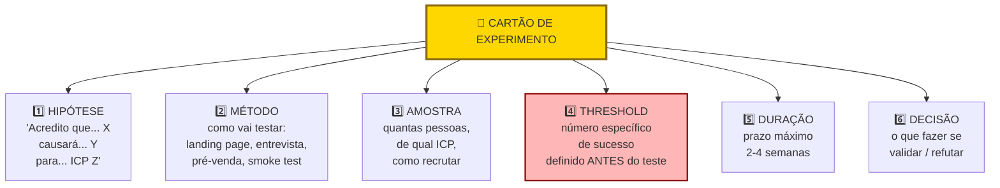

> [!important] Threshold ex-ante é o elemento não negociável
> "Vamos ver quantos se interessam", sem número pré-definido, vira racionalização. Três clientes pagantes viram "sinal promissor". Trinta clientes viram "pouco para concluir". Com threshold (doze ou mais conversões em duas semanas, por exemplo), a decisão é automática.

EXPERIMENTO #1

Hipótese: Donos de padaria pagariam R$ 400 por mês por loja pelo PadariaPro se a redução de perda for demonstrada em sessenta dias.

Pergunta central: Qual faixa de preço o dono de padaria com três a cinco lojas aceita pagar por software de gestão de estoque com garantia de resultado em sessenta dias?

Desenho: Criar landing page simples (Framer, quatro horas) com três planos, R$ 290, R$ 400 e R$ 590 por mês por loja. CTA (chamada para ação, botão ou link que convida o visitante a agir) "Quero ser um dos primeiros dez". Formulário pede nome, padaria, número de lojas, telefone e compromisso formal de pagar R$ X se a funcionalidade de previsão de demanda estiver pronta em sessenta dias. Tipo de experimento: Fake Door mais Carta de Intenção de Pagamento. Tráfego via três grupos de WhatsApp de donos de padaria (oitenta membros cada) mais LinkedIn. Para cada lead que preencher o formulário, ligar em quarenta e oito horas para confirmar disposição real.

Público: Donos de padaria com três a cinco lojas em SP. Meta mínima de trinta visitantes que se encaixem no perfil. Canal de recrutamento: grupos de WhatsApp mapeados na Fase 5.

Métrica principal: Taxa de conversão de visitantes ICP em formulários com compromisso de pagamento.

Critério de sucesso: Quinze por cento ou mais dos visitantes ICP preenchem o formulário. Três de cada cinco que atendem à ligação confirmam disposição a pagar R$ 400 por mês.

Critério de refutação: Menos de cinco por cento preenchem o formulário, ou menos de dois em cinco confirmam o preço em chamada. Nesse caso, revisar preço ou proposta de valor antes de continuar.

Duração: Catorze dias.

Custo: R$ 600 em anúncios segmentados no Instagram em São Paulo (usados para equilibrar o viés dos grupos de WhatsApp) e cerca de oito horas de trabalho (quatro para a página e quatro para as ligações de confirmação).

Riscos e vieses: Preencher formulário é barato e não equivale a pagar. Selection bias (viés de seleção): grupos de WhatsApp podem não representar o segmento completo. Confirmação telefônica mitiga o primeiro risco. Instagram ads segmentados em SP como canal paralelo mitiga o segundo.

Data de início / fim: Semana 1, Semana 2 do mesmo mês.

**Resultado.** Quarenta e sete visitantes ICP. Doze formulários preenchidos (vinte e cinco por cento). Sete ligações realizadas: quatro confirmaram R$ 290, dois confirmaram R$ 400, um confirmou R$ 590.

**Due diligence da amostra (Passo 6) e ajuste (Passo 8).** Embora os 47 visitantes tenham superado a meta mínima de 30, apenas 7 atenderam às ligações (amostra final muito pequena e concentrada nos contatos mais engajados dos grupos de WhatsApp, sem separar quem veio do Instagram). Não cabe ajustar o ponto de corte para baixo com base em 7 chamadas.

**Avaliação e Decisão (Passo 9).** Resultado **inconclusivo (zona cinzenta)**: 3 de 7 entrevistados (43%) aceitaram pagar R$ 400 ou mais (2 em R$ 400 e 1 em R$ 590), ficando exatamente entre a linha de refutação (abaixo de 40%, menos de 2 em 5) e o critério de validação (60%, 3 em 5). Um único respondente em R$ 590 não basta para declarar que o mercado bifurcou. Próximo experimento: rodar pré-venda paga (sinal via Pix com cláusula de reembolso) testando as faixas de R$ 290 e R$ 400 diretamente com 20 padarias abordadas fora dos grupos de amigos.

### Caso brasileiro real, Pulses (HRtech) e a landing page antes de construir

Como ilustração inspirada na trajetória da Pulses (plataforma catarinense de clima organizacional e engajamento por pulsos semanais, adquirida pela TOTVS em 2021), veja como funciona um experimento de pré-venda B2B antes de escrever código:

O time montou uma página em poucos dias prometendo "diagnóstico contínuo de cultura via micropesquisas semanais", com preço explícito por colaborador ao mês, e direcionou tráfego para diretores de RH de médias e grandes empresas pelo LinkedIn e pela rede do setor.

Em poucas semanas o experimento gerou leads qualificados, reuniões com decisores de RH, e cartas de intenção de empresas dispostas a pagar pelo serviço sem o produto existir ainda. O custo total ficou na casa de poucos milhares de reais. Validou tanto a demanda quanto a disposição a pagar, antes de qualquer linha de código. Anos depois, em 2021, a empresa foi adquirida pela TOTVS: endossando a tese inicial validada por landing page antes do produto.

Experimento barato antes de construir economiza meses. Pré-venda com carta de intenção (ou pagamento real) de comprador econômico é o teste mais forte de demanda em B2B.

### Critérios de saída com pele em jogo: como Henrique troca POCs gratuitos por piloto pago e Rafael e Bia validam recompra

Você concluiu a Fase 8 quando todos os critérios abaixo estão cumpridos.

- [ ] Três ou mais Cartões de Experimento (Template: Cartão de Experimento (Fase 8)) preenchidos com hipótese, método, amostra, critério de sucesso, duração e custo.
- [ ] Cada experimento com critério de falsificação numérico, pré-definido e distinto do critério de sucesso (zona de incerteza no meio).
- [ ] Tipo de experimento apropriado para o que cada hipótese testa (landing page, fake door, concierge, Wizard of Oz, pré-venda, A/B).
- [ ] Três ou mais experimentos executados dentro da janela de duas a três semanas, com dados objetivos coletados.
- [ ] Banco de Hipóteses atualizado com status pós-experimento (uma ou mais invalidadas conta como aprendizado).
- [ ] Decisão documentada depois de cada experimento (perseverar, pivotar, mais dados, abandonar).
- [ ] Evidência forte de três coisas: o problema é real e doloroso para o ICP, o ICP está disposto a pagar (carta de intenção ou pré-venda), pelo menos um canal de aquisição possível.
- [ ] Critério de compromisso atingido conforme o modelo de negócio (informando a origem do tráfego): em B2B enterprise (como Henrique nas usinas), 2 pilotos pagos ou 3 cartas de intenção assinadas pelo dono do orçamento; em SaaS para PME (como Lucas e Marina), 10 pagamentos antecipados; em D2C (como Rafael e Bia), 50 pedidos pagos vindos de tráfego frio ou página convertendo acima de 15% com 100 leads qualificados.
- [ ] Benchmarks de resultado por tipo de experimento documentados quando aplicáveis: landing page (>5% bom, >10% forte, <2% fraco em e-mail cadastrado); pré-venda (acima de 20% de avanço para reunião de fechamento e acima de 10% de conversão paga, como referência prática deste manual); concierge (ao menos 3 de 5 clientes renovam ou indicam um par); Mágico de Oz (uso repetido superior a 2 vezes por semana).
- [ ] Custo por aprendizado abaixo de R$ 500 por hipótese respondida (alvo early-stage). Acima de R$ 3.000 indica experimento mal-desenhado.
- [ ] Velocidade de aprendizado de duas ou mais hipóteses bet-the-company resolvidas por mês em early-stage; quatro ou mais por mês em fase de MVP.
- [ ] Decisão final tomada (perseverar, pivotar, abandonar) e ação iniciada.

> [!warning] Critério de saída
> Os 5% (bom) e 10% (forte) descritos nos passos anteriores são benchmarks de leitura de sinal: indicam que a promessa ressoa o suficiente para continuar testando. Os 15% acima são critério de saída de fase: exigem sinal inequívoco antes de comprometer recursos para construir. Conversão entre 10% e 15% é zona ambígua, exige experimento adicional (preço diferente, segmento mais estreito, oferta mais específica) antes de avançar.

**Primeiros passos práticos.**

1. Escolher as três hipóteses de maior risco não testadas, e desenhar um experimento para cada (Template: Cartão de Experimento (Fase 8)).
2. Estimar custo por experimento. Se algum passa de R$ 5.000 ou de trinta dias, questionar se há versão mais barata.
3. Executar o experimento mais barato primeiro. Geralmente landing page ou fake door.
4. Registrar o resultado em planilha, com decisão associada.

### Seis armadilhas de experimentação: por que mil cadastros grátis valem menos que dez pagamentos

Experimentos desenhados para validar, não para descobrir. Se a pessoa ama o empreendedor, o "experimento" sai positivo. Controle o viés.

Critérios de sucesso frouxos. "Vou considerar sucesso se alguém demonstrar interesse." Quase qualquer coisa vira sucesso. Seja rigoroso.

Ignorar resultados negativos. Muitos empreendedores desvalorizam dados contrários. "Esse grupo não era o público certo." Se você precisa justificar por que o resultado ruim "não conta", está fugindo da verdade.

Gastar muito em experimentos. Se um teste simples de página de captura custa mais de R$ 2.000 ou passa de duas semanas (ou se um Concierge passa de oito semanas sem cobrar), o experimento está inchado demais. Vá mais simples.

Testar uma hipótese em vez da outra. Às vezes o que você testa não mede o que você acha. Pré-venda de um produto que não existe testa proposta mais preço mais timing. Não testa se o produto funcionaria. Saiba o que está medindo.

Não documentar o experimento. Sem registro escrito antes e depois, você reconstrói a narrativa para se beneficiar. Escreva antes e depois.


---

### O Espelho da Fase 8: Você Tem Recibos na Mão ou Apenas Cadastros de Curiosos?

**Fechando o ciclo na trincheira:** Quando **Lucas e Marina** aplicaram as travas deste capítulo na rotina entre São Paulo e Florianópolis, a tensão da cena de abertura deixou de ser discussão subjetiva de corredores e virou regra clara de priorização, retenção e proteção de caixa.

**O Espelho (autodiagnóstico):**
1. No seu último experimento, o número exato de refutação estava escrito antes de abrir a planilha de resultados, e a evidência veio de pagamento real (e não de elogios ou cadastros gratuitos)? (Se responder "não" a duas ou mais perguntas abaixo, você caiu no Teatro da Validação e deve tratar o teste como inconclusivo.)
2. Qual parte do seu produto você está tentando automatizar com código hoje que poderia ser feita manualmente no modelo Concierge ou Mágico de Oz para os primeiros dez clientes?
3. Quanto tempo sua equipe leva entre ter uma dúvida sobre o mercado e colocar um experimento real na rua: 48 horas ou 4 semanas?

**Permissão Libertadora:**
Você está autorizado a fazer coisas que não escalam. Processar os primeiros vinte pedidos manualmente no Excel e no WhatsApp não é amadorismo; é a forma mais rápida e barata de descobrir o que realmente precisa ser programado depois.

**O Ritual de Segunda-Feira às 9h:**
Preencha primeiro um Cartão de Experimento cravando quantos clientes precisam pagar para você seguir (ex.: 2 em 5) e quantos "nãos" obrigam a mudar a oferta; só então apresente a oferta de Concierge Pago a cinco clientes reais (em venda enterprise, peça assinatura de piloto pago com data de início).

---

### MÉTRICAS E BENCHMARKS DESTA FASE (FASE 8)

| Métrica | O que medir | Referência saudável |
|---|---|---|
| Taxa de acerto de hipóteses | % confirmadas vs refutadas | 30 a 50% (muito alto = pouca aprendizagem) |
| Velocidade de aprendizado | Hipóteses testadas por semana | ≥ 2 por semana em sprint |
| Regra 9 em 10 | Threshold mínimo antes de pivotar | Definido antes do experimento |
| Pre-registro | % dos experimentos com hipótese registrada antes | 100% |
| Evidência qualitativa | Entrevistas de validação complementares | ≥ 5 por experimento crítico |
| Compromissos com pele em jogo | Pagamentos antecipados, pilotos pagos ou LOIs (e hipóteses vitais resolvidas/mês) | 10 pagamentos PME, 2 pilotos enterprise ou 20 LOIs (≥ 2 apostas/mês) |

---

### Manual passo a passo dos frameworks de experimentação desta fase

> [!tip] Uso autocontido neste volume
> > Os frameworks abaixo detalham a caixa de ferramentas de experimentação da **Fase 8**, com origem, estrutura, passo a passo e armadilhas de execução.

#### Framework: Pretotyping (Alberto Savoia, 2011)

##### De onde vem a ferramenta (e por que sobreviveu ao filtro do tempo)

Alberto Savoia, ex-engineering director do Google que liderou iniciativas de Inovação (Adwords, Google Shopping), cunhou o termo *pretotype* (pretótipo) por volta de 2011 para designar o teste que vem antes do protótipo. Formalizou no livro *The Right It* (2019). Distingue **prototipo** (construir a coisa certa) de **pretotipo** (validar se a coisa é certa antes de construir). Savoia argumenta que 90% dos produtos lançados falham, mas não porque são mal construídos, e sim porque construíram a coisa errada.

##### A mecânica central (sem jargão)

Conjunto de técnicas rápidas e baratas para validar demanda por uma solução antes de gastar tempo construindo-a. **Oito técnicas principais**: (1) *The Pinocchio*, construir maquete não funcional e testar se uso surge, (2) *The Mechanical Turk*, simular automação com humano por trás, (3) *Fake Door*, colocar botão/feature que não existe e medir clicks, (4) *One-Night Stand*, pretotipo funcional por um único uso, (5) *The Impersonator*, usar produto existente sob sua marca para testar demanda, (6) *The Relabel*, mudar apenas etiqueta/nome, (7) *The YouTube*, fazer vídeo demo do produto que ainda não existe, (8) *Provincial*, testar em um mercado pequeno antes de lançar global.

##### As regras do jogo

Ideia + dado do mundo real > ideia + opinião de amigos. Dados do tipo YODA (*Your Own Data, acquired through Active experiments*) valem muito mais que opiniões, sondagens ou intuição. Custo de pretotype é medido em horas ou dias, não semanas, custo de protótipo é semanas ou meses. Errar rápido e barato em pretotype é aceitar que a maioria das ideias iniciais são erradas, mas aprender isso antes de investir.

##### Como rodar na segunda-feira às 9h com seu time

Para cada hipótese de produto: identificar qual é a decisão binária "vamos construir ou não". Escolher uma das oito técnicas que melhor responde essa decisão. Definir threshold de sucesso **antes** do experimento (quantos clicks no fake door? quantas compras no One-Night Stand?). Rodar por 1-7 dias. Decidir na base dos dados, não do desejo.

##### Na trincheira real: como isso funciona na prática

Airbnb 2007. Antes do produto existir, fundadores alugaram ar-mattress no próprio apartamento durante conferência de design em San Francisco. Três pessoas pagaram US$80 cada para dormir no chão em colchão de ar. Pretotype: comprovou que alguém paga por estadia alternativa no contexto específico (conferência sem hotel disponível). Decidiu a construção do produto.

Exemplo brasileiro: o início do Gympass (fundado em 2012 em São Paulo por Cesar Carvalho e renomeado Wellhub em 2024). A empresa começou vendendo diárias e pacotes avulsos diretamente ao consumidor final (B2C), sem produto corporativo pronto; os testes iniciais de demanda mostraram que as academias temiam canibalizar seus alunos diretos, mas que os departamentos de RH das empresas pagariam por um benefício corporativo unificado para funcionários sedentários, originando o pivô para o modelo B2B2C.

##### Onde o papel aceita tudo (armadilhas de execução)

(1) Pretótipo sem limiar numérico definido antes da coleta vira teatro. (2) Confundir pretótipo com MVP: o MVP é uma versão mínima que entrega o serviço; o pretótipo apenas simula uma oferta para medir compromisso de compra. (3) Ignorar um resultado negativo dizendo "mas eu acho que vai funcionar": dado coletado em campo supera opinião interna. (4) Rodar uma única variação sem contexto: testar duas ofertas de preço ou canal ajuda a separar rejeição do canal de rejeição da proposta.

---

#### Framework: Customer Development (Steve Blank, 2005)

##### De onde vem a ferramenta (e por que sobreviveu ao filtro do tempo)

Steve Blank, fundador de oito startups e professor de Stanford/Berkeley, sistematizou Customer Development a partir de suas próprias experiências como fundador nos anos 1980-1990. Primeiro artigo em 2005, livro de referência *The Four Steps to the Epiphany* (2005) e *The Startup Owner's Manual* (2012, com Bob Dorf). É o framework que inspirou diretamente o Lean Startup de Eric Ries (seu aluno). Distinção central entre Customer Development (externo, descoberta e validação com clientes) e Product Development (interno, construção do produto), operando em paralelo.

##### A mecânica central (sem jargão)

Processo de quatro etapas sequenciais: (1) **Customer Discovery**: formular e testar hipóteses sobre quem é o cliente e qual problema eles têm, (2) **Customer Validation**: confirmar que os clientes pagarão pela solução proposta, construindo processo de venda repetível e escalável, (3) **Customer Creation**: crescer demanda no mercado primário e secundário, (4) **Company Building**: transição de modo "startup de busca" para modo "empresa de execução". As duas primeiras etapas são **iterativas**, o processo pode voltar a Discovery quando Validation revela que problema estava mal formulado.

##### As regras do jogo

"Get out of the building", o mais citado axioma de Blank. Hipóteses sobre clientes não podem ser validadas dentro do escritório, precisam confrontar realidade externa. Startup não é versão pequena de empresa grande, é organização temporária buscando modelo de negócio repetível e escalável, até achar esse modelo, executar como empresa é erro.

##### Como rodar na segunda-feira às 9h com seu time

Em Customer Discovery: 50-100 conversas com prospects potenciais nos primeiros meses ([[IGNICAO-Vol-2-Descoberta-e-Mercado#FASE 4 — DESCOBERTA DO PROBLEMA|Fase 4 (Vol. 2)]] do manual). Documentar hipóteses antes das conversas (quem, problema, solução). Ajustar hipóteses depois de cada conjunto de 5-10 conversas. Em Customer Validation: vender o produto (mesmo que ainda não existe plenamente) para primeiros early adopters, documentar processo de venda que funciona. Customer Creation e Company Building vêm após validação comprovada, correspondem às Fases 11-14 do manual.

Exemplo aplicado. Steve Blank usou Customer Development na E.piphany (sua startup de marketing software nos anos 1990). Processo: conforme relata em *The Four Steps to the Epiphany*, Blank passou meses em entrevistas de *Customer Discovery* diretamente com executivos de empresas clientes antes de escalar a força de vendas. Descobriu que problema inicial formulado (software de análise de campanhas) não era dor principal, dor real era integração de dados de múltiplos sistemas. Pivot orientado por Customer Discovery salvou a empresa, levou a IPO em 1999 com valuation de US$2.5B.

##### Onde o papel aceita tudo (armadilhas de execução)

(1) Pular Customer Discovery por "urgência" de construir produto, erro mais comum e mais caro do empreendedorismo tech. (2) Confundir Customer Development com pesquisa de mercado tradicional (focus groups, surveys), é descoberta por conversa 1-a-1, não quantitativa. (3) Parar conversa com cliente depois do pitch, a maior parte do aprendizado vem das perguntas *depois* que o cliente reage, não do seu pitch. (4) Descartar Customer Development como obsoleto depois de Lean Startup, os dois são complementares, não substitutos. Lean Startup adicionou Build-Measure-Learn mas Customer Development segue sendo método válido de descoberta.

---

#### Framework: Build-Measure-Learn Loop (Eric Ries, 2011)

##### De onde vem a ferramenta (e por que sobreviveu ao filtro do tempo)

Eric Ries, aluno de Steve Blank em Berkeley e ex-fundador/CTO da IMVU, popularizou o ciclo Build-Measure-Learn no livro *The Lean Startup* (2011). Adaptou princípios do *Lean Manufacturing* de Toyota (minimizar desperdício, feedback rápido) para o contexto de desenvolvimento de produtos digitais em startups. Tornou-se o framework mais influente de empreendedorismo pós-2011, adotado por Google, GE, aceleradoras globais e disciplinas de empreendedorismo em universidades.

##### A mecânica central (sem jargão)

Ciclo iterativo de três etapas: **Build** (construir o menor experimento possível, MVP, para testar uma hipótese), **Measure** (coletar dados de uso, comportamento, feedback), **Learn** (decidir *continuar*, *pivotar*, ou *matar* com base no aprendizado). O objetivo não é entregar produto rápido, é acelerar o *aprendizado validado* sobre o que funciona e o que não funciona. Cada ciclo é curto (dias a semanas), múltiplos ciclos formam a jornada de validação.

##### As regras do jogo

*Aprendizado validado* é o tipo de progresso que importa, progressão em features construídas sem validação de mercado é desperdício. *Innovation accounting*, medir progresso em métricas que indicam aprendizado (retenção por cohort, conversão em cada etapa do funil), não em métricas de vaidade (downloads, pageviews). *Pivot ou persevere*, decisão explícita e documentada ao final de cada ciclo, não deriva implícita.

##### Como rodar na segunda-feira às 9h com seu time

Para cada hipótese de produto: (1) Definir métrica que validará ou refutará a hipótese. (2) Construir o menor MVP que permita medir essa métrica (pode ser pretotype, landing page, concierge MVP, ou versão funcional). (3) Rodar experimento por tempo suficiente para acumular dados estatisticamente significativos. (4) Medir resultado contra threshold pré-definido. (5) Decidir explicitamente o próximo ciclo: dobrar aposta, ajustar, ou pivotar. Documentar cada ciclo em 1 página, construir biblioteca de aprendizados.

Exemplo aplicado, Dropbox 2008. Hipótese: pessoas querem sincronização automática de arquivos entre dispositivos. Desafio: construir funcionalidade técnica é trabalho de meses. **Build**: com o produto já funcionando em beta fechado, Drew Houston gravou em 2008 um vídeo de demonstração de 3 minutos voltado à comunidade do Digg. **Measure**: a lista de espera saltou de 5.000 para 75.000 inscritos da noite para o dia, validando a demanda em escala antes do lançamento público. **Learn**: validou demanda antes de construir produto. Construiu depois com confiança de que mercado existia.

##### Onde o papel aceita tudo (armadilhas de execução)

(1) Build longo demais, se o ciclo dura meses, não é Build-Measure-Learn, é desenvolvimento tradicional. (2) Métrica vaga, "uso do produto" não é métrica, retenção na segunda semana é. (3) Learn sem decisão, ciclo termina com "vamos continuar refinando" sem pivot/persevere explícito, isso é deriva, não aprendizado validado. (4) Confundir com método Agile, Agile é sobre *entregar produto*. BML é sobre *validar modelo de negócio*. Agile pode ser bom e ainda assim BML ruim.

---

#### Framework: Survey Design (Don Dillman & Jon Krosnick, padrão moderno)

##### De onde vem a ferramenta (e por que sobreviveu ao filtro do tempo)

Don Dillman (Washington State University) é referência global em metodologia de survey, *Internet, Phone, Mail and Mixed-Mode Surveys: The Tailored Design Method* (1ª edição 1978, 5ª edição 2014) é texto canônico. Jon Krosnick (Stanford) complementa com pesquisa sobre **como formular perguntas** para minimizar viés de resposta. Juntos, são os dois nomes mais citados em literatura acadêmica de surveys.

##### A mecânica central (sem jargão)

Coleção de técnicas cientificamente validadas para **formular, administrar e analisar surveys** de forma a minimizar viés e maximizar validade. Fundador que aplica "4 perguntas no Google Forms" sem rigor coleta dados enganadores, pior que não coletar.

##### As regras do jogo

Erros comuns em surveys informais:

- Leading questions: "você concorda que X é importante?"
- Double-barreled: "o produto é fácil e bonito?" (2 perguntas em 1).
- Vagueness: "você usa com frequência?" (frequência o quê? Por dia/semana/mês?).
- Ordem enviesada: pergunta sobre satisfação após elogio enviesa, após reclamação, enviesa outro jeito.
- Escalas inconsistentes: ora 1-5, ora 0-10, confunde.
- Amostra auto-selecionada: só respondem quem já gosta.

Princípios de design rigoroso:

1. Objetivos claros: cada pergunta deve ter propósito de uso específico.
2. Perguntas específicas, concretas, unidimensionais.
3. Escalas consistentes (1-5 ou 0-10, usar uma).
4. Embaralhe a ordem apenas nas alternativas sem hierarquia natural (listas de dores, marcas ou funções) e mantenha a ordem lógica nas escalas ordinais (como nunca, às vezes, sempre).
5. Amostragem representativa (não só quem responde voluntário).
6. Tamanho de amostra suficiente para poder estatístico.
7. Piloto: testar survey com 10-20 pessoas antes de rodar em escala.

##### Como rodar na segunda-feira às 9h com seu time

Passo 1: Defina pergunta de pesquisa: "qual fração do nosso ICP está insatisfeita com solução atual?"

Passo 2: Desenhe amostra. Probabilística (ideal) ou pragmática (definida). Evitar "quem abrir o link".

Passo 3: Formule perguntas:

- Comportamentais: "na última semana, quantas vezes você usou X?"
- Atitudinais: "em escala 1-5, quão frustrado ficou com Y?"
- Factuais: "em que faixa de receita sua empresa está?"

Passo 4: Calcule tamanho de amostra. Para populações grandes, margem de erro 5% em CI 95% ≈ 385 respostas. Calculadoras online fazem o cálculo.

Passo 5: Piloto: 10-20 respostas, ajustar ambiguidades.

Passo 6: Distribua: mix de canais para reduzir viés (email, social, CRM).

Passo 7: Analise: estatística descritiva + cruzamentos por segmento + teste de significância quando comparar grupos.

##### Na trincheira real: como isso funciona na prática

Survey para validar dor em PMEs brasileiras:

- População: PMEs brasileiras com 5-100 funcionários.
- Amostra alvo: 400 respostas.
- Canais: email do próprio CRM + 2 parceiros (contabilidades) + anúncio LinkedIn.
- Perguntas:

 1. Em quais dos seguintes processos você gasta mais tempo por semana? (multi-select).
 2. Especificamente em [processo top], quantas horas/semana? (faixas).
 3. Em escala 1-5, quão frustrado você está com esse processo?
 4. Você já pagou por solução para este processo? Quanto?
 5. Dados demográficos (setor, porte, localização).

Insights (n=412):

- 68% respondem "gestão financeira" como top 3, 41% como #1.
- Entre os que citam financeiro como top: 73% gastam 5+ horas/semana, 22% gastam 15+.
- Frustração média 3.8/5 (alta).
- 34% já pagaram por solução, ticket médio R$ 180/mês.

Implicação (exemplo ilustrativo): sinal forte de dor entre clientes da base e contatos de parceiros, restando validar a mesma conversão em tráfego frio fora da rede próxima.

##### Onde o papel aceita tudo (armadilhas de execução)

- Perguntas indutoras (*leading*): "você concorda que nossa solução resolve X?"
- Amostra enviesada: ouvir apenas clientes já satisfeitos da própria base.
- Amostra pequena demais: 30 respostas em pesquisa quantitativa não permitem generalizar.
- Ignorar o viés de não resposta: se só 10% responderam, quem são os outros 90%?
- Questionário longo demais: 25 perguntas geram abandono alto e respostas apressadas.

---

#### Framework: Conjoint Analysis (Paul Green, 1971)

##### De onde vem a ferramenta (e por que sobreviveu ao filtro do tempo)

Paul Green, professor da Wharton, e V. Srinivasan (Stanford) desenvolveram conjoint nos anos 1970 para analisar preferências de consumidores. "Conjoint Measurement for Quantifying Judgmental Data" (Green & Rao, 1971) é paper seminal. Hoje é padrão em pricing research, product positioning e desenvolvimento de produto em empresas como McKinsey, Bain, e grandes CPGs.

##### A mecânica central (sem jargão)

Técnica estatística que **decompõe preferências declaradas** em valor relativo de cada atributo que compõe a oferta. Usa o fato que consumidores fazem tradeoffs: não queremos tudo, negociamos features vs. preço vs. outras dimensões.

##### As regras do jogo

Problema que resolve: pergunte diretamente "quanto você pagaria por feature X?", respostas são infladas. Conjoint apresenta **bundles** realistas (ex.: "feature A + B + preço R$ 80/mês" vs. "feature C + D + preço R$ 150/mês") e pede preferência. Decompor matematicamente revela valor de cada atributo.

Tipos:

- CBC (Choice-Based Conjoint): mais popular. Usuário escolhe entre 2-3 bundles.
- Adaptive Choice-Based: dinamicamente ajusta opções.
- MaxDiff (Framework: MaxDiff Analysis (Louviere & Woodworth, 1990; popularizado por Sawtooth) (Fase 8)): variação para atributos individuais.

##### Como rodar na segunda-feira às 9h com seu time

Passo 1: Defina 3-6 atributos com 2-4 níveis cada. Ex.: pricing (R$ 50/100/200/400), suporte (email/chat/telefone/dedicado), features (básico/avançado/premium), etc.

Passo 2: Use ferramenta especializada: Sawtooth (padrão), Conjoint.ly, Qualtrics. DIY em Excel é possível mas limitado.

Passo 3 (filtro de estágio e amostra): Só aplique Conjoint ou MaxDiff se você já tiver base mínima de 200 a 500 contatos qualificados do perfil de cliente ideal e orçamento para painel e software especializado (tratados em profundidade na etapa de precificação do Vol. 4). No início da Fase 8, dentro do teto de R$ 500 a R$ 3 mil por experimento, substitua este passo por pré-venda direta testando dois níveis de preço.

Passo 4: Desenho experimental: ferramenta gera bundles a mostrar (fractional factorial design).

Passo 5: Respondente escolhe entre bundles. Típico: 10-20 cenários.

Passo 6: Análise estatística: ferramenta calcula utilidades (part-worths) de cada nível de cada atributo.

Passo 7: Interpreta: qual atributo tem maior importância? Qual nível maximiza preferência?

Passo 8: Simulação: testa cenários de bundle novo vs. concorrência.

##### Na trincheira real: como isso funciona na prática

Conjoint para definir pricing e features de SaaS B2B:

Atributos:

- Preço: R$ 50, 100, 200, 400/mês.
- Suporte: email / chat / telefone / dedicado.
- Features: básico (só core), avançado (+relatórios), premium (+integrações).
- Contrato: mensal / anual com desconto.

Resultado (n=320 respondentes ICP):

- Preço é 45% da importância (sensibilidade alta).
- Features 25%.
- Suporte 20%.
- Contrato 10%.

Utilidades de preço: R$ 50 (+1,0), R$ 100 (+0,9), R$ 200 (+0,6), R$ 400 (-2,5). Entre R$ 50 e R$ 100 a perda de preferência é mínima, em R$ 200 ainda há utilidade positiva, e acima de R$ 200 a rejeição dispara.

Insight: empresa pode ir até R$ 200 sem perder muitos, acima disso, abandona. Features intermediárias (avançadas) são "sweet spot", premium agrega pouco incremental vs. avançado.

##### Onde o papel aceita tudo (armadilhas de execução)

Muitos atributos: > 6 atributos → fadiga cognitiva → respostas ruidosas, Níveis irrealistas: preço muito absurdo atrapalha, Não validar com comportamento real: conjoint é declarado, sempre complementar com dados reais (A/B tests de pricing), Amostra não ICP: respondentes aleatórios viesam.

---

#### Framework: MaxDiff Analysis (Louviere & Woodworth, 1990; popularizado por Sawtooth)

##### De onde vem a ferramenta (e por que sobreviveu ao filtro do tempo)

Jordan Louviere e George Woodworth desenvolveram o método em 1990. Consolidou como alternativa pragmática a ranking para casos com muitos itens. Popularizou via Sawtooth Software nos anos 2000.

##### A mecânica central (sem jargão)

Técnica estatística para **priorizar um conjunto de atributos ou itens**. Respondente vê subsets de 4-5 itens e escolhe **o mais importante** e **o menos importante** (maximum difference). Repetido várias vezes, gera ranking completo com precisão estatística.

##### As regras do jogo

Problema que resolve: quando você tem 20 features candidatas e quer saber quais priorizar, perguntar "em escala 1-10, quão importante é X?" 20 vezes gera ratings inflacionados (tudo parece 8-9). MaxDiff força tradeoffs.

##### Como rodar na segunda-feira às 9h com seu time

Passo 1: Liste 15-30 itens a priorizar.

Passo 2: Ferramenta gera subsets: cada respondente vê ~12-15 sets de 4-5 itens.

Passo 3: Em cada set, respondente escolhe mais importante + menos importante.

Passo 4: Análise: algoritmo calcula score de importância de cada item (Hierarchical Bayes é padrão).

Passo 5: Ranking estatisticamente válido.

##### Na trincheira real: como isso funciona na prática

MaxDiff para priorizar 20 features candidatas:

Amostra: 250 clientes + prospects do ICP.

Resultado (top 5 e bottom 5):

Top 5 (prioridade alta):

1. Integração automática com bancos (score 9.2/10).
2. Relatório fiscal simplificado (8.7).
3. Dashboard móvel (7.8).
4. Notificações inteligentes de vencimento (7.2).
5. Importação de extratos PDF (6.9).

Bottom 5 (baixa prioridade):
16. Integração com Zapier (2.1).
17. Tema dark mode (1.8).
18. Modo offline (1.3).
19. Widget de calendário (1.1).
20. Assinatura eletrônica (0.8).

Insight: roadmap focado em integrações bancárias e relatórios fiscais, features como dark mode, Zapier, offline ficam para depois. Validação quantitativa clara.

##### Onde o papel aceita tudo (armadilhas de execução)

Items que se sobrepõem: "dashboard mobile" e "app iOS", qual é diferente?, n pequeno: < 100 respondentes gera estabilidade baixa, Items mal-descritos: respondente tem interpretação diferente do mesmo item.

---

### CANVASES VISUAIS DESTA FASE (COM EXEMPLOS BRASILEIROS PREENCHIDOS)

#### Canvas: Test Card (David Bland & Alexander Osterwalder, 2019)

##### Por que este quadro visual foi criado

O Test Card ganhou circulação ampla com *Value Proposition Design* (2014) e foi expandido em *Testing Business Ideas* (David Bland e Alexander Osterwalder, 2019), na coleção Strategyzer (a mesma do Business Model Canvas e do Value Proposition Canvas), estruturando-se originalmente em quatro frases: *Nós acreditamos que... Para verificar isso, nós vamos... E mediremos... Estamos certos se...* É a sistematização, em formato de cartão único, do que já era prática tácita no Lean Startup desde Eric Ries (2011): para cada hipótese, defina o experimento que vai testá-la **antes** de coletar dados, com critério de sucesso explícito. O Test Card tornou esse exercício replicável: cabe numa folha A5, tem campos fixos, e força o time a articular o critério de sucesso antes do experimento começar (não depois, quando já há viés de confirmação).

O que o livro IGNIÇÃO chama de "Cartão de Experimento" (Template: Cartão de Experimento (Fase 8) da seção de Templates Operacionais) é uma adaptação direta do Test Card, com algumas extensões para o contexto brasileiro (custo em R$, linguagem local). A origem da ferramenta é Strategyzer.

##### A anatomia visual de uma página

Cartão de uma página alinhado ao modelo completo da seção de Templates desta fase, reunindo os blocos de pré-registro e decisão:

- **ID do experimento** (numeração sequencial).
- **Hipótese testada** (uma frase falsificável copiada do banco de hipóteses).
- **Pergunta central** (o que especificamente queremos responder).
- **Desenho** (passo a passo do experimento).
- **Público** (quantas pessoas, qual perfil, como alcançadas).
- **Métrica principal e critério de sucesso** (definido **antes** de ver dados).
- **Critério de refutação** (o que invalida a hipótese: também antes).
- **Custo e duração** (orçamento e prazo).

Após o experimento, o cartão se completa com:

- **Resultado observado**.
- **Decisão** (Persevere / Pivote / Ajuste / Abandone).
- **Aprendizados** (o que isso nos ensina sobre o modelo).

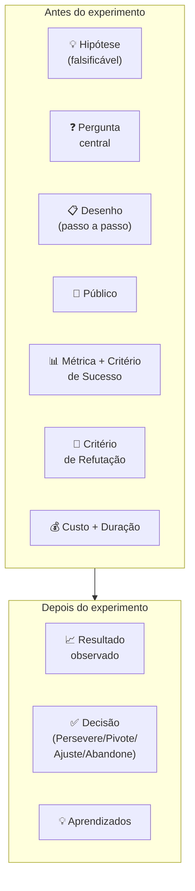

A disciplina central é definir **Critério de Sucesso e Critério de Refutação ANTES** de rodar o experimento. Times que definem critério depois invariavelmente racionalizam os dados a favor da hipótese ("converteu menos do que esperávamos, mas ainda é positivo porque..."). Critério pré-definido evita auto-engano.

##### O momento exato de colocar este canvas na parede

Use o Test Card na Fase 8 (experimentos de validação do problema e da solução) como artefato central, mantendo um cartão ativo para cada experimento, e crie os primeiros cartões já no fechamento da Fase 7 logo após selecionar as apostas de vida ou morte. O resultado de cada Test Card alimenta diretamente a priorização de protótipos na Fase 9.

##### As regras de ouro para preencher sem se enganar

A tese de Bland & Osterwalder é que **experimento sem critério pré-definido não é experimento, é demonstração**. Demonstração começa com a conclusão pronta e busca evidência que confirme. Experimento começa com pergunta aberta e aceita qualquer resposta. A diferença é a definição prévia do critério de refutação. Test Card formaliza esse rigor: sem ele, a maioria dos "experimentos" em startup é teatro de método científico.

##### Passo a passo na parede da sala

Para cada hipótese a testar, abrir um Test Card. Tempo de preenchimento: 30-45 min. Participantes: 2-3 pessoas (PM + tech/design + 1 fundador).

1. **Hipótese**: copie da Fase 6, escreva como afirmação falsificável: "X% dos visitantes da landing page se cadastrarão em até 7 dias", não "as pessoas vão gostar".
2. **Pergunta central**: o que estamos testando especificamente? Frequentemente é o coração da hipótese reformulado.
3. **Desenho**: passo a passo do experimento. Concreto: que landing page? Quais ads? Que público?
4. **Público**: N planejado, perfil específico, canal. "100 visitantes ICP via Meta Ads" é diferente de "100 visitantes quaisquer".
5. **Métrica + Critério de Sucesso**: definir **antes**. "Sucesso = 8% de conversão visitante → cadastro em 14 dias."
6. **Critério de Refutação**: também antes. "Abaixo de 2% = hipótese refutada."
7. **Custo e Duração**: R$ X (Ads + ferramenta) + Y dias.
8. **Riscos e vieses**: o que pode distorcer? Tráfego ruim? Dia da semana? Novidade?

Rodar o experimento. Atualizar o cartão com resultado, decisão e aprendizados.

**Regra de ouro**: sucesso e refutação devem ser distintos com zona de incerteza no meio. Entre 2% e 8% no exemplo acima = inconclusivo, exige novo experimento. Sem zona de incerteza, qualquer resultado vira "sucesso" ou "fracasso" por viés.

##### Exemplo brasileiro preenchido: PadariaPro, smoke test de proposta de valor (2024) (reconstrução didática com base em dados públicos)

A equipe do PadariaPro (nosso caso recorrente de software de compras e gestão de estoque para redes de 2 a 5 padarias em São Paulo) decidiu testar em campo a disposição a pagar pela sugestão automática de compras antes de escrever código, preenchendo este Test Card:

| Campo | Conteúdo |
|---|---|
| **ID** | EXP-2024-03 |
| **Hipótese testada** | Donos de padaria com 1-3 unidades em SP que fazem delivery próprio têm dor suficiente para pagar R$ 290/mês por software de gestão integrada de pedidos. |
| **Pergunta central** | Visitantes ICP convertem em formulário "quero conhecer" a ≥10%? Dos que preenchem, ≥30% confirmam disposição a pagar R$ 290 em ligação? |
| **Desenho** | (1) Landing page descrevendo o produto como se existisse, com R$ 290/mês destacado e formulário de "quero conhecer". (2) Meta Ads segmentando "donos de padaria em SP" via interesses + público semelhante (*lookalike*) a uma lista própria de contatos que deram consentimento (nunca compre bases de dados de terceiros: subir lista comprada em plataformas de anúncios viola o art. 7º da LGPD, sujeita a empresa a sanções da ANPD e queima a reputação do domínio de e-mail). (3) Para cada formulário preenchido, ligar em 24h e fazer entrevista de 15 min. |
| **Público** | 100 visitantes ICP (donos/sócios de padaria 1-3 unidades em SP capital), via Meta Ads. Verba de R$ 1.500. |
| **Métrica principal** | Taxa de conversão visitante → formulário preenchido. Sucesso: ≥10%. Refutação: ≤2%. |
| **Métrica secundária** | Dos preenchimentos, % que confirma disposição a pagar R$ 290 em ligação. Sucesso: ≥30%. Refutação: ≤10%. |
| **Critério de Refutação** | Conversão <2% OU confirmação de pagamento <10% = hipótese refutada. Reconsiderar preço ou ICP. |
| **Custo e Duração** | R$ 1.500 em Ads + 14 dias (1 semana de tráfego + 1 semana de ligações) + ~10h do fundador em entrevistas. |
| **Riscos e vieses** | Público frio do Meta pode não bater com ICP real (donos de padaria não usam Meta Ads como ferramenta de descoberta de software B2B). Mitigação: reforçar segmentação por interesses + lookalike. |

**Resultado** (preenchido após 14 dias):

- 47 visitantes ICP confirmados via tag de evento (audience pequena demais, limitação de targeting).
- 12 preencheram formulário (25,5%: acima do critério de sucesso primário).
- 7 atenderam à ligação em até 24h e 4 deles confirmaram compromisso pelo plano de R$ 290/mês com cartão pré-cadastrado (4/7 = 57% de confirmação entre os contatados, mas abaixo dos 100 visitantes planejados, levando à decisão de Ajuste para testar uma segunda rodada com resposta imediata no WhatsApp). Confirmação de pagamento: 4/7 = 57% (acima do critério).

**Decisão**: Persevere. Hipótese reforçada, disposição a pagar é maior que o teste assumia (alguns aceitariam R$ 400-590). Próximo experimento: pré-venda paga real (R$ 290 com reembolso garantido) para os 12 do formulário.

**Aprendizados**: (1) ICP via Meta Ads funcionou apesar de ceticismo inicial, segmentação por interesse "padaria artesanal" + lookalike captou perfil certo. (2) Disposição a pagar > preço testado sugere que estamos subprecificando: testar R$ 390 no próximo experimento. (3) Tempo de resposta importa: dos 12 que preencheram, os 5 que não atenderam ligação foram contatados em D+2 (vs D+1 nos 7 atendidos). Diferença de 24h em tempo de resposta queimou 40% da amostra.

A disciplina do Test Card neste exemplo evitou três erros típicos: (1) **viés de confirmação**: sem critério pré-definido, "47 visitantes" pareceria sucesso ou fracasso conforme a vontade do time; com a regra pré-registrada ("abaixo de 100 visitantes, exigir limite inferior de conversão acima de 10% ou rodar segunda coleta com resposta imediata no WhatsApp"), anotando também o horário de cada ligação para evitar a perda de 40% dos contatos após 48h; (2) **subestimação de preço**: sem perguntar preço de forma sistemática, a equipe assumiria R$ 290 e nunca testaria preços maiores; (3) **falsa sensação de progresso**: sem "Critério de Refutação" registrado, o time poderia ter levado meses para perceber que algo simples como "responder em 24h" estava destruindo a amostra. **A lição: Test Card não é burocracia, é o equipamento de proteção contra os auto-enganos sistemáticos do empreendedor entusiasmado.**

##### Variações e extensões

- **Learning Card** (Strategyzer): cartão complementar focado em "o que aprendemos" (não "o que testamos"). Útil para destilar insights de múltiplos Test Cards rodados.
- **Assumption Map** (Bland & Osterwalder): grid 2x2 que prioriza quais assumptions virar Test Cards primeiro (importância × evidência atual).
- **Riskiest Assumption Test (RAT)** (Lean Startup community / Lean UX): variação minimalista, só testa a única assumption que mais pode matar o produto.

##### Onde os fundadores mentem para si mesmos neste canvas

- Definir critério de sucesso depois de ver resultados: auto-engano garantido.
- Critério vago ("queremos boa adoção") em vez de quantitativo ("≥X% em Y dias"): resultado fica em zona cinza permanente.
- Não definir critério de refutação: só "sucesso" e "ainda não", nunca "refutado", impede aprendizado real.
- Rodar muitos Test Cards em paralelo sem capacidade de analisar: vira teatro de experimentação.
- Confundir Test Card com PRD (Product Requirements Document): Test Card valida hipótese; PRD especifica construção. São documentos para fases distintas.

---

### Templates operacionais e casos preenchidos desta fase (OST, User Story Map e estrutura do Dossiê de Solução do Passo 7)

#### Template: Cartão de Experimento

**Para que serve.** Documenta um experimento individual em uma página com hipótese, desenho, métrica, critério de sucesso pré-registrado e decisão, garantindo rigor de método e prevenindo racionalização posterior do resultado.

**Quando usar.** Antes de cada experimento da Fase 8. O preenchimento dos blocos "Critério de Sucesso", "Riscos e Vieses" e "Métrica Principal" deve ocorrer ANTES de ver qualquer dado, não depois. Preencha "Resultado", "Decisão" e "Aprendizados" no encerramento.

**Exemplo de preenchimento.** Hipótese testada, "ICP paga R$149/mês". Pergunta central, "quantos visitantes da landing finalizam compra no checkout antes do produto existir?". Desenho, "rodar Google Ads para 5 termos de cauda longa por 14 dias, medir conversão até cartão informado". Métrica principal, "taxa de conversão visita→cartão". Critério de sucesso, "validar se ≥10%, refutar se ≤3%, zona cinzenta entre 3% e 10%".

```text
EXPERIMENTO #___
Data planejada: ___ a ___

HIPÓTESE TESTADA
___________________________________________

PERGUNTA CENTRAL
___________________________________________

DESENHO (passo a passo)
1) _______________________________________
2) _______________________________________
3) _______________________________________

PÚBLICO
Quantidade: _____ Perfil: _____________
Como alcanço: ___________________________

MÉTRICA PRINCIPAL
___________________________________________

CRITÉRIOS DE PRÉ-REGISTRO (definidos antes de ver o resultado: amostra mínima, validar se, refutar se, regra da zona cinzenta e critério de descarte da coleta)
Validar se: ________________________________
Refutar se: _______________________________

DURAÇÃO E CUSTO
Tempo: _____ dias Custo: R$ _____

RISCOS E VIESES
___________________________________________

RESULTADO (preencher depois)
___________________________________________

DECISÃO
 Persevere Ajuste Pivote Abandone

APRENDIZADOS
___________________________________________
```

---

#### Template: Tabela de técnicas de validação por tipo de hipótese

Esta tabela resume as técnicas de coleta de evidência mais usadas no manual, organizadas pelo tipo de hipótese que cada uma testa melhor. Inspirada na Tabela 1 de Coali et al. (2024), com ajustes para operadores brasileiros.

| Técnica | Descrição | Melhor para... | Amostra típica | Onde no manual |
|---|---|---|---|---|
| **Entrevistas 1-a-1** | Conversas estruturadas de 30-60 min com perguntas no estilo Mom Test | Desenvolvimento de teoria ([[IGNICAO-Vol-1-Ideacao#FASE 3 — CONSTRUÇÃO DA TEORIA DO NEGÓCIO|Fase 3 (Vol. 1)]]), validação de problema ([[IGNICAO-Vol-2-Descoberta-e-Mercado#FASE 4 — DESCOBERTA DO PROBLEMA|Fase 4 (Vol. 2)]]), mecanismos causais da dor ([[IGNICAO-Vol-2-Descoberta-e-Mercado#FASE 5 — PESQUISA COM USUÁRIOS (CUSTOMER DISCOVERY)|Fase 5 (Vol. 2)]]) | 15 a 30 pessoas entrevistadas | Fases 4 e 5 (Vol. 2; e Fase 5 para questionários; Fase 8 para landing page, pré-venda, concierge e teste A/B; Fase 9 para protótipo; Fase 11 no Vol. 4 para MVP) |
| **Questionários (surveys)** | Série de perguntas fechadas em escala, distribuídas em grupos maiores | Validação de problema em escala, validação de atratividade de proposta | 100-500 respondentes | [[IGNICAO-Vol-2-Descoberta-e-Mercado#FASE 4 — DESCOBERTA DO PROBLEMA|Fase 4 (Vol. 2)]] late, 5-6 |
| **Landing page / smoke test** | Página descrevendo o produto antes dele existir, mede conversão de interesse | Validação de proposta de valor, teste de canal de aquisição, "fake door" | 500-5.000 visitantes | Fase 8 |
| **Pré-venda** | Aceitar pagamento antecipado sem produto pronto | Teste máximo de Willingness to Pay, elimina viés de "eu pagaria" declarado | 10+ pagamentos reais | Fase 8 |
| **Concierge / Wizard of Oz** | Entregar manualmente o valor que a solução automatizaria | Validar solução antes de build, aprender requisitos reais de uso | 3-10 clientes durante 4-8 semanas | [[#FASE 9 — IDEAÇÃO E PROTOTIPAGEM DE SOLUÇÕES|Fase 9]]-8 |
| **Protótipo interativo** | Versão clicável/funcional parcial submetida a uso real | Validação de fluxo de solução, identificação de pontos de atrito | 8-15 usuários qualitativo | [[#FASE 9 — IDEAÇÃO E PROTOTIPAGEM DE SOLUÇÕES|Fase 9]] |
| **MVP real** | Versão funcional mínima em produção com usuários pagantes | Validação de valor em uso prolongado, retenção, economics | 10+ usuários pagantes, 8-12 semanas | [[IGNICAO-Vol-4-Tracao-e-PMF#FASE 11 — MVP E EXPERIMENTOS DE MERCADO|Fase 11 (Vol. 4)]] |
| **Teste A/B** | Comparação experimental controlada entre 2+ versões | Comparação de features, proposta de valor ou pricing, identificação de causalidade | Centenas a milhares de exposições | [[IGNICAO-Vol-4-Tracao-e-PMF#FASE 11 — MVP E EXPERIMENTOS DE MERCADO|Fase 11 (Vol. 4)]], 13C |

**Regra de escolha rápida**: quanto menos evidência você tem sobre o problema, mais qualitativa deve ser a técnica (entrevistas > questionários > A/B test). Quanto mais avançada a validação, mais quantitativa (A/B test > questionário > entrevistas). Landing page, pré-venda e concierge ficam no meio, são qualitativas em amostra e quantitativas em conversão.

**Nota de vocabulário: validação de problema, de oferta e de solução (síntese operacional deste manual).** Quem vem da literatura do Lean Startup encontrará três tipos distintos de validação que este manual cobre mas não nomeia sempre de forma unificada. A correspondência é:

- **Problem validation** (o problema é real, agudo, no ICP certo?) = Fases 2, 3 e parte da 6.
- **Offer validation** (a proposta de valor é atrativa e o cliente aceita pagar por ela?) = Fase 8 (após a *Problem validation* nas Fases 4 e 5 do Vol. 2 e a formulação de hipóteses na Fase 7; já a *Solution validation* ocorre nas Fases 9 e 10, de modo que falhar na oferta pede voltar à Fase 7 e falhar na usabilidade pede iterar dentro da Fase 10).
- **Solution validation** (a solução específica funciona, escala, tem economics?) = Fases 8, 9 e 10.

Essa distinção importa operacionalmente: falhar na **Problem validation** exige pivotar de ICP ou problema (volta à [[IGNICAO-Vol-2-Descoberta-e-Mercado#FASE 4 — DESCOBERTA DO PROBLEMA|Fase 4 (Vol. 2)]]). Falhar na **Offer validation** pode significar que o problema está certo mas a proposta de valor ou o preço estão errados (volta à [[#FASE 7 — FORMULAÇÃO RIGOROSA DE HIPÓTESES|Fase 7]] ou 7). Falhar na **Solution validation** sugere que o problema e a oferta estão ok, mas a execução da solução não, iterar dentro da [[#FASE 10 — TESTES DE SOLUÇÃO E USABILIDADE|Fase 10]]-9 costuma bastar. Saber qual das três está quebrando muda a decisão de pivot vs. iterate.

---

### Fechamento da Fase 8: o que muda na sua cabeça e na sua empresa a partir de agora

Quando Lucas e Marina analisaram à mão os contratos e extratos dos primeiros clientes no experimento de Concierge da abertura, descobriram que a hipótese de cobrar por um painel genérico de indicadores havia caído: os diretores financeiros só abriram a carteira quando o relatório apontou, em reais, os boletos pagos em duplicidade e as multas evitáveis da semana seguinte. É essa a mudança mental desta fase: você para de perguntar aos amigos *"vocês gostaram da ideia?"* e passa a perguntar ao caixa *"quem pagou antecipado ou assinou compromisso antes do código existir?"*. Com cada ficha de experimento encerrada por uma decisão clara (seguir, ajustar a rota ou descartar), O que sobrevive aos testes vira insumo da [[#FASE 9 — IDEAÇÃO E PROTOTIPAGEM DE SOLUÇÕES|Fase 9]], que usa os aprendizados para definir a solução. O que é refutado força reabertura da árvore de teoria, e às vezes da escolha de cunha. A Fase 8 é o ponto onde a teoria do negócio enfrenta o mundo. Quem trata isso com rigor produz aprendizado real. Quem trata como teatro de validação produz documentação para investidor, e nada mais.

Para avançar à Fase 9 (Ideação e Prototipagem de Soluções), as três a cinco apostas de vida ou morte precisam ter sido testadas em campo e as premissas que se mantiveram de pé devem formar uma teoria coerente. Se alguma foi refutada, reavalie a teoria antes de prototipar.

---

## FASE 9 — IDEAÇÃO E PROTOTIPAGEM DE SOLUÇÕES

### Regra do Descarte Sem Dor (fidelidade proporcional à certeza) e o Cemitério dos Protótipos Perfeitos

Quando a Dra. Camila decidiu criar um aplicativo próprio para acompanhar a higiene das próteses e os cuidados pós-implante dos pacientes da sua clínica odontológica em Belo Horizonte, ela cometeu o pecado clássico do especialista perfeccionista. Contratou um estúdio de design por R$ 38 mil e passou quatro meses debatendo a paleta de cores pastel, o arredondamento dos botões, a animação da tela de login e o logotipo em 3D.

No dia em que finalmente mostrou as 42 telas de altíssima fidelidade para Dona Helena e outros oito pacientes idosos, o choque veio no primeiro minuto: nenhum deles queria baixar mais um aplicativo na memória cheia do celular, ninguém lembrava a senha do e-mail para fazer login e as letras elegantes em cinza-claro eram impossíveis de ler sem óculos de grau. O que eles queriam? Receber um vídeo curto de 15 segundos direto no WhatsApp às 8h da manhã com um botão grande dizendo *"Já fiz hoje"*.

Camila havia construído um monumento para o próprio bom gosto e acabado de entrar para **O Cemitério dos Protótipos Perfeitos**.

Por que nos apaixonamos tanto pela primeira solução que vem à nossa cabeça e gastamos semanas polindo a casca antes de testar o miolo? Porque detalhar cores e telas dá uma deliciosa sensação de controle, enquanto encarar a utilidade nua do produto dá frio na barriga.

Aqui está a Regra do Descarte Sem Dor desta Fase 9 (no espírito do *Sprint* da Google Ventures, que só constrói a fachada realista no quarto dia após mapear e filtrar alternativas no papel): **a fidelidade do seu protótipo deve ser proporcional à sua certeza, e no começo a sua certeza é próxima de zero**. Se você gastar mais de um dia desenhando um protótipo inicial, seu cérebro criará apego emocional ao trabalho feito e você passará a defender o desenho contra o feedback do usuário, em vez de jogá-lo no lixo com um sorriso quando descobrir um caminho dez vezes mais simples.

---

> [!question] FMF Check da Fase 9: encaixe fundador-mercado (*founder-market fit*)
> As ideias de solução que estão emergindo são fruto da sua experiência única com o problema, ou são soluções genéricas que apareceriam em qualquer brainstorm? Se forem genéricas, provavelmente você não está no founder-market-fit que imagina, ou está no estágio em que precisa mergulhar mais fundo no mercado antes de prototipar. Entrevistar dez operadores experientes do setor antes de prototipar é mais barato que prototipar solução genérica.

### Por que se apaixonar pela primeira ideia de solução cega você para alternativas dez vezes melhores

Entre entender o problema e construir a solução, existe um abismo de decisões. Quase todo problema validado admite várias formas de solução: aplicativo, SaaS, serviço produtizado, marketplace, hardware, comunidade ou curso. Pular direto para "app" é a preguiça que custa caro. Explorar alternativas gera insight, e reduz risco.

Prototipagem é a forma mais barata de testar. Com um dia de trabalho e nenhum código, você obtém retorno real sobre experiência, fluxo e desejabilidade.

> [!warning] Construir a solução errada para o problema certo
> Antes da Tesla, existiam carros elétricos, e ninguém os queria de forma massiva. Não porque o problema (mobilidade limpa) fosse irreal. Mas porque as montadoras tradicionais assumiram que o cliente trocaria desempenho e estética por consciência ambiental. A Tesla atacou o mesmo problema com uma solução que não pedia essa troca. validar o problema não te dá cheque em branco sobre a solução. Um problema real comporta várias hipóteses de solução. E apenas algumas delas funcionam. Teste problema e solução separadamente. E desconfie quando o resultado do primeiro se transferir automaticamente para o segundo. Esta é a tese central desta Fase 9.

> [!note] Capítulo 2: TRL e CRL
> Se a solução candidata envolve tecnologia nova (hardware, deeptech, biotech, energia), o nível de maturidade tecnológica (TRL) e comercial (CRL) é variável crítica antes de escolher qual conceito prototipar. O [[#CAPÍTULO 2 — MATURIDADE (TRL/CRL), DECISÃO POR GATES E FECHAMENTO DE FASE (COMMITTED NEXT MOVE)|Capítulo 2: TRL e CRL]] define os nove níveis de TRL e os estágios de CRL correspondentes, e ajuda a calibrar o escopo do protótipo ao nível de maturidade real: evitando o erro de prototipar solução que requer TRL 6+ quando o projeto está em TRL 2.

> [!note] Capítulo 1: Científico vs Lean Startup
> Esta fase aplica a lógica do ciclo Lean em seu ponto mais puro: prototipar barato, testar cedo, iterar. O [[#CAPÍTULO 1 — ABORDAGEM CIENTÍFICA vs LEAN STARTUP: QUANDO USAR CADA UMA|Capítulo 1: Científico vs Lean Startup]] mostra quando a velocidade empírica do Lean precisa dar lugar ao rigor de simulação e laboratório (como em hardware, biotecnologia, saúde ou regulação bancária). Relevante especialmente para definir quando parar de iterar protótipos e comprometer recursos para o MVP.

### Do rabisco no papel à fachada clicável: subindo a escada de fidelidade sem apego emocional

Sete passos.

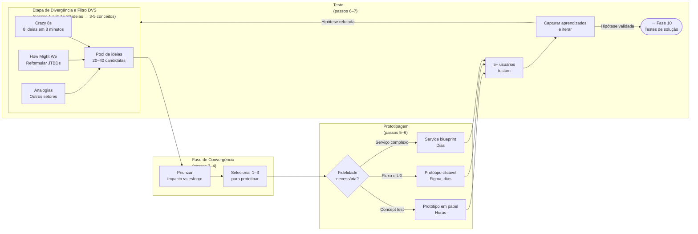

#### Passo 1, divergir com técnicas estruturadas

Não se limite ao que você imaginou. Faça sessões de brainstorm estruturadas. Sozinho ou com duas a três pessoas. Quatro técnicas úteis.

Crazy 8s (oito ideias em oito minutos, uma por minuto). Força quantidade sobre qualidade.

How Might We, "como poderíamos?". Reformule o *job to be done* em três a cinco perguntas abertas. Por exemplo: "Como poderíamos ajudar o dono de restaurante a encerrar o dia sem preocupação?"

Extremos. E se a solução fosse super-premium (R$ 5.000 por mês)? E se fosse de graça? E se fosse física? E se fosse humana (serviço)?

Analogias. Como outros setores resolvem problemas parecidos? O que o Uber ensinou sobre marketplaces pode se aplicar? O que o iFood ensinou sobre logística distribuída?

> [!tip] Meta da divergência
> Gere de 15 a 30 ideias no papel, filtre para 3 a 5 conceitos pela matriz DVS e construa 2 protótipos finalistas. A qualidade nasce da quantidade inicial.

#### Passo 2, avalie e reduza (convergir)

Avalie cada ideia em três dimensões.

Desejabilidade: o usuário quer isso? Responda com base nas evidências colhidas nas Fases 4 e 5 (descoberta e pesquisa com usuários) e nos experimentos da Fase 8.

Exequibilidade (chamada de Viabilidade técnica nesta sigla DVS): conseguimos construir e entregar com as capacidades técnicas, operacionais e regulatórias atuais? (Já a Viabilidade econômica do negócio entra no terceiro eixo, Sustentabilidade.)

Sustentabilidade. O modelo econômico fecha? Preço viável, custo viável, margem razoável.

Dê nota de um a cinco em cada dimensão. Multiplique. Selecione os três a cinco conceitos com maior pontuação.

> [!note] DVS e matriz Impacto-Esforço são complementares
> A avaliação por Desejabilidade, Viabilidade, e Sustentabilidade (DVS) é qualitativa. Útil para reduzir trinta ideias para cinco. Já a matriz impacto-esforço (aplicada no exemplo prático mais adiante) é visual. Útil para priorizar quais protótipos rodar primeiro entre os finalistas. Use as duas em sequência. Primeiro DVS para filtrar. Depois Impacto-Esforço para ordenar.

#### Passo 3, detalhe os 3 a 5 conceitos escolhidos

Para cada conceito, escreva em uma página seis itens. Nome do conceito (dê nome, facilita comunicação). Descrição em um parágrafo. Principal diferencial. Requisitos técnicos principais. Modelo de monetização imaginado. Principais riscos.

> [!note] Capítulo 1 (Vol. 2): Psicologia do Consumidor Brasileiro
> A reação do usuário ao protótipo é moldada por fatores que vão além do fluxo. O [[IGNICAO-Vol-2-Descoberta-e-Mercado#CAPÍTULO 1 — PSICOLOGIA DO CONSUMIDOR BRASILEIRO — COMPORTAMENTO, DECISÃO E CONVERSÃO|Capítulo 1: Psicologia do Consumidor Brasileiro (Vol. 2)]] cobre como o consumidor brasileiro processa proposta de valor: ancoragem de preço, mobile-first, e o peso da confiança percebida na primeira impressão. Leia antes de definir quais elementos incluir no protótipo de teste.

#### Passo 4, escolha 1 ou 2 conceitos para prototipar

Escolha os dois conceitos finalistas na matriz impacto-esforço e defina o formato do protótipo entre as seis opções abaixo:

##### Storyboard

Sequência de seis a doze quadros mostrando a pessoa usando a solução em contexto. Útil para validar o fluxo geral.

##### Wireframes em papel ou ferramenta

Wireframes (esboços de tela que mostram estrutura sem detalhes visuais) são úteis para validar arquitetura de informação.

##### Mockups de alta fidelidade

Telas desenhadas com detalhe visual. Figma ou similar.

##### Protótipo clicável

Telas com fluxo de navegação montadas no Figma ou em geradores de interface por IA (como v0, Lovable e Figma Make). Atenção em 2026: como a IA gera telas polidas em poucas horas, redobre o cuidado para não confundir aparência de produto pronto com fluxo validado; teste a jornada bruta antes de refinar visual.

##### Protótipo em vídeo

Vídeo explicando a solução como se ela existisse. Excelente para testar com público amplo.

##### Protótipo de serviço (service blueprint)

Para negócios de serviço. Mapeie touchpoints (pontos de contato entre cliente e serviço), atores, sistemas, e tempo.

> [!tip] Para a maioria dos casos no início, protótipo clicável em Figma
> > O protótipo inicial deve caber em até um dia de trabalho. Se montar um fluxo clicável exigir três dias de um designer, comece pelo protótipo em papel no primeiro dia e só passe para a tela clicável na segunda rodada.

#### Passo 5, prepare roteiro de teste de protótipo

Cinco partes na estrutura do roteiro.

Contextualização (dois minutos). Descreva a situação real em que a pessoa estaria usando.

Tarefas (quinze minutos). Dê três a cinco tarefas para a pessoa executar no protótipo. Por exemplo: "Você acabou de fechar o caixa do dia. Use essa ferramenta para checar se houve alguma divergência."

Observação silenciosa. Deixe a pessoa errar. Anote onde ela travou.

Pensar em voz alta. Peça que verbalize o que está pensando enquanto navega.

Perguntas pós-teste (dez minutos): O que ficou claro de imediato? Onde você teve dúvida? Como você resolve essa etapa hoje e quanto isso custa por mês? Quanto faria sentido pagar para resolver assim? (Feche pedindo um compromisso concreto, como agendar piloto ou assinar carta de intenção.)

> [!note] Capítulo 8 (Vol. 4): Customer Experience
> O protótipo é o primeiro contato do usuário com a experiência do produto. O [[IGNICAO-Vol-4-Tracao-e-PMF#CAPÍTULO 8 — CUSTOMER SUCCESS (CS) E CUSTOMER EXPERIENCE (CX): DA JORNADA AO CHURN ZERO E NRR POSITIVO|Capítulo 8: Customer Experience (Vol. 4)]] cobre como estruturar o onboarding (processo de ativação do novo usuário) desde o protótipo: o que o usuário precisa entender e sentir nos primeiros minutos determina retenção futura. Use os princípios de onboarding do DT para guiar quais tarefas incluir no roteiro de teste.

#### Passo 6, teste com 8 a 12 usuários do ICP e itere

Seguindo a regra clássica de Jakob Nielsen, teste com cinco usuários por rodada e rode pelo menos duas rodadas iterativas (dez sessões no total): cinco usuários já revelam a grande maioria das travas de fluxo, e a segunda rodada confirma se o ajuste funcionou.

Não espere terminar todos os testes para iterar. Depois de cada ciclo de três a quatro testes, ajuste o protótipo com base nos padrões observados e teste a nova versão com os próximos três a quatro usuários. Esse loop curto (testar, ajustar, testar de novo) entrega muito mais aprendizado que oito testes seguidos da mesma versão.

#### Passo 7, consolide no Dossiê de Solução

Documento contendo seis itens. Conceitos gerados e avaliados. Conceitos selecionados, detalhados. Protótipos (ou links). Resumo dos testes com usuários (padrões observados, problemas encontrados, verbatim). Recomendação de conceito a construir, com justificativa. Riscos e incógnitas remanescentes.

> [!tip] Estrutura do Dossiê de Solução e Canvases desta Fase
> Os seis campos acima compõem a estrutura completa do Dossiê de Solução e se conectam diretamente ao **[[#Canvas: Opportunity Canvas (Jeff Patton, 2014)|Canvas: Opportunity Canvas]]** e ao **[[#Canvas: MVP Canvas (Tristan Kromer)|Canvas: MVP Canvas]]** detalhados na seção de Canvases Visuais desta fase. Use-o para garantir que a documentação de cada conceito avaliado seja consistente entre si e comparável na tomada de decisão do Passo 4.

### Os sete passos aplicados, sessão de ideação do PadariaPro

Para tornar o método concreto, este é o desenrolar dos passos 1 a 6 aplicados à mesma ideia das fases anteriores.

O *job* central, identificado na [[IGNICAO-Vol-2-Descoberta-e-Mercado#FASE 5 — PESQUISA COM USUÁRIOS (CUSTOMER DISCOVERY)|Fase 5 (Vol. 2)]]: "Me devolver horas de foco executivo, sem aumentar o desperdício."

Crazy 8s, fragmento de oito ideias em oito minutos. App mobile para o gerente fazer pedido por voz. WhatsApp bot que pergunta o estoque diário e faz pedido automático. Dashboard web com previsão mais um clique para confirmar pedido. Etiquetas inteligentes (sensor) em sacos de farinha. Câmera no estoque com visão computacional. E-mail diário com "pedido sugerido" que requer aprovação. Integração com caixa, deduz estoque automaticamente. Parceria com fornecedor: o fornecedor envia semanalmente baseado em consumo.

Após filtrar as oito ideias pela nota DVS (descartando a 1, pedido por voz em ambiente barulhento de fornada, a 4, etiquetas RFID caras, a 5, câmeras no estoque, e a 8, comissão de fornecedor que gera conflito de interesse), os quatro conceitos finalistas entram na matriz impacto-esforço: alto impacto e baixo esforço ficam com a ideia 2 (bot no WhatsApp) e a ideia 6 (resumo diário por e-mail), que vão para prototipagem imediata; alto impacto e alto esforço ficam com a ideia 3 (painel web) e a ideia 7 (integração com PDV), guardadas para etapa posterior.

**Protótipo número 2, WhatsApp Bot (low-fi).**

Sequência de seis mensagens em PDF, simulando o diálogo bot-usuário:

> *Bot:* "Bom dia, Fábio! Segundo o seu histórico, você vai precisar de 450 kg de farinha T1 esta semana nas três lojas. Confirmar pedido com o moinho por R$ 2.250 (R$ 5,00/kg)? (sim/não/ajustar)"
>
> *Usuário:* "Ajustar para 140 kg"
>
> *Bot:* "Ok, 140 kg por R$ 2.730. Confirmar? (sim/não)"
>
> *Usuário:* "Sim"
>
> *Bot:* "Pedido enviado. Entrega quarta-feira."

**Protótipo número 6, E-mail Diário.**

Imagem de um e-mail simulado, com lista de itens sugeridos, quantidades, valores, e dois botões. "Confirmar pedido" e "Ajustar".

**Testes com cinco usuários, reação bruta.**

| Usuário | Reação ao 2 (WhatsApp) | Reação ao 6 (E-mail) | Preferência |
|---|---|---|---|
| Fábio (Campinas) | "Isso é incrível, resolveria o meu dia" | "E-mail eu ignoro" | 2 |
| João (SP) | "Bom, mas e se errar?" | "Mais formal, mais bonito" | Empate |
| Paula (SP) | "O meu gerente não vai usar WhatsApp assim" | "E-mail ninguém abre" | Nenhum |
| Roberto (RM) | "Perfeito, WhatsApp é onde a gente vive" | "Fraco" | 2 |
| Márcia (Campinas) | "Confirmar compra de R$ 2 mil pelo WhatsApp me deixa insegura" | "Mais segurança visual" | 6 |

O aprendizado principal. WhatsApp é preferido pela conveniência, mas gera ansiedade em valores altos. E-mail gera segurança visual, mas tem problema de abertura.

> [!important] O que o teste ensinou
> Talvez a solução seja híbrida. WhatsApp para o aviso diário e confirmação no navegador ou aplicativo para pedidos acima de R$ 1 mil. Não dicotomia entre os dois. Os testes raramente confirmam a hipótese binária. Geralmente revelam síntese inesperada.

### Caso brasileiro real, prototipagem na PlayKids

A PlayKids, aplicativo infantil criado dentro do grupo Movile em junho de 2013 (e integrado ao grupo internacional Sandbox & Co em 2022), construiu um aplicativo de conteúdo educativo infantil que chegou a mais de cem milhões de downloads e a presença em mais de 180 países. No início, o time precisava testar o fluxo de uso com crianças pequenas: público que não verbaliza preferência da forma que adultos fazem em entrevistas tradicionais.

Como ilustração inspirada no desenvolvimento de aplicativos infantis no Brasil (como a trajetória da PlayKids), imagine o efeito de testar em papel antes de programar: a equipe imprime as telas desenhadas e pede a crianças de quatro, seis e oito anos que toquem no papel como se fosse o tablet, observando onde travam e quais gestos fazem espontaneamente.

A descoberta foi cirúrgica. O fluxo inicial, pensado em padrão adulto (menu → categoria → item), não funcionava com crianças menores. Elas esperavam ver tudo numa tela única com imagens grandes e tocar diretamente no que queriam. O time redesenhou antes de escrever uma linha de código. Esse padrão de design por imersão visual virou marca registrada do produto e foi parte do que sustentou o crescimento internacional.

Com algumas dezenas de reais em impressões, o protótipo em papel revela falhas de navegação que custariam dezenas de milhares de reais para refazer depois do código pronto. Em produtos para públicos que não verbalizam bem (crianças, idosos, baixa escolaridade, falantes de outras línguas), observação supera entrevista.

### Critérios de saída da Fase 9

Você concluiu a Fase 9 quando todos os critérios abaixo estão cumpridos.

- [ ] Dez ou mais ideias geradas em sessão de divergência documentada (Crazy 8s, How Might We, Extremos, Analogias). Sem prender à primeira ideia.
- [ ] Avaliação DVS (Desejabilidade, Viabilidade, Sustentabilidade) aplicada em todas as ideias, e Matriz Impacto vezes Esforço aplicada nos finalistas.
- [ ] Três a cinco conceitos detalhados (nome, descrição, diferencial, requisitos técnicos, modelo de monetização, riscos).
- [ ] Dois ou mais protótipos low-fi (papel ou Figma clicável) prontos, resolvendo o job central da Fase 4: não features periféricas.
- [ ] Cinco ou mais testes documentados com usuários do ICP (idealmente oito ou mais).
- [ ] Insights qualitativos claros: padrões de uso, onde travam, onde se confundem, onde se encantam (não só "gostaram").
- [ ] Taxa de conclusão de tarefas sem ajuda acima de 70%; tempo de execução real não excede a expectativa pré-teste em mais de 50%.
- [ ] Pelo menos 4 de cada 5 usuários da rodada final concluindo a tarefa principal sem ajuda e assumindo um passo concreto de avanço (pedido de acesso ao piloto, indicação de colega do setor ou assinatura de intenção).
- [ ] Disposição a pagar coletada via "quanto faria sentido cobrar por isso?" (em vez de "você pagaria?"): 70% ou mais sugerem valor igual ou superior ao preço-alvo.
- [ ] Decisão escrita sobre qual conceito vai virar MVP, com justificativa e lista clara de essencial versus postergável.

> [!warning] Critério de saída
> Se qualquer um desses itens falha, não avance. Resolva antes.

**Primeiros passos práticos.**

1. Reservar duas horas para sessão de ideação. Crazy 8s (oito ideias em oito minutos), mais detalhamento das três melhores.
2. Prototipar em Figma ou em papel as duas a três ideias mais promissoras. Low-fi. Não perca tempo em fidelidade.
3. Agendar cinco sessões com usuários ICP, mostrando os dois ou três protótipos lado a lado, e pedindo reação.
4. Documentar reações. O que chamou atenção. O que confundiu. O que ignoraram.

### Polir pixels, discutir logotipo e desenhar telas de configuração antes de provar o fluxo central

Apegar-se à primeira ideia sem explorar alternativas (como fez a Dra. Camila ao encomendar de cara um aplicativo caro em vez de testar um fluxo simples no WhatsApp).

Prototipar com alta fidelidade cedo demais. Um protótipo bonito pode esconder problemas de fluxo. Comece em baixa fidelidade.

Testar com usuários errados. Teste com o ICP. Amigo designer dando feedback não substitui usuário real.

Ouvir opinião em vez de observar comportamento. O que importa é onde o usuário trava. Não se ele "acha bonito".

Usar o teste como confirmação. O objetivo é encontrar problemas, não receber elogios. Se ninguém achou nada errado, você fez um teste fraco.

Construir direto sem prototipar. "Já sei como vai ser." Constatação final: você descobre coisas no protótipo que não imagina na cabeça.


---

### O Espelho da Fase 9: Você Está Prototipando para Aprender ou para Receber Palmas?

**Fechando o ciclo na trincheira:** Quando a **Dra. Camila** trouxe este protocolo para a operação da clínica em Belo Horizonte, o gargalo que abriu este capítulo deixou de depender do seu heroísmo pessoal na cadeira e passou a rodar como sistema auditável pela equipe.

**O Espelho (autodiagnóstico):**
1. Você desenhou pelo menos três formas radicalmente diferentes de resolver o problema do cliente (incluindo uma sem tela nova, direto no canal onde ele já vive), ou casou com a primeira ideia?
2. Quanto tempo você gastou discutindo cores, fontes, nome das abas e telas de cadastro em comparação com o fluxo central que entrega o resultado?
3. Se um cliente olhar para o seu protótipo hoje e disser "isso aqui está confuso e não resolve meu dia", você sentiria alívio por descobrir cedo ou raiva pelo trabalho perdido?

**Permissão Libertadora:**
Você está autorizado a fazer protótipos feios, em preto e branco, desenhados no papel ou em blocos cinzas sem logotipo. Beleza prematura esconde falhas estruturais.

**O Ritual de Segunda-Feira às 9h:**
Pegue uma folha A4, dobre em oito partes (*Crazy 8s*) e desenhe em oito minutos oito maneiras diferentes de entregar o resultado ao cliente, sendo uma delas obrigatoriamente sem aplicativo próprio. Até quarta-feira, mostre os dois esboços mais simples a dois clientes reais, anote onde travaram e, na segunda-feira seguinte, descarte o pior.

---

### MÉTRICAS E BENCHMARKS DESTA FASE (FASE 9)

| Métrica | O que medir | Referência saudável |
|---|---|---|
| Variantes de solução testadas | Quantas ideias de solução avaliadas antes de escolher | ≥ 5 (Crazy 8s) |
| Fidelidade do protótipo | Nível de acabamento necessário para validar hipótese | Mínimo que responde à pergunta |
| Custo do protótipo | Tempo e recursos investidos antes de teste | Semanas, não meses |
| Feedback coletado | Usuários que testaram o protótipo | ≥ 5 por iteração |

---

### Manual passo a passo dos frameworks de experimentação desta fase

> [!tip] Uso autocontido neste volume
> > Os frameworks abaixo detalham as ferramentas de ideação, priorização e prototipagem desta **Fase 9**, com origem, mecânica, passo a passo e armadilhas.

#### Framework: Opportunity Solution Tree (Teresa Torres)

##### De onde vem a ferramenta (e por que sobreviveu ao filtro do tempo)

Teresa Torres desenvolveu OST ao longo dos anos 2010s, consolidando em *Continuous Discovery Habits*. Inspirada em work breakdown structures e em árvores de decisão, adaptada para discovery de produto.

##### A mecânica central (sem jargão)

Ferramenta visual em formato de árvore que conecta:

- Outcome desejado (topo).
- Oportunidades (*opportunities*): necessidades e dores reais do cliente que, quando resolvidas, movem o resultado desejado (*outcome*).
- Solutions (ideias de como endereçar cada oportunidade).
- Experiments (como testar cada solução).

##### As regras do jogo

```text
 OUTCOME
 |
 ----------------------------------------
 | | | |
├─ OPORTUNIDADE 1 (dor no pedido)   ├─ OPORTUNIDADE 2 (perda no estoque)   └─ OPORTUNIDADE 3 (falta de histórico)
 | | |
 --- --- ---
 | | |
SOLUTION A SOLUTION B SOLUTION C
 | | |
EXPERIMENT EXPERIMENT EXPERIMENT
```

Princípios-chave:

- Oportunidades vêm de pesquisa com clientes, não de brainstorm interno.
- Múltiplas soluções por oportunidade: força comparação.
- Priorização por impacto no outcome, não por "ideia mais legal".
- Experimentos vêm antes de execução completa.

##### Como rodar na segunda-feira às 9h com seu time

1. Defina um resultado de negócio mensurável (*outcome*) antes de abrir a geração de ideias.

Passo 2: Colete oportunidades via entrevistas com clientes (não speculation).

Passo 3: Para cada oportunidade, gere 3-5 soluções.

Passo 4: Priorize oportunidades por impacto potencial no outcome.

Passo 5: Para oportunidade top, priorize solução com melhor risk/reward.

Passo 6: Desenhe experimento mais rápido/barato para testar premissas.

Passo 7: Atualize árvore com aprendizados.

##### Na trincheira real: como isso funciona na prática

Árvore de Oportunidades (OST) para o PadariaPro com o resultado desejado "reduzir a perda de farinha e insumos críticos em 30% nas padarias-piloto":

- Oportunidade 1: clientes não descobrem features avançadas (NRR impactado por baixo engagement).
- Solução 1.1: tutorial contextual.
- Solução 1.2: emails de ativação segmentados.
- Solução 1.3: AI-recommended features.
- Experimento prioritário: A/B test de 1.2 (mais simples, menor risco).

- Oportunidade 2: preços dos upgrades desconhecidos.
- Solução 2.1: página de pricing na app.
- Solução 2.2: in-app prompts para upgrade.
- Experimento: 2.1 primeiro.

- Oportunidade 3: contato com CS só na crise (não expansion).
- Solução 3.1: QBRs proativos.
- Solução 3.2: health score + outreach.
- Experimento: 3.2.

##### Onde o papel aceita tudo (armadilhas de execução)

- Confundir oportunidade com funcionalidade: oportunidade é a dor ou necessidade do cliente; funcionalidade é apenas uma solução possível.
- Deixar a árvore estática: não atualizar os ramos após novas entrevistas e testes de protótipo.
- Montar a árvore de trás para a frente: encaixar oportunidades artificiais apenas para justificar uma solução já decidida pela diretoria.

---

#### Framework: Google Design Sprint (Jake Knapp, 2016)

##### De onde vem a ferramenta (e por que sobreviveu ao filtro do tempo)

Jake Knapp desenvolveu o Design Sprint no Google Ventures (GV) entre 2012-2016, aplicando em dezenas de startups do portfolio. *Sprint: How to Solve Big Problems and Test New Ideas in Just Five Days* (Knapp, Zeratsky & Kowitz, 2016) consolidou o método publicamente. Virou padrão em product discovery global.

##### A mecânica central (sem jargão)

**Processo de 5 dias** para ir de problema a solução testada. Cada dia tem atividades específicas:

- Segunda: entender o problema (mapear, expert interviews).
- Terça: gerar ideias (sketch individual).
- Quarta: decidir (votação estruturada, storyboard).
- Quinta: prototipar.
- Sexta: testar com 5 usuários reais.

Resultado: aprendizado rápido sobre direção promissora ou má.

##### As regras do jogo

Participantes: time de 5-7 pessoas (decisor, facilitador, designer, engineer, PM, outros especialistas).

Time boxed: 5 dias, não mais. Evita over-engineering.

Foco: 1 problema grande, não roadmap geral.

Método estruturado: atividades pré-definidas, minimiza discussão improdutiva.

##### Como rodar na segunda-feira às 9h com seu time

Segunda-feira: map do problema, long-term goal, sprint questions, 3-5 expert interviews, "How might we" notes, target definido.

Terça-feira: lightning demos (inspiração), sketch individual (4 etapas: notes, ideas, crazy 8s, solution sketch).

Quarta-feira: heatmap de sketches, speed critique, voto, supervote do decisor, storyboard.

Quinta-feira: prototype (facade, 10 horas). Pode ser Figma clicável, Keynote, ou realmente HTML/CSS.

Sexta-feira: testes com 5 usuários (entrevistas de 60 min, think-aloud).

##### Na trincheira real: como isso funciona na prática

Sprint em fintech early-stage para feature de "análise de gastos":

Segunda: define problema (usuários abandonam app após ver extrato sem aprendizados). Sprint question: "faremos o insight tão útil que users voltam diariamente?"

Terça: sketches individuais com ideias variadas (categorização automática, comparação com média, alertas, gráficos, AI suggestions).

Quarta: storyboard escolhido: categorização + comparação com pares + alerta de anomalia.

Quinta: prototype clicável em Figma, 8 telas.

Sexta: 5 entrevistas. Resultado: categorização adorada, comparação com pares gera desconforto, alerta útil mas intrusivo.

Decisão: lançar MVP com categorização, testar comparação com UI opcional, iterar em alerta.

##### Onde o papel aceita tudo (armadilhas de execução)

- Estender o sprint para duas ou três semanas: perde o foco e arrasta as decisões.
- Rodar sem o decisor na sala: sem o voto de desempate (*supervote*), o grupo trava ou vê a decisão ser desfeita na semana seguinte.
- Pular o teste de sexta-feira com cinco usuários reais: termina a semana com um protótipo bonito, mas sem nenhuma evidência de uso.

---

#### Framework: Design Thinking Double Diamond (British Design Council, 2005)

##### De onde vem a ferramenta (e por que sobreviveu ao filtro do tempo)

O Design Thinking tem raízes na Stanford d.school (David Kelley) e na consultoria IDEO (fundada em 1991). Já o **Double Diamond** (Diamante Duplo) foi formalizado pelo British Design Council em 2005, adaptando a dinâmica de divergência e convergência proposta por Béla Bánáthy (1996) em quatro etapas: descobrir, definir, desenvolver e entregar.

##### A mecânica central (sem jargão)

Processo de design em 4 fases, visualizado como dois diamantes:

Diamante 1, Discover → Define (o problema certo)

- Discover (abrir): pesquisa ampla, empatia, observação.
- Define (fechar): sintetizar, definir problema específico a resolver.

Diamante 2, Develop → Deliver (a solução certa)

- Develop (abrir): gerar muitas soluções possíveis.
- Deliver (fechar): selecionar, prototipar, testar.

Princípio-chave: **divergir antes de convergir** em cada diamante.

##### As regras do jogo

3 lentes de IDEO:

- Desirability: pessoas querem?
- Viability: negócio fecha?
- Feasibility: conseguimos construir?

Solução boa está na interseção.

As 4 etapas do Diamante Duplo (e sua correspondência com as 5 etapas da d.school de Stanford):

1. Empathize (empatizar).
2. Define (definir problema).
3. Ideate (ideias).
4. Prototype.
5. Test.

##### Como rodar na segunda-feira às 9h com seu time

Passo 1: Empathize: pesquisa profunda com usuários (pode ser 2-6 semanas).

Passo 2: Define: sintetize em "point of view" statement, "[Usuário] precisa [necessidade] porque [insight]".

Passo 3: Ideate: brainstorm extenso, "crazy 8s", "worst possible idea", outras técnicas.

Passo 4: Prototype: baixa fidelidade, rápido e descartável.

Passo 5: Test: com usuários reais, iterate.

##### Na trincheira real: como isso funciona na prática

Aplicação ilustrativa em redesenho de atendimento ao cliente (inspirada em projetos clássicos como o programa *Keep the Change*, desenhado pela IDEO para o Bank of America):

- Empathize: shadowing de clientes e representantes por semanas.
- Define: "Clientes com problema urgente precisam de solução rápida porque estresse amplifica frustração."
- Ideate: 50+ ideias, app priorizando urgentes, chat humano proativo, "salas" para casos complexos, etc.
- Prototype: 5 protótipos de baixa fidelidade.
- Test: 15 usuários, refina para 2 conceitos, itera.

##### Onde o papel aceita tudo (armadilhas de execução)

Pular a etapa de empatia leva o time direto para a ideação e resolve o problema errado. Idear sem divergência real faz o grupo convergir cedo demais na opinião do fundador mais vocal. Prototipar em alta fidelidade cedo demais desperdiça trabalho que a próxima rodada vai descartar. Testar com quem não é usuário real produz retorno enganoso.

---

#### Framework: Impact Mapping (Gojko Adzic, 2012)

##### De onde vem a ferramenta (e por que sobreviveu ao filtro do tempo)

Gojko Adzic, consultor de software e autor de *Specification by Example*, publicou *Impact Mapping* em 2012 como resposta a um problema recorrente em desenvolvimento de produto: times que entregam features corretas em projetos errados. O framework surgiu da observação de que equipes de tecnologia frequentemente perdem a conexão entre o trabalho diário (stories, tasks) e os objetivos de negócio reais. Impact Mapping foi adotado amplamente em contextos ágeis, especialmente em ambientes onde stakeholders múltiplos têm visões diferentes sobre prioridade. Combina planejamento estratégico com design de produto numa ferramenta visual simples.

##### A mecânica central (sem jargão)

Mapa mental hierárquico de quatro níveis que responde a quatro perguntas encadeadas: **Por quê** (o objetivo de negócio que justifica o trabalho), **Quem** (os atores, usuários, clientes, parceiros, que influenciam ou são impactados pelo objetivo), **Como** (os comportamentos ou impactos que cada ator precisa ter ou mudar para contribuir com o objetivo), **O quê** (as entregas, features, conteúdos, integrações, que produzem cada impacto). A estrutura força a equipe a rastrear cada entrega até um comportamento de ator real e um objetivo de negócio real.

##### As regras do jogo

Impact Mapping é construído colaborativamente em sessão com product manager, stakeholders de negócio e representantes técnicos. O mapa é deliberadamente incompleto: lista as apostas de impacto mais relevantes, não todas as possibilidades. O impacto (nível "Como") é o coração do framework: é onde a maioria dos roadmaps falha, pulando direto de objetivo para feature sem mapear qual comportamento do usuário a feature deve mudar. Revisão do mapa a cada ciclo de planejamento revela hipóteses validadas vs. falsificadas.

##### Como rodar na segunda-feira às 9h com seu time

Passo 1: Definir o objetivo em formato SMART com prazo e métrica (ex. "aumentar conversão de trial para pago de 8% para 15% em 90 dias"). Passo 2: Listar todos os atores relevantes, quem pode contribuir para ou contra esse objetivo? (usuário trial, equipe de CS, parceiro de integração, etc.) Passo 3: Para cada ator, mapear os impactos, que comportamento do ator contribuiria para o objetivo? (ex. "usuário trial completa onboarding em menos de 10 min") Passo 4: Para cada impacto, listar as entregas que podem produzi-lo, features, conteúdo, automação. Passo 5: Priorizar: quais entregas têm maior probabilidade de produzir o impacto com menor esforço? Passo 6: Usar mapa como critério de aceite, uma feature que não aparece no mapa ou não está conectada a um impacto real não entra no sprint.

Exemplo aplicado, startup de RH tech (SaaS para PMEs). Objetivo: "aumentar DAU de 200 para 500 em 60 dias." Atores: gerente de RH (decisor de uso), funcionário (usuário do portal), time de CS (intermediário). Impactos para gerente: "acessa relatório de ponto sem ligar para CS", gera entrega "relatório de ponto one-click". Impactos para funcionário: "marca ponto pelo celular sem login complexo", gera entrega "login biométrico". CS: "resolve dúvida sem escalar para produto", gera entrega "base de conhecimento interna". O mapa revelou que dois recursos de alta prioridade no backlog (painel de análise preditiva, integração com TOTVS) não estavam conectados a nenhum impacto no DAU: foram despriorizados.

##### Onde o papel aceita tudo (armadilhas de execução)

(1) Confundir impacto com entrega: "construir dashboard" é entrega, não impacto. Impacto é "gerente toma decisão de contratação com base em dados do dashboard." (2) Objetivos vagos, "melhorar engajamento" não é objetivo, é direção. Objetivo requer métrica e prazo. (3) Mapa muito grande, um Impact Map útil tem 1 objetivo, 3-7 atores, 2-5 impactos por ator. Se tiver mais, está descrevendo todo o produto, não uma sessão de planejamento. (4) Não revisitar, mapa criado em planejamento trimestral e nunca mais olhado não orienta nada. (5) Atores apenas externos, time de vendas, CS, suporte são atores internos que frequentemente têm impactos críticos.

---

#### Framework: Kano Model (Noriaki Kano, 1984)

##### De onde vem a ferramenta (e por que sobreviveu ao filtro do tempo)

Noriaki Kano, professor da Tokyo University of Science, publicou o modelo em 1984 dentro da escola japonesa de gestão da qualidade. A tese central é simples: nem todas as funcionalidades pesam igual na percepção do cliente; algumas são obrigatórias (básicas), outras aumentam a satisfação proporcionalmente (desempenho), outras encantam (atrativas) e outras são indiferentes. Hoje é padrão em product management.

##### A mecânica central (sem jargão)

Framework que classifica features em **5 categorias** baseado em impacto na satisfação do cliente:

1. Basic (must-haves): cliente não nota quando presente, frustra quando ausente. Ex.: senha funcionando em login.

2. Performance (one-dimensional): mais é melhor, satisfação cresce linearmente com presença. Ex.: velocidade do app.

3. Excitement (delighters): cliente não espera, quando presente, cria entusiasmo. Pode virar basic com tempo (ex.: câmera de ré em carros era excitement em 2010, hoje é basic).

4. Indifferent: cliente não se importa, esforço desperdiçado.

5. Reverse: mais piora. Ex.: muitas notificações podem diminuir satisfação.

##### As regras do jogo

Pesquisa Kano: questionário de dupla formulação para cada feature:

- "Como você se sentiria SE o produto TIVESSE feature X?"
- "Como você se sentiria SE o produto NÃO TIVESSE feature X?"

Respostas (Kano 5-point scale): "Eu gostaria", "É esperado", "Neutro", "Posso aceitar", "Eu não gostaria".

Cruzar respostas gera classificação.

##### Como rodar na segunda-feira às 9h com seu time

Passo 1: Liste 10-20 features candidatas.

Passo 2: Pesquisa com 100+ respondentes do ICP.

Passo 3: Classifique cada feature.

Passo 4: Priorize:

- Basic: obrigatório. Resolver.
- Performance: investir proporcionalmente ao valor.
- Excitement: 1-2 delighters diferencia, mais dilui foco.
- Indifferent: não construir.
- Reverse: evitar ou ser opcional.

Passo 5: Re-classifique periodicamente: excitement de hoje é basic de amanhã (ratchet effect).

##### Na trincheira real: como isso funciona na prática

Kano survey para SaaS financeiro, 15 features candidatas:

- Login seguro com 2FA: **Basic** (obrigatório).
- Dashboard rápido (< 2s): **Performance** (importante).
- Integração com bancos: **Basic** em SaaS financeiro brasileiro (espera-se).
- AI que sugere categorização automática: **Excitement**.
- Relatório de fluxo de caixa: **Performance**.
- Integração com Zapier: **Indifferent**.
- Notificações por email diárias: **Reverse** (muitos responderam "não gostaria").
- Previsão de receita com IA: **Excitement**.
- Dark mode: **Indifferent** (neste ICP, pode ser diferente em outros).

Ação roadmap: basics são gates (sem eles, sem cliente), performance é competição linear, 1-2 excitement para diferenciar (AI categorização), cortar indifferent (Zapier), redesenhar reverse (notificações com controle).

##### Onde o papel aceita tudo (armadilhas de execução)

Pesquisa com ICP errado: respondentes não target classificam features diferente, Todos features viram "Performance": sinal de amostra pequena ou questionário ruim, Construir "Excitement" sem os "Basics": produto encanta mas falha no básico, morre, Não re-classificar: excitement vira basic, produto estagna.

---

#### Framework: Story Mapping (Jeff Patton, 2014)

##### De onde vem a ferramenta (e por que sobreviveu ao filtro do tempo)

Jeff Patton, consultor e escritor de agile, popularizou Story Mapping em artigo de 2005 e no livro *User Story Mapping* (2014). Criado como resposta a uma frustração com product backlogs planos (listas lineares de features): não mostram jornada do usuário, não priorizam por liberação de valor, não facilitam conversas entre product e engenharia. Story Mapping organiza trabalho por jornada, não por ordem.

##### A mecânica central (sem jargão)

Representação visual bidimensional do produto: **eixo horizontal** é a jornada do usuário (atividades sequenciais que ele precisa fazer), **eixo vertical** é a profundidade de cada atividade (de essencial a avançado). As features do produto organizadas nessa grade. Na base, **releases horizontais**: primeira liberação corta uma faixa horizontal atravessando toda a jornada (MVP end-to-end), segunda liberação aprofunda funcionalidades, e assim por diante.

##### As regras do jogo

Produto não se entrega por features, entrega-se por jornadas de usuário completas. MVP horizontal (thin slice através de toda a jornada) entrega valor real ao usuário, features isoladas verticalmente não entregam valor até a jornada completa estar funcional. Conversa em volta do mapa produz alinhamento entre stakeholders que backlog linear nunca produz.

##### Como rodar na segunda-feira às 9h com seu time

Passo 1: mapear a jornada do usuário horizontalmente com post-its (ou equivalente digital em Miro/FigJam), cada post-it é uma "atividade de alto nível" que o usuário precisa fazer. Passo 2: para cada atividade, listar as "tarefas" concretas que a constituem. Passo 3: para cada tarefa, listar as "user stories" específicas em profundidade. Passo 4: desenhar linhas horizontais cortando o mapa, cada linha é um release. Primeiro release (MVP) corta o mínimo em cada coluna que ainda entrega jornada completa. Releases posteriores aprofundam.

Exemplo aplicado: a loja D2C de kits de autocuidado de Rafael e Bia. Jornada horizontal da cliente: *Descobrir o kit → Escolher o perfil de pele → Fechar pedido → Pagar no Pix ou cartão → Receber aviso de envio → Abrir a caixa em casa*. Profundidade vertical na coluna "Fechar pedido": no MVP horizontal entram apenas cadastro em uma tela, endereço único e Pix/cartão (a cliente completa a compra inteira sem travar); na segunda versão entram múltiplos endereços e escolha de transportadora; na terceira, assinatura recorrente com troca de itens e embalagem para presente.

##### Onde o papel aceita tudo (armadilhas de execução)

(1) Confundir com fluxograma, Story Map não é sobre lógica de fluxo (if-then), é sobre jornada do usuário. (2) Release vertical em vez de horizontal, "primeiro vamos fazer todo o checkout, depois todo o pagamento", isso entrega features, não jornadas. (3) Mapear sem ter pesquisa com usuário, Story Map baseado em hipótese sobre jornada é frequentemente errado, conecte antes com as entrevistas de *Customer Development* e de *Jobs to Be Done* (Fases 4 e 5) ou JTBD Interview (Framework: Jobs to Be Done Switch Interviews (Bob Moesta & Chris Spiek, via Clayton Christensen) (Fase 5)) antes. (4) Mapa grande demais, mais que 20-30 atividades horizontais vira ilegível, decomponha em mapas por persona ou por jornada principal vs auxiliar.

---

### CANVASES VISUAIS DESTA FASE (COM EXEMPLOS BRASILEIROS PREENCHIDOS)

#### Canvas: Opportunity Canvas (Jeff Patton, 2014)

##### Por que este quadro visual foi criado

Jeff Patton, autor de *User Story Mapping* (2014) e referência em product management ágil, criou o Opportunity Canvas como ferramenta para times de produto avaliarem se uma oportunidade vale a pena ser perseguida **antes** de comprometer roadmap. A motivação foi observação prática: PMs e times técnicos pulavam direto da ideia ("vamos construir feature X") para a especificação ("aqui está o PRD"), sem articular *por que* essa oportunidade deveria ser priorizada sobre todas as outras. O Opportunity Canvas força a explicitar a tese da oportunidade, quem ganha o quê, com que custo, contra qual alternativa, em uma página visual antes que se gaste tempo construindo.

##### A anatomia visual de uma página

Tela visual de uma página com **nove blocos** organizados em torno da pergunta central "vale a pena perseguir esta oportunidade?":

- **Problems / Solutions** (lado esquerdo): qual é o problema; qual é a solução proposta?
- **Users & Customers**: quem usa; quem paga (em B2B podem ser distintos)?
- **Solutions Today**: como o problema é resolvido hoje (concorrentes, workarounds, status quo)?
- **User Value**: que benefício tangível o usuário ganha?
- **Business Problems**: qual problema *do negócio* essa oportunidade resolve (retenção, aquisição, monetização)?
- **Adoption Strategy**: como vamos fazer o usuário descobrir e adotar?
- **Metrics**: quais números medem que está funcionando?
- **Budget**: quanto vamos investir antes de re-avaliar?

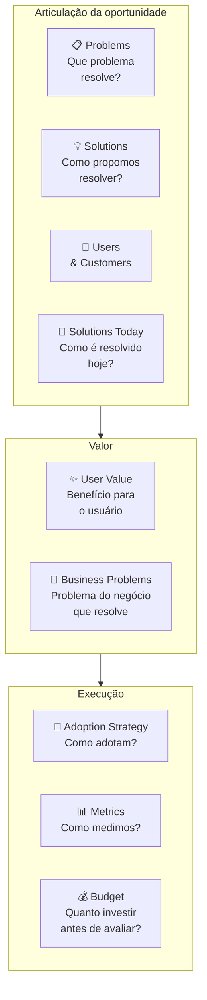

##### O momento exato de colocar este canvas na parede

Use o Opportunity Canvas nesta Fase 9 (antes de abrir a geração de ideias do Passo 1) e durante os ciclos de descoberta contínua pós-PMF. É a ferramenta certa para responder "vale a pena construir essa feature/produto/oportunidade adjacente?" antes de comprometer um trimestre de roadmap. Também use em comitês de priorização: comparar três Opportunity Canvases lado a lado é mais informativo que comparar três PRDs longos.

##### As regras de ouro para preencher sem se enganar

A tese de Patton é que **decisão de roadmap é decisão de capital**: cada feature construída custa o custo de oportunidade da feature não construída. O Opportunity Canvas força articular *o trade-off* explicitamente. Diferente do BMC (que descreve o negócio inteiro) e do Lean Canvas (que descreve um modelo a validar), o Opportunity Canvas descreve **uma aposta específica de produto** e pode coexistir com vários outros: cada funcionalidade construída consome o tempo e o orçamento de outra que ficou de fora, razão pela qual decidir o roadmap é alocar capital escasso.

##### Passo a passo na parede da sala

Reúna os sócios e, se houver, quem apoia no design ou na operação (duas a três pessoas bastam no estágio inicial; a dinâmica para squads com gerente de produto e líder técnico fica para o Vol. 7). Separe 60 a 90 minutos e leve as anotações das entrevistas da Fase 5 e os cartões de teste da Fase 8. Preencha primeiro os blocos de problemas e usuários; só depois discuta soluções, para evitar o viés de defender a primeira tela que vocês já queriam construir.

1. **Problems**: descreva o problema sem mencionar a solução. "Usuário tipo X sofre com Y em contexto Z."
2. **Users & Customers**: quem especificamente. Em B2B, distinguir usuário (quem mexe), comprador (quem paga), influenciador (quem decide).
3. **Solutions Today**: como o problema é resolvido hoje? Excel, processo manual, concorrente, "não fazer nada". Liste 3-5 alternativas com prós/contras.
4. **User Value**: o que o usuário ganha que hoje não tem? Específico e mensurável.
5. **Business Problems**: que problema do negócio (retenção, aquisição, monetização, expansion) essa oportunidade endereça?
6. **Solutions**: agora sim, descreva o que vai construir.
7. **Adoption Strategy**: como o usuário descobre, experimenta, adota? In-app, email, CSM, marketing pago?
8. **Metrics**: 2-3 métricas leading + 1 lagging. Se não consegue definir, oportunidade está mal articulada.
9. **Budget**: quanto vai investir (pessoas × tempo + custo de aquisição) antes de reavaliar? Sem budget, Opportunity Canvas vira fantasia.

Tempo total: 60-90 minutos por canvas. Faça antes de comprometer roadmap, não depois.

##### Exemplo brasileiro preenchido (reconstrução hipotética): plataforma de criadores testando checkout enxuto no link da bio (inspirada no mercado brasileiro; o app real Hotmart Sparkle focava em comunidades, e números como R$ 1,5 milhão são apenas ilustrativos)

Em 2022, a Hotmart já dominava infoprodutos médios e grandes (creators que vendiam cursos de R$ 300+ a milhares de alunos). Identificou uma oportunidade adjacente: **microcreators**: pessoas com audiência pequena (1-5k seguidores) que queriam monetizar conteúdo curto e barato (R$ 9-49 por item). O Opportunity Canvas dessa aposta:

| Bloco | Conteúdo |
|---|---|
| **Problems** | Microcreators têm audiência pequena mas engajada e querem monetizar, mas o setup atual da Hotmart (criar curso completo com landing page, hospedar conteúdo, configurar afiliados) é overkill para conteúdo de 30-90 minutos a R$ 19. |
| **Users & Customers** | Usuário e cliente são a mesma pessoa: microcreator brasileiro com 1-5k seguidores no Instagram/TikTok, audiência engajada, já tem conteúdo gravado mas não no formato curso. |
| **Solutions Today** | (1) Vender via DM no Instagram com Pix, alta fricção, sem rastreamento. (2) Plataformas estrangeiras (Gumroad), barreiras de Pix/pagamento BR. (3) Não monetizar: "perder" a audiência. |
| **User Value** | Setup de produto digital em 5 minutos (vs 1-2h da plataforma principal). Pagamento via Pix integrado. Link de venda direto pra bio do Instagram. Sem necessidade de criar landing, configurar funil, integrar afiliados. |
| **Business Problems** | (1) Aquisição: capturar a base de microcreators que ainda não usa Hotmart e que daqui a 3-5 anos pode virar creator médio. (2) Diversificação: reduzir dependência de "top 1000 creators". (3) Defesa de mercado: bloquear entrada de Gumroad/Stan/Ko-fi no Brasil. |
| **Solutions** | "Hotmart Sparkle": fluxo simplificado de criação (3 telas), template de venda mobile-first, pagamento Pix nativo, link de bio gerado automaticamente, sem afiliados/cupons (corte deliberado). |
| **Adoption Strategy** | Indicação de creators existentes (microcreators são frequentemente fans/alunos de creators médios), parcerias com agências de microinfluência, conteúdo orgânico no Instagram da Hotmart focado nesse perfil. |
| **Metrics** | Leading: número de microcreators ativando produto/mês, GMV médio por microcreator, conversão de visitante em comprador no link de bio. Lagging: % de microcreators que migram para a plataforma principal em 12 meses. |
| **Budget** | 1 squad (5 pessoas) por 6 meses para MVP + 4 meses de aquisição inicial = ~R$ 1.5M. Reavaliar em 10 meses: se GMV mensal não chegar a R$ 2M ou 5k microcreators ativos, descontinuar. |

O bloco mais valioso aqui é o **Business Problems** explícito: articula que essa oportunidade não é "feature legal", é resposta a três problemas estratégicos da Hotmart (aquisição de creators emergentes, diversificação de dependência, defesa de mercado). Sem essa articulação, "Hotmart Sparkle" pareceria projeto secundário; com ela, fica claro por que merece squad dedicado. O canvas obriga a separar oportunidade de produto de oportunidade de negócio: funcionalidade que não resolve um problema concreto do negócio raramente sobrevive ao corte do roadmap.

##### Variações e extensões

- **Lean UX Canvas** (Jeff Gothelf): variação focada em times UX-driven, com bloco de hipóteses explícito.
- **Product Discovery Canvas** (Roman Pichler): variação para PMs em ambientes ágeis, com ênfase em assumptions e experimentos.
- **Now/Next/Later Roadmap**: complementa o Opportunity Canvas, uma vez que a oportunidade vale a pena, onde no roadmap ela entra?

##### Onde os fundadores mentem para si mesmos neste canvas

- Pular Problems & Users e ir direto para Solutions: viés de "já sei o que construir" mascara perguntas críticas.
- Articular User Value em features ("vamos ter um botão de X") em vez de benefícios ("o usuário consegue Y em Z minutos vs hoje em W horas").
- Esquecer Business Problems: oportunidade que ajuda só o usuário sem resolver problema do negócio é caridade, não estratégia.
- Definir Metrics só lagging (GMV, retenção D90) sem leading: leva 3-6 meses para saber se está funcionando.
- Não definir Budget de saída: oportunidade roda indefinidamente sem reavaliação, consumindo time.

---

#### Canvas: MVP Canvas (Tristan Kromer)

##### Por que este quadro visual foi criado

O MVP Canvas apresentado a seguir sintetiza a tradição de validação enxuta de Eric Ries (*The Lean Startup*, 2011) e os quadros práticos de escopo difundidos por treinadores ágeis como Tristan Kromer (*Grasshopper Herder*) e, no Brasil, por Paulo Caroli (*Lean Inception*, que organiza o alinhamento do MVP em personas, jornadas, funcionalidades, resultado esperado, métricas, custo e cronograma). O objetivo é impedir que o time construa um MVP sem antes cravar qual hipótese está testando, para qual recorte de usuários iniciais e com qual régua de decisão.

##### A anatomia visual de uma página

Tela visual de uma página com **sete blocos** distribuídos em torno da pergunta central "o que estamos aprendendo com este MVP?":

- **Hipótese central**: a crença que o MVP testa, escrita como falsificável.
- **Segmento de usuário do MVP**: não o cliente final do produto, mas o cliente específico que validará *essa hipótese* (pode ser subconjunto menor).
- **Proposta de valor do MVP**: o que o usuário ganha com o MVP, pode ser diferente do produto final.
- **Canais de recrutamento**: como vamos chegar nos usuários deste MVP.
- **Critério de sucesso**: o que precisamos ver para considerar a hipótese validada.
- **Critério de invalidação**: o que precisamos ver para considerar a hipótese refutada.
- **Tipo de MVP**: qual experimento, landing page, concierge, wizard of oz, protótipo clicável, pré-venda, fake door.

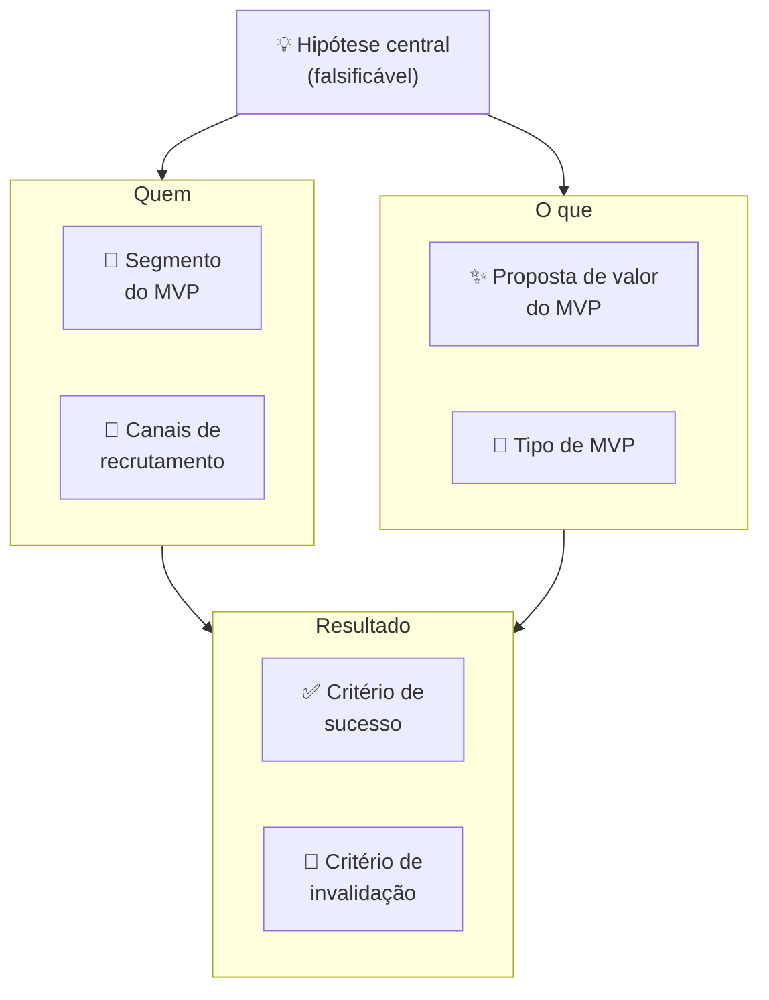

##### O momento exato de colocar este canvas na parede

Use o MVP Canvas na Fase 8 (prototipagem e MVP) como artefato de entrada: antes de qualquer construção. Para cada MVP que o time planeja lançar, preencha o canvas em 30-45 minutos com as pessoas envolvidas. Em times pós-PMF com discovery contínuo, MVP Canvas precede qualquer sprint de desenvolvimento de feature nova: cada feature experimentada como "MVP de aprendizado" antes de virar permanente.

##### As regras de ouro para preencher sem se enganar

A tese de Kromer é que **"MVP" sem hipótese explícita é só produto incompleto**. A maioria dos times chama de MVP qualquer versão inicial do produto, mas "versão inicial" sem hipótese não ensina nada: você lança, alguns usuários gostam, outros não, e o time não sabe o que isso significa. MVP Canvas faz a pergunta que a maioria evita: "Qual crença específica este MVP vai testar? E quando sabemos que foi refutada?" Sem essa resposta, o MVP nunca "falha": ele simplesmente não tem critério de aprendizado.

##### Passo a passo na parede da sala

Reúna PM + tech lead + designer + fundador. Tempo: 30-45 minutos. **Sequência de preenchimento:**

1. **Hipótese central**: escreva primeiro, antes de falar sobre o MVP em si. "Acredito que [usuário Y] vai [fazer X] por causa de [razão Z]." Teste: a hipótese pode ser refutada? Se não, reescreva.
2. **Segmento do MVP**: quem especificamente vai testar esta hipótese? Pode ser 20 pessoas, não 20.000. Quanto mais estreito o segmento, mais limpa a evidência.
3. **Proposta de valor do MVP**, o que o usuário ganha hoje com esta versão? Não o que o produto promete no futuro, o que o MVP entrega agora.
4. **Canais de recrutamento**: como vai encontrar essas pessoas? "Nossos clientes" é vago; "os 20 donos de padaria entrevistados na Fase 5, acionados diretamente pelo WhatsApp do fundador" é um canal concreto.
5. **Tipo de MVP**: qual é o formato do experimento? Não construa código se um protótipo clicável testa a mesma hipótese em 1/10 do tempo.
6. **Critério de sucesso**: define antes. Número específico.
7. **Critério de invalidação**: define antes. Zona de incerteza entre sucesso e invalidação = inconclusivo.

Após preencher, faça a pergunta de Kromer: "Se o MVP falhar pelo critério de invalidação, o que construímos a seguir?" Se a resposta for "pivotamos para X", o MVP está bem definido. Se a resposta for "não sabemos", a hipótese precisa ser mais específica.

##### Exemplo brasileiro preenchido (simulação didática com métricas hipotéticas): Wildlife Studios, MVP de novo mecanismo de monetização

A Wildlife Studios, fundada em São Paulo e um dos maiores estúdios de jogos para celular do mundo, testou em 2022 um novo mecanismo de monetização para seu jogo *Sniper 3D*: *season passes* (passes de temporada com recompensas progressivas e transparentes), em substituição a caixas de recompensa aleatórias (*loot boxes*, modalidade que no Brasil passou a sofrer vedação legal em jogos acessíveis a crianças e adolescentes com o ECA Digital, Lei 15.211/2025). O MVP Canvas:

| Bloco | Conteúdo |
|---|---|
| **Hipótese central** | Jogadores de Sniper 3D que compraram ao menos 1 item nos últimos 90 dias pagarão R$ 15 por season pass se perceberem progressão visual clara de recompensas ao longo de 30 dias. |
| **Segmento do MVP** | Cohort de 50.000 jogadores "moderate spenders" (1-3 compras/trimestre, ARPU R$ 18/mês) em mercado brasileiro. Excluídas as duas pontas, free-to-play puro e heavy spenders, para isolar o segmento mais sensível à proposta. |
| **Proposta de valor do MVP** | 30 recompensas progressivas (visuais, skins, boosters) por R$ 15: previsibilidade de valor vs. loteria de loot box. |
| **Canais de recrutamento** | In-game banner para o cohort selecionado + push notification personalizada no D1 do teste. Sem anúncio externo: experimento contido na base existente. |
| **Tipo de MVP** | Feature real implementada no jogo para o cohort (não protótipo): o investimento de desenvolvimento era pequeno o suficiente para ser justificado pela potencial monetização. |
| **Critério de sucesso** | ≥12% de conversão do cohort (compra do season pass) nos primeiros 7 dias. ARPU do cohort ≥ R$ 22 em 30 dias (vs. R$ 18 baseline). |
| **Critério de invalidação** | < 6% de conversão em 7 dias OU ARPU < R$ 16 em 30 dias = hipótese refutada. Considerar alternativas de monetização ou repricing. |

**Resultado:** 17% de conversão em D7 (acima do critério de sucesso). ARPU do cohort subiu para R$ 24 em 30 dias. Decisão: Persevere, expandir season pass para todos os usuários ativos + outros jogos do portfólio.

O MVP Canvas forçou a Wildlife a definir o segmento com precisão: testar nos dois extremos (free-to-play puro e heavy spenders) contaminaria o resultado (FTP não compra nada; heavy spenders compram tudo, inclusive o que não funciona). A limpeza do cohort produziu evidência acionável: a proposta funciona para *moderate spenders*, que é exatamente o segmento de maior potencial de upgrade. **A lição: o trabalho mais importante do MVP Canvas é definir quem NÃO entra no experimento: não apenas quem entra.**

##### Variações e extensões

- **Adaptação para experimentos de Concierge e Mágico de Oz**: quando o MVP ainda é operado manualmente pelos fundadores nos bastidores (para 10 a 20 primeiros clientes), acrescente ao canvas um bloco com o roteiro passo a passo da operação manual e o tempo gasto por entrega.
- **Wizard of Oz Canvas**: variação onde o backend é falso (humano operando). Canvas adiciona bloco "O que o usuário vê" vs. "O que realmente acontece" para mapear a ilusão deliberada.
- **Sprint Goal Canvas** (adaptação ágil): integra MVP Canvas com sprint planning, cada sprint tem um canvas de hipótese + critério.

##### Onde os fundadores mentem para si mesmos neste canvas

- Chamar de "MVP" qualquer versão incompleta do produto: MVP sem hipótese é produto inacabado, não experimento.
- Segmento do MVP = segmento total do mercado: dilui o sinal; o experimento não produz evidência limpa.
- Tipo de MVP mais caro que o necessário: se landing page testa a hipótese, não construa produto; se protótipo clicável testa, não escreva código.
- Não definir critério de invalidação: MVP "sempre aprende algo", nunca "falha"; loop de aprendizado não fecha.
- Usar MVP Canvas para justificar construção que já foi decidida: canvas como teatro, não como ferramenta de decisão.

---

### Templates operacionais e casos preenchidos desta fase (OST, User Story Map e estrutura do Dossiê de Solução do Passo 7)

#### Template: Diagrama de Opportunity Solution Tree (Teresa Torres) — exemplo em SaaS brasileiro

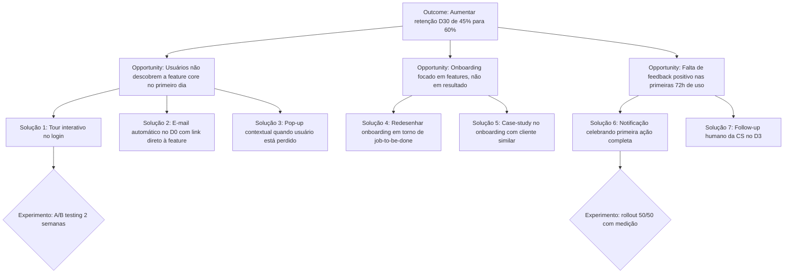

**Uso:** o topo da árvore é o outcome desejado (métrica mensurável). Opportunities são hipóteses sobre o que, se resolvido, moveria o outcome. As soluções (*solutions*) são ideias concretas para resolver cada oportunidade, e abaixo delas entram os experimentos específicos que testam as premissas de cada solução (como nos ramos do PadariaPro). A disciplina é nunca pular direto de outcome para solution, sempre explicitar qual opportunity a solução tenta endereçar.

---

#### Template: Story Map exemplo — MVP de app de entrega regional

Horizontal (jornada): cliente *Descobre* → *Seleciona loja* → *Escolhe produtos* → *Paga* → *Acompanha* → *Recebe*

| Atividade | Essencial (Release 1) | Intermediário (Release 2) | Avançado (Release 3) |
|---|---|---|---|
| Descobre | Busca por CEP | Ordenação por distância | Recomendação personalizada |
| Seleciona loja | Lista com foto e nota média | Filtro por categoria | Favoritos e histórico |
| Escolhe produtos | Cardápio simples, uma foto por item | Variações (tamanho, sabor) | Personalização detalhada, combos |
| Paga (e confirma no WhatsApp, onde o paciente já vive, como viu a Dra. Camila) | Pix nativo (meio mais usado e barato no Brasil) + confirmação via WhatsApp | Cartão de crédito via gateway + carteira digital | Cashback, cupons e parcelamento |
| Acompanha | Status em texto (recebido, em preparo, saindo) | Mapa em tempo real | Chat com entregador |
| Recebe | Confirmação por SMS | Avaliação da entrega | Foto do produto na entrega |

**Insight:** Release 1 corta horizontalmente a jornada inteira, cliente consegue fazer todo o fluxo, mesmo que limitado. Release 1 é MVP de verdade. A tentação de começar por "release vertical" (construir todo o módulo de pagamento primeiro) é erro clássico: não entrega valor completo até o último release.

---

### Fechamento da Fase 9: o que muda na sua cabeça e na sua empresa a partir de agora

Em Belo Horizonte, a Dra. Camila escapou do **Cemitério dos Protótipos Perfeitos** quando desistiu de encomendar telas polidas por semanas e testou, numa única tarde, um vídeo simulado de 15 segundos no WhatsApp com nove pacientes de reabilitação oral e três recepcionistas de clínicas parceiras. A reação imediata separou o que era vaidade estética do que realmente destravava o retorno do paciente, cabendo num dossiê enxuto de duas páginas para entrar na Fase 10. É isso que muda na sua cabeça ao sair da Fase 9: protótipo não é maquete para receber elogio, mas isca descartável para capturar o erro barato antes de escrever uma linha de código.

Esse dossiê é o insumo da [[#FASE 10 — TESTES DE SOLUÇÃO E USABILIDADE|Fase 10]], onde o conceito escolhido passa por testes de usabilidade estruturados e se converte em Especificação do MVP. Quem chega à Fase 10 sem ter explorado alternativas e sem ter testado protótipo entra na especificação com hipótese implícita não testada. Isso aumenta a chance de retrabalho radical na [[IGNICAO-Vol-4-Tracao-e-PMF#FASE 11 — MVP E EXPERIMENTOS DE MERCADO|Fase 11 (Vol. 4)]].

---

## FASE 10 — TESTES DE SOLUÇÃO E USABILIDADE

### A Guilhotina de Escopo e o Silêncio Constrangedor do Teste de Usabilidade

"Não, não! Não clica aí ainda, deixa eu te explicar essa tela!", exclamou Lucas, quase puxando o mouse da mão do gerente financeiro durante a sessão de usabilidade em São Paulo.

Sentada ao lado com um bloco de notas, Marina segurou o braço do sócio por baixo da mesa e murmurou:

– "Lucas, fica quieto. Quando o cliente estiver sozinho no escritório dele às oito da noite, você não vai sair de dentro do monitor para explicar onde fica o botão de importar extrato."

Nos cinco minutos seguintes de silêncio absoluto, Lucas assistiu à cena mais dolorosa e mais educativa da vida de qualquer criador de produto: o usuário tentou clicar em um título que não era link, procurou um botão de ajuda que não existia, suspirou fundo e fechou a aba. Nenhuma reunião interna de quatro horas teria ensinado o que aqueles cinco minutos de silêncio revelaram.

Mas o segundo golpe veio à tarde, quando Lucas abriu o backlog para planejar o lançamento do MVP e listou 47 funcionalidades "indispensáveis": incluindo modo escuro, permissões em quatro níveis hierárquicos, exportação em PDF customizável e painel de administração. Marina puxou a caneta vermelha e aplicou a **Guilhotina de Escopo**:

"Se o cliente consegue importar o extrato e enxergar a previsão de caixa de amanhã, ele já recebe 90% do valor. Modo escuro, troca de senha automática e painel de administração vão para a lixeira agora. Nosso produto mínimo terá três telas e entra no ar na próxima terça-feira", cravou Marina.

Ao longo desta fase, veremos esse corte na prática em dois momentos: no Passo 5 (MoSCoW), em que a Guilhotina de Escopo reduz a planilha de 47 itens de Lucas às 3 telas essenciais (importação de OFX/extrato, conciliação de boletos duplicados e projeção de caixa de 30 dias, jogando permissões multinível, PDF customizável e modo escuro para *Won't Have*), e no Espelho de fechamento, quando Lucas aprende a tirar a mão do mouse enquanto o cliente testa o fluxo sozinho.

O que mais atrasa um lançamento é o perfeccionismo: a tentação de incluir "só mais uma funcionalidade" na lista para adiar o dia em que o mercado real julga o produto.

---

### Por que especificar e cortar o escopo antes de construir (dos 47 itens de Lucas aos 5 essenciais)

Protótipos testam fluxo e conceito. Mas não testam valor real em uso prolongado. Esta fase aprofunda o teste de solução e converte aprendizado em requisitos. Sem especificação clara antes de construir, você gasta mais, demora mais, e entrega menos.

### Os oito passos da Fase 10: do teste de usabilidade com 5 usuários em silêncio à Guilhotina de Escopo no MoSCoW

Oito passos.

#### Passo 1, conduza entrevistas de solução

Diferente da entrevista de problema ([[IGNICAO-Vol-2-Descoberta-e-Mercado#FASE 4 — DESCOBERTA DO PROBLEMA|Fase 4 (Vol. 2)]]), aqui você mostra o protótipo e pergunta ao usuário seis coisas, de forma estruturada. Se a solução resolve o problema dele. Como ela se compara com o que ele usa hoje. (1) se a solução resolve o problema dele; (2) como ela se compara ao que ele usa hoje; (3) quanto faria sentido cobrar; (4) de quais funcionalidades ele sente falta e quais acha supérfluas; (5) em que momento da rotina ele usaria; e (6) o que o impediria de adotar.

Faça dez a quinze dessas entrevistas. Grave, transcreva, analise.

> [!tip] Canvases Visuais: Empathy Map (Fase 4)
> Após cada rodada de testes de solução e usabilidade, consulte a ficha completa do [[IGNICAO-Vol-2-Descoberta-e-Mercado#Canvas: Empathy Map (Dave Gray / XPLANE, 2009)|Mapa de Empatia de Dave Gray (Vol. 2)]] para consolidar em uma página as seis áreas observadas na sessão (o que o usuário diz, faz, pensa e sente, somados às dores/atritos de tela e aos ganhos esperados). Essa síntese pós-teste alinha rapidamente os sócios sobre onde o fluxo travou sem duplicar a ficha metodológica do Volume 2.

#### Passo 2, aplique a técnica das cinco escalas de valor

Para cada entrevistado, peça avaliação em escala de um a cinco em cinco dimensões: Relevância ("isso resolve um problema real?"), Urgência ("você precisaria disso nos próximos trinta dias?"), Preferência ("prefere ao que usa hoje?"), Diferenciação ("percebe como diferente das alternativas?") e Disposição a pagar (de 1, não pagaria nada, a 5, pagaria mais do que gasta hoje para contornar o problema; o valor em reais entra no Van Westendorp do Passo 4). Calcule a média e o desvio-padrão de cada escala.

> [!warning] Urgência abaixo de três é alerta vermelho
> Se a Urgência média ficar abaixo de três, o problema existe mas não é prioridade. Você terá dificuldade de vender. Não é "ainda preciso polir o pitch". O diagnóstico correto é que o problema ainda não dói o bastante para justificar a troca: volte à Fase 4 (Descoberta do Problema, no Vol. 2) e refaça a medição de severidade com os *Pain Levels*.

#### Passo 3, faça o teste de cinco segundos (five second test)

Mostre o protótipo ou a página principal por cinco segundos, e tire. Depois pergunte três coisas. O que você entendeu? Para quem é? Qual problema resolve?

Se menos de 70% dos testados acertam as três respostas de primeira, o seu posicionamento está confuso, e isso vai inflar o seu CAC (custo de aquisição de cliente) quando a campanha começar.

> [!note] Capítulo 1 (Vol. 2): Psicologia do Consumidor Brasileiro
> As respostas nas entrevistas de solução são influenciadas por como a pergunta é feita e em que contexto. O [[IGNICAO-Vol-2-Descoberta-e-Mercado#CAPÍTULO 1 — PSICOLOGIA DO CONSUMIDOR BRASILEIRO — COMPORTAMENTO, DECISÃO E CONVERSÃO|Capítulo 1: Psicologia do Consumidor Brasileiro (Vol. 2)]] detalha vieses de resposta específicos do consumidor brasileiro, incluindo tendência de superestimar intenção de uso e subestimar sensibilidade a preço, que distorcem as escalas de valor se não forem antecipados.

#### Passo 4, teste de precificação (price sensitivity, Van Westendorp)

Pergunte quatro coisas, nessa ordem.

Em que preço você começaria a achar muito barato? A ponto de desconfiar da qualidade.

Em que preço você começaria a achar barato? Bom negócio.

Em que preço você começaria a achar caro? Mas ainda consideraria.

Em que preço você começaria a achar caro demais? Não consideraria.

Plote as quatro curvas acumuladas (com apenas 15 a 20 respostas, trate os números apenas como pista qualitativa inicial, pois a amostra é pequena para estabilidade estatística). No método de Van Westendorp, o cruzamento entre "barato" e "caro" aponta um único ponto (o preço de indiferença), enquanto a faixa de preço aceitável vai do cruzamento de "muito barato" com "não barato" (preço marginalmente barato) até o cruzamento de "muito caro" com "não caro" (preço marginalmente caro).

> [!tip] Van Westendorp é ponto de partida, não resposta final
> Essa não é a precificação ideal. Mas é um ponto de partida muito melhor do que chutar. Preço real será descoberto em mercado.

> [!tip] Capítulo 6 (Vol. 4): Pricing Strategy
> Van Westendorp revela a faixa psicológica aceitável, mas não informa o modelo de precificação (assinatura, cobrança por uso, por licença, freemium) nem a estratégia de âncora. O [[IGNICAO-Vol-4-Tracao-e-PMF#CAPÍTULO 6 — PRICING STRATEGY E ECONOMIA DA RECORRÊNCIA (SUBSCRIPTION ECONOMY)|Capítulo 6: Pricing Strategy (Vol. 4)]] complementa este passo com os modelos de precificação aplicáveis ao estágio de MVP, a lógica de teste Gabor-Granger para granularidade maior, e os erros mais comuns de precificação em lançamento: incluindo o de começar com preço que não é possível aumentar depois.

> [!tip] Product discovery moderno é insumo recomendado para times com PM/designer/eng
> Para times com PM, designer e engenharia separados, quatro práticas contemporâneas de produto merecem incorporação gradual (descoberta contínua e Árvore de Oportunidades, de Teresa Torres; descoberta e entrega em trilhas paralelas, de Marty Cagan e Jeff Patton; e, na escrita de requisitos de entrega, o critério INVEST de Bill Wake, 2003): **Continuous discovery** (entrevistas semanais com clientes em paralelo com desenvolvimento, não fases separadas), **Opportunity Solution Tree** (conectar outcome, oportunidades, soluções, experimentos em árvore antes de priorizar features), **Dual-track agile** (Discovery e Delivery rodando em paralelo, não em sprints alternados), e **User stories INVEST** (Independent, Negotiable, Valuable, Estimable, Small, Testable, com acceptance criteria explícito que torna "pronto" auditável). Para fundadores solo ou pre-seed, são opcionais: ganham relevância quando o time passa de cinco a sete pessoas. Detalhamento e quando aplicar cada prática nos Capítulo 4 (Vol. 7) (Engineering Management, Developer Experience e Gestão de Dívida Técnica) (Technical Debt: implicações de dívida das decisões de MoSCoW) e Frameworks da Fase 17 (Discovery & Product, com tratamento operacional dos quatro frameworks).

#### Passo 5, mapeie requisitos por ordem de prioridade (MoSCoW)

A priorização MoSCoW para escopo de MVP, em estrutura visual:

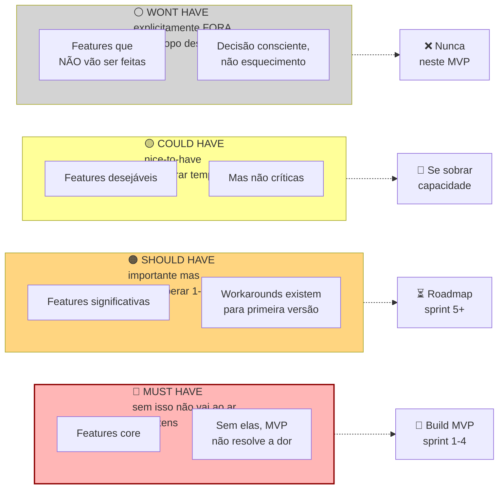

A tentação é inflar Must Have para vinte ou trinta itens. MVP com vinte Must Haves não é MVP. É produto mínimo *impossível*.

Classifique cada requisito funcional numa das quatro colunas do diagrama acima aplicando a **Guilhotina de Escopo**: **Must Have** (sem isso o cliente não resolve a dor central; entra obrigatoriamente no MVP), **Should Have** (importante, mas a operação roda sem ele nas primeiras semanas; fica para as sprints 1 e 2 pós-MVP), **Could Have** (desejável se sobrar capacidade após validar o básico) e **Won't Have** (cortado explicitamente desta versão para proteger o prazo de lançamento).

> [!important] Regra dura do MoSCoW
> Um MVP com mais de dez a quinze Must Haves não é MVP. É produto inflado. Se a sua lista passa de quinze, você não dominou o problema ainda. Volte e corte.

#### Passo 6, escreva a Especificação do MVP

Documento contendo dez itens.

(1) Proposta de valor final em uma frase; (2) Persona foco (*beachhead*); (3) Principais tarefas (*JTBDs*) a resolver; (4) Lista enxuta de *Must Haves* (até 10 itens); (5) Lista de *Should* e *Could Haves* (próximos ciclos); (6) O que o MVP explicitamente *não* fará (*Won't Haves*); (7) Critérios numéricos de sucesso do MVP; (8) Faixa de preço testada; (9) Canais de aquisição iniciais; e (10) Prazo de desenvolvimento e orçamento máximo combinados.

> [!tip] Templates Operacionais: Template da Especificação do MVP (Template da Fase 10)
> O [[#Template: Especificação de MVP|Template: Especificação de MVP]] contém o template preenchível da Especificação do MVP com os dez campos acima, mais seção de riscos remanescentes e suposições ainda não validadas. Usar o template em vez de documento livre garante que nenhum campo crítico (Won't Haves, critério de sucesso mensurável) seja omitido por pressão de entrar logo em desenvolvimento.

#### Passo 7, aplique o Gate de Direcionalidade

Antes de avançar para a [[IGNICAO-Vol-4-Tracao-e-PMF#FASE 11 — MVP E EXPERIMENTOS DE MERCADO|Fase 11 (Vol. 4)]] e gastar tempo e dinheiro construindo o MVP, responda em voz alta, para um interlocutor externo (cofundador, mentor, advisor), a seguinte pergunta.

> [!important] A pergunta do gate
> A solução que estamos prestes a construir reduz ou elimina, de forma direta e mensurável, a dor que identificamos na beachhead?

Os três elementos da frase importam, e cada um é um teste por si só.

Reduz ou elimina. Não é "ajuda com", "apoia", "melhora a experiência de". Uma solução que não cruza essa barreira não justifica adoção, nem pagamento. Se você se vê usando verbos fracos para descrever o impacto, provavelmente está vendendo melhoria incremental onde o cliente precisa de ruptura.

De forma direta. A cadeia causal entre usar o produto e sentir a dor diminuir precisa ser curta e óbvia. Se a redução da dor depende de o cliente também mudar comportamento, também treinar a equipe, também integrar com outros sistemas que ele ainda não tem, a cadeia é longa demais para um MVP ganhar adoção.

De forma mensurável. O cliente precisa conseguir medir a redução. Em horas, reais, erros evitados, conversões geradas. Redução "sentida" mas não medida é indistinguível de placebo. E não financia renovação de contrato.

> [!warning] Se algum dos três elementos travar, não avance
> Volte ao Passo 6 (Especificação do MVP) e corte features que não contribuem diretamente para a redução da dor principal. Um MVP que resolve uma dor com direcionalidade clara supera consistentemente um MVP que resolve várias dores com direcionalidade difusa.

#### Passo 8, aplique o Scale Readiness Check

Esse checklist complementa o gate de direcionalidade. Enquanto o gate pergunta "a solução é a certa?", a **Checagem de Prontidão para Construir** (*Build Readiness Check*) pergunta "você tem as condições operacionais, quem paga e de qual verba sai o orçamento para construir com segurança?". Os cinco itens precisam ser todos verdadeiros antes da [[IGNICAO-Vol-4-Tracao-e-PMF#FASE 11 — MVP E EXPERIMENTOS DE MERCADO|Fase 11 (Vol. 4)]] começar com intensidade de build.

- [ ] **Um comprador claramente definido.** Você tem nome, cargo, e empresa (ou perfil nomeado no caso B2C) do primeiro comprador. Não "pequenos negócios". Uma lista concreta de cinco a dez pessoas que você saberia chamar hoje para uma demo.
- [ ] **Um workflow doloroso identificado.** Você observou, não só ouviu, o workflow atual. Sabe onde o cliente trava, quantos minutos por semana ele gasta na gambiarra, e quem mais na organização é afetado.
- [ ] **Titularidade de orçamento clara.** Você sabe quem no fluxo comprador autoriza o gasto, de qual rubrica sai o dinheiro, e em que ordem de grandeza (R$ por mês ou por licença). Se a resposta é "a gente descobre depois", você ainda não tem clareza orçamentária suficiente para escalar.
- [ ] **Urgência observável.** Não declarada em entrevista. *Observável em comportamento*. O cliente já está pagando algo hoje para mitigar (mesmo que precariamente), já tentou resolver sozinho, ou tem prazo externo (regulatório, contratual, competitivo) que aperta.
- [ ] **Consciência de que escalar suposições amplifica ineficiência.** Você lista por escrito quais suposições ainda não foram validadas, e se comprometeu a validá-las na [[IGNICAO-Vol-4-Tracao-e-PMF#FASE 11 — MVP E EXPERIMENTOS DE MERCADO|Fase 11 (Vol. 4)]] sem construir por cima delas. Ignorar essa etapa transforma dívida de suposição em dívida de produto, e cria retrabalho caro.

> [!warning] Se algum dos cinco itens não pode ser marcado, não avance em ritmo de produção
> Fique nesta Fase 10 em modo de investigação (ou volte à Fase 9 se precisar redesenhar o protótipo) até fechar o item pendente. Escalar desenvolvimento com suposições não testadas é como colocar mais combustível em um carro que ainda não se sabe se tem direção funcionando. Você só vai chegar mais rápido no lugar errado.

### Roteiro prático de teste de usabilidade do PadariaPro (protótipo híbrido de WhatsApp e web)

**Briefing ao usuário (cinco minutos).**

> "Oi, [Nome]. Hoje vou te mostrar uma versão não finalizada de uma ferramenta. Quero que você tente usá-la como se fosse a sua rotina, e fale em voz alta tudo que está pensando. Não tem resposta certa. Se você se perder, ótimo. É isso que a gente precisa saber. Posso gravar a tela?"

**Tarefa 1, onboarding inicial (dez minutos).**

> "Você acabou de receber a indicação do PadariaPro. Cadastre a sua padaria e adicione o seu primeiro fornecedor (Anaconda)."

Friction points observados em cinco usuários. Quatro de cinco travaram em "Inserir CNPJ", porque o sistema exigiu formato específico sem indicar. Três de cinco não entenderam o que "vincular fornecedor" significava na tela. Cinco de cinco pularam o campo "Inserir cardápio". Acharam irrelevante para onboarding.

**Tarefa 2, confirmar pedido via WhatsApp (oito minutos).**

> "Chegou uma mensagem do PadariaPro no seu WhatsApp com sugestão de pedido. Confirme."

Observações. Cinco de cinco confirmaram sem problema via "sim". Dois de cinco tentaram "ajustar" e ficaram confusos quando o bot pediu nova quantidade. Não estava claro se era em quilos ou em sacos. Quatro de cinco elogiaram a fluidez.

**Tarefa 3, ajustar pedido recorrente (dez minutos).**

> "Você percebeu que a sua padaria está desperdiçando farinha integral. Ajuste o pedido recorrente para pedir vinte por cento a menos."

Friction points. Cinco de cinco demoraram mais de três minutos para encontrar a configuração. Três de cinco desistiram, e disseram "eu pediria pelo WhatsApp direto". O insight: configurações devem poder ser feitas pelo WhatsApp também. Não só pela web.

**Síntese pós-cinco testes.**

Must-have para ativação. Onboarding em menos de cinco minutos (hoje leva doze a vinte). CNPJ com máscara. Explicação de fornecedor. Pular cardápio opcional.

Funcionalidade crítica a simplificar. Ajuste de pedido recorrente. Mover para WhatsApp com comando natural.

Descarte. Seção "cardápio" não é essencial para MVP. Cortar.

Iteração prioritária. Simplificar onboarding para três passos. CNPJ, depois primeiro fornecedor, depois primeiro pedido teste.

### Caso brasileiro real, Gupy e empresas-piloto

Em 2015, a Gupy nascia da ideia de Mariana Dias, Bruna Guimarães, Guilherme Dias e Robson Ventura de substituir processos tradicionais de recrutamento por uma plataforma que usasse dados e IA para triagem.

Antes de abrir a venda para todos, fizeram piloto com poucas empresas: como ilustração de validação enxuta no recrutamento corporativo (inspirada nos primeiros passos de plataformas brasileiras de RH como a Gupy), cinco a oito empresas parceiras usaram o fluxo essencial com acompanhamento semanal da equipe de produto, medindo o tempo de fechamento de vaga antes e depois do teste.

O resultado foi composto. As iterações cruas, baseadas em uso real, calibraram a plataforma antes do go-to-market geral. As empresas-piloto viraram primeiros cases. Depois evangelistas. Depois canal de referência. A Gupy se tornaria, anos depois, uma das maiores plataformas de recrutamento da América Latina.

Piloto estruturado com poucas empresas gera aprendizados cem vezes mais úteis que lançamento aberto sem foco. E os primeiros pilotos viram, se bem cuidados, os primeiros vendedores da sua empresa.

### Especificação enxuta do MVP congelada e aprovada por usuários reais sem ajuda do fundador

Você concluiu a Fase 10 quando todos os critérios abaixo estão cumpridos.

- [ ] Protótipo de média fidelidade clicável (Figma, Webflow, Framer) com fluxos principais navegáveis.
- [ ] Três a cinco tarefas-chave de teste definidas, com critério de conclusão.
- [ ] Dez ou mais entrevistas de solução ou sessões de teste com think-aloud, com cinco dimensões avaliadas (Relevância, Urgência, Preferência, Diferenciação, Disposição a pagar). Urgência média ≥ 3 e Preferência ≥ 4 usadas apenas como filtro exploratório inicial, acompanhadas obrigatoriamente de compromisso comportamental concreto (pré-venda paga, carta de intenção assinada ou sinal financeiro para o piloto).
- [ ] Taxa de entendimento no teste de cinco segundos ≥70% (o que entendeu, para quem é, qual problema resolve).
- [ ] Faixa de preço aceitável definida por Van Westendorp, com limite superior identificado.
- [ ] Número de Must Haves enxuto: até 10 itens (alerta amarelo entre 11 e 15; acima de 15, pare e passe a Guilhotina de Escopo novamente).
- [ ] Friction points documentados por tarefa e por usuário em matriz.
- [ ] Pelo menos uma iteração do protótipo baseada nos testes.
- [ ] Teste de precificação Van Westendorp aplicado, faixa de preço psicologicamente aceitável definida.
- [ ] Especificação do MVP (Template: Especificação de MVP (Fase 10)) escrita com todos os dez campos, MoSCoW com cinco a quinze Must Haves.
- [ ] Gate de Direcionalidade aprovado: a solução reduz ou elimina, de forma direta e mensurável, a dor identificada na beachhead.
- [ ] Scale Readiness Check com cinco itens marcados (comprador definido, workflow doloroso, titularidade de orçamento, urgência observável, suposições não validadas listadas).

> [!warning] Critério de saída
> Se qualquer um desses itens falha, não avance. Especialmente o Gate de Direcionalidade e o Scale Readiness Check. Avançar para a construção no código deixando itens críticos em aberto quase sempre cobra o preço depois em semanas de retrabalho pesado de engenharia.

**Primeiros passos práticos.**

1. Escolher a solução vencedora da [[#FASE 9 — IDEAÇÃO E PROTOTIPAGEM DE SOLUÇÕES|Fase 9]], e refinar em Figma clicável (ou Webflow ou Framer, se web).
2. Escrever três a cinco tarefas concretas que um usuário novo tentaria fazer (por exemplo, "faça um pedido de farinha para a próxima semana").
3. Agendar cinco sessões de teste de usabilidade de quarenta e cinco minutos cada.
4. Pedir think-aloud. "Fale em voz alta tudo que está pensando enquanto tenta a tarefa." Observar. Não guiar.

### Guiar o usuário durante o teste (em vez de perguntar "o que você faria se eu não estivesse aqui?") e deixar o MVP inchar

Bloat de escopo. Sem disciplina, o MVP cresce. Para cada Must Have, pergunte: "se eu tirasse isso, o produto ainda resolveria o *job* principal?". Se sim, não é Must.

Confiar em "eu pagaria". A resposta é sempre mais generosa na entrevista do que na carteira. Trate com desconto de cinquenta a setenta por cento.

Ignorar quem não usaria. Quando um entrevistado diz "não é para mim", isso é informação. Pergunte por quê. Às vezes revela que o seu ICP está mal definido.

Especificar sem mensuração. "O MVP deve ser intuitivo." O que é intuitivo? Operacionalize em métricas testáveis.

Achar que o gráfico de Van Westendorp já fechou o preço definitivo: a pesquisa aponta apenas a faixa aceitável para o lançamento, mas o preço real só se confirma na Fase 11, quando o cliente emite o Pix ou passa o cartão.


---

### O Espelho da Fase 10: O que no seu backlog vai para a Guilhotina de Escopo hoje?

**Fechando o ciclo na trincheira:** Quando **Lucas e Marina** aplicaram as travas deste capítulo na rotina entre São Paulo e Florianópolis, a tensão da cena de abertura deixou de ser discussão subjetiva de corredores e virou regra clara de priorização, retenção e proteção de caixa.

**O Espelho (autodiagnóstico):**
1. Nos seus testes de protótipo, você consegue ficar calado observando o usuário errar, ou você interrompe para "explicar o conceito"?
2. Quantos itens da sua lista de "essenciais para o lançamento" são, na verdade, muletas psicológicas para você adiar o medo de colocar o produto na rua?
3. Um usuário novo consegue chegar ao primeiro resultado real do seu produto (*Aha! Moment*) em menos de cinco minutos sem treinamento?

**Permissão Libertadora:**
Você está autorizado a lançar sem tela automática de "esqueci minha senha", sem painel administrativo bonito, sem modo escuro e sem configuração de perfil. Use o fluxo pronto de recuperação de senha que o seu serviço de autenticação já entrega por padrão e não gaste uma hora construindo painel administrativo próprio ou tela de perfil antes de validar o produto.

**O Ritual de Segunda-Feira às 9h:**
Toda segunda-feira, passe a **Guilhotina de Escopo** nos itens que tentaram entrar no backlog durante a semana: aplique a pergunta *"sem isso, o cliente ainda resolve a dor número um?"* e, para cada novo item aceito como Must Have, rebaixe obrigatoriamente outro item para a lista de "Só Depois dos Primeiros 20 Clientes Pagantes".

---

### MÉTRICAS E BENCHMARKS DESTA FASE (FASE 10)

| Métrica | O que medir | Referência saudável |
|---|---|---|
| Task completion rate | % dos usuários que completam tarefa-chave no protótipo | ≥ 70% |
| Erros de usabilidade críticos | Erros que bloqueiam uso | 0 antes de seguir |
| SUS (System Usability Scale) | Score de usabilidade padronizado | ≥ 68 (acima da média) |
| Desejabilidade | % que diz "compraria" ou "usaria" | ≥ 60% do segmento-alvo |
| Compromisso real pós-teste | Piloto pago, pré-venda ou carta de intenção assinada ao fim da sessão | ≥ 30% dos testados no ICP |

---

### Manual passo a passo dos frameworks de experimentação desta fase

> [!tip] Uso autocontido neste volume
> Todos os frameworks abaixo estão detalhados integralmente com origem, estrutura, passo a passo de aplicação, exemplo brasileiro e armadilhas para execução imediata nesta **Fase 10**.

#### Framework: Usability Testing (Jakob Nielsen & Don Norman, anos 1990)

##### De onde vem a ferramenta (e por que sobreviveu ao filtro do tempo)

Jakob Nielsen e Don Norman fundaram a Nielsen Norman Group em 1998, após Nielsen popularizar testes de usabilidade via "discount usability engineering" nos anos 1990. A prática remonta antes (Xerox PARC nos anos 1970, Apple no desenvolvimento do Macintosh), mas Nielsen formalizou como método estruturado replicável. Steve Krug (*Don't Make Me Think*, 2000) popularizou versões simplificadas para times sem pesquisador dedicado.

##### A mecânica central (sem jargão)

Método de avaliação em que usuários representativos **tentam completar tarefas** em um produto enquanto pesquisadores **observam** as dificuldades encontradas. Foco em identificar problemas de usabilidade, não em validar ideia de negócio.

##### As regras do jogo

**5 usuários bastam?** Nielsen (2000) argumenta que 5 usuários identificam ~85% dos problemas de usabilidade, depois, retorno diminui drasticamente. Debate acadêmico continua (alguns contestam), mas para contextos de startup early-stage, 5-8 usuários por rodada é pragmático.

Tipos:

- Moderated: pesquisador presente, conduz sessão (in-person ou remota). Rico, caro.
- Unmoderated: ferramentas como UserTesting.com, Maze. Escala, menos profundo.
- Formative (formativo): durante design, rápido, iterativo.
- Summative (somativo): ao fim de ciclo, avalia atingimento de metas.

##### Como rodar na segunda-feira às 9h com seu time

1. Defina tarefas operacionais concretas em vez de pedir impressões vagas: peça "emita a sua primeira nota fiscal", que funciona como teste real, e nunca "veja se você gosta do aplicativo", que não testa nada.

Passo 2: Recrute representativos. Usuários que parecem ICP, não colegas.

Passo 3: Roteiro de 45-60 min com 4-6 tarefas.

Passo 4: Think-aloud protocol (Framework: Think-Aloud Protocol (K. Anders Ericsson & Herbert Simon, 1984) (Fase 10)): usuário verbaliza pensamento enquanto faz.

Passo 5: Observe + não ajude. Tentador dar dica, resiste. Ajudar destrói o teste.

Passo 6: Documente tudo: gravação, notas, screenshots.

Passo 7: Analise por severidade: problema que bloqueia vs. problema estético.

Passo 8: Priorize fix: alto-impacto + alto-frequência primeiro.

##### Na trincheira real: como isso funciona na prática

A segunda rodada de testes de Lucas e Marina no sistema de caixa e conciliação para PMEs, conduzida em silêncio com cinco gerentes financeiros logo após o corte das 47 funcionalidades para três telas (na qual trocaram o jargão "Categorizar" por "Classificar" para destravar a importação do extrato):

Tarefas:

1. Criar cadastro (0-5 min esperado).
2. Importar primeira transação do extrato bancário.
3. Categorizar 5 transações.
4. Gerar relatório mensal.
5. Exportar para contador.

Problemas identificados (5 sessões):

- 5/5 usuários hesitaram em "Categorizar", termo confuso, preferem "Classificar".
- 4/5 tentaram importar extrato antes de cadastrar empresa, fluxo força ordem não natural.
- 3/5 perderam-se ao buscar onde gerar relatório (ícone inadequado).
- 2/5 desistiram de exportar para contador.

Prioridades: renomear "Categorizar", permitir importação antes de cadastro (salvando onboarding), melhorar ícone de relatório.

##### Onde o papel aceita tudo (armadilhas de execução)

- Testar com colegas ou amigos: o retorno fica superficial e enviesado pela simpatia.
- Guiar o usuário durante a sessão ("aqui você clicaria..."): invalida a observação de usabilidade.
- Dar tarefa vaga ("explore o aplicativo"): não reproduz um objetivo real de uso.
- Medir apenas opinião ("você gostou?"): esconde onde o usuário travou.
- Listar problemas e não iterar o protótipo antes da rodada seguinte.
- Tratar amostra de 5 pessoas como estatística fechada: cinco sessões revelam travas qualitativas de fluxo, não taxas de mercado.

---

#### Framework: Heuristic Evaluation (Jakob Nielsen e Rolf Molich, 1990; 10 heurísticas refinadas em 1994)

##### De onde vem a ferramenta (e por que sobreviveu ao filtro do tempo)

O método de heuristic evaluation foi co-desenvolvido por Jakob Nielsen e Rolf Molich em 1990, formalizado no paper "Heuristic evaluation of user interfaces" (Proc. ACM CHI'90). Em 1994, Nielsen publicou "Enhancing the explanatory power of usability heuristics" (CHI'94) com a versão refinada das 10 heurísticas, derivadas de factor analysis de 249 problemas de usabilidade reais: versão que permanece em uso desde então. As heurísticas são princípios gerais, não regras rígidas. Base da avaliação heurística: especialistas comparam interface contra princípios consolidados e identificam violações.

##### A mecânica central (sem jargão)

Método de avaliação em que 3-5 especialistas em UX avaliam interface **independentemente** contra lista de heurísticas consolidadas, identificando violações. Complementa (não substitui) testes com usuários reais, mas é rápido e barato para triagem inicial.

##### Princípios / estrutura — As 10 Heurísticas de Nielsen

1. Visibilidade do status do sistema: usuário sempre sabe o que está acontecendo.
2. Correspondência entre sistema e mundo real: linguagem do usuário, não jargão técnico.
3. Controle e liberdade do usuário: "saídas de emergência" (desfazer, cancelar).
4. Consistência e padrões: mesma ação tem mesmo label em todo o produto.
5. Prevenção de erros: melhor que tratamento de erro é impedir erro.
6. Reconhecimento em vez de memorização: opções visíveis, não "lembrar onde fica".
7. Flexibilidade e eficiência de uso: atalhos para power users.
8. Design estético e minimalista: só o que é relevante.
9. Ajudar usuários a reconhecer, diagnosticar e se recuperar de erros: mensagens claras.
10. Ajuda e documentação: quando necessária, fácil de encontrar.

##### Como rodar na segunda-feira às 9h com seu time

Passo 1: 3-5 avaliadores independentes. Cada um vê ~30% dos problemas, juntos, 75%+.

Passo 2: Cada avaliador percorre a interface duas vezes. Primeira: visão holística. Segunda: cada tela contra cada heurística.

Passo 3: Documente violações: qual heurística + descrição + screenshot.

Passo 4: Severidade: 0 (não é problema), 1 (cosmético), 2 (menor), 3 (maior), 4 (catastrófico).

Passo 5: Consolidar achados.

Passo 6: Priorizar fixes: severidade 4 e 3 primeiro.

##### Na trincheira real: como isso funciona na prática

Heuristic evaluation de app fintech:

3 avaliadores identificam 47 violações agregadas:

- 12 violações de H1 (visibilidade do status): "operação em processamento" sem feedback.
- 9 violações de H2 (linguagem): jargão tech ("endpoint", "webhook") em tela de usuário final.
- 8 violações de H3 (controle): confirmações irreversíveis sem "cancelar".
- 7 violações de H5 (prevenção de erro): formulários que aceitam input inválido.
- 11 violações diversas.

Severidade: 4 violações catastróficas (severity 4), 15 maiores (severity 3).

Ação: fix dos 19 itens críticos antes de próxima release.

##### Onde o papel aceita tudo (armadilhas de execução)

Um único avaliador: detecta só 30% dos problemas, Avaliadores sem experiência: identificam violações superficiais, não profundas, Confundir com usability testing: heurística é avaliação de especialista, teste é de usuário, Não priorizar: lista de 100 violações sem severidade vira paralisia.

---

#### Framework: Cognitive Walkthrough (Polson, Lewis, Rieman, Wharton, 1992)

##### De onde vem a ferramenta (e por que sobreviveu ao filtro do tempo)

Desenvolvido por Cathleen Wharton e Clayton Lewis em University of Colorado em 1990-92, cognitive walkthrough focou em pessoas novas ao sistema, imitando como novato raciocina. Inspirado em teoria de aprendizado por exploração ("exploratory learning"). É complementar a heuristic evaluation, foca em tarefa específica em vez de avaliação holística.

##### A mecânica central (sem jargão)

Método em que avaliadores **simulam mentalmente** o que usuário novato pensaria e faria em cada passo de uma tarefa específica, identificando onde o fluxo quebra. Foco: **aprendizado ao usar pela primeira vez** (learnability).

##### As regras do jogo

4 perguntas centrais em cada passo:

1. O usuário vai tentar fazer a ação correta?
2. O usuário vai perceber que a ação correta está disponível?
3. O usuário vai reconhecer que a ação leva ao efeito desejado?
4. Após ação, o usuário vai entender o feedback do sistema?

Se qualquer resposta é "não", há problema de usabilidade.

##### Como rodar na segunda-feira às 9h com seu time

Passo 1: Defina tarefa específica (ex.: "primeiro usuário cria primeira nota fiscal").

Passo 2: Liste os passos corretos para completar a tarefa.

Passo 3: Avaliadores percorrem cada passo aplicando as 4 perguntas.

Passo 4: Documente onde falha.

Passo 5: Priorizar por impacto no onboarding.

##### Na trincheira real: como isso funciona na prática

Cognitive walkthrough de onboarding de SaaS:

Tarefa: "Novo usuário completa configuração inicial e faz primeira ação."

Passos corretos:

1. Criar conta.
2. Confirmar email.
3. Preencher info da empresa.
4. Importar primeiro dado.
5. Executar primeira ação (criar orçamento).

Walkthrough revelou:

- Passo 2: usuário pode não perceber que email precisa ser confirmado (botão "continuar" ainda visível).
- Passo 4: opções de importação confusas, usuário pode tentar a errada.
- Passo 5: após importar, interface não dá pista clara sobre "próximo passo".

Fixes propostos: bloquear continuação até confirmar email, tutoriais contextuais em passo 4, call-to-action claro após importação.

##### Onde o papel aceita tudo (armadilhas de execução)

Avaliadores assumem familiaridade: esquecem que são experts, novato não sabe nada, Walkthrough mecânico: aplicar as 4 perguntas rapidamente sem reflexão real, Só tarefa principal: ignoram paths alternativos que usuário pode tomar.

---

#### Framework: Card Sorting (vários, anos 1980-presente)

##### De onde vem a ferramenta (e por que sobreviveu ao filtro do tempo)

Método de psicologia cognitiva adaptado para design de informação nos anos 1980. Consolidou como técnica padrão em information architecture com Donna Spencer (*Card Sorting: Designing Usable Categories*, 2009) e Rosenfeld & Morville (*Information Architecture*).

##### A mecânica central (sem jargão)

Método para entender **como usuários mentalmente categorizam** conteúdo ou funcionalidades. Participantes recebem conjunto de cards (cada com item ou conceito) e organizam em grupos que fazem sentido para eles. Revela modelo mental do usuário, base para information architecture e menus de navegação.

##### As regras do jogo

Três variações:

1. Open card sort: usuário cria categorias próprias e nomeia. Melhor para entender modelo mental livre.
2. Closed card sort: categorias pré-definidas, usuário aloca cards em categorias dadas. Testa se categorias propostas fazem sentido.
3. Hybrid: categorias iniciais + permissão de criar novas.

##### Como rodar na segunda-feira às 9h com seu time

Passo 1: Selecione 30-60 cards representativos da informação/funcionalidade.

Passo 2: Recrute 15-30 participantes (números baseados em pesquisa de Spencer).

Passo 3: Instruções claras: "agrupe estes cards em categorias que façam sentido pra você".

Passo 4: Remoto ou presencial: ferramentas como Optimal Workshop, UserZoom facilitam remoto.

Passo 5: Análise: matriz de co-ocorrência (qual par de cards foi mais frequentemente agrupado).

Passo 6: Cluster analysis: dendrograma ou algoritmo para identificar categorias emergentes.

Passo 7: Teste resultados com tree testing (Framework: Tree Testing (Donna Spencer; Dave O'Brien e Optimal Workshop, 2011) (Fase 10)).

##### Na trincheira real: como isso funciona na prática

Card sort de 45 funcionalidades em SaaS financeiro com 25 participantes (aplicável apenas quando o produto já superou 15 a 20 funcionalidades pós-MVP; para um MVP inicial de três telas, este método é desnecessário):

Cards incluíam: "Criar nota fiscal", "Conciliar extrato bancário", "Gerar DRE", "Cadastrar cliente", "Relatório de fluxo de caixa", etc.

Resultado, categorias emergentes dos participantes:

- "Dia a dia": criação de notas, recebimentos, pagamentos.
- "Financeiro": DRE, fluxo de caixa, relatórios.
- "Cadastros": clientes, fornecedores, produtos.
- "Fiscal/Contábil": DARF, impostos, obrigações.
- "Bancário": conciliação, extrato, tesouraria.

Insight: 5 categorias, não 3 (como inicialmente previsto pelo time). Menu redesenhado em 5 módulos.

##### Onde o papel aceita tudo (armadilhas de execução)

Amostra pequena (< 15): resultados não generalizam, Cards ambíguos: participantes confusos, dados ruins, Ignorar variabilidade: focar em "média" mas variações entre participantes revelam sub-segmentos.

---

#### Framework: Tree Testing (Donna Spencer; Dave O'Brien e Optimal Workshop, 2011)

##### De onde vem a ferramenta (e por que sobreviveu ao filtro do tempo)

A técnica original em formato paper-based foi criada por Donna Spencer no contexto de information architecture. Dave O'Brien (Optimal Workshop, Nova Zelândia) implementou a primeira versão online via Treejack em 2011 e publicou guia editorial completo, tornando aplicação rotineira em UX research. Complementa card sorting: enquanto card sorting explora modelo mental, tree testing valida estrutura existente.

##### A mecânica central (sem jargão)

Teste que valida **se hierarquia de navegação funciona**. Participantes recebem tarefa ("Onde você iria para fazer X?") e navegam **apenas pela estrutura de menus** (sem interface visual, sem busca). Mede: taxa de sucesso, diretness do caminho, confiança.

##### As regras do jogo

Task formulada como pergunta: "Você quer fazer X. Onde você clicaria primeiro?"

**Tree** = hierarquia de links, sem UI. Isola navegação de outros fatores.

Métricas:

- Success: % que chegou no destino correto.
- Directness: % que foi direto (sem voltar atrás).
- Confidence: o quanto estavam seguros da escolha.
- Path analysis: onde a maioria erra? Qual categoria é magnética?

##### Como rodar na segunda-feira às 9h com seu time

Passo 1: Prepare estrutura a testar: árvore completa de menus.

Passo 2: Formule 5-10 tarefas representativas do que usuários querem fazer.

Passo 3: Recrute 30-50 participantes.

Passo 4: Ferramenta como Treejack conduz teste remotamente.

Passo 5: Analise por tarefa: quais tiveram baixa taxa de sucesso? Quais categorias confundem?

Passo 6: Iterar estrutura: mover item, renomear categoria, dividir categoria saturada.

##### Na trincheira real: como isso funciona na prática

Tree test de menu de SaaS financeiro (40 participantes):

Tarefa: "Onde você iria para **conciliar extrato bancário**?"

Resultado:

- 45% clicaram primeiro em "Financeiro" (caminho correto).
- 30% clicaram em "Bancário" (caminho incorreto mas plausível).
- 15% clicaram em "Dia a dia" (inesperado).
- 10% outros.

Success rate: 40% (baixa).

Ação: como a tabela acima mostrou que apenas 45% encontraram "Conciliação bancária" dentro de "Financeiro" e outros 30% procuraram direto em "Bancário" (onde o *card sort* anterior já sugeria agrupá-la), criar atalho visível nos dois menus e retestar.

##### Onde o papel aceita tudo (armadilhas de execução)

Tarefa enviesada: "ir para bancário e conciliar" sugere caminho, Amostra pequena: resultados instáveis, Testar só novos cenários: testar também fluxos atuais para validar que não piora.

---

#### Framework: Think-Aloud Protocol (K. Anders Ericsson & Herbert Simon, 1984)

##### De onde vem a ferramenta (e por que sobreviveu ao filtro do tempo)

Psicólogos K. Anders Ericsson e Herbert A. Simon (Nobel de Economia 1978) publicaram *Protocol Analysis: Verbal Reports as Data* em 1984, estabelecendo bases teóricas do método. Levado ao design de interfaces por Clayton Lewis na IBM (1982) e popularizado nos anos 1990 por Jakob Nielsen em seus estudos de engenharia de usabilidade, tornando-se o protocolo padrão de testes com usuários.

##### A mecânica central (sem jargão)

Método em que participante **verbaliza pensamentos** enquanto realiza tarefa. Dados capturam raciocínio em tempo real, não recall post-hoc. Revela o "por que" por trás das ações.

##### As regras do jogo

Dois tipos:

- Concurrent think-aloud: verbalização durante ação.
- Retrospective think-aloud: participante descreve após tarefa, vendo gravação.

**Concurrent é mais rico** mas pode interferir com cognição (especialmente tarefas complexas).

##### Como rodar na segunda-feira às 9h com seu time

Passo 1: Treine participante: "quero que você fale em voz alta o que está pensando enquanto faz a tarefa. Não é para me explicar, é para eu ouvir seus pensamentos. Pode ser fragmentos, dúvidas, tudo."

Passo 2: Pratique com tarefa neutra (1-2 min) para participante se acostumar.

Passo 3: Durante tarefa real, pesquisador fica em silêncio. Só intervém se participante para de falar por > 15 seg: "o que está pensando?"

4. Grave áudio e tela somente após colher o termo de consentimento informado por escrito ou gravado no início da chamada (LGPD, Lei nº 13.709/2018), especificando finalidade exclusiva de pesquisa de produto, prazo de descarte da gravação, quem na equipe terá acesso e o cuidado de ocultar dados bancários ou de terceiros na tela do participante B2B.

Passo 5: Analise: onde houve confusão? Onde expressou frustração? Onde pensou em abandonar?

##### Na trincheira real: como isso funciona na prática

Think-aloud de novo usuário em app de investimentos:

Usuário: "OK, entrei, vejo... meu saldo. Vou clicar em 'Investir'... hum, aparece 'Renda Fixa', 'Fundos', 'Ações'... não sei a diferença. Vou clicar em 'Renda Fixa' porque parece seguro... agora aparece 'CDB', 'LCI', 'Tesouro'... isso é confuso. Quem sou eu para decidir? Vou sair..."

Insight: novos usuários (sem literacy financeira) travam imediatamente com opções técnicas. Sem camada de educação ou wizard, conversão de onboarding é baixa.

##### Onde o papel aceita tudo (armadilhas de execução)

Pesquisador interrompe: interrompe pensamento genuíno, Participante explica em vez de pensar em voz alta: diferença sutil mas importante. Treino ajuda, Analisar só conclusões: os momentos de confusão ou pausa dizem mais.

---

#### Framework: System Usability Scale (John Brooke, 1986; publicado 1996)

##### De onde vem a ferramenta (e por que sobreviveu ao filtro do tempo)

John Brooke desenvolveu SUS em 1986 na Digital Equipment Corporation para medir usabilidade de sistemas de escritório. Publicado formalmente em 1996. É a escala de usabilidade **mais usada no mundo**: milhares de estudos a aplicaram, permitindo benchmarks robustos. É disponibilizado gratuitamente em domínio público.

##### A mecânica central (sem jargão)

Questionário de **10 afirmações** com escala Likert 1-5, aplicado após usuário usar um sistema. Gera **score 0-100** de usabilidade, comparável com benchmarks.

##### Princípios / estrutura — As 10 afirmações

Alternadas positivas e negativas:

1. Eu gostaria de usar este sistema frequentemente.
2. Achei o sistema desnecessariamente complexo.
3. Achei o sistema fácil de usar.
4. Achei que precisaria de apoio técnico para usar este sistema.
5. Achei que as funções eram bem integradas.
6. Achei muita inconsistência neste sistema.
7. Imagino que a maioria aprenderia a usar rápido.
8. Achei o sistema muito incômodo de usar.
9. Senti-me muito confiante usando o sistema.
10. Precisei aprender muitas coisas antes de começar.

##### Como rodar na segunda-feira às 9h com seu time

1. Aplique o questionário imediatamente após o participante usar o protótipo ou sistema de fato nas tarefas propostas, e nunca apenas depois de ouvir uma explicação ou demonstração guiada.

Passo 2: Cálculo:

- Ímpares: subtrair 1 da resposta.
- Pares: 5 menos a resposta.
- Somar tudo.
- Multiplicar por 2.5.
- Resultado: 0-100.

Passo 3: Interpretação:

- < 50: baixa usabilidade.
- 50-68: média.
- 68-80: boa.
- \> 80: excelente.
- Média global histórica: ~68.

Passo 4: Benchmark com concorrentes (quando possível).

##### Onde o papel aceita tudo (armadilhas de execução)

Amostra pequena (< 20): baixa confiança estatística, Aplicar sem uso real: "com base na descrição" invalida, Interpretar score absoluto sem contexto: comparar com benchmark é chave, Ignorar que SUS é unidimensional: não captura preferências específicas, só usabilidade geral.

---

### Templates operacionais e casos preenchidos desta fase (OST, User Story Map e estrutura do Dossiê de Solução do Passo 7)

#### Template: Especificação de MVP

**Para que serve.** Define o escopo mínimo viável com proposta de valor, persona foco, JTBDs, listas MoSCoW (must/should/could/won't), critérios de sucesso pós-90 dias e orçamento, prevenindo escopo inflado.

**Quando usar.** Ao concluir os testes de solução e usabilidade no fim desta Fase 10, imediatamente antes de iniciar a construção do MVP na Fase 11 (Vol. 4). Refaça toda vez que o time quiser adicionar feature ao escopo. A regra é mover algo para "won't have" antes de adicionar novo "must".

**Exemplo de preenchimento (PadariaPro).** Proposta de valor: "envia às 6h pelo WhatsApp a sugestão diária de compra de farinha e insumos críticos e fecha o pedido com o fornecedor em um clique". Persona foco: "Fábio, dono de rede de 2 a 5 padarias em São Paulo". Must Haves (até 10 itens): "importação de vendas do dia anterior via CSV, cálculo automático de reposição de 5 insumos críticos, disparo diário no WhatsApp e tela web simples de confirmação acima de R$ 1.000". Won't Haves: "integração automática com ERP fiscal, app nativo iOS/Android, controle de validade por câmera e múltiplos níveis de alçada (ficam para depois dos 20 primeiros pagantes)". Critério pós-90 dias: "10 redes de padarias pagando R$ 290/mês e mais de 70% dos pedidos semanais confirmados pelo sistema".

```text
ESPECIFICAÇÃO DO MVP
Versão: ___ | Data: ___

PROPOSTA DE VALOR (uma frase)
___________________________________________

PERSONA FOCO (beachhead)
___________________________________________

JTBDs PRINCIPAIS A RESOLVER
1) _______________________________________
2) _______________________________________

MUST HAVES (máximo 15)
□ _______________________________________
□ _______________________________________
...

SHOULD HAVES (roadmap pós-MVP)
□ _______________________________________

COULD HAVES (se tempo permitir)
□ _______________________________________

WON'T HAVES (explicitamente fora)
× _______________________________________

CRITÉRIOS DE SUCESSO DO MVP (após 90 dias)
- Usuários ativos: _____
- Retenção D30: _____
- Conversão trial → pago: _____
- NPS mínimo: _____

FAIXA DE PREÇO PLANEJADA
R$ ____ a R$ ____

CANAIS DE AQUISIÇÃO INICIAIS
1) _______________________________________
2) _______________________________________

PRAZO DE DESENVOLVIMENTO
Início: ___ Lançamento: ___

ORÇAMENTO
R$ _____
```

---

#### Template: Roteiro de Teste de Usabilidade

**Para que serve.** Estruturar uma sessão de teste de usabilidade com usuário real (incluindo o termo de consentimento de gravação na abertura e perguntas de aprofundamento ao final), garantindo que você observe comportamento concreto em vez de opinião.

**Quando usar.** Quando voce tem prototipo navegavel ou MVP funcional e quer descobrir onde os usuarios travam. Tipicamente 5 a 8 sessoes individuais de 45 a 60 minutos.

**Exemplo de preenchimento.** Sessao para testar app de pagamentos B2B com PME do varejo.

```
ROTEIRO DE TESTE DE USABILIDADE
Versao: ___ | Data: ___ | Participante: ___

1. RAPPORT (5 minutos)
- Apresentacao do testador e do contexto da sessao
- Confirmacao de que a sessao sera gravada
- Esclarecimento, "estamos testando o produto, nao voce"

2. PERFIL E CONTEXTO (5 minutos)
- Que ferramentas a pessoa usa hoje para o problema X?
- Frequencia e contexto de uso

3. TAREFAS (30 minutos)
- Tarefa 1, [descrever cenario sem dar instrucao especifica]
- Tarefa 2, idem
- Tarefa 3, idem

Em cada tarefa, observar e nao explicar.

4. PROBES (5 minutos)
- "Voce mencionou que travou em X. Conte mais."
- "Se voce pudesse mudar uma coisa, qual seria?"

5. ENCERRAMENTO (5 minutos)
- Agradecimento
- Compensacao se houver
```

---

### Fechamento da Fase 10: o que muda na sua cabeça e na sua empresa a partir de agora

A Fase 10 é a última ponte antes da construção. A diferença em relação à [[#FASE 9 — IDEAÇÃO E PROTOTIPAGEM DE SOLUÇÕES|Fase 9]] é de profundidade e comprometimento: a Fase 9 produziu conceitos testados em protótipo; a Fase 10 converte os aprendizados em especificação vinculante: o que o MVP fará, para quem, com quais limitações, e como medirá sucesso.

MoSCoW separa o MVP do produto sonhado. Van Westendorp antecipa o erro caro de descobrir tarde que o cliente nunca pagaria o preço imaginado. Cinco usuários reais tentando cumprir a tarefa em silêncio, sem a sua ajuda, mostram exatamente onde o fluxo trava antes que você gaste meses programando a coisa errada. Quem trata a Fase 10 como burocracia e pula direto para a construção descobre que estava construindo coisa diferente do que precisava. Retrabalho de MVP custa duas a três vezes mais do que retrabalho de spec.

---

### Transição: do Volume 3 (Hipóteses, Experimentos e Prototipagem) para o Volume 4 (Tração e PMF)

O que você acabou de fazer ao longo dos **Volumes 1, 2 e 3 (Fases 0 a 10)**: preparou-se como fundador, gerou ideias com método e construiu a teoria causal do negócio (Vol. 1); descobriu problemas reais em campo e mapeou usuários, mercado e cunha (Vol. 2); formulou hipóteses *bet-the-company*, validou as centrais com experimentos rigorosos, prototipou, testou com usuários reais e chegou a uma especificação de MVP com escopo disciplinado (*MoSCoW*) e *pricing* testado (Vol. 3). Os **10 capítulos** a seguir deste volume entregam o aparelho do método científico, o scorecard de gates de evidência, a lente transversal da Antler (*Idea → Wedge → Scale*), o fechamento disciplinado de fase e os playbooks de arquiteturas de negócio (*Marketplaces*, *Plataformas*, *B2B2C*, *Open Source* e *Bootstrapping* via serviço produtizado), os *gates* de evidência e os playbooks de arquiteturas de modelo de negócio (*Marketplaces*, *Plataformas*, *B2B2C* e *Open Source*).

O próximo passo está no **Volume 4: Tração, Go-to-Market e Product-Market Fit (Fases 11 a 13)**: colocar o MVP em produção com clientes reais na [[IGNICAO-Vol-4-Tracao-e-PMF#FASE 11 — MVP E EXPERIMENTOS DE MERCADO|Fase 11 (Vol. 4)]], validar a equação econômica e os canais na [[IGNICAO-Vol-4-Tracao-e-PMF#FASE 12 — VALIDAÇÃO DO MODELO DE NEGÓCIO|Fase 12 (Vol. 4)]] e comprovar o *Product-Market Fit* na [[IGNICAO-Vol-4-Tracao-e-PMF#FASE 13 — PRODUCT-MARKET FIT|Fase 13 (Vol. 4)]].

> [!important] Sinais de progresso versus sinal de PMF
> Sinal de progresso: usuários pagantes em uso real do MVP. Sinal de PMF: Sean Ellis maior ou igual a quarenta por cento, mais retenção estabilizada, mais crescimento orgânico.

---

# METODOLOGIA CIENTÍFICA, MATURIDADE E GATES DE EVIDÊNCIA (CAPÍTULOS 1 E 2)

Por que fundadores inteligentes passam doze meses construindo produtos que ninguém usa? Porque tratam validação como teatro para confirmar o que já queriam programar. Estes dois capítulos instalam o rigor do método científico no negócio e unificam a régua de maturidade (TRL/CRL), os *gates* de evidência e o fechamento disciplinado de cada fase (*Committed Next Move*).

---

## CAPÍTULO 1 — ABORDAGEM CIENTÍFICA vs LEAN STARTUP: QUANDO USAR CADA UMA

### O Bisturi e o Machado: Quando Pensar Como Cientista e Quando Agir Como Guerrilheiro

Em um encontro de fundadores em Curitiba, Henrique contava como estava desenvolvendo seu sistema de sensores para dosar antibiótico automaticamente nas dornas de fermentação de usinas de etanol, enquanto o amigo Lucas, ao lado da sócia Marina, mostrava o sistema de conciliação automática de extratos e boletos que construíam em São Paulo. No almoço, Lucas tentou aplicar a régua do software puro ao hardware industrial de Henrique:

– "Henrique, você está demorando demais nesse laboratório! Faz igual a gente: sobe uma landing page em dois dias, solta na usina uma versão meia-boca na semana que vem e vai consertando em produção conforme der erro!"

Henrique largou o garfo e olhou bem nos olhos do primo:

– "Lucas, se o seu chatbot der um erro na corretora, o corretor pede desculpas no WhatsApp e manda um áudio. Se o meu aditivo contaminar uma dorna de fermentação de três milhões de litros na usina, eu destruo R$ 12 milhões em safra num único fim de semana, tomo um processo que fecha a minha empresa e nunca mais piso no Mato Grosso."

Aquele almoço expõe um dogma perigoso que contaminou o mercado: tentar aplicar a mesma régua de experimentação para todos os negócios. É o erro de confundir o **bisturi do cientista** com o **machado do teste rápido**.

A verdade é que existem duas epistemologias complementares na construção de empresas inovadoras: a **Abordagem Científica de Formulação Teórica** (onde você desenha uma arquitetura causal rigorosa e explicita uma árvore causal de premissas e fixa critérios numéricos de refutação antes de ir a campo, disciplina indispensável tanto quando o erro físico é irreversível, como nas usinas de Henrique, quanto quando uma startup digital como a de Lucas precisa testar suas apostas vitais sem cair em autoengano) e o **Lean Startup Empírico de Guerrilha** (onde a ação rápida no mercado custa trocados, é totalmente reversível e ensina mais em uma tarde do que três meses de teoria). Saber quando empunhar o bisturi do cientista e quando usar o machado do guerrilheiro é o que separa a prudência estratégica da paralisia covarde.

---

> [!important] Para o framework Antler em detalhe
> Este capítulo articula três eixos metodológicos (científico, operacional e jornada do PSF ao PMF); a progressão *Idea → Wedge → Scale*, da Antler, é o quarto eixo complementar e recebe tratamento próprio em [[#CAPÍTULO 3 — IDEA → WEDGE → SCALE: O FRAMEWORK ANTLER COMO LENTE TRANSVERSAL|Capítulo 3 (Idea → Wedge → Scale: O Framework Antler como Lente Transversal)]]. Aqui ele e mencionado, la e desdobrado.

> [!abstract] Como ler a Fatia Frameworks e Casos
> Esta fatia tem tres trilhas independentes,
>
> **Roteiro rápido de leitura deste volume para decisões imediatas:** Capítulo 1 (Abordagem Científica vs Lean Startup) → Capítulo 2 (Scorecard de Gates H/E) → Capítulo 4 (Fechamento de Fase e *Committed Next Move*) → Capítulo 5 (Cunha e Escala no modelo Antler).
>
> **Trilha de Casos e Aprendizado** (use quando quer evitar fracasso). AI (padroes) ↔ BH (casos) → BF (second-time)
>
> **Trilha de Catalogos e Capital Humano** (use como referencia de consulta). C (metricas) → D (vieses) → E (leituras) → AK (programas) → AL (rede) → EF (macro)

Este manual se baseia na abordagem científica ao empreendedorismo (Camuffo et al., 2020, 2024; Felin et al., 2024; Coali et al., 2024), que dialoga diretamente com a tradição do Lean Startup (Ries, 2011; Blank, 2013; Maurya, 2016), mas acrescenta formulação teórica explícita e probabilidades prévias. Entender o papel de cada uma ajuda você a usar a ferramenta certa em cada decisão.

### Fundamentação acadêmica, as duas tradições por trás dos frameworks

Para entender por que esses dois frameworks coexistem (e por que nenhum é "certo" isoladamente), vale saber a linhagem intelectual de cada um. Ott et al. (2017) categoriza as abordagens à tomada de decisão em incerteza em duas famílias.

A primeira família é a das *cognition-based approaches* (abordagens baseadas em cognição). Elas pressupõem que decisores conseguem compreender o mercado e o comportamento do cliente ao raciocinar através de modelos mentais e estruturas cognitivas. A estratégia emerge de uma representação mental clara do problema. Autores como Felin e Zenger (2009, 2017) e Ehrig e Schmidt (2022) mostram que formular primeiro um mapa causal explícito do problema permite descartar caminhos inviáveis antes de gastar recursos no mercado. O insight central é simples: pensar primeiro (teoria, atributos, causas), agir depois. Uma boa representação cognitiva reduz o espaço de busca.

A segunda família é a das *action-based approaches* (abordagens baseadas em ação). Elas pressupõem que a estratégia se forma iterativamente a partir do feedback de um conjunto inicial de ações. O aprendizado emerge da experimentação controlada. Os autores principais são Ries (2011), Blank (2013), Bingham e Davis (2012), Bingham e Eisenhardt (2011). O insight central inverte o anterior: fazer primeiro (MVP, experimentos), aprender depois. O contato com o mercado gera dados que o modelo mental não consegue antecipar.

A abordagem científica é uma síntese (Ott e Eisenhardt, 2020. Camuffo et al., 2020, 2024). Ela começa cognition-based (teoria, atributos, hipóteses) e passa a action-based (experimentos, evidência, avaliação). As duas tradições não são mutuamente exclusivas. São complementares quando integradas. O Lean Startup enfatiza fortemente a tradição action-based. A abordagem científica integra as duas com igual peso.

### Evidência empírica, os RCTs que mudaram a discussão

A abordagem científica não é só filosofia. Tem evidência empírica robusta de múltiplos RCTs (Randomized Controlled Trials) que comparam empreendedores treinados para usar a abordagem científica com grupos de controle que usam abordagens tradicionais.

Camuffo et al. (2020) fizeram o primeiro RCT, com cento e dezesseis startups italianas. Empreendedores treinados na abordagem científica apresentaram seleção de projetos melhor e performance de receita superior.

Camuffo et al. (2024), em estudo de replicação em larga escala publicado no *Strategic Management Journal* com mais de 750 empreendedores. Os resultados foram consistentes em três dimensões: taxa maior de terminação de projetos (sinal de seleção mais honesta, não de fraqueza), pivôs mais focados (em vez de mudanças aleatórias) e receita realizada superior no período de observação.

Agarwal et al. (2024) rodaram um RCT na Tanzânia, no setor agrícola, com foco em theory-building. Empreendedores treinados em scientific approach com ênfase em teoria tiveram performance econômica superior e fizeram mudanças mais holísticas no modelo de negócio.

Novelli e Spina (2024) analisaram a moderação por estágio. O benefício da abordagem científica varia conforme o estágio de desenvolvimento do modelo de negócio. Empreendedores com modelo já parcialmente comprometido se beneficiam rapidamente (ajuste fino). Empreendedores ainda muito cedo são "puxados de volta à prancheta" com aumento temporário de incerteza epistêmica, mas com retornos positivos de longo prazo.

Estudos longitudinais do mesmo grupo de pesquisa (como Coali, Gambardella e Novelli, 2024, ao lado da síntese de ferramentas de Coali, Novelli, Sirigiri e Spina, 2024) mostram que empreendedores treinados no método científico não descartam projetos promissores por excesso de rigor. Não há viés de excesso de terminação. Os projetos selecionados são, em média, melhores que os do grupo de controle, com performance superior persistente anos após o treinamento.

> [!info] Implicações para o leitor
> Quando esse manual insiste em formulação de teoria antes de teste, em thresholds ex-ante, em due diligence de amostra, não é rigor por rigor. É tradução de achados empíricos que mostram diferenças mensuráveis de performance entre empreendedores que aplicam esses princípios e os que pulam direto para "construir e ver". A abordagem tem custo, tempo de teorização, desconforto de falsificar as próprias teses, mas o retorno é sistemático.

### Pontos em comum

Ambas as abordagens recusam a ideia de plano de negócios extenso como ponto de partida. Tratam o empreendedor como alguém que precisa sair do prédio e buscar evidência real no mercado. Usam hipóteses testáveis e experimentação como motor de aprendizado. Preferem falhar cedo e barato a falhar tarde e caro. E valorizam MVPs e iteração.

### Diferenças fundamentais

| Dimensão | Lean Startup | Abordagem Científica |
|---|---|---|
| **Ponto de partida** | Hipóteses sobre o modelo de negócio (BMC/Lean Canvas) | Teoria causal explícita dos atributos e suas relações (Árvore de Teoria, DAG) |
| **Premissa sobre o cliente** | Assimetria de **informação**: o cliente tem conhecimento que o empreendedor precisa extrair | Assimetria de **crenças**: empreendedor e cliente têm representações diferentes do mundo, e a do empreendedor pode gerar valor novo |
| **Função da teoria** | Geralmente implícita, teoria emerge dos testes | Explícita e anterior, teoria guia quais testes vale a pena fazer |
| **Escolha de experimentos** | Iterativa, "construir-medir-aprender" baseado em aprendizado recente | Deliberada, experimentos escolhidos para testar os atributos bet-the-company primeiro |
| **Papel da probabilidade** | Pouco formalizado | Explícito, empreendedor atribui crenças subjetivas antes de testar |
| **Limiar de decisão e probabilidades** | Pede métricas acionáveis (*contabilidade da inovação*), mas sem exigir árvore causal formal nem probabilidades prévias (*priors*) explícitas | Exige árvore lógica de atributos, probabilidades prévias (*priors*) e corte numérico ex-ante auditado pela qualidade da amostra |
| **Resposta a resultado negativo** | Pivotar rápido para próxima hipótese | Comparar com a teoria completa, pivô pode ser dentro da teoria, mudança de teoria, ou abandono |
| **Natureza** | Mais adaptativa e representacional (espelhar o mercado existente) | Mais generativa (criar novas fontes de valor a partir de uma visão teórica) |

### Quando cada abordagem brilha

O ciclo rápido do Lean Startup brilha quando o problema já é conhecido no mercado, há negócios similares para comparar e o custo de errar não passa de uma tarde: produto cem por cento digital, usuários abundantes, dados de uso imediatos e ajustes incrementais (como testar qual fluxo de ativação converte melhor em um aplicativo de produtividade).

A abordagem científica é mais útil quando o problema é Knightiano, com alta incerteza, poucos precedentes e nenhum mercado comparável. Quando experimentar é caro (produto físico, regulado, B2B enterprise). Quando as decisões são "low-frequency, high-impact" e erros grandes têm consequência grande. Quando a solução é potencialmente radical ou depende de mudança de comportamento. Quando você precisa reduzir o espaço de solução antes de gastar dinheiro em testes. Exemplo típico: hardware médico, novo mercado em país emergente, plataforma B2B com venda consultiva longa, biotecnologia.

### Como combinar as duas

Na prática, os bons empreendedores usam as duas de forma integrada.

Comece científico nas Fases 0 a 6 desse manual. Gaste tempo na teoria, atributos, hipóteses, thresholds. Isso reduz drasticamente o risco de testar a coisa errada nos meses seguintes.

Use o bisturi científico como base até a Fase 8 (construindo a árvore da teoria na Fase 3, isolando apostas de vida ou morte na Fase 7 e rodando experimentos com pré-registro na Fase 8); acelere com ciclos enxutos de prototipagem e construção nas Fases 9 a 11 (sempre com critério prévio de sucesso); e volte ao rigor científico nas decisões irreversíveis de modelo, precificação e alocação de capital da Fase 12 em diante.

Volte ao modo científico em decisões estratégicas grandes na [[IGNICAO-Vol-4-Tracao-e-PMF#FASE 12 — VALIDAÇÃO DO MODELO DE NEGÓCIO|Fase 12 (Vol. 4)]] em diante. Quando precisar decidir sobre novo mercado, expansão internacional, novo produto, rodada de investimento ou mudança significativa de modelo, volte à árvore de teoria. Essas são novamente decisões de baixa frequência e alto impacto.

> [!warning] O erro mais comum
> Aplicar lean onde a abordagem científica é necessária (iterar muito sem teoria produz confusão e custo). Ou abordagem científica onde lean bastaria (teorizar demais quando o problema já está bem definido desacelera o aprendizado). Conheça seu contexto.

### Glossário comparativo rápido

"Hipótese" no Lean Startup é tipicamente sobre o modelo de negócio (por exemplo, "clientes B2B vão adotar auto-serviço"). Na abordagem científica, hipóteses são derivadas explicitamente de uma teoria causal sobre atributos do problema e da solução.

"Pivot" no Lean Startup é uma mudança de direção após aprendizado. Na abordagem científica, o pivô é informado pela teoria alternativa já mapeada. Você já sabia quais eram as direções possíveis.

"MVP" no Lean Startup é um produto mínimo que gera aprendizado. Na abordagem científica, o MVP é um experimento específico que testa uma hipótese específica derivada da teoria. Não é uma versão genérica do produto.

"Validado" no Lean Startup tende a significar "resultado positivo no último experimento". Na abordagem científica, validação é a convergência entre a teoria inicial, os resultados ajustados por due diligence da amostra, e a comparação com explicações alternativas.

### Como os três frameworks desse manual se relacionam

O manual articula três frameworks complementares. Empreendedores iniciantes às vezes se confundem sobre qual usar quando. Esse mapa esclarece.

O primeiro é a Abordagem Científica ao Empreendedorismo (Coali, Camuffo, Novelli, Spina e outros). É uma metodologia de tomada de decisão apoiada em quatro pilares: teoria causal explícita, hipóteses falsificáveis, evidência empírica rigorosa e avaliação objetiva contra limiares prévios. Aparece na Introdução (com os cinco princípios), na [[IGNICAO-Vol-1-Ideacao#FASE 3 — CONSTRUÇÃO DA TEORIA DO NEGÓCIO|Fase 3 (Vol. 1)]] (teoria), na [[#FASE 7 — FORMULAÇÃO RIGOROSA DE HIPÓTESES|Fase 7]] (hipóteses), na [[#FASE 8 — EXPERIMENTOS DE VALIDAÇÃO DO PROBLEMA E DA SOLUÇÃO|Fase 8]] (experimentos mais due diligence mais thresholds), e como ossatura metodológica de todas as fases. As ferramentas centrais são Story Tree, DAG, Theory Map, Hypothesis Canvas. Priorize esse framework em decisões de alta incerteza e alto impacto (contextos Knightianos), em estágios iniciais, em deeptech, em B2B enterprise com ciclo longo.

O segundo é o eixo Operacional-prático, que reúne heurísticas de campo da Y Combinator, da Antler, de Steve Blank e de Ash Maurya, articuladas ao Sistema H/E deste manual. Reúne heurísticas e frameworks de operadores de campo para diagnosticar qualidade de ideia, estreitar foco, e tomar decisões rápidas. Aparece nos filtros de problema ideal ([[IGNICAO-Vol-2-Descoberta-e-Mercado#FASE 4 — DESCOBERTA DO PROBLEMA|Fase 4 (Vol. 2)]]), Pain Levels (Fase 4 (Vol. 2)), Estratégia da Cunha ([[IGNICAO-Vol-2-Descoberta-e-Mercado#FASE 6 — MAPEAMENTO DE MERCADO E CONCORRÊNCIA|Fase 6 (Vol. 2)]]), Sistema H/E ([[#FASE 7 — FORMULAÇÃO RIGOROSA DE HIPÓTESES|Fase 7]]), Ciclo MVP em três fases ([[IGNICAO-Vol-4-Tracao-e-PMF#FASE 11 — MVP E EXPERIMENTOS DE MERCADO|Fase 11 (Vol. 4)]]), Framework de Decisão por Gates ([[#CAPÍTULO 2 — MATURIDADE (TRL/CRL), DECISÃO POR GATES E FECHAMENTO DE FASE (COMMITTED NEXT MOVE)|Capítulo 2 (Maturidade (Trl/crl), Decisão por Gates e Fechamento de Fase (Committed Next Move))]]). Ferramentas centrais: Canvas da Cunha, scorecard de dez gates, Mom Test cheat sheet. Priorize esse framework para avaliação rápida de ideia, tomada de decisão sobre captação ou expansão, e diagnóstico de saúde do negócio em qualquer momento.

O terceiro é a Jornada PSF para PMF para Escala (Maurya, Moore, Ries). É o modelo de estágios pelo qual toda startup passa, cada um com clientes-alvo, métricas e focos diferentes. Aparece na distinção PSF versus PMF na [[IGNICAO-Vol-4-Tracao-e-PMF#FASE 13 — PRODUCT-MARKET FIT|Fase 13 (Vol. 4)]], no ciclo de saturação de dezoito meses, na transição entre Fases 10 e 11. Ferramentas centrais: Sean Ellis Test, escolha de canvas por estágio (Opportunity Canvas para Lean Canvas para BMC). Priorize quando precisar saber em que ponto do ciclo você está e qual é o próximo milestone realista.

Como os três eixos se combinam ao longo das fases atuais da coleção? Na preparação e na construção da tese (Fases 0 a 3, Vol. 1), o eixo científico governa a montagem da árvore causal, enquanto o operacional filtra a qualidade inicial do problema. Na descoberta em campo (Fases 4 a 6, Vol. 2), as entrevistas do Mom Test, os *Pain Levels* e a Estratégia da Cunha preparam a matéria-prima para as hipóteses e experimentos científicos das Fases 7 e 8 (Vol. 3), seguidos pela prototipagem, testes de solução e MVP nas Fases 9 a 11 e pela confirmação do PMF e escala da Fase 12 em diante.

Na descoberta de problema e mercado (Fases 2 a 4), o Framework 2 domina na execução (Mom Test, Pain Levels, Cunha). O Framework 1 garante rigor metodológico (entrevistas estruturadas, saturação, evidência diferente de opinião). O Framework 3 é referência silenciosa, ainda pré-PSF.

Nas hipóteses e experimentos (Fases 5 e 6), os Frameworks 1 e 2 se fundem. O Framework 1 dá a disciplina (falsificabilidade, threshold ex-ante, due diligence de amostra). O Framework 2 dá a priorização operacional (R vezes I e H sobre E). O Framework 3 diz em qual tipo de validação você está (problema, oferta, ou solução).

Na construção de solução e MVP (Fases 7 a 9), o Framework 2 domina (ciclo MVP em três fases). O Framework 1 entra quando você precisa decidir entre alternativas competidoras (DAG comparando duas teorias da solução). O Framework 3 te diz: você está atravessando pré-PSF para PSF.

Na validação de modelo e PMF (Fases 10 e 11), o Framework 3 domina (PSF para PMF com métricas e sinais). O Framework 2 entra no Framework de Decisão por Gates ([[#CAPÍTULO 2 — MATURIDADE (TRL/CRL), DECISÃO POR GATES E FECHAMENTO DE FASE (COMMITTED NEXT MOVE)|Capítulo 2 (Maturidade (Trl/crl), Decisão por Gates e Fechamento de Fase (Committed Next Move))]]). O Framework 1 é revisitado toda vez que uma decisão estratégica grande é feita (captar, expandir, pivotar).

Na estruturação e escala (Fases 12 e 13), os três frameworks quase desaparecem e entram outros (governança, finanças, recrutamento). Mas voltam em pontos específicos. Por exemplo, ao abrir novo mercado, você retorna ao Framework 1 (teoria do novo mercado) e ao Framework 2 (cunha do novo mercado).

> [!question] Confusões comuns entre as ferramentas
> "Uso R vezes I ou H sobre E para priorizar hipóteses?" Os dois, para propósitos diferentes. R vezes I (Risco vezes Incerteza) prioriza o que testar primeiro, quais hipóteses podem matar o negócio se falharem. H sobre E (Hypothesis Strength sobre Evidence Strength) informa quando investir capital. Não invista em nada com H abaixo de sete ou E abaixo de seis.
>
> "A Fase 8 e a Fase 11 falam em página de captura e Concierge. Preciso fazer duas vezes?" Não pelo mesmo motivo: a Fase 8 (neste Vol. 3) usa essas técnicas antes do código para testar se a dor e a disposição a pagar existem; a Fase 11 (no Vol. 4) usa o serviço manual dentro do ciclo do MVP para calibrar a entrega e a retenção da solução.
>
> "Sean Ellis quarenta por cento aparece em várias fases. É a mesma medida?" Sim, mas aplicada em escopos diferentes. Na Fase 11 (Vol. 4), você aplica a pergunta aos primeiros usuários ativos do MVP (assim que reunir algumas dezenas de respostas) como termômetro precoce; na Fase 13 (Vol. 4), mede em centenas de clientes para confirmar o PMF. Na descrição PSF, pode ser aplicado ao nicho inicial (cerca de vinte evangelists). O threshold de quarenta por cento é o mesmo, a população muda.
>
> "Pain Level, CRL, PSF/PMF, Moore's Chasm, qual taxonomia devo usar para meus clientes?" Use em conjunto. Pain Level (um a cinco) classifica cada entrevistado individualmente. CRL (um a sete) classifica a maturidade da sua relação com o mercado como um todo (útil em editais). PSF/PMF classifica o estágio da sua startup. Moore classifica em qual onda de adoção você está (early adopters, early majority, late majority).
>
> "Árvore de teoria é o mesmo que Business Model Canvas?" Não. BMC é um inventário de blocos (o que você tem). Árvore de teoria é uma rede causal (por que funciona). O Theory Map ([[IGNICAO-Vol-1-Ideacao#Template: Theory Map — Conexão com Business Model Canvas|Template: Theory Map, Conexão com Business Model Canvas (Vol. 1)]]) conecta os dois explicitamente.

Tabela de tradução entre taxonomias de cliente e produto:

| Pain Level | CRL | PSF/PMF | Moore's Chasm |
|---|---|---|---|
| 1 (tem problema, nem sabe) | CRL 1 | Pré-descoberta |: |
| 2 (sabe que tem) | CRL 2 | Descoberta |: |
| 3 (procurando solução) | CRL 3 | Pré-PSF / Descoberta | Innovator |
| 4 (improvisou solução feia) | CRL 4 | PSF em validação | Early adopter |
| 5 (orçamento comprometido no entrevistado) | CRL 5-6 (correspondência aproximada no mercado) | PSF validado / rumo ao PMF | Adotante inicial (*early adopter*) |
|: | CRL 7 | PMF estabelecido | Early majority |

> [!important] Regra final dos três frameworks
> Nenhum dos três é suficiente sozinho. Um empreendedor que só usa o Framework 1 (científico) teoriza demais e age pouco. Um que só usa o Framework 2 (operacional) toma atalhos e acumula decisões mal-fundamentadas. Um que só usa o Framework 3 (jornada) acerta o estágio mas não sabe o que fazer dentro dele. Os três são necessários e se reforçam mutuamente.

### Escolha de canvas por estágio: Opportunity, Lean, BMC

Uma confusão recorrente entre empreendedores iniciantes é qual "canvas" usar. Existem vários, e a maioria os trata como intercambiáveis. Não são. Cada canvas é otimizado para um estágio diferente do negócio. Usar o canvas errado no estágio errado produz documentos que parecem estruturados mas não ajudam em decisão nenhuma.

Há três canvases principais, e a ordem de uso importa.

O **Opportunity Canvas** é usado na avaliação de novas apostas de produto (apresentado na Oficina da Fase 9 justamente para filtrar qual conceito merece protótipo e retomado no pós-PMF a cada nova funcionalidade adjacente), enquanto o **Business Model Canvas (BMC)** entra como rascunho arquitetural na Fase 9 e passa a governar a operação completa da Fase 12 em diante. Seu propósito é avaliar se uma oportunidade específica merece investimento de desenvolvimento, antes de escrever a primeira linha de código. O foco é granular: usuários e clientes, problemas, soluções atuais, ideia de solução, o que os usuários vão fazer para obter valor, estratégia de adoção, métricas de usuário, desafios de negócio, budget, impacto de negócio. Use quando você tem uma ideia preliminar e precisa decidir se a oportunidade vale o custo de desenvolvimento. É útil em empresas estabelecidas com muitas ideias competindo por recursos e em startups em pré-seed avaliando pivots. Não use em negócios já em validação avançada. O Opportunity Canvas fica estreito para representar um modelo de negócio completo.

O **Lean Canvas** é a ferramenta das Fases 5 a 10 (alta incerteza, MVP, validação de modelo). Seu propósito é estruturar hipóteses de negócio sob alta incerteza, com foco em aprender rápido. Substitui o BMC quando o que importa é testar o problema e a solução antes de otimizar o modelo. Os nove blocos são Problema, Solução, Métricas-Chave, Proposta Única de Valor, Vantagem Injusta (esses cinco substituem os blocos do BMC focados em execução), mais Segmentos de Clientes, Canais, Estrutura de Custos e Fontes de Receita. Use em startup em estágio inicial, com alta incerteza sobre problema, cliente ou solução. Iterações rápidas (revise semanalmente ou quinzenalmente). Não use em negócios com modelo já validado, onde o foco é execução e expansão, ou em conversas com parceiros estratégicos corporativos que querem ver o BMC "sério".

O **Business Model Canvas (BMC)** é a ferramenta da [[IGNICAO-Vol-4-Tracao-e-PMF#FASE 12 — VALIDAÇÃO DO MODELO DE NEGÓCIO|Fase 12 (Vol. 4)]] em diante (pós-PSF, estruturação, escala e revisão no ciclo longo). Seu propósito é descrever o modelo de negócio já funcionando de forma compreensível para stakeholders externos. É visão macro, parceiros, canais de escala, estrutura de custos. Os nove blocos são Parceiros-Chave, Atividades-Chave, Recursos-Chave, Proposta de Valor, Relacionamento com Clientes, Canais, Segmentos de Clientes, Estrutura de Custos e Fontes de Receita. Use quando o negócio tem PMF confirmado, está buscando investimento Série A ou superior, está buscando parcerias estratégicas, ou está consolidando operação. Use também na Fase 19 (Vol. 9, reinvenção e novos motores de crescimento) e na Fase 20 (Vol. 9, preparação para saída e M&A) para revisar explicitamente o modelo vigente antes de desenhar a segunda curva, e na [[IGNICAO-Vol-9-Maturidade-e-Exit#FASE 19 — REINVENÇÃO E SEGUNDA CURVA|Fase 19 (Vol. 9)]] (exit) como documento de referência para due diligence e equity story. Não use em estágios iniciais de incerteza. O BMC incentiva otimização prematura porque seus blocos assumem que você já sabe o modelo, quando o ponto de uma startup inicial é descobri-lo. Na Fase 19 (Vol. 9), quando a segunda curva exige testar hipóteses novas sob alta incerteza, volte ao Lean Canvas para a curva nova enquanto mantém o BMC para o negócio principal.

> [!warning] O erro típico do iniciante
> Começar direto pelo BMC porque é o mais famoso. Resultado: nove blocos preenchidos com suposições disfarçadas de fatos, que ninguém testa depois. O caminho correto é subir na escada de canvases conforme a incerteza diminui.

| Estágio | Canvas principal | Por que |
|---|---|---|
| Ideia solta, múltiplas oportunidades competindo | Opportunity Canvas | Decidir qual oportunidade priorizar |
| Validação de problema e solução em curso | Lean Canvas | Estruturar hipóteses para teste |
| Modelo em validação e estruturação pós-PSF (Fase 12 em diante, rumo ao PMF na Fase 13) | BMC | Descrever e alinhar a arquitetura completa do negócio com sócios, parceiros e investidores |
| Reinvenção ([[IGNICAO-Vol-9-Maturidade-e-Exit#FASE 19 — REINVENÇÃO E SEGUNDA CURVA|Fase 19 (Vol. 9)]]), segunda curva em exploração | Lean Canvas (para a curva nova) e BMC (para o core) em paralelo | Curva nova volta a ter incerteza alta, core existente precisa de clareza para stakeholders |
| Exit ([[IGNICAO-Vol-9-Maturidade-e-Exit#FASE 20 — ESTRATÉGIA DE SAÍDA (EXIT STRATEGY)|Fase 20 (Vol. 9)]]), preparação e execução | BMC como referência canônica | Base para due diligence, tax structuring e equity story |

Cada canvas é a ferramenta certa para o seu momento. Escolher o canvas errado para o estágio da empresa gera apenas um documento bonito na parede que não ajuda a decidir o próximo passo.

Os canvases não se anulam quando a empresa avança de fase. Mesmo depois de ter BMC, você revisita Lean Canvas ao entrar em novo segmento de mercado (a incerteza volta a subir). E mesmo depois de Lean Canvas, você revisita Opportunity Canvas ao avaliar se vale expandir para produto adjacente. É uma escada, mas você pode descer degraus conforme a incerteza do problema aumenta.

### Sobre o quarto framework: Idea, Wedge, Scale (Antler)

O framework Antler tem desdobramento proprio em [[#CAPÍTULO 3 — IDEA → WEDGE → SCALE: O FRAMEWORK ANTLER COMO LENTE TRANSVERSAL|Capítulo 3 (Idea → Wedge → Scale: O Framework Antler como Lente Transversal)]] por densidade conceitual e integracao tematica ao manual.

---

### Como os três frameworks se reconciliam fase a fase

Este capítulo articulou o framework científico (Camuffo, Gambardella, Coali, Spina e colegas), o operacional-prático (Y Combinator, Antler, Blank e Maurya) e a jornada do PSF ao PMF (Maurya, Moore e Ries). A tabela abaixo consolida qual lente lidera em cada etapa da coleção:

| Fase | Framework dominante | Por que |
|---|---|---|
| 0 a 3 (Vol. 1) | Científico + Operacional | Construção da árvore da teoria e filtro inicial de problema antes de ir a campo |
| 3 a 6 | Lean Startup com Cientifico | Discovery rapido com threshold ex-ante |
| 7 a 10 | Lean Startup | Build-measure-learn em ciclos curtos |
| 11 a 13 | Cientifico de novo | Decisoes maiores (rodada, escala) precisam de threshold rigoroso |
| 14 em diante | Hibrido | Operacao ja madura, escolha por tipo de decisao |

> [!important] Princípio geral
> Nenhum framework desaparece em nenhuma fase. O que muda é qual está em primeiro plano. Fundador iniciante que usa só um framework em todas as fases está sub-otimizando. Reconhecer em qual modo estar e quando trocar é parte do método.

> [!info] Fases relacionadas


---

### O Espelho do Capítulo 1: Você Está Sendo Prudente ou Apenas Se Escondendo Atrás da Teoria?

**Fechando o ciclo na trincheira:** Quando **Lucas e Marina** aplicaram as travas deste capítulo na rotina entre São Paulo e Florianópolis, a tensão da cena de abertura deixou de ser discussão subjetiva de corredores e virou regra clara de priorização, retenção e proteção de caixa.

**O Espelho (autodiagnóstico):**
1. A decisão que você está adiando há semanas é realmente uma "porta de mão única" irreversível (como dosagem química em usina, segurança clínica ou regulação bancária, que exige o bisturi científico com número de refutação escrito antes do teste), ou é apenas medo de ouvir um "não" comercial que não machuca ninguém?
2. Onde o erro no seu negócio pode destruir a confiança do cliente ou ferir regras regulatórias se você agir como um amador apressado?
3. Você está combinando teoria clara ("por que acreditamos que isso funciona") com testes rápidos nas pontas comerciais?

**Permissão Libertadora:**
Se você atua em Saúde, Agro, Indústria, Hardware ou Setor Regulado, você está autorizado a ignorar o conselho irresponsável de "quebrar as coisas em produção". Teste a oferta comercial rápido, mas proteja o núcleo técnico com rigor absoluto.

**O Ritual de Segunda-Feira às 9h:**
Pegue as cinco decisões pendentes da semana e marque ao lado de cada uma: **[R]** (Reversível, decida e execute até o meio-dia de hoje) ou **[I]** (Irreversível, exija evidência teórica e teste controlado antes de assinar).

---

### LEITURAS E REFERÊNCIAS COMPLEMENTARES

- Camuffo, A., Cordova, A., Gambardella, A., & Spina, C. (2020). *A scientific approach to entrepreneurial decision making: Evidence from a randomized control trial*. Management Science (incluindo também nas referências da abordagem cognitiva e científica Csaszar, 2018; Felin & Zenger, 2009, 2017; Ehrig & Schmidt, 2022; e Coali, Gambardella & Novelli, 2024). O estudo fundador que mostrou efeito positivo sobre performance. Camuffo, A., Gambardella, A., Messinese, D., Novelli, E., Paolucci, E., e Spina, C. (2024). *A scientific approach to entrepreneurial decision-making: Large-scale replication and extension*. Strategic Management Journal. Replicação em larga escala (mais de setecentos e cinquenta empreendedores) confirmando os achados. Coali, A., Novelli, E., Sirigiri, A., e Spina, C. (2024). *A scientific approach to decision-making: Key tools and design principles*. Journal of Business Venturing Design. O paper-fonte dos conceitos de atributos, teoria do negócio, thresholds e due diligence de amostra usados nesse manual. Felin, T., Gambardella, A., Novelli, E., e Zenger, T. (2024). *A scientific method for startups*. Journal of Management. Diferenças conceituais entre abordagem científica e Lean Startup. Novelli, E., e Spina, C. (2024). *Making business model decisions like scientists: Strategic commitment, uncertainty and economic performance*. Strategic Management Journal. Como o estágio de desenvolvimento do negócio modera o efeito da abordagem científica. Agarwal, R. et al. (2024). *Does a theory-of-value add value? Evidence from a Randomized Control Trial with Tanzanian Entrepreneurs*. Evidência do valor específico do componente de construção de teoria em contexto emergente. Ehrig, T., e Schmidt, J. (2022). *Theory-based learning and experimentation*. Strategic Management Journal. Fundamentação sobre como estratégias são geradas a partir de teorias. Zellweger, T. M., e Zenger, T. R. (2021). *Entrepreneurs as scientists: A pragmatist approach to producing value out of uncertainty*. Academy of Management Review. Perspectiva filosófica sobre empreendedor-cientista.

---

## CAPÍTULO 2 — MATURIDADE (TRL/CRL), DECISÃO POR GATES E FECHAMENTO DE FASE (COMMITTED NEXT MOVE)

### O Ralo Invisível de Energia: Como Parar de Otimizar o Que Deveria Ser Morto

Em Goiânia, Rafael estava comemorando na reunião de segunda-feira: depois de três semanas testando dezessete variações de cor de botão, quatro layouts de checkout e cinco gatilhos de escassez no site, a conversão da loja de cosméticos naturais dele e de Bia havia subido de 1,1% para 1,4%.

Bia não abriu o champanhe. Ela projetou a DRE na parede da sala e apontou para duas linhas em vermelho sangue:

– "Rafael, olha para a tela. O nosso custo para trazer uma cliente no Instagram é R$ 95. O lucro bruto do primeiro pote de creme é R$ 40. E 88% das mulheres que compraram há dois meses nunca fizeram o segundo pedido porque acharam o cheiro da fórmula enjoativo. Você está passando dezesseis horas por dia polindo a maçaneta da porta de um prédio que está pegando fogo no alicerce!"

Rafael havia caído numa armadilha clássica de equipes de produto e crescimento: **A Síndrome de Polir o Titanic**. Ele gastava energia em micro-otimizações cosméticas de topo de funil (cor de botão, gatilhos de checkout) sem ter aprovado primeiro os portões eliminatórios do **Núcleo do Problema** (*Problem Core*, Gates 1 a 4: dor aguda e frequente, comprador certo com orçamento real, razão clara para trocar o hábito atual e capacidade técnica de entregar a fórmula prometida) nem os portões estruturais de **Alavancas de Escala** (*Scale Levers*, onde este scorecard mede Economia Unitária no Gate 6 e Retenção/Recompra no Gate 8).

Existe uma hierarquia férrea de portões (*Gates*) que você nunca pode violar:
1. Primeiro você trava o **Problem Core** (a dor é aguda, a solução retém e a unidade básica para em pé).
2. Só depois você aciona os **Scale Levers** (acelerar canais, otimizar cada etapa do funil e automatizar processos).
3. E reserva uma fatia estritamente limitada para apostas **Exploratory** (novas fronteiras de alto risco).

Inverter a ordem desses portões não acelera a sua empresa; apenas acelera a velocidade com que você queima o seu caixa em direção ao muro.

---

> [!note] Quando aplicar
> Este capítulo entrega um scorecard numérico para auditar a saúde da sua tese em momentos de passagem crítica: use-o ao final da Fase 8 (depois dos experimentos de validação) para decidir se avança para prototipagem e MVP, e ao final da Fase 13 (após confirmar o PMF no Vol. 4) antes de acelerar captação e escala. O método combina o Sistema H/E da Fase 7 com gates divididos em três blocos.

O princípio é simples. Em qualquer ideia de negócio há perguntas deal-breakers, se uma falha, a ideia morre, e perguntas levers, fatores que, juntos, determinam a velocidade e a amplitude do crescimento. Não dá para compensar nota baixa num deal-breaker com notas altas nos levers. Daí a estrutura em duas fases.

Para ideias frontier, radicais, contrarian, criadoras de mercado novo, há uma terceira categoria, chamada Exploratory Gates. Algumas dessas ideias falham em todos os deal-breakers tradicionais e ainda assim são as que definem a década. OpenAI, Tesla e SpaceX nos momentos iniciais são exemplos.

### Como pontuar — o Sistema H/E aplicado a cada gate

Para cada gate você atribui duas notas, ambas de um a dez. O H (Hypothesis) mede a força do raciocínio teórico a favor da sua posição nesse gate antes de evidência empírica. H igual a dez é teoria robusta, H igual a um é palpite. O E (Evidence) mede a quantidade e a qualidade da evidência empírica que você acumulou. E igual a dez é dados robustos, múltiplos pilotos pagos, benchmarks de setor. E igual a um é nenhum dado.

Defina a nota efetiva de cada gate como o **menor valor entre H e E** (se você tem teoria nota 9, mas evidência nota 5, o gate vale 5 até que você rode o experimento). Um gate do *Problem Core* está aprovado (*Proceed*) quando atinge H ≥ 7 e E ≥ 6; entra em revisão (*Iterate*) quando o menor valor fica em 5 ou 6; e dispara alerta de pivô ou descarte (*Pivot / Kill*) quando cai abaixo de 5 após testes de campo.

### Bloco 1 do framework: Problem Core (filtros eliminatórios)

Os quatro gates a seguir são deal-breakers. Qualquer um com nota H abaixo de sete significa que você ainda não pode seguir adiante e precisa voltar a gerar teoria ou coletar evidência. Antes de considerar qualquer lever, todos os quatro devem estar em H igual ou superior a sete, e idealmente E igual ou superior a seis.

**Gate 1, Problem Intensity (Intensidade do Problema).** A pergunta central: quem exatamente tem o problema, quão doloroso é, com que frequência ocorre, quanto custa hoje, o que acontece se for ignorado? Os sinais de H alto incluem você conseguir descrever o problema com verbatims de clientes, com métricas de tempo, dinheiro e risco, e os clientes reconhecerem que têm o problema e se importarem com ele. Sinais de E alto: pelo menos quinze entrevistas com Pain Level médio igual ou superior a quatro, pelo menos cinco clientes em Pain Level cinco (orçamento comprometido), e tentativas de solução improvisadas identificadas. Sinais de H ou E baixo: descrever o problema em termos genéricos como "gestão ineficiente" ou "falta de produtividade", entrevistados precisarem ser educados sobre o problema para reconhecê-lo.

**Gate 2, Economic Buyer (Comprador Econômico).** A pergunta central: quem paga, de qual rubrica orçamentária, quanto tempo leva a aprovação de compra, a pessoa tem autoridade e budget agora? Sinais de H alto: o comprador está mapeado nominalmente, você conhece o cargo, a rubrica e o ciclo de aprovação típico. Sinais de E alto: duas ou mais empresas assinaram cartas de intenção ou LOIs, pelo menos um piloto pago em andamento ou fechado. Sinais baixos: vender para influenciadores (quem usa) em vez de decisores (quem paga), ciclo de compra acima de seis meses sem justificativa clara.

**Gate 3, Market Size (Tamanho de Mercado).** Pergunta central: existe caminho crível para cem milhões de reais ou mais de receita recorrente anual em sete a dez anos? Quantos ICPs existem? Qual participação você pode ganhar? Sinais de H alto: modelo bottom-up triangulado com fontes públicas, você consegue explicar de onde vem cada número, múltiplos cenários. Sinais de E alto: dados de associações do setor, relatórios de pesquisa, benchmarks de empresas comparáveis. Sinais baixos: top-down preguiçoso ("mercado é de dez bilhões, só preciso um por cento"), ausência de número concreto, mercado em contração.

**Gate 4, Willingness to Pay e ROI (Disposição a Pagar).** Pergunta central: qual valor você cria em reais, e os compradores concordam? Eles têm orçamento substancial para resolver? Estão dispostos a comprar agora? Sinais de H alto: a proposta tem ROI claro (por exemplo, "economiza cinquenta mil reais por ano em mão de obra, custa dez mil em licença, ROI de cinco vezes no primeiro ano"). Sinais de E alto: pilotos pagantes com preço real, testes de Van Westendorp, pré-vendas realizadas. Sinais baixos: cliente elogia mas não paga, você precisa oferecer "grátis por enquanto" para conseguir uso.

> [!important] Regra dos quatro gates
> Todos os quatro deal-breakers devem atingir H igual ou superior a sete (idealmente E maior ou igual a seis) antes de você se mover para Scale Levers. Se qualquer um falhar, corrija antes de avançar. Capital aplicado em Problem Core fraco é capital queimado.

### Fase 3 do framework — Scale Levers (ponderados)

Os seis gates a seguir são ponderados. Nenhum sozinho é deal-breaker, mas juntos determinam a velocidade de crescimento e a capacidade de atrair investimento. Calcule a pontuação global somando o H dos dez gates principais (os quatro do Bloco 1 mais os seis do Bloco 2, máximo de 100 pontos) e acompanhe a nota E de cada um conforme os cortes da tabela a seguir.

**Gate 5, Must-Have Resonance (Ressonância de Indispensabilidade).** Os usuários ficariam muito decepcionados se o produto sumisse amanhã? Mede-se com Sean Ellis Test, e o threshold é pelo menos quarenta por cento de "muito decepcionado". Sinais fortes: retenção semanal alta, uso espontâneo em horários fora do esperado, reclamações ativas quando há bugs.

**Gate 6, GTM Fit e Unit Economics.** Você alcança o ICP repetidamente com CAC e LTV viáveis? Mede-se com LTV/CAC maior ou igual a três, payback abaixo de doze meses (B2B SaaS) ou abaixo de seis meses (consumo), canal repetível identificado. Sinais fracos: toda venda depende do fundador, canal único, CAC em crescimento mês a mês sem contrapartida em LTV.

**Gate 7, Defensibility Design (Defensibilidade).** Que fossos (moats) existem ou podem ser construídos? Por que comprariam de você e não de alternativa? Sinais fortes: efeito de rede, dados proprietários crescentes com uso, marca em nicho, integrações profundas, propriedade intelectual, switching costs altos. Sinais fracos: "fazemos melhor", qualquer concorrente pode copiar em três a seis meses.

**Gate 8, Retention e Expansion (Retenção e Expansão).** Clientes ficam? Expandem (upsell, cross-sell, mais usuários)? Mede-se com retenção de receita líquida (NRR) acima de cem por cento (excelente), churn mensal abaixo de três por cento para B2B SaaS, coortes com curva flattening (não zerando). Sinais fracos: churn crescente, clientes que pilotam e não convertem, sem expansão.

**Gate 9, Timing e Catalysts.** Por que agora? Que mudança externa (regulatória, tecnológica, comportamental) cria a janela? Sinais fortes: mudança regulatória recente, nova tecnologia habilitadora (LLMs para produtos de IA, por exemplo), mudança demográfica ou de comportamento identificada. Sinais fracos: "esse problema sempre existiu", nenhuma nova capacidade habilita a solução.

**Gate 10, Capital Intensity e Liquidity.** O negócio pode escalar de forma eficiente com dinheiro de VC? Ou consome capital demais? Sinais fortes: modelo SaaS com margens acima de setenta por cento, custos marginais baixos, unit economics melhoram com escala. Sinais fracos: negócio depende de ativo fixo pesado, margens baixas estruturalmente, escalar requer proporcionalmente mais capital.

### Como somar a pontuação total e decidir

Para cada gate de um a dez, anote a nota H. Some os dez Hs e use a tabela abaixo:

| Pontuação total H | Problem Core (Gates 1-4) | Decisão |
|---|---|---|
| ≥ 75 | Todos ≥ 7 | ✅ Proceed: captar ou escalar |
| 60 a 74 | Todos ≥ 7 | 🔄 Iterate: identificar os 2-3 gates mais fracos e rodar experimentos específicos |
| < 60 |: | 🔴 Pivot/Kill: o conjunto não sustenta um negócio viável |
| Qualquer | Qualquer Core < 7 | 🔴 Pivot/Kill ou voltar: Core quebrado mata a ideia |

### Exemplo trabalhado — LexiAI (assistente de IA para advogados de property conveyancing)

Se passarmos a loja D2C de cosméticos de Rafael e Bia pelo Bloco 1 com os dados da abertura (CAC de R$ 95, margem bruta de R$ 40 na primeira compra e 88% sem recompra no segundo mês), o Gate 4 (*Unit Economics*) reprova com E = 3, travando qualquer gasto em *Scale Levers* até consertar a retenção. Veja agora um segundo exemplo completo em B2B jurídico (LexiAI):

No Problem Core: Gate 1 (Problem Intensity) com H igual a nove (advogados gastam semanas caçando documentos, gargalo claro) e E igual a cinco (seis entrevistas estruturadas confirmam dor mas amostra é limitada), decisão é iterar com mais entrevistas. Gate 2 (Economic Buyer) com H igual a oito (sócios gerenciadores aprovam tecnologia que reduz tempo de caso) e E igual a seis (duas bancas assinaram piloto pago de 60 dias, mas a amostra ainda pede mais três contratos para consolidar a nota E), decisão é iterar e fechar três a cinco pilotos. Gate 3 (Market Size) com H igual a oito (dez mil escritórios de advocacia imobiliária no país vezes R$ 12 mil de receita anual média vezes 15% de penetração, resultando em R$ 180 milhões de ARR potencial) e E igual a sete (modelo bottom-up triangulado com dados da UK Law Society), decisão é prosseguir. Gate 4 (Willingness to Pay) com H igual a nove (ferramenta economiza cinquenta mil libras por ano em tempo faturável, preço de dez mil libras por ano) e E igual a oito (advogados em pilotos aceitaram preço), decisão é prosseguir.

Nos Scale Levers: Gate 5 (Must-have) com H igual a sete e E igual a quatro (ainda nice-to-have para alguns). Gate 6 (GTM Fit) com H igual a seis e E igual a três (canal não comprovado). Gate 7 (Defensibility) com H igual a seis e E igual a dois (sem moat ainda). Gate 8 (Retention) com H igual a sete e E igual a três (uso recorrente não comprovado). Gate 9 (Timing) com H igual a oito e E igual a seis (pressão regulatória em direção à automação). Gate 10 (Capital Intensity) com H igual a oito e E igual a sete (modelo tipo SaaS, boas margens).

Total H igual a setenta e seis, mas a decisão é Iterate. Embora o Problem Core seja forte e o total passe de setenta e cinco, os gates de GTM, Defensibility e Retention têm E muito baixo (igual ou inferior a três), o que significa que a evidência não está madura para justificar captação de escala. A mensagem é clara: não matar a ideia, mas não levantar rodada até fortalecer esses gates.

Esse é exatamente o tipo de clareza que fundadores e investidores precisam. O framework evita dois erros opostos. Matar prematuramente uma ideia com Problem Core forte. Ou levantar capital com evidência insuficiente em Scale Levers.

### Fase 4 do framework — Exploratory Gates (para outliers)

Algumas ideias não passam pelo Problem Core tradicional, mas ainda assim podem ser apostas que definem a década. Para essas há uma avaliação alternativa, aplicada apenas quando a ideia é frontier (radical, contrarian, criadora de mercado novo).

OpenAI em 2015 é o exemplo canônico. Problem Core falharia (não havia comprador claro, TAM mensurável ou ROI conhecido). Se avaliássemos uma aposta de fronteira como a OpenAI de 2015 apenas com o que se sabia na época, os Exploratory Gates pontuariam alto em Tese Contrarian, Timing e Fosso Acumulado (lembrando que nota exploratória alta justifica financiar pesquisa de longo prazo, mas não garante sobrevivência, já que dezenas de laboratórios com notas parecidas fecharam pelo caminho).

Os cinco Exploratory Gates são os seguintes. **Gate E1, Market Creation Potential**: a ideia pode criar um mercado novo, e não apenas disputar fatia de mercado existente? Airbnb criou o mercado de acomodação peer-to-peer. **Gate E2, Contrarian Thesis**: existe uma crença do mercado que sua tese questiona? "Redes neurais profundas continuarão ganhando capacidade previsível conforme escalarmos dados e poder de computação" era uma tese contrarian em 2015 (reforçada a partir de 2017 com a arquitetura Transformer). **Gate E3, Timing Inflection**: há um ponto de inflexão tecnológico ou comportamental que torna a ideia viável agora, quando era inviável cinco anos atrás? Custo de GPUs mais avanços em deep learning. **Gate E4, Compounding Moats**: os moats que a ideia pode construir compõem ao longo do tempo (dados, talento, compute, rede)? A OpenAI combinou densidade de talento, capacidade de computação e dados de uso, fazendo cada vantagem reforçar as demais ano após ano. **Gate E5, Option Value**: mesmo se a tese principal falhar, a empresa terá construído capacidades valiosas (tecnologia, marca, equipe) que abrem outras opções?

> [!warning] Quando usar e quando não usar Exploratory
> Uma ou duas notas iguais ou superiores a nove em Exploratory Gates podem justificar manter viva uma ideia que falha Problem Core, como option play (aposta de opção). Mas isso só faz sentido quando você (ou o investidor) tem apetite real para perda total, o horizonte é de sete a dez anos ou mais, e há capacidade técnico-científica diferenciada para executar a tese. Para noventa e cinco por cento das ideias, ignore esse framework e use os dois primeiros (Problem Core e Scale Levers). Exploratory é para deep tech e ideias contrarian. Usá-lo como desculpa para ignorar fundamentos é auto-sabotagem.

**Segundo exemplo, Airbnb em 2008.** Airbnb também falharia em Problem Core tradicional. Hospedar estranhos na sua casa parecia absurdo. Não havia TAM mensurável de "pessoas querendo dormir no sofá alheio", e o ICP era difuso. Mas em Exploratory Gates tinha perfil distintivo. aluguel entre pessoas existia em nicho (VRBO, Couchsurfing); a aposta era levá-lo ao viajante comum, com pagamento protegido e avaliações. Contrarian Thesis igual a nove (a tese de que confiança entre estranhos pode escalar com reviews e pagamento protegido ia contra a sabedoria convencional da época). Timing Inflection igual a oito (smartphones mais pagamentos online mais a crise financeira de 2008 pressionando renda extra). Compounding Moats igual a sete (efeito de rede forte, mas não tão extremo quanto compute de IA). Option Value igual a dez (se a tese específica falhasse, a tecnologia e a marca ainda teriam valor em adjacências, viagens, experiências).

| Gate | OpenAI 2015 | Airbnb 2008 |
|---|---|---|
| Market Creation | 7 | 9 |
| Contrarian Thesis | 10 | 9 |
| Timing Inflection | 9 | 8 |
| Compounding Moats | 10 | 7 |
| Option Value | 8 | 10 |

Ambas as ideias tinham perfis Exploratory muito fortes, mas em dimensões diferentes. OpenAI apostava em compounding tecnológico. Airbnb em criação de mercado novo. A lição é que não há um perfil único de ideia frontier. Há pelo menos dois (tech-compounding e market-creation), e o framework distingue os dois.

### Template de scorecard

```text
SCORECARD DA IDEIA, v___ Data: ___/___/___

PROBLEM CORE (deal-breakers, todos devem ser H≥7)
Gate                           H (1-10)   E (1-10)   Decisão
1. Problem Intensity             ___        ___        ___
2. Economic Buyer                ___        ___        ___
3. Market Size                   ___        ___        ___
4. Willingness to Pay            ___        ___        ___

Algum Core < 7 em H? [ ] Não [ ] Sim → ⚠️ Voltar antes de prosseguir

SCALE LEVERS (ponderados)
Gate                           H (1-10)   E (1-10)
5. Must-Have Resonance           ___        ___
6. GTM Fit & Unit Economics      ___        ___
7. Defensibility                 ___        ___
8. Retention & Expansion         ___        ___
9. Timing & Catalysts            ___        ___
10. Capital Intensity            ___        ___

Pontuação total H (soma 1-10): _____

DECISÃO
[ ] ≥75 e Core ≥7 → ✅ Proceed
[ ] 60-74 e Core ≥7 → 🔄 Iterate (listar 2-3 gates mais fracos abaixo)
[ ] <60 ou Core <7 → 🔴 Pivot/Kill

Gates prioritários para experimentação nos próximos 90 dias:
1. _________________________________________________
2. _________________________________________________
3. _________________________________________________

EXPLORATORY GATES (apenas se ideia é frontier)
E1. Market Creation              ___
E2. Contrarian Thesis            ___
E3. Timing Inflection            ___
E4. Compounding Moats            ___
E5. Option Value                 ___

Justificativa para manter como option play, se aplicável:
___________________________________________________________
```

> [!tip] Ritmo de aplicação
> Aplique o scorecard ao final da Fase 5, depois ao final da Fase 11, e periodicamente daí em diante (trimestralmente nos primeiros dois anos, semestralmente depois). As variações ao longo do tempo contam uma história: em que gates você está melhorando? em quais está estagnando? Isso direciona onde investir energia.

> [!info] Fases relacionadas

---

### TRL, Technology Readiness Level

TRL é uma escala de maturidade tecnológica de um a nove. Criada pela NASA nos anos 1970. E hoje padronizada internacionalmente (inclusive pela ISO 16290). ISO 16290:2013 padroniza TRL para sistemas espaciais. A aplicação analógica para software e produtos digitais é legítima mas requer adaptação. É universalmente aceita por programas de fomento, investidores em deeptech, e áreas de inovação aberta de grandes empresas.

| TRL | Descrição | Situação típica |
|---|---|---|
| TRL 1 | Princípio básico observado | Só existe como ideia ou insight teórico. |
| TRL 2 | Conceito tecnológico formulado | Conceito articulado, sem experimento. Papers, whitepapers. |
| TRL 3 | Prova de conceito experimental | Experimentos em bancada demonstram viabilidade crítica. |
| TRL 4 | Componentes validados em laboratório | Subsistemas testados em ambiente laboratorial controlado. |
| TRL 5 | Tecnologia validada em ambiente relevante simulado | Sistema integrado funcionando em simulação realista. |
| TRL 6 | Sistema demonstrado em ambiente operacional relevante | Piloto em ambiente próximo ao real, com limitações. |
| TRL 7 | Protótipo demonstrado em ambiente operacional real | Protótipo funcional em campo, uso real mas limitado. |
| TRL 8 | Sistema completo e qualificado | Produto final testado, certificado, pronto para operação. |
| TRL 9 | Sistema comprovado em operação real | Em operação comercial contínua, com histórico. |

**Como usar TRL no manual.**

Se a sua ideia é TRL 1 a 3, você ainda está em pesquisa, e desenvolvimento. Capital de risco tradicional não investe nesse estágio. A fonte típica é fomento público (FINEP, CNPq, Embrapii, e FAP estaduais), grants universitários, ou "friends and family".

Se é TRL 4 a 6, você está na zona de "vale da morte". A tecnologia existe. mas ainda faltam integração em ambiente real e validação comercial. Capital típico nesta faixa: pré-seed, subvenção econômica (como FAPESP PIPE e Finep) e programas de inovação aberta corporativa.

Se é TRL 7 a 9, você é comercializável. Capital de VC tradicional faz sentido.

> [!warning] Não confunda TRL com estágio de startup
> Uma startup de software pode nascer em TRL 7 a 8 (a tecnologia base, a linguagem, o framework, já é madura). O que ela testa é *aplicação*. Já uma startup de biotech pode levar cinco anos de operação para avançar do TRL 3 (prova de conceito experimental em laboratório ou modelo animal) ao TRL 6, quando se iniciam os ensaios clínicos de Fase 1 em humanos (com as Fases 2 e 3 correspondendo aos TRLs 7 e 8 na escala biomédica).

---

### CRL, Customer Readiness Level

CRL complementa TRL medindo a maturidade da relação com o mercado, e clientes. É menos padronizado que TRL. Cada programa define a sua versão própria. Mas a seguinte gradação (usada pelo Radar Petrobras, e por outros programas brasileiros), é uma referência útil.

| CRL | Descrição |
|---|---|
| CRL 1 | Problema identificado, sem validação com clientes. |
| CRL 2 | Problema validado com entrevistas ou pesquisa (equivalente a final da [[IGNICAO-Vol-2-Descoberta-e-Mercado#FASE 4 — DESCOBERTA DO PROBLEMA|Fase 4 (Vol. 2)]] deste manual). |
| CRL 3 | Solução apresentada e interesse confirmado por potenciais clientes (equivalente a final da [[#FASE 7 — FORMULAÇÃO RIGOROSA DE HIPÓTESES|Fase 7]]/8). |
| CRL 4 | Proposta de valor validada, MVP testado com usuários reais (equivalente a [[IGNICAO-Vol-4-Tracao-e-PMF#FASE 11 — MVP E EXPERIMENTOS DE MERCADO|Fase 11 (Vol. 4)]] em curso). |
| CRL 5 | Piloto pago em andamento com cliente real (equivalente à Fase 11, MVP em operação no Vol. 4; já o encerramento da Fase 10 corresponde ao CRL 4). |
| CRL 6 | Primeiro contrato ou receita gerada. |
| CRL 7 | Solução adotada por múltiplos clientes (equivalente a PMF na [[IGNICAO-Vol-4-Tracao-e-PMF#FASE 13 — PRODUCT-MARKET FIT|Fase 13 (Vol. 4)]]). |

---

### Matriz combinada TRL versus CRL

Tecnologia madura sem mercado (TRL 9, e CRL 1) é tão ruim quanto mercado ávido sem tecnologia (CRL 5, e TRL 2). O ideal é progressão equilibrada dos dois eixos.

| TRL ↓ / CRL → | CRL 1-2 (Descoberta) | CRL 3-5 (Validação) | CRL 6-7 (Comercial) |
|---|---|---|---|
| TRL 1-3 | Zona de pesquisa (grants, labs) | Inconsistente, mercado ávido, tecnologia imatura. **Acelerar TRL**. | Raro e perigoso, vender sem tecnologia é risco alto. |
| TRL 4-6 | Zona de engenharia (seed, corporate) | **Zona-alvo para startups deeptech em aceleração**. | Ótima zona, tecnologia validada internamente, mercado pagante. |
| TRL 7-9 | Inconsistente, tecnologia pronta, mercado não conhece. **Investir em GTM**. | Zona comum de growth-stage. | Zona de escala, série A+ e além. |

---

### Como usar em formulários de editais, e programas corporativos

A maioria dos editais brasileiros de fomento, e programas corporativos, pede que você se autoavalie em TRL, e CRL. A tendência do iniciante é inflacionar as notas. Não faça isso. Os avaliadores são técnicos experientes, e identificam autoenganos rapidamente.

A avaliação honesta conta a seu favor em editais que buscam estágios específicos (TRL 4 a 6 é o foco clássico de subvenção para protótipo e piloto industrial), evita que o projeto seja desclassificado na diligência técnica por desalinhamento e demonstra maturidade da equipe.

> [!tip] Se você não sabe onde está
> Confira sempre a faixa mínima e máxima de TRL/CRL exigida no edital antes de submeter. Na dúvida entre dois níveis que estejam dentro da faixa elegível, declare o nível mais conservador já comprovado por laudo ou piloto e apresente no plano de trabalho as evidências que serão geradas para alcançar o nível seguinte.

---

### Committed Next Move: Como Fechar uma Fase com Próximo Passo Comprometido

Antes de encerrar qualquer fase, e abrir a próxima, valide que você tem as quatro peças abaixo definidas com precisão. Elas traduzem a disciplina "committed experiments, not prolonged exploration" (experimentos comprometidos, e não exploração prolongada) do programa da Antler para o trabalho fase a fase desse manual.

> [!warning] A ausência de qualquer uma das quatro
> A ausência de qualquer uma das quatro é sinal de que você está ainda em exploração. Não em compromisso.

- [ ] **Uma cunha definida.** O comprador, o workflow, e o resultado exatos, que você está mirando *primeiro*. Se essa descrição muda dependendo do interlocutor, a cunha ainda não fechou (veja o Wedge Stress Test da [[IGNICAO-Vol-2-Descoberta-e-Mercado#FASE 6 — MAPEAMENTO DE MERCADO E CONCORRÊNCIA|Fase 6 (Vol. 2)]]).
- [ ] **Uma hipótese testável.** Uma afirmação única, falsificável, sobre o que precisa ser verdade para a fase avançar. Escrita antes do teste, com threshold ex-ante (veja [[#CAPÍTULO 1 — ABORDAGEM CIENTÍFICA vs LEAN STARTUP: QUANDO USAR CADA UMA|Capítulo 1 (Abordagem Científica vs Lean Startup: Quando Usar Cada Uma)]] sobre abordagem científica). Para os critérios quantitativos de saúde por fase que sustentam a decisão de *Committed Next Move* (consultando sempre o checklist de saída da respectiva fase neste volume e, para a etapa de escala), ver [[IGNICAO-Vol-5-Financas-e-Captacao#MÉTRICAS E BENCHMARKS DESTA FASE (FASE 14)|Catálogo de Métricas e Benchmarks (Vol. 5)]].
- [ ] **Um caminho de validação concreto.** A técnica específica que você vai usar para gerar o sinal. Não "várias técnicas possíveis" (veja a [[#Template: Tabela de técnicas de validação por tipo de hipótese|Tabela de técnicas de validação por tipo de hipótese]] na Fase 8 deste volume para escolher entre entrevista, questionário, pré-venda, MVP, etc.).
- [ ] **Uma janela curta de execução.** Data de início, e data de fim. Duas a três semanas é o padrão para experimentos em early stage (estágio inicial). Mais que isso geralmente é procrastinação disfarçada de rigor. Janelas curtas forçam decisão. Janelas longas adiam o momento da verdade.

> [!important] Se as quatro peças não estão claras por escrito
> Se as quatro peças não estão claras por escrito, você ainda não tem um próximo passo comprometido. Tem uma lista de ideias. Resolva antes de considerar a fase fechada.

---

### Os Quatro Formatos de Sinais Observáveis de Progresso

Um próximo passo bom produz evidência. Não apenas atividade. Pergunte, antes de começar. *Se o experimento funcionar, o que eu vou observar?*. Os quatro formatos de sinal abaixo, qualquer um deles, contam como evidência real. Se nenhum dos quatro sinais se materializa dentro da janela pré-registrada, o experimento cumpriu seu papel ao **refutar a hipótese**: registre o aprendizado negativo, aplique o veredito de pivô ou ajuste combinado antes do teste e não estique o prazo para tentar salvar a premissa. Independentemente de quantas horas você gastou nele.

**Sinal de produto.** O mesmo usuário volta, e repete o workflow, sem você ter que convidar, lembrar, ou empurrar. Uso espontâneo repetido é o sinal mais forte em early stage. Curiosidade one-off não conta.

**Adoção no fluxo de trabalho.** O produto deixa de ser "uma demo que eu testei", e vira parte do processo real do cliente. Aparece no passo a passo natural dele. É mencionado em reuniões internas. Substitui algo que ele usava antes.

**Sinal econômico.** O cliente abre a conversa sobre orçamento. Pede proposta. Pergunta preço sem você puxar. Ou aloca tempo interno para avaliar compra. Interesse que se traduz em movimentação de recursos é diferente de interesse educado.

**Compromisso comportamental do comprador.** O comprador formal (não apenas usuário, ou champion) aceita iniciar um piloto pago com critérios claros de sucesso, assina carta de intenção com prazo e valor, abre um canal interno de trabalho ou libera acesso técnico à equipe. Qualquer um desses é ponte para contrato real.

> [!important] Regra combinada
> Para o Committed Next Move ser considerado bem-desenhado, ele precisa nominalmente especificar qual dos quatro sinais você espera ver. E qual volume desse sinal você considera suficiente para declarar sucesso. Sem essa especificação ex-ante, você vai terminar a janela olhando os dados em busca de confirmação. E isso é viés. Não aprendizado.

---

### O Espelho do Capítulo 2: Em Qual Portão Sua Empresa Está de Verdade Hoje?

**Fechando o ciclo na trincheira:** Quando **Rafael e Bia** conectaram esta disciplina entre a aquisição no Recife e a operação logística em Goiânia, o vazamento que abriu este capítulo estancou e o crescimento voltou a gerar caixa livre.

**O Espelho (autodiagnóstico):**
1. Se você trouxer mil clientes novos amanhã de manhã, eles vão continuar usando e pagando daqui a noventa dias, ou vão abandonar o barco pela porta dos fundos?
2. Quantas horas a sua equipe gastou na última semana em tarefas de *Scale Levers* (automações sofisticadas, testes A/B de botão, contratação de vendedores) enquanto uma falha grave no *Problem Core* continua aberta?
3. Suas apostas exploratórias (*Exploratory*) estão consumindo no máximo 10% do seu tempo, ou você usa "ideias novas" para fugir de consertar o produto principal?

**Permissão Libertadora:**
Você está autorizado a congelar todas as discussões sobre "escala, automação em massa e expansão internacional" até que seus primeiros vinte clientes usem, amem e renovem o seu produto básico.

**O Ritual de Segunda-Feira às 9h:**
Toda segunda-feira às 9h, pontue no quadro branco as notas H e E dos quatro gates do **Bloco 1 (Problem Core)**: o gate com a menor nota E vira a prioridade da semana, e qualquer tarefa de otimização de funil (*Scale Lever*) que não ajude a subir essa nota sai imediatamente da fila.


---

# ARQUITETURA DE MODELO DE NEGÓCIO: CUNHA, MARKETPLACES, PLATAFORMAS, B2B2C, OPEN SOURCE E BOOTSTRAPPING (CAPÍTULOS 3 A 7)

A forma como você experimenta e financia os primeiros passos muda radicalmente conforme a física do seu modelo de negócio. Estes cinco capítulos entregam os playbooks arquiteturais da cunha estratégica (*Idea → Wedge → Scale*), da dinâmica de *Marketplaces*, Plataformas e Efeitos de Rede, da distribuição *B2B2C*, do *Open Source Comercial (COSS)* e do *Bootstrapping* via *Serviços Produtizados* (*Service-to-Product*).

---

## CAPÍTULO 3 — IDEA → WEDGE → SCALE: O FRAMEWORK ANTLER COMO LENTE TRANSVERSAL

### O Cavalo de Troia: Como Entrar Pela Fresta que o Gigante Despreza

Quando Henrique tentou vender um "Sistema Completo de Gestão Agrícola e Industrial" para uma grande cooperativa no interior do Paraná, o diretor de TI riu:

– "Henrique, nós gastamos R$ 18 milhões e três anos implantando o SAP. Você acha mesmo que eu vou arrancar o coração da cooperativa para colocar o sistema de uma startup de quatro pessoas?"

Henrique saiu da reunião humilhado, mas atento. No estacionamento, conversando com o encarregado da balança rodoviária da cooperativa, descobriu uma fresta minúscula: toda vez que um caminhão de soja chegava na safra, o motorista perdia quarenta minutos preenchendo uma guia de papel que o SAP não lia direto do pátio, gerando filas de três quilômetros na rodovia.

Duas semanas depois, Henrique voltou à cooperativa com uma proposta irresistível:

– "Esqueça o sistema completo. Eu tenho um módulo de R$ 1.900/mês que lê a placa do caminhão por câmera, emite o romaneio em dez segundos no WhatsApp do motorista e entrega o arquivo pronto para o seu SAP sem tocar em nada da sua TI."

O gerente de logística aprovou um piloto pago de 60 dias numa única unidade da cooperativa, dentro da própria alçada de despesas operacionais, enquanto a TI só precisou exportar uma planilha diária em CSV. Em seis meses, com a perda de pesagem documentada e reduzida, o módulo da balança entrou em doze unidades e abriu caminho para o contrato corporativo completo.

Essa é a **Estratégia da Entrada pela Balança** (*Idea → Wedge → Scale*): em vez de pedir de saída um contrato milionário que trava no comitê de TI, você entra resolvendo uma dor aguda, isolada e de implantação imediata. Fundadores ingênuos anunciam na porta do castelo que vieram derrubar o rei; fundadores brilhantes entram pela porta de serviço resolvendo uma dor aguda, isolada e de implantação imediata que o incumbente acha pequena demais para defender. Quando o gigante percebe, você já é dono do fluxo de dados diário do cliente.

---

> [!important] Relacao com F
> Este capítulo aprofunda o framework da Antler (*Idea → Wedge → Scale*) como lente transversal. Para o mapa dos quatro frameworks fundacionais do livro (cientifico, operacional, jornada PSF-PMF, Antler), ver [[#CAPÍTULO 1 — ABORDAGEM CIENTÍFICA vs LEAN STARTUP: QUANDO USAR CADA UMA|Capítulo 1 (Abordagem Científica vs Lean Startup: Quando Usar Cada Uma)]].

### Por que este capítulo existe

No [[#CAPÍTULO 1 — ABORDAGEM CIENTÍFICA vs LEAN STARTUP: QUANDO USAR CADA UMA|Capítulo 1 (Abordagem Científica vs Lean Startup: Quando Usar Cada Uma)]], a Antler aparece citada dentro do eixo Operacional-prático ao lado da Y Combinator, de Steve Blank, de Ash Maurya e das ferramentas deste manual. Em sentido estrito, está correto. O Antler é uma voz do conjunto de operadores de campo, e o vocabulário dele, cunha, Pain Level, Mom Test, *heartfelt problems*, é compartilhado com outros. Mas há um corpo específico de pensamento, a síntese "Idea para Wedge para Scale", que merece tratamento destacado por três razões.

A primeira. É framework integrado com três estágios sequenciais, não coleção de heurísticas. Funciona como mapa de progressão do negócio, de forma análoga ao Framework 3, PSF para PMF para Escala. Os dois frameworks se complementam ao ponto de quase se fundirem.

A segunda razão é prática: como as ferramentas associadas a essa escola (filtros de dor nas Fases 4 e 5, Estratégia da Cunha na Fase 6, experimentos comprometidos na Fase 8, recorte de MVP na Fase 10 e expansão disciplinada nas Fases 14, 15 e 19) aparecem distribuídas ao longo dos volumes, consolidar o mapa em um só lugar permite que você use a lente *Idea → Wedge → Scale* para diagnosticar gargalos em qualquer estágio.

A terceira. O Antler tem vocabulário próprio e preciso, wedge, scope instability, platform versus wedge, expansion discipline, que merece registro consolidado para consulta rápida.

Este capítulo complementa o [[#CAPÍTULO 1 — ABORDAGEM CIENTÍFICA vs LEAN STARTUP: QUANDO USAR CADA UMA|Capítulo 1 (Abordagem Científica vs Lean Startup: Quando Usar Cada Uma)]]. Trata o Antler como lente transversal, que pode ser invocada em qualquer fase. Não apenas como item de uma lista de operadores.

### Os três estágios

Na síntese operacional que adotamos neste manual a partir dos programas globais de residência da Antler, a construção da startup segue uma progressão sequencial em três estágios: da concepção da tese (*Idea*) à cunha inicial de entrada (*Wedge*) e, só depois do domínio do nicho, à expansão em escala (*Scale*).

**1. Idea (Ideia).** O estágio em que o empreendedor ainda está identificando o problema, o ICP, e a proposição de valor. Perguntas dominantes. A dor é priorizada? O comprador é claro? O escopo é estável? Os riscos típicos nesse estágio são quatro sintomas clássicos listados no Antler. Escopo largo demais. Problema não prioritário. Comprador mal definido. Construção antes da validação. Esse estágio mapeia essencialmente nas Fases 1 a 3 do manual.

**2. Wedge (Cunha).** O estágio em que a ideia genérica se transforma em um ponto de entrada cirúrgico. Um papel claro. Um workflow doloroso, e recorrente. Um resultado mensurável. E um comprador econômico específico.

> [!important] O estágio mais crítico do framework
> A passagem da Ideia para a Cunha é onde a maior parte dos fundadores falha. Porque exige renunciar a alternativas imaginadas, em troca de precisão. Corresponde diretamente à Fase 6 (Mapeamento de Mercado e Concorrência, no Vol. 2), na qual a Estratégia da Cunha é o entregável central.

**3. Scale (Escala).** O estágio em que a cunha dominada gera autorização para expandir. Em ordem, e com disciplina. Expansão respeita eixos (intra-conta antes de extra-conta), e a regra de variável isolada.

> [!warning] A passagem prematura à escala
> Tentar escalar sem ter a cunha inicial dominada é o erro que essa progressão combate com mais rigor. "Plataforma é resultado de cunha dominada, não ponto de partida". Mapeia essencialmente na Fase 14 (Crescimento e Capital), com ecos na Fase 15 para diagnóstico de saturação.

A pedra angular do framework é que a progressão é unidirecional, e cumulativa. Você não pula da Ideia direto para a Escala. E não volta da Escala para a Ideia, sem ter estragado alguma coisa pelo caminho. Cada estágio autoriza o próximo. Nenhum estágio substitui o anterior.

### Mapa de integração, onde cada elemento Antler vive no manual

A tabela abaixo mapeia os principais elementos operacionais do framework, e onde eles são trabalhados em profundidade.

| Elemento Antler | Estágio | Onde vive no manual |
|---|---|---|
| Quatro sintomas de ideia estagnada (escopo largo, problema não prioritário, comprador indefinido, construção antes da validação) | Idea | Implícito em Fases 1-3, explicitado nas Armadilhas das Fases 1 e 2 |
| Trio Usuário / Campeão Interno / Comprador Econômico | Idea→Wedge | [[IGNICAO-Vol-2-Descoberta-e-Mercado#FASE 5 — PESQUISA COM USUÁRIOS (CUSTOMER DISCOVERY)|Fase 5 (Vol. 2)]], Passo 7 |
| Anatomia da Cunha (1 papel + 1 workflow + 1 resultado + 1 comprador) | Wedge | [[IGNICAO-Vol-2-Descoberta-e-Mercado#FASE 6 — MAPEAMENTO DE MERCADO E CONCORRÊNCIA|Fase 6 (Vol. 2)]], Estratégia da Cunha |
| Teste de Precisão do Comprador | Wedge | [[IGNICAO-Vol-2-Descoberta-e-Mercado#FASE 6 — MAPEAMENTO DE MERCADO E CONCORRÊNCIA|Fase 6 (Vol. 2)]], subseção própria, Template: Teste de Precisão do Comprador (Fase 6) |
| Teste do grupo de WhatsApp | Wedge | [[IGNICAO-Vol-2-Descoberta-e-Mercado#FASE 6 — MAPEAMENTO DE MERCADO E CONCORRÊNCIA|Fase 6 (Vol. 2)]], Estratégia da Cunha |
| Wedge vs Plataforma (distinção) | Wedge | [[IGNICAO-Vol-2-Descoberta-e-Mercado#FASE 6 — MAPEAMENTO DE MERCADO E CONCORRÊNCIA|Fase 6 (Vol. 2)]], subseção própria |
| Sinais de escopo instável (4 sinais ordenados por gravidade) | Wedge | [[IGNICAO-Vol-2-Descoberta-e-Mercado#FASE 6 — MAPEAMENTO DE MERCADO E CONCORRÊNCIA|Fase 6 (Vol. 2)]], subseção própria |
| Canvas da Cunha | Wedge | [[IGNICAO-Vol-2-Descoberta-e-Mercado#FASE 6 — MAPEAMENTO DE MERCADO E CONCORRÊNCIA|Fase 6 (Vol. 2)]], entregável final |
| Concorrência como comportamento atual (não como outra startup) | Wedge | [[IGNICAO-Vol-2-Descoberta-e-Mercado#FASE 6 — MAPEAMENTO DE MERCADO E CONCORRÊNCIA|Fase 6 (Vol. 2)]], Passo 3 do COMO |
| Janela de 2 a 3 semanas por experimento | Idea→Wedge | [[#FASE 8 — EXPERIMENTOS DE VALIDAÇÃO DO PROBLEMA E DA SOLUÇÃO|Fase 8]], Passo 1 do COMO |
| Gate de direcionalidade ("reduz ou elimina a dor") | Wedge→Scale | [[#FASE 10 — TESTES DE SOLUÇÃO E USABILIDADE|Fase 10]], Definição de Sucesso |
| Três caminhos de expansão intra-conta (workflow adjacente, papel adjacente, ownership de sistema) | Scale | Fase 15 (Vol. 6, Vendas, Receita Previsível e Expansão Comercial), nos caminhos de expansão intra-conta |
| Regra "mude uma variável por vez" | Scale | Fase 15 (Vol. 6, Vendas, Receita Previsível e Expansão Comercial), nos caminhos de expansão intra-conta |
| Gate pré-reinvenção ("esgotou os seis caminhos?") | Scale | [[IGNICAO-Vol-9-Maturidade-e-Exit#FASE 19 — REINVENÇÃO E SEGUNDA CURVA|Fase 19 (Vol. 9)]], abertura do COMO |
| Epígrafe "startup é um experimento para provar uma hipótese não óbvia" | Transversal | Abertura dos Princípios Fundamentais |

### Como Idea → Wedge → Scale se relaciona com os outros três frameworks

O quarto framework não substitui os três anteriores. Ele se inscreve neles. Trazendo um recorte pedagógico específico.

**Com o Framework 1 (Científico).** O Antler é silencioso sobre rigor metodológico de evidência (thresholds ex-ante, due diligence de amostra, e falsificabilidade). Essas continuam vindo do Framework 1. O Antler contribui com a hierarquia de decisões. O que validar primeiro, e em que ordem. Quando os dois se combinam, você obtém experimentos cientificamente sólidos sobre os atributos certos, na sequência certa.

**Com o Framework 2 (Operacional).** Há sobreposição real. Mom Test, Pain Levels, e filtros de problema ideal, são compartilhados entre operadores (YC, Antler, e João Prado). A contribuição específica do Antler, dentro do Framework 2, é a ênfase em disciplina de sequência. Não apenas "foque", mas "foque *nesse* ponto *nessa* ordem". O rigor sequencial é maior no Antler do que no YC original.

**Com o Framework 3 (Jornada PSF para PMF para Escala).** Os dois frameworks são quase isomórficos em seus primeiros movimentos. Mas com ênfases diferentes. PSF é atingido quando a Cunha está comprovada (o produto entrega o *job* principal para o ICP definido). O PMF é atingido quando o produto se torna indispensável na cunha inicial (superando o corte de 40% no teste de Sean Ellis e estabilizando a retenção na Fase 13), momento a partir do qual a expansão intra-conta passa a impulsionar uma retenção líquida de receita (NRR) acima de 100%. A Escala do Antler corresponde ao pós-PMF do Framework 3. Quando usados juntos, o Antler traz o *como* (três caminhos intra, mais três extra, mais disciplina de variável isolada). E o Framework 3 traz o *quando* (métricas de transição entre estágios).

> [!tip] Regra prática
> Quando em dúvida sobre qual framework invocar, pergunte o tipo de dúvida que está sendo feita.
>
> "Minha evidência é confiável?". Framework 1.
>
> "Minha ideia tem qualidade?". Framework 2 (filtros).
>
> "Em que ponto do ciclo eu estou, e o que esperar daqui?". Framework 3.
>
> "O que fazer *em ordem* para avançar daqui?". Framework 4 (Antler).

### Glossário Antler

Os conceitos abaixo aparecem em várias fases, e merecem definição consolidada. Para que o leitor possa navegar entre fases sem precisar reler o contexto de origem.

**Wedge (Cunha).** Ponto de entrada estreito no mercado. Definido por quatro elementos não negociáveis. Um papel claro. Um workflow doloroso, e recorrente. Um resultado mensurável. Um comprador econômico, com orçamento identificado. A cunha é o equivalente operacional do *beachhead*.

**Scope Instability (Escopo Instável).** Situação em que o posicionamento do produto muda dependendo da audiência da conversa. Sintomas. Múltiplos ICPs primários. Demos diferentes para audiências diferentes. Propostas de valor diferentes por segmento. Roadmap cobrindo workflows não relacionados. Escopo instável é comumente confundido com ambição. Na prática, é falta de escolha.

**Buyer Precision Test (Teste de Precisão do Comprador).** Frase completável que valida o elemento quatro da Cunha. *"Nós vendemos para [cargo] em [tipo de empresa] porque essa pessoa é responsável por [resultado] e controla [orçamento]"*. Três critérios. Frase escrita em menos de trinta segundos. Cargo real (não genérico). Orçamento em rubrica existente (não nova).

**Platform vs Wedge.** Plataforma é amplitude de workflows, papéis, e integrações. Cunha é profundidade em um workflow, um papel, um resultado. Plataforma é tipicamente o *resultado* de cunha dominada. Não o ponto de partida.

**Expansion Discipline.** Princípio de que a expansão deve mudar uma variável por vez (papel, produto, workflow, segmento, ou geografia). Para preservar atribuição causal dos resultados. Violar esse princípio não é crescer mais rápido. É gastar tempo sem acumular aprendizado.

**Change One Variable at a Time.** Regra operacional correspondente ao Expansion Discipline. Escolher um caminho de expansão por vez. E executar por um a dois trimestres antes de abrir o segundo movimento. Expansões simultâneas em múltiplas dimensões transformam aprendizado em confusão.

**Directionality (Direcionalidade).** Propriedade da solução. Deve reduzir, ou eliminar, a dor (não apenas "ajudar com"). De forma direta (cadeia causal curta), e mensurável (cliente consegue quantificar o efeito). Gate obrigatório antes da construção do MVP.

**Idea → Wedge → Scale.** Progressão sequencial obrigatória. Pular etapas gera um produto sem clientes (ir da Ideia direto à Escala) ou projetos sob medida que nunca ganham repetibilidade (ficar preso entre a Ideia e uma Cunha que não se padroniza). A passagem Ideia para Cunha é a mais difícil. A passagem Cunha para Escala é a mais frequentemente violada.

### Regra final

O framework Antler é especialmente útil, quando o empreendedor reconhece um ou mais desses sintomas. Não sabe por onde começar a vender. Tem cunha instável, mesmo após múltiplas iterações. Sente que "escalar" não está funcionando. Ou está prestes a declarar saturação, sem ter esgotado caminhos de expansão. Nesses momentos, abrir este capítulo, e percorrer o mapa de integração, tipicamente revela qual fase do manual precisa ser revisitada com atenção renovada.

> [!important] Antler é o mais prescritivo dos quatro frameworks
> Dos quatro frameworks articulados nesse manual, o Antler é o mais prescritivo. Ele diz o que fazer, em que ordem. Isso é força, e limite. É força quando o empreendedor está paralisado por excesso de opções, e precisa de disciplina de sequência. É limite quando o contexto exige reconfiguração não sequencial. Por exemplo, em deeptech onde a tecnologia precisa amadurecer, antes da cunha ser definível. Ou em *platform plays* genuínos, onde amplitude inicial é intencional. Como qualquer framework, é ferramenta, não religião. Use onde ajuda. Adapte onde atrapalha.

> [!info] Fases relacionadas

---

### O Espelho do Capítulo 3: Seu Produto Entra Como um Cavalo de Troia ou Como um Elefante Branco?

**Fechando o ciclo na trincheira:** Quando **Henrique** incorporou este filtro nas negociações industriais e públicas a partir de Curitiba, o impasse da abertura foi substituído por critérios técnicos de aprovação, margem protegida e ciclo previsível.

**O Espelho (autodiagnóstico):**
1. Para o cliente começar a usar o seu produto hoje, ele precisa jogar fora o sistema atual dele e treinar cinquenta pessoas, ou ele consegue ligar a sua cunha em paralelo em uma tarde?
2. O seu produto de entrada já entrega valor imediato no modo *Single-Player* (mesmo que apenas um usuário ou um setor use sozinho)?
3. Depois que a sua cunha entra no cliente, qual é a ponte natural de dados que faz o cliente pedir o segundo e o terceiro módulo?

**Permissão Libertadora:**
Você está autorizado a esconder 80% da sua visão de longo prazo durante a primeira reunião comercial. Venda a aspirina que corta a enxaqueca hoje; apresente o plano de saúde completo depois que a dor passar.

**O Ritual de Segunda-Feira às 9h:**
Identifique a parte mais rápida e indolor do seu produto e empacote-a como uma "Oferta de Entrada em 48 Horas" que custe abaixo do limite de aprovação de diretoria do seu cliente.


---

## CAPÍTULO 4 — MARKETPLACES, PLATAFORMAS E EFEITOS DE REDE: LIQUIDEZ, OVO-E-GALINHA E RISCO DE PLATAFORMA

### O Paradoxo do Ovo e da Galinha e a Fuga Pela Porta dos Fundos

Para expandir sua marca D2C de autocuidado em Goiânia sem carregar estoque próprio de terceiros, Bia e Rafael decidiram testar um marketplace conectando pequenas produtoras artesanais de sabonetes, velas e cosméticos naturais do Centro-Oeste e do Nordeste a empresas que compravam kits corporativos de fim de ano e aniversário. Na primeira semana, cadastraram 180 artesãs parceiras e comemoraram achando que metade do trabalho estava resolvida.

Trinta dias depois, apenas três empresas haviam feito pedidos. As outras 177 confeiteiras ficaram irritadas com o silêncio da plataforma e desinstalaram o aplicativo. Pior ainda: as três empresas que compraram na plataforma pegaram o cartãozinho com o WhatsApp direto da confeiteira dentro da caixa do bolo e passaram a encomendar direto com ela no mês seguinte, sem pagar os 15% de comissão (*take rate*) de Rafael e Bia.

Em sessenta dias, os dois enfrentaram os dois monstros que devoram 95% dos marketplaces nascentes: **A Fome de Liquidez na Largada** e **O Vazamento por Desintermediação** (*Leakage*).

Construir um marketplace não é construir um catálogo de classificados; é construir uma bolsa de valores onde a única métrica que mantém os dois lados vivos é a **Liquidez**: a probabilidade real de um fornecedor vender e de um comprador encontrar o que precisa em minutos. Se você tentar escalar dez categorias em cinco cidades ao mesmo tempo no início, você espalha uma camada milimétrica de areia no deserto e ninguém fecha negócio com ninguém. E se o seu único valor for "apresentar o nome de João para Maria", no segundo pedido João e Maria vão se falar pelo WhatsApp e excluir você da equação.

---

> [!note] Nota de validade
> As dinâmicas de marketplace (mercados de dois lados: liquidez, efeitos de rede e desintermediação) têm vida útil longa. As políticas específicas de plataformas (Apple, Google, AWS e Shopify) mudam. Revisar anualmente, se a sua empresa depende delas.

Uma categoria crescente de startups opera como marketplace, conectando dois ou mais lados (oferta e demanda), ou construindo em cima de plataformas (apps em App Store, extensões de Shopify ou integradores com ERPs). Essas têm dinâmicas que não aparecem em SaaS clássico.

> [!warning] Risco de plataforma costuma ser maior que risco de produto
> A Apple muda regra de trinta por cento. A AWS muda preço. O Google muda algoritmo. O Shopify compra concorrente. A empresa constrói três anos e perde cinquenta por cento de margem em uma semana.

### Quebrando o ovo-e-galinha: restringir o cercadinho, subsidiar o lado mais difícil e prender pelo fluxo de trabalho

#### 1. Marketplace dynamics

**Problema do cold start.** Oferta sem demanda, e vice-versa, igual a morte. Padrões de solução. Single-side bootstrap. Começar resolvendo um lado (oferta, ou demanda) sozinho, sem marketplace (por exemplo, OpenTable começou como software SaaS para restaurantes, antes de virar marketplace). Subsídio. Pagar um lado para entrar (Airbnb pagando fotógrafos para listings). Restrição geográfica. Começar em um bairro, ou cidade. Garantir liquidez local antes de expandir. Importar oferta. Trazer dados de fontes externas para simular (OLX, early days).

**Liquidez.** Métrica crítica. Percentual de queries que resultam em match. Abaixo de um patamar mínimo de liquidez que varia conforme a categoria (como referência prática de mercado, em torno de 30% das buscas convertendo em corridas na mobilidade urbana e 15% a 20% em serviços profissionais sob demanda, subindo para mais de 60% a 80% quando a rede local amadurece), o marketplace perde ambos os lados. Cold start é resolver liquidez em sub-mercado, antes de expandir.

**Defensibilidade.** Network effects. Mais usuários, igual a mais valor para usuários. Forte. Mas precisa ser cultivado. Data effects. Mais uso, igual a dados melhores, igual a produto melhor. Switching costs. Reputação acumulada, e histórico. Brand. Marketplace viram verbo (Uber, e Airbnb).

**Desintermediação.** É o risco de comprador e fornecedor fecharem negócio fora da plataforma após o primeiro contato (por exemplo, contratar o prestador direto pelo WhatsApp para fugir da comissão). Como defender a transação dentro da casa: retenção do pagamento em garantia até a entrega (*escrow*), seguro contra danos, parcelamento sem juros para o comprador com antecipação para o prestador, verificação de identidade e ferramentas de gestão que só funcionam na plataforma.

#### 2. Tipos de dependência de plataforma

**Dependência de distribuição.** App Store (Apple, e Google Play). Quinze a trinta por cento de fee. Guidelines arbitrárias. Possibilidade de remoção. Shopify App Store, Salesforce AppExchange, e Microsoft AppSource. Fee, mais aprovação, mais visibilidade algorítmica.

**Dependência técnica.** AWS, Google Cloud, e Azure. Mudança de preço, discontinuação de serviços, e lock-in. APIs de terceiros. Mudança de cota, deprecation, e preço.

**Dependência de canal.** Google Ads, e Meta Ads. Mudança de algoritmo. Preço do CPC. SEO. O Google atualiza. Tráfego orgânico cai trinta a sessenta por cento. Social. A plataforma prioriza conteúdo próprio. Reach de brand despenca.

**Dependência de integração.** Conectado a Salesforce, HubSpot, ou ERP específico. Se a plataforma fechar conexão, o produto perde valor para sessenta por cento dos clientes.

#### 3. Gestão de risco de plataforma

**Diagnóstico.** Listar toda plataforma em que a empresa tem dependência material. Para cada, percentual de receita, ou usuários, ou infraestrutura, dependente. Qual a probabilidade de mudança adversa em doze a vinte e quatro meses?

**Mitigações.** Diversificação. Múltiplas plataformas de distribuição, ou canal. Relação direta com usuário. Coletar email. Build community off-platform. Infraestrutura multicloud. Design que permite mudança de cloud (mais caro. Mas reduz lock-in). Relacionamento formal. Em plataforma-chave, ter sponsor interno. Participar de programas de partner. Plano B ativo. Não só teórico. Testado.

#### 4. Negociação com plataformas

Em escala, a empresa pode ter alavancagem.

Programas de partnership. Apple's App Store Small Business Program (quinze por cento para empresas menores que US$ 1 milhão). Shopify Plus partners.

Acordos customizados. Grandes clientes negociam terms específicos.

Antitrust, ou regulação. Empresas grandes sob pressão regulatória podem ceder.

### Liquidez (Search-to-Fill Rate), GMV, Take Rate Líquido, Razão Oferta/Demanda e Taxa de Retenção Multi-Pedido

**Marketplace.** Liquidity rate (percentual de queries com match). Take rate (fee, dividido por GMV). Repeat rate (percentual de usuários retornando). Match time (tempo para match). Disintermediation rate (estimada).

**Risco de plataforma.** Percentual de receita, ou usuários, dependente de cada plataforma. Concentration risk (se a top plataforma some, quanto sobra?). Cobertura de plano B (percentual de dependência com plano B ativo).

---

### Dinâmicas críticas de plataformas

Se a decisão é ir para plataforma, há seis conceitos que definem a diferença entre queimar capital com propósito e queimar capital à toa.

O primeiro é o problema do ovo-e-galinha. Restaurante não entra se não há consumidor, consumidor não entra se não há restaurante. Resolver isso é o maior desafio de execução em plataforma. As estratégias que funcionam na prática são cinco. Subsidiar um lado agressivamente (Uber subsidiava motorista com garantia mínima, iFood subsidia restaurante com taxa reduzida no início, Mercado Pago subsidiou comerciante com maquininha barata e dinheiro na hora). Começar single-sided e escalar (Airbnb começou com quem aluga para hóspedes em eventos específicos, aos poucos adicionou demanda). Consolidar oferta existente antes de lançar para consumidor, fazendo parceria com cinquenta restaurantes, motoristas ou vendedores antes de abrir para o público (iFood e Rappi fizeram isso). Explorar assimetria de incentivos, porque motorista tem tempo ocioso e restaurante tem cozinha subutilizada fora do pico, e incentivar o lado com capacidade ociosa é sempre mais barato. E expansão geografia por geografia, atingindo liquidez local antes de ir para a próxima cidade (Uber, iFood e 99 operaram assim).

O segundo conceito é escala mínima viável. Quanto volume é necessário para a experiência funcionar? Em iFood, restaurante precisa de mais de cinco pedidos por dia para ser retido. Consumidor precisa de mais de dez opções de comida para voltar. Abaixo desses limiares, experiência é ruim e churn do lado A puxa churn do lado B numa espiral negativa. Toda plataforma precisa calcular quanto capital é necessário para atingir escala mínima, por geografia.

O terceiro é a distinção entre liquidez local e global. Comida é local (quem mora em São Paulo quer comer em São Paulo). Transporte é local. Classificados são locais. E-commerce é nacional ou global. Airbnb tem efeito global, porque quem vai viajar pode escolher qualquer lugar. Plataforma com liquidez local precisa atingir massa crítica cidade por cidade, o que encarece o CAC inicial.

O quarto é gestão de take rate. Cobrar demais expulsa o lado da oferta. Cobrar pouco não sustenta a operação. Os benchmarks setoriais são referência útil: o delivery de refeições opera tipicamente entre 12% no plano básico sem entrega própria e 23% a 27% no plano completo com logística da plataforma, ride sharing entre vinte e trinta por cento, e-commerce horizontal entre dez e vinte por cento do GMV, e-commerce vertical entre oito e quinze por cento, classificados entre zero e dez por cento (frequentemente por assinatura), fintech entre um e três por cento por transação, serviços profissionais entre dez e vinte e cinco por cento.

O quinto é qualidade como filtro. Plataforma que não filtra oferta ruim (restaurante que entrega atrasado, motorista com rating baixo, vendedor que envia errado) afasta demanda. Rating, reviews, ranking e penalização por performance são governança essencial.

O sexto é multi-homing. O lado da oferta frequentemente está em múltiplas plataformas (restaurante em iFood e Rappi, motorista em Uber e 99). Mitigar o *multi-homing* exige entregar ferramentas de gestão, capital de giro e demanda recorrente que o parceiro perca se sair (evitando depender de contratos de exclusividade pura caso sua plataforma ganhe posição dominante, prática já restringida pelo CADE no setor de delivery em 2023).

---

### Como construir plataforma (framework de execução)

A construção segue quatro fases que raramente são encurtáveis.

Na validação pré-plataforma (zero a doze meses), antes de investir em construir, o fundador precisa validar quatro coisas. Oferta e demanda reais existem? Não pergunte "você usaria?", observe comportamento atual ("onde você pede comida hoje?"). A dinâmica de matching resolve problema real? Entreviste cinquenta pessoas em cada lado. Monetização sustentável é possível? Se o take rate necessário é cinquenta por cento do GMV, não há plataforma sustentável. Escala mínima estimada em capital? Se é quinhentos milhões de reais ou mais e você não tem acesso a capital compatível, replaneje.

Na construção de massa crítica mínima (doze a vinte e quatro meses), o trabalho é construir o primeiro lado com capital subsidiário ou rent-seeking. Foco geográfico em uma cidade, bairro ou vertical. Subsídio agressivo do lado mais difícil. Produto single-sided que gere valor mesmo antes de ter dois lados. As métricas que importam nessa fase são número de ativos em cada lado, frequência de transação e liquidez local.

Na fase de liquidez e expansão (vinte e quatro a quarenta e oito meses), com um mercado funcionando, a expansão pode começar. Próximas geografias cidade a cidade, capitais primeiro. Verticais adjacentes (iFood lançou mercados, Rappi lançou farmácia, Uber lançou Uber Eats). E redução gradual de subsídio à medida que a liquidez se consolida.

Na fase de rentabilidade e moat (quarenta e oito meses em diante), liquidez consolidada gera poder de precificação. Competidores são afastados pelo custo de CAC. A plataforma se torna rentável e expande para categorias adjacentes, monetização secundária (publicidade, fintech, dados) e defensabilidade via network effect e switching cost.

---

### Transição entre produto e plataforma

A transição produto para plataforma é comum mas difícil. Nubank saiu de cartão e conta (produto) para Nubank Marketplace (plataforma), usando base de mais de cem milhões de clientes para monetizar via marketplace de produtos financeiros. Totvs saiu de ERP (produto) para Totvs Marketplace de apps, onde desenvolvedores terceiros criam módulos. Globo saiu de conteúdo (produto) para Globoplay com conteúdo de terceiros, construção ainda em andamento. A dificuldade é que base de clientes de produto não necessariamente tem necessidade de marketplace. Adicionar lado de oferta exige construir do zero.

A transição plataforma para produto é menos comum mas acontece. Airbnb adicionou Airbnb Plus (curado) e Airbnb Luxe (premium), ainda marketplace mas com verificação proprietária. Stone começou em maquininha (produto), evoluiu para banking e marketplace, modelo híbrido. iFood adicionou cozinhas próprias em alguns mercados, tentativa de verticalização. Produto vertical dentro de plataforma faz sentido quando a categoria tem oferta insuficiente que a plataforma pode preencher, quando qualidade é diferenciador e a plataforma pode controlar, e quando a margem do vertical é alta o suficiente para justificar a operação.

### Armadilhas de dependência de plataforma (Meta, Google, AWS e lojas de aplicativos) e de comissão sem contrapartida de valor

Cem por cento de aquisição em um canal. A Meta muda algoritmo. A receita cai quarenta por cento.

Infraestrutura em uma cloud, sem plano B. A AWS sobe trinta por cento. As margens viram negativas.

App em uma store, sem canal próprio. A Apple remove app. A empresa morre.

Ignorar mudanças nas regras da App Store ou da Google Play: o aplicativo é barrado na revisão e uma atualização crítica fica impedida de ir ao ar.

Não construir marca própria. O cliente só vê "App do [Marketplace]". Não "empresa X".

Complacência em marketplace. Liquidez estável vira risco, quando concorrente oferece melhor.

Disintermediação ignorada. Os usuários saem off-platform, sem sinal de alarme.

### Checklist de execução prática

Marketplace e gestão de risco de plataforma estão saudáveis quando, sendo marketplace, há liquidez medida e ação quando abaixo de threshold; dependência de plataforma está listada e quantificada; plano B foi testado para cada plataforma crítica; há diversificação ativa em canais e plataformas principais; existe relação direta com usuário (email, comunidade) em construção; e o monitoring de mudanças em políticas de plataformas-chave está em pé. Os itens abaixo sustentam isso.

- [ ] Se marketplace. Liquidez medida mensalmente.
- [ ] Lista formal de todas as dependências de plataforma.
- [ ] Percentual de receita, ou operação, em cada plataforma crítica mapeado.
- [ ] Plano B ativo, e testado, para cada plataforma crítica.
- [ ] Canal de aquisição diversificado (não um canal maior que cinquenta por cento).
- [ ] Relação direta com usuário (email, e comunidade), em construção.
- [ ] Monitoring de mudanças em guidelines, ou políticas, das plataformas-chave.
- [ ] Se marketplace. Mitigações de disintermediação implementadas.

---

### Aprofundamento, mecânica operacional de marketplace

Depois de estruturar a partida a frio (*cold start*), a liquidez e a defesa contra desintermediação, a operação diária de um marketplace exige dominar seis disciplinas adicionais:

#### 1. Medição detalhada de liquidez

Liquidez por sub-mercado. Marketplace agregado pode ter liquidez global de trinta e cinco por cento. Mas sub-mercados (São Paulo versus interior. Categoria A versus categoria B), com liquidez muito diferente. Medir por geografia, mais categoria, mais timing, revela problemas ocultos.

Time-to-fill (tempo entre query, e match). Métrica complementar. Mesmo com trinta e cinco por cento de match rate, se leva quarenta e oito horas, a experiência é ruim. Alvo varia por categoria. Mobility. Segundos a minutos. Labor marketplace. Horas a dias. M&A. Semanas a meses.

Fill rate por horário, ou sazonalidade. Demanda concentrada em horário sem oferta suficiente, igual a experiência ruim, mesmo com liquidez agregada boa. Incentivos dinâmicos (surge pricing) ajustam.

#### 2. Take rate, quanto cobrar

Take rate, igual a fee do marketplace sobre GMV.

**Benchmarks globais.** Mobility (Uber, e 99). Vinte a trinta por cento. Food delivery (iFood, e Rappi). Vinte a trinta por cento. Horizontal marketplace (Mercado Livre). Dez a quinze por cento. Vertical especializado (StockX, e 1stDibs). Dez a vinte por cento. Real estate, ou M&A. Três a seis por cento. Professional services. Quinze a vinte e cinco por cento.

Decisão de take rate. Trade-off entre revenue da empresa, e atratividade para oferta (sellers). Take rate alto financia marketplace, mas reduz supply. Take rate baixo atrai supply, mas restringe revenue da empresa.

Estrutura de take rate por tier. Grandes sellers pagam menos (volume-based tiering). Comum em marketplaces maduros.

#### 3. Supply acquisition versus demand acquisition

> [!warning] Erro comum
> Erro recorrente: tratar oferta e demanda como se tivessem o mesmo peso. Na prática, um dos lados é sempre o lado mais escasso (*hard side*) e precisa concentrar o esforço inicial.

Supply-constrained markets (por exemplo, mobility em pico). O dinheiro vai para atrair motoristas.

Demand-constrained markets (por exemplo, maioria dos B2B marketplaces iniciais). O dinheiro vai para atrair compradores.

Identificar o lado constrained. Se baixar preço de aquisição de um lado, não melhora fill rate, esse não é o gargalo.

#### 4. Fraud management

Marketplaces são alvo fácil de fraude. Operação madura requer.

KYC (Know Your Customer). Verificação de identidade de ambos os lados.

Pagamento via plataforma. Nunca off-platform (gera disintermediação, mais fraude).

Escrow. A empresa retém valor até conclusão da transação.

Reviews, e reputação. Mecanismo de filtragem orgânica.

Team anti-fraude. Humanos, mais ML, para detectar patterns.

> [!important] Investimento típico em anti-fraude
> Um a cinco por cento do GMV. Sem isso, marketplace vira alvo.

#### 5. Regulamentação setorial específica

Além das normas específicas de cada setor (transporte municipal de passageiros em mobilidade, vigilância sanitária em alimentação, Banco Central e CVM em serviços financeiros, Anvisa e conselhos profissionais em saúde, CRECI no mercado imobiliário), todo marketplace operando no Brasil em 2026 precisa estruturar três frentes jurídicas e fiscais: as regras de responsabilidade e transparência do Código de Defesa do Consumidor perante o comprador final, a emissão segregada de notas fiscais (da comissão da plataforma e da venda do parceiro) e a responsabilidade das plataformas digitais pelo recolhimento de IBS e CBS prevista na regulamentação da Reforma Tributária (LC 214/2025).

Compliance específico pode ser custo estrutural, que define viabilidade.


---

### O Espelho do Capítulo 4: Você Criou um Marketplace com Liquidez ou um Deserto de Cadastros?

**Fechando o ciclo na trincheira:** Quando **Rafael e Bia** conectaram esta disciplina entre a aquisição no Recife e a operação logística em Goiânia, o vazamento que abriu este capítulo estancou e o crescimento voltou a gerar caixa livre.

**O Espelho (autodiagnóstico):**
1. Qual é a porcentagem real dos seus fornecedores cadastrados que realizaram pelo menos uma venda paga dentro da plataforma nos últimos trinta dias?
2. O que impede que o seu comprador pegue o WhatsApp do fornecedor na primeira entrega e nunca mais pague a sua comissão?
3. Você está tentando operar na cidade inteira (ou no Brasil inteiro) de uma vez, em vez de dominar um único bairro ou uma única subcategoria até atingir 80% de liquidez?

**Permissão Libertadora:**
Você está autorizado a fechar a lista de espera de novos fornecedores hoje e operar no braço (comprando você mesmo o estoque ou garantindo os primeiros pedidos) até que os primeiros vinte fornecedores ganhem dinheiro de verdade.

**O Ritual de Segunda-Feira às 9h:**
Divida o número de transações fechadas pelo total de buscas qualificadas feitas na última semana (*search-to-fill*). Se a taxa ficar abaixo do patamar mínimo da sua categoria (como 15% em serviços ou 30% em entregas rápidas), congele imediatamente a abertura de novas praças e concentre 100% da oferta e da demanda em um único bairro ou nicho até destravar o giro.

### FRAMEWORKS PASSO A PASSO DESTE CAPÍTULO

#### Framework: Cold Start Problem (Andrew Chen, 2021)

##### De onde vem a ferramenta (e por que sobreviveu ao filtro do tempo)

Andrew Chen, ex-head of Rider Growth da Uber e atualmente general partner na Andreessen Horowitz (a16z), sistematizou o Cold Start Problem no livro de mesmo nome (2021). Baseado em sua experiência escalando Uber e em entrevistas com founders de produtos com efeitos de rede (Slack, Zoom, Dropbox, Airbnb, LinkedIn, Instagram, Tinder, TikTok). Ataca o dilema clássico dos negócios de plataforma: como dar a partida num produto cujo valor depende justamente de já ter usuários ativos dos dois lados.: como *começar* um produto com efeito de rede, quando por definição o produto não tem valor até ter muitos usuários.

##### A mecânica central (sem jargão)

Framework para construir e escalar produtos com efeitos de rede, organizado em cinco estágios sequenciais: (1) *Cold Start Problem*, atingir "atomic network", a menor rede viável que gera valor (ex.: um Slack workspace ativo, um Uber city, um Airbnb cidade), (2) *Tipping Point*, pontos de inflexão onde o crescimento acelera, (3) *Escape Velocity*, crescimento autossustentável via três loops (engagement loop, acquisition loop, economic loop), (4) *The Ceiling*, saturação de mercado e estratégias para furar o teto, (5) *The Moat*, como o efeito de rede vira defensibilidade duradoura.

##### As regras do jogo

Efeitos de rede não são uma coisa, são cinco coisas diferentes que operam de formas diferentes. "Hard Side" (lado mais difícil de recrutar, tipicamente fornecedores/criadores) precisa ser resolvido primeiro, "Easy Side" (consumidores) vem depois quando o Hard Side gera valor. Atomic Network é o menor grupo coerente onde o produto funciona, para Uber era uma cidade específica, para Slack era uma empresa específica, para Tinder era uma universidade específica. Uma vez que uma Atomic Network funciona, replicação para outras Atomic Networks é técnica, não existencial.

##### Como rodar na segunda-feira às 9h com seu time

Passo 1: identificar se o produto tem efeitos de rede reais (nem todo marketplace/social tem efeito de rede verdadeiro, alguns apenas *parecem* ter). Passo 2: definir Atomic Network (o menor grupo onde produto funciona sem precisar de nada maior). Passo 3: identificar Hard Side e estratégia específica para adquirir primeiros 10, 100, 1000 do Hard Side (tipicamente manualmente, por founders, em processo "unscalable"). Passo 4: construir três growth loops (engagement para retenção, acquisition para aquisição, economic para unit economics). Passo 5: uma vez que uma Atomic Network funciona, replicar com playbook.

Exemplo aplicado: a expansão inicial do iFood (nascido em São Paulo em 2011 a partir da evolução digital do guia impresso Disk Cook). A rede atômica (*Atomic Network*) consistia em concentrar dezenas de restaurantes de entrega rápida e consumidores num mesmo bairro paulistano antes de abrir a cidade inteira, atacando primeiro o lado mais difícil (convencer os restaurantes a publicar cardápio e aceitar pedidos online). Quando a densidade local de opções gerava pedidos recorrentes naquela região, o modelo de aquisição era replicado bairro a bairro (observação regulatória: anos depois, quando a empresa já detinha posição dominante, cláusulas de exclusividade com restaurantes foram alvo de restrição pelo CADE em 2023, mostrando que táticas aceitáveis na partida sofrem limites antitruste na escala).

##### Onde o papel aceita tudo (armadilhas de execução)

(1) Lançar em mercado grande demais de uma vez (São Paulo inteira) em vez de Atomic Network menor (bairro específico ou vertical específico). (2) Focar no Easy Side antes do Hard Side, consumidores sem fornecedores é site vazio. (3) Usar marketing pago para resolver Cold Start, paga traz usuário mas não resolve Hard Side, que é problema de valor, não de descoberta. (4) Confundir efeito de rede real com efeito de escala, Netflix tem escala (mais conteúdo), não rede. Uber tem rede (mais motoristas = menos espera).

---

## CAPÍTULO 5 — B2B2C: QUANDO SUA EMPRESA VENDE PARA OUTRA EMPRESA QUE VENDE PARA CONSUMIDOR

### O Cavalo Alugado do B2B2C: Como Vender Milhares de Vidas num Único Contrato

Quando a Dra. Camila lançou seu programa digital de saúde bucal preventiva e acompanhamento pós-implante em Belo Horizonte, ela tentou primeiro vender assinaturas individuais de R$ 39,90 por mês no Instagram diretamente para pacientes adultos (*B2C puro*). A conta não fechou: ela gastava R$ 110 em anúncios para conquistar cada assinante, e o paciente cancelava no terceiro mês assim que terminava o ciclo inicial de orientação.

Em uma conversa com Henrique num voo entre Confins e Congonhas, ele fez uma pergunta simples:

– "Camila, quem perde R$ 4.000 por semana toda vez que um funcionário pega quinze dias de atestado médico por hérnia de disco no escritório ou na fábrica? Não é o funcionário; é o diretor de RH e o plano de saúde corporativo. Por que você está vendendo de um em um no Instagram, em vez de vender um contrato de R$ 15 mil por mês para uma indústria de mil funcionários colocar o seu programa como benefício obrigatório?"

Três meses depois de redesenhar a oferta para departamentos de RH de empresas médias, Camila fechou seu primeiro contrato **B2B2C** com uma rede de *call centers* em Contagem: um único contrato corporativo habilitou 1.200 funcionários para triagem odontológica digital e atendimento preventivo na clínica, derrubando o custo de aquisição inicial para R$ 2,50 por vida cadastrada.

Mas seis meses depois veio a lição oculta do B2B2C que quase fez Camila perder a renovação: **A Armadilha da Dupla Aprovação**. No B2B2C, você tem dois patrões com interesses diferentes: a empresa que paga o boleto (o *Buyer*) e o CPF na ponta que usa o produto (o *End-User*). Se a empresa assina o contrato mas os funcionários não ativam nem usam o benefício (monitorado sempre por relatórios agregados e anonimizados para o RH, já que dados individuais de saúde são dados pessoais sensíveis protegidos pelo art. 11 da LGPD), o RH cancela na renovação anual porque *"ninguém está usando"*. Vencer no B2B2C exige dominar simultaneamente a venda corporativa na porta da frente e o engajamento apaixonado de consumidor final lá dentro.

---

### A anatomia real do problema: separando o sinal do ruído

B2B2C (*business-to-business-to-consumer*) é o modelo de negócio em que você (empresa A) vende produto ou serviço para outra empresa (B), que por sua vez usa esse produto para atender seu próprio consumidor final (C). Você não atende C diretamente. C frequentemente sabe da sua existência (via branding, ou seja, marca visível) ou não (via white-label, ou seja, produto rotulado com a marca de B, sem mencionar a sua).

A diferença para B2B puro é simples. Em B2B puro, o cliente B usa o produto internamente (ERP, CRM, ferramentas). Em B2B2C, o cliente B usa o produto para servir outro cliente. Os exemplos brasileiros ajudam a fixar a ideia. Pagar.me e Stripe vendem para lojistas (B), que cobram seus próprios clientes (C). Nuvemshop e VTEX vendem plataforma de e-commerce para lojistas (B), que vendem produtos a consumidores (C). Wellhub vende para empresas (B), que oferecem como benefício a funcionários (C). Olist integra sellers pequenos (B) em marketplaces e os ajuda a vender para consumidores (C). Hiandros e Evino vendem atacado para restaurantes e bares (B), que servem aos consumidores finais (C). Já a Dock fornece infraestrutura de cartões e contas (*Banking as a Service*) para varejistas e fintechs (B) atenderem seus próprios consumidores finais (C). (Note que casos como Nubank Marketplace ou iFood operam como marketplaces em que a própria plataforma detém a relação direta com o consumidor C, e não como B2B2C puro.) O iFood vende ferramentas aos restaurantes (B) que atendem usuários iFood (C). E o universo de white-label de fintech, conhecido como BaaS (*Banking-as-a-Service*, infraestrutura bancária oferecida como serviço), inclui Dock, Matera e Fitbank, que oferecem infraestrutura bancária a empresas (B) que oferecem contas digitais (C).

B2B2C é categoria ampla que combina dinâmicas de B2B (ciclo de venda complexo, contratos enterprise) com economia de C (volume, frequência, unit economics, ou seja, a economia unitária por cliente, pelo consumidor final). Esse híbrido exige estratégia específica.

### Por que esta decisão muda a trajetória do negócio

A primeira razão é alavancagem: uma venda, muitos consumidores. Vender para cem empresas B que cada uma tem dez mil consumidores significa alcance de um milhão de consumidores sem CAC (custo de aquisição de cliente) direto. A escala vem de cada B representar uma base ampla.

A segunda é moat (vantagem competitiva defensável) via integração. Produto integrado ao stack tecnológico de B é difícil de substituir. B que usa Pagar.me como gateway de pagamento não troca facilmente, porque a migração afeta milhares de clientes finais.

A terceira é dados e network effects (efeitos de rede, em que cada novo participante aumenta o valor para os demais). Com muitos Bs no sistema, você acumula dados agregados de comportamento de C. Insights valem ouro. Mais Bs atraem mais integrações, e mais integrações atraem mais Bs.

A quarta razão é o oposto da terceira: complexidade dobrada. Você precisa satisfazer B (contrato, integração, SLA, conformidade) e atender C indiretamente (experiência, disputas, atendimento) ao mesmo tempo. Mais peças em movimento.

A quinta razão é tensão estrutural. Os interesses de B e C podem divergir. Se a plataforma favorece C, B reclama. Se favorece B, C reclama. É gestão contínua de trade-offs.

### Quando B2B2C é o modelo certo

Os critérios positivos são quatro. B tem necessidade que você resolve melhor do que B resolveria sozinho (expertise específica, tecnologia, escala). C é melhor atendido se o serviço vier via B do que via você direto (contexto, B conhece C melhor). Volume de C atrás de cada B é suficiente para justificar a complexidade. E B está disposto a pagar por valor que você agrega (não é só "gateway" comoditizado).

Os critérios que sugerem modelo alternativo são igualmente claros. C é melhor atendido por você direto (B2C puro pode ser melhor). B resolve o problema internamente sem precisar de você. Comoditização alta (o spread que você ganha é fino demais para sustentar). Nenhum dos lados (B nem C) tem necessidade material.

### Arquétipos de B2B2C

São cinco arquétipos clássicos, e quase todo modelo B2B2C cabe em um deles.

O primeiro é white-label infrastructure. Você constrói a infra. B entrega ao C com a marca do B. BaaS (Dock, Swap, Matera), SaaS white-label, gateways de pagamento. C frequentemente nem sabe que você existe. Revenue vem de comissão sobre transações, fee por uso, ou assinatura. O moat é integração profunda, compliance certificada, confiabilidade.

O segundo é co-brand ou endorsed. Sua marca aparece ao lado do B. Wellhub (app Wellhub mais empresa cliente), parcerias Nubank, programas de milhagem com cartão de banco. C sabe de ambas as marcas. O revenue é híbrido, parte do B, parte do C às vezes. O moat é a experiência combinada.

O terceiro é enabler. Você fornece serviço especializado que B não faria internamente. Dock para fintech, Smartbill para emissão fiscal, integradores de logística como Loggi B2B e Kangu B2B. C raramente nota sua presença direta. Revenue vem de fee por uso ou comissão. O moat é especialização vertical.

O quarto é marketplace ou distribuição. Você dá a B distribuição para atingir C. Olist, Mercado Livre Marketplace, iFood para restaurantes, Magalu Seller. C sabe da plataforma e B aparece como vendor. O revenue vem de comissão sobre GMV, assinatura de seller. O moat é liquidez nos dois lados e tecnologia de matching.

O quinto é aggregation ou embedded. O produto entra embutido na experiência do B. Seguro de garantia estendida embutido no varejo (como a Luizaseg nas lojas do Magazine Luiza), crédito embutido em checkout (Creditas via parceiros). É contextual, integrado no fluxo de C com B. Revenue vem de fee por transação ou take rate. O moat é o ponto de venda proprietário.

### Estrutura de vendas em B2B2C

O ciclo de venda é mais longo que B2C, similar a B2B enterprise. Prospecção de B leva frequentemente seis a doze meses. A negociação de contrato leva três a nove meses em enterprise. A integração técnica leva três a doze meses. O ramp-up até volume pleno leva mais seis a dezoito meses.

> [!info] Tempo total ao volume pleno
> Em B2B2C enterprise, do primeiro contato ao volume pleno são dezoito a trinta e seis meses. Isso afeta burn, forecasting e paciência. Modele caixa contando com isso.

O tamanho da equipe de vendas é menor que B2B puro (menos deals, maiores) e maior que B2C (precisa de AEs). O CAC por B é alto, mas o LTV (via agregado de Cs) pode ser muito alto. A análise de unit economics precisa ser por B, não por C. E a função de Customer Success é tão crítica quanto a de vendas. B que implementa sua solução precisa de suporte para fazer ramp-up bem. CS ruim significa churn de B, que significa perda massiva.

### Produto para B2B2C

São dois usuários, com interesses diferentes. O usuário B (admin, comprador) precisa de dashboard, integração, compliance, SLA, suporte enterprise. O usuário C (fim) precisa de UX suave, confiabilidade, resposta rápida, talvez integração com a vida diária.

O produto tem duas "superfícies". A interface B (admin, analytics, customization, settings) e a interface C (produto final, white-label, cobranded, ou integrado no produto do B). Ambas precisam ser boas. Negligenciar qualquer uma quebra o modelo.

APIs e SDKs frequentemente são o "produto". B integra a API. Qualidade de documentação, developer experience, exemplos de código, SDK em múltiplas linguagens são diferencial competitivo.

White-label customization é outra dimensão. B quer colocar sua marca, suas cores, seu domínio. O produto precisa permitir isso (via admin) sem duplicação de código.

### Regulatório e compliance

B2B2C frequentemente opera em setores regulados (fintech, saúde, seguros). Há duas camadas de compliance. A primeira é sua empresa como prestadora: registros, licenças, compliance LGPD, auditoria. A segunda é B como seu cliente, que pode exigir compliance da sua parte para C (ISO 27001, SOC 2, PCI-DSS, HIPAA no exterior, LGPD detalhado).

Em *Banking as a Service* (BaaS), por exemplo, a infraestrutura liquidante precisa operar como instituição autorizada pelo Banco Central do Brasil (instituição de pagamento ou banco), submetida às regras estritas de prevenção à lavagem de dinheiro (PLD/FT), identificação de clientes (KYC), segurança cibernética do Pix e governança de subcredenciamento e BaaS endurecidas pelo BCB entre 2024 e 2026: o contrato precisa delimitar claramente quem responde pela verificação cadastral e pelo suporte ao usuário C, mas a instituição regulada continua respondendo perante o regulador pela higidez da operação.

> [!warning] Compliance trava deals
> Compliance mal estruturado trava negócios. Enterprise no Brasil (especialmente grandes bancos e corporates) exige vendor assessment rigoroso. Ter SOC 2 Type II e ISO 27001 é diferencial de venda. Inicie o processo de certificação cedo, são seis a doze meses para SOC 2 Type II.

### Economia

Os unit economics são analisados em duas camadas. Por B: o CAC de aquisição de B é alto (sales cycle longo, enterprise). O revenue por B é variável (depende do tamanho da base de C de B). A margem por B depende do pricing model. Por C: o revenue por C é frequentemente pequeno (comissão ou fee pequeno por transação). O volume cruzado (Cs vezes transações por C) é o que gera escala.

Um modelo típico ajuda a visualizar. Imagine que B1 tem dez mil Cs. Cada C realiza cinco transações por ano. Sua comissão por transação é dois reais. O revenue anual de B1 é dez mil vezes cinco vezes dois, ou seja, cem mil reais. Com cem Bs desse perfil, são dez milhões de reais anuais. Com mil Bs, são cem milhões anuais. A escala vem da multiplicação, não do ticket grande de cada B.

### Riscos específicos

Há seis riscos que você precisa monitorar com vigilância.

A concentração por B é o primeiro. Se um B representa trinta por cento ou mais da sua receita, a perda desse B é material. É similar a concentração em cliente B2B, mas pior porque o impacto é mais amplo (perda de acesso a todos os Cs de B).

A desintermediação é o segundo. B aprende que pode construir infraestrutura internamente ou trocar de fornecedor. Se seu custo de switching é baixo, B vai. A defesa é integração profunda, SLA excelente, pricing competitivo, roadmap de features que B não consegue construir sozinho.

C muda expectativas e B pressiona você. Esse é o terceiro. C reclama de experiência. B te cobra. Você precisa ajustar. Os contratos de SLA precisam ser claros sobre responsabilidades.

O regulador muda regras e B te pressiona. O BCB muda exigência de KYC, todos os Bs que usam você precisam atualizar, os custos de implementação sobem. Você absorve ou repassa.

Disputa entre B e C envolve você. C reclama diretamente do seu produto (mesmo sendo serviço de B). Atendimento, responsabilidade e resolução em contratos precisam definir claramente quem responde por quê.

E multi-tenancy técnico é o sexto. A plataforma serve múltiplos Bs com dados isolados, performance adequada a todos, sem um B impactar outro. Arquitetura multi-tenant desde o início. Retrofit é caríssimo.

### Métricas específicas

Além das métricas usuais (ARR, NRR, CAC, LTV), há algumas específicas de B2B2C. GMV (Gross Merchandise Value), que é o volume de transações processadas via seus Bs. Take rate, a porcentagem que você captura da GMV. Revenue por B e por cohort de B. NRR por B (expansão de B via mais Cs ou mais uso). Volume de Cs atingidos (alcance). Transações por C. Concentração (porcentagem de revenue de top dez Bs). Time-to-integration de novos Bs. B onboarding completion rate. SLA uptime por B.

### Achar que a venda acabou na assinatura do contrato B2B: como medir e puxar a ativação dos usuários finais (C) nos primeiros 30 dias

> [!warning] Armadilhas mais comuns
> Vender a um B sem validar demanda de C. Contrato fechado, integração feita, B não consegue vender a seus Cs. Produto não se move. Cobrança diminui. B quer sair.
>
> Produto com duas interfaces mal pensadas. B reclama de admin ruim. C reclama de experiência. Produto tenta servir dois donos e serve mal aos dois.
>
> Pricing simplista demais. "Cobro dois por cento de transação" sem entender que alguns Bs são rentáveis e outros não. O pricing precisa tierar por volume, setor, risco.
>
> SLA sem definição clara. "Downtime máximo um por cento" mas sem especificar janela de medição, manutenção planejada, reembolso. Briga quando o incidente acontece.
>
> Não investir em developer experience. B decide usar competidor que tem doc melhor, SDK mais claro. DevX é competência core em B2B2C com API.
>
> Depender de um mega-B para validar modelo. Contrato com unicórnio valida mercado, mas se aquele cliente falha ou renegocia, toda a tese cai. Diversifique desde cedo.
>
> Escalar operações sem preparar compliance. Enterprise no Brasil exige SOC 2 e ISO. Sem isso, perde deals mesmo com produto competitivo.
>
> Ignorar relacionamento pós-signing. Contrato assinado. CS passa para operação. B se sente abandonado. CSM dedicado ao B é crítico.
>
> Monetização só via B, ignorando oportunidade em C. Algumas oportunidades permitem cross-sell de produto próprio para Cs (desde que B aprove). Deixar na mesa é perda.
>
> Não antecipar risco de B construir internamente. Fintech grande pode decidir construir infra própria. Antecipe com integração profunda, features únicas, roadmap que supera build-internal decision.
>
> Contrato com B sem cláusula de exclusividade ou non-compete adequada. B usa sua plataforma e a do competidor ao mesmo tempo, te usando como leverage de preço.

### Checklist de execução prática

B2B2C saudável tem diversidade de Bs (nenhum acima de quinze a vinte por cento da receita), NRR de Bs acima de cento e dez por cento, time-to-integration decrescente, alcance de Cs crescendo exponencialmente, margem melhorando com escala, compliance em dia (SOC 2, ISO e o que mais for relevante) e relacionamento forte com top Bs. O perfil problemático é o oposto: concentração alta (top três Bs em sessenta por cento ou mais), churn de Bs acima de quinze por cento ao ano, suporte sobrecarregado e compliance reativo. Os itens abaixo viabilizam o cenário bom.

> [!tip] Checklist de B2B2C
>
> - Arquétipo B2B2C identificado (white-label, cobrand, enabler, marketplace, aggregation)
> - Dois usuários (B admin e C final) mapeados com necessidades distintas
> - Produto com duas interfaces pensadas (admin mais experiência final)
> - API ou SDK de alta qualidade mais developer docs (se relevante)
> - White-label customization suportada (marca, cores, domínio)
> - Pricing tierado por volume, setor e risco
> - SLA claro com métricas, janelas e consequências
> - Time de vendas enterprise preparado para ciclo longo
> - Customer Success dedicado para ramp-up pós-signing
> - Multi-tenancy arquitetural desde o início
> - Compliance (SOC 2, ISO, setoriais) planejado
> - Concentração monitorada (alerta se top B passar de vinte por cento)
> - NRR por B medido
> - Time-to-integration de novos Bs mensurado e reduzido
> - Contrato com cláusulas claras: responsabilidades, disputas C, confidencialidade, exclusividade
> - Estratégia para prevenção de B construir internamente
> - Relacionamento com top Bs cultivado (executive sponsor, trimestrais)
> - Alcance de Cs medido e reportado
> - Economics por B e por C separadamente modelados
> - Plano de expansão para novos arquétipos e segmentos de B

---

### O Espelho do Capítulo 5: Você Está Ativando os Usuários na Ponta ou Vendendo "Vidas Fantasmas"?

**Fechando o ciclo na trincheira:** Quando a **Dra. Camila** trouxe este protocolo para a operação da clínica em Belo Horizonte, o gargalo que abriu este capítulo deixou de depender do seu heroísmo pessoal na cadeira e passou a rodar como sistema auditável pela equipe.

**O Espelho (autodiagnóstico):**
1. Se você vende hoje no B2C com CAC sufocante, qual empresa (empregador, banco, seguradora, sindicato, condomínio ou escola) já possui a carteira de milhares dos seus clientes ideais e ganha dinheiro se a dor deles for resolvida?
2. Se você já opera em B2B2C, qual é a porcentagem real dos CPFs cadastrados pelo seu cliente corporativo que abriram o seu produto nos últimos trinta dias?
3. Você entrega ao RH ou diretor do parceiro um kit pronto de lançamento interno, ou joga a responsabilidade de divulgar o produto nas costas dele?

**Permissão Libertadora:**
Você está autorizado a parar de queimar caixa no leilão caro do Meta Ads e do Google Ads tentando pescar CPFs de um em um se existir um canal B2B2C capaz de colocar 500 clientes para dentro em uma única assinatura.

**O Ritual de Segunda-Feira às 9h:**
Desenhe o seu **Kit de Ativação D+1 para Parceiros**: as 3 mensagens prontas de WhatsApp, o cartaz de QR Code e o incentivo imediato que garante 30% de adesão dos usuários finais na primeira semana pós-contrato.


---

## CAPÍTULO 6 — OPEN SOURCE COMO ESTRATÉGIA

### O Paradoxo de Dar o Motor de Graça para Vender o Blindado Corporativo

– "Você ficou maluco, Lucas? Nós passamos oito meses escrevendo esse conector de bancos brasileiros e você quer abrir o código no GitHub de graça para qualquer desenvolvedor baixar?", perguntou Marina, quase derrubando a xícara de café na mesa.

Lucas virou a tela do notebook e mostrou um dado que mudaria a história da empresa deles:

– "Marina, hoje nós gastamos R$ 12 mil de marketing e seis reuniões para convencer um CTO desconfiado a apenas testar a nossa API fechada. Se o núcleo do conector for Open Source sob licença controlada, amanhã de manhã quinhentos desenvolvedores de fintechs vão baixar, auditar a segurança por conta própria e colocar para rodar dentro das empresas deles sem pedir autorização para o setor de compras. E quando o diretor de compliance do banco exigir painel de auditoria, SLA 24/7, Single Sign-On (SSO) e execução em nuvem gerenciada... adivinha quem é a única empresa do mundo que vende a versão Enterprise pronta?"

Três meses após abrirem no GitHub o repositório *Core* do conector de extratos e conciliação (nascido das dores técnicas que enfrentaram após os quatorze meses de construção do MVP relatados no Capítulo 4), o projeto alcançou 3.200 estrelas de desenvolvedores; seis meses depois, após passarem pela auditoria de segurança da informação, fecharam os primeiros contratos anuais de R$ 180 mil da versão corporativa gerenciada com instituições financeiras.

Bem-vindo à engenharia estratégica do **COSS (Commercial Open Source Software)**: o modelo que construiu impérios como GitLab, MongoDB, Supabase, Red Hat, Elastic e a brasileira Rocket.Chat.

Mas cuidado com **A Armadilha da Filantropia Acidental**: abrir todo o seu código sem traçar a linha cirúrgica entre o que resolve a dor do desenvolvedor individual (grátis e aberto) e o que resolve a dor do comprador corporativo de governança, escala e segurança (pago e proprietário). No COSS, você nunca cobra pelo que o desenvolvedor usa sozinho à meia-noite; você cobra pelo que o diretor de tecnologia precisa para dormir em paz na segunda-feira.

---

> [!abstract] Posicao no livro
> Open source como estrategia de go-to-market e construcao de moat para startups dev-tools, infra e SaaS moderno. Vizinhos relevantes,
> - [[#CAPÍTULO 4 — MARKETPLACES, PLATAFORMAS E EFEITOS DE REDE: LIQUIDEZ, OVO-E-GALINHA E RISCO DE PLATAFORMA|Capítulo 4 (Marketplaces, Plataformas e Efeitos de Rede: Liquidez, Ovo-e-Galinha e Risco de Plataforma)]], quando o projeto OSS pode virar plataforma com multiplos lados
> - [[IGNICAO-Vol-8-Juridico-LGPD-e-Seguranca#CAPÍTULO 3 — PROPRIEDADE INTELECTUAL E INPI|Capítulo 3 (Propriedade Intelectual e INPI) (Vol. 8)]], decisoes de licenciamento e protecao do core proprietario
> - [[#CAPÍTULO 4 — MARKETPLACES, PLATAFORMAS E EFEITOS DE REDE: LIQUIDEZ, OVO-E-GALINHA E RISCO DE PLATAFORMA|Capítulo 4 (Marketplaces, Plataformas e Efeitos de Rede: Liquidez, Ovo-e-Galinha e Risco de Plataforma)]], dinamica de network effects que tambem opera em comunidades OSS
> - [[IGNICAO-Vol-6-Receita-e-Pessoas#CAPÍTULO 5 — CANAIS INDIRETOS E PARCERIAS: PARCERIAS, FRANQUIAS, CHANNEL|Capítulo 5 (Canais Indiretos e Parcerias: Parcerias, Franquias, Channel) (Vol. 6)]], comunidade e contribuidores como canal indireto de distribuicao
> - [[IGNICAO-Vol-7-Produto-Engenharia-e-Operacoes#CAPÍTULO 10 — OPERAÇÕES EM ESCALA|Capítulo 10 (Operações em Escala) (Vol. 7)]], operacao quando a comunidade vira parte do produto

> **Aplicabilidade**: empresas dev-tools ou infra. Crescente em SaaS moderno.

### Por que esta decisão muda a trajetória do negócio

- **Adoção orgânica massiva**: developers (desenvolvedores) experimentam sem atrito.
- **Community como moat (barreira competitiva)**: ecossistema de plugins, integrações, e contribuidores.
- **Credibilidade técnica**: código aberto sinaliza confiança.
- **CAC (custo de aquisição de cliente) muito baixo**: a conversão acontece pelo uso do produto, não por sales (vendas).

### Traçando a fronteira Open Core (Buyer-Based Open Core) e escolhendo a licença que impede o roubo por gigantes

**1. Modelos de negócio:**

- **Open Core**: core open source + features pagas. Ex: GitLab, MongoDB.
- **SaaS sobre OSS**: managed hosting de projeto open source. Ex: Databricks, Confluent.
- **Serviços/support**: OSS grátis + support pago. Ex: Red Hat tradicional.
- **Dual licensing**: OSS com licença restritiva + licença comercial alternativa. Ex: MySQL histórico.

**2. Licenças principais:**

| Licença | Permissividade | Uso típico |
|---|---|---|
| **MIT** | Muito permissiva | Biblioteca que você quer ampla adoção |
| **Apache 2.0** | Permissiva + patent grant | Mais comum em empresa-backed |
| **GPL** | Copyleft | Ecossistema Linux |
| **AGPL** | Copyleft sobre rede | Evita "SaaS sem contribuir back" |
| **BSL (Business Source)** | Source-available, vira OSS depois de X anos | MariaDB, HashiCorp, CockroachDB |
| **SSPL / BSL** | Licenças de "código disponível" (*source-available*, não reconhecidas pela OSI como *open source*); bloqueiam oferta como serviço gerenciado por terceiros | MongoDB (SSPL), Sentry; mudanças da HashiCorp (2023, adquirida pela IBM em 2024) e da Redis (2024) geraram os forks comunitários OpenTofu e Valkey (Elastic e Redis adotaram AGPL em 2024) |

Escolha importa: MIT max adoção, pouco controle. AGPL/BSL mais controle, menos adoção.

**3. Community building:**

- **Docs excepcionais** (ver [[IGNICAO-Vol-7-Produto-Engenharia-e-Operacoes#CAPÍTULO 4 — ENGINEERING MANAGEMENT, DEVELOPER EXPERIENCE E GESTÃO DE DÍVIDA TÉCNICA|Capítulo 4 (Engineering Management, Developer Experience e Gestão de Dívida Técnica) (Vol. 7)]]).
- **Contributing guide** claro.
- **Welcome experience** para new contributors.
- **Governance**: quem decide? Em OSS empresa-backed, empresa tem controle, comunicar claramente.
- **Events e conferences**.

**4. Commercial conversion:**

- **Da comunidade aberta para a versão comercial**: no conector de Lucas e Marina, o desenvolvedor baixa o núcleo em licença Apache 2.0 pelo GitHub para rodar em ambiente local; quando a instituição financeira precisa de controle de acesso corporativo (SSO/SAML), trilha de auditoria para o Banco Central, múltiplos ambientes e SLA de suporte (o modelo *Buyer-Based Open Core* popularizado pelo GitLab, em que o que serve ao desenvolvedor individual permanece aberto e o que atende ao gestor ou diretor de segurança nasce pago), a própria documentação técnica conduz o time à assinatura da versão Enterprise.
- **Self-serve tier paid**: Hobby/Starter → Pro → Enterprise.
- **Enterprise sales** para grandes contas.

**5. Casos bem-sucedidos:**

- **MongoDB**: OSS → SaaS → IPO.
- **Elastic**: OSS → managed Elasticsearch → IPO.
- **Databricks**: construído sobre Apache Spark (OSS contribution).
- **Supabase**: OSS Firebase alternative → managed.
- **Hashi Corp**: múltiplos OSS projects → commercial offerings.

**6. Armadilhas:**

- **Cloud providers "stealing"**: Amazon oferecendo serviço baseado em seu OSS. MongoDB e Elastic mudaram licenças por isso.
- **Community expectations**: comunidade pode exigir features não monetizáveis.
- **Support burden**: muitos users grátis geram tickets.
- **Conversão baixa**: 0.5-2% de free OSS users viram paid.

### Checklist de execução prática

- [ ] Modelo de negócio claro (open core / SaaS / etc.)?
- [ ] Licença escolhida conscientemente?
- [ ] Community strategy (governance, contributing, docs)?
- [ ] Path de conversion OSS → paid definido?
- [ ] Defesa contra cloud providers pensada?
- [ ] Capacity de support planejado?


---

### O Espelho do Capítulo 6: Você Criou uma Máquina Comercial Open Core ou uma ONG de Código?

**Fechando o ciclo na trincheira:** Quando **Lucas e Marina** aplicaram as travas deste capítulo na rotina entre São Paulo e Florianópolis, a tensão da cena de abertura deixou de ser discussão subjetiva de corredores e virou regra clara de priorização, retenção e proteção de caixa.

**O Espelho (autodiagnóstico):**
1. Está cristalino na sua arquitetura o que pertence ao usuário individual (Core Aberto) e o que pertence ao comprador corporativo: como SSO, controle de acesso RBAC, logs de auditoria, alta disponibilidade e nuvem gerenciada (Pago)?
2. A sua licença jurídica (MIT, Apache 2.0, BSL, SSPL ou AGPLv3) impede que um provedor de nuvem gigante pegue o seu código amanhã e venda como serviço concorrente sem te pagar um centavo?
3. Você sabe detectar quando engenheiros de um grande banco ou varejista estão rodando o seu código aberto lá dentro para acionar sua abordagem consultiva na hora certa?

**Permissão Libertadora:**
Você está autorizado a manter fechadas e pagas todas as funcionalidades de governança corporativa, conformidade e gerenciamento em equipe. Desenvolvedores amam código aberto, mas empresas pagam por paz de espírito e responsabilidade contratual.

**O Ritual de Segunda-Feira às 9h:**
Defina por escrito a fronteira do seu repositório antes de publicar código novo: tudo o que resolve a dor do desenvolvedor individual permanece aberto, e tudo o que atende a exigências de comprador corporativo ("Segurança Corporativa, SSO, Trilha de Auditoria, Multi-usuário acima de 5 assentos e SLA") já nasce exclusivamente no plano Enterprise/Cloud pago, sem jamais fechar funcionalidades que já haviam sido entregues à comunidade aberta.

---

### FRAMEWORKS PASSO A PASSO DESTE CAPÍTULO

#### Framework: API Strategy & Developer Relations (Jeff Lawson / Twilio, 2008–2016)

##### De onde vem a ferramenta (e por que sobreviveu ao filtro do tempo)

A Twilio, fundada por Jeff Lawson em 2008, foi a primeira empresa a demonstrar que API-first não era apenas uma arquitetura técnica, mas uma estratégia de go-to-market completa. Ao tornar os desenvolvedores o canal de distribuição primário, a Twilio cresceu de zero para IPO em 2016 com net revenue retention acima de 150%. O modelo foi replicado por Stripe (payments), Plaid (open banking), Algolia (busca), SendGrid (email), Segment (dados), Cloudinary (mídia) e dezenas de outras empresas. Developer Relations (DevRel) emergiu como função organizacional específica, parte marketing, parte product, parte comunidade, para capturar esse canal. No Brasil, empresas como Pagar.me, Zoop e Belvo seguiram versões do modelo.

##### A mecânica central (sem jargão)

Estratégia de go-to-market onde o **produto primário é uma API** (interface de programação) e o canal de aquisição primário são desenvolvedores que integram essa API em seus próprios produtos. Developer Relations é a função que cultiva esse canal: criação de documentação de qualidade, SDKs, tutoriais, comunidade de desenvolvedores, advocate program e eventos. A lógica: desenvolvedores fazem a compra técnica (avaliam e integram), depois vendem para seu próprio empregador/cliente (bottom-up ou land-and-expand).

##### As regras do jogo

**Developer Experience (DX)** como produto: o "produto" que o desenvolvedor experimenta é o processo de integração, documentação, latência da API, qualidade dos erros, SDKs. DX ruim é produto ruim, independentemente da funcionalidade subjacente. **Time to first successful call (TTFSC)**: métrica central de onboarding de API, em quanto tempo um desenvolvedor faz a primeira chamada bem-sucedida? Twilio otimizou para < 5 minutos. **Land and expand**: desenvolvedor integra em projeto pessoal ou POC, demonstra valor, empresa compra acesso em escala. **Developer as champion**: desenvolvedor interno que integrou vira advogado da plataforma com a liderança técnica e de negócio.

##### Como rodar na segunda-feira às 9h com seu time

Produto: garantir que a API tem documentação de referência completa, exemplos em múltiplas linguagens, sandbox de testes, erros com mensagens informativas. Medir TTFSC semanalmente. Aquisição: presença em plataformas de desenvolvedores (GitHub, Stack Overflow, Dev.to, Hacker News), eventos técnicos (meetups, hackathons), conteúdo técnico (tutoriais, artigos de blog de engineering). Comunidade: programa de advocates (desenvolvedores externos que usam e promovem), fórum ou Discord, feedback loop direto entre comunidade e produto. Monetização: freemium ou pay-as-you-go para remover barreira de entrada, expansão automática com uso.

Exemplo aplicado, Pagar.me (Brasil). API de pagamentos com documentação em português, SDKs para PHP, Ruby, Python e Node. Estratégia de aquisição inicial: presença em eventos de desenvolvimento como Python Brasil e RubyConf. Desenvolvedores integram em projetos de e-commerce de pequeno porte. Projeto cresce, volume de transações cresce, receita cresce sem ação de vendas. Resultado: grande parte da base de clientes chegou via integração técnica direta, não via venda enterprise tradicional. DevRel como função híbrida (parte suporte técnico, parte evangelismo) foi central nos primeiros anos.

##### Onde o papel aceita tudo (armadilhas de execução)

(1) Documentação como afterthought, API com documentação incompleta ou desatualizada destrói DX. (2) Falta de sandbox, desenvolvedor não consegue testar sem conta de produção é churn antes de onboarding. (3) Preços complexos para experimento, desenvolvedor que precisa de aprovação de budget para testar nunca experimenta. (4) DevRel sem feedback loop com produto, relações públicas técnicas sem influência no roadmap é só marketing. (5) Ignorar comunidade existente: tentativa de criar comunidade nova quando existe Stack Overflow, Discord ou fórum ativo é desperdício.

---

## CAPÍTULO 7 — BOOTSTRAPPING, SERVIÇOS PRODUTIZADOS (PRODUCTIZED SERVICES) E A TRANSIÇÃO SERVICE-TO-PRODUCT

### O Cliente Como Seu Melhor Investidor-Anjo: A Escada do Serviço ao Produto

Quando Henrique decidiu abrir uma segunda frente na sua operação em Curitiba para financiar o desenvolvimento do software de telemetria industrial sem diluir sua participação antes da hora, ele sabia que não podia depender de esperar dezoito meses sem receita até o sistema ficar pronto. Se tentasse seguir a cartilha romântica de queimar caixa no escuro esperando um cheque milagroso, ficaria sem fôlego antes da próxima safra.

Em vez disso, Henrique fechou um contrato de R$ 18 mil por mês com três indústrias madeireiras para fazer o controle de perdas de serraria como um serviço recorrente padronizado. Nos primeiros três meses, eles faziam 80% do trabalho usando planilhas avançadas e scripts em Python que rodavam no computador de Henrique. O lucro daqueles três contratos pagava as contas dos sócios e financiava vinte horas por semana de desenvolvimento do software proprietário.

No décimo mês, os scripts internos já executavam 75% do processamento de dados sozinhos; no décimo oitavo mês, a ferramenta ficou tão madura que as próprias indústrias passaram a operá-la diretamente como um SaaS com margem bruta de 86%, e Henrique financiou toda essa transição com a receita dos próprios clientes.

Eles subiram com maestria **A Escada de Quatro Degraus da Produtização**:
1. **Serviço Artesanal Focalizado** (caixa imediato e aprendizado profundo na veia do cliente);
2. **Serviço Produtizado** (escopo fechado, preço fixo de prateleira e procedimentos padronizados);
3. **Tech-Enabled Service** (software e IA fazendo 70% do trabalho nos bastidores com margem de 65%);
4. **Produto Puro / SaaS** (margem de 85%+ e escala exponencial).

Em um país de juros reais altos como o Brasil, fazer o cliente financiar a construção da sua tecnologia não é um "plano B para quem não conseguiu Venture Capital"; costuma ser o caminho mais seguro e rentável para financiar a construção do produto sem depender do humor do mercado de capitais.

---

**Como Construir um Negócio Financiado pelos Próprios Clientes (*Customer-Funded*), Subir os 4 Degraus da Escada de Produtização e Financiar um SaaS sem Diluir 1% do *Cap Table***

> [!abstract] Posição no livro
> A narrativa tradicional do Vale do Silício convenceu milhares de fundadores de que só existe um caminho legítimo para criar uma empresa de tecnologia: levantar uma rodada *Pre-Seed* com um *pitch deck*, passar 12 meses queimando caixa para programar um software puro do zero e torcer pelo *Product-Market Fit* antes que o dinheiro acabe. Na realidade brasileira: onde o capital inicial é escasso, a taxa básica de juros (Selic) é estruturalmente elevada e o comprador B2B exige confiança: a trilha **Serviço Artesanal → Serviço Produtizado (*Productized Service*) → *Tech-Enabled Service* → Produto Puro (SaaS)** apresenta a maior taxa de sobrevivência, geração imediata de caixa e preservação de *equity* para fundadores sem capital próprio.

---

### 1. O Paradoxo do *Bootstrapping* no Brasil: Por que Começar por Serviços Vence na Sobrevivência

Quando um fundador sem capital inicial tenta construir um SaaS *self-serve* diretamente do dia zero, ele enfrenta simultaneamente três frentes de risco mortal:
1. **Risco de Descoberta (*Discovery Risk*):** Desconhecimento das idiossincrasias, gambiarras operacionais, sistemas legados (ERPs locais, regras fiscais, rotinas trabalhistas) e objeções reais do comprador brasileiro.
2. **Risco de Engenharia e Capital de Giro:** Sustentação de engenheiros e custo de vida próprio por 12 a 24 meses sem receita, enquanto um SaaS inicial rende tíquetes baixos (R$ 290 a R$ 990/mês) que levam mais de um ano para pagar o Custo de Aquisição (CAC).
3. **Risco de Confiança B2B:** Empresas brasileiras de médio e grande porte resistem a comprar uma "ferramenta vazia" na qual sua equipe interna já sobrecarregada terá que configurar fluxos e operar sozinha. No Brasil, **o cliente corporativo não quer comprar um martelo; ele quer o quadro pendurado na parede**.

A trilha **Service-to-Product** inverte essa equação. Ao começar vendendo a resolução completa do problema, você transforma o cliente no seu investidor não dilutivo:
* **Você é pago para fazer o *Customer Discovery*:** Em vez de pedir 15 minutos de entrevista gratuita, o cliente paga R$ 10.000 a R$ 50.000 para você entrar na operação dele, mapear os dados reais e resolver a dor.
* **Tíquete médio imediato 10x maior:** Enquanto um cliente hesita em pagar R$ 500/mês por um software desconhecido, ele aprova R$ 6.000/mês por uma solução "chave na mão" (*done-for-you*) que substitui a contratação de dois analistas CLT (que custariam R$ 15.000/mês com encargos).
* **Zero diluição na largada:** O lucro líquido dos contratos de serviço paga os fundadores e financia as horas de engenharia do produto proprietário nos bastidores.

#### Exemplos Reais Brasileiros e Globais da Trilha *Service → Product*
* **Basecamp (37signals: Global):** Jason Fried e David Heinemeier Hansson (DHH) operavam uma agência de web design. Para organizar projetos com clientes sem se perder em e-mails, criaram uma ferramenta interna simples. Quando os próprios clientes pediram para usar o sistema na gestão deles, nasceu o Basecamp: que gerou centenas de milhões de dólares em lucro sem rodadas tradicionais de VC, além de originar o *framework* Ruby on Rails.
* **Contabilizei (Brasil):** Em vez de vender um "software contábil self-serve" para microempreendedores que têm pavor de errar impostos, a Contabilizei nasceu como um **Tech-Enabled Service / Serviço Produtizado**: o cliente paga uma mensalidade fixa acessível e recebe sua contabilidade completa resolvida (CNPJ aberto, guias emitidas, balancete assinado), enquanto nos bastidores a empresa automatizou mais de 80% das rotinas fiscais e contábeis com tecnologia proprietária.
* **Neoway e Agências/Consultorias Brasileiras que Criaram SaaS:** Diversas empresas brasileiras de *Big Data*, *LegalTech*, *TaxTech* e automação de marketing nasceram como boutiques de consultoria ou engenharia de dados. Ao perceberem que 80% dos conectores, *scrapers* e modelos analíticos se repetiam entre o primeiro e o décimo banco ou varejista, encapsularam esses ativos em plataformas SaaS de receita recorrente.
* **Palantir Technologies (*Forward Deployed Engineers*: Global):** Mesmo avaliada em centenas de bilhões de dólares, a Palantir escalou enviando engenheiros de campo (*Forward Deployed Engineers*: FDEs) para dentro dos clientes governamentais e industriais para integrar dados brutos e configurar os módulos do Foundry e do Gotham. O serviço de campo alimentava diretamente a evolução da plataforma-base.

---

### 2. A Escada de Produtização: As 4 Etapas Evolutivas

A transição de uma consultoria artesanal para uma empresa de produto puro percorre **quatro degraus arquiteturais**, cada um com sua economia unitária, estrutura operacional e múltiplo de *valuation*.

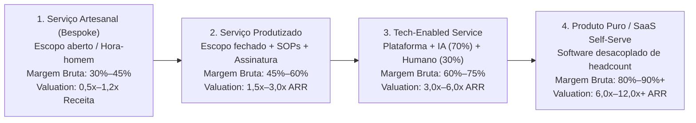

#### Tabela Comparativa das 4 Etapas da Escada de Produtização

| Dimensão Operacional e Financeira | Etapa 1: Serviço Artesanal (*Bespoke / Consultoria*) | Etapa 2: Serviço Produtizado (*Productized Service*) | Etapa 3: *Tech-Enabled Service* (Serviço Habilitado por Tech) | Etapa 4: Produto Puro / SaaS *Self-Serve* |
| :--- | :--- | :--- | :--- | :--- |
| **O que o cliente compra** | Horas de especialistas ou projeto sob medida ("fazemos o que você pedir") | Entregável padronizado, com escopo fechado e assinatura mensal fixa | Acesso a plataforma própria + entrega de resultado operada por IA e especialistas | Licença de uso de software operado pelo próprio time do cliente |
| **Modelo de Precificação** | Orçamento caso a caso, homem-hora ou projeto fechado pontual | Preço tabelado público ou pacotes fixos (*Tiers* P, M, G) recorrentes | Assinatura recorrente (SaaS + *Service Fee* embutido) + taxa de *setup* | Assinatura mensal/anual por assento, volume de uso (API/transação) ou *tier* |
| **Margem Bruta (*Gross Margin*)** | **30% a 45%** (custo direto de folha sênior consome a receita) | **45% a 60%** (processos padronizados permitem usar analistas juniores/plenos) | **60% a 75%** (software e IA executam ~70% do trabalho; humanos revisam ~30%) | **80% a 90%+** (custo direto restrito a nuvem, APIs de LLM e suporte N1) |
| **Receita Anual por Colaborador (Brasil)** | R$ 150 mil a R$ 300 mil / ano | R$ 280 mil a R$ 450 mil / ano | R$ 450 mil a R$ 900 mil / ano | **R$ 800 mil a R$ 2,5 milhões+ / ano** |
| **Escalabilidade Operacional** | Linear (dobrar receita exige dobrar consultores seniores) | Semi-linear (escala via SOPs, checklists e treinamento rápido) | Alta (1 operador gerencia 5x a 10x mais contas graças à automação interna) | Exponencial (custo marginal do 1.000º cliente é próximo de zero) |
| **Ciclo de Caixa e CAC Payback** | Imediato (sinal de 30%–50% na assinatura cobre o custo inicial) | Rápido (*Setup fee* + 1ª mensalidade no D+0 pagam o CAC integralmente) | Saudável (*Setup fee* financia *onboarding*; receita recorrente previsível) | Lento no início (exige capital para financiar 6 a 18 meses de *CAC Payback*) |
| **Risco de Churn e Lock-in** | Alto ao fim de cada projeto (receita volta a zero todo trimestre) | Médio (contratos de 12 meses, mas baixo custo técnico de troca) | **Muito Baixo** (dados históricos na plataforma + dependência operacional) | Baixo a Médio (alto *lock-in* se sistema de registro; maior *churn* se *point solution*) |
| **Múltiplo de Valuation (EV/Receita ou EV/EBITDA)** | **0,5x a 1,2x Receita** (ou 3x a 5x EBITDA, dependente dos sócios) | **1,5x a 3,0x ARR** (ou 5x a 7x EBITDA) | **3,0x a 6,0x ARR** (ou 8x a 12x EBITDA, cobiçado por Private Equity) | **6,0x a 12,0x+ ARR** (padrão Venture Capital / SaaS de alto crescimento) |

---

#### 2.1. Etapa 1: Serviço Artesanal / Consultoria Sob Medida (*Bespoke Service*)
Na Etapa 1: você vende sua capacidade de execução para 3 a 10 clientes iniciais. O erro dos consultores tradicionais é aceitar qualquer projeto em qualquer setor. O fundador orientado a produto usa a Etapa 1 com foco cirúrgico:
* **Foco em uma única dor repetitiva de um único ICP (*Ideal Customer Profile*):** Em vez de ser uma "consultoria de dados genérica", você vende exclusivamente "previsão de demanda e redução de ruptura de estoque para redes de supermercados regionais de 10 a 50 lojas".
* **Mapeamento de Padrões:** Nos primeiros 5 projetos, documente de onde vêm os dados (ex.: ERPs Sankhya, TOTVS, Consinco), quais são os 10 indicadores que o diretor realmente acompanha toda segunda-feira e quais scripts escritos para o Cliente 1 podem ser reaproveitados em 80% no Cliente 4.

#### 2.2. Etapa 2: Serviço Produtizado (*Productized Service*)
Um **Serviço Produtizado** é um serviço embalado, precificado e vendido como produto de prateleira, eliminando propostas sob medida e escopo aberto:
* **Escopo Fechado, Entregável Padronizado e Assinatura Recorrente:** O cliente não contrata "horas de consultoria financeira"; ele assina o plano **"CFO-as-a-Service Padrão Série A: R$ 8.500/mês"**, que entrega exatamente: fechamento gerencial até o 5º dia útil, conciliação diária, DRE por centro de custo e 1 reunião mensal de 60 minutos com SLA claro. Qualquer pedido fora da caixa padrão é recusado.
* **SOPs (*Standard Operating Procedures*):** Cada etapa da entrega é quebrada em checklists granulares, templates e vídeos de treinamento interno. Isso permite tirar os fundadores da operação manual e delegar a entrega a analistas juniores/plenos que seguem o procedimento padrão com qualidade previsível.

#### 2.3. Etapa 3: *Tech-Enabled Service* (Serviço Habilitado por Tecnologia)
Aqui a margem bruta salta. Você constrói software proprietário, mas **os primeiros usuários intensivos do software são os seus próprios analistas internos**, enquanto o cliente interage com um painel/plataforma limpa para visualizar resultados e aprovar ações.
* **A Regra 70/30 de Automação (*Human-in-the-Loop*):** Se antes um analista levava 10 horas para auditar notas fiscais ou conciliar recebíveis, seus scripts proprietários, conectores de API e agentes de IA (LLMs) passam a executar **70% do trabalho pesado nos bastidores**. O especialista humano atua apenas nos **30% críticos** (exceções complexas, validação final de qualidade e relacionamento consultivo).
* **Impacto no P&L:** A capacidade operacional salta de 10 para cerca de 30 clientes por analista, elevando a margem bruta para **60% a 75%** e gerando excedente de caixa livre todo mês.

#### 2.4. Etapa 4: Produto Puro / SaaS *Self-Serve*
Quando o motor interno já processou dados reais de dezenas de clientes no modelo *Tech-Enabled*, todas as exceções (*edge cases*) foram mapeadas e automatizadas. A interface interna ganha camada de *onboarding* autoguiado e permissões, desacoplando-se da mão de obra humana e atingindo **margem bruta de 80% a 90%+**.

---

### 3. A Engenharia Financeira do *Bootstrapping* (*Customer-Funded Business*)

Para financiar o *squad* de engenharia do produto sem capital externo, você deve operar com **Ciclo de Conversão de Caixa Negativo** (onde o cliente paga antes de você incorrer no custo).

#### 3.1. A Regra do *Setup Fee* (Taxa de Implantação que Paga o CAC no Dia 1)
Em serviços produtizados e *tech-enabled services*, **nunca ofereça implantação gratuita**. Cobre uma **Taxa de Setup / Onboarding** na assinatura equivalente a **1x a 3x o valor da mensalidade**, paga à vista no D+0.
* **Matemática do *Payback* no Dia 1:**
  * Assinatura mensal: **R$ 4.000/mês** + **R$ 6.000 de Setup Fee** à vista = **R$ 10.000 recebidos no Mês 1**.
  * Custo de Aquisição (CAC: marketing + comissão de *Inside Sales*): **R$ 4.500**.
  * Custo direto de *onboarding* (horas de analista na configuração inicial): **R$ 1.200**.
  * Impostos sobre a nota fiscal (~11% a 16%): **~R$ 1.300**.
  * **Saldo Líquido de Caixa no Mês 1:** **+R$ 3.000 positivos já no dia da venda!** Enquanto uma startup SaaS tradicional queima caixa por 14 meses esperando o *CAC Payback*, na sua operação cada novo cliente financia imediatamente a aquisição do próximo.

#### 3.2. Vendas Anuais Antecipadas e o "Imposto Interno de P&D"
* **Planos Anuais à Vista:** Ofereça 15% de desconto (ou isenção parcial do *setup*) para clientes que pagarem a anuidade à vista via Pix/TED (ou cartão, descontando a taxa de antecipação da credenciadora). Fechar **10 clientes anuais** de R$ 3.500/mês (R$ 35.000 à vista cada) injeta **R$ 350 mil de caixa antecipado** sem diluir o *cap table*. Atenção contábil e operacional: anuidade antecipada não é aporte de capital livre, mas **receita diferida (passivo de entrega)**. Você deve doze meses de serviço, paga tributos na emissão da nota fiscal e responde por devolução proporcional se o contrato rescindir: provisione em conta separada o custo de servidor, suporte e impostos dos doze meses e use apenas a margem líquida para financiar o desenvolvimento do produto.
* **Alocação Disciplinada do Lucro para o Squad de Produto:** No DRE gerencial, trave a regra: **50%** da receita líquida cobre a entrega do serviço (CSP), **20%–25%** cobre SG&A/vendas e **25%–30% (o lucro operacional da operação de serviços)** vai obrigatoriamente para uma conta carimbada que financia os engenheiros dedicados a construir o produto.

---

### 4. Como Atravessar o Abismo *Service-to-Product*: As 5 Armadilhas Fatais

A maioria das consultorias que tentam criar um produto próprio tropeça porque cai em cinco armadilhas estruturais (com referências operacionais estimadas por etapa na tabela a seguir):

#### 1. O Vício no Dinheiro Fácil de Projetos Customizados (*Whale Trap*)
Surge uma grande corporação oferecendo R$ 350.000 para você desenvolver um sistema sob medida fora do seu *roadmap*. Se você aceitar, seus melhores engenheiros ficarão 6 meses presos construindo código exclusivo que não serve para mais ninguém, congelando o seu produto padrão.
* **Antídoto:** A partir da Etapa 2: recuse qualquer contrato que exija desviar do seu escopo padronizado, a menos que 100% do que será construído já seja o próximo módulo prioritário do seu produto para todo o mercado.

#### 2. Contaminação de P&L e Time (Por que Separar Entrega e Produto)
Se o mesmo desenvolvedor que constrói o SaaS também apaga incêndios dos clientes atuais de serviço, **a urgência do serviço sempre matará a importância do produto**.
* **Antídoto:** Separe organizacionalmente o **Time de Entrega (*Delivery*)** do **Squad de Produto**. Blinde pelo menos o CTO e 1 a 2 engenheiros em tempo integral exclusivamente para automatizar processos e construir a plataforma, e apure dois DREs gerenciais separados (Margem de Serviço vs. ARR de Produto).

#### 3. A Armadilha de Propriedade Intelectual no Brasil (Art. 4º da Lei nº 9.609/1998)
Pelo **art. 4º da Lei do Software (Lei nº 9.609/1998)**, salvo estipulação contratual em contrário, **pertencem exclusivamente ao cliente contratante** os direitos sobre programas desenvolvidos sob encomenda! Se você assinar a minuta padrão de compras de um grande cliente cedendo a PI dos entregáveis sem ressalva, você perde a titularidade do código que queria transformar em SaaS.

> [!warning] Cláusula Contratual Obrigatória de Reserva de Tecnologia-Base (*Background & Platform IP*)
> Insira obrigatoriamente nos seus contratos de prestação de serviços no Brasil:
> *(Minuta ilustrativa de ponto de partida; revise sempre com advogado especializado em propriedade intelectual e contratos de tecnologia antes de assinar.)* *"Cláusula X (Da Propriedade Intelectual e Segredo de Negócio): Pertencerão ao CONTRATANTE, em caráter definitivo e com licença perpétua de uso interno após a quitação contratual, os relatórios finais, diagnósticos e resultados gerados a partir de seus próprios dados brutos ('Entregáveis Específicos'). As partes pactuam expressamente, nos termos da ressalva do caput do art. 4º da Lei nº 9.609/1998 (que exige estipulação contratual explícita para afastar a titularidade do contratante nas encomendas de serviço), que o código-fonte, bibliotecas, scripts de automação e conectores de software preexistentes ou desenvolvidos pela CONTRATADA ('Software-Base') pertencem exclusivamente à CONTRATADA sob proteção de direito de programa de computador, enquanto metodologias, modelos matemáticos e fluxos operacionais (que não gozam de direito autoral pelo art. 8º, I, da Lei nº 9.610/1998) permanecem protegidos como segredo de negócio e know-how confidencial da CONTRATADA, concedendo-se ao CONTRATANTE licença não exclusiva de acesso à plataforma apenas durante a vigência da assinatura, sem prejuízo do uso perpétuo dos Entregáveis Específicos."*

#### 4. Mudança de Tíquete Médio e Perfil de Vendedor
Vender consultoria de R$ 25.000/mês depende do relacionamento pessoal dos sócios. Vender um SaaS ou *Tech-Enabled Service* de R$ 1.500/mês exige máquina de *Inside Sales* (SDRs + *Closers*), geração de demanda *inbound/outbound* previsível e ciclo de fechamento de 15 a 30 dias. Separe o funil comercial e contrate vendedores treinados em venda de volume padronizado.

#### 5. Quando Permanecer como um *Tech-Enabled Service* Lucrativo em vez de Forçar Virar SaaS
Não tenha vergonha da Etapa 3. Em mercados brasileiros complexos (contabilidade, fiscal, jurídico, comércio exterior, gestão financeira B2B e saúde), o cliente prefere pagar **R$ 3.000/mês por um Tech-Enabled Service que entrega o problema resolvido** do que R$ 300/mês por um SaaS onde ele mesmo precisa trabalhar. Um *Tech-Enabled Service* faturando R$ 30M/ano com 65% de margem bruta e 30% de margem líquida gera **R$ 9 milhões por ano de lucro distribuível** aos fundadores (sujeitos, desde janeiro de 2026 pela Lei 15.270/2025, à retenção de 10% na fonte para dividendos acima de R$ 50 mil mensais por empresa e ao imposto mínimo anual de até 10% para rendas acima de R$ 600 mil; ver Capítulo 2 do Vol. 5), com altíssimo *lock-in* e sem depender de Venture Capital.

> [!tip] Regra de Decisão: Etapa 3 vs. Etapa 4
> Só force a transição para SaaS *Self-Serve* puro (Etapa 4) se o usuário final na ponta quiser e conseguir operar a ferramenta diariamente sem fricção. Caso contrário, domine a Etapa 3: use IA internamente para derrubar seu custo operacional para 20% da receita e cobre preço premium de serviço completo.

---

### 5. Checklist de Execução Service-to-Product

- [ ] **Pacotização (Etapa 2):** Propostas sob medida eliminadas e substituídas por pacotes fixos recorrentes com **Setup Fee** que cobre 100% do CAC no Mês 1?
- [ ] **Blindagem de PI (Lei 9.609/1998):** Cláusula de reserva exclusiva da *Tecnologia-Base*, bibliotecas e motores incluída em 100% dos contratos com clientes?
- [ ] **Separação de Squad e DRE:** Engenheiros do produto 100% blindados contra demandas manuais de consultoria e financiados por 25%–30% da receita líquida do serviço?
- [ ] **Automação 70/30 (Etapa 3):** Scripts, APIs e agentes de IA já executam 70%+ da operação nos bastidores, elevando a margem bruta acima de 60%?

---

### O Espelho do Capítulo 7: Você Está Construindo uma Máquina ou Vendendo Suas Horas em Roda de Hamster?

**Fechando o ciclo na trincheira:** Quando **Henrique** incorporou este filtro nas negociações industriais e públicas a partir de Curitiba, o impasse da abertura foi substituído por critérios técnicos de aprovação, margem protegida e ciclo previsível.

**O Espelho (autodiagnóstico):**
1. Se você presta serviços hoje, você aceita qualquer projeto personalizado que o cliente pede, ou vende um pacote de escopo 100% fechado para um único perfil de cliente e uma única dor?
2. Qual porcentagem das tarefas que a sua equipe executava manualmente há seis meses já foi transformada em código ou automação de IA nos bastidores?
3. Você cobra uma taxa de implantação (*Setup Fee*) no Dia 1 que paga integralmente o seu Custo de Aquisição (CAC), ou está financiando o cliente com o seu próprio bolso?

**Permissão Libertadora:**
Você está autorizado a demitir clientes de consultoria que exigem trabalho sob medida fora da sua tese de produto e a recusar propostas de investidores que queiram 30% da sua empresa por migalhas.

**O Ritual de Segunda-Feira às 9h:**
Reserve na agenda: como compromisso sagrado e inegociável: **15 horas desta semana** exclusivamente para construir o script ou módulo interno que vai eliminar a tarefa manual mais repetitiva da sua entrega atual.

