# IGNIÇÃO: Volume 3: Hipóteses, Experimentos, Prototipagem e Modelos de Negócio

**Método Científico, Testes de Validação, Usabilidade, Plataformas e Bootstrapping (da Fase 7, Formulação Rigorosa de Hipóteses, à Fase 10, Testes de Solução e Usabilidade, e do Capítulo 1, Abordagem Científica vs. Lean Startup, ao Capítulo 7, Bootstrapping e Serviços Produtizados)**

*João Prado · 2026 · Edição Narrativa Enxuta (v5.3)*

---

## Sobre este Volume

Este é o **Volume 3 (IGNIÇÃO: Volume 3: Hipóteses, Experimentos, Prototipagem e Modelos de Negócio)** da coleção IGNIÇÃO: O manual operacional do empreendedor brasileiro (11 volumes).

Este volume guia a transição da teoria de negócio para a validação científica em campo e para a construção do protótipo testado. A jornada percorre quatro fases operacionais em sequência: a Formulação Rigorosa de Hipóteses (Fase 7), os Experimentos de Validação com Compromisso Real (Fase 8), a Ideação e Prototipagem de Soluções (Fase 9) e os Testes de Solução, Usabilidade e Especificação de MVP (Fase 10). Cada fase traz passo a passo práticos de análise de risco, desenho experimental, *design sprint* e pesquisa de usabilidade, além dos quadros *Hypothesis Canvas*, *Test Card*, *Opportunity Canvas* e *MVP Canvas* preenchidos com casos brasileiros. Na segunda metade, sete capítulos aprofundam o método científico aplicado ao empreendedorismo, os portões de evidência e maturidade (*TRL/CRL*), a lente transversal de cunha e escala (*Idea → Wedge → Scale*) e as arquiteturas de *Marketplaces* e Plataformas, *B2B2C*, *Open Source* Comercial (*COSS*) e *Bootstrapping* via serviços produtizados (*Service-to-Product*).

---

## Mapa da Coleção IGNIÇÃO

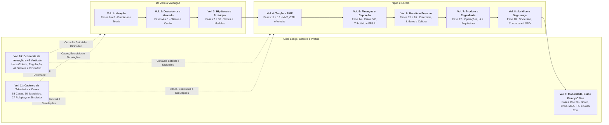

---

## Sumário deste Volume

### Fases da Etapa (Fases 7 a 10)

- [[#FASE 7: FORMULAÇÃO RIGOROSA DE HIPÓTESES|FASE 7: FORMULAÇÃO RIGOROSA DE HIPÓTESES]]
- [[#FASE 8: EXPERIMENTOS DE VALIDAÇÃO DO PROBLEMA E DA SOLUÇÃO|FASE 8: EXPERIMENTOS DE VALIDAÇÃO DO PROBLEMA E DA SOLUÇÃO]]
- [[#FASE 9: IDEAÇÃO E PROTOTIPAGEM DE SOLUÇÕES|FASE 9: IDEAÇÃO E PROTOTIPAGEM DE SOLUÇÕES]]
- [[#FASE 10: TESTES DE SOLUÇÃO E USABILIDADE|FASE 10: TESTES DE SOLUÇÃO E USABILIDADE]]

### Metodologia Científica, Maturidade e Gates de Evidência (Capítulos 1 e 2)

- [[#CAPÍTULO 1: ABORDAGEM CIENTÍFICA vs LEAN STARTUP: QUANDO USAR CADA UMA|CAPÍTULO 1: ABORDAGEM CIENTÍFICA vs LEAN STARTUP: QUANDO USAR CADA UMA]]
- [[#CAPÍTULO 2: MATURIDADE (TRL/CRL), OS DEZ PORTÕES (TEN GATES) E PRÓXIMO PASSO COMPROMETIDO|CAPÍTULO 2: MATURIDADE (TRL/CRL), DECISÃO POR GATES E FECHAMENTO DE FASE (COMMITTED NEXT MOVE)]]

### Arquitetura de Modelo de Negócio (Capítulos 3 a 7)

- [[#CAPÍTULO 3: IDEA → WEDGE → SCALE: O FRAMEWORK ANTLER COMO LENTE TRANSVERSAL|CAPÍTULO 3: IDEA → WEDGE → SCALE: O FRAMEWORK ANTLER COMO LENTE TRANSVERSAL]]
- [[#CAPÍTULO 4: MARKETPLACES, PLATAFORMAS E EFEITOS DE REDE: LIQUIDEZ, OVO-E-GALINHA E RISCO DE PLATAFORMA|CAPÍTULO 4: MARKETPLACES, PLATAFORMAS E EFEITOS DE REDE: LIQUIDEZ, OVO-E-GALINHA E RISCO DE PLATAFORMA]]
- [[#CAPÍTULO 5: B2B2C: QUANDO SUA EMPRESA VENDE PARA OUTRA EMPRESA QUE VENDE PARA CONSUMIDOR|CAPÍTULO 5: B2B2C: QUANDO SUA EMPRESA VENDE PARA OUTRA EMPRESA QUE VENDE PARA CONSUMIDOR]]
- [[#CAPÍTULO 6: OPEN SOURCE COMO ESTRATÉGIA|CAPÍTULO 6: OPEN SOURCE COMO ESTRATÉGIA]]
- [[#CAPÍTULO 7: BOOTSTRAPPING, SERVIÇOS PRODUTIZADOS (PRODUCTIZED SERVICES) E A TRANSIÇÃO SERVICE-TO-PRODUCT|CAPÍTULO 7: BOOTSTRAPPING, SERVIÇOS PRODUTIZADOS (PRODUCTIZED SERVICES) E A TRANSIÇÃO SERVICE-TO-PRODUCT]]

### Prática, Cases e Simulações Desta Etapa (Volume 11: Capítulos 7 a 9)

- [[IGNICAO-Vol-11-Workbook-Cases-e-Exercicios#CAPÍTULO 7: CASES GLOBAIS E BRASILEIROS DE EXPERIMENTAÇÃO, PROTOTIPAGEM, PLATAFORMAS E BOOTSTRAPPING|CAPÍTULO 7: CASES GLOBAIS E BRASILEIROS DE EXPERIMENTAÇÃO, PROTOTIPAGEM, PLATAFORMAS E BOOTSTRAPPING (Vol. 11)]]
- [[IGNICAO-Vol-11-Workbook-Cases-e-Exercicios#CAPÍTULO 8: CADERNO DE EXERCÍCIOS COM GABARITO COMENTADO: TEST CARDS, UNIT ECONOMICS DE MARKETPLACE E SERVICE-TO-PRODUCT|CAPÍTULO 8: CADERNO DE EXERCÍCIOS COM GABARITO COMENTADO: TEST CARDS, UNIT ECONOMICS DE MARKETPLACE E SERVICE-TO-PRODUCT (Vol. 11)]]
- [[IGNICAO-Vol-11-Workbook-Cases-e-Exercicios#CAPÍTULO 9: SIMULAÇÕES DE DECISÃO E ROLEPLAYS EXECUTIVOS: USABILIDADE, PRÉ-VENDA B2B E CORTE DE ESCOPO DE MVP|CAPÍTULO 9: SIMULAÇÕES DE DECISÃO E ROLEPLAYS EXECUTIVOS: USABILIDADE, PRÉ-VENDA B2B E CORTE DE ESCOPO DE MVP (Vol. 11)]]

---

# FASES DA ETAPA: HIPÓTESES, EXPERIMENTOS, PROTOTIPAGEM E USABILIDADE (FASES 7 A 10)

Com a dor do cliente mapeada no Volume 2, as [[#FASE 7: FORMULAÇÃO RIGOROSA DE HIPÓTESES|Fases 7]], [[#FASE 8: EXPERIMENTOS DE VALIDAÇÃO DO PROBLEMA E DA SOLUÇÃO|8]], [[#FASE 9: IDEAÇÃO E PROTOTIPAGEM DE SOLUÇÕES|9]] e [[#FASE 10: TESTES DE SOLUÇÃO E USABILIDADE|10]] transformam a sua empresa num laboratório disciplinado: formular hipóteses *bet-the-company*, cobrar compromisso real antes do produto existir, prototipar rápido e testar a usabilidade até congelar o escopo do MVP.

---

## FASE 7: FORMULAÇÃO RIGOROSA DE HIPÓTESES

### O Teatro da Validação e a Coragem de Definir o Que Mata a Sua Ideia

"Se a gente lançar o clube de assinatura de kits de autocuidado e cosméticos naturais, as clientes vão adorar e recomprar todo mês!", disse Rafael, empolgado, numa chamada de vídeo do Recife com Bia, em Goiânia.

Bia olhou para a planilha de custos logísticos e devolveu uma pergunta que travou a conversa:

Do outro lado da tela, Bia tirou os olhos da planilha de fluxo de caixa e fez a única pergunta que importava: *"Quantas clientes compraram na última campanha sem desconto de lançamento e quantas recompraram no segundo mês?"*. Rafael ficou em silêncio por cinco segundos: a campanha anterior tivera 18 pedidos avulsos com cupom de 30%, frete subsidiado que deixou R$ 42 de prejuízo por caixa e apenas 2 clientes recomprando no mês seguinte.

A hesitação de Rafael diante da pergunta de Bia expõe a armadilha mais frequente na hora de testar ideias: O Teatro da Validação. Você solta uma campanha sem fixar de antemão qual número comprova o sucesso, colhe meia dúzia de vendas mornas e depois muda a regra do jogo dizendo *"vendeu pouco, mas fortaleceu a marca"*. Ao longo desta fase, Rafael e Bia saem desse teatro em três movimentos concretos: primeiro, escrevem a hipótese de retenção da caixa mensal de autocuidado no molde do Passo 2 (com critério de descarte explícito: se menos de 60% das assinantes da primeira safra renovarem no terceiro mês sem cupom, o clube recorrente é descartado), segundo, pontuam essa premissa no topo da matriz Risco × Incerteza ($R=5 \times I=5 = 25$) e no diagnóstico Hipótese/Evidência ($H=8, E=2$) antes de empatar caixa em estoque, e terceiro, preparam o pré-registro que guiará o teste de pré-venda e recompra auditado no fechamento desta fase.

Karl Popper mostrou em *A Lógica da Pesquisa Científica* (1934) o que separa a ciência da pseudociência: uma afirmação só é empírica e científica se algum resultado observável possível puder refutá-la (falsificabilidade). Na gestão de uma startup, essa propriedade lógica vira disciplina de método (pré-registro): escreva antes do teste o número exato que prova que você errou. Toda empresa nascente carrega no núcleo três a cinco apostas de vida ou morte (*bet-the-company*), premissas que decidem se o negócio sobrevive. Se elas caírem, não importa quão bonito seja o logotipo ou quão limpo seja o código, porque a tese inteira desmorona.

A maioria dos fundadores testa primeiro a cor do botão ou o nome do plano e deixa a hipótese mortal para o fim, porque tem medo da resposta. Na Fase 7 você faz o contrário: coloca a premissa mais perigosa do negócio no centro da mira e crava a linha numérica exata entre seguir em frente e descartar a ideia.

---

> [!note] A Matriz CSD entra no Passo 1 como varredura inicial (as suposições mapeadas viram hipóteses testáveis)
> A matriz CSD separa Certezas, Suposições e Dúvidas para organizar o mapa mental antes de formular hipóteses. Teste as Suposições, pois testar Certezas desperdiça recursos e testar Dúvidas exige antes descobrir o que se ignora. As apostas de vida ou morte (suposições que, se falsas, inviabilizam o negócio) recebem prioridade máxima.

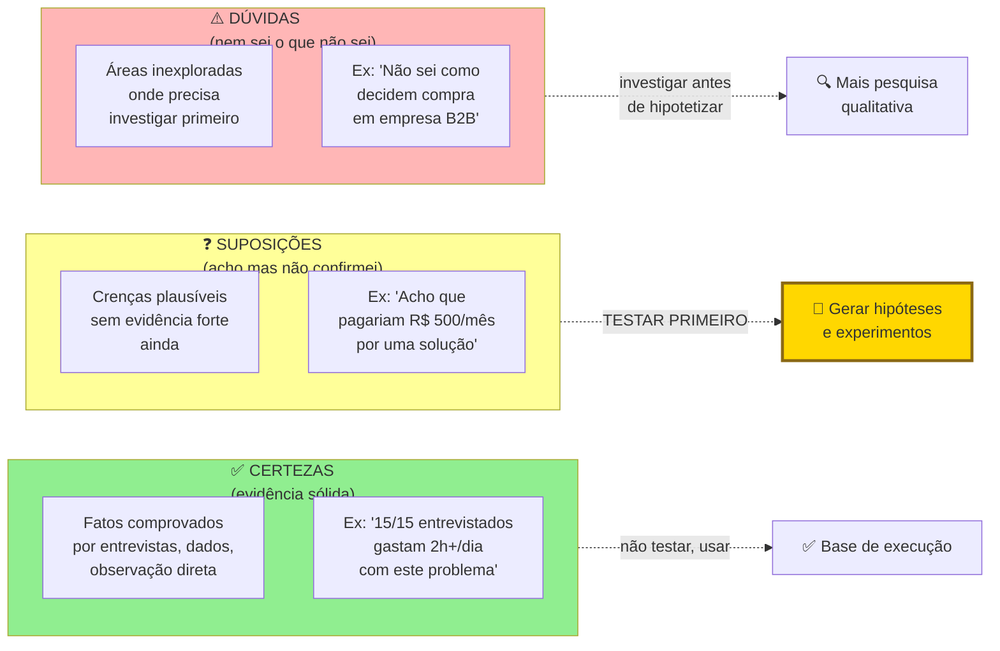

### Por que definir a linha de corte antes do experimento evita racionalizar resultados negativos

Toda decisão empresarial parte de premissas sobre a realidade: "o cliente pagará R$ 99 mensais", "o canal principal de aquisição será o Instagram" ou "redes com três lojas fecham contrato mais rápido". Tratar essas suposições como fatos consumados leva ao Teatro da Validação. Transformá-las em hipóteses falsificáveis e testá-las por ordem de risco protege o caixa e orienta cada passo da execução.

A priorização de hipóteses também impede que você desperdice energia testando coisas de pouco impacto. Você quer testar primeiro o que, se for falso, derruba o negócio inteiro. Isso se chama "risco-maior-primeiro".

> [!note] Aprofundamento no Capítulo 1 (Abordagem Científica vs. Lean Startup: Quando Usar Cada Uma)
> A disciplina de formular hipóteses falsificáveis (hipóteses que podem ser provadas erradas) é o ponto de convergência entre o método científico e a metodologia Lean. O [[#CAPÍTULO 1: ABORDAGEM CIENTÍFICA vs LEAN STARTUP: QUANDO USAR CADA UMA|Capítulo 1: Científico vs Lean Startup]] mapeia as diferenças e complementaridades: quando o rigor hipotético-dedutivo aplica e quando o loop Build-Measure-Learn é mais adequado. Relevante especialmente para fundadores com background técnico ou científico que estão aplicando o método ao contexto de negócio pela primeira vez.

### Os sete passos até as apostas de vida ou morte

Sete passos.

#### Passo 1: levante todas as suposições implícitas

Faça uma varredura completa. Classifique as hipóteses em cinco tipos.

**Hipóteses de problema:** verificam se a dor existe de fato, quem a sente com maior intensidade e qual o seu custo real para o cliente.

**Hipóteses de solução:** avaliam se a proposta resolve o problema central e se os usuários reais aceitam adotá-la na rotina.

**Hipóteses de cliente e mercado:** definem o perfil exato do comprador ideal e mapeiam como ocorre o processo de decisão.

**Hipóteses de canal:** testam por quais meios você alcança o cliente-alvo mantendo um custo de aquisição viável.

**Hipóteses de monetização e modelo:** validam se o cliente paga, qual o valor e a frequência de cobrança e se o LTV supera o CAC com folga.

Para cada uma das cinco categorias, formule de três a seis hipóteses testáveis, compondo um banco inicial de quinze a trinta hipóteses.

#### Passo 2: escreva cada hipótese no formato padronizado

Use esse formato rigoroso:

```text
HIPÓTESE: [afirmação clara e falsificável]
ATRIBUTO DA TEORIA: [qual nó ou seta da sua árvore de teoria esta hipótese testa]
POR QUE IMPORTA (IMPACTO SE FOR FALSA): [qual o impacto no negócio se a premissa cair]
PARA VALIDAR PRECISO VER: [critério objetivo e numérico de sucesso]
VAMOS DESCARTAR SE: [critério numérico de refutação]
ZONA CINZENTA: [entre X e Y, qual único teste extra destrava a decisão]
MÉTODO: [experimento ou fonte de evidência]
CUSTO ESTIMADO: [tempo + dinheiro]
```

Para entender a diferença entre hipótese ruim e hipótese boa:

> [!warning] Hipótese ruim, impossível de falsificar
> "Os clientes vão gostar do produto." Impossível de testar. "Gostar" não é mensurável.

> [!tip] Hipótese boa, falsificável e numérica
> "Pelo menos trinta por cento dos donos de restaurante do nosso ICP (perfil de cliente ideal), depois de conhecer a solução por uma página de pré-cadastro, pagarão R$ 49 antecipados para garantir acesso ao beta (mantendo o e-mail apenas como métrica secundária de funil). Se for falsa, significa que a nossa proposta de valor não é forte o bastante para pagamento antecipado, o que compromete a viabilidade do modelo."
Para evitar ambiguidades na hora de ir a campo, toda hipótese prioritária deve ser documentada com seus critérios de validação, refutação e zona cinzenta antes do início da coleta.
> [!tip] Hypothesis Canvas e Test Card como par de ferramentas
> O formato padronizado acima é o coração do Hypothesis Canvas, registrado como modelo prático em [[#Template: Hypothesis Canvas|Template: Hypothesis Canvas]] e com tratamento metodológico completo em [[#Canvas: Hypothesis Canvas (autoral IGNIÇÃO)|Canvas: Hypothesis Canvas (autoral IGNIÇÃO)]]. Cada hipótese de vida ou morte deve gerar imediatamente de um a três cartões em [[#Canvas: Test Card (David Bland & Alexander Osterwalder, 2019)|Canvas: Test Card (David Bland & Alexander Osterwalder, 2019)]] como desdobramento operacional: enquanto o Hypothesis Canvas explicita *o que* testar e como auditar a amostra, o Test Card detalha *como* executar o experimento em campo. A disciplina central de ambos é cravar os critérios de validação e de refutação antes de rodar o teste, separando-os por uma zona cinzenta explícita que protege os fundadores contra a racionalização pós-coleta.

#### Passo 3: aplique o critério de falsificabilidade

> [!note] Falsificabilidade como critério de demarcação (Karl Popper, 1934)
> Em *A Lógica da Pesquisa Científica* (1934), Karl Popper estabeleceu a falsificabilidade como critério de demarcação entre ciência empírica e especulação: nenhuma quantidade de observações favoráveis prova definitivamente uma afirmação universal, mas um único contraexemplo rigorosamente observado basta para refutá-la. Aplicado à gestão de startups, isso significa que testar uma ideia nunca é sair atrás de elogios que confirmem o que você já acredita, e sim desenhar um experimento capaz de derrotar a sua hipótese caso ela seja falsa.

Toda hipótese precisa de um caminho claro de refutação. Sem ele, você está apenas guardando uma crença.

##### Teste de isolamento, uma hipótese, um elemento por vez

Esse é um dos erros mais comuns em iniciantes: empilhar múltiplos elementos numa única hipótese. Quando você testa coisas compostas, fica impossível saber qual parte foi refutada.

Exemplo de hipótese composta (ruim): "Assinantes do clube de cafés especiais de Rafael e Bia renovam depois do terceiro mês porque gostam da curadoria dos microlotes, valorizam as fichas sensoriais impressas e acham o preço de R$ 89 por mês justo."

Essa hipótese junta três afirmações distintas sobre o clube de autocuidado de Rafael e Bia: (1) clientes de cosméticos naturais preferem receber uma caixa surpresa mensal a comprar itens avulsos, (2) a curadoria de novidades é o principal motivo de assinatura, e (3) o frete recorrente para fora das capitais não provoca cancelamento no segundo mês.
Se você testar essa frase inteira num único experimento e o resultado vier fraco, jamais saberá se o problema estava no formato de caixa surpresa, na curadoria dos itens ou no peso do frete.
Se você testar tudo junto e 45% das assinantes concordarem, o dado não orienta nenhuma ação. Pode ser que renovem por outro motivo. Pode ser que a curadoria importe só nos primeiros meses. Pode ser que o frete seja um teto e, acima de R$ 25, elas cancelem. A hipótese composta esconde todas essas diferenças.

A versão atômica (correta) decompõe essa frase em três hipóteses separadas e testáveis individualmente: H1a (Modelo de compra): *"Mais de 25% das clientes ativas da loja avulsa optam pela assinatura mensal quando ofertada no checkout com 15% de desconto"*, H1b (Retenção de 3º mês): *"Pelo menos 60% das assinantes da primeira safra mantêm a assinatura ativa no 3º mês sem cupom adicional"*, e H1c (Sensibilidade a frete): *"O cancelamento até o 3º mês entre assinantes cujo frete representa mais de 12% do pedido não supera em mais de 10 pontos percentuais o cancelamento das assinantes com frete subsidiado"*. Se as três forem validadas, a tese conjunta do clube se sustenta. Se alguma cair, Rafael e Bia sabem exatamente qual engrenagem ajustar ou descartar.

> [!important] Regra do isolamento
> Cada hipótese deve testar apenas um atributo ou um único elo causal da sua árvore de teoria: se a frase contiver "e" ou "porque" unindo duas premissas distintas, divida-a em duas hipóteses independentes.

##### Verifique a conexão com a teoria (integração)

Coloque a sua árvore de teoria ([[IGNICAO-Vol-1-Ideacao#FASE 3: CONSTRUÇÃO DA TEORIA DO NEGÓCIO|Fase 3 (Vol. 1)]]) ao lado do Banco de Hipóteses. Para cada hipótese, responda: *Esta hipótese testa qual nó ou seta da árvore?* Se uma hipótese não pode ser mapeada na árvore, ela é órfã. Ou a hipótese é irrelevante, ou a sua árvore está incompleta. Em ambos os casos, corrija.

Se sobraram nós vitais na árvore da teoria (Fase 3) sem hipótese correspondente no banco, redija uma hipótese para cada um antes de passar ao Passo 4.

> [!note] Capítulo 6 (Vol. 1): Tomada de Decisão como Disciplina
> Antes de comprometer recursos com as hipóteses de vida ou morte, consulte o [[IGNICAO-Vol-1-Ideacao#CAPÍTULO 6: TOMADA DE DECISÃO COMO DISCIPLINA|Capítulo 6: Tomada de Decisão como Disciplina (Vol. 1)]]: apostas de alto risco e baixa reversibilidade são decisões Tipo 1 (irreversíveis) e exigem pré-mortem formal antes de qualquer experimento. O capítulo também apresenta o framework SPADE para estruturar decisões difíceis entre sócios.

#### Passo 4: priorize as hipóteses por Risco × Incerteza (primeiro pass)

> [!note] Dois sistemas de priorização, em ordem de aplicação
> Esta fase aplica duas lentes complementares em sequência. Primeira peneira: Matriz Risco × Incerteza ($R \times I$, Passo 4). Triagem rápida do inventário bruto de 15 a 30 premissas para isolar as três a cinco apostas de vida ou morte, cruzando o impacto fatal no negócio se a premissa for falsa (Risco $R$, de 1 a 5) com o grau de desconhecimento atual (Incerteza $I$, de 1 a 5). Segunda peneira: Diagnóstico H/E (Passo 5). Aplicado especificamente às apostas de vida ou morte filtradas no Passo 4, avalia em escala de 1 a 10 a Força Teórica da Hipótese ($H$) (coerência causal, especificidade do mecanismo e ausência de salto lógico) contra a Força da Evidência Empírica ($E$) já coletada com comportamento real, determinando se o fundador precisa refinar a teoria na árvore causal (quando $H < 7$) ou ir imediatamente a campo coletar evidência (quando $H \ge 7$ e $E < 6$).

- **Incerteza ($I$, de 1 a 5):** mede o grau de desconhecimento empírico atual sobre a premissa (1 = já temos dados auditados de comportamento real, 5 = estamos completamente no escuro, apoiados apenas em palpite ou opinião declarada).

Calcule **Prioridade = R × I**.

Hipóteses com pontuação **R × I ≥ 15** são as suas apostas de vida ou morte (*bet-the-company*): premissas que derrubam o negócio se forem falsas e que você ainda não testou em campo. Elas ocupam o topo da fila. Pontuações entre 8 e 14 entram como secundárias, e itens abaixo de 8 aguardam na lista de espera (*backlog*).

#### Passo 5: aplique o Sistema H/E na Fase 7 (segunda peneira de priorização)

Para cada hipótese bet-the-company já filtrada pelo Risco × Incerteza, atribua duas notas de um a dez.

O índice H (*Hypothesis Strength*, força teórica da hipótese) mede a solidez lógica da premissa antes de ir a campo: nota 10 indica cadeia causal consistente com os dados de mercado, casos análogos e a árvore da teoria. Nota 3 reflete um palpite intuitivo sem mecanismo causal demonstrado.

- **Força da Evidência ($E$, de 1 a 10):** aprofunda e quantifica, para as apostas de vida ou morte filtradas no Passo 4, o peso da prova empírica já acumulada (de $E=1$, nenhuma evidência além da opinião dos sócios, até $E=10$, comportamento real de compra e retenção auditado em escala).

A visualização do sistema H/E:

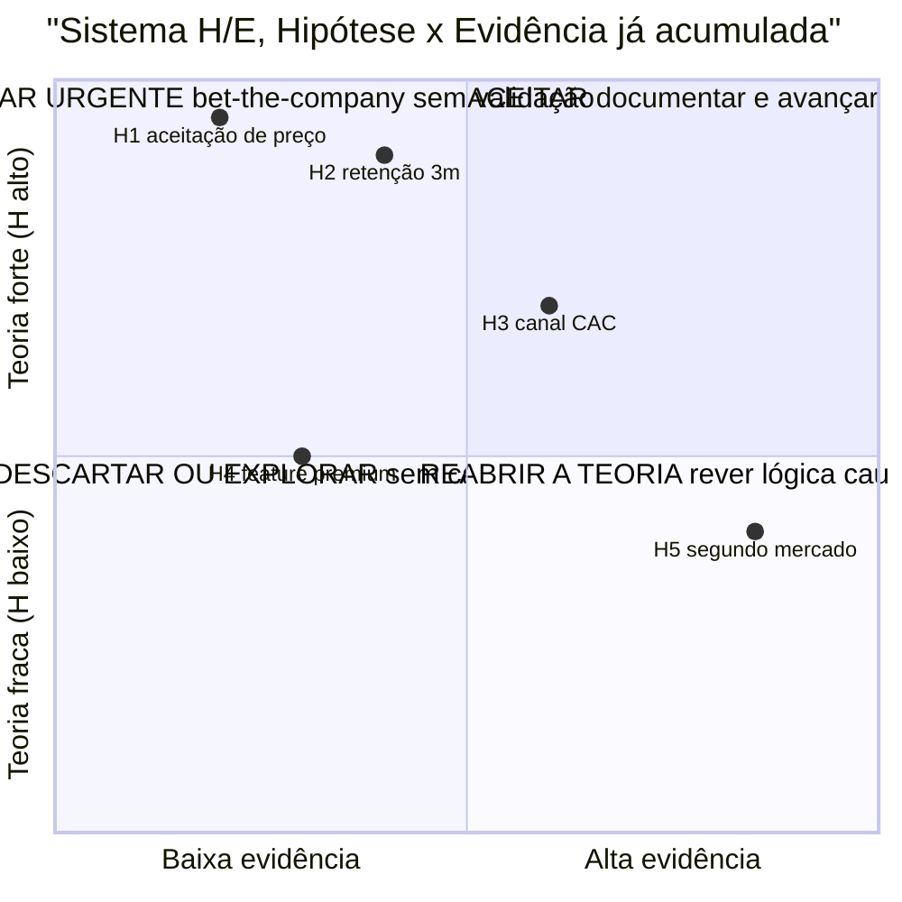

O sistema H/E responde a duas perguntas: *A teoria por trás dessa hipótese se sustenta?* (H) e *Já tenho evidência a favor?* (E). O quadrante superior-esquerdo (H alto e E baixo) é urgência máxima. Isso evita o erro comum de testar primeiro o que é fácil em vez do que é decisivo.

Os dois scores juntos mostram onde você está em cada hipótese:

| Perfil (H, E) | Diagnóstico | O que fazer |
|---|---|---|
| H alto, E alto (8, 8) | Hipótese bem fundamentada, e já com evidência | Avançar com investimento ou execução |
| H alto, E baixo (8, 3) | Teoria forte, falta evidência | Prioridade máxima de experimento. É aqui que a próxima rodada de testes precisa estar |
| H baixo, E alto (4, 8) | Fato observado sem teoria clara | Reabrir a árvore de teoria. Por que esse padrão acontece? Sem saber por quê, não dá para escalar |
| H baixo, E baixo (3, 2) | Palpite sem fundamento nem dado | Ou descartar, ou iniciar investigação exploratória. Nunca investir capital |

> [!warning] Regra de ouro do Sistema H/E
> Todo investimento significativo (construir funcionalidade, contratar, levantar capital ou expandir canal) exige que as apostas de vida ou morte associadas àquela decisão tenham atingido simultaneamente $H \ge 7$ e $E \ge 6$ pelo critério pré-registrado antes do teste. Se $E$ estiver abaixo de 6, execute um experimento na Fase 8 sem alterar a régua pós-coleta. Se $H$ estiver abaixo de 7, volte à árvore da teoria na Fase 3 antes de gastar.

#### Passo 6: monte o Banco de Hipóteses como planilha

O Banco de Hipóteses completo (para planilha ou banco de dados no Notion/Airtable) organiza dezoito colunas canônicas: (1) ID (`H01`, `H02`.), (2) Tipo (Problema, Solução, Cliente, Canal ou Monetização), (3) Atributo da teoria (vínculo com a árvore da [[IGNICAO-Vol-1-Ideacao#FASE 3: CONSTRUÇÃO DA TEORIA DO NEGÓCIO|Fase 3: Construção da Teoria do Negócio (Vol. 1)]]), (4) Hipótese (texto completo e atômico), (5) Por que importa (impacto se for falsa), (6) Risco $R$ (1 a 5), (7) Incerteza $I$ (1 a 5), (8) Prioridade $R \times I$ (1 a 25), (9) Nota $H$ (força lógica da hipótese, 1 a 10), (10) Nota $E$ (evidência empírica acumulada, 1 a 10), (11) Critério de validação, (12) Critério de descarte, (13) Zona cinzenta e ação prevista, (14) Método ou experimento, (15) Custo e duração estimados, (16) Ordem de teste, (17) Status (Nova, Em teste, Validada, Refutada ou Abandonada) e (18) Resultado e aprendizado pós-teste. Na versão enxuta de página única ([[#Template: Banco de Hipóteses (modelo de planilha)|Template: Banco de Hipóteses]]), essas informações são condensadas nas 11 colunas essenciais de operação semanal.

> [!important] Essa planilha é o coração operacional do negócio
> Nos próximos seis a doze meses, ela é o documento mais consultado da empresa. Nunca a perca de vista.

#### Passo 7: escolha as 3 a 5 primeiras hipóteses a testar e defina ordem de teste

Pegue as hipóteses do quadrante "H alto + E baixo" do Passo 5. Essas têm o maior retorno por experimento: teoria robusta, apenas faltando evidência. A escolha das três a cinco primeiras segue quatro critérios em ordem.

Maior risco primeiro. Entre as bet-the-company com mesmo perfil H/E, comece pela de maior R × I. Resolver o que pode matar o negócio antes do que é apenas importante.

Independência sobre dependência. Se a hipótese A precisa estar validada antes de B fazer sentido (por exemplo, "cliente reconhece o problema" antes de "cliente paga R$ 99 por uma solução"), teste A primeiro. Hipóteses dependentes em paralelo geram desperdício se a anterior cair.

Custo de teste e tempo de retorno. Entre hipóteses de impacto similar, prefira as que dão sinal mais barato e mais rápido. Smoke test de R$ 500 em uma semana antes de concierge experiment de R$ 5 mil em oito semanas. Use a velocidade para iterar.

Janela de teste paralela vs sequencial. Hipóteses independentes que usam canais diferentes podem rodar em paralelo (entrevistas + landing page + community test simultaneamente). Hipóteses sobre o mesmo público em canais sobrepostos rodam em sequência para não contaminar amostra.

Registre a sequência definida no Banco de Hipóteses (coluna "Ordem de teste") com uma justificativa objetiva, incluindo $R$, $I$, $R \times I$, $H$, $E$ e os critérios de validação e descarte. As três a cinco apostas prioritárias, já com Test Card preenchido, seguem para a [[#FASE 8: EXPERIMENTOS DE VALIDAÇÃO DO PROBLEMA E DA SOLUÇÃO|Fase 8: Experimentos de Validação do Problema e da Solução]].

### Os sete passos aplicados: hipótese H1 do PadariaPro

Para tornar o método concreto, este é o detalhamento de uma hipótese bet-the-company da mesma ideia trabalhada nas fases anteriores, no formato padronizado dos Passos 2 a 5.

HIPÓTESE: Donos de padaria com 2 a 5 lojas em São Paulo perdem 8% ou mais do custo mensal de insumos decisivos como farinha, manteiga e fermento por compras de emergência e desperdício (a hipótese sobre a causa operacional, falta de previsão diária de compras, entra separada como H1b).

ATRIBUTO DA TEORIA: Nó "Dor real e frequente" da árvore de teoria (Fase 3). A árvore pressupõe que o problema existe na intensidade necessária para gerar disposição a pagar. Se falsa, todo o ramo de monetização cai antes de qualquer experimento de preço.

POR QUE IMPORTA (Risco × Incerteza): R = 5 (inviabiliza o negócio se for falsa, pois sem perda financeira relevante o dono não paga pelo software), I = 4 (o autorrelato nas entrevistas da Fase 4 sugere que a perda existe, mas ainda faltam dados auditados de notas fiscais). Prioridade = R × I = 20 (aposta de vida ou morte).

PARA VALIDAR PRECISO VER: pelo menos 7 em 10 padarias com 2 a 5 lojas em São Paulo registrando perda igual ou superior a 8% do custo de insumos decisivos ao longo de 30 dias de notas fiscais auditadas (cinco semanas de ciclo total, somando 30 dias de coleta e uma semana de análise).

Diagnóstico H/E: H = 8 (cadeia causal consistente com casos análogos do varejo alimentar) e E = 3 (autorrelato em 12 entrevistas, ainda sem auditoria documental). Quadrante H ≥ 7 e E < 6: prioridade máxima para experimentação empírica.

MÉTODO: Auditoria gratuita de estoque. Recrutar dez padarias via indicação direta. Calcular a perda real por ingrediente decisivo: Perda = estoque inicial + compras dos 30 dias − consumo teórico (ficha técnica × produção) − estoque físico final inventariado. Complementar com entrevista de quarenta e cinco minutos com o dono para qualificar a dor.

CUSTO ESTIMADO: Cinco semanas (30 dias de coleta documental e uma semana de análise), com um dia por padaria para inventário físico e entrevista (dez dias de campo no total) e R$ 0 em deslocamento para padarias no raio de 5 km.

> [!warning] Risco de interpretação enviesada
> Donos podem subestimar a perda (vergonha de admitir ineficiência) ou superestimá-la (para justificar tecnologia). Cruzar auto-relato com análise factual de notas fiscais reduz esse viés.

### Caso brasileiro real: hipóteses na Loft (iBuyer imobiliário)

A Loft, fundada em 2018 por Mate Pencz e Florian Hagenbuch (ex-Printi) em São Paulo, atacou o modelo iBuyer (instant buyer: compra direta de imóveis para revenda rápida com renovação) num mercado dominado por imobiliárias tradicionais com ciclo de venda de seis a doze meses.

Se reconstruirmos as premissas de compra e revenda de imóveis (iBuying) da Loft em 2018 como ilustração didática do método R × I, as apostas de vida ou morte girariam em torno de três variáveis de demanda: sensibilidade a preço dos vendedores ("se oferecermos desconto sobre o valor de mercado com pagamento à vista em sete dias, X% dos proprietários aceitarão"), elasticidade do prazo ("reduzir o pagamento para três dias eleva a conversão em Y%") e urgência do vendedor ("proprietários em divórcio, mudança de cidade ou inventário convertem Z% mais que vendedores sem pressa").

Na ponta da demanda, proprietários com urgência de venda de fato aceitavam deságio em troca de liquidez rápida, o que impulsionou a tese inicial e grandes captações até 2021. Porém, como analisado no [[IGNICAO-Vol-9-Maturidade-e-Exit#IGNIÇÃO: Volume 9: Maturidade, Governança, Crise, Exit e Family Office|Volume 9]] e no estudo de caso do [[IGNICAO-Vol-10-Playbooks-Setoriais-e-Glossario#IGNIÇÃO: Volume 10: Economia da Inovação, Hubs Globais e Playbooks das 42 Verticais|Volume 10]], a premissa macroeconômica implícita do modelo de *iBuying* (juros baixos e giro rápido dos imóveis comprados no próprio balanço) virou contra a operação quando a taxa Selic saltou de 2% para 13,75% ao ano, forçando a empresa a reestruturar custos e migrar do balanço próprio pesado em capital para um marketplace e plataforma de serviços financeiros e comerciais para imobiliárias.

O caso ensina uma distinção vital para a Fase 7: um modelo de negócio depende tanto de hipóteses microcomportamentais (testáveis em campo em poucas semanas com limiar numérico) quanto de hipóteses estruturais e macroeconômicas de regime (custo de capital, regulação e liquidez de ciclo). Se a viabilidade da sua empresa depende de dinheiro barato ou de giro rápido de ativo pesado em balanço, essa premissa precisa entrar explicitamente no Banco de Hipóteses como risco de ruína e passar por teste de estresse financeiro antes de imobilizar capital.

### A matriz priorizada de hipóteses críticas com métricas de aprovação e reprovação travadas

Você concluiu a Fase 7 quando todos os critérios abaixo estão cumpridos.

- [ ] Banco de Hipóteses (Template: Banco de Hipóteses, modelo de planilha (Fase 7)) com 15 a 30 itens classificados nas cinco categorias (problema, solução, cliente, canal, monetização). Pelo menos três em cada categoria, sem nenhuma vazia.
- [ ] Inventário inicial de 15 a 30 premissas mapeadas a partir da Árvore da Teoria (Fase 3) e filtradas pela matriz Risco × Incerteza ($R \times I$) até isolar as 3 a 5 apostas de vida ou morte (*bet-the-company*).
- [ ] Cem por cento das apostas de vida ou morte redigidas com os oito elementos obrigatórios do Passo 2: (1) Hipótese atômica, (2) Vínculo com a árvore da teoria, (3) Por que importa ($R \times I$ e $H/E$), (4) Para validar preciso ver, (5) Vamos descartar se, (6) Zona cinzenta e ação prevista, (7) Experimento e amostra mínima e (8) Custo e duração máxima.
- [ ] Cada hipótese vinculada a um nó ou seta da árvore de teoria (Fase 3). Nenhuma órfã.
- [ ] Diagnóstico $H/E$ (Força da Hipótese e Força da Evidência, de 1 a 10 em cada eixo) aplicado a todas as apostas de vida ou morte filtradas pela matriz $R \times I$, com status padronizado no Banco de Hipóteses (*Nova*, *Em teste*, *Validada*, *Refutada* ou *Abandonada*).
- [ ] Três a cinco apostas de vida ou morte identificadas por R × I ≥ 15 e ordenadas pelo sistema H/E (quadrante H alto e E baixo no topo da fila).
- [ ] Três ou mais Hypothesis Canvas (Template: Hypothesis Canvas (Fase 7)) preenchidos para as bet-the-company.
- [ ] Status (não testada, em teste, validada, invalidada) marcado em todas.
- [ ] As três a cinco hipóteses prioritárias têm método de teste inicial desenhado e Test Card (Fase 8) com critério de sucesso e refutação definidos antes do experimento.

> [!warning] Critério de saída
> Se qualquer um desses itens falha, não avance. Resolva antes.

**Primeiros passos práticos de execução.**

1. Abra o Template de Banco de Hipóteses (Fase 7) e registre todas as suposições implícitas do negócio, reunindo de quinze a trinta hipóteses iniciais (pelo menos três por tipo).
2. Classificar cada hipótese em categoria, status e prioridade.
3. Reformular as cinco a dez prioritárias em formato falsificável rigoroso.
4. Para cada hipótese das três do topo, preencher Hypothesis Canvas (Template: Hypothesis Canvas (Fase 7)) com detalhamento.

### Os erros que mais custam nesta fase

Evite formular hipóteses vagas como "os clientes vão gostar". Aplique sempre o formato do Passo 2, unindo afirmação falsificável, critério numérico e condição explícita de descarte.

Não concentre os testes apenas na solução: validar se o produto funciona sem provar que o cliente paga deixa a hipótese financeira mais arriscada no escuro.

Evite priorizar hipóteses de baixo risco apenas por conveniência: teste primeiro as premissas que podem inviabilizar o negócio, deixando o que é confortável para depois.

Esquecer de atualizar o Banco de Hipóteses. Se não for revisada toda semana, a planilha vira peça de museu e perde utilidade operacional. Reserve 30 minutos toda segunda-feira no Ritual da Fase 7 para atualizar as notas $H$ e $E$ e o status de cada aposta em teste.

Não confunda uma hipótese ainda não refutada com uma tese validada: a validação exige evidência empírica positiva a favor da premissa, e não mera ausência de provas contrárias.

---

### O Espelho da Fase 7: Suas Hipóteses Podem Ser Provadas Falsas ou São Atos de Fé?

**Decisão na trincheira (Fase 7):** Entre Recife e Goiânia, Rafael e Bia aplicaram o Espelho da Fase 7 à tese do clube de assinatura de cosméticos naturais antes de encomendar R$ 35 mil em embalagens personalizadas: cravaram na planilha que descartariam a recorrência se menos de 60% da primeira safra renovasse no terceiro mês sem cupom ou se o prejuízo de R$ 42 na primeira caixa não fosse recuperado até a terceira entrega.

**O Espelho (autodiagnóstico):**
1. Qual é a hipótese número um do seu negócio hoje que, se for falsa, destrói completamente a sua empresa?
2. Você registrou por escrito no Banco de Hipóteses, antes de iniciar o próximo experimento, qual ponto de corte numérico obriga a descartar a premissa e mudar de rota?
3. Olhando para a sua agenda desta semana, as horas nobres da equipe estão alocadas para testar a aposta de maior risco e menor evidência ($H \ge 7$ e $E < 6$), ou foram consumidas construindo telas e funcionalidades que assumem que a hipótese já é verdadeira? *(Chave de leitura do Espelho: se você travou na pergunta 1, volte ao Passo 4 e rode a matriz Risco × Incerteza, se respondeu "não" à pergunta 2, trave o experimento e preencha agora o critério numérico de descarte no Banco de Hipóteses, se na pergunta 3 sua agenda fugiu para tarefas confortáveis, substitua a prioridade desta semana pelo experimento da aposta de vida ou morte com menor nota $E$.)*

**Permissão Libertadora:**
Você está autorizado a estar errado sobre a sua hipótese inicial. Descobrir que uma premissa estava errada enquanto ela ainda é uma linha no papel custa zero reais, ao passo que descobrir o mesmo erro depois de um ano programando custa a sobrevivência da empresa.

**O Ritual de Segunda-Feira às 9h:**
Toda segunda-feira, reserve 30 minutos com seus sócios para atualizar o Banco de Hipóteses e escrever em uma folha a regra do teste da semana: *"Nós acreditamos que [Segmento Específico] fará [Ação Concreta de Compra/Uso] dentro de [Prazo], e saberemos que estamos ERRADOS se menos de [X%] fizerem isso."* Assinem juntos antes de iniciar a coleta.

---

### MÉTRICAS E BENCHMARKS DESTA FASE (FASE 7)

| Métrica | O que medir | Referência saudável |
|---|---|---|
| Banco de hipóteses preenchido | Hipóteses classificadas nos 5 tipos | 15 a 30 hipóteses (≥ 3 por tipo) |
| Hipóteses de vida ou morte (*bet-the-company*) | Apostas de alto impacto e alta incerteza | 3 a 5 identificadas |
| Diagnóstico H/E (teoria e evidência) | Notas H e E de 1 a 10 atribuídas em cada aposta de vida ou morte filtrada por R × I | 100% |
| Critério de descarte pré-declarado | Hipóteses com limiar numérico de refutação e regra de zona cinzenta | 100% (15 a 30 no banco, 3 a 5 apostas vitais) |
| Matriz CSD (Certezas, Suposições e Dúvidas) | Proporção documentada e vinculada ao Banco de Hipóteses | Revisada toda segunda-feira (Ritual de 30 minutos) |

---

### Oficina de Trincheira da Fase 7: frameworks de análise de risco e priorização de premissas

> [!tip] Uso autocontido neste volume
> Os frameworks a seguir trazem origem histórica, mecânica passo a passo, aplicação prática aos casos desta Fase 7 (como o PadariaPro e o clube de assinatura de kits de autocuidado de Rafael e Bia) e as principais armadilhas de execução.

#### Framework: Red Team e Blue Team (ataque e defesa aplicados às hipóteses)

##### De onde vem a ferramenta (e por que sobreviveu ao filtro do tempo)

A técnica nasceu na prática militar norte-americana dos anos 1960, durante a Guerra Fria, para simular o raciocínio estratégico do adversário soviético. Nos anos 1990, expandiu-se para a segurança da informação (em que o *red team* atua como atacante simulado e o *blue team* como defensor) e, nas décadas seguintes, foi adotada por empresas de tecnologia e órgãos públicos para submeter decisões estratégicas e teses de produto a testes severos de estresse.

##### A mecânica central (sem jargão)

Trata-se de uma técnica de **desafio estruturado a uma decisão ou plano**, na qual o time vermelho (*red team*) busca ativamente fraquezas enquanto o time azul (*blue team*) defende ou refina a proposta para elevar o rigor analítico e evitar o pensamento de grupo.

##### As regras do jogo

**Time vermelho (*Red Team*): grupo designado para atacar** a proposta ou hipótese central, identificando vulnerabilidades como faria um concorrente ou investidor cético.

Blue Team: time que **defende** ou propõe, o time que fez o plano original.

Exercício: red team apresenta decisivas, blue team responde. Se blue team não consegue defender, plano tem fraqueza real.

##### Roteiro de aplicação prática na operação

1. Escolha decisões que justifiquem o esforço analítico: aprovação de rodada de captação (*go/no-go*), fusão ou aquisição (M&A), ou lançamento de linha de produto relevante. Não gaste o método em escolhas triviais.

Passo 2: Red team deve ter independência. Membros com autoridade para dissidência real. Não "red team que concorda no final por medo".

Passo 3: Red team prepara em separado. Com tempo adequado para análise crítica genuína.

Passo 4: Sessão formal. Apresentação do plano (blue), ataques (red), defesa (blue), discussão.

Passo 5: Documentar decisivas e respostas. Mesmo se plano seguir, registro do que foi questionado.

Passo 6: Se red team conseguiu minar, revisar plano.

##### Na trincheira real: como isso funciona na prática

Estresse da hipótese H1 do PadariaPro (antes de ir a campo):

- **Time Azul (fundador comercial + produto do PadariaPro):** defende a hipótese H1 de que redes de 2 a 5 padarias perdem 8% ou mais em insumos decisivos e pagarão R$ 290/mês pelo alerta diário de compras no WhatsApp.
- **Time Vermelho (sócio técnico atuando como advogado do diabo + mentor de varejo alimentar):** ataca a tese em três frentes: (1) o dono da padaria já sabe que perde farinha, mas atribui a perda a furto ou receita mal pesada pelo padeiro, e não ao pedido de compra, (2) o fornecedor de trigo oferece prazo e bonificação que travam a troca de hábito, e (3) às 6h da manhã o dono está no balcão recebendo mercadoria e vai ignorar mensagens automáticas no celular.
- **Resultado da sessão (90 minutos):** antes de escrever código, os sócios adicionam ao experimento da Fase 8 a auditoria física das notas fiscais dos últimos 30 dias e o acompanhamento presencial do horário real em que o dono fecha o pedido com o atacadista.
- Equipe vermelha (*Red team*, 2 membros do conselho e 1 conselheiro externo): durante uma semana, constrói o contraditório e aponta: "a maioria das fusões e aquisições não entrega a sinergia projetada (Christensen e coautores, HBR, 2011), vocês nunca integraram uma operação comprada, o alvo carrega dívida oculta e passivo técnico, o preço pedido está no teto do múltiplo e o custo de oportunidade é alto (a diretoria ficará desviada do produto principal por 18 meses)."
- Discussão: CEO convence em alguns pontos, mas concede em outros. Preço é renegociado para baixo, acordo estrutura earn-out para mitigar risco, integration team é pré-contratado.

Resultado: deal melhor (ou deal evitado, que também pode ser bom).

##### Onde o papel aceita tudo (armadilhas de execução)

- **Time vermelho de fachada:** escalar colegas que apenas concordam com o plano esvazia o exercício.
- **Time azul defensivo:** reagir emocionalmente às críticas bloqueia o refinamento da hipótese.
- **Prazo insuficiente:** reservar poucas horas para analisar uma aposta complexa reduz a dinâmica a mera formalidade.
- **Falta de registro da decisão:** não documentar as vulnerabilidades apontadas impede rastrear os riscos caso o problema se confirme meses depois.

---

#### Framework: Cost-Benefit Analysis (Jules Dupuit, 1844. Refinado no séc. XX)

##### De onde vem a ferramenta (e por que sobreviveu ao filtro do tempo)

Engenheiro civil e economista francês Jules Dupuit publicou *On the Measurement of the Utility of Public Works* em 1844, estabelecendo os fundamentos do CBA ao introduzir a função de demanda derivada de utilidade marginal e o conceito de excedente do consumidor (depois reformulado por Marshall). Pigou e outros economistas refinaram no início do séc. XX. Hoje é padrão em decisões governamentais (análise de impacto de políticas), infraestrutura (projetos de engenharia) e decisões empresariais com múltiplos fatores.

##### A mecânica central (sem jargão)

Método sistemático de **comparar custos e benefícios quantificáveis** de uma decisão, frequentemente convertidos em valor monetário, permitindo decisão baseada em NPV (Net Present Value) ou ratio benefício/custo.

##### As regras do jogo

Componentes:

1. Identificar todos os custos (diretos, indiretos, de oportunidade).
2. Identificar todos os benefícios (monetários e não monetários).
3. Quantificar em unidade comum (geralmente moeda).
4. Ajustar no tempo (net present value).
5. Calcular NPV ou razão B/C.
6. Considerar riscos (análise de sensibilidade).

##### Execução prática com a equipe

Passo 1: Horizonte temporal claro. CBA de 2 anos é muito diferente de 10.

Passo 2: Taxa de desconto apropriada. Custo de capital da empresa (WACC) ou taxa livre de risco ajustada.

Passo 3: Incluir custos de oportunidade. Se eng team trabalha em X, não trabalha em Y. Y é custo de oportunidade.

Passo 4: Quantificar benefícios intangíveis. Brand, cultura, learning, são reais mas difíceis. Usar proxies ou ranges.

Passo 5: Análise de sensibilidade. E se premissa X for 20% diferente? Decisão muda?

Passo 6: Documentar premissas. Facilita revisão e aprendizado.

##### Na trincheira real: como isso funciona na prática

Decisão em análise (PadariaPro, Fase 7): validar se donos de padarias com 2 a 5 lojas pagam R$ 400/mês pelo módulo de previsão de compras antes de investir quatro meses de engenharia.

Custos:

- Engineering: R$ 500k.
- Oportunidade: 4 meses sem trabalhar em feature Y (valor estimado: R$ 800k em receita adicional).
- Maintenance ongoing: R$ 50k/ano.

Benefícios (horizonte 3 anos):

- Margem de contribuição incremental projetada: R$ 2,5 milhões (Ano 1), R$ 4 milhões (Ano 2), R$ 5 milhões (Ano 3).
- Redução de churn em segmento que adota: R$ 600k/ano.
- Brand/differentiation: difícil quantificar, estimativa R$ 200k/ano.

Valor Presente Líquido (calculado com taxa de desconto nominal de 35% ao ano, adequada ao risco de uma startup brasileira em estágio pré-MVP diante de uma taxa Selic de referência na casa de dois dígitos, somando o custo de oportunidade livre de risco ao prêmio de incerteza de execução):

- Investimento inicial e custos operacionais trazidos a valor presente (desenvolvimento enxuto, WhatsApp Business API e suporte nos 24 meses): R$ 180 mil.
- Margem de contribuição acumulada trazida a valor presente (descontada a 35% a.a. ao longo de 24 meses, subindo de 15 para 80 padarias pagantes a R$ 290/mês): R$ 310 mil, resultando em VPL líquido esperado de R$ 130 mil (no cenário conservador, com metade da velocidade de adesão, o VPL cai para R$ 18 mil, exigindo manter a operação enxuta sem contratações fixas até validar a retenção de 90 dias).
- Síntese do cálculo: R$ 310 mil (benefício descontado) menos R$ 180 mil (custo total descontado) = VPL líquido positivo de R$ 130 mil em 24 meses.

- Sensibilidade: se a conversão de padarias ocorrer na metade do ritmo esperado, o VPL líquido cai para R$ 18 mil, mostrando que o projeto não comporta contratar equipe fixa antes de validar o canal via WhatsApp.

Decisão: desenvolver primeiro apenas o módulo enxuto de alerta e pedido via WhatsApp (custo inicial de R$ 45 mil no trimestre) em vez do painel web completo de R$ 180 mil, preservando caixa mesmo no cenário conservador de adesão.

##### Onde o papel aceita tudo (armadilhas de execução)

Cinco deslizes arruínam a análise de custo-benefício em estágio inicial: esquecer o custo de oportunidade do tempo dos sócios (o que faz qualquer projeto parecer lucrativo no papel). Atribuir valores financeiros arbitrários a ganhos intangíveis como "motivação da equipe" ou "reforço de marca". Olhar apenas para o cenário otimista sem testar o que acontece se a conversão cair pela metade. Adotar uma taxa de desconto baixa de empresa madura (como 10% ou 12% ao ano) para avaliar uma aposta pré-MVP de altíssimo risco, e confundir valor presente esperado na planilha com caixa garantido no banco.

---

#### Framework: Expected Value / Bayesian Thinking

##### De onde vem a ferramenta (e por que sobreviveu ao filtro do tempo)

Expected Value: conceito estatístico formalizado por Pierre Fermat e Blaise Pascal no séc. XVII. Aplicação a decisão de negócio popularizada por von Neumann e Morgenstern em *Theory of Games and Economic Behavior* (1944).

Bayesian Thinking: formulado por Thomas Bayes (séc. XVIII) e popularizado na tomada de decisão contemporânea por Annie Duke, ex-jogadora profissional de pôquer, em *Thinking in Bets* (2018).

##### A mecânica central (sem jargão)

Expected Value (EV): em decisão sob incerteza, calcular valor esperado ponderando resultados possíveis por suas probabilidades.

Bayesian Thinking: atualizar crenças (probabilidades) conforme nova evidência chega, em vez de tratar decisões como "certezas".

##### As regras do jogo

Expected Value fórmula:
EV = Σ (probabilidade_i × resultado_i)

Exemplo: investimento de R$ 1M com:

- 40% de chance de retornar R$ 5M.
- 40% de chance de retornar R$ 1M.
- 20% de chance de retornar R$ 0.

Valor Esperado (VE) = (0,40 × R$ 5,0 milhões) + (0,40 × R$ 1,0 milhão) + (0,20 × R$ 0) = R$ 2,4 milhões.

Investimento positivo EV. Mas: variância alta (pode perder tudo). EV não mostra risco de ruína.

Bayesian:

- Começa com a probabilidade inicial (*prior*): no PadariaPro, os fundadores atribuem 40% de probabilidade inicial de que a perda supere 8% do custo de insumos decisivos (nota $E = 3$). Quando 7 das 10 padarias auditadas comprovam nas notas fiscais perda igual ou superior a 8% (atingindo exatamente o limiar pré-registrado de 7 em 10), a probabilidade revista (*posterior*) sobe para 75% e a nota $E$ avança legitimamente de 3 para 6.
- Evidência nova chega.
- Atualiza para posterior (crença revisada).
- Decisões baseadas em posteriors atualizados, não em priors estáticos.

##### Protocolo prático de execução

EV:

1. Liste resultados possíveis.
2. Estime probabilidade de cada (difícil, mas tentar).
3. Estime valor/payoff de cada.
4. Multiplique e some.
5. Compare alternativas por EV.
6. Considere risco: EV sozinho ignora ruína.

Bayesian:

1. Comece com prior explícito (% de chance de hipótese ser verdade).
2. Ao receber evidência, pergunte: quão provável é essa evidência se hipótese for verdade vs. falsa?
3. Atualize usando Teorema de Bayes (ou aproximação informal).
4. Decisões baseadas em posteriors.

##### Na trincheira real: como isso funciona na prática

Decisão: perseverar em vertical X ou pivotar?

Opção A (perseverar):

- 30% chance: vertical ganha tração em 12 meses → R$ 20M ARR em 3 anos. Valor R$ 40M.
- 40% chance: tração moderada → R$ 5M ARR. Valor R$ 10M.
- 30% chance: falha → receita cai, encerramento. Valor R$ -5M (custo reestruturação).
- EV = (0.3 × 40) + (0.4 × 10) + (0.3 × -5) = 12 + 4 - 1.5 = R$ 14.5M.

Opção B (pivotar para vertical Y):

- 20% chance: vertical Y muito forte → Valor R$ 50M.
- 50% chance: tração ok → Valor R$ 8M.
- 30% chance: falha → Valor R$ -3M.
- EV = (0.2 × 50) + (0.5 × 8) + (0.3 × -3) = 10 + 4 - 0.9 = R$ 13.1M.

EV favorece opção A marginalmente. Mas considerar: variância, timing, opcionalidades futuras, etc.

##### Onde o papel aceita tudo (armadilhas de execução)

Cinco armadilhas distorcem o cálculo de valor esperado e a atualização bayesiana: declarar probabilidades com precisão ilusória (como "30,2% de chance" quando a incerteza real está entre 25% e 35%). Ignorar o risco de ruína (aceitar uma aposta com valor esperado positivo que carrega 10% de chance de quebrar a empresa). Ancorar a análise em um *prior* preguiçoso de 50% sem consultar dados de mercado. Recusar-se a reduzir a probabilidade quando os experimentos de campo trazem evidências contrárias, e forçar fórmulas numéricas onde ainda falta até mesmo a compreensão qualitativa do mecanismo da dor.

---

#### Framework: FMEA, Failure Mode and Effects Analysis (US Military, 1949)

##### De onde vem a ferramenta (e por que sobreviveu ao filtro do tempo)

Desenvolvida pelo exército dos EUA em 1949 (procedimento MIL-P-1629) para sistemas de defesa. Adotada pela NASA nos projetos Apollo. Expandiu para indústria automotiva (Ford nos anos 1970), aeronáutica, farmacêutica, e eventualmente tecnologia. Ferramenta central do Six Sigma e de gestão de risco em sistemas complexos.

##### A mecânica central (sem jargão)

Método sistemático para identificar, priorizar e mitigar modos de falha antes que ocorram. Para cada etapa decisiva do experimento ou do produto, o fundador deve: (1) listar os modos de falha possíveis, (2) pontuar a severidade ($S$) da consequência de 1 a 10, (3) estimar a ocorrência ($O$) de 1 a 10 e (4) avaliar a dificuldade de detecção ($D$) de 1 a 10 (sendo 10 uma falha que só aparece depois do estrago feito). A multiplicação $S \times O \times D$ gera o RPN (*Risk Priority Number*). Na indústria automotiva, o manual AIAG-VDA substituiu o RPN puro em 2019 pela Prioridade de Ação (AP), que olha primeiro para a severidade para impedir que falhas catastróficas ($S=9$ ou $10$) fiquem escondidas atrás de notas baixas de ocorrência.

##### Passos práticos de implantação

Sessão com equipe multifuncional de 4-8 pessoas. Passo 1: listar componentes/processos a analisar (não tudo, o mais decisivo). Passo 2: para cada um, brainstorm dos modos de falha (o que pode dar errado?). Passo 3: avaliar Severidade/Ocorrência/Detecção em escala 1-10 (usar guidelines para calibrar). Passo 4: calcular RPN. Passo 5: para RPN > 100 (ou threshold escolhido), definir ações de mitigação. Passo 6: revisar periodicamente conforme sistema evolui.

##### Na trincheira real: como isso funciona na prática

Aplicação pré-MVP na formulação do experimento de conciliação financeira de Lucas e Marina (Fase 7 para Fase 8). Etapa analisada: coleta e processamento manual dos extratos bancários dos primeiros clientes no teste Mágico de Oz. Modos de falha mapeados: (a) script ou planilha manual apontar cobrança duplicada falsa e levar o diretor financeiro a contestar um boleto legítimo junto ao fornecedor ($S=9$, $O=4$, $D=5$, $\text{RPN}=180$, Prioridade Alta), (b) vazamento acidental de planilha com dados bancários de clientes por e-mail sem criptografia ($S=10$, $O=2$, $D=6$, $\text{RPN}=120$, Prioridade Alta pela severidade máxima), e (c) atraso de 6 horas na entrega do relatório prometido em 24 horas ($S=4$, $O=5$, $D=2$, $\text{RPN}=40$, Prioridade Baixa). Sem o FMEA, a dupla gastaria a semana tentando acelerar a formatação visual do relatório (item c), com o FMEA, travou primeiro a dupla checagem humana de cada divergência (item a) e o envio por link protegido com senha (item b).

##### Onde o papel aceita tudo (armadilhas de execução)

Três erros esvaziam o FMEA: calibrar as escalas de severidade, ocorrência e detecção de forma inconsistente entre diferentes membros da equipe. Preencher a planilha apenas por formalidade e nunca revisá-la antes de ir a campo, e guiar-se cegamente pelo produto numérico RPN sem dar prioridade imediata aos itens de severidade 9 ou 10 (risco jurídico, sanitário, regulatório ou de ruína reputacional).

---

#### Framework: *Assumption Mapping* (David J. Bland & Alexander Osterwalder, 2019)

##### De onde vem a ferramenta (e por que sobreviveu ao filtro do tempo)

David J. Bland, colaborador de Alex Osterwalder (Strategyzer), publicou *Testing Business Ideas* (2019) sistematizando assumption mapping como prática. Baseado em décadas de Lean Startup e Customer Development, formalizou processo de mapeamento de premissas pré-experimentação.

##### A mecânica central (sem jargão)

Ferramenta visual para **mapear e priorizar premissas de negócio** em uma matriz 2×2 que cruza importância para a sobrevivência da tese (Risco) e grau de desconhecimento empírico (Incerteza), funcionando como a base direta da primeira peneira ($R \times I$) do Passo 4 desta fase.

##### As regras do jogo

Matriz 2x2:

- Eixo X, Certeza: temos evidência para suportar? (baixa a alta).
- Eixo Y, Risco: se premissa for falsa, quebra o negócio? (alta = quebra).

Quadrantes:

- Alta certeza + alto risco: confortável, monitorar.
- Alta certeza + baixo risco: ignorar.
- Baixa certeza + alto risco: testar URGENTEMENTE. Premissas decisivas não validadas.
- Baixa certeza + baixo risco: testar depois.

##### Roteiro de aplicação prática na operação

Passo 1: Liste premissas subjacentes à ideia. 3 categorias:

- **Desejabilidade:** os clientes realmente querem a solução e reconhecem valor nela?
- Viabilidade: negócio fecha?
- Factibilidade: conseguimos construir?

Passo 2: Plote cada premissa na matriz.

Passo 3: Priorize quadrante "baixa certeza + alto risco".

Passo 4: Desenhe experimentos para cada premissa prioritária.

Passo 5: Teste, atualize mapa, itere.

##### Na trincheira real: como isso funciona na prática

Startup pré-MVP mapeia premissas:

Premissas listadas:

1. "PMEs pagarão R$ 200/mês", baixa certeza, alto risco → PRIORIDADE.
2. "Conseguimos construir integração com bancos", alta certeza, médio risco → monitorar.
3. "Mercado total é grande (> R$ 100M)", alta certeza, médio risco → monitorar.
4. "Contadores vão recomendar", baixa certeza, alto risco → PRIORIDADE.
5. "Adoção self-serve funciona", baixa certeza, médio risco → testar em seguida.

Experimentos prioritários:

- Premissa 1: Wizard of Oz / landing page com preço, medir intenção.
- Premissa 4: entrevistar 20 contadores sobre produto/parceria.

##### Onde o papel aceita tudo (armadilhas de execução)

- **Lista genérica de premissas:** formular suposições vagas impede desenhar um experimento conclusivo.
- **Autoavaliação otimista de certeza:** confundir entusiasmo pela própria ideia com evidência factual infla artificialmente o grau de certeza.
- **Pular direto para o teste sem mapear:** iniciar experimentos sem cruzar impacto e desconhecimento leva a testar o que é secundário.

---

### Quadros Visuais da Fase 7: o Hypothesis Canvas na prática

#### Canvas: Hypothesis Canvas (autoral IGNIÇÃO)

##### Por que este quadro visual foi criado

O Hypothesis Canvas documentado neste livro é uma ferramenta autoral desenvolvida para o contexto do fundador brasileiro que opera com capital escasso e precisa de ciclos curtos de aprendizado. Ele combina a tradição do *Lean Startup* (Eric Ries, 2011) e da falsificabilidade popperiana (Karl Popper, 1934) com a abordagem científica ao empreendedorismo de Camuffo, Gambardella, Spina e coautores (2020, 2024). Sua estrutura visual destaca dois blocos operacionais indispensáveis: primeiro, a ligação explícita entre cada hipótese e a árvore da teoria do negócio (Fase 3), obrigando o fundador a apontar qual premissa causal está em teste, segundo, o bloco de auditoria da amostra (*due diligence*) antes do confronto com o ponto de corte, evitando que uma coleta enviesada seja comemorada como validação. O modelo preenchível está disponível em [[#Template: Hypothesis Canvas|Template: Hypothesis Canvas]].

##### A anatomia visual de uma página

Artefato de uma página, estruturado como tabela de quatro quadrantes, que captura os oito elementos de uma hipótese rigorosamente testável:

- **Teoria**: qual parte da árvore de teoria (Fase 3) esta hipótese testa? Qual é o atributo ou seta causal em jogo?
- **Hipótese**: afirmação falsificável em uma frase, quantitativa sempre que possível.
- **Evidência**: como a evidência será coletada? Método, público-alvo, tamanho de amostra, duração, custo.
- **Medidas**: o que especificamente será contado? Qual é a fórmula da métrica? Quais medidas alternativas foram descartadas?
- **Limiar de decisão (*threshold* pré-definido):** qual resultado mínimo confirma a hipótese (critério de validação), qual resultado obriga a descartá-la (critério de refutação) e qual faixa intermediária caracteriza zona cinzenta?
- **Due diligence da amostra**: antes de comparar resultado com threshold, a amostra é adequada? Representa o ICP? Há vieses identificados?
- **Bloco 6: Avaliação e Decisão (pós-coleta):** confronta o resultado observado em amostra válida diretamente com o ponto de corte pré-registrado no Bloco 4 (sem jamais alterar a meta após ver os dados) e crava uma das quatro decisões canônicas (Perseverar, Ajustar, Pivotar ou Abandonar).
- **Decisão**: Perseverar / Pivotar / Mais dados / Abandonar + próxima ação concreta + impacto na árvore de teoria.

Os Blocos 1 a 4 (Teoria, Hipótese, Evidência/Medidas e Threshold) são preenchidos obrigatoriamente antes de ir a campo, enquanto os Blocos 5 e 6 (Auditoria da Amostra e Avaliação/Decisão) são concluídos após encerrar a coleta, respeitando a trava de nunca mexer no ponto de corte depois de conhecer os números.

##### O momento exato de colocar este canvas na parede

Utilize o Hypothesis Canvas nesta Fase 7 (Formulação Rigorosa de Hipóteses) como artefato central, preenchendo um quadro para cada aposta de vida ou morte. Retome a ferramenta também nos ciclos de descoberta contínua pós-PMF sempre que uma nova linha de receita ou funcionalidade depender de premissa ainda não provada. Em conjunto com os Test Cards da Fase 8, o Hypothesis Canvas governa *qual premissa causal* está em jogo e se a amostra coletada é válida, enquanto o Test Card especifica o roteiro operacional de cada experimento de campo.

##### As regras de ouro para preencher sem se enganar

Três princípios fundamentam o design do canvas:

**Primeiro: hipótese sem conexão teórica é ruído.** O bloco "Teoria" força o fundador a articular qual pressuposto da teoria do negócio está em jogo. Hipótese validada que não conecta à teoria pode ser irrelevante, hipótese refutada que conecta a um nó decisivo da teoria pode matar o modelo inteiro: a diferença importa.

**Segundo: ponto de corte numérico (*threshold*) pré-definido bloqueia o autoengano. Fixar os critérios numéricos de validação e de refutação antes de rodar o experimento impede que o time desloque a trave depois de ver os dados. O bloco de auditoria da amostra acrescenta uma trava obrigatória: AMOSTRA VÁLIDA? [ ] Sim [ ] Não, repetir o teste com amostra adequada** (se a amostra coletada não pertencer ao ICP ou for insuficiente, repete-se o experimento, mas jamais se reduz o *threshold* original).

**Terceiro: decisão conecta de volta à teoria.** O bloco "Decisão" exige que o fundador articule o impacto na árvore de teoria: não só "vamos continuar" mas "este resultado fortalece/invalida qual nó ou seta da nossa teoria causal do negócio". Sem isso, aprendizados se acumulam sem atualizar a teoria, e a teoria fica desatualizada em relação à evidência coletada.

##### Passo a passo na parede da sala

Para cada aposta de vida ou morte priorizada na Fase 7, preencha um canvas individual: reserve de 30 a 45 minutos para os blocos superiores antes de ir a campo e conclua os blocos inferiores logo após analisar os dados coletados.

Use o template completo do [[#Template: Hypothesis Canvas|Template: Hypothesis Canvas]] para o preenchimento. A estrutura do canvas orienta a sequência: não pule blocos, não preencha de baixo para cima.

**Sequência obrigatória:**

1. **Teoria**: abra a árvore da teoria da Fase 3. Qual atributo ou seta causal esta hipótese testa? Pontue o Risco $R$ (1 a 5) e a Incerteza $I$ (1 a 5). É uma aposta de vida ou morte ($R \times I \ge 16$)?
2. **Hipótese (formato canônico do Passo 2):** declare a crença testável, o critério numérico de validação, o limiar explícito de descarte e a ação na zona cinzenta.
3. **Evidência**: escolha o método. Entrevista, questionário, landing page, pré-venda, concierge, A/B, fake door, etc. Tamanho de amostra, duração, custo.
4. **Medidas**: o que conta? Qual é a fórmula exata? Quais alternativas foram descartadas?
5. **Threshold**: defina sucesso, refutação e zona inconclusiva. Justifique os números. Assine e date.
6. **[Coleta de dados]**
7. **Due diligence da amostra**: tamanho efetivo coletado. Adequado? Representa o ICP e se há vieses de seleção.
8. **Auditoria de validade da amostra:** registre se a amostra atingiu o tamanho e o perfil exigidos (o limiar de sucesso jamais deve ser alterado após a coleta, se a amostra for inválida, repita o teste).
9. **Avaliação** e Decisão.

##### Exemplo brasileiro preenchido: Henrique (Curitiba, operando no interior do PR e MT) na telemetria de frotas e recepção de safra em usinas e cooperativas

A partir de Curitiba, Henrique testava a hipótese de que usinas e cooperativas agroindustriais do interior do Paraná e do Mato Grosso (operando frotas próprias e terceirizadas de 20 a 50 caminhões pesados no transporte de safra) pagariam R$ 180 por caminhão/mês por um módulo integrado de telemetria de pátio e controle de fila de descarga.

| Bloco | Conteúdo |
|---|---|
| **Teoria** | Atributo A3 da árvore causal de Henrique: *"gestores de frota agroindustrial pagam pelo diagnóstico automático de fila e ociosidade de pátio, e não apenas pelo rastreamento GPS"*. Seta causal: telemetria de pátio → redução de horas paradas na safra → disposição a pagar assinatura premium. Risco $R=5$, Incerteza $I=4$ ($R \times I = 20$, aposta de vida ou morte). |
| **Hipótese** | Usinas e cooperativas agroindustriais do interior do PR e do MT com frotas de 20 a 50 caminhões pagarão R$ 180/caminhão/mês pelo módulo de telemetria de pátio e fila se o piloto demonstrar redução ≥ 20% no tempo de espera de descarga. |
| **Evidência** | Prospecção direta a 8 usinas e cooperativas mapeadas no PR e no MT, ofertando piloto pago de 60 dias com cláusula de reembolso integral caso a meta operacional não seja atingida. |
| **Medidas** | Número de contratos de piloto pago assinados sobre o total de 8 empresas abordadas (incluindo recusas de reunião no denominador). |
| **Threshold** | **Suportada (Perseverar):** ≥ 4 contratos assinados em 8 abordagens (≥ 50%). **Refutada (Pivotar):** ≤ 1 contrato (≤ 12,5%). **Zona cinzenta (Ajustar):** 2 ou 3 contratos (25% a 37,5%). |
| **Diligência da amostra** | Das 8 usinas e cooperativas abordadas no PR e no MT, 2 recusaram a reunião inicial e 6 participaram da apresentação técnica, resultando em 3 contratos assinados a R$ 180/caminhão, 1 contraproposta a R$ 120 e 2 negativas pós-reunião. Amostra dentro do ICP, mas com denominador total de 8 abordagens. |
| **Avaliação** | Resultado real: **3 contratos em 8 abordagens totais (37,5%)**, caindo na **zona cinzenta** (abaixo do ponto de corte de 4/8). Como as 2 empresas que recusaram a reunião também rejeitaram a abordagem comercial, elas permanecem no denominador, o canvas impede a manobra de contar apenas as 6 reuniões realizadas (3/6 = 50%) para fabricar uma aprovação artificial. |
| **Decisão** | **Ajustar (Zona Cinzenta)**. Ação: incorporar calculadora explícita de economia de diesel e horas de motorista na proposta inicial e abordar mais 6 cooperativas no norte do Paraná em uma única rodada complementar de 21 dias. |

O bloco de auditoria da amostra revelou o ponto cego da rodada: das 8 usinas e cooperativas abordadas (denominador integral do pré-registro), 2 recusaram a reunião de imediato e apenas 6 sentaram à mesa, gerando 3 pilotos assinados (3 em 8 = 37,5%, abaixo do ponto de corte de 4 contratos e dentro da zona cinzenta de 2 a 3 contratos). Sem a regra de incluir as recusas no denominador, Henrique teria olhado apenas para as 6 reuniões realizadas e comemorado "50% de conversão". Com o canvas, reconheceu que o resultado era inconclusivo e agendou mais 6 abordagens qualificadas no norte do Paraná antes de iniciar o desenvolvimento.

##### Variações e extensões

- **Hypothesis Canvas Rápido**: versão de 4 blocos (Hipótese + Método + Threshold + Decisão) para hipóteses de menor risco onde o rigor completo é overhead excessivo.
- **Portfólio de Hipóteses:** planilha que consolida os quadros ativos ordenados por prioridade ($R \times I$), diagnóstico $H/E$ e status padronizado (*Nova*, *Em teste*, *Validada*, *Refutada* ou *Abandonada*), compondo o Banco de Hipóteses da Fase 7.

---

### Templates operacionais desta fase (Banco de Hipóteses e Hypothesis Canvas)

#### Template: Banco de Hipóteses (modelo de planilha)

**Para que serve.** Centraliza todas as hipóteses do negócio em uma única planilha com tipo, critério de validação, método, custo e status, evitando que aprendizados se percam em conversas e documentos espalhados.

**Quando usar:** no início da Fase 7 (formulação e priorização de hipóteses), mantendo a planilha viva até o Product-Market Fit para atualizar o status a cada experimento rodado na Fase 8 e incorporar novas premissas descobertas em campo.

**Exemplo de preenchimento:** Linha `H03`, tipo `Solução`, hipótese *"Gerentes de produção das padarias confirmarão pelo menos 4 dos 5 pedidos semanais sugeridos pelo alerta das 6h no WhatsApp sem precisar editar quantidades no painel"*, vínculo e impacto *"Testa o mecanismo de conveniência da árvore da Fase 3, se for falsa, o sistema vira trabalho manual dobrado e sofre cancelamento no primeiro mês"*, $R=5$, $I=4$, $R \times I=20$, $H=8$, $E=3$, critério de validação *"≥ 70% das sugestões semanais confirmadas em um clique ao longo de 4 semanas em 5 padarias-piloto"*, critério de descarte *"< 40% das sugestões confirmadas sem edição manual"*, zona cinzenta *"entre 40% e 69%: ajustar horário de disparo e margem de segurança do cálculo em mais 1 rodada de 2 semanas"*, método *"Piloto Mágico de Oz via WhatsApp"*, custo *"R$ 1.200 e 4 semanas"*, status *"Em teste"*.

| ID | Tipo | Hipótese | Por que importa | R×I | H / E | Critério de validação | Critério de descarte | Método e Custo | Status | Resultado |
|---|---|---|---|---|---|---|---|---|---|---|
| H01 | Problema | Donos de padaria com 2 a 5 lojas em SP perdem ≥ 8% do custo de insumos decisivos em compras de emergência e desperdício | Sem perda financeira relevante o dono não paga pelo software | 5×4 = 20 | H=8 / E=3 | ≥ 7 em 10 padarias auditadas com perda ≥ 8% nas notas de 30 dias | ≤ 3 em 10 padarias com perda ≥ 8% (entre 4 e 6 = zona cinzenta) | Auditoria de notas fiscais de 30 dias (R$ 0 e 5 semanas) | Validada | 7/10 confirmadas |
| H02 | Monetização | Donos de redes de 2 a 5 padarias pagam ≥ R$ 290/mês (ou R$ 400/mês no plano multiunidade) pela previsão diária de compras no WhatsApp | Define a viabilidade econômica do SaaS | 5×4 = 20 | H=8 / E=2 | ≥ 60% de aceitação no plano-alvo com 10 pré-vendas pagas no Pix | < 40% de aceitação ou < 4 pré-vendas pagas | Smoke test + pré-venda via Pix (R$ 1.500 e 3 semanas) | Em teste | Rodada extra |

---

#### Template: Hypothesis Canvas

Este template conecta árvore da teoria, hipótese falsificável, evidência empírica e decisão pós-teste. Utilize um canvas para cada aposta prioritária: preencha os blocos superiores e intermediários antes de ir a campo e conclua os blocos inferiores após encerrar a coleta.

> [!note] Teoria completa em Canvas: Hypothesis Canvas (autoral IGNIÇÃO) (Fase 7)
> Origem, estrutura, princípios, passo a passo de aplicação e caso brasileiro preenchido encontram-se em [[#Canvas: Hypothesis Canvas (autoral IGNIÇÃO)|Canvas: Hypothesis Canvas (autoral IGNIÇÃO)]]. Este template traz o modelo em branco para impressão ou cópia.

```text
╔═══════════════════════════════════════════════════════════════╗
║ HYPOTHESIS CANVAS #___                                        ║
╠═══════════════════════════════╦═══════════════════════════════╣
║ 1. TEORIA                     ║ 2. HIPÓTESE                   ║
║ Qual elo da árvore causal     ║ Afirmação atômica e           ║
║ esta hipótese testa?          ║ falsificável a testar:        ║
║                               ║                               ║
║ Atributo/seta: ______________ ║ _____________________________ ║
║ Risco R (1-5): __ Inc. I: __  ║ _____________________________ ║
║ R×I: ___ Nota H: __ Nota E: __║ _____________________________ ║
╠═══════════════════════════════╬═══════════════════════════════╣
║ 3A. EVIDÊNCIA (MÉTODO)        ║ 3B. MEDIDAS                   ║
║ Como vou coletar os dados?    ║ O que exatamente vou contar?  ║
║ [ ] Entrevista  [ ] Pré-venda ║                               ║
║ [ ] Smoke test  [ ] Concierge ║ Evento/ação medida: _________ ║
║ [ ] Mágico Oz   [ ] Fake door ║ Denominador (amostra): ______ ║
║ [ ] Protótipo   [ ] Teste A/B ║ Fórmula da métrica: _________ ║
║                               ║ _____________________________ ║
║ Público-alvo (ICP): _________ ║                               ║
║ Amostra mínima planejada: ___ ║ Medidas alternativas que      ║
║ Duração travada: ____________ ║ descartei e por quê: ________ ║
║ Orçamento máximo: R$ ________ ║ _____________________________ ║
║ Regra p/ viés de canal: _____ ║ _____________________________ ║
║ _____________________________ ║ _____________________________ ║
║ _____________________________ ║ _____________________________ ║
║ _____________________________ ║ _____________________________ ║
║ _____________________________ ║ _____________________________ ║
╠═══════════════════════════════╩═══════════════════════════════╣
║ 4. THRESHOLD (PREENCHER OBRIGATORIAMENTE ANTES DA COLETA)     ║
║                                                               ║
║ Crença inicial (prior %): [ _____ ]                           ║
║                                                               ║
║ Critério p/ VALIDAR (Suportada):  [ _______________________ ] ║
║ Critério p/ DESCARTAR (Refutada): [ _______________________ ] ║
║ ZONA CINZENTA (1 teste extra):    entre [ _____ ] e [ _____ ] ║
║                                                               ║
║ Regra condicional ex-ante se a amostra vier de conhecidos:    ║
║ [ _________________________________________________________ ] ║
║                                                               ║
║ Justificativa econômica do ponto de corte:                    ║
║ _____________________________________________________________ ║
║ _____________________________________________________________ ║
║ _____________________________________________________________ ║
╠═══════════════════════════════════════════════════════════════╣
║ 5. AUDITORIA DA AMOSTRA (PREENCHER APÓS A COLETA)             ║
║                                                               ║
║ Tamanho efetivo coletado (incluindo recusas): _______________ ║
║ Bateu o piso mínimo planejado? [ ] Sim  [ ] Não (inconclusivo)║
║                                                               ║
║ A amostra pertence ao ICP real? [ ] Sim  [ ] Parcial  [ ] Não ║
║ Vieses observados na coleta: ________________________________ ║
║ _____________________________________________________________ ║
║                                                               ║
║ VEREDITO DE VALIDADE DA AMOSTRA:                              ║
║ [ ] Amostra válida (aplicar ponto de corte do Bloco 4)        ║
║ [ ] Aplicar limiar ex-ante de canal quente previsto no Bloco 4║
║ [ ] Amostra inválida / fora do ICP (descartar e repetir coleta)║
║ Diagnóstico da auditoria: ___________________________________ ║
╠═══════════════════════════════╦═══════════════════════════════╣
║ 6A. AVALIAÇÃO                 ║ 6B. DECISÃO CANÔNICA          ║
║                               ║                               ║
║ Resultado observado:          ║ [ ] Perseverar (Validada)     ║
║ [ _________________________ ] ║ [ ] Ajustar (Zona cinzenta)   ║
║                               ║ [ ] Pivotar (Refutada)        ║
║ Vs. threshold pré-registrado: ║ [ ] Abandonar                 ║
║ [ ] SUPORTADA (≥ validação)   ║                               ║
║ [ ] REFUTADA (≤ refutação)    ║ Próxima ação e prazo:         ║
║ [ ] ZONA CINZENTA             ║ _____________________________ ║
║                               ║ _____________________________ ║
║ Explicação rival plausível:   ║                               ║
║ _____________________________ ║ Atualização das notas H e E:  ║
║ _____________________________ ║ H: ___ → ___ | E: ___ → ___   ║
║ _____________________________ ║ _____________________________ ║
╚═══════════════════════════════╩═══════════════════════════════╝

Data de preenchimento inicial: ___/___/___
Data de conclusão: ___/___/___
Assinatura do empreendedor: _______________________________
```

**Observação operacional sobre o Hypothesis Canvas**: o propósito do quadro é tornar visível cada elo do raciocínio experimental. Os quatro blocos superiores (Teoria, Hipótese, Evidência e Medidas) e o bloco central (Threshold) devem estar integralmente preenchidos antes de o experimento começar, se algum deles estiver em branco na largada, o teste não foi pensado com rigor. Já os dois blocos inferiores (Due Diligence da Amostra e Avaliação/Decisão) permanecem em branco durante a coleta e são preenchidos assim que os dados chegam, travando a auditoria da amostra antes de declarar vitória ou derrota.

---

### Fechamento da Fase 7: Rafael e Bia cravam no papel o número de descarte antes de ir a campo

Antes de encomendar um único frasco para o clube de assinatura em Recife e Goiânia, Rafael e Bia fecharam os três movimentos prometidos na abertura desta fase: registraram a hipótese atômica de retenção de 60% no terceiro mês sem cupom, pontuaram a aposta no topo da matriz $R \times I$ ($5 \times 5 = 25$, com $H=8$ e $E=2$) e travaram que menos de 15 pré-vendas pagas no lote inaugural de 100 clientes abordadas cancelaria o modelo de caixa surpresa. O entregável que eles levam desta fase é o Banco de Hipóteses priorizado, uma tabela viva que deve ser revisada toda segunda-feira no ritual semanal da equipe. Como ensina a falsificabilidade de Karl Popper, nenhuma hipótese vira dogma definitivo: premissas que superam o ponto de corte tornam-se bases de trabalho provisórias, as que falham são descartadas sem apego e novas suposições entram na fila conforme o negócio avança. Na sequência, a [[#FASE 8: EXPERIMENTOS DE VALIDAÇÃO DO PROBLEMA E DA SOLUÇÃO|Fase 8: Experimentos de Validação do Problema e da Solução]] toma as apostas de vida ou morte do topo desse banco e executa os testes práticos em campo.

---

## FASE 8: EXPERIMENTOS DE VALIDAÇÃO DO PROBLEMA E DA SOLUÇÃO

### A Moeda da Verdade: Por Que Opinião é Grátis e Compromisso Custa Caro

Lucas queria seis meses e dois engenheiros plenos para construir o motor de inteligência artificial que conciliava extratos bancários e boletos de fornecedores automaticamente. Marina propôs um pacto de 72 horas:

"Lucas, antes de programar uma única linha de IA, vamos colocar uma página no ar hoje à tarde prometendo a conciliação dos extratos bancários e dos boletos da semana pronta em até 24 horas por R$ 1.500. Nossa meta pré-registrada para este sprint de 72 horas é fechar pelo menos três pagamentos confirmados no Pix e dois pedidos de proposta anual entre 25 empresas abordadas. Se batermos esse piso, você mesmo concilia as planilhas e os boletos na mão durante o fim de semana com a minha ajuda para entendermos cada erro real antes de buscar os dez clientes pagos da fase. Se ninguém pagar nem pedir proposta, você acabou de economizar seis meses da nossa vida."

Lucas protestou: *"Mas isso não escala! Isso não é tecnologia, é trabalho braçal!"*. Marina sorriu: *"Exato. Nós já sabemos programar. O que precisamos descobrir agora é se alguém abre a carteira pelo resultado."*

Na sexta-feira às 17h, após abordarem 25 diretores financeiros da rede profissional de Marina, tinham três pagamentos de R$ 1.500 confirmados no Pix e dois pedidos de proposta anual, batendo exatamente o limiar pré-registrado para o sprint de 72 horas. Foi um experimento combinado de **Teste de Página de Destino (*Smoke Test*) na ponta de venda e Mágico de Oz (*Wizard of Oz*)** na entrega: por fora, uma página simples prometendo a conciliação pronta em até 24 horas. Por trás da cortina, dois fundadores cruzando planilhas de extratos e boletos manualmente no fim de semana para mapear cada divergência de cadastro e tarifa bancária antes de escrever código e antes de escalar a pré-venda rumo aos dez contratos exigidos para concluir a Fase 8.

Esse é o princípio central da Fase 8: palavras são vento, e a única validação confiável ocorre quando o cliente entrega uma das três moedas escassas da vida dele: Dinheiro, Tempo Real ou Reputação Profissional. É o que Rob Fitzpatrick (*The Mom Test*) chama de moedas de compromisso (como quando o cliente apresenta você ao diretor dele ou aceita assinar um caso público com nome e cargo). Uma resposta positiva em formulário gratuito vale zero. Um clique em anúncio vale centavos. Uma reunião de 45 minutos analisando planilhas reais com o diretor financeiro vale tempo. Uma carta de intenção (*LOI*) assinada por quem detém o orçamento, com escopo, preço e data de início do piloto, tem alto peso comercial em vendas complexas, embora um pagamento antecipado pese ainda mais por já envolver desembolso financeiro direto. Não construa a fábrica para descobrir se alguém quer o tijolo: venda o primeiro lote antes.

---

> [!tip] Stack mínimo da Fase 8
> Para rodar experimentos baratos. Landing pages rápidas: Webflow, Framer, Carrd, Wix (R$ 0 a R$ 100 por mês, segundo o uso). Tráfego pago para testes: Meta Ads (R$ 500 a R$ 3.000 para primeiros testes), Google Ads (similar), LinkedIn Ads (se B2B, mais caro mas direto). Analytics: Google Analytics 4 (gratuito), Hotjar ou Microsoft Clarity (gratuitos para uso moderado) para heatmap. Plausible (alternativa simples e privacy-first). Pagamentos para pré-venda: Stripe, Asaas, Pagar.me, Stone, MercadoPago (cada um com particularidades regulatórias no Brasil). Regra: o stack de experimentação deveria custar menos de R$ 1.000 por mês no começo. Se está caro antes de aprender, algo está errado.

### Por que meses de engenharia nunca devem preceder um teste rápido de compromisso e pagamento (visão executiva)

Hipóteses sem experimentos são só listas bonitas. Experimentos transformam suposição em evidência. Rápido e barato é fundamental. Se um experimento demora três meses, ou custa R$ 50 mil, você está gastando demais para aprender uma coisa só. Cada experimento termina numa de quatro decisões claras: perseverar, ajustar, pivotar ou abandonar a ideia.

> [!note] Aprofundamento no Capítulo 1 (Abordagem Científica vs. Lean Startup: Quando Usar Cada Uma)
> O desenho de experimento desta fase combina o rigor do método científico, ancorado em ponto de corte numérico pré-registrado, falsificabilidade e isolamento de variáveis, com a cadência enxuta do ciclo construir-medir-aprender comprimido em dias, e não em meses. O [[#CAPÍTULO 1: ABORDAGEM CIENTÍFICA vs LEAN STARTUP: QUANDO USAR CADA UMA|Capítulo 1: Abordagem Científica vs. Lean Startup]] detalha quando priorizar profundidade (pré-registro formal e controle estrito de viés) e quando privilegiar velocidade (experimento mais rápido e barato possível). A tensão entre os dois modos é permanente no estágio inicial, e o capítulo oferece a régua prática de decisão.

### Calibre a expectativa: o espectro de resultados e a regra dos nove em dez

Antes de desenhar o primeiro experimento, calibre a expectativa. Empreendedores iniciantes frequentemente chegam à Fase 8 esperando que "o experimento vai validar a minha ideia". Essa expectativa está calibrada errada. Entender a distribuição real de resultados é o que separa o fundador que aprende do fundador que se ilude.

Os resultados dos experimentos distribuem-se ao longo de um espectro operacional adotado por este manual para classificar a força dos sinais de demanda, com dois polos opostos (da rejeição imediata à adesão entusiasta da noite para o dia, movida pelos *earlyvangelists* ou primeiros clientes evangelistas descritos por Steve Blank em *The Four Steps to the Epiphany*, 2005) e uma extensa zona cinzenta no meio.

O extremo negativo é o que a literatura de experimentação de aceleradoras como a Antler apelidou de *"sanduíches de espaguete"* (*spaghetti sandwiches*, imagem para um prato bizarro que ninguém pediu): a proposta sofreu rejeição inequívoca, com desinteresse nas entrevistas, conversão residual na página de teste e zero adesão na pré-venda. Aqui a decisão é direta: Pivote, retornando ao inventário de problemas da [[IGNICAO-Vol-1-Ideacao#FASE 2: ARTICULAÇÃO E CAPTURA DA IDEIA|Fase 2: Articulação e Captura da Ideia (Vol. 1)]] e às entrevistas de descoberta da [[IGNICAO-Vol-2-Descoberta-e-Mercado#FASE 4: DESCOBERTA DO PROBLEMA|Fase 4: Descoberta do Problema (Vol. 2)]] para formular e testar uma nova hipótese.

O extremo positivo (adesão imediata): os clientes do ICP pagam antecipado sem hesitar, indicam colegas do setor espontaneamente e cobram data de entrega logo na primeira abordagem. Quando esse padrão aparece (em cerca de uma a cada dez tentativas), a decisão é avançar para a construção da solução.

O meio do espectro é a **zona cinza**: resultados parciais, com alguns clientes interessados e outros indiferentes. Como é justamente nessa faixa que a maioria dos fundadores se engana, aplique uma regra estrita: resultado na zona cinza dá direito a um único experimento extra, desenhado previamente com novo preço, canal ou subsegmento. Se o segundo teste cair novamente na zona cinza, pivote.

> [!important] Regra de ouro sobre a proporção de ajustes e pivôs (9 em 10 ciclos)
> Como heurística prática deste manual, assuma que em cerca de nove de cada dez ciclos completos de hipótese, experimento e análise a decisão correta será ajustar a rota ou pivotar, e não seguir em linha reta (mesmo quando 30% a 50% das hipóteses individuais se confirmam, basta uma aposta de vida ou morte cair para exigir redesenho do ciclo). Se você chega sempre à conclusão de que deve seguir em frente sem mudar nada, está torcendo em vez de analisar.

Essa calibração tem três implicações práticas.

A hipótese inicial raramente sobrevive intacta ao primeiro contato com o mercado. Trabalhar aferrado a uma única versão sem admitir mudanças nega a estatística básica da inovação. Mapeie múltiplos segmentos de ICP e alternativas na Árvore da Teoria desde a [[IGNICAO-Vol-1-Ideacao#FASE 3: CONSTRUÇÃO DA TEORIA DO NEGÓCIO|Fase 3 (Vol. 1)]] exatamente porque nove em dez vão falhar.

Recomeçar não é fracasso. É o funcionamento normal do processo. O objetivo do manual inteiro é fazer você recomeçar barato, em vez de recomeçar caro. Recomeçar depois de R$ 3 mil gastos em quatro semanas é normal. Recomeçar depois de R$ 300 mil em dois anos é tragédia.

Quando você finalmente acerta o encaixe daquele um em dez ciclos, o sinal do mercado é inequívoco: os primeiros clientes (*early adopters*) pagam adiantado, cobram correções rápidas quando algo falha e recomendam a solução espontaneamente a colegas do setor. Se a resposta ainda parece morna ou ambígua, você segue na faixa intermediária do espectro.

#### Exemplo concreto do extremo positivo: o caso Soylent

Quando o substituto alimentar Soylent foi lançado por Rob Rhinehart em 2013 via financiamento coletivo, antes mesmo de existir produção industrial em escala, os primeiros adotantes fizeram muito mais do que pagar antecipado: escreviam diariamente nos fóruns, publicavam variações próprias da receita, respondiam às dúvidas de novos compradores, relatavam efeitos de cada versão da fórmula e defendiam a marca publicamente contra decisivos. Comportavam-se, na prática, como uma equipe voluntária de produto e vendas, exatamente o perfil de *earlyvangelists* (primeiros clientes evangelistas) conceituado por Steve Blank (2005).

Se a sua base de primeiros clientes se comporta assim, sem você ter que puxar, você está naquele um em dez. Se você precisa empurrar cada venda, responder cada objeção sozinho, e os clientes não convidam mais ninguém, você não está. Independentemente do que o seu otimismo te diga.

#### Como navegar o meio do espectro

Não interprete resultados medianos como validação fraca que vai melhorar. Na maior parte das vezes, não melhora.

Aplique os critérios de saída desta Fase 8 conforme o seu modelo de negócio: dez pagamentos antecipados em SaaS para PMEs, dois pilotos pagos ou três a cinco cartas de intenção assinadas por decisores em B2B *enterprise* (ou vinte pré-vendas/reservas formais em tickets menores de B2B leve) ou cinquenta pedidos pagos de tráfego frio em D2C (ou cem *leads* qualificados em página que converta acima de 15%). Se o resultado cair na zona cinzenta (entre o corte de refutação e o de validação), você tem direito a um único experimento adicional já previsto no pré-registro, alterando uma variável por vez (como preço ou canal). Se a segunda rodada voltar a cair na zona cinzenta, pivote.

Considere seriamente a teoria alternativa que você mapeou na [[IGNICAO-Vol-1-Ideacao#FASE 3: CONSTRUÇÃO DA TEORIA DO NEGÓCIO|Fase 3 (Vol. 1)]]. Ela pode ser o caminho real.

Evite a tentação de "esperar mais um pouco". Prazos esticados quase nunca trazem dados melhores. Trazem mais dados medianos.

> [!warning] O pior não é falhar
> O pior é ficar preso em algo medíocre que não vai a lugar nenhum, consumindo tempo, dinheiro, e moral por meses ou anos.

### Da porta falsa (*Fake Door*) ao atendimento manual (*Concierge*) e à pré-venda B2B: os oito experimentos da Fase 8

Nove passos.

#### Passo 1: desenhe cada experimento num Cartão de Experimento antes de executar

Use esse formato:

```text
EXPERIMENTO #N
Hipótese: [copiar do Banco de Hipóteses da Fase 7]
Pergunta central: [o que especificamente quero responder]
Desenho: [o que vou fazer, passo a passo]
Público: [quantas pessoas, que perfil, como alcanço]
Métrica principal: [o número que vai decidir]
Critério de sucesso: [valor da métrica pra considerar validada]
Critério de refutação: [valor da métrica pra considerar refutada]
Duração: [tempo total]
Custo: [R$ estimado]
Riscos e vieses: [o que pode distorcer o resultado]
Data de início / fim: [planejadas]
```

##### Regra operacional para a duração, a janela de duas a três semanas

Fundadores de primeira viagem costumam desenhar experimentos sem prazo de encerramento ("vamos rodar até acumular dados") ou com janelas dilatadas de vários meses. Ambos os desvios nascem do receio de encarar o veredito do mercado: todo experimento precisa terminar, na data marcada, em uma de quatro decisões explícitas (Persevere, Ajuste, Pivote ou Abandone).

A heurística operacional adotada neste manual é direta: na Fase 8, cada experimento de validação de oferta ou pré-venda em PME e D2C deve caber numa janela de duas a três semanas, do desenho à decisão (reservas de quatro a oito semanas aplicam-se apenas a ciclos contínuos de *Concierge* ou *Mágico de Oz* e a pilotos *enterprise* de ciclo longo). Há dois motivos práticos para essa trava de calendário.

Disciplina de decisão. Experimento com prazo aberto nunca termina. Sempre "precisa de mais uma semana". Janela fechada força você a concluir com o dado disponível. Reconhecer as limitações honestamente, em vez de empurrá-las com a barriga.

**Paralelização:** Com janelas curtas, você roda quatro a seis experimentos em três meses. Com janelas longas, roda um a dois. A velocidade de aprendizado é composta. Mais iterações dentro do mesmo tempo total geram aprendizados muito superiores.

Existem duas exceções legítimas à janela curta de validação: experimentos de *Concierge* e *Wizard of Oz*, que costumam exigir de quatro a oito semanas de operação manual para medir retenção e valor entregue, e vendas B2B *enterprise*, cujo ciclo decisório do cliente leva de seis a doze semanas. A régua de tempo respeita o ciclo real de decisão do comprador, não a ansiedade interna da startup.

Para qualquer outro tipo de experimento (entrevistas, landing page, fake door, pré-venda direta a PMEs, community test, A/B), se o desenho não cabe em duas a três semanas, o experimento está grande demais. Quebre em dois ou três experimentos menores. Cada um testando um atributo isolado.

> [!important] Defina o critério antes de olhar o resultado
> Se você define depois, vai ajustar o critério para "validar" o que você já queria. Isso é auto-engano.

> [!tip] Test Card: a forma canônica do Cartão de Experimento
> O cartão de experimento descrito acima baseia-se no Test Card de David J. Bland e Alexander Osterwalder (*Testing Business Ideas*, Strategyzer, 2019), que documenta hipótese, método, métrica e critério de sucesso em uma única ficha antes de ir a campo. O tratamento completo está em [[#Canvas: Test Card (David Bland & Alexander Osterwalder, 2019)|Canvas: Test Card (David Bland & Alexander Osterwalder, 2019)]], com origem histórica, princípios, aplicação ao caso PadariaPro e variações como o *Learning Card* (cartão de aprendizado pós-teste) e o *Riskiest Assumption Test (RAT)*. Regra de ouro adicionada pela metodologia IGNIÇÃO ao Test Card clássico: além do campo original *"Estamos certos se."* (critério de validação), crave obrigatoriamente o critério numérico de refutação (*"Estamos errados se."*) e a zona cinzenta entre os dois antes da coleta. Quando você define apenas que "sucesso é ≥ 10%" sem travar que "refutação é < 5%", qualquer resultado intermediário vira desculpa para racionalizar a favor da ideia.

#### Passo 2: escolha os tipos de experimento apropriados

Catálogo dos oito experimentos mais úteis para validação de problema e cliente, antes de construir produto.

##### Problem Interview (entrevista de problema)

Já coberto na [[IGNICAO-Vol-2-Descoberta-e-Mercado#FASE 4: DESCOBERTA DO PROBLEMA|Fase 4 (Vol. 2)]]. Útil também para hipóteses emergentes. Custo baixo. Tempo de uma a duas semanas. Limitação: respostas são opiniões, não ações.

##### 1. Teste de Página de Destino (*Landing Page Test* ou *Smoke Test*)

Crie uma página que descreve a sua solução como se ela já existisse. Direcione tráfego por Ads ou e-mails a grupos. Meça a taxa de conversão em cadastros de e-mail, pré-pedidos, ou cliques em "quero comprar".

Como medir: taxa de conversão de visitantes qualificados do ICP em ação concreta. Referências iniciais: conversão acima de 5% em cadastro qualificado é sinal promissor. Acima de 10% é forte. Abaixo de 2% indica que a proposta não conectou. Teto de execução para *landing page*: prazo máximo de 1 a 2 semanas e orçamento de até R$ 2.000 em mídia paga, mais um dia de montagem em ferramentas como Framer, Carrd ou Webflow, exigindo segmentação estrita do tráfego.

##### Concierge Experiment (experimento manual)

Você entrega manualmente o valor que o seu produto promete. Sem automatizar nada. Por exemplo: se o produto seria um app de gestão de frota, você mesmo gerencia a frota de um cliente usando planilha e WhatsApp, cobrando pelo serviço.

Como medir no experimento *Concierge*: o cliente utilizou o serviço toda semana, pagou pelo valor entregue e renovou ao final do período? Teto de execução para *Concierge*: 4 a 8 semanas de atendimento manual conduzido pelos próprios fundadores, revelando gargalos operacionais que nenhuma entrevista estática mostra.

##### Wizard of Oz (produto simulado)

O produto parece funcionar com tecnologia avançada, mas por trás é você fazendo tudo manualmente. Por exemplo: você oferece "recomendações inteligentes de horários de postagem" e, no início, analisa os dados manualmente nos bastidores para entregar a sugestão. Atenção jurídica: não anuncie nem prometa "IA autônoma" em contrato quando a execução for humana (sob risco de publicidade enganosa pelo art. 37, § 1º do CDC, especialmente em B2C). Informe nos termos de uso que o processamento conta com curadoria e revisão humana, assine acordo de confidencialidade (NDA) ao lidar com documentos de clientes e trate apenas os dados estritamente necessários (LGPD), descartando-os ao fim do experimento.

Como medir: o usuário usa a "solução"? Volta? Paga? Custo baixo em construção, alto em tempo operacional. Tempo de quatro a doze semanas.

##### Pre-sale (venda antecipada)

Você vende o produto antes de ele existir, pedindo pagamento real ou carta de intenção assinada. No Brasil, alinhe com a contabilidade a emissão de nota para entrega futura, formalize por escrito o prazo de entrega e a cláusula de reembolso integral automático caso o projeto não avance, utilize meio de pagamento com estorno simples (Pix ou cartão) e, em vendas B2C online, respeite o direito de arrependimento em 7 dias (art. 49 do CDC).

Como medir: número de pagamentos antecipados confirmados, cartas de intenção assinadas por quem detém o orçamento e valor total arrecadado. Critério de força da evidência: dinheiro transferido no Pix ou cartão vale mais do que carta de intenção assinada, que por sua vez vale muito mais do que elogio verbal. Custo direto baixo (tipicamente abaixo de R$ 1.500). Duração: duas a três semanas em vendas diretas para PMEs, podendo chegar a quatro a seis semanas quando o teste exige aprovação jurídica em clientes corporativos.

> [!important] Por que a pré-venda (pre-sale) produz a evidência mais forte da Fase 8
> Se as pessoas pagam antecipado por algo que não existe, você tem evidência forte. Se não pagam, tem informação forte também.

##### Fake Door ou Botão Fantasma (testar interesse sem construir)

Dentro de um produto existente (blog, comunidade), ou de uma página, você coloca um botão que promete uma feature que ainda não construiu. Quando o usuário clica, aparece um aviso de "em breve" acompanhado de um formulário de cadastro.

Como medir: percentual de usuários que clicam. Custo muito baixo. Limitação: mede interesse, não compra.

##### Community Test (teste em comunidade)

Compartilhe a ideia em comunidades relevantes (Reddit, grupos de Facebook, Discord, fóruns especializados). Meça reações genuínas, perguntas, pedidos de acesso.

Como medir: engajamento, comentários, DMs. Custo zero. Limitação: comunidades têm viés. Algumas são positivas demais. Outras cínicas demais.

##### A/B Test (teste comparativo de proposta de valor)

Teste duas ou três formas diferentes de descrever o problema ou a solução, e veja qual converte mais. Útil quando você ainda não sabe como falar com o cliente.

Como medir: conversão relativa. Custo moderado.

##### Guia rápido para escolher a técnica

| Fase de validação | Técnica mais apropriada |
|---|---|
| Entender o problema em profundidade (exploratória) | Entrevistas |
| Mapear frequência declarada e perfil demográfico para triagem inicial (complementando entrevistas) | Questionários estruturados (nunca como prova isolada de pagamento) |
| Testar atratividade de uma proposta | Landing Page, Smoke Test, Fake Door |
| Testar disposição real a pagar | Pré-venda |
| Testar se a solução entrega valor de verdade | Concierge, Wizard of Oz |
| Comparar duas versões para identificar qual performa melhor | A/B Test |

Recorra a entrevistas de profundidade quando precisar descobrir motivações, contexto e linguagem real do cliente. Utilize questionários estruturados apenas para triagem demográfica ou dimensionamento complementar de hábitos já observados, e apoie a decisão final (Perseverar, Ajustar, Pivotar ou Abandonar) em experimentos que meçam comportamento e compromisso real, como páginas de teste com chamada para ação, pré-vendas pagas e pilotos *Concierge*.

#### Passo 3: operacionalize cada hipótese em uma medida concreta

Este passo é a ponte entre teoria e experimento. É onde a maioria dos empreendedores erra. Para cada hipótese prioritária, responda quatro perguntas, nessa ordem.

Qual é a hipótese testável? Copie literalmente a sentença formulada no Banco de Hipóteses da [[#FASE 7: FORMULAÇÃO RIGOROSA DE HIPÓTESES|Fase 7]].

O que eu vou perguntar ou observar? Pergunta específica no questionário. Ação observada no experimento. Evento rastreado no analytics.

Quais são as respostas ou eventos possíveis? Opções discretas, ou faixas numéricas.

O que eu vou efetivamente contar como medida? Fórmula exata. Por exemplo: "percentual de respondentes que escolheram X ou Y", "taxa de clique no botão Z", "valor médio ofertado em pré-venda".

Exemplo operacionalizado, inspirado no caso MiMoto, do paper de Coali e colegas (2024).

A hipótese: "Tráfego nas grandes capitais é um problema relevante para profissionais." A pergunta no questionário: "Em uma semana típica, quantos dias você fica preso no trânsito no trajeto casa-trabalho?" As respostas possíveis: (a) nenhum dia, (b) 1 ou 2 dias, (c) 3 ou 4 dias, (d) 5 dias ou mais (a medida soma os respondentes em c ou d, isto é, 3 dias ou mais). A medida: percentual de respondentes que escolhem (c) ou (d).

Você pode escolher outra forma de medir (por exemplo, nota de um a sete, ou foco apenas na resposta "mais de cinco dias"). O importante é que a escolha seja feita antes de ver os dados, documentada, e aplicada de forma consistente na análise.

> [!important] Quatro regras de operacionalização
> Conecte a medida à hipótese de forma rastreável. Se alguém te perguntar "por que você escolheu essa métrica e não outra?", você precisa conseguir responder em termos da teoria. Defina ex-ante (antes de coletar). Definir medida depois de ver dados é auto-engano matemático: você vai inevitavelmente escolher a métrica que confirma o que já acredita. Pré-teste as suas perguntas com duas a três pessoas de confiança. Pergunta mal formulada gera lixo. Ajuste antes do campo. Prefira medidas já estabelecidas (KPIs do setor, escalas validadas da literatura de pesquisa) quando existirem, em vez de inventar métricas próprias. A sua métrica só é "nova" se não existir nada comparável.

> [!note] Capítulo 6 (Vol. 1): Tomada de Decisão como Disciplina
> A decisão de rodar ou não um experimento, e com que profundidade, é ela mesma uma decisão estruturável. O [[IGNICAO-Vol-1-Ideacao#CAPÍTULO 6: TOMADA DE DECISÃO COMO DISCIPLINA|Capítulo 6: Tomada de Decisão como Disciplina (Vol. 1)]] oferece o framework SPADE para documentar critérios antes de agir, e o pré-mortem para antecipar por que um experimento pode produzir conclusão errada. Use especialmente em hipóteses Tipo 1, onde errar o desenho do experimento tem custo alto.

#### Passo 4: defina o threshold antes de começar

O ponto de corte numérico (*threshold*, definido uma única vez na abertura do cartão) é o patamar mínimo da métrica a partir do qual a hipótese será considerada validada, separando a decisão objetiva da simples torcida pelos próprios números.

Por exemplo: *"Consideraremos a hipótese suportada nesta etapa de triagem se pelo menos 60% dos respondentes pertencentes ao nosso ICP assinalarem as opções (c) ou (d), confirmando que enfrentam três dias ou mais por semana com mais de uma hora presa no trânsito."* (Lembrando que questionários medem apenas comportamento autorrelatado e devem ser seguidos por teste de compromisso real na Fase 8.)

O threshold é subjetivo. Você define com base na sua teoria e experiência. Mas uma vez definido, é imóvel até os dados serem analisados. Se você mover o threshold depois, o experimento deixa de ser teste de hipótese, e vira confirmação do que você queria.

Documente o threshold no Cartão de Experimento. Se não houver threshold escrito, o experimento não está pronto para rodar.

#### Passo 5: pré-registre o desenho do experimento antes de coletar dados

Pré-registro é a prática adotada na pesquisa científica moderna (Simmons, Nelson, e Simonsohn, 2011, Wicherts e colegas, 2016) para eliminar o que os pesquisadores chamam de "p-hacking": a tendência de ajustar análises até encontrar o resultado desejado. Em outras palavras, você decide como vai analisar os dados antes de coletá-los, não depois.

O fundador enfrenta o mesmo viés cognitivo do pesquisador acadêmico, mas paga a conta do próprio bolso: interpretar dados de forma enviesada leva a alocar meses de engenharia e caixa próprio numa hipótese que deveria ter recebido decisão de Pivote ou Abandone.

Checklist mínimo de pré-registro (marque todos os itens antes de iniciar a coleta):
- [ ] Hipótese específica (texto exato, com atributo da teoria e direção causal)
- [ ] Medida operacional (fórmula exata de cálculo)
- [ ] População-alvo e critérios de inclusão e exclusão (quem entra e quem fica de fora)
- [ ] Tamanho mínimo da amostra definido antes de começar
- [ ] Limiares numéricos de validação, refutação e regra da zona cinzenta
- [ ] Plano de análise e segmentação de subgrupos
- [ ] Critérios de descarte da coleta (contaminação, falha técnica ou público fora do ICP)

Documente isso em arquivo datado antes de iniciar o experimento. Compartilhe com sócios e advisors. Essa transparência externa cria pressão positiva para não trapacear consigo mesmo.

> [!tip] Por que pré-registro funciona em early-stage
> O pré-registro formal converte o experimento de uma busca por confirmação em um teste objetivo da hipótese. Em ambientes de alta incerteza (*early-stage*, *deeptech* ou novas categorias), pular esse registro faz o fundador reinterpretar resultados fracos com otimismo, confundindo curiosidade de público fora do ICP com demanda real.

#### Passo 6: execute e faça due diligence da amostra antes de olhar o resultado

Rode o experimento estritamente dentro do prazo planejado, resistindo a três tentações clássicas: esticar o calendário porque os números vieram fracos (*"só mais uma semana para o anúncio engrenar"*), mudar o ponto de corte no meio do caminho para encaixar o resultado obtido ou encerrar a coleta no segundo dia só porque os primeiros cliques pareceram promissores.

Pular a auditoria da amostra faz você medir a reação de curiosos e tomar decisão estratégica com base em quem não é o seu cliente. Antes de comparar o resultado com o threshold, verifique três coisas.

Tamanho da amostra. Para entrevistas e MVPs qualitativos, dez a quinze pessoas já trazem insight. Para testes de conversão entre 2% e 10% em páginas de captura, reúna de 300 a 500 visitantes qualificados do ICP ou decida por contagem absoluta de compromissos (como 15 cadastros qualificados com entrevista agendada). Idealmente centenas, se o mercado é massificado. Amostras muito pequenas produzem ruído, não sinal. Se a amostra está pequena, reconheça a limitação e seja mais conservador no próximo passo.

**Representatividade:** A amostra que você conseguiu reflete o ICP que descreveu na teoria? Mesmo sem amostragem aleatória (quase nunca viável para um empreendedor iniciante), os respondentes precisam ser um "retrato em miniatura" do público-alvo. Se o seu ICP é "donas de pet shop no interior", e oitenta por cento dos respondentes são de capital, a sua amostra está enviesada. Se é "CFOs de empresas de cem ou mais funcionários", e você só conseguiu falar com analistas juniores, você não testou a hipótese real.

Regra condicional para viés de amostra (definida já no pré-registro do Passo 5): se você antecipar que mais da metade dos participantes virá de contatos próximos ou entusiastas (*early adopters*), deixe escrito antes da coleta qual será o limiar mais exigente aplicável a esse canal (por exemplo, exigir 20% de conversão em lista de conhecidos em vez dos 12% exigidos em tráfego frio). Após abrir os resultados, jamais reduza nem altere a meta para salvar um número fraco: se a auditoria mostrar que o público atingido não pertencia ao ICP, descarte a coleta inválida e repita o experimento no canal correto.

> [!important] O princípio da avaliação objetiva
> Você reconhece as limitações da evidência, e as incorpora ao critério. Em vez de usar as limitações depois para explicar por que o resultado ruim "não conta".

#### Passo 7: analise com honestidade

Para cada experimento, responda cinco perguntas. Qual o resultado, comparado com o critério pré-definido? A hipótese foi validada, refutada, ou inconclusiva? Quais aprendizados secundários emergiram? Quais novas hipóteses surgiram? O que eu faria diferente da próxima vez?

#### Passo 8: compare o resultado com a teoria, não apenas com o threshold

Esse passo distingue o empreendedor que pensa de forma sistemática do empreendedor meramente "lean". O threshold te diz se a hipótese foi ou não suportada pela amostra. Mas a decisão final deve ser tomada comparando o resultado com a teoria inteira, não apenas com o número isolado.

Pergunte-se. Se a hipótese foi refutada: qual pedaço da minha árvore de teoria precisa ser revisado? Existe uma teoria alternativa (que eu já mapeei na [[IGNICAO-Vol-1-Ideacao#FASE 3: CONSTRUÇÃO DA TEORIA DO NEGÓCIO|Fase 3 (Vol. 1)]]) que explica melhor esse resultado? O problema é o atributo específico, a relação causal, ou o ICP escolhido?

Se a hipótese foi suportada: o resultado é consistente com o resto da teoria? Ou há uma explicação alternativa (viés do tráfego pago, comunidade entusiasta atípica) que poderia produzir o mesmo número sem a teoria ser verdadeira?

Se foi inconclusivo: o problema é a amostra, a operacionalização, ou a teoria em si?

> [!note] Falsificabilidade empírica (Karl Popper, *A Lógica da Pesquisa Científica*, 1934): nenhum volume de confirmações prova uma teoria em definitivo, mas um único experimento bem controlado pode refutá-la
> Você só pode aprender que está errado por meio de evidência. Nunca pode provar que está certo em definitivo.

Resultados negativos, nesse enquadramento, são informação valiosa. Não fracasso. Um empreendedor que trata toda evidência refutadora como ruído acaba cego para os sinais que mais deveriam fazê-lo repensar.

#### Passo 9: decida e atualize Banco de Hipóteses, árvore de teoria e Declaração

Depois de confrontar o resultado com a árvore da teoria (Passo 8), tome uma das quatro decisões canônicas deste manual: Persevere (hipótese validada, avance para o próximo risco), Ajuste (resultado caiu na zona cinzenta, dando direito a uma única rodada extra já prevista no pré-registro. Se cair na zona cinzenta de novo, pivote), Pivote (hipótese refutada, mude cliente, proposta ou canal na árvore da teoria) ou Abandone (evidência consistente de que não há negócio viável na tese).

**Não fique no limbo após coletar os dados:**
> Decida.

Atualize artefatos imediatamente após decidir. Versione: a Declaração vai para v0.2, v0.3, v0.4. Isso é saudável. Significa que você está aprendendo.

> [!tip] Canvases Visuais: Learning Card (Fase 8)
> Depois de cada experimento, o par natural do Test Card é o Learning Card (Cartão de Aprendizado, também criado por David J. Bland e Alexander Osterwalder em *Testing Business Ideas*, 2019, detalhado na seção [[#Canvas: Test Card (David Bland & Alexander Osterwalder, 2019)|Canvas: Test Card (David Bland & Alexander Osterwalder, 2019)]] logo adiante). Trata-se de uma ficha de uma página que separa rigorosamente o dado bruto observado da interpretação da equipe e registra qual das quatro decisões canônicas foi tomada (Perseverar, Ajustar, Pivotar ou Abandonar). Essa separação entre fato observado e narrativa evita o viés de confirmação pós-teste e alimenta a atualização semanal do Banco de Hipóteses.

### Os nove passos aplicados: Cartão de Experimento do PadariaPro (hipótese H2: disposição a pagar)

A estrutura visual do Cartão de Experimento (modelo completo na seção de templates ao final desta fase):

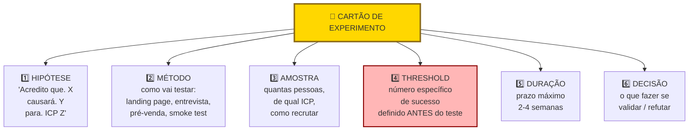

> [!important] Threshold ex-ante é o elemento não negociável
> "Vamos colocar no ar para ver quantos se interessam", sem número pré-definido, é convite aberto à autoindulgência: três vendas viram "sinal promissor de tração" e trinta vendas viram "amostra ainda pequena para concluir". Quando o ponto de corte está travado antes da largada (como dez pré-vendas pagas no ciclo da Fase 8 ou três pagamentos no sprint de 72 horas), a leitura do resultado deixa de depender do humor dos sócios.

EXPERIMENTO #1

Hipótese: Donos de padaria pagariam R$ 400 por mês por loja pelo PadariaPro se a redução de perda for demonstrada em sessenta dias.

Pergunta central: Qual faixa de preço mensal o dono de padaria com 2 a 5 lojas em São Paulo aceita pagar por um sistema de previsão de compras e alerta de estoque de insumos decisivos com garantia de redução de perdas em 60 dias?

Desenho: montar uma página simples no Framer (quatro horas de trabalho) apresentando três planos mensais por loja (R$ 290, R$ 400 e R$ 590) e o botão de chamada para ação "Quero entrar na turma piloto das 10 primeiras padarias". Quando o visitante clica, abre-se um aviso de pré-lançamento acompanhado de formulário que coleta nome, padaria, número de lojas, telefone e intenção de adesão ao plano escolhido caso a previsão automática de demanda seja entregue em sessenta dias (*Fake Door* combinado com carta de intenção de pagamento). Distribuição nos grupos de WhatsApp de panificação e abordagem direta no LinkedIn, ligando em até quarenta e oito horas para cada inscrito a fim de confirmar o compromisso.

Público e dimensionamento de amostra: donos-operadores de padarias artesanais com duas a cinco lojas em São Paulo. Para testes de página com conversão esperada entre 2% e 10%, a regra estatística pede de 300 a 500 visitantes qualificados do ICP. Em nichos B2B restritos, opere por meta absoluta de conversões qualificadas (abordar diretamente 40 decisores via grupos mapeados na Fase 5 para obter ao menos 6 cartas de intenção confirmadas por telefone).

Métrica principal: Taxa de conversão de visitantes ICP em formulários com compromisso de pagamento.

Critério de sucesso: Quinze por cento ou mais dos visitantes ICP preenchem o formulário. Três de cada cinco que atendem à ligação confirmam disposição a pagar R$ 400 por mês.

Critério de refutação: Menos de cinco por cento preenchem o formulário, ou menos de dois em cinco confirmam o preço em chamada. Nesse caso, revisar preço ou proposta de valor antes de continuar.

Duração: Catorze dias.

Custo: R$ 600 em anúncios segmentados no Instagram em São Paulo (usados para equilibrar o viés dos grupos de WhatsApp) e cerca de oito horas de trabalho (quatro para a página e quatro para as ligações de confirmação).

Riscos e vieses metodológicos: preencher um formulário online tem custo zero para o visitante e não equivale a assinar um contrato pago, além do viés de seleção (*selection bias*) caso a divulgação fique restrita a um único grupo de WhatsApp. A ligação de qualificação em 48 horas e a cobrança do piloto pago mitigam o primeiro risco. A distribuição paralela em anúncios geolocalizados e listas da associação setorial mitiga o segundo.

Data de início / fim: Semana 1, Semana 2 do mesmo mês.

**Resultado.** Quarenta e sete visitantes ICP. Doze formulários preenchidos (vinte e cinco por cento). Sete ligações realizadas: quatro confirmaram R$ 290, dois confirmaram R$ 400, um confirmou R$ 590.

**Auditoria da amostra (Passo 6) e checagem de pré-registro (Passo 8).** A coleta atingiu apenas 47 visitantes únicos na página e 7 ligações atendidas, ficando muito abaixo da amostra mínima pré-registrada no cartão (que exigia de 300 a 500 visitantes ou 40 decisores abordados diretamente). Além disso, os 7 donos que atenderam vieram dos grupos de WhatsApp mais próximos dos fundadores, sem separação de rastreamento em relação ao Instagram. Pela regra do Passo 6, amostra insuficiente não autoriza relaxar a meta nem declarar validação.

**Avaliação e Decisão (Passo 9).** Resultado inconclusivo (zona cinzenta) tanto pela amostra abaixo do piso quanto pela taxa intermediária no preço-alvo: 3 dos 7 entrevistados (43%) toparam pagar R$ 400 ou mais (2 em R$ 400 e 1 em R$ 590), enquanto 4 aceitaram o piso de R$ 290/mês (soma de 7 em 7 pagantes em pelo menos R$ 290, mas sobre base de apenas 47 visitantes). Decisão canônica: Ajustar para a única rodada extra permitida pela regra da zona cinzenta, abordando diretamente 20 donos de redes de 2 a 5 padarias fora do círculo de amigos com cobrança de sinal via Pix (testando os planos de R$ 290 e R$ 400/mês com cláusula de reembolso integral em 60 dias).

#### Simulação didática inspirada no setor de HR Tech em Santa Catarina (trajetória de empresas como Pulses e Feedz)

No ecossistema catarinense de tecnologia para recursos humanos, empresas como a Pulses (fundada em Itajaí/SC, focada em clima organizacional e engajamento contínuo por pulsos semanais e adquirida pela Gupy em 2022) e a Feedz (fundada em Joinville/SC e adquirida pela TOTVS em 2021) mostraram a força de resolver dores recorrentes de gestão de pessoas em PMEs e médias empresas. Para ilustrar como uma startup B2B desse segmento valida demanda e disposição a pagar antes de escrever código, acompanhe a simulação didática a seguir:

O time montou uma página em poucos dias prometendo "diagnóstico contínuo de cultura via micropesquisas semanais", com preço explícito por colaborador ao mês, e direcionou tráfego para diretores de RH de médias e grandes empresas pelo LinkedIn e pela rede do setor.

Nessa simulação de pré-venda B2B, em três semanas o experimento enxuto (orçado em cerca de R$ 2.500 entre página, tráfego segmentado e prospecção ativa) permite medir quantas empresas agendam diagnóstico e quantas assinam carta de intenção ou pagam pelo primeiro trimestre manual (entregue via *Concierge* com planilhas e formulários prontos) antes de a equipe investir meses construindo a plataforma definitiva.

Experimento barato antes de construir economiza meses. Pré-venda com carta de intenção (ou pagamento real) de comprador econômico é o teste mais forte de demanda em B2B.

### Critérios de saída com pele em jogo: os pisos de compromisso para Henrique, Lucas e Marina e Rafael e Bia

Você concluiu a Fase 8 quando todos os critérios abaixo estão cumpridos.

- [ ] Três ou mais Cartões de Experimento (Template: Cartão de Experimento (Fase 8)) preenchidos com hipótese, método, amostra, critério de sucesso, duração e custo.
- [ ] Cada experimento com critério de falsificação numérico, pré-definido e distinto do critério de sucesso (zona de incerteza no meio).
- [ ] Tipo de experimento apropriado para o que cada hipótese testa (landing page, fake door, concierge, Wizard of Oz, pré-venda, A/B).
- [ ] Três ou mais experimentos executados dentro da janela de duas a três semanas, com dados objetivos coletados.
- [ ] Banco de Hipóteses atualizado com status pós-experimento (uma ou mais invalidadas conta como aprendizado).
- [ ] Decisão canônica documentada ao final de cada experimento concluído (Perseverar, Ajustar, Pivotar ou Abandonar), acompanhada do respectivo registro de aprendizado no Banco de Hipóteses.
- [ ] Evidência forte de três coisas: o problema é real e doloroso para o ICP, o ICP está disposto a pagar (carta de intenção ou pré-venda), pelo menos um canal de aquisição possível.
- [ ] Critério de compromisso atingido conforme o modelo de negócio e a origem do tráfego: em B2B enterprise (como Henrique nas usinas e cooperativas), 2 pilotos pagos ou **3 a 5 cartas de intenção (*LOIs*) assinadas pelo detentor do orçamento com preço e data de início, em SaaS para PME (como Lucas e Marina e o PadariaPro), 10 pré-vendas pagas (ou 20 reservas formais em tickets de entrada abaixo de R$ 150/mês), em D2C (como Rafael e Bia), 50 pedidos pagos vindos de tráfego frio** (ou 100 *leads* qualificados em página de pré-venda convertendo acima de 15%).
- [ ] Benchmarks de resultado por tipo de experimento documentados quando aplicáveis: landing page (>5% bom, >10% forte, <2% fraco em e-mail cadastrado), pré-venda (acima de 20% de avanço para reunião de fechamento e acima de 10% de conversão paga, como referência prática deste manual), concierge (ao menos 3 de 5 clientes renovam ou indicam um par), Mágico de Oz (uso repetido superior a 2 vezes por semana).
- [ ] Custo direto por experimento enxuto mantido na faixa de R$ 500 a R$ 2.000 para testes digitais rápidos (*smoke tests*, *fake doors* e pré-vendas em PME/D2C). Qualquer experimento de Fase 8 cujo orçamento passe de R$ 3.000 (ou de R$ 5.000 no caso de pilotos *Concierge* e *Mágico de Oz* de 4 a 8 semanas em B2B) deve ser fatiado em um teste menor antes de liberar o gasto.
- [ ] Velocidade de aprendizado de duas ou mais hipóteses bet-the-company resolvidas por mês em early-stage, quatro ou mais por mês em fase de MVP.
- [ ] Decisão final tomada (perseverar, pivotar, abandonar) e ação iniciada.

> [!warning] Critério de saída
> Os 5% (bom) e 10% (forte) descritos nos passos anteriores são benchmarks de leitura de sinal: indicam que a promessa ressoa o suficiente para continuar testando. Os 15% acima são critério de saída de fase: exigem sinal inequívoco antes de comprometer recursos para construir. Conversão entre 10% e 15% é zona ambígua, exige experimento adicional (preço diferente, segmento mais estreito, oferta mais específica) antes de avançar.

**Primeiros passos práticos de execução.**

1. Escolher as três hipóteses de maior risco não testadas, e desenhar um experimento para cada (Template: Cartão de Experimento (Fase 8)).
2. Estimar o orçamento e a duração de cada teste: experimentos digitais de oferta devem caber em 2 a 3 semanas e até R$ 2.000 (se um desenho passar de R$ 3.000 em teste digital, de R$ 5.000 em operação *Concierge* ou de 30 dias sem entregar resultado intermediário, quebre-o em uma verificação mais simples).
3. Executar o experimento mais barato primeiro. Geralmente landing page ou fake door.
4. Registrar o resultado em planilha, com decisão associada.

### Seis armadilhas de experimentação: por que mil cadastros grátis valem menos que dez pagamentos

Experimentos desenhados para validar, não para descobrir. Se a pessoa ama o empreendedor, o "experimento" sai positivo. Controle o viés.

Critérios de sucesso frouxos. "Vou considerar sucesso se alguém demonstrar interesse." Quase qualquer coisa vira sucesso. Seja rigoroso.

Ignorar resultados negativos. Muitos empreendedores desvalorizam dados contrários. "Esse grupo não era o público certo." Se você precisa justificar por que o resultado ruim "não conta", está fugindo da verdade.

Gastar muito em experimentos. Se um teste simples de página de captura custa mais de R$ 2.000 ou passa de duas semanas (ou se um Concierge passa de oito semanas sem cobrar), o experimento está inchado demais. Vá mais simples.

Testar uma hipótese em vez da outra. Às vezes o que você testa não mede o que você acha. Pré-venda de um produto que não existe testa proposta mais preço mais timing. Não testa se o produto funcionaria. Saiba o que está medindo.

Não documentar o experimento. Sem registro escrito antes e depois, você reconstrói a narrativa para se beneficiar. Escreva antes e depois.

---

### O Espelho da Fase 8: Você Tem Recibos na Mão ou Apenas Cadastros de Curiosos?

**Decisão na trincheira (Fase 8):** Entre São Paulo e Florianópolis, Lucas e Marina aplicaram o Espelho da Fase 8 aos resultados do sprint de conciliação financeira: como os 3 pagamentos via Pix de R$ 1.500 na primeira sexta-feira provaram a dor nas 25 empresas abordadas, mas o portão de saída da fase exigia 10 pré-vendas pagas, eles recusaram a tentação de parar a venda para programar e rodaram mais duas semanas de operação manual no estilo *Mágico de Oz* até fechar o 10º contrato pago.

**O Espelho (autodiagnóstico):**
1. No seu último experimento, o ponto de corte numérico de refutação estava escrito antes de abrir a planilha de resultados? *(Responda Sim ou Não para as três perguntas, se responder "Não" a duas ou mais, você caiu no Teatro da Validação e deve tratar o teste como inconclusivo.)*
2. No seu último teste de oferta, a evidência principal veio de uma moeda real de compromisso (pagamento via Pix/cartão, piloto pago ou carta de intenção assinada pelo dono do orçamento), e não apenas de elogios ou respostas em formulário gratuito?
3. Quando um experimento caiu abaixo do ponto de corte de validação, você respeitou a regra de fazer no máximo uma rodada extra na zona cinzenta ou de pivotar imediatamente, sem inventar desculpas para mudar a meta depois de ver os números?

**Permissão Libertadora:**
Você está autorizado a fazer coisas que não escalam. Processar os primeiros vinte pedidos manualmente no Excel e no WhatsApp longe de ser amadorismo é a maneira mais rápida e barata de descobrir o que realmente precisa ser automatizado depois.

**O Ritual de Segunda-Feira às 9h:**
Toda segunda-feira, das 9h às 9h30, abra o Banco de Hipóteses com os sócios, audite os números colhidos na semana anterior sem mexer na régua pré-registrada e preencha o Cartão de Experimento da aposta seguinte (cravando, por exemplo, que na rodada de pré-venda a PMEs pelo menos 3 em 5 clientes abordados precisam pagar o sinal para Perseverar, enquanto 0 ou 1 pagamento obriga a Refutar/Pivotar e 2 pagamentos acionam a regra da zona cinzenta). Só saia da reunião com as cinco abordagens da semana agendadas.

---

### MÉTRICAS E BENCHMARKS DESTA FASE (FASE 8)

| Métrica | O que medir | Referência saudável |
|---|---|---|
| Taxa de confirmação de hipóteses individuais | % de hipóteses suportadas vs. refutadas | 30% a 50% (heurística prática deste manual: como um ciclo depende de várias premissas, basta uma aposta vital cair para exigir ajuste ou pivô em ~9 de 10 ciclos) |
| Velocidade de aprendizado | Hipóteses decisivas (vida ou morte) resolvidas por mês | ≥ 2 a 4 hipóteses decisivas concluídas por mês |
| Critério de saída em pré-venda / LOI | Compromisso comercial antes do MVP | ≥ 10 pré-vendas pagas em PME, ≥ 2 pilotos pagos (ou 3 a 5 LOIs assinadas por decisores) em B2B enterprise, ou ≥ 20 reservas em tickets menores |
| Pre-registro | % dos experimentos com hipótese registrada antes | 100% |
| Evidência qualitativa | Entrevistas de validação complementares | ≥ 5 por experimento decisivo |
| Compromissos com pele em jogo | Pagamentos antecipados, pilotos pagos ou LOIs (e hipóteses vitais resolvidas/mês) | 10 pré-vendas PME, 2 pilotos (ou 3 a 5 LOIs) enterprise ou 50 pedidos D2C (≥ 2 apostas/mês) |

---

### Oficina de Trincheira da Fase 8: manual passo a passo dos frameworks de experimentação

> [!tip] Uso autocontido neste volume
> > Os frameworks abaixo detalham a caixa de ferramentas de experimentação da Fase 8, com origem, estrutura, passo a passo e armadilhas de execução.

#### Framework: Pretotyping (Alberto Savoia, 2011)

##### De onde vem a ferramenta (e por que sobreviveu ao filtro do tempo)

Alberto Savoia, ex-diretor de engenharia e líder de inovação do Google nas primeiras fases do AdWords, cunhou o termo *pretotype* (pretótipo) por volta de 2011 e sistematizou o método no livro *The Right It* (2019). A distinção central de Savoia separa o pretótipo (que testa em horas ou dias se aquela é *a coisa certa a construir*, ou *build the right it*, validando se existe demanda real antes de investir) do protótipo (que investiga como *construir a coisa direito*, ou *build it right*, testando usabilidade, fluxo e viabilidade técnica nas Fases 9 e 10). Segundo a Lei do Fracasso de Mercado formulada pelo autor, a maioria dos novos produtos fracassa não por incompetência de engenharia, mas porque equipes brilhantes constroem com perfeição algo que o mercado não quer comprar.

##### A mecânica central (sem jargão)

Conjunto de técnicas rápidas e baratas para validar demanda por uma solução antes de gastar tempo construindo-a. Oito técnicas principais: (1) *The Pinocchio*, construir maquete não funcional e testar se uso surge, (2) *The Mechanical Turk*, simular automação com humano por trás, (3) *Fake Door*, colocar botão/feature que não existe e medir clicks, (4) *One-Night Stand*, pretotipo funcional por um único uso, (5) *The Impersonator*, usar produto existente sob sua marca para testar demanda, (6) *The Relabel*, mudar apenas etiqueta/nome, (7) *The YouTube*, fazer vídeo demo do produto que ainda não existe, (8) *Provincial*, testar em um mercado pequeno antes de lançar global.

##### As regras do jogo

Ideia somada a dados reais de comportamento supera qualquer coleção de opiniões. Dados do tipo YODA (*Your Own Data*, colhidos em experimentos ativos com *skin in the game*) valem ordens de grandeza mais do que pesquisas hipotéticas. Enquanto um pretótipo com ponto de corte (*threshold*) definido se monta em horas ou poucos dias para simular uma solução que ainda não existe, um protótipo funcional ou MVP consome semanas ou meses de engenharia.

##### Passos práticos de implantação

Para cada hipótese de produto: identificar qual é a decisão binária "vamos construir ou não". Escolher uma das oito técnicas que melhor responde essa decisão. Definir threshold de sucesso antes do experimento (quantos clicks no fake door? quantas compras no One-Night Stand?). Rodar por 1-7 dias. Decidir na base dos dados, não do desejo.

##### Na trincheira real: como isso funciona na prática

Caso clássico: Airbnb em 2007. Antes de escreverem uma plataforma global de hospedagem, Brian Chesky e Joe Gebbia compraram três colchões infláveis (*air mattresses*) e criaram uma página simples oferecendo pouso e café da manhã na sala do próprio apartamento durante uma conferência internacional de design em São Francisco, quando todos os hotéis da cidade estavam lotados. Três hóspedes pagaram US$ 80 cada um para dormir nos colchões infláveis. Aquele pretótipo provou com dinheiro real que desconhecidos topavam pagar para se hospedar na casa de outra pessoa quando havia escassez de hotel e preço acessível, destravando a tese do negócio.

Exemplo brasileiro: o início do Gympass (fundado em 2012 em São Paulo por Cesar Carvalho e renomeado Wellhub em 2024). A empresa começou vendendo diárias e pacotes avulsos diretamente ao consumidor final (B2C), sem produto corporativo pronto. Os testes iniciais de demanda mostraram que as academias temiam canibalizar seus alunos diretos, mas que os departamentos de RH das empresas pagariam por um benefício corporativo unificado para funcionários sedentários, originando o pivô para o modelo B2B2C.

##### Onde o papel aceita tudo (armadilhas de execução)

(1) Pretótipo sem limiar numérico definido antes da coleta vira teatro. (2) Confundir pretótipo com MVP: o MVP é uma versão mínima que entrega o serviço, o pretótipo apenas simula uma oferta para medir compromisso de compra. (3) Ignorar um resultado negativo dizendo "mas eu acho que vai funcionar": dado coletado em campo supera opinião interna. (4) Rodar uma única variação sem contexto: testar duas ofertas de preço ou canal ajuda a separar rejeição do canal de rejeição da proposta.

---

#### Framework: *Customer Development* (Steve Blank, *The Four Steps to the Epiphany*, 2005, 2ª ed. K&S Ranch, 2013. Ed. Wiley, 2020)

##### De onde vem a ferramenta (e por que sobreviveu ao filtro do tempo)

Steve Blank, fundador de oito startups e professor de Stanford/Berkeley, sistematizou Customer Development a partir de suas próprias experiências como fundador nos anos 1980-1990. Primeiro artigo em 2005, livro de referência *The Four Steps to the Epiphany* (2005) e *The Startup Owner's Manual* (2012, com Bob Dorf). É o framework que inspirou diretamente o Lean Startup de Eric Ries (seu aluno). Distinção central entre Customer Development (externo, descoberta e validação com clientes) e Product Development (interno, construção do produto), operando em paralelo.

##### A mecânica central (sem jargão)

Processo de quatro etapas sequenciais: (1) Customer Discovery: formular e testar hipóteses sobre quem é o cliente e qual problema eles têm, (2) Customer Validation: confirmar que os clientes pagarão pela solução proposta, construindo processo de venda repetível e escalável, (3) Customer Creation: crescer demanda no mercado primário e secundário, (4) Company Building: transição de modo "startup de busca" para modo "empresa de execução". As duas primeiras etapas são iterativas, o processo pode voltar a Discovery quando Validation revela que problema estava mal formulado.

##### As regras do jogo

*"Get out of the building"* é o princípio central de Steve Blank: nenhuma hipótese sobre o problema ou o comprador sobrevive trancada no escritório. Uma startup não é a miniatura de uma grande corporação, mas uma organização temporária desenhada para descobrir um modelo de negócio repetível e escalável, operar com departamentos rígidos antes dessa descoberta queima caixa sem validar a tese.

##### Passos práticos de implantação

Na etapa de *Customer Discovery* (Descoberta do Cliente), os fundadores conduzem de 30 a 60 entrevistas estruturadas em campo para separar fatos de opiniões sobre o problema e o perfil do comprador, trabalho detalhado na [[IGNICAO-Vol-2-Descoberta-e-Mercado#FASE 4: DESCOBERTA DO PROBLEMA|Fase 4: Descoberta do Problema (Vol. 2)]] e na [[IGNICAO-Vol-2-Descoberta-e-Mercado#FASE 5: PESQUISA COM USUÁRIOS (CUSTOMER DISCOVERY)|Fase 5: Pesquisa com Usuários (Vol. 2)]]. Na etapa seguinte, *Customer Validation* (Validação do Cliente, núcleo desta Fase 8 e das Fases 11 e 12 no Volume 4), o objetivo é provar que clientes reais pagam pela oferta e que existe um roteiro de vendas repetível antes de contratar uma equipe comercial. As duas últimas etapas de Blank, *Customer Creation* (Criação de Demanda em escala) e *Company Building* (Estruturação da Empresa em departamentos formais), só começam após a confirmação do *Product-Market Fit* ([[IGNICAO-Vol-4-Tracao-e-PMF#FASE 13: PRODUCT-MARKET FIT|Fase 13 (Vol. 4)]]) e correspondem às Fases 14 a 18 nos Volumes 5 a 8.

Origem prática: Steve Blank desenvolveu as bases do *Customer Development* refletindo sobre as oito empresas de tecnologia das quais participou no Vale do Silício, incluindo a E.piphany (empresa de software corporativo de CRM e análise de dados de clientes cofundada em 1996, que abriu capital na Nasdaq em setembro de 1999). Como Blank relata em *The Four Steps to the Epiphany*, nos primeiros meses da E.piphany os fundadores saíram pessoalmente a campo para entrevistar executivos de grandes corporações e descobriram que a dor urgente não estava em mais um gerador de relatórios técnicos para analistas, e sim em integrar dados espalhados em múltiplos bancos corporativos para uso direto dos gestores de negócios. Essa mudança de rota guiada pelos clientes antes de escalar a força de vendas inspirou a distinção entre *Customer Discovery* e *Customer Validation*.

##### Onde o papel aceita tudo (armadilhas de execução)

Quatro armadilhas clássicas no *Customer Development*: (1) pular a etapa de *Customer Discovery* por ansiedade de programar logo o produto, o erro mais caro do empreendedorismo de tecnologia, (2) confundir o método de Blank com grupos focais ou pesquisas estatísticas genéricas, quando a descoberta exige conversas individuais centradas em comportamento passado, (3) encerrar a atenção logo após apresentar o produto, perdendo as reações e objeções espontâneas que vêm na sequência, e (4) achar que o *Lean Startup* substituiu o *Customer Development*, quando na verdade o ciclo Construir-Medir-Aprender depende diretamente da descoberta de campo proposta por Blank.

---

#### Framework: Build-Measure-Learn Loop (Eric Ries, 2011)

##### De onde vem a ferramenta (e por que sobreviveu ao filtro do tempo)

Eric Ries, aluno de Steve Blank em Berkeley e ex-fundador/CTO da IMVU, popularizou o ciclo Build-Measure-Learn no livro *The Lean Startup* (2011). Adaptou princípios do *Lean Manufacturing* de Toyota (minimizar desperdício, feedback rápido) para o contexto de desenvolvimento de produtos digitais em startups. Tornou-se o framework mais influente de empreendedorismo pós-2011, adotado por Google, GE, aceleradoras globais e disciplinas de empreendedorismo em universidades.

##### A mecânica central (sem jargão)

Ciclo iterativo de três etapas: Build (construir o menor experimento possível, MVP, para testar uma hipótese), Measure (coletar dados de uso, comportamento, feedback), Learn (decidir *continuar*, *pivotar*, ou *matar* com base no aprendizado). O objetivo não é entregar produto rápido, é acelerar o *aprendizado validado* sobre o que funciona e o que não funciona. Cada ciclo é curto (dias a semanas), múltiplos ciclos formam a jornada de validação.

##### As regras do jogo

Três conceitos sustentam o método de Eric Ries: o aprendizado validado (*validated learning*), segundo o qual o único progresso real em condições de incerteza extrema é aprender com evidência empírica o que o cliente valoriza e paga (já que entregar funcionalidades que ninguém usa é puro desperdício). A contabilidade da inovação (*innovation accounting*), que mede a evolução da startup por métricas acionáveis de retenção por safra e conversão em cada etapa do funil, e nunca por métricas de vaidade como total acumulado de cadastros ou visualizações de página, e a decisão explícita de pivotar ou perseverar (*pivot or persevere*) ao final de cada ciclo experimental.

##### Protocolo prático de execução

Para cada hipótese de produto: (1) defina a métrica que validará ou refutará a premissa, (2) construa o veículo mínimo de teste (pretótipo, *landing page*, *Concierge* ou protótipo funcional), (3) execute o experimento até reunir a amostra mínima definida, (4) confronte o número obtido com o *threshold* pré-registrado, e (5) feche o ciclo em uma página documentando uma das quatro decisões canônicas: Persevere, Ajuste, Pivote ou Abandone.

Aplicação histórica: Dropbox em 2008. A hipótese central de Drew Houston era que usuários comuns trocariam o hábito de enviar anexos por e-mail ou usar *pen drives* se a sincronização de arquivos funcionasse de forma invisível como uma pasta normal do sistema operacional. O desafio técnico exigia meses de engenharia pesada para suportar múltiplos sistemas operacionais e redes instáveis (Fase 8 / Pré-lançamento). Embora já tivesse um protótipo técnico inicial rodando em beta fechado, antes de investir anos escalando a infraestrutura multiplataforma, Houston gravou um vídeo de demonstração de 3 minutos cheio de referências bem-humoradas para a comunidade tecnológica do portal Digg (Construir). Da noite para o dia, a fila de espera saltou de 5.000 para 75.000 inscritos (Medir), comprovando a urgência da demanda e dando segurança para priorizar as integrações que os próprios usuários pediram nos comentários (Aprender).

##### Onde o papel aceita tudo (armadilhas de execução)

Quatro desvios que desfiguram o ciclo *Build-Measure-Learn*: (1) etapa de construção (*Build*) longa demais, levando meses até o primeiro teste real em vez de dias ou poucas semanas, (2) métrica vaga como "engajamento geral", em vez de um indicador acionável como retenção na segunda semana ou conversão em pré-venda, (3) etapa de aprendizado (*Learn*) que termina num vago "vamos continuar melhorando" sem decisão explícita entre Persevere, Ajuste, Pivote ou Abandone, e (4) confundir velocidade de entrega de código (*Agile*) com validação de modelo de negócio (*BML*).

---

#### Framework: Survey Design (Don Dillman & Jon Krosnick, padrão moderno)

##### De onde vem a ferramenta (e por que sobreviveu ao filtro do tempo)

Don Dillman (Washington State University) é referência global em metodologia de questionários: da obra inaugural *Mail and Telephone Surveys: The Total Design Method* (1978) à 4ª edição de *Internet, Phone, Mail, and Mixed-Mode Surveys: The Tailored Design Method* (2014, com Jolene Smyth e Leah Christian). Jon Krosnick (Stanford) complementa com pesquisa sobre como formular perguntas para minimizar viés de resposta. Juntos, são os dois nomes mais citados em literatura acadêmica de surveys.

##### A mecânica central (sem jargão)

Coleção de técnicas cientificamente validadas para formular, administrar e analisar surveys de forma a minimizar viés e maximizar validade. Fundador que aplica "4 perguntas no Google Forms" sem rigor coleta dados enganadores, pior que não coletar.

##### As regras do jogo

Erros comuns em surveys informais:

- Leading questions: "você concorda que X é importante?"
- **Pergunta dupla (*double-barreled*)**: *"O sistema de conciliação é rápido e fácil de integrar ao seu banco?"* (mistura velocidade e facilidade de integração na mesma resposta, separe sempre em duas perguntas distintas).
- Vagueness: "você usa com frequência?" (frequência o quê? Por dia/semana/mês?).
- Ordem enviesada: pergunta sobre satisfação após elogio enviesa, após reclamação, enviesa outro jeito.
- Escalas inconsistentes: ora 1-5, ora 0-10, confunde.
- Amostra auto-selecionada: só respondem quem já gosta.

Princípios de design rigoroso:

1. Objetivos claros: cada pergunta deve ter propósito de uso específico.
2. Perguntas específicas, concretas, unidimensionais.
3. Escalas consistentes (1-5 ou 0-10, usar uma).
4. Embaralhe a ordem apenas nas alternativas sem hierarquia natural (listas de dores, marcas ou funções) e mantenha a ordem lógica nas escalas ordinais (como nunca, às vezes, sempre).
5. Amostragem representativa (não só quem responde voluntário).
6. Tamanho de amostra suficiente para poder estatístico.
7. Piloto: testar survey com 10-20 pessoas antes de rodar em escala.

##### Execução prática com a equipe

Passo 1: Defina pergunta de pesquisa: "qual fração do nosso ICP está insatisfeita com solução atual?"

Passo 2: Desenhe amostra. Probabilística (ideal) ou pragmática (definida). Evitar "quem abrir o link".

Passo 3: Formule perguntas:

- Comportamentais: "na última semana, quantas vezes você usou X?"
- Atitudinais: "em escala 1-5, quão frustrado ficou com Y?"
- Factuais: "em que faixa de receita sua empresa está?"

Passo 4: Calcule tamanho de amostra. Para populações grandes, margem de erro 5% em CI 95% ≈ 385 respostas. Calculadoras online fazem o cálculo.

Passo 5: Piloto: 10-20 respostas, ajustar ambiguidades.

Passo 6: Distribua: mix de canais para reduzir viés (email, social, CRM).

Passo 7: Analise: estatística descritiva + cruzamentos por segmento + teste de significância quando comparar grupos.

##### Na trincheira real: como isso funciona na prática

Survey para validar dor em PMEs brasileiras:

- População: PMEs brasileiras com 5-100 funcionários.
- Amostra alvo: 400 respostas.
- Canais: email do próprio CRM + 2 parceiros (contabilidades) + anúncio LinkedIn.
- Perguntas:

 1. Em quais dos seguintes processos você gasta mais tempo por semana? (multi-select).
 2. Especificamente em [processo top], quantas horas/semana? (faixas).
 3. Em escala 1-5, quão frustrado você está com esse processo?
 4. Você já pagou por solução para este processo? Quanto?
 5. Dados demográficos (setor, porte, localização).

Insights (n=412):

- 68% respondem "gestão financeira" como top 3, 41% como #1.
- Entre os que citam financeiro como top: 73% gastam 5+ horas/semana, 22% gastam 15+.
- Frustração média 3.8/5 (alta).
- 34% já pagaram por solução, ticket médio R$ 180/mês.

Implicação (exemplo ilustrativo): sinal forte de dor entre clientes da base e contatos de parceiros, restando validar a mesma conversão em tráfego frio fora da rede próxima.

##### Onde o papel aceita tudo (armadilhas de execução)

- **Perguntas indutoras (*leading questions*)**: *"Você concorda que o nosso painel automatizado economiza horas da sua equipe?"* (induz o entrevistado a concordar por educação, pergunte sempre como ele executa a tarefa hoje e quanto tempo gastou na última semana).
- Amostra enviesada: ouvir apenas clientes já satisfeitos da própria base.
- Amostra pequena demais: 30 respostas em pesquisa quantitativa não permitem generalizar.
- Ignorar o viés de não resposta: se só 10% responderam, quem são os outros 90%?
- Questionário longo demais: 25 perguntas geram abandono alto e respostas apressadas.

---

#### Framework: Conjoint Analysis (Paul Green, 1971)

##### De onde vem a ferramenta (e por que sobreviveu ao filtro do tempo)

Paul Green, professor da Wharton, e V. Srinivasan (Stanford) desenvolveram conjoint nos anos 1970 para analisar preferências de consumidores. "Conjoint Measurement for Quantifying Judgmental Data" (Green & Rao, 1971) é paper seminal. Hoje é padrão em pricing research, product positioning e desenvolvimento de produto em empresas como McKinsey, Bain, e grandes CPGs.

##### A mecânica central (sem jargão)

Técnica estatística que **decompõe preferências declaradas** em valor relativo de cada atributo que compõe a oferta. Usa o fato que consumidores fazem tradeoffs: não queremos tudo, negociamos features vs. preço vs. outras dimensões.

##### As regras do jogo

Problema que resolve: pergunte diretamente "quanto você pagaria por feature X?", respostas são infladas. Conjoint apresenta bundles realistas (ex.: "feature A + B + preço R$ 80/mês" vs. "feature C + D + preço R$ 150/mês") e pede preferência. Decompor matematicamente revela valor de cada atributo.

Tipos:

- CBC (Choice-Based Conjoint): mais popular. Usuário escolhe entre 2-3 bundles.
- Adaptive Choice-Based: dinamicamente ajusta opções.
- **MaxDiff** (*Maximum Difference Scaling*, Louviere & Woodworth, 1990, difundido pela Sawtooth Software): variação experimental focada em ranquear atributos individuais por escolha forçada entre pares de melhor e pior opção.

##### Roteiro de aplicação prática na operação

Passo 1: Defina 3-6 atributos com 2-4 níveis cada, por exemplo: pricing (R$ 50/100/200/400), suporte (email/chat/telefone/dedicado), features (básico/avançado/premium), etc.

Passo 2: Use ferramenta especializada: Sawtooth (padrão), Conjoint.ly, Qualtrics. DIY em Excel é possível mas limitado.

3. **Filtro de estágio e amostra (regra de ouro para não queimar caixa cedo demais):** Só aplique *Conjoint Analysis* ou *MaxDiff* quando a startup já possuir uma base acessível de 200 a 500 clientes ou prospectos qualificados do ICP e orçamento para software de pesquisa (momento típico de otimização de pacotes pós-MVP na Fase 12 e no Capítulo 6 do Volume 4). Durante a Fase 8, dentro do teto enxuto de R$ 500 a R$ 2.000 por teste digital, substitua o Conjoint por experimentos diretos de pré-venda ou página de teste comparando duas faixas reais de preço.

Passo 4: Desenho experimental: ferramenta gera bundles a mostrar (fractional factorial design).

Passo 5: Respondente escolhe entre bundles. Típico: 10-20 cenários.

Passo 6: Análise estatística: ferramenta calcula utilidades (part-worths) de cada nível de cada atributo.

Passo 7: Interpreta: qual atributo tem maior importância? Qual nível maximiza preferência?

Passo 8: Simulação: testa cenários de bundle novo vs. concorrência.

##### Na trincheira real: como isso funciona na prática

Conjoint para definir pricing e features de SaaS B2B:

Atributos:

- Preço: R$ 50, 100, 200, 400/mês.
- Suporte: email / chat / telefone / dedicado.
- Features: básico (só core), avançado (+relatórios), premium (+integrações).
- Contrato: mensal / anual com desconto.

Resultado (n=320 respondentes ICP):

- Preço é 45% da importância (sensibilidade alta).
- Features 25%.
- Suporte 20%.
- Contrato 10%.

Utilidades de preço: R$ 50 (+1,0), R$ 100 (+0,9), R$ 200 (+0,6), R$ 400 (-2,5). Entre R$ 50 e R$ 100 a perda de preferência é mínima, em R$ 200 ainda há utilidade positiva, e acima de R$ 200 a rejeição dispara.

Insight: empresa pode ir até R$ 200 sem perder muitos, acima disso, abandona. Features intermediárias (avançadas) são "sweet spot", premium agrega pouco incremental vs. avançado.

##### Onde o papel aceita tudo (armadilhas de execução)

Quatro armadilhas invalidam uma pesquisa de *Conjoint Analysis*: incluir mais de cinco ou seis atributos simultâneos, o que gera fadiga cognitiva e leva o respondente a chutar, testar faixas de preço irreais que distorcem a elasticidade calculada, tratar a escolha declarada no questionário como substituto do comportamento real de compra (valide sempre a combinação vencedora com pré-venda ou teste A/B de cobrança), e rodar a pesquisa em painéis genéricos de consumidores que não pertencem ao ICP da empresa.

---

#### Framework: MaxDiff Analysis (Louviere & Woodworth, 1990. Popularizado por Sawtooth)

##### De onde vem a ferramenta (e por que sobreviveu ao filtro do tempo)

Jordan Louviere e George Woodworth desenvolveram o método em 1990. Consolidou como alternativa pragmática a ranking para casos com muitos itens. Popularizou via Sawtooth Software nos anos 2000.

##### A mecânica central (sem jargão)

Técnica estatística para **priorizar um conjunto de atributos ou itens**. Respondente vê subsets de 4-5 itens e escolhe o mais importante e o menos importante (maximum difference). Repetido várias vezes, gera ranking completo com precisão estatística.

##### As regras do jogo

Problema que resolve: quando você tem 20 features candidatas e quer saber quais priorizar, perguntar "em escala 1-10, quão importante é X?" 20 vezes gera ratings inflacionados (tudo parece 8-9). MaxDiff força tradeoffs.

##### Roteiro de aplicação prática na operação

Passo 1: Liste 15-30 itens a priorizar.

Passo 2: Ferramenta gera subsets: cada respondente vê ~12-15 sets de 4-5 itens.

Passo 3: Em cada set, respondente escolhe mais importante + menos importante.

Passo 4: Análise: algoritmo calcula score de importância de cada item (Hierarchical Bayes é padrão).

Passo 5: Ranking estatisticamente válido.

##### Na trincheira real: como isso funciona na prática

MaxDiff para priorizar 20 features candidatas:

- **Amostra e estágio de aplicação:** 200 a 250 clientes ativos ou prospectos qualificados do ICP (aplicável na evolução de pacotes pós-MVP ou em empresas que já contam com lista qualificada de usuários, para um MVP inicial de três telas nas Fases 8 a 10, priorize pelo método MoSCoW e por testes diretos de pagamento).

Resultado (top 5 e bottom 5):

Top 5 (prioridade alta):

1. Integração automática com bancos (score 9.2/10).
2. Relatório fiscal simplificado (8.7).
3. Dashboard móvel (7.8).
4. Notificações inteligentes de vencimento (7.2).
5. Importação de extratos PDF (6.9).

Bottom 5 (baixa prioridade):
16. Integração com Zapier (2.1).
17. Tema dark mode (1.8).
18. Modo offline (1.3).
19. Widget de calendário (1.1).
20. Assinatura eletrônica (0.8).

Insight: roadmap focado em integrações bancárias e relatórios fiscais, features como dark mode, Zapier, offline ficam para depois. Validação quantitativa clara.

##### Onde o papel aceita tudo (armadilhas de execução)

- **Itens sobrepostos na lista:** incluir atributos quase idênticos (como "painel mobile" e "aplicativo iOS") divide artificialmente os votos do respondente.
- **Amostra pequena (n < 100):** rodar MaxDiff com menos de cem respondentes qualificados reduz a estabilidade estatística do ranking.
- **Descrições ambíguas:** redigir atributos vagos faz cada participante imaginar uma funcionalidade diferente ao votar.

---

### Quadros Visuais da Fase 8: o Test Card e o Learning Card na prática

#### Canvas: Test Card (David Bland & Alexander Osterwalder, 2019)

##### Por que este quadro visual foi criado

O Test Card ganhou circulação ampla com *Value Proposition Design* (2014) e foi expandido em *Testing Business Ideas* (David J. Bland e Alexander Osterwalder, 2019), na coleção Strategyzer (a mesma do Business Model Canvas e do Value Proposition Canvas), estruturando-se originalmente em quatro frases: *Nós acreditamos que. Para verificar isso, nós vamos. E mediremos. Estamos certos se.* É a sistematização, em formato de cartão único, do que já era prática no Lean Startup desde Eric Ries (2011): para cada hipótese, defina o experimento que vai testá-la antes de coletar dados, com critério de sucesso explícito. Na adaptação adotada por este manual, acrescentamos ao cartão original o critério numérico de refutação e a zona cinzenta explícita para blindar a decisão contra racionalizações.

O Cartão de Experimento utilizado nesta fase adapta o *Test Card* de David J. Bland e Alexander Osterwalder (Strategyzer) para o contexto brasileiro, diferenciando de forma explícita o limiar de sucesso (*threshold* de validação) e o limiar de refutação, com a zona cinza delimitada no intervalo entre ambos.

##### A anatomia visual de uma página

Cartão de uma página alinhado ao modelo completo da seção de Templates desta fase, reunindo os blocos de pré-registro e decisão:

- **ID do experimento** (numeração sequencial).
- **Hipótese testada** (uma frase falsificável copiada do banco de hipóteses).
- **Pergunta central** (o que especificamente queremos responder).
- **Desenho** (passo a passo do experimento).
- **Público** (quantas pessoas, qual perfil, como alcançadas).
- **Métrica principal e critério de sucesso** (definido antes de ver dados).
- **Critério de refutação** (o que invalida a hipótese: também antes).
- **Custo e duração** (orçamento e prazo).

Após o experimento, o cartão se completa com:

- **Resultado observado**.
- **Decisão** (Persevere / Ajuste / Pivote / Abandone).
- **Aprendizados** (o que isso nos ensina sobre o modelo).

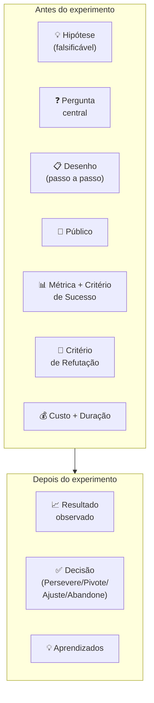

A disciplina central é definir Critério de Sucesso e Critério de Refutação ANTES de rodar o experimento. Times que definem critério depois invariavelmente racionalizam os dados a favor da hipótese ("converteu menos do que esperávamos, mas ainda é positivo porque."). Critério pré-definido evita auto-engano.

##### O momento exato de colocar este canvas na parede

Use o Test Card na Fase 8 (experimentos de validação do problema e da solução) como artefato central, mantendo um cartão ativo para cada experimento, e crie os primeiros cartões já no fechamento da Fase 7 logo após selecionar as apostas de vida ou morte. O resultado de cada Test Card alimenta diretamente a priorização de protótipos na Fase 9.

##### As regras de ouro para preencher sem se enganar

**Princípio inegociável na adaptação deste manual**: defina sempre o número de validação, o número de refutação e a faixa de zona cinzenta antes de iniciar o experimento, impedindo que resultados intermediários sejam reinterpretados como vitória.

##### Passo a passo na parede da sala

Para cada hipótese a testar, abrir um Test Card. Tempo de preenchimento: 30-45 min. Participantes: 2-3 pessoas (PM + tech/design + 1 fundador).

1. **Hipótese**: copie do Banco de Hipóteses da Fase 7 e escreva como afirmação falsificável ("pelo menos 8% dos visitantes qualificados da página se cadastrarão em até 7 dias", e nunca "as pessoas vão gostar").
2. **Pergunta central**: o que estamos testando especificamente? Frequentemente é o coração da hipótese reformulado.
3. **Desenho**: descreva o passo a passo concreto do experimento, especificando qual página de destino será publicada, quais anúncios ou abordagens diretas serão disparados e para qual público exato.
4. **Público**: N planejado, perfil específico, canal. "100 visitantes ICP via Meta Ads" é diferente de "100 visitantes quaisquer".
5. **Métrica + Critério de Sucesso**: definir antes. "Sucesso = 8% de conversão visitante → cadastro em 14 dias."
6. **Critério de Refutação**: também antes. "Abaixo de 2% = hipótese refutada."
7. **Custo e Duração**: R$ X (Ads + ferramenta) + Y dias.
8. **Riscos e vieses**: o que pode distorcer? Tráfego ruim? Dia da semana? Novidade?

Rodar o experimento. Atualizar o cartão com resultado, decisão e aprendizados.

**Regra de decisão**: as faixas de validação e de descarte devem ser separadas por uma zona cinzenta explícita (de 2% a 8% no exemplo acima). Cair na zona cinzenta dá direito a um único experimento adicional, redesenhado com novo preço ou subsegmento, se o segundo teste cair novamente na zona cinzenta, pivote.

##### Exemplo brasileiro preenchido: PadariaPro, smoke test e abordagem de pré-venda (caso didático da coleção, 2026)

A equipe do PadariaPro (nosso caso recorrente de software de compras e gestão de estoque para redes de 2 a 5 padarias em São Paulo) decidiu testar em campo a disposição a pagar pela sugestão automática de compras antes de escrever código, preenchendo este Test Card:

| **ID do experimento** | EXP-2026-01 (Rodada inicial de *Smoke Test* + Abordagem telefônica) |
|---|---|
| **ID** | EXP-2024-03 |
| **Hipótese testada** | Donos de padaria com 2 a 5 lojas em São Paulo pagam pelo menos R$ 290/mês (ou R$ 400/mês no plano completo) por um sistema de previsão diária de compras e redução de perdas de insumos decisivos. |
| **Pergunta central** | Visitantes ICP convertem em formulário "quero conhecer" a ≥10%? Dos que preenchem, ≥30% confirmam disposição a pagar R$ 290 em ligação? |
| **Desenho** | (1) Landing page descrevendo o produto como se existisse, com R$ 290/mês destacado e formulário de "quero conhecer". (2) Meta Ads segmentando "donos de padaria em SP" via interesses + público semelhante (*lookalike*) a uma lista própria de contatos que deram consentimento (nunca compre bases de dados de terceiros: subir lista comprada em plataformas de anúncios viola o art. 7º da LGPD, sujeita a empresa a sanções da ANPD e queima a reputação do domínio de e-mail). (3) Para cada formulário preenchido, ligar em 24h e fazer entrevista de 15 min. |
| **Métrica e amostra mínima** | Taxa de aceitação de preço entre decisores contatados, exigindo piso mínimo de **300 visitantes únicos** na página (ou 40 donos abordados diretamente) e pelo menos **15 conversas concluídas**. |
| **Métrica principal** | Taxa de conversão visitante → formulário preenchido. Sucesso: ≥10%. Refutação: ≤2%. |
| **Métrica secundária** | Dos preenchimentos, % que confirma disposição a pagar R$ 290 em ligação. Sucesso: ≥30%. Refutação: ≤10%. |
| **Estamos certos se (Validação)** | Com amostra mínima atingida, **≥ 60%** dos decisores contatados confirmam contratação no plano de R$ 400/mês (ou ≥ 70% no piso de R$ 290/mês). |
| **Estamos errados se (Refutação)** | **< 40%** dos decisores contatados aceitam pagar pelo menos R$ 290/mês. |
| **Zona cinzenta (Ajuste)** | Entre **40% e 59%** de aceitação na faixa-alvo, ou **amostra abaixo do piso mínimo** de 300 visitantes / 15 conversas → exige 1 rodada extra com contato imediato no WhatsApp e cobrança de sinal via Pix. |

**Resultado** (preenchido após 14 dias):

- 47 visitantes ICP confirmados via tag de evento (audience pequena demais, limitação de targeting).
- 12 preencheram formulário (25,5%: acima do critério de sucesso primário).
- 7 donos atenderam à ligação em até 24h: todos os 7 confirmaram disposição para o piso de R$ 290/mês, mas apenas 3 de 7 (43%) aceitaram a faixa-alvo de R$ 400/mês ou mais (2 em R$ 400 e 1 em R$ 590), e o tráfego total (47 visitantes) ficou abaixo do mínimo pré-registrado no cartão.

**Decisão**: Ajustar (Zona Cinzenta). A dor e a aceitação do piso de R$ 290/mês mostraram-se fortes entre os contatados, mas a amostra de 47 visitantes ficou abaixo do mínimo planejado e a conversão na faixa de R$ 400/mês (43%) caiu exatamente na zona cinzenta (entre 40% e 60%). Próximo experimento (única rodada extra permitida): abordar diretamente 20 donos de redes de 2 a 5 padarias via WhatsApp com resposta em menos de 5 minutos, cobrando sinal real via Pix com cláusula de reembolso integral em 60 dias para comparar os planos de R$ 290 e R$ 400/mês.

**Aprendizados**: (1) ICP via Meta Ads funcionou apesar de ceticismo inicial, segmentação por interesse "padaria artesanal" + lookalike captou perfil certo. (2) Disposição a pagar > preço testado sugere que estamos subprecificando: testar R$ 390 no próximo experimento. (3) Tempo de resposta importa: dos 12 que preencheram, os 5 que não atenderam ligação foram contatados em D+2 (vs D+1 nos 7 atendidos). Diferença de 24h em tempo de resposta queimou 40% da amostra.

A disciplina do Test Card neste caso evitou três erros recorrentes: (1) viés de confirmação: sem piso amostral pré-definido, os fundadores teriam olhado apenas para os 7 telefonemas atendidos e declarado vitória precipitada sobre 47 visitantes, com a auditoria da amostra, identificaram que a demora de 24 horas para ligar derrubou o atendimento e que precisavam de resposta imediata no WhatsApp na rodada extra, (2) ancoragem cega em preço único: testar explicitamente as faixas de R$ 290 e R$ 400/mês revelou onde começava a resistência real do comprador, e (3) falsa sensação de avanço: a zona cinzenta obrigou a converter o próximo teste em cobrança real via Pix antes de liberar o desenvolvimento do software.

##### Variações e extensões

- **Learning Card** (David J. Bland & Alexander Osterwalder, Strategyzer, 2019): cartão complementar ao *Test Card*, estruturado em quatro campos práticos (Hipótese Testada, Observações Brutas da Coleta, Aprendizados e Insights sobre o Cliente/Modelo e Decisão Canônica: Perseverar, Ajustar, Pivotar ou Abandonar) para documentar o fechamento de cada experimento no Banco de Hipóteses.
- **Assumption Map** (Bland & Osterwalder): grid 2x2 que prioriza quais assumptions virar Test Cards primeiro (importância × evidência atual).
- **Riskiest Assumption Test (RAT)** (Lean Startup community / Lean UX): variação minimalista, só testa a única assumption que mais pode matar o produto.

##### Onde os fundadores mentem para si mesmos neste canvas

- Definir critério de sucesso depois de ver resultados: auto-engano garantido.
- Critério vago ("queremos boa adoção") em vez de quantitativo ("≥X% em Y dias"): resultado fica em zona cinza permanente.
- Não definir critério de refutação: só "sucesso" e "ainda não", nunca "refutado", impede aprendizado real.
- Rodar muitos Test Cards em paralelo sem capacidade de analisar: vira teatro de experimentação.
- Confundir Test Card com PRD (*Product Requirements Document*, ou documento de requisitos de produto): enquanto o Test Card desenha um experimento rápido para testar uma premissa de negócio, o PRD especifica o que a engenharia vai construir depois que a hipótese já foi validada.

---

### Templates operacionais desta fase (Cartão de Experimento e Tabela Comparativa de Técnicas)

#### Template: Cartão de Experimento

**Para que serve.** Documenta um experimento individual em uma página com hipótese, desenho, métrica, critério de sucesso pré-registrado e decisão, garantindo rigor de método e prevenindo racionalização posterior do resultado.

**Quando usar.** Antes de cada experimento da Fase 8. O preenchimento dos blocos "Critério de Sucesso", "Riscos e Vieses" e "Métrica Principal" deve ocorrer ANTES de ver qualquer dado, não depois. Preencha "Resultado", "Decisão" e "Aprendizados" no encerramento.

**Exemplo de preenchimento.** Hipótese testada, "ICP paga R$149/mês". Pergunta central, "quantos visitantes da landing finalizam compra no checkout antes do produto existir?". Desenho, "rodar Google Ads para 5 termos de cauda longa por 14 dias, medir conversão até cartão informado". Métrica principal, "taxa de conversão visita→cartão". Critério de sucesso, "validar se ≥10%, refutar se ≤3%, zona cinzenta entre 3% e 10%".

```text
EXPERIMENTO #___
Data planejada: ___ a ___

HIPÓTESE TESTADA
___________________________________________

PERGUNTA CENTRAL
___________________________________________

DESENHO (passo a passo)
1) _______________________________________
2) _______________________________________
3) _______________________________________

PÚBLICO
Quantidade: _____ Perfil: _____________
Como alcanço: ___________________________

MÉTRICA PRINCIPAL
___________________________________________

CRITÉRIOS DE PRÉ-REGISTRO (definidos ANTES da coleta: amostra mínima, validar se, refutar se, zona cinzenta e critério de descarte da amostra)
Validar se: ________________________________
- **Amostra mínima obrigatória (denominador):** __________________________________________
- **Validar se (Perseverar):** ___________________________________________________________
- **Refutar se (Pivotar/Abandonar):** ____________________________________________________
- **Zona cinzenta (1 rodada de Ajuste) e critério de descarte da amostra:** ______________

RISCOS E VIESES
___________________________________________

RESULTADO (preencher depois)
___________________________________________

DECISÃO
 Persevere / Ajuste (1 teste extra na zona cinza) / Pivote / Abandone

APRENDIZADOS
___________________________________________
```

---

#### Template: Tabela de técnicas de validação por tipo de hipótese

Esta tabela resume as técnicas de coleta de evidência mais usadas no manual, organizadas pelo tipo de hipótese que cada uma testa melhor. Inspirada na Tabela 1 de Coali et al. (2024), com ajustes para operadores brasileiros.

| Técnica | Descrição | Melhor para. | Amostra típica | Onde no manual |
|---|---|---|---|---|
| **Entrevistas 1-a-1** | Conversas estruturadas de 30-60 min com perguntas no estilo Mom Test | Desenvolvimento de teoria ([[IGNICAO-Vol-1-Ideacao#FASE 3: CONSTRUÇÃO DA TEORIA DO NEGÓCIO\|Fase 3 (Vol. 1)]]), validação de problema ([[IGNICAO-Vol-2-Descoberta-e-Mercado#FASE 4: DESCOBERTA DO PROBLEMA\|Fase 4 (Vol. 2)]]) e mecanismos causais da dor ([[IGNICAO-Vol-2-Descoberta-e-Mercado#FASE 5: PESQUISA COM USUÁRIOS (CUSTOMER DISCOVERY)\|Fase 5 (Vol. 2)]]) | 15 a 30 decisores entrevistados | Fases 4 e 5 (Vol. 2) |
| **Questionários (surveys)** | Perguntas fechadas em escala para triagem demográfica e frequência declarada (nunca como prova isolada de compra) | Triagem complementar de hábitos e perfil de público após entrevistas qualitativas | 100 a 500 respondentes do ICP | Final da [[IGNICAO-Vol-2-Descoberta-e-Mercado#FASE 4: DESCOBERTA DO PROBLEMA\|Fase 4]] e [[IGNICAO-Vol-2-Descoberta-e-Mercado#FASE 5: PESQUISA COM USUÁRIOS (CUSTOMER DISCOVERY)\|Fase 5 (Vol. 2)]] |
| **Landing page / smoke test** | Página descrevendo a oferta antes de o produto existir para medir conversão de compromisso | Validação de proposta de valor, teste de canal de aquisição e *fake door* | 300 a 500 visitantes qualificados (B2B nichado) ou 500 a 5.000 (B2C amplo) | Fase 8 |
| **Pré-venda / LOI** | Cobrar pagamento antecipado (com reembolso) ou carta de intenção assinada sem produto pronto | Teste definitivo de disposição a pagar (*Willingness to Pay*), eliminando o "eu compraria" hipotético | ≥ 10 pré-vendas pagas (PME), ≥ 2 pilotos pagos / 3-5 LOIs (enterprise) ou ≥ 50 pedidos (D2C) | Fase 8 |
| **Concierge / Wizard of Oz** | Entregar manualmente (visível no Concierge ou nos bastidores no Mágico de Oz) o valor prometido | Validar a entrega real de valor antes do código e mapear todas as exceções operacionais | 3 a 10 clientes pagantes ao longo de 4 a 8 semanas | Fase 8 e [[#FASE 9: IDEAÇÃO E PROTOTIPAGEM DE SOLUÇÕES\|Fase 9]] |
| **Protótipo navegável** | Esboço em papel ou fluxo clicável submetido a tarefas práticas sem ajuda | Validação de fluxo de solução e eliminação de atritos de usabilidade antes do código | 5 usuários por rodada (2 a 3 rodadas = 10 a 15 usuários) | [[#FASE 9: IDEAÇÃO E PROTOTIPAGEM DE SOLUÇÕES\|Fase 9]] e [[#FASE 10: TESTES DE SOLUÇÃO E USABILIDADE\|Fase 10]] |
| **MVP em produção** | Versão funcional mínima operando com os primeiros clientes pagantes | Validação de retenção, uso repetido e economia unitária inicial em ambiente real | 10+ clientes pagantes B2B (ou 50+ D2C) por 8 a 12 semanas | [[IGNICAO-Vol-4-Tracao-e-PMF#FASE 11: MVP E EXPERIMENTOS DE MERCADO\|Fase 11 (Vol. 4)]] |
| **Teste A/B controlado** | Comparação experimental randomizada entre duas variantes com tráfego estatisticamente suficiente | Medir impacto causal de mudança específica de proposta, fluxo ou preço quando já há volume | Centenas a milhares de exposições por variante | Fase 8 (anúncios) e [[IGNICAO-Vol-4-Tracao-e-PMF#FASE 11: MVP E EXPERIMENTOS DE MERCADO\|Fases 11 a 13 (Vol. 4)]] |

**Regra de escolha rápida**: quanto menos evidência acumulada você tiver sobre a dor e o contexto, mais qualitativa e observacional deve ser a técnica inicial (entrevistas 1-a-1 e acompanhamento presencial). À medida que o problema já está provado e você precisa validar a oferta na Fase 8, migre para experimentos que cobrem moeda de compromisso real (página de teste com chamada para ação, pré-venda paga, *Concierge* e *Mágico de Oz*).

**Nota de vocabulário: validação de problema, de oferta e de solução (síntese operacional deste manual).** Quem vem da literatura do Lean Startup encontrará três tipos distintos de validação que este manual cobre mas não nomeia sempre de forma unificada. A correspondência é:

- **Validação do problema** (a dor é aguda, frequente e prioritária no ICP?) = Fases 4, 5 e início da Fase 8.
- **Validação da oferta e disposição a pagar** (o cliente entrega dinheiro, tempo ou reputação pela promessa?) = Fase 8.
- **Offer validation** (a proposta de valor é atrativa e o cliente aceita pagar por ela?) = Fase 8 (após a *Problem validation* nas Fases 4 e 5 do Vol. 2 e a formulação de hipóteses na Fase 7, já a *Solution validation* ocorre nas Fases 9 e 10, de modo que falhar na oferta pede voltar à Fase 7 e falhar na usabilidade pede iterar dentro da Fase 10).
- **Validação da solução e da usabilidade** (o desenho específico da solução resolve a tarefa sem travar o usuário e cabe num escopo enxuto de MVP?) = Fases 9 e 10 (preparadas pelos testes de oferta e entrega manual da Fase 8).

Essa distinção importa operacionalmente: falhar na Problem validation exige pivotar de ICP ou problema (volta à [[IGNICAO-Vol-2-Descoberta-e-Mercado#FASE 4: DESCOBERTA DO PROBLEMA|Fase 4 (Vol. 2)]]). Falhar na Offer validation pode significar que o problema está certo mas a proposta de valor ou o preço estão errados (volta à [[#FASE 7: FORMULAÇÃO RIGOROSA DE HIPÓTESES|Fase 7]]). Falhar na Solution validation sugere que o problema e a oferta estão certos, mas a execução da solução ainda falha: iterar nas Fases 9 e [[#FASE 10: TESTES DE SOLUÇÃO E USABILIDADE|Fase 10]] costuma bastar. Saber qual das três está quebrando muda a decisão de pivot vs. iterate.

---

### Fechamento da Fase 8: o que muda na sua cabeça e na sua empresa a partir de agora

Quando Lucas e Marina processaram à mão as planilhas de extratos bancários e boletos dos primeiros clientes pagantes no experimento combinado de página de destino (*Smoke Test*) e bastidor manual (*Mágico de Oz*) da abertura, descobriram algo que nenhuma entrevista teórica havia revelado: os diretores financeiros não queriam mais um painel cheio de gráficos genéricos de fluxo de caixa, e sim um alerta diário que apontasse, em reais, os boletos cobrados em duplicidade e as tarifas bancárias fora do contrato antes da compensação das 16h. É essa a mudança mental da Fase 8: você para de perguntar aos amigos *"vocês gostaram da ideia?"* e passa a cobrar compromisso real antes de abrir o editor de código. Com cada ficha de experimento encerrada por uma das quatro decisões canônicas (Perseverar, Ajustar, Pivotar ou Abandonar), o que sobrevive aos testes de demanda abastece a [[#FASE 9: IDEAÇÃO E PROTOTIPAGEM DE SOLUÇÕES|Fase 9: Ideação e Prototipagem de Soluções]], enquanto o que é refutado obriga a corrigir a árvore da teoria enquanto o erro ainda custa barato.

Para avançar à Fase 9 (Ideação e Prototipagem de Soluções), as três a cinco apostas de vida ou morte precisam ter sido testadas em campo e as premissas que se mantiveram de pé devem formar uma teoria coerente. Se alguma foi refutada, reavalie a teoria antes de prototipar.

---

## FASE 9: IDEAÇÃO E PROTOTIPAGEM DE SOLUÇÕES

### Regra do Descarte Sem Dor (fidelidade proporcional à certeza) e o Cemitério dos Protótipos Perfeitos

Quando a Dra. Camila decidiu criar um aplicativo próprio para acompanhar a higiene das próteses e os cuidados pós-implante dos pacientes da sua clínica odontológica em Belo Horizonte, ela cometeu o pecado clássico do especialista perfeccionista. Contratou um estúdio de design por R$ 38 mil e passou quatro meses debatendo a paleta de cores pastel, o arredondamento dos botões, a animação da tela de login e o logotipo em 3D.

No dia em que finalmente mostrou as 42 telas de altíssima fidelidade para Dona Helena e outros oito pacientes idosos, o choque veio no primeiro minuto: nenhum deles queria baixar mais um aplicativo na memória cheia do celular, ninguém lembrava a senha do e-mail para fazer login e as letras elegantes em cinza-claro eram impossíveis de ler sem óculos de grau. Em vez de um aplicativo complexo, todos pediram a mesma solução simples: receber um vídeo curto de 15 segundos direto no WhatsApp às 8h da manhã com um botão grande dizendo *"Já fiz hoje"*.

Camila havia construído um monumento para o próprio bom gosto e acabado de entrar para O Cemitério dos Protótipos Perfeitos.

O tropeço da Dra. Camila acontece toda semana porque fundadores confundem se apaixonar pelo problema do cliente com se apaixonar pelo primeiro desenho de solução que imaginaram. Quando você investe meses e dezenas de milhares de reais num protótipo de altíssima fidelidade antes de observar cinco usuários reais tentando completar uma tarefa, o custo emocional e financeiro transforma qualquer feedback negativo numa ameaça pessoal.

Aqui está a Regra do Descarte Sem Dor desta Fase 9 (no espírito do *Sprint* da Google Ventures, que só constrói a fachada realista no quarto dia após mapear e filtrar alternativas no papel): a fidelidade do seu protótipo deve ser proporcional à sua certeza, e no começo a sua certeza é próxima de zero. Se você gastar mais de um dia desenhando um protótipo inicial, seu cérebro criará apego emocional ao trabalho feito e você passará a defender o desenho contra o feedback do usuário, em vez de jogá-lo no lixo com um sorriso quando descobrir um caminho dez vezes mais simples.

---

> [!question] FMF Check da Fase 9: encaixe fundador-mercado (*founder-market fit*)
> As ideias de solução que estão emergindo são fruto da sua experiência única com o problema, ou são soluções genéricas que apareceriam em qualquer brainstorm? Se forem genéricas, provavelmente você não está no founder-market-fit que imagina, ou está no estágio em que precisa mergulhar mais fundo no mercado antes de prototipar. Entrevistar dez operadores experientes do setor antes de prototipar é mais barato que prototipar solução genérica.

### Por que se apaixonar pela primeira ideia de solução cega você para alternativas dez vezes melhores

Entre entender o problema e construir a solução, existe um abismo de decisões. Quase todo problema validado admite várias formas de solução: aplicativo, SaaS, serviço produtizado, marketplace, hardware, comunidade ou curso. Pular direto para "app" é a preguiça que custa caro. Explorar alternativas gera insight, e reduz risco.

Prototipagem é a forma mais barata de testar. Com um dia de trabalho e nenhum código, você obtém retorno real sobre experiência, fluxo e desejabilidade.

> [!warning] Construir a solução errada para o problema certo
> Antes da Tesla, já existiam carros elétricos no mercado, mas a adesão era residual porque as montadoras tradicionais partiam da premissa de que o motorista abriria mão de autonomia, desempenho e desenho em nome da consciência ambiental. Ao atacar o mesmo problema com uma arquitetura de solução que entregava aceleração superior e recarga dedicada sem exigir aquele sacrifício, a Tesla provou a regra central desta Fase 9: validar a existência de um problema na Fase 8 nunca dá cheque em branco para a primeira solução que vier à cabeça. Como um problema real comporta dezenas de desenhos diferentes e a maioria deles fracassa no uso prático, você precisa gerar alternativas e testar o protótipo da solução separadamente antes de escrever código.

> [!note] Aprofundamento no Capítulo 2 (Maturidade TRL/CRL, Decisão por Gates e Fechamento de Fase)
> Se a solução candidata envolve tecnologia física ou científica (*hardware* industrial como os sensores de Henrique nas usinas do PR e do MT, *deeptech*, biotecnologia ou transição energética), o nível de maturidade tecnológica (TRL) e comercial (CRL) governa qual tipo de protótipo faz sentido construir agora. O [[#CAPÍTULO 2: MATURIDADE (TRL/CRL), OS DEZ PORTÕES (TEN GATES) E PRÓXIMO PASSO COMPROMETIDO|Capítulo 2: Maturidade (TRL/CRL), Decisão por Gates e Fechamento de Fase]] detalha os nove níveis de TRL e os níveis de CRL correspondentes, evitando o erro clássico de tentar prototipar em uma tarde uma solução comercial que exige antes validação de bancada em TRL 3 ou 4.

> [!note] Leituras relacionadas na coleção
> Esta fase aplica o ciclo empírico enxuto (prototipar em até um dia, testar com cinco usuários por rodada e iterar antes de escrever código). Para calibrar quando o protótipo rápido deve ser combinado ao rigor científico (em hardware e operações críticas) ou aos portões de maturidade tecnológica e comercial, consulte o [[#CAPÍTULO 1: ABORDAGEM CIENTÍFICA vs LEAN STARTUP: QUANDO USAR CADA UMA|Capítulo 1: Abordagem Científica vs. Lean Startup]] e o [[#CAPÍTULO 2: MATURIDADE (TRL/CRL), OS DEZ PORTÕES (TEN GATES) E PRÓXIMO PASSO COMPROMETIDO|Capítulo 2: Maturidade (TRL/CRL), Decisão por Gates e Fechamento de Fase]]. Para compreender os vieses culturais e o medo de travamento nas decisões de compra no Brasil, veja também o [[IGNICAO-Vol-2-Descoberta-e-Mercado#CAPÍTULO 1: PSICOLOGIA DO CONSUMIDOR BRASILEIRO: COMPORTAMENTO, DECISÃO E CONVERSÃO|Capítulo 1: Psicologia do Consumidor Brasileiro (Vol. 2)]].

### Do rabisco no papel à fachada clicável: subindo a escada de fidelidade sem apego emocional

Sete passos.

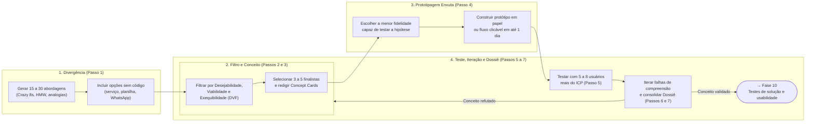

#### Passo 1: divergir com técnicas estruturadas

Não se prenda à primeira solução imaginada: conduza sessões estruturadas de geração de alternativas, individualmente ou com duas a três pessoas, aplicando quatro técnicas complementares.

Crazy 8s (oito ideias em oito minutos, uma por minuto). Força quantidade sobre qualidade.

How Might We, "como poderíamos?". Reformule o *job to be done* em três a cinco perguntas abertas. Por exemplo: "Como poderíamos ajudar o dono de restaurante a encerrar o dia sem preocupação?"

**Extremos:** E se a solução fosse super-premium (R$ 5.000 por mês)? E se fosse de graça? E se fosse física? E se fosse humana (serviço)?

**Analogias:** Como outros setores resolvem problemas parecidos? O que o Uber ensinou sobre marketplaces pode se aplicar? O que o iFood ensinou sobre logística distribuída?

> [!tip] Meta da divergência
> Gere de 15 a 30 ideias no papel, filtre para 3 a 5 conceitos pela matriz DVS e construa 2 protótipos finalistas. A qualidade nasce da quantidade inicial.

#### Passo 2: avalie e reduza (convergir)

Avalie cada ideia em três dimensões.

Desejabilidade: o usuário quer isso? Responda com base nas evidências colhidas nas Fases 4 e 5 (descoberta e pesquisa com usuários) e nos experimentos da Fase 8.

**Viabilidade (*Viability*)**: o modelo econômico fecha na ponta do lápis, com preço sustentável, custo de aquisição comportado e margem saudável para escalar o negócio?

**Exequibilidade (*Feasibility*): conseguimos construir e entregar essa solução no prazo de um MVP enxuto com as capacidades técnicas, operacionais e regulatórias que temos hoje? (Junto com a Desejabilidade para o usuário e a Viabilidade econômica para o negócio, forma o tripé clássico DVF: Desejabilidade, Viabilidade e Exequibilidade**, pontuado de 1 a 5 em cada eixo.)

Dê nota de um a cinco em cada dimensão, multiplique os fatores e Selecione os três a cinco conceitos com maior pontuação.

> [!note] O tripé DVF e a Matriz Impacto × Esforço são complementares
> A pontuação pelo tripé **DVF (Desejabilidade, Viabilidade e Exequibilidade)** de 1 a 5 em cada eixo funciona como primeira peneira rápida para reduzir trinta ideias brutas para três a cinco conceitos candidatos. Em seguida, a Matriz Impacto × Esforço (aplicada no exemplo prático do PadariaPro mais adiante) posiciona visualmente esses conceitos finalistas para escolher quais dois protótipos construir e testar primeiro.

#### Passo 3: detalhe os 3 a 5 conceitos escolhidos

Para cada conceito finalista, elabore uma ficha de uma página com seis elementos numerados: (1) nome do conceito para facilitar a referência nos testes, (2) descrição da proposta em um parágrafo, (3) diferencial central frente às alternativas atuais, (4) requisitos técnicos essenciais, (5) modelo de monetização previsto, e (6) principais riscos de adoção e execução.

> [!note] Psicologia de decisão e percepção de valor no teste
> A reação do usuário ao protótipo reflete ancoragem de preço, hábito de uso no celular e confiança percebida na primeira tela, conforme detalhado no [[IGNICAO-Vol-2-Descoberta-e-Mercado#IGNIÇÃO: Volume 2: Descoberta de Cliente e Mapeamento de Mercado|Capítulo 1: Psicologia do Consumidor Brasileiro (Vol. 2)]]. Defina quais sinais de confiança precisam aparecer nas telas antes de iniciar as sessões.

#### Passo 4: selecione 2 conceitos finalistas para prototipar

Escolha os dois conceitos finalistas na matriz impacto-esforço e defina o formato do protótipo entre as seis opções abaixo:

- **1. *Storyboard* (quadrinhos de 6 a 8 quadros, 1 a 2 horas, custo R$ 0):** desenhe a cena em que a dor acontece, a tentativa frustrada atual, o momento em que o usuário aciona a solução e o resultado obtido, ideal para alinhar a jornada antes de desenhar telas.

- **2. *Wireframes* em papel ou quadro branco (1 a 2 horas, custo R$ 0):** rascunhos de baixa fidelidade das três ou quatro telas principais feitos à mão em folha sulfite, permitindo riscar e redesenhar botões na frente do próprio usuário entre uma entrevista e outra.
- **3. Simulação de conversa no WhatsApp ou SMS (2 a 3 horas, custo R$ 0):** roteiro de mensagens reais trocadas no celular com o cliente (como fez a Dra. Camila com o vídeo de 15 segundos e o PadariaPro com o alerta das 6h), ideal quando o público-alvo vive no WhatsApp e rejeita instalar novos aplicativos.
- **4. Protótipo clicável navegável (4 a 8 horas no Figma, v0 ou Lovable):** sequência interativa de 3 a 5 telas onde o usuário consegue clicar e avançar pela tarefa principal, em 2026, como geradores de interface por IA criam telas bonitas em minutos, redobre a vigilância para testar a clareza do fluxo bruto sem deixar o polimento visual intimidar a decisiva do usuário.
- **5. Vídeo curto de demonstração (4 a 8 horas):** gravação de 1 a 3 minutos mostrando na prática como a solução resolve a tarefa (como no caso clássico do Dropbox), excelente para medir se a proposta desperta compromisso imediato antes de construir a engrenagem técnica.
- **6. Mapa de serviço (*Service Blueprint*, 2 a 4 horas):** diagrama que conecta o que o cliente vê na ponta com cada passo manual ou automático executado nos bastidores, indispensável para negócios que combinam atendimento humano, logística ou hardware.

> [!tip] Regra do protótipo de um dia: comece no papel ou no WhatsApp antes de polir telas no Figma
> O protótipo inicial da Fase 9 deve caber em até um dia de trabalho. Comece pelo protótipo em papel ou simulação direta no WhatsApp nas primeiras horas para descartar fluxos confusos sem dor e só passe para uma tela clicável no Figma quando a estrutura básica de três a cinco passos já tiver sobrevivido ao primeiro contato.

#### Passo 5: prepare roteiro de teste de protótipo

Estruture o roteiro de teste do protótipo (como o painel de sugestão de pedidos do PadariaPro para redes de duas a cinco padarias) em cinco etapas sequenciais:

1. **Contextualização (2 minutos):** situe o entrevistado no cenário real de uso (por exemplo, a conferência do estoque de insumos e o fechamento do pedido semanal da padaria).

2. **Tarefas práticas (15 minutos):** peça ao usuário que execute de três a cinco tarefas concretas no protótipo, como revisar a sugestão automática de compra de farinha para três lojas e aprovar o pedido da semana.

3. **Observação silenciosa:** acompanhe a execução sem intervir nem explicar a interface, registrando exatamente em quais telas ou botões o usuário hesita ou trava.

4. **Protocolo de pensar em voz alta (*think-aloud*, durante os 15 minutos da tarefa):** peça ao usuário (como o dono ou gerente de produção da padaria ao testar a tela de sugestão de pedido do PadariaPro) que narre em voz alta o que está procurando, o que entendeu de cada número e o que espera que aconteça antes de tocar em cada botão.

5. **Perguntas pós-teste e compromisso real (10 minutos finais):** pergunte o que ficou claro de imediato, em qual ponto ele sentiu falta de informação e quanto ele gasta hoje (em horas e reais) para resolver essa rotina. Em vez de fazer perguntas hipotéticas vazias sobre preço, feche propondo um compromisso concreto (como agendar o piloto real da semana seguinte ou assinar a pré-venda com reembolso garantido).

> [!note] Capítulo 8 (Vol. 4): Customer Experience
> O protótipo é o primeiro contato do usuário com a experiência do produto. O [[IGNICAO-Vol-4-Tracao-e-PMF#CAPÍTULO 8: CUSTOMER SUCCESS (CS) E CUSTOMER EXPERIENCE (CX): DA JORNADA À RETENÇÃO SUSTENTÁVEL E NRR ACIMA DE 100%|Capítulo 8: Customer Success e Customer Experience (Vol. 4)]] mostra como desenhar a ativação inicial (*onboarding*) desde o protótipo, garantindo que o usuário alcance o primeiro resultado tangível nos minutos iniciais. Aplique os princípios de *Design Thinking* (empatia com o contexto real de uso e eliminação de passos supérfluos) para selecionar quais tarefas entram no roteiro de 30 minutos.

#### Passo 6: teste em duas rodadas de 5 usuários do ICP (10 a 12 no total) e itere entre elas

Seguindo a regra clássica de Jakob Nielsen, teste com cinco usuários por rodada e rode pelo menos duas rodadas iterativas (dez sessões no total): cinco usuários já revelam a grande maioria das travas de fluxo, e a segunda rodada confirma se o ajuste funcionou.

Não espere terminar todos os testes para iterar. Depois de cada ciclo de três a quatro testes, ajuste o protótipo com base nos padrões observados e teste a nova versão com os próximos três a quatro usuários. Esse loop curto (testar, ajustar, testar de novo) entrega muito mais aprendizado que oito testes seguidos da mesma versão.

#### Passo 7: consolide o conceito vencedor no Dossiê de Solução

Consolide o aprendizado em um documento enxuto contendo seis itens: (1) lista dos conceitos gerados e avaliados, (2) fichas dos conceitos selecionados, (3) links ou arquivos dos protótipos testados, (4) síntese das sessões com usuários (padrões de uso, atritos e frases literais), (5) recomendação fundamentada do conceito vencedor, e (6) riscos e hipóteses que permanecem abertos para a Fase 10.

> [!tip] Estrutura do Dossiê de Solução e Canvases desta Fase
> Os seis campos acima compõem o Dossiê de Solução, que documenta o conceito vencedor ao final do Passo 7 após comparar os dois protótipos finalistas testados nos Passos 4 a 6. Antes de iniciar a geração de ideias no Passo 1, utilize o [[#Canvas: Opportunity Canvas (Jeff Patton, 2014)|Opportunity Canvas]] para alinhar problema, usuários, valor para o negócio e restrições, e, ao encerrar o Passo 7, preencha o [[#Canvas: MVP Canvas (Tristan Kromer e Paulo Caroli)|MVP Canvas]] para amarrar as hipóteses e métricas que guiarão a especificação na Fase 10.

### Os sete passos aplicados: sessão de ideação do PadariaPro

Para tornar o método concreto, este é o desenrolar dos passos 1 a 6 aplicados à mesma ideia das fases anteriores.

O *job* central, identificado na [[IGNICAO-Vol-2-Descoberta-e-Mercado#FASE 5: PESQUISA COM USUÁRIOS (CUSTOMER DISCOVERY)|Fase 5 (Vol. 2)]]: "Me devolver horas de foco executivo, sem aumentar o desperdício."

Na sessão de *Crazy 8s* (oito esboços em oito minutos), surgiram alternativas distintas: aplicativo móvel para pedido por voz. Robô no WhatsApp que coleta a contagem diária e sugere a compra. Painel web com previsão de demanda e confirmação em um clique (ou solução híbrida com alerta no WhatsApp e aprovação no navegador para pedidos acima de R$ 1 mil). Etiquetas com sensor nas sacas de farinha. Câmera no estoque com visão computacional. Mensagem diária com pedido sugerido. Baixa automática integrada ao caixa, e reposição semanal gerida pelo próprio fornecedor.

Após filtrar as oito ideias pela nota DVS (descartando a 1, pedido por voz em ambiente barulhento de fornada, a 4, etiquetas RFID caras, a 5, câmeras no estoque, e a 8, comissão de fornecedor que gera conflito de interesse), os quatro conceitos finalistas entram na matriz impacto-esforço: alto impacto e baixo esforço ficam com a ideia 2 (bot no WhatsApp) e a ideia 6 (resumo diário por e-mail), que vão para prototipagem imediata. Alto impacto e alto esforço ficam com a ideia 3 (painel web) e a ideia 7 (integração com PDV), guardadas para etapa posterior.

**Protótipo número 2: WhatsApp Bot (low-fi).**

Sequência de seis mensagens em PDF, simulando o diálogo bot-usuário:

> *Bot:* "Bom dia, Fábio! Segundo o seu histórico, você vai precisar de 450 kg de farinha T1 esta semana nas três lojas. Pedido com a Distribuidora Serrana por R$ 2.250 (R$ 5,00/kg): escolha uma opção (sim/não/ajustar)"
>
> *Usuário:* "Ajustar para 140 kg"
>
> *Bot:* "Ok, pedido ajustado para 140 kg de farinha (R$ 700,00) + demais itens da lista = total R$ 2.530,00. Confirmar envio aos fornecedores? (sim/não)"
>
> *Usuário:* "Sim"
>
> *Bot:* "Pedido enviado. Entrega quarta-feira."

**Protótipo número 6: E-mail Diário.**

Protótipo de baixa fidelidade: imagem de uma mensagem simulada com a lista de insumos sugeridos, quantidades, valores estimados e dois botões de ação ("Confirmar pedido" e "Ajustar quantidades").

**Primeira rodada de testes com cinco usuários (padrão de Jakob Nielsen para capturar a maior parte dos atritos de uso).**

| Usuário | Reação ao 2 (WhatsApp) | Reação ao 6 (E-mail) | Preferência |
|---|---|---|---|
| Fábio (Campinas) | "Isso é incrível, resolveria o meu dia" | "E-mail eu ignoro" | 2 |
| João (SP) | "Bom, mas e se errar?" | "Mais formal, mais bonito" | Empate |
| Paula (SP) | "O meu gerente não vai usar WhatsApp assim" | "E-mail ninguém abre" | Nenhum |
| Roberto (RM) | "Perfeito, WhatsApp é onde a gente vive" | "Fraco" | 2 |
| Márcia (Campinas) | "Confirmar compra de R$ 2 mil pelo WhatsApp me deixa insegura" | "Mais segurança visual" | 6 |

O aprendizado principal. WhatsApp é preferido pela conveniência, mas gera ansiedade em valores altos. E-mail gera segurança visual, mas tem problema de abertura.

> [!important] O que o teste ensinou
> O teste prático confirmou na bancada dos padeiros que a Ideia #7 (arquitetura híbrida) batia os dois extremos isolados: o alerta diário às 6h no WhatsApp garante abertura imediata para pedidos rotineiros até R$ 1.000, enquanto uma página web enxuta aberta pelo link resolve a conferência de pedidos maiores sem exigir instalação de aplicativo. Confrontar dois protótipos contrastantes com usuários reais transforma um palpite de sala de reunião em decisão comprovada pelo uso.

### Caso brasileiro e simulação prática: prototipagem para o público infantil (lições da PlayKids)

A **PlayKids**, plataforma brasileira de conteúdo educativo infantil criada dentro do grupo Movile em 2013, enfrentou desde a origem um desafio clássico de design de interação: seu usuário direto eram crianças na primeira infância (de 2 a 6 anos, que ainda não leem menus textuais nem respondem entrevistas verbais), enquanto o pagante eram os pais. Para ilustrar como equipes de produtos infantis resolvem essa assimetria na Fase 9, acompanhe a reconstrução didática de um teste de protótipo em papel:

Para visualizar como esse princípio opera na prática com o público infantil, considere uma simulação didática de teste em papel antes de programar: a equipe imprime as telas desenhadas e pede a crianças de quatro, seis e oito anos que toquem nas folhas como se fossem o tablet, observando em silêncio onde travam e quais gestos fazem espontaneamente.

Nessa dinâmica de prototipagem infantil, colocar cartões de papel ilustrados na mão das crianças sob observação direta revela em minutos por que hierarquias pensadas para adultos (menu, subcategoria e lista escrita) travam os pequenos, que tocam diretamente nos rostos dos personagens ou em vagões de um trem visual na tela. Testar o fluxo físico antes de programar animações caras permite ajustar o tamanho das áreas de toque e separar a área dos pais com trava de segurança já na primeira versão.

Com algumas dezenas de reais em impressões, o protótipo em papel revela falhas de navegação que custariam dezenas de milhares de reais para refazer depois do código pronto. Em produtos para públicos que não verbalizam bem (crianças, idosos, baixa escolaridade, falantes de outras línguas), observação supera entrevista.

### Critérios de saída da Fase 9

Você concluiu a Fase 9 quando todos os critérios abaixo estão cumpridos.

- [ ] Quinze a trinta ideias geradas em sessão documentada de divergência (*Crazy 8s*, "Como poderíamos", extremos e analogias), evitando o apego precoce à primeira solução.
- [ ] De 15 a 30 ideias brutas geradas no Passo 1 e filtradas no Passo 2 pelo tripé DVF (Desejabilidade, Viabilidade e Exequibilidade) e pela Matriz Impacto × Esforço até restarem de 3 a 5 conceitos candidatos.
- [ ] Três a cinco conceitos detalhados (nome, descrição, diferencial, requisitos técnicos, modelo de monetização, riscos).
- [ ] Dois protótipos de baixa fidelidade (papel ou Figma clicável) construídos em até um dia para testar o trabalho principal mapeado na Fase 4, sem funcionalidades periféricas.
- [ ] Cinco usuários testados por rodada, ao longo de pelo menos duas rodadas documentadas com integrantes do ICP.
- [ ] Insights qualitativos claros: padrões de uso, onde travam, onde se confundem, onde se encantam (não só "gostaram").
- [ ] Taxa de conclusão de tarefas sem ajuda acima de 70%, tempo de execução real não excede a expectativa pré-teste em mais de 50%.
- [ ] Pelo menos 4 de cada 5 usuários da rodada final concluindo a tarefa principal sem ajuda e assumindo um passo concreto de avanço (pedido de acesso ao piloto, indicação de colega do setor ou assinatura de intenção).
- [ ] Pelo menos um sinal concreto de compromisso colhido ao final das sessões (como agendamento de piloto, entrega de planilha real de fornecedores ou pré-venda assinada, sem depender de perguntas hipotéticas de preço).
- [ ] Decisão escrita sobre qual conceito vai virar MVP, com justificativa e lista clara de essencial versus postergável.

> [!warning] Critério de saída
> Se qualquer um desses itens falha, não avance. Resolva antes.

**Primeiros passos práticos de execução.**

1. Reserve duas horas para a sessão de divergência do Passo 1: gere de quinze a trinta ideias combinando *Crazy 8s* (oito esboços em oito minutos), inversão do pior cenário (*Worst Possible Idea*), *SCAMPER* e analogias de outros setores, e filtre os conceitos pelo tripé DVF.
2. Construa dois protótipos de baixa fidelidade (em papel ou Figma clicável) a partir dos três a cinco conceitos avaliados, mantendo o custo de produção em horas ou no máximo um dia.
3. Agende cinco sessões por rodada com usuários do ICP (no mínimo duas rodadas), apresentando os dois protótipos finalistas para comparar reações e observar o uso.
4. Documentar reações. O que chamou atenção. O que confundiu. O que ignoraram.

### Seis erros de prototipagem que abastecem o Cemitério dos Protótipos Perfeitos

Apegar-se à primeira ideia sem explorar alternativas (como fez a Dra. Camila ao encomendar de cara um aplicativo caro em vez de testar um fluxo simples no WhatsApp).

Prototipar com alta fidelidade cedo demais. Um protótipo bonito pode esconder problemas de fluxo. Comece em baixa fidelidade.

Testar com usuários errados. Teste com o ICP. Amigo designer dando feedback não substitui usuário real.

Ouvir opinião em vez de observar comportamento. O que importa é onde o usuário trava. Não se ele "acha bonito".

Usar o teste como confirmação. O objetivo é encontrar problemas, não receber elogios. Se ninguém achou nada errado, você fez um teste fraco.

Tratar o protótipo como obra de arte definitiva em vez de instrumento de descarte rápido repete o tropeço da Dra. Camila na abertura desta fase: quando você gasta seis semanas e R$ 38 mil polindo 42 telas antes de sentar com Dona Helena, qualquer decisiva do usuário vira ameaça ao ego e ao dinheiro já gasto. Protótipos existem para expor falhas de fluxo no primeiro dia, quando rasgar a folha custa zero.

---

### O Espelho da Fase 9: Você Está Prototipando para Aprender ou para Receber Palmas?

**Decisão na trincheira (Fase 9):** Em Belo Horizonte, após ver Dona Helena travar no aplicativo de 42 telas e preferir um vídeo de 15 segundos no WhatsApp com botão *"Já fiz hoje"*, a Dra. Camila instituiu a regra do Espelho da Fase 9 na clínica e na startup: nenhuma funcionalidade vai para o desenvolvedor sem antes sobreviver a um protótipo montado em um único dia e testado em silêncio com cinco pacientes reais.

**O Espelho (autodiagnóstico):**
1. Você desenhou pelo menos três formas radicalmente diferentes de resolver o problema do cliente (incluindo uma sem tela nova, direto no canal onde ele já vive), ou casou com a primeira ideia?
2. Quanto tempo você gastou discutindo cores, fontes, nome das abas e telas de cadastro em comparação com o fluxo central que entrega o resultado?
3. Se um cliente olhar para o seu protótipo hoje e disser "isso aqui está confuso e não resolve meu dia", você sentiria alívio por descobrir cedo ou raiva pelo trabalho perdido?

**Permissão Libertadora:**
Você está autorizado a fazer protótipos feios, em preto e branco, desenhados no papel ou em blocos cinzas sem logotipo. Beleza prematura esconde falhas estruturais.

**O Ritual de Segunda-Feira às 9h:**
Pegue uma folha A4, dobre-a em oito partes (*Crazy 8s*) e desenhe em oito minutos oito maneiras diferentes de entregar o resultado prometido ao cliente, sendo uma delas obrigatoriamente sem software próprio. Antes de sair a campo, anote no topo da folha qual tarefa o cliente deverá realizar sozinho nos dois esboços finalistas e qual sinal definirá o vencedor (por exemplo, concluir o fluxo em menos de três minutos sem pedir ajuda). Agende a sessão com três a cinco clientes reais da sua cunha ainda nesta semana e descarte a versão que gerar mais dúvidas.

---

### MÉTRICAS E BENCHMARKS DESTA FASE (FASE 9)

| Métrica | O que medir | Referência saudável |
|---|---|---|
| Funil de ideação e prototipagem | Ideias geradas → conceitos detalhados → protótipos testados | 15 a 30 ideias → 3 a 5 conceitos → 2 protótipos |
| Fidelidade do protótipo | Nível de acabamento necessário para validar hipótese | Mínimo que responde à pergunta |
| Custo do protótipo inicial | Tempo investido antes de testar com usuários | Horas (no máximo 1 dia) |
| Testes com usuários (regra de Nielsen) | Sessões práticas observadas no protótipo | 5 usuários por rodada (mínimo de 2 rodadas) |

---

### Oficina de Trincheira da Fase 9: frameworks de ideação, jornada e descoberta de soluções

> [!tip] Uso autocontido neste volume
> Os dois canvases desta Fase 9 cobrem momentos complementares da decisão de produto: o Opportunity Canvas (Jeff Patton, 2014) entra antes do Passo 1 para decidir se uma oportunidade específica merece tempo de ideação e prototipagem. Já o MVP Canvas (síntese de Tristan Kromer e Paulo Caroli) entra no fechamento do Passo 7 para amarrar as hipóteses, métricas e limites do conceito vencedor que seguirá para a especificação da Fase 10.

#### Framework: Árvore de Oportunidades e Soluções (Opportunity Solution Tree, Teresa Torres, 2021)

##### De onde vem a ferramenta (e por que sobreviveu ao filtro do tempo)

Teresa Torres desenvolveu a Opportunity Solution Tree na década de 2010 e consolidou o método no livro *Continuous Discovery Habits* (2021), adaptando estruturas analíticas de decomposição e árvores de decisão para a descoberta contínua de produto.

##### A mecânica central (sem jargão)

Ferramenta visual em formato de árvore que conecta:

- Outcome desejado (topo).
- Oportunidades (*opportunities*): necessidades e dores reais do cliente que, quando resolvidas, movem o resultado desejado (*outcome*).
- **Soluções (*Solutions*):** alternativas concretas desenhadas para resolver cada oportunidade priorizada.
- **Experimentos (*Experiments*):** testes empíricos rápidos para validar as premissas mais arriscadas de cada solução candidata.

##### As regras do jogo

```text
                [ RESULTADO DESEJADO (OUTCOME): Reduzir perda de insumos em 30% ]
                                                │
        ┌───────────────────────────────────────┼───────────────────────────────────────┐
        ▼                                       ▼                                       ▼
├── OPORTUNIDADE 1: Dono não sabe quanto pedir às 6h   ├── OPORTUNIDADE 2: Sem tempo para cotar 3 fornecedores   └── OPORTUNIDADE 3: Falta histórico de perda por insumo
        │                                       │                                       │
   ┌────┴────┐                             ┌────┴────┐                             ┌────┴────┐
   ▼         ▼                             ▼         ▼                             ▼         ▼
[Sol. 1.1] [Sol. 1.2]                   [Sol. 2.1] [Sol. 2.2]                   [Sol. 3.1] [Sol. 3.2]
   │         │                             │         │                             │         │
[Exp. A]   [Exp. B]                     [Exp. C]   [Exp. D]                     [Exp. E]   [Exp. F]
```

Princípios-chave:

- Oportunidades vêm de pesquisa com clientes, não de brainstorm interno.
- Múltiplas soluções por oportunidade: força comparação.
- Priorização por impacto no outcome, não por "ideia mais legal".
- Experimentos vêm antes de execução completa.

##### Passos práticos de implantação

1. Defina um resultado de negócio mensurável (*outcome*) antes de abrir a geração de ideias.

2. **Mapeie as oportunidades a partir de entrevistas reais**: preencha o segundo nível da árvore apenas com dores, necessidades e obstáculos observados nas entrevistas de descoberta (Fases 4 e 5), nunca com suposições inventadas na sala de reunião.

3. **Priorize uma oportunidade-alvo e gere de 3 a 5 soluções para ela**: em vez de pulverizar energia tentando atacar o galho inteiro de uma vez, escolha a oportunidade de maior impacto no resultado desejado e desenhe de três a cinco soluções concorrentes para esse ponto específico.

4. **Escolha a solução de melhor relação aprendizado/esforço e desenhe o experimento mais rápido**: antes de construir qualquer funcionalidade em código, teste a solução escolhida com um protótipo de um dia (Fase 9) ou simulação manual no WhatsApp.

5. **Atualize a árvore toda semana com o que foi aprendido**: soluções refutadas nos testes com usuários são podadas sem apego, mantendo toda a equipe focada na oportunidade prioritária até mover a métrica de resultado.

##### Na trincheira real: como isso funciona na prática

Árvore de Oportunidades (OST) para o PadariaPro com o resultado desejado "reduzir a perda de farinha e insumos decisivos em 30% nas padarias-piloto":

- **Oportunidade 1 (prioritária):** o dono da padaria fecha o pedido de farinha às 6h da manhã no chute porque não tem visibilidade rápida do que sobrou no estoque da noite anterior.
- **Solução 1.1:** mensagem automática no WhatsApp às 6h com a sugestão pronta de compra para responder "SIM".
- **Solução 1.2:** planilha automatizada enviada às 20h por e-mail para o escritório da padaria.
- **Solução 1.3:** arquitetura híbrida com resumo diário no WhatsApp às 6h e link web em um clique para pedidos acima de R$ 1.000.
- **Experimento prioritário (1 dia):** disparar manualmente às 6h a mensagem da Solução 1.1 e o link da Solução 1.3 para 5 donos de padaria durante uma semana e medir quantos confirmam o pedido sem precisar ligar.

- **Oportunidade 2:** o dono perde 4 horas por semana cotando três atacadistas diferentes no WhatsApp.
- **Solução 2.1:** tabela comparativa automática com o último preço praticado por cada fornecedor cadastrado.
- **Solução 2.2:** disparo automático de cotação para três fornecedores com link de resposta rápida.
- **Experimento:** testar o protótipo clicável da tabela comparativa (2.1) na segunda rodada de entrevistas.

- **Oportunidade 3:** o padeiro não anota os sacos rasgados ou vencidos porque o computador fica longe da bancada (solução candidata: áudio rápido no WhatsApp ao fim do turno).
- Solução 3.1: QBRs proativos.
- Solução 3.2: health score + outreach.
- Experimento: 3.2.

##### Onde o papel aceita tudo (armadilhas de execução)

- **Confundir oportunidade com funcionalidade disfarçada**: oportunidade é uma dor, obstáculo ou necessidade real do cliente (*"não sei quanta farinha sobrou no saco às 6h"*), enquanto funcionalidade é apenas uma das várias soluções possíveis (*"criar um leitor de código de barras no aplicativo"*).
- Deixar a árvore estática: não atualizar os ramos após novas entrevistas e testes de protótipo.
- Montar a árvore de trás para a frente: encaixar oportunidades artificiais apenas para justificar uma solução já decidida pela diretoria.

---

#### Framework: Google Design Sprint (Jake Knapp, 2016)

##### De onde vem a ferramenta (e por que sobreviveu ao filtro do tempo)

Jake Knapp criou as primeiras oficinas de *Design Sprint* dentro do Google por volta de 2010 e, a partir de 2012, refinou o protocolo de cinco dias no Google Ventures (GV) junto com Braden Kowitz, John Zeratsky e Michael Margolis, aplicando-o em mais de uma centena de startups do portfólio. O livro *Sprint: How to Solve Big Problems and Test New Ideas in Just Five Days* (2016) consolidou o método mundialmente.

##### A mecânica central (sem jargão)

**Processo de 5 dias** para ir de problema a solução testada. Cada dia tem atividades específicas:

- Segunda: entender o problema (mapear, expert interviews).
- Terça: gerar ideias (sketch individual).
- Quarta: decidir (votação estruturada, storyboard).
- Quinta: prototipar.
- Sexta: testar com 5 usuários reais.

Resultado: aprendizado rápido sobre direção promissora ou má.

##### As regras do jogo

Participantes: time de 5-7 pessoas (decisor, facilitador, designer, engineer, PM, outros especialistas).

Time boxed: 5 dias, não mais. Evita over-engineering.

Foco: 1 problema grande, não roadmap geral.

Método estruturado: atividades pré-definidas, minimiza discussão improdutiva.

##### Roteiro de aplicação prática na operação

- **Segunda-feira (Mapeamento):** desenhe o mapa do problema, defina o objetivo de longo prazo, liste as perguntas decisivas da semana, ouça de 3 a 5 especialistas, registre notas "Como poderíamos" (*How Might We*) e escolha o recorte-alvo do teste.

- **Terça-feira (Esboço de soluções):** conduza demonstrações rápidas de referências (*lightning demos*) e produza esboços individuais em quatro etapas (anotações, ideias soltas, *Crazy 8s* e esboço detalhado da solução).

- **Quarta-feira (Decisão):** marque um mapa de calor sobre os esboços, faça a decisiva rápida (*speed critique*), colha o voto da equipe, registre o voto de minerva do decisor (*supervote*) e monte o roteiro visual (*storyboard*) do teste.

- **Quinta-feira (Protótipo de fachada em até 10 horas):** monte uma superfície navegável realista em Figma, apresentação interativa ou página web simples, focada exclusivamente no fluxo que será posto à prova.

- **Sexta-feira (Teste com 5 usuários):** conduza cinco sessões individuais de 60 minutos aplicando o protocolo de pensamento em voz alta (*think-aloud*) enquanto o usuário interage com o protótipo.

##### Na trincheira real: como isso funciona na prática

Sprint em fintech early-stage para feature de "análise de gastos":

- **Segunda-feira (Mapear):** a equipe mapeia por que os usuários abrem o aplicativo financeiro apenas para olhar o saldo e saem sem agir, e fixa a pergunta da sprint: *"Conseguimos mostrar um alerta de economia tão claro e acionável que o cliente conclua a transferência em menos de um minuto?"*
- **Terça-feira (Esboçar):** cada participante desenha individualmente quatro variações de tela com *Crazy 8s* e esboço detalhado de três painéis.
- **Quarta-feira (Decidir):** votação silenciosa com adesivos escolhe testar um alerta único no topo com botão de confirmação imediata, montando o *storyboard* de oito quadros.
- **Quinta-feira (Prototipar):** construção em um único dia do fluxo clicável no Figma com valores e textos realistas.
- **Sexta-feira (Testar):** cinco sessões individuais de 45 minutos mostram que 4 de 5 usuários entendem e acionam o alerta no primeiro minuto, mas travam no termo técnico "aplicação automática com liquidez D+0", que é trocado na mesma tarde por "guardar com resgate imediato".

Terça: sketches individuais com ideias variadas (categorização automática, comparação com média, alertas, gráficos, AI suggestions).

Quarta: storyboard escolhido: categorização + comparação com pares + alerta de anomalia.

Quinta: prototype clicável em Figma, 8 telas.

Sexta: 5 entrevistas. Resultado: categorização adorada, comparação com pares gera desconforto, alerta útil mas intrusivo.

Decisão: lançar MVP com categorização, testar comparação com UI opcional, iterar em alerta.

##### Onde o papel aceita tudo (armadilhas de execução)

- Estender o sprint para duas ou três semanas: perde o foco e arrasta as decisões.
- Rodar sem o decisor na sala: sem o voto de desempate (*supervote*), o grupo trava ou vê a decisão ser desfeita na semana seguinte.
- Pular o teste de sexta-feira com cinco usuários reais: termina a semana com um protótipo bonito, mas sem nenhuma evidência de uso.

---

#### Framework: Double Diamond (Design Council, Reino Unido, 2005)

##### De onde vem a ferramenta (e por que sobreviveu ao filtro do tempo)

O Design Thinking tem raízes na Stanford d.school (David Kelley) e na consultoria IDEO (fundada em 1991). Já o Double Diamond (Diamante Duplo) foi formalizado pelo British Design Council em 2005, adaptando a dinâmica de divergência e convergência proposta por Béla Bánáthy (1996) em quatro etapas: descobrir, definir, desenvolver e entregar.

##### A mecânica central (sem jargão)

Processo de design em 4 fases, visualizado como dois diamantes:

Diamante 1, Discover → Define (o problema certo)

- Discover (abrir): pesquisa ampla, empatia, observação.
- Define (fechar): sintetizar, definir problema específico a resolver.

Diamante 2, Develop → Deliver (a solução certa)

- Develop (abrir): gerar muitas soluções possíveis.
- Deliver (fechar): selecionar, prototipar, testar.

Princípio-chave: **divergir antes de convergir** em cada diamante.

##### As regras do jogo

3 lentes de IDEO:

2. As três lentes de avaliação de toda solução na IDEO: Desejabilidade (as pessoas realmente querem e conseguem usar?), Viabilidade (para em pé economicamente?) e Exequibilidade (é possível construir na prática?), formando a tríade DVF aplicada no Passo 2 desta fase.
- **Viabilidade econômica (*Viability*):** o modelo de negócio fecha a conta e sustenta margem saudável?
- **Exequibilidade (*Feasibility*):** a equipe consegue construir e operar a solução com a tecnologia e os recursos disponíveis?

Uma solução sustentável nasce na interseção entre desejabilidade, exequibilidade e viabilidade econômica.

As **4 etapas do Diamante Duplo** do Design Council britânico e sua correspondência direta com as 5 etapas da d.school de Stanford:

1. **Empatizar (*Empathize*, 1º Diamante / Divergir no Problema):** mergulhar no contexto real do usuário por meio de observação direta em campo e entrevistas sem julgamento.
2. **Definir (*Define*, 1º Diamante / Convergir no Problema):** sintetizar os achados da imersão para recortar o problema prioritário e o ponto de vista (*Point of View*) que guiará a criação.
3. **Idear (*Ideate*, 2º Diamante / Divergir na Solução):** gerar dezenas de alternativas contrastantes de solução (usando técnicas como *Crazy 8s* e *How Might We*) antes de escolher uma.
4. **Prototipar (*Prototype*, 2º Diamante / Convergir na Solução):** construir representações físicas ou digitais baratas e descartáveis em poucas horas para tornar as ideias tangíveis.
5. **Testar (*Test*, 2º Diamante / Validar em Uso):** colocar o protótipo nas mãos de usuários reais do ICP, observar onde travam em silêncio e iterar o desenho.
2. **Definir (*Define*):** recortar o problema prioritário com base nas evidências de campo.

4. **Prototype:**

Passo 2: Define: sintetize em "point of view" statement, "[Usuário] precisa [necessidade] porque [insight]".

Passo 3: Ideate: brainstorm extenso, "crazy 8s", "worst possible idea", outras técnicas.

Passo 4: Prototype: baixa fidelidade, rápido e descartável.

Passo 5: Test: com usuários reais, iterate.

##### Na trincheira real: como isso funciona na prática

Aplicação clássica de observação etnográfica em serviços financeiros: o programa ***Keep the Change***, desenhado pela IDEO em parceria com o Bank of America em 2004–2005:

- **Empatizar (observação em campo):** ao observar famílias norte-americanas controlando contas em casa, os pesquisadores da IDEO notaram que muitas mães e chefes de família arredondavam mentalmente os valores anotados no canhoto do talão de cheques (por exemplo, anotando US$ 30 para uma compra de US$ 27,40) a fim de facilitar a conta e criar uma pequena folga no fim do mês.
- **Definir:** o verdadeiro obstáculo para guardar dinheiro não era falta de vontade, e sim o atrito cognitivo e emocional de transferir uma quantia grande no fim do mês, as pessoas queriam poupar de forma invisível no ato do consumo.
- **Idear e Prototipar:** a equipe desenhou o conceito de arredondar automaticamente cada compra no cartão de débito para o dólar inteiro seguinte e transferir os centavos na hora para uma conta poupança.
- **Testar e Lançar:** após prototipar o extrato e a regra de adesão com clientes reais, o Bank of America lançou o *Keep the Change* em 2005, atraindo milhões de novos correntistas nos primeiros anos.
- Define: "Clientes com problema urgente precisam de solução rápida porque estresse amplifica frustração."

- Prototype: 5 protótipos de baixa fidelidade.

#### Framework: Impact Mapping (Gojko Adzic, 2012)

##### De onde vem a ferramenta (e por que sobreviveu ao filtro do tempo)

Gojko Adzic, consultor de software e autor de *Specification by Example*, publicou *Impact Mapping* em 2012 como resposta a um problema recorrente em desenvolvimento de produto: times que entregam features corretas em projetos errados. O framework surgiu da observação de que equipes de tecnologia frequentemente perdem a conexão entre o trabalho diário (stories, tasks) e os objetivos de negócio reais. Impact Mapping foi adotado amplamente em contextos ágeis, especialmente em ambientes onde stakeholders múltiplos têm visões diferentes sobre prioridade. Combina planejamento estratégico com design de produto numa ferramenta visual simples.

##### A mecânica central (sem jargão)

Mapa mental hierárquico de quatro níveis que responde a quatro perguntas encadeadas: Por quê (o objetivo de negócio que justifica o trabalho), Quem (os atores, usuários, clientes, parceiros, que influenciam ou são impactados pelo objetivo), Como (os comportamentos ou impactos que cada ator precisa ter ou mudar para contribuir com o objetivo), O quê (as entregas, features, conteúdos, integrações, que produzem cada impacto). A estrutura força a equipe a rastrear cada entrega até um comportamento de ator real e um objetivo de negócio real.

##### As regras do jogo

Impact Mapping é construído colaborativamente em sessão com product manager, stakeholders de negócio e representantes técnicos. O mapa é deliberadamente incompleto: lista as apostas de impacto mais relevantes, não todas as possibilidades. O impacto (nível "Como") é o coração do framework: é onde a maioria dos roadmaps falha, pulando direto de objetivo para feature sem mapear qual comportamento do usuário a feature deve mudar. Revisão do mapa a cada ciclo de planejamento revela hipóteses validadas vs. falsificadas.

##### Aplicação imediata na rotina da empresa

Passo 1: Definir o objetivo em formato SMART com prazo e métrica (ex. "aumentar conversão de trial para pago de 8% para 15% em 90 dias"). Passo 2: Listar todos os atores relevantes, quem pode contribuir para ou contra esse objetivo? (usuário trial, equipe de CS, parceiro de integração, etc.) Passo 3: Para cada ator, mapear os impactos, que comportamento do ator contribuiria para o objetivo? (ex. "usuário trial completa onboarding em menos de 10 min") Passo 4: Para cada impacto, listar as entregas que podem produzi-lo, features, conteúdo, automação. Passo 5: Priorizar: quais entregas têm maior probabilidade de produzir o impacto com menor esforço? Passo 6: Usar mapa como critério de aceite, uma feature que não aparece no mapa ou não está conectada a um impacto real não entra no sprint.

Exemplo aplicado, startup de RH tech (SaaS para PMEs). Objetivo: "aumentar DAU de 200 para 500 em 60 dias." Atores: gerente de RH (decisor de uso), funcionário (usuário do portal), time de CS (intermediário). Impactos para gerente: "acessa relatório de ponto sem ligar para CS", gera entrega "relatório de ponto one-click". Impactos para funcionário: "marca ponto pelo celular sem login complexo", gera entrega "login biométrico". CS: "resolve dúvida sem escalar para produto", gera entrega "base de conhecimento interna". O mapa revelou que dois recursos de alta prioridade no backlog (painel de análise preditiva, integração com TOTVS) não estavam conectados a nenhum impacto no DAU: foram despriorizados.

##### Onde o papel aceita tudo (armadilhas de execução)

Cinco armadilhas frequentes no *Impact Mapping*: (1) confundir impacto com entrega de software (*"construir um painel de relatórios"* é entrega, o impacto comportamental é *"o gerente de compras cortar em 30% os pedidos de emergência na segunda-feira"*), (2) declarar objetivos vagos sem métrica nem prazo (como *"melhorar o engajamento"*, que não orienta corte de escopo), (3) inflar o mapa em árvore gigante (mantenha 1 objetivo mensurável, 3 a 5 atores e 2 a 3 impactos por ator), (4) engavetar o mapa após a oficina em vez de usá-lo para cortar entregas que não movem a métrica, e (5) esquecer atores internos e operacionais (como a recepcionista da clínica ou o analista de suporte, cujo comportamento pode travar a adoção do cliente final).

---

#### Framework: Modelo Kano (Noriaki Kano, 1984)

##### De onde vem a ferramenta (e por que sobreviveu ao filtro do tempo)

Noriaki Kano, professor da Tokyo University of Science, publicou o modelo em 1984 dentro da escola japonesa de gestão da qualidade. A tese central é simples: nem todas as funcionalidades pesam igual na percepção do cliente. Algumas são obrigatórias (básicas), outras aumentam a satisfação proporcionalmente (desempenho), outras encantam (atrativas) e outras são indiferentes. Hoje é padrão em product management.

##### A mecânica central (sem jargão)

Framework que classifica features em 5 categorias baseado em impacto na satisfação do cliente:

1. **Atributos básicos (*must-be / basic*):** requisitos obrigatórios que o cliente considera garantidos, sua presença não gera entusiasmo, mas sua ausência inviabiliza o uso (ex.: autenticação segura e estabilidade no login).

2. **Atributos de desempenho (*performance / one-dimensional*):** características em que a satisfação do cliente cresce de forma proporcional à entrega (ex.: rapidez no carregamento de relatórios).

3. **Atributos encantadores (*attractive / delighters*):** diferenciais inesperados que geram forte entusiasmo quando presentes e que, com o amadurecimento do mercado, migram gradualmente para a categoria básica.

4. **Atributos indiferentes (*indifferent*):** funcionalidades pelas quais o cliente não atribui valor prático, representando desperdício direto de engenharia.

5. **Atributos reversos (*reverse*):** excessos de complexidade ou automação indesejada que reduzem a satisfação do usuário (ex.: alertas excessivos ao longo do dia).

##### As regras do jogo

Pesquisa Kano: questionário de dupla formulação para cada feature:

- "Como você se sentiria SE o produto TIVESSE feature X?"
- "Como você se sentiria SE o produto NÃO TIVESSE feature X?"

Respostas (Kano 5-point scale): "Eu gostaria", "É esperado", "Neutro", "Posso aceitar", "Eu não gostaria".

Cruzar respostas gera classificação.

##### Passos práticos de implantação

Passo 1: Liste 10-20 features candidatas.

Passo 2: Aplique o questionário à base do seu ICP (idealmente 100 ou mais respondentes em produtos B2C ou maduros. Em estágios iniciais B2B com base restrita, aplique a partir de 20 a 30 clientes reais do ICP tratando a classificação como bússola qualitativa e nunca como prova estatística isolada).

Passo 3: Classifique cada feature.

Passo 4: Priorize:

- **Básicos (*Basic*):** obrigatórios para operar, construa o mínimo robusto que garanta confiança.
- **Desempenho (*Performance*):** invista de forma proporcional ao ganho percebido pelo segmento-alvo.
- **Encantadores (*Delighters*):** escolha um ou dois diferenciais de alto impacto e corte o restante para não dispersar o foco.
- **Indiferentes (*Indifferent*):** elimine imediatamente do escopo do produto.
- **Reversos (*Reverse*):** remova do fluxo ou torne estritamente opcionais nas configurações.

Passo 5: Re-classifique periodicamente: excitement de hoje é basic de amanhã (ratchet effect).

##### Na trincheira real: como isso funciona na prática

Kano survey para SaaS financeiro, 15 features candidatas:

- Login seguro com 2FA: **Basic** (obrigatório).
- Dashboard rápido (< 2s): **Performance** (importante).
- Integração com bancos: **Basic** em SaaS financeiro brasileiro (espera-se).
- AI que sugere categorização automática: Excitement.
- Relatório de fluxo de caixa: Performance.
- Integração com Zapier: **Indifferent**.
- Notificações por email diárias: Reverse (muitos responderam "não gostaria").
- Previsão de receita com IA: Excitement.
- Dark mode: **Indifferent** (neste ICP, pode ser diferente em outros).

Ação roadmap: basics são gates (sem eles, sem cliente), performance é competição linear, 1-2 excitement para diferenciar (AI categorização), cortar indifferent (Zapier), redesenhar reverse (notificações com controle).

##### Onde o papel aceita tudo (armadilhas de execução)

Quatro erros distorcem a aplicação do Modelo Kano: aplicar o questionário a pessoas fora do ICP (que classificam como "Indiferente" aquilo que para o comprador real é "Obrigatório"), redigir perguntas ambíguas que levam todos os itens a cair na categoria linear de "Desempenho", gastar o orçamento do MVP construindo funcionalidades de "Encantamento" (*Excitement*) enquanto os requisitos "Básicos" (*Must-be*, como estabilidade, exatidão do cálculo e segurança) falham e destroem a confiança, e esquecer que, com o passar do tempo, todo encantamento vira requisito básico esperado pelo mercado.

---

#### Framework: Story Mapping (Jeff Patton, 2014)

##### De onde vem a ferramenta (e por que sobreviveu ao filtro do tempo)

Jeff Patton, consultor e escritor de agile, popularizou Story Mapping em artigo de 2005 e no livro *User Story Mapping* (2014). Criado como resposta a uma frustração com product backlogs planos (listas lineares de features): não mostram jornada do usuário, não priorizam por liberação de valor, não facilitam conversas entre product e engenharia. Story Mapping organiza trabalho por jornada, não por ordem.

##### A mecânica central (sem jargão)

Representação visual bidimensional do produto: eixo horizontal é a jornada do usuário (atividades sequenciais que ele precisa fazer), eixo vertical é a profundidade de cada atividade (de essencial a avançado). As features do produto organizadas nessa grade. Na base, releases horizontais: primeira liberação corta uma faixa horizontal atravessando toda a jornada (MVP end-to-end), segunda liberação aprofunda funcionalidades, e assim por diante.

##### As regras do jogo

Produto não se entrega por features, entrega-se por jornadas de usuário completas. MVP horizontal (thin slice através de toda a jornada) entrega valor real ao usuário, features isoladas verticalmente não entregam valor até a jornada completa estar funcional. Conversa em volta do mapa produz alinhamento entre stakeholders que backlog linear nunca produz.

##### Execução prática com a equipe

1. **Mapeie as atividades principais:** posicione horizontalmente no quadro (físico ou digital) os blocos que representam as grandes etapas da jornada do usuário.
2. **Desdobre em tarefas concretas:** abaixo de cada atividade, liste as ações práticas que o usuário realiza para concluir aquela etapa.
3. **Detalhe as histórias de usuário:** empilhe verticalmente sob cada tarefa as funcionalidades específicas, das mais simples no topo às mais sofisticadas na base.
4. **Trace as linhas horizontais de entrega (*releases*):** a primeira fatia horizontal compõe o MVP, reunindo apenas o item essencial de cada coluna para permitir que o usuário percorra a jornada de ponta a ponta.

Exemplo aplicado: a loja D2C de kits de autocuidado de Rafael e Bia. Jornada horizontal da cliente: *Descobrir o kit → Escolher o perfil de pele → Fechar pedido → Pagar no Pix ou cartão → Receber aviso de envio → Abrir a caixa em casa*. Profundidade vertical na coluna "Fechar pedido": no MVP horizontal entram apenas cadastro em uma tela, endereço único e Pix/cartão (a cliente completa a compra inteira sem travar). Na segunda versão entram múltiplos endereços e escolha de transportadora. Na terceira, assinatura recorrente com troca de itens e embalagem para presente.

##### Onde o papel aceita tudo (armadilhas de execução)

Quatro deslizes comprometem o *User Story Mapping*: (1) confundir o mapa com um fluxograma técnico de desvios (`if-then`), esquecendo que a espinha dorsal deve contar a jornada cronológica do usuário para alcançar valor, (2) fatiar entregas na vertical em vez de na horizontal (construir primeiro 100% do cadastro complexo e zero do pedido, em vez de entregar um esqueleto funcional de ponta a ponta já na primeira fatia), (3) inventar a jornada sem pesquisa de campo, ignorando o que foi observado nas entrevistas de descoberta da [[IGNICAO-Vol-2-Descoberta-e-Mercado#FASE 4: DESCOBERTA DO PROBLEMA|Fase 4 (Vol. 2)]] e nas entrevistas de *Jobs to Be Done* da [[IGNICAO-Vol-2-Descoberta-e-Mercado#FASE 5: PESQUISA COM USUÁRIOS (CUSTOMER DISCOVERY)|Fase 5 (Vol. 2)]], e (4) transformar o mural num monstro de 40 colunas, quando um mapa acionável deve ter de 5 a 8 atividades principais no topo.

---

### Quadros Visuais da Fase 9: Opportunity Canvas e MVP Canvas preenchidos

#### Canvas: Opportunity Canvas (Jeff Patton, 2014)

##### Por que este quadro visual foi criado

Jeff Patton, autor de *User Story Mapping* (2014) e referência em product management ágil, criou o Opportunity Canvas como ferramenta para times de produto avaliarem se uma oportunidade vale a pena ser perseguida antes de comprometer roadmap. A motivação foi observação prática: PMs e times técnicos pulavam direto da ideia ("vamos construir feature X") para a especificação ("aqui está o PRD"), sem articular *por que* essa oportunidade deveria ser priorizada sobre todas as outras. O Opportunity Canvas força a explicitar a tese da oportunidade, quem ganha o quê, com que custo, contra qual alternativa, em uma página visual antes que se gaste tempo construindo.

##### A anatomia visual de uma página

O quadro visual de uma página organiza nove blocos operacionais (frequentemente numerados de 1 a 9 a partir do centro de Usuários e Clientes) para responder à pergunta central *"vale a pena investir tempo e capital nesta oportunidade?"*:

- **1. Usuários e Clientes (*Users & Customers*)**: quem exatamente vai usar a solução no dia a dia e quem aprova o pagamento?
- **2. Problemas (*Problems*)**: quais obstáculos concretos impedem esses usuários de alcançar o resultado hoje?
- **3. Soluções Atuais e Ideias de Solução (*Solutions Today & Solution Ideas*)**: como eles quebram o galho hoje e quais conceitos de solução estamos propondo testar?

- **4. Valor para o Usuário (*User Value*)**: qual benefício tangível e imediato o usuário ganha ao adotar a solução?
- **5. Desafios de Negócio (*Business Problems*)**: qual gargalo estratégico da própria empresa (aquisição, retenção, margem ou defesa) esta aposta resolve?
- **6. Estratégia de Adoção (*Adoption Strategy*)**: como os usuários vão descobrir, experimentar e migrar para esta solução?
- **7. Métricas do Usuário (*User Metrics*)**: qual comportamento observável prova que o usuário extraiu valor real?
- **8. Orçamento e Restrições (*Budget*)**: qual é o teto de tempo, equipe e dinheiro alocado antes da trava de reavaliação?
- **9. Benefícios e Impacto para o Negócio (*Business Benefits & Metrics*)**: qual retorno mensurável em receita, retenção ou economia a empresa obterá se a aposta der certo?

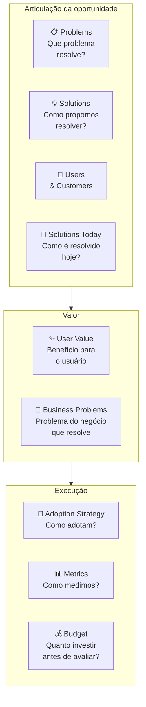

##### O momento exato de colocar este canvas na parede

Utilize o Opportunity Canvas no início desta Fase 9 (imediatamente antes de abrir a geração de ideias do Passo 1, para garantir que a equipe só desenhe soluções para um problema e um segmento bem delimitados) e retome-o nos ciclos de descoberta contínua pós-PMF (Fase 17) sempre que precisar decidir se uma nova oportunidade adjacente merece entrar no *roadmap*. Em reuniões de priorização entre sócios, comparar três Opportunity Canvases de uma página lado a lado revela muito mais rápido as premissas frágeis do que discutir três documentos longos de especificação.

##### As regras de ouro para preencher sem se enganar

O princípio central do Opportunity Canvas de Jeff Patton é tratar cada decisão de produto como uma alocação de capital e tempo escassos: toda funcionalidade colocada em desenvolvimento consome a engenharia que poderia validar outra aposta vital. Enquanto o *Lean Canvas* (Fase 3) modela a hipótese do negócio inteiro e o *Business Model Canvas* (Fase 12) descreve a empresa em operação, o Opportunity Canvas examina uma aposta específica de solução ou funcionalidade antes de comprometer semanas de construção.

##### Passo a passo na parede da sala

Reúna os sócios e, se houver, quem apoia no design ou na operação (duas a três pessoas bastam no estágio inicial. A dinâmica para squads com gerente de produto e líder técnico fica para o Vol. 7). Separe 60 a 90 minutos e leve as anotações das entrevistas da Fase 5 e os cartões de teste da Fase 8. Preencha primeiro os blocos de problemas e usuários. Só depois discuta soluções, para evitar o viés de defender a primeira tela que vocês já queriam construir.

1. **Problems**: descreva o problema sem mencionar a solução. "Usuário tipo X sofre com Y em contexto Z."
2. **Users & Customers**: quem especificamente. Em B2B, distinguir usuário (quem mexe), comprador (quem paga), influenciador (quem decide).
3. **Solutions Today**: como o problema é resolvido hoje? Excel, processo manual, concorrente, "não fazer nada". Liste 3-5 alternativas com prós/contras.
4. **User Value**: o que o usuário ganha que hoje não tem? Específico e mensurável.
5. **Desafios de Negócio (*Business Problems*)**: qual gargalo estratégico da própria startup (aquisição, ativação, retenção, monetização ou defesa competitiva) esta oportunidade precisa destravar?
6. **Solutions**: agora sim, descreva o que vai construir.
7. **Adoption Strategy**: como o usuário descobre, experimenta, adota? In-app, email, CSM, marketing pago?
8. **Metrics**: 2-3 métricas leading + 1 lagging. Se não consegue definir, oportunidade está mal articulada.
9. **Budget**: quanto vai investir (pessoas × tempo + custo de aquisição) antes de reavaliar? Sem budget, Opportunity Canvas vira fantasia.

Ao final da sessão, passe pelo filtro de decisão: se o bloco de Problemas ou de Métricas do Usuário estiver preenchido com opiniões vagas sem base nas entrevistas das Fases 4 e 5, trave a prototipagem e volte a campo por 48 horas.

##### Exemplo preenchido (simulação didática hipotética inspirada no mercado brasileiro de creator economy)

Para ilustrar como o Opportunity Canvas avalia uma nova linha de produto antes de alocar engenharia, veja uma simulação didática hipotética inspirada no mercado brasileiro de economia dos criadores (*creator economy*, segmento liderado no país por plataformas como a Hotmart). Suponha que uma plataforma consolidada em cursos longos de R$ 300 a R$ 2.000 esteja avaliando lançar um módulo enxuto voltado a microcriadores (perfis de 1 mil a 5 mil seguidores que vendem guias rápidos e desafios de R$ 19 a R$ 49 via Pix):

| Bloco | Conteúdo |
|---|---|
| **Problems** | Microcreators têm audiência pequena mas engajada e querem monetizar, mas o setup atual da Hotmart (criar curso completo com landing page, hospedar conteúdo, configurar afiliados) é overkill para conteúdo de 30-90 minutos a R$ 19. |
| **Users & Customers** | Usuário e cliente são a mesma pessoa: microcreator brasileiro com 1-5k seguidores no Instagram/TikTok, audiência engajada, já tem conteúdo gravado mas não no formato curso. |
| **Solutions Today** | (1) Vender via DM no Instagram com Pix, alta fricção, sem rastreamento. (2) Plataformas estrangeiras (Gumroad), barreiras de Pix/pagamento BR. (3) Não monetizar: "perder" a audiência. |
| **User Value** | Setup de produto digital em 5 minutos (vs 1-2h da plataforma principal). Pagamento via Pix integrado. Link de venda direto pra bio do Instagram. Sem necessidade de criar landing, configurar funil, integrar afiliados. |
| **Business Problems** | (1) Aquisição: capturar a base de microcreators que ainda não usa Hotmart e que daqui a 3-5 anos pode virar creator médio. (2) Diversificação: reduzir dependência de "top 1000 creators". (3) Defesa de mercado: bloquear entrada de Gumroad/Stan/Ko-fi no Brasil. |
| **3. Soluções Candidatas (*Solutions*)** | Módulo "MicroDrop" (hipotético): fluxo de publicação em 3 telas pelo celular, página de venda instantânea com Pix nativo e entrega imediata no WhatsApp, sem sistema complexo de afiliados no MVP. |
| **6. Estratégia de Adoção (*Adoption Strategy*)** | Convite direto aos alunos mais engajados dos criadores atuais, parcerias com microinfluenciadores de nicho e modelos prontos de página compartilháveis nos *Stories*. |
| **Metrics** | Leading: número de microcreators ativando produto/mês, GMV médio por microcreator, conversão de visitante em comprador no link de bio. Lagging: % de microcreators que migram para a plataforma principal em 12 meses. |
| **8. Orçamento e Trava (*Budget*)** | 1 dupla de produto/engenharia por 6 semanas para protótipo e MVP conciergado (orçamento de R$ 90 mil). Critério de corte em 90 dias: se não atingir 500 microcriadores ativos com venda paga e GMV mensal acima de R$ 150 mil, encerrar a frente. |

O bloco decisivo nessa simulação é o cruzamento entre Desafios de Negócio e Orçamento com Trava de Descarte: ele deixa explícito que a aposta só merece recursos se funcionar como funil de entrada para criadores iniciantes com custo de aquisição próximo de zero. Sem o quadro, o projeto facilmente inflaria para um segundo sistema completo de seis meses. Com o Opportunity Canvas, o escopo nasce cortado para três telas e uma meta clara de sobrevivência em 90 dias.

##### Variações e extensões

- **Lean UX Canvas** (Jeff Gothelf): variação focada em times UX-driven, com bloco de hipóteses explícito.
- **Product Vision Board** e GO Product Roadmap (Roman Pichler): ferramentas complementares para conectar a visão de produto e os objetivos de cada ciclo às hipóteses e entregas priorizadas.
- **Now/Next/Later Roadmap**: complementa o Opportunity Canvas, uma vez que a oportunidade vale a pena, onde no roadmap ela entra?

##### Onde os fundadores mentem para si mesmos neste canvas

- **Saltar Problemas e Usuários e ir direto para Soluções:** o impulso de desenhar funcionalidades sem antes delimitar a dor oculta perguntas essenciais sobre adoção e hábito.
- Articular User Value em features ("vamos ter um botão de X") em vez de benefícios ("o usuário consegue Y em Z minutos vs hoje em W horas").
- **Ignorar os problemas do negócio (*Business Problems*):** uma funcionalidade que agrada ao usuário mas não move aquisição, retenção ou margem para a empresa não se sustenta financeiramente.
- Definir Metrics só lagging (GMV, retenção D90) sem leading: leva 3-6 meses para saber se está funcionando.
- Não definir Budget de saída: oportunidade roda indefinidamente sem reavaliação, consumindo time.

---

#### Canvas: MVP Canvas (Tristan Kromer e Paulo Caroli)

##### Por que este quadro visual foi criado

O MVP Canvas apresentado a seguir sintetiza a tradição de validação enxuta de Eric Ries (*The Lean Startup*, 2011) com os quadros práticos de escopo difundidos por Tristan Kromer (*Grasshopper Herder*) e, no Brasil, pelo Canvas MVP de Paulo Caroli (*Lean Inception*, 2018, que alinha personas, propostas de valor, jornadas, funcionalidades, resultado esperado, métricas e custo/cronograma). O objetivo é impedir que os fundadores saiam da Fase 9 para a Fase 10 sem cravar qual hipótese central o MVP vai testar, para qual recorte de primeiros usuários e com qual régua numérica de decisão.

##### A anatomia visual de uma página

Tela visual de uma página com sete blocos distribuídos em torno da pergunta central "o que estamos aprendendo com este MVP?":

- **Hipótese central**: a crença que o MVP testa, escrita como falsificável.
- **Segmento de usuário do MVP**: não o cliente final do produto, mas o cliente específico que validará *essa hipótese* (pode ser subconjunto menor).
- **Proposta de valor do MVP**: o que o usuário ganha com o MVP, pode ser diferente do produto final.
- **Canais de recrutamento**: como vamos chegar nos usuários deste MVP.
- **Critério de sucesso**: o que precisamos ver para considerar a hipótese validada.
- **Critério de invalidação**: o que precisamos ver para considerar a hipótese refutada.
- **Tipo de MVP**: qual experimento, landing page, concierge, wizard of oz, protótipo clicável, pré-venda, fake door.

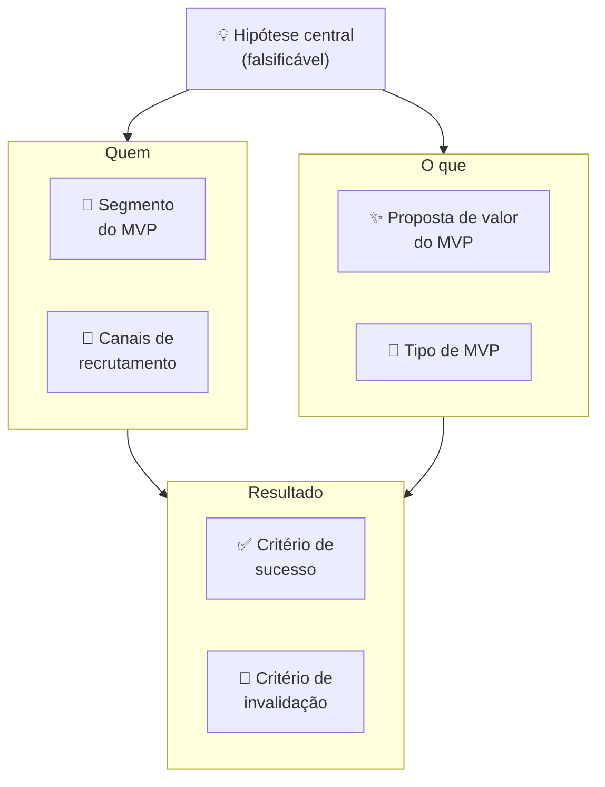

##### O momento exato de colocar este canvas na parede

Utilize o MVP Canvas no **Passo 7 desta Fase 9** (para consolidar a ponte entre o protótipo vencedor validado no Passo 6 e a especificação de escopo da Fase 10) e revise-o na abertura da [[IGNICAO-Vol-4-Tracao-e-PMF#FASE 11: MVP E EXPERIMENTOS DE MERCADO|Fase 11: MVP e Experimentos de Mercado (Vol. 4)]] antes de liberar o produto em produção. Em estágio inicial, os dois ou três sócios preenchem o quadro em 30 a 45 minutos.

##### As regras de ouro para preencher sem se enganar

O princípio central sistematizado por Kromer e Caroli é que um "MVP" sem hipótese explícita e sem régua de refutação é apenas um produto incompleto. Quando o time lança uma versão inicial sem declarar antes qual comportamento dos usuários comprova ou derruba a aposta, qualquer resultado morno é reinterpretado como sucesso parcial.

##### Passo a passo na parede da sala

Reúna os sócios fundadores (2 a 3 pessoas em estágio pré-MVP. Em empresas maiores pós-PMF, inclua gerente de produto, designer e líder técnico). Tempo: 30 a 45 minutos. Sequência de preenchimento:

1. **Hipótese central**: escreva primeiro, antes de falar sobre o MVP em si. "Acredito que [usuário Y] vai [fazer X] por causa de [razão Z]." Teste: a hipótese pode ser refutada? Se não, reescreva.
2. **Segmento do MVP**: quem especificamente vai testar esta hipótese? Pode ser 20 pessoas, não 20.000. Quanto mais estreito o segmento, mais limpa a evidência.
3. **Proposta de valor do MVP**, o que o usuário ganha hoje com esta versão? Não o que o produto promete no futuro, o que o MVP entrega agora.
4. **Canais de recrutamento**: como vai encontrar essas pessoas? "Nossos clientes" é vago, "os 20 donos de padaria entrevistados na Fase 5, acionados diretamente pelo WhatsApp do fundador" é um canal concreto.
5. **Tipo de MVP**: qual é o formato do experimento? Não construa código se um protótipo clicável testa a mesma hipótese em 1/10 do tempo.
6. **Critério de sucesso (validação)**: defina antes de construir o número exato que comprova a hipótese dentro da janela do teste.
7. **Critério de invalidação (refutação)**: defina antes de construir qual resultado obriga a descartar ou pivotar a aposta.

Ao concluir os nove blocos do quadro, faça o teste de honestidade entre os sócios: *"Se ao final da janela de teste o resultado ficar abaixo do critério de invalidação (Bloco 7), qual movimento concreto faremos na segunda-feira seguinte?"* Se a resposta ainda estiver vaga, refine a hipótese e o corte de escopo antes de avançar para a Fase 10.

##### Exemplo preenchido (simulação didática hipotética inspirada no setor brasileiro de mobile gaming)

Para demonstrar como o MVP Canvas delimita um experimento de monetização e retenção em jogos digitais, veja uma simulação didática com métricas hipotéticas inspirada no setor brasileiro de *mobile gaming* (ecossistema liderado globalmente a partir de São Paulo pela Wildlife Studios, criadora de títulos como *Sniper 3D* e *Tennis Clash*). Suponha que a equipe de um jogo competitivo para celular decida testar a substituição de caixas de recompensa aleatórias (*loot boxes*, modalidade que no Brasil passou a sofrer vedação legal em jogos acessíveis a crianças e adolescentes com o ECA Digital, Lei 15.211/2025) por um Passe de Temporada transparente (*Season Pass* com recompensas visíveis a cada nível):

| Bloco | Conteúdo |
|---|---|
| **Hipótese central** | Jogadores de Sniper 3D que compraram ao menos 1 item nos últimos 90 dias pagarão R$ 15 por season pass se perceberem progressão visual clara de recompensas ao longo de 30 dias. |
| **Segmento do MVP** | Cohort de 50.000 jogadores "moderate spenders" (1-3 compras/trimestre, ARPU R$ 18/mês) em mercado brasileiro. Excluídas as duas pontas, free-to-play puro e heavy spenders, para isolar o segmento mais sensível à proposta. |
| **Proposta de valor do MVP** | 30 recompensas progressivas (visuais, skins, boosters) por R$ 15: previsibilidade de valor vs. loteria de loot box. |
| **Canais de recrutamento** | In-game banner para o cohort selecionado + push notification personalizada no D1 do teste. Sem anúncio externo: experimento contido na base existente. |
| **Tipo de MVP** | Feature real implementada no jogo para o cohort (não protótipo): o investimento de desenvolvimento era pequeno o suficiente para ser justificado pela potencial monetização. |
| **Critério de sucesso** | ≥12% de conversão do cohort (compra do season pass) nos primeiros 7 dias. ARPU do cohort ≥ R$ 22 em 30 dias (vs. R$ 18 baseline). |
| **Critério de invalidação** | < 6% de conversão em 7 dias OU ARPU < R$ 16 em 30 dias = hipótese refutada. Considerar alternativas de monetização ou repricing. |

**Resultado:** 17% de conversão em D7 (acima do critério de sucesso). ARPU do cohort subiu para R$ 24 em 30 dias. Decisão: Persevere, expandir season pass para todos os usuários ativos + outros jogos do portfólio.

Nessa simulação, o bloco mais importante do MVP Canvas é a delimitação estrita do Segmento de Teste (excluindo tanto os jogadores 100% gratuitos, que nunca compram, quanto as "baleias" ou *heavy spenders*, que compram qualquer pacote). Ao isolar o segmento intermediário de pagantes moderados e fixar *ex-ante* o piso de 12% de conversão com retenção estável no D30, a equipe evita que o resultado médio esconda o comportamento real do público-alvo.

##### Variações e extensões

- **Adaptação para experimentos de Concierge e Mágico de Oz**: quando o MVP ainda é operado manualmente pelos fundadores nos bastidores (para 10 a 20 primeiros clientes), acrescente ao canvas um bloco com o roteiro passo a passo da operação manual e o tempo gasto por entrega.
- **Wizard of Oz Canvas**: variação onde o backend é falso (humano operando). Canvas adiciona bloco "O que o usuário vê" vs. "O que realmente acontece" para mapear a ilusão deliberada.
- **Sprint Goal Canvas** (adaptação ágil): integra MVP Canvas com sprint planning, cada sprint tem um canvas de hipótese + critério.

##### Onde os fundadores mentem para si mesmos neste canvas

- **Chamar de MVP qualquer entrega incompleta:** lançar um pacote de funcionalidades sem hipótese explícita nem métrica de decisão produz apenas um software pela metade, sem gerar aprendizado validado.
- Segmento do MVP = segmento total do mercado: dilui o sinal, o experimento não produz evidência limpa.
- Tipo de MVP mais caro que o necessário: se landing page testa a hipótese, não construa produto, se protótipo clicável testa, não escreva código.
- Não definir critério de invalidação: MVP "sempre aprende algo", nunca "falha", loop de aprendizado não fecha.
- Usar MVP Canvas para justificar construção que já foi decidida: canvas como teatro, não como ferramenta de decisão.

---

### Templates operacionais e casos preenchidos desta fase (OST, User Story Map, Concept Card, Roteiro de 30 Minutos e Dossiê de Solução)

#### Template: Diagrama de Opportunity Solution Tree (Teresa Torres) aplicado ao caso PadariaPro

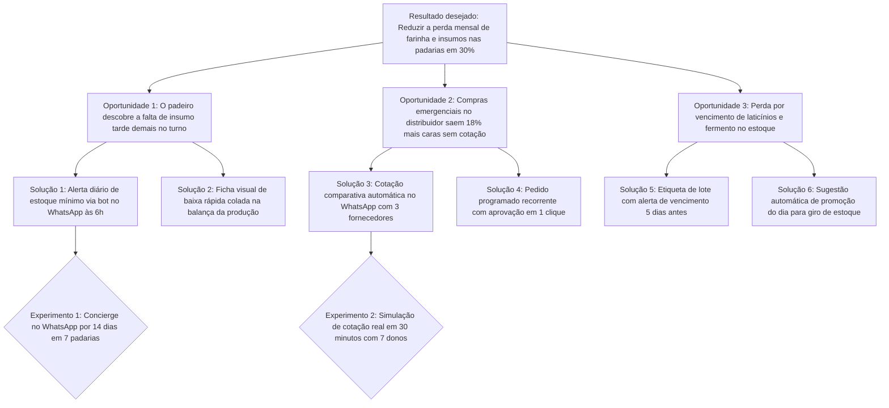

**Uso:** o topo da árvore é o outcome desejado (métrica mensurável). Opportunities são hipóteses sobre o que, se resolvido, moveria o outcome. As soluções (*solutions*) são ideias concretas para resolver cada oportunidade, e abaixo delas entram os experimentos específicos que testam as premissas de cada solução (como nos ramos do PadariaPro). A disciplina é nunca pular direto de outcome para solution, sempre explicitar qual opportunity a solução tenta endereçar.

---

#### Template: Story Map exemplo (MVP de app de entrega regional)

Horizontal (jornada): cliente *Descobre* → *Seleciona loja* → *Escolhe produtos* → *Paga* → *Acompanha* → *Recebe*

| Atividade | Essencial (Release 1) | Intermediário (Release 2) | Avançado (Release 3) |
|---|---|---|---|
| Descobre | Busca por CEP | Ordenação por distância | Recomendação personalizada |
| Seleciona loja | Lista com foto e nota média | Filtro por categoria | Favoritos e histórico |
| Escolhe produtos | Cardápio simples, uma foto por item | Variações (tamanho, sabor) | Personalização detalhada, combos |
| **4. Paga e confirma** | Pix nativo com QR Code automático + confirmação de pedido no WhatsApp | Cartão de crédito salvo + boleto faturado para redes | Cashback, cupons promocionais e divisão de pagamento |
| Acompanha | Status em texto (recebido, em preparo, saindo) | Mapa em tempo real | Chat com entregador |
| Recebe | Confirmação por SMS | Avaliação da entrega | Foto do produto na entrega |

A primeira entrega (*Release 1*) precisa cortar horizontalmente toda a jornada para que o usuário conclua o trabalho principal de ponta a ponta, ainda que com recursos simples. Começar por uma entrega vertical isolada (como construir apenas o módulo de cadastro ou de pagamento) posterga a geração de valor real até o último ciclo.

---

#### Template: Matriz de Priorização DVF (Desejabilidade, Viabilidade e Exequibilidade: Passo 2)

| Conceito Candidato | Desejabilidade (1–5) | Viabilidade Econômica (1–5) | Exequibilidade Técnica (1–5) | Pontuação Total (D × V × F) | Status |
|---|---|---|---|---|---|
| **Conceito 1:** Bot de cotação e alerta no WhatsApp | 5 | 4 | 5 | **100** | Finalista 1 |
| **Conceito 2:** Painel web completo de estoque e compras | 3 | 4 | 3 | **36** | Descartado |
| **Conceito 3:** Planilha automatizada com resumo diário por e-mail | 4 | 4 | 4 | **64** | Finalista 2 |

#### Template: Concept Card de Solução (Passo 3)

```text
CONCEPT CARD DE SOLUÇÃO (PASSO 3: 1 PÁGINA POR CONCEITO CANDIDATO)
===================================================================
1. Nome curto do conceito: ____________________________________________
2. Descrição em 2 frases (para quem é e como resolve a dor na prática):
   ____________________________________________________________________
3. Diferencial frente à alternativa atual (planilha, WhatsApp, concorrente):
   ____________________________________________________________________
4. Requisitos técnicos e operacionais mínimos para entregar no MVP:
   ____________________________________________________________________
5. Modelo de monetização e faixa de preço prevista:
   ____________________________________________________________________
6. Principais riscos e premissa decisiva que o protótipo precisa testar:
   ____________________________________________________________________
```

#### Template: Roteiro de Teste de Solução de 30 Minutos (Passo 5: 5 etapas)

- **Etapa 1: Contextualização (2 minutos).** Situe o participante no cenário real do dia a dia antes de mostrar a tela (*"Imagine que são 6h15 da manhã de segunda-feira e você acabou de abrir a padaria"*).
- **Etapa 2: Tarefas práticas no protótipo (15 minutos).** Entregue de 3 a 5 tarefas concretas sem explicar onde clicar (*"Confira a sugestão de compra de farinha para as suas 3 lojas, ajuste a quantidade da Loja 2 e confirme o pedido"*).
- **Etapa 3: Observação silenciosa (durante os 15 minutos).** Segure a vontade de ajudar, anote exatamente em qual botão, palavra ou número o participante hesita, franze a testa ou erra o caminho.
- **Etapa 4: Protocolo de pensar em voz alta (*think-aloud*, durante os 15 minutos).** Peça que ele narre o que está lendo e o que espera que aconteça antes de cada toque na tela.
- **Etapa 5: Perguntas pós-teste e compromisso real (10 minutos finais).** Pergunte o que ficou claro, onde surgiu dúvida, quanto essa rotina custa hoje na operação dele e feche convidando para um compromisso concreto (agendar o piloto real ou assinar a pré-venda com reembolso).

#### Template: Dossiê de Solução Preenchido (Caso PadariaPro, Passo 7)

| Campo do Dossiê | Registro Consolidado (PadariaPro - Fim da Fase 9) |
|---|---|
| **Conceito vencedor** | Arquitetura híbrida (Ideia #7): alerta diário às 6h no WhatsApp para aprovação rápida até R$ 1.000 + link web enxuto (ou resumo por e-mail para gestoras como Márcia) em pedidos maiores |
| **Amostra testada** | 10 donos e gerentes de produção de redes de 2 a 5 padarias em São Paulo e Campinas (duas rodadas de 5 usuários, faturamento de R$ 150 mil a R$ 400 mil/mês por loja) |
| **Taxa de conclusão da tarefa** | 9 de 10 concluíram a conferência e aprovação do pedido em menos de 3 minutos na segunda rodada (após incluir o estoque atual ao lado da sugestão) |
| **Aprendizado que mudou o escopo** | Padeiros na bancada exigem WhatsApp às 6h no celular, enquanto sócias financeiras no escritório (como Márcia, em Campinas) pedem cópia em tela web/e-mail para pedidos acima de R$ 1.000 |
| **Sinal concreto de compromisso** | 7 das 10 redes entregaram as notas fiscais e a lista de fornecedores de trigo e assinaram o termo de piloto pago de R$ 290 a R$ 400/mês |
| **Decisão de saída da Fase 9** | Avançar para o corte de escopo MoSCoW e especificação final na Fase 10 com o fluxo híbrido (WhatsApp + tela web de confirmação) |

---

### Fechamento da Fase 9: o que muda na sua cabeça e na sua empresa a partir de agora

Em Belo Horizonte, a Dra. Camila escapou do Cemitério dos Protótipos Perfeitos quando desistiu de encomendar telas polidas por semanas e testou, numa única tarde, um vídeo simulado de 15 segundos no WhatsApp com nove pacientes de reabilitação oral e três recepcionistas de clínicas parceiras. A reação imediata separou o que era vaidade estética do que realmente destravava o retorno do paciente, cabendo num dossiê enxuto de duas páginas para entrar na Fase 10. É isso que muda na sua cabeça ao sair da Fase 9: protótipo é isca descartável para capturar o erro barato antes de escrever uma linha de código.

Esse dossiê é o insumo da [[#FASE 10: TESTES DE SOLUÇÃO E USABILIDADE|Fase 10]], onde o conceito escolhido passa por testes de usabilidade estruturados e se converte em Especificação do MVP. Quem chega à Fase 10 sem ter explorado alternativas e sem ter testado protótipo entra na especificação com hipótese implícita não testada, aumentando o risco de retrabalho na [[IGNICAO-Vol-4-Tracao-e-PMF#FASE 11: MVP E EXPERIMENTOS DE MERCADO|Fase 11 (Vol. 4)]].

---

## FASE 10: TESTES DE SOLUÇÃO E USABILIDADE

### A Guilhotina de Escopo e o Silêncio Constrangedor do Teste de Usabilidade

"Não, não! Não clica aí ainda, deixa eu te explicar essa tela!", exclamou Lucas, quase puxando o mouse da mão do gerente financeiro durante a sessão de usabilidade em São Paulo.

Sentada ao lado com um bloco de notas, Marina segurou o braço do sócio por baixo da mesa e murmurou:

"Lucas, fica quieto. Quando o cliente estiver sozinho no escritório dele às oito da noite, você não vai sair de dentro do monitor para explicar onde fica o botão de importar extrato."

Nos cinco minutos seguintes em silêncio, Lucas observou uma cena decisiva para qualquer criador de produto: o usuário tentou clicar em um título estático, procurou um botão de ajuda inexistente, suspirou e fechou a aba, revelando em poucos instantes falhas de fluxo que quatro horas de reunião interna jamais mostrariam.

Mas o segundo golpe veio à tarde, quando Lucas abriu o backlog para planejar o lançamento do MVP e listou 47 funcionalidades "indispensáveis": incluindo modo escuro, permissões em quatro níveis hierárquicos, exportação em PDF customizável e painel de administração. Marina puxou a caneta vermelha e aplicou a Guilhotina de Escopo:

"Se o cliente consegue importar o extrato e enxergar a previsão de caixa de amanhã, ele já recebe 90% do valor. Modo escuro, troca de senha automática e painel de administração vão para a lixeira agora. Nosso produto mínimo terá três telas e entra no ar na próxima terça-feira", cravou Marina.

Ao longo desta fase, veremos esse corte na prática em três momentos: na seção seguinte e no Passo 5 (MoSCoW), onde a Guilhotina de Escopo reduz a planilha de 47 itens de Lucas às 3 telas essenciais (importação de extrato OFX, conciliação de boletos duplicados e projeção de caixa de 30 dias, enviando permissões multinível, PDF customizável e modo escuro para a lista explícita de *Won't Have*). No estudo de caso da Oficina de Trincheira, que acompanha a segunda rodada silenciosa com cinco gerentes financeiros após trocarem o botão obscuro por *"Classificar lançamentos"*, e no Espelho de fechamento, quando Lucas e Marina travam a especificação assinada em duas páginas antes de abrir o editor de código.

O que mais atrasa um lançamento é o perfeccionismo: a tentação de incluir "só mais uma funcionalidade" na lista para adiar o dia em que o mercado real julga o produto.

---

### Por que especificar e cortar o escopo antes de construir (dos 47 itens de Lucas às 3 telas essenciais)

Depois que Lucas e Marina viram o gerente financeiro travar diante da tela na primeira sessão silenciosa em São Paulo, ficou claro o que precisavam resolver antes de abrir o editor de código: os protótipos da Fase 9 haviam provado o interesse pelo conceito, mas cabia à Fase 10 testar a usabilidade tarefa a tarefa sem soprar dicas, medir a percepção de valor e passar a Guilhotina de Escopo nos 47 itens da planilha de Lucas até restarem apenas as 3 telas vitais assinadas pelos dois sócios.

### Os oito passos da Fase 10: do teste de usabilidade com 5 usuários em silêncio à Guilhotina de Escopo no MoSCoW

O método desta fase percorre oito passos sequenciais: os Passos 1 a 4 testam o protótipo com usuários reais (entrevista de solução, tarefas de usabilidade em silêncio, escala de valor e sensibilidade a preço). Os Passos 5 e 6 aplicam a Guilhotina de Escopo (MoSCoW) para congelar a Especificação de MVP, e os Passos 7 e 8 submetem o documento final aos dois portões de liberação para engenharia (Gate de Direcionalidade e Checagem de Prontidão para Construir).

#### Passo 1: conduza entrevistas de solução

Diferente da entrevista de descoberta do problema ([[IGNICAO-Vol-2-Descoberta-e-Mercado#FASE 4: DESCOBERTA DO PROBLEMA|Fase 4 (Vol. 2)]]), aqui você coloca o protótipo navegável na frente do usuário e investiga seis pontos objetivos: (1) se o fluxo apresentado resolve na prática a dor principal dele, (2) como essa experiência se compara com a planilha ou gambiarra que ele usa hoje, (3) qual faixa de valor mensal parece justa pelo ganho obtido, (4) qual etapa essencial ainda faltou para ele conseguir trabalhar e quais botões parecem supérfluos, (5) em que horário e dispositivo da rotina diária ele usaria a ferramenta, e (6) que obstáculo técnico, político ou contratual o impediria de adotar a solução na próxima segunda-feira.

Faça dez a quinze dessas entrevistas. Grave, transcreva, analise.

> [!tip] Canvases Visuais: Empathy Map (Fase 4)
> Após cada rodada de testes de solução e usabilidade, consulte a ficha completa do [[IGNICAO-Vol-2-Descoberta-e-Mercado#Canvas: Empathy Map (Dave Gray / XPLANE, 2009)|Mapa de Empatia de Dave Gray (Vol. 2)]] para consolidar em uma página as seis áreas observadas na sessão (o que o usuário diz, faz, pensa e sente, somados às dores/atritos de tela e aos ganhos esperados). Essa síntese pós-teste alinha rapidamente os sócios sobre onde o fluxo travou sem duplicar a ficha metodológica do Volume 2.

#### Passo 2: aplique a técnica das cinco escalas de valor

Para cada entrevistado, peça avaliação em escala de um a cinco em cinco dimensões: Relevância ("isso resolve um problema real?"), Urgência ("você precisaria disso nos próximos trinta dias?"), Preferência ("prefere ao que usa hoje?"), Diferenciação ("percebe como diferente das alternativas?") e Disposição a pagar (de 1, não pagaria nada, a 5, pagaria mais do que gasta hoje para contornar o problema. O valor em reais entra no Van Westendorp do Passo 4). Calcule a média e o desvio-padrão de cada escala.

> [!warning] Urgência abaixo de três é alerta vermelho
> Se a Urgência média ficar abaixo de três, o problema existe mas não é prioridade. Você terá dificuldade de vender. Não é "ainda preciso polir o pitch". O diagnóstico correto é que o problema ainda não dói o bastante para justificar a troca: volte à Fase 4 (Descoberta do Problema, no Vol. 2) e refaça a medição de severidade com os *Pain Levels*.

#### Passo 3: faça o teste de cinco segundos (five second test)

Mostre o protótipo ou a página principal por cinco segundos, e tire. Depois pergunte três coisas. O que você entendeu? Para quem é? Qual problema resolve?

Se menos de 70% dos testados acertam as três respostas de primeira, o seu posicionamento está confuso, e isso vai inflar o seu CAC (custo de aquisição de cliente) quando a campanha começar.

> [!note] Aprofundamento no Volume 2 (Capítulo 1: Psicologia do Consumidor Brasileiro: Comportamento, Decisão e Conversão)
> As respostas coletadas nas entrevistas de solução sofrem forte influência cultural: no Brasil, o entrevistado tende a elogiar o protótipo por cordialidade social (superestimando a intenção declarada de uso) e a esconder objeções de preço ou desconfiança até a hora de pagar. O [[IGNICAO-Vol-2-Descoberta-e-Mercado#CAPÍTULO 1: PSICOLOGIA DO CONSUMIDOR BRASILEIRO: COMPORTAMENTO, DECISÃO E CONVERSÃO|Capítulo 1: Psicologia do Consumidor Brasileiro (Vol. 2)]] analisa como a cordialidade, a aversão ao risco e a busca por prova social moldam o comportamento do comprador brasileiro, ajudando a descontar o otimismo verbal ao interpretar as escalas de valor deste passo.

#### Passo 4: teste de precificação (price sensitivity, Van Westendorp)

Pergunte quatro coisas, nessa ordem.

Em que preço você começaria a achar muito barato? A ponto de desconfiar da qualidade.

Em que preço você começaria a achar barato? Bom negócio.

Em que preço você começaria a achar caro? Mas ainda consideraria.

Em que preço você começaria a achar caro demais? Não consideraria.

Plote as quatro curvas acumuladas (com apenas 15 a 20 respostas, trate os números apenas como pista qualitativa inicial, pois a amostra é pequena para estabilidade estatística). No método de Van Westendorp, o cruzamento entre "barato" e "caro" aponta um único ponto (o preço de indiferença), enquanto a faixa de preço aceitável vai do cruzamento de "muito barato" com "não barato" (preço marginalmente barato) até o cruzamento de "muito caro" com "não caro" (preço marginalmente caro).

> [!tip] Van Westendorp é ponto de partida, não resposta final
> Use a faixa de Van Westendorp como baliza inicial para evitar extremos de preço. A validação definitiva ocorre na Fase 11, quando o cliente efetua o pagamento real.

> [!tip] Capítulo 6 (Vol. 4): Pricing Strategy
> O método de Van Westendorp revela a faixa psicológica de preço aceitável, mas não define o modelo de cobrança (assinatura fixa, cobrança por uso, taxa sobre economia gerada ou *freemium*) nem a estrutura de pacotes. O [[IGNICAO-Vol-4-Tracao-e-PMF#CAPÍTULO 6: PRICING STRATEGY E ECONOMIA DA RECORRÊNCIA (SUBSCRIPTION ECONOMY)|Capítulo 6: Pricing Strategy e Economia da Recorrência (Vol. 4)]] complementa este passo com a arquitetura de precificação para o lançamento do MVP e os erros mais comuns no mercado brasileiro, incluindo a armadilha de ancorar o preço inicial tão baixo que inviabilize a economia unitária depois.

> [!tip] Product discovery moderno é insumo recomendado para times com PM/designer/eng
> **Como a descoberta evolui do fundador para a equipe (ponte com o Volume 7):** Nas Fases 9 e 10, você mesmo (com seu sócio) usa uma versão enxuta da Árvore de Oportunidades (*Opportunity Solution Tree*) e entrevistas semanais para escolher e especificar o MVP. Quando a empresa ultrapassar o Product-Market Fit e o time de produto crescer para além de cinco a sete pessoas, essas práticas ganham cadência de *squad* dedicado, combinando *Continuous Discovery* (Teresa Torres), operação em trilha dupla de descoberta e entrega (*Dual-Track Agile*, de Marty Cagan e Jeff Patton) e histórias de usuário verificáveis (padrão INVEST, de Bill Wake, 2003), detalhadas na [[IGNICAO-Vol-7-Produto-Engenharia-e-Operacoes#FASE 17: OPERAÇÕES, PROCESSOS E GESTÃO EM ESCALA|Fase 17: Operações, Processos e Gestão em Escala (Vol. 7)]] e no [[IGNICAO-Vol-7-Produto-Engenharia-e-Operacoes#CAPÍTULO 1: PRODUTO EM ESCALA E DESCOBERTA CONTÍNUA|Capítulo 1: Produto em Escala e Descoberta Contínua (Vol. 7)]].

#### Passo 5: mapeie requisitos por ordem de prioridade (MoSCoW)

A priorização MoSCoW para escopo de MVP, em estrutura visual:

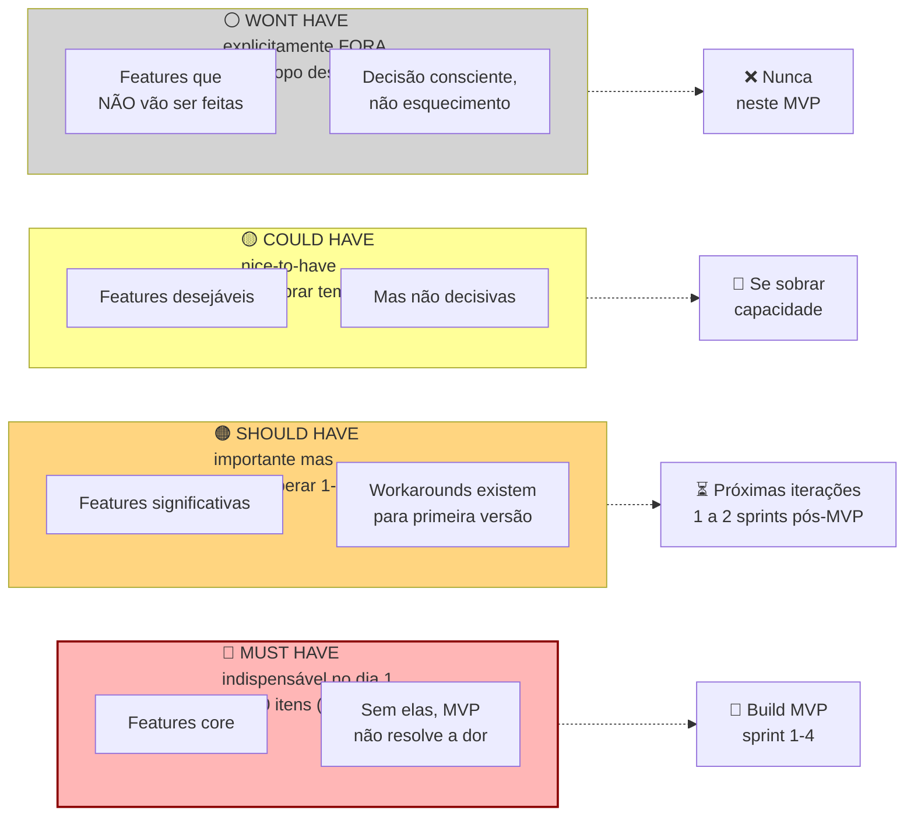

Na prática da trincheira, foi exatamente aqui que Lucas e Marina salvaram o lançamento do seu sistema de conciliação financeira: Lucas havia chegado à Fase 10 com uma planilha de 47 funcionalidades "indispensáveis" (incluindo controle de permissões em quatro níveis, exportação de PDF com logotipo customizável, modo escuro, conciliação de cartões internacionais e aplicativo nativo). Ao passarem a Guilhotina do MoSCoW após os testes com gerentes financeiros, cortaram 44 itens e congelaram apenas **3 telas no *Must Have***: (1) importação de extrato OFX/CSV em um clique, (2) conciliação automática de boletos duplicados e tarifas divergentes e (3) projeção simples de caixa para 30 dias.

Classifique cada requisito funcional numa das quatro colunas do diagrama acima aplicando a Guilhotina de Escopo: Must Have (sem isso o cliente não resolve a dor central. Entra obrigatoriamente no MVP), Should Have (importante, mas a operação roda sem ele nas primeiras semanas. Fica para as sprints 1 e 2 pós-MVP), Could Have (desejável se sobrar capacidade após validar o básico) e Won't Have (cortado explicitamente desta versão para proteger o prazo de lançamento).

> [!important] Regra dura do MoSCoW
> Mantenha a coluna *Must Have* enxuta: o teto saudável é de até 10 itens (com sinal de alerta entre 11 e 15 e corte obrigatório acima de 15). Se a sua lista ultrapassa esse limite, volte ao problema central e elimine o que não for indispensável no primeiro dia de uso.

#### Passo 6: escreva a Especificação do MVP

Documento contendo dez itens.

(1) Proposta de valor final em uma frase, (2) Persona foco (*beachhead*), (3) Principais tarefas (*JTBDs*) a resolver, (4) Lista enxuta de *Must Haves* (até 10 itens), (5) Lista de *Should* e *Could Haves* (próximos ciclos), (6) O que o MVP explicitamente *não* fará (*Won't Haves*), (7) Critérios numéricos de sucesso do MVP, (8) Faixa de preço testada, (9) Canais de aquisição iniciais, e (10) Prazo de desenvolvimento e orçamento máximo combinados.

> [!tip] Templates Operacionais: Template da Especificação do MVP (Template da Fase 10)
> O [[#Template: Especificação de MVP|Template: Especificação de MVP]] consolida os dez blocos obrigatórios listados neste Passo 6 em um documento único de duas páginas, incluindo a lista explícita de exclusões (*Won't Haves*), os critérios numéricos de sucesso para avaliação pós-lançamento e as premissas de risco remanescentes que serão monitoradas na Fase 11.

#### Passo 7: aplique o Gate de Direcionalidade

Antes de avançar para a [[IGNICAO-Vol-4-Tracao-e-PMF#FASE 11: MVP E EXPERIMENTOS DE MERCADO|Fase 11 (Vol. 4)]] e gastar tempo e dinheiro construindo o MVP, responda em voz alta, para um interlocutor externo (cofundador, mentor, advisor), a seguinte pergunta.

> [!important] A pergunta do gate
> A solução que estamos prestes a construir reduz ou elimina, de forma direta e mensurável, a dor que identificamos na beachhead?

Os três elementos da frase importam, e cada um é um teste por si só.

**De forma direta e mensurável.** A primeira exigência da pergunta de direcionalidade é que a proposta de valor ataque frontalmente a dor prioritária e entregue uma melhoria quantificável em tempo, dinheiro ou risco. Verbos vagos como *"apoiar"*, *"facilitar"* ou *"melhorar a experiência"* denunciam uma solução cosmética incapaz de vencer a inércia de troca do comprador.

**Cadeia causal curta (sem depender de milagres operacionais).** O caminho entre abrir o MVP e sentir o alívio da dor precisa ser imediato. Se para colher o primeiro benefício o cliente precisar antes recadastrar cinco anos de histórico, treinar vinte funcionários e trocar de contador, a fricção mata a adoção antes da primeira semana.

**Efeito auditável no bolso ou no relógio.** O próprio comprador precisa conseguir medir o antes e o depois em horas poupadas, reais recuperados ou erros evitados (como os boletos em duplicidade travados por Lucas e Marina ou os quilos de farinha economizados no PadariaPro).

> [!warning] Se algum dos três elementos travar, não avance
> Volte ao Passo 6 (Especificação do MVP) e corte features que não contribuem diretamente para a redução da dor principal. Um MVP que resolve uma dor com direcionalidade clara supera consistentemente um MVP que resolve várias dores com direcionalidade difusa.

#### Passo 8: aplique a Checagem de Prontidão para Construir (*Build / Scale Readiness Check*)

Este segundo portão complementa o Gate de Direcionalidade do Passo 7. Enquanto o Passo 7 pergunta *"a solução especificada resolve a dor certa do comprador certo?"*, a Checagem de Prontidão para Construir (*Build Readiness Check*, também chamada na metodologia Antler de *Scale/Build Readiness*) pergunta *"temos clareza de escopo, comprador pagante e orçamento de engenharia para iniciar a construção do MVP sem desperdício?"*. Os cinco itens precisam estar aprovados antes de avançar para a [[IGNICAO-Vol-4-Tracao-e-PMF#FASE 11: MVP E EXPERIMENTOS DE MERCADO|Fase 11: MVP e Experimentos de Mercado (Vol. 4)]].

- [ ] **Um comprador claramente definido.** Você tem nome, cargo, e empresa (ou perfil nomeado no caso B2C) do primeiro comprador. Não "pequenos negócios". Uma lista concreta de cinco a dez pessoas que você saberia chamar hoje para uma demo.
- [ ] **Um workflow doloroso identificado.** Você observou, não só ouviu, o workflow atual. Sabe onde o cliente trava, quantos minutos por semana ele gasta na gambiarra, e quem mais na organização é afetado.
- [ ] **Titularidade de orçamento clara.** Você sabe quem no fluxo comprador autoriza o gasto, de qual rubrica sai o dinheiro, e em que ordem de grandeza (R$ por mês ou por licença). Se a resposta é "a gente descobre depois", você ainda não tem clareza orçamentária suficiente para escalar.
- [ ] **Urgência comprovada em comportamento:** em vez de depender apenas de entusiasmo verbal na entrevista, confirme que o cliente já gasta tempo ou dinheiro tentando contornar o problema hoje, enfrenta um prazo regulatório ou contratual concreto ou aceita assinar pré-venda, piloto pago ou carta de intenção.
- [ ] **Consciência de que escalar suposições amplifica ineficiência.** Você lista por escrito quais suposições ainda não foram validadas, e se comprometeu a validá-las na [[IGNICAO-Vol-4-Tracao-e-PMF#FASE 11: MVP E EXPERIMENTOS DE MERCADO|Fase 11 (Vol. 4)]] sem construir por cima delas. Ignorar essa etapa transforma dívida de suposição em dívida de produto, e cria retrabalho caro.

> [!warning] Se algum dos cinco itens não pode ser marcado, não avance em ritmo de produção
> Fique nesta Fase 10 em modo de investigação (ou volte à Fase 9 se precisar redesenhar o protótipo) até fechar o item pendente. Escalar desenvolvimento com suposições não testadas é como colocar mais combustível em um carro que ainda não se sabe se tem direção funcionando. Você só vai chegar mais rápido no lugar errado.

### Roteiro prático de teste de usabilidade do PadariaPro (protótipo híbrido de WhatsApp e web)

**Briefing ao usuário (cinco minutos).**

> "Oi, [Nome]. Hoje vou te mostrar uma versão não finalizada de uma ferramenta. Quero que você tente usá-la como se fosse a sua rotina, e fale em voz alta tudo que está pensando. Não tem resposta certa. Se você se perder, ótimo. É isso que a gente precisa saber. Posso gravar a tela?"

**Tarefa 1: onboarding inicial (dez minutos).**

> "Você acabou de receber a indicação do PadariaPro. Cadastre a sua padaria e adicione o seu primeiro fornecedor (Anaconda)."

Friction points observados em cinco usuários. Quatro de cinco travaram em "Inserir CNPJ", porque o sistema exigiu formato específico sem indicar. Três de cinco não entenderam o que "vincular fornecedor" significava na tela. Cinco de cinco pularam o campo "Inserir cardápio". Acharam irrelevante para onboarding.

**Tarefa 2: confirmar pedido via WhatsApp (oito minutos).**

> "Chegou uma mensagem do PadariaPro no seu WhatsApp com sugestão de pedido. Confirme."

**Observações:** Cinco de cinco confirmaram sem problema via "sim". Dois de cinco tentaram "ajustar" e ficaram confusos quando o bot pediu nova quantidade. Não estava claro se era em quilos ou em sacos. Quatro de cinco elogiaram a fluidez.

**Tarefa 3: ajustar pedido recorrente (dez minutos).**

> "Você percebeu que a sua padaria está desperdiçando farinha integral. Ajuste o pedido recorrente para pedir vinte por cento a menos."

Pontos de travamento observados: cinco de cinco participantes levaram mais de três minutos para localizar a tela de configuração, e três desistiram dizendo que preferiam mandar o ajuste direto pelo WhatsApp. Conclusão prática: o ajuste de pedidos recorrentes precisa funcionar também via mensagem no WhatsApp, e não apenas no painel web.

**Síntese pós-cinco testes.**

Must-have para ativação. Onboarding em menos de cinco minutos (hoje leva doze a vinte). CNPJ com máscara. Explicação de fornecedor. Pular cardápio opcional.

Funcionalidade decisiva a simplificar. Ajuste de pedido recorrente. Mover para WhatsApp com comando natural.

**Descarte:** Seção "cardápio" não é essencial para MVP. Cortar.

Iteração prioritária. Simplificar onboarding para três passos. CNPJ, depois primeiro fornecedor, depois primeiro pedido teste.

### Caso brasileiro real: Gupy e empresas-piloto

#### Simulação didática de validação de solução e corte de escopo no setor de HR Tech (inspirada na evolução de plataformas como a Gupy)

Para ilustrar como uma startup B2B brasileira aplica os testes de solução e o corte de escopo da Fase 10 antes de escalar o desenvolvimento, acompanhe uma simulação didática inspirada nos primeiros passos de plataformas de recrutamento e seleção digital no país (segmento consolidado por empresas como a Gupy, fundada em 2015). Nessa reconstrução pedagógica, antes de construir dezenas de módulos de RH, a equipe recruta de cinco a oito empresas parceiras para testar apenas o fluxo essencial de triagem de candidatos, medindo o tempo gasto pelos recrutadores para fechar uma vaga antes e depois do protótipo funcional.

O resultado foi composto. As iterações cruas, baseadas em uso real, calibraram a plataforma antes do go-to-market geral. As empresas-piloto viraram primeiros cases. Depois evangelistas. Depois canal de referência. A Gupy se tornaria, anos depois, uma das maiores plataformas de recrutamento da América Latina.

Piloto estruturado com poucas empresas gera aprendizados cem vezes mais úteis que lançamento aberto sem foco. E os primeiros pilotos viram, se bem cuidados, os primeiros vendedores da sua empresa.

### Especificação enxuta do MVP congelada e aprovada por usuários reais sem ajuda do fundador

Você concluiu a Fase 10 quando todos os critérios abaixo estão cumpridos.

- [ ] Protótipo navegável de média fidelidade (Figma, Webflow ou Framer) cobrindo de ponta a ponta o fluxo principal.
- [ ] Três a cinco tarefas nucleares de usabilidade testadas em silêncio com cinco usuários por rodada (mínimo de duas rodadas após corrigir os bloqueios da primeira), atingindo na rodada final taxa de conclusão sem ajuda ≥ 80% (sendo ≥ 70% o piso mínimo aceitável na primeira rodada exploratória da Fase 9).
- [ ] Dez ou mais entrevistas de solução ou sessões de teste com think-aloud, com cinco dimensões avaliadas (Relevância, Urgência, Preferência, Diferenciação, Disposição a pagar). Urgência média ≥ 3 e Preferência ≥ 4 usadas apenas como filtro exploratório inicial, acompanhadas obrigatoriamente de compromisso comportamental concreto (pré-venda paga, carta de intenção assinada ou sinal financeiro para o piloto).
- [ ] Taxa de compreensão no teste de cinco segundos igual ou superior a 70% nas três perguntas (o que o produto faz, para quem serve e qual dor resolve), evitando que um posicionamento confuso infle o custo de aquisição.
- [ ] Faixa de preço aceitável delimitada pelo método Van Westendorp, identificando o ponto ótimo e o teto de preço antes do piloto comercial.
- [ ] Número de Must Haves enxuto: até 10 itens (alerta amarelo entre 11 e 15, acima de 15, pare e passe a Guilhotina de Escopo novamente).
- [ ] Matriz de pontos de atrito (*friction points*) preenchida por tarefa e por usuário, com zero erros bloqueantes abertos após a iteração.
- [ ] Pelo menos uma rodada completa de ajustes no protótipo executada e revalidada após corrigir os atritos graves.
- [ ] Compromisso concreto de adoção registrado ao fim das sessões (assinatura de carta de intenção, adesão a piloto pago ou depósito de pré-venda dentro da faixa de preço definida).
- [ ] Especificação do MVP ([[#Template: Especificação de MVP|Template: Especificação de MVP]]) preenchida em todos os onze campos, com priorização MoSCoW enxuta (até 10 *Must Haves*, com teto máximo de 15).
- [ ] *Gate* de Direcionalidade aprovado: evidência comportamental de que a solução reduz ou elimina a dor principal da cunha de mercado (*beachhead*).
- [ ] Scale Readiness Check com cinco itens marcados (comprador definido, workflow doloroso, titularidade de orçamento, urgência observável, suposições não validadas listadas).

> [!warning] Critério de saída
> Se qualquer um desses itens falha, não avance. Especialmente o Gate de Direcionalidade e o Scale Readiness Check. Avançar para a construção no código deixando itens decisivos em aberto quase sempre cobra o preço depois em semanas de retrabalho pesado de engenharia.

**Roteiro prático das sessões de usabilidade e especificação:**

1. Pegue o protótipo vencedor da [[#IGNIÇÃO: Volume 3: Hipóteses, Experimentos, Prototipagem e Modelos de Negócio|Fase 9]] e ajuste os fluxos principais em Figma clicável (ou Webflow/Framer para aplicação web).
2. Redija de três a cinco tarefas concretas que reproduzam o trabalho real do usuário (por exemplo, "confira a sugestão de compra de farinha para as três lojas e aprove o pedido da semana").
3. Conduza rodadas com cinco usuários do ICP em sessões individuais de 45 minutos, registrando a taxa de conclusão e o tempo de cada tarefa.
4. Aplique o protocolo de pensamento em voz alta (*think-aloud*): peça ao usuário que narre o que está procurando enquanto interage com a tela, mantenha-se em silêncio sem guiar o clique e anote cada obstáculo na matriz de atritos.

### Cinco erros de teste de solução e escopo que incham o MVP antes da largada

**Inchaço de escopo (*scope bloat*):** sem corte rigoroso, o MVP acumula funcionalidades secundárias, para cada item classificado como *Must Have*, pergunte se o usuário ainda concluiria o trabalho principal sem ele e mova todo excesso para *Could* ou *Won't Have*.

**Confundir elogio com disposição real de compra:** respostas verbais como "eu pagaria por isso" são sempre mais generosas na entrevista do que no momento de assinar o contrato, aplique um desconto de 50% a 70% sobre intenções declaradas e exija compromisso concreto.

**Descartar quem recusou a proposta sem investigar a causa:** quando um entrevistado afirma que não usaria a solução, investigue o motivo exato, pois a recusa frequentemente expõe um recorte equivocado de ICP ou uma barreira oculta de integração.

**Redigir requisitos vagos sem métrica de verificação:** troque adjetivos subjetivos como "interface intuitiva" por critérios operacionais auditáveis (por exemplo, "80% dos novos usuários concluem o primeiro pedido em menos de 4 minutos sem ajuda").

Achar que o gráfico de Van Westendorp já fechou o preço definitivo: a pesquisa aponta apenas a faixa aceitável para o lançamento, mas o preço real só se confirma na Fase 11, quando o cliente emite o Pix ou passa o cartão.

---

### O Espelho da Fase 10: O que no seu backlog vai para a Guilhotina de Escopo hoje?

**Decisão na trincheira (Fase 10):** Entre São Paulo e Florianópolis, Lucas e Marina aplicaram o Espelho da Fase 10 à planilha de 47 funcionalidades do sistema de conciliação financeira: depois que Lucas segurou a mão longe do mouse e viu cinco gerentes financeiros concluírem sozinhos o fluxo reduzido na segunda rodada de testes (batendo 85% de sucesso após trocarem *"Categorizar"* por *"Classificar lançamentos"*), os dois assinaram a especificação congelada de três telas e jogaram os outros 44 itens para a lista de exclusão (*Won't Have*).

**O Espelho (autodiagnóstico):**
1. Nos seus testes de protótipo, você consegue ficar calado observando o usuário errar, ou você interrompe para "explicar o conceito"?
2. Quantos itens da sua lista de "essenciais para o lançamento" são, na verdade, muletas psicológicas para você adiar o medo de colocar o produto na rua?
3. Um usuário novo consegue chegar ao primeiro resultado real do seu produto (*Aha! Moment*) em menos de cinco minutos sem treinamento?

**Permissão Libertadora:**
Você está autorizado a lançar sem tela automática de "esqueci minha senha", sem painel administrativo bonito, sem modo escuro e sem configuração de perfil. Use o fluxo pronto de recuperação de senha que o seu serviço de autenticação já entrega por padrão e não gaste uma hora construindo painel administrativo próprio ou tela de perfil antes de validar o produto.

**O Ritual de Segunda-Feira às 9h:**
Toda segunda-feira, passe a Guilhotina de Escopo nos itens que tentaram entrar no backlog durante a semana: aplique a pergunta *"sem isso, o cliente ainda resolve a dor número um?"* e, para cada novo item aceito como Must Have, rebaixe obrigatoriamente outro item para a lista de "Só Depois dos Primeiros 20 Clientes Pagantes".

---

### MÉTRICAS E BENCHMARKS DESTA FASE (FASE 10)

| Métrica | O que medir | Referência saudável |
|---|---|---|
| Taxa de conclusão de tarefas (*Task Completion Rate*) | % de tarefas nucleares concluídas sem ajuda do moderador | ≥ 70% na 1ª rodada exploratória e **≥ 80% na rodada final de aprovação do MVP** |
| Erros de usabilidade decisivos | Erros que bloqueiam uso | 0 antes de seguir |
| SUS (System Usability Scale) | Score de usabilidade padronizado | ≥ 68 (acima da média) |
| Compromisso de adoção pós-teste | % dos participantes do teste que assinam pré-venda, piloto pago ou agendam implantação real | ≥ 40% em B2B / ≥ 60% de retenção na tarefa nuclear (descontando intenção meramente declarada) |
| Compromisso real pós-teste | Piloto pago, pré-venda ou carta de intenção assinada ao fim da sessão | ≥ 30% dos testados no ICP |

---

### Oficina de Trincheira da Fase 10: frameworks de teste de usabilidade e arquitetura da informação

> [!tip] Uso autocontido neste volume
> Os frameworks a seguir detalham a origem histórica, a mecânica passo a passo, exemplos aplicados à realidade de startups brasileiras e as armadilhas de execução para os testes de usabilidade e arquitetura da informação desta Fase 10.

#### Framework: Usability Testing (Jakob Nielsen & Don Norman, anos 1990)

##### De onde vem a ferramenta (e por que sobreviveu ao filtro do tempo)

Jakob Nielsen e Don Norman fundaram a Nielsen Norman Group em 1998, após Nielsen popularizar testes de usabilidade via "discount usability engineering" nos anos 1990. A prática remonta antes (Xerox PARC nos anos 1970, Apple no desenvolvimento do Macintosh), mas Nielsen formalizou como método estruturado replicável. Steve Krug (*Don't Make Me Think*, 2000) popularizou versões simplificadas para times sem pesquisador dedicado.

##### A mecânica central (sem jargão)

Método de avaliação em que usuários representativos tentam completar tarefas em um produto enquanto pesquisadores observam as dificuldades encontradas. Foco em identificar problemas de usabilidade, não em validar ideia de negócio.

##### As regras do jogo

**Por que testar em rodadas de 5 usuários:** Jakob Nielsen e Thomas Landauer demonstraram que uma rodada qualitativa com 5 participantes do perfil certo revela cerca de 85% dos problemas de usabilidade daquele fluxo, a partir do sexto usuário, você passa a ver os mesmos tropeços se repetirem com retorno decrescente. Por isso, em vez de gastar o orçamento testando 15 pessoas de uma vez na mesma tela defeituosa, rode duas a três rodadas de 5 usuários, consertando os bloqueios graves entre uma rodada e outra.

Tipos:

- Moderated: pesquisador presente, conduz sessão (in-person ou remota). Rico, caro.
- Unmoderated: ferramentas como UserTesting.com, Maze. Escala, menos profundo.
- Formative (formativo): durante design, rápido, iterativo.
- Summative (somativo): ao fim de ciclo, avalia atingimento de metas.

##### Passos práticos de implantação

1. Defina tarefas operacionais concretas em vez de pedir impressões vagas: peça "emita a sua primeira nota fiscal", que funciona como teste real, e nunca "veja se você gosta do aplicativo", que não testa nada.

Passo 2: Recrute representativos. Usuários que parecem ICP, não colegas.

Passo 3: Roteiro de 45-60 min com 4-6 tarefas.

4. **Aplique o protocolo de pensar em voz alta (*Think-Aloud Protocol*, detalhado logo adiante nesta oficina)**: peça ao participante que verbalize o que está lendo e procurando na tela enquanto executa cada tarefa, sem que o moderador dê dicas ou confirme se o clique está certo.

Passo 5: Observe + não ajude. Tentador dar dica, resiste. Ajudar destrói o teste.

Passo 6: Documente tudo: gravação, notas, screenshots.

Passo 7: Analise por severidade: problema que bloqueia vs. problema estético.

Passo 8: Priorize fix: alto-impacto + alto-frequência primeiro.

##### Na trincheira real: como isso funciona na prática

Veja os resultados da **primeira e da segunda rodada de testes de usabilidade** conduzidas em silêncio por Lucas e Marina com cinco gerentes financeiros de PMEs em São Paulo, testando as 3 telas essenciais que sobreviveram à Guilhotina de Escopo (Tela 1: Importação de extrato OFX, Tela 2: Conciliação e classificação de boletos duplicados, Tela 3: Projeção de caixa de 30 dias):

Tarefas:

1. **Tela 1 (Importação):** subir o arquivo OFX do extrato bancário da semana sem precisar preencher cadastro longo antes (meta: concluir em até 2 minutos).
2. **Tela 2 (Conciliação e Classificação):** identificar os 2 boletos cobrados em duplicidade na lista de alertas e classificar 5 lançamentos pendentes.
3. **Tela 3 (Projeção de 30 dias):** conferir o saldo projetado de caixa para a próxima segunda-feira após aprovar os pagamentos.

Resultado comparativo entre a 1ª Rodada (onde o cliente travou) e a 2ª Rodada (após corrigir os 3 bloqueios sem soprar dicas):

- **Bloqueio 1 (Jargão técnico):** na 1ª rodada, 5 de 5 gerentes hesitaram diante do botão *"Categorizar transação contábil"*, na 2ª rodada, após renomearem o botão para "Classificar lançamentos", 5 de 5 concluíram a tarefa em menos de 40 segundos.
- **Bloqueio 2 (Ordem forçada de cadastro):** na 1ª rodada, 4 de 5 tentaram subir o extrato imediatamente e irritaram-se com o formulário de 12 campos de cadastro da empresa, na 2ª rodada, o sistema passou a ler o CNPJ direto do próprio arquivo OFX, elevando o sucesso na Tela 1 para 100%.
- **Bloqueio 3 (Excesso de opções):** itens periféricos da planilha de 47 funções (como exportação customizada para contador e filtros avançados) confundiam a navegação e foram cortados para a lista de *Won't Have*, permitindo que a taxa global de conclusão nas 3 telas subisse de 40% na 1ª rodada para 87% na 2ª rodada.

**Decisão:** Especificação das 3 telas congelada e assinada por Lucas e Marina para construção na Fase 11.

##### Onde o papel aceita tudo (armadilhas de execução)

- Testar com colegas ou amigos: o retorno fica superficial e enviesado pela simpatia.
- Guiar o usuário durante a sessão ("aqui você clicaria."): invalida a observação de usabilidade.
- Dar tarefa vaga ("explore o aplicativo"): não reproduz um objetivo real de uso.
- Medir apenas opinião ("você gostou?"): esconde onde o usuário travou.
- Listar problemas e não iterar o protótipo antes da rodada seguinte.
- Tratar amostra de 5 pessoas como estatística fechada: cinco sessões revelam travas qualitativas de fluxo, não taxas de mercado.

---

#### Framework: Heuristic Evaluation (Jakob Nielsen e Rolf Molich, 1990, 10 heurísticas refinadas em 1994)

##### De onde vem a ferramenta (e por que sobreviveu ao filtro do tempo)

O método de heuristic evaluation foi co-desenvolvido por Jakob Nielsen e Rolf Molich em 1990, formalizado no paper "Heuristic evaluation of user interfaces" (Proc. ACM CHI'90). Em 1994, Nielsen publicou "Enhancing the explanatory power of usability heuristics" (CHI'94) com a versão refinada das 10 heurísticas, derivadas de factor analysis de 249 problemas de usabilidade reais: versão que permanece em uso desde então. As heurísticas são princípios gerais, não regras rígidas. Base da avaliação heurística: especialistas comparam interface contra princípios consolidados e identificam violações.

##### A mecânica central (sem jargão)

Método de avaliação em que 3-5 especialistas em UX avaliam interface independentemente contra lista de heurísticas consolidadas, identificando violações. Complementa (não substitui) testes com usuários reais, mas é rápido e barato para triagem inicial.

##### Princípios / estrutura: As 10 Heurísticas de Nielsen

1. Visibilidade do status do sistema: usuário sempre sabe o que está acontecendo.
2. Correspondência entre sistema e mundo real: linguagem do usuário, não jargão técnico.
3. Controle e liberdade do usuário: "saídas de emergência" (desfazer, cancelar).
4. Consistência e padrões: mesma ação tem mesmo label em todo o produto.
5. Prevenção de erros: melhor que tratamento de erro é impedir erro.
6. Reconhecimento em vez de memorização: opções visíveis, não "lembrar onde fica".
7. Flexibilidade e eficiência de uso: atalhos para power users.
8. Design estético e minimalista: só o que é relevante.
9. Ajudar usuários a reconhecer, diagnosticar e se recuperar de erros: mensagens claras.
10. Ajuda e documentação: quando necessária, fácil de encontrar.

##### Aplicação imediata na rotina da empresa

Passo 1: 3-5 avaliadores independentes. Cada um vê ~30% dos problemas, juntos, 75%+.

Passo 2: Cada avaliador percorre a interface duas vezes. Primeira: visão holística. Segunda: cada tela contra cada heurística.

Passo 3: Documente violações: qual heurística + descrição + screenshot.

Passo 4: Severidade: 0 (não é problema), 1 (cosmético), 2 (menor), 3 (maior), 4 (catastrófico).

Passo 5: Consolidar achados.

Passo 6: Priorizar fixes: severidade 4 e 3 primeiro.

##### Na trincheira real: como isso funciona na prática

Heuristic evaluation de app fintech:

3 avaliadores identificam 47 violações agregadas:

- 12 violações de H1 (visibilidade do status): "operação em processamento" sem feedback.
- 9 violações de H2 (linguagem): jargão tech ("endpoint", "webhook") em tela de usuário final.
- 8 violações de H3 (controle): confirmações irreversíveis sem "cancelar".
- 7 violações de H5 (prevenção de erro): formulários que aceitam input inválido.
- 11 violações diversas.

Severidade: 4 violações catastróficas (severity 4), 15 maiores (severity 3).

Ação: fix dos 19 itens decisivos antes de próxima release.

##### Onde o papel aceita tudo (armadilhas de execução)

- **Avaliador único:** um especialista isolado identifica em média apenas 30% a 35% dos problemas de interface, reúna de 3 a 5 avaliadores independentes.
- **Falta de repertório em usabilidade:** avaliadores sem treino tendem a apontar detalhes cosméticos e deixar passar falhas graves de fluxo.
- **Substituir o teste com usuários reais:** a inspeção heurística limpa erros óbvios antes de ir a campo, mas não dispensa observar cinco usuários do ICP executando tarefas.
- **Ausência de classificação de severidade:** listar dezenas de infrações sem nota de 0 a 4 paralisa a engenharia.

---

#### Framework: Cognitive Walkthrough (Polson, Lewis, Rieman, Wharton, 1992)

##### De onde vem a ferramenta (e por que sobreviveu ao filtro do tempo)

Cathleen Wharton, Clayton Lewis, John Rieman e Peter Polson desenvolveram o *Cognitive Walkthrough* na Universidade do Colorado (*University of Colorado Boulder*) no início dos anos 1990 (1990–1994), buscando um método de inspeção focado em avaliar quão fácil é para um usuário de primeira viagem aprender a usar uma interface por exploração.

##### A mecânica central (sem jargão)

Método em que avaliadores **simulam mentalmente** o que usuário novato pensaria e faria em cada passo de uma tarefa específica, identificando onde o fluxo quebra. Foco: aprendizado ao usar pela primeira vez (learnability).

##### As regras do jogo

4 perguntas centrais em cada passo:

1. O usuário vai tentar fazer a ação correta?
2. O usuário vai perceber que a ação correta está disponível?
3. O usuário vai reconhecer que a ação leva ao efeito desejado?
4. Após ação, o usuário vai entender o feedback do sistema?

Se qualquer resposta é "não", há problema de usabilidade.

##### Aplicação imediata na rotina da empresa

Passo 1: Defina tarefa específica (ex.: "primeiro usuário cria primeira nota fiscal").

Passo 2: Liste os passos corretos para completar a tarefa.

Passo 3: Avaliadores percorrem cada passo aplicando as 4 perguntas.

Passo 4: Documente onde falha.

Passo 5: Priorizar por impacto no onboarding.

##### Na trincheira real: como isso funciona na prática

Cognitive walkthrough de onboarding de SaaS:

Tarefa: "Novo usuário completa configuração inicial e faz primeira ação."

Passos corretos:

1. Criar conta.
2. Confirmar email.
3. Preencher info da empresa.
4. Importar primeiro dado.
5. Executar primeira ação (criar orçamento).

Walkthrough revelou:

- Passo 2: usuário pode não perceber que email precisa ser confirmado (botão "continuar" ainda visível).
- Passo 4: opções de importação confusas, usuário pode tentar a errada.
- Passo 5: após importar, interface não dá pista clara sobre "próximo passo".

Fixes propostos: bloquear continuação até confirmar email, tutoriais contextuais em passo 4, call-to-action claro após importação.

##### Onde o papel aceita tudo (armadilhas de execução)

Cuidado com três distorções na aplicação do *Cognitive Walkthrough*: responder às quatro perguntas com a cabeça de quem programou o sistema (assumindo que o usuário adivinhará o significado de siglas internas). Usar o método como desculpa para nunca testar com pessoas reais do ICP, e perder horas discutindo detalhes estéticos em vez de focar na clareza do rótulo de cada botão e no feedback imediato após o clique.

---

#### Framework: Card Sorting (vários, anos 1980-presente)

##### De onde vem a ferramenta (e por que sobreviveu ao filtro do tempo)

A técnica nasceu na psicologia experimental para estudar como pessoas categorizam conceitos e consolidou-se na arquitetura da informação nos anos 1990 (com Jakob Nielsen, Louis Rosenfeld, Peter Morville e o livro *Card Sorting: Designing Usable Categories*, de Donna Spencer, 2009).

##### A mecânica central (sem jargão)

Método para entender **como usuários mentalmente categorizam** conteúdo ou funcionalidades. Participantes recebem conjunto de cards (cada com item ou conceito) e organizam em grupos que fazem sentido para eles. Revela modelo mental do usuário, base para information architecture e menus de navegação.

##### As regras do jogo

Três variações:

1. Open card sort: usuário cria categorias próprias e nomeia. Melhor para entender modelo mental livre.
2. Closed card sort: categorias pré-definidas, usuário aloca cards em categorias dadas. Testa se categorias propostas fazem sentido.
3. Hybrid: categorias iniciais + permissão de criar novas.

##### Passos práticos de implantação

Passo 1: Selecione 30-60 cards representativos da informação/funcionalidade.

2. **Recrute de 15 a 30 participantes do ICP** (faixa recomendada pelos estudos empíricos de Tom Tullis e Larry Wood, 2004, para obter correlação estável nos agrupamentos de cartões, e adotada por Donna Spencer na prática de arquitetura da informação).

Passo 3: Instruções claras: "agrupe estes cards em categorias que façam sentido pra você".

4. **Execute a sessão presencialmente (com cartões de papel) ou remotamente**: plataformas digitais como OptimalSort (Optimal Workshop), Maze ou UserTesting (que incorporou a antiga UserZoom) calculam automaticamente a matriz de similaridade e os dendrogramas.

Passo 5: Análise: matriz de co-ocorrência (qual par de cards foi mais frequentemente agrupado).

Passo 6: Cluster analysis: dendrograma ou algoritmo para identificar categorias emergentes.

7. **Valide a árvore resultante com um teste de navegação (*Tree Testing*, detalhado no framework seguinte desta oficina)**: confirme se novos usuários encontram rapidamente os itens dentro dos menus criados antes de programar a interface.

##### Na trincheira real: como isso funciona na prática

**Quando aplicar (nota de estágio):** Um MVP inicial enxuto de três telas não precisa de *Card Sorting*. Reserve este método para o momento em que o produto já acumular de 20 a 45 funcionalidades (pós-MVP ou em plataformas B2B densas) e os usuários começarem a não encontrar ferramentas existentes no menu. Veja uma aplicação prática em um SaaS financeiro brasileiro em expansão para 40 itens de menu com 20 gerentes financeiros:

Cards incluíam: "Criar nota fiscal", "Conciliar extrato bancário", "Gerar DRE", "Cadastrar cliente", "Relatório de fluxo de caixa", etc.

Resultado, categorias emergentes dos participantes:

- "Dia a dia": criação de notas, recebimentos, pagamentos.
- "Financeiro": DRE, fluxo de caixa, relatórios.
- "Cadastros": clientes, fornecedores, produtos.
- "Fiscal/Contábil": DARF, impostos, obrigações.
- "Bancário": conciliação, extrato, tesouraria.

Insight: 5 categorias, não 3 (como inicialmente previsto pelo time). Menu redesenhado em 5 módulos.

##### Onde o papel aceita tudo (armadilhas de execução)

Ao conduzir sessões de *Card Sorting*, fuja de três vícios frequentes: escrever cartões com palavras internas da engenharia que induzem agrupamentos mecânicos por semelhança de texto. Copiar a matriz estatística do software diretamente como menu final sem aplicar julgamento editorial, e esquecer que a organização mental de um usuário iniciante difere da daquele que usa o sistema oito horas por dia.

---

#### Framework: Tree Testing (Donna Spencer, Dave O'Brien e Optimal Workshop, 2011)

##### De onde vem a ferramenta (e por que sobreviveu ao filtro do tempo)

A técnica original em cartões de papel (*paper-based tree testing*) foi criada por Donna Spencer na Austrália para validar hierarquias de arquitetura da informação sem a interferência do layout visual. No final dos anos 2000 (entre 2008 e 2011), Dave O'Brien e a equipe da Optimal Workshop (Nova Zelândia) popularizaram a versão digital através da ferramenta *Treejack*, transformando o método no par natural do *Card Sorting*: enquanto o *Card Sorting* descobre como o cliente agrupa conceitos na cabeça dele, o *Tree Testing* mede se a árvore de menus resultante realmente funciona na hora de procurar uma função.

##### A mecânica central (sem jargão)

Teste quantitativo e rápido que verifica se a hierarquia de menus de um sistema permite encontrar as funções sem ajuda visual. Os participantes recebem uma tarefa objetiva (*"Em qual menu você entraria para cancelar um boleto agendado em duplicidade?"*) e clicam apenas nos títulos de texto da árvore de navegação, sem cores, ícones ou barra de busca. O método mede três indicadores: taxa de sucesso (chegou ao lugar certo), grau de caminho direto (*directness*, ou seja, acertou de primeira sem precisar voltar atrás) e tempo até a escolha.

##### As regras do jogo

Task formulada como pergunta: "Você quer fazer X. Onde você clicaria primeiro?"

**Tree** = hierarquia de links, sem UI. Isola navegação de outros fatores.

Métricas:

- Success: % que chegou no destino correto.
- Directness: % que foi direto (sem voltar atrás).
- Confidence: o quanto estavam seguros da escolha.
- Path analysis: onde a maioria erra? Qual categoria é magnética?

##### Protocolo prático de execução

Passo 1: Prepare estrutura a testar: árvore completa de menus.

Passo 2: Formule 5-10 tarefas representativas do que usuários querem fazer.

Passo 3: Recrute 30-50 participantes.

Passo 4: Ferramenta como Treejack conduz teste remotamente.

Passo 5: Analise por tarefa: quais tiveram baixa taxa de sucesso? Quais categorias confundem?

Passo 6: Iterar estrutura: mover item, renomear categoria, dividir categoria saturada.

##### Na trincheira real: como isso funciona na prática

Tree test de menu de SaaS financeiro (40 participantes):

Tarefa: "Onde você iria para conciliar extrato bancário?"

Resultado:

- 45% clicaram primeiro em "Financeiro" (caminho correto).
- 30% clicaram em "Bancário" (caminho incorreto mas plausível).
- 15% clicaram em "Dia a dia" (inesperado).
- 10% outros.

Success rate: 40% (baixa).

Decisão sobre a árvore de menus: os dados da lista acima mostraram que apenas 40% dos usuários concluíram a tarefa quando *"Conciliação bancária"* ficou escondida dentro do menu genérico *"Financeiro"*, porque a maioria clicava primeiro em *"Bancário"* (confirmando o agrupamento que já havia aparecido no *Card Sorting*). A equipe moveu *"Conciliação bancária"* diretamente para dentro de *"Bancário"*, criou um atalho cruzado no painel inicial e subiu a taxa de acerto no primeiro clique para 85% na rodada de validação.

##### Onde o papel aceita tudo (armadilhas de execução)

Evite três erros comuns ao rodar um *Tree Testing*: repetir no texto da pergunta exatamente a mesma palavra do botão do menu (por exemplo, perguntar *"onde você clicaria para fazer a conciliação bancária?"* quando o menu se chama *"Conciliação bancária"*, o que transforma o teste num caça-palavras mecânico). Testar com menos de 20 participantes, gerando percentuais instáveis, e avaliar apenas os ramos novos da árvore sem checar se a reorganização estragou o caminho das funções antigas mais usadas.

---

#### Framework: Think-Aloud Protocol (K. Anders Ericsson & Herbert Simon, 1984)

##### De onde vem a ferramenta (e por que sobreviveu ao filtro do tempo)

Psicólogos K. Anders Ericsson e Herbert A. Simon (Nobel de Economia 1978) publicaram *Protocol Analysis: Verbal Reports as Data* em 1984, estabelecendo bases teóricas do método. Levado ao design de interfaces por Clayton Lewis na IBM (1982) e popularizado nos anos 1990 por Jakob Nielsen em seus estudos de engenharia de usabilidade, tornando-se o protocolo padrão de testes com usuários.

##### A mecânica central (sem jargão)

O protocolo foi sistematizado na psicologia cognitiva por K. Anders Ericsson e Herbert A. Simon (no clássico *Protocol Analysis: Verbal Reports as Data*, MIT Press, 1984) e adaptado para testes práticos de interface por Clayton Lewis (IBM, 1982) e Jakob Nielsen (1993). É a ferramenta mais poderosa da pesquisa de usabilidade porque revela o porquê por trás de cada erro do usuário na hora exata em que ele acontece.

##### As regras do jogo

Dois tipos:

- Concurrent think-aloud: verbalização durante ação.
- Retrospective think-aloud: participante descreve após tarefa, vendo gravação.

**Concurrent é mais rico** mas pode interferir com cognição (especialmente tarefas complexas).

##### Aplicação imediata na rotina da empresa

Passo 1: Treine participante: "quero que você fale em voz alta o que está pensando enquanto faz a tarefa. Não é para me explicar, é para eu ouvir seus pensamentos. Pode ser fragmentos, dúvidas, tudo."

Passo 2: Pratique com tarefa neutra (1-2 min) para participante se acostumar.

Passo 3: Durante tarefa real, pesquisador fica em silêncio. Só intervém se participante para de falar por > 15 seg: "o que está pensando?"

4. Grave áudio e tela somente após colher o termo de consentimento informado por escrito ou gravado no início da chamada (LGPD, Lei nº 13.709/2018), especificando finalidade exclusiva de pesquisa de produto, prazo de descarte da gravação, quem na equipe terá acesso e o cuidado de ocultar dados bancários ou de terceiros na tela do participante B2B.

Passo 5: Analise: onde houve confusão? Onde expressou frustração? Onde pensou em abandonar?

##### Na trincheira real: como isso funciona na prática

Think-aloud de novo usuário em app de investimentos:

Usuário: "OK, entrei, vejo. meu saldo. Vou clicar em 'Investir'. hum, aparece 'Renda Fixa', 'Fundos', 'Ações'. não sei a diferença. Vou clicar em 'Renda Fixa' porque parece seguro. agora aparece 'CDB', 'LCI', 'Tesouro'. isso é confuso. Quem sou eu para decidir? Vou sair."

Aprendizado acionável da sessão: usuários sem formação financeira técnica travam imediatamente diante de siglas bancárias como *"arquivo OFX/CNAB 240"* e *"alçada de liquidação"*. Substituir os rótulos por linguagem do dia a dia (*"subir extrato do banco"* e *"quem aprova o pagamento"*) e exibir um passo a passo guiado na primeira importação dobrou a conclusão do fluxo na rodada seguinte.

##### Onde o papel aceita tudo (armadilhas de execução)

Na condução do *Think-Aloud*, neutralize três erros de moderação: transformar a sessão numa conversa social (quando você interrompe ou explica a tela, o usuário sai do fluxo natural de trabalho e o teste perde validade). Pedir ao participante que faça uma palestra teórica sobre *por que* tomou cada decisão (relato retrospectivo tipo 3 de Ericsson e Simon, que desacelera a tarefa e fabrica racionalizações), em vez de pedir apenas que verbalize o que está procurando no momento, e conduzir a sessão em ambiente barulhento ou diante de três diretores olhando por cima do ombro, o que intimida a sinceridade do usuário.

---

#### Framework: System Usability Scale (John Brooke, 1986. Publicado 1996)

##### De onde vem a ferramenta (e por que sobreviveu ao filtro do tempo)

John Brooke desenvolveu SUS em 1986 na Digital Equipment Corporation para medir usabilidade de sistemas de escritório. Publicado formalmente em 1996. É a escala de usabilidade mais usada no mundo: milhares de estudos a aplicaram, permitindo benchmarks robustos. É disponibilizado gratuitamente em domínio público.

##### A mecânica central (sem jargão)

Questionário de **10 afirmações** com escala Likert 1-5, aplicado após usuário usar um sistema. Gera score 0-100 de usabilidade, comparável com benchmarks.

##### Princípios / estrutura: As 10 afirmações

Alternadas positivas e negativas:

1. Eu gostaria de usar este sistema frequentemente.
2. Achei o sistema desnecessariamente complexo.
3. Achei o sistema fácil de usar.
4. Achei que precisaria de apoio técnico para usar este sistema.
5. Achei que as funções eram bem integradas.
6. Achei muita inconsistência neste sistema.
7. Imagino que a maioria aprenderia a usar rápido.
8. Achei o sistema muito incômodo de usar.
9. Senti-me muito confiante usando o sistema.
10. Precisei aprender muitas coisas antes de começar.

##### Roteiro de aplicação prática na operação

1. Aplique o questionário imediatamente após o participante usar o protótipo ou sistema de fato nas tarefas propostas, e nunca apenas depois de ouvir uma explicação ou demonstração guiada.

Passo 2: Cálculo:

- Ímpares: subtrair 1 da resposta.
- Pares: 5 menos a resposta.
- Somar tudo.
- Multiplicar por 2.5.
- Resultado: 0-100.

Passo 3: Interpretação:

- < 50: baixa usabilidade.
- 50-68: média.
- 68-80: boa.
- \> 80: excelente.
- Média global histórica: ~68.

Passo 4: Benchmark com concorrentes (quando possível).

##### Onde o papel aceita tudo (armadilhas de execução)

Cinco cuidados preservam a validade do questionário SUS: nunca use a nota numérica (como um escore de 72 pontos) para esconder o fato de que os usuários falharam na tarefa principal, pois o SUS mede apenas a percepção subjetiva pós-uso e deve ser sempre cruzado com a taxa de conclusão de tarefas (meta ≥ 80% na rodada final do MVP). Respeite a formulação padronizada dos 10 itens alternados. Aplique o questionário imediatamente após o término das tarefas. Não compare notas entre produtos de categorias completamente distintas sem consultar as faixas de percentil de Sauro e Lewis, e não tire conclusões estatísticas fortes com menos de 12 a 15 respostas acumuladas.
- **Aplicação sem uso prático:** coletar o questionário apenas a partir de uma explicação verbal invalida a nota.
- **Leitura isolada do número:** compare sempre o resultado com a média histórica de 68 pontos.
- **Escopo estritamente funcional:** lembre-se de que o SUS mede facilidade de uso percebida, e não disposição de compra.

---

### Templates operacionais desta fase (Especificação de MVP e Roteiro de Teste de Usabilidade)

#### Template: Especificação de MVP

**Para que serve.** Define o escopo mínimo viável com proposta de valor, persona foco, JTBDs, listas MoSCoW (must/should/could/won't), critérios de sucesso pós-90 dias e orçamento, prevenindo escopo inflado.

**Quando usar.** Ao concluir os testes de solução e usabilidade no fim desta Fase 10, imediatamente antes de iniciar a construção do MVP na Fase 11 (Vol. 4). Refaça toda vez que o time quiser adicionar feature ao escopo. A regra é mover algo para "won't have" antes de adicionar novo "must".

**Exemplo de preenchimento (PadariaPro).** Proposta de valor: *"envia às 6h pelo WhatsApp a sugestão diária de compra de farinha e insumos decisivos e fecha o pedido com o fornecedor em um clique"*. Persona foco: *"Fábio, dono de rede de 2 a 5 padarias em São Paulo e Campinas"*. Must Haves (até 10 itens): *"importação de vendas do dia anterior via CSV, cálculo automático de reposição de 5 insumos decisivos, disparo diário no WhatsApp às 6h e página web enxuta para confirmação de pedidos acima de R$ 1.000"*. Won't Haves (exclusões explícitas): *"integração automática com ERP fiscal, aplicativo nativo iOS/Android, controle de validade por câmera e múltiplos níveis de alçada (ficam para depois dos 20 primeiros clientes pagantes)"*. Critério numérico pós-90 dias: *"10 redes de padarias pagando R$ 290/mês (ou R$ 400/mês no plano multiunidade) e pelo menos 70% dos pedidos semanais confirmados pelo sistema sem edição manual"*.

```text
ESPECIFICAÇÃO DO MVP
Versão: ___ | Data: ___

PROPOSTA DE VALOR (uma frase)
___________________________________________

PERSONA FOCO (beachhead)
___________________________________________

JTBDs PRINCIPAIS A RESOLVER
1) _______________________________________
2) _______________________________________

MUST HAVES (máximo 15)
□ _______________________________________
□ _______________________________________
.

SHOULD HAVES (roadmap pós-MVP)
□ _______________________________________

COULD HAVES (se tempo permitir)
□ _______________________________________

WON'T HAVES (explicitamente fora)
× _______________________________________

CRITÉRIOS DE SUCESSO DO MVP (após 90 dias)
- Usuários ativos: _____
- Retenção D30: _____
- Conversão trial → pago: _____
- NPS mínimo: _____

FAIXA DE PREÇO PLANEJADA
R$ ____ a R$ ____

CANAIS DE AQUISIÇÃO INICIAIS
1) _______________________________________
2) _______________________________________

PRAZO DE DESENVOLVIMENTO
Início: ___ Lançamento: ___

ORÇAMENTO
R$ _____
```

---

#### Template: Roteiro de Teste de Usabilidade

**Para que serve.** Estruturar uma sessão de teste de usabilidade com usuário real (incluindo o termo de consentimento de gravação na abertura e perguntas de aprofundamento ao final), garantindo que você observe comportamento concreto em vez de opinião.

**Quando usar.** Quando você tem um protótipo navegável (Fase 9/10) ou MVP funcional (Fase 11) e precisa observar ao vivo onde os usuários do ICP travam. Aplique em rodadas de 5 sessões individuais de 30 a 45 minutos.

**Modelo prático e exemplo preenchido (conciliação financeira B2B de Lucas e Marina):**

```
ROTEIRO DE TESTE DE USABILIDADE (EXEMPLO PREENCHIDO: CONCILIAÇÃO B2B DE LUCAS E MARINA)
Versão: 2.0 (3 telas pós-MoSCoW) | Data: 14/10/2026 | Participante: P03 (Gerente Financeiro de distribuidora, 45 boletos/dia)

1. QUEBRA-GELO E CONSENTIMENTO LGPD (5 minutos)
- Apresentação: "Obrigado pelos 35 minutos. Estamos testando a clareza das telas do sistema, e nunca avaliando você: se algo parecer confuso, a falha é do nosso desenho e encontrar esse tropeço hoje nos poupa meses de erro."
- Termo de consentimento de gravação (LGPD, Lei 13.709/2018): "Podemos gravar a tela e o áudio desta sessão exclusivamente para análise interna de usabilidade pelos dois sócios da equipe, com descarte dos arquivos brutos em 30 dias? [x] Sim, autorizado verbalmente na abertura da gravação."

2. CONTEXTO ATUAL DO PARTICIPANTE (5 minutos)
- "Antes de olharmos o protótipo: como você conferiu os extratos bancários contra os boletos pagos na segunda-feira passada? Quanto tempo levou?"
- Registro P03: baixa dois arquivos OFX (Itaú e Bradesco), cola no Excel e confere boleto por boleto durante 1h40 toda manhã.

3. TRÊS TAREFAS PRÁTICAS EM SILÊNCIO + PENSAR EM VOZ ALTA (20 minutos)
- Instrução: "Vou te passar 3 tarefas do dia a dia. Por favor, pense em voz alta dizendo o que está procurando antes de clicar. Eu vou ficar em silêncio anotando e não posso dar dicas."
- Tarefa 1 (Tela 1: Importação): "Suba o extrato bancário desta semana para começar a conferência." -> [Concluída sem ajuda em 55s, CNPJ reconhecido automaticamente].
- Tarefa 2 (Tela 2: Conciliação): "Descubra se há algum boleto cobrado em duplicidade hoje e classifique os 5 lançamentos pendentes." -> [Concluída sem ajuda em 1min40s após o botão ser renomeado para "Classificar lançamentos"].
- Tarefa 3 (Tela 3: Projeção): "Verifique qual será o saldo livre de caixa na próxima segunda-feira caso você aprove esses pagamentos." -> [Concluída sem ajuda em 45s].

4. APROFUNDAMENTO E ESCALA DE VALOR (5 minutos)
- "Você hesitou por 10 segundos no alerta amarelo de tarifa bancária: o que esperava ver ali?"
- "Em uma escala de 1 a 10, quanto este fluxo de 3 telas resolve a sua dor das manhãs?" -> Nota 9/10.

5. FECHAMENTO E COMPROMISSO REAL (5 minutos)
- "Se liberarmos seu acesso a esta versão enxuta na próxima segunda-feira por R$ 490/mês com 30 dias de garantia, o que impediria você de subir o extrato real da distribuidora?"
- Resultado P03: confirmou adesão ao piloto pago e enviou o arquivo OFX de setembro para teste.

```

---

### Fechamento da Fase 10: do protótipo testado à especificação enxuta do MVP

A Fase 10 é a última ponte antes de abrir o editor de código para valer. Enquanto a [[#FASE 9: IDEAÇÃO E PROTOTIPAGEM DE SOLUÇÕES|Fase 9]] gerou alternativas e testou protótipos descartáveis para descobrir qual desenho de solução funcionava melhor, a Fase 10 comprovou a usabilidade em silêncio, cortou o escopo pela raiz com o método MoSCoW e travou uma Especificação de MVP enxuta e assinada pelos sócios, definindo exatamente o que será construído na [[IGNICAO-Vol-4-Tracao-e-PMF#FASE 11: MVP E EXPERIMENTOS DE MERCADO|Fase 11 (Vol. 4)]], o que ficará de fora e qual número decidirá o sucesso do lançamento.

MoSCoW separa o MVP do produto sonhado. Van Westendorp antecipa o erro caro de descobrir tarde que o cliente nunca pagaria o preço imaginado. Cinco usuários reais tentando cumprir a tarefa em silêncio, sem a sua ajuda, mostram exatamente onde o fluxo trava antes que você gaste meses programando a coisa errada. Quem trata a Fase 10 como burocracia e pula direto para a construção descobre que estava construindo coisa diferente do que precisava. Retrabalho de MVP custa duas a três vezes mais do que retrabalho de spec.

---

### Síntese das Fases 7 a 10 e mapa dos 7 capítulos de aprofundamento deste volume

Ao concluir as quatro fases operacionais deste Volume 3 (Fases 7 a 10), você conectou a teoria causal do negócio (Vol. 1) e a descoberta de campo (Vol. 2) à disciplina experimental: formulou hipóteses falsificáveis com ponto de corte pré-registrado (Fase 7), validou a demanda cobrando moedas reais de compromisso antes do código (Fase 8), prototipou soluções rápidas em um dia (Fase 9) e enxugou o escopo do MVP após testes silenciosos de usabilidade (Fase 10). Os 7 capítulos a seguir entregam a caixa de ferramentas transversal que sustenta essas decisões e prepara a entrada no Volume 4 (Tração e PMF, Fases 11 a 13): o método científico versus o ciclo Lean (Cap. 1), os portões de evidência H/E, TRL/CRL e fechamento de fase (Cap. 2), a lente *Idea → Wedge → Scale* da Antler (Cap. 3) e os manuais específicos para arquiteturas de *Marketplaces* e Plataformas (Cap. 4), *B2B2C* (Cap. 5), *Open Source* Comercial (Cap. 6) e *Bootstrapping* via serviços produtizados (Cap. 7).

O próximo passo está no **Volume 4: Tração, Go-to-Market e Product-Market Fit (Fases 11 a 13)**: colocar o MVP em produção com clientes reais na [[IGNICAO-Vol-4-Tracao-e-PMF#FASE 11: MVP E EXPERIMENTOS DE MERCADO|Fase 11 (Vol. 4)]], validar a equação econômica e os canais na [[IGNICAO-Vol-4-Tracao-e-PMF#FASE 12: VALIDAÇÃO DO MODELO DE NEGÓCIO|Fase 12 (Vol. 4)]] e comprovar o *Product-Market Fit* na [[IGNICAO-Vol-4-Tracao-e-PMF#FASE 13: PRODUCT-MARKET FIT|Fase 13 (Vol. 4)]].

> [!important] Sinais de progresso versus sinal de PMF
> Sinal de progresso: usuários pagantes utilizando o MVP na rotina real. Sinal de PMF: teste de Sean Ellis em 40% ou mais, combinado a retenção estabilizada na coorte e crescimento orgânico.

---

# METODOLOGIA CIENTÍFICA, MATURIDADE E GATES DE EVIDÊNCIA (CAPÍTULOS 1 E 2)

Por que fundadores inteligentes passam doze meses construindo produtos que ninguém usa? Porque tratam validação como teatro para confirmar o que já queriam programar. Estes dois capítulos instalam o rigor do método científico no negócio e unificam a régua de maturidade (TRL/CRL), os *gates* de evidência e o fechamento disciplinado de cada fase (*Committed Next Move*).

---

## CAPÍTULO 1: ABORDAGEM CIENTÍFICA vs LEAN STARTUP: QUANDO USAR CADA UMA

### O Bisturi e o Machado: Quando Pensar Como Cientista e Quando Agir Como Guerrilheiro

Em um encontro de fundadores em Curitiba, Henrique contava como estava desenvolvendo seu sistema de sensores industriais para monitorar e dosar insumos automaticamente nas dornas de fermentação de usinas de etanol no Paraná e no Mato Grosso, enquanto o amigo Lucas, ao lado da sócia Marina, mostrava o sistema de conciliação automática de extratos bancários e boletos que construíam para médias empresas em São Paulo. No almoço, Lucas tentou aplicar a régua do software digital rápido ao hardware industrial de Henrique:

"Henrique, você está demorando demais nesse laboratório! Faz igual a gente: sobe uma landing page em dois dias, solta na usina uma versão meia-boca na semana que vem e vai consertando em produção conforme der erro!"

Henrique largou o garfo e olhou bem nos olhos do amigo:

"Lucas, se o seu sistema de conciliação bancária errar a classificação de um boleto na distribuidora, o gerente financeiro corrige com um clique na tela e você sobe uma atualização em dez minutos. Se o meu sensor de dosagem falhar numa dorna de fermentação de três milhões de litros na usina, eu comprometo R$ 12 milhões em safra de etanol num único fim de semana, tomo um processo milionário que fecha a minha empresa e nunca mais piso no Mato Grosso."

Aquele almoço expõe um dogma perigoso que contaminou o mercado: tentar aplicar a mesma régua de experimentação para todos os negócios. É o erro de confundir o bisturi do cientista com o machado do teste rápido.

O contraste entre os dois fundadores revela por que existem duas epistemologias complementares na construção de empresas inovadoras. A primeira é a Abordagem Científica de Formulação Teórica, na qual você explicita uma árvore causal de premissas, estima probabilidades iniciais e trava critérios numéricos de refutação antes de ir a campo. Essa disciplina é vital quando o erro físico ou contratual tem alto custo de reversão (como nos sensores industriais de Henrique nas usinas) e quando uma startup digital precisa testar suas apostas de vida ou morte sem cair em autoengano. A segunda é o **Ciclo Empírico Enxuto (*Lean Startup*)**, voltado a situações em que testar uma mudança rápida de interface, canal ou oferta no mercado custa poucos reais, é totalmente reversível e ensina mais em uma tarde do que semanas de modelagem teórica. Saber quando empunhar o bisturi do cientista e quando usar a agilidade do experimentador enxuto separa a prudência estratégica da paralisia.

---

> [!important] Para o framework Antler em detalhe
> Este capítulo articula três referenciais complementares (a abordagem científica, a execução empírica enxuta e a jornada de maturidade do PSF ao PMF). A lente transversal da Antler (*Idea → Wedge → Scale*) completa esse quarteto e recebe tratamento dedicado no [[#CAPÍTULO 3: IDEA → WEDGE → SCALE: O FRAMEWORK ANTLER COMO LENTE TRANSVERSAL|Capítulo 3: Idea → Wedge → Scale: O Framework Antler como Lente Transversal]]: aqui ela é situada no quadro geral. Lá é desdobrada passo a passo.

> [!tip] Como navegar pelos 7 capítulos deste volume conforme a sua decisão da semana
> Utilize este mapa rápido para ir direto ao capítulo que destrava o seu gargalo atual:
>
> **Roteiro rápido de leitura dos 7 capítulos deste volume:** Capítulo 1 (Abordagem Científica vs. Lean Startup: quando usar cada lente) → Capítulo 2 (Scorecard dos 15 Gates H/E, réguas TRL/CRL e protocolo *Committed Next Move*) → Capítulo 3 (Lente transversal *Idea → Wedge → Scale* da Antler) → Capítulos 4 a 7 (Arquiteturas específicas de negócio: *Marketplaces e Plataformas* no Cap. 4, *B2B2C* no Cap. 5, *Open Source / COSS* no Cap. 6 e *Bootstrapping / Serviços Produtizados* no Cap. 7).
>
> **Três trilhas práticas de consulta conforme o seu desafio da semana:** (1) Trilha de Método e Rigor Experimental (para blindar hipóteses e travar passagem de fase): leia os Capítulos 1 e 2 em conjunto com as Fases 7 e 8, (2) Trilha de Entrada Cirúrgica e Caixa sem Diluição (para entrar em clientes corporativos pela fresta ou financiar o MVP com receita de serviço, como fizeram Henrique e a dupla Lucas e Marina): combine o Capítulo 3 (*Wedge*) com o Capítulo 7 (*Service-to-Product*), e (3) Trilha de Arquiteturas de Rede, Canal Indireto e Comunidade (para modelos de dois lados, distribuição via parceiro B ou código aberto): vá direto ao capítulo do seu modelo entre os Capítulos 4, 5 e 6.

Este manual se baseia na abordagem científica ao empreendedorismo (Camuffo et al., 2020, 2024, Felin et al., 2024, Coali et al., 2024), que dialoga diretamente com a tradição do Lean Startup (Ries, 2011, Blank, 2013, Maurya, 2016), mas acrescenta formulação teórica explícita e probabilidades prévias. Entender o papel de cada uma ajuda você a usar a ferramenta certa em cada decisão.

### Fundamentação acadêmica, as duas tradições por trás dos frameworks

Para entender por que esses dois frameworks coexistem (e por que nenhum é "certo" isoladamente), vale saber a linhagem intelectual de cada um. Ott et al. (2017) categoriza as abordagens à tomada de decisão em incerteza em duas famílias.

A primeira família é a das *cognition-based approaches* (abordagens baseadas em cognição). Elas pressupõem que decisores conseguem compreender o mercado e o comportamento do cliente ao raciocinar através de modelos mentais e estruturas cognitivas. A estratégia emerge de uma representação mental clara do problema. Autores como Felin e Zenger (2009, 2017) e Ehrig e Schmidt (2022) mostram que formular primeiro um mapa causal explícito do problema permite descartar caminhos inviáveis antes de gastar recursos no mercado. O insight central é simples: pensar primeiro (teoria, atributos, causas), agir depois. Uma boa representação cognitiva reduz o espaço de busca.

A segunda família é a das *action-based approaches* (abordagens baseadas em ação). Elas pressupõem que a estratégia se forma iterativamente a partir do feedback de um conjunto inicial de ações. O aprendizado emerge da experimentação controlada. Os autores principais são Ries (2011), Blank (2013), Bingham e Davis (2012), Bingham e Eisenhardt (2011). O insight central inverte o anterior: fazer primeiro (MVP, experimentos), aprender depois. O contato com o mercado gera dados que o modelo mental não consegue antecipar.

A abordagem científica é uma síntese (Ott e Eisenhardt, 2020. Camuffo et al., 2020, 2024). Ela começa cognition-based (teoria, atributos, hipóteses) e passa a action-based (experimentos, evidência, avaliação). As duas tradições não são mutuamente exclusivas, mas sim complementares quando integradas. O Lean Startup enfatiza fortemente a tradição action-based. A abordagem científica integra as duas com igual peso.

### Evidência empírica, os RCTs que mudaram a discussão

A abordagem científica não é só filosofia. Tem evidência empírica robusta de múltiplos RCTs (Randomized Controlled Trials) que comparam empreendedores treinados para usar a abordagem científica com grupos de controle que usam abordagens tradicionais.

Camuffo et al. (2020) fizeram o primeiro RCT, com cento e dezesseis startups italianas. Empreendedores treinados na abordagem científica apresentaram seleção de projetos melhor e performance de receita superior.

Em seguida, Camuffo, Gambardella, Messinese, Novelli, Paolucci e Spina (2024) confirmaram esses achados em um estudo de replicação em larga escala publicado no *Strategic Management Journal*, acompanhando mais de 750 empreendedores. Os resultados mostraram superioridade consistente em três dimensões: maior taxa de encerramento precoce de projetos inviáveis (sinal de seleção honesta, evitando queimar anos em teses sem saída), pivôs mais cirúrgicos e focados (em vez de saltos erráticos) e receita líquida superior entre as startups que sobreviveram.

Agarwal et al. (2024) rodaram um RCT na Tanzânia, no setor agrícola, com foco em theory-building. Empreendedores treinados em scientific approach com ênfase em teoria tiveram performance econômica superior e fizeram mudanças mais holísticas no modelo de negócio.

Novelli e Spina (2024) analisaram a moderação por estágio. O benefício da abordagem científica varia conforme o estágio de desenvolvimento do modelo de negócio. Empreendedores com modelo já parcialmente comprometido se beneficiam rapidamente (ajuste fino). Empreendedores ainda muito cedo são "puxados de volta à prancheta" com aumento temporário de incerteza epistêmica, mas com retornos positivos de longo prazo.

Estudos longitudinais do mesmo grupo de pesquisa (como Coali, Gambardella e Novelli, 2024, ao lado da síntese de ferramentas de Coali, Novelli, Sirigiri e Spina, 2024) mostram que empreendedores treinados no método científico não descartam projetos promissores por excesso de rigor. Não há viés de excesso de terminação. Os projetos selecionados são, em média, melhores que os do grupo de controle, com performance superior persistente anos após o treinamento.

> [!info] Implicações para o leitor
> A exigência deste manual por teoria explícita antes do teste, limiares de decisão fixados *ex-ante* e auditoria da amostra traduz os achados empíricos dos ensaios controlados conduzidos pelo grupo de Camuffo e Gambardella (que acompanharam 116 startups no estudo original de 2020, mais de 750 empreendedores na replicação de 2024 e centenas de negócios em países emergentes): estruturar a árvore causal exige disciplina intelectual na largada, mas poupa meses de engenharia gasta na direção errada.

### Pontos em comum

Ambas as abordagens recusam a ideia de plano de negócios extenso como ponto de partida. Tratam o empreendedor como alguém que precisa sair do prédio e buscar evidência real no mercado. Usam hipóteses testáveis e experimentação como motor de aprendizado. Preferem falhar cedo e barato a falhar tarde e caro. E valorizam MVPs e iteração.

### Diferenças fundamentais

| Dimensão | Lean Startup | Abordagem Científica |
|---|---|---|
| **Ponto de partida** | Hipóteses sobre o modelo de negócio (BMC/Lean Canvas) | Teoria causal explícita dos atributos e suas relações (Árvore de Teoria, DAG) |
| **Premissa sobre o cliente** | Assimetria de **informação**: o cliente tem conhecimento que o empreendedor precisa extrair | Assimetria de **crenças**: empreendedor e cliente têm representações diferentes do mundo, e a do empreendedor pode gerar valor novo |
| **Função da teoria** | Geralmente implícita, teoria emerge dos testes | Explícita e anterior, teoria guia quais testes vale a pena fazer |
| **Escolha de experimentos** | Iterativa, "construir-medir-aprender" baseado em aprendizado recente | Deliberada, experimentos escolhidos para testar os atributos bet-the-company primeiro |
| **Papel da probabilidade** | Pouco formalizado | Explícito, empreendedor atribui crenças subjetivas antes de testar |
| **Limiar de decisão e probabilidades** | Pede métricas acionáveis (*contabilidade da inovação*), mas sem exigir árvore causal formal nem probabilidades prévias (*priors*) explícitas | Exige árvore lógica de atributos, probabilidades prévias (*priors*) e corte numérico ex-ante auditado pela qualidade da amostra |
| **Resposta a resultado negativo** | Pivotar rápido para próxima hipótese | Comparar com a teoria completa, pivô pode ser dentro da teoria, mudança de teoria, ou abandono |
| **Natureza** | Mais adaptativa e representacional (espelhar o mercado existente) | Mais generativa (criar novas fontes de valor a partir de uma visão teórica) |

### Quando cada abordagem brilha

O ciclo rápido do Lean Startup brilha quando o problema já é conhecido no mercado, há negócios similares para comparar e o custo de errar não passa de uma tarde: produto cem por cento digital, usuários abundantes, dados de uso imediatos e ajustes incrementais (como testar qual fluxo de ativação converte melhor em um aplicativo de produtividade).

A abordagem científica é mais útil quando o problema é Knightiano, com alta incerteza, poucos precedentes e nenhum mercado comparável. Quando experimentar é caro (produto físico, regulado, B2B enterprise). Quando as decisões são "low-frequency, high-impact" e erros grandes têm consequência grande. Quando a solução é potencialmente radical ou depende de mudança de comportamento. Quando você precisa reduzir o espaço de solução antes de gastar dinheiro em testes. Exemplo típico: hardware médico, novo mercado em país emergente, plataforma B2B com venda consultiva longa, biotecnologia.

### Como Henrique e a dupla Lucas e Marina combinam o rigor científico com a velocidade do ciclo Lean

Na prática da trincheira, fundadores maduros combinam o bisturi científico e a velocidade enxuta na mesma empresa, variando a lente conforme a irreversibilidade do erro em cada subsistema.

Quando Henrique desenvolve sensores para dornas de fermentação em usinas de etanol no Paraná e no Mato Grosso, o hardware e a dosagem química operam sob custo de falha catastrófico: ali ele aplica 100% do protocolo científico (árvore causal, bancada controlada em TRL 4, pré-registro de margem de segurança e piloto supervisionado de 60 dias). Porém, para decidir o formato do relatório semanal em PDF que o gerente industrial recebe no celular, Henrique usa o ciclo enxuto e ajusta o layout em uma tarde.

A regra prática que reconcilia a mesa de almoço entre Henrique e Lucas divide o uso das duas lentes pelo grau de reversibilidade do erro e pelo estágio da fase: (1) nas Fases 0 a 8 (construção da árvore causal na Fase 3, descoberta nas Fases 4 a 6, formulação de apostas de vida ou morte na Fase 7 e experimentos com corte pré-registrado na Fase 8), o bisturi científico governa a estrutura tanto para o software de Lucas quanto para o hardware de Henrique, impedindo que os sócios mudem a meta depois de ver os dados, (2) nas Fases 9 a 11 (prototipagem de soluções, testes de usabilidade e iteração semanal de interface do MVP), Lucas e Marina aceleram no modo empírico enxuto (testando um botão ou fluxo novo em 24 horas), enquanto Henrique mantém o freio científico e os portões TRL antes de instalar qualquer sensor físico numa dorna de três milhões de litros, e (3) da Fase 12 em diante (mudança de precificação, expansão de modelo, alocação pesada de capital e segunda curva na Fase 19), ambos voltam a exigir pré-registro formal e notas $H \ge 7$ e $E \ge 6$ antes de assinar decisões irreversíveis.

Do mesmo modo, quando Lucas e Marina constroem seu SaaS de conciliação financeira em São Paulo, eles usam o ciclo enxuto para iterar o texto de um botão ou a ordem das três telas em 24 horas (Fases 9 a 11), mas aplicam rigor científico estrito (pré-registro numérico e auditoria do denominador da amostra) antes de decidir se mudam a precificação ou se abrem uma frente de código aberto.

> [!warning] O erro mais comum
> Aplicar lean onde a abordagem científica é necessária (iterar muito sem teoria produz confusão e custo). Ou abordagem científica onde lean bastaria (teorizar demais quando o problema já está bem definido desacelera o aprendizado). Conheça seu contexto.

### Quadro comparativo rápido dos termos entre as duas escolas

No *Lean Startup* de Eric Ries, a hipótese parte diretamente das premissas de criação de valor e de crescimento do modelo de negócio, medindo o progresso pela contabilidade da inovação. Já a abordagem científica de Camuffo e coautores exige antes desenhar a árvore causal explícita da teoria do negócio, atribuindo probabilidades iniciais (*priors*) e auditando a qualidade da amostra antes de confrontar o resultado com o ponto de corte.

Em ambas as escolas, o **pivô** é uma mudança estruturada de rota após a refutação de uma hipótese. A diferença prática é que a abordagem científica mapeia de antemão, na própria árvore causal, qual ramo alternativo será testado caso a premissa principal caia.

Tanto Ries quanto Camuffo tratam o MVP como um artefato desenhado para testar uma hipótese com o menor esforço possível. Na abordagem científica, porém, o MVP fica vinculado a um atributo específico da árvore da teoria e exige auditoria formal da amostra antes de confrontar o resultado com o ponto de corte.

Para o *Lean Startup*, **validar** significa demonstrar empiricamente que o produto entrega valor real ao cliente nas métricas de contabilidade da inovação. A abordagem científica acrescenta a exigência de descartar explicações rivais e verificar se a amostra coletada não sofreu viés de seleção.

### Como os três frameworks desse manual se relacionam

Os três referenciais metodológicos deste volume cumprem papéis distintos e complementares ao longo da jornada, como resume a matriz de aplicação a seguir.

O primeiro referencial (**Eixo 1: Abordagem Científica ao Empreendedorismo**, de Camuffo, Gambardella, Novelli, Spina e coautores) apoia a tomada de decisão em quatro pilares: teoria causal explícita, hipóteses falsificáveis decompostas em afirmações atômicas, auditoria rigorosa da amostra e avaliação objetiva contra limiares fixados antes da coleta. Neste manual, ele forma a espinha dorsal da [[IGNICAO-Vol-1-Ideacao#FASE 3: CONSTRUÇÃO DA TEORIA DO NEGÓCIO|Fase 3: Construção da Teoria do Negócio (Vol. 1)]], da [[#FASE 7: FORMULAÇÃO RIGOROSA DE HIPÓTESES|Fase 7: Formulação Rigorosa de Hipóteses]] e da [[#FASE 8: EXPERIMENTOS DE VALIDAÇÃO DO PROBLEMA E DA SOLUÇÃO|Fase 8: Experimentos de Validação]], operando por meio da Árvore da Teoria (*Story Tree / DAG*), do Banco de Hipóteses e do *Hypothesis Canvas*. Priorize este eixo sempre que a decisão tiver alto impacto e alto custo de reversão (como em *deeptech*, hardware industrial, saúde, regulação financeira e mudanças estruturais de modelo de negócio).

O segundo referencial (**Eixo 2: Execução Enxuta e Heurísticas de Campo**, reunindo *Customer Development* de Steve Blank, *Lean Startup* de Eric Ries, *Running Lean* de Ash Maurya e os filtros práticos da Y Combinator e da Antler) fornece as ferramentas ágeis para sair do prédio, estreitar o foco e coletar compromisso real em semanas. Neste manual, ele conduz as entrevistas e os níveis de dor da [[IGNICAO-Vol-2-Descoberta-e-Mercado#FASE 4: DESCOBERTA DO PROBLEMA|Fase 4 (Vol. 2)]], a Estratégia da Cunha da [[IGNICAO-Vol-2-Descoberta-e-Mercado#FASE 6: MAPEAMENTO DE MERCADO E CONCORRÊNCIA|Fase 6 (Vol. 2)]], a triagem $R \times I$ e $H/E$ da [[#FASE 7: FORMULAÇÃO RIGOROSA DE HIPÓTESES|Fase 7]], os oito experimentos de compromisso da [[#FASE 8: EXPERIMENTOS DE VALIDAÇÃO DO PROBLEMA E DA SOLUÇÃO|Fase 8]], o ciclo de MVP da [[IGNICAO-Vol-4-Tracao-e-PMF#FASE 11: MVP E EXPERIMENTOS DE MERCADO|Fase 11 (Vol. 4)]] e o Scorecard de 15 Gates do [[#CAPÍTULO 2: MATURIDADE (TRL/CRL), OS DEZ PORTÕES (TEN GATES) E PRÓXIMO PASSO COMPROMETIDO|Capítulo 2]].

O terceiro eixo acompanha a travessia do ajuste problema-solução (PSF) ao ajuste produto-mercado (PMF) e à escala (Maurya, Moore e Ries), detalhada na [[IGNICAO-Vol-4-Tracao-e-PMF#IGNIÇÃO: Volume 4: Tração, Go-to-Market e Product-Market Fit|Fase 13 (Vol. 4)]]. Suas ferramentas centrais incluem o teste de Sean Ellis e a transição progressiva do Opportunity Canvas para o Lean Canvas e deste para o Business Model Canvas, orientando qual marco de validação governa cada etapa.

Como esses três eixos metodológicos (Eixo 1: Científico, Eixo 2: Execução Enxuta / Lean e Customer Development e Eixo 3: Jornada de Maturidade PSF → PMF → Escala) se combinam ao longo das fases da coleção? Na preparação e na construção da tese (Fases 0 a 3, Vol. 1), o Eixo 1 governa a montagem da árvore causal, enquanto o Eixo 2 filtra a urgência inicial do problema. Na descoberta em campo (Fases 4 a 6, Vol. 2), as entrevistas do *Mom Test*, os níveis de dor e a estratégia de cunha abastecem com fatos reais as hipóteses e os experimentos pré-registrados das Fases 7 e 8 (Vol. 3). Em seguida, os ciclos rápidos de prototipagem, usabilidade e MVP conduzem as Fases 9 a 11, abrindo caminho para a validação do modelo, o *Product-Market Fit* e a escala da Fase 12 em diante.

Na formulação de hipóteses e na execução de experimentos (Fases 7 e 8), o Eixo 1 (Científico) e o Eixo 2 (Execução Enxuta) atuam acoplados: a abordagem científica exige falsificabilidade, ponto de corte travado antes da coleta e auditoria da amostra, enquanto o ferramental enxuto fornece os experimentos de baixo custo (*smoke test*, *Concierge*, *Mágico de Oz* e pré-venda) e a triagem rápida por $R \times I$ e $H/E$.

Na prototipagem, nos testes de usabilidade e no lançamento do MVP (Fases 9, 10 e 11), o Eixo 2 (Execução Enxuta) acelera a cadência de construção e teste semanal com usuários, enquanto o Eixo 1 (Científico) preserva os critérios numéricos de aprovação (como os ≥ 80% de conclusão de tarefas sem ajuda na Fase 10) para impedir que o entusiasmo atropele as evidências.

Na validação do modelo econômico e na confirmação do *Product-Market Fit* (Fases 12 e 13, no Volume 4), o Eixo 3 (Jornada PSF → PMF) assume o comando por meio das métricas de retenção por safra, teste de Sean Ellis e economia unitária, trabalhando em par com o Scorecard de Gates e com as réguas TRL/CRL do [[#CAPÍTULO 2: MATURIDADE (TRL/CRL), OS DEZ PORTÕES (TEN GATES) E PRÓXIMO PASSO COMPROMETIDO|Capítulo 2]]. Já o Eixo 1 (Científico) volta ao centro da mesa toda vez que a empresa enfrenta uma decisão estratégica irreversível (mudar precificação, levantar rodada, abrir nova vertical ou desenhar a segunda curva na Fase 19).

Da estruturação comercial à escala e maturidade (Fases 14 a 20, nos Volumes 5 a 9), entram em cena os referenciais de finanças corporativas, vendas escaláveis, engenharia e governança, mas os sócios retornam imediatamente à árvore causal (Eixo 1) e à disciplina de cunha (Eixo 2 e Capítulo 3) sempre que abrem um novo canal, mudam a precificação ou iniciam uma segunda curva.

> [!question] Confusões comuns entre as ferramentas
> "Uso R vezes I ou H sobre E para priorizar hipóteses?" Os dois, para propósitos diferentes. R vezes I (Risco vezes Incerteza) prioriza o que testar primeiro, quais hipóteses podem matar o negócio se falharem. H sobre E (Hypothesis Strength sobre Evidence Strength) informa quando investir capital. Não invista em nada com H abaixo de sete ou E abaixo de seis.
>
> "A Fase 8 e a Fase 11 falam em página de captura e Concierge. Preciso fazer duas vezes?" Não pelo mesmo motivo: a Fase 8 (neste Vol. 3) usa essas técnicas antes do código para testar se a dor e a disposição a pagar existem. A Fase 11 (no Vol. 4) usa o serviço manual dentro do ciclo do MVP para calibrar a entrega e a retenção da solução.
>
> "Sean Ellis quarenta por cento aparece em várias fases. É a mesma medida?" Sim, mas aplicada em escopos diferentes. Na Fase 11 (Vol. 4), você aplica a pergunta aos primeiros usuários ativos do MVP (assim que reunir algumas dezenas de respostas) como termômetro precoce. Na Fase 13 (Vol. 4), mede em centenas de clientes para confirmar o PMF. Na descrição PSF, pode ser aplicado ao nicho inicial (cerca de vinte evangelists). O threshold de quarenta por cento é o mesmo, a população muda.
>
> "Pain Level, CRL, PSF/PMF, Moore's Chasm, qual taxonomia devo usar para meus clientes?" Use em conjunto. Pain Level (um a cinco) classifica cada entrevistado individualmente. CRL (um a sete) classifica a maturidade da sua relação com o mercado como um todo (útil em editais). PSF/PMF classifica o estágio da sua startup. Moore classifica em qual onda de adoção você está (early adopters, early majority, late majority).
>
> "Árvore de teoria é o mesmo que Business Model Canvas?" Não. BMC é um inventário de blocos (o que você tem). Árvore de teoria é uma rede causal (por que funciona). O Theory Map ([[IGNICAO-Vol-1-Ideacao#Template: Theory Map: Conexão com Business Model Canvas|Template: Theory Map, Conexão com Business Model Canvas (Vol. 1)]]) conecta os dois explicitamente.

Tabela de tradução entre taxonomias de cliente e produto:

| Pain Level | CRL | PSF/PMF | Moore's Chasm |
|---|---|---|---|
| 1 (tem o problema, mas não percebe) | CRL 1 | Pré-descoberta | Ainda fora do mercado |
| 2 (reconhece que tem a dor) | CRL 2 | Descoberta (Fases 4 e 5) | Curiosos iniciais |
| 3 (procurando solução) | CRL 3 | Pré-PSF / Descoberta | Innovator |
| 4 (improvisou solução feia) | CRL 4 | PSF em validação | Early adopter |
| 5 (orçamento comprometido no entrevistado) | CRL 5-6 (correspondência aproximada no mercado) | PSF validado / rumo ao PMF | Adotante inicial (*early adopter*) |
| 5 (compra repetida e referência) | CRL 7 a 9 | PMF estabelecido e escala (Fases 13+) | Maioria inicial (*Early Majority*) |

> [!important] Regra final dos três frameworks
> Nenhum dos três é suficiente sozinho. Um empreendedor que só usa o Framework 1 (científico) teoriza demais e age pouco. Um que só usa o Framework 2 (operacional) toma atalhos e acumula decisões mal-fundamentadas. Um que só usa o Framework 3 (jornada) acerta o estágio mas não sabe o que fazer dentro dele. Os três são necessários e se reforçam mutuamente.

### Escolha de canvas por estágio: Opportunity, Lean, BMC

Escolher o quadro visual (*canvas*) errado para o estágio atual da startup consome horas de oficina para produzir apenas um cartaz decorativo na parede, incapaz de orientar a decisão prática daquela semana.

Há três canvases principais, e a ordem de uso importa.

O **Opportunity Canvas** (Jeff Patton, detalhado na Oficina da Fase 9) é a ferramenta cirúrgica para avaliar uma aposta específica de produto ou funcionalidade antes de comprometer semanas de engenharia. Seu foco é granular: usuários e clientes, problemas atuais, soluções candidatas, valor entregue ao usuário, estratégia de adoção, métricas de comportamento, desafios de negócio que a aposta destrava e orçamento com trava de descarte. Utilize-o na entrada da Fase 9 para decidir qual conceito merece protótipo e retome-o no pós-PMF (Fase 17) sempre que precisar filtrar novas funcionalidades disputando espaço no *roadmap*. Não tente usá-lo para representar a empresa inteira, pois ele foi desenhado para recortar uma oportunidade por vez.

O **Lean Canvas** (Ash Maurya, apresentado na Fase 3 do Volume 1) é o mapa do modelo de negócio para os estágios de alta incerteza pré-PMF (da Fase 3 à Fase 11). Seu propósito é expor em uma única página as nove premissas vitais (Problema, Solução, Métricas-Chave, Proposta Única de Valor, Vantagem Injusta, Segmentos de Clientes, Canais, Estrutura de Custos e Fontes de Receita) enquanto a startup valida problema, solução e MVP em ciclos semanais. Quando o modelo econômico passa para a validação de unidade e escala repetível a partir da Fase 12, o Lean Canvas cumpre sua missão e cede lugar ao BMC.

O **Business Model Canvas (BMC)** (Alexander Osterwalder e Yves Pigneur) entra em cena da [[IGNICAO-Vol-4-Tracao-e-PMF#FASE 12: VALIDAÇÃO DO MODELO DE NEGÓCIO|Fase 12: Validação do Modelo de Negócio (Vol. 4)]] em diante, quando a startup já superou os testes iniciais de problema e solução e precisa estruturar parceiros-chave, atividades operacionais, canais de escala e estrutura completa de custos e receitas. Ele é o quadro adequado para alinhar operações em crescimento, negociar parcerias corporativas e sustentar rodadas Série A ou superiores. No final do arco da coleção (Volume 9), o BMC é retomado em dois momentos distintos: na [[IGNICAO-Vol-9-Maturidade-e-Exit#FASE 19: REINVENÇÃO E SEGUNDA CURVA|Fase 19: Reinvenção e Segunda Curva (Vol. 9)]] para auditar o negócio principal enquanto a nova curva experimental volta a ser rascunhada em um *Lean Canvas*, e na [[IGNICAO-Vol-9-Maturidade-e-Exit#FASE 20: ESTRATÉGIA DE SAÍDA (EXIT STRATEGY)|Fase 20: Estratégia de Saída (Vol. 9)]] como peça de arquitetura empresarial na *due diligence* de compradores e investidores.

> [!warning] O erro típico do iniciante
> Começar direto pelo BMC porque é o mais famoso. Resultado: nove blocos preenchidos com suposições disfarçadas de fatos, que ninguém testa depois. O caminho correto é subir na escada de canvases conforme a incerteza diminui.

| Estágio | Canvas principal | Por que |
|---|---|---|
| Ideia solta, múltiplas oportunidades competindo | Opportunity Canvas | Decidir qual oportunidade priorizar |
| Validação de problema e solução em curso | Lean Canvas | Estruturar hipóteses para teste |
| Modelo em validação e estruturação pós-PSF (Fase 12 em diante, rumo ao PMF na Fase 13) | BMC | Descrever e alinhar a arquitetura completa do negócio com sócios, parceiros e investidores |
| Reinvenção ([[IGNICAO-Vol-9-Maturidade-e-Exit#FASE 19: REINVENÇÃO E SEGUNDA CURVA\|Fase 19 (Vol. 9)]]), segunda curva em exploração | Lean Canvas (para a curva nova) e BMC (para o core) em paralelo | Curva nova volta a ter incerteza alta, core existente precisa de clareza para stakeholders |
| Preparação para saída e M&A ([[IGNICAO-Vol-9-Maturidade-e-Exit#IGNIÇÃO: Volume 9: Maturidade, Governança, Crise, Exit e Family Office\|Fase 20 (Vol. 9)]]) | BMC auditado como referência canônica | Base para diligência (*due diligence*), estruturação societária e tese de valor (*equity story*) |

Cada um dos três quadros responde à pergunta decisiva do seu respectivo estágio: tentar preencher um BMC completo no dia zero apenas esconde suposições não testadas debaixo de nove títulos elegantes.

Os canvases não se anulam quando a empresa avança de fase. Mesmo depois de ter BMC, você revisita Lean Canvas ao entrar em novo segmento de mercado (a incerteza volta a subir). E mesmo depois de Lean Canvas, você revisita Opportunity Canvas ao avaliar se vale expandir para produto adjacente. É uma escada, mas você pode descer degraus conforme a incerteza do problema aumenta.

### Integração com o quarto modelo: Idea, Wedge, Scale (Antler)

A lente da aceleradora global Antler (*Idea → Wedge → Scale*) atua como o quarto eixo integrador deste manual e recebe tratamento completo no [[#CAPÍTULO 3: IDEA → WEDGE → SCALE: O FRAMEWORK ANTLER COMO LENTE TRANSVERSAL|Capítulo 3: Idea → Wedge → Scale: O Framework Antler como Lente Transversal]].

---

### Quadro-síntese: qual lente lidera em cada etapa da jornada

Este capítulo articulou o framework científico (Camuffo, Gambardella, Coali, Spina e colegas), o operacional-prático (Y Combinator, Antler, Blank e Maurya) e a jornada do PSF ao PMF (Maurya, Moore e Ries). A tabela abaixo consolida qual lente lidera em cada etapa da coleção:

| Fase | Framework dominante | Por que |
|---|---|---|
| **0 a 3** (Vol. 1: Ideação e Teoria) | **Eixo 1 (Científico) + Eixo 2 (Filtros iniciais)** | Construção da árvore causal da teoria do negócio e triagem de urgência do problema antes de ir a campo |
| **4 a 6** (Vol. 2: Descoberta e Cunha) | **Eixo 2 (Customer Development) + Eixo 1 (Amostra)** | Entrevistas *Mom Test*, níveis de dor e recorte da cunha com critério de saturação e controle de viés |
| **7 e 8** (Hipóteses e Experimentos) | **Científico + Lean acoplados** | Pré-registro formal, ponto de corte numérico e auditoria da amostra (Científico) executados com testes rápidos de oferta e *Concierge* (Lean) |
| **9 a 11** (Vol. 3 e Vol. 4: Protótipo e MVP) | **Eixo 2 (Ciclo Enxuto) com travas do Eixo 1** | Prototipagem em 1 dia, corte MoSCoW e iteração rápida do MVP guiados por metas pré-registradas |
| **12 e 13** (Vol. 4: Modelo e PMF) | **Eixo 3 (PSF → PMF) + Eixo 1 (Gates H/E)** | Validação da economia unitária, retenção por safra e confirmação rigorosa do *Product-Market Fit* |
| **14 a 20** (Vols. 5 a 9: Escala e Exit) | **Híbrido (Operação + Científico em decisões Tipo 1)** | Gestão de escala no BMC, retomando pré-registro científico em alocações irreversíveis e na 2ª curva (Fase 19) |
> [!important] Princípio geral
> Nenhum framework desaparece em nenhuma fase. O que muda é qual está em primeiro plano. Fundador iniciante que usa só um framework em todas as fases está sub-otimizando. Reconhecer em qual modo estar e quando trocar é parte do método.

> [!info] Conexão direta com as fases deste volume
> Aplique os princípios deste capítulo diretamente na [[#FASE 7: FORMULAÇÃO RIGOROSA DE HIPÓTESES|Fase 7: Formulação Rigorosa de Hipóteses]], na [[#FASE 8: EXPERIMENTOS DE VALIDAÇÃO DO PROBLEMA E DA SOLUÇÃO|Fase 8: Experimentos de Validação]], na [[IGNICAO-Vol-1-Ideacao#FASE 3: CONSTRUÇÃO DA TEORIA DO NEGÓCIO|Fase 3: Construção da Teoria do Negócio (Vol. 1)]] e na [[IGNICAO-Vol-4-Tracao-e-PMF#FASE 11: MVP E EXPERIMENTOS DE MERCADO|Fase 11: MVP e Experimentos de Mercado (Vol. 4)]].

---

### O Espelho do Capítulo 1: Você Está Sendo Prudente ou Apenas Se Escondendo Atrás da Teoria?

**Decisão na trincheira (Capítulo 1):** Depois daquele almoço em Curitiba, Henrique e a dupla Lucas e Marina trocaram ferramentas sem confundir os terrenos: Lucas e Marina adotaram a árvore causal e o ponto de corte pré-registrado de Henrique para julgar suas apostas de precificação e canal sem autoengano, enquanto mantiveram ciclos diários de teste nas telas do software, já Henrique preservou o protocolo de bancada e de piloto controlado antes de tocar nas dornas de fermentação das usinas no Paraná e no Mato Grosso.

**O Espelho (autodiagnóstico):**
1. A decisão que você está adiando há semanas é realmente uma "porta de mão única" irreversível (como dosagem química em usina, segurança clínica ou regulação bancária, que exige o bisturi científico com número de refutação escrito antes do teste), ou é apenas medo de ouvir um "não" comercial que não machuca ninguém?
2. Onde o erro no seu negócio pode destruir a confiança do cliente ou ferir regras regulatórias se você agir como um amador apressado?
3. Você está combinando teoria clara ("por que acreditamos que isso funciona") com testes rápidos nas pontas comerciais?

**Permissão Libertadora:**
Se você atua em Saúde, Agro, Indústria, Hardware ou Setor Regulado, você está autorizado a ignorar o conselho irresponsável de "quebrar as coisas em produção". Teste a oferta comercial rápido, mas proteja o núcleo técnico com rigor absoluto.

**O Ritual de Segunda-Feira às 9h:**
Pegue as cinco decisões pendentes da semana e marque ao lado de cada uma: [R] (Reversível, decida e execute até o meio-dia de hoje) ou [I] (Irreversível, exija evidência teórica e teste controlado antes de assinar).

---

### LEITURAS E REFERÊNCIAS COMPLEMENTARES

- **Camuffo, A., Cordova, A., Gambardella, A., & Spina, C. (2020).** *A scientific approach to entrepreneurial decision making: Evidence from a randomized control trial*. Management Science, 66(2), 564–586. Estudo pioneiro com 116 startups que demonstrou aumento de receita e maior precisão nos pivôs.
- **Camuffo, A., Gambardella, A., Messinese, D., Novelli, E., Paolucci, E., & Spina, C. (2024).** *A scientific approach to entrepreneurial decision-making: Large-scale replication and extension*. Strategic Management Journal. Replicação em larga escala com mais de 750 empreendedores confirmando os efeitos sobre encerramento honesto de teses inviáveis, foco de pivô e receita.
- **Coali, A., Novelli, E., Sirigiri, A., & Spina, C. (2024).** *A scientific approach to decision-making: Key tools and design principles*. Journal of Business Venturing Design. Artigo-fonte das ferramentas de atributos da teoria, pontos de corte (*thresholds*) e auditoria da amostra (*sample due diligence*) aplicadas neste volume.
- **Felin, T., Gambardella, A., Novelli, E., & Zenger, T. (2024).** *A scientific method for startups*. Journal of Management. Distinção teórica e prática entre a formulação causal da abordagem científica e a experimentação puramente tentativa do *Lean Startup*.
- **Novelli, E., & Spina, C. (2024).** *Making business model decisions like scientists: Strategic commitment, uncertainty and economic performance*. Strategic Management Journal. Mostra como o estágio de maturidade do negócio modera os ganhos do método científico.
- **Agarwal, R., et al. (2024).** *Does a theory-of-value add value? Evidence from a Randomized Control Trial with Tanzanian Entrepreneurs*. Evidência empírica do impacto da construção de teoria causal em mercados emergentes.
- **Ehrig, T., & Schmidt, J. (2022).** *Theory-based learning and experimentation*. Strategic Management Journal. Fundamentação formal de como hipóteses estratégicas são derivadas e atualizadas a partir de árvores teóricas.
- **Zellweger, T. M., & Zenger, T. R. (2021).** *Entrepreneurs as scientists: A pragmatist approach to producing value out of uncertainty*. Academy of Management Review. Base epistemológica do empreendedor-cientista sob incerteza knightiana.

---

## CAPÍTULO 2: MATURIDADE (TRL/CRL), OS DEZ PORTÕES (TEN GATES) E PRÓXIMO PASSO COMPROMETIDO

### O Ralo Invisível de Energia: Como Parar de Otimizar o Que Deveria Ser Morto

Entre a operação no Recife e o centro de distribuição em Goiânia, Rafael comemorava na reunião de segunda-feira: após três semanas testando dezessete cores de botão, quatro telas de pagamento e cinco alertas de escassez na loja virtual da marca D2C de autocuidado que fundou com Bia, a taxa de conversão havia oscilado de 1,1% para 1,4%.

Em Goiânia, quando Rafael comemorou o novo layout do aplicativo, Bia não abriu o champanhe: projetou a DRE na parede da sala e apontou para duas linhas em vermelho:

"Rafael, olha para a tela. O nosso custo para trazer uma cliente no Instagram é R$ 95. O lucro bruto do primeiro pote de creme é R$ 40. E 88% das mulheres que compraram há dois meses nunca fizeram o segundo pedido porque acharam o cheiro da fórmula enjoativo. Você está passando dezesseis horas por dia polindo a maçaneta da porta de um prédio que está pegando fogo no alicerce!"

Rafael havia caído numa armadilha clássica de equipes de produto e crescimento: A Síndrome de Polir o Titanic. Ele gastava energia em micro-otimizações cosméticas de topo de funil (cor de botão, gatilhos de checkout) sem ter consolidado antes a evidência dos quatro portões eliminatórios do Núcleo do Problema (*Problem Core*, Gates 1 a 4: Intensidade do Problema, Comprador Econômico, Tamanho de Mercado e Disposição a Pagar com margem saudável) e enquanto dois portões vitais das Alavancas de Escala (*Scale Levers*, Bloco 2) sangravam abertamente na operação: a Economia Unitária no Gate 6 (CAC de R$ 95 contra R$ 40 de margem na primeira compra) e a Retenção e Recompra no Gate 8 (apenas 12% de recompra no segundo mês).

Existe uma hierarquia férrea de portões (*Gates*) que você nunca pode violar:
1. Primeiro você aprova sem concessões os quatro filtros eliminatórios do Bloco 1: Problem Core (Gates 1 a 4: a dor é aguda, o comprador econômico está definido, o mercado comporta a ambição e o cliente demonstra disposição real a pagar).
2. Só depois você aciona os Scale Levers (acelerar canais, otimizar cada etapa do funil e automatizar processos).
3. Para teses de fronteira tecnológica ou criação de categoria que não se encaixam nas métricas imediatas de mercado existente, você avalia o negócio pelos cinco portões alternativos do Bloco 3: Exploratory Gates (Gates E1 a E5), reservando em empresas já operacionais uma fatia estritamente limitada do orçamento (até 10%) para apostas exploratórias desse tipo.

Inverter a sequência desses portões (como tentar escalar mídia paga com CAC de R$ 95, margem bruta de R$ 40 no primeiro pedido e 88% dos clientes sem recompra) não acelera o negócio: apenas multiplica a queima de caixa até o travamento da operação.

---

> [!note] Quando aplicar
> **Quando aplicar as três ferramentas deste capítulo:** (1) rode o Scorecard de Gates H/E ao final da Fase 8 (pré-MVP), ao final da Fase 11 (pós-MVP) e na Fase 13 (confirmação do PMF), (2) consulte as réguas TRL e CRL sempre que calibrar o escopo de protótipos físicos/científicos (Fase 9), submeter projetos a editais de fomento (FINEP, FAPESP PIPE, EMBRAPII) ou alinhar maturidade tecnológica e comercial, e (3) preencha o termo de Committed Next Move no fechamento de cada fase antes de abrir a seguinte.

Inspirado na arquitetura de avaliação de teses da aceleradora global Antler (em especial no ensaio *The Ten Gates*, de Adam French, outubro de 2025) e adaptado neste manual para cruzar a força teórica ($H$) e a evidência empírica ($E$) da abordagem científica, o modelo divide a análise entre portões eliminatórios (*deal-breakers*, nos quais uma única reprovação trava o avanço) e alavancas de escala (*scale levers*, que determinam a velocidade e a defesa competitiva do crescimento). Como notas altas em escala jamais salvam um fundamento quebrado, o scorecard organiza **quinze portões (*gates*) em três blocos: 4 portões eliminatórios no Bloco 1 (Problem Core), 6 alavancas ponderadas no Bloco 2 (Scale Levers) (formando os 10 portões padrão de avaliação do negócio) e 5 portões especiais no Bloco 3 (Exploratory Gates)** para teses de fronteira.

Para ideias frontier, radicais, contrarian, criadoras de mercado novo, há uma terceira categoria, chamada Exploratory Gates. Algumas dessas ideias falham em todos os deal-breakers tradicionais e ainda assim são as que definem a década. OpenAI, Tesla e SpaceX nos momentos iniciais são exemplos.

### Como pontuar: o Sistema H/E aplicado a cada gate

Para cada gate você atribui duas notas, ambas de um a dez. O H (Hypothesis) mede a força do raciocínio teórico a favor da sua posição nesse gate antes de evidência empírica. H igual a dez é teoria robusta, H igual a um é palpite. O E (Evidence) mede a quantidade e a qualidade da evidência empírica que você acumulou. E igual a dez é dados robustos, múltiplos pilotos pagos, benchmarks de setor. E igual a um é nenhum dado.

Para cada portão, você atribui duas notas de 1 a 10: H (Força da Hipótese), que mede a solidez e a coerência lógica do argumento teórico, e E (Força da Evidência), que mede o peso dos dados empíricos já colhidos no mundo real. A nota efetiva do portão é sempre limitada pelo elo mais fraco ($\min(H, E)$): uma tese brilhante no papel ($H=9$) sem dados de campo ($E=3$) vale 3 até ser testada. Use a régua de decisão padronizada: Prosseguir (🟢): exige simultaneamente $H \ge 7$ e $E \ge 6$, Iterar na Fase 8 (🟡): quando $H \ge 7$, mas a evidência ainda está em $E = 4$ ou $5$ (ou quando $H = 5$ ou $6$, exigindo refinar a árvore teórica), e Pivotar ou Descartar (🔴): quando $H \le 4$ ou quando, após rodar os experimentos de validação, a evidência empírica trava em $E \le 3$.

### Bloco 1 do framework: Problem Core (4 portões eliminatórios)

Os quatro portões a seguir são filtros eliminatórios (*deal-breakers*). Para considerar o Problem Core aprovado, cada um dos quatro portões deve atingir simultaneamente nota $H \ge 7$ e nota $E \ge 6$ (isto é, nota efetiva $\min(H, E) \ge 6$ com tese sólida). Se qualquer um dos quatro tiver $H < 7$, volte à árvore da teoria (Fase 3). Se tiver $H \ge 7$ mas $E < 6$, pare de gastar em escala e rode um experimento focado na Fase 8 para subir a evidência.

**Gate 1: Problem Intensity (Intensidade do Problema).** A pergunta central: quem exatamente tem o problema, quão doloroso é, com que frequência ocorre, quanto custa hoje, o que acontece se for ignorado? Os sinais de H alto incluem você conseguir descrever o problema com verbatims de clientes, com métricas de tempo, dinheiro e risco, e os clientes reconhecerem que têm o problema e se importarem com ele. Sinais de E alto: pelo menos quinze entrevistas com Pain Level médio igual ou superior a quatro, pelo menos cinco clientes em Pain Level cinco (orçamento comprometido), e tentativas de solução improvisadas identificadas. Sinais de H ou E baixo: descrever o problema em termos genéricos como "gestão ineficiente" ou "falta de produtividade", entrevistados precisarem ser educados sobre o problema para reconhecê-lo.

**Gate 2: Economic Buyer (Comprador Econômico).** A pergunta central: quem paga, de qual rubrica orçamentária, quanto tempo leva a aprovação de compra, a pessoa tem autoridade e budget agora? Sinais de H alto: o comprador está mapeado nominalmente, você conhece o cargo, a rubrica e o ciclo de aprovação típico. Sinais de E alto: duas ou mais empresas assinaram cartas de intenção ou LOIs, pelo menos um piloto pago em andamento ou fechado. Sinais baixos: vender para influenciadores (quem usa) em vez de decisores (quem paga), ciclo de compra acima de seis meses sem justificativa clara.

**Gate 3: Market Size (Tamanho de Mercado).** Pergunta central: existe caminho crível para cem milhões de reais ou mais de receita recorrente anual em sete a dez anos? Quantos ICPs existem? Qual participação você pode ganhar? Sinais de H alto: modelo bottom-up triangulado com fontes públicas, você consegue explicar de onde vem cada número, múltiplos cenários. Sinais de E alto: dados de associações do setor, relatórios de pesquisa, benchmarks de empresas comparáveis. Sinais baixos: top-down preguiçoso ("mercado é de dez bilhões, só preciso um por cento"), ausência de número concreto, mercado em contração.

**Gate 4: Willingness to Pay e ROI (Disposição a Pagar).** Pergunta central: qual valor você cria em reais, e os compradores concordam? Eles têm orçamento substancial para resolver? Estão dispostos a comprar agora? Sinais de H alto: a proposta tem ROI claro (por exemplo, "economiza cinquenta mil reais por ano em mão de obra, custa dez mil em licença, ROI de cinco vezes no primeiro ano"). Sinais de E alto: pilotos pagantes com preço real, testes de Van Westendorp, pré-vendas realizadas. Sinais baixos: cliente elogia mas não paga, você precisa oferecer "grátis por enquanto" para conseguir uso.

> [!important] Regra dos quatro gates
> Todos os quatro deal-breakers devem atingir H igual ou superior a sete (idealmente E maior ou igual a seis) antes de você se mover para Scale Levers. Se qualquer um falhar, corrija antes de avançar. Capital aplicado em Problem Core fraco é capital queimado.

### Bloco 2 do framework: Scale Levers (6 portões ponderados)

Os seis gates a seguir são ponderados. Nenhum sozinho é deal-breaker, mas juntos determinam a velocidade de crescimento e a capacidade de atrair investimento. Calcule a pontuação global somando o H dos dez gates principais (os quatro do Bloco 1 mais os seis do Bloco 2, máximo de 100 pontos) e acompanhe a nota E de cada um conforme os cortes da tabela a seguir.

**Gate 5: Must-Have Resonance (Ressonância de Indispensabilidade).** Os usuários ficariam muito decepcionados se o produto sumisse amanhã? Mede-se com Sean Ellis Test, e o threshold é pelo menos quarenta por cento de "muito decepcionado". Sinais fortes: retenção semanal alta, uso espontâneo em horários fora do esperado, reclamações ativas quando há bugs.

**Gate 6: GTM Fit e Unit Economics.** Você alcança o ICP repetidamente com CAC e LTV viáveis? Mede-se com LTV/CAC maior ou igual a três, payback abaixo de doze meses (B2B SaaS) ou abaixo de seis meses (consumo), canal repetível identificado. Sinais fracos: toda venda depende do fundador, canal único, CAC em crescimento mês a mês sem contrapartida em LTV.

**Gate 7: Defensibility Design (Defensibilidade).** Que fossos (moats) existem ou podem ser construídos? Por que comprariam de você e não de alternativa? Sinais fortes: efeito de rede, dados proprietários crescentes com uso, marca em nicho, integrações profundas, propriedade intelectual, switching costs altos. Sinais fracos: "fazemos melhor", qualquer concorrente pode copiar em três a seis meses.

**Gate 8: Retention e Expansion (Retenção e Expansão).** Clientes ficam? Expandem (upsell, cross-sell, mais usuários)? Mede-se com retenção de receita líquida (NRR) acima de cem por cento (excelente), churn mensal abaixo de três por cento para B2B SaaS, coortes com curva flattening (não zerando). Sinais fracos: churn crescente, clientes que pilotam e não convertem, sem expansão.

**Gate 9: Timing e Catalysts.** Por que agora? Que mudança externa (regulatória, tecnológica, comportamental) cria a janela? Sinais fortes: mudança regulatória recente, nova tecnologia habilitadora (LLMs para produtos de IA, por exemplo), mudança demográfica ou de comportamento identificada. Sinais fracos: "esse problema sempre existiu", nenhuma nova capacidade habilita a solução.

**Gate 10: Capital Intensity e Liquidity.** O negócio pode escalar de forma eficiente com dinheiro de VC? Ou consome capital demais? Sinais fortes: modelo SaaS com margens acima de setenta por cento, custos marginais baixos, unit economics melhoram com escala. Sinais fracos: negócio depende de ativo fixo pesado, margens baixas estruturalmente, escalar requer proporcionalmente mais capital.

### Como somar a pontuação total e decidir

Depois de pontuar os dez portões principais (Gates 1 a 4 do Problem Core e Gates 5 a 10 dos Scale Levers), avalie primeiro a trava eliminatória do Bloco 1 ($H \ge 7$ e $E \ge 6$ em cada um dos quatro portões) e em seguida calcule a pontuação combinada dos 10 portões (somando a nota efetiva $\min(H, E)$ de cada portão, em escala de 0 a 100, ao lado da soma teórica $H$):

| Pontuação total H | Problem Core (Gates 1-4) | Decisão |
|---|---|---|
| ≥ 75 | Todos ≥ 7 | ✅ Proceed: captar ou escalar |
| 60 a 74 | Todos ≥ 7 | 🔄 Iterate: identificar os 2-3 gates mais fracos e rodar experimentos específicos |
| **< 60 pontos** (ou falha reiterada no Core após iteração) | Inviável no formato atual | 🔴 **Pivot / Kill**: o conjunto de fundamentos e alavancas não sustenta um negócio escalável |
*(Regra eliminatória do Bloco 1: se qualquer um dos quatro portões do Problem Core estiver com $H < 7$ ou $E < 6$, a decisão máxima permitida é 🟡 Iterar no Core, mesmo que a soma teórica dos 10 portões passe de 70, se um portão do Core cair para $H \le 4$ ou travar em $E \le 3$ após o teste de campo, acione 🔴 Pivot / Kill.)*

### Exemplo trabalhado: LexiAI (assistente de IA para advogados de property conveyancing)

Se passarmos a marca D2C de cosméticos naturais de Rafael e Bia pelo Scorecard com os dados da abertura (CAC de R$ 95, margem de contribuição de R$ 40 na primeira compra e 88% das clientes sem recomprar no segundo mês), vemos exatamente onde o navio faz água: mesmo que os portões iniciais de dor e tamanho de mercado pareçam promissores, a disposição a pagar margem saudável (Gate 4, no Problem Core) fica em alerta ($E=5$) e os portões de Economia Unitária (Gate 6) e Retenção e Recompra (Gate 8) no Bloco 2 reprovam com $E=3$, proibindo qualquer gasto em tráfego pago ou otimização de botão até que o kit de recompra eleve a retenção de 60 dias. Veja agora um segundo exemplo completo simulado em B2B jurídico brasileiro (LexiAI, automação de auditoria imobiliária):

No **Bloco 1 (Problem Core)** da simulação da LexiAI no mercado jurídico brasileiro: Gate 1 (Intensidade do Problema) tem $H=9$ (advogados imobiliários gastam até 15 horas por transação conferindo certidões e matrículas manualmente) e $E=5$ (seis entrevistas estruturadas confirmam a dor, mas a amostra ainda está abaixo do piso de 15 a 20 entrevistas da Fase 4), gerando veredito Iterar para completar a coleta, Gate 2 (Comprador Econômico) tem $H=8$ (sócios-diretores de bancas imobiliárias e departamentos jurídicos de incorporadoras detêm orçamento próprio de eficiência) e $E=5$ (duas bancas assinaram carta de intenção, faltando converter pelo menos três pilotos pagos para atingir $E \ge 6$), gerando veredito Iterar, Gate 3 (Tamanho de Mercado) tem $H=8$ (20.000 escritórios e departamentos jurídicos imobiliários-alvo no Brasil × R$ 60 mil de assinatura anual média × 15% de penetração = R$ 180 milhões de ARR potencial na cunha inicial) e $E=7$ (dimensionamento *bottom-up* cruzado com estatísticas da OAB e do mercado de incorporação), gerando veredito Prosseguir, e Gate 4 (Disposição a Pagar) tem $H=9$ (a ferramenta poupa mais de R$ 250 mil/ano em horas de advogados plenos para cobrar R$ 60 mil/ano) e $E=7$ (três escritórios pagaram antecipado pelo piloto de 60 dias), gerando veredito Prosseguir.

No **Bloco 2 (Scale Levers)** da simulação da LexiAI: Gate 5 (Eficiência de Aquisição) tem $H=7$ e $E=5$ (prospecção direta via associações e comissões de direito imobiliário funciona no piloto, faltando provar custo de aquisição escalável), Gate 6 (Economia Unitária) tem $H=9$ e $E=7$ (margem bruta de 82% já descontando o custo de chamadas de API de modelos de linguagem, com LTV/CAC projetado acima de 5x), Gate 7 (Velocidade de Adoção) tem $H=8$ e $E=8$ (implantação em 48 horas sem integração complexa com o sistema legado do escritório), Gate 8 (Retenção e Expansão) tem $H=8$ e $E=6$ (uso semanal contínuo nas bancas em piloto, com expansão natural por volume de contratos analisados), **Gate 9 (Fosso Competitivo / *Moat*) tem $H=6$ e $E=4$ (ponto mais vulnerável da tese: um modelo genérico pode ser copiado se a startup não acumular base proprietária de cláusulas e jurisprudência registral brasileira), e Gate 10 (Vantagem Fundador-Mercado)** tem $H=9$ e $E=9$ (dupla formada por ex-advogada sênior de incorporação e engenheiro de aprendizado de máquina).

**Síntese da simulação LexiAI:** Soma teórica $H = 81/100$, mas com dois portões do Problem Core ainda em $E=5$ (Gates 1 e 2) e o Gate 9 (Fosso) em $H=6, E=4$. Veredito do Scorecard: 🟡 Iterar antes de escalar (concluir as 15 entrevistas do Gate 1, converter mais dois pilotos pagos no Gate 2 elevando $E$ para $\ge 6$ e estruturar a base proprietária de matrículas e cartórios brasileiros antes de levantar rodada de crescimento).

Esse é exatamente o tipo de clareza que fundadores e investidores precisam. O framework evita dois erros opostos. Matar prematuramente uma ideia com Problem Core forte. Ou levantar capital com evidência insuficiente em Scale Levers.

### Bloco 3 do framework: Exploratory Gates (5 portões para teses de fronteira)

Algumas ideias não passam pelo Problem Core tradicional, mas ainda assim podem ser apostas que definem a década. Para essas há uma avaliação alternativa, aplicada apenas quando a ideia é frontier (radical, contrarian, criadora de mercado novo).

OpenAI em 2015 é o exemplo canônico. Problem Core falharia (não havia comprador claro, TAM mensurável ou ROI conhecido). Se avaliássemos uma aposta de fronteira como a OpenAI de 2015 apenas com o que se sabia na época, os Exploratory Gates pontuariam alto em Tese Contrarian, Timing e Fosso Acumulado (lembrando que nota exploratória alta justifica financiar pesquisa de longo prazo, mas não garante sobrevivência, já que dezenas de laboratórios com notas parecidas fecharam pelo caminho).

Os cinco portões exploratórios avaliam teses que criam mercados novos ou dependem de inflexões científicas e tecnológicas profundas. Gate E1 (Potencial de Criação de Mercado): a tese inaugura um hábito ou categoria inexistente em vez de apenas disputar participação num mercado maduro (como fez o Airbnb ao transformar quartos residenciais ociosos em rede global de hospedagem)? **Gate E2 (Tese Contraintuitiva / *Contrarian Thesis*)**: existe uma crença dominante no setor que os fundadores desafiam com base técnica sólida (como a aposta na escalabilidade previsível de grandes modelos de linguagem impulsionada a partir da arquitetura *Transformer* de 2017 e formalizada nas leis de escala de 2020)? **Gate E3 (Ponto de Inflexão de *Timing*): qual mudança recente de custo tecnológico, regulação ou comportamento (como o barateamento de sensores industriais, a infraestrutura do Pix ou a maturidade de LLMs) torna viável hoje o que fracassou cinco anos atrás? Gate E4 (Fossos Cumulativos / *Compounding Moats*): cada volta da roda acumula vantagens difíceis de copiar em dados proprietários, efeitos de rede ou integração operacional? Gate E5 (Valor de Opção / *Option Value*)**: mesmo que a aplicação comercial inicial precise pivotar, a tecnologia ou ativo construído preserva alto valor estratégico em mercados adjacentes?

> [!warning] Quando usar e quando não usar Exploratory
> Uma ou duas notas iguais ou superiores a 9 nos *Exploratory Gates* podem justificar manter viva uma tese que ainda não pontua alto no *Problem Core*, tratando-a como uma aposta de opção (*option play*). Isso só faz sentido quando há capital paciente disposto a suportar perda total, horizonte de maturação de sete a dez anos e vantagem técnico-científica proprietária. Na imensa maioria dos negócios digitais e tradicionais, concentre-se nos blocos 1 e 2 (*Problem Core* e *Scale Levers*), reservando o bloco exploratório para *deep techs* e teses de fronteira.

**Segundo exemplo histórico: Airbnb em 2008.** Avaliado apenas pelos filtros convencionais de um mercado estabelecido, o início do Airbnb pareceria frágil: hospedar desconhecidos na própria sala soava estranho para a hotelaria tradicional e não havia estatística pronta de "TAM de colchões infláveis em residências". Porém, nos cinco Exploratory Gates, a tese exibia pontuação extraordinária: Potencial de Criação de Mercado (Gate E1) = 9 (transformava milhões de quartos ociosos em inventário turístico sem construir um único prédio, expandindo o que antes era restrito a nichos como Couchsurfing e VRBO), Tese Contraintuitiva (Gate E2) = 9 (apostava que um sistema de reputação bilateral e pagamento retido em custódia faria estranhos confiarem uns nos outros em escala global), Ponto de Inflexão (Gate E3) = 8 (convergência da crise financeira de 2008, que pressionou famílias a buscar renda extra, com a difusão de pagamentos online), Fossos Cumulativos (Gate E4) = 8 (efeito de rede bilateral em que mais anfitriões atraem mais viajantes), e Valor de Opção (Gate E5) = 9 (a marca e a malha de confiança abririam espaço para temporadas longas e experiências turísticas).

| Gate | OpenAI 2015 | Airbnb 2008 |
|---|---|---|
| Market Creation | 7 | 9 |
| Contrarian Thesis | 10 | 9 |
| Timing Inflection | 9 | 8 |
| Compounding Moats | 10 | 7 |
| Option Value | 8 | 10 |

Ambas as teses tinham pontuação elevada nos portões exploratórios, mas por caminhos distintos: a OpenAI apoiava-se em avanço tecnológico composto, enquanto o Airbnb criava um hábito novo de hospedagem. Não existe um único formato de tese de fronteira, e separar o vetor de tecnologia profunda do vetor de criação de mercado evita julgar ambos pela mesma régua.

### Template de scorecard

```text
SCORECARD DA IDEIA, v___ Data: ___/___/___

PROBLEM CORE (deal-breakers, todos devem ser H≥7)
Gate                           H (1-10)   E (1-10)   Decisão
1. Problem Intensity             ___        ___        ___
2. Economic Buyer                ___        ___        ___
3. Market Size                   ___        ___        ___
4. Willingness to Pay            ___        ___        ___

Algum portão do Problem Core ficou com H < 7 ou E < 6? [ ] Não  [ ] Sim → ⚠️ Travar escala e iterar no Core antes de avançar

SCALE LEVERS (ponderados)
Gate                           H (1-10)   E (1-10)
5. Must-Have Resonance           ___        ___
6. GTM Fit & Unit Economics      ___        ___
7. Defensibility                 ___        ___
8. Retention & Expansion         ___        ___
9. Timing & Catalysts            ___        ___
10. Capital Intensity            ___        ___

Pontuação total H (soma 1-10): _____

DECISÃO
[ ] ≥75 e Core ≥7 → ✅ Proceed
[ ] 60-74 e Core ≥7 → 🔄 Iterate (listar 2-3 gates mais fracos abaixo)
[ ] Pontuação efetiva < 60 (ou falha reiterada no Core após rodada de iteração) → 🔴 Pivot / Kill

Gates prioritários para experimentação nos próximos 90 dias:
1. _________________________________________________
2. _________________________________________________
3. _________________________________________________

EXPLORATORY GATES (apenas se ideia é frontier)
E1. Market Creation              ___
E2. Contrarian Thesis            ___
E3. Timing Inflection            ___
E4. Compounding Moats            ___
E5. Option Value                 ___

Justificativa para manter como option play, se aplicável:
___________________________________________________________
```

> [!tip] Ritmo de aplicação
> **Cadência recomendada do Scorecard:** aplique a primeira avaliação completa ao final da Fase 8 (quando você já tem evidências empíricas de problema e de pré-venda para pontuar o Problem Core com honestidade), repita a rodada no fechamento da Fase 11 (após o MVP em produção) e na confirmação do PMF na Fase 13, mantendo revisões trimestrais a partir daí. Comparar a evolução das notas $H$ e $E$ trimestre a trimestre mostra se a empresa está realmente reduzindo incerteza ou apenas acumulando funcionalidades.

> [!info] Conexão direta com as fases e capítulos desta coleção
> Utilize este capítulo no fechamento da [[#FASE 8: EXPERIMENTOS DE VALIDAÇÃO DO PROBLEMA E DA SOLUÇÃO|Fase 8]], da [[#FASE 10: TESTES DE SOLUÇÃO E USABILIDADE|Fase 10]] e das [[IGNICAO-Vol-4-Tracao-e-PMF#FASE 11: MVP E EXPERIMENTOS DE MERCADO|Fases 11 a 13 (Vol. 4)]], e consulte o [[IGNICAO-Vol-5-Financas-e-Captacao#IGNIÇÃO: Volume 5, Finanças, Captação e Venture Capital|Volume 5 (Finanças e Captação)]] para editais de subvenção econômica (FINEP, FAPESP PIPE e EMBRAPII).

---

### Réguas de maturidade tecnológica e comercial: TRL e CRL (como Henrique calibra hardware e venda corporativa)

TRL é uma escala de maturidade tecnológica de um a nove. Criada pela NASA nos anos 1970. E hoje padronizada internacionalmente (inclusive pela ISO 16290). ISO 16290:2013 padroniza TRL para sistemas espaciais. A aplicação analógica para software e produtos digitais é legítima mas requer adaptação. É universalmente aceita por programas de fomento, investidores em deeptech, e áreas de inovação aberta de grandes empresas.

| TRL | Descrição | Situação típica |
|---|---|---|
| TRL 1 | Princípio básico observado | Só existe como ideia ou insight teórico. |
| TRL 2 | Conceito tecnológico formulado | Conceito articulado, sem experimento. Papers, whitepapers. |
| TRL 3 | Prova de conceito experimental | Experimentos em bancada demonstram viabilidade decisiva. |
| TRL 4 | Componentes validados em laboratório | Subsistemas testados em ambiente laboratorial controlado. |
| TRL 5 | Tecnologia validada em ambiente relevante simulado | Sistema integrado funcionando em simulação realista. |
| TRL 6 | Sistema demonstrado em ambiente operacional relevante | Piloto em ambiente próximo ao real, com limitações. |
| TRL 7 | Protótipo demonstrado em ambiente operacional real | Protótipo funcional em campo, uso real mas limitado. |
| TRL 8 | Sistema completo e qualificado | Produto final testado, certificado, pronto para operação. |
| TRL 9 | Sistema comprovado em operação real | Em operação comercial contínua, com histórico. |

**Como usar TRL no manual.**

Se o seu projeto está em **TRL 1 a 3**, você ainda opera na bancada científica e na prova de conceito laboratorial (como Henrique quando testava em bancada a resistência do sensor químico antes de levá-lo à usina). Capital de risco tradicional raramente entra nessa faixa: as fontes adequadas no Brasil são bolsas e auxílios de pesquisa (CNPq, FINEP e FAPs estaduais, como o PIPE Fase 1 da FAPESP), parcerias com laboratórios universitários e capital próprio inicial.

Se o projeto está em **TRL 4 a 6**, você atravessa o chamado *"vale da morte"* da transferência tecnológica: o protótipo funciona em ambiente controlado, mas ainda precisa provar estabilidade e integração em escala piloto real (como o sensor de Henrique operando por 60 dias numa dorna industrial). Aqui entram a subvenção econômica (FINEP Subvenção, FAPESP PIPE Fase 2), o cofinanciamento da EMBRAPII (que apoia especificamente projetos de PD&I entre TRL 3 e TRL 6 em parceria com indústrias), programas corporativos de inovação aberta e fundos de *pre-seed* especializados em *deeptech*.

Se é TRL 7 a 9, você é comercializável. Capital de VC tradicional faz sentido.

> [!warning] Não confunda TRL com estágio de startup
> Uma startup de software B2B como a de Lucas e Marina já nasce em TRL 7 ou 8 (as linguagens, bancos de dados e APIs bancárias já são tecnologias maduras e comprovadas. A incerteza deles é comercial e de produto, medida pelo CRL). Já uma startup de biotecnologia ou fármacos pode levar anos para avançar do TRL 3 (prova de conceito experimental in vitro) e TRL 4–5 (validação pré-clínica em modelos animais e toxicologia GLP) até o TRL 6 (ensaios clínicos de Fase 1 em humanos), TRL 7 (ensaios clínicos de Fase 2), TRL 8 (ensaios clínicos de Fase 3 e submissão regulatória) e TRL 9 (aprovação pela Anvisa/FDA e comercialização pós-registro).

---

### CRL: Nível de Maturidade Comercial e de Clientes (Escala de 1 a 9, com PMF no Nível 7)

O **CRL** (sigla usada internacionalmente tanto para *Customer Readiness Level*, na escala de 1 a 9 do *KTH Innovation Readiness Level* do Royal Institute of Technology da Suécia, quanto para *Commercial Readiness Level* em editais brasileiros de *deeptech* e transição energética) complementa o TRL ao medir a maturidade da validação de mercado em nove degraus progressivos (frequentemente condensados até o nível 7 na fase de *Product-Market Fit* e estendidos aos níveis 8 e 9 na operação em escala):

| CRL | Descrição |
|---|---|
| CRL 1 | Problema identificado, sem validação com clientes. |
| CRL 2 | Problema validado com entrevistas ou pesquisa (equivalente a final da [[IGNICAO-Vol-2-Descoberta-e-Mercado#FASE 4: DESCOBERTA DO PROBLEMA\|Fase 4 (Vol. 2)]] deste manual). |
| **CRL 3** | Conceito de solução e oferta testados com clientes potenciais, gerando cartas de intenção ou pré-vendas iniciais (equivalente ao encerramento da [[#FASE 8: EXPERIMENTOS DE VALIDAÇÃO DO PROBLEMA E DA SOLUÇÃO\|Fase 8]]). |
| **CRL 4** | Protótipo funcional testado em usabilidade e especificação de MVP congelada com primeiros compromissos confirmados (equivalente ao encerramento das [[#FASE 9: IDEAÇÃO E PROTOTIPAGEM DE SOLUÇÕES\|Fases 9]] e [[#FASE 10: TESTES DE SOLUÇÃO E USABILIDADE\|10]]). |
| **CRL 5** | MVP em operação real e pilotos pagos rodando com os primeiros clientes do ICP (equivalente à [[IGNICAO-Vol-4-Tracao-e-PMF#FASE 11: MVP E EXPERIMENTOS DE MERCADO\|Fase 11: MVP e Experimentos de Mercado (Vol. 4)]]). |
| **CRL 6** | Primeiros contratos comerciais padronizados e receita recorrente inicial comprovada fora do círculo de pilotos (equivalente à [[IGNICAO-Vol-4-Tracao-e-PMF#FASE 12: VALIDAÇÃO DO MODELO DE NEGÓCIO\|Fase 12: Validação do Modelo de Negócio (Vol. 4)]]). |
| **CRL 7** | *Product-Market Fit* estabelecido, retenção por safra estável e economia unitária saudável em múltiplos clientes (equivalente à [[IGNICAO-Vol-4-Tracao-e-PMF#FASE 13: PRODUCT-MARKET FIT\|Fase 13: Product-Market Fit (Vol. 4)]]). |
| **CRL 8** | Máquina comercial repetível e canais de aquisição escaláveis validados com payback controlado (equivalente às Fases 14 e 15 nos Volumes 5 e 6). |
| **CRL 9** | Operação comercial em larga escala, liderança de categoria e expansão consolidada (equivalente às Fases 16 a 20 nos Volumes 6 a 9). |

---

### Matriz combinada TRL versus CRL

Tecnologia madura sem mercado (TRL 9, e CRL 1) é tão ruim quanto mercado ávido sem tecnologia (CRL 5, e TRL 2). O ideal é progressão equilibrada dos dois eixos.

| TRL ↓ / CRL → | CRL 1-2 (Descoberta) | CRL 3-5 (Validação) | CRL 6-7 (Comercial) |
|---|---|---|---|
| TRL 1-3 | Zona de pesquisa (grants, labs) | Inconsistente, mercado ávido, tecnologia imatura. **Acelerar TRL**. | Raro e perigoso, vender sem tecnologia é risco alto. |
| TRL 4-6 | Zona de engenharia (seed, corporate) | **Zona-alvo para startups deeptech em aceleração**. | Ótima zona, tecnologia validada internamente, mercado pagante. |
| TRL 7-9 | Inconsistente, tecnologia pronta, mercado não conhece. **Investir em GTM**. | Zona comum de growth-stage. | Zona de escala, série A+ e além. |

---

### Como usar em formulários de editais, e programas corporativos

A maioria dos editais brasileiros de subvenção (FINEP, FAPESP PIPE, EMBRAPII) e dos programas corporativos de inovação aberta pede que o fundador declare o TRL e o CRL atuais do projeto. Resista à tentação de inflar os números no formulário: avaliadores técnicos percebem em dois minutos quando uma startup de bancada (TRL 3) se autodeclara pronta para escala industrial (TRL 8), e a incoerência elimina o projeto na triagem.

A avaliação honesta conta a seu favor em editais que buscam estágios específicos (TRL 4 a 6 é o foco clássico de subvenção para protótipo e piloto industrial), evita que o projeto seja desclassificado na diligência técnica por desalinhamento e demonstra maturidade da equipe.

> [!tip] Se você não sabe onde está
> Confira sempre a faixa mínima e máxima de TRL/CRL exigida no edital antes de submeter. Na dúvida entre dois níveis que estejam dentro da faixa elegível, declare o nível mais conservador já comprovado por laudo ou piloto e apresente no plano de trabalho as evidências que serão geradas para alcançar o nível seguinte.

---

### Committed Next Move: Como Fechar uma Fase com Próximo Passo Comprometido

Antes de encerrar qualquer fase e avançar para a seguinte, formalize por escrito as quatro peças do seu próximo experimento comprometido (*Committed Next Move*) e vincule-as aos três vereditos pré-declarados (Avançar, Iterar ou Pivotar/Matar).

> [!warning] Sinal de que você ainda apenas explora
> A ausência de qualquer uma das quatro é sinal de que você está ainda em exploração. Não em compromisso.

- [ ] **Uma cunha definida.** O comprador, o workflow, e o resultado exatos, que você está mirando *primeiro*. Se essa descrição muda dependendo do interlocutor, a cunha ainda não fechou (veja o Wedge Stress Test da [[IGNICAO-Vol-2-Descoberta-e-Mercado#FASE 6: MAPEAMENTO DE MERCADO E CONCORRÊNCIA|Fase 6 (Vol. 2)]]).
- [ ] **Uma hipótese testável e falsificável:** uma afirmação única e clara sobre o que precisa se confirmar para a fase avançar, redigida antes do teste com ponto de corte numérico explícito (conforme a disciplina do [[#CAPÍTULO 1: ABORDAGEM CIENTÍFICA vs LEAN STARTUP: QUANDO USAR CADA UMA|Capítulo 1: Abordagem Científica vs. Lean Startup]]). Para calibrar os limiares quantitativos de cada etapa, consulte sempre o checklist de saída da respectiva fase neste volume e, para os estágios de tração e escala, os quadros de métricas dos Volumes 4 e 5.
- [ ] **Um caminho de validação concreto.** A técnica específica que você vai usar para gerar o sinal. Não "várias técnicas possíveis" (veja a [[#Template: Tabela de técnicas de validação por tipo de hipótese|Tabela de técnicas de validação por tipo de hipótese]] na Fase 8 deste volume para escolher entre entrevista, questionário, pré-venda, MVP, etc.).
- [ ] **Uma janela curta e travada de execução:** data de início e data de encerramento definidas no calendário. Em software e D2C em estágio inicial, duas a três semanas bastam para rodar um experimento de validação, em pilotos industriais ou B2B *enterprise* (como os testes de Henrique nas usinas e cooperativas), trave um piloto pago de 30 a 60 dias com marcos quinzenais de verificação. O que não pode existir é experimento sem data para acabar.

> [!important] Regra de travamento antes de ir a campo
> Se as quatro peças não estão claras por escrito, você ainda não tem um próximo passo comprometido. Tem uma lista de ideias. Resolva antes de considerar a fase fechada.

---

### Os Quatro Formatos de Sinais Observáveis de Progresso

Um bom próximo movimento (*Committed Next Move*) produz evidência observável de comportamento, e nunca apenas sensação de agenda cheia. Antes de iniciar a semana, pergunte: *"Se a nossa hipótese estiver certa, qual dos quatro sinais concretos abaixo veremos até a data de corte?"* Se nenhum deles se materializar dentro da janela pré-registrada, o experimento cumpriu sua missão ao refutar a premissa: registre o aprendizado, execute o pivô ou ajuste combinado antes da largada e resista à tentação de esticar o prazo apenas porque você trabalhou duro nele.

**Sinal de produto.** O mesmo usuário volta, e repete o workflow, sem você ter que convidar, lembrar, ou empurrar. Uso espontâneo repetido é o sinal mais forte em early stage. Curiosidade one-off não conta.

**Adoção no fluxo de trabalho.** O produto deixa de ser "uma demo que eu testei", e vira parte do processo real do cliente. Aparece no passo a passo natural dele. É mencionado em reuniões internas. Substitui algo que ele usava antes.

**Sinal econômico.** O cliente abre a conversa sobre orçamento. Pede proposta. Pergunta preço sem você puxar. Ou aloca tempo interno para avaliar compra. Interesse que se traduz em movimentação de recursos é diferente de interesse educado.

**Compromisso comportamental do comprador.** O comprador formal (não apenas usuário, ou champion) aceita iniciar um piloto pago com critérios claros de sucesso, assina carta de intenção com prazo e valor, abre um canal interno de trabalho ou libera acesso técnico à equipe. Qualquer um desses é ponte para contrato real.

> [!important] Regra combinada
> Para o Committed Next Move ser considerado bem-desenhado, ele precisa nominalmente especificar qual dos quatro sinais você espera ver. E qual volume desse sinal você considera suficiente para declarar sucesso. Sem essa especificação ex-ante, você vai terminar a janela olhando os dados em busca de confirmação. E isso é viés. Não aprendizado.

---

### O Espelho do Capítulo 2: Em Qual Portão Sua Empresa Está de Verdade Hoje?

**Decisão na trincheira (Capítulo 2):** Entre Recife e Goiânia, Rafael e Bia aplicaram o Espelho do Capítulo 2 e pararam imediatamente os testes de cor de botão na loja virtual: com o Gate 6 (Economia Unitária: CAC de R$ 95 para R$ 40 de margem inicial) e o Gate 8 (Retenção: 88% sem recompra no segundo mês) reprovados em $E=3$, firmaram como *Committed Next Move* de 21 dias converter 30% das compradoras do primeiro lote para o kit de reposição automática no 30º dia antes de gastar mais um real em anúncios.

**O Espelho (autodiagnóstico):**
1. **Portões de Evidência (Gates H/E):** se você trouxer mil clientes novos amanhã de manhã, a sua retenção de 60 dias e a sua margem unitária multiplicam o caixa ou multiplicam o prejuízo de aquisição? *(Nos itens 2 e 3 abaixo, audite também o alinhamento entre maturidade tecnológica e comercial, TRL e CRL, e se a sua equipe tem um único Committed Next Move com data e ponto de corte para os próximos 15 a 30 dias.)*
2. Quantas horas a sua equipe gastou na última semana em tarefas de *Scale Levers* (automações sofisticadas, testes A/B de botão, contratação de vendedores) enquanto uma falha grave no *Problem Core* continua aberta?
2. **Alinhamento Tecnológico e Comercial (TRL × CRL):** o seu nível de validação com clientes reais (CRL) caminha junto com o desenvolvimento técnico (TRL), ou você está trancado no laboratório construindo uma solução TRL 7 com CRL 1 que nenhum comprador pediu?
3. **Compromisso de Fechamento (*Committed Next Move*):** você encerrou a última reunião de avaliação com uma única hipótese prioritária, um experimento de 15 a 30 dias no calendário e um ponto de corte numérico escrito, ou saiu com uma lista difusa de vinte tarefas operacionais?
**Permissão Libertadora:**
Você está autorizado a congelar todas as discussões sobre "escala, automação em massa e expansão internacional" até que seus primeiros vinte clientes usem, amem e renovem o seu produto básico.

**O Ritual de Segunda-Feira às 9h:**
Toda segunda-feira às 9h, pontue no quadro branco as notas H e E dos quatro gates do Bloco 1 (Problem Core): o gate com a menor nota E vira a prioridade da semana, e qualquer tarefa de otimização de funil (*Scale Lever*) que não ajude a subir essa nota sai imediatamente da fila.

---

# ARQUITETURA DE MODELO DE NEGÓCIO: CUNHA, MARKETPLACES, PLATAFORMAS, B2B2C, OPEN SOURCE E BOOTSTRAPPING (CAPÍTULOS 3 A 7)

A forma como você experimenta e financia os primeiros passos muda radicalmente conforme a física do seu modelo de negócio. Estes cinco capítulos entregam os playbooks arquiteturais da cunha estratégica (*Idea → Wedge → Scale*), da dinâmica de *Marketplaces*, Plataformas e Efeitos de Rede, da distribuição *B2B2C*, do *Open Source Comercial (COSS)* e do *Bootstrapping* via *Serviços Produtizados* (*Service-to-Product*).

---

## CAPÍTULO 3: IDEA → WEDGE → SCALE: O FRAMEWORK ANTLER COMO LENTE TRANSVERSAL

### O Cavalo de Troia: Como Entrar Pela Fresta que o Gigante Despreza

Quando Henrique tentou vender um "Sistema Completo de Gestão Agrícola e Industrial" para uma grande cooperativa no interior do Paraná, o diretor de TI riu:

"Henrique, nós gastamos R$ 18 milhões e três anos implantando o SAP. Você acha mesmo que eu vou arrancar o coração da cooperativa para colocar o sistema de uma startup de quatro pessoas?"

Henrique saiu da reunião humilhado, mas atento. No estacionamento, conversando com o encarregado da balança rodoviária da cooperativa, descobriu uma fresta minúscula: toda vez que um caminhão de soja chegava na safra, o motorista perdia quarenta minutos preenchendo uma guia de papel que o SAP não lia direto do pátio, gerando filas de três quilômetros na rodovia.

Duas semanas depois, Henrique voltou à cooperativa com uma proposta irresistível:

"Esqueça o sistema completo. Eu tenho um módulo de R$ 1.900/mês que lê a placa do caminhão por câmera e o visor da balança, emite o romaneio em dez segundos no WhatsApp do motorista e gera o arquivo pronto para conferência sem tocar em nada do seu SAP nem ocupar a fila da sua TI."

O gerente de logística aprovou na hora um piloto pago de 60 dias numa única unidade da cooperativa, dentro da própria alçada de despesas operacionais, usando um coletor independente que lia o visor da balança sem tocar no ERP nem depender da fila da TI. Em seis meses, com o tempo de pátio reduzido de 40 para 14 minutos por caminhão e a fila na rodovia eliminada, o módulo da balança expandiu para as doze unidades da cooperativa no Paraná e abriu caminho para o contrato corporativo completo.

Essa é a **Estratégia da Entrada pela Balança** (*Idea → Wedge → Scale*): como fez Henrique na cooperativa de soja do interior do Paraná, a visão ambiciosa de longo prazo (*Idea*) entra no cliente por um módulo cirúrgico onde o gargalo diário sangra (*Wedge*), conquistando confiança e dados reais antes de expandir para as doze unidades e para o controle completo da operação (*Scale*). Enquanto fundadores inexperientes tentam vender de primeira uma plataforma gigantesca que exige aprovação de diretoria e seis meses de integração de TI, quem domina a disciplina da cunha resolve em 15 dias uma dor aguda, isolada e dentro da alçada do gestor da ponta.

---

> [!important] Conexão com o Capítulo 1 (Quatro Referenciais) e com a Fase 6 do Volume 2 (Estratégia da Cunha)
> Este capítulo aprofunda o modelo da aceleradora global Antler (*Idea → Wedge → Scale*) como lente transversal de execução. Para revisar como essa lente se articula com os outros três referenciais metodológicos da coleção (abordagem científica, execução enxuta e jornada PSF–PMF) e com o desenho inicial da cunha de entrada, consulte o [[#CAPÍTULO 1: ABORDAGEM CIENTÍFICA vs LEAN STARTUP: QUANDO USAR CADA UMA|Capítulo 1: Abordagem Científica vs. Lean Startup]] e a [[IGNICAO-Vol-2-Descoberta-e-Mercado#FASE 6: MAPEAMENTO DE MERCADO E CONCORRÊNCIA|Fase 6: Mapeamento de Mercado e Concorrência (Vol. 2)]].

### Por que este capítulo existe

No [[#CAPÍTULO 1: ABORDAGEM CIENTÍFICA vs LEAN STARTUP: QUANDO USAR CADA UMA|Capítulo 1 (Abordagem Científica vs Lean Startup: Quando Usar Cada Uma)]], a Antler aparece citada dentro do eixo Operacional-prático ao lado da Y Combinator, de Steve Blank, de Ash Maurya e das ferramentas deste manual. Em sentido estrito, está correto. O Antler é uma voz do conjunto de operadores de campo, e o vocabulário dele, cunha, Pain Level, Mom Test, *heartfelt problems*, é compartilhado com outros. Mas há um corpo específico de pensamento, a síntese "Idea para Wedge para Scale", que merece tratamento destacado por três razões.

O primeiro diferencial está na sua arquitetura integrada em três estágios sequenciais (da Ideia à Cunha e desta à Escala), funcionando como um mapa de progressão que dialoga diretamente com a travessia do ajuste problema-solução (PSF) ao ajuste produto-mercado (PMF) e à escala.

A segunda razão é prática: como as ferramentas associadas a essa escola (filtros de dor nas Fases 4 e 5, Estratégia da Cunha na Fase 6, experimentos comprometidos na Fase 8, recorte de MVP na Fase 10 e expansão disciplinada nas Fases 14, 15 e 19) aparecem distribuídas ao longo dos volumes, consolidar o mapa em um só lugar permite que você use a lente *Idea → Wedge → Scale* para diagnosticar gargalos em qualquer estágio.

A terceira razão é a clareza de vocabulário operacional: a metodologia da Antler cunhou conceitos práticos de diagnóstico (como *wedge*, *scope instability*, *buyer precision test*, *platform versus wedge* e *expansion discipline*) que ajudam os sócios a detectar desvios de rota em minutos e que consolidamos na seção final deste capítulo.

Este capítulo complementa o [[#CAPÍTULO 1: ABORDAGEM CIENTÍFICA vs LEAN STARTUP: QUANDO USAR CADA UMA|Capítulo 1 (Abordagem Científica vs Lean Startup: Quando Usar Cada Uma)]]. Trata o Antler como lente transversal, que pode ser invocada em qualquer fase. Não apenas como item de uma lista de operadores.

### Os três estágios

Na síntese operacional que adotamos neste manual a partir dos programas globais de residência da Antler, a construção da startup segue uma progressão sequencial em três estágios: da concepção da tese (*Idea*) à cunha inicial de entrada (*Wedge*) e, só depois do domínio do nicho, à expansão em escala (*Scale*).

**1. Idea (Ideia, mapeado nas Fases 1 a 5).** É o estágio em que o fundador identifica a dor, recorta o perfil de cliente ideal (ICP) e formula a teoria causal do negócio. As três perguntas dominantes aqui são diretas: a dor é urgente e prioritária? O comprador que assina o pagamento está claramente identificado? O escopo cabe numa frase estável? Os quatro sintomas clássicos de falha neste estágio são o escopo largo demais, a escolha de um problema periférico que o cliente tolera sem pagar, a confusão entre usuário e comprador econômico e a pressa de programar antes de validar a demanda.

**2. Wedge (Cunha, mapeado nas Fases 6 a 12).** É o ponto de entrada estreito e cirúrgico no mercado, definido por quatro elementos obrigatórios: um papel profissional específico (*role*), um fluxo de trabalho doloroso e frequente (*workflow*), um resultado mensurável em semanas (*outcome*) e um comprador econômico com orçamento identificado (*economic buyer*, validado pelo Teste de Precisão do Comprador em uma única frase). É aqui que Henrique troca a promessa vaga de "transformação digital da agroindústria" pelo módulo de 60 dias que reduz a fila da balança de soja de 40 para 14 minutos.

> [!important] O estágio mais decisivo do framework
> A passagem da Ideia para a Cunha é onde a maior parte dos fundadores falha. Porque exige renunciar a alternativas imaginadas, em troca de precisão. Corresponde diretamente à Fase 6 (Mapeamento de Mercado e Concorrência, no Vol. 2), na qual a Estratégia da Cunha é o entregável central.

**3. Scale (Escala, mapeado nas Fases 13 a 19).** É o estágio em que a cunha inicial já foi dominada (com retenção comprovada e economia unitária saudável) e conquista o direito de expandir com método. A regra de ouro da escala exige expandir primeiro dentro da mesma conta (*intra-conta*: mais usuários, mais unidades ou módulos adjacentes para o mesmo comprador, como Henrique indo de uma para doze unidades da cooperativa) antes de saltar para novos segmentos ou geografias (*extra-conta*), alterando sempre uma variável por vez.

> [!warning] A passagem prematura à escala
> Tentar escalar como "plataforma completa" antes de dominar a cunha inicial é o erro mais caro do estágio pré-PMF: plataforma é consequência de uma cunha vencida, nunca ponto de partida. Na arquitetura desta coleção, a construção da máquina de crescimento e capital ocorre na [[IGNICAO-Vol-5-Financas-e-Captacao#FASE 14: CAPITAL PARA ESCALA, RODADAS E EFICIÊNCIA FINANCEIRA|Fase 14 (Vol. 5)]], o desdobramento dos seis vetores de expansão na [[IGNICAO-Vol-6-Receita-e-Pessoas#FASE 15: MÁQUINA DE CRESCIMENTO E EXPANSÃO EM ESCALA|Fase 15 (Vol. 6)]] e o diagnóstico de saturação para abrir a segunda curva na [[IGNICAO-Vol-9-Maturidade-e-Exit#FASE 19: REINVENÇÃO E SEGUNDA CURVA|Fase 19 (Vol. 9)]].

A pedra angular do framework é que a progressão é unidirecional, e cumulativa. Você não pula da Ideia direto para a Escala. E não volta da Escala para a Ideia, sem ter estragado alguma coisa pelo caminho. Cada estágio autoriza o próximo. Nenhum estágio substitui o anterior.

### Mapa de integração, onde cada elemento Antler vive no manual

A tabela abaixo mapeia os principais elementos operacionais do framework, e onde eles são trabalhados em profundidade.

| Elemento Antler | Estágio | Onde vive no manual |
|---|---|---|
| Quatro sintomas de ideia estagnada (escopo largo, problema não prioritário, comprador indefinido, construção antes da validação) | Idea | Implícito em Fases 1-3, explicitado nas Armadilhas das Fases 1 e 2 |
| Trio Usuário / Campeão Interno / Comprador Econômico | Idea→Wedge | [[IGNICAO-Vol-2-Descoberta-e-Mercado#FASE 5: PESQUISA COM USUÁRIOS (CUSTOMER DISCOVERY)\|Fase 5 (Vol. 2)]], Passo 7 |
| Anatomia da Cunha (1 papel + 1 fluxo + 1 resultado + 1 comprador econômico) | Wedge (confira antes da pré-venda B2B se quem vê a oferta detém o orçamento) | [[IGNICAO-Vol-2-Descoberta-e-Mercado#FASE 6: MAPEAMENTO DE MERCADO E CONCORRÊNCIA\|Fase 6 (Vol. 2)]], Estratégia da Cunha |
| Teste de Precisão do Comprador | Wedge | [[IGNICAO-Vol-2-Descoberta-e-Mercado#FASE 6: MAPEAMENTO DE MERCADO E CONCORRÊNCIA\|Fase 6 (Vol. 2)]], subseção própria, Template: Teste de Precisão do Comprador (Fase 6) |
| Teste do grupo de WhatsApp | Wedge | [[IGNICAO-Vol-2-Descoberta-e-Mercado#FASE 6: MAPEAMENTO DE MERCADO E CONCORRÊNCIA\|Fase 6 (Vol. 2)]], Estratégia da Cunha |
| Wedge vs Plataforma (distinção) | Wedge | [[IGNICAO-Vol-2-Descoberta-e-Mercado#FASE 6: MAPEAMENTO DE MERCADO E CONCORRÊNCIA\|Fase 6 (Vol. 2)]], subseção própria |
| Sinais de escopo instável (4 sinais ordenados por gravidade) | Wedge | [[IGNICAO-Vol-2-Descoberta-e-Mercado#FASE 6: MAPEAMENTO DE MERCADO E CONCORRÊNCIA\|Fase 6 (Vol. 2)]], subseção própria |
| Canvas da Cunha | *Wedge* (Cunha de Entrada) | [[IGNICAO-Vol-2-Descoberta-e-Mercado#IGNIÇÃO: Volume 2: Descoberta de Cliente e Mapeamento de Mercado\|Fase 6 (Vol. 2)]], entregável central |
| Concorrência definida como o comportamento atual do cliente (planilha, WhatsApp, inércia), e não apenas outra startup | Wedge | [[IGNICAO-Vol-2-Descoberta-e-Mercado#FASE 6: MAPEAMENTO DE MERCADO E CONCORRÊNCIA\|Fase 6: Mapeamento de Mercado e Concorrência (Vol. 2)]] |
| Janela curta de 2 a 3 semanas por experimento (ou 30 a 60 dias em piloto industrial/enterprise) | Idea → Wedge | [[#FASE 8: EXPERIMENTOS DE VALIDAÇÃO DO PROBLEMA E DA SOLUÇÃO\|Fase 8: Experimentos de Validação]] |
| Gate de direcionalidade ("reduz ou elimina a dor") | Wedge→Scale | [[#FASE 10: TESTES DE SOLUÇÃO E USABILIDADE\|Fase 10]], Definição de Sucesso |
| Regra de expandir um único vetor por vez (*intra-conta* antes de *extra-conta*) | Scale | [[IGNICAO-Vol-6-Receita-e-Pessoas#FASE 15: MÁQUINA DE CRESCIMENTO E EXPANSÃO EM ESCALA\|Fase 15: Máquina de Crescimento e Expansão em Escala (Vol. 6)]] |
| Diagnóstico de falhas na passagem da venda pelo fundador para a máquina comercial | Wedge → Scale | [[IGNICAO-Vol-6-Receita-e-Pessoas#FASE 16: TIME, LIDERANÇA EXECUTIVA E CULTURA EM ESCALA\|Fase 16: Time, Liderança Executiva e Cultura em Escala (Vol. 6)]] |
| Portão pré-reinvenção (*"você já esgotou os seis caminhos de expansão da cunha atual?"*) | Scale | [[IGNICAO-Vol-9-Maturidade-e-Exit#FASE 19: REINVENÇÃO E SEGUNDA CURVA\|Fase 19: Reinvenção e Segunda Curva (Vol. 9)]] |
| Princípio transversal: *"toda startup em estágio inicial é um experimento desenhado para testar uma tese não óbvia"* | Transversal | [[#CAPÍTULO 1: ABORDAGEM CIENTÍFICA vs LEAN STARTUP: QUANDO USAR CADA UMA\|Capítulo 1 deste Volume 3]] e [[IGNICAO-Vol-1-Ideacao#FASE 3: CONSTRUÇÃO DA TEORIA DO NEGÓCIO\|Fase 3 (Vol. 1)]] |

### Como Idea → Wedge → Scale se relaciona com os outros três frameworks

O quarto framework não substitui os três anteriores. Ele se inscreve neles. Trazendo um recorte pedagógico específico.

**Com o Framework 1 (Científico).** O Antler é silencioso sobre rigor metodológico de evidência (thresholds ex-ante, due diligence de amostra, e falsificabilidade). Essas continuam vindo do Framework 1. O Antler contribui com a hierarquia de decisões. O que validar primeiro, e em que ordem. Quando os dois se combinam, você obtém experimentos cientificamente sólidos sobre os atributos certos, na sequência certa.

**Convergência com o Eixo 2 (Execução Enxuta):** ferramentas práticas como o *Mom Test*, a classificação de níveis de dor (*Pain Levels*) e os testes rápidos de compromisso são compartilhadas entre aceleradoras globais como Y Combinator e Antler, a obra de Steve Blank e Ash Maurya e os passos que estruturamos nas Fases 4 a 8 deste manual. O diferencial específico da lente Antler está na disciplina de sequência: conquistar primeiro um monopólio local na fresta da cunha antes de disputar a guerra de plataforma.

**Com o Framework 3 (Jornada PSF para PMF para Escala).** Os dois frameworks são quase isomórficos em seus primeiros movimentos. Mas com ênfases diferentes. PSF é atingido quando a Cunha está comprovada (o produto entrega o *job* principal para o ICP definido). O PMF é atingido quando o produto se torna indispensável na cunha inicial (superando o corte de 40% no teste de Sean Ellis e estabilizando a retenção na Fase 13), momento a partir do qual a expansão intra-conta passa a impulsionar uma retenção líquida de receita (NRR) acima de 100%. A Escala do Antler corresponde ao pós-PMF do Framework 3. Quando usados juntos, o Antler traz o *como* (três caminhos intra, mais três extra, mais disciplina de variável isolada). E o Framework 3 traz o *quando* (métricas de transição entre estágios).

> [!tip] Regra prática
> Quando em dúvida sobre qual framework invocar, pergunte o tipo de dúvida que está sendo feita.
>
> "Minha evidência é confiável?". Framework 1.
>
> "Minha ideia tem qualidade?". Framework 2 (filtros).
>
> "Em que ponto do ciclo eu estou, e o que esperar daqui?". Framework 3.
>
> "O que fazer *em ordem* para avançar daqui?". Framework 4 (Antler).

### Conceitos-chave da lente Antler para consulta rápida

Os oito conceitos abaixo sintetizam o vocabulário operacional da lente Antler utilizado ao longo deste volume e conectam diretamente cada termo às decisões práticas de produto e vendas (em harmonia com o Dicionário Geral do Volume 10):

- **1. *Wedge* (Cunha de Entrada):** ponto de entrada estreito e cirúrgico no mercado, definido por quatro elementos inegociáveis: um único perfil de usuário (*role*), uma rotina específica que sangra toda semana (*workflow*), um ganho rápido e auditável (*outcome*) e um comprador econômico com verba própria (*economic buyer*). É a tradução operacional da cabeça de praia (*beachhead*) da Fase 6.

- **2. *Scope Instability* (Instabilidade de Escopo):** sintoma patológico em que a descrição do produto muda a cada conversa conforme o gosto do interlocutor (ora parece consultoria, ora ERP, ora marketplace). Quando você tem três públicos-alvo primários e três demonstrações diferentes antes do PMF, você não tem versatilidade: tem falta de escolha.

- **3. *Buyer Precision Test* (Teste de Precisão do Comprador):** verificação em 30 segundos do quarto elemento da cunha: *"Nós vendemos para [cargo exato] em [tipo específico de empresa] porque essa pessoa responde pela meta de [resultado mensurável] e assina sozinha a rubrica de [orçamento existente]"*. Se você não souber nomear o cargo e a rubrica, ainda não encontrou o comprador.

- **4. *Platform vs. Wedge* (Plataforma vs. Cunha):** uma plataforma abrange múltiplos fluxos, departamentos e integrações, uma cunha resolve um único fluxo decisivo melhor do que qualquer alternativa. Toda grande plataforma B2B nasceu como uma cunha afiada que conquistou o direito de expandir depois.

- **5. *Expansion Discipline* (Disciplina de Expansão):** princípio segundo o qual a empresa só abre um novo vetor de crescimento depois de dominar a cunha inicial com retenção e economia unitária comprovadas, expandindo primeiro dentro dos clientes atuais (*intra-conta*) antes de buscar novos mercados (*extra-conta*).

- **6. *Change One Variable at a Time* (Mudar Uma Variável por Vez):** regra experimental da etapa de escala que proíbe mudar simultaneamente o produto, o perfil de comprador, o canal e a geografia. Alterar apenas um eixo por trimestre preserva a clareza causal sobre o que funcionou ou falhou.

- **7. *Directionality* (Direcionalidade):** exigência do portão da Fase 10 segundo a qual o MVP deve reduzir ou eliminar a dor principal de forma direta (sem depender de uma cadeia longa de pré-requisitos) e mensurável em horas ou reais.

- **8. *Idea → Wedge → Scale* (Progressão Sequencial):** a regra mãe do capítulo: pular da Ideia direto para a Escala constrói elefantes brancos que ninguém usa, enquanto estacionar em projetos sob medida sem padronizar a Cunha prende os fundadores numa consultoria artesanal.

### Regra final

Recorra a este capítulo sempre que notar um destes quatro sinais de alerta na sua operação: (1) paralisia comercial por não saber qual cliente abordar primeiro na segunda-feira, (2) escopo que muda a cada reunião com investidor ou cliente, (3) queima de caixa ao tentar escalar anúncios ou vendedores antes de a primeira dezena de clientes reter e pagar a conta, ou (4) sensação prematura de que "o mercado inicial saturou" quando você ainda nem explorou a expansão dentro da própria base.

> [!important] Antler é o mais prescritivo dos quatro frameworks
> Dos quatro referenciais articulados neste manual, o modelo da Antler é deliberadamente o mais prescritivo sobre a ordem dos movimentos: primeiro recorte a dor e o comprador (*Idea*), depois domine uma fresta estreita com retenção real (*Wedge*) e só então expanda uma variável por vez (*Scale*). Essa rigidez sequencial é um antídoto poderoso contra a dispersão típica de fundadores de primeira viagem, devendo ser combinada às réguas de maturidade tecnológica (TRL/CRL do Capítulo 2) nos casos de *deeptech* e hardware em que a engenharia de bancada precede a cunha comercial.

> [!info] Conexão direta com as fases desta coleção
> Aplique esta lente diretamente na [[IGNICAO-Vol-2-Descoberta-e-Mercado#FASE 6: MAPEAMENTO DE MERCADO E CONCORRÊNCIA|Fase 6: Mapeamento de Mercado e Concorrência (Vol. 2)]], no Gate de Direcionalidade da [[#FASE 10: TESTES DE SOLUÇÃO E USABILIDADE|Fase 10]], na [[IGNICAO-Vol-6-Receita-e-Pessoas#FASE 15: MÁQUINA DE CRESCIMENTO E EXPANSÃO EM ESCALA|Fase 15: Máquina de Crescimento e Expansão em Escala (Vol. 6)]] e na [[IGNICAO-Vol-9-Maturidade-e-Exit#FASE 19: REINVENÇÃO E SEGUNDA CURVA|Fase 19: Reinvenção e Segunda Curva (Vol. 9)]].

---

### O Espelho do Capítulo 3: Seu Produto Entra Como um Cavalo de Troia ou Como um Elefante Branco?

**Decisão na trincheira (Capítulo 3):** Em Curitiba, Henrique aplicou o Espelho do Capítulo 3 toda vez que um diretor industrial pedia customizações fora da cunha: recusou transformar seu sensor de balança num ERP completo de chão de fábrica, replicou o mesmo módulo padronizado de 60 dias nas doze unidades da cooperativa paranaense e só abriu o segundo módulo (monitoramento de temperatura e umidade em silos) depois que o primeiro já se pagava no fluxo de caixa.

**O Espelho (autodiagnóstico):**
1. Para o cliente começar a usar o seu produto hoje, ele precisa jogar fora o sistema atual dele e treinar cinquenta pessoas, ou ele consegue ligar a sua cunha em paralelo em uma tarde?
2. O seu produto de entrada já entrega valor imediato no modo *Single-Player* (mesmo que apenas um usuário ou um setor use sozinho)?
3. Depois que a sua cunha entra no cliente, qual é a ponte natural de dados que faz o cliente pedir o segundo e o terceiro módulo?

**Permissão Libertadora:**
Você está autorizado a esconder 80% da sua visão de longo prazo durante a primeira reunião comercial. Venda a aspirina que corta a enxaqueca hoje. Apresente o plano de saúde completo depois que a dor passar.

**O Ritual de Segunda-Feira às 9h:**
Identifique a parte mais rápida e indolor do seu produto e empacote-a como uma "Oferta de Entrada em 48 Horas" que custe abaixo do limite de aprovação de diretoria do seu cliente.

---

## CAPÍTULO 4: MARKETPLACES, PLATAFORMAS E EFEITOS DE REDE: LIQUIDEZ, OVO-E-GALINHA E RISCO DE PLATAFORMA

### O Paradoxo do Ovo e da Galinha e a Fuga Pela Porta dos Fundos

Para expandir sua operação de autocuidado em Goiânia e no Recife sem imobilizar capital comprando estoque de terceiros, Bia e Rafael decidiram testar um marketplace B2B2C/B2B conectando pequenas produtoras artesanais de sabonetes, velas e cosméticos naturais do Centro-Oeste e do Nordeste a departamentos de RH de empresas que compravam kits corporativos de boas-vindas e fim de ano. Na primeira semana, cadastraram 180 artesãs parceiras e comemoraram achando que metade do trabalho estava resolvida.

Trinta dias depois, apenas três empresas haviam fechado pedidos, comprando de três artesãs diferentes. As outras 177 artesãs cadastradas ficaram frustradas com o silêncio absoluto da plataforma e deixaram de atualizar seus catálogos. Pior ainda: as três empresas compradoras pegaram o cartãozinho com o WhatsApp e o Instagram da artesã dentro da caixa de sabonetes e velas aromáticas e passaram a encomendar diretamente com ela no mês seguinte, fugindo da comissão (*take rate*) de 15% de Rafael e Bia.

Ao olharem para os dados do primeiro mês em Goiânia, Rafael e Bia entenderam por que o piloto havia travado: eles tinham recrutado 180 fornecedoras espalhadas em seis estados sem garantir compradores densos na mesma praça e sem oferecer nenhuma ferramenta financeira ou logística (como faturamento consolidado para o RH ou seguro de entrega) que impedisse o comprador corporativo de fechar o segundo pedido direto no WhatsApp da artesã.

Construir um marketplace é muito diferente de colocar no ar um catálogo de classificados. Trata-se de operar uma praça viva de trocas onde a única métrica que mantém os dois lados respirando é a Liquidez: a probabilidade real de uma fornecedora receber pedidos e de um comprador encontrar e fechar exatamente o que procura em poucos minutos. Quando você espalha o lançamento por dez categorias e cinco estados ao mesmo tempo, cria uma camada milimétrica de areia no deserto em que ninguém fecha negócio. E, se o seu único papel for apresentar o nome da artesã para o comprador, na segunda encomenda os dois vão conversar direto pelo WhatsApp e tirar a sua plataforma do caminho.

---

> [!note] Nota de validade
> As dinâmicas de marketplace (mercados de dois lados: liquidez, efeitos de rede e desintermediação) têm vida útil longa. As políticas específicas de plataformas (Apple, Google, AWS e Shopify) mudam. Revisar anualmente, se a sua empresa depende delas.

Ao longo deste capítulo, veremos como corrigir os dois erros que quase mataram o piloto de Rafael e Bia (a falta de densidade na partida a frio e o vazamento pelo WhatsApp) e como operar startups que conectam dois ou mais lados (*marketplaces*) ou que constroem produtos sobre plataformas de terceiros (ecossistemas como Apple App Store, Google Play, Shopify, Salesforce, WhatsApp ou ERPs).

> [!warning] Risco de plataforma costuma ser maior que risco de produto
> A Apple muda regra de trinta por cento. A AWS muda preço. O Google muda algoritmo. O Shopify compra concorrente. A empresa constrói três anos e perde cinquenta por cento de margem em uma semana.

### Quebrando o ovo-e-galinha: restringir o cercadinho, subsidiar o lado mais difícil e prender pelo fluxo de trabalho

#### 1. Marketplace dynamics

**O problema da partida a frio (*cold start*). Sem compradores ativos, os fornecedores abandonam a vitrine, sem fornecedores confiáveis, os compradores saem de mãos vazias. Quatro estratégias comprovadas destravam esse impasse inicial: (1) ferramenta para um único lado (*single-player mode* / *come for the tool, stay for the network*), entregando um software útil para o fornecedor usar sozinho antes mesmo de haver demanda na rede (como a OpenTable, que instalou primeiro o sistema eletrônico de gestão de mesas nos restaurantes para só depois abrir a reserva online aos clientes), (2) restrição hiperlocal e de categoria, concentrando 100% da energia em um único bairro, cidade ou nicho (se Rafael e Bia tivessem selecionado apenas 15 artesãs de Goiânia para atender 30 empresas locais no mês de novembro, cada artesã teria vendido dois kits), (3) subsídio assimétrico ao lado mais escasso (*hard side*), financiando fotografia profissional, garantia mínima de pedidos ou isenção temporária de taxa para atrair os melhores produtores, e (4) curadoria ou compra de lote inicial**, garantindo pronta-entrega às primeiras transações.

**Liquidez (*Search-to-Fill Rate* e utilização da oferta).** É a métrica vital de qualquer marketplace: o percentual de buscas ou cotações dos compradores que se convertem em transação concluída dentro da janela esperada, combinado à porcentagem de fornecedores ativos que realizam pelo menos uma venda no mês. Como referência prática de mercado (variando conforme o ticket e a urgência da categoria), plataformas de entregas rápidas e mobilidade urbana precisam converter acima de 30% a 50% das buscas já na largada (subindo para mais de 70% em praças maduras), enquanto marketplaces de serviços profissionais ou encomendas corporativas buscam fechar pelo menos 15% a 25% dos pedidos de orçamento. Resolver a partida a frio significa atingir liquidez densa em um microecossistema antes de abrir o segundo.

**Efeitos de rede (*Network Effects*). Ocorrem quando cada novo participante aumenta o valor da plataforma para os demais usuários: nos efeitos diretos (mesmo lado), mais usuários atraem mais usuários da mesma ponta (como no WhatsApp ou no Pix), nos efeitos indiretos ou cruzados (*cross-side*)**, mais fornecedores atraem mais compradores e vice-versa (como no Mercado Livre ou no iFood). Atenção: efeitos de rede locais (como corridas de carro num bairro) não criam defesa automática em outra cidade, exigindo construir densidade praça por praça.

**Defesa contra a desintermediação (o vazamento pelo WhatsApp).** Em serviços recorrentes ou encomendas B2B (como as artesãs de Rafael e Bia, diaristas, professores particulares ou reformas), assim que a plataforma apresenta as duas pontas, surge o incentivo econômico para combinarem a segunda compra por fora e dividirem a comissão economizada. A única defesa duradoura é entregar valor contínuo na transação que o WhatsApp avulso não consegue substituir: faturamento único para empresas com prazo de 30 dias, antecipação de recebíveis para a artesã, seguro contra extravio ou atraso, logística integrada com frete mais barato e software de gestão de encomendas.

#### 2. Risco de dependência de plataformas terceiras (*Platform Risk*)

**Dependência de lojas de aplicativos e ecossistemas.** Construir seu negócio sobre a infraestrutura de um gigante acelera a distribuição inicial, mas cobra pedágio e impõe risco regulatório e contratual: nas lojas móveis (Apple App Store e Google Play), as comissões históricas de 15% a 30% sobre bens digitais e as travas contra links externos de pagamento tornaram-se alvo de forte intervenção antitruste e judicial entre 2024 e 2026 (incluindo o *Digital Markets Act* na União Europeia, as decisões no caso *Epic v. Apple* nos Estados Unidos e as medidas preventivas e investigações do CADE no Brasil sobre pagamentos fora do aplicativo). Em lojas de software B2B como Shopify App Store, Salesforce AppExchange e TOTVS Store, além da comissão de 15% a 20%, a sobrevivência depende da aprovação técnica e do algoritmo de busca da plataforma hospedeira.

**Dependência técnica e de APIs decisivas.** Negócios inteiramente dependentes da política de preços ou das regras de uma única API de terceiros (como mudanças nas tarifas por mensagem da API oficial do WhatsApp Business da Meta, limites de requisição de provedores de IA ou alterações unilaterais em conectores de ERP) podem ver sua margem bruta evaporar da noite para o dia quando o provedor reajusta a tabela ou lança nativamente a funcionalidade que você vendia.

**Dependência de canal.** Google Ads, e Meta Ads. Mudança de algoritmo. Preço do CPC. SEO. O Google atualiza. Tráfego orgânico cai trinta a sessenta por cento. Social. A plataforma prioriza conteúdo próprio. Reach de brand despenca.

**Dependência de integração.** Conectado a Salesforce, HubSpot, ou ERP específico. Se a plataforma fechar conexão, o produto perde valor para sessenta por cento dos clientes.

#### 3. Gestão de risco de plataforma

**Diagnóstico.** Listar toda plataforma em que a empresa tem dependência material. Para cada, percentual de receita, ou usuários, ou infraestrutura, dependente. Qual a probabilidade de mudança adversa em doze a vinte e quatro meses?

**Cinco defesas contra o risco de plataforma.** (1) Diversificação de canais de aquisição, evitando que mais de 50% dos novos clientes venham de um único algoritmo ou loja de aplicativos, (2) propriedade direta do relacionamento com o cliente, capturando e-mail, telefone e contrato direto fora da plataforma hospedeira desde o primeiro acesso, (3) arquitetura portável e desacoplada, usando camadas de abstração que permitam trocar de provedor de nuvem ou de modelo de IA sem reescrever o produto inteiro, (4) **parceria comercial oficial (*partner program*), mantendo interlocução direta com os gestores de ecossistema da plataforma, e (5) plano de contingência testado**, simulando o impacto no caixa caso a comissão da plataforma suba ou uma integração seja bloqueada.

#### 4. Negociação com plataformas

Em escala, a empresa pode ter alavancagem.

Programas de partnership. Apple's App Store Small Business Program (quinze por cento para empresas menores que US$ 1 milhão). Shopify Plus partners.

Acordos customizados. Grandes clientes negociam terms específicos.

Antitrust, ou regulação. Empresas grandes sob pressão regulatória podem ceder.

### As cinco métricas que governam a saúde de um marketplace

- **1. Liquidez (*Search-to-Fill Rate* e taxa de fornecedores com venda no mês):** porcentagem das buscas ou pedidos de orçamento que resultam em transação paga e porcentagem da base ativa de vendedores que fatura no período.
- **2. GMV (*Gross Merchandise Value*, ou Volume Bruto de Mercadorias/Serviços):** valor financeiro total transacionado pela plataforma antes de descontar a comissão (nunca confunda GMV com receita própria da startup).
- **3. *Take Rate* Líquido (Taxa de Captura Líquida):** percentual do GMV que efetivamente vira receita líquida da plataforma após descontar incentivos, cupons, taxas de processamento de pagamento e perdas com estornos ($\text{Receita Líquida} = \text{GMV} \times \text{Take Rate Líquido}$).
- **4. Razão Oferta/Demanda e Tempo de Emparelhamento (*Time-to-Match*):** equilíbrio entre compradores ativos por fornecedor ativo em cada submercado e minutos ou horas até a confirmação do pedido.
- **5. Retenção Multi-Pedido e Taxa de Vazamento (*Disintermediation Rate*):** percentual de compradores e fornecedores que realizam a 2ª, a 3ª e a 5ª transação dentro da plataforma, monitorando se pares recorrentes somem após o primeiro contato.

---

### Dinâmicas críticas de plataformas

Se a decisão é ir para plataforma, há seis conceitos que definem a diferença entre queimar capital com propósito e queimar capital à toa.

Como vimos nas quatro táticas do Bloco 1, vencer o dilema do ovo e da galinha exige escolher cirurgicamente por qual ponta começar e explorar a assimetria de incentivos: no mercado de entregas e transporte, restaurantes com cozinha ociosa às terças-feiras ou motoristas buscando renda imediata têm incentivo financeiro direto para aderir se você trouxer o primeiro pedido, razão pela qual empresas como iFood, Uber e 99 concentraram seus subsídios e equipes de campo quarteirão por quarteirão antes de abrir novas regiões.

O segundo fundamento estratégico é a escala mínima viável por submercado (*minimum viable liquidity*). Não importa quantos milhares de cadastros você tenha no país inteiro se, no bairro ou na vertical específica em que o comprador abre o aplicativo, não houver densidade suficiente para fechar negócio. Em entregas de refeições, por exemplo, se o consumidor não encontrar ao menos uma dezena de opções abertas com entrega rápida no seu CEP, ele fecha o aplicativo. Se o restaurante parceiro não receber um fluxo regular de pedidos semanais que pague o esforço de manter o painel ligado, ele desliga o terminal. O capital inicial de um marketplace deve ser dimensionado para comprar densidade até cruzar esse piso na primeira célula geográfica.

O terceiro é a distinção entre liquidez local e global. Comida é local (quem mora em São Paulo quer comer em São Paulo). Transporte é local. Classificados são locais. E-commerce é nacional ou global. Airbnb tem efeito global, porque quem vai viajar pode escolher qualquer lugar. Plataforma com liquidez local precisa atingir massa crítica cidade por cidade, o que encarece o CAC inicial.

A definição do **percentual de comissão (*take rate*)** precisa refletir exatamente quanta fricção e risco a plataforma absorve em nome das duas pontas: cobrar 20% apenas para exibir um telefone de contato provoca fuga imediata para o WhatsApp, enquanto cobrar de 12% a 20% incluindo meio de pagamento parcelado, seguro contra calote, emissão de nota fiscal consolidada e logística com desconto é percebido como serviço barato pelo fornecedor (veja as faixas detalhadas por setor na Seção 5 logo adiante).

O quinto é qualidade como filtro. Plataforma que não filtra oferta ruim (restaurante que entrega atrasado, motorista com rating baixo, vendedor que envia errado) afasta demanda. Rating, reviews, ranking e penalização por performance são governança essencial.

Na etapa de maturidade, plataformas líderes costumam reforçar suas barreiras competitivas combinando dados históricos de reputação, crédito para vendedores e logística integrada, respeitando sempre os limites concorrenciais da legislação antitruste brasileira (Lei nº 12.529/2011 e jurisprudência do CADE sobre cláusulas de exclusividade em mercados digitais).

---

### Como construir plataforma (framework de execução)

A construção segue quatro fases que raramente são encurtáveis.

Na validação pré-plataforma (zero a doze meses), antes de investir em construir, o fundador precisa validar quatro coisas. Oferta e demanda reais existem? Não pergunte "você usaria?", observe comportamento atual ("onde você pede comida hoje?"). A dinâmica de matching resolve problema real? Entreviste cinquenta pessoas em cada lado. Monetização sustentável é possível? Se o take rate necessário é cinquenta por cento do GMV, não há plataforma sustentável. Escala mínima estimada em capital? Se é quinhentos milhões de reais ou mais e você não tem acesso a capital compatível, replaneje.

Na **Fase 1 da evolução da plataforma (Construção da Rede Atômica, de 0 a 18 meses)**, toda a energia vai para atingir liquidez autossustentável no primeiro nicho ou território (como Rafael e Bia concentrando os kits corporativos apenas em Goiânia com 20 artesãs selecionadas). As métricas que mandam aqui são a **taxa de conversão de busca em pedido (*fill rate*), a porcentagem de fornecedores ativos que vendem no mês e a retenção de segundo pedido**.

Na fase de liquidez e expansão (vinte e quatro a quarenta e oito meses), com um mercado funcionando, a expansão pode começar. Próximas geografias cidade a cidade, capitais primeiro. Verticais adjacentes (iFood lançou mercados, Rappi lançou farmácia, Uber lançou Uber Eats). E redução gradual de subsídio à medida que a liquidez se consolida.

Na fase de rentabilidade e moat (quarenta e oito meses em diante), liquidez consolidada gera poder de precificação. Competidores são afastados pelo custo de CAC. A plataforma se torna rentável e expande para categorias adjacentes, monetização secundária (publicidade, fintech, dados) e defensabilidade via network effect e switching cost.

---

### Transição entre produto e plataforma

A transição produto para plataforma é comum mas difícil. Nubank saiu de cartão e conta (produto) para Nubank Marketplace (plataforma), usando base de mais de cem milhões de clientes para monetizar via marketplace de produtos financeiros. Totvs saiu de ERP (produto) para Totvs Marketplace de apps, onde desenvolvedores terceiros criam módulos. Globo saiu de conteúdo (produto) para Globoplay com conteúdo de terceiros, construção ainda em andamento. A dificuldade é que base de clientes de produto não necessariamente tem necessidade de marketplace. Adicionar lado de oferta exige construir do zero.

O movimento inverso, quando um marketplace puro adiciona camadas próprias de operação ou marcas verticais, também ocorre em estágios maduros para capturar margem ou resolver gargalos de qualidade: o Airbnb criou categorias curadas com inspeção de padrão (como o histórico *Airbnb Plus*, posteriormente substituído por selos de favoritos dos hóspedes, e o *Airbnb Luxe*), enquanto plataformas de varejo como Amazon e Mercado Livre operam malha logística própria (*fulfillment*) para garantir entrega no dia seguinte. Já empresas como a brasileira Stone ilustram a trajetória produto para plataforma: começaram com um ponto de controle físico (a maquininha de cartão e o atendimento local na rua) e expandiram para conta digital, crédito e software de gestão (*ERP*) da loja.

### Armadilhas de dependência de plataforma (Meta, Google, AWS e lojas de aplicativos) e de comissão sem contrapartida de valor

Cem por cento de aquisição em um canal. A Meta muda algoritmo. A receita cai quarenta por cento.

Infraestrutura em uma cloud, sem plano B. A AWS sobe trinta por cento. As margens viram negativas.

App em uma store, sem canal próprio. A Apple remove app. A empresa morre.

Ignorar mudanças nas regras da App Store ou da Google Play: o aplicativo é barrado na revisão e uma atualização decisiva fica impedida de ir ao ar.

Não construir marca própria. O cliente só vê "App do [Marketplace]". Não "empresa X".

Complacência em marketplace. Liquidez estável vira risco, quando concorrente oferece melhor.

Disintermediação ignorada. Os usuários saem off-platform, sem sinal de alarme.

### Checklist de execução prática para marketplaces e plataformas

Marketplace e gestão de risco de plataforma estão saudáveis quando, sendo marketplace, há liquidez medida e ação quando abaixo de threshold. Dependência de plataforma está listada e quantificada. Plano B foi testado para cada plataforma decisiva. Há diversificação ativa em canais e plataformas principais. Existe relação direta com usuário (email, comunidade) em construção, e o monitoring de mudanças em políticas de plataformas-chave está em pé. Os itens abaixo sustentam isso.

- [ ] Se marketplace. Liquidez medida mensalmente.
- [ ] Lista formal de todas as dependências de plataforma.
- [ ] Percentual de receita, ou operação, em cada plataforma decisiva mapeado.
- [ ] Plano B ativo, e testado, para cada plataforma decisiva.
- [ ] Canal de aquisição diversificado (não um canal maior que cinquenta por cento).
- [ ] Relação direta com usuário (email, e comunidade), em construção.
- [ ] Monitoring de mudanças em guidelines, ou políticas, das plataformas-chave.
- [ ] Se marketplace. Mitigações de disintermediação implementadas.

---

### Aprofundamento, mecânica operacional de marketplace

Depois de estruturar a partida a frio (*cold start*), a liquidez e a defesa contra a desintermediação, a operação diária de um marketplace exige dominar cinco disciplinas adicionais:

#### 1. Medição detalhada de liquidez

- **Liquidez desagregada por submercado (e nunca apenas a média geral):** um marketplace pode exibir uma taxa média enganosa de 35% de pedidos fechados no painel consolidado enquanto tem 70% de liquidez na capital e apenas 5% no interior, ou alta conversão na categoria de presentes até R$ 100 e zero em kits acima de R$ 500. Acompanhe a liquidez separando sempre geografia × categoria × faixa de horário.

Time-to-fill (tempo entre query, e match). Métrica complementar. Mesmo com trinta e cinco por cento de match rate, se leva quarenta e oito horas, a experiência é ruim. Alvo varia por categoria. Mobility. Segundos a minutos. Labor marketplace. Horas a dias. M&A. Semanas a meses.

Fill rate por horário, ou sazonalidade. Demanda concentrada em horário sem oferta suficiente, igual a experiência ruim, mesmo com liquidez agregada boa. Incentivos dinâmicos (surge pricing) ajustam.

#### 2. Take rate, quanto cobrar

A taxa de captura (*take rate*) corresponde ao percentual retido pela plataforma sobre o volume bruto transacionado (GMV).

**Referências de taxa de captura (*take rate*) por vertical (faixas típicas observadas no mercado até 2026):** mobilidade urbana (Uber, 99) opera entre 20% e 30%, entrega de refeições (iFood e Rappi, variando do plano básico de vitrine ao plano com logística de entregadores da plataforma) cobra de 12% a 27%, varejo horizontal (Mercado Livre, Shopee, Amazon) retém de 11% a 19% conforme a categoria e o frete, marketplaces com verificação física de autenticidade praticam de 10% a 20%, portais imobiliários e intermediação de ativos de alto valor ficam entre 3% e 6%, e plataformas de serviços profissionais retêm de 10% a 25%.

Decisão de take rate. Trade-off entre revenue da empresa, e atratividade para oferta (sellers). Take rate alto financia marketplace, mas reduz supply. Take rate baixo atrai supply, mas restringe revenue da empresa.

Estrutura de take rate por tier. Grandes sellers pagam menos (volume-based tiering). Comum em marketplaces maduros.

#### 3. Supply acquisition versus demand acquisition

> [!warning] Erro comum
> Erro recorrente: tratar oferta e demanda como se tivessem o mesmo peso. Na prática, um dos lados é sempre o lado mais escasso (*hard side*) e precisa concentrar o esforço inicial.

Supply-constrained markets (por exemplo, mobility em pico). O dinheiro vai para atrair motoristas.

Demand-constrained markets (por exemplo, maioria dos B2B marketplaces iniciais). O dinheiro vai para atrair compradores.

- **Teste prático para identificar qual lado é o gargalo atual (*constrained side*):** observe onde o crescimento trava. Se você reduzir a comissão ou subsidiar a entrada de novos fornecedores e o volume de transações (*fill rate*) continuar parado, o seu gargalo atual está na demanda (como aconteceu com as 180 artesãs ociosas de Rafael e Bia), se sobrarem pedidos sem resposta ou com prazo estourado, o gargalo está na oferta.

#### 4. Fraud management

Plataformas transacionais atraem tentativas constantes de fraude financeira, conluio e fuga para fora do sistema, por isso, uma operação saudável estrutura cinco camadas de proteção:

KYC (Know Your Customer). Verificação de identidade de ambos os lados.

Pagamento via plataforma. Nunca off-platform (gera disintermediação, mais fraude).

**Escrow:** A empresa retém valor até conclusão da transação.

Reviews, e reputação. Mecanismo de filtragem orgânica.

Team anti-fraude. Humanos, mais ML, para detectar patterns.

> [!important] Investimento típico em anti-fraude
> **Orçamento de risco e antifraude:** em marketplaces transacionais no Brasil, as perdas com estornos (*chargebacks*), disputas e ferramentas de verificação costumam consumir de 0,3% a 1,5% do GMV (o que, num *take rate* de 15%, equivale a até 10% da receita líquida da plataforma). Se você não provisionar essa linha desde o cálculo inicial da economia unitária, um único ataque de cartões clonados pode engolir a margem do trimestre.

#### 5. Regulamentação setorial específica

Além das normas específicas de cada setor (transporte municipal de passageiros em mobilidade, vigilância sanitária em alimentação, Banco Central e CVM em serviços financeiros, Anvisa e conselhos profissionais em saúde, CRECI no mercado imobiliário), todo marketplace operando no Brasil em 2026 precisa estruturar três frentes jurídicas e fiscais: as regras de responsabilidade e transparência do Código de Defesa do Consumidor perante o comprador final, a emissão segregada de notas fiscais (da comissão da plataforma e da venda do parceiro) e a responsabilidade das plataformas digitais pelo recolhimento de IBS e CBS prevista na regulamentação da Reforma Tributária (LC 214/2025).

Compliance específico pode ser custo estrutural, que define viabilidade.

---

### O Espelho do Capítulo 4: Você Criou um Marketplace com Liquidez ou um Deserto de Cadastros?

**Decisão na trincheira (Capítulo 4):** Entre Goiânia e o Recife, Rafael e Bia aplicaram o Espelho do Capítulo 4 para consertar o piloto do marketplace de kits corporativos: enxugaram a vitrine para as 25 artesãs mais rápidas, assumiram a emissão de nota fiscal única faturada para o CNPJ do RH com pagamento em 30 dias (travando o vazamento pelo WhatsApp, já que o departamento de compras das empresas não podia cadastrar 25 MEIs avulsos) e subiram a liquidez para 68% das cotações convertidas em pedidos.

**O Espelho (autodiagnóstico):**
1. Qual é a porcentagem real dos seus fornecedores cadastrados que realizaram pelo menos uma venda paga dentro da plataforma nos últimos trinta dias?
2. O que impede que o seu comprador pegue o WhatsApp do fornecedor na primeira entrega e nunca mais pague a sua comissão?
3. Você está tentando pulverizar esforços na cidade inteira de uma só vez, em vez de concentrar oferta e demanda em um único bairro ou subcategoria até superar o patamar mínimo de liquidez do setor (cerca de 30% de propostas fechadas)?

**Permissão Libertadora:**
Você está autorizado a fechar a lista de espera de novos fornecedores hoje e operar no braço (comprando você mesmo o estoque ou garantindo os primeiros pedidos) até que os primeiros vinte fornecedores ganhem dinheiro de verdade.

**O Ritual de Segunda-Feira às 9h:**
Divida o número de transações fechadas pelo total de buscas qualificadas feitas na última semana (*search-to-fill*). Se a taxa ficar abaixo do patamar mínimo da sua categoria (como 15% em serviços ou 30% em entregas rápidas), congele imediatamente a abertura de novas praças e concentre 100% da oferta e da demanda em um único bairro ou nicho até destravar o giro.

### Oficina de Trincheira do Capítulo 4: o método de efeitos de rede na prática

#### Framework: Cold Start Problem (Andrew Chen, 2021)

##### De onde vem a ferramenta (e por que sobreviveu ao filtro do tempo)

Andrew Chen, ex-líder de crescimento da Uber e sócio da Andreessen Horowitz (a16z), sistematizou o problema da partida a frio em *The Cold Start Problem* (2021), reunindo sua experiência na Uber e entrevistas com fundadores de plataformas baseadas em efeitos de rede (como Slack, Zoom, Dropbox, Airbnb, LinkedIn, Instagram, Tinder e TikTok) para responder como destravar as primeiras interações quando o produto só gera valor depois de atingir densidade.

##### A mecânica central (sem jargão)

O método de Andrew Chen organiza a construção e a escala de negócios com efeitos de rede em cinco etapas sequenciais: (1) **Problema da Partida a Frio (*Cold Start Problem*)**, focado em construir a menor rede viável (*atomic network*) capaz de gerar liquidez autônoma (como uma primeira equipe ativa no Slack ou uma única cidade densa no início de aplicativos de transporte e hospedagem), (2) **Ponto de Inflexão (*Tipping Point*), quando a densidade local acelera a adesão orgânica, (3) Velocidade de Escape (*Escape Velocity*), sustentada pelos ciclos de engajamento, aquisição e economia unitária, (4) O Teto (*The Ceiling*), etapa em que surgem saturação, desintermediação e perda de qualidade, e (5) O Fosso (*The Moat*)**, quando o efeito de rede se converte em barreira competitiva duradoura.

##### As regras do jogo

Três conceitos operacionais de Andrew Chen evitam que o fundador queime caixa no escuro: primeiro, reconheça que um negócio de efeito de rede atravessa cinco estágios distintos (Partida a Frio, Ponto de Inflexão, Velocidade de Escape, Teto e Fosso), e o que funciona na escala mata a empresa se aplicado antes da liquidez inicial, segundo, conquiste primeiro o **Lado Difícil (*Hard Side*), que concentra os 10% a 20% de fornecedores ou criadores profissionais responsáveis por 80% do valor da plataforma, para que o Lado Fácil (*Easy Side*) encontre a prateleira abastecida, e terceiro, descubra qual é a sua Rede Atômica (*Atomic Network*)**, o menor grupo autossustentável onde o produto já entrega valor completo (uma única empresa para o Slack, um único campus universitário no início de redes sociais ou um único polo gastronômico para entrega de refeições). Quando a primeira rede atômica para em pé sozinha, escalar consiste em copiar o molde célula por célula.

##### Protocolo prático de execução

Passo 1: identificar se o produto tem efeitos de rede reais (nem todo marketplace/social tem efeito de rede verdadeiro, alguns apenas *parecem* ter). Passo 2: definir Atomic Network (o menor grupo onde produto funciona sem precisar de nada maior). Passo 3: identificar Hard Side e estratégia específica para adquirir primeiros 10, 100, 1000 do Hard Side (tipicamente manualmente, por fundadores, em processo "unscalable"). Passo 4: construir três growth loops (engagement para retenção, acquisition para aquisição, economic para unit economics). Passo 5: uma vez que uma Atomic Network funciona, replicar com playbook.

Aplicação ao mercado brasileiro: a expansão de plataformas de entrega de refeições como o iFood (fundado em São Paulo em 2011 a partir da digitalização do guia impresso Disk Cook e acelerado após os aportes do grupo Movile). A construção da Rede Atômica em entrega local exige densidade hiperlocal: um restaurante cadastrado na Zona Sul de São Paulo tem valor zero para um cliente com fome em Campinas ou mesmo a 12 km de distância no trânsito. Por isso, a conquista precisa fechar primeiro os restaurantes-âncora e os consumidores de um mesmo raio de entrega antes de pulverizar verba de marketing na cidade inteira (nota regulatória de maturidade: anos mais tarde, quando o iFood já detinha liderança consolidada no país, suas cláusulas de exclusividade com restaurantes sofreram limites em Termo de Compromisso de Cessação firmado com o CADE em fevereiro de 2023, ilustrando como táticas agressivas de conquista do *Hard Side* passam por escrutínio antitruste na etapa de Fosso).

##### Onde o papel aceita tudo (armadilhas de execução)

(1) Lançar em mercado grande demais de uma vez (São Paulo inteira) em vez de Atomic Network menor (bairro específico ou vertical específico). (2) Focar no Easy Side antes do Hard Side, consumidores sem fornecedores é site vazio. (3) Usar marketing pago para resolver Cold Start, paga traz usuário mas não resolve Hard Side, que é problema de valor, não de descoberta. (4) Confundir efeito de rede real com efeito de escala, Netflix tem escala (mais conteúdo), não rede. Uber tem rede (mais motoristas = menos espera).

---

## CAPÍTULO 5: B2B2C: QUANDO SUA EMPRESA VENDE PARA OUTRA EMPRESA QUE VENDE PARA CONSUMIDOR

### O Cavalo Alugado do B2B2C: Como Vender Milhares de Vidas num Único Contrato

Quando a Dra. Camila lançou seu programa digital de saúde bucal preventiva e acompanhamento pós-implante em Belo Horizonte, ela tentou primeiro vender assinaturas individuais de R$ 39,90 por mês no Instagram diretamente para pacientes adultos (*B2C puro*). A conta não fechou: ela gastava R$ 110 em anúncios para conquistar cada assinante, e o paciente cancelava no terceiro mês assim que terminava o ciclo inicial de orientação.

Em uma conversa com Henrique num voo entre Confins e Congonhas, ele fez uma pergunta simples:

"Camila, quanto uma indústria ou rede de *call centers* perde toda vez que um funcionário falta dois dias seguidos por dor de dente aguda, canal inflamado de madrugada e fila de urgência? Quem paga a conta do absenteísmo e da queda de produtividade na operação é o diretor de RH e o gestor de benefícios da empresa. Por que você está tentando convencer paciente por paciente no Instagram a pagar prevenção do próprio bolso, em vez de vender um contrato corporativo de R$ 15 mil por mês para uma empresa de mil funcionários incluir a sua triagem odontológica digital como benefício ativo?"

Três meses depois de redesenhar a oferta para departamentos de RH de empresas médias (estruturando o contrato juridicamente como programa corporativo de triagem preventiva digital e gestão de saúde bucal ocupacional, sem assumir risco securitário de cobertura médico-hospitalar ou odontológica para não incidir na regulação de operadoras de planos de saúde da Lei nº 9.656/1998 e da ANS, ou operando em parceria com operadora já registrada na ANS), Camila fechou seu primeiro contrato B2B2C com uma rede de *call centers* em Contagem: uma única assinatura habilitou 1.200 colaboradores e derrubou o custo inicial de aquisição para R$ 2,50 por vida cadastrada.

Mas seis meses depois veio a lição oculta do B2B2C que quase fez Camila perder a renovação: A Armadilha da Dupla Aprovação. No B2B2C, você atende dois clientes com réguas diferentes: a empresa que paga a fatura mensal (o comprador B) e o colaborador na ponta que usa o serviço no celular (o usuário final C). Se o RH assina o contrato, mas os funcionários não ativam o acompanhamento odontológico nos primeiros 30 dias, o diretor de RH cancela na renovação porque *"ninguém está usando"*. Além disso, como dados de saúde são dados pessoais sensíveis protegidos pelo art. 11 da LGPD, Camila jamais pode entregar ao RH uma lista nominal de quem tem cárie ou dor: ela precisa provar o ROI com relatórios estritamente agregados e anonimizados de adesão e redução de faltas, como veremos na seção de ativação e no fechamento deste capítulo.

---

### O que define uma arquitetura B2B2C e por que ela difere do B2B e do B2C puros

B2B2C (*business-to-business-to-consumer*) é o modelo de negócio em que você (empresa A) vende produto ou serviço para outra empresa (B), que por sua vez usa esse produto para atender seu próprio consumidor final (C). Você não atende C diretamente. C frequentemente sabe da sua existência (via branding, ou seja, marca visível) ou não (via white-label, ou seja, produto rotulado com a marca de B, sem mencionar a sua).

A diferença em relação ao B2B clássico é estrutural: no B2B puro, a empresa compradora usa o software internamente na própria operação (como um ERP contábil ou o sistema de conciliação de Lucas e Marina). No B2B2C, você vende para uma empresa (B) um produto ou infraestrutura cujo uso final depende da adesão dos clientes ou funcionários dela (C). Os exemplos do mercado brasileiro mostram as várias faces desse arranjo: Wellhub (ex-Gympass), Flash e Caju vendem pacotes de benefícios aos departamentos de RH (B), mas só retêm o contrato se os trabalhadores (C) usarem o aplicativo toda semana, Nuvemshop, VTEX e Pagar.me fornecem a plataforma tecnológica e financeira aos lojistas (B) para que estes vendam aos consumidores (C), Olist conecta pequenos comerciantes (B) às grandes vitrines digitais para alcançar compradores finais (C), e provedores de **BaaS (*Banking as a Service*) como Dock, Matera e Swap fornecem a infraestrutura regulada por trás da cortina para que redes varejistas e marcas (B) ofereçam contas digitais e cartões aos seus próprios clientes (C). (Nota: quando uma plataforma que já é dona de milhões de consumidores finais C**, como o Nubank no *NuPay/Shopping* ou o iFood, abre espaço para lojistas parceiros B, o vetor se inverte para distribuição *B2C2B* ou *marketplace*, tratado no Capítulo 4.)

Por isso, o B2B2C combina dois jogos num só: exige a competência comercial de vendas corporativas B2B (ciclo consultivo, aprovação jurídica, segurança da informação e integração técnica) somada à obsessão de produto B2C (ativação sem atrito no celular, hábito semanal e economia unitária saudável na ponta final).

### Por que a alavancagem B2B2C muda a escala do negócio (e qual é o seu preço)

A primeira vantagem estratégica do B2B2C é a alavancagem de distribuição: uma única venda corporativa abre a porta para milhares de usuários finais. Fechar contrato com cem empresas parceiras (B) que reúnem, em média, mil colaboradores ou clientes cada uma coloca o seu produto diante de cem mil consumidores (C) sem precisar disputar leilão de anúncios para adquirir um CPF por vez.

A segunda alavanca é a barreira competitiva criada pela integração técnica profunda: quando o seu sistema passa a operar dentro da infraestrutura tecnológica da empresa parceira (B), como ocorre com processadores de pagamento integrados ao fluxo de caixa, o custo operacional de substituição protege a retenção no longo prazo.

A terceira é dados e network effects (efeitos de rede, em que cada novo participante aumenta o valor para os demais). Com muitos Bs no sistema, você acumula dados agregados de comportamento de C. Insights valem ouro. Mais Bs atraem mais integrações, e mais integrações atraem mais Bs.

Em contrapartida, essas três alavancas (escala de distribuição, retenção ancorada em contrato e acúmulo de dados de uso) cobram um pedágio operacional específico: a complexidade dobrada. Você precisa satisfazer simultaneamente as exigências técnicas e jurídicas do comprador corporativo B (integração, nível de serviço, relatórios executivos e conformidade regulatória) e encantar o usuário final C na ponta (onboarding em segundos, atendimento ágil e utilidade diária).

A quinta razão é tensão estrutural. Os interesses de B e C podem divergir. Se a plataforma favorece C, B reclama. Se favorece B, C reclama. É gestão contínua de trade-offs.

### Quando B2B2C é o modelo certo

Os critérios positivos são quatro. B tem necessidade que você resolve melhor do que B resolveria sozinho (expertise específica, tecnologia, escala). C é melhor atendido se o serviço vier via B do que via você direto (contexto, B conhece C melhor). Volume de C atrás de cada B é suficiente para justificar a complexidade. E B está disposto a pagar por valor que você agrega (não é só "gateway" comoditizado).

Os critérios que sugerem modelo alternativo são igualmente claros. C é melhor atendido por você direto (B2C puro pode ser melhor). B resolve o problema internamente sem precisar de você. Comoditização alta (o spread que você ganha é fino demais para sustentar). Nenhum dos lados (B nem C) tem necessidade material.

### Arquétipos de B2B2C

São cinco arquétipos clássicos, e quase todo modelo B2B2C cabe em um deles.

**1. Infraestrutura marca-branca (*White-Label Infrastructure*). Você constrói e opera a tecnologia nos bastidores, enquanto a empresa parceira (B) entrega o serviço ao consumidor final (C**) estampando a própria marca dela. É o modelo clássico de plataformas de *Banking as a Service* (como Dock e Swap) e de motores de pagamento embutidos: o consumidor C muitas vezes nem sabe que a sua startup existe, a receita vem de mensalidade tecnológica mais tarifa por transação ou conta ativa e o fosso competitivo nasce da homologação regulatória e da integração profunda no sistema do parceiro.

O segundo é co-brand ou endorsed. Sua marca aparece ao lado do B. Wellhub (app Wellhub mais empresa cliente), parcerias Nubank, programas de milhagem com cartão de banco. C sabe de ambas as marcas. O revenue é híbrido, parte do B, parte do C às vezes. O moat é a experiência combinada.

**3. Habilitador técnico (*Enabler* de bastidor). Você fornece uma engrenagem especializada que a empresa B precisa acoplar ao produto dela, mas não tem competência nem escala para construir sozinha: é o caso de motores de cálculo e emissão automática de notas fiscais para softwares de gestão (como eNotas e NFE.io), de APIs de verificação biométrica e antifraude (como Unico e Caf) e de orquestradores de frete para e-commerce (como Frenet e Intelipost). O usuário final C** sente o benefício (a nota sai na hora, o cadastro aprova em segundos, o frete fica mais barato), enquanto a cobrança é feita por volume de chamadas de API ou faixas de uso mensal.

O quarto é marketplace ou distribuição. Você dá a B distribuição para atingir C. Olist, Mercado Livre Marketplace, iFood para restaurantes, Magalu Seller. C sabe da plataforma e B aparece como vendor. O revenue vem de comissão sobre GMV, assinatura de seller. O moat é liquidez nos dois lados e tecnologia de matching.

**5. Produto embutido no ponto de venda (*Embedded Product*). A sua oferta aparece contextualmente dentro da jornada de compra que o consumidor C já está fazendo na empresa B: é o caso do seguro de garantia estendida ou proteção de celular oferecido no caixa do varejista (como a Luizaseg** nas lojas do Magazine Luiza) ou do parcelamento via Pix e crédito ao consumidor embutido no *checkout* de lojas virtuais (como Pagaleve e Koin). A receita vem de comissão (*take rate*) ou margem financeira sobre cada contrato ativado na ponta, e o diferencial está na aprovação instantânea sem tirar o cliente da tela de compra.

### Estrutura de vendas em B2B2C

Na frente comercial B2B, o ciclo de fechamento depende do porte do parceiro B: em empresas médias (como o *call center* de 1.200 vidas que a Dra. Camila fechou em Contagem), a jornada entre a primeira reunião com o RH, a validação jurídica e o lançamento aos colaboradores costuma levar de 2 a 4 meses. Já em **grandes corporações, bancos e varejistas nacionais (*enterprise*)**, a prospecção e a negociação contratual levam de 6 a 12 meses, a homologação de segurança e integração técnica consome mais 3 a 6 meses e a ativação gradual da base (*ramp-up*) soma outros 6 a 12 meses.

> [!info] Tempo total ao volume pleno
> Em contratos B2B2C com grandes corporações (*enterprise*), o ciclo completo desde a primeira reunião comercial até a ativação plena da base de usuários finais costuma levar de 12 a 24 meses (podendo chegar a 30 meses em instituições financeiras), enquanto parcerias com empresas médias entram no ar em 2 a 4 meses. Por isso, comece validando o modelo em parceiros médios de decisão rápida antes de travar todo o seu caixa esperando um gigante.

Na estrutura comercial, a equipe de vendas é mais enxuta e consultiva do que numa operação B2B pulverizada (menos contratos, porém de valor muito maior), mas exige ao seu lado uma área de **Sucesso do Cliente e Ativação (*Customer Success* / *Partner Enablement*) com peso idêntico ao de vendas. Como veremos na seção de economia unitária, você precisa medir a saúde financeira em duas camadas simultâneas (o custo e o retorno de cada empresa B e a ativação e margem de cada usuário ativo C): se você fechar o contrato com o parceiro B e deixá-lo sozinho para convencer os usuários C**, a adesão trava e o contrato é cancelado no primeiro aniversário.

### Produto para B2B2C

Projetar um produto B2B2C exige desenhar para duas personas com dores diferentes: o gestor comprador na empresa B (que precisa de painel administrativo simples, importação rápida de cadastros, relatórios agregados de retorno sobre o investimento e conformidade com a LGPD) e o usuário final C na ponta (que não participou da reunião de venda e só vai usar o serviço se o acesso pelo celular levar menos de um minuto e resolver um problema imediato da rotina dele).

O produto tem duas "superfícies". A interface B (admin, analytics, customization, settings) e a interface C (produto final, white-label, cobranded, ou integrado no produto do B). Ambas precisam ser boas. Negligenciar qualquer uma quebra o modelo.

APIs e SDKs frequentemente são o "produto". B integra a API. Qualidade de documentação, developer experience, exemplos de código, SDK em múltiplas linguagens são diferencial competitivo.

White-label customization é outra dimensão. B quer colocar sua marca, suas cores, seu domínio. O produto precisa permitir isso (via admin) sem duplicação de código.

### Regulatório e compliance

Como o modelo B2B2C opera com frequência em setores sensíveis (serviços financeiros, saúde corporativa, educação e seguros), a governança jurídica exige dupla camada de conformidade: primeiro, a regularidade regulatória da própria startup (licenças setoriais e programa interno de privacidade sob a LGPD detalhada), segundo, a aprovação na auditoria de fornecedores (*vendor assessment*) exigida pelo departamento de segurança da informação da empresa B.

Em *Banking as a Service* (**BaaS**), por exemplo, o Banco Central do Brasil (BCB) endureceu entre 2024 e 2026 as regras de governança para instituições autorizadas que prestam infraestrutura a parceiros não regulados (como na Consulta Pública nº 108/2024 e nas normas subsequentes do BCB e do CMN sobre BaaS, subcredenciamento e segurança do Pix): o contrato precisa delimitar com precisão quem executa a verificação cadastral (*KYC*) e o atendimento ao usuário C, mas a instituição financeira ou de pagamento liquidante mantém responsabilidade direta e intransferível perante o Banco Central pela prevenção à lavagem de dinheiro (PLD/FT), pela gestão de riscos e pela rastreabilidade de cada transação.

> [!warning] Compliance trava deals
> **O que realmente destrava a auditoria de segurança no Brasil:** em vendas para grandes empresas, bancos e seguradoras no país, mais importante do que citar siglas estrangeiras de forma genérica é responder com rapidez ao questionário de segurança do comprador, comprovar adequação à LGPD (com Relatório de Impacto à Proteção de Dados Pessoais quando houver dados sensíveis), atender aos requisitos de segurança cibernética e nuvem da Resolução CMN nº 4.893/2021 (para o setor financeiro) e, à medida que a operação ganha escala, obter a certificação ISO/IEC 27001 (ou o relatório SOC 2 Tipo II quando vender para multinacionais e clientes globais).

### Economia

Os unit economics são analisados em duas camadas. Por B: o CAC de aquisição de B é alto (sales cycle longo, enterprise). O revenue por B é variável (depende do tamanho da base de C de B). A margem por B depende do pricing model. Por C: o revenue por C é frequentemente pequeno (comissão ou fee pequeno por transação). O volume cruzado (Cs vezes transações por C) é o que gera escala.

Um modelo típico ajuda a visualizar. Imagine que B1 tem dez mil Cs. Cada C realiza cinco transações por ano. Sua comissão por transação é dois reais. O revenue anual de B1 é dez mil vezes cinco vezes dois, ou seja, cem mil reais. Com cem Bs desse perfil, são dez milhões de reais anuais. Com mil Bs, são cem milhões anuais. A escala vem da multiplicação, não do ticket grande de cada B.

### Riscos específicos

Existem **seis riscos estruturais** que todo fundador de B2B2C precisa monitorar mensalmente:

A concentração por B é o primeiro. Se um B representa trinta por cento ou mais da sua receita, a perda desse B é material. É similar a concentração em cliente B2B, mas pior porque o impacto é mais amplo (perda de acesso a todos os Cs de B).

A desintermediação é o segundo. B aprende que pode construir infraestrutura internamente ou trocar de fornecedor. Se seu custo de switching é baixo, B vai. A defesa é integração profunda, SLA excelente, pricing competitivo, roadmap de features que B não consegue construir sozinho.

C muda expectativas e B pressiona você. Esse é o terceiro. C reclama de experiência. B te cobra. Você precisa ajustar. Os contratos de SLA precisam ser claros sobre responsabilidades.

O regulador muda regras e B te pressiona. O BCB muda exigência de KYC, todos os Bs que usam você precisam atualizar, os custos de implementação sobem. Você absorve ou repassa.

Disputa entre B e C envolve você. C reclama diretamente do seu produto (mesmo sendo serviço de B). Atendimento, responsabilidade e resolução em contratos precisam definir claramente quem responde por quê.

E multi-tenancy técnico é o sexto. A plataforma serve múltiplos Bs com dados isolados, performance adequada a todos, sem um B impactar outro. Arquitetura multi-tenant desde o início. Retrofit é caríssimo.

### Métricas específicas

Além dos indicadores clássicos de recorrência (ARR, NRR, CAC e LTV), o painel de controle de um negócio B2B2C acompanha sete métricas específicas: (1) Taxa de ativação dos usuários finais (C) nos primeiros 30 dias pós-implantação (porcentagem da base habilitada pelo parceiro B que efetivamente conclui a primeira ação de valor, meta vital para a renovação), (2) Usuários finais ativos mensais por parceiro (MAU/B) e frequência de transações por usuário C, (3) **Volume Bruto Transacionado (*GMV*) processado através dos parceiros B e taxa de captura líquida (*net take rate*) sobre o GMV, (4) Receita Recorrente e Retenção Líquida de Receita (*NRR*) por safra de parceiros B (medindo se as contas B expandem o número de vidas ou transações ao longo do ano), (5) Tempo até a entrada no ar (*Time-to-Live / Time-to-Value*) desde a assinatura do contrato B até o primeiro usuário C ativo, (6) Concentração de receita (porcentagem do faturamento dependente dos três maiores parceiros B), e (7) Cumprimento de nível de serviço (*SLA uptime*)** por parceiro.

### Achar que a venda acabou na assinatura do contrato B2B: o protocolo de 30 dias para ativar os usuários finais (C) e as armadilhas fatais do modelo

Para escapar da **Armadilha da Dupla Aprovação** que quase derrubou o contrato da Dra. Camila no *call center* de Contagem, aplique o Protocolo de Ativação D+30 em quatro passos assim que o contrato B2B for assinado: **(1) Cadastro sem fricção (*Zero-Friction Provisioning*, D+1 a D+5): nunca espere que mil trabalhadores baixem um aplicativo e preencham quinze campos por conta própria, receba a lista básica de elegibilidade (ou dispare link único via WhatsApp/QR Code no crachá e no refeitório) para que o usuário C ative o benefício em dois toques em menos de 60 segundos, (2) Campanha de lançamento coassinada no Dia D (D+7): entregue o "Kit de Lançamento na Ponta"** pronto para o RH (três mensagens curtas de WhatsApp para os líderes de equipe, cartaz com QR Code nos pontos de descanso e um benefício imediato no primeiro acesso, como a avaliação digital de 2 minutos que Camila levou às bancadas do *call center*), (3) Meta de 30% de ativação em 30 dias (D+15 a D+30): acompanhe semanalmente a taxa de adesão por unidade e acione mutirão presencial ou sorteio/incentivo interno se alguma filial ficar abaixo de 20% na segunda semana, e (4) Relatório trimestral de ROI anonimizado para o comprador B (D+90): entregue ao diretor de RH e ao CFO um resumo executivo de uma página mostrando a porcentagem da equipe atendida, as urgências evitadas e a redução estimada de faltas, sempre com dados agregados e anonimizados em estrita conformidade com o art. 11 da LGPD.

> [!warning] Sete armadilhas que destroem operações B2B2C depois da assinatura
> - **1. Comemorar a assinatura do contrato B e abandonar a ativação de C:** o parceiro B assina, a integração vai ao ar, mas nenhum usuário C usa na ponta. No 12º mês o cancelamento é inevitável.
> [!warning] Sete armadilhas que destroem operações B2B2C
> - **1. Vender ao parceiro B sem validar a adesão do usuário final C:** fechar o contrato corporativo e concluir a integração técnica, mas descobrir depois que o parceiro B não sabe ativar seus próprios clientes ou colaboradores. Sem uso na ponta, o contrato é cancelado na primeira renovação.
> - **2. Produto com duas interfaces negligenciadas:** entregar um painel administrativo confuso para o gestor da empresa B e uma experiência cheia de atrito para o usuário final C, falhando nos dois lados da operação.
> - **3. Precificação linear que ignora o custo de servir cada parceiro:** cobrar um percentual único por transação ou um valor fixo sem considerar que parceiros menores exigem suporte desproporcional. Estruture faixas de preço por volume e pacote mínimo de ativação.

> - **4. Acordo de nível de serviço (SLA) sem regras claras de medição:** prometer disponibilidade de 99% sem especificar janela de apuração, manutenções programadas, tempo de resposta por severidade e limite de créditos de serviço, gerando litígio na primeira instabilidade.

> - **5. Subestimar a experiência do desenvolvedor (*Developer Experience*):** em modelos B2B2C integrados via API ou SDK, documentação incompleta e ambientes de teste (*sandbox*) instáveis fazem o time técnico do parceiro B boicotar a implantação em favor de um concorrente mais simples.

> - **6. Concentrar toda a receita em um único grande parceiro (*whale risk*):** validar o negócio com um único cliente que representa 70% do faturamento transforma a startup em refém de renegociações de preço e mudanças de diretoria daquele parceiro.

> - **7. Prometer prazos de entrada no ar sem preparar a documentação de segurança e privacidade:** chegar à fase final de compras de um banco, hospital ou grande indústria sem política de segurança da informação, controles de acesso, relatórios de testes de intrusão (*pentest*) e adequação à LGPD (ou certificação ISO 27001 / SOC 2) trava o contrato no comitê de risco por meses.
>
> Ignorar relacionamento pós-signing. Contrato assinado. CS passa para operação. B se sente abandonado. CSM dedicado ao B é decisivo.
>
> - **7. Tentar fazer venda cruzada (*cross-sell*) direta para o usuário C violando o contrato ou a LGPD: quando a sua startup atua como operadora de dados pessoais** em nome da empresa B (art. 39 da LGPD), você só pode tratar os dados dos funcionários ou clientes para a finalidade contratada por B. Usar a base do parceiro para empurrar outros produtos por conta própria sem base legal autônoma e sem anuência expressa configura infração grave à LGPD (especialmente em dados sensíveis de saúde do art. 11) e quebra imediata de confiança com o canal B.
>
> *(Regra de bolso: releia essas sete armadilhas com o seu sócio antes de assinar cada novo contrato corporativo.)*
>
> Contrato com B sem cláusula de exclusividade ou non-compete adequada. B usa sua plataforma e a do competidor ao mesmo tempo, te usando como leverage de preço.

### Checklist de saúde e execução em operações B2B2C

Uma operação B2B2C saudável combina diversificação de carteira (nenhum parceiro B isolado representando mais de 15% a 20% da receita total), expansão líquida dentro da base (NRR dos parceiros B acima de 100% a 110% ao ano conforme mais usuários C aderem), **tempo de implantação (*Time-to-Live*) em queda contínua, taxa de ativação de usuários C acima de 30% nos primeiros 30 dias** e governança de privacidade e segurança em dia. O quadro oposto (três clientes concentrando mais de 60% do faturamento, implantação travada por meses e menos de 10% de uso na ponta) exige correção imediata com o checklist a seguir:

> [!tip] Checklist de B2B2C
>
> - Arquétipo B2B2C identificado (white-label, cobrand, enabler, marketplace, aggregation)
> - Dois usuários (B admin e C final) mapeados com necessidades distintas
> - Produto com duas interfaces pensadas (admin mais experiência final)
> - API ou SDK de alta qualidade mais developer docs (se relevante)
> - White-label customization suportada (marca, cores, domínio)
> - Pricing tierado por volume, setor e risco
> - SLA claro com métricas, janelas e consequências
> - Time de vendas enterprise preparado para ciclo longo
> - Customer Success dedicado para ramp-up pós-signing
> - Multi-tenancy arquitetural desde o início
> - Compliance (SOC 2, ISO, setoriais) planejado
> - Concentração monitorada (alerta se top B passar de vinte por cento)
> - NRR por B medido
> - Time-to-integration de novos Bs mensurado e reduzido
> - Contrato com cláusulas claras: responsabilidades, disputas C, confidencialidade, exclusividade
> - Estratégia para prevenção de B construir internamente
> - Relacionamento com top Bs cultivado (executive sponsor, trimestrais)
> - Alcance de Cs medido e reportado
> - Economics por B e por C separadamente modelados
> - Plano de expansão para novos arquétipos e segmentos de B

---

### O Espelho do Capítulo 5: Você Está Ativando os Usuários na Ponta ou Vendendo "Vidas Fantasmas"?

**Decisão na trincheira (Capítulo 5):** Em Belo Horizonte e Contagem, a Dra. Camila aplicou o Espelho do Capítulo 5 seis meses antes do vencimento do contrato com o *call center*: substituiu o aplicativo que ninguém baixava por triagem preventiva de 60 segundos direto no WhatsApp com QR Code impresso nos pontos de descanso, elevou a adesão dos operadores de 9% para 46% em seis semanas e apresentou ao diretor de RH o relatório agregado e anonimizado de redução de faltas por urgência odontológica, garantindo a renovação anual e a expansão para mais duas unidades.

**O Espelho (autodiagnóstico):**
1. Se você vende hoje no B2C com CAC sufocante, qual empresa (empregador, banco, seguradora, sindicato, condomínio ou escola) já possui a carteira de milhares dos seus clientes ideais e ganha dinheiro se a dor deles for resolvida?
2. Se você já opera em B2B2C, qual é a porcentagem real dos CPFs cadastrados pelo seu cliente corporativo que abriram o seu produto nos últimos trinta dias?
3. Você entrega ao RH ou diretor do parceiro um kit pronto de lançamento interno, ou joga a responsabilidade de divulgar o produto nas costas dele?

**Permissão Libertadora:**
Você está autorizado a parar de queimar caixa no leilão caro do Meta Ads e do Google Ads tentando pescar CPFs de um em um se existir um canal B2B2C capaz de colocar 500 clientes para dentro em uma única assinatura.

**O Ritual de Segunda-Feira às 9h:**
Monte hoje o seu **Kit de Ativação de Primeiros 30 Dias para Parceiros B**: escreva as 3 mensagens curtas de WhatsApp que o gestor da empresa parceira enviará à equipe no dia do lançamento, o cartaz com QR Code de acesso em 60 segundos e o modelo de relatório trimestral anonimizado de ROI, definindo como meta operacional atingir pelo menos 30% de ativação dos usuários finais (C) no primeiro mês.

---

## CAPÍTULO 6: OPEN SOURCE COMO ESTRATÉGIA

### O Paradoxo de Dar o Motor de Graça para Vender o Blindado Corporativo

Em São Paulo, após validarem o núcleo do sistema de conciliação financeira com as primeiras distribuidoras, Lucas olhou para o custo de integrar dezenas de sistemas de ERP regionais e propôs a Marina uma jogada estratégica de distribuição técnica:

Lucas virou a tela do notebook e mostrou um dado que mudaria a história da empresa deles:

"Marina, hoje nós gastamos semanas tentando integrar cada ERP novo do zero e convencer os integradores de tecnologia das distribuidoras de que o nosso conector de extratos bancários e boletos é seguro. Se abrirmos no GitHub o kit de desenvolvimento (*SDK*) e os conectores básicos de leitura de arquivos OFX/CNAB em código aberto sob licença Apache 2.0, centenas de desenvolvedores e consultores de ERP vão baixar, auditar e instalar o conector nas empresas por conta própria. E quando o diretor financeiro da distribuidora quiser o motor automático de conciliação em nuvem, o alerta diário de boletos duplicados, o controle de alçadas e a trilha de auditoria pronta. ele assina a nossa plataforma comercial!"

Três meses após publicarem no GitHub o núcleo aberto de leitura e padronização de extratos bancários (nascido das dores reais que enfrentaram ao processar arquivos quebrados de dezenas de bancos nos pilotos das Fases 8 a 10), o repositório acumulou centenas de estrelas de desenvolvedores e integradores de sistemas no Brasil. No semestre seguinte, essa comunidade técnica passou a funcionar como canal orgânico de indicação para o SaaS comercial de conciliação financeira de Lucas e Marina, reduzindo o custo de aquisição nas distribuidoras e médias empresas.

Essa é a mecânica estratégica do **COSS (*Commercial Open Source Software*, ou software comercial de código aberto)**: usar a transparência e a distribuição sem atrito do código aberto como cunha de adoção técnica, enquanto a empresa monetiza as camadas de operação em nuvem, automação corporativa, governança e suporte.

Para que essa arquitetura pare em pé, você precisa escapar da Armadilha da Filantropia Acidental: entregar gratuitamente no repositório aberto exatamente os recursos de gestão, controle de equipe e operação em nuvem pelos quais o comprador corporativo pagaria, ficando com uma comunidade cheia de elogios no GitHub e zero reais no caixa. Na regra clássica do modelo *Buyer-Based Open Core* (popularizado pelo GitLab), o que resolve a dor técnica do desenvolvedor individual testando à meia-noite é livre e aberto, enquanto o que resolve a dor do diretor financeiro, de tecnologia ou de segurança na segunda-feira de manhã (automação multiusuário, nuvem gerenciada, permissões, auditoria e SLA) é pago.

---

> [!abstract] Posição no livro
> **Quando o código aberto funciona como alavanca comercial e fosso competitivo para startups de infraestrutura, ferramentas de desenvolvedores, dados e SaaS B2B.** Conexões diretas nesta coleção:
> - [[#CAPÍTULO 3: IDEA → WEDGE → SCALE: O FRAMEWORK ANTLER COMO LENTE TRANSVERSAL|Capítulo 3: Idea → Wedge → Scale (Antler)]], usando o pacote aberto como cunha técnica de adoção imediata.
> - [[#CAPÍTULO 4: MARKETPLACES, PLATAFORMAS E EFEITOS DE REDE: LIQUIDEZ, OVO-E-GALINHA E RISCO DE PLATAFORMA|Capítulo 4: Marketplaces, Plataformas e Efeitos de Rede]], para construir efeitos de ecossistema e integrações da comunidade.
> - [[IGNICAO-Vol-6-Receita-e-Pessoas#CAPÍTULO 1: GROWTH COMO FUNÇÃO ORGANIZACIONAL: TIME DE GROWTH, BUILD VS HIRE, RELAÇÃO COM PRODUTO|Capítulo 1 do Volume 6 (Growth como Função Organizacional)]], conectando a adoção técnica gratuita à conversão comercial.
> - [[IGNICAO-Vol-10-Playbooks-Setoriais-e-Glossario#IGNIÇÃO: Volume 10: Economia da Inovação, Hubs Globais e Playbooks das 42 Verticais|Volume 10 (Playbooks Setoriais e Glossário)]], que analisa casos globais e brasileiros de software de código aberto comercial.
> - [[IGNICAO-Vol-7-Produto-Engenharia-e-Operacoes#CAPÍTULO 10: OPERAÇÕES EM ESCALA|Capítulo 10 (Operações em Escala) (Vol. 7)]], operação quando a comunidade vira parte do produto

> **Aplicabilidade**: empresas dev-tools ou infra. Crescente em SaaS moderno.

### Por que abrir parte do código acelera a adoção e reduz o CAC em mercados técnicos

Quatro vantagens estruturais explicam por que empresas como GitLab, Supabase, Elastic, PostHog e a brasileira Rocket.Chat cresceram apoiadas em código aberto: primeiro, a adoção técnica sem atrito, já que o desenvolvedor ou integrador baixa, testa e resolve um problema real em minutos sem precisar pedir orçamento ao setor de compras, segundo, a confiança na segurança e na continuidade, pois a equipe técnica do cliente pode inspecionar o código-fonte e sabe que não ficará refém de uma caixa-preta. Terceiro, a contribuição da comunidade, que reporta falhas, cria conectores para sistemas regionais (como layouts bancários e fiscais brasileiros) e produz conteúdo técnico, e quarto, a **eficiência comercial (*bottom-up GTM*)**, em que o uso técnico dentro da empresa prepara o terreno antes da primeira conversa com o comprador econômico.
- **Community como moat (barreira competitiva)**: ecossistema de plugins, integrações, e contribuidores.
- **Credibilidade técnica**: código aberto sinaliza confiança.
- **CAC (custo de aquisição de cliente) muito baixo**: a conversão acontece pelo uso do produto, não por sales (vendas).

### Os seis pilares operacionais do COSS: fronteira do Open Core, escolha da licença e conversão para receita

**1. Modelos de negócio baseados em código aberto:**

- **Open Core (núcleo aberto + camada corporativa paga):** o núcleo técnico para uso individual permanece em código aberto, enquanto recursos de governança, segurança, escala e suporte corporativo são comercializados (ex.: GitLab, Elastic e Supabase).
- **SaaS sobre OSS**: managed hosting de projeto open source. Ex: Databricks, Confluent.
- **Serviços/support**: OSS grátis + support pago. Ex: Red Hat tradicional.
- **Dual licensing**: OSS com licença restritiva + licença comercial alternativa. Ex: MySQL histórico.

**2. Escolha da licença e blindagem jurídica de propriedade intelectual (Lei do Software nº 9.609/1998 e CLA/DCO):**

Antes de escolher a licença do repositório, trave duas regras jurídicas indispensáveis no Brasil: primeiro, garanta que todos os contratos de trabalho e de prestação de serviços da sua equipe contenham cláusula expressa de titularidade patrimonial do código a favor da empresa (nos termos do art. 4º da Lei nº 9.609/1998, Lei do Software), segundo, se você pretende manter a prerrogativa de oferecer versão comercial proprietária (*dual licensing*) ou alterar a licença no futuro, exija que todo contribuidor externo assine eletronicamente no GitHub um **CLA (*Contributor License Agreement*)** concedendo licença ampla ou cessão de direitos à mantenedora (diferente do simples *DCO / Developer Certificate of Origin*, que apenas atesta autoria sob a mesma licença aberta e impede relicenciamento posterior sem autorização de cada autor). Compare as quatro famílias de licenças:

| Licença | Permissividade | Uso típico |
|---|---|---|
| **MIT** | Licença permissiva enxuta e direta | Bibliotecas, SDKs e pacotes em que o objetivo é maximizar adoção sem atrito jurídico |
| **Apache 2.0** | Licença permissiva com cláusula expressa de concessão de patentes (*patent grant*) | Padrão mais adotado por startups de infraestrutura e projetos mantidos por empresas |
| **GPL (v2 / v3)** | *Copyleft* forte (obras derivadas distribuídas devem manter a mesma licença aberta) | Sistemas operacionais e ferramentas de infraestrutura do ecossistema Linux |
| **Copyleft fraco (LGPL, MPL 2.0)** | Modificações nos arquivos do próprio componente aberto devem permanecer abertas, mas o componente pode ser ligado a sistemas proprietários maiores | Bibliotecas técnicas e motores embarcados que querem garantir retorno de melhorias na biblioteca sem contaminar o software comercial do usuário |
| **Permissiva (MIT, Apache 2.0, BSD)** | Permite uso, modificação e redistribuição livre (inclusive em produtos fechados), a Apache 2.0 inclui cláusula expressa de concessão de patentes | Padrão ideal para **SDKs, conectores de borda e bibliotecas** (como o conector bancário de Lucas e Marina, Kubernetes e React), onde o objetivo é maximizar adoção sem atrito |
| **Copyleft forte em rede (AGPLv3) vs. Source-Available (BSL 1.1, SSPL, FSL)** | A **AGPLv3** (licença *open source* aprovada pela OSI) exige que quem modificar e oferecer o software em rede compartilhe o código-fonte completo sob AGPLv3, já a **BSL (*Business Source License*)**, a **SSPL** e a **FSL (*Functional Source License*)** são licenças de *"código disponível"* (*source-available*, não classificadas como *open source* pela OSI) que proíbem terceiros de vender o software como serviço gerenciado concorrente | **Elastic** (retornou à AGPLv3 em 2024 ao lado de SSPL/ELv2), **Redis** (adotou AGPLv3 no Redis 8 em maio de 2025), **MongoDB** (SSPL), **Sentry** (FSL), nota: a troca da licença do Terraform para BSL pela **HashiCorp** em 2023 (antes da conclusão de sua compra pela **IBM** em fevereiro de 2025) e a mudança da Redis em 2024 geraram os *forks* comunitários **OpenTofu** e **Valkey**, enquanto a **CockroachDB** migrou da BSL para licença proprietária no fim de 2024 |

A escolha da licença define a relação entre alcance e proteção comercial: licenças permissivas (MIT e Apache 2.0) maximizam a adoção pelos desenvolvedores com menor restrição sobre terceiros, enquanto licenças *copyleft* de rede (AGPLv3) ou de código disponível (BSL/SSPL) ampliam a proteção contra provedores de nuvem, mas reduzem a adoção espontânea em grandes empresas.

**3. Construção e governança da comunidade (*community building*):**

- **Docs excepcionais** (ver [[IGNICAO-Vol-7-Produto-Engenharia-e-Operacoes#CAPÍTULO 4: ENGINEERING MANAGEMENT, DEVELOPER EXPERIENCE E GESTÃO DE DÍVIDA TÉCNICA|Capítulo 4 (Engineering Management, Developer Experience e Gestão de Dívida Técnica) (Vol. 7)]]).
- **Contributing guide** claro.
- **Experiência de boas-vindas para novos contribuidores**: mantenha um guia `CONTRIBUTING.md` claro, tarefas iniciais etiquetadas como `good first issue` e resposta rápida aos primeiros *pull requests*.
- **Governança transparente do repositório:** deixe explícito no documentação quem decide o *roadmap* técnico e como contribuições externas são avaliadas pela empresa mantenedora.
- **Encontros técnicos e conferências de desenvolvedores:** participe ativamente das comunidades locais de engenharia para formar defensores técnicos orgânicos.

**4. Conversão comercial da comunidade para receita (*commercial conversion*):**

- **A jornada prática da comunidade aberta para o contrato pago (o caso de Lucas e Marina):** no ecossistema de conciliação financeira da dupla, o desenvolvedor ou integrador de ERP baixa gratuitamente no GitHub o conector aberto sob licença Apache 2.0 para ler e padronizar arquivos OFX e CNAB locais, porém, quando a distribuidora ou rede varejista precisa do motor em nuvem que cruza automaticamente milhares de boletos contra a API dos bancos, envia o alerta diário no WhatsApp do financeiro, aplica alçadas de aprovação multiusuário (SSO) e guarda trilha de auditoria (seguindo a separação *Buyer-Based Open Core* por perfil de comprador), a própria documentação técnica conduz o gestor financeiro à assinatura do SaaS comercial.
- **Camadas de autoatendimento pago (*self-serve tiers*):** ofereça degraus claros de evolução do plano gratuito individual para planos de equipe (*Pro/Team*) no cartão corporativo.
- **Vendas consultivas corporativas (*enterprise sales*):** acione executivos de contas quando múltiplas equipes do mesmo banco ou indústria já utilizam a versão aberta.

**5. Casos globais de referência e lições de licenciamento:**

- **MongoDB**: OSS → SaaS → IPO.
- **Elastic**: OSS → managed Elasticsearch → IPO.
- **Databricks**: construído sobre Apache Spark (OSS contribution).
- **Supabase:** posicionou-se como alternativa aberta ao Firebase baseada em PostgreSQL, monetizando a plataforma gerenciada em nuvem com cobrança por uso e capacidade.
- **HashiCorp** (criadora do Terraform, Vault e Consul, adquirida pela IBM por US$ 6,4 bilhões em fevereiro de 2025): provou o poder de conquistar os engenheiros de infraestrutura com ferramentas gratuitas de linha de comando e monetizar a governança corporativa em nuvem, mas também deixou a lição histórica de que mudar a licença de um projeto maduro (como fez em 2023 ao trocar a MPL 2.0 pela BSL) pode provocar a criação imediata de um *fork* concorrente pela própria comunidade (*OpenTofu*).

**6. Armadilhas:**

- **Cloud providers "stealing"**: Amazon oferecendo serviço baseado em seu OSS. MongoDB e Elastic mudaram licenças por isso.
- **Gestão de expectativas da comunidade:** equilibre o *roadmap* para que pedidos de usuários gratuitos não consumam a capacidade de engenharia necessária para os recursos pagos.
- **Triagem do esforço de suporte gratuito:** direcione dúvidas da versão gratuita para fóruns comunitários (GitHub Discussions / Discord) e reserve SLA garantido para assinantes comerciais.
- **Taxa típica de conversão de usuários gratuitos para pagantes**: em projetos COSS maduros, apenas cerca de 0,5% a 2% dos usuários ativos da versão gratuita convertem-se em clientes pagantes da versão comercial ou em nuvem, o que exige um topo de funil amplo e uma fronteira muito clara entre o uso individual gratuito e os recursos corporativos pagos.

### Checklist de execução prática para estratégias Open Source (COSS)

- [ ] Modelo de negócio claro (open core / SaaS / etc.)?
- [ ] Licença escolhida conscientemente?
- [ ] Community strategy (governance, contributing, docs)?
- [ ] Path de conversion OSS → paid definido?
- [ ] Defesa contra cloud providers pensada?
- [ ] Capacity de support planejado?

---

### O Espelho do Capítulo 6: Você Criou uma Máquina Comercial Open Core ou uma ONG de Código?

**Decisão na trincheira (Capítulo 6):** Entre São Paulo e Florianópolis, Lucas e Marina aplicaram o Espelho do Capítulo 6 antes de publicar seu repositório no GitHub: mantiveram aberto em Apache 2.0 apenas o conector local de leitura de arquivos OFX/CNAB (que os integradores de ERP baixavam e melhoravam toda semana) e preservaram no SaaS proprietário em nuvem o motor de cruzamento de boletos duplicados, os alertas de WhatsApp e o controle de alçadas pelo qual os diretores financeiros pagavam mensalidade.

**O Espelho (autodiagnóstico):**
1. Está cristalino na sua arquitetura o que pertence ao usuário individual (Core Aberto) e o que pertence ao comprador corporativo: como SSO, controle de acesso RBAC, logs de auditoria, alta disponibilidade e nuvem gerenciada (Pago)?
2. A sua licença jurídica (MIT, Apache 2.0, BSL, SSPL ou AGPLv3) impede que um provedor de nuvem gigante pegue o seu código amanhã e venda como serviço concorrente sem te pagar um centavo?
3. Quando empresas começam a usar o seu pacote aberto em produção, você possui mecanismos éticos e transparentes de conversão (como cadastro opcional para receber alertas de atualização de segurança, telemetria estritamente *opt-in* e anônima em conformidade com a LGPD ou botão direto para testar a versão em nuvem gerenciada) que tragam o gestor para conversar com o seu time comercial?

**Permissão Libertadora:**
Você está autorizado a manter fechadas e pagas todas as funcionalidades de governança corporativa, conformidade e gerenciamento em equipe. Desenvolvedores amam código aberto, mas empresas pagam por paz de espírito e responsabilidade contratual.

**O Ritual de Segunda-Feira às 9h:**
Defina por escrito a fronteira do seu repositório antes de publicar código novo: tudo o que resolve a dor do desenvolvedor individual permanece aberto, e tudo o que atende a exigências de comprador corporativo ("Segurança Corporativa, SSO, Trilha de Auditoria, Multi-usuário acima de 5 assentos e SLA") já nasce exclusivamente no plano Enterprise/Cloud pago, sem jamais fechar funcionalidades que já haviam sido entregues à comunidade aberta.

---

### FRAMEWORKS PASSO A PASSO DESTE CAPÍTULO

#### Framework: API Strategy & Developer Relations (Jeff Lawson / Twilio, 2008-2016)

##### De onde vem a ferramenta (e por que sobreviveu ao filtro do tempo)

Fundada em 2008 por **Jeff Lawson, Evan Cooke e John Wolthuis**, a Twilio consolidou em escala global a tese de que uma API (*Application Programming Interface*) bem documentada pode ser o próprio produto principal e que os desenvolvedores podem atuar como o canal decisivo de entrada nas empresas (abrindo capital na NYSE em 2016 com retenção líquida de receita acima de 150%). O mesmo modelo impulsionou empresas globais como Stripe (pagamentos), Plaid (dados financeiros), Algolia (busca) e SendGrid (e-mails transacionais), dando origem à disciplina de **Relações com Desenvolvedores (*Developer Relations / DevRel*)**, que une documentação impecável, pacotes de código aberto (*SDKs*) e comunidade técnica. Na América Latina e no Brasil, essa abordagem de conquista pela experiência do desenvolvedor (*Developer Experience / DX*) foi aplicada com sucesso por infraestruturas financeiras como as brasileiras Pagar.me, Zoop, Stark Bank e Woovi, além da latino-americana Belvo (de origem mexicana e forte operação no Open Finance brasileiro).

##### A mecânica central (sem jargão)

Trata-se de uma estratégia de distribuição de baixo para cima (*bottom-up*) em que o seu produto (ou a porta de entrada dele, como nos conectores abertos do COSS) é uma interface de programação (API) ou biblioteca técnica que o desenvolvedor consegue testar sozinho em 15 minutos, sem falar com vendedor. A área de **Relações com Desenvolvedores (*DevRel*)** cultiva essa adoção mantendo documentação clara com exemplos copiáveis, pacotes prontos nas linguagens mais usadas (*SDKs*), ambiente de testes gratuito (*sandbox*) e suporte técnico direto na comunidade. Quando o protótipo construído pelo desenvolvedor entra em produção na empresa, o próprio time técnico defende a contratação do plano comercial junto ao diretor financeiro.

##### As regras do jogo

**Developer Experience (DX)** como produto: o "produto" que o desenvolvedor experimenta é o processo de integração, documentação, latência da API, qualidade dos erros, SDKs. DX ruim é produto ruim, independentemente da funcionalidade subjacente. Time to first successful call (TTFSC): métrica central de onboarding de API, em quanto tempo um desenvolvedor faz a primeira chamada bem-sucedida? Twilio otimizou para < 5 minutos. Land and expand: desenvolvedor integra em projeto pessoal ou POC, demonstra valor, empresa compra acesso em escala. Developer as champion: desenvolvedor interno que integrou vira advogado da plataforma com a liderança técnica e de negócio.

##### Protocolo prático de execução

Produto: garantir que a API tem documentação de referência completa, exemplos em múltiplas linguagens, sandbox de testes, erros com mensagens informativas. Medir TTFSC semanalmente. Aquisição: presença em plataformas de desenvolvedores (GitHub, Stack Overflow, Dev.to, Hacker News), eventos técnicos (meetups, hackathons), conteúdo técnico (tutoriais, artigos de blog de engineering). Comunidade: programa de advocates (desenvolvedores externos que usam e promovem), fórum ou Discord, feedback loop direto entre comunidade e produto. Monetização: freemium ou pay-as-you-go para remover barreira de entrada, expansão automática com uso.

Aplicação no mercado brasileiro: Pagar.me (infraestrutura de pagamentos digitais fundada em São Paulo em 2013 e posteriormente integrada ao grupo Stone Co.). Num momento em que integrar o *checkout* de um banco ou adquirente tradicional no Brasil exigia semanas de leitura de manuais em PDF de 200 páginas e homologação burocrática, a Pagar.me ganhou tração entre desenvolvedores e agências de e-commerce oferecendo documentação clara em português, ambiente de testes (*sandbox*) liberado na hora e bibliotecas abertas no GitHub. Ao facilitar a vida de quem programava a loja virtual, os próprios desenvolvedores e integradores passaram a recomendar a solução aos lojistas.

##### Onde o papel aceita tudo (armadilhas de execução)

Cinco falhas matam uma estratégia voltada a desenvolvedores: (1) tratar a documentação como tarefa secundária, deixando exemplos quebrados ou desatualizados que fazem o programador desistir nos primeiros dez minutos, (2) **exigir reunião comercial ou aprovação de cadastro para liberar a chave de teste (*sandbox*), bloqueando a experimentação imediata, (3) esconder a tabela de preços, quando o desenvolvedor precisa saber de antemão quanto custará rodar o projeto em produção, (4) reduzir o DevRel a patrocínio de festas e camisetas, sem levar o retorno técnico da comunidade para corrigir os defeitos do produto, e (5) tentar forçar os desenvolvedores a entrar num fórum proprietário vazio**, em vez de responder onde eles já estão (GitHub, Discord e Stack Overflow).

---

## CAPÍTULO 7: BOOTSTRAPPING, SERVIÇOS PRODUTIZADOS (PRODUCTIZED SERVICES) E A TRANSIÇÃO SERVICE-TO-PRODUCT

### O Cliente Como Seu Melhor Investidor-Anjo: A Escada do Serviço ao Produto

Quando Henrique (em Curitiba, operando com agroindústrias e serrarias no Paraná e no Mato Grosso) e a dupla Lucas e Marina (em São Paulo e Florianópolis, construindo seu sistema de conciliação financeira para PMEs) decidiram tirar seus produtos do papel sem diluir participação societária antes da hora, ambos chegaram à mesma conclusão matemática: esperar dezoito meses sem receita enquanto queimavam economias pessoais para construir um "software perfeito" seria suicídio financeiro. Em vez de procurar um cheque milagroso no escuro, os dois negócios usaram a receita de serviços padronizados pagos pelos primeiros clientes para financiar cada linha de código.

Em Curitiba, onde detinha **100% do capital da própria empresa**, Henrique fechou três contratos iniciais de R$ 6 mil por mês cada um (somando R$ 18 mil mensais) com três indústrias madeireiras e agroindústrias do Paraná para entregar um diagnóstico quinzenal padronizado de controle de perdas de matéria-prima e consumo térmico. Nos primeiros três meses, 80% da coleta e do cruzamento de planilhas eram executados manualmente por Henrique com o apoio de um analista júnior e de pequenos scripts em Python que rodavam em seu próprio notebook, gerando o caixa líquido que pagava suas contas e financiava vinte horas semanais de desenvolvimento do sistema proprietário. Na mesma época, em São Paulo, Lucas e Marina aplicavam a mesma escada: cobravam mensalidade fixa para processar a conciliação semanal de extratos e boletos de doze empresas como serviço produtizado (*Concierge* e *Mágico de Oz* iniciados na Fase 8), usando a margem da operação para construir as três telas do SaaS que lançariam na Fase 11.

No décimo mês de operação de Henrique, os scripts automatizados já faziam 75% do processamento pesado (invertendo a proporção inicial em que 80% do trabalho era braçal e apenas 20% era automatizado), liberando o fundador para transformar aqueles módulos testados em campo na primeira versão do seu software industrial.

Tanto Henrique (como fundador solo no setor industrial) quanto Lucas e Marina (como dupla em SaaS B2B) percorreram passo a passo A Escada de Quatro Degraus da Produtização:
1. **Serviço Artesanal Focalizado** (caixa imediato e aprendizado profundo na veia do cliente).
2. **Serviço Produtizado** (escopo fechado, preço fixo de prateleira e procedimentos padronizados).
3. **Tech-Enabled Service** (software e IA fazendo 70% do trabalho nos bastidores com margem de 65%).
4. **Produto Puro / SaaS** (margem de 85%+ e escala exponencial).

Em um país de juros reais historicamente elevados como o Brasil, fazer o cliente financiar a construção da sua tecnologia longe de ser um "plano B para quem não conseguiu Venture Capital" costuma ser o caminho mais sólido e rentável para validar o produto em campo e preservar o controle societário (*cap table*) dos fundadores.

---

### O dilema do fundador sem capital inicial no Brasil e a vantagem da rota financiada pelo cliente (*Customer-Funded*)

> [!abstract] Posição no livro
> A narrativa clássica do Vale do Silício popularizou a ideia de captar uma rodada *Pre-Seed* apenas com uma apresentação de slides, queimar caixa por doze meses construindo software puro e torcer para encontrar o *Product-Market Fit* antes de o saldo bancário zerar. No ambiente brasileiro, marcado por custo de capital elevado e compradores B2B que exigem prova imediata de retorno, a progressão **1. Serviço Artesanal → 2. Serviço Produtizado (*Productized Service*) → 3. Serviço Habilitado por Tecnologia (*Tech-Enabled Service*) → 4. Produto Puro (SaaS)** gera caixa desde o primeiro mês, educa o produto com dados reais e preserva a participação dos fundadores (método sistematizado por autores como John Mullins em *The Customer-Funded Business*, 2014).

---

### 1. O Paradoxo do *Bootstrapping* no Brasil: Por que Começar por Serviços Vence na Sobrevivência

Quando um fundador sem capital próprio relevante tenta construir um SaaS *self-serve* diretamente do dia zero, sem passar pela entrega de serviço, ele enfrenta simultaneamente três riscos graves:
1. **Risco de Descoberta (*Discovery Risk*):** Desconhecimento das idiossincrasias, gambiarras operacionais, sistemas legados (ERPs locais, regras fiscais, rotinas trabalhistas) e objeções reais do comprador brasileiro.
2. **Risco de Engenharia e Capital de Giro:** Sustentação de engenheiros e custo de vida próprio por 12 a 24 meses sem receita, enquanto um SaaS inicial rende tíquetes baixos (R$ 290 a R$ 990/mês) que levam mais de um ano para pagar o Custo de Aquisição (CAC).
3. **Risco de Confiança B2B:** Empresas brasileiras de médio e grande porte resistem a adquirir uma ferramenta vazia que exija semanas de configuração pela própria equipe interna sobrecarregada, na prática, o comprador corporativo busca o resultado entregue e operando, e não apenas o acesso ao software.

A trilha **Service-to-Product** inverte essa equação. Ao começar vendendo a resolução completa do problema, você transforma o cliente no seu investidor não dilutivo:
* **Você é pago para fazer o *Customer Discovery*:** Em vez de pedir 15 minutos de entrevista gratuita, o cliente paga R$ 10.000 a R$ 50.000 para você entrar na operação dele, mapear os dados reais e resolver a dor.
* **Tíquete médio imediato 10x maior:** Enquanto um cliente hesita em pagar R$ 500/mês por um software desconhecido, ele aprova R$ 6.000/mês por uma solução "chave na mão" (*done-for-you*) que substitui a contratação de dois analistas CLT (que custariam R$ 15.000/mês com encargos).
* **Zero diluição na largada:** O lucro líquido dos contratos de serviço paga os fundadores e financia as horas de engenharia do produto proprietário nos bastidores.

#### Exemplos Reais Brasileiros e Globais da Trilha *Service → Product*

* **Basecamp (37signals):** Fundada em 1999 em Chicago por Jason Fried, Carlos Segura e Ernest Kim como uma empresa de web design, a 37signals sentia na própria pele a bagunça de gerenciar projetos de clientes por e-mail. Em 2003, com a programação de David Heinemeier Hansson (DHH, que extraiu dali o *framework* aberto Ruby on Rails), criaram uma ferramenta interna simples de gestão de projetos. Quando os próprios clientes do estúdio passaram a pedir acesso ao sistema, lançaram o Basecamp em 2004: em um ano a receita recorrente do software superou a da consultoria de design, permitindo migrar para um negócio de produto altamente lucrativo e sem diluição em fundos tradicionais de capital de risco.
* **Contabilizei (Brasil):** Em vez de tentar vender um "software contábil faça-você-mesmo" para micro e pequenas empresas brasileiras que têm receio de errar obrigações fiscais, a Contabilizei (fundada em Curitiba em 2013) estruturou-se como um **Serviço Produtizado e Habilitado por Tecnologia (*Tech-Enabled Service*)**: o cliente paga uma mensalidade fixa acessível e recebe sua contabilidade resolvida (abertura de CNPJ, apuração de impostos e balancete assinado por contador), enquanto nos bastidores a empresa automatizou progressivamente a leitura de extratos, notas fiscais e obrigações acessórias com software próprio.
* **Consultorias de dados, conciliação e engenharia no Brasil que originaram produtos SaaS:** No ecossistema brasileiro de B2B (como ilustram a trajetória de Lucas e Marina na conciliação financeira e a de Henrique no diagnóstico industrial), dezenas de empresas de análise de dados, automação fiscal (*TaxTech*) e gestão de risco começaram prestando serviço técnico especializado. Ao perceberem que a maior parte da limpeza de planilhas, dos conectores e das regras de negócio se repetia entre o primeiro e o décimo cliente, transformaram esses scripts internos em plataformas de assinatura recorrente.
* **O padrão de *Forward Deployed Engineers* (engenheiros em campo para alimentar o produto-base): Mesmo em empresas de tecnologia profunda e dados complexos (padrão popularizado pela Palantir** ao enviar engenheiros de implantação para integrar dados brutos dentro de grandes organizações nos primeiros anos do *Gotham* e do *Foundry*), colocar engenheiros resolvendo o problema real na ponta do cliente funciona como laboratório vivo: a regra é que cada conector ou automação criada no campo volte obrigatoriamente para enriquecer a plataforma-padrão, e nunca como código descartável de projeto único.

---

### 2. A Escada de Produtização: As 4 Etapas Evolutivas

A transição de uma consultoria artesanal para uma empresa de produto puro percorre quatro degraus arquiteturais, cada um com sua economia unitária, estrutura operacional e múltiplo de *valuation*.

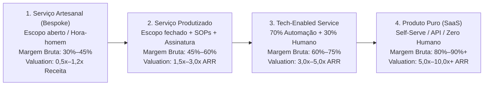

#### Tabela Comparativa das 4 Etapas da Escada de Produtização

| Dimensão Operacional e Financeira | Etapa 1: Serviço Artesanal (*Bespoke / Consultoria*) | Etapa 2: Serviço Produtizado (*Productized Service*) | Etapa 3: *Tech-Enabled Service* (Serviço Habilitado por Tech) | Etapa 4: Produto Puro / SaaS *Self-Serve* |
| :--- | :--- | :--- | :--- | :--- |
| **O que o cliente compra** | Horas de especialistas ou projeto sob medida ("fazemos o que você pedir") | Entregável padronizado, com escopo fechado e assinatura mensal fixa | Acesso a plataforma própria + entrega de resultado operada por IA e especialistas | Licença de uso de software operado pelo próprio time do cliente |
| **Modelo de Precificação** | Orçamento caso a caso, homem-hora ou projeto fechado pontual | Preço tabelado público ou pacotes fixos (*Tiers* P, M, G) recorrentes | Assinatura recorrente (SaaS + *Service Fee* embutido) + taxa de *setup* | Assinatura mensal/anual por assento, volume de uso (API/transação) ou *tier* |
| **Margem Bruta (*Gross Margin*)** | **30% a 45%** (custo direto de folha sênior consome a receita) | **45% a 60%** (processos padronizados permitem usar analistas juniores/plenos) | **60% a 75%** (software e IA executam ~70% do trabalho, humanos revisam ~30%) | **80% a 90%+** (custo direto restrito a nuvem, APIs de LLM e suporte N1) |
| **Receita Anual por Colaborador (estimativa Brasil, ref. 2025–2026)** | R$ 150 mil a R$ 300 mil / ano | R$ 280 mil a R$ 450 mil / ano | R$ 450 mil a R$ 900 mil / ano | **R$ 800 mil a R$ 2,5 milhões+ / ano** |
| **Escalabilidade Operacional** | Linear (dobrar a receita exige dobrar horas de consultores seniores) | Semi-linear (escala via procedimentos padronizados, checklists e analistas juniores) | Alta (1 analista atende cerca de **3x mais clientes**, saltando de 10 para ~30 contas graças a 70% de automação interna) | Exponencial (custo marginal de servir o 1.000º cliente em autoatendimento tende a zero) |
| **Ciclo de Caixa e CAC Payback** | Imediato (sinal de 30%–50% na assinatura cobre o custo inicial) | Rápido (*Setup fee* + 1ª mensalidade no D+0 pagam o CAC integralmente) | Saudável (*Setup fee* financia *onboarding*, receita recorrente previsível) | Lento no início (exige capital para financiar 6 a 18 meses de *CAC Payback*) |
| **Risco de Churn e Lock-in** | Alto ao fim de cada projeto (receita volta a zero todo trimestre) | Médio (contratos de 12 meses, mas baixo custo técnico de troca) | **Muito Baixo** (dados históricos na plataforma + dependência operacional) | Baixo a Médio (alto *lock-in* se sistema de registro, maior *churn* se *point solution*) |
| **Faixa ilustrativa de Valuation (EV/Receita ou EV/EBITDA em transações privadas B2B)** | **0,5x a 1,2x Receita Anual** (ou 3x a 5x EBITDA, forte dependência pessoal dos fundadores) | **1,5x a 3,0x ARR** (ou 5x a 7x EBITDA, receita recorrente contratual) | **3,0x a 5,0x ARR** (ou 7x a 10x EBITDA, atraente para compradores estratégicos e *Private Equity*) | **5,0x a 10,0x+ ARR** (para SaaS B2B com alta retenção líquida, margem bruta > 80% e crescimento eficiente) |

---

#### 2.1. Etapa 1: Serviço Artesanal / Consultoria Sob Medida (*Bespoke Service*)

Na Etapa 1, você vende a entrega manual ou consultiva para 3 a 10 clientes iniciais. Enquanto uma consultoria tradicional aceita demandas variadas de qualquer setor, o fundador que prepara um software usa essa fase com recorte estrito:
* **Foco em uma única dor repetitiva de um único ICP (*Ideal Customer Profile*):** Em vez de ser uma "consultoria de dados genérica", você vende exclusivamente "previsão de demanda e redução de ruptura de estoque para redes de supermercados regionais de 10 a 50 lojas".
* **Mapeamento de Padrões:** Nos primeiros 5 projetos, documente de onde vêm os dados (ex.: ERPs Sankhya, TOTVS, Consinco), quais são os 10 indicadores que o diretor realmente acompanha toda segunda-feira e quais scripts escritos para o Cliente 1 podem ser reaproveitados em 80% no Cliente 4.

#### 2.2. Etapa 2: Serviço Produtizado (*Productized Service*)

Um **Serviço Produtizado** é um serviço embalado, precificado e vendido como produto de prateleira, eliminando propostas sob medida e escopo aberto:
* **Escopo Fechado, Entregável Padronizado e Assinatura Recorrente:** O cliente deixa de contratar "horas abertas de consultoria financeira" e passa a assinar um pacote padronizado como "Conciliação e Fechamento Financeiro Padrão PME: R$ 4.500/mês" (ou, em controladoria mais ampla, "CFO-as-a-Service Série A: R$ 8.500/mês"), que entrega exatamente: conciliação diária de extratos e boletos, fechamento gerencial até o 5º dia útil, DRE padronizada por centro de custo e 1 reunião mensal de 60 minutos com prazo fixo. Qualquer pedido de customização fora da caixa padrão é recusado.
* **SOPs (*Standard Operating Procedures*):** Cada etapa da entrega é quebrada em checklists granulares, templates e vídeos de treinamento interno. Isso permite tirar os fundadores da operação manual e delegar a entrega a analistas juniores/plenos que seguem o procedimento padrão com qualidade previsível.

#### 2.3. Etapa 3: *Tech-Enabled Service* (Serviço Habilitado por Tecnologia)

Aqui a margem bruta salta. Você constrói software proprietário, mas os primeiros usuários intensivos do software são os seus próprios analistas internos, enquanto o cliente interage com um painel/plataforma limpa para visualizar resultados e aprovar ações.
* **A Regra 70/30 de Automação (*Human-in-the-Loop*): Se antes um analista levava 10 horas para auditar notas fiscais ou conciliar recebíveis, seus scripts proprietários, conectores de API e agentes de IA (LLMs) passam a executar 70% do trabalho pesado nos bastidores. O especialista humano atua apenas nos 30% decisivos** (exceções complexas, validação final de qualidade e relacionamento consultivo).
* **Impacto direto na demonstração de resultados (DRE):** Com 70% da rotina pesada executada por scripts internos, a capacidade operacional salta em 3 vezes (de 10 para cerca de 30 clientes atendidos por analista), elevando a margem bruta para a faixa de 60% a 75% e gerando excedente mensal de caixa livre para financiar a engenharia do produto.

#### 2.4. Etapa 4: Produto Puro / SaaS *Self-Serve*

Quando o motor interno já processou dados reais de dezenas de clientes no modelo *Tech-Enabled*, todas as exceções (*edge cases*) foram mapeadas e automatizadas. A interface interna ganha camada de *onboarding* autoguiado e permissões, desacoplando-se da mão de obra humana e atingindo margem bruta de 80% a 90%+.

---

### 3. A Engenharia Financeira do *Bootstrapping* (*Customer-Funded Business*)

Para financiar o *squad* de engenharia do produto sem capital externo, você deve operar com Ciclo de Conversão de Caixa Negativo (onde o cliente paga antes de você incorrer no custo).

#### 3.1. A Regra do *Setup Fee* (Taxa de Implantação que Paga o CAC no Dia 1)

Em serviços produtizados e *tech-enabled services*, nunca ofereça implantação gratuita. Cobre uma Taxa de Setup / Onboarding na assinatura equivalente a 1x a 3x o valor da mensalidade, paga à vista no D+0.
* **Matemática do *Payback* no Dia 1:**
  * Assinatura mensal: **R$ 4.000/mês** + R$ 6.000 de Setup Fee à vista = R$ 10.000 recebidos no Mês 1.
  * Custo de Aquisição (CAC: marketing + comissão de *Inside Sales*): R$ 4.500.
  * Custo direto de *onboarding* (horas de analista na configuração inicial): R$ 1.200.
  * Tributos sobre o faturamento no regime de Lucro Presumido ou Simples Nacional em 2026 (~11% a 16,5% conforme município e anexo): ~R$ 1.300 *(nota de planejamento tributário para 2027 a 2033: acompanhe a transição da Reforma Tributária do Consumo, EC 132/2023 e LC 214/2025, com a entrada da CBS em substituição ao PIS/Cofins em 2027 e a transição gradual do ISS para o IBS, avaliando o regime de créditos dos seus clientes B2B conforme detalhado no Capítulo 2 do Volume 5)*.
  * **Saldo Líquido de Caixa no Mês 1:** descontado o custo direto de entrega do primeiro mês (cerca de R$ 1.800 em horas de analista), a operação já gera +R$ 1.200 de saldo positivo de caixa logo na largada, permitindo que cada novo contrato financie a aquisição do próximo cliente sem queimar capital externo.

#### 3.2. Vendas Anuais Antecipadas e a Regra do "Imposto Interno de P&D"

* **Planos Anuais à Vista:** Ofereça 15% de desconto (ou isenção parcial do *setup*) para clientes que pagarem a anuidade à vista via Pix/TED (ou cartão, descontando a taxa de antecipação da credenciadora). Fechar 10 clientes anuais de R$ 3.500/mês (R$ 35.000 à vista cada) injeta R$ 350 mil de caixa antecipado sem diluir o *cap table*. Atenção contábil e operacional: anuidade antecipada não é aporte de capital livre, mas receita diferida (passivo de entrega). Você deve doze meses de serviço, paga tributos na emissão da nota fiscal e responde por devolução proporcional se o contrato rescindir: provisione em conta separada o custo de servidor, suporte e impostos dos doze meses e use apenas a margem líquida para financiar o desenvolvimento do produto.
* **A Regra do "Imposto Interno de P&D" (alocação carimbada para construir o produto):** Trate o desenvolvimento do software como um tributo interno descontado na fonte antes de qualquer expansão de estilo de vida. Na DRE gerencial da operação de serviços produtizados, mantenha a disciplina: 50% da receita líquida cobre o custo direto de entrega do serviço (analistas e infraestrutura), 20% a 25% cobre despesas comerciais, administrativas e a retirada enxuta de sobrevivência (*pró-labore*) dos fundadores, e os 25% a 30% restantes (após provisão de IRPJ/CSLL e reserva mínima de segurança) são transferidos automaticamente todo dia 5 para uma conta bancária separada e carimbada ("Imposto Interno de P&D"), dedicada exclusivamente a pagar as horas de engenharia do produto próprio.

---

### 4. Como Atravessar o Abismo *Service-to-Product*: As 5 Armadilhas Fatais

A maioria das consultorias e agências que tentam criar um produto próprio fica presa no meio do caminho porque cai em cinco armadilhas estruturais (compare sempre os sintomas abaixo com os indicadores da tabela dos quatro degraus apresentada na Seção 2):

#### 1. O Vício no Dinheiro Fácil de Projetos Customizados (*Whale Trap*)

Surge uma grande corporação oferecendo R$ 350.000 para você desenvolver um sistema sob medida fora do seu *roadmap*. Se você aceitar, seus melhores engenheiros ficarão 6 meses presos construindo código exclusivo que não serve para mais ninguém, congelando o seu produto padrão.
* **Antídoto:** A partir da Etapa 2: recuse qualquer contrato que exija desviar do seu escopo padronizado, a menos que 100% do que será construído já seja o próximo módulo prioritário do seu produto para todo o mercado.

#### 2. Contaminação de P&L e Time (Por que Separar Entrega e Produto)

Se o mesmo desenvolvedor que constrói o SaaS também apaga incêndios dos clientes atuais de serviço, a urgência do serviço sempre matará a importância do produto.
* **Antídoto:** Separe organizacionalmente o **Time de Entrega (*Delivery*) do Squad de Produto**. Blinde pelo menos o CTO e 1 a 2 engenheiros em tempo integral exclusivamente para automatizar processos e construir a plataforma, e apure dois DREs gerenciais separados (Margem de Serviço vs. ARR de Produto).

#### 3. A Armadilha de Propriedade Intelectual no Brasil (Art. 4º da Lei nº 9.609/1998)

Pelo **art. 4º da Lei do Software (Lei nº 9.609/1998)**, salvo estipulação contratual em contrário, pertencem ao contratante os direitos sobre programas desenvolvidos sob encomenda específica. Por isso, assinar a minuta padrão de compras de uma grande empresa cedendo a propriedade intelectual dos entregáveis sem ressalva transfere ao cliente a titularidade do código que deveria compor a base do seu SaaS.

> [!warning] Cláusula Contratual Obrigatória de Reserva de Tecnologia-Base (*Background & Platform IP*)
> Insira obrigatoriamente nos seus contratos de prestação de serviços no Brasil:
> *(Modelo ilustrativo de ponto de partida. Adapte sempre com advogado especializado em propriedade intelectual e contratos de tecnologia antes de assinar.)* *"Cláusula X (Da Propriedade Intelectual e Segredo de Negócio): 1. Pertencerão ao CONTRATANTE, em caráter definitivo após a quitação contratual, os relatórios finais, diagnósticos e arquivos de saída gerados especificamente a partir dos dados brutos fornecidos pelo próprio CONTRATANTE ('Entregáveis de Dados do Cliente'). 2. As partes pactuam expressamente, nos termos da ressalva do caput do art. 4º da Lei nº 9.609/1998 (Lei do Software), que todo código-fonte, bibliotecas, scripts de automação, algoritmos, conectores e interfaces preexistentes ou desenvolvidos pela CONTRATADA antes ou durante a execução deste contrato ('Software-Base e Ferramentas da Contratada') constituem propriedade exclusiva da CONTRATADA, enquanto metodologias, modelos analíticos e fluxos operacionais (não sujeitos a direito autoral pelo art. 8º, I, da Lei nº 9.610/1998) permanecem protegidos como segredo de negócio e know-how confidencial da CONTRATADA. 3. Durante a vigência da assinatura mensal, a CONTRATADA concede ao CONTRATANTE licença não exclusiva, intransferível e temporária de acesso ao Software-Base, sem que isso implique cessão de código-fonte ou restrição ao atendimento de outros clientes do mesmo setor."*

#### 4. Mudança de Tíquete Médio e Perfil de Vendedor

Vender consultoria de R$ 25.000/mês depende do relacionamento pessoal dos sócios. Vender um SaaS ou *Tech-Enabled Service* de R$ 1.500/mês exige máquina de *Inside Sales* (SDRs + *Closers*), geração de demanda *inbound/outbound* previsível e ciclo de fechamento de 15 a 30 dias. Separe o funil comercial e contrate vendedores treinados em venda de volume padronizado.

### 5. Quando Permanecer na Etapa 3 (*Tech-Enabled Service*) É Melhor Negócio do que Forçar a Migração para SaaS Puro

Não tenha receio de operar de forma permanente na **Etapa 3 (*Tech-Enabled Service*) se for ali que o seu cliente enxerga maior valor. Em mercados brasileiros de alta complexidade operacional e regulatória (contabilidade, fiscal, jurídico, comércio exterior, conciliação financeira B2B e gestão de saúde), muitas PMEs preferem pagar R$ 3.000/mês por um serviço habilitado por tecnologia que entrega o problema resolvido a pagar R$ 300/mês por um software de autoatendimento** em que o próprio empresário precisa trabalhar à noite. Uma operação de *Tech-Enabled Service* faturando R$ 30 milhões por ano com 65% de margem bruta e 30% de margem líquida gera R$ 9 milhões anuais de lucro distribuível aos fundadores (observadas, desde janeiro de 2026 pela Lei nº 15.270/2025, a retenção de 10% de IRRF sobre dividendos pagos a pessoa física acima de R$ 50 mil por mês por uma mesma empresa e a tributação mínima anual do IRPFM de até 10% para rendas globais acima de R$ 600 mil anuais, detalhadas no [[IGNICAO-Vol-5-Financas-e-Captacao#CAPÍTULO 2: CONTABILIDADE, REGIMES FISCAIS E TRIBUTÁRIO ESTRATÉGICO (REFORMA IBS/CBS E INCENTIVOS)|Capítulo 2 do Volume 5]]), com altíssima retenção e zero diluição em fundos de capital de risco.

> [!tip] Regra de Decisão: Etapa 3 vs. Etapa 4
> Só avance para o SaaS *self-serve* puro (Etapa 4) se o usuário final na ponta tiver rotina e incentivo para operar a ferramenta sozinho sem atrito. Caso contrário, consolide a Etapa 3 (*Tech-Enabled Service*), usando automação e IA internamente para manter o custo de entrega entre 25% e 40% da receita (margem bruta de 60% a 75%) enquanto cobra o preço de uma solução completa.

---

### 5. Checklist de Execução Service-to-Product

- [ ] **Pacotização (Etapa 2):** Propostas sob medida eliminadas e substituídas por pacotes fixos recorrentes com Setup Fee que cobre 100% do CAC no Mês 1?
- [ ] **Blindagem de PI (Lei 9.609/1998):** Cláusula de reserva exclusiva da *Tecnologia-Base*, bibliotecas e motores incluída em 100% dos contratos com clientes?
- [ ] **Separação de Squad e DRE:** Engenheiros do produto 100% blindados contra demandas manuais de consultoria e financiados por 25%–30% da receita líquida do serviço?
- [ ] **Automação 70/30 (Etapa 3):** Scripts, APIs e agentes de IA já executam 70%+ da operação nos bastidores, elevando a margem bruta acima de 60%?

---

### O Espelho do Capítulo 7: Você Está Construindo uma Máquina ou Vendendo Suas Horas em Roda de Hamster?

**Decisão na trincheira (Capítulo 7):** Em Curitiba e em São Paulo, Henrique e a dupla Lucas e Marina aplicaram o Espelho do Capítulo 7 para atravessar os 18 meses de construção sem ceder 1% do capital social: Henrique usou os R$ 18 mil mensais dos diagnósticos padronizados em três madeireiras e agroindústrias paranaenses para financiar seus scripts até que o software de telemetria atingisse 86% de margem bruta, enquanto Lucas e Marina usaram o "Imposto Interno de P&D" dos doze clientes de conciliação manual para bancar a engenharia das três telas do MVP que lançam na abertura do Volume 4.

**O Espelho (autodiagnóstico):**
1. Se você presta serviços hoje, você aceita qualquer projeto personalizado que o cliente pede, ou vende um pacote de escopo 100% fechado para um único perfil de cliente e uma única dor?
2. Qual porcentagem das tarefas que a sua equipe executava manualmente há seis meses já foi transformada em código ou automação de IA nos bastidores?
3. Você cobra uma taxa de implantação (*Setup Fee*) no Dia 1 que paga integralmente o seu Custo de Aquisição (CAC), ou está financiando o cliente com o seu próprio bolso?

**Permissão Libertadora:**
Você está autorizado a demitir clientes de consultoria que exigem trabalho sob medida fora da sua tese de produto e a recusar propostas de investidores que queiram 30% da sua empresa por migalhas.

**O Ritual de Segunda-Feira às 9h:**
Reserve na agenda desta semana 15 horas inegociáveis exclusivamente para construir o script, conector ou formulário automático que vai eliminar a tarefa manual mais repetitiva da sua entrega atual.

---

### Fechamento do Volume 3 e Ponte para o Volume 4 (Tração e Product-Market Fit)

Você encerra este **Volume 3** com o alicerce científico e experimental completo: suas apostas de vida ou morte estão priorizadas e pré-registradas no Banco de Hipóteses (Fase 7), a demanda e a disposição a pagar foram provadas com moedas reais de compromisso antes do código (Fase 8), a arquitetura da solução sobreviveu a protótipos rápidos de um dia (Fase 9), o escopo passou pela Guilhotina MoSCoW e pelos testes silenciosos de usabilidade até caber numa Especificação de MVP enxuta de duas páginas (Fase 10) e você domina os portões de maturidade (Gates H/E e TRL/CRL), a disciplina de cunha (Idea → Wedge → Scale) e os modelos de Marketplaces, B2B2C, Open Source (COSS) e Bootstrapping via Serviços Produtizados (Capítulos 1 a 7). Agora é hora de colocar o produto mínimo viável na rua, medir a retenção real por safra e construir os canais de aquisição: siga diretamente para o [[IGNICAO-Vol-4-Tracao-e-PMF#IGNIÇÃO: Volume 4: Tração, Go-to-Market e Product-Market Fit|Volume 4: Tração e Product-Market Fit (Fases 11 a 13 e Capítulos 1 a 12)]], onde acompanharemos o lançamento do MVP em produção (Fase 11), a validação da economia unitária (Fase 12) e a conquista comprovada do Product-Market Fit (Fase 13).

